# 大模型Agent开发实践


## 内容简介

本书系统地讲解了大模型智能体（Agent）开发领域的核心技术路径与代表性实战案例，涵盖了从模型部署、知识增强、微调优化到Agent系统构建与企业级应用的完整开发流程。本书分为八章，内容包括主流大模型的在线调用与本地部署、基于向量与知识图谱的RAG系统构建、多轮对话与复杂任务规划的Agent开发方法，以及大模型高效微调流程。本书还特别介绍了LangChain与LangGraph两大主流Agent框架的功能机制与最佳实践。项目案例部分精选了多个企业级实战场景，如基于GraphRAG的本地知识问答系统、医学领域的大模型高效微调、B站舆情分析智能体（BiliAgent）等。这些项目紧贴实际需求，解析了模型调用、知识增强、任务规划、前后端集成等关键环节，既展示了大模型Agent在不同行业的应用潜力，也为读者提供了可复用、可扩展的开发参考。

本书可作为大模型应用开发入门者的实战指南，也可用作高等院校人工智能、计算机相关专业的课程实践与毕业设计用书，还可为从事AI应用研发的工程师、产品经理、IT培训讲师等提供专业参考与项目范例。

## 作者简介


吴昊天（@九天Hector），赋范空间（北京）科技有限公司创始人，首席技术官&大模型产研中心负责人，赋范大模型技术社区创始人，主导并研发包括数据分析、机器学习、深度学习、大模型等爆款口碑体系课程，累计42000多名用户参与课程学习。


陈志鹏（@木羽Cheney），赋范空间大模型技术专家，前国网高级算法工程师，国内首批大模型工程师。现任赋范空间（北京）科技有限公司大模型技术负责人，以及赋范大模型社区共建人。


王钰，中国传媒大学在读博士生，在机器学习、深度学习以及大模型领域有扎实的理论基础和丰富的实践经验。曾参与多项数据分析项目，产出多份高质量的数据分析报告，为企业和学术机构提供数据驱动的解决方案。

## 前言

伴随着大语言模型（LLM）技术的飞速发展，人工智能正迈入以Agent为核心的新阶段。大模型的应用不再局限于被动响应的问答引擎，而是逐渐演变为具备感知、思考、决策和行动能力的自主系统。AI Agent正在成为各类应用中解决复杂任务、实现人机协同的关键技术路径，被广泛应用于企业客服、数据分析、代码编写、智能搜索等领域。

本书从大模型的部署与调用出发，逐步深入讲解Agent的构建方法与应用流程，旨在为读者提供一个系统且实用的Agent开发全景指南。本书系统地介绍大模型的本地部署与在线API调用流程，随后深入探讨RAG（检索增强生成）机制的实际开发方法，并详细展示当前主流的高效微调策略，以优化模型性能。此外，书中还聚焦LangChain、LangGraph等具备高度生态支持的Agent开发框架，讲解如何以模块化方式构建具备任务规划、工具调用、状态管理能力的Agent工作流。最后，本书以DeepSeek系列模型为核心支撑，结合企业级项目案例，完整展现大模型Agent的全流程开发路径。

本书为每章内容均配备了结构清晰、可运行的代码实现，读者可在本地环境中轻松复现并进行扩展。通过本书的学习，读者将全面理解大模型Agent的关键机制，掌握搭建、优化和部署Agent系统的能力，并能够将其应用于更广泛的实际任务中。

### 本书内容

本书围绕“大模型Agent”这一核心技术主线展开，由浅入深、由基础到实战，详细地介绍了从模型部署、知识增强、微调优化到Agent构建与企业级应用的全流程。

本书共分为8章，具体内容如下。

**第1章：大模型Agent基础**

该章介绍AI Agent的发展历程、核心概念与系统结构，梳理当前主流的Agent开发框架类型，为后续章节奠定理论基础。

**第2章：大模型基础与部署调用**

该章全面概览当前主流大模型的发展格局，区分在线调用与本地部署两种常见接入方式，内容包括API使用方法、本地化部署步骤及第三方部署工具，为实际开发做好模型能力准备。

**第3章：DeepSeek安装部署与API调用流程**

该章聚焦DeepSeek系列模型，系统介绍DeepSeek-V3与DeepSeek-R1两大分支的使用方法，包括API接入、本地推理、Function Calling功能，以及如何通过第三方工具（如vLLM、Ollama）进行模型的部署与落地应用。

**第4章：基于本地知识库的RAG**

该章系统讲解RAG技术体系，涵盖文本向量化、文档切分、向量检索、知识图谱构建等模块，并引入GraphRAG架构以提升问答系统的推理与语义理解水平。

**第5章：RAG应用实战**

该章提供多个完整的RAG落地项目案例，结合DeepSeek模型与GraphRAG工程框架，分别实现本地模型问答、企业知识库接入以及多检索场景（如LocalSearch与GlobalSearch）的集成方案。

**第6章：大模型微调实战**

该章详细讲解大模型高效微调方法，并通过Qwen和DeepSeek-R1的微调案例，使读者深入理解从数据准备、实验设计到完整训练的全过程。

**第7章：大模型Agent开发**

该章围绕LangChain与CrewAI框架，讲解如何构建具备工具调用、多轮交互与任务调度能力的Agent，结合DeepSeek模型完成从语言模型调用到Agent任务链搭建的综合实践。

**第8章：企业级Agent开发实战**

该章聚焦企业级应用，引领读者开发了一个综合性项目案例——BiliAgent（B站舆情分析智能体）。内容涵盖实时数据接入、RAG链路优化、LangGraph工作流构建、前后端集成等关键模块，展示了完整的工程化开发流程。

### 本书特点

- ✅ 体系完整。本书涵盖大模型Agent开发的全流程，从模型部署、RAG、模型微调，到Agent系统构建与企业级应用，每一章既可以独立成篇，又前后衔接，帮助读者系统性地掌握Agent开发从原理到实战的完整技术路径。
- ✅ 项目驱动。全书精选多个典型实战项目，包括基于原生模型的多轮对话系统、RAG问答系统、微调优化流程、BiliAgent舆情分析智能体等。所有项目均基于真实应用场景设计，紧贴前沿需求，强化读者的工程落地能力。
- ✅ 技术实用。本书所采用的框架与工具，如DeepSeek、LangChain、LangGraph、LLaMA-Factory、Unsloth、Ollama等，均为当前大模型Agent开发中主流且稳定的开源方案，具备较强的实战性与适配性，读者可在项目开发中直接复用。
- ✅ 结构清晰。本书实战项目按照“应用背景→技术选型→环境部署→核心模块开发→项目运行演示”的流程展开讲解，使读者能够清楚理解实际项目的开发逻辑与实现过程，提升学习效率与开发信心。
- ✅ 学习资源丰富。本书为每个项目提供了完整可运行的源代码和学习视频，读者能够更加轻松地搭建、运行、使用项目，以最快速度提升自身的开发能力。

### 读者对象

- ✅ 人工智能开发者
- ✅ Python和LLM技术爱好者
- ✅ 从事Agent系统开发的工程师
- ✅ 大模型相关课程的教师
- ✅ 企业智能化转型的研发人员
- ✅ 希望构建企业级AI Agent的产品经理
- ✅ 参加毕业设计的学生
- ✅ 大模型创业团队的核心技术人员

### 资源与服务

本书提供了大量的辅助学习资源，还提供了专业的知识拓展与答疑服务，旨在帮助读者提高学习效率并解决学习过程中遇到的各种疑难问题。

- ✅ **项目精讲视频。** 关注微信公众号“赋范空间”，回复关键词“实践”，即可获取本书配套的 **全套项目精讲视频 与 完整源码文件**。每个项目均提供精细拆解，覆盖环境配置、模块结构、功能实现等多个维度，便于读者边学边练。读者可扫描右侧二维码，立即开始学习。
- ✅ **项目源码。** 本书配套项目均提供完整源代码，确保读者可以顺利复现开发流程。相关源码可通过公众号链接获取。本书中各项目案例所涉及的网站链接、操作指南、开源项目地址等资源，均已统一整理并附在每章最后一节的“附加资源”中。读者可根据学习需要，查阅对应章节，按需获取相关网址和材料，方便查找与使用。
- ✅ **学习答疑群。** 为更好地服务读者，我们建立了配套学习交流群，定期提供技术问答与经验分享。加入方式请见公众号公告。
- ✅ **持续更新与拓展内容。** 本书相关内容将持续在“赋范空间”公众号平台发布扩展文章，包括模型版本更新说明、Agent案例升级、开源工具推荐等，以帮助读者紧跟大模型生态发展。


资源获取

## 第1章 大模型Agent基础

本章将探讨大模型Agent的基础知识。首先，我们将梳理从人工智能到大模型Agent的发展过程，明确传统Agent和现代大模型Agent之间的差异，并阐明大模型如何推动Agent进入全新的发展阶段。接着，我们将讲解大模型Agent的基本定义、关键组成部分，以及大语言模型如何赋能Agent的决策、推理和任务执行能力。最后，我们通过介绍当前主流的Agent开发框架，分析其特点、适用场景及实际应用，使读者对相关工具有初步认识。

本章知识架构如下：

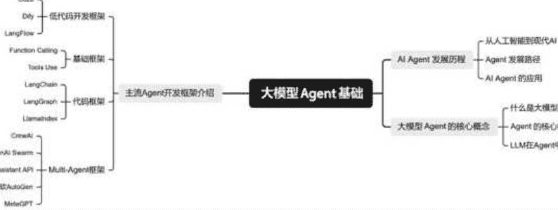

### 1.1 AI Agent发展历程

在本节中，我们将从人工智能的起源谈起，逐步过渡到AI Agent的发展历程。我们将介绍AI Agent的定义，探讨其如何从最初的规则驱动系统演变为如今具备自主决策与任务执行能力的Agent。同时，我们将深入了解Agent的构造过程，从API调用，到基于大语言模型的Agent。最后，我们通过了解Agent在现实世界中的广泛应用，展示AI Agent如何在现代企业中创造价值，推动行业变革。

#### 1.1.1 从人工智能到现代AI Agent

1955年，约翰·麦卡锡（John McCarthy）等人首次提出了人工智能（artificial intelligence, AI）的概念，标志着这一领域的正式起步。1956年，在达特茅斯会议上，AI被正式定义为“使机器能够执行通常需要人类智慧的任务”。在AI的早期发展阶段，学者尝试通过符号主义和规则推理来模拟人类的认知，解决一些数学推理、棋牌游戏等结构化任务。此方法依赖于人工编写的知识库和运行的逻辑规则。同年，由阿兰·图灵提出的“图灵测试”成为衡量机器是否具备智能的重要标准。

1969—1986年，AI的研究重点转向了专家系统。专家系统通过一套规则和推理引擎模拟专家的决策过程，因此被广泛应用于医学、金融等领域。然而，这些系统仍然严重受限于人工编写的规则，并且无法处理不确定和模糊的信息。

2000年后，随着计算能力的提升和数据的积累，深度学习技术取得了显著的进展。大数据的出现也为深度学习的发展提供了重要支撑。大规模的训练数据和强大的计算资源（如GPU）使深度学习算法能够在多个领域取得突破性进展。

2017年，论文 Attention Is All You Need 提出了Transformer架构，这一架构成为现代大语言模型（LLM）的基础。Transformer架构通过自注意力机制，使模型能够更好地处理长序列数据，成为自然语言处理（NLP）领域的一项革命性突破。正是基于Transformer架构，OpenAI推出了GPT（generative pretrained transformer）系列模型，从GPT-1到GPT-3，模型的规模和能力逐步提升。

2020年，GPT-3预训练模型正式发布。该模型拥有1750亿个参数，能够执行文本生成、机器翻译、问答等多种任务，但当时主要在学术界和业界引发关注。直到2022年底，OpenAI团队在GPT模型的基础上正式推出了一个能够像真人一样与用户进行交流的AI聊天机器人——ChatGPT，这一举措引发了全球性的关注。AI的发展仿佛瞬间从科研领域走进了日常生活：AI不再是遥不可及的科学概念，而是成为了人人可用的工具，融入了每个人的生活。

LLM尽管在文本生成和理解方面表现出色，但仍然存在一些局限性。

- 缺乏自主决策能力：LLM不具备自行规划和决策的能力。作为生成式模型，LLM的输出完全依赖于用户输入的提示信息或相关上下文，无法主动发起任务或在动态环境中做出决策。
- 缺乏长期记忆和完整任务执行能力：LLM模型通常只能处理单一任务，且缺乏长期记忆。这导致它们在执行复杂任务时，无法有效衔接多个步骤以完成整体任务。

近两年来，随着基础LLM性能的快速迭代，AI的发展逐步走向了现代的、基于LLM的Agent系统。通过与强化学习、规划、知识检索、多模态等技术的结合，AI Agent正逐步发展成为能够自主决策、适应变化并执行复杂任务的Agent系统。

#### 1.1.2 Agent发展路径

##### 1. 初期阶段：简单API调用与规则驱动系统

在AI发展的初期阶段，计算机系统依赖于规则的编写和简单API的调用，可以执行一些特定的任务，这样的计算机系统在当时就被称为“智能体”。随着AI技术的发展，在2000年左右，Agent的概念日益丰富。例如：1997年，IBM的“深蓝”计算机在国际象棋对抗赛中击败了人类世界冠军；2000年Cynthia Breazeal教授开发了第一个可以用面部模拟人类情感的机器人，它拥有眼睛、眉毛、耳朵和嘴巴，被称为Kismet；2011年，由IBM创建的名为Watson的计算机系统被编程来回答问题，在电视转播的智力比赛Jeopardy！中战胜了两位前冠军；此外，2011年，苹果公司发布了Siri，成为第一个全球流行的虚拟助手。

这些Agent根据其感知程度的不同，被罗素、诺维格、彼得等人在 Artificial Intelligence: A Modern Approach 一书中分为以下五类。

- 简单反射智能体（Simple Reflex Agent）：根据当前感知选择动作，忽略感知历史的其余部分。例如，空调温控器，我们设定当温度高于某一上限数值时，它就开启空调制冷。这类Agent只依据当前的温度来判断开关，并不考虑温度变化或任何其他的历史信息。
- 基于模型的反射型智能体（Model-Based Reflex Agent）：在简单反射智能体的基础上，如果结合转移模型和传感器模型，让智能体在传感受限的情况下尽可能地跟踪环境状态，便得到了基于模型的反射型智能体。例如，带有室内导航功能的智能扫地机器人，其内部配置的传感器可以感知空间障碍，并在内部构建出当前的环境地图模型。当智能扫地机器人遇到新的障碍物时，它不仅凭借当前感知转动方向，还会利用内部的地图模型和此前的运动经验，规划一条可以绕过障碍的路径。通过这种追踪环境状态的方式，智能体能够在部分可观测环境下做出更合理的反应。
- 基于目标的智能体（Goal-Based Agent）：在简单反射型智能体的基础上，如果结合描述某种理想情况的目标信息，智能体可以通过搜索和规划明确“要实现这个目标应该怎么做”，便使其具有了主动性。例如，导航应用会根据用户预设的地点规划路线，评估多条可以抵达目标的路径后选择一条最合理的直达路线。
- 基于效用的智能体（Utility-Based Agent）：在大多数情况下，仅仅依靠目标并不足以产生高质量的行为。如果我们为智能体添加一个效用函数去度量其性能，再选择要执行的动作，这样就可以使智能体的效用最大化。例如，智能路线规划助手包含评估每条路线的综合价值、时间长短、路况的安全性、是否有收费路段等。效用函数为智能体提供了一套细化的评价标准，使其能够在达到同一目标的多个方案中选出最符合偏好或利益最大的那一个。
- 学习型智能体（Learning Agent）：具有从过去的经验中学习的能力，并根据学习能力采取行动或做出决定。它从过去获得基础知识，并利用这些学习来自动行动和适应。此类智能体一般包含四部分，分别是学习元素、评估者、性能元素和问题生成器。任何类型的智能体（如基于模型、基于目标、基于效用的智能体）都可以构建学习型智能体，通过学习来提升性能。

##### 2. LLM的引入：从ChatGPT到初步的Agent

伴随着大语言模型的飞速发展，AI系统在语言理解和生成方面大幅提升。这些模型能够处理复杂、通用的语言任务，例如文本生成、机器翻译、问答对话等，这为Agent的发展奠定了基础。尽管LLM在语言处理方面表现出色，但其响应仍然是被动的，缺乏自主决策和任务执行的能力。

##### 3. AutoGPT的出现：迈向自主执行的Agent

AutoGPT的发布标志着AI Agent发展的一个重要里程碑。AutoGPT是一个开源的自主AI Agent项目，它在LLM的基础上，通过多轮推理和具体任务的分解，可以实现从目标设定到任务执行的全流程自主执行。AutoGPT的发布引起了广泛关注，被视为实现自主AI Agent的重要一步。

##### 4. BabyAGI的提出：通过自主学习向人工智能迈进

紧随其后，学习型智能体的思想被加入，BabyAGI通过学习人类婴儿学习和执行任务的方式，使Agent具备自我学习和任务管理的能力。它可以设定一个主要目标，自动生成任务列表，并根据任务的完成情况进行调整和优化。BabyAGI的提出，为AI Agent的发展提供了新的思路，强调了自我学习和任务管理的重要性。

#### 1.1.3 AI Agent的应用

近年，AI Agent应用进一步落地，从客服助理、代码生成工具，再到金融分析助手，成熟的应用案例大批涌现，企业也迎来了降本增效、创新改革的新机遇。本节将聚焦当前主流领域的应用实践，介绍并分析AI Agent如何在企业场景中发挥价值。

##### 1. 智能客服领域的AI Agent

在客户服务领域，AI Agent已经广泛落地，其中最为典型的就是智能客服机器人。它通过自然语言处理与语音识别技术，可以模拟人工客服为用户提供解答，从而大幅提升服务效率与客户满意度。此外，智能客服机器人还可以多端多渠道7×24小时实时响应咨询，大幅缓解人工压力的同时保证快速响应。例如：阿里巴巴自研的阿里云智能对话机器人；百度依托“文心一言”和UNIT对话平台，为企业提供的端到端的智能客服解决方案。

##### 2. 编程助手与代码生成AI Agent

AI Agent在软件开发领域的应用为程序员提供了全新的生产力工具。编程助手能够根据自然语言描述或上下文代码，自动补全代码片段、生成函数实现，显著降低开发人员的工作量。最具代表性的产品便是GitHub与OpenAI合作推出的GitHub Copilot，它可以理解多种编程语言的语法和语义，在代码开发过程中实时给出建议。除了Copilot，业界还有许多类似或相关的工具与项目，如Cursor、CodeGeeX、通义灵码（Tongyi Lingma）、文心快码（Baidu Comate）等。

##### 3. 金融分析领域的AI Agent

当前，大模型AI Agent在金融服务中的应用已经涵盖客户服务、投资分析、风险控制、市场研报等多个方面。在金融领域的AI模型中，专用大型语言模型开始涌现并展现出强大能力。通过海量金融数据的再次训练，金融专用大模型BloombergGPT问世，它在各种金融自然语言处理任务上的表现远超通用模型。开源社区也有针对金融领域的大模型，例如：AI4Finance开发的开源金融大模型FinGPT，尝试用低成本的方法微调金融数据；腾讯也在其金融云服务中融入了AI Agent技术，推出高精度的反欺诈风控引擎、自动化eKYC审核等解决方案，甚至通过部署数字人为银行客户提供交互服务，目前已在全球20多个国家赋能了上万家企业。

##### 4. 其他企业应用场景的AI Agent

在运营和营销领域，AI Agent被用于自动生成营销文案、撰写产品描述、制作个性化广告素材，从而加速市场推广并节约创作成本。在制造与供应链领域，AI Agent可作为智能调度或质量检测助手：通过分析物联网传感器数据，预测设备何时需要维护；根据历史订单和库存数据，自动调整生产计划，提高供应链效率。企业内部知识管理也是AI Agent大显身手的场景之一。企业可部署自己的大模型问答系统，让员工与内部知识库进行对话查询，快速找到解决问题的方案。

AI Agent正加速融入各行各业的企业级应用中，成为推动业务创新和提升效率的重要引擎。行业专属的大模型将不断涌现，多模态Agent将提供更好的人机交互体验，其可控性和安全性也必将进一步提升。

### 1.1 AI Agent发展历程

在本节中，我们将从人工智能的起源谈起，逐步过渡到AI Agent的发展历程。我们将介绍AI Agent的定义，探讨其如何从最初的规则驱动系统演变为如今具备自主决策与任务执行能力的Agent。同时，我们将深入了解Agent的构造过程，从API调用，到基于大语言模型的Agent。最后，我们通过了解Agent在现实世界中的广泛应用，展示AI Agent如何在现代企业中创造价值，推动行业变革。

#### 1.1.1 从人工智能到现代AI Agent

1955年，约翰·麦卡锡（John McCarthy）等人首次提出了人工智能（artificial intelligence, AI）的概念，标志着这一领域的正式起步。1956年，在达特茅斯会议上，AI被正式定义为“使机器能够执行通常需要人类智慧的任务”。在AI的早期发展阶段，学者尝试通过符号主义和规则推理来模拟人类的认知，解决一些数学推理、棋牌游戏等结构化任务。此方法依赖于人工编写的知识库和运行的逻辑规则。同年，由阿兰·图灵提出的“图灵测试”成为衡量机器是否具备智能的重要标准。

1969—1986年，AI的研究重点转向了专家系统。专家系统通过一套规则和推理引擎模拟专家的决策过程，因此被广泛应用于医学、金融等领域。然而，这些系统仍然严重受限于人工编写的规则，并且无法处理不确定和模糊的信息。

2000年后，随着计算能力的提升和数据的积累，深度学习技术取得了显著的进展。大数据的出现也为深度学习的发展提供了重要支撑。大规模的训练数据和强大的计算资源（如GPU）使深度学习算法能够在多个领域取得突破性进展。

2017年，论文 Attention Is All You Need 提出了Transformer架构，这一架构成为现代大语言模型（LLM）的基础。Transformer架构通过自注意力机制，使模型能够更好地处理长序列数据，成为自然语言处理（NLP）领域的一项革命性突破。正是基于Transformer架构，OpenAI推出了GPT（generative pretrained transformer）系列模型，从GPT-1到GPT-3，模型的规模和能力逐步提升。

2020年，GPT-3预训练模型正式发布。该模型拥有1750亿个参数，能够执行文本生成、机器翻译、问答等多种任务，但当时主要在学术界和业界引发关注。直到2022年底，OpenAI团队在GPT模型的基础上正式推出了一个能够像真人一样与用户进行交流的AI聊天机器人——ChatGPT，这一举措引发了全球性的关注。AI的发展仿佛瞬间从科研领域走进了日常生活：AI不再是遥不可及的科学概念，而是成为了人人可用的工具，融入了每个人的生活。

LLM尽管在文本生成和理解方面表现出色，但仍然存在一些局限性。

- 缺乏自主决策能力：LLM不具备自行规划和决策的能力。作为生成式模型，LLM的输出完全依赖于用户输入的提示信息或相关上下文，无法主动发起任务或在动态环境中做出决策。
- 缺乏长期记忆和完整任务执行能力：LLM模型通常只能处理单一任务，且缺乏长期记忆。这导致它们在执行复杂任务时，无法有效衔接多个步骤以完成整体任务。

近两年来，随着基础LLM性能的快速迭代，AI的发展逐步走向了现代的、基于LLM的Agent系统。通过与强化学习、规划、知识检索、多模态等技术的结合，AI Agent正逐步发展成为能够自主决策、适应变化并执行复杂任务的Agent系统。

#### 1.1.2 Agent发展路径

##### 1. 初期阶段：简单API调用与规则驱动系统

在AI发展的初期阶段，计算机系统依赖于规则的编写和简单API的调用，可以执行一些特定的任务，这样的计算机系统在当时就被称为“智能体”。随着AI技术的发展，在2000年左右，Agent的概念日益丰富。例如：1997年，IBM的“深蓝”计算机在国际象棋对抗赛中击败了人类世界冠军；2000年Cynthia Breazeal教授开发了第一个可以用面部模拟人类情感的机器人，它拥有眼睛、眉毛、耳朵和嘴巴，被称为Kismet；2011年，由IBM创建的名为Watson的计算机系统被编程来回答问题，在电视转播的智力比赛Jeopardy！中战胜了两位前冠军；此外，2011年，苹果公司发布了Siri，成为第一个全球流行的虚拟助手。

这些Agent根据其感知程度的不同，被罗素、诺维格、彼得等人在 Artificial Intelligence: A Modern Approach 一书中分为以下五类。

- 简单反射智能体（Simple Reflex Agent）：根据当前感知选择动作，忽略感知历史的其余部分。例如，空调温控器，我们设定当温度高于某一上限数值时，它就开启空调制冷。这类Agent只依据当前的温度来判断开关，并不考虑温度变化或任何其他的历史信息。
- 基于模型的反射型智能体（Model-Based Reflex Agent）：在简单反射智能体的基础上，如果结合转移模型和传感器模型，让智能体在传感受限的情况下尽可能地跟踪环境状态，便得到了基于模型的反射型智能体。例如，带有室内导航功能的智能扫地机器人，其内部配置的传感器可以感知空间障碍，并在内部构建出当前的环境地图模型。当智能扫地机器人遇到新的障碍物时，它不仅凭借当前感知转动方向，还会利用内部的地图模型和此前的运动经验，规划一条可以绕过障碍的路径。通过这种追踪环境状态的方式，智能体能够在部分可观测环境下做出更合理的反应。
- 基于目标的智能体（Goal-Based Agent）：在简单反射型智能体的基础上，如果结合描述某种理想情况的目标信息，智能体可以通过搜索和规划明确“要实现这个目标应该怎么做”，便使其具有了主动性。例如，导航应用会根据用户预设的地点规划路线，评估多条可以抵达目标的路径后选择一条最合理的直达路线。
- 基于效用的智能体（Utility-Based Agent）：在大多数情况下，仅仅依靠目标并不足以产生高质量的行为。如果我们为智能体添加一个效用函数去度量其性能，再选择要执行的动作，这样就可以使智能体的效用最大化。例如，智能路线规划助手包含评估每条路线的综合价值、时间长短、路况的安全性、是否有收费路段等。效用函数为智能体提供了一套细化的评价标准，使其能够在达到同一目标的多个方案中选出最符合偏好或利益最大的那一个。
- 学习型智能体（Learning Agent）：具有从过去的经验中学习的能力，并根据学习能力采取行动或做出决定。它从过去获得基础知识，并利用这些学习来自动行动和适应。此类智能体一般包含四部分，分别是学习元素、评估者、性能元素和问题生成器。任何类型的智能体（如基于模型、基于目标、基于效用的智能体）都可以构建学习型智能体，通过学习来提升性能。

##### 2. LLM的引入：从ChatGPT到初步的Agent

伴随着大语言模型的飞速发展，AI系统在语言理解和生成方面大幅提升。这些模型能够处理复杂、通用的语言任务，例如文本生成、机器翻译、问答对话等，这为Agent的发展奠定了基础。尽管LLM在语言处理方面表现出色，但其响应仍然是被动的，缺乏自主决策和任务执行的能力。

##### 3. AutoGPT的出现：迈向自主执行的Agent

AutoGPT的发布标志着AI Agent发展的一个重要里程碑。AutoGPT是一个开源的自主AI Agent项目，它在LLM的基础上，通过多轮推理和具体任务的分解，可以实现从目标设定到任务执行的全流程自主执行。AutoGPT的发布引起了广泛关注，被视为实现自主AI Agent的重要一步。

##### 4. BabyAGI的提出：通过自主学习向人工智能迈进

紧随其后，学习型智能体的思想被加入，BabyAGI通过学习人类婴儿学习和执行任务的方式，使Agent具备自我学习和任务管理的能力。它可以设定一个主要目标，自动生成任务列表，并根据任务的完成情况进行调整和优化。BabyAGI的提出，为AI Agent的发展提供了新的思路，强调了自我学习和任务管理的重要性。

#### 1.1.3 AI Agent的应用

近年，AI Agent应用进一步落地，从客服助理、代码生成工具，再到金融分析助手，成熟的应用案例大批涌现，企业也迎来了降本增效、创新改革的新机遇。本节将聚焦当前主流领域的应用实践，介绍并分析AI Agent如何在企业场景中发挥价值。

##### 1. 智能客服领域的AI Agent

在客户服务领域，AI Agent已经广泛落地，其中最为典型的就是智能客服机器人。它通过自然语言处理与语音识别技术，可以模拟人工客服为用户提供解答，从而大幅提升服务效率与客户满意度。此外，智能客服机器人还可以多端多渠道7×24小时实时响应咨询，大幅缓解人工压力的同时保证快速响应。例如：阿里巴巴自研的阿里云智能对话机器人；百度依托“文心一言”和UNIT对话平台，为企业提供的端到端的智能客服解决方案。

##### 2. 编程助手与代码生成AI Agent

AI Agent在软件开发领域的应用为程序员提供了全新的生产力工具。编程助手能够根据自然语言描述或上下文代码，自动补全代码片段、生成函数实现，显著降低开发人员的工作量。最具代表性的产品便是GitHub与OpenAI合作推出的GitHub Copilot，它可以理解多种编程语言的语法和语义，在代码开发过程中实时给出建议。除了Copilot，业界还有许多类似或相关的工具与项目，如Cursor、CodeGeeX、通义灵码（Tongyi Lingma）、文心快码（Baidu Comate）等。

##### 3. 金融分析领域的AI Agent

当前，大模型AI Agent在金融服务中的应用已经涵盖客户服务、投资分析、风险控制、市场研报等多个方面。在金融领域的AI模型中，专用大型语言模型开始涌现并展现出强大能力。通过海量金融数据的再次训练，金融专用大模型BloombergGPT问世，它在各种金融自然语言处理任务上的表现远超通用模型。开源社区也有针对金融领域的大模型，例如：AI4Finance开发的开源金融大模型FinGPT，尝试用低成本的方法微调金融数据；腾讯也在其金融云服务中融入了AI Agent技术，推出高精度的反欺诈风控引擎、自动化eKYC审核等解决方案，甚至通过部署数字人为银行客户提供交互服务，目前已在全球20多个国家赋能了上万家企业。

##### 4. 其他企业应用场景的AI Agent

在运营和营销领域，AI Agent被用于自动生成营销文案、撰写产品描述、制作个性化广告素材，从而加速市场推广并节约创作成本。在制造与供应链领域，AI Agent可作为智能调度或质量检测助手：通过分析物联网传感器数据，预测设备何时需要维护；根据历史订单和库存数据，自动调整生产计划，提高供应链效率。企业内部知识管理也是AI Agent大显身手的场景之一。企业可部署自己的大模型问答系统，让员工与内部知识库进行对话查询，快速找到解决问题的方案。

AI Agent正加速融入各行各业的企业级应用中，成为推动业务创新和提升效率的重要引擎。行业专属的大模型将不断涌现，多模态Agent将提供更好的人机交互体验，其可控性和安全性也必将进一步提升。

例如，智能路线规划助手包含评估每条路线的综合价值、时间长短、路况的安全性、是否有收费路段等。效用函数为智能体提供了一套细化的评价标准，使其能够在达到同一目标的多个方案中选出最符合偏好或利益最大的那一个。

- 学习型智能体 (Learning Agent)：具有从过去的经验中学习的能力，并根据学习能力采取行动或做出决定。它从过去获得基础知识，并利用这些学习来自动行动和适应。此类智能体一般包含四部分，分别是学习元素、评估者、性能元素和问题生成器。任何类型的智能体（如基于模型、基于目标、基于效用的智能体）都可以构建学习型智能体，通过学习来提升性能。

##### 2. LLM的引入：从ChatGPT到初步的Agent

伴随着大语言模型的飞速发展，AI系统在语言理解和生成方面大幅提升。这些模型能够处理复杂、通用的语言任务，例如文本生成、机器翻译、问答对话等，这为Agent的发展奠定了基础。尽管LLM在语言处理方面表现出色，但其响应仍然是被动的，缺乏自主决策和任务执行的能力。

##### 3. AutoGPT的出现：迈向自主执行的Agent

AutoGPT的发布标志着AI Agent发展的一个重要里程碑。AutoGPT是一个开源的自主AI Agent项目，它在LLM的基础上，通过多轮推理和具体任务的分解，可以实现从目标设定到任务执行的全流程自主执行。AutoGPT的发布引起了广泛关注，被视为实现自主AI Agent的重要一步。

##### 4. BabyAGI的提出：通过自主学习向人工智能迈进

紧随其后，学习型智能体的思想被加入，BabyAGI通过学习人类婴儿学习和执行任务的方式，使Agent具备自我学习和任务管理的能力。它可以设定一个主要目标，自动生成任务列表，并根据任务的完成情况进行调整和优化。BabyAGI的提出，为AI Agent的发展提供了新的思路，强调了自我学习和任务管理的重要性。

#### 1.1.3 AI Agent的应用

近年，AI Agent应用进一步落地，从客服助理、代码生成工具，再到金融分析助手，成熟的应用案例大批涌现，企业也迎来了降本增效、创新改革的新机遇。本节将聚焦当前主流领域的应用实践，介绍并分析AI Agent如何在企业场景中发挥价值。

##### 1. 智能客服领域的AI Agent

在客户服务领域，AI Agent已经广泛落地，其中最为典型的就是智能客服机器人。它通过自然语言处理与语音识别技术，可以模拟人工客服为用户提供解答，从而大幅提升服务效率与客户满意度。此外，智能客服机器人还可以多端多渠道7×24小时实时响应咨询，大幅缓解人工压力的同时保证快速响应。例如：阿里巴巴自研的阿里云智能对话机器人；百度依托“文心一言”和UNIT对话平台，为企业提供的端到端的智能客服解决方案。

##### 2. 编程助手与代码生成AI Agent

AI Agent在软件开发领域的应用为程序员提供了全新的生产力工具。编程助手能够根据自然语言描述或上下文代码，自动补全代码片段、生成函数实现，显著降低开发人员的工作量。最具代表性的产品便是GitHub与OpenAI合作推出的GitHub Copilot，它可以理解多种编程语言的语法和语义，在代码开发过程中实时给出建议。除了Copilot，业界还有许多类似或相关的工具与项目，如Cursor、CodeGeeX、通义灵码（Tongyi Lingma）、文心快码（Baidu Comate）等。

##### 3. 金融分析领域的AI Agent

当前，大模型AI Agent在金融服务中的应用已经涵盖客户服务、投资分析、风险控制、市场研报等多个方面。在金融领域的AI模型中，专用大型语言模型开始涌现并展现出强大能力。通过海量金融数据的再次训练，金融专用大模型BloombergGPT问世，它在各种金融自然语言处理任务上的表现远超通用模型。开源社区也有针对金融领域的大模型，例如：AI4Finance开发的开源金融大模型FinGPT，尝试用低成本的方法微调金融数据；腾讯也在其金融云服务中融入了AI Agent技术，推出高精度的反欺诈风控引擎、自动化eKYC审核等解决方案，甚至通过部署数字人为银行客户提供交互服务，目前已在全球20多个国家赋能了上万家企业。

##### 4. 其他企业应用场景的AI Agent

在运营和营销领域，AI Agent被用于自动生成营销文案、撰写产品描述、制作个性化广告素材，从而加速市场推广并节约创作成本。在制造与供应链领域，AI Agent可作为智能调度或质量检测助手：通过分析物联网传感器数据，预测设备何时需要维护；根据历史订单和库存数据，自动调整生产计划，提高供应链效率。企业内部知识管理也是AI Agent大显身手的场景之一。企业可部署自己的大模型问答系统，让员工与内部知识库进行对话查询，快速找到解决问题的方案。

AI Agent正加速融入各行各业的企业级应用中，成为推动业务创新和提升效率的重要引擎。行业专属的大模型将不断涌现，多模态Agent将提供更好的人机交互体验，其可控性和安全性也必将进一步提升。

### 1.2 大模型Agent的核心概念

在本节中，我们将回顾大模型Agent的基本定义，明确其核心特性。接着，我们将讨论大模型Agent在开发过程中的关键组成部分，包括Tools、Planning、Action和Memory四大模块，并解释这些模块如何协同工作，以完成从任务规划到任务执行的全过程。最后，我们会进一步探讨LLM在驱动Agent底层功能方面的优势，展示它如何提升Agent在复杂任务中的自我学习、优化和多模态处理能力。

#### 1.2.1 什么是大模型Agent

大模型Agent是基于大规模预训练语言模型构建的一种Agent。与传统的Agent概念不同，现在“Agent”的简称在行业中更多情况下指的是大模型驱动的Agent应用。大模型Agent在底层大模型的基础上增加了智能决策层，它不仅能够根据用户输入的文本生成合适的回应，还能通过任务规划、执行、反馈等过程，自主完成复杂的任务。

大模型Agent的核心特性如下。

- 自然语言理解和生成：基于大语言模型，能够理解复杂的文本输入，并生成语法合理、语义连贯的回复。
- 任务执行与决策：与传统的基于规则的Agent不同，大模型Agent能够根据上下文和目标自主生成解决方案、做出决策，并通过执行实现目标。
- 跨领域应用能力：大模型强大的通用能力，使得其驱动下的Agent可以在多种应用场景下进行迁移和应用。
- 自我学习与优化：伴随技术的快速发展，部分Agent开始具备自我学习的能力。通过与用户的互动，它们能够不断优化自身的表现，提高任务执行的效率和准确性。

本书讨论的所有Agent均为基于LLM的Agent。

#### 1.2.2 Agent的核心组成部分

在Agent开发过程中，我们通常将Agent分解为不同的功能模块，这些模块协同工作以执行任务。下面我们来了解开发Agent时常见的核心组成模块。如图1.1所示。

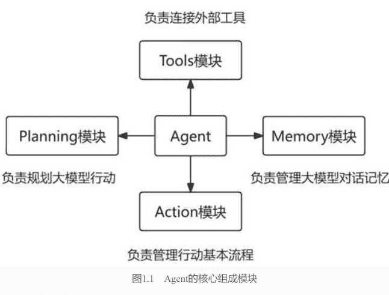

##### 1. Tools模块

Tools模块是一个“工具”，它负责提供外部系统或工具的接口，使Agent能够执行完成目标所需的外部操作。例如，当我们询问大模型“明天北京的天气怎么样？”时，大模型由于无法从模型训练的数据中找到明天未知的信息，因此无法直接给出答复。在这种情况下，我们需要一个查询天气的Tools模块，以便让大模型使用该工具来获取明天天气的情况。

该模块为Agent提供连接外部服务或应用的能力，通常包括API调用、外部数据库连接、文件操作等功能。

##### 2. Planning模块

大模型Agent的重要特性之一是自主性，而Planning模块负责自主分析并规划执行步骤。Planning模块会根据当前任务的目标，制定一系列需要执行的行动步骤。通过任务分解、路径选择和资源分配，Planning模块可以帮助Agent设定实现目标的完整策略。此外，它还会根据环境的变化调整计划，确保Agent能够灵活应对不同的情境和挑战。

##### 3. Action模块

Action模块负责执行由Planning模块制定的行动计划。它是Agent的“执行器”，会根据计划中的指令执行具体操作。这些操作可能是外部系统交互、处理数据、触发硬件设备等。

##### 4. Memory模块

Memory模块是Agent的记忆系统，负责存储历史信息、经验和状态。它可以保存Agent在任务执行过程中获得的所有相关数据，如历史交互、决策记录、任务执行结果等。正是有了Memory模块，Agent才能够对过去的行为进行反思和优化，从而在未来任务中表现得更加高效和准确。可以说，Memory模块是Agent实现长期学习和优化的基础。

这些模块在Agent的构建过程中密切协作，共同推动Agent执行复杂任务。Tools模块提供必要的工具和资源，Planning模块负责策略制定和决策，Action模块执行具体的操作，而Memory模块则用于优化决策和行为。在本书的后续章节中，我们将更深入探讨这些功能模块，并介绍它们的实现与优化方法。

#### 1.2.3 LLM在Agent中的作用

在当今的技术领域中，我们注意到多数Agent依赖大型模型作为其核心驱动力。那么，这些大型模型具体是如何驱动Agent的呢？作为Agent的基础架构，它们又具备哪些独特优势呢？

##### 1. LLM增强Agent的自然语言理解能力

LLM在Agent中最重要的作用是自然语言理解（NLU）。传统的Agent可能依赖规则或简单算法来处理用户的输入，而LLM则是基于大规模语料库训练的，能够处理复杂的句子结构、隐含意义、歧义和上下文关系，从而帮助Agent准确理解用户的需求和意图。

##### 2. LLM支持多任务和跨领域应用

现在发布的基座大模型整体上都是通用大模型，这些模型本身拥有跨多个领域的通用知识。与传统的单一任务、单一领域的Agent不同，用LLM驱动的Agent能够应用于文本生成、机器翻译、问答系统、内容总结等跨领域的多项任务，从而极大地扩展了Agent的应用范围。

##### 3. LLM增强Agent的推理和决策能力

除了语言的理解和生成，LLM还能够在一定程度上进行推理和决策。通过训练，LLM能够根据上下文信息做出合理的推理和判断，支持更复杂的任务处理。LLM可以在面对不确定性或缺失信息的情况下，结合已有的知识和经验，通过推理补充来预测缺失的部分。这样的推理能力使得LLM Agent能够在动态环境中做出决策，适应复杂的任务需求。

##### 4. LLM支持Agent的自我学习和优化

LLM不仅可以执行静态任务，还可以通过与环境的互动进行自我学习和优化。通过强化学习和在线学习，LLM Agent可以利用过去的经验不断调整和优化其行为，提升任务完成效率和准确性。

##### 5. LLM提升Agent的多模态处理能力

随着技术的快速发展，LLM不局限于处理文本数据，它还能够结合其他类型的数据，如图像、视频和音频，实现更加丰富和复杂的任务。在多模态对话系统中，LLM可以同时处理文本和语音输入，生成符合语境的响应；在智能视觉系统中，LLM可以帮助理解图像和视频的语义内容，提供基于图像信息的自然语言输出。这种多模态能力使得基于LLM的Agent能够处理更为复杂和多样化的任务，极大地拓宽了Agent在实际应用中的适用范围。

##### 1. Tools模块

Tools模块是一个“工具”，它负责提供外部系统或工具的接口，使Agent能够执行完成目标所需的外部操作。例如，当我们询问大模型“明天北京的天气怎么样？”时，大模型由于无法从模型训练的数据中找到明天未知的信息，因此无法直接给出答复。在这种情况下，我们需要一个查询天气的Tools模块，以便让大模型使用该工具来获取明天天气的情况。

该模块为Agent提供连接外部服务或应用的能力，通常包括API调用、外部数据库连接、文件操作等功能。

##### 2. Planning模块

大模型Agent的重要特性之一是自主性，而Planning模块负责自主分析并规划执行步骤。Planning模块会根据当前任务的目标，制定一系列需要执行的行动步骤。通过任务分解、路径选择和资源分配，Planning模块可以帮助Agent设定实现目标的完整策略。此外，它还会根据环境的变化调整计划，确保Agent能够灵活应对不同的情境和挑战。

##### 3. Action模块

Action模块负责执行由Planning模块制定的行动计划。它是Agent的“执行器”，会根据计划中的指令执行具体操作。这些操作可能是外部系统交互、处理数据、触发硬件设备等。

##### 4. Memory模块

Memory模块是Agent的记忆系统，负责存储历史信息、经验和状态。它可以保存Agent在任务执行过程中获得的所有相关数据，如历史交互、决策记录、任务执行结果等。正是有了Memory模块，Agent才能够对过去的行为进行反思和优化，从而在未来任务中表现得更加高效和准确。可以说，Memory模块是Agent实现长期学习和优化的基础。

这些模块在Agent的构建过程中密切协作，共同推动Agent执行复杂任务。Tools模块提供必要的工具和资源，Planning模块负责策略制定和决策，Action模块执行具体的操作，而Memory模块则用于优化决策和行为。在本书的后续章节中，我们将更深入探讨这些功能模块，并介绍它们的实现与优化方法。

#### 1.2.3 LLM在Agent中的作用

在当今的技术领域中，我们注意到多数Agent依赖大型模型作为其核心驱动力。那么，这些大型模型具体是如何驱动Agent的呢？作为Agent的基础架构，它们又具备哪些独特优势呢？

##### 1. LLM增强Agent的自然语言理解能力

LLM在Agent中最重要的作用是自然语言理解（NLU）。传统的Agent可能依赖规则或简单算法来处理用户的输入，而LLM则是基于大规模语料库训练的，能够处理复杂的句子结构、隐含意义、歧义和上下文关系，从而帮助Agent准确理解用户的需求和意图。

##### 2. LLM支持多任务和跨领域应用

现在发布的基座大模型整体上都是通用大模型，这些模型本身拥有跨多个领域的通用知识。与传统的单一任务、单一领域的Agent不同，用LLM驱动的Agent能够应用于文本生成、机器翻译、问答系统、内容总结等跨领域的多项任务，从而极大地扩展了Agent的应用范围。

##### 3. LLM增强Agent的推理和决策能力

除了语言的理解和生成，LLM还能够在一定程度上进行推理和决策。通过训练，LLM能够根据上下文信息做出合理的推理和判断，支持更复杂的任务处理。LLM可以在面对不确定性或缺失信息的情况下，结合已有的知识和经验，通过推理补充来预测缺失的部分。这样的推理能力使得LLM Agent能够在动态环境中做出决策，适应复杂的任务需求。

##### 4. LLM支持Agent的自我学习和优化

LLM不仅可以执行静态任务，还可以通过与环境的互动进行自我学习和优化。通过强化学习和在线学习，LLM Agent可以利用过去的经验不断调整和优化其行为，提升任务完成效率和准确性。

##### 5. LLM提升Agent的多模态处理能力

随着技术的快速发展，LLM不局限于处理文本数据，它还能够结合其他类型的数据，如图像、视频和音频，实现更加丰富和复杂的任务。在多模态对话系统中，LLM可以同时处理文本和语音输入，生成符合语境的响应；在智能视觉系统中，LLM可以帮助理解图像和视频的语义内容，提供基于图像信息的自然语言输出。这种多模态能力使得基于LLM的Agent能够处理更为复杂和多样化的任务，极大地拓宽了Agent在实际应用中的适用范围。

### 1.2 大模型Agent的核心概念

在本节中，我们将回顾大模型Agent的基本定义，明确其核心特性。接着，我们将讨论大模型Agent在开发过程中的关键组成部分，包括Tools、Planning、Action和Memory四大模块，并解释这些模块如何协同工作，以完成从任务规划到任务执行的全过程。最后，我们会进一步探讨LLM在驱动Agent底层功能方面的优势，展示它如何提升Agent在复杂任务中的自我学习、优化和多模态处理能力。

#### 1.2.1 什么是大模型Agent

大模型Agent是基于大规模预训练语言模型构建的一种Agent。与传统的Agent概念不同，现在“Agent”的简称在行业中更多情况下指的是大模型驱动的Agent应用。大模型Agent在底层大模型的基础上增加了智能决策层，它不仅能够根据用户输入的文本生成合适的回应，还能通过任务规划、执行、反馈等过程，自主完成复杂的任务。

大模型Agent的核心特性如下。

- ✅ 自然语言理解和生成：基于大语言模型，能够理解复杂的文本输入，并生成语法合理、语义连贯的回复。
- ✅ 任务执行与决策：与传统的基于规则的Agent不同，大模型Agent能够根据上下文和目标自主生成解决方案、做出决策，并通过执行实现目标。
- ✅ 跨领域应用能力：大模型强大的通用能力，使得其驱动下的Agent可以在多种应用场景下进行迁移和应用。
- ✅ 自我学习与优化：伴随技术的快速发展，部分Agent开始具备自我学习的能力。通过与用户的互动，它们能够不断优化自身的表现，提高任务执行的效率和准确性。

本书讨论的所有Agent均为基于LLM的Agent。

#### 1.2.2 Agent的核心组成部分

在Agent开发过程中，我们通常将Agent分解为不同的功能模块，这些模块协同工作以执行任务。下面我们来了解开发Agent时常见的核心组成模块。如图1.1所示。

##### 1. Tools模块

Tools模块是一个“工具”，它负责提供外部系统或工具的接口，使Agent能够执行完成目标所需的外部操作。例如，当我们询问大模型“明天北京的天气怎么样？”时，大模型由于无法从模型训练的数据中找到明天未知的信息，因此无法直接给出答复。在这种情况下，我们需要一个查询天气的Tools模块，以便让大模型使用该工具来获取明天天气的情况。

该模块为Agent提供连接外部服务或应用的能力，通常包括API调用、外部数据库连接、文件操作等功能。

##### 2. Planning模块

大模型Agent的重要特性之一是自主性，而Planning模块负责自主分析并规划执行步骤。Planning模块会根据当前任务的目标，制定一系列需要执行的行动步骤。通过任务分解、路径选择和资源分配，Planning模块可以帮助Agent设定实现目标的完整策略。此外，它还会根据环境的变化调整计划，确保Agent能够灵活应对不同的情境和挑战。

##### 3. Action模块

Action模块负责执行由Planning模块制定的行动计划。它是Agent的“执行器”，会根据计划中的指令执行具体操作。这些操作可能是外部系统交互、处理数据、触发硬件设备等。

##### 4. Memory模块

Memory模块是Agent的记忆系统，负责存储历史信息、经验和状态。它可以保存Agent在任务执行过程中获得的所有相关数据，如历史交互、决策记录、任务执行结果等。正是有了Memory模块，Agent才能够对过去的行为进行反思和优化，从而在未来任务中表现得更加高效和准确。可以说，Memory模块是Agent实现长期学习和优化的基础。

这些模块在Agent的构建过程中密切协作，共同推动Agent执行复杂任务。Tools模块提供必要的工具和资源，Planning模块负责策略制定和决策，Action模块执行具体的操作，而Memory模块则用于优化决策和行为。在本书的后续章节中，我们将更深入探讨这些功能模块，并介绍它们的实现与优化方法。

#### 1.2.3 LLM在Agent中的作用

在当今的技术领域中，我们注意到多数Agent依赖大型模型作为其核心驱动力。那么，这些大型模型具体是如何驱动Agent的呢？作为Agent的基础架构，它们又具备哪些独特优势呢？

##### 1. LLM增强Agent的自然语言理解能力

LLM在Agent中最重要的作用是自然语言理解（NLU）。传统的Agent可能依赖规则或简单算法来处理用户的输入，而LLM则是基于大规模语料库训练的，能够处理复杂的句子结构、隐含意义、歧义和上下文关系，从而帮助Agent准确理解用户的需求和意图。

##### 2. LLM支持多任务和跨领域应用

现在发布的基座大模型整体上都是通用大模型，这些模型本身拥有跨多个领域的通用知识。与传统的单一任务、单一领域的Agent不同，用LLM驱动的Agent能够应用于文本生成、机器翻译、问答系统、内容总结等跨领域的多项任务，从而极大地扩展了Agent的应用范围。

##### 3. LLM增强Agent的推理和决策能力

除了语言的理解和生成，LLM还能够在一定程度上进行推理和决策。通过训练，LLM能够根据上下文信息做出合理的推理和判断，支持更复杂的任务处理。LLM可以在面对不确定性或缺失信息的情况下，结合已有的知识和经验，通过推理补充来预测缺失的部分。这样的推理能力使得LLM Agent能够在动态环境中做出决策，适应复杂的任务需求。

##### 4. LLM支持Agent的自我学习和优化

LLM不仅可以执行静态任务，还可以通过与环境的互动进行自我学习和优化。通过强化学习和在线学习，LLM Agent可以利用过去的经验不断调整和优化其行为，提升任务完成效率和准确性。

##### 5. LLM提升Agent的多模态处理能力

随着技术的快速发展，LLM不局限于处理文本数据，它还能够结合其他类型的数据，如图像、视频和音频，实现更加丰富和复杂的任务。在多模态对话系统中，LLM可以同时处理文本和语音输入，生成符合语境的响应；在智能视觉系统中，LLM可以帮助理解图像和视频的语义内容，提供基于图像信息的自然语言输出。这种多模态能力使得基于LLM的Agent能够处理更为复杂和多样化的任务，极大地拓宽了Agent在实际应用中的适用范围。

### 1.3 主流Agent开发框架介绍

#### 1.3.1 低代码开发框架

低代码开发框架是一种不需要编写代码的开发方式。用户只需通过网页端的点击、拖曳等可视化操作，就可以轻松构建功能丰富的Agent系统。这类框架的最大特点是简化复杂的编程工作，使得没有编程基础的用户也能够快速上手构建Agent，并实现业务需求。

##### 1. Coze

Coze是目前火热的低代码开发框架之一，由字节跳动发布。它提供了一个直观的用户界面，让用户无须了解编程语言或复杂的技术细节，就能通过可视化界面创建任务、设计流程，并调用Agent所需的工具。Coze的插件商店十分活跃，开发中所需的大部分功能几乎都可以找到对应的插件。Coze的主要特点如下。

- ✅ 无须编程：通过可视化界面，用户只需拖放组件和配置选项，就能创建完整的Agent应用。
- ✅ 高效集成：提供了多种常见工具和服务的集成接口，用户可以方便地接入数据库、API或其他外部服务，从而丰富Agent的功能。
- ✅ 快速原型开发：用户能够快速构建原型并实时测试，从而加速产品的验证和迭代。
- ✅ 社区支持：Coze拥有庞大的用户社区和丰富的教程，帮助用户快速上手并解决开发过程中的问题。

##### 2. Dify

Dify是语灵人工智能科技公司开发的低代码框架。与Coze相比，Dify提供了更多的功能和定制化选项，适合需要高度自定义的Agent开发场景。然而，使用Dify需要额外的安装和部署，这使得它适用于有一定技术背景的用户或企业级用户。此外，Dify的API接口支持多语言和多地区部署，可以帮助开发者快速将产品推向全球市场。Dify的主要特点如下。

- ✅ 功能全面：Dify提供了比Coze更强大的功能支持，如自定义脚本编写、更加复杂的业务流程管理、深度集成外部API等。
- ✅ 部署需求：与Coze的在线平台不同，Dify需要用户在本地进行安装和部署。这种方式虽然能够提供更多的自定义选项，但也增加了系统的复杂度和维护成本。
- ✅ 灵活性更高：Dify允许开发者使用更多的编程语言进行自定义扩展，适合希望在低代码框架上进行更深度开发的用户。

##### 3. LangFlow

LangFlow是基于LangChain构建的开源可视化低代码框架，专注于为用户提供灵活的流程设计和集成功能。用户可以根据业务需求设计自定义流程，并轻松集成各种工具和服务。与Dify类似，LangFlow需要一定的技术背景进行安装部署。LangFlow的主要特点如下。

- ✅ 流畅的流程设计：LangFlow提供了丰富的流程图设计工具，让用户能够直观地设计任务的执行步骤，并根据需要调整和优化流程。
- ✅ 插件支持：LangFlow提供了广泛的插件支持，用户可以轻松将Agent与第三方工具或服务（如数据库、API、云服务等）连接。

低代码框架在大模型Agent的开发中扮演着重要角色，使得Agent的构建不再受限于编程能力或工程背景。通过可视化的拖拽式界面与模块化设计，用户只需简单进行配置，即可实现复杂的Agent功能，从而显著降低开发门槛和技术成本。这不仅加快了产品原型的验证周期，也使企业和个人能够更快速、高效地将大语言模型应用于实际场景，推动了Agent开发从技术驱动走向业务驱动的转变。

当然，辩证来看，低代码开发框架构建的Agent能力仍然是有限的，尤其在面对高度复杂的任务和需求时，它们往往无法像使用传统代码开发的Agent一样具备更高的灵活性与扩展性。

#### 1.3.2 基础框架

基础框架是指一种通过利用大型模型的原生能力来构建Agent的方法，Agent无须依赖额外的开发框架或工具，而是直接利用大模型本身的功能来执行任务。随着大语言模型的不断发展，许多现代模型已经内置了强大的Function Calling或Tools Use能力。例如，OpenAI为GPT-3.5模型增加了名为Function Calling的功能，这使得模型能够直接连接并使用外部工具或服务。Function Calling的基本使用流程如图1.2所示。

总体而言，基础框架充分利用了大模型的强大能力，降低了Agent开发的复杂度，使开发者可以直接利用现有的大模型功能来构建Agent，极大提升了开发效率和灵活性。但是，基础框架的Agent通常受到大模型本身功能的限制，面对复杂的业务需求和高度定制化的任务时，原生功能往往无法满足所有的操作和优化需求。

#### 1.3.3 代码框架

在大模型Agent的开发中，代码框架提供了更高的灵活性和可定制性，尤其适用于需要复杂逻辑处理和高度定制化的任务。与低代码或基础框架相比，代码框架通常通过模块化的组件和类来帮助开发者更精细地控制Agent的行为，并在构建过程中实现更复杂的功能。

##### 1. LangChain

LangChain起初是一个针对语言模型的简化开发工具，随着LLM的发展、使用者的需求增加和功能的不断扩展，它逐步演化为一个强大的Agent开发框架。LangChain的主要特点如下。

- ✅ 功能强大的类和工具：LangChain的核心优势之一是它为开发者提供了很多封装好的工具和类，使得构建Agent变得简单高效。例如，Agent构建的四个核心模块，如果从头开始手写代码将十分复杂，而LangChain将这些功能封装成易于使用的类，开发者只需要配置和调用这些类，就可快速构建自己的Agent。
- ✅ 与外部工具集成：LangChain支持与多种外部工具和服务的无缝集成，包括数据库、API和文件存储系统。使得开发者可以轻松调用外部系统以获取数据，增强Agent的执行能力。
- ✅ 灵活的扩展性：虽然LangChain提供了很多封装好的功能和类，开发者仍然可以根据需求定制化开发，可以修改现有类或者添加新的模块，支持更复杂的任务和场景。

LangChain适用于需要快速开发并且集成多种工具的Agent应用。它特别适用于自动化客服系统、内容生成平台、数据处理等任务，因为在这些任务中Agent需要与外部系统进行频繁的交互和任务规划。

##### 2. LangGraph

LangGraph是在LangChain的基础上发展而来的，更加注重构建复杂的图状结构并管理多步骤任务。LangGraph于2022年发布，旨在为开发者提供更复杂的图状结构开发工具，特别适用于多任务的协同工作与任务分配。LangGraph主要特点如下。

- ✅ 支持图状结构：LangGraph的最大特点是它支持图状结构设计，使得开发者可以将Agent的任务和流程组织成一个图形化的形式。每个节点代表一个任务或操作，每条边代表任务之间的依赖关系。这样就可以更加直观地管理任务的执行流程和逻辑关系。
- ✅ 多任务协作：LangGraph允许多个Agent或多个任务并行执行，并通过图结构管理这些任务之间的交互。这使得它特别适用于需要处理多层次、多步骤任务的应用，如复杂的业务流程自动化、跨部门协作等。
- ✅ 灵活的扩展机制：LangGraph支持开发者自定义任务节点和边的类型，可以根据业务需求扩展任务的执行和交互方式。此外，LangGraph还允许开发者灵活调整图形结构，优化任务执行的顺序和效率。

### 1.3 主流Agent开发框架介绍

#### 1.3.1 低代码开发框架

低代码开发框架是一种不需要编写代码的开发方式。用户只需通过网页端的点击、拖曳等可视化操作，就可以轻松构建功能丰富的Agent系统。这类框架的最大特点是简化复杂的编程工作，使得没有编程基础的用户也能够快速上手构建Agent，并实现业务需求。

##### 1. Coze

Coze是目前火热的低代码开发框架之一，由字节跳动发布。它提供了一个直观的用户界面，让用户无须了解编程语言或复杂的技术细节，就能通过可视化界面创建任务、设计流程，并调用Agent所需的工具。Coze的插件商店十分活跃，开发中所需的大部分功能几乎都可以找到对应的插件。Coze的主要特点如下。

- ✅ 无须编程：通过可视化界面，用户只需拖放组件和配置选项，就能创建完整的Agent应用。
- ✅ 高效集成：提供了多种常见工具和服务的集成接口，用户可以方便地接入数据库、API或其他外部服务，从而丰富Agent的功能。
- ✅ 快速原型开发：用户能够快速构建原型并实时测试，从而加速产品的验证和迭代。
- ✅ 社区支持：Coze拥有庞大的用户社区和丰富的教程，帮助用户快速上手并解决开发过程中的问题。

##### 2. Dify

Dify是语灵人工智能科技公司开发的低代码框架。与Coze相比，Dify提供了更多的功能和定制化选项，适合需要高度自定义的Agent开发场景。然而，使用Dify需要额外的安装和部署，这使得它适用于有一定技术背景的用户或企业级用户。此外，Dify的API接口支持多语言和多地区部署，可以帮助开发者快速将产品推向全球市场。Dify的主要特点如下。

- ✅ 功能全面：Dify提供了比Coze更强大的功能支持，如自定义脚本编写、更加复杂的业务流程管理、深度集成外部API等。
- ✅ 部署需求：与Coze的在线平台不同，Dify需要用户在本地进行安装和部署。这种方式虽然能够提供更多的自定义选项，但也增加了系统的复杂度和维护成本。
- ✅ 灵活性更高：Dify允许开发者使用更多的编程语言进行自定义扩展，适合希望在低代码框架上进行更深度开发的用户。

##### 3. LangFlow

LangFlow是基于LangChain构建的开源可视化低代码框架，专注于为用户提供灵活的流程设计和集成功能。用户可以根据业务需求设计自定义流程，并轻松集成各种工具和服务。与Dify类似，LangFlow需要一定的技术背景进行安装部署。LangFlow的主要特点如下。

- ✅ 流畅的流程设计：LangFlow提供了丰富的流程图设计工具，让用户能够直观地设计任务的执行步骤，并根据需要调整和优化流程。
- ✅ 插件支持：LangFlow提供了广泛的插件支持，用户可以轻松将Agent与第三方工具或服务（如数据库、API、云服务等）连接。

低代码框架在大模型Agent的开发中扮演着重要角色，使得Agent的构建不再受限于编程能力或工程背景。通过可视化的拖拽式界面与模块化设计，用户只需简单进行配置，即可实现复杂的Agent功能，从而显著降低开发门槛和技术成本。这不仅加快了产品原型的验证周期，也使企业和个人能够更快速、高效地将大语言模型应用于实际场景，推动了Agent开发从技术驱动走向业务驱动的转变。

当然，辩证来看，低代码开发框架构建的Agent能力仍然是有限的，尤其在面对高度复杂的任务和需求时，它们往往无法像使用传统代码开发的Agent一样具备更高的灵活性与扩展性。

#### 1.3.2 基础框架

基础框架是指一种通过利用大型模型的原生能力来构建Agent的方法，Agent无须依赖额外的开发框架或工具，而是直接利用大模型本身的功能来执行任务。随着大语言模型的不断发展，许多现代模型已经内置了强大的Function Calling或Tools Use能力。例如，OpenAI为GPT-3.5模型增加了名为Function Calling的功能，这使得模型能够直接连接并使用外部工具或服务。Function Calling的基本使用流程如图1.2所示。

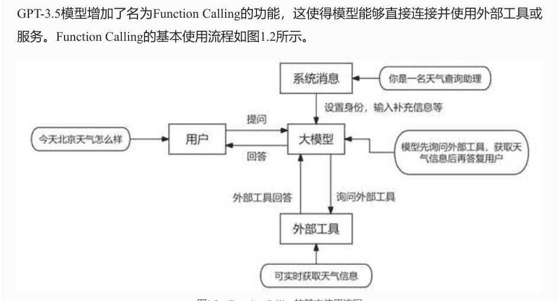

总体而言，基础框架充分利用了大模型的强大能力，降低了Agent开发的复杂度，使开发者可以直接利用现有的大模型功能来构建Agent，极大提升了开发效率和灵活性。但是，基础框架的Agent通常受到大模型本身功能的限制，面对复杂的业务需求和高度定制化的任务时，原生功能往往无法满足所有的操作和优化需求。

#### 1.3.3 代码框架

在大模型Agent的开发中，代码框架提供了更高的灵活性和可定制性，尤其适用于需要复杂逻辑处理和高度定制化的任务。与低代码或基础框架相比，代码框架通常通过模块化的组件和类来帮助开发者更精细地控制Agent的行为，并在构建过程中实现更复杂的功能。

##### 1. LangChain

LangChain起初是一个针对语言模型的简化开发工具，随着LLM的发展、使用者的需求增加和功能的不断扩展，它逐步演化为一个强大的Agent开发框架。LangChain的主要特点如下。

- ✅ 功能强大的类和工具：LangChain的核心优势之一是它为开发者提供了很多封装好的工具和类，使得构建Agent变得简单高效。例如，Agent构建的四个核心模块，如果从头开始手写代码将十分复杂，而LangChain将这些功能封装成易于使用的类，开发者只需要配置和调用这些类，就可快速构建自己的Agent。
- ✅ 与外部工具集成：LangChain支持与多种外部工具和服务的无缝集成，包括数据库、API和文件存储系统。使得开发者可以轻松调用外部系统以获取数据，增强Agent的执行能力。
- ✅ 灵活的扩展性：虽然LangChain提供了很多封装好的功能和类，开发者仍然可以根据需求定制化开发，可以修改现有类或者添加新的模块，支持更复杂的任务和场景。

LangChain适用于需要快速开发并且集成多种工具的Agent应用。它特别适用于自动化客服系统、内容生成平台、数据处理等任务，因为在这些任务中Agent需要与外部系统进行频繁的交互和任务规划。

##### 2. LangGraph

LangGraph是在LangChain的基础上发展而来的，更加注重构建复杂的图状结构并管理多步骤任务。LangGraph于2022年发布，旨在为开发者提供更复杂的图状结构开发工具，特别适用于多任务的协同工作与任务分配。LangGraph主要特点如下。

- ✅ 支持图状结构：LangGraph的最大特点是它支持图状结构设计，使得开发者可以将Agent的任务和流程组织成一个图形化的形式。每个节点代表一个任务或操作，每条边代表任务之间的依赖关系。这样就可以更加直观地管理任务的执行流程和逻辑关系。
- ✅ 多任务协作：LangGraph允许多个Agent或多个任务并行执行，并通过图结构管理这些任务之间的交互。这使得它特别适用于需要处理多层次、多步骤任务的应用，如复杂的业务流程自动化、跨部门协作等。
- ✅ 灵活的扩展机制：LangGraph支持开发者自定义任务节点和边的类型，可以根据业务需求扩展任务的执行和交互方式。此外，LangGraph还允许开发者灵活调整图形结构，优化任务执行的顺序和效率。
- ✅ 支持高级功能：相比LangChain，LangGraph提供了更复杂的功能，如动态任务生成、任务优化、依赖管理等。这些功能使得LangGraph在处理大规模的任务调度和多Agent协作时具有更强的能力。

LangGraph适用于需要复杂任务协作和图形化任务管理的场景，尤其在跨部门合作、复杂的业务流程管理以及多Agent中表现出色。

##### 3. LlamaIndex

LlamaIndex（原名GPT Index）是一个经典的开源框架，专门用于构建以大语言模型为基础的Agent系统。它发布于2020年，并且在处理大规模数据集和信息检索方面表现优异。尽管LlamaIndex的发展早于LangChain，但它的使用也更加复杂，对初学者而言入手难度较高，适合对数据处理和查询优化有较高要求的开发者。LlamaIndex的主要特点如下。

- ✅ 高效的信息检索与查询能力：LlamaIndex最突出的特点是其在处理和查询大规模数据集方面的优势。它特别适用于需要快速查询、索引和处理大量信息的场景，如构建搜索引擎、知识图谱等。
- ✅ 灵活的数据结构支持：LlamaIndex提供了多种数据结构，用于存储和组织不同类型的数据。它可以处理文本数据、结构化数据和多模态数据，为开发者提供了高度自定义的查询方式。
- ✅ 复杂查询优化：LlamaIndex支持更复杂的查询优化机制，能够在大规模数据中高效地查询和匹配。它为需要处理海量数据的应用提供了优越的性能和可扩展性。

LlamaIndex适用于大数据和信息检索密集型的应用场景。它特别适合需要高效处理和检索海量信息的Agent应用。

#### 1.3.4 Multi-Agent框架

什么是Multi-Agent？如果一个任务过于复杂，单个Agent难以独立执行，那么就可以通过多个Agent分工合作来高效地完成任务。每个Agent可以专注于执行任务中的一部分功能，通过协调合作，实现任务的整体目标。

例如，在应用程序开发中，一个完整的项目可能涉及多个角色：需求分析、代码开发、功能测试、性能优化等。如果将每个角色作为一个Agent来处理，它们通过相互协作，便可以共同完成应用程序的开发过程。这种方式能够将复杂的任务拆解成多个较小的、可以独立执行的部分，提高工作效率和任务执行的精度。

在实际开发中，Multi-Agent系统可以通过手动编写多个Agent来实现，也可以使用现有的Multi-Agent框架简化开发工作。

##### 1. CrewAI

CrewAI是一个轻量级的多Agent框架，它允许开发者通过定义任务、角色和目标，快速组建协作型的多个Agent团队。CrewAI支持多种协作模式，如顺序执行、层级结构和异步工作流，适用于自动化写作、客户支持和项目管理等场景。同时该框架强调高性能和低延迟，适合对响应速度要求较高的应用。

##### 2. OpenAI Swarm

OpenAI于2024年发布的Swarm是一个轻量级的多Agent协同框架，旨在简化Agent之间的协调与执行。Swarm通过两个基本概念——Agent和handoff，实现Agent之间的交互。Agent包含指令和工具，handoff允许Agent将任务交给其他Agent处理。这种设计使Swarm在处理复杂对话流和任务委派时更加高效。同时因为其简洁清晰的开源项目代码，也十分适用于学习过程中的项目。

##### 3. OpenAI Assistant API

OpenAI的Assistant API也是一个非常强大的工具，它非常适合构建Agent并能够处理多种任务，但遗憾的是它并不开源。开发者只能通过在线接口调用模型服务，无法完全控制其内部逻辑，在需要高度定制化的场景下，闭源的Assistant API不可避免受到限制。

##### 4. 微软的AutoGen

AutoGen是微软开发的一个开源框架，专门为了构建可定制的多Agent对话系统而设计。开发者能够在AutoGen框架下利用多个Agent协同工作，适用于工具使用、任务分配、任务执行等复杂操作的场景。AutoGen的主要特点如下。

- ✅ Agent协作：AutoGen强调多个Agent之间的协作与任务分配。它允许Agent在任务执行过程中相互合作，并根据预设的流程和需求调整角色分配。开发者可以定义不同的Agent角色，如负责数据采集、代码生成、数据分析等不同功能的角色。
- ✅ 工具集成与扩展性：AutoGen支持与多种外部工具和API集成。它可以帮助Agent访问并使用外部工具以进行任务处理，例如调用数据库查询、执行数据分析任务、生成代码等。同时，它也允许开发者根据实际需求定制Agent的行为和交互方式。
- ✅ 无代码开发环境：微软也在其基础上提供了一个无代码的开发环境AutoGen Studio，可以简化Agent的构建与调试过程。和此前的低代码开发工具一样，开发者无须编写大量代码，便可以通过可视化界面创建和调试多Agent系统，快速构建原型，并进行验证与优化。

##### 5. MetaGPT

MetaGPT是一个开源的多Agent框架，专门用于模拟软件公司内部的协作流程。MetaGPT通过将不同的角色（如产品经理、架构师、项目经理、工程师）抽象为Agent，并通过标准化操作流程（SOP）进行协同工作，从而将复杂的软件开发任务拆解成多个子任务，由不同的Agent处理。

> 说明

需要特别说明的是，本书所涉及的大模型Agent开发实践将以代码层面的开发为主，侧重于工程化、可部署、可扩展的Agent构建方式。虽然当前也有诸如Coze、Dify等优秀的低代码框架，它们通过可视化配置即可快速搭建Agent，但本书不包含这些平台的具体操作流程。对此类低代码工具感兴趣的读者，可访问其官网获取详细使用指南。

需要特别说明的是，本书所涉及的大模型Agent开发实践将以代码层面的开发为主，侧重于工程化、可部署、可扩展的Agent构建方式。虽然当前也有诸如Coze、Dify等优秀的低代码框架，它们通过可视化配置即可快速搭建Agent，但本书不包含这些平台的具体操作流程。对此类低代码工具感兴趣的读者，可访问其官网获取详细使用指南。

### 1.3 主流Agent开发框架介绍

#### 1.3.1 低代码开发框架

低代码开发框架是一种不需要编写代码的开发方式。用户只需通过网页端的点击、拖曳等可视化操作，就可以轻松构建功能丰富的Agent系统。这类框架的最大特点是简化复杂的编程工作，使得没有编程基础的用户也能够快速上手构建Agent，并实现业务需求。

##### 1. Coze

Coze是目前火热的低代码开发框架之一，由字节跳动发布。它提供了一个直观的用户界面，让用户无须了解编程语言或复杂的技术细节，就能通过可视化界面创建任务、设计流程，并调用Agent所需的工具。Coze的插件商店十分活跃，开发中所需的大部分功能几乎都可以找到对应的插件。Coze的主要特点如下。

- ☑️ 无须编程：通过可视化界面，用户只需拖放组件和配置选项，就能创建完整的Agent应用。
- ☑️ 高效集成：提供了多种常见工具和服务的集成接口，用户可以方便地接入数据库、API或其他外部服务，从而丰富Agent的功能。
- ☑️ 快速原型开发：用户能够快速构建原型并实时测试，从而加速产品的验证和迭代。
- ☑️ 社区支持：Coze拥有庞大的用户社区和丰富的教程，帮助用户快速上手并解决开发过程中的问题。

##### 2. Dify

Dify是语灵人工智能科技公司开发的低代码框架。与Coze相比，Dify提供了更多的功能和定制化选项，适合需要高度自定义的Agent开发场景。然而，使用Dify需要额外的安装和部署，这使得它适用于有一定技术背景的用户或企业级用户。此外，Dify的API接口支持多语言和多地区部署，可以帮助开发者快速将产品推向全球市场。Dify的主要特点如下。

- ☑️ 功能全面：Dify提供了比Coze更强大的功能支持，如自定义脚本编写、更加复杂的业务流程管理、深度集成外部API等。
- ☑️ 部署需求：与Coze的在线平台不同，Dify需要用户在本地进行安装和部署。这种方式虽然能够提供更多的自定义选项，但也增加了系统的复杂度和维护成本。
- ☑️ 灵活性更高：Dify允许开发者使用更多的编程语言进行自定义扩展，适合希望在低代码框架上进行更深度开发的用户。

##### 3. LangFlow

LangFlow是基于LangChain构建的开源可视化低代码框架，专注于为用户提供灵活的流程设计和集成功能。用户可以根据业务需求设计自定义流程，并轻松集成各种工具和服务。与Dify类似，LangFlow需要一定的技术背景进行安装部署。LangFlow的主要特点如下。

- ☑️ 流畅的流程设计：LangFlow提供了丰富的流程图设计工具，让用户能够直观地设计任务的执行步骤，并根据需要调整和优化流程。
- ☑️ 插件支持：LangFlow提供了广泛的插件支持，用户可以轻松将Agent与第三方工具或服务（如数据库、API、云服务等）连接。

低代码框架在大模型Agent的开发中扮演着重要角色，使得Agent的构建不再受限于编程能力或工程背景。通过可视化的拖拽式界面与模块化设计，用户只需简单进行配置，即可实现复杂的Agent功能，从而显著降低开发门槛和技术成本。这不仅加快了产品原型的验证周期，也使企业和个人能够更快速、高效地将大语言模型应用于实际场景，推动了Agent开发从技术驱动走向业务驱动的转变。

当然，辩证来看，低代码开发框架构建的Agent能力仍然是有限的，尤其在面对高度复杂的任务和需求时，它们往往无法像使用传统代码开发的Agent一样具备更高的灵活性与扩展性。

#### 1.3.2 基础框架

基础框架是指一种通过利用大型模型的原生能力来构建Agent的方法，Agent无须依赖额外的开发框架或工具，而是直接利用大模型本身的功能来执行任务。随着大语言模型的不断发展，许多现代模型已经内置了强大的Function Calling或Tools Use能力。例如，OpenAI为GPT-3.5模型增加了名为Function Calling的功能，这使得模型能够直接连接并使用外部工具或服务。Function Calling的基本使用流程如图1.2所示。

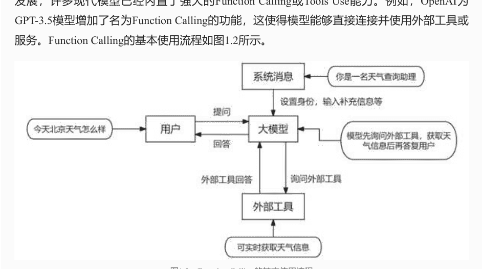

总体而言，基础框架充分利用了大模型的强大能力，降低了Agent开发的复杂度，使开发者可以直接利用现有的大模型功能来构建Agent，极大提升了开发效率和灵活性。但是，基础框架的Agent通常受到大模型本身功能的限制，面对复杂的业务需求和高度定制化的任务时，原生功能往往无法满足所有的操作和优化需求。

#### 1.3.3 代码框架

在大模型Agent的开发中，代码框架提供了更高的灵活性和可定制性，尤其适用于需要复杂逻辑处理和高度定制化的任务。与低代码或基础框架相比，代码框架通常通过模块化的组件和类来帮助开发者更精细地控制Agent的行为，并在构建过程中实现更复杂的功能。

##### 1. LangChain

LangChain起初是一个针对语言模型的简化开发工具，随着LLM的发展、使用者的需求增加和功能的不断扩展，它逐步演化为一个强大的Agent开发框架。LangChain的主要特点如下。

- ☑️ 功能强大的类和工具：LangChain的核心优势之一是它为开发者提供了很多封装好的工具和类，使得构建Agent变得简单高效。例如，Agent构建的四个核心模块，如果从头开始手写代码将十分复杂，而LangChain将这些功能封装成易于使用的类，开发者只需要配置和调用这些类，就可快速构建自己的Agent。
- ☑️ 与外部工具集成：LangChain支持与多种外部工具和服务的无缝集成，包括数据库、API和文件存储系统。使得开发者可以轻松调用外部系统以获取数据，增强Agent的执行能力。
- ☑️ 灵活的扩展性：虽然LangChain提供了很多封装好的功能和类，开发者仍然可以根据需求定制化开发，可以修改现有类或者添加新的模块，支持更复杂的任务和场景。

LangChain适用于需要快速开发并且集成多种工具的Agent应用。它特别适用于自动化客服系统、内容生成平台、数据处理等任务，因为在这些任务中Agent需要与外部系统进行频繁的交互和任务规划。

##### 2. LangGraph

LangGraph是在LangChain的基础上发展而来的，更加注重构建复杂的图状结构并管理多步骤任务。LangGraph于2022年发布，旨在为开发者提供更复杂的图状结构开发工具，特别适用于多任务的协同工作与任务分配。LangGraph主要特点如下。

- ☑️ 支持图状结构：LangGraph的最大特点是它支持图状结构设计，使得开发者可以将Agent的任务和流程组织成一个图形化的形式。每个节点代表一个任务或操作，每条边代表任务之间的依赖关系。这样就可以更加直观地管理任务的执行流程和逻辑关系。
- ☑️ 多任务协作：LangGraph允许多个Agent或多个任务并行执行，并通过图结构管理这些任务之间的交互。这使得它特别适用于需要处理多层次、多步骤任务的应用，如复杂的业务流程自动化、跨部门协作等。
- ☑️ 灵活的扩展机制：LangGraph支持开发者自定义任务节点和边的类型，可以根据业务需求扩展任务的执行和交互方式。此外，LangGraph还允许开发者灵活调整图形结构，优化任务执行的顺序和效率。
- ☑️ 支持高级功能：相比LangChain，LangGraph提供了更复杂的功能，如动态任务生成、任务优化、依赖管理等。这些功能使得LangGraph在处理大规模的任务调度和多Agent协作时具有更强的能力。

LangGraph适用于需要复杂任务协作和图形化任务管理的场景，尤其在跨部门合作、复杂的业务流程管理以及多Agent中表现出色。

##### 3. LlamaIndex

LlamaIndex（原名GPT Index）是一个经典的开源框架，专门用于构建以大语言模型为基础的Agent系统。它发布于2020年，并且在处理大规模数据集和信息检索方面表现优异。尽管LlamaIndex的发展早于LangChain，但它的使用也更加复杂，对初学者而言入手难度较高，适合对数据处理和查询优化有较高要求的开发者。LlamaIndex的主要特点如下。

- ☑️ 高效的信息检索与查询能力：LlamaIndex最突出的特点是其在处理和查询大规模数据集方面的优势。它特别适用于需要快速查询、索引和处理大量信息的场景，如构建搜索引擎、知识图谱等。
- ☑️ 灵活的数据结构支持：LlamaIndex提供了多种数据结构，用于存储和组织不同类型的数据。它可以处理文本数据、结构化数据和多模态数据，为开发者提供了高度自定义的查询方式。
- ☑️ 复杂查询优化：LlamaIndex支持更复杂的查询优化机制，能够在大规模数据中高效地查询和匹配。它为需要处理海量数据的应用提供了优越的性能和可扩展性。

LlamaIndex适用于大数据和信息检索密集型的应用场景。它特别适合需要高效处理和检索海量信息的Agent应用。

#### 1.3.4 Multi-Agent框架

什么是Multi-Agent？如果一个任务过于复杂，单个Agent难以独立执行，那么就可以通过多个Agent分工合作来高效地完成任务。每个Agent可以专注于执行任务中的一部分功能，通过协调合作，实现任务的整体目标。

例如，在应用程序开发中，一个完整的项目可能涉及多个角色：需求分析、代码开发、功能测试、性能优化等。如果将每个角色作为一个Agent来处理，它们通过相互协作，便可以共同完成应用程序的开发过程。这种方式能够将复杂的任务拆解成多个较小的、可以独立执行的部分，提高工作效率和任务执行的精度。

在实际开发中，Multi-Agent系统可以通过手动编写多个Agent来实现，也可以使用现有的Multi-Agent框架简化开发工作。

##### 1. CrewAI

CrewAI是一个轻量级的多Agent框架，它允许开发者通过定义任务、角色和目标，快速组建协作型的多个Agent团队。CrewAI支持多种协作模式，如顺序执行、层级结构和异步工作流，适用于自动化写作、客户支持和项目管理等场景。同时该框架强调高性能和低延迟，适合对响应速度要求较高的应用。

##### 2. OpenAI Swarm

OpenAI于2024年发布的Swarm是一个轻量级的多Agent协同框架，旨在简化Agent之间的协调与执行。Swarm通过两个基本概念——Agent和handoff，实现Agent之间的交互。Agent包含指令和工具，handoff允许Agent将任务交给其他Agent处理。这种设计使Swarm在处理复杂对话流和任务委派时更加高效。同时因为其简洁清晰的开源项目代码，也十分适用于学习过程中的项目。

##### 3. OpenAI Assistant API

OpenAI的Assistant API也是一个非常强大的工具，它非常适合构建Agent并能够处理多种任务，但遗憾的是它并不开源。开发者只能通过在线接口调用模型服务，无法完全控制其内部逻辑，在需要高度定制化的场景下，闭源的Assistant API不可避免受到限制。

##### 4. 微软的AutoGen

AutoGen是微软开发的一个开源框架，专门为了构建可定制的多Agent对话系统而设计。开发者能够在AutoGen框架下利用多个Agent协同工作，适用于工具使用、任务分配、任务执行等复杂操作的场景。AutoGen的主要特点如下。

- ☑️ Agent协作：AutoGen强调多个Agent之间的协作与任务分配。它允许Agent在任务执行过程中相互合作，并根据预设的流程和需求调整角色分配。开发者可以定义不同的Agent角色，如负责数据采集、代码生成、数据分析等不同功能的角色。
- ☑️ 工具集成与扩展性：AutoGen支持与多种外部工具和API集成。它可以帮助Agent访问并使用外部工具以进行任务处理，例如调用数据库查询、执行数据分析任务、生成代码等。同时，它也允许开发者根据实际需求定制Agent的行为和交互方式。
- ☑️ 无代码开发环境：微软也在其基础上提供了一个无代码的开发环境AutoGen Studio，可以简化Agent的构建与调试过程。和此前的低代码开发工具一样，开发者无须编写大量代码，便可以通过可视化界面创建和调试多Agent系统，快速构建原型，并进行验证与优化。

##### 5. MetaGPT

MetaGPT是一个开源的多Agent框架，专门用于模拟软件公司内部的协作流程。MetaGPT通过将不同的角色（如产品经理、架构师、项目经理、工程师）抽象为Agent，并通过标准化操作流程（SOP）进行协同工作，从而将复杂的软件开发任务拆解成多个子任务，由不同的Agent处理。

> 说明

需要特别说明的是，本书所涉及的大模型Agent开发实践将以代码层面的开发为主，侧重于工程化、可部署、可扩展的Agent构建方式。虽然当前也有诸如Coze、Dify等优秀的低代码框架，它们通过可视化配置即可快速搭建Agent，但本书不包含这些平台的具体操作流程。对此类低代码工具感兴趣的读者，可访问其官网获取详细使用指南。

### 1.3 主流Agent开发框架介绍

#### 1.3.1 低代码开发框架

低代码开发框架是一种不需要编写代码的开发方式。用户只需通过网页端的点击、拖曳等可视化操作，就可以轻松构建功能丰富的Agent系统。这类框架的最大特点是简化复杂的编程工作，使得没有编程基础的用户也能够快速上手构建Agent，并实现业务需求。

##### 1. Coze

Coze是目前火热的低代码开发框架之一，由字节跳动发布。它提供了一个直观的用户界面，让用户无须了解编程语言或复杂的技术细节，就能通过可视化界面创建任务、设计流程，并调用Agent所需的工具。Coze的插件商店十分活跃，开发中所需的大部分功能几乎都可以找到对应的插件。Coze的主要特点如下。

- ✅ 无须编程：通过可视化界面，用户只需拖放组件和配置选项，就能创建完整的Agent应用。
- ✅ 高效集成：提供了多种常见工具和服务的集成接口，用户可以方便地接入数据库、API或其他外部服务，从而丰富Agent的功能。
- ✅ 快速原型开发：用户能够快速构建原型并实时测试，从而加速产品的验证和迭代。
- ✅ 社区支持：Coze拥有庞大的用户社区和丰富的教程，帮助用户快速上手并解决开发过程中的问题。

##### 2. Dify

Dify是语灵人工智能科技公司开发的低代码框架。与Coze相比，Dify提供了更多的功能和定制化选项，适合需要高度自定义的Agent开发场景。然而，使用Dify需要额外的安装和部署，这使得它适用于有一定技术背景的用户或企业级用户。此外，Dify的API接口支持多语言和多地区部署，可以帮助开发者快速将产品推向全球市场。Dify的主要特点如下。

- ✅ 功能全面：Dify提供了比Coze更强大的功能支持，如自定义脚本编写、更加复杂的业务流程管理、深度集成外部API等。
- ✅ 部署需求：与Coze的在线平台不同，Dify需要用户在本地进行安装和部署。这种方式虽然能够提供更多的自定义选项，但也增加了系统的复杂度和维护成本。
- ✅ 灵活性更高：Dify允许开发者使用更多的编程语言进行自定义扩展，适合希望在低代码框架上进行更深度开发的用户。

##### 3. LangFlow

LangFlow是基于LangChain构建的开源可视化低代码框架，专注于为用户提供灵活的流程设计和集成功能。用户可以根据业务需求设计自定义流程，并轻松集成各种工具和服务。与Dify类似，LangFlow需要一定的技术背景进行安装部署。LangFlow的主要特点如下。

- ✅ 流畅的流程设计：LangFlow提供了丰富的流程图设计工具，让用户能够直观地设计任务的执行步骤，并根据需要调整和优化流程。
- ✅ 插件支持：LangFlow提供了广泛的插件支持，用户可以轻松将Agent与第三方工具或服务（如数据库、API、云服务等）连接。

低代码框架在大模型Agent的开发中扮演着重要角色，使得Agent的构建不再受限于编程能力或工程背景。通过可视化的拖拽式界面与模块化设计，用户只需简单进行配置，即可实现复杂的Agent功能，从而显著降低开发门槛和技术成本。这不仅加快了产品原型的验证周期，也使企业和个人能够更快速、高效地将大语言模型应用于实际场景，推动了Agent开发从技术驱动走向业务驱动的转变。

当然，辩证来看，低代码开发框架构建的Agent能力仍然是有限的，尤其在面对高度复杂的任务和需求时，它们往往无法像使用传统代码开发的Agent一样具备更高的灵活性与扩展性。

#### 1.3.2 基础框架

基础框架是指一种通过利用大型模型的原生能力来构建Agent的方法，Agent无须依赖额外的开发框架或工具，而是直接利用大模型本身的功能来执行任务。随着大语言模型的不断发展，许多现代模型已经内置了强大的Function Calling或Tools Use能力。例如，OpenAI为GPT-3.5模型增加了名为Function Calling的功能，这使得模型能够直接连接并使用外部工具或服务。Function Calling的基本使用流程如图1.2所示。

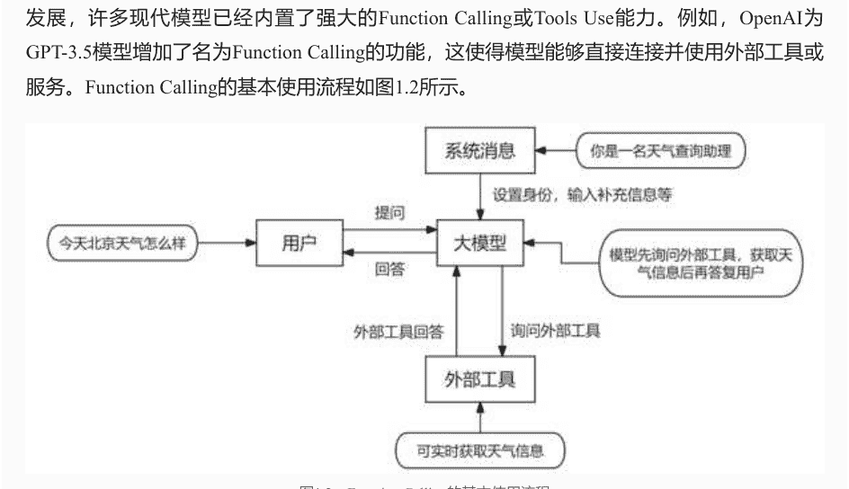

总体而言，基础框架充分利用了大模型的强大能力，降低了Agent开发的复杂度，使开发者可以直接利用现有的大模型功能来构建Agent，极大提升了开发效率和灵活性。但是，基础框架的Agent通常受到大模型本身功能的限制，面对复杂的业务需求和高度定制化的任务时，原生功能往往无法满足所有的操作和优化需求。

#### 1.3.3 代码框架

在大模型Agent的开发中，代码框架提供了更高的灵活性和可定制性，尤其适用于需要复杂逻辑处理和高度定制化的任务。与低代码或基础框架相比，代码框架通常通过模块化的组件和类来帮助开发者更精细地控制Agent的行为，并在构建过程中实现更复杂的功能。

##### 1. LangChain

LangChain起初是一个针对语言模型的简化开发工具，随着LLM的发展、使用者的需求增加和功能的不断扩展，它逐步演化为一个强大的Agent开发框架。LangChain的主要特点如下。

- ✅ 功能强大的类和工具：LangChain的核心优势之一是它为开发者提供了很多封装好的工具和类，使得构建Agent变得简单高效。例如，Agent构建的四个核心模块，如果从头开始手写代码将十分复杂，而LangChain将这些功能封装成易于使用的类，开发者只需要配置和调用这些类，就可快速构建自己的Agent。
- ✅ 与外部工具集成：LangChain支持与多种外部工具和服务的无缝集成，包括数据库、API和文件存储系统。使得开发者可以轻松调用外部系统以获取数据，增强Agent的执行能力。
- ✅ 灵活的扩展性：虽然LangChain提供了很多封装好的功能和类，开发者仍然可以根据需求定制化开发，可以修改现有类或者添加新的模块，支持更复杂的任务和场景。

LangChain适用于需要快速开发并且集成多种工具的Agent应用。它特别适用于自动化客服系统、内容生成平台、数据处理等任务，因为在这些任务中Agent需要与外部系统进行频繁的交互和任务规划。

##### 2. LangGraph

LangGraph是在LangChain的基础上发展而来的，更加注重构建复杂的图状结构并管理多步骤任务。LangGraph于2022年发布，旨在为开发者提供更复杂的图状结构开发工具，特别适用于多任务的协同工作与任务分配。LangGraph主要特点如下。

- ✅ 支持图状结构：LangGraph的最大特点是它支持图状结构设计，使得开发者可以将Agent的任务和流程组织成一个图形化的形式。每个节点代表一个任务或操作，每条边代表任务之间的依赖关系。这样就可以更加直观地管理任务的执行流程和逻辑关系。
- ✅ 多任务协作：LangGraph允许多个Agent或多个任务并行执行，并通过图结构管理这些任务之间的交互。这使得它特别适用于需要处理多层次、多步骤任务的应用，如复杂的业务流程自动化、跨部门协作等。
- ✅ 灵活的扩展机制：LangGraph支持开发者自定义任务节点和边的类型，可以根据业务需求扩展任务的执行和交互方式。此外，LangGraph还允许开发者灵活调整图形结构，优化任务执行的顺序和效率。
- ✅ 支持高级功能：相比LangChain，LangGraph提供了更复杂的功能，如动态任务生成、任务优化、依赖管理等。这些功能使得LangGraph在处理大规模的任务调度和多Agent协作时具有更强的能力。

LangGraph适用于需要复杂任务协作和图形化任务管理的场景，尤其在跨部门合作、复杂的业务流程管理以及多Agent中表现出色。

##### 3. LlamaIndex

LlamaIndex（原名GPT Index）是一个经典的开源框架，专门用于构建以大语言模型为基础的Agent系统。它发布于2020年，并且在处理大规模数据集和信息检索方面表现优异。尽管LlamaIndex的发展早于LangChain，但它的使用也更加复杂，对初学者而言入手难度较高，适合对数据处理和查询优化有较高要求的开发者。LlamaIndex的主要特点如下。

- ✅ 高效的信息检索与查询能力：LlamaIndex最突出的特点是其在处理和查询大规模数据集方面的优势。它特别适用于需要快速查询、索引和处理大量信息的场景，如构建搜索引擎、知识图谱等。
- ✅ 灵活的数据结构支持：LlamaIndex提供了多种数据结构，用于存储和组织不同类型的数据。它可以处理文本数据、结构化数据和多模态数据，为开发者提供了高度自定义的查询方式。
- ✅ 复杂查询优化：LlamaIndex支持更复杂的查询优化机制，能够在大规模数据中高效地查询和匹配。它为需要处理海量数据的应用提供了优越的性能和可扩展性。

LlamaIndex适用于大数据和信息检索密集型的应用场景。它特别适合需要高效处理和检索海量信息的Agent应用。

#### 1.3.4 Multi-Agent框架

什么是Multi-Agent？如果一个任务过于复杂，单个Agent难以独立执行，那么就可以通过多个Agent分工合作来高效地完成任务。每个Agent可以专注于执行任务中的一部分功能，通过协调合作，实现任务的整体目标。

例如，在应用程序开发中，一个完整的项目可能涉及多个角色：需求分析、代码开发、功能测试、性能优化等。如果将每个角色作为一个Agent来处理，它们通过相互协作，便可以共同完成应用程序的开发过程。这种方式能够将复杂的任务拆解成多个较小的、可以独立执行的部分，提高工作效率和任务执行的精度。

在实际开发中，Multi-Agent系统可以通过手动编写多个Agent来实现，也可以使用现有的Multi-Agent框架简化开发工作。

##### 1. CrewAI

CrewAI是一个轻量级的多Agent框架，它允许开发者通过定义任务、角色和目标，快速组建协作型的多个Agent团队。CrewAI支持多种协作模式，如顺序执行、层级结构和异步工作流，适用于自动化写作、客户支持和项目管理等场景。同时该框架强调高性能和低延迟，适合对响应速度要求较高的应用。

##### 2. OpenAI Swarm

OpenAI于2024年发布的Swarm是一个轻量级的多Agent协同框架，旨在简化Agent之间的协调与执行。Swarm通过两个基本概念——Agent和handoff，实现Agent之间的交互。Agent包含指令和工具，handoff允许Agent将任务交给其他Agent处理。这种设计使Swarm在处理复杂对话流和任务委派时更加高效。同时因为其简洁清晰的开源项目代码，也十分适用于学习过程中的项目。

##### 3. OpenAI Assistant API

OpenAI的Assistant API也是一个非常强大的工具，它非常适合构建Agent并能够处理多种任务，但遗憾的是它并不开源。开发者只能通过在线接口调用模型服务，无法完全控制其内部逻辑，在需要高度定制化的场景下，闭源的Assistant API不可避免受到限制。

##### 4. 微软的AutoGen

AutoGen是微软开发的一个开源框架，专门为了构建可定制的多Agent对话系统而设计。开发者能够在AutoGen框架下利用多个Agent协同工作，适用于工具使用、任务分配、任务执行等复杂操作的场景。AutoGen的主要特点如下。

- ✅ Agent协作：AutoGen强调多个Agent之间的协作与任务分配。它允许Agent在任务执行过程中相互合作，并根据预设的流程和需求调整角色分配。开发者可以定义不同的Agent角色，如负责数据采集、代码生成、数据分析等不同功能的角色。
- ✅ 工具集成与扩展性：AutoGen支持与多种外部工具和API集成。它可以帮助Agent访问并使用外部工具以进行任务处理，例如调用数据库查询、执行数据分析任务、生成代码等。同时，它也允许开发者根据实际需求定制Agent的行为和交互方式。
- ✅ 无代码开发环境：微软也在其基础上提供了一个无代码的开发环境AutoGen Studio，可以简化Agent的构建与调试过程。和此前的低代码开发工具一样，开发者无须编写大量代码，便可以通过可视化界面创建和调试多Agent系统，快速构建原型，并进行验证与优化。

##### 5. MetaGPT

MetaGPT是一个开源的多Agent框架，专门用于模拟软件公司内部的协作流程。MetaGPT通过将不同的角色（如产品经理、架构师、项目经理、工程师）抽象为Agent，并通过标准化操作流程（SOP）进行协同工作，从而将复杂的软件开发任务拆解成多个子任务，由不同的Agent处理。

> 说明

需要特别说明的是，本书所涉及的大模型Agent开发实践将以代码层面的开发为主，侧重于工程化、可部署、可扩展的Agent构建方式。虽然当前也有诸如Coze、Dify等优秀的低代码框架，它们通过可视化配置即可快速搭建Agent，但本书不包含这些平台的具体操作流程。对此类低代码工具感兴趣的读者，可访问其官网获取详细使用指南。

##### 2. OpenAI Swarm

OpenAI于2024年发布的Swarm是一个轻量级的多Agent协同框架，旨在简化Agent之间的协调与执行。Swarm通过两个基本概念——Agent和handoff，实现Agent之间的交互。Agent包含指令和工具，handoff允许Agent将任务交给其他Agent处理。这种设计使Swarm在处理复杂对话流和任务委派时更加高效。同时因为其简洁清晰的开源项目代码，也十分适用于学习过程中的项目。

##### 3. OpenAI Assistant API

OpenAI的Assistant API也是一个非常强大的工具，它非常适合构建Agent并能够处理多种任务，但遗憾的是它并不开源。开发者只能通过在线接口调用模型服务，无法完全控制其内部逻辑，在需要高度定制化的场景下，闭源的Assistant API不可避免受到限制。

##### 4. 微软的AutoGen

AutoGen是微软开发的一个开源框架，专门为了构建可定制的多Agent对话系统而设计。开发者能够在AutoGen框架下利用多个Agent协同工作，适用于工具使用、任务分配、任务执行等复杂操作的场景。AutoGen的主要特点如下。

- Agent协作：AutoGen强调多个Agent之间的协作与任务分配。它允许Agent在任务执行过程中相互合作，并根据预设的流程和需求调整角色分配。开发者可以定义不同的Agent角色，如负责数据采集、代码生成、数据分析等不同功能的角色。
- 工具集成与扩展性：AutoGen支持与多种外部工具和API集成。它可以帮助Agent访问并使用外部工具以进行任务处理，例如调用数据库查询、执行数据分析任务、生成代码等。同时，它也允许开发者根据实际需求定制Agent的行为和交互方式。
- 无代码开发环境：微软也在其基础上提供了一个无代码的开发环境AutoGen Studio，可以简化Agent的构建与调试过程。和此前的低代码开发工具一样，开发者无须编写大量代码，便可以通过可视化界面创建和调试多Agent系统，快速构建原型，并进行验证与优化。

##### 5. MetaGPT

MetaGPT是一个开源的多Agent框架，专门用于模拟软件公司内部的协作流程。MetaGPT通过将不同的角色（如产品经理、架构师、项目经理、工程师）抽象为Agent，并通过标准化操作流程（SOP）进行协同工作，从而将复杂的软件开发任务拆解成多个子任务，由不同的Agent处理。

> 说明

需要特别说明的是，本书所涉及的大模型Agent开发实践将以代码层面的开发为主，侧重于工程化、可部署、可扩展的Agent构建方式。虽然当前也有诸如Coze、Dify等优秀的低代码框架，它们通过可视化配置即可快速搭建Agent，但本书不包含这些平台的具体操作流程。对此类低代码工具感兴趣的读者，可访问其官网获取详细使用指南。

### 1.4 附加资源

(1) AutoGPT GitHub开源项目地址：https://github.com/Significant-Gravitas/AutoGPT。
(2) Coze官网地址：https://www.coze.cn/。
(3) Dify官网地址：https://dify.ai/。
(4) LangFlow官网地址：https://www.langflow.org/。
(5) OpenAI Function Calling 官方说明文档：https://platform.openai.com/docs/guides/functioncalling。
(6) LangChain官网地址：https://www.langchain.com/。
(7) LlamaIndex官网地址：https://www.llamaindex.ai/。
(8) LlamaIndex GitHub开源项目地址：https://github.com/run-llama/llama_index。
(9) CrewAI官网地址：https://www.crewai.com/。
(10) CrewAI GitHub开源项目地址：https://github.com/crewAIInc/crewAI。
(11) OpenAI Swarm GitHub开源项目地址：https://github.com/openai/swarm。
(12) OpenAI Assistant API 官方说明文档：https://platform.openai.com/docs/assistants/overview。
(13) 微软AutoGen GitHub开源项目地址：https://github.com/microsoft/autogen。
(14) MetaGPT官网地址：https://deepwisdom.ai/。
(15) MetaGPT GitHub开源项目地址：https://github.com/FoundationAgents/MetaGPT。

## 第2章 大模型基础与部署调用

随着大语言模型（LLM）技术的不断发展，全球范围内涌现出一系列性能优异、生态活跃的开源与商用模型体系。对于开发者而言，理解这些模型的发展脉络与生态分布，掌握它们的调用方式与部署策略，是开展Agent构建与大模型应用的前提。本章将系统梳理全球及国内主要模型的发展脉络与开源情况；随后，通过分步讲解在线大模型API调用流程，帮助读者掌握模型接入的实用技能；最后，还将介绍若干主流的高性能部署工具，以支持更灵活、高效的服务构建。

本章知识架构如下：

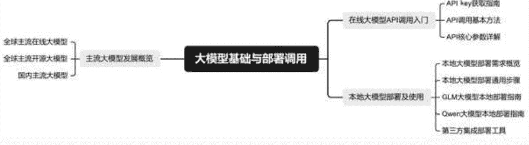

### 2.1 主流大模型发展概览

自ChatGPT引发全球生成式人工智能热潮以来，大语言模型（LLM）迅速成为通用人工智能（AGI）发展的核心动力。当前，大模型的发展主要分为两大阵营：一类是以OpenAI、Anthropic、Google等为代表的闭源商用模型，以在线API服务方式向全球提供强大的通用智能能力；另一类则以Meta、DeepSeek、阿里云、智谱等机构推动的开源模型体系为核心，强调模型透明性和本地部署能力。本节将围绕“在线大模型”与“开源大模型”，系统分析当前全球及国内主流大模型的发展现状、技术演进及其生态布局，为后续探讨模型部署与调用的实践操作提供基础。

#### 2.1.1 全球主流在线大模型

##### 1. OpenAI系列

OpenAI公司从2015年成立至今，已然成为全球AI领域的领跑者。2022年11月，OpenAI推出了ChatGPT，一经发布，便引发全球关注，数百万用户争相体验。OpenAI通过ChatGPT展现了大语言模型前所未有的能力，也为AI的发展打开了新的大门。

ChatGPT实际上是建立在GPT-3.5和GPT-4的基础之上。OpenAI的模型体系经历了从基础语言模型到多模态的演进，涵盖语言、图像、音频、视频等多种模态。下面，我们将按照基础分类来梳理其发展历程，以帮助读者在后续应用中选择合适的模型。

1）基础语言模型（GPT系列）

OpenAI的GPT系列模型是其语言处理能力的核心，随着版本的迭代，模型在理解和生成自然语言方面不断提升。2020年GPT-3模型发布，并在多个自然语言处理任务中表现出色；2022年GPT-3.5在GPT-3的基础上进行了优化，提升了对话的连贯性和准确性，它嵌入ChatGPT并应用于对话系统，轰动一时。

2023年，OpenAI发布了GPT-4模型，除基础自然语言性能的大幅提升外，GPT-4模型具备更强的推理和创造能力，它引入了多模态的能力，支持图像和文本的多模态输入。OpenAI同年也发布了GPT-4 Turbo，在保持GPT-4能力的同时，提升了处理速度和效率，降低了成本。2025年4月，OpenAI发布了GPT-4.1模型，其在编程、指令跟随和长上下文理解方面性能优异，支持最长100万token的上下文。

2）Omni系列模型（GPT-4o系列）

为了实现更自然的人机交互，OpenAI推出了Omni系列模型，在多模态处理能力的基础上，使用成本相对基础语言模型进一步降低。2024年5月，OpenAI发布了GPT-4o，“o”代表“omnipotent”（全能），象征其在处理多模态数据（文本、图像等）方面的强大能力，也是Agent开发主流的模型选择。同年7月，为了适应资源受限的场景并进一步降低成本，发布了轻量级的GPT-4o mini模型。

3）推理模型（o系列）

为了提升模型的推理和逻辑能力，OpenAI推出了o系列模型，专注于复杂任务的处理。2024年12月，为了提升模型在复杂数学和科学问题上的推理能力，发布了o1模型。同年9月也发布了对应的轻量级版本o1-mini来适配需要快速响应的推理任务。2025年4月，在o1的基础上进一步提升推理能力的同时支持图像输入，发布了o3推理模型。

4）多模态输出模型

虽然4代的很多模型已经支持多模态内容的输入，但其输出大多是文本形式。OpenAI也在同步推出多模态输出的模型。2025年4月发布的GPT-image-1正是在DALL·E模型的基础上迭代的。其不仅在图像生成能力上有显著提升，还支持图像编辑和修复。在视频内容方面，2024年12月发布的Sora模型，是一个文本生成视频的模型，支持视频生成、动画制作和内容重混，在影视制作领域引发不少关注。同时语音内容生成方面也从TTS-1迭代到GPT-4o mini TTS，进一步优化了将自然语言文本转换为口语发音的能力。

5）向量模型（Embedding Models）

OpenAI的向量模型用于将文本转换为数值向量，便于进行相似度计算和信息检索。当然这更多地应用于代码层面的开发任务，如搜索引擎、推荐系统和RAG（retrieval-augmented generation，检索增强生成）。

##### 2. Claude系列

2021年，OpenAI的一批研究人员因对AGI安全问题有不同的理解，离职创办了Anthropic。他们认为，仅仅提升模型能力是远远不够的，更重要的是从根本上设计一种更容易控制、解释和对齐人类意图的AI系统。Anthropic将这种理念称为“宪法式人工智能”（Constitutional AI）。

于是，Claude系列诞生了——它以法国启蒙思想家Claude Adrien Helvétius命名，寓意其模型设计深受人文主义精神的启发。

2023年3月，Claude 1与GPT-3.5几乎同步亮相，Anthropic首次正式进军大型语言模型市场。同年7月迭代了Claude 2模型，不仅在基本的NLP能力上有所提升，还通过Anthropic网页端对外开放试用。2024年3月，为了对标GPT-4o、Gemini 1.5，Claude 3系列模型发布，在增强安全机制的同时，新增了对图像等模态内容输入和工具调用的支持。

2025年5月，Claude 4系列模型发布，包含两款模型，Claude Opus 4和Claude Sonnet 4。其中Claude Opus 4在编程能力上大幅提升，特别是针对一些复杂逻辑的编程的任务，它的表现十分优异。

##### 3. Gemini系列

在大语言模型发展的热潮下，科技巨头Google也加速推进其AI布局。2023年3月，Google首次推出基于LaMDA模型的AI助手——Bard，旨在ChatGPT席卷全球的背景下提供一个轻量级对话式工具，但Bard初期表现相对平淡。直到2023年12月，Google宣布“Bard正式升级为Gemini”，并发布Gemini 1.0系列，标志着其全面转向由DeepMind主导的大模型战略。

Gemini系列模型强调“原生多模态训练”，从训练开始就引入图像、文本、代码等异构数据，使其在视觉理解、图文混合任务中表现出更强的一致性与适应能力。2024年2月发布Gemini 1.5系列，包含Gemini 1.5 Pro和Gemini 1.5 Flash两个版本，不仅原生支持多模态输入，还集成了内建函数调用与搜索插件接入的能力，初步具备了模型Agent的功能特征。

2024年12月，Google推出了Gemini 2.0，标志着其向能够独立完成复杂任务的AI系统迈出了重要一步。该版本包括Gemini 2.0 Flash主力模型，轻量级模型Gemini 2.0 Flash-Lite，以及专注于推理与编程性能的Gemini 2.0 Pro Experimental。2025年3月，Google的Gemini 2.5 Pro引入了“思考模型”的概念，能够在生成回答前进行推理和权衡，提供更具深度的解决方案。

#### 2.1.2 全球主流开源大模型

##### 1. Meta LLaMA系列

Meta（原Facebook）自2023年起推出的LLaMA（large language model meta AI）系列模型是开源大模型生态的奠基者。2023年2月，Meta发布LLaMA 1模型，同年3月，LLaMA模型权重被上传至HuggingFace和4chan论坛，全球开发者都能免费访问，这次意外泄露却成就了LLaMA的“开源神话”。它首次将高性能的大语言模型门槛拉低到了普通研究者和开发者可接触的程度，催生大量社区模型。

2023年7月，Meta推出LLaMA 2系列模型，包括7B、13B、70B三个版本，这一次官方不仅提供完整的预训练及指令微调模型，而且明确采用Apache 2.0许可协议开源，并且官方鼓励商业使用和部署，由此确立了其在开源大模型社区中的领导者地位。

2024年初，GPT-4的统治力已几乎达到压倒性的程度，Gemini 1.5、Claude 3.0也先后问世，与此同时，社区对开源模型性能的焦虑与期待同时高涨。Meta在2024年4月发布了LLaMA 3系列的8B与70B两个模型，目标直指“在开放领域正面对抗GPT-4的主力任务”。

2024年末到2025年初，GPT-4o的发布让行业意识到单一语言能力的AI已不足以满足未来场景。全模态（文+图+音+视频）将是大模型的终极方向。Meta再次提前布局，于2025年4月正式披露LLaMA 4系列模型，所有模型均采用混合专家（mixture-of-experts，MoE）架构，支持图文输入，多语言支持提升至12种。

##### 2. Mistral

法国初创公司Mistral AI自2023年成立以来，以其高性能、开源的语言模型迅速崭露头角，成为欧洲在人工智能领域的重要力量。2023年9月，Mistral 7B模型发布，在多个基准测试中，其性能超越了LLaMA 2 13B模型，展示了小体量模型的巨大潜力。同年12月，其引入稀疏专家混合架构（Sparse Mixture-of-Experts，SMoE）发布了Mixtral 8x7B模型，在数学、代码生成和多语言任务中表现优异，超越了LLaMA 2-70B和GPT-3.5模型。

2024年4月，在Mixtral 8x7B的基础上，进一步扩大模型规模，提升推理能力，发布了Mixtral 8x22B模型。同年也发布了支持研究开源的Mistral Large模型和支持商用开源的Mistral Small，其开放的模型权重和灵活的许可协议，促进了全球开发者和研究人员的广泛参与，也奠定了其在开源大模型领域的重要地位。

#### 2.1.3 国内主流大模型

在全球大模型发展浪潮中，国内很多大模型企业展现出一种独特的技术推进路径：“开源+在线API”双轨并行。相比于国外主流大模型多数采用封闭API方式提供服务，中国的大模型从ChatGLM、Qwen、Baichuan到DeepSeek，不仅开放API服务，还开放了模型权重、训练策略与推理框架，积极构建开源社区，支持本地化部署与企业级私有化部署。

##### 1. DeepSeek系列

在大模型被巨头垄断、API高昂、在线模型平台封闭的时代，DeepSeek以其“性能高，成本低，开源易部署”的特点迅速崛起，成为最具代表性的国产通用大模型新力量。DeepSeek是2023年成立的人工智能初创公司，由量化交易背景的团队创建。自2023年以来，DeepSeek持续推出多个重量级模型，尤其是DeepSeek-V3和DeepSeek-R1，不仅在推理、编程等关键任务上追平GPT-4和OpenAI o1，而且在部署灵活性和开发友好性上提供了独特优势。

1）DeepSeek-V3：性能对标GPT-4，成本压缩至1/20

DeepSeek-V3于2024年12月发布，采用MoE架构，在保留GPT-4级别性能的同时，将激活参数控制在37B，大大降低训练和推理成本。根据官方数据，V3全模型参数为671B，训练总成本仅约557万美元，仅为GPT-4估算成本的1/20左右。

DeepSeek-V3模型开源，完全支持本地部署，只要有足够的算力支持，就可在自己的环境下独立运行，这对于有数据安全或者环境限制的团队十分友好。在开源的同时，V3模型开放在线API服务，且接口设计高度兼容OpenAI的调用方式。开发者无须重写业务逻辑，只需替换API key和base URL即可实现模型切换，大幅降低从GPT向DeepSeek迁移的成本。

2）DeepSeek-R1：推理性能对标OpenAI o1

DeepSeek-R1于2025年1月发布，继承了V3的结构和权重，并在此基础上进行了大规模的强化学习优化。不同于传统SFT训练，R1更加注重多轮推理与因果链条重构，在数学、逻辑、代码、长文本等任务中表现尤为突出。与V3一样，R1采用开放MIT协议，支持下载权重进行本地部署，同时提供API服务供开发调试与线上调用。开发者可选择使用在线API实时调试或开发原型，也可以在必要的场景下自行部署。

DeepSeek-V3与R1全系列开源模型支持一键Docker本地部署，推理接口高度兼容OpenAI格式，推出同时即上线Hugging Face与GitHub，官方提供Python SDK与完整参数配置文档。在开源生态方面兼容vLLM、TGI、AutoAWQ等高性能推理框架的同时社区已推出INT4、INT8、GPTQ多种量化版本，可以适配普通消费级开发者。实测表明，INT4量化版本可在单张RTX 4090上完成推理响应，让普通开发者第一次真正拥有“本地运行GPT-4性能级别模型”的可行性。

在全球主流大模型中，DeepSeek-V3与R1系列不仅能力卓越，更以“可用、可控、可部署”的特点打破了国外模型封闭平台的垄断格局。它们让中小企业、研究团队和开发者真正拥有了自己的GPT级模型使用权，而不是被“平台绑定”的API使用者。无论是想构建下一代AI应用，还是希望在自己的服务器上部署大模型，DeepSeek都是我们极具战略价值的国产优选。

##### 2. 智谱AI GLM系列

2022年底，OpenAI发布ChatGPT引爆全球科技圈之后，整个AI产业被彻底改写。ChatGLM便是在这样背景下国内最早一批成功开源、支持本地部署与在线API的对话语言模型，不仅填补了早期国产对话AI的空白，更为中国AI生态打下了重要基础。

1）GLM-6B

在全球聚焦于超百亿、千亿参数大模型的背景下，ChatGLM反其道而行之，仅以6B参数便训练出一款性能优异的中英双语对话模型。该模型采用GLM架构（General Language Model，通用语言模型），并通过低精度量化技术优化，成功实现了一张24G消费级显卡即可本地运行，显著降低了使用门槛。这一特性使其迅速火遍开源社区，成为中国高校、开发者、教育等行业试水大模型应用的首选。它也是国内首个具有完整对话能力且可本地部署的大模型之一。

2）GLM-4-9B

### 2.1 主流大模型发展概览

自ChatGPT引发全球生成式人工智能热潮以来，大语言模型（LLM）迅速成为通用人工智能（AGI）发展的核心动力。当前，大模型的发展主要分为两大阵营：一类是以OpenAI、Anthropic、Google等为代表的闭源商用模型，以在线API服务方式向全球提供强大的通用智能能力；另一类则以Meta、DeepSeek、阿里云、智谱等机构推动的开源模型体系为核心，强调模型透明性和本地部署能力。本节将围绕“在线大模型”与“开源大模型”，系统分析当前全球及国内主流大模型的发展现状、技术演进及其生态布局，为后续探讨模型部署与调用的实践操作提供基础。

#### 2.1.1 全球主流在线大模型

##### 1. OpenAI系列

OpenAI公司从2015年成立至今，已然成为全球AI领域的领跑者。2022年11月，OpenAI推出了ChatGPT，一经发布，便引发全球关注，数百万用户争相体验。OpenAI通过ChatGPT展现了大语言模型前所未有的能力，也为AI的发展打开了新的大门。

ChatGPT实际上是建立在GPT-3.5和GPT-4的基础之上。OpenAI的模型体系经历了从基础语言模型到多模态的演进，涵盖语言、图像、音频、视频等多种模态。下面，我们将按照基础分类来梳理其发展历程，以帮助读者在后续应用中选择合适的模型。

1）基础语言模型（GPT系列）

OpenAI的GPT系列模型是其语言处理能力的核心，随着版本的迭代，模型在理解和生成自然语言方面不断提升。2020年GPT-3模型发布，并在多个自然语言处理任务中表现出色；2022年GPT-3.5在GPT-3的基础上进行了优化，提升了对话的连贯性和准确性，它嵌入ChatGPT并应用于对话系统，轰动一时。

2023年，OpenAI发布了GPT-4模型，除基础自然语言性能的大幅提升外，GPT-4模型具备更强的推理和创造能力，它引入了多模态的能力，支持图像和文本的多模态输入。OpenAI同年也发布了GPT-4 Turbo，在保持GPT-4能力的同时，提升了处理速度和效率，降低了成本。2025年4月，OpenAI发布了GPT-4.1模型，其在编程、指令跟随和长上下文理解方面性能优异，支持最长100万token的上下文。

2）Omni系列模型（GPT-4o系列）

为了实现更自然的人机交互，OpenAI推出了Omni系列模型，在多模态处理能力的基础上，使用成本相对基础语言模型进一步降低。2024年5月，OpenAI发布了GPT-4o，“o”代表“omnipotent”（全能），象征其在处理多模态数据（文本、图像等）方面的强大能力，也是Agent开发主流的模型选择。同年7月，为了适应资源受限的场景并进一步降低成本，发布了轻量级的GPT-4o mini模型。

3）推理模型（o系列）

为了提升模型的推理和逻辑能力，OpenAI推出了o系列模型，专注于复杂任务的处理。2024年12月，为了提升模型在复杂数学和科学问题上的推理能力，发布了o1模型。同年9月也发布了对应的轻量级版本o1-mini来适配需要快速响应的推理任务。2025年4月，在o1的基础上进一步提升推理能力的同时支持图像输入，发布了o3推理模型。

4）多模态输出模型

虽然4代的很多模型已经支持多模态内容的输入，但其输出大多是文本形式。OpenAI也在同步推出多模态输出的模型。2025年4月发布的GPT-image-1正是在DALL·E模型的基础上迭代的。其不仅在图像生成能力上有显著提升，还支持图像编辑和修复。在视频内容方面，2024年12月发布的Sora模型，是一个文本生成视频的模型，支持视频生成、动画制作和内容重混，在影视制作领域引发不少关注。同时语音内容生成方面也从TTS-1迭代到GPT-4o mini TTS，进一步优化了将自然语言文本转换为口语发音的能力。

5）向量模型（Embedding Models）

OpenAI的向量模型用于将文本转换为数值向量，便于进行相似度计算和信息检索。当然这更多地应用于代码层面的开发任务，如搜索引擎、推荐系统和RAG（retrieval-augmented generation，检索增强生成）。

##### 2. Claude系列

2021年，OpenAI的一批研究人员因对AGI安全问题有不同的理解，离职创办了Anthropic。他们认为，仅仅提升模型能力是远远不够的，更重要的是从根本上设计一种更容易控制、解释和对齐人类意图的AI系统。Anthropic将这种理念称为“宪法式人工智能”（Constitutional AI）。

于是，Claude系列诞生了——它以法国启蒙思想家Claude Adrien Helvétius命名，寓意其模型设计深受人文主义精神的启发。

2023年3月，Claude 1与GPT-3.5几乎同步亮相，Anthropic首次正式进军大型语言模型市场。同年7月迭代了Claude 2模型，不仅在基本的NLP能力上有所提升，还通过Anthropic网页端对外开放试用。2024年3月，为了对标GPT-4o、Gemini 1.5，Claude 3系列模型发布，在增强安全机制的同时，新增了对图像等模态内容输入和工具调用的支持。

2025年5月，Claude 4系列模型发布，包含两款模型，Claude Opus 4和Claude Sonnet 4。其中Claude Opus 4在编程能力上大幅提升，特别是针对一些复杂逻辑的编程的任务，它的表现十分优异。

##### 3. Gemini系列

在大语言模型发展的热潮下，科技巨头Google也加速推进其AI布局。2023年3月，Google首次推出基于LaMDA模型的AI助手——Bard，旨在ChatGPT席卷全球的背景下提供一个轻量级对话式工具，但Bard初期表现相对平淡。直到2023年12月，Google宣布“Bard正式升级为Gemini”，并发布Gemini 1.0系列，标志着其全面转向由DeepMind主导的大模型战略。

Gemini系列模型强调“原生多模态训练”，从训练开始就引入图像、文本、代码等异构数据，使其在视觉理解、图文混合任务中表现出更强的一致性与适应能力。2024年2月发布Gemini 1.5系列，包含Gemini 1.5 Pro和Gemini 1.5 Flash两个版本，不仅原生支持多模态输入，还集成了内建函数调用与搜索插件接入的能力，初步具备了模型Agent的功能特征。

2024年12月，Google推出了Gemini 2.0，标志着其向能够独立完成复杂任务的AI系统迈出了重要一步。该版本包括Gemini 2.0 Flash主力模型，轻量级模型Gemini 2.0 Flash-Lite，以及专注于推理与编程性能的Gemini 2.0 Pro Experimental。2025年3月，Google的Gemini 2.5 Pro引入了“思考模型”的概念，能够在生成回答前进行推理和权衡，提供更具深度的解决方案。

#### 2.1.2 全球主流开源大模型

##### 1. Meta LLaMA系列

Meta（原Facebook）自2023年起推出的LLaMA（large language model meta AI）系列模型是开源大模型生态的奠基者。2023年2月，Meta发布LLaMA 1模型，同年3月，LLaMA模型权重被上传至HuggingFace和4chan论坛，全球开发者都能免费访问，这次意外泄露却成就了LLaMA的“开源神话”。它首次将高性能的大语言模型门槛拉低到了普通研究者和开发者可接触的程度，催生大量社区模型。

2023年7月，Meta推出LLaMA 2系列模型，包括7B、13B、70B三个版本，这一次官方不仅提供完整的预训练及指令微调模型，而且明确采用Apache 2.0许可协议开源，并且官方鼓励商业使用和部署，由此确立了其在开源大模型社区中的领导者地位。

2024年初，GPT-4的统治力已几乎达到压倒性的程度，Gemini 1.5、Claude 3.0也先后问世，与此同时，社区对开源模型性能的焦虑与期待同时高涨。Meta在2024年4月发布了LLaMA 3系列的8B与70B两个模型，目标直指“在开放领域正面对抗GPT-4的主力任务”。

2024年末到2025年初，GPT-4o的发布让行业意识到单一语言能力的AI已不足以满足未来场景。全模态（文+图+音+视频）将是大模型的终极方向。Meta再次提前布局，于2025年4月正式披露LLaMA 4系列模型，所有模型均采用混合专家（mixture-of-experts，MoE）架构，支持图文输入，多语言支持提升至12种。

##### 2. Mistral

法国初创公司Mistral AI自2023年成立以来，以其高性能、开源的语言模型迅速崭露头角，成为欧洲在人工智能领域的重要力量。2023年9月，Mistral 7B模型发布，在多个基准测试中，其性能超越了LLaMA 2 13B模型，展示了小体量模型的巨大潜力。同年12月，其引入稀疏专家混合架构（Sparse Mixture-of-Experts，SMoE）发布了Mixtral 8x7B模型，在数学、代码生成和多语言任务中表现优异，超越了LLaMA 2-70B和GPT-3.5模型。

2024年4月，在Mixtral 8x7B的基础上，进一步扩大模型规模，提升推理能力，发布了Mixtral 8x22B模型。同年也发布了支持研究开源的Mistral Large模型和支持商用开源的Mistral Small，其开放的模型权重和灵活的许可协议，促进了全球开发者和研究人员的广泛参与，也奠定了其在开源大模型领域的重要地位。

#### 2.1.3 国内主流大模型

在全球大模型发展浪潮中，国内很多大模型企业展现出一种独特的技术推进路径：“开源+在线API”双轨并行。相比于国外主流大模型多数采用封闭API方式提供服务，中国的大模型从ChatGLM、Qwen、Baichuan到DeepSeek，不仅开放API服务，还开放了模型权重、训练策略与推理框架，积极构建开源社区，支持本地化部署与企业级私有化部署。

##### 1. DeepSeek系列

在大模型被巨头垄断、API高昂、在线模型平台封闭的时代，DeepSeek以其“性能高，成本低，开源易部署”的特点迅速崛起，成为最具代表性的国产通用大模型新力量。DeepSeek是2023年成立的人工智能初创公司，由量化交易背景的团队创建。自2023年以来，DeepSeek持续推出多个重量级模型，尤其是DeepSeek-V3和DeepSeek-R1，不仅在推理、编程等关键任务上追平GPT-4和OpenAI o1，而且在部署灵活性和开发友好性上提供了独特优势。

1) DeepSeek-V3：性能对标GPT-4，成本压缩至1/20

DeepSeek-V3于2024年12月发布，采用MoE架构，在保留GPT-4级别性能的同时，将激活参数控制在37B，大大降低训练和推理成本。根据官方数据，V3全模型参数为671B，训练总成本仅约557万美元，仅为GPT-4估算成本的1/20左右。

DeepSeek-V3模型开源，完全支持本地部署，只要有足够的算力支持，就可在自己的环境下独立运行，这对于有数据安全或者环境限制的团队十分友好。在开源的同时，V3模型开放在线API服务，且接口设计高度兼容OpenAI的调用方式。开发者无须重写业务逻辑，只需替换API key和base URL即可实现模型切换，大幅降低从GPT向DeepSeek迁移的成本。

2) DeepSeek-R1：推理性能对标OpenAI o1

DeepSeek-R1于2025年1月发布，继承了V3的结构和权重，并在此基础上进行了大规模的强化学习优化。不同于传统SFT训练，R1更加注重多轮推理与因果链条重构，在数学、逻辑、代码、长文本等任务中表现尤为突出。与V3一样，R1采用开放MIT协议，支持下载权重进行本地部署，同时提供API服务供开发调试与线上调用。开发者可选择使用在线API实时调试或开发原型，也可以在必要的场景下自行部署。

DeepSeek-V3与R1全系列开源模型支持一键Docker本地部署，推理接口高度兼容OpenAI格式，推出同时即上线Hugging Face与GitHub，官方提供Python SDK与完整参数配置文档。在开源生态方面兼容vLLM、TGI、AutoAWQ等高性能推理框架的同时社区已推出INT4、INT8、GPTQ多种量化版本，可以适配普通消费级开发者。实测表明，INT4量化版本可在单张RTX 4090上完成推理响应，让普通开发者第一次真正拥有“本地运行GPT-4性能级别模型”的可行性。

在全球主流大模型中，DeepSeek-V3与R1系列不仅能力卓越，更以“可用、可控、可部署”的特点打破了国外模型封闭平台的垄断格局。它们让中小企业、研究团队和开发者真正拥有了自己的GPT级模型使用权，而不是被“平台绑定”的API使用者。无论是想构建下一代AI应用，还是希望在自己的服务器上部署大模型，DeepSeek都是我们极具战略价值的国产优选。

##### 2. 智谱AI GLM系列

2022年底，OpenAI发布ChatGPT引爆全球科技圈之后，整个AI产业被彻底改写。ChatGLM便是在这样背景下国内最早一批成功开源、支持本地部署与在线API的对话语言模型，不仅填补了早期国产对话AI的空白，更为中国AI生态打下了重要基础。

1) GLM-6B

在全球聚焦于超百亿、千亿参数大模型的背景下，ChatGLM反其道而行之，仅以6B参数便训练出一款性能优异的中英双语对话模型。该模型采用GLM架构（General Language Model，通用语言模型），并通过低精度量化技术优化，成功实现了一张24G消费级显卡即可本地运行，显著降低了使用门槛。这一特性使其迅速火遍开源社区，成为中国高校、开发者、教育等行业试水大模型应用的首选。它也是国内首个具有完整对话能力且可本地部署的大模型之一。

2) GLM-4-9B

2024年5月，GLM-4模型正式发布，包含基础版-9B、多轮对话的-9B-Chat以及支持超长上下文的-9B-Chat-1M版本。该系列模型首次具备了与GPT-4同级的多模态推理能力，能够处理图像和文本的输入，并支持对表格、数学公式、图像文字区域进行分析。同时，GLM-4提供了在线商用API调用服务，并支持在HuggingFace平台通过CLI工具部署开源版本。

GLM-4-9B系列模型全面开源，不仅开放模型权重，还同步提供了微调脚本、部署代码、Docker镜像，遵循MIT协议，实现零门槛商用。2025年4月，智谱进一步开源了GLM-4-32B系列模型，不仅在通用语言建模能力上更加强大，也重点强化了推理能力优化，并推出多个专业版本，其中，Z1-32B在中文场景下的数学、代码、逻辑推理能力上全面对标DeepSeek-R1，并进一步降低了模型成本。

##### 3. 阿里通义千问（Qwen）系列

除了新兴的AI科技公司，互联网科技巨头也纷纷投入大模型领域。通义千问（Qwen）便是阿里巴巴集团旗下阿里云推出的大语言模型。

2023年4月通义千问（Qwen-Plus）模型首次登场，在8月，API服务通过阿里云百炼（ModelStudio）正式上线，对公众开放使用。同年9月开源了Qwen-7B、Qwen-1.8B的小参数数量模型，11月开源了Qwen-14B模型，12月开源了Qwen-VL-7B多模态模型。自此，阿里云便确立了“全尺寸、全任务、全开源”的导向，成为国内最具系统性的开源大模型提供方之一。模型更新频率几乎以季度为单位递进，每代产品都以成体系的开源形式发布。

2024年2月到6月，Qwen2到Qwen2.5系列模型发布，系统引入了“Base/Instruct/Chat/VL/Omni”全模型家族结构，并开放了参数规模从0.5B到72B的十余个模型，标志着通义千问正式迈入“多尺寸、全场景、强对话”的新阶段，进一步扩展至图文问答、多模态推理等任务。

2024年下半年，Qwen3系列正式发布，首次引入“思考模式”与“精简模式”切换机制，强调在不同算力下的推理灵活性，并持续强化其Omni架构在视觉、听觉、视频等模态中的统一表示能力，向“具身智能体”方向稳步推进，将可开源参数模型数量扩展至超过30种，几乎覆盖了所有主流任务场景。

阿里云Qwen全系列模型均可通过其大模型服务平台Model Studio提供的在线API接口访问。开发者可以使用与OpenAI兼容的接口或DashScope SDK方式进行调用。

目前，国内的大模型服务发展势头迅猛，无论是传统的互联网科技巨头，还是新兴的人工智能企业，都在积极布局并持续优化大模型体系。例如，字节跳动的豆包、腾讯的混元、月之暗面的Kimi等，均已开放了不同形式的在线API服务，并广泛支持文本生成、语义理解、多模态处理等功能，读者可根据具体需求前往各项目或平台的官方网站查阅和体验。

### 2.1 主流大模型发展概览

自ChatGPT引发全球生成式人工智能热潮以来，大语言模型（LLM）迅速成为通用人工智能（AGI）发展的核心动力。当前，大模型的发展主要分为两大阵营：一类是以OpenAI、Anthropic、Google等为代表的闭源商用模型，以在线API服务方式向全球提供强大的通用智能能力；另一类则以Meta、DeepSeek、阿里云、智谱等机构推动的开源模型体系为核心，强调模型透明性和本地部署能力。本节将围绕“在线大模型”与“开源大模型”，系统分析当前全球及国内主流大模型的发展现状、技术演进及其生态布局，为后续探讨模型部署与调用的实践操作提供基础。

#### 2.1.1 全球主流在线大模型

##### 1. OpenAI系列

OpenAI公司从2015年成立至今，已然成为全球AI领域的领跑者。2022年11月，OpenAI推出了ChatGPT，一经发布，便引发全球关注，数百万用户争相体验。OpenAI通过ChatGPT展现了大语言模型前所未有的能力，也为AI的发展打开了新的大门。

ChatGPT实际上是建立在GPT-3.5和GPT-4的基础之上。OpenAI的模型体系经历了从基础语言模型到多模态的演进，涵盖语言、图像、音频、视频等多种模态。下面，我们将按照基础分类来梳理其发展历程，以帮助读者在后续应用中选择合适的模型。

- 1) 基础语言模型（GPT系列）

OpenAI的GPT系列模型是其语言处理能力的核心，随着版本的迭代，模型在理解和生成自然语言方面不断提升。2020年GPT-3模型发布，并在多个自然语言处理任务中表现出色；2022年GPT-3.5在GPT-3的基础上进行了优化，提升了对话的连贯性和准确性，它嵌入ChatGPT并应用于对话系统，轰动一时。

2023年，OpenAI发布了GPT-4模型，除基础自然语言性能的大幅提升外，GPT-4模型具备更强的推理和创造能力，它引入了多模态的能力，支持图像和文本的多模态输入。OpenAI同年也发布了GPT-4 Turbo，在保持GPT-4能力的同时，提升了处理速度和效率，降低了成本。2025年4月，OpenAI发布了GPT-4.1模型，其在编程、指令跟随和长上下文理解方面性能优异，支持最长100万token的上下文。

- 2）Omni系列模型（GPT-4o系列）

为了实现更自然的人机交互，OpenAI推出了Omni系列模型，在多模态处理能力的基础上，使用成本相对基础语言模型进一步降低。2024年5月，OpenAI发布了GPT-4o，“o”代表“omnipotent”（全能），象征其在处理多模态数据（文本、图像等）方面的强大能力，也是Agent开发主流的模型选择。同年7月，为了适应资源受限的场景并进一步降低成本，发布了轻量级的GPT-4o mini模型。

- 3）推理模型（o系列）

为了提升模型的推理和逻辑能力，OpenAI推出了o系列模型，专注于复杂任务的处理。2024年12月，为了提升模型在复杂数学和科学问题上的推理能力，发布了o1模型。同年9月也发布了对应的轻量级版本o1-mini来适配需要快速响应的推理任务。2025年4月，在o1的基础上进一步提升推理能力的同时支持图像输入，发布了o3推理模型。

- 4）多模态输出模型

虽然4代的很多模型已经支持多模态内容的输入，但其输出大多是文本形式。OpenAI也在同步推出多模态输出的模型。2025年4月发布的GPT-image-1正是在DALL·E模型的基础上迭代的。其不仅在图像生成能力上有显著提升，还支持图像编辑和修复。在视频内容方面，2024年12月发布的Sora模型，是一个文本生成视频的模型，支持视频生成、动画制作和内容重混，在影视制作领域引发不少关注。同时语音内容生成方面也从TTS-1迭代到GPT-4o mini TTS，进一步优化了将自然语言文本转换为口语发音的能力。

- 5）向量模型（Embedding Models）

OpenAI的向量模型用于将文本转换为数值向量，便于进行相似度计算和信息检索。当然这更多地应用于代码层面的开发任务，如搜索引擎、推荐系统和RAG（retrieval-augmented generation，检索增强生成）。

##### 2. Claude系列

2021年，OpenAI的一批研究人员因对AGI安全问题有不同的理解，离职创办了Anthropic。他们认为，仅仅提升模型能力是远远不够的，更重要的是从根本上设计一种更容易控制、解释和对齐人类意图的AI系统。Anthropic将这种理念称为“宪法式人工智能”（Constitutional AI）。

于是，Claude系列诞生了——它以法国启蒙思想家Claude Adrien Helvétius命名，寓意其模型设计深受人文主义精神的启发。

2023年3月，Claude 1与GPT-3.5几乎同步亮相，Anthropic首次正式进军大型语言模型市场。同年7月迭代了Claude 2模型，不仅在基本的NLP能力上有所提升，还通过Anthropic网页端对外开放试用。2024年3月，为了对标GPT-4o、Gemini 1.5，Claude 3系列模型发布，在增强安全机制的同时，新增了对图像等模态内容输入和工具调用的支持。

2025年5月，Claude 4系列模型发布，包含两款模型，Claude Opus 4和Claude Sonnet 4。其中Claude Opus 4在编程能力上大幅提升，特别是针对一些复杂逻辑的编程的任务，它的表现十分优异。

##### 3. Gemini系列

在大语言模型发展的热潮下，科技巨头Google也加速推进其AI布局。2023年3月，Google首次推出基于LaMDA模型的AI助手——Bard，旨在ChatGPT席卷全球的背景下提供一个轻量级对话式工具，但Bard初期表现相对平淡。直到2023年12月，Google宣布“Bard正式升级为Gemini”，并发布Gemini 1.0系列，标志着其全面转向由DeepMind主导的大模型战略。

Gemini系列模型强调“原生多模态训练”，从训练开始就引入图像、文本、代码等异构数据，使其在视觉理解、图文混合任务中表现出更强的一致性与适应能力。2024年2月发布Gemini 1.5系列，包含Gemini 1.5 Pro和Gemini 1.5 Flash两个版本，不仅原生支持多模态输入，还集成了内建函数调用与搜索插件接入的能力，初步具备了模型Agent的功能特征。

2024年12月，Google推出了Gemini 2.0，标志着其向能够独立完成复杂任务的AI系统迈出了重要一步。该版本包括Gemini 2.0 Flash主力模型，轻量级模型Gemini 2.0 Flash-Lite，以及专注于推理与编程性能的Gemini 2.0 Pro Experimental。2025年3月，Google的Gemini 2.5 Pro引入了“思考模型”的概念，能够在生成回答前进行推理和权衡，提供更具深度的解决方案。

#### 2.1.2 全球主流开源大模型

##### 1. Meta LLaMA系列

Meta（原Facebook）自2023年起推出的LLaMA（large language model meta AI）系列模型是开源大模型生态的奠基者。2023年2月，Meta发布LLaMA 1模型，同年3月，LLaMA模型权重被上传至HuggingFace和4chan论坛，全球开发者都能免费访问，这次意外泄露却成就了LLaMA的“开源神话”。它首次将高性能的大语言模型门槛拉低到了普通研究者和开发者可接触的程度，催生大量社区模型。

2023年7月，Meta推出LLaMA 2系列模型，包括7B、13B、70B三个版本，这一次官方不仅提供完整的预训练及指令微调模型，而且明确采用Apache 2.0许可协议开源，并且官方鼓励商业使用和部署，由此确立了其在开源大模型社区中的领导者地位。

2024年初，GPT-4的统治力已几乎达到压倒性的程度，Gemini 1.5、Claude 3.0也先后问世，与此同时，社区对开源模型性能的焦虑与期待同时高涨。Meta在2024年4月发布了LLaMA 3系列的8B与70B两个模型，目标直指“在开放领域正面对抗GPT-4的主力任务”。

2024年末到2025年初，GPT-4o的发布让行业意识到单一语言能力的AI已不足以满足未来场景。全模态（文+图+音+视频）将是大模型的终极方向。Meta再次提前布局，于2025年4月正式披露LLaMA 4系列模型，所有模型均采用混合专家（mixture-of-experts，MoE）架构，支持图文输入，多语言支持提升至12种。

##### 2. Mistral

法国初创公司Mistral AI自2023年成立以来，以其高性能、开源的语言模型迅速崭露头角，成为欧洲在人工智能领域的重要力量。2023年9月，Mistral 7B模型发布，在多个基准测试中，其性能超越了LLaMA 2 13B模型，展示了小体量模型的巨大潜力。同年12月，其引入稀疏专家混合架构（Sparse Mixture-of-Experts，SMoE）发布了Mixtral 8x7B模型，在数学、代码生成和多语言任务中表现优异，超越了LLaMA 2-70B和GPT-3.5模型。

2024年4月，在Mixtral 8x7B的基础上，进一步扩大模型规模，提升推理能力，发布了Mixtral 8x22B模型。同年也发布了支持研究开源的Mistral Large模型和支持商用开源的Mistral Small，其开放的模型权重和灵活的许可协议，促进了全球开发者和研究人员的广泛参与，也奠定了其在开源大模型领域的重要地位。

#### 2.1.3 国内主流大模型

在全球大模型发展浪潮中，国内很多大模型企业展现出一种独特的技术推进路径：“开源+在线API”双轨并行。相比于国外主流大模型多数采用封闭API方式提供服务，中国的大模型从ChatGLM、Qwen、Baichuan到DeepSeek，不仅开放API服务，还开放了模型权重、训练策略与推理框架，积极构建开源社区，支持本地化部署与企业级私有化部署。

##### 1. DeepSeek系列

在大模型被巨头垄断、API高昂、在线模型平台封闭的时代，DeepSeek以其“性能高，成本低，开源易部署”的特点迅速崛起，成为最具代表性的国产通用大模型新力量。DeepSeek是2023年成立的人工智能初创公司，由量化交易背景的团队创建。自2023年以来，DeepSeek持续推出多个重量级模型，尤其是DeepSeek-V3和DeepSeek-R1，不仅在推理、编程等关键任务上追平GPT-4和OpenAI o1，而且在部署灵活性和开发友好性上提供了独特优势。

- 1) DeepSeek-V3：性能对标GPT-4，成本压缩至1/20

DeepSeek-V3于2024年12月发布，采用MoE架构，在保留GPT-4级别性能的同时，将激活参数控制在37B，大大降低训练和推理成本。根据官方数据，V3全模型参数为671B，训练总成本仅约557万美元，仅为GPT-4估算成本的1/20左右。

DeepSeek-V3模型开源，完全支持本地部署，只要有足够的算力支持，就可在自己的环境下独立运行，这对于有数据安全或者环境限制的团队十分友好。在开源的同时，V3模型开放在线API服务，且接口设计高度兼容OpenAI的调用方式。开发者无须重写业务逻辑，只需替换API key和base URL即可实现模型切换，大幅降低从GPT向DeepSeek迁移的成本。

- 2) DeepSeek-R1：推理性能对标OpenAI o1

DeepSeek-R1于2025年1月发布，继承了V3的结构和权重，并在此基础上进行了大规模的强化学习优化。不同于传统SFT训练，R1更加注重多轮推理与因果链条重构，在数学、逻辑、代码、长文本等任务中表现尤为突出。与V3一样，R1采用开放MIT协议，支持下载权重进行本地部署，同时提供API服务供开发调试与线上调用。开发者可选择使用在线API实时调试或开发原型，也可以在必要的场景下自行部署。

DeepSeek-V3与R1全系列开源模型支持一键Docker本地部署，推理接口高度兼容OpenAI格式，推出同时即上线Hugging Face与GitHub，官方提供Python SDK与完整参数配置文档。在开源生态方面兼容vLLM、TGI、AutoAWQ等高性能推理框架的同时社区已推出INT4、INT8、GPTQ多种量化版本，可以适配普通消费级开发者。实测表明，INT4量化版本可在单张RTX 4090上完成推理响应，让普通开发者第一次真正拥有“本地运行GPT-4性能级别模型”的可行性。

在全球主流大模型中，DeepSeek-V3与R1系列不仅能力卓越，更以“可用、可控、可部署”的特点打破了国外模型封闭平台的垄断格局。它们让中小企业、研究团队和开发者真正拥有了自己的GPT级模型使用权，而不是被“平台绑定”的API使用者。无论是想构建下一代AI应用，还是希望在自己的服务器上部署大模型，DeepSeek都是我们极具战略价值的国产优选。

##### 2. 智谱AI GLM系列

2022年底，OpenAI发布ChatGPT引爆全球科技圈之后，整个AI产业被彻底改写。ChatGLM便是在这样背景下国内最早一批成功开源、支持本地部署与在线API的对话语言模型，不仅填补了早期国产对话AI的空白，更为中国AI生态打下了重要基础。

- 1) GLM-6B

在全球聚焦于超百亿、千亿参数大模型的背景下，ChatGLM反其道而行之，仅以6B参数便训练出一款性能优异的中英双语对话模型。该模型采用GLM架构（General Language Model，通用语言模型），并通过低精度量化技术优化，成功实现了一张24G消费级显卡即可本地运行，显著降低了使用门槛。这一特性使其迅速火遍开源社区，成为中国高校、开发者、教育等行业试水大模型应用的首选。它也是国内首个具有完整对话能力且可本地部署的大模型之一。

- 2) GLM-4-9B

2024年5月，GLM-4模型正式发布，包含基础版-9B、多轮对话的-9B-Chat以及支持超长上下文的-9B-Chat-1M版本。该系列模型首次具备了与GPT-4同级的多模态推理能力，能够处理图像和文本的输入，并支持对表格、数学公式、图像文字区域进行分析。同时，GLM-4提供了在线商用API调用服务，并支持在HuggingFace平台通过CLI工具部署开源版本。

GLM-4-9B系列模型全面开源，不仅开放模型权重，还同步提供了微调脚本、部署代码、Docker镜像，遵循MIT协议，实现零门槛商用。2025年4月，智谱进一步开源了GLM-4-32B系列模型，不仅在通用语言建模能力上更加强大，也重点强化了推理能力优化，并推出多个专业版本，其中，Z1-32B在中文场景下的数学、代码、逻辑推理能力上全面对标DeepSeek-R1，并进一步降低了模型成本。

##### 3. 阿里通义千问（Qwen）系列

除了新兴的AI科技公司，互联网科技巨头也纷纷投入大模型领域。通义千问（Qwen）便是阿里巴巴集团旗下阿里云推出的大语言模型。

2023年4月通义千问（Qwen-Plus）模型首次登场，在8月，API服务通过阿里云百炼（ModelStudio）正式上线，对公众开放使用。同年9月开源了Qwen-7B、Qwen-1.8B的小参数数量模型，11月开源了Qwen-14B模型，12月开源了Qwen-VL-7B多模态模型。自此，阿里云便确立了“全尺寸、全任务、全开源”的导向，成为国内最具系统性的开源大模型提供方之一。模型更新频率几乎以季度为单位递进，每代产品都以成体系的开源形式发布。

2024年2月到6月，Qwen2到Qwen2.5系列模型发布，系统引入了“Base/Instruct/Chat/VL/Omni”全模型家族结构，并开放了参数规模从0.5B到72B的十余个模型，标志着通义千问正式迈入“多尺寸、全场景、强对话”的新阶段，进一步扩展至图文问答、多模态推理等任务。

2024年下半年，Qwen3系列正式发布，首次引入“思考模式”与“精简模式”切换机制，强调在不同算力下的推理灵活性，并持续强化其Omni架构在视觉、听觉、视频等模态中的统一表示能力，向“具身智能体”方向稳步推进，将可开源参数模型数量扩展至超过30种，几乎覆盖了所有主流任务场景。

阿里云Qwen全系列模型均可通过其大模型服务平台Model Studio提供的在线API接口访问。开发者可以使用与OpenAI兼容的接口或DashScope SDK方式进行调用。

目前，国内的大模型服务发展势头迅猛，无论是传统的互联网科技巨头，还是新兴的人工智能企业，都在积极布局并持续优化大模型体系。例如，字节跳动的豆包、腾讯的混元、月之暗面的Kimi等，均已开放了不同形式的在线API服务，并广泛支持文本生成、语义理解、多模态处理等功能，读者可根据具体需求前往各项目或平台的官方网站查阅和体验。

## 2）Omni系列模型（GPT-4o系列）

为了实现更自然的人机交互，OpenAI推出了Omni系列模型，在多模态处理能力的基础上，使用成本相对基础语言模型进一步降低。2024年5月，OpenAI发布了GPT-4o，“o”代表“omnipotent”（全能），象征其在处理多模态数据（文本、图像等）方面的强大能力，也是Agent开发主流的模型选择。同年7月，为了适应资源受限的场景并进一步降低成本，发布了轻量级的GPT-4o mini模型。

## 3）推理模型（o系列）

为了提升模型的推理和逻辑能力，OpenAI推出了o系列模型，专注于复杂任务的处理。2024年12月，为了提升模型在复杂数学和科学问题上的推理能力，发布了o1模型。同年9月也发布了对应的轻量级版本o1-mini来适配需要快速响应的推理任务。2025年4月，在o1的基础上进一步提升推理能力的同时支持图像输入，发布了o3推理模型。

## 4）多模态输出模型

虽然4代的很多模型已经支持多模态内容的输入，但其输出大多是文本形式。OpenAI也在同步推出多模态输出的模型。2025年4月发布的GPT-image-1正是在DALL·E模型的基础上迭代的。其不仅在图像生成能力上有显著提升，还支持图像编辑和修复。在视频内容方面，2024年12月发布的Sora模型，是一个文本生成视频的模型，支持视频生成、动画制作和内容重混，在影视制作领域引发不少关注。同时语音内容生成方面也从TTS-1迭代到GPT-4o mini TTS，进一步优化了将自然语言文本转换为口语发音的能力。

## 5）向量模型（Embedding Models）

OpenAI的向量模型用于将文本转换为数值向量，便于进行相似度计算和信息检索。当然这更多地应用于代码层面的开发任务，如搜索引擎、推荐系统和RAG（retrieval-augmented generation，检索增强生成）。

##### 2. Claude系列

2021年，OpenAI的一批研究人员因对AGI安全问题有不同的理解，离职创办了Anthropic。他们认为，仅仅提升模型能力是远远不够的，更重要的是从根本上设计一种更容易控制、解释和对齐人类意图的AI系统。Anthropic将这种理念称为“宪法式人工智能”（Constitutional AI）。

于是，Claude系列诞生了——它以法国启蒙思想家Claude Adrien Helvétius命名，寓意其模型设计深受人文主义精神的启发。

2023年3月，Claude 1与GPT-3.5几乎同步亮相，Anthropic首次正式进军大型语言模型市场。同年7月迭代了Claude 2模型，不仅在基本的NLP能力上有所提升，还通过Anthropic网页端对外开放试用。2024年3月，为了对标GPT-4o、Gemini 1.5，Claude 3系列模型发布，在增强安全机制的同时，新增了对图像等模态内容输入和工具调用的支持。

2025年5月，Claude 4系列模型发布，包含两款模型，Claude Opus 4和Claude Sonnet 4。其中Claude Opus 4在编程能力上大幅提升，特别是针对一些复杂逻辑的编程的任务，它的表现十分优异。

##### 3. Gemini系列

在大语言模型发展的热潮下，科技巨头Google也加速推进其AI布局。2023年3月，Google首次推出基于LaMDA模型的AI助手——Bard，旨在ChatGPT席卷全球的背景下提供一个轻量级对话式工具，但Bard初期表现相对平淡。直到2023年12月，Google宣布“Bard正式升级为Gemini”，并发布Gemini 1.0系列，标志着其全面转向由DeepMind主导的大模型战略。

Gemini系列模型强调“原生多模态训练”，从训练开始就引入图像、文本、代码等异构数据，使其在视觉理解、图文混合任务中表现出更强的一致性与适应能力。2024年2月发布Gemini 1.5系列，包含Gemini 1.5 Pro和Gemini 1.5 Flash两个版本，不仅原生支持多模态输入，还集成了内建函数调用与搜索插件接入的能力，初步具备了模型Agent的功能特征。

2024年12月，Google推出了Gemini 2.0，标志着其向能够独立完成复杂任务的AI系统迈出了重要一步。该版本包括Gemini 2.0 Flash主力模型，轻量级模型Gemini 2.0 Flash-Lite，以及专注于推理与编程性能的Gemini 2.0 Pro Experimental。2025年3月，Google的Gemini 2.5 Pro引入了“思考模型”的概念，能够在生成回答前进行推理和权衡，提供更具深度的解决方案。

#### 2.1.2 全球主流开源大模型

##### 1. Meta LLaMA系列

Meta（原Facebook）自2023年起推出的LLaMA（large language model meta AI）系列模型是开源大模型生态的奠基者。2023年2月，Meta发布LLaMA 1模型，同年3月，LLaMA模型权重被上传至HuggingFace和4chan论坛，全球开发者都能免费访问，这次意外泄露却成就了LLaMA的“开源神话”。它首次将高性能的大语言模型门槛拉低到了普通研究者和开发者可接触的程度，催生大量社区模型。

2023年7月，Meta推出LLaMA 2系列模型，包括7B、13B、70B三个版本，这一次官方不仅提供完整的预训练及指令微调模型，而且明确采用Apache 2.0许可协议开源，并且官方鼓励商业使用和部署，由此确立了其在开源大模型社区中的领导者地位。

2024年初，GPT-4的统治力已几乎达到压倒性的程度，Gemini 1.5、Claude 3.0也先后问世，与此同时，社区对开源模型性能的焦虑与期待同时高涨。Meta在2024年4月发布了LLaMA 3系列的8B与70B两个模型，目标直指“在开放领域正面对抗GPT-4的主力任务”。

2024年末到2025年初，GPT-4o的发布让行业意识到单一语言能力的AI已不足以满足未来场景。全模态（文+图+音+视频）将是大模型的终极方向。Meta再次提前布局，于2025年4月正式披露LLaMA 4系列模型，所有模型均采用混合专家（mixture-of-experts，MoE）架构，支持图文输入，多语言支持提升至12种。

##### 2. Mistral

法国初创公司Mistral AI自2023年成立以来，以其高性能、开源的语言模型迅速崭露头角，成为欧洲在人工智能领域的重要力量。2023年9月，Mistral 7B模型发布，在多个基准测试中，其性能超越了LLaMA 2 13B模型，展示了小体量模型的巨大潜力。同年12月，其引入稀疏专家混合架构（Sparse Mixture-of-Experts，SMoE）发布了Mixtral 8x7B模型，在数学、代码生成和多语言任务中表现优异，超越了LLaMA 2-70B和GPT-3.5模型。

2024年4月，在Mixtral 8x7B的基础上，进一步扩大模型规模，提升推理能力，发布了Mixtral 8x22B模型。同年也发布了支持研究开源的Mistral Large模型和支持商用开源的Mistral Small，其开放的模型权重和灵活的许可协议，促进了全球开发者和研究人员的广泛参与，也奠定了其在开源大模型领域的重要地位。

#### 2.1.3 国内主流大模型

在全球大模型发展浪潮中，国内很多大模型企业展现出一种独特的技术推进路径：“开源+在线API”双轨并行。相比于国外主流大模型多数采用封闭API方式提供服务，中国的大模型从ChatGLM、Qwen、Baichuan到DeepSeek，不仅开放API服务，还开放了模型权重、训练策略与推理框架，积极构建开源社区，支持本地化部署与企业级私有化部署。

##### 1. DeepSeek系列

在大模型被巨头垄断、API高昂、在线模型平台封闭的时代，DeepSeek以其“性能高，成本低，开源易部署”的特点迅速崛起，成为最具代表性的国产通用大模型新力量。DeepSeek是2023年成立的人工智能初创公司，由量化交易背景的团队创建。自2023年以来，DeepSeek持续推出多个重量级模型，尤其是DeepSeek-V3和DeepSeek-R1，不仅在推理、编程等关键任务上追平GPT-4和OpenAI o1，而且在部署灵活性和开发友好性上提供了独特优势。

- 1) DeepSeek-V3：性能对标GPT-4，成本压缩至1/20

DeepSeek-V3于2024年12月发布，采用MoE架构，在保留GPT-4级别性能的同时，将激活参数控制在37B，大大降低训练和推理成本。根据官方数据，V3全模型参数为671B，训练总成本仅约557万美元，仅为GPT-4估算成本的1/20左右。

DeepSeek-V3模型开源，完全支持本地部署，只要有足够的算力支持，就可在自己的环境下独立运行，这对于有数据安全或者环境限制的团队十分友好。在开源的同时，V3模型开放在线API服务，且接口设计高度兼容OpenAI的调用方式。开发者无须重写业务逻辑，只需替换API key和base URL即可实现模型切换，大幅降低从GPT向DeepSeek迁移的成本。

- 2) DeepSeek-R1：推理性能对标OpenAI o1

DeepSeek-R1于2025年1月发布，继承了V3的结构和权重，并在此基础上进行了大规模的强化学习优化。不同于传统SFT训练，R1更加注重多轮推理与因果链条重构，在数学、逻辑、代码、长文本等任务中表现尤为突出。与V3一样，R1采用开放MIT协议，支持下载权重进行本地部署，同时提供API服务供开发调试与线上调用。开发者可选择使用在线API实时调试或开发原型，也可以在必要的场景下自行部署。

DeepSeek-V3与R1全系列开源模型支持一键Docker本地部署，推理接口高度兼容OpenAI格式，推出同时即上线Hugging Face与GitHub，官方提供Python SDK与完整参数配置文档。在开源生态方面兼容vLLM、TGI、AutoAWQ等高性能推理框架的同时社区已推出INT4、INT8、GPTQ多种量化版本，可以适配普通消费级开发者。实测表明，INT4量化版本可在单张RTX 4090上完成推理响应，让普通开发者第一次真正拥有“本地运行GPT-4性能级别模型”的可行性。

在全球主流大模型中，DeepSeek-V3与R1系列不仅能力卓越，更以“可用、可控、可部署”的特点打破了国外模型封闭平台的垄断格局。它们让中小企业、研究团队和开发者真正拥有了自己的GPT级模型使用权，而不是被“平台绑定”的API使用者。无论是想构建下一代AI应用，还是希望在自己的服务器上部署大模型，DeepSeek都是我们极具战略价值的国产优选。

##### 2. 智谱AI GLM系列

2022年底，OpenAI发布ChatGPT引爆全球科技圈之后，整个AI产业被彻底改写。ChatGLM便是在这样背景下国内最早一批成功开源、支持本地部署与在线API的对话语言模型，不仅填补了早期国产对话AI的空白，更为中国AI生态打下了重要基础。

- 1) GLM-6B

在全球聚焦于超百亿、千亿参数大模型的背景下，ChatGLM反其道而行之，仅以6B参数便训练出一款性能优异的中英双语对话模型。该模型采用GLM架构（General Language Model，通用语言模型），并通过低精度量化技术优化，成功实现了一张24G消费级显卡即可本地运行，显著降低了使用门槛。这一特性使其迅速火遍开源社区，成为中国高校、开发者、教育等行业试水大模型应用的首选。它也是国内首个具有完整对话能力且可本地部署的大模型之一。

- 2) GLM-4-9B

2024年5月，GLM-4模型正式发布，包含基础版-9B、多轮对话的-9B-Chat以及支持超长上下文的-9B-Chat-1M版本。该系列模型首次具备了与GPT-4同级的多模态推理能力，能够处理图像和文本的输入，并支持对表格、数学公式、图像文字区域进行分析。同时，GLM-4提供了在线商用API调用服务，并支持在HuggingFace平台通过CLI工具部署开源版本。

GLM-4-9B系列模型全面开源，不仅开放模型权重，还同步提供了微调脚本、部署代码、Docker镜像，遵循MIT协议，实现零门槛商用。2025年4月，智谱进一步开源了GLM-4-32B系列模型，不仅在通用语言建模能力上更加强大，也重点强化了推理能力优化，并推出多个专业版本，其中，Z1-32B在中文场景下的数学、代码、逻辑推理能力上全面对标DeepSeek-R1，并进一步降低了模型成本。

##### 3. 阿里通义千问（Qwen）系列

除了新兴的AI科技公司，互联网科技巨头也纷纷投入大模型领域。通义千问（Qwen）便是阿里巴巴集团旗下阿里云推出的大语言模型。

2023年4月通义千问（Qwen-Plus）模型首次登场，在8月，API服务通过阿里云百炼（ModelStudio）正式上线，对公众开放使用。同年9月开源了Qwen-7B、Qwen-1.8B的小参数数量模型，11月开源了Qwen-14B模型，12月开源了Qwen-VL-7B多模态模型。自此，阿里云便确立了“全尺寸、全任务、全开源”的导向，成为国内最具系统性的开源大模型提供方之一。模型更新频率几乎以季度为单位递进，每代产品都以成体系的开源形式发布。

2024年2月到6月，Qwen2到Qwen2.5系列模型发布，系统引入了“Base/Instruct/Chat/VL/Omni”全模型家族结构，并开放了参数规模从0.5B到72B的十余个模型，标志着通义千问正式迈入“多尺寸、全场景、强对话”的新阶段，进一步扩展至图文问答、多模态推理等任务。

2024年下半年，Qwen3系列正式发布，首次引入“思考模式”与“精简模式”切换机制，强调在不同算力下的推理灵活性，并持续强化其Omni架构在视觉、听觉、视频等模态中的统一表示能力，向“具身智能体”方向稳步推进，将可开源参数模型数量扩展至超过30种，几乎覆盖了所有主流任务场景。

阿里云Qwen全系列模型均可通过其大模型服务平台Model Studio提供的在线API接口访问。开发者可以使用与OpenAI兼容的接口或DashScope SDK方式进行调用。

目前，国内的大模型服务发展势头迅猛，无论是传统的互联网科技巨头，还是新兴的人工智能企业，都在积极布局并持续优化大模型体系。例如，字节跳动的豆包、腾讯的混元、月之暗面的Kimi等，均已开放了不同形式的在线API服务，并广泛支持文本生成、语义理解、多模态处理等功能，读者可根据具体需求前往各项目或平台的官方网站查阅和体验。

### 2.2 在线大模型API调用入门

在主流的大模型服务体系中，绝大多数在线大模型均以API的形式对外开放，开发者可以通过编程方式将其能力嵌入各类应用中。本节将介绍在线大模型API调用的基本流程，包括API key的获取方法、标准调用方式、核心参数含义及常见平台的使用差异，帮助读者快速上手并灵活调用各类大模型在线服务。

#### 2.2.1 在线大模型API key获取指南

在使用在线大模型之前，通常需要获取并配置一组用于身份验证的API key。这是一种访问权限令牌，用于标识调用者身份、管理调用额度、追踪请求来源等，是大多数在线大模型平台进行服务授权的基本机制。

首先需要在API平台完成注册与登录，然后开发者可以前往“密钥管理”或“凭据中心”模块，创建自己的API key（以OpenAI平台为例）。大多数平台支持对key进行自定义命名，生成后将得到一段具备访问权限的字符串，如图2.1所示。

> 注意
“网页端大模型应用”与“API开放平台”是两个不同的入口。前者通常指ChatGPT、Claude、文心一言等面向终端用户封装的对话网页或移动App，它们封装了模型底层能力，适合普通用户直接交互。而后者，即API开发平台，则是专门为开发者开放的服务入口，允许用户以代码形式调用底层模型接口，实现个性化开发、系统集成与Agent构建等更高级的应用需求。

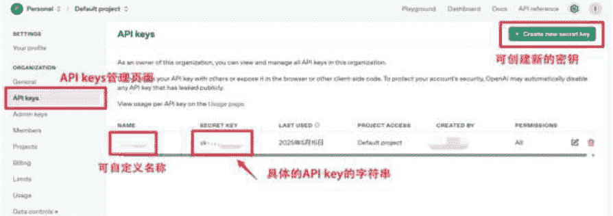

为了保障调用安全，我们通常不建议将key直接硬编码在脚本中，而是通过环境变量的方式进行管理与加载。如图2.2所示，在“系统属性”中单击“环境变量”按钮，在“系统变量”下单击“新建”按钮即可创建新的系统变量。变量名可以自行命名，建议采用“平台名_API_KEY”的命名方式以便区分；变量值填写API key，单击“确定”按钮即可保存并使用。

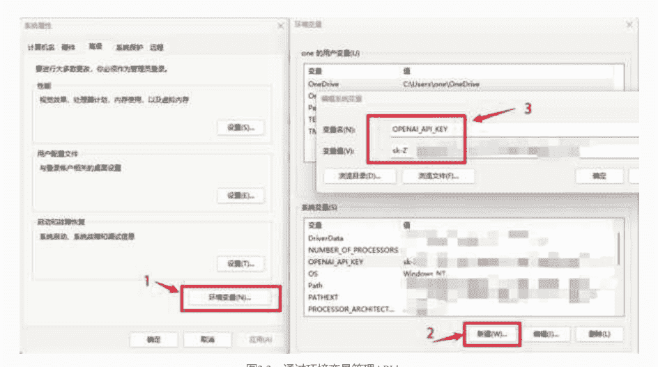

然后我们使用如下代码在程序中加载API key。

```python
import os
api_key = os.getenv("OPENAI_API_KEY")
```

#### 2.2.2 在线大模型API调用基本方法

在获取API key后，开发者就可以通过编程的方式调用在线大模型服务，构建属于自己的问答接口、智能体模块或生成任务系统。尽管不同平台的API设计略有差异，但主流大模型的调用方式已逐渐趋于标准化，尤其是在对话生成任务中，大多数平台提供了OpenAI格式兼容的Chat接口。

在线大模型的基本调用流程通常包括以下几个核心步骤。

- (1) 设置访问参数：包括API key、安全认证、基础地址（base_url）等。
- (2) 构建请求内容：构造对话上下文，包括messages字段中的多轮对话历史。
- (3) 指定模型名称：不同平台支持的模型名称不同，需按官方文档传入。
- (4) 设置可选参数：如温度（temperature）、最大生成长度（max_tokens）、top_p等。
- (5) 发送请求并解析返回内容。

执行如下命令安装OpenAI SDK。

```bash
pip install openai
```

以OpenAI官方库为例，执行如下代码即可调用。

```python
import openai
import os

openai.api_key = os.getenv("OPENAI_API_KEY")
openai.api_base = "https://api.openai.com/v1"

response = openai.ChatCompletion.create(
    model="gpt-4o",  # 替换为目标平台支持的模型名称
    messages=[
        {"role": "system", "content": "你是一位 AI 助手。"},
        {"role": "user", "content": "请解释什么是 API。"}
    ],
    temperature=0.7,
    max_tokens=200
)

print(response["choices"][0]["message"]["content"])
```

若使用兼容OpenAI格式的国产模型平台（如DashScope、DeepSeek），只需更换API Base URL和模型名称即可，无须重写调用逻辑。

调用阿里云Qwen模型时，仅需替换如下两项，并填写该平台的API key。

```python
openai.api_base = "https://dashscope.aliyuncs.com/compatible-mode/v1"
model = "qwen-plus"
```

调用DeepSeek模型时仅需替换如下两项，并填写该平台的API key。

```python
openai.api_base = "https://api.deepseek.com/v1"
model = "deepseek-chat"
```

国产模型，如智谱GLM，并非原生兼容OpenAI SDK，需要使用其官方SDK来调用对应的模型。具体的代码通常可以在官方网页的操作手册或GitHub项目中的模型调用示例部分找到。

以智谱为例，先执行如下命令安装官方SDK。

```bash
pip install zhipuai
```

安装完成即可使用如下代码调用GLM-4模型。

### 2.2 在线大模型API调用入门

在主流的大模型服务体系中，绝大多数在线大模型均以API的形式对外开放，开发者可以通过编程方式将其能力嵌入各类应用中。本节将介绍在线大模型API调用的基本流程，包括API key的获取方法、标准调用方式、核心参数含义及常见平台的使用差异，帮助读者快速上手并灵活调用各类大模型在线服务。

#### 2.2.1 在线大模型API key获取指南

在使用在线大模型之前，通常需要获取并配置一组用于身份验证的API key。这是一种访问权限令牌，用于标识调用者身份、管理调用额度、追踪请求来源等，是大多数在线大模型平台进行服务授权的基本机制。

首先需要在API平台完成注册与登录，然后开发者可以前往“密钥管理”或“凭据中心”模块，创建自己的API key（以OpenAI平台为例）。大多数平台支持对key进行自定义命名，生成后将得到一段具备访问权限的字符串，如图2.1所示。

> **注意**
> “网页端大模型应用”与“API开放平台”是两个不同的入口。前者通常指ChatGPT、Claude、文心一言等面向终端用户封装的对话网页或移动App，它们封装了模型底层能力，适合普通用户直接交互。而后者，即API开发平台，则是专门为开发者开放的服务入口，允许用户以代码形式调用底层模型接口，实现个性化开发、系统集成与Agent构建等更高级的应用需求。

图2.1 OpenAI平台API keys管理页面

为了保障调用安全，我们通常不建议将key直接硬编码在脚本中，而是通过环境变量的方式进行管理与加载。如图2.2所示，在“系统属性”中单击“环境变量”按钮，在“系统变量”下单击“新建”按钮即可创建新的系统变量。变量名可以自行命名，建议采用“平台名_API_KEY”的命名方式以便区分；变量值填写API key，单击“确定”按钮即可保存并使用。

图2.2 通过环境变量管理API key

然后我们使用如下代码在程序中加载API key。

```python
import os
api_key = os.getenv("OPENAI_API_KEY")
```

#### 2.2.2 在线大模型API调用基本方法

在获取API key后，开发者就可以通过编程的方式调用在线大模型服务，构建属于自己的问答接口、智能体模块或生成任务系统。尽管不同平台的API设计略有差异，但主流大模型的调用方式已逐渐趋于标准化，尤其是在对话生成任务中，大多数平台提供了OpenAI格式兼容的Chat接口。

在线大模型的基本调用流程通常包括以下几个核心步骤。

1.  设置访问参数：包括API key、安全认证、基础地址（base_url）等。
2.  构建请求内容：构造对话上下文，包括messages字段中的多轮对话历史。
3.  指定模型名称：不同平台支持的模型名称不同，需按官方文档传入。
4.  设置可选参数：如温度（temperature）、最大生成长度（max_tokens）、top_p等。
5.  发送请求并解析返回内容。

执行如下命令安装OpenAI SDK。

```bash
pip install openai
```

以OpenAI官方库为例，执行如下代码即可调用。

```python
import openai
import os

openai.api_key = os.getenv("OPENAI_API_KEY")
openai.api_base = "https://api.openai.com/v1"

response = openai.ChatCompletion.create(
    model="gpt-4o",  # 替换为目标平台支持的模型名称
    messages=[
        {"role": "system", "content": "你是一位 AI 助手。"},
        {"role": "user", "content": "请解释什么是 API。"}
    ],
    temperature=0.7,
    max_tokens=200
)

print(response["choices"][0]["message"]["content"])
```

若使用兼容OpenAI格式的国产模型平台（如DashScope、DeepSeek），只需更换API Base URL和模型名称即可，无须重写调用逻辑。

调用阿里云Qwen模型时，仅需替换如下两项，并填写该平台的API key。

```python
openai.api_base = "https://dashscope.aliyuncs.com/compatible-mode/v1"
model = "qwen-plus"
```

调用DeepSeek模型时仅需替换如下两项，并填写该平台的API key。

```python
openai.api_base = "https://api.deepseek.com/v1"
model = "deepseek-chat"
```

国产模型，如智谱GLM，并非原生兼容OpenAI SDK，需要使用其官方SDK来调用对应的模型。具体的代码通常可以在官方网页的操作手册或GitHub项目中的模型调用示例部分找到。

以智谱为例，先执行如下命令安装官方SDK。

```bash
pip install zhipuai
```

安装完成即可使用如下代码调用GLM-4模型。

```python
from zhipuai import ZhipuAI

# 初始化客户端
client = ZhipuAI(api_key="your_api_key")  # 替换为您的 API key

# 调用 GLM-4 模型
response = client.chat.completions.create(
    model="glm-4",
    messages=[
        {"role": "user", "content": "请你作为童话故事大王，写一篇短篇童话故事，主题是要永远保持一颗善良的心。"}
    ],
    top_p=0.7,
    temperature=0.9,
    stream=False,
    max_tokens=2000,
)

# 输出模型回复
print(response.choices[0].message.content)
```

#### 2.2.3 在线大模型API核心参数详解

主流在线大模型平台在对话类接口的设计上，普遍参考了OpenAI的ChatCompletion风格，因此参数结构高度相似。本节将围绕这些通用参数展开说明，帮助读者更灵活地掌控调用效果。

##### 1. model：指定调用的模型名称

同一系列模型通常包括不同的版本，为了确定具体使用的是哪个模型版本，需要使用model参数（必填）。不同平台支持的名称不同，常见示例如表2.1所示。

表2.1 不同平台支持的模型名称

| 平台 | 模型名称示例 |
| :--- | :--- |
| OpenAI | gpt-3.5-turbo、gpt-4、gpt-4-turbo、gpt-4o |
| DeepSeek | deepseek-chat、deepseek-coder |
| 阿里 DashScope | qwen-turbo、qwen-plus、qwen-max |
| 智谱 BigModel | glm-4、glm-4v |

##### 2. messages：对话历史

messages（必填）是构成对话上下文的主参数，格式为一个字典列表，包含以下三种角色。

1.  system：系统角色，用来定义AI的身份或行为边界。
2.  user：用户输入内容。
3.  assistant：AI的过往回复（用于多轮上下文）。

以下代码展示了一个典型的messages列表，其中包含了两条消息记录。每条记录都指定了发送者的角色（role）以及对应的内容（content）。

```python
messages = [
    {"role": "system", "content": "你是一位精通中英文翻译的语言专家。"},
    {"role": "user", "content": "请将这句话翻译成英文：我爱学习。"}
]
```

##### 3. temperature：生成多样性

temperature参数用于控制模型输出的“随机程度”。在不同模型或平台上，具体的取值范围会有差异，OpenAI的系列模型标称为0.0～2.0，但国内DeepSeek、Qwen、GLM模型的标称范围均为0.0～1.0。

在科学问答、代码编写等任务中通常设定一个接近0的数值，使得模型生成的内容更为确定和保守。在文本故事创作的任务中，通常选择较高的数值，使得生成文本更加灵活、生动和发散。同时通常我们不会取临近最大范围的值，在高温下可能会“跑偏”，出现奇怪句式。

##### 4. max_tokens：回复最大长度限制

max_tokens参数用于限制模型每次响应中最多可生成的token数量（即“输出上限”）。

> **注意**
> 首先需要明确token数并非字符数，单个中文字符可能是多个token。其次，max_tokens参数并非指整个对话的token数，而是指该次响应中最多可生成的内容长度。

不同模型因其上下文窗口大小不同，支持的max_tokens范围也存在差异。max_tokens与messages中历史内容的总token数之和不能超过上下文窗口限制，否则将导致调用失败。当前主流大模型普遍支持高达128K的上下文对话窗口，但实际使用中，大部分token通常被messages部分占用。

若max_tokens设置过高，会占用token配额，可能浪费成本，设置过低则可能导致生成内容被截断，一般简单问答或信息检索设置为100～300，文本摘要或翻译设置为200～512，内容创作设置为800～2000，代码生成或分析设置为500～1500。在实际调用中，读者可以综合考虑上下文长度、生成目标以及平台token成本策略，多次调试以找到最适配的token范围。

##### 5. top_p：核采样策略

top_p（取值范围0.0～1.0）是控制模型生成内容多样性和不确定性的另一个参数。与temperature调整单个token概率分布的方式不同，top_p采用的是“累积分布概率”采样策略，也称为核采样（nucleus sampling）。具体而言，模型会按照候选token的概率从高到低排序，然后累计选择总概率不超过top-p设定的阈值的前若干个token，最后从这个“核集合”中进行采样。

top_p = 1.0代表不进行剪枝，模型在所有token中进行随机采样，生成结果更具创意性但可能不够稳定；top_p = 0.9代表仅从累积概率前90%的token中采样；top_p = 0.1近似于贪婪采样，输出非常稳定且重复性强。

> **注意**
> 通常建议不要同时大幅调整temperature与top_p，避免过度控制导致输出异常。

##### 6. stop：手动指定停止词

stop参数用于控制模型在遇到指定词时提前结束生成，支持字符串或字符串列表，示例如下。

```python
stop=["<END>", "用户："]
```

该方法通常在构建多轮对话、函数调用、角色剧本类任务中较为常见。

虽然主流大模型平台在API设计上大多借鉴了OpenAI的ChatCompletion接口结构，但在使用各平台自家SDK或REST API时，参数名称、格式、默认值及支持范围仍可能存在差异。部分平台将temperature和top_p合并为sampling_config，部分平台将messages替换为prompt，多模态调用中，一些平台增加了image、vision、file_id等字段。因此，当使用平台官方SDK时，建议读者务必查阅对应平台的API文档或SDK手册，以确保参数配置正确、调用行为符合预期。

### 2.2 在线大模型API调用入门

在主流的大模型服务体系中，绝大多数在线大模型均以API的形式对外开放，开发者可以通过编程方式将其能力嵌入各类应用中。本节将介绍在线大模型API调用的基本流程，包括API key的获取方法、标准调用方式、核心参数含义及常见平台的使用差异，帮助读者快速上手并灵活调用各类大模型在线服务。

#### 2.2.1 在线大模型API key获取指南

在使用在线大模型之前，通常需要获取并配置一组用于身份验证的API key。这是一种访问权限令牌，用于标识调用者身份、管理调用额度、追踪请求来源等，是大多数在线大模型平台进行服务授权的基本机制。

首先需要在API平台完成注册与登录，然后开发者可以前往“密钥管理”或“凭据中心”模块，创建自己的API key（以OpenAI平台为例）。大多数平台支持对key进行自定义命名，生成后将得到一段具备访问权限的字符串，如图2.1所示。

> 注意

“网页端大模型应用”与“API开放平台”是两个不同的入口。前者通常指ChatGPT、Claude、文心一言等面向终端用户封装的对话网页或移动App，它们封装了模型底层能力，适合普通用户直接交互。而后者，即API开发平台，则是专门为开发者开放的服务入口，允许用户以代码形式调用底层模型接口，实现个性化开发、系统集成与Agent构建等更高级的应用需求。

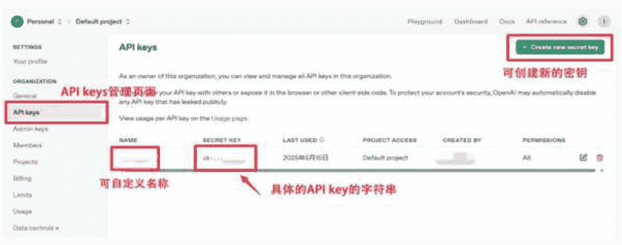

图2.1 OpenAI平台API keys管理页面

为了保障调用安全，我们通常不建议将key直接硬编码在脚本中，而是通过环境变量的方式进行管理与加载。如图2.2所示，在“系统属性”中单击“环境变量”按钮，在“系统变量”下单击“新建”按钮即可创建新的系统变量。变量名可以自行命名，建议采用“平台名_API_KEY”的命名方式以便区分；变量值填写API key，单击“确定”按钮即可保存并使用。


图2.2 通过环境变量管理API key

然后我们使用如下代码在程序中加载API key。

```
import os
api_key = os.getenv("OPENAI_API_KEY")
```

#### 2.2.2 在线大模型API调用基本方法

在获取API key后，开发者就可以通过编程的方式调用在线大模型服务，构建属于自己的问答接口、智能体模块或生成任务系统。尽管不同平台的API设计略有差异，但主流大模型的调用方式已逐渐趋于标准化，尤其是在对话生成任务中，大多数平台提供了OpenAI格式兼容的Chat接口。

在线大模型的基本调用流程通常包括以下几个核心步骤。

1. 设置访问参数：包括API key、安全认证、基础地址（base_url）等。
2. 构建请求内容：构造对话上下文，包括messages字段中的多轮对话历史。
3. 指定模型名称：不同平台支持的模型名称不同，需按官方文档传入。
4. 设置可选参数：如温度（temperature）、最大生成长度（max_tokens）、top_p等。
5. 发送请求并解析返回内容。

执行如下命令安装OpenAI SDK。

```
pip install openai
```

以OpenAI官方库为例，执行如下代码即可调用。

```
import openai
import os

openai.api_key = os.getenv("OPENAI_API_KEY")
openai.api_base = "https://api.openai.com/v1"

response = openai.ChatCompletion.create(
    model="gpt-4o",  # 替换为目标平台支持的模型名称
    messages=[
        {"role": "system", "content": "你是一位 AI 助手。"},
        {"role": "user", "content": "请解释什么是 API。"}
    ],
    temperature=0.7,
    max_tokens=200
)

print(response["choices"][0]["message"]["content"])
```

若使用兼容OpenAI格式的国产模型平台（如DashScope、DeepSeek），只需更换API Base URL和模型名称即可，无须重写调用逻辑。

调用阿里云Qwen模型时，仅需替换如下两项，并填写该平台的API key。

```
openai.api_base = "https://dashscope.aliyuncs.com/compatible-mode/v1"
model = "qwen-plus"
```

调用DeepSeek模型时仅需替换如下两项，并填写该平台的API key。

```
openai.api_base = "https://api.deepseek.com/v1"
model = "deepseek-chat"
```

国产模型，如智谱GLM，并非原生兼容OpenAI SDK，需要使用其官方SDK来调用对应的模型。具体的代码通常可以在官方网页的操作手册或GitHub项目中的模型调用示例部分找到。

以智谱为例，先执行如下命令安装官方SDK。

```
pip install zhipuai
```

安装完成即可使用如下代码调用GLM-4模型。

```
from zhipuai import ZhipuAI

# 初始化客户端
client = ZhipuAI(api_key="your_api_key")  # 替换为您的 API key

# 调用 GLM-4 模型
response = client.chat.completions.create(
    model="glm-4",
    messages=[
        {"role": "user", "content": "请你作为童话故事大王，写一篇短篇童话故事，主题是要永远保持一颗善良的心。"}
    ],
    top_p=0.7,
    temperature=0.9,
    stream=False,
    max_tokens=2000,
)

# 输出模型回复
print(response.choices[0].message.content)
```

#### 2.2.3 在线大模型API核心参数详解

主流在线大模型平台在对话类接口的设计上，普遍参考了OpenAI的ChatCompletion风格，因此参数结构高度相似。本节将围绕这些通用参数展开说明，帮助读者更灵活地掌控调用效果。

##### 1. model：指定调用的模型名称

同一系列模型通常包括不同的版本，为了确定具体使用的是哪个模型版本，需要使用model参数（必填）。不同平台支持的名称不同，常见示例如表2.1所示。

表2.1 不同平台支持的模型名称

| 平台 | 模型名称示例 |
| :--- | :--- |
| OpenAI | gpt-3.5-turbo、gpt-4、gpt-4-turbo、gpt-4o |
| DeepSeek | deepseek-chat、deepseek-coder |
| 阿里 DashScope | qwen-turbo、qwen-plus、qwen-max |
| 智谱 BigModel | glm-4、glm-4v |

##### 2. messages：对话历史

messages（必填）是构成对话上下文的主参数，格式为一个字典列表，包含以下三种角色。

1. system：系统角色，用来定义AI的身份或行为边界。
2. user：用户输入内容。
3. assistant：AI的过往回复（用于多轮上下文）。

以下代码展示了一个典型的messages列表，其中包含了两条消息记录。每条记录都指定了发送者的角色（role）以及对应的内容（content）。

```
messages = [
    {"role": "system", "content": "你是一位精通中英文翻译的语言专家。"},
    {"role": "user", "content": "请将这句话翻译成英文：我爱学习。"}
]
```

##### 3. temperature：生成多样性

temperature参数用于控制模型输出的“随机程度”。在不同模型或平台上，具体的取值范围会有差异，OpenAI的系列模型标称为0.0～2.0，但国内DeepSeek、Qwen、GLM模型的标称范围均为0.0～1.0。

在科学问答、代码编写等任务中通常设定一个接近0的数值，使得模型生成的内容更为确定和保守。在文本故事创作的任务中，通常选择较高的数值，使得生成文本更加灵活、生动和发散。同时通常我们不会取临近最大范围的值，在高温下可能会“跑偏”，出现奇怪句式。

##### 4. max_tokens：回复最大长度限制

max_tokens参数用于限制模型每次响应中最多可生成的token数量（即“输出上限”）。

> **注意**

首先需要明确token数并非字符数，单个中文字符可能是多个token。其次，max_tokens参数并非指整个对话的token数，而是指该次响应中最多可生成的内容长度。

不同模型因其上下文窗口大小不同，支持的max_tokens范围也存在差异。max_tokens与messages中历史内容的总token数之和不能超过上下文窗口限制，否则将导致调用失败。当前主流大模型普遍支持高达128K的上下文对话窗口，但实际使用中，大部分token通常被messages部分占用。

若max_tokens设置过高，会占用token配额，可能浪费成本，设置过低则可能导致生成内容被截断，一般简单问答或信息检索设置为100～300，文本摘要或翻译设置为200～512，内容创作设置为800～2000，代码生成或分析设置为500～1500。在实际调用中，读者可以综合考虑上下文长度、生成目标以及平台token成本策略，多次调试以找到最适配的token范围。

##### 5. top_p：核采样策略

top_p（取值范围0.0～1.0）是控制模型生成内容多样性和不确定性的另一个参数。与temperature调整单个token概率分布的方式不同，top_p采用的是“累积分布概率”采样策略，也称为核采样（nucleus sampling）。具体而言，模型会按照候选token的概率从高到低排序，然后累计选择总概率不超过top_p设定的阈值的前若干个token，最后从这个“核集合”中进行采样。

top_p = 1.0代表不进行剪枝，模型在所有token中进行随机采样，生成结果更具创意性但可能不够稳定；top_p = 0.9代表仅从累积概率前90%的token中采样；top_p = 0.1近似于贪婪采样，输出非常稳定且重复性强。

> **注意**
通常建议不要同时大幅调整temperature与top_p，避免过度控制导致输出异常。

##### 6. stop：手动指定停止词

stop参数用于控制模型在遇到指定词时提前结束生成，支持字符串或字符串列表，示例如下。

```
stop=["<END>", "用户："]
```

该方法通常在构建多轮对话、函数调用、角色剧本类任务中较为常见。

虽然主流大模型平台在API设计上大多借鉴了OpenAI的ChatCompletion接口结构，但在使用各平台自家SDK或REST API时，参数名称、格式、默认值及支持范围仍可能存在差异。部分平台将temperature和top_p合并为sampling_config，部分平台将messages替换为prompt，多模态调用中，一些平台增加了image、vision、file_id等字段。因此，当使用平台官方SDK时，建议读者务必查阅对应平台的API文档或SDK手册，以确保参数配置正确、调用行为符合预期。

##### 6. stop：手动指定停止词

stop参数用于控制模型在遇到指定词时提前结束生成，支持字符串或字符串列表，示例如下。

```
stop=["<END>", "用户："]
```

该方法通常在构建多轮对话、函数调用、角色剧本类任务中较为常见。

虽然主流大模型平台在API设计上大多借鉴了OpenAI的ChatCompletion接口结构，但在使用各平台自家SDK或REST API时，参数名称、格式、默认值及支持范围仍可能存在差异。部分平台将temperature和top_p合并为sampling_config，部分平台将messages替换为prompt，多模态调用中，一些平台增加了image、vision、file_id等字段。因此，当使用平台官方SDK时，建议读者务必查阅对应平台的API文档或SDK手册，以确保参数配置正确、调用行为符合预期。

### 2.3 本地大模型部署及使用

本节将围绕本地部署的核心流程，系统介绍部署所需算力资源与环境依赖，涵盖模型下载、推理测试等关键环节，并与当前主流的第三方部署工具进行对比，为后续Agent开发提供坚实的运行基础。

#### 2.3.1 本地大模型部署需求概览

在实际大模型应用中，由于数据安全、访问稳定性、成本控制、模型可控性等多方面的需求，越来越多的开发者和企业选择将大模型部署在本地或私有云环境。本地部署不仅能实现对模型推理过程的控制，降低隐私敏感数据泄露风险，减少接口服务的长期费用，还能提高响应速度并支持离线运行。与此同时，本地部署也意味着更高的资源门槛与工程复杂度，需要开发者在动手部署前对以下几个关键需求做好全面评估。

##### 1. 算力资源

在所有本地部署条件中，算力资源（尤其是GPU）是成功运行大语言模型的决定性因素。虽然在某些轻量场景下也可尝试使用CPU进行模拟推理，但其速度与效率远低于GPU，且对于中大型模型基本不可行。因此，部署大模型首先必须具备相应规模的GPU硬件。

> **说明**
>
> 为什么不能只用CPU？
>
> 大语言模型的推理过程涉及十亿级参数的矩阵计算，尤其在多层Transformer架构中，存在大量矩阵乘法、归一化、注意力计算等高强度并行计算任务。GPU在处理并行数值计算方面具有显著优势，而CPU更擅长逻辑控制与串行任务。在同等条件下，CPU推理速度可能仅为GPU的1/100至1/10。

在推理场景下不同模型参数规模对应的显存需求如表2.2所示。

**表2.2 不同模型参数规模对应的显存需求**

| 模型规模 | 推理时显存需求（FP16） | 支持的典型GPU（单卡） |
| :--- | :--- | :--- |
| 7B | 14GB～16GB | RTX 3090 / 4090 / A500 |
| 13B | 26GB～30GB | RTX 4090（24GB）基本可运行 |
| 33B | 60GB～80GB | 多卡 A100 或 2×4090 并行 |

若采用量化（如INT4、INT8、GPTQ等技术），模型推理时所需的显存通常可减少1/4～1/2。以7B规模模型为例，FP16推理需14GB～16GB显存，INT4量化后推理只需4GB～6GB显存，可在单张RTX3060/4060甚至笔记本计算机的GPU上运行。

当前大模型训练或推理绝大多数基于NVIDIA GPU，因为其具备成熟的CUDA+cuDNN+PyTorch支持体系。大模型领域的主流GPU型号如表2.3所示。

| 类型 | 常见型号 | 适用说明 |
| :--- | :--- | :--- |
| 数据中心级 | A100, H100, A800, L40S | 高稳定性、高带宽，适合部署集群 |
| 消费级高端 | RTX 3090, 4090, 4080 | 适合个人开发与小模型推理 |
| 云租用平台 GPU | Tesla V100, T4 | 支持量化模型，成本可控 |

若本地没有GPU设备，读者可租用云平台算力进行实验或开发。AutoDL、阿里云PAI、百度飞桨Studio、Google Colab都提供在线GPU的租赁服务。

##### 2. 操作系统与环境依赖

在硬件资源充分的前提下，还需要配置相应的操作系统与软件依赖栈。以下是部署主流PyTorch/Hugging Face风格模型所需的通用环境说明。

1) 操作系统

建议优先使用Ubuntu作为本地部署系统，其稳定且兼容CUDA的Linux发行版，全面支持NVIDIA工具链。虽然CentOS和Windows搭配WSL2也可以运行部分大模型，但并不推荐在正式的生产环境中部署，会存在一定的兼容问题。

2) 软件依赖环境（PyTorch栈）

系统运行所需的软件依赖环境及安装说明如表2.4所示。

| 组件 | 推荐版本 | 安装说明 |
| :--- | :--- | :--- |
| Python | ≥ 3.9 | 建议使用 Conda 虚拟环境隔离 |
| PyTorch | ≥ 2.0 | 需安装 GPU 版本（pip/conda 安装） |
| CUDA | 11.8 / 12.1 | 与 PyTorch 安装包版本匹配 |
| cuDNN | 对应 CUDA 版本 | NVIDIA 官网下载安装或驱动自带 |
| Transformers | ≥ 4.35 | Hugging Face 的核心推理库 |

##### 3. 模型格式支持

选择模型部署前，开发者需确认目标模型是否提供开放权重、支持格式类型以及是否有量化版本。几类主流模型格式如表2.5所示。

**表2.5 主流模型格式**

| 格式类型 | 常见后缀 | 说明 | 适用部署框架 |
| :--- | :--- | :--- | :--- |
| 原始 PyTorch 格式 | .bin | Transformers 默认格式，文件较大，占用显存高 | Transformers/vLLM/TGI |
| 安全张量格式 | .safetensors | 安全、加载更快、支持并发加载的张量格式 | Transformers/vLLM/TGI |
| 量化格式-INT4 | .bin, .pt (压缩) | 通常通过 GPTQ/AWQ 等量化工具压缩后发布 | AutoAWQ/GPTQ-for-LLaMA/vLLM |
| 量化格式-GGUF | .gguf | llama.cpp/Ollama 使用的统一格式，支持 CPU/GPU 部署 | llama.cpp/Ollama/KoboldCpp |

如果选定了需要使用的大模型，需要确认该模型是否开源，是否提供Hugging Face或GitHub地址，是否发布INT4/INT8/GGUF等格式版本，是否有官方或社区推荐部署脚本或Docker镜像。

#### 2.3.2 本地大模型部署通用步骤

在大多数开源大模型项目中，官方或社区团队往往会在GitHub上提供完整的项目代码、推理脚本和部署工具链，使得本地部署过程可以遵循一套相对固定、可复用的实践路径。基于Transformers架构的主流开源模型的通用部署流程如下。

##### 1. 配置基础环境，创建虚拟环境

执行如下命令，使用Conda创建独立Python虚拟环境，确保依赖隔离、版本可控。

```
conda create -n llm-deploy python=3.10 -y
conda activate llm-deploy
```

命令中-n后为自定义的虚拟环境名称，在创建虚拟环境时需要同步指定虚拟环境的Python版本。

运行如下命令安装基础依赖，如PyTorch（根据CUDA版本选择GPU支持版）。

```
pip install torch torchvision torchaudio --index-url https://download.pytorch.org/whl/cu118
```

##### 2. 从GitHub克隆开源项目

大多数开源大模型都在GitHub上提供示例推理脚本、模型加载与测试代码、API服务部署相关代码、一键安装依赖的requirements.txt文件。运行如下代码即可从GitHub克隆对应的开源项目。

```
git clone https://github.com/deepseek-ai/DeepSeek-LLM.git
```

也可以在网页端下载zip格式的项目压缩包，在本地解压缩后使用。获取完整项目后，运行如下命令即可进入项目文件夹并一键安装所需依赖。

```
cd DeepSeek-LLM
pip install -r requirements.txt
```

> **说明**
>
> 模型的GitHub项目并非模型调用的必要依赖。
>
> 对于Hugging Face上发布的模型，开发者可以完全通过Transformers接口加载权重并完成本地推理，无须克隆其官方仓库。通常，我们克隆官方GitHub项目，是为了获取以下附加内容。
>
> - 模型推荐的依赖版本（如requirements.txt）。
> - 官方提供的测试脚本或推理样例。
> - API服务部署方式（如FastAPI、Gradio）。
> - Docker容器镜像与部署指令。
> - 与模型结构高度耦合的工程化调用逻辑（如多模态组件、定制tokenizer）。
>
> 但如果你已经熟悉Hugging Face的模型调用方式，并清楚如何配置依赖环境，完全可以脱离GitHub项目，仅下载模型权重与tokenizer，即可完成调用与部署。这种方式更轻量、灵活，适合有经验的开发者快速将模型集成到现有系统中。

##### 3. 下载模型权重

多数模型权重托管在Hugging Face或魔搭社区（ModelScope），可通过Transformers自动加载，或手动预下载到本地。

（1）通过Hugging Face Transformers自动下载并加载。

```
from transformers import AutoTokenizer, AutoModelForCausalLM

model_id = "deepseek-ai/deepseek-llm-7b-base"
tokenizer = AutoTokenizer.from_pretrained(model_id)
model = AutoModelForCausalLM.from_pretrained(model_id, torch_dtype="auto").cuda()
```

首次加载时模型会自动下载到本地缓存目录（通常为 ~/.cache/huggingface），后续加载将自动读取缓存。

（2）使用ModelScope官方工具包自动加载。使用前需执行如下命令安装官方工具包。

```
pip install modelscope
```

运行如下代码即可加载对应模型。

```
from modelscope import AutoTokenizer, AutoModelForCausalLM

model_id = "Qwen/Qwen-7B-Chat"
model = AutoModelForCausalLM.from_pretrained(model_id, revision='v1.0.0')
tokenizer = AutoTokenizer.from_pretrained(model_id, revision='v1.0.0')
```

模型的具体名称可在官网查看，如图2.3所示。


（3）从网页手动下载模型权重并离线加载。在Hugging Face和ModelScope的官方网站模型页面，切换到Files and versions或模型文件选项卡，点击右侧的“下载”按钮保存所有文件，如图2.4所示。存放到本地目录后，在推理脚本中指定pretrained_model_name_or_path="./your_model_dir"即可。

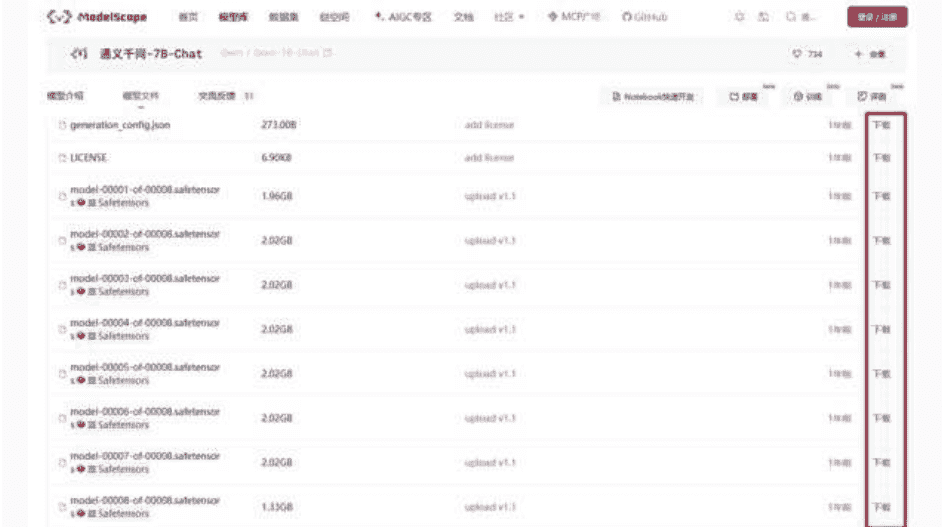

这里可以看到模型权重的后缀是.safetensors，对照表2.5可知，这是安全张量格式，适用于Transformers、vLLM、TGI的部署方式。

##### 4. 加载模型并进行本地推理测试

下载模型权重后，在本地加载模型并进行一次简单的推理验证。这一步可以帮助我们确认模型是否成功加载、显存是否充足、生成是否正常、所选部署框架是否兼容模型格式。

1）标准模型加载与推理测试（FP16）

如果你的模型是.bin或.safetensors格式的标准权重，并具备GPU环境，可以使用如下方式完成加载与推理。

```
from transformers import AutoModelForCausalLM, AutoTokenizer
import torch

# 模型路径：可为 Hugging Face ID 或本地文件夹
model_path = "./checkpoints"  # 或 "deepseek-ai/deepseek-llm-7b-base"

tokenizer = AutoTokenizer.from_pretrained(model_path)
model = AutoModelForCausalLM.from_pretrained(
    model_path,
    torch_dtype=torch.float16,  # 推荐使用半精度加载以节省显存
    device_map="auto"  # 自动将模型映射到可用 GPU
)

prompt = "请简要介绍 Transformer 模型的基本结构。"
inputs = tokenizer(prompt, return_tensors="pt").to(model.device)
outputs = model.generate(**inputs, max_new_tokens=200)
print(tokenizer.decode(outputs[0], skip_special_tokens=True))
```

2）加载量化模型（如INT4）

你若使用的是经过量化的模型（如bitsandbytes格式的4bit INT4模型），则可以使用以下方式。

```
from transformers import AutoModelForCausalLM, AutoTokenizer, BitsAndBytesConfig

bnb_config = BitsAndBytesConfig(load_in_4bit=True, bnb_4bit_compute_dtype=torch.float16)

tokenizer = AutoTokenizer.from_pretrained(model_path)
model = AutoModelForCausalLM.from_pretrained(
    model_path,
    quantization_config=bnb_config,
    device_map="auto"
)
```

INT4模型不支持torch_dtype参数，需使用quantization_config管理精度。

3）官方推理脚本

除了通过Transformers库自行加载模型进行推理，大多数开源大模型在GitHub项目中也会提供官方发布的推理样例脚本，帮助用户快速验证模型效果。

#### 2.3.3 GLM大模型本地部署指南

智谱AI推出的GLM-4系列在开源社区中表现出色，具备良好的中文理解与生成能力，而且官方提供了完整的本地部署支持文档，适合开发者在私有环境中进行推理测试与服务化部署。下面我们将以GLM-4-9B-Chat模型为例，演示其从环境配置到本地部署的完整流程。

##### 1. 配置基础环境，创建虚拟环境

- 显卡推荐：1张RTX 3090/4090（≥24GB显存）；如使用INT4量化版本，显存需求可降低到6GB~8GB。
- 操作系统：推荐使用Linux系统，如Ubuntu 20.04或Ubuntu 22.04。
- Python环境：建议使用Conda创建虚拟环境，Python版本不低于3.9。运行如下命令创建虚拟环境。

```
conda create -n glm4 python=3.10 -y
conda activate glm4
```

运行如下命令安装必要的torch和transformers库。

```
pip install torch torchvision torchaudio --index-url https://download.pytorch.org/whl/cu118
pip install transformers tiktoken
```

安装完成后，可运行如下代码确认是否安装成功。

```
import torch
torch.cuda.is_available()
```

如果输出如下内容，则可正常使用。

```
True
```

##### 2. 从GitHub克隆开源项目

查看GLM-4模型的GitHub开源项目目录结构，如图2.5所示。


该项目的inference子目录是本地部署和测试的关键，其中包含了丰富的推理入口脚本。运行如下命令克隆仓库并进入项目目录。

```
git clone https://github.com/THUDM/GLM-4.git
cd GLM-4
```

查看图2.5所示的项目结构，可以发现项目依赖安装清单requirements.txt文件在inference子目录下，运行如下命令进入该子目录，并安装项目所需依赖。

```
cd inference
pip install -r requirements.txt
```

##### 3. 下载GLM-4模型权重

通过modelscope下载模型需要预先安装其官方库。

```
pip install modelscope
```

可在网页端查看模型权重情况，如图2.6所示。

### 2.3 本地大模型部署及使用

本节将围绕本地部署的核心流程，系统介绍部署所需算力资源与环境依赖，涵盖模型下载、推理测试等关键环节，并与当前主流的第三方部署工具进行对比，为后续Agent开发提供坚实的运行基础。

#### 2.3.1 本地大模型部署需求概览

在实际大模型应用中，由于数据安全、访问稳定性、成本控制、模型可控性等多方面的需求，越来越多的开发者和企业选择将大模型部署在本地或私有云环境。本地部署不仅能实现对模型推理过程的控制，降低隐私敏感数据泄露风险，减少接口服务的长期费用，还能提高响应速度并支持离线运行。与此同时，本地部署也意味着更高的资源门槛与工程复杂度，需要开发者在动手部署前对以下几个关键需求做好全面评估。

##### 1. 算力资源

在所有本地部署条件中，算力资源（尤其是GPU）是成功运行大语言模型的决定性因素。虽然在某些轻量场景下也可尝试使用CPU进行模拟推理，但其速度与效率远低于GPU，且对于中大型模型基本不可行。因此，部署大模型首先必须具备相应规模的GPU硬件。

> **说明**
>
> 为什么不能只用CPU？
>
> 大语言模型的推理过程涉及十亿级参数的矩阵计算，尤其在多层Transformer架构中，存在大量矩阵乘法、归一化、注意力计算等高强度并行计算任务。GPU在处理并行数值计算方面具有显著优势，而CPU更擅长逻辑控制与串行任务。在同等条件下，CPU推理速度可能仅为GPU的1/100至1/10。

在推理场景下不同模型参数规模对应的显存需求如表2.2所示。

**表2.2 不同模型参数规模对应的显存需求**

| 模型规模 | 推理时显存需求（FP16） | 支持的典型GPU（单卡） |
| :--- | :--- | :--- |
| 7B | 14GB～16GB | RTX 3090 / 4090 / A500 |
| 13B | 26GB～30GB | RTX 4090（24GB）基本可运行 |
| 33B | 60GB～80GB | 多卡 A100 或 2×4090 并行 |

若采用量化（如INT4、INT8、GPTQ等技术），模型推理时所需的显存通常可减少1/4～1/2。以7B规模模型为例，FP16推理需14GB～16GB显存，INT4量化后推理只需4GB～6GB显存，可在单张RTX3060/4060甚至笔记本计算机的GPU上运行。

当前大模型训练或推理绝大多数基于NVIDIA GPU，因为其具备成熟的CUDA+cuDNN+PyTorch支持体系。大模型领域的主流GPU型号如表2.3所示。

**表2.3 大模型领域主流GPU型号**

| 类型 | 常见型号 | 适用说明 |
| :--- | :--- | :--- |
| 数据中心级 | A100, H100, A800, L40S | 高稳定性、高带宽，适合部署集群 |
| 消费级高端 | RTX 3090, 4090, 4080 | 适合个人开发与小模型推理 |
| 云租用平台 GPU | Tesla V100, T4 | 支持量化模型，成本可控 |

若本地没有GPU设备，读者可租用云平台算力进行实验或开发。AutoDL、阿里云PAI、百度飞桨Studio、Google Colab都提供在线GPU的租赁服务。

##### 2. 操作系统与环境依赖

在硬件资源充分的前提下，还需要配置相应的操作系统与软件依赖栈。以下是部署主流PyTorch/Hugging Face风格模型所需的通用环境说明。

1) 操作系统

建议优先使用Ubuntu作为本地部署系统，其稳定且兼容CUDA的Linux发行版，全面支持NVIDIA工具链。虽然CentOS和Windows搭配WSL2也可以运行部分大模型，但并不推荐在正式的生产环境中部署，会存在一定的兼容问题。

2) 软件依赖环境（PyTorch栈）

系统运行所需的软件依赖环境及安装说明如表2.4所示。

**表2.4 软件依赖环境及安装说明**

| 组件 | 推荐版本 | 安装说明 |
| :--- | :--- | :--- |
| Python | ≥ 3.9 | 建议使用 Conda 虚拟环境隔离 |
| PyTorch | ≥ 2.0 | 需安装 GPU 版本（pip/conda 安装） |
| CUDA | 11.8 / 12.1 | 与 PyTorch 安装包版本匹配 |
| cuDNN | 对应 CUDA 版本 | NVIDIA 官网下载安装或驱动自带 |
| Transformers | ≥ 4.35 | Hugging Face 的核心推理库 |

### 2.3.2 GLM-4-9B-Chat模型本地部署指南

图2.6 glm-4-9b-chat模型权重情况

接下来，导入modelscope库，运行如下代码，下载模型权重。

```python
from modelscope import snapshot_download

# 模型下载
model_dir = snapshot_download('ZhipuAI/glm-4-9b-chat')
```

下载完成后，我们打印model_dir即可查看模型权重本地存储的路径。

```python
print(model_dir)
```

输出内容如下。

```
'/root/autodl-tmp/glm-4-9b-chat'
```

#### 1. 使用transformers后端进行推理

（1）在单卡服务器下运行如下代码。

```python
import torch
from modelscope import AutoModelForCausalLM, AutoTokenizer

# 设置设备为 CUDA（GPU），以加速计算
device = "cuda"

# 从预训练模型目录加载分词器，并信任远程代码
tokenizer = AutoTokenizer.from_pretrained(model_dir, trust_remote_code=True)

# 定义用户的输入
query = "你好"

# 使用聊天模板应用分词器，并生成输入张量
inputs = tokenizer.apply_chat_template(
    [{"role": "user", "content": query}],  # 用户角色和输入内容
    add_generation_prompt=True,              # 添加生成提示
    tokenize=True,                           # 执行分词
    return_tensors="pt",                     # 返回 PyTorch 张量
    return_dict=True                         # 返回字典形式
)

# 将输入张量移动到指定设备（CUDA）
inputs = inputs.to(device)

# 从预训练模型目录加载下载到本地的大模型，并信任远程代码
model = AutoModelForCausalLM.from_pretrained(
    model_dir,
    torch_dtype=torch.bfloat16,              # 使用 bfloat16 数据类型以减少内存使用
    trust_remote_code=True                   # 信任远程代码
).to(device).eval()                          # 将模型移动到 CUDA 设备并设置为评估模式

# 定义生成文本的参数
gen_kwargs = {
    "max_length": 2500,                     # 生成文本的最大长度
    "do_sample": True,                      # 是否进行采样
    "top_k": 1                              # 采样时考虑的最高概率的 k 个标记
}

# 在不计算梯度的上下文中生成文本
with torch.no_grad():
    # 生成模型的输出
    outputs = model.generate(**inputs, **gen_kwargs)
    # 截取生成的输出，去除输入的部分
    outputs = outputs[:, inputs['input_ids'].shape[1]:]
    # 解码生成的输出并去除特殊标记
    print(tokenizer.decode(outputs[0], skip_special_tokens=True))
```

输出内容如下。

```
Special tokens have been added in the vocabulary, make sure the associated word embeddings are fine-tuned or trained.
Loading checkpoint shards:  0%|          | 0/10 [00:00<?, ?it/s]
你好👋！很高兴见到你，有什么可以帮助你的吗？
```

（2）使用官方封装的推理脚本。如图2.6所示，inference子目录下有封装好的可用于推理的脚本文件。运行如下命令可在终端上与模型进行对话。

```bash
python trans_cli_demo.py
```

运行如下命令可使用Gradio网页端与模型进行对话。

```bash
python trans_web_demo.py
```

### 2.3.3 Qwen大模型本地部署指南

2025年4月29日，阿里开源通义千问模型Qwen3，其中，Qwen3-235B-A22B在代码、数学、通用能力等基准测试中，与DeepSeek-R1、o1、o3-mini、Grok-3和Gemini-2.5-Pro等顶级模型相比，表现出极具竞争力的结果。本次同步开源了全尺寸稠密与混合专家模型：0.6B、1.7B、4B、8B、14B、32B，以及30B-A3B、235B-A22B。

下面我们将以Qwen3-14B模型为例，演示其从环境配置到本地部署的完整流程。

##### 1. 配置基础环境，创建虚拟环境

- 显卡推荐：1张RTX 3090 / 4090（≥24GB显存）。
- 操作系统：推荐使用Linux系统，如Ubuntu 20.04或Ubuntu 22.04。
- Python环境：建议使用Conda创建虚拟环境，Python版本不低于3.9。

运行如下代码，创建虚拟环境。

```bash
conda create --n qwen3 python=3.11
conda activate qwen3
```

运行如下代码，安装torch和transformers库。

```bash
pip install torch torchvision torchaudio --index-url https://download.pytorch.org/whl/cu118
pip install transformers tiktoken
```

运行如下代码，确认torch和transformers库是否安装成功。

```python
import torch
torch.cuda.is_available()
```

如果输出如下内容，则可正常使用。

```
True
```

##### 2. 从GitHub克隆开源项目

查看Qwen3模型的GitHub开源项目，其目录结构如图2.7所示。

Qwen3作为完全基于Transformers的开源模型，在GitHub项目目录结构中没有显示requirements.txt文件，表示它默认继承了Hugging Face的依赖结构，因此，一般只需运行如下命令安装。

```bash
pip install torch transformers accelerate sentencepiece

# 用于 INT4 模型量化推理
pip install bitsandbytes
```

##### 3. 下载Qwen3模型权重

借助modelscope下载模型需要先运行如下命令安装库。

```bash
pip install modelscope
```

可在网页端先查看模型权重情况，如图2.8所示。

接下来，导入modelscope库，运行如下命令下载模型权重。

```bash
cd /root/autodl-tmp/Qwen3
mkdir ./Qwen3-14B
modelscope download --model Qwen/Qwen3-14B --local_dir ./Qwen3-14B
```

##### 4. 在Jupyter中使用transformer原生库的调用流程

(1) 导入相关库。

```python
from modelscope import AutoModelForCausalLM, AutoTokenizer
```

(2) 设置模型下载地址。

```python
model_name = "./Qwen3-14B"
```

(3) 实例化预训练模型与分词器。

```python
tokenizer = AutoTokenizer.from_pretrained(model_name)
model = AutoModelForCausalLM.from_pretrained(
    model_name,
    torch_dtype="auto",  # 指定模型权重数据类型
    device_map="auto"  # 指定模型权重加载设备
)
```

(4) 创建消息message。

```python
prompt = "给出一个关于大语言模型的简短介绍。"
messages = [
    {"role": "user", "content": prompt}
]
```

(5) 创建词嵌入过程。

```python
text = tokenizer.apply_chat_template(
    messages,
    tokenize=False,
    add_generation_prompt=True,
    enable_thinking=True  # 是否启用思考模式
)
model_inputs = tokenizer([text], return_tensors="pt").to(model.device)
```

（6）创建模型并给出大模型回复。

```python
# 进行文本补全
generated_ids = model.generate(
    **model_inputs,
    max_new_tokens=32768
)
output_ids = generated_ids[0][len(model_inputs.input_ids[0]):].tolist()

# 结果将首先显示标签中，然后是实际响应
print(tokenizer.decode(output_ids, skip_special_tokens=True))
```

输出内容如图2.9所示。

通过 enable_thinking 参数决定是否启用思考模式，如果要禁用则需要将 enable_thinking=True改为False即可。

### 2.3.4 第三方集成部署工具

在部署本地大模型时，除了使用Transformers等基础库直接加载模型权重外，开发者还可以选择一些高性能、工程化程度更高的第三方部署工具。这些工具在模型加载优化、推理速度提升、API服务化、多模型托管等方面具有显著优势，特别适用于对性能、可维护性、并发能力要求较高的企业级或产品级场景。

##### 1. SGLang：智谱推出的GLM系列专用推理框架

SGLang是由智谱AI发布的开源推理与服务框架，专为GLM系列模型（如GLM-4、ChatGLM）优化，原生支持对话模板、多轮历史缓存、函数调用（Function Calling）、结构化输出等能力。

SGLang的核心特点如下。

- 与GLM模型结构高度适配，支持multi-turn memory。
- 支持并发调度与动态上下文构建。
- 内置类OpenAI的API接口。
- 可结合fastapi/uvicorn快速部署服务。

##### 2. LMDeploy：国产模型轻量部署工具

LMDeploy是由昆仑芯与魔搭社区联合开发的推理部署框架，目标是为国产开源大模型提供统一、简洁、高性能的部署方案。它支持INT4/INT8/FP16等多精度推理，并集成一键脚本、服务启动、QPS压测等功能。

LMDeploy的核心特点如下。

- 支持Qwen、Baichuan、InternLM等众多国产模型。
- 原生适配INT4推理，显存需求低。
- 提供完整的CLI、Web UI、HTTP API。
- 支持多线程调度与批量推理。

##### 3. vLLM：高并发、OpenAI兼容的服务部署利器

vLLM是由UC Berkeley发布的高性能推理引擎，支持动态批量调度、连续批处理、FlashAttention 2，并实现了完全兼容OpenAI API协议的服务接口。

vLLM的核心特点如下。

- 支持Hugging Face格式模型（LLaMA、Qwen、Baichuan等）。
- 实现了高吞吐推理（可达数千token/s）。
- 支持stream输出（流式生成）。
- 原生兼容chat/completions接口格式。

##### 4. Ollama：开发者友好的一键本地部署平台

Ollama是一个面向开发者的轻量部署工具，支持下载、管理和运行GGUF格式的大模型，如LLaMA 2/3、Mistral、Qwen、Phi等，目标是“本地部署像用Docker一样简单”。

Ollama的核心特点如下。

- 自动下载、注册模型（不需显式权重管理）。
- 支持Mac/Windows/Linux系统。
- 内置HTTP API与CLI，快速调用。
- 支持CPU和GPU，支持stream输出。
- 与llama.cpp系统一致，兼容GGUF格式。

以上工具代表了当前主流的本地大模型部署解决方案，涵盖了不同模型结构、硬件资源和应用场景的需求。在本节中，我们对这些工具进行了简要梳理，便于读者了解其基本特性与使用方式。

##### 3. 模型格式支持

选择模型部署前，开发者需确认目标模型是否提供开放权重、支持格式类型以及是否有量化版本。几类主流模型格式如表2.5所示。

表2.5 主流模型格式

| 格式类型 | 常见后缀 | 说明 | 适用部署框架 |
| :--- | :--- | :--- | :--- |
| 原始 PyTorch 格式 | .bin | Transformers 默认格式，文件较大，占用显存高 | Transformers/vLLM/TGI |
| 安全张量格式 | .safetensors | 安全、加载更快、支持并发加载的张量格式 | Transformers/vLLM/TGI |
| 量化格式-INT4 | .bin, .pt (压缩) | 通常通过 GPTQ/AWQ 等量化工具压缩后发布 | AutoAWQ/GPTQ-for-LLaMA/vLLM |
| 量化格式-GGUF | .gguf | llama.cpp/Ollama 使用的统一格式，支持 CPU/GPU 部署 | llama.cpp/Ollama/KoboldCpp |

如果选定了需要使用的大模型，需要确认该模型是否开源，是否提供Hugging Face或GitHub地址，是否发布INT4/INT8/GGUF等格式版本，是否有官方或社区推荐部署脚本或Docker镜像。

#### 2.3.2 本地大模型部署通用步骤

在大多数开源大模型项目中，官方或社区团队往往会在GitHub上提供完整的项目代码、推理脚本和部署工具链，使得本地部署过程可以遵循一套相对固定、可复用的实践路径。基于Transformers架构的主流开源模型的通用部署流程如下。

##### 1. 配置基础环境，创建虚拟环境

执行如下命令，使用Conda创建独立Python虚拟环境，确保依赖隔离、版本可控。

```
conda create -n llm-deploy python=3.10 -y
conda activate llm-deploy
```

命令中-n后为自定义的虚拟环境名称，在创建虚拟环境时需要同步指定虚拟环境的Python版本。

运行如下命令安装基础依赖，如PyTorch（根据CUDA版本选择GPU支持版）。

```
pip install torch torchvision torchaudio --index-url https://download.pytorch.org/whl/cu118
```

##### 2. 从GitHub克隆开源项目

大多数开源大模型都在GitHub上提供示例推理脚本、模型加载与测试代码、API服务部署相关代码、一键安装依赖的requirements.txt文件。运行如下代码即可从GitHub克隆对应的开源项目。

```
git clone https://github.com/deepseek-ai/DeepSeek-LLM.git
```

也可以在网页端下载zip格式的项目压缩包，在本地解压缩后使用。获取完整项目后，运行如下命令即可进入项目文件夹并一键安装所需依赖。

```
cd DeepSeek-LLM
pip install -r requirements.txt
```

### 说明

模型的GitHub项目并非模型调用的必要依赖。

对于Hugging Face上发布的模型，开发者可以完全通过Transformers接口加载权重并完成本地推理，无须克隆其官方仓库。通常，我们克隆官方GitHub项目，是为了获取以下附加内容。

- 模型推荐的依赖版本（如requirements.txt）。
- 官方提供的测试脚本或推理样例。
- API服务部署方式（如FastAPI、Gradio）。
- Docker容器镜像与部署指令。
- 与模型结构高度耦合的工程化调用逻辑（如多模态组件、定制tokenizer）。

但如果你已经熟悉Hugging Face的模型调用方式，并清楚如何配置依赖环境，完全可以脱离GitHub项目，仅下载模型权重与tokenizer，即可完成调用与部署。这种方式更轻量、灵活，适合有经验的开发者快速将模型集成到现有系统中。

##### 3. 下载模型权重

多数模型权重托管在Hugging Face或魔搭社区（ModelScope），可通过Transformers自动加载，或手动预下载到本地。

(1) 通过Hugging Face Transformers自动下载并加载。

```
from transformers import AutoTokenizer, AutoModelForCausalLM

model_id = "deepseek-ai/deepseek-llm-7b-base"
tokenizer = AutoTokenizer.from_pretrained(model_id)
model = AutoModelForCausalLM.from_pretrained(model_id, torch_dtype="auto").cuda()
```

首次加载时模型会自动下载到本地缓存目录（通常为 ~/.cache/huggingface），后续加载将自动读取缓存。

(2) 使用ModelScope官方工具包自动加载。使用前需执行如下命令安装官方工具包。

```
pip install modelscope
```

运行如下代码即可加载对应模型。

```
from modelscope import AutoTokenizer, AutoModelForCausalLM

model_id = "Qwen/Qwen-7B-Chat"
model = AutoModelForCausalLM.from_pretrained(model_id, revision='v1.0.0')
tokenizer = AutoTokenizer.from_pretrained(model_id, revision='v1.0.0')
```

模型的具体名称可在官网查看，如图2.3所示。


（3）从网页手动下载模型权重并离线加载。在Hugging Face和ModelScope的官方网站模型页面，切换到Files and versions或模型文件选项卡，点击右侧的“下载”按钮保存所有文件，如图 2.4 所示。存放到本地目录后，在推理脚本中指定pretrained_model_name_or_path="./your_model_dir"即可。


这里可以看到模型权重的后缀是.safetensors，对照表2.5可知，这是安全张量格式，适用于Transformers、vLLM、TGI的部署方式。

##### 4. 加载模型并进行本地推理测试

下载模型权重后，在本地加载模型并进行一次简单的推理验证。这一步可以帮助我们确认模型是否成功加载、显存是否充足、生成是否正常、所选部署框架是否兼容模型格式。

1）标准模型加载与推理测试（FP16）

如果你的模型是.bin或.safetensors格式的标准权重，并具备GPU环境，可以使用如下方式完成加载与推理。

```
from transformers import AutoModelForCausalLM, AutoTokenizer
import torch

# 模型路径：可为 Hugging Face ID 或本地文件夹
model_path = "./checkpoints"  # 或 "deepseek-ai/deepseek-llm-7b-base"

tokenizer = AutoTokenizer.from_pretrained(model_path)
model = AutoModelForCausalLM.from_pretrained(
    model_path,
    torch_dtype=torch.float16,  # 推荐使用半精度加载以节省显存
    device_map="auto"  # 自动将模型映射到可用 GPU
)

prompt = "请简要介绍 Transformer 模型的基本结构。"
inputs = tokenizer(prompt, return_tensors="pt").to(model.device)
outputs = model.generate(**inputs, max_new_tokens=200)
print(tokenizer.decode(outputs[0], skip_special_tokens=True))
```

2）加载量化模型（如INT4）

你若使用的是经过量化的模型（如bitsandbytes格式的4bit INT4模型），则可以使用以下方式。

```
from transformers import AutoModelForCausalLM, AutoTokenizer, BitsAndBytesConfig

bnb_config = BitsAndBytesConfig(load_in_4bit=True, bnb_4bit_compute_dtype=torch.float16)

tokenizer = AutoTokenizer.from_pretrained(model_path)
model = AutoModelForCausalLM.from_pretrained(
    model_path,
    quantization_config=bnb_config,
    device_map="auto"
)
```

INT4模型不支持torch_dtype参数，需使用quantization_config管理精度。

3）官方推理脚本

除了通过Transformers库自行加载模型进行推理，大多数开源大模型在GitHub项目中也会提供官方发布的推理样例脚本，帮助用户快速验证模型效果。

#### 2.3.3 GLM大模型本地部署指南

智谱AI推出的GLM-4系列在开源社区中表现出色，具备良好的中文理解与生成能力，而且官方提供了完整的本地部署支持文档，适合开发者在私有环境中进行推理测试与服务化部署。下面我们将以GLM-4-9B-Chat模型为例，演示其从环境配置到本地部署的完整流程。

##### 1. 配置基础环境，创建虚拟环境

- 显卡推荐：1张RTX 3090/4090（≥24GB显存）；如使用INT4量化版本，显存需求可降低到6GB~8GB。
- 操作系统：推荐使用Linux系统，如Ubuntu 20.04或Ubuntu 22.04。
- Python环境：建议使用Conda创建虚拟环境，Python版本不低于3.9。运行如下命令创建虚拟环境。

```
conda create -n glm4 python=3.10 -y
conda activate glm4
```

运行如下命令安装必要的torch和transformers库。

```
pip install torch torchvision torchaudio --index-url https://download.pytorch.org/whl/cu118
pip install transformers tiktoken
```

安装完成后，可运行如下代码确认是否安装成功。

```
import torch
torch.cuda.is_available()
```

如果输出如下内容，则可正常使用。

```
True
```

##### 2. 从GitHub克隆开源项目

查看GLM-4模型的GitHub开源项目目录结构，如图2.5所示。


该项目的inference子目录是本地部署和测试的关键，其中包含了丰富的推理入口脚本。运行如下命令克隆仓库并进入项目目录。

```
git clone https://github.com/THUDM/GLM-4.git
cd GLM-4
```

查看图2.5所示的项目结构，可以发现项目依赖安装清单requirements.txt文件在inference子目录下，运行如下命令进入该子目录，并安装项目所需依赖。

```
cd inference
pip install -r requirements.txt
```

##### 3. 下载GLM-4模型权重

通过modelscope下载模型需要预先安装其官方库。

```
!pip install modelscope
```

可在网页端查看模型权重情况，如图2.6所示。


图2.6 glm-4-9b-chat模型权重情况

接下来，导入modelscope库，运行如下代码，下载模型权重。

```
from modelscope import snapshot_download

#模型下载
model_dir = snapshot_download('ZhipuAI/glm-4-9b-chat')
```

下载完成后，我们打印model_dir即可查看模型权重本地存储的路径。

```
print (model_dir)
```

输出内容如下。

```
'/root/autodl-tmp/glm-4-9b-chat'
```

##### 4. 使用transformers后端进行推理

（1）在单卡服务器下运行如下代码。

```
python
import torch
from modelscope import AutoModelForCausalLM, AutoTokenizer

#设置设备为 CUDA（GPU），以加速计算
device = "cuda"

#从预训练模型目录加载分词器，并信任远程代码
tokenizer = AutoTokenizer.from_pretrained(model_dir, trust_remote_code=True)

#定义用户的输入
query = "你好"

#使用聊天模板应用分词器，并生成输入张量
inputs = tokenizer.apply_chat_template(
    [{"role": "user", "content": query}],  # 用户角色和输入内容
    add_generation_prompt=True,              # 添加生成提示
    tokenize=True,                           # 执行分词
    return_tensors="pt",                     # 返回 PyTorch 张量
    return_dict=True                         # 返回字典形式
)

#将输入张量移动到指定设备（CUDA）
inputs = inputs.to(device)

#从预训练模型目录加载下载到本地的大模型，并信任远程代码
model = AutoModelForCausalLM.from_pretrained(
    model_dir,
    torch_dtype=torch.bfloat16,              # 使用 bfloat16 数据类型以减少内存使用
    trust_remote_code=True                   # 信任远程代码
).to(device).eval()                          # 将模型移动到 CUDA 设备并设置为评估模式

#定义生成文本的参数
gen_kwargs = {
    "max_length": 2500,                     # 生成文本的最大长度
    "do_sample": True,                      # 是否进行采样
    "top_k": 1                              # 采样时考虑的最高概率的 k 个标记
}

#在不计算梯度的上下文中生成文本
with torch.no_grad():
    #生成模型的输出
    outputs = model.generate(**inputs, **gen_kwargs)
    #截取生成的输出，去除输入的部分
    outputs = outputs[:, inputs['input_ids'].shape[1]:]
    #解码生成的输出并去除特殊标记
    print(tokenizer.decode(outputs[0], skip_special_tokens=True))
```

输出内容如下。

```
Special tokens have been added in the vocabulary, make sure the associated word embeddings are fine-tuned or trained.
Loading checkpoint shards:  0%|          | 0/10 [00:00<?, ?it/s]
你好👋！很高兴见到你，有什么可以帮助你的吗？
```

（2）使用官方封装的推理脚本。如图2.6所示，inference子目录下有封装好的可用于推理的脚本文件。运行如下命令可在终端上与模型进行对话。

```
bash
python trans_cli_demo.py
```

运行如下命令可使用Gradio网页端与模型进行对话。

```
bash
python trans_web_demo.py
```

#### 2.3.4 Qwen大模型本地部署指南

2025年4月29日，阿里开源通义千问模型Qwen3，其中，Qwen3-235B-A22B在代码、数学、通用能力等基准测试中，与DeepSeek-R1、o1、o3-mini、Grok-3和Gemini-2.5-Pro等顶级模型相比，表现出极具竞争力的结果。本次同步开源了全尺寸稠密与混合专家模型：0.6B、1.7B、4B、8B、14B、32B，以及30B-A3B、235B-A22B。

下面我们将以Qwen3-14B模型为例，演示其从环境配置到本地部署的完整流程。

##### 1. 配置基础环境，创建虚拟环境

- 显卡推荐：1张RTX 3090 / 4090（≥24GB显存）。
- 操作系统：推荐使用Linux系统，如Ubuntu 20.04或Ubuntu 22.04。
- Python环境：建议使用Conda创建虚拟环境，Python版本不低于3.9。

运行如下代码，创建虚拟环境。

```
conda create --n qwen3 python=3.11
conda activate qwen3
```

运行如下代码，安装torch和transformers库。

```
pip install torch torchvision torchaudio --index-url https://download.pytorch.org/whl/cu118
pip install transformers tiktoken
```

运行如下代码，确认torch和transformers库是否安装成功。

```
import torch
torch.cuda.is_available()
```

如果输出如下内容，则可正常使用。

```
True
```

##### 2. 从GitHub克隆开源项目

查看Qwen3模型的GitHub开源项目，其目录结构如图2.7所示。

### 2.3 本地大模型部署及使用

本节将围绕本地部署的核心流程，系统介绍部署所需算力资源与环境依赖，涵盖模型下载、推理测试等关键环节，并与当前主流的第三方部署工具进行对比，为后续Agent开发提供坚实的运行基础。

#### 2.3.1 本地大模型部署需求概览

在实际大模型应用中，由于数据安全、访问稳定性、成本控制、模型可控性等多方面的需求，越来越多的开发者和企业选择将大模型部署在本地或私有云环境。本地部署不仅能实现对模型推理过程的控制，降低隐私敏感数据泄露风险，减少接口服务的长期费用，还能提高响应速度并支持离线运行。与此同时，本地部署也意味着更高的资源门槛与工程复杂度，需要开发者在动手部署前对以下几个关键需求做好全面评估。

##### 1. 算力资源

在所有本地部署条件中，算力资源（尤其是GPU）是成功运行大语言模型的决定性因素。虽然在某些轻量场景下也可尝试使用CPU进行模拟推理，但其速度与效率远低于GPU，且对于中大型模型基本不可行。因此，部署大模型首先必须具备相应规模的GPU硬件。

> **说明**
>
> 为什么不能只用CPU？
>
> 大语言模型的推理过程涉及十亿级参数的矩阵计算，尤其在多层Transformer架构中，存在大量矩阵乘法、归一化、注意力计算等高强度并行计算任务。GPU在处理并行数值计算方面具有显著优势，而CPU更擅长逻辑控制与串行任务。在同等条件下，CPU推理速度可能仅为GPU的1/100至1/10。

在推理场景下不同模型参数规模对应的显存需求如表2.2所示。

**表2.2 不同模型参数规模对应的显存需求**

| 模型规模 | 推理时显存需求（FP16） | 支持的典型GPU（单卡） |
| :--- | :--- | :--- |
| 7B | 14GB～16GB | RTX 3090 / 4090 / A500 |
| 13B | 26GB～30GB | RTX 4090（24GB）基本可运行 |
| 33B | 60GB～80GB | 多卡 A100 或 2×4090 并行 |

若采用量化（如INT4、INT8、GPTQ等技术），模型推理时所需的显存通常可减少1/4～1/2。以7B规模模型为例，FP16推理需14GB～16GB显存，INT4量化后推理只需4GB～6GB显存，可在单张RTX3060/4060甚至笔记本计算机的GPU上运行。

当前大模型训练或推理绝大多数基于NVIDIA GPU，因为其具备成熟的CUDA+cuDNN+PyTorch支持体系。大模型领域的主流GPU型号如表2.3所示。

| 类型 | 常见型号 | 适用说明 |
| :--- | :--- | :--- |
| 数据中心级 | A100, H100, A800, L40S | 高稳定性、高带宽，适合部署集群 |
| 消费级高端 | RTX 3090, 4090, 4080 | 适合个人开发与小模型推理 |
| 云租用平台 GPU | Tesla V100, T4 | 支持量化模型，成本可控 |

若本地没有GPU设备，读者可租用云平台算力进行实验或开发。AutoDL、阿里云PAI、百度飞桨Studio、Google Colab都提供在线GPU的租赁服务。

##### 2. 操作系统与环境依赖

在硬件资源充分的前提下，还需要配置相应的操作系统与软件依赖栈。以下是部署主流PyTorch/Hugging Face风格模型所需的通用环境说明。

1) 操作系统

建议优先使用Ubuntu作为本地部署系统，其稳定且兼容CUDA的Linux发行版，全面支持NVIDIA工具链。虽然CentOS和Windows搭配WSL2也可以运行部分大模型，但并不推荐在正式的生产环境中部署，会存在一定的兼容问题。

2) 软件依赖环境（PyTorch栈）

系统运行所需的软件依赖环境及安装说明如表2.4所示。

| 组件 | 推荐版本 | 安装说明 |
| :--- | :--- | :--- |
| Python | ≥ 3.9 | 建议使用 Conda 虚拟环境隔离 |
| PyTorch | ≥ 2.0 | 需安装 GPU 版本（pip/conda 安装） |
| CUDA | 11.8 / 12.1 | 与 PyTorch 安装包版本匹配 |
| cuDNN | 对应 CUDA 版本 | NVIDIA 官网下载安装或驱动自带 |
| Transformers | ≥ 4.35 | Hugging Face 的核心推理库 |

##### 3. 模型格式支持

选择模型部署前，开发者需确认目标模型是否提供开放权重、支持格式类型以及是否有量化版本。几类主流模型格式如表2.5所示。

**表2.5 主流模型格式**

| 格式类型 | 常见后缀 | 说明 | 适用部署框架 |
| :--- | :--- | :--- | :--- |
| 原始 PyTorch 格式 | .bin | Transformers 默认格式，文件较大，占用显存高 | Transformers/vLLM/TGI |
| 安全张量格式 | .safetensors | 安全、加载更快、支持并发加载的张量格式 | Transformers/vLLM/TGI |
| 量化格式-INT4 | .bin, .pt (压缩) | 通常通过 GPTQ/AWQ 等量化工具压缩后发布 | AutoAWQ/GPTQ-for-LLaMA/vLLM |
| 量化格式-GGUF | .gguf | llama.cpp/Ollama 使用的统一格式，支持 CPU/GPU 部署 | llama.cpp/Ollama/KoboldCpp |

如果选定了需要使用的大模型，需要确认该模型是否开源，是否提供Hugging Face或GitHub地址，是否发布INT4/INT8/GGUF等格式版本，是否有官方或社区推荐部署脚本或Docker镜像。

#### 2.3.2 本地大模型部署通用步骤

在大多数开源大模型项目中，官方或社区团队往往会在GitHub上提供完整的项目代码、推理脚本和部署工具链，使得本地部署过程可以遵循一套相对固定、可复用的实践路径。基于Transformers架构的主流开源模型的通用部署流程如下。

##### 1. 配置基础环境，创建虚拟环境

执行如下命令，使用Conda创建独立Python虚拟环境，确保依赖隔离、版本可控。

```
conda create -n llm-deploy python=3.10 -y
conda activate llm-deploy
```

命令中-n后为自定义的虚拟环境名称，在创建虚拟环境时需要同步指定虚拟环境的Python版本。

运行如下命令安装基础依赖，如PyTorch（根据CUDA版本选择GPU支持版）。

```
pip install torch torchvision torchaudio --index-url https://download.pytorch.org/whl/cu118
```

##### 2. 从GitHub克隆开源项目

大多数开源大模型都在GitHub上提供示例推理脚本、模型加载与测试代码、API服务部署相关代码、一键安装依赖的requirements.txt文件。运行如下代码即可从GitHub克隆对应的开源项目。

```
git clone https://github.com/deepseek-ai/DeepSeek-LLM.git
```

也可以在网页端下载zip格式的项目压缩包，在本地解压缩后使用。获取完整项目后，运行如下命令即可进入项目文件夹并一键安装所需依赖。

```
cd DeepSeek-LLM
pip install -r requirements.txt
```

> **说明**
>
> 模型的GitHub项目并非模型调用的必要依赖。
>
> 对于Hugging Face上发布的模型，开发者可以完全通过Transformers接口加载权重并完成本地推理，无须克隆其官方仓库。通常，我们克隆官方GitHub项目，是为了获取以下附加内容。
>
> - 模型推荐的依赖版本（如requirements.txt）。
> - 官方提供的测试脚本或推理样例。
> - API服务部署方式（如FastAPI、Gradio）。
> - Docker容器镜像与部署指令。
> - 与模型结构高度耦合的工程化调用逻辑（如多模态组件、定制tokenizer）。
>
> 但如果你已经熟悉Hugging Face的模型调用方式，并清楚如何配置依赖环境，完全可以脱离GitHub项目，仅下载模型权重与tokenizer，即可完成调用与部署。这种方式更轻量、灵活，适合有经验的开发者快速将模型集成到现有系统中。

##### 3. 下载模型权重

多数模型权重托管在Hugging Face或魔搭社区（ModelScope），可通过Transformers自动加载，或手动预下载到本地。

(1) 通过Hugging Face Transformers自动下载并加载。

```
from transformers import AutoTokenizer, AutoModelForCausalLM

model_id = "deepseek-ai/deepseek-llm-7b-base"
tokenizer = AutoTokenizer.from_pretrained(model_id)
model = AutoModelForCausalLM.from_pretrained(model_id, torch_dtype="auto").cuda()
```

首次加载时模型会自动下载到本地缓存目录（通常为 ~/.cache/huggingface），后续加载将自动读取缓存。

(2) 使用ModelScope官方工具包自动加载。使用前需执行如下命令安装官方工具包。

```
pip install modelscope
```

运行如下代码即可加载对应模型。

```
from modelscope import AutoTokenizer, AutoModelForCausalLM

model_id = "Qwen/Qwen-7B-Chat"
model = AutoModelForCausalLM.from_pretrained(model_id, revision='v1.0.0')
tokenizer = AutoTokenizer.from_pretrained(model_id, revision='v1.0.0')
```

模型的具体名称可在官网查看，如图2.3所示。

（3）从网页手动下载模型权重并离线加载。在Hugging Face和ModelScope的官方网站模型页面，切换到Files and versions或模型文件选项卡，点击右侧的“下载”按钮保存所有文件，如图2.4所示。存放到本地目录后，在推理脚本中指定pretrained_model_name_or_path="./your_model_dir"即可。

这里可以看到模型权重的后缀是.safetensors，对照表2.5可知，这是安全张量格式，适用于Transformers、vLLM、TGI的部署方式。

Qwen3作为完全基于Transformers的开源模型，在GitHub项目目录结构中没有显示requirements.txt文件，表示它默认继承了Hugging Face的依赖结构，因此，一般只需运行如下命令安装。

```
bash
pip install torch transformers accelerate sentencepiece

# 用于 INT4 模型量化推理
pip install bitsandbytes
```

##### 3. 下载Qwen3模型权重

借助modelscope下载模型需要先运行如下命令安装库。

```
bash
!pip install modelscope
```

可在网页端先查看模型权重情况，如图2.8所示。

图2.8 Qwen3-14B模型权重情况

接下来，导入modelscope库，运行如下命令下载模型权重。

```
bash
cd /root/autodl-tmp/Qwen3
mkdir ./Qwen3-14B
modelscope download --model Qwen/Qwen3-14B --local_dir ./Qwen3-14B
```

##### 4. 在Jupyter中使用transformer原生库的调用流程

(1) 导入相关库。

```
python
from modelscope import AutoModelForCausalLM, AutoTokenizer
```

(2) 设置模型下载地址。

```
python
model_name = "./Qwen3-14B"
```

(3) 实例化预训练模型与分词器。

```
python
tokenizer = AutoTokenizer.from_pretrained(model_name)
model = AutoModelForCausalLM.from_pretrained(
    model_name,
    torch_dtype="auto",  # 指定模型权重数据类型
    device_map="auto"  # 指定模型权重加载设备
)
```

(4) 创建消息message。

```
python
prompt = "给出一个关于大语言模型的简短介绍。"
messages = [
    {"role": "user", "content": prompt}
]
```

(5) 创建词嵌入过程。

```
python
text = tokenizer.apply_chat_template(
    messages,
    tokenize=False,
    add_generation_prompt=True,
    enable_thinking=True  # 是否启用思考模式
)
model_inputs = tokenizer([text], return_tensors="pt").to(model.device)
```

（6）创建模型并给出大模型回复。

```
python
# 进行文本补全
generated_ids = model.generate(
    **model_inputs,
    max_new_tokens=32768
)
output_ids = generated_ids[0][len(model_inputs.input_ids[0]):].tolist()

# 结果将首先显示思考内容标签中，然后是实际响应
print(tokenizer.decode(output_ids, skip_special_tokens=True))
```

输出内容如图2.9所示。

通过 enable_thinking 参数决定是否启用思考模式，如果要禁用则需要将 enable_thinking=True改为False即可。

#### 2.3.5 第三方集成部署工具

在部署本地大模型时，除了使用Transformers等基础库直接加载模型权重外，开发者还可以选择一些高性能、工程化程度更高的第三方部署工具。这些工具在模型加载优化、推理速度提升、API服务化、多模型托管等方面具有显著优势，特别适用于对性能、可维护性、并发能力要求较高的企业级或产品级场景。

##### 1. SGLang：智谱推出的GLM系列专用推理框架

SGLang是由智谱AI发布的开源推理与服务框架，专为GLM系列模型（如GLM-4、ChatGLM）优化，原生支持对话模板、多轮历史缓存、函数调用（Function Calling）、结构化输出等能力。

SGLang的核心特点如下。

- 与GLM模型结构高度适配，支持multi-turn memory。
- 支持并发调度与动态上下文构建。
- 内置类OpenAI的API接口。
- 可结合fastapi/uvicorn快速部署服务。

##### 2. LMDeploy：国产模型轻量部署工具

LMDeploy是由昆仑芯与魔搭社区联合开发的推理部署框架，目标是为国产开源大模型提供统一、简洁、高性能的部署方案。它支持INT4/INT8/FP16等多精度推理，并集成一键脚本、服务启动、QPS压测等功能。

LMDeploy的核心特点如下。

- 支持Qwen、Baichuan、InternLM等众多国产模型。
- 原生适配INT4推理，显存需求低。
- 提供完整的CLI、Web UI、HTTP API。
- 支持多线程调度与批量推理。

##### 3. vLLM：高并发、OpenAI兼容的服务部署利器

vLLM是由UC Berkeley发布的高性能推理引擎，支持动态批量调度、连续批处理、FlashAttention 2，并实现了完全兼容OpenAI API协议的服务接口。

vLLM的核心特点如下。

- 支持Hugging Face格式模型（LLaMA、Qwen、Baichuan等）。
- 实现了高吞吐推理（可达数千token/s）。
- 支持stream输出（流式生成）。
- 原生兼容chat/completions接口格式。

##### 4. Ollama：开发者友好的一键本地部署平台

Ollama是一个面向开发者的轻量部署工具，支持下载、管理和运行GGUF格式的大模型，如LLaMA 2/3、Mistral、Qwen、Phi等，目标是“本地部署像用Docker一样简单”。

Ollama的核心特点如下。

- 自动下载、注册模型（不需显式权重管理）。
- 支持Mac/Windows/Linux系统。
- 内置HTTP API与CLI，快速调用。
- 支持CPU和GPU，支持stream输出。
- 与llama.cpp系统一致，兼容GGUF格式。

以上工具代表了当前主流的本地大模型部署解决方案，涵盖了不同模型结构、硬件资源和应用场景的需求。在本节中，我们对这些工具进行了简要梳理，便于读者了解其基本特性与使用方式。

##### 4. 加载模型并进行本地推理测试

下载模型权重后，在本地加载模型并进行一次简单的推理验证。这一步可以帮助我们确认模型是否成功加载、显存是否充足、生成是否正常、所选部署框架是否兼容模型格式。

1）标准模型加载与推理测试（FP16）

如果你的模型是.bin或.safetensors格式的标准权重，并具备GPU环境，可以使用如下方式完成加载与推理。

```python
from transformers import AutoModelForCausalLM, AutoTokenizer
import torch

# 模型路径：可为 Hugging Face ID 或本地文件夹
model_path = "./checkpoints"  # 或 "deepseek-ai/deepseek-llm-7b-base"

tokenizer = AutoTokenizer.from_pretrained(model_path)
model = AutoModelForCausalLM.from_pretrained(
    model_path,
    torch_dtype=torch.float16,  # 推荐使用半精度加载以节省显存
    device_map="auto"  # 自动将模型映射到可用 GPU
)

prompt = "请简要介绍 Transformer 模型的基本结构。"
inputs = tokenizer(prompt, return_tensors="pt").to(model.device)
outputs = model.generate(**inputs, max_new_tokens=200)
print(tokenizer.decode(outputs[0], skip_special_tokens=True))
```

2）加载量化模型（如INT4）

你若使用的是经过量化的模型（如bitsandbytes格式的4bit INT4模型），则可以使用以下方式。

```python
from transformers import AutoModelForCausalLM, AutoTokenizer, BitsAndBytesConfig

bnb_config = BitsAndBytesConfig(load_in_4bit=True, bnb_4bit_compute_dtype=torch.float16)

tokenizer = AutoTokenizer.from_pretrained(model_path)
model = AutoModelForCausalLM.from_pretrained(
    model_path,
    quantization_config=bnb_config,
    device_map="auto"
)
```

INT4模型不支持torch_dtype参数，需使用quantization_config管理精度。

3）官方推理脚本

除了通过Transformers库自行加载模型进行推理，大多数开源大模型在GitHub项目中也会提供官方发布的推理样例脚本，帮助用户快速验证模型效果。

#### 2.3.3 GLM大模型本地部署指南

智谱AI推出的GLM-4系列在开源社区中表现出色，具备良好的中文理解与生成能力，而且官方提供了完整的本地部署支持文档，适合开发者在私有环境中进行推理测试与服务化部署。下面我们将以GLM-4-9B-Chat模型为例，演示其从环境配置到本地部署的完整流程。

##### 1. 配置基础环境，创建虚拟环境

- 显卡推荐：1张RTX 3090/4090（≥24GB显存）；如使用INT4量化版本，显存需求可降低到6GB~8GB。
- 操作系统：推荐使用Linux系统，如Ubuntu 20.04或Ubuntu 22.04。
- Python环境：建议使用Conda创建虚拟环境，Python版本不低于3.9。运行如下命令创建虚拟环境。

```bash
conda create -n glm4 python=3.10 -y
conda activate glm4
```

运行如下命令安装必要的torch和transformers库。

```bash
pip install torch torchvision torchaudio --index-url https://download.pytorch.org/whl/cu118
pip install transformers tiktoken
```

安装完成后，可运行如下代码确认是否安装成功。

```python
import torch
torch.cuda.is_available()
```

如果输出如下内容，则可正常使用。

```
True
```

##### 2. 从GitHub克隆开源项目

查看GLM-4模型的GitHub开源项目目录结构，如图2.5所示。

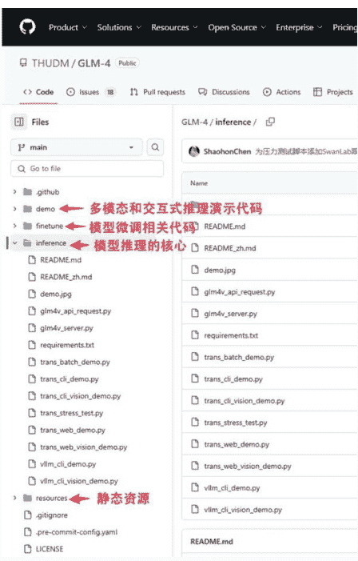

该项目的inference子目录是本地部署和测试的关键，其中包含了丰富的推理入口脚本。运行如下命令克隆仓库并进入项目目录。

```bash
git clone https://github.com/THUDM/GLM-4.git
cd GLM-4
```

查看图2.5所示的项目结构，可以发现项目依赖安装清单requirements.txt文件在inference子目录下，运行如下命令进入该子目录，并安装项目所需依赖。

```bash
cd inference
pip install -r requirements.txt
```

##### 3. 下载GLM-4模型权重

通过modelscope下载模型需要预先安装其官方库。

```bash
pip install modelscope
```

可在网页端查看模型权重情况，如图2.6所示。


图2.6 glm-4-9b-chat模型权重情况

接下来，导入modelscope库，运行如下代码，下载模型权重。

```python
from modelscope import snapshot_download

#模型下载
model_dir = snapshot_download('ZhipuAI/glm-4-9b-chat')
```

下载完成后，我们打印model_dir即可查看模型权重本地存储的路径。

```python
print(model_dir)
```

输出内容如下。

```
'/root/autodl-tmp/glm-4-9b-chat'
```

##### 4. 使用transformers后端进行推理

（1）在单卡服务器下运行如下代码。

```python
import torch
from modelscope import AutoModelForCausalLM, AutoTokenizer

#设置设备为 CUDA（GPU），以加速计算
device = "cuda"

#从预训练模型目录加载分词器，并信任远程代码
tokenizer = AutoTokenizer.from_pretrained(model_dir, trust_remote_code=True)

#定义用户的输入
query = "你好"

#使用聊天模板应用分词器，并生成输入张量
inputs = tokenizer.apply_chat_template(
    [{"role": "user", "content": query}],  # 用户角色和输入内容
    add_generation_prompt=True,              # 添加生成提示
    tokenize=True,                           # 执行分词
    return_tensors="pt",                     # 返回 PyTorch 张量
    return_dict=True                         # 返回字典形式
)

#将输入张量移动到指定设备（CUDA）
inputs = inputs.to(device)

#从预训练模型目录加载下载到本地的大模型，并信任远程代码
model = AutoModelForCausalLM.from_pretrained(
    model_dir,
    torch_dtype=torch.bfloat16,              # 使用 bfloat16 数据类型以减少内存使用
    trust_remote_code=True                   # 信任远程代码
).to(device).eval()                          # 将模型移动到 CUDA 设备并设置为评估模式

#定义生成文本的参数
gen_kwargs = {
    "max_length": 2500,                     # 生成文本的最大长度
    "do_sample": True,                      # 是否进行采样
    "top_k": 1                              # 采样时考虑的最高概率的 k 个标记
}

#在不计算梯度的上下文中生成文本
with torch.no_grad():
    #生成模型的输出
    outputs = model.generate(**inputs, **gen_kwargs)
    #截取生成的输出，去除输入的部分
    outputs = outputs[:, inputs['input_ids'].shape[1]:]
    #解码生成的输出并去除特殊标记
    print(tokenizer.decode(outputs[0], skip_special_tokens=True))
```

输出内容如下。

```
Special tokens have been added in the vocabulary, make sure the associated word embeddings are fine-tuned or trained.
Loading checkpoint shards:  0%|          | 0/10 [00:00<?, ?it/s]
你好👋！很高兴见到你，有什么可以帮助你的吗？
```

（2）使用官方封装的推理脚本。如图2.6所示，inference子目录下有封装好的可用于推理的脚本文件。运行如下命令可在终端上与模型进行对话。

```bash
python trans_cli_demo.py
```

运行如下命令可使用Gradio网页端与模型进行对话。

```bash
python trans_web_demo.py
```

#### 2.3.4 Qwen大模型本地部署指南

2025年4月29日，阿里开源通义千问模型Qwen3，其中，Qwen3-235B-A22B在代码、数学、通用能力等基准测试中，与DeepSeek-R1、o1、o3-mini、Grok-3和Gemini-2.5-Pro等顶级模型相比，表现出极具竞争力的结果。本次同步开源了全尺寸稠密与混合专家模型：0.6B、1.7B、4B、8B、14B、32B，以及30B-A3B、235B-A22B。

下面我们将以Qwen3-14B模型为例，演示其从环境配置到本地部署的完整流程。

##### 1. 配置基础环境，创建虚拟环境

- 显卡推荐：1张RTX 3090 / 4090（≥24GB显存）。
- 操作系统：推荐使用Linux系统，如Ubuntu 20.04或Ubuntu 22.04。
- Python环境：建议使用Conda创建虚拟环境，Python版本不低于3.9。

运行如下代码，创建虚拟环境。

```bash
conda create --n qwen3 python=3.11
conda activate qwen3
```

运行如下代码，安装torch和transformers库。

```bash
pip install torch torchvision torchaudio --index-url https://download.pytorch.org/whl/cu118
pip install transformers tiktoken
```

运行如下代码，确认torch和transformers库是否安装成功。

```python
import torch
torch.cuda.is_available()
```

如果输出如下内容，则可正常使用。

```
True
```

##### 2. 从GitHub克隆开源项目

查看Qwen3模型的GitHub开源项目，其目录结构如图2.7所示。

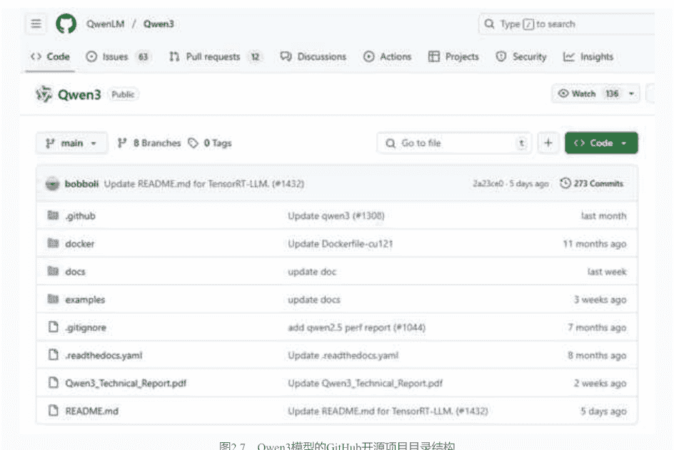

Qwen3作为完全基于Transformers的开源模型，在GitHub项目目录结构中没有显示requirements.txt文件，表示它默认继承了Hugging Face的依赖结构，因此，一般只需运行如下命令安装。

```bash
pip install torch transformers accelerate sentencepiece

# 用于 INT4 模型量化推理
pip install bitsandbytes
```

##### 3. 下载Qwen3模型权重

借助modelscope下载模型需要先运行如下命令安装库。

```bash
pip install modelscope
```

可在网页端先查看模型权重情况，如图2.8所示。

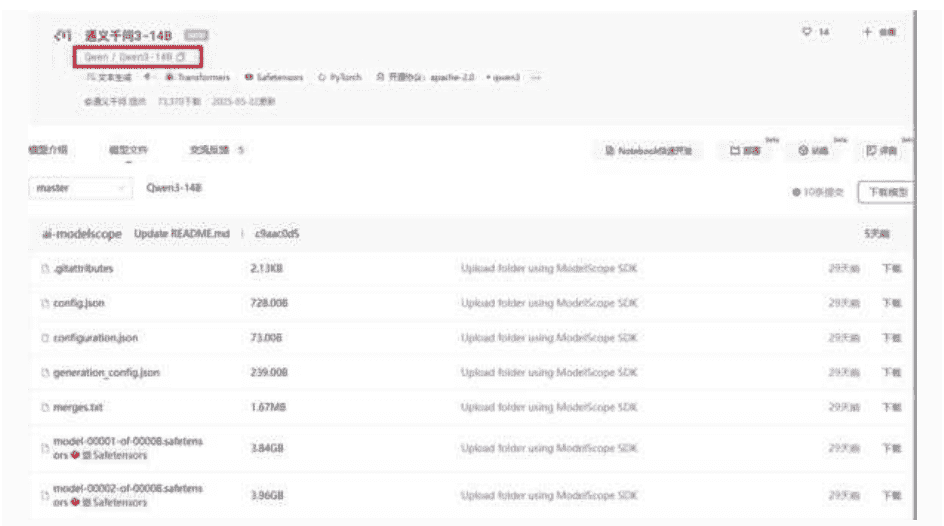

图2.8 Qwen3-14B模型权重情况

接下来，导入modelscope库，运行如下命令下载模型权重。

```bash
cd /root/autodl-tmp/Qwen3
mkdir ./Qwen3-14B
modelscope download --model Qwen/Qwen3-14B --local_dir ./Qwen3-14B
```

##### 4. 在Jupyter中使用transformer原生库的调用流程

(1) 导入相关库。

```python
from modelscope import AutoModelForCausalLM, AutoTokenizer
```

(2) 设置模型下载地址。

```python
model_name = "./Qwen3-14B"
```

(3) 实例化预训练模型与分词器。

```python
tokenizer = AutoTokenizer.from_pretrained(model_name)
model = AutoModelForCausalLM.from_pretrained(
    model_name,
    torch_dtype="auto",  # 指定模型权重数据类型
    device_map="auto"  # 指定模型权重加载设备
)
```

(4) 创建消息message。

```python
prompt = "给出一个关于大语言模型的简短介绍。"
messages = [
    {"role": "user", "content": prompt}
]
```

(5) 创建词嵌入过程。

```python
text = tokenizer.apply_chat_template(
    messages,
    tokenize=False,
    add_generation_prompt=True,
    enable_thinking=True  # 是否启用思考模式
)
model_inputs = tokenizer([text], return_tensors="pt").to(model.device)
```

（6）创建模型并给出大模型回复。

```python
# 进行文本补全
generated_ids = model.generate(
    **model_inputs
)
```

SGLang的核心特点如下。

- 与GLM模型结构高度适配，支持multi-turn memory。
- 支持并发调度与动态上下文构建。
- 内置类OpenAI的API接口。
- 可结合fastapi/uvicorn快速部署服务。

##### 2. LMDeploy：国产模型轻量部署工具

LMDeploy是由昆仑芯与魔搭社区联合开发的推理部署框架，目标是为国产开源大模型提供统一、简洁、高性能的部署方案。它支持INT4/INT8/FP16等多精度推理，并集成一键脚本、服务启动、QPS压测等功能。

LMDeploy的核心特点如下。

- 支持Qwen、Baichuan、InternLM等众多国产模型。
- 原生适配INT4推理，显存需求低。
- 提供完整的CLI、Web UI、HTTP API。
- 支持多线程调度与批量推理。

##### 3. vLLM：高并发、OpenAI兼容的服务部署利器

vLLM是由UC Berkeley发布的高性能推理引擎，支持动态批量调度、连续批处理、FlashAttention 2，并实现了完全兼容OpenAI API协议的服务接口。

vLLM的核心特点如下。

- 支持Hugging Face格式模型（LLaMA、Qwen、Baichuan等）。
- 实现了高吞吐推理（可达数千token/s）。
- 支持stream输出（流式生成）。
- 原生兼容chat/completions接口格式。

##### 4. Ollama：开发者友好的一键本地部署平台

Ollama是一个面向开发者的轻量部署工具，支持下载、管理和运行GGUF格式的大模型，如LLaMA 2/3、Mistral、Qwen、Phi等，目标是“本地部署像用Docker一样简单”。

Ollama的核心特点如下。

- 自动下载、注册模型（不需显式权重管理）。
- 支持Mac/Windows/Linux系统。

### 2.3 本地大模型部署及使用

本节将围绕本地部署的核心流程，系统介绍部署所需算力资源与环境依赖，涵盖模型下载、推理测试等关键环节，并与当前主流的第三方部署工具进行对比，为后续Agent开发提供坚实的运行基础。

#### 2.3.1 本地大模型部署需求概览

在实际大模型应用中，由于数据安全、访问稳定性、成本控制、模型可控性等多方面的需求，越来越多的开发者和企业选择将大模型部署在本地或私有云环境。本地部署不仅能实现对模型推理过程的控制，降低隐私敏感数据泄露风险，减少接口服务的长期费用，还能提高响应速度并支持离线运行。与此同时，本地部署也意味着更高的资源门槛与工程复杂度，需要开发者在动手部署前对以下几个关键需求做好全面评估。

##### 1. 算力资源

在所有本地部署条件中，算力资源（尤其是GPU）是成功运行大语言模型的决定性因素。虽然在某些轻量场景下也可尝试使用CPU进行模拟推理，但其速度与效率远低于GPU，且对于中大型模型基本不可行。因此，部署大模型首先必须具备相应规模的GPU硬件。

> **说明**
>
> 为什么不能只用CPU？
>
> 大语言模型的推理过程涉及十亿级参数的矩阵计算，尤其在多层Transformer架构中，存在大量矩阵乘法、归一化、注意力计算等高强度并行计算任务。GPU在处理并行数值计算方面具有显著优势，而CPU更擅长逻辑控制与串行任务。在同等条件下，CPU推理速度可能仅为GPU的1/100至1/10。

在推理场景下不同模型参数规模对应的显存需求如表2.2所示。

**表2.2 不同模型参数规模对应的显存需求**

| 模型规模 | 推理时显存需求（FP16） | 支持的典型GPU（单卡） |
| :--- | :--- | :--- |
| 7B | 14GB～16GB | RTX 3090 / 4090 / A500 |
| 13B | 26GB～30GB | RTX 4090（24GB）基本可运行 |
| 33B | 60GB～80GB | 多卡 A100 或 2×4090 并行 |

若采用量化（如INT4、INT8、GPTQ等技术），模型推理时所需的显存通常可减少1/4～1/2。以7B规模模型为例，FP16推理需14GB～16GB显存，INT4量化后推理只需4GB～6GB显存，可在单张RTX3060/4060甚至笔记本计算机的GPU上运行。

当前大模型训练或推理绝大多数基于NVIDIA GPU，因为其具备成熟的CUDA+cuDNN+PyTorch支持体系。大模型领域的主流GPU型号如表2.3所示。

| 类型 | 常见型号 | 适用说明 |
| :--- | :--- | :--- |
| 数据中心级 | A100, H100, A800, L40S | 高稳定性、高带宽，适合部署集群 |
| 消费级高端 | RTX 3090, 4090, 4080 | 适合个人开发与小模型推理 |
| 云租用平台 GPU | Tesla V100, T4 | 支持量化模型，成本可控 |

若本地没有GPU设备，读者可租用云平台算力进行实验或开发。AutoDL、阿里云PAI、百度飞桨Studio、Google Colab都提供在线GPU的租赁服务。

##### 2. 操作系统与环境依赖

在硬件资源充分的前提下，还需要配置相应的操作系统与软件依赖栈。以下是部署主流PyTorch/Hugging Face风格模型所需的通用环境说明。

1) 操作系统

建议优先使用Ubuntu作为本地部署系统，其稳定且兼容CUDA的Linux发行版，全面支持NVIDIA工具链。虽然CentOS和Windows搭配WSL2也可以运行部分大模型，但并不推荐在正式的生产环境中部署，会存在一定的兼容问题。

2) 软件依赖环境（PyTorch栈）

系统运行所需的软件依赖环境及安装说明如表2.4所示。

| 组件 | 推荐版本 | 安装说明 |
| :--- | :--- | :--- |
| Python | ≥ 3.9 | 建议使用 Conda 虚拟环境隔离 |
| PyTorch | ≥ 2.0 | 需安装 GPU 版本（pip/conda 安装） |
| CUDA | 11.8 / 12.1 | 与 PyTorch 安装包版本匹配 |
| cuDNN | 对应 CUDA 版本 | NVIDIA 官网下载安装或驱动自带 |
| Transformers | ≥ 4.35 | Hugging Face 的核心推理库 |

##### 3. 模型格式支持

选择模型部署前，开发者需确认目标模型是否提供开放权重、支持格式类型以及是否有量化版本。几类主流模型格式如表2.5所示。

**表2.5 主流模型格式**

| 格式类型 | 常见后缀 | 说明 | 适用部署框架 |
| :--- | :--- | :--- | :--- |
| 原始 PyTorch 格式 | .bin | Transformers 默认格式，文件较大，占用显存高 | Transformers/vLLM/TGI |
| 安全张量格式 | .safetensors | 安全、加载更快、支持并发加载的张量格式 | Transformers/vLLM/TGI |
| 量化格式-INT4 | .bin, .pt (压缩) | 通常通过 GPTQ/AWQ 等量化工具压缩后发布 | AutoAWQ/GPTQ-for-LLaMA/vLLM |
| 量化格式-GGUF | .gguf | llama.cpp/Ollama 使用的统一格式，支持 CPU/GPU 部署 | llama.cpp/Ollama/KoboldCpp |

如果选定了需要使用的大模型，需要确认该模型是否开源，是否提供Hugging Face或GitHub地址，是否发布INT4/INT8/GGUF等格式版本，是否有官方或社区推荐部署脚本或Docker镜像。

#### 2.3.2 本地大模型部署通用步骤

在大多数开源大模型项目中，官方或社区团队往往会在GitHub上提供完整的项目代码、推理脚本和部署工具链，使得本地部署过程可以遵循一套相对固定、可复用的实践路径。基于Transformers架构的主流开源模型的通用部署流程如下。

##### 1. 配置基础环境，创建虚拟环境

执行如下命令，使用Conda创建独立Python虚拟环境，确保依赖隔离、版本可控。

```
conda create -n llm-deploy python=3.10 -y
conda activate llm-deploy
```

命令中-n后为自定义的虚拟环境名称，在创建虚拟环境时需要同步指定虚拟环境的Python版本。

运行如下命令安装基础依赖，如PyTorch（根据CUDA版本选择GPU支持版）。

```
pip install torch torchvision torchaudio --index-url https://download.pytorch.org/whl/cu118
```

##### 2. 从GitHub克隆开源项目

大多数开源大模型都在GitHub上提供示例推理脚本、模型加载与测试代码、API服务部署相关代码、一键安装依赖的requirements.txt文件。运行如下代码即可从GitHub克隆对应的开源项目。

```
git clone https://github.com/deepseek-ai/DeepSeek-LLM.git
```

也可以在网页端下载zip格式的项目压缩包，在本地解压缩后使用。获取完整项目后，运行如下命令即可进入项目文件夹并一键安装所需依赖。

```
cd DeepSeek-LLM
pip install -r requirements.txt
```

> **说明**
>
> 模型的GitHub项目并非模型调用的必要依赖。
>
> 对于Hugging Face上发布的模型，开发者可以完全通过Transformers接口加载权重并完成本地推理，无须克隆其官方仓库。通常，我们克隆官方GitHub项目，是为了获取以下附加内容。
>
> - 模型推荐的依赖版本（如requirements.txt）。
> - 官方提供的测试脚本或推理样例。
> - API服务部署方式（如FastAPI、Gradio）。
> - Docker容器镜像与部署指令。
> - 与模型结构高度耦合的工程化调用逻辑（如多模态组件、定制tokenizer）。
>
> 但如果你已经熟悉Hugging Face的模型调用方式，并清楚如何配置依赖环境，完全可以脱离GitHub项目，仅下载模型权重与tokenizer，即可完成调用与部署。这种方式更轻量、灵活，适合有经验的开发者快速将模型集成到现有系统中。

##### 3. 下载模型权重

多数模型权重托管在Hugging Face或魔搭社区（ModelScope），可通过Transformers自动加载，或手动预下载到本地。

(1) 通过Hugging Face Transformers自动下载并加载。

```
from transformers import AutoTokenizer, AutoModelForCausalLM

model_id = "deepseek-ai/deepseek-llm-7b-base"
tokenizer = AutoTokenizer.from_pretrained(model_id)
model = AutoModelForCausalLM.from_pretrained(model_id, torch_dtype="auto").cuda()
```

首次加载时模型会自动下载到本地缓存目录（通常为 ~/.cache/huggingface），后续加载将自动读取缓存。

(2) 使用ModelScope官方工具包自动加载。使用前需执行如下命令安装官方工具包。

```
pip install modelscope
```

运行如下代码即可加载对应模型。

```
from modelscope import AutoTokenizer, AutoModelForCausalLM

model_id = "Qwen/Qwen-7B-Chat"
model = AutoModelForCausalLM.from_pretrained(model_id, revision='v1.0.0')
tokenizer = AutoTokenizer.from_pretrained(model_id, revision='v1.0.0')
```

模型的具体名称可在官网查看，如图2.3所示。

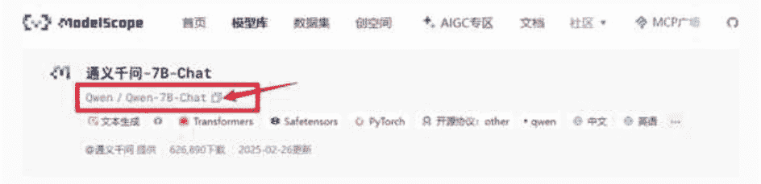

（3）从网页手动下载模型权重并离线加载。在Hugging Face和ModelScope的官方网站模型页面，切换到Files and versions或模型文件选项卡，点击右侧的“下载”按钮保存所有文件，如图 2.4 所示。存放到本地目录后，在推理脚本中指定pretrained_model_name_or_path="./your_model_dir"即可。

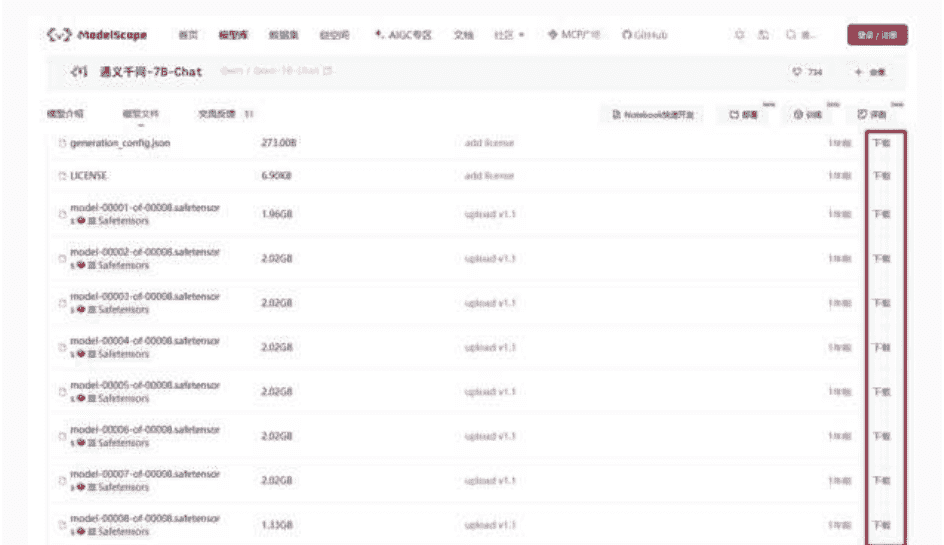

这里可以看到模型权重的后缀是.safetensors，对照表2.5可知，这是安全张量格式，适用于Transformers、vLLM、TGI的部署方式。

##### 4. 加载模型并进行本地推理测试

下载模型权重后，在本地加载模型并进行一次简单的推理验证。这一步可以帮助我们确认模型是否成功加载、显存是否充足、生成是否正常、所选部署框架是否兼容模型格式。

1）标准模型加载与推理测试（FP16）

如果你的模型是.bin或.safetensors格式的标准权重，并具备GPU环境，可以使用如下方式完成加载与推理。

```
from transformers import AutoModelForCausalLM, AutoTokenizer
import torch

# 模型路径：可为 Hugging Face ID 或本地文件夹
model_path = "./checkpoints"  # 或 "deepseek-ai/deepseek-llm-7b-base"

tokenizer = AutoTokenizer.from_pretrained(model_path)
model = AutoModelForCausalLM.from_pretrained(
    model_path,
    torch_dtype=torch.float16,  # 推荐使用半精度加载以节省显存
    device_map="auto"  # 自动将模型映射到可用 GPU
)

prompt = "请简要介绍 Transformer 模型的基本结构。"
inputs = tokenizer(prompt, return_tensors="pt").to(model.device)
outputs = model.generate(**inputs, max_new_tokens=200)
print(tokenizer.decode(outputs[0], skip_special_tokens=True))
```

2）加载量化模型（如INT4）

你若使用的是经过量化的模型（如bitsandbytes格式的4bit INT4模型），则可以使用以下方式。

```
from transformers import AutoModelForCausalLM, AutoTokenizer, BitsAndBytesConfig

bnb_config = BitsAndBytesConfig(load_in_4bit=True, bnb_4bit_compute_dtype=torch.float16)

tokenizer = AutoTokenizer.from_pretrained(model_path)
model = AutoModelForCausalLM.from_pretrained(
    model_path,
    quantization_config=bnb_config,
    device_map="auto"
)
```

INT4模型不支持torch_dtype参数，需使用quantization_config管理精度。

3）官方推理脚本

除了通过Transformers库自行加载模型进行推理，大多数开源大模型在GitHub项目中也会提供官方发布的推理样例脚本，帮助用户快速验证模型效果。

#### 2.3.3 GLM大模型本地部署指南

智谱AI推出的GLM-4系列在开源社区中表现出色，具备良好的中文理解与生成能力，而且官方提供了完整的本地部署支持文档，适合开发者在私有环境中进行推理测试与服务化部署。下面我们将以GLM-4-9B-Chat模型为例，演示其从环境配置到本地部署的完整流程。

##### 1. 配置基础环境，创建虚拟环境

- 显卡推荐：1张RTX 3090/4090（≥24GB显存）；如使用INT4量化版本，显存需求可降低到6GB~8GB。
- 操作系统：推荐使用Linux系统，如Ubuntu 20.04或Ubuntu 22.04。
- Python环境：建议使用Conda创建虚拟环境，Python版本不低于3.9。运行如下命令创建虚拟环境。

```
conda create -n glm4 python=3.10 -y
conda activate glm4
```

运行如下命令安装必要的torch和transformers库。

```
pip install torch torchvision torchaudio --index-url https://download.pytorch.org/whl/cu118
pip install transformers tiktoken
```

安装完成后，可运行如下代码确认是否安装成功。

```
import torch
torch.cuda.is_available()
```

如果输出如下内容，则可正常使用。

```
True
```

##### 2. 从GitHub克隆开源项目

查看GLM-4模型的GitHub开源项目目录结构，如图2.5所示。


该项目的inference子目录是本地部署和测试的关键，其中包含了丰富的推理入口脚本。运行如下命令克隆仓库并进入项目目录。

```
git clone https://github.com/THUDM/GLM-4.git
cd GLM-4
```

查看图2.5所示的项目结构，可以发现项目依赖安装清单requirements.txt文件在inference子目录下，运行如下命令进入该子目录，并安装项目所需依赖。

```
cd inference
pip install -r requirements.txt
```

##### 3. 下载GLM-4模型权重

通过modelscope下载模型需要预先安装其官方库。

```
!pip install modelscope
```

可在网页端查看模型权重情况，如图2.6所示。


图2.6 glm-4-9b-chat模型权重情况

接下来，导入modelscope库，运行如下代码，下载模型权重。

```
from modelscope import snapshot_download

#模型下载
model_dir = snapshot_download('ZhipuAI/glm-4-9b-chat')
```

下载完成后，我们打印model_dir即可查看模型权重本地存储的路径。

```
print (model_dir)
```

输出内容如下。

```
'/root/autodl-tmp/glm-4-9b-chat'
```

##### 4. 使用transformers后端进行推理

（1）在单卡服务器下运行如下代码。

### 2.3 本地大模型部署及使用

本节将围绕本地部署的核心流程，系统介绍部署所需算力资源与环境依赖，涵盖模型下载、推理测试等关键环节，并与当前主流的第三方部署工具进行对比，为后续Agent开发提供坚实的运行基础。

#### 2.3.1 本地大模型部署需求概览

在实际大模型应用中，由于数据安全、访问稳定性、成本控制、模型可控性等多方面的需求，越来越多的开发者和企业选择将大模型部署在本地或私有云环境。本地部署不仅能实现对模型推理过程的控制，降低隐私敏感数据泄露风险，减少接口服务的长期费用，还能提高响应速度并支持离线运行。与此同时，本地部署也意味着更高的资源门槛与工程复杂度，需要开发者在动手部署前对以下几个关键需求做好全面评估。

##### 1. 算力资源

在所有本地部署条件中，算力资源（尤其是GPU）是成功运行大语言模型的决定性因素。虽然在某些轻量场景下也可尝试使用CPU进行模拟推理，但其速度与效率远低于GPU，且对于中大型模型基本不可行。因此，部署大模型首先必须具备相应规模的GPU硬件。

> **说明**
>
> 为什么不能只用CPU？
>
> 大语言模型的推理过程涉及十亿级参数的矩阵计算，尤其在多层Transformer架构中，存在大量矩阵乘法、归一化、注意力计算等高强度并行计算任务。GPU在处理并行数值计算方面具有显著优势，而CPU更擅长逻辑控制与串行任务。在同等条件下，CPU推理速度可能仅为GPU的1/100至1/10。

在推理场景下不同模型参数规模对应的显存需求如表2.2所示。

**表2.2 不同模型参数规模对应的显存需求**

| 模型规模 | 推理时显存需求（FP16） | 支持的典型GPU（单卡） |
| :--- | :--- | :--- |
| 7B | 14GB～16GB | RTX 3090 / 4090 / A500 |
| 13B | 26GB～30GB | RTX 4090（24GB）基本可运行 |
| 33B | 60GB～80GB | 多卡 A100 或 2×4090 并行 |

若采用量化（如INT4、INT8、GPTQ等技术），模型推理时所需的显存通常可减少1/4～1/2。以7B规模模型为例，FP16推理需14GB～16GB显存，INT4量化后推理只需4GB～6GB显存，可在单张RTX3060/4060甚至笔记本计算机的GPU上运行。

当前大模型训练或推理绝大多数基于NVIDIA GPU，因为其具备成熟的CUDA+cuDNN+PyTorch支持体系。大模型领域的主流GPU型号如表2.3所示。

| 类型 | 常见型号 | 适用说明 |
| :--- | :--- | :--- |
| 数据中心级 | A100, H100, A800, L40S | 高稳定性、高带宽，适合部署集群 |
| 消费级高端 | RTX 3090, 4090, 4080 | 适合个人开发与小模型推理 |
| 云租用平台 GPU | Tesla V100, T4 | 支持量化模型，成本可控 |

若本地没有GPU设备，读者可租用云平台算力进行实验或开发。AutoDL、阿里云PAI、百度飞桨Studio、Google Colab都提供在线GPU的租赁服务。

##### 2. 操作系统与环境依赖

在硬件资源充分的前提下，还需要配置相应的操作系统与软件依赖栈。以下是部署主流PyTorch/Hugging Face风格模型所需的通用环境说明。

1) 操作系统

建议优先使用Ubuntu作为本地部署系统，其稳定且兼容CUDA的Linux发行版，全面支持NVIDIA工具链。虽然CentOS和Windows搭配WSL2也可以运行部分大模型，但并不推荐在正式的生产环境中部署，会存在一定的兼容问题。

2) 软件依赖环境（PyTorch栈）

系统运行所需的软件依赖环境及安装说明如表2.4所示。

| 组件 | 推荐版本 | 安装说明 |
| :--- | :--- | :--- |
| Python | ≥ 3.9 | 建议使用 Conda 虚拟环境隔离 |
| PyTorch | ≥ 2.0 | 需安装 GPU 版本（pip/conda 安装） |
| CUDA | 11.8 / 12.1 | 与 PyTorch 安装包版本匹配 |
| cuDNN | 对应 CUDA 版本 | NVIDIA 官网下载安装或驱动自带 |
| Transformers | ≥ 4.35 | Hugging Face 的核心推理库 |

#### 2.3.4 Qwen大模型本地部署指南

2025年4月29日，阿里开源通义千问模型Qwen3，其中，Qwen3-235B-A22B在代码、数学、通用能力等基准测试中，与DeepSeek-R1、o1、o3-mini、Grok-3和Gemini-2.5-Pro等顶级模型相比，表现出极具竞争力的结果。本次同步开源了全尺寸稠密与混合专家模型：0.6B、1.7B、4B、8B、14B、32B，以及30B-A3B、235B-A22B。

下面我们将以Qwen3-14B模型为例，演示其从环境配置到本地部署的完整流程。

##### 1. 配置基础环境，创建虚拟环境

- 显卡推荐：1张RTX 3090 / 4090（≥24GB显存）。
- 操作系统：推荐使用Linux系统，如Ubuntu 20.04或Ubuntu 22.04。
- Python环境：建议使用Conda创建虚拟环境，Python版本不低于3.9。

运行如下代码，创建虚拟环境。

```
conda create --n qwen3 python=3.11
conda activate qwen3
```

运行如下代码，安装torch和transformers库。

```
pip install torch torchvision torchaudio --index-url https://download.pytorch.org/whl/cu118
pip install transformers tiktoken
```

运行如下代码，确认torch和transformers库是否安装成功。

```
import torch
torch.cuda.is_available()
```

如果输出如下内容，则可正常使用。

```
True
```

##### 2. 从GitHub克隆开源项目

查看Qwen3模型的GitHub开源项目，其目录结构如图2.7所示。


Qwen3作为完全基于Transformers的开源模型，在GitHub项目目录结构中没有显示requirements.txt文件，表示它默认继承了Hugging Face的依赖结构，因此，一般只需运行如下命令安装。

```
pip install torch transformers accelerate sentencepiece

# 用于 INT4 模型量化推理
pip install bitsandbytes
```

##### 3. 下载Qwen3模型权重

借助modelscope下载模型需要先运行如下命令安装库。

```
!pip install modelscope
```

可在网页端先查看模型权重情况，如图2.8所示。


图2.8 Qwen3-14B模型权重情况

接下来，导入modelscope库，运行如下命令下载模型权重。

```
cd /root/autodl-tmp/Qwen3
mkdir ./Qwen3-14B
modelscope download --model Qwen/Qwen3-14B --local_dir ./Qwen3-14B
```

##### 4. 在Jupyter中使用transformer原生库的调用流程

(1) 导入相关库。

```
from modelscope import AutoModelForCausalLM, AutoTokenizer
```

(2) 设置模型下载地址。

```
model_name = "./Qwen3-14B"
```

(3) 实例化预训练模型与分词器。

```
tokenizer = AutoTokenizer.from_pretrained(model_name)
model = AutoModelForCausalLM.from_pretrained(
    model_name,
    torch_dtype="auto",  # 指定模型权重数据类型
    device_map="auto"  # 指定模型权重加载设备
)
```

(4) 创建消息message。

```
prompt = "给出一个关于大语言模型的简短介绍。"
messages = [
    {"role": "user", "content": prompt}
]
```

(5) 创建词嵌入过程。

```
text = tokenizer.apply_chat_template(
    messages,
    tokenize=False,
    add_generation_prompt=True,
    enable_thinking=True  # 是否启用思考模式
)
model_inputs = tokenizer([text], return_tensors="pt").to(model.device)
```

(6) 创建模型并给出大模型回复。

```
# 进行文本补全
generated_ids = model.generate(
    **model_inputs,
    max_new_tokens=32768
)
output_ids = generated_ids[0][len(model_inputs.input_ids[0]):].tolist()

# 结果将首先显示思考内容标签中，然后是实际响应
print(tokenizer.decode(output_ids, skip_special_tokens=True))
```

输出内容如图2.9所示。

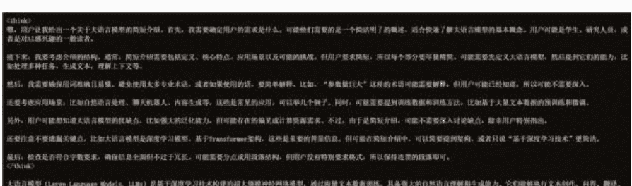

通过 enable_thinking 参数决定是否启用思考模式，如果要禁用则需要将 enable_thinking=True改为False即可。

#### 2.3.5 第三方集成部署工具

在部署本地大模型时，除了使用Transformers等基础库直接加载模型权重外，开发者还可以选择一些高性能、工程化程度更高的第三方部署工具。这些工具在模型加载优化、推理速度提升、API服务化、多模型托管等方面具有显著优势，特别适用于对性能、可维护性、并发能力要求较高的企业级或产品级场景。

##### 1. SGLang：智谱推出的GLM系列专用推理框架

SGLang是由智谱AI发布的开源推理与服务框架，专为GLM系列模型（如GLM-4、ChatGLM）优化，原生支持对话模板、多轮历史缓存、函数调用（Function Calling）、结构化输出等能力。

SGLang的核心特点如下。

- 与GLM模型结构高度适配，支持multi-turn memory。
- 支持并发调度与动态上下文构建。
- 内置类OpenAI的API接口。
- 可结合fastapi/uvicorn快速部署服务。

##### 2. LMDeploy：国产模型轻量部署工具

LMDeploy是由昆仑芯与魔搭社区联合开发的推理部署框架，目标是为国产开源大模型提供统一、简洁、高性能的部署方案。它支持INT4/INT8/FP16等多精度推理，并集成一键脚本、服务启动、QPS压测等功能。

LMDeploy的核心特点如下。

- 支持Qwen、Baichuan、InternLM等众多国产模型。
- 原生适配INT4推理，显存需求低。
- 提供完整的CLI、Web UI、HTTP API。
- 支持多线程调度与批量推理。

##### 3. vLLM：高并发、OpenAI兼容的服务部署利器

vLLM是由UC Berkeley发布的高性能推理引擎，支持动态批量调度、连续批处理、FlashAttention 2，并实现了完全兼容OpenAI API协议的服务接口。

vLLM的核心特点如下。

- 支持Hugging Face格式模型（LLaMA、Qwen、Baichuan等）。
- 实现了高吞吐推理（可达数千token/s）。
- 支持stream输出（流式生成）。
- 原生兼容chat/completions接口格式。

##### 4. Ollama：开发者友好的一键本地部署平台

Ollama是一个面向开发者的轻量部署工具，支持下载、管理和运行GGUF格式的大模型，如LLaMA 2/3、Mistral、Qwen、Phi等，目标是“本地部署像用Docker一样简单”。

Ollama的核心特点如下。

- 自动下载、注册模型（不需显式权重管理）。
- 支持Mac/Windows/Linux系统。
- 内置HTTP API与CLI，快速调用。
- 支持CPU和GPU，支持stream输出。
- 与llama.cpp系统一致，兼容GGUF格式。

以上工具代表了当前主流的本地大模型部署解决方案，涵盖了不同模型结构、硬件资源和应用场景的需求。在本节中，我们对这些工具进行了简要梳理，便于读者了解其基本特性与使用方式。

##### 3. 模型格式支持

选择模型部署前，开发者需确认目标模型是否提供开放权重、支持格式类型以及是否有量化版本。几类主流模型格式如表2.5所示。

表2.5 主流模型格式

| 格式类型 | 常见后缀 | 说明 | 适用部署框架 |
| :--- | :--- | :--- | :--- |
| 原始 PyTorch 格式 | .bin | Transformers 默认格式，文件较大，占用显存高 | Transformers/vLLM/TGI |
| 安全张量格式 | .safetensors | 安全、加载更快、支持并发加载的张量格式 | Transformers/vLLM/TGI |
| 量化格式-INT4 | .bin, .pt (压缩) | 通常通过 GPTQ/AWQ 等量化工具压缩后发布 | AutoAWQ/GPTQ-for-LLaMA/vLLM |
| 量化格式-GGUF | .gguf | llama.cpp/Ollama 使用的统一格式，支持 CPU/GPU 部署 | llama.cpp/Ollama/KoboldCpp |

如果选定了需要使用的大模型，需要确认该模型是否开源，是否提供Hugging Face或GitHub地址，是否发布INT4/INT8/GGUF等格式版本，是否有官方或社区推荐部署脚本或Docker镜像。

#### 2.3.2 本地大模型部署通用步骤

在大多数开源大模型项目中，官方或社区团队往往会在GitHub上提供完整的项目代码、推理脚本和部署工具链，使得本地部署过程可以遵循一套相对固定、可复用的实践路径。基于Transformers架构的主流开源模型的通用部署流程如下。

##### 1. 配置基础环境，创建虚拟环境

执行如下命令，使用Conda创建独立Python虚拟环境，确保依赖隔离、版本可控。

```
conda create -n llm-deploy python=3.10 -y
conda activate llm-deploy
```

命令中-n后为自定义的虚拟环境名称，在创建虚拟环境时需要同步指定虚拟环境的Python版本。

运行如下命令安装基础依赖，如PyTorch（根据CUDA版本选择GPU支持版）。

```
pip install torch torchvision torchaudio --index-url https://download.pytorch.org/whl/cu118
```

##### 2. 从GitHub克隆开源项目

大多数开源大模型都在GitHub上提供示例推理脚本、模型加载与测试代码、API服务部署相关代码、一键安装依赖的requirements.txt文件。运行如下代码即可从GitHub克隆对应的开源项目。

```
git clone https://github.com/deepseek-ai/DeepSeek-LLM.git
```

也可以在网页端下载zip格式的项目压缩包，在本地解压缩后使用。获取完整项目后，运行如下命令即可进入项目文件夹并一键安装所需依赖。

```
cd DeepSeek-LLM
pip install -r requirements.txt
```

> 说明

模型的GitHub项目并非模型调用的必要依赖。

对于Hugging Face上发布的模型，开发者可以完全通过Transformers接口加载权重并完成本地推理，无须克隆其官方仓库。通常，我们克隆官方GitHub项目，是为了获取以下附加内容。

- 模型推荐的依赖版本（如requirements.txt）。
- 官方提供的测试脚本或推理样例。
- API服务部署方式（如FastAPI、Gradio）。
- Docker容器镜像与部署指令。
- 与模型结构高度耦合的工程化调用逻辑（如多模态组件、定制tokenizer）。

但如果你已经熟悉Hugging Face的模型调用方式，并清楚如何配置依赖环境，完全可以脱离GitHub项目，仅下载模型权重与tokenizer，即可完成调用与部署。这种方式更轻量、灵活，适合有经验的开发者快速将模型集成到现有系统中。

##### 3. 下载模型权重

多数模型权重托管在Hugging Face或魔搭社区（ModelScope），可通过Transformers自动加载，或手动预下载到本地。

（1）通过Hugging Face Transformers自动下载并加载。

```
from transformers import AutoTokenizer, AutoModelForCausalLM

model_id = "deepseek-ai/deepseek-llm-7b-base"
tokenizer = AutoTokenizer.from_pretrained(model_id)
model = AutoModelForCausalLM.from_pretrained(model_id, torch_dtype="auto").cuda()
```

首次加载时模型会自动下载到本地缓存目录（通常为 ~/.cache/huggingface），后续加载将自动读取缓存。

（2）使用ModelScope官方工具包自动加载。使用前需执行如下命令安装官方工具包。

```
pip install modelscope
```

运行如下代码即可加载对应模型。

```
from modelscope import AutoTokenizer, AutoModelForCausalLM

model_id = "Qwen/Qwen-7B-Chat"
model = AutoModelForCausalLM.from_pretrained(model_id, revision='v1.0.0')
tokenizer = AutoTokenizer.from_pretrained(model_id, revision='v1.0.0')
```

模型的具体名称可在官网查看，如图2.3所示。


（3）从网页手动下载模型权重并离线加载。在Hugging Face和ModelScope的官方网站模型页面，切换到Files and versions或模型文件选项卡，点击右侧的“下载”按钮保存所有文件，如图 2.4 所示。存放到本地目录后，在推理脚本中指定pretrained_model_name_or_path="./your_model_dir"即可。


这里可以看到模型权重的后缀是.safetensors，对照表2.5可知，这是安全张量格式，适用于Transformers、vLLM、TGI的部署方式。

##### 4. 加载模型并进行本地推理测试

下载模型权重后，在本地加载模型并进行一次简单的推理验证。这一步可以帮助我们确认模型是否成功加载、显存是否充足、生成是否正常、所选部署框架是否兼容模型格式。

1）标准模型加载与推理测试（FP16）

如果你的模型是.bin或.safetensors格式的标准权重，并具备GPU环境，可以使用如下方式完成加载与推理。

```
from transformers import AutoModelForCausalLM, AutoTokenizer
import torch

# 模型路径：可为 Hugging Face ID 或本地文件夹
model_path = "./checkpoints"  # 或 "deepseek-ai/deepseek-llm-7b-base"

tokenizer = AutoTokenizer.from_pretrained(model_path)
model = AutoModelForCausalLM.from_pretrained(
    model_path,
    torch_dtype=torch.float16,  # 推荐使用半精度加载以节省显存
    device_map="auto"  # 自动将模型映射到可用 GPU
)

prompt = "请简要介绍 Transformer 模型的基本结构。"
inputs = tokenizer(prompt, return_tensors="pt").to(model.device)
outputs = model.generate(**inputs, max_new_tokens=200)
print(tokenizer.decode(outputs[0], skip_special_tokens=True))
```

2）加载量化模型（如INT4）

你若使用的是经过量化的模型（如bitsandbytes格式的4bit INT4模型），则可以使用以下方式。

```
from transformers import AutoModelForCausalLM, AutoTokenizer, BitsAndBytesConfig

bnb_config = BitsAndBytesConfig(load_in_4bit=True, bnb_4bit_compute_dtype=torch.float16)

tokenizer = AutoTokenizer.from_pretrained(model_path)
model = AutoModelForCausalLM.from_pretrained(
    model_path,
    quantization_config=bnb_config,
    device_map="auto"
)
```

INT4模型不支持torch_dtype参数，需使用quantization_config管理精度。

3）官方推理脚本

除了通过Transformers库自行加载模型进行推理，大多数开源大模型在GitHub项目中也会提供官方发布的推理样例脚本，帮助用户快速验证模型效果。

#### 2.3.3 GLM大模型本地部署指南

智谱AI推出的GLM-4系列在开源社区中表现出色，具备良好的中文理解与生成能力，而且官方提供了完整的本地部署支持文档，适合开发者在私有环境中进行推理测试与服务化部署。下面我们将以GLM-4-9B-Chat模型为例，演示其从环境配置到本地部署的完整流程。

##### 1. 配置基础环境，创建虚拟环境

- 显卡推荐：1张RTX 3090/4090（≥24GB显存）；如使用INT4量化版本，显存需求可降低到6GB~8GB。
- 操作系统：推荐使用Linux系统，如Ubuntu 20.04或Ubuntu 22.04。
- Python环境：建议使用Conda创建虚拟环境，Python版本不低于3.9。运行如下命令创建虚拟环境。

```
conda create -n glm4 python=3.10 -y
conda activate glm4
```

运行如下命令安装必要的torch和transformers库。

```
pip install torch torchvision torchaudio --index-url https://download.pytorch.org/whl/cu118
pip install transformers tiktoken
```

安装完成后，可运行如下代码确认是否安装成功。

```
import torch
torch.cuda.is_available()
```

如果输出如下内容，则可正常使用。

```
True
```

##### 2. 从GitHub克隆开源项目

查看GLM-4模型的GitHub开源项目目录结构，如图2.5所示。


该项目的inference子目录是本地部署和测试的关键，其中包含了丰富的推理入口脚本。运行如下命令克隆仓库并进入项目目录。

```
git clone https://github.com/THUDM/GLM-4.git
cd GLM-4
```

查看图2.5所示的项目结构，可以发现项目依赖安装清单requirements.txt文件在inference子目录下，运行如下命令进入该子目录，并安装项目所需依赖。

```
cd inference
pip install -r requirements.txt
```

##### 3. 下载GLM-4模型权重

通过modelscope下载模型需要预先安装其官方库。

```
!pip install modelscope
```

可在网页端查看模型权重情况，如图2.6所示。

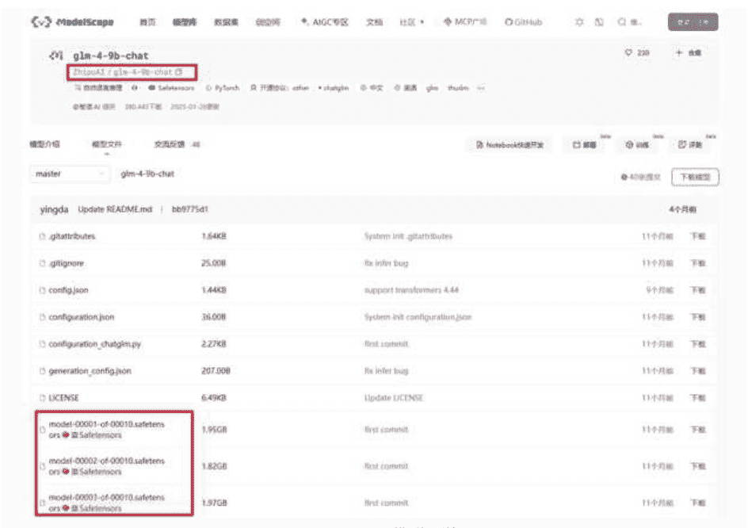

图2.6 glm-4-9b-chat模型权重情况

接下来，导入modelscope库，运行如下代码，下载模型权重。

```
from modelscope import snapshot_download

#模型下载
model_dir = snapshot_download('ZhipuAI/glm-4-9b-chat')
```

下载完成后，我们打印model_dir即可查看模型权重本地存储的路径。

```
print (model_dir)
```

输出内容如下。

```
'/root/autodl-tmp/glm-4-9b-chat'
```

##### 4. 使用transformers后端进行推理

（1）在单卡服务器下运行如下代码。

```
import torch
from modelscope import AutoModelForCausalLM, AutoTokenizer

#设置设备为 CUDA（GPU），以加速计算
device = "cuda"

#从预训练模型目录加载分词器，并信任远程代码
tokenizer = AutoTokenizer.from_pretrained(model_dir, trust_remote_code=True)

#定义用户的输入
query = "你好"

#使用聊天模板应用分词器，并生成输入张量
inputs = tokenizer.apply_chat_template(
    [{"role": "user", "content": query}],  # 用户角色和输入内容
    add_generation_prompt=True,              # 添加生成提示
    tokenize=True,                           # 执行分词
    return_tensors="pt",                     # 返回 PyTorch 张量
    return_dict=True                         # 返回字典形式
)

#将输入张量移动到指定设备（CUDA）
inputs = inputs.to(device)

#从预训练模型目录加载下载到本地的大模型，并信任远程代码
model = AutoModelForCausalLM.from_pretrained(
    model_dir,
    torch_dtype=torch.bfloat16,              # 使用 bfloat16 数据类型以减少内存使用
    trust_remote_code=True                   # 信任远程代码
).to(device).eval()                          # 将模型移动到 CUDA 设备并设置为评估模式

#定义生成文本的参数
gen_kwargs = {
    "max_length": 2500,                     # 生成文本的最大长度
    "do_sample": True,                      # 是否进行采样
    "top_k": 1                              # 采样时考虑的最高概率的 k 个标记
}

#在不计算梯度的上下文中生成文本
with torch.no_grad():
    #生成模型的输出
    outputs = model.generate(**inputs, **gen_kwargs)
    #截取生成的输出，去除输入的部分
    outputs = outputs[:, inputs['input_ids'].shape[1]:]
    #解码生成的输出并去除特殊标记
    print(tokenizer.decode(outputs[0], skip_special_tokens=True))
```

输出内容如下。

```
Special tokens have been added in the vocabulary, make sure the associated word embeddings are fine-tuned or trained.
Loading checkpoint shards:  0%|          | 0/10 [00:00<?, ?it/s]
你好👋！很高兴见到你，有什么可以帮助你的吗？
```

（2）使用官方封装的推理脚本。如图2.6所示，inference子目录下有封装好的可用于推理的脚本文件。运行如下命令可在终端上与模型进行对话。

```
python trans_cli_demo.py
```

运行如下命令可使用Gradio网页端与模型进行对话。

```
python trans_web_demo.py
```

#### 2.3.4 Qwen大模型本地部署指南

2025年4月29日，阿里开源通义千问模型Qwen3，其中，Qwen3-235B-A22B在代码、数学、通用能力等基准测试中，与DeepSeek-R1、o1、o3-mini、Grok-3和Gemini-2.5-Pro等顶级模型相比，表现出极具竞争力的结果。本次同步开源了全尺寸稠密与混合专家模型：0.6B、1.7B、4B、8B、14B、32B，以及30B-A3B、235B-A22B。

下面我们将以Qwen3-14B模型为例，演示其从环境配置到本地部署的完整流程。

##### 1. 配置基础环境，创建虚拟环境

- 显卡推荐：1张RTX 3090 / 4090（≥24GB显存）。
- 操作系统：推荐使用Linux系统，如Ubuntu 20.04或Ubuntu 22.04。
- Python环境：建议使用Conda创建虚拟环境，Python版本不低于3.9。

运行如下代码，创建虚拟环境。

```
conda create --n qwen3 python=3.11
conda activate qwen3
```

运行如下代码，安装torch和transformers库。

```
pip install torch torchvision torchaudio --index-url https://download.pytorch.org/whl/cu118
pip install transformers tiktoken
```

运行如下代码，确认torch和transformers库是否安装成功。

```
import torch
torch.cuda.is_available()
```

如果输出如下内容，则可正常使用。

```
True
```

##### 2. 从GitHub克隆开源项目

查看Qwen3模型的GitHub开源项目，其目录结构如图2.7所示。

### 2.3 本地大模型部署及使用

本节将围绕本地部署的核心流程，系统介绍部署所需算力资源与环境依赖，涵盖模型下载、推理测试等关键环节，并与当前主流的第三方部署工具进行对比，为后续Agent开发提供坚实的运行基础。

#### 2.3.1 本地大模型部署需求概览

在实际大模型应用中，由于数据安全、访问稳定性、成本控制、模型可控性等多方面的需求，越来越多的开发者和企业选择将大模型部署在本地或私有云环境。本地部署不仅能实现对模型推理过程的控制，降低隐私敏感数据泄露风险，减少接口服务的长期费用，还能提高响应速度并支持离线运行。与此同时，本地部署也意味着更高的资源门槛与工程复杂度，需要开发者在动手部署前对以下几个关键需求做好全面评估。

##### 1. 算力资源

在所有本地部署条件中，算力资源（尤其是GPU）是成功运行大语言模型的决定性因素。虽然在某些轻量场景下也可尝试使用CPU进行模拟推理，但其速度与效率远低于GPU，且对于中大型模型基本不可行。因此，部署大模型首先必须具备相应规模的GPU硬件。

> **说明**
>
> 为什么不能只用CPU？
>
> 大语言模型的推理过程涉及十亿级参数的矩阵计算，尤其在多层Transformer架构中，存在大量矩阵乘法、归一化、注意力计算等高强度并行计算任务。GPU在处理并行数值计算方面具有显著优势，而CPU更擅长逻辑控制与串行任务。在同等条件下，CPU推理速度可能仅为GPU的1/100至1/10。

在推理场景下不同模型参数规模对应的显存需求如表2.2所示。

**表2.2 不同模型参数规模对应的显存需求**

| 模型规模 | 推理时显存需求（FP16） | 支持的典型GPU（单卡） |
| :--- | :--- | :--- |
| 7B | 14GB～16GB | RTX 3090 / 4090 / A500 |
| 13B | 26GB～30GB | RTX 4090（24GB）基本可运行 |
| 33B | 60GB～80GB | 多卡 A100 或 2×4090 并行 |

若采用量化（如INT4、INT8、GPTQ等技术），模型推理时所需的显存通常可减少1/4～1/2。以7B规模模型为例，FP16推理需14GB～16GB显存，INT4量化后推理只需4GB～6GB显存，可在单张RTX3060/4060甚至笔记本计算机的GPU上运行。

当前大模型训练或推理绝大多数基于NVIDIA GPU，因为其具备成熟的CUDA+cuDNN+PyTorch支持体系。大模型领域的主流GPU型号如表2.3所示。

| 类型 | 常见型号 | 适用说明 |
| :--- | :--- | :--- |
| 数据中心级 | A100, H100, A800, L40S | 高稳定性、高带宽，适合部署集群 |
| 消费级高端 | RTX 3090, 4090, 4080 | 适合个人开发与小模型推理 |
| 云租用平台 GPU | Tesla V100, T4 | 支持量化模型，成本可控 |

若本地没有GPU设备，读者可租用云平台算力进行实验或开发。AutoDL、阿里云PAI、百度飞桨Studio、Google Colab都提供在线GPU的租赁服务。

##### 2. 操作系统与环境依赖

在硬件资源充分的前提下，还需要配置相应的操作系统与软件依赖栈。以下是部署主流PyTorch/Hugging Face风格模型所需的通用环境说明。

1) 操作系统

建议优先使用Ubuntu作为本地部署系统，其稳定且兼容CUDA的Linux发行版，全面支持NVIDIA工具链。虽然CentOS和Windows搭配WSL2也可以运行部分大模型，但并不推荐在正式的生产环境中部署，会存在一定的兼容问题。

2) 软件依赖环境（PyTorch栈）

系统运行所需的软件依赖环境及安装说明如表2.4所示。

| 组件 | 推荐版本 | 安装说明 |
| :--- | :--- | :--- |
| Python | ≥ 3.9 | 建议使用 Conda 虚拟环境隔离 |
| PyTorch | ≥ 2.0 | 需安装 GPU 版本（pip/conda 安装） |
| CUDA | 11.8 / 12.1 | 与 PyTorch 安装包版本匹配 |
| cuDNN | 对应 CUDA 版本 | NVIDIA 官网下载安装或驱动自带 |
| Transformers | ≥ 4.35 | Hugging Face 的核心推理库 |

##### 3. 模型格式支持

选择模型部署前，开发者需确认目标模型是否提供开放权重、支持格式类型以及是否有量化版本。几类主流模型格式如表2.5所示。

**表2.5 主流模型格式**

| 格式类型 | 常见后缀 | 说明 | 适用部署框架 |
| :--- | :--- | :--- | :--- |
| 原始 PyTorch 格式 | .bin | Transformers 默认格式，文件较大，占用显存高 | Transformers/vLLM/TGI |
| 安全张量格式 | .safetensors | 安全、加载更快、支持并发加载的张量格式 | Transformers/vLLM/TGI |
| 量化格式-INT4 | .bin, .pt (压缩) | 通常通过 GPTQ/AWQ 等量化工具压缩后发布 | AutoAWQ/GPTQ-for-LLaMA/vLLM |
| 量化格式-GGUF | .gguf | llama.cpp/Ollama 使用的统一格式，支持 CPU/GPU 部署 | llama.cpp/Ollama/KoboldCpp |

如果选定了需要使用的大模型，需要确认该模型是否开源，是否提供Hugging Face或GitHub地址，是否发布INT4/INT8/GGUF等格式版本，是否有官方或社区推荐部署脚本或Docker镜像。

#### 2.3.2 本地大模型部署通用步骤

在大多数开源大模型项目中，官方或社区团队往往会在GitHub上提供完整的项目代码、推理脚本和部署工具链，使得本地部署过程可以遵循一套相对固定、可复用的实践路径。基于Transformers架构的主流开源模型的通用部署流程如下。

##### 1. 配置基础环境，创建虚拟环境

执行如下命令，使用Conda创建独立Python虚拟环境，确保依赖隔离、版本可控。

```
conda create -n llm-deploy python=3.10 -y
conda activate llm-deploy
```

命令中-n后为自定义的虚拟环境名称，在创建虚拟环境时需要同步指定虚拟环境的Python版本。

运行如下命令安装基础依赖，如PyTorch（根据CUDA版本选择GPU支持版）。

```
pip install torch torchvision torchaudio --index-url https://download.pytorch.org/whl/cu118
```

##### 2. 从GitHub克隆开源项目

大多数开源大模型都在GitHub上提供示例推理脚本、模型加载与测试代码、API服务部署相关代码、一键安装依赖的requirements.txt文件。运行如下代码即可从GitHub克隆对应的开源项目。

```
git clone https://github.com/deepseek-ai/DeepSeek-LLM.git
```

也可以在网页端下载zip格式的项目压缩包，在本地解压缩后使用。获取完整项目后，运行如下命令即可进入项目文件夹并一键安装所需依赖。

```
cd DeepSeek-LLM
pip install -r requirements.txt
```

> **说明**
>
> 模型的GitHub项目并非模型调用的必要依赖。
>
> 对于Hugging Face上发布的模型，开发者可以完全通过Transformers接口加载权重并完成本地推理，无须克隆其官方仓库。通常，我们克隆官方GitHub项目，是为了获取以下附加内容。
>
> - 模型推荐的依赖版本（如requirements.txt）。
> - 官方提供的测试脚本或推理样例。
> - API服务部署方式（如FastAPI、Gradio）。
> - Docker容器镜像与部署指令。
> - 与模型结构高度耦合的工程化调用逻辑（如多模态组件、定制tokenizer）。
>
> 但如果你已经熟悉Hugging Face的模型调用方式，并清楚如何配置依赖环境，完全可以脱离GitHub项目，仅下载模型权重与tokenizer，即可完成调用与部署。这种方式更轻量、灵活，适合有经验的开发者快速将模型集成到现有系统中。

##### 3. 下载模型权重

多数模型权重托管在Hugging Face或魔搭社区（ModelScope），可通过Transformers自动加载，或手动预下载到本地。

(1) 通过Hugging Face Transformers自动下载并加载。

```
from transformers import AutoTokenizer, AutoModelForCausalLM

model_id = "deepseek-ai/deepseek-llm-7b-base"
tokenizer = AutoTokenizer.from_pretrained(model_id)
model = AutoModelForCausalLM.from_pretrained(model_id, torch_dtype="auto").cuda()
```

首次加载时模型会自动下载到本地缓存目录（通常为 ~/.cache/huggingface），后续加载将自动读取缓存。

(2) 使用ModelScope官方工具包自动加载。使用前需执行如下命令安装官方工具包。

```
pip install modelscope
```

运行如下代码即可加载对应模型。

```
from modelscope import AutoTokenizer, AutoModelForCausalLM

model_id = "Qwen/Qwen-7B-Chat"
model = AutoModelForCausalLM.from_pretrained(model_id, revision='v1.0.0')
tokenizer = AutoTokenizer.from_pretrained(model_id, revision='v1.0.0')
```

模型的具体名称可在官网查看，如图2.3所示。

（3）从网页手动下载模型权重并离线加载。在Hugging Face和ModelScope的官方网站模型页面，切换到Files and versions或模型文件选项卡，点击右侧的“下载”按钮保存所有文件，如图 2.4 所示。存放到本地目录后，在推理脚本中指定pretrained_model_name_or_path="./your_model_dir"即可。

这里可以看到模型权重的后缀是.safetensors，对照表2.5可知，这是安全张量格式，适用于Transformers、vLLM、TGI的部署方式。

### 2.3.3 Qwen3模型本地部署与调用示例

Qwen3作为完全基于Transformers的开源模型，在GitHub项目目录结构中没有显示requirements.txt文件，表示它默认继承了Hugging Face的依赖结构，因此，一般只需运行如下命令安装。

```
bash
pip install torch transformers accelerate sentencepiece

# 用于 INT4 模型量化推理
pip install bitsandbytes
```

#### 1. 下载Qwen3模型权重

借助modelscope下载模型需要先运行如下命令安装库。

```
bash
!pip install modelscope
```

可在网页端先查看模型权重情况，如图2.8所示。

接下来，导入modelscope库，运行如下命令下载模型权重。

```
bash
cd /root/autodl-tmp/Qwen3
mkdir ./Qwen3-14B
modelscope download --model Qwen/Qwen3-14B --local_dir ./Qwen3-14B
```

#### 2. 在Jupyter中使用transformer原生库的调用流程

(1) 导入相关库。

```
python
from modelscope import AutoModelForCausalLM, AutoTokenizer
```

(2) 设置模型下载地址。

```
python
model_name = "./Qwen3-14B"
```

(3) 实例化预训练模型与分词器。

```
python
tokenizer = AutoTokenizer.from_pretrained(model_name)
model = AutoModelForCausalLM.from_pretrained(
    model_name,
    torch_dtype="auto",  # 指定模型权重数据类型
    device_map="auto"  # 指定模型权重加载设备
)
```

(4) 创建消息message。

```
python
prompt = "给出一个关于大语言模型的简短介绍。"
messages = [
    {"role": "user", "content": prompt}
]
```

(5) 创建词嵌入过程。

```
python
text = tokenizer.apply_chat_template(
    messages,
    tokenize=False,
    add_generation_prompt=True,
    enable_thinking=True  # 是否启用思考模式
)
model_inputs = tokenizer([text], return_tensors="pt").to(model.device)
```

（6）创建模型并给出大模型回复。

```
python
# 进行文本补全
generated_ids = model.generate(
    **model_inputs,
    max_new_tokens=32768
)
output_ids = generated_ids[0][len(model_inputs.input_ids[0]):].tolist()

# 结果将首先显示思考内容标签中，然后是实际响应
print(tokenizer.decode(output_ids, skip_special_tokens=True))
```

输出内容如图2.9所示。

通过 enable_thinking 参数决定是否启用思考模式，如果要禁用则需要将 enable_thinking=True改为False即可。

### 2.3.4 第三方集成部署工具

在部署本地大模型时，除了使用Transformers等基础库直接加载模型权重外，开发者还可以选择一些高性能、工程化程度更高的第三方部署工具。这些工具在模型加载优化、推理速度提升、API服务化、多模型托管等方面具有显著优势，特别适用于对性能、可维护性、并发能力要求较高的企业级或产品级场景。

##### 1. SGLang：智谱推出的GLM系列专用推理框架

SGLang是由智谱AI发布的开源推理与服务框架，专为GLM系列模型（如GLM-4、ChatGLM）优化，原生支持对话模板、多轮历史缓存、函数调用（Function Calling）、结构化输出等能力。

SGLang的核心特点如下。

- 与GLM模型结构高度适配，支持multi-turn memory。
- 支持并发调度与动态上下文构建。
- 内置类OpenAI的API接口。
- 可结合fastapi/uvicorn快速部署服务。

##### 2. LMDeploy：国产模型轻量部署工具

LMDeploy是由昆仑芯与魔搭社区联合开发的推理部署框架，目标是为国产开源大模型提供统一、简洁、高性能的部署方案。它支持INT4/INT8/FP16等多精度推理，并集成一键脚本、服务启动、QPS压测等功能。

LMDeploy的核心特点如下。

- 支持Qwen、Baichuan、InternLM等众多国产模型。
- 原生适配INT4推理，显存需求低。
- 提供完整的CLI、Web UI、HTTP API。
- 支持多线程调度与批量推理。

##### 3. vLLM：高并发、OpenAI兼容的服务部署利器

vLLM是由UC Berkeley发布的高性能推理引擎，支持动态批量调度、连续批处理、FlashAttention 2，并实现了完全兼容OpenAI API协议的服务接口。

vLLM的核心特点如下。

- 支持Hugging Face格式模型（LLaMA、Qwen、Baichuan等）。
- 实现了高吞吐推理（可达数千token/s）。
- 支持stream输出（流式生成）。
- 原生兼容chat/completions接口格式。

##### 4. Ollama：开发者友好的一键本地部署平台

Ollama是一个面向开发者的轻量部署工具，支持下载、管理和运行GGUF格式的大模型，如LLaMA 2/3、Mistral、Qwen、Phi等，目标是“本地部署像用Docker一样简单”。

Ollama的核心特点如下。

- 自动下载、注册模型（不需显式权重管理）。
- 支持Mac/Windows/Linux系统。
- 内置HTTP API与CLI，快速调用。
- 支持CPU和GPU，支持stream输出。
- 与llama.cpp系统一致，兼容GGUF格式。

以上工具代表了当前主流的本地大模型部署解决方案，涵盖了不同模型结构、硬件资源和应用场景的需求。在本节中，我们对这些工具进行了简要梳理，便于读者了解其基本特性与使用方式。

##### 4. 加载模型并进行本地推理测试

下载模型权重后，在本地加载模型并进行一次简单的推理验证。这一步可以帮助我们确认模型是否成功加载、显存是否充足、生成是否正常、所选部署框架是否兼容模型格式。

1）标准模型加载与推理测试（FP16）

如果你的模型是.bin或.safetensors格式的标准权重，并具备GPU环境，可以使用如下方式完成加载与推理。

```python
from transformers import AutoModelForCausalLM, AutoTokenizer
import torch

# 模型路径：可为 Hugging Face ID 或本地文件夹
model_path = "./checkpoints"  # 或 "deepseek-ai/deepseek-llm-7b-base"

tokenizer = AutoTokenizer.from_pretrained(model_path)
model = AutoModelForCausalLM.from_pretrained(
    model_path,
    torch_dtype=torch.float16,  # 推荐使用半精度加载以节省显存
    device_map="auto"  # 自动将模型映射到可用 GPU
)

prompt = "请简要介绍 Transformer 模型的基本结构。"
inputs = tokenizer(prompt, return_tensors="pt").to(model.device)
outputs = model.generate(**inputs, max_new_tokens=200)
print(tokenizer.decode(outputs[0], skip_special_tokens=True))
```

2）加载量化模型（如INT4）

你若使用的是经过量化的模型（如bitsandbytes格式的4bit INT4模型），则可以使用以下方式。

```python
from transformers import AutoModelForCausalLM, AutoTokenizer, BitsAndBytesConfig

bnb_config = BitsAndBytesConfig(load_in_4bit=True, bnb_4bit_compute_dtype=torch.float16)

tokenizer = AutoTokenizer.from_pretrained(model_path)
model = AutoModelForCausalLM.from_pretrained(
    model_path,
    quantization_config=bnb_config,
    device_map="auto"
)
```

INT4模型不支持torch_dtype参数，需使用quantization_config管理精度。

3）官方推理脚本

除了通过Transformers库自行加载模型进行推理，大多数开源大模型在GitHub项目中也会提供官方发布的推理样例脚本，帮助用户快速验证模型效果。

#### 2.3.3 GLM大模型本地部署指南

智谱AI推出的GLM-4系列在开源社区中表现出色，具备良好的中文理解与生成能力，而且官方提供了完整的本地部署支持文档，适合开发者在私有环境中进行推理测试与服务化部署。下面我们将以GLM-4-9B-Chat模型为例，演示其从环境配置到本地部署的完整流程。

##### 1. 配置基础环境，创建虚拟环境

- 显卡推荐：1张RTX 3090/4090（≥24GB显存）；如使用INT4量化版本，显存需求可降低到6GB~8GB。
- 操作系统：推荐使用Linux系统，如Ubuntu 20.04或Ubuntu 22.04。
- Python环境：建议使用Conda创建虚拟环境，Python版本不低于3.9。运行如下命令创建虚拟环境。

```bash
conda create -n glm4 python=3.10 -y
conda activate glm4
```

运行如下命令安装必要的torch和transformers库。

```bash
pip install torch torchvision torchaudio --index-url https://download.pytorch.org/whl/cu118
pip install transformers tiktoken
```

安装完成后，可运行如下代码确认是否安装成功。

```python
import torch
torch.cuda.is_available()
```

如果输出如下内容，则可正常使用。

```
True
```

##### 2. 从GitHub克隆开源项目

查看GLM-4模型的GitHub开源项目目录结构，如图2.5所示。


该项目的inference子目录是本地部署和测试的关键，其中包含了丰富的推理入口脚本。运行如下命令克隆仓库并进入项目目录。

```bash
git clone https://github.com/THUDM/GLM-4.git
cd GLM-4
```

查看图2.5所示的项目结构，可以发现项目依赖安装清单requirements.txt文件在inference子目录下，运行如下命令进入该子目录，并安装项目所需依赖。

```bash
cd inference
pip install -r requirements.txt
```

##### 3. 下载GLM-4模型权重

通过modelscope下载模型需要预先安装其官方库。

```bash
pip install modelscope
```

可在网页端查看模型权重情况，如图2.6所示。


图2.6 glm-4-9b-chat模型权重情况

接下来，导入modelscope库，运行如下代码，下载模型权重。

```python
from modelscope import snapshot_download

# 模型下载
model_dir = snapshot_download('ZhipuAI/glm-4-9b-chat')
```

下载完成后，我们打印model_dir即可查看模型权重本地存储的路径。

```python
print(model_dir)
```

输出内容如下。

```
'/root/autodl-tmp/glm-4-9b-chat'
```

##### 4. 使用transformers后端进行推理

（1）在单卡服务器下运行如下代码。

```python
import torch
from modelscope import AutoModelForCausalLM, AutoTokenizer

# 设置设备为 CUDA（GPU），以加速计算
device = "cuda"

# 从预训练模型目录加载分词器，并信任远程代码
tokenizer = AutoTokenizer.from_pretrained(model_dir, trust_remote_code=True)

# 定义用户的输入
query = "你好"

# 使用聊天模板应用分词器，并生成输入张量
inputs = tokenizer.apply_chat_template(
    [{"role": "user", "content": query}],  # 用户角色和输入内容
    add_generation_prompt=True,              # 添加生成提示
    tokenize=True,                           # 执行分词
    return_tensors="pt",                     # 返回 PyTorch 张量
    return_dict=True                         # 返回字典形式
)

# 将输入张量移动到指定设备（CUDA）
inputs = inputs.to(device)

# 从预训练模型目录加载下载到本地的大模型，并信任远程代码
model = AutoModelForCausalLM.from_pretrained(
    model_dir,
    torch_dtype=torch.bfloat16,              # 使用 bfloat16 数据类型以减少内存使用
    trust_remote_code=True                   # 信任远程代码
).to(device).eval()                          # 将模型移动到 CUDA 设备并设置为评估模式

# 定义生成文本的参数
gen_kwargs = {
    "max_length": 2500,                     # 生成文本的最大长度
    "do_sample": True,                      # 是否进行采样
    "top_k": 1                              # 采样时考虑的最高概率的 k 个标记
}

# 在不计算梯度的上下文中生成文本
with torch.no_grad():
    # 生成模型的输出
    outputs = model.generate(**inputs, **gen_kwargs)
    # 截取生成的输出，去除输入的部分
    outputs = outputs[:, inputs['input_ids'].shape[1]:]
    # 解码生成的输出并去除特殊标记
    print(tokenizer.decode(outputs[0], skip_special_tokens=True))
```

输出内容如下。

```
Special tokens have been added in the vocabulary, make sure the associated word embeddings are fine-tuned or trained.
Loading checkpoint shards:  0%|          | 0/10 [00:00<?, ?it/s]
你好👋！很高兴见到你，有什么可以帮助你的吗？
```

（2）使用官方封装的推理脚本。如图2.6所示，inference子目录下有封装好的可用于推理的脚本文件。运行如下命令可在终端上与模型进行对话。

```bash
python trans_cli_demo.py
```

运行如下命令可使用Gradio网页端与模型进行对话。

```bash
python trans_web_demo.py
```

#### 2.3.4 Qwen大模型本地部署指南

2025年4月29日，阿里开源通义千问模型Qwen3，其中，Qwen3-235B-A22B在代码、数学、通用能力等基准测试中，与DeepSeek-R1、o1、o3-mini、Grok-3和Gemini-2.5-Pro等顶级模型相比，表现出极具竞争力的结果。本次同步开源了全尺寸稠密与混合专家模型：0.6B、1.7B、4B、8B、14B、32B，以及30B-A3B、235B-A22B。

下面我们将以Qwen3-14B模型为例，演示其从环境配置到本地部署的完整流程。

##### 1. 配置基础环境，创建虚拟环境

- 显卡推荐：1张RTX 3090 / 4090（≥24GB显存）。
- 操作系统：推荐使用Linux系统，如Ubuntu 20.04或Ubuntu 22.04。
- Python环境：建议使用Conda创建虚拟环境，Python版本不低于3.9。

运行如下代码，创建虚拟环境。

```bash
conda create --n qwen3 python=3.11
conda activate qwen3
```

运行如下代码，安装torch和transformers库。

```bash
pip install torch torchvision torchaudio --index-url https://download.pytorch.org/whl/cu118
pip install transformers tiktoken
```

运行如下代码，确认torch和transformers库是否安装成功。

```python
import torch
torch.cuda.is_available()
```

如果输出如下内容，则可正常使用。

```
True
```

##### 2. 从GitHub克隆开源项目

查看Qwen3模型的GitHub开源项目，其目录结构如图2.7所示。


Qwen3作为完全基于Transformers的开源模型，在GitHub项目目录结构中没有显示requirements.txt文件，表示它默认继承了Hugging Face的依赖结构，因此，一般只需运行如下命令安装。

```bash
pip install torch transformers accelerate sentencepiece

# 用于 INT4 模型量化推理
pip install bitsandbytes
```

##### 3. 下载Qwen3模型权重

借助modelscope下载模型需要先运行如下命令安装库。

```bash
pip install modelscope
```

可在网页端先查看模型权重情况，如图2.8所示。


图2.8 Qwen3-14B模型权重情况

接下来，导入modelscope库，运行如下命令下载模型权重。

```bash
cd /root/autodl-tmp/Qwen3
mkdir ./Qwen3-14B
modelscope download --model Qwen/Qwen3-14B --local_dir ./Qwen3-14B
```

##### 4. 在Jupyter中使用transformer原生库的调用流程

(1) 导入相关库。

```python
from modelscope import AutoModelForCausalLM, AutoTokenizer
```

(2) 设置模型下载地址。

```python
model_name = "./Qwen3-14B"
```

(3) 实例化预训练模型与分词器。

```python
tokenizer = AutoTokenizer.from_pretrained(model_name)
model = AutoModelForCausalLM.from_pretrained(
    model_name,
    torch_dtype="auto",  # 指定模型权重数据类型
    device_map="auto"  # 指定模型权重加载设备
)
```

(4) 创建消息message。

```python
prompt = "给出一个关于大语言模型的简短介绍。"
messages = [
    {"role": "user", "content": prompt}
]
```

(5) 创建词嵌入过程。

```python
text = tokenizer.apply_chat_template(
    messages,
    tokenize=False,
    add_generation_prompt=True,
    enable_thinking=True  # 是否启用思考模式
)
model_inputs = tokenizer([text], return_tensors="pt").to(model.device)
```

（6）创建模型并给出大模型回复。

```python
# 进行文本补全
generated_ids = model.generate(
    **model_inputs,
    max_new_tokens=32768
)
output_ids = generated_ids[0][len(model_inputs.input_ids[0]):].tolist()

# 结果将首先显示标签中，然后是实际响应
print(tokenizer.decode(output_ids, skip_special_tokens=True))
```

输出内容如图2.9所示。

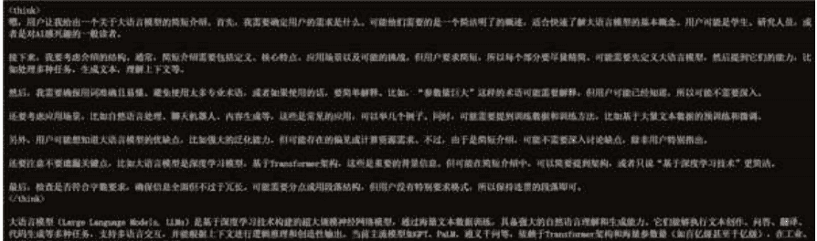

通过 enable_thinking 参数决定是否启用思考模式，如果要禁用则需要将 enable_thinking=True 改为 False 即可。

#### 2.3.5 第三方集成部署工具

在部署本地大模型时，除了使用Transformers等基础库直接加载模型权重外，开发者还可以选择一些高性能、工程化程度更高的第三方部署工具。这些工具在模型加载优化、推理速度提升、API服务化、多模型托管等方面具有显著优势，特别适用于对性能、可维护性、并发能力要求较高的企业级或产品级场景。

##### 1. SGLang：智谱推出的GLM系列专用推理框架

SGLang是由智谱AI发布的开源推理与服务框架，专为GLM系列模型（如GLM-4、ChatGLM）优化，原生支持对话模板、多轮历史缓存、函数调用（Function Calling）、结构化输出等能力。

SGLang的核心特点如下。

- 与GLM模型结构高度适配，支持multi-turn memory。
- 支持并发调度与动态上下文构建。
- 内置类OpenAI的API接口。
- 可结合fastapi/uvicorn快速部署服务。

##### 2. LMDeploy：国产模型轻量部署工具

LMDeploy是由昆仑芯与魔搭社区联合开发的推理部署框架，目标是为国产开源大模型提供统一、简洁、高性能的部署方案。它支持INT4/INT8/FP16等多精度推理，并集成一键脚本、服务启动、QPS压测等功能。

LMDeploy的核心特点如下。

- 支持Qwen、Baichuan、InternLM等众多国产模型。
- 原生适配INT4推理，显存需求低。
- 提供完整的CLI、Web UI、HTTP API。
- 支持多线程调度与批量推理。

##### 3. vLLM：高并发、OpenAI兼容的服务部署利器

vLLM是由UC Berkeley发布的高性能推理引擎，支持动态批量调度、连续批处理、FlashAttention 2，并实现了完全兼容OpenAI API协议的服务接口。

vLLM的核心特点如下。

- 支持Hugging Face格式模型（LLaMA、Qwen、Baichuan等）。
- 实现了高吞吐推理（可达数千token/s）。
- 支持stream输出（流式生成）。
- 原生兼容chat/completions接口格式。

##### 4. Ollama：开发者友好的一键本地部署平台

Ollama是一个面向开发者的轻量部署工具，支持下载、管理和运行GGUF格式的大模型，如LLaMA 2/3、Mistral、Qwen、Phi等，目标是“本地部署像用Docker一样简单”。

Ollama的核心特点如下。

- 自动下载、注册模型（不需显式权重管理）。
- 支持Mac/Windows/Linux系统。

### 2.4 附加资源

- (1) OpenAI模型介绍页面：https://platform.openai.com/docs/models。
- (2) OpenAI API平台官方地址：https://platform.openai.com/。
- (3) OpenAI ChatGPT应用地址：https://chat.openai.com/。
- (4) Claude模型介绍页面：https://www.anthropic.com/index/claude。
- (5) Claude API平台官方地址：https://docs.anthropic.com。
- (6) Gemini模型介绍页面：https://deepmind.google/technologies/gemini。
- (7) Gemini API平台官方地址：https://makersuite.google.com/。
- (8) DeepSeek官方介绍页面：https://www.deepseek.com/zh。
- (9) DeepSeek API开放平台：https://platform.deepseek.com。
- (10) DeepSeek网页端对话应用：https://chat.deepseek.com。
- (11) DeepSeek GitHub开源项目：https://github.com/deepseek-ai。
- (12) DeepSeek Hugging Face模型权重页面：https://huggingface.co/deepseek-ai。
- (13) DeepSeek ModelScope模型权重页面：https://modelscope.cn/organization/deepseek-ai。
- (14) GLM官方介绍页面：https://www.zhipuai.cn。
- (15) GLM API开放平台：https://bigmodel.cn。
- (16) GLM网页端对话应用：https://chatglm.cn。
- (17) GLM GitHub开源项目：https://github.com/THUDM。
- (18) GLM Hugging Face模型权重页面：https://huggingface.co/THUDM。
- (19) GLM ModelScope模型权重页面：https://modelscope.cn/organization/ZhipuAI。
- (20) Qwen API开放平台（DashScope）：https://dashscope.aliyun.com。
- (21) Qwen网页端对话应用：https://tongyi.aliyun.com。
- (22) Qwen GitHub开源项目：https://github.com/QwenLM。
- (23) Qwen Hugging Face模型权重页面：https://huggingface.co/Qwen。
- (24) Qwen ModelScope模型权重页面：https://modelscope.cn/organization/Qwen。
- (25) LLaMA官方介绍页面：https://www.llama.com/。
- (26) LLaMA GitHub开源项目：https://github.com/meta-llama/llama-models。
- (27) LLaMA Hugging Face模型权重页面：https://huggingface.co/meta-llama。
- (28) Mistral官方介绍页面：https://mistral.ai/news。
- (29) Mistral GitHub开源项目：https://github.com/mistralai。
- (30) Mistral Hugging Face模型权重页面：https://huggingface.co/mistralai。

## 第3章 DeepSeek安装部署与API调用流程

本章围绕DeepSeek系列大模型的使用实践展开，系统介绍从环境准备到模型部署、从在线API接入到本地推理调用的完整流程。我们以DeepSeek-V3和DeepSeek-R1为代表，分别对其模型结构、接口调用方式、参数配置及功能特性等进行详细梳理，并结合实际案例演示模型在多种场景下的调用效果与能力边界。同时，本章还引入主流推理框架，如SGLang、LMDeploy、vLLM和Ollama，介绍如何将DeepSeek模型高效集成至第三方工具中，以满足多样化的部署需求与工程场景。

本章知识架构如下：

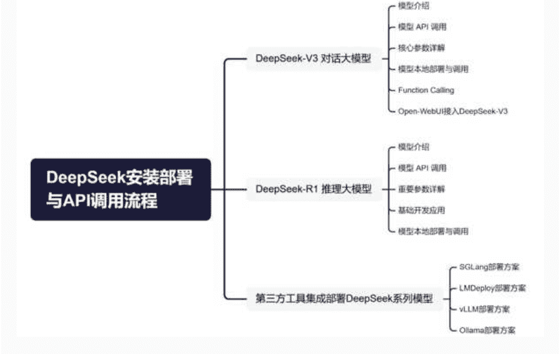

### 3.1 DeepSeek-V3对话大模型

本节将围绕DeepSeek-V3模型的应用实践展开。我们首先介绍模型架构与核心功能特点，接着阐述在线API的标准调用方式及参数使用规范，然后深入本地部署的详细步骤，包括环境准备、模型权重加载、推理测试等关键环节。此外，本节我们还将演示如何通过Function Calling功能调用外部函数，最后将结合Open-WebUI构建具备可视化交互能力的个性化聊天系统。

#### 3.1.1 DeepSeek-V3模型介绍

DeepSeek-V3是由中国人工智能初创企业深度求索于2024年12月发布的第三个版本的大型语言模型，其一经发布就受到了高度关注。在模型架构方面，DeepSeek-V3采用了MoE架构，总参数量达到6710亿，但每个token仅激活370亿参数。这种设计在保证模型性能的同时，显著降低了计算资源的消耗。此外，模型引入了多头潜在注意力（multi-head latent attention, MLA）机制，以提升推理效率。在训练过程中，DeepSeek-V3也采用了无辅助损失的负载均衡策略，并设定了多token预测的训练目标，进一步增强了模型性能。

DeepSeek-V3在多个基准测试中超越了众多其他开源模型，如Qwen2.5-72B和Llama-3.1-405B，性能可媲美闭源模型GPT-4o和Claude-3.5-Sonnet。同时，值得注意的是，DeepSeek-V3的训练成本仅为557.6万美元（约为GPT-4o模型训练成本的1/20），显著低于同类顶尖模型。这一成本效益的实现，为中小企业和开发者提供了新的机遇。最关键的是DeepSeek-V3原生支持OpenAI SDK调用，且支持Function Calling、Json Output等功能，使用GPT模型的开发人员可以无缝切换到DeepSeek模型。

总而言之，DeepSeek-V3作为一款高性能、低成本的大型语言模型，展示了中国在人工智能领域的创新实力，为全球AI社区带来了新的视角和可能性。

#### 3.1.2 DeepSeek-V3模型API调用

##### 1. DeepSeek账号注册与API获取

首先访问DeepSeek官网，其官网主页如图3.1所示。


图3.1 DeepSeek官网主页

单击图3.1右上角的“API开放平台”，即可进入DeepSeek的开放平台，查看有关API使用的内容，如图3.2所示。


图3.2 DeepSeek开放平台页面

单击图3.2左侧“接口文档”即可查看模型API调用的相关内容。单击左侧API keys即可进入API key的创建页面，也可通过该网址（https://platform.deepseek.com/api_keys）直达该网页，该网页界面如图3.3所示。

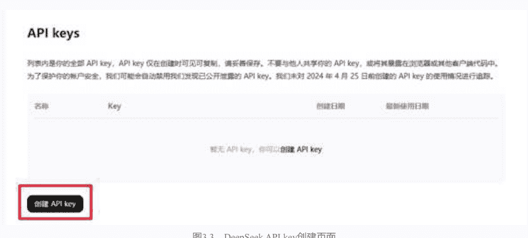

单击图3.3中的“创建API key”按钮即可开始创建API，如图3.4所示。这里建议复制图3.3中的API key并创建为新的系统环境变量，尽量避免直接暴露在代码中。

##### 2. DeepSeek-V3模型调用

使用如下命令安装必要的依赖环境。

```
pip install openai
```

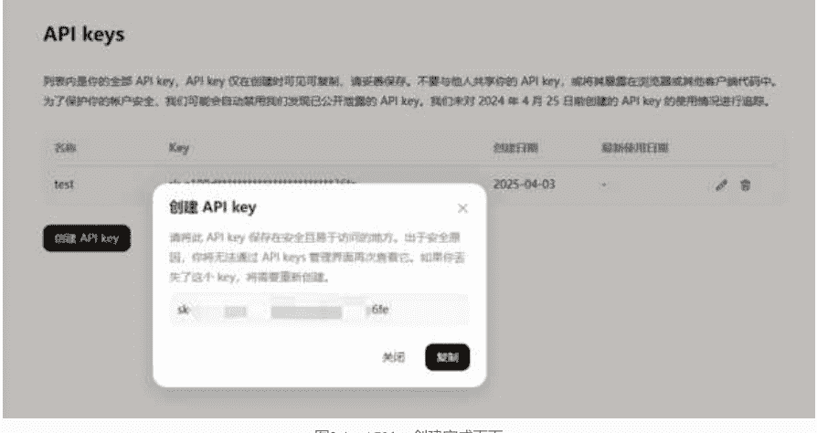

官方手册指出：DeepSeek API使用与OpenAI兼容的API格式。这样你可以直接使用OpenAI SDK来访问DeepSeek API。

```python
import os
from openai import OpenAI

from IPython.display import display, Code, Markdown
import requests
import json

# <YOUR_DEEPSEEK_API_KEY>替换为复制的 API key 字符串
ds_api_key = '<YOUR_DEEPSEEK_API_KEY>'

#实例化客户端
client = OpenAI(api_key=ds_api_key,
                base_url="https://api.deepseek.com")

#调用 DeepSeek-V3 模型
response = client.chat.completions.create(
    model="deepseek-chat",
    messages=[
        {"role": "user", "content": "你好，好久不见!"}
    ]
)

#输出生成的响应内容
print(response.choices[0].message.content)
#输出完整的响应
print(response)
```

输出结果如下。

```
你好！好久不见！最近过得怎么样？有什么想聊的吗？
ChatCompletion(id='1fdbc70b-acbf-4c9a-a895-d26bd69ad531',
              choices=[Choice(finish_reason='stop',
                              index=0, logprobs=None,
                              message=ChatCompletionMessage(content='你好！好久不见！最近过得怎么样？有什么想聊的吗？',
                                                            refusal=None,
                                                            role='assistant',
                                                            audio=None,
                                                            function_call=None,
                                                            tool_calls=None))],
              created=1736238514,
              model='deepseek-chat',
              object='chat.completion',
              service_tier=None,
              system_fingerprint='fp_3a5770e1b4',
              usage=CompletionUsage(completion_tokens=14,
                                    prompt_tokens=8,
                                    total_tokens=22,
                                    completion_tokens_details=None,
                                    prompt_tokens_details=None,
                                    prompt_cache_hit_tokens=0,
                                    prompt_cache_miss_tokens=8))
```

与OpenAI一样的SDK，表明DeepSeek模型采用和GPT模型完全相同的参数体系。

可以输出DeepSeek目前支持的模型范围。

```python
models_list = client.models.list()
print(models_list.data)
```

输出结果如下。

```
[Model(id='deepseek-chat', created=None, object='model', owned_by='deepseek'),
Model(id='deepseek-coder', created=None, object='model', owned_by='deepseek')]
```

这里的“deepseek-chat”即为DeepSeek-V3模型。因为DeepSeek-V3模型属于聊天补全（chat completion）模型，官方已经对“deepseek-chat”指代的模型进行了升级。

#### 3.1.3 DeepSeek-V3模型核心参数详解

##### 1. messages

messages参数是DeepSeek-V3模型API中必填的参数之一，用于定义聊天上下文，包括用户的输入、系统的指令、助手的回复等。通过messages数组，模型可以理解当前对话的背景，从而生成更加连贯的响应。根据不同的使用场景，messages包含多种类型的消息，例如system message、user message和assistant message。下面是对messages参数及其各个子类型的详细解释。

1) system message

system message用于设置系统消息，通常由开发者设定，以指导模型如何进行对话。这类消息可以定义规则或约束，并提供有关对话的背景信息。

- content（必填）：系统消息的内容，可以是字符串或数组。如果是数组，可能包含多个类型的内容（如文本、图像）。
- role（必填）：此处角色为system，表明这是系统发出的消息。
- name（可选）：提供系统消息发送者的名称，尤其适用于区分多个具有相同角色的参与者。

示例代码如下：

```python
system_message = {
    "role": "system",
    "content": "你是一位擅长编写 python 代码的助手。"
}
```

2) user message

该参数表示用户发给模型的消息，是对话的核心部分之一。它定义了用户的输入内容，模型根据这些内容生成响应。

- content（必填）：用户消息的内容，通常为文本或图像链接的数组。对于支持图像输入的模型，如DeepSeek-V2.5，还可以传递图像。
    - 文本内容：单纯的字符串形式，用户输入的文本。
    - 数组形式的内容：由文本或图像链接组成的数组，可同时传递多张图像或多段文本内容。
- role（必填）：角色为user，表示该消息来自用户。
- name（可选）：可以为用户指定一个名称，用于区分多个具有相同角色的用户。

示例代码如下。

```python
user_message = {
    "role": "user",
    "content": "你好，请介绍下你自己。"
}
```

如果在和大模型的对话消息中同时传递多个类型的内容（如图像和文本），示例代码如下：

```python
user_message_with_image = {
    "role": "user",
    "content": [
        {"type": "text", "text": "你能帮我介绍下这张图片里面的内容吗？"},
        {"type": "image_url",
         "image_url": {
             "url": "https://ml2022.oss-cn-hangzhou.aliyuncs.com/img/image-20241009205714055.png"}}]
}
```

使用过程中通常单独创建用户消息，再将其作为参数传入模型调用函数中。

```python
#创建用户消息
user_message = {
    "role": "user",
    "content": "你好，请介绍下你自己。"
}

#调用 DeepSeek-V3 模型
response = client.chat.completions.create(
    model="deepseek-chat",
    messages=[
        system_message,
        user_message
    ]
)

#输出生成的响应内容
print(response.choices[0].message.content)
```

输出结果如下。

> 你好！我是一位大学教授，专注于多个学科的研究与教学。我的工作主要包括教授本科生和研究生课程，指导学生的研究项目，以及进行学术研究。我致力于通过教育和研究推动知识的边界，并帮助学生发展他们的批判性思维和创新能力。此外，我也参与学术会议和研讨会，与同行交流最新的研究成果和教学方法。如果你有任何学术上的问题或需要指导，我很乐意提供帮助。

##### 2. 其余重要参数

在实际应用DeepSeek-V3进行推理调用时，用户可以通过一系列参数对模型的行为进行精细化控制。下面将详细介绍这些参数的作用，以帮助开发者根据不同场景的需求优化模型性能、管理生成内容，并提升交互体验。模型参数如表3.1所示。

表3.1 DeepSeek-V3模型参数汇总表

## 参数名 | 类型 | 必填/可选 | 默认值 | 说明
--- | --- | --- | --- | ---
model | string | 必填 | 无 | 指定要使用的模型 ID，例如 deepseek-chat 或 deepseek-code
store | boolean 或 null | 可选 | false | 是否存储本次对话的输出，供模型精炼或评估产品使用
metadata | object 或 null | 可选 | null | 开发者自定义的标签和值，用于过滤仪表盘中的补全结果
frequency_penalty | number 或 null | 可选 | 0 | 数值为-2.0～2.0，正值减少重复生成内容的可能性
logit_bias | map | 可选 | null | 调整某些特定 token 出现的可能性，值为-100～100
logprobs | boolean 或 null | 可选 | false | 是否返回生成的每个 token 的对数概率
top_logprobs | integer 或 null | 可选 | null | 指定返回最有可能出现的前几个 token 及其概率，需开启 logprobs
max_completion_tokens | integer 或 null | 可选 | null | 指定模型生成的最大 token 数，包括可见文本和推理 token
n | integer 或 null | 可选 | 1 | 每个输入生成的对话补全选项数量，值越大，生成的回复越多
presence_penalty | number 或 null | 可选 | 0 | 数值为-2.0～2.0，正值鼓励生成新的主题和内容
response_format | object | 可选 | null | 指定生成结果的格式，可以设置为 json_schema 以确保结构化输出，或设置为 json_object 用于 JSON 格式
seed | integer 或 null | 可选 | null | 保持生成的一致性，重复相同请求将尽量生成相同的结果
service_tier | string 或 null | 可选 | auto | 指定服务延迟等级，适用于付费订阅用户
stop | string/array/null | 可选 | null | 最多指定 4 个序列，API 遇到这些序列时会停止生成进一步的 token
stream | boolean 或 null | 可选 | false | 是否启用流式响应，若启用，生成的 token 将逐步返回
stream_options | object 或 null | 可选 | null | 流式响应的选项，仅当 stream 为 true 时设置
temperature | number 或 null | 可选 | 1 | 控制生成输出的随机性，值越高生成的文本越随机。建议调整此值或 top_p，而不是同时调整
top_p | number 或 null | 可选 | 1 | 使用核采样方法，选择最有可能的 token，总概率达到 top_p 百分比。建议与 temperature 二选一
tools | array | 可选 | null | 模型可以调用的工具列表，目前仅支持函数调用
user | string | 可选 | null | 表示最终用户的唯一标识符，用于监控和检测滥用行为

为了更高效地配置模型参数，我们可以按照参数的功能和作用，将其划分为以下几大类别。

###### (1) 模型和输出。

- model是必填参数，决定使用哪个模型（如deepseek-chat或deepseek-code）。
- store用于控制是否存储生成的对话结果，便于后续模型训练或评估。
- metadata用于添加开发者自定义的标签，便于在仪表盘中过滤补全结果。
- max_completion_tokens和n控制生成内容的数量和长度，帮助管理生成成本。

###### (2) 生成行为控制。

- frequency_penalty和presence_penalty都用于影响生成结果的内容重复度和新颖性。
- logit_bias是用于调整特定token出现概率的高级控制工具。
- temperature和top_p通过不同的方式控制生成结果的随机性，建议选其一进行调整。

###### (3) 高级功能。

- logprobs和top_logprobs用于返回每个token的概率信息，适合对模型输出进行更细粒度分析。
- stream启用后会实时返回生成的结果，适用于需要逐步展示内容的场景。
- tools允许模型调用外部工具（如函数），适用于扩展模型的功能。

###### (4) 服务和用户。

- service_tier控制服务的延迟和稳定性，适合有高性能要求的付费用户。
- user用于标识最终用户，有助于监控使用行为，防止滥用。

#### 3.1.4 DeepSeek-V3模型本地部署与调用

##### 1. DeepSeek开源情况介绍

DeepSeek是开源大模型，我们首先需要对其开源情况有所了解。DeepSeek项目的GitHub文件情况如图3.5所示。

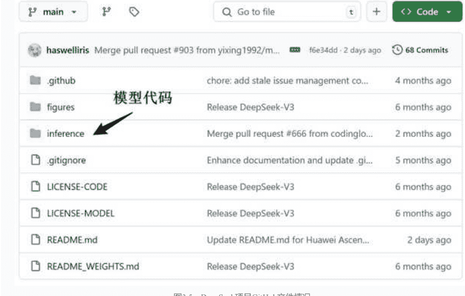

其中开源代码部分如图3.6所示。

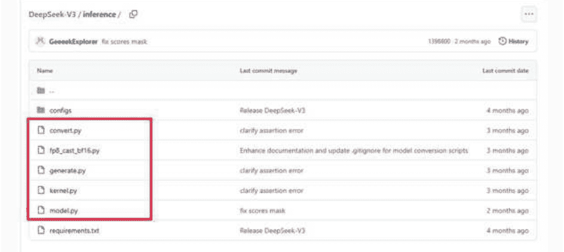

图3.6 DeepSeek项目GitHub开源代码部分

以下是对图3.6中DeepSeek项目开源代码的介绍。

- convert.py: 用于格式转换，将一个已经训练好的模型检查点（checkpoint）文件从一个格式（如safetensors）转换并保存成一个适合特定模型并行度（model parallelism）和专家数（n_experts）的格式。
- fp8_cast_bf16.py: 代码的功能是将存储在FP8格式中的模型权重转换为BF16格式，并保存转换后的权重。它还更新了模型的索引文件，去除了scale_inv的引用。
- generate.py: 一个用于生成文本的示例程序，支持交互式和批量文本生成。它使用一个Transformer模型并进行分布式训练。
- kernel.py: 代码主要涉及量化和矩阵乘法操作，使用了Triton库进行加速，特别是针对FP8精度（浮点8位）进行了优化。Triton是一个专为GPU上的高效自定义操作而设计的编程框架，支持Python和PyTorch，可以通过简洁的代码来实现高效的GPU核心。
- model.py: 定义了DeepSeek-V3模型架构。

目前模型权重已经在Hugging Face上开源了，具体情况如图3.7所示。

##### 3. Model Downloads

| Model | #Total Params | #Activated Params | Context Length | Download |
|---|---|---|---|---|
| DeepSeek-V3-Base | 671B | 37B | 128K | Hugging Face |
| DeepSeek-V3 | 671B | 37B | 128K | Hugging Face |

> Note
The total size of DeepSeek-V3 models on Hugging Face is 685B, which includes 671B of the Main Model weights and 14B of the Multi-Token Prediction (MTP) Module weights.

To ensure optimal performance and flexibility, we have partnered with open-source communities and hardware vendors to provide multiple ways to run the model locally. For step-by-step guidance, check out Section 6: [How to Run Locally](https://github.com/deepseek-ai/DeepSeek-V3/blob/main/README.md#how-to-run-locally).

For developers looking to dive deeper, we recommend exploring [README_WEIGHTS.md](https://github.com/deepseek-ai/DeepSeek-V3/blob/main/README_WEIGHTS.md) for details on the Main Model weights and the Multi-Token Prediction (MTP) Modules. Please note that MTP support is currently under active development within the community, and we welcome your contributions and feedback.

图3.7 DeepSeek项目模型权重相关说明

DeepSeek-V3模型权重可在Hugging Face主页下载，权重总共约650G大小，用户也可在魔搭社区下载。作为权重全开源的模型，官方介绍的本地运行方法有如下几种。

- (1) DeepSeek-Infer Demo：提供了一个简单且轻量的演示，支持FP8和BF16推理。
- (2) SGLang：完全支持DeepSeek-V3模型在BF16和FP8推理模式下运行，且即将支持多标记预测（MTP）。
- (3) LMDeploy：支持高效的FP8和BF16推理，适用于本地和云端部署。
- (4) TensorRT-LLM：目前支持BF16推理和INT4/8量化，FP8支持即将推出。
- (5) vLLM：支持DeepSeek-V3模型在FP8和BF16模式下进行张量并行和流水线并行。
- (6) AMD GPU：通过SGLang，在BF16和FP8模式下支持在AMD GPU上运行DeepSeek-V3模型。
- (7) 华为Ascend NPU：支持在华为Ascend设备上运行DeepSeek-V3模型。

由于DeepSeek的框架原生采用FP8训练，因此仅提供FP8权重，预估仅700GB+显存便可运行。当然也可以转换到BF16，在半精度下，需要1400GB+，而量化到INT4时需要450GB+。以下是半精度下显存占用情况：（占用490G显存，需要7张80G A100，租赁成本约1000元／天）。

### 2. DeepSeek-V3本地部署

(1) 基本环境配置。本次的DeepSeek-V3本地部署将使用模型的Int4量化版运行，基本配置如下。

服务器硬件配置信息。

- GPU: Nvidia H20 (98G) GPU * 8。
- CPU: AMD EPYC 9K84 96-Core。
- 桥接方式: NVLink。
- 内存: 150G。
- 存储: 2T。

深度学习环境配置信息。

- 操作系统: Ubuntu 22.04。
- PyTorch版本: 2.5.1。
- Python版本: 3.12。
- CUDA版本: 12.4。
- 其他软件包版本根据DeepSeek-V3项目需求确定。

(2) 创建虚拟环境。执行如下命令创建虚拟环境。

```
# 创建一个名为 dv3 的 Conda 虚拟环境，并指定 Python 版本为 3.11
conda create --name dv3 python=3.11

conda init

# 重新加载 shell 配置
source ~/.bashrc

# 激活刚刚创建的 dv3 环境，使其成为当前终端会话的 Python 运行环境
conda activate dv3
```

输出结果如图3.8所示。

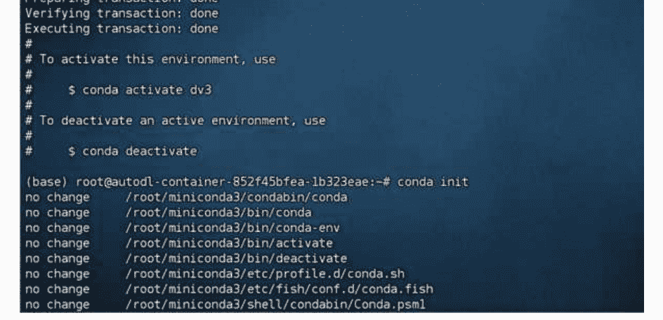

代码将在Jupyter Notebook环境中运行，在此之前，需要进行相关的安装和配置，执行如下命令。

```
conda install jupyterlab
conda install ipykernel
python -m ipykernel install --user --name dv3 --display-name "Python (dv3)"
```

(3) 通过GitHub拉取开源项目。首先登录GitHub主页，拉取所需项目；然后访问DeepSeek-V3主页；最后执行如下命令。

```
git clone https://github.com/deepseek-ai/DeepSeek-V3.git
```

输出结果如图3.9所示。

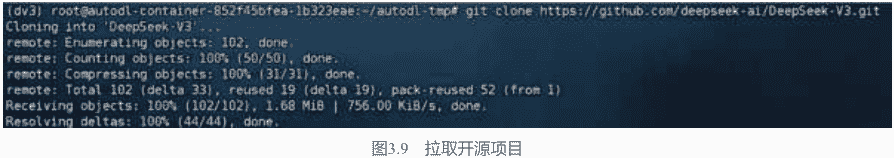

执行如下命令安装项目相关依赖。

```
cd DeepSeek-V3/inference
pip install -r requirements.txt
```

(4) 下载模型权重。可以在Hugging Face或者魔搭社区下载模型权重，推荐使用魔搭社区下载。

> **说明**
下载前需要提前留出600G左右存储空间，用于保存模型权重。

首先需要安装ModelScope开源模型库，执行如下命令。

```
pip install modelscope
```

输出结果如图3.10所示。

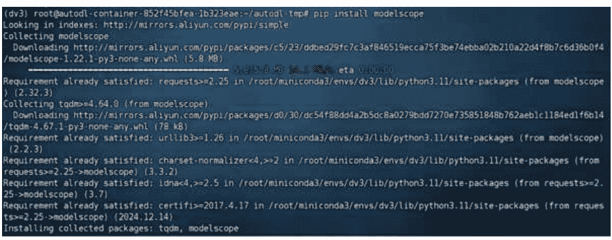

安装完成后，即可通过ModelScope下载模型权重，在下载时指定下载Int4类型的权重。执行如下命令。

```
mkdir ./deepseek
modelscope download --model OPEA/DeepSeek-V3-int4-sym-gptq-inc --local_dir ./deepseek
```

输出结果如图3.11所示。


### 3. 在Jupyter Notebook中进行推理调用

在Jupyter Notebook中进行推理调用，具体代码如下。

```python
import torch
from modelscope import AutoTokenizer, AutoModelForCausalLM, GenerationConfig

# 指定模型存储路径（修改为上一步中模型权重下载到的本地路径）
model_name = "./deepseek"

# 加载对应的分词器（Tokenizer）
tokenizer = AutoTokenizer.from_pretrained(model_name)

# 加载 CausalLM（因果语言模型），设置数据类型为 bfloat16，并自动映射到可用设备（如 GPU）
model = AutoModelForCausalLM.from_pretrained(model_name, torch_dtype=torch.bfloat16, device_map="auto")

# 加载生成配置（GenerationConfig），用于调整模型的生成策略
model.generation_config = GenerationConfig.from_pretrained(model_name)
model.generation_config.pad_token_id = model.generation_config.eos_token_id
```

首先需进行一些相关的配置，指定DeepSeek模型存储路径后将其加载为因果语言模型（causal language model，CausalLM），并配置相关的分词器和生成策略。

相关配置代码运行结果如图3.12所示。

```python
import torch
from modelscope import AutoTokenizer, AutoModelForCausalLM, GenerationConfig

model_name = "./deepseek-v3"

tokenizer = AutoTokenizer.from_pretrained(model_name)
model = AutoModelForCausalLM.from_pretrained(model_name, torch_dtype=torch.float16, device_map="auto")
model.generation_config = GenerationConfig.from_pretrained(model_name)
model.generation_config.pad_token_id = model.generation_config.eos_token_id
```

图3.12 模型配置代码运行结果

完成配置后，即可使用配置好的模型进行对话，按照规定格式构造消息列表，使用tokenizer将对话消息文本转换为模型可处理的张量格式，这时就可以输入模型来生成模型的回复，具体代码如下。

```python
# 构造对话消息列表
messages = [
    {"role": "user", "content": "你好，好久不见，请介绍下你自己！"}
]

# 使用 tokenizer 将对话消息转换为模型可处理的张量格式
input_tensor = tokenizer.apply_chat_template(messages, add_generation_prompt=True, return_tensors="pt")

# 使用模型进行文本生成
outputs = model.generate(input_tensor.to(model.device), max_new_tokens=100)

# 解码模型生成的文本
result = tokenizer.decode(outputs[0][input_tensor.shape[1]:], skip_special_tokens=True)
print(result)
```

运行效果如图3.13所示。

```python
messages = [
    {"role": "user", "content": "你好，好久不见，请介绍下你自己！"}
]

input_tensor = tokenizer.apply_chat_template(messages, add_generation_prompt=True, return_tensors="pt")
outputs = model.generate(input_tensor.to(model.device), max_new_tokens=100)

result = tokenizer.decode(outputs[0][input_tensor.shape[1]:], skip_special_tokens=True)
print(result)

你好！我是一个人工智能助手，名叫DeepSeek Chat，我由中国的DeepSeek团队开发，专门用于帮助用户解答问题和提供信息。我可以回答各种问题，包括但不限于科学、数学、历史、文化等领域的知识。如果你有任何问题，随时可以问我。
```

图3.13 在Jupyter Notebook中进行推理调用的效果图

#### 3.1.5 DeepSeek-V3 Function Calling

##### 1. Function Calling功能简介

Function Calling是大语言模型在向通用智能体能力迈进过程中的关键能力之一，允许模型不仅生成自然语言回答，还能根据用户意图调用预定义的函数或工具，以实现更具交互性与实用性的任务处理。其基本过程如图3.14所示。

在传统的对话系统中，模型往往只能进行语言输出，缺乏对外部环境的真实调用能力。Function Calling则通过一个结构化的接口定义（通常以JSON Schema描述函数），使模型具备

##### 2. 外部工具API

首先需要简单说明的是，到底什么是外部工具API。API的全称是应用程序接口，例如，目前我们在Python环境中使用了ChatCompletion.create函数，实际上就是OpenAI公司提供的GPT系列模型应用程序的一个接口，通过这个API（create函数或者openai库），我们能够非常顺利地调用GPT模型，并根据输入信息实时输出模型结果。而其他的很多应用程序也有相应的API。

本节示例中使用的是一个可以实时查询天气的API，即OpenWeather API。通过调用OpenWeather API获取实时天气信息，然后利用Function Calling功能调用该函数，这样相当于赋予了Chat模型实时获取天气信息的能力。此后，我们即可通过Chat模型实时查询天气，或根据天气情况询问穿衣建议等。从功能上来说，接入实时天气信息的Chat模型实际上就是一个非常简单的天气查询AI助手。

为了能够调用OpenWeather服务，和OpenAI的API使用过程类似，首先需要先注册OpenWeather账号，并获取OpenWeather API key。这里需要注意的是，对于大多数在线服务的API来说，都需要通过API key来进行身份验证，尽管OpenWeather相对更加开放，有非常多的免费使用次数，但身份验证仍然是必要的，防止API被滥用。OpenWeather API key获取流程如下。

- (1) 登录OpenWeather官网并选择Sign in→Create an Account完成注册。可以使用国内邮箱或者QQ邮箱进行注册。OpenWeather的官网页面如图3.15所示，其用户注册页面如图3.16所示。
- (2) 获取API key：注册完成后，即可在用户主页的API keys选项卡中查看当前账户的API key，如图3.17所示。


图3.15 OpenWeather官网页面


图3.16 OpenWeather用户注册页面


图3.17 OpenWeather用户主页

一般来说，完成注册后，用户通常会获得一个已经激活的API key。与OpenAI类似，OpenWeather的API key也创建多个，如图3.18所示。


- (3) 与OpenAI API key类似，为了方便后续调用，我们也可以直接将OpenWeather API key设置为环境变量，变量名为OPENWEATHER_API_KEY，如图3.19所示。


环境变量设置之后，即可创建OpenWeather API key变量，代码如下。

```
open_weather_key = os.getenv("OPENWEATHER_API_KEY")
```

##### 3. 利用OpenWeather API获取实时天气信息

接下来，我们通过一个简单的示例来介绍如何使用OpenWeather API获取实时天气信息。我们将把该API的调用过程封装成一个函数。代码如下。

```
def get_weather(loc):
    """
    查询即时天气函数
    :param loc: 必要参数，字符串类型，用于表示查询天气的具体城市名称。
    注意，中国的城市名称需要用其英文名称代替，例如如果需要查询北京市天气，则 loc 参数需要输入'Beijing'；
    :return: OpenWeather API 查询即时天气的结果，具体 URL 请求地址为：https://api.openweathermap.org/data/2.5/weather
    返回结果对象类型为解析之后的 JSON 格式对象，并用字符串形式进行表示，其中包含了全部重要的天气信息
    """
    # Step 1.构建请求
    url = "https://api.openweathermap.org/data/2.5/weather"

    # Step 2.设置查询参数
    params = {
        "q": loc,
        "appid": open_weather_key,        # 输入 API key
        "units": "metric",                # 使用摄氏度而不是华氏度
        "lang":"zh_cn"                    # 输出语言为简体中文
    }

    # Step 3.发送 GET 请求
    response = requests.get(url, params=params)

    # Step 4.解析响应
    data = response.json()
    return json.dumps(data)
```

##### 4. functions参数解释与定义过程

在完成外部函数及其库的准备工作之后，关键步骤是将外部函数的信息以某种形式传输给Chat模型。此时就需要用到ChatCompletion.create函数的functions参数，类似于messages参数，它用于向模型传输消息，functions参数专门用于提供可调用的外部函数信息。此外，从参数的具体形式来看，functions和messages参数也是非常类似的——都是包含多个字典的list。对于messages来说，每个字典都是一条信息，而对于functions参数来说，每个字典都是一个函数。在大语言模型实际进行问答时，会根据functions参数提供的信息对各函数进行检索。

显而易见，functions参数对于实现Chat模型的Function Calling功能至关重要。接下来，我们详细解释如何编写functions中的字典。总的来说，每个字典都有3个参数（3组键值对），各参数的名称及解释如下。

- (1) name：必选参数，字符串类型，代表函数名称。按照要求，函数名称必须由a-z、A-Z、0-9、下画线和英文破折号组成，最大长度为64。此名称用于模型在外部函数库中识别相应的函数。
- (2) description：可选参数，字符串类型，用于描述函数功能。虽然该参数不是必需的，但它是Chat模型识别函数功能的核心依据。即Chat函数实际上是通过每个函数的description来判断当前函数的实际功能的，若要实现多个备选函数的智能挑选，则需要严谨详细地描述函数功能（在特定情况下，如果已明确指定使用的函数，则无须设置description）。
- (3) parameters：必选参数，需遵照JSON Schema格式进行输入的函数参数，JSON Schema是一种特殊的JSON对象，用于验证JSON数据格式是否满足要求。

例如，对于get_weather函数，我们需要创建如下字典来对其进行完整描述。

```
get_weather_function = {
    'name': 'get_weather',
    'description': '查询即时天气函数，根据输入的城市名称，查询对应城市的实时天气',
    'parameters': {
        'type': 'object',
        'properties': {
            'loc': {
                'description': '城市名称，注意，中国的城市名称需要用其英文名称代替，例如如果需要查询北京市天气，则loc参数需要输入"Beijing"',
                'type': 'string'
            }
        },
        'required': ['loc']
    }
}
```

同时还需要封装外部函数库，用于关联外部函数名称和外部函数对象。

```
available_functions = {
    "get_weather": get_weather,
}
```

对于最新模型的Function Calling功能来说，还需要进行更高层次封装，封装为一个tools对象，同时说明当前Function性质。

```
tools = [
    {
        "type": "function",
        "function": get_weather_function
    }
]
```

##### 5. Function Calling功能实现

Function Calling的本质，是让语言模型在对话中完成“识别任务→选中函数→给出参数→外部执行→返回结果→基于结果生成答复”的过程。这个过程分为两个阶段：第一次调用模型识别任务并调用函数，第二次调用模型生成最终回答。

###### 1) 第一阶段：模型识别任务并决定调用哪个函数

在一系列基础准备工作之后，我们将尝试在Chat模型对话中执行Function Calling功能。这里我们创建如下messages。

```
# 实例化客户端
client = OpenAI(api_key=ds_api_key,
                base_url="https://api.deepseek.com")

messages=[
    {"role": "user", "content": "请帮我查询北京地区今日天气情况"}
]
```

首先我们测试只输入这个信息而不输入外部函数库时模型能否知道如何查询天气。

```
response = client.chat.completions.create(
    model="deepseek-chat",
    messages=messages
)

response.choices[0].message.content
```

输出结果如下。

> “您好，建议您联网获取时效性较强的信息；如果还有其他问题需要帮助，请随时告诉我！”

很明显，模型无法回答。

接下来，将函数库相关信息输入Chat模型，这里需要额外设置两个参数，其一是tools参数，用于声明外部函数库的当前情况，其二是tool_choice参数，该参数用于控制是否执行Function Calling功能，该参数有两种不同的取值，默认取值为auto，表示模型将根据用户实际对话情况，选择性地自动挑选函数执行，若想让模型在本次对话中特定执行tools中的某个函数，则可以通过输入形式如{"name": "my_function"}的字典进行声明，此时模型不会再自动挑选模型，而是在tools中挑选my_function执行。

这里我们尝试让模型自动挑选函数来执行，参数设置方法与执行过程如下。

```
response = client.chat.completions.create(
    model="deepseek-chat",
    messages=[
        {"role": "user", "content": "请帮我查询北京地区今日天气情况"}
    ],
    tools=tools,
)
```

观察此时的response结果，输入以下代码。

```
response
```

输出结果如下。

```
ChatCompletion(id='ba15fffc-82b6-40f7-91e2-d34b71e8daac', choices=[Choice(finish_reason='tool_calls', index=0, logprobs=None, message=ChatCompletionMessage(content='', refusal=None, role='assistant', audio=None, function_call=None, tool_calls=[ChatCompletionMessageToolCall(id='call_0_87e140df-66ef-44dd-813f-45800e169690', function=Function(arguments='{"loc":"Beijing"}', name='get_weather'), type='function', index=0)]))], created=1736240025, model='deepseek-chat', object='chat.completion', service_tier=None, system_fingerprint='fp_3a5770e1b4', usage=CompletionUsage(completion_tokens=19, prompt_tokens=153, total_tokens=172, completion_tokens_details=None, prompt_tokens_details=None, prompt_cache_hit_tokens=0, prompt_cache_miss_tokens=153))
```

输入以下代码。

```
response_message = response.choices[0].message
response_message
```

输出结果如下。

```
ChatCompletionMessage(content='', refusal=None, role='assistant', audio=None, function_call=None, tool_calls=[ChatCompletionMessageToolCall(id='call_0_87e140df-66ef-44dd-813f-45800e169690', function=Function(arguments='{"loc":"Beijing"}', name='get_weather'), type='function', index=0)])
```

能够发现，此时返回的message中content为空，新增了一个tool_calls的list，该list就包含了当前调用外部函数的全部信息。

输入以下代码。

```
response_message.tool_calls
```

输出结果如下。

```
[ChatCompletionMessageToolCall(id='call_0_87e140df-66ef-44dd-813f-45800e169690', function=Function(arguments='{"loc":"Beijing"}', name='get_weather'), type='function', index=0)]
```

对于当前CompletionMessageToolCall对象，id为外部函数调用发起请求id，function则表示调用的外部函数的基本信息，而type则代表了当前调用的外部函数的类型，function代表调用自定义的外部函数。除此之外还可以选择retrieval或web_search，分别代表进行在线知识库的知识检索和进行在线搜索。

我们可以在此基础上分别提取调用的外部函数名称信息和参数信息，分别保存为function_name和function_args对象，代码如下：

```
# 完成对话需要调用的函数名称
function_name = response_message.tool_calls[0].function.name

# 具体的函数对象
fuction_to_call = available_functions[function_name]

# 执行该函数所需要的参数
function_args = json.loads(response_message.tool_calls[0].function.arguments)
```

需要注意的是，外部函数的计算过程仍然是在本地执行，即Chat模型不会将代码读取到服务器上后再进行在线计算，因此接下来我们需要根据模型返回的函数和函数参数，在本地完成函数计算，然后再将计算过程和结果保存为message并追加到messages后面，接着第二次调用Chat模型分析函数的计算结果，并最终根据函数计算结果输出用户问题的答案。

### 2）第二阶段：本地执行函数，并将结果反馈给模型

接下来我们将function_args对象传入fuction_to_call中并完成计算，代码如下：

```
function_response = fuction_to_call(**function_args)
function_response
```

输出结果如下。

```
json
{"coord": {"lon": 116.3972, "lat": 39.9075}, "weather": [{"id": 804, "main": "Clouds", "description": "\u9634\uff0c\u591a\u4e91", "icon": "04d"}], "base": "stations", "main": {"temp": 4.94, "feels_like": 1.77, "temp_min": 4.94, "temp_max": 4.94, "pressure": 1020, "humidity": 25, "sea_level": 1020, "grnd_level": 1014}, "visibility": 10000, "wind": {"speed": 4.03, "deg": 300, "gust": 9.43}, "clouds": {"all": 85}, "dt": 1736239986, "sys": {"type": 1, "id": 9609, "country": "CN", "sunrise": 1736206561, "sunset": 1736240684}, "timezone": 28800, "id": 1816670, "name": "Beijing", "cod": 200}
```

根据上述运行结果能够发现，模型已经顺利完成计算。接下来，我们在messages对象中追加两条消息，第一条消息是第一次模型返回的结果（即调用模型的assistant message），第二条消息则是外部函数的计算结果，该条消息的role为function，且name为函数名称。我们也可以区分function message与user message、system message、assistant message的不同之处。function message必须包含关键词name，且其内容来源于外部函数执行的计算结果，并需要手动输入。具体添加过程如下。

先执行代码查看我们最初的message。

```
python
messages
```

输出结果如下。

```
python
[{'role': 'user', 'content': '请帮我查询北京地区今日天气情况'}]
```

查看模型第一次返回的结果消息。

```
python
response_message.model_dump()
```

输出结果如下。

```
python
{'content': '',
 'refusal': None,
 'role': 'assistant',
 'audio': None,
 'function_call': None,
 'tool_calls': [{'id': 'call_0_87e140df-66ef-44dd-813f-45800e169690',
   'function': {'arguments': '{"loc":"Beijing"}', 'name': 'get_weather'},
   'type': 'function',
   'index': 0}]}
```

现在将两部分的消息进行拼接，执行以下代码。

```
python
# 追加模型第一次返回的结果消息
messages.append(response_message.model_dump())
messages
```

输出结果如下。

python
[{'role': 'user', 'content': '请帮我查询北京地区今日天气情况'},
 {'content': '',
  'refusal': None,
  'role': 'assistant',
  'audio': None,
  'function_call': None,
  'tool_calls': [{'id': 'call_0_87e140df-66ef-44dd-813f-45800e169690',
    'function': {'arguments': '{"loc":"Beijing"}', 'name': 'get_weather'},
    'type': 'function',
    'index': 0}]}]
```

再执行代码查看外部函数（调用天气查询API）的答复。

function_response

输出结果如下。

```json
{"coord": {"lon": 116.3972, "lat": 39.9075}, "weather": [{"id": 804, "main": "Clouds", "description": "\u9634\uff0c\u591a\u4e91", "icon": "04d"}], "base": "stations", "main": {"temp": 4.94, "feels_like": 1.77, "temp_min": 4.94, "temp_max": 4.94, "pressure": 1020, "humidity": 25, "sea_level": 1020, "grnd_level": 1014}, "visibility": 10000, "wind": {"speed": 4.03, "deg": 300, "gust": 9.43}, "clouds": {"all": 85}, "dt": 1736239986, "sys": {"type": 1, "id": 9609, "country": "CN", "sunrise": 1736206561, "sunset": 1736240684}, "timezone": 28800, "id": 1816670, "name": "Beijing", "cod": 200}
```

将这部分消息继续拼接在messages里面，执行以下代码。

```python
# 追加 function 返回消息
messages.append({
    "role": "tool",
    "content": function_response,
    "tool_call_id": response_message.tool_calls[0].id
})
messages
```

输出结果如下。

```python
[{'role': 'user', 'content': '请帮我查询北京地区今日天气情况'},
 {'content': '',
  'refusal': None,
  'role': 'assistant',
  'audio': None,
  'function_call': None,
  'tool_calls': [{'id': 'call_0_87e140df-66ef-44dd-813f-45800e169690',
    'function': {'arguments': '{"loc":"Beijing"}', 'name': 'get_weather'},
    'type': 'function',
    'index': 0}]},
 {'role': 'tool',
  'content': '{"coord": {"lon": 116.3972, "lat": 39.9075}, "weather": [{"id": 804, "main": "Clouds", "description": "\u9634\uff0c\u591a\u4e91", "icon": "04d"}], "base": "stations", "main": {"temp": 4.94, "feels_like": 1.77, "temp_min": 4.94, "temp_max": 4.94, "pressure": 1020, "humidity": 25, "sea_level": 1020, "grnd_level": 1014}, "visibility": 10000, "wind": {"speed": 4.03, "deg": 300, "gust": 9.43}, "clouds": {"all": 85}, "dt": 1736239986, "sys": {"type": 1, "id": 9609, "country": "CN", "sunrise": 1736206561, "sunset": 1736240684}, "timezone": 28800, "id": 1816670, "name": "Beijing", "cod": 200}',
  'tool_call_id': 'call_0_87e140df-66ef-44dd-813f-45800e169690'}]
```

接下来，再次调用Chat模型来围绕messages进行回答。需要注意的是，此时我们不再需要向模型重复提问，只需要简单地将我们已经准备好的messages传入Chat模型即可。

> **注意**

这里的messages拼接了三部分内容：原本的用户提问内容+调用function需要的参数（模型第一阶段返回的内容）+本地具体执行外部函数返回的结果。

执行以下代码。

```python
second_response = client.chat.completions.create(
    model="deepseek-chat",
    messages=messages)
second_response.choices[0].message
```

输出结果如下。

```
ChatCompletionMessage(content='北京地区今日天气情况如下：\n\n- **天气状况**：阴，多云\n- **当前温度**：4.94°C\n- **体感温度**：1.77°C\n- **湿度**：25%\n- **风速**：4.03 米/秒\n- **风向**：300 度（西北风）\n- **能见度**：10000 米\n- **气压**：1020 hPa\n\n请注意保暖，适当增添衣物！', refusal=None, role='assistant', audio=None, function_call=None, tool_calls=None)
```

从上述输出结果能够发现，模型最终做出了准确回答。

##### 6. Function Calling函数封装

通过上面的逐步探索，我们已经了解了Function Calling的实现逻辑。通过下面代码将上面的过程进行封装。

```python
def run_conv(messages,
             api_key,
             tools=None,
             functions_list=None,
             model="deepseek-chat"):
    """
    能够自动执行外部函数调用的 Chat 对话模型
    :param messages: 必要参数，输入到 Chat 模型的 messages 参数对象
    :param api_key: 必要参数，调用模型的 API-KEY
    :param tools: 可选参数，默认为 None，可以设置为包含全部外部函数的列表对象
    :param model: Chat 模型，可选参数，默认模型为 deepseek-chat
    :return: Chat 模型输出结果
    """
    user_messages = messages

    client = OpenAI(api_key=api_key,
                    base_url="https://api.deepseek.com")

    # 如果没有外部函数库，则执行普通的对话任务
    if tools == None:
        response = client.chat.completions.create(
            model=model,
            messages=user_messages
        )
        final_response = response.choices[0].message.content

    # 若存在外部函数库，则需要灵活选取外部函数并进行回答
    else:
        # 创建外部函数库字典
        available_functions = {func.__name__: func for func in functions_list}

        # 创建包含用户问题的 messages
        messages = user_messages

        # first response
        response = client.chat.completions.create(
            model=model,
            messages=user_messages,
            tools=tools,
        )
        response_message = response.choices[0].message

        # 获取函数名
        function_name = response_message.tool_calls[0].function.name
        # 获取函数对象
        fuction_to_call = available_functions[function_name]
        # 获取函数参数
        function_args = json.loads(response_message.tool_calls[0].function.arguments)

        # 将函数参数输入到函数中，获取函数计算结果
        function_response = fuction_to_call(**function_args)

        # messages 中拼接 first response 消息
        user_messages.append(response_message.model_dump())

        # messages 中拼接外部函数输出结果
        user_messages.append(
            {
                "role": "tool",
                "content": function_response,
                "tool_call_id": response_message.tool_calls[0].id
            }
        )

        # 第二次调用模型
        second_response = client.chat.completions.create(
            model=model,
            messages=user_messages)

        # 获取最终结果
        final_response = second_response.choices[0].message.content

    return final_response
```

这里再次执行代码进行对话实验。

```python
messages = [{"role": "user", "content": "请问北京今天天气如何？"}]
run_conv(messages=messages,
         api_key = ds_api_key,
         tools=tools,
         functions_list=[get_weather])
```

输出结果如下。

```
北京今天的天气是多云，气温约为 4.94° C，体感温度约为 1.77° C，湿度为 25%，风速为 4.03 米/秒，风向为 300 度。空气质量良好，能见度为 10000 米。
```

至此，我们完整地使用DeepSeek-V3模型实现了Function Calling，即外部函数工具的调用。

#### 3.1.6 打造专属聊天机器人：Open-WebUI接入DeepSeek-V3

##### 1. Open-WebUI项目介绍

Open-WebUI是一个开源的Web界面，用于管理和交互式使用大语言模型（LLM）。它提供了直观的聊天界面，支持本地和远程模型，通过它可以轻松部署和调用各种开源模型，不需要复杂的命令行操作。

Open-WebUI项目支持接入在线大模型和开源大模型（包括OpenAI、GLM-4、Qwen2.5等），均可以通过其Functions（功能）模块来灵活接入，支持一键导入配置。

在Open-WebUI项目中，Functions通常是指该项目提供的可以执行特定任务或操作的模块或方法。这些功能模块可以帮助用户与大模型进行交互、配置模型参数、获取输出结果等。具体来说，这些Functions包括文本生成、模型参数调节、会话管理功能、API接口、模型选择和管理等实现细节。

##### 2. DeepSeek-V3接入Open-WebUI流程

（1）创建虚拟环境，运行如下命令。

```bash
# 创建一个名为 open-webui 的 Conda 虚拟环境，并指定 Python 版本为 3.11
conda create -n open-webui python=3.11

# 初始化 Conda
conda init

# 重新加载 shell 配置
source ~/.bashrc

# 激活刚刚创建的 open-webui 环境，进入该环境
conda activate open-webui
```

（2）安装Open-WebUI项目，运行如下命令。

```bash
pip install open-webui -i https://pypi.tuna.tsinghua.edu.cn/simple
```

输出结果如图3.20所示。

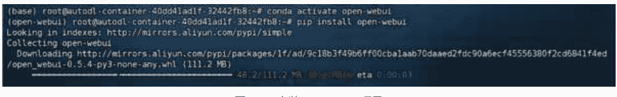

（3）开启服务，运行如下命令，服务将会启动本地的8080端口：http://localhost:8080。

```bash
open-webui serve
```

##### 3. Open-WebUI前端交互操作

（1）单击图3.21中的“开始使用Open-WebUI”选项。按照操作提示创建管理员账号，用于项目管理（这里的信息均存储在项目本地服务器上）。


以管理员账号进入项目后，将显示如图3.22所示的账号主页信息。

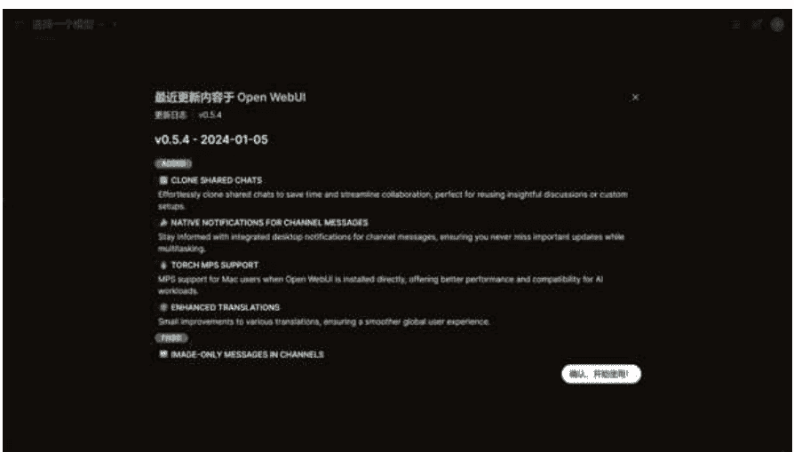

图3.22 Open-WebUI项目进入账号主页

（2）用户根据如图3.23所示的指示进行Open-WebUI项目的用户设置。


图3.23 Open-WebUI项目的用户设置

（3）在“设置”选项卡中单击“外部连接”，再单击“管理OpenAI API连接”右侧的“+”，进行连接的添加，如图3.24所示。

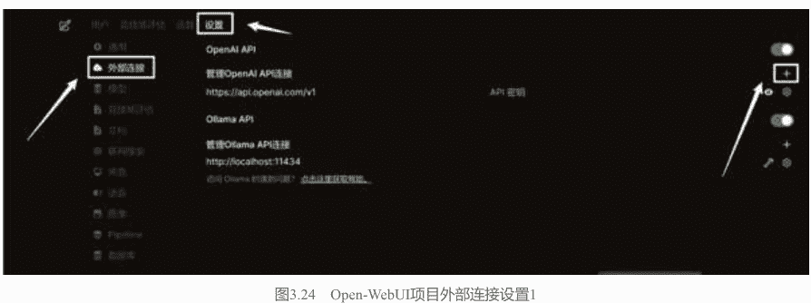

图3.24 Open-WebUI项目外部连接设置1

输入密钥后可单击图3.25所示按钮进行连接的验证。

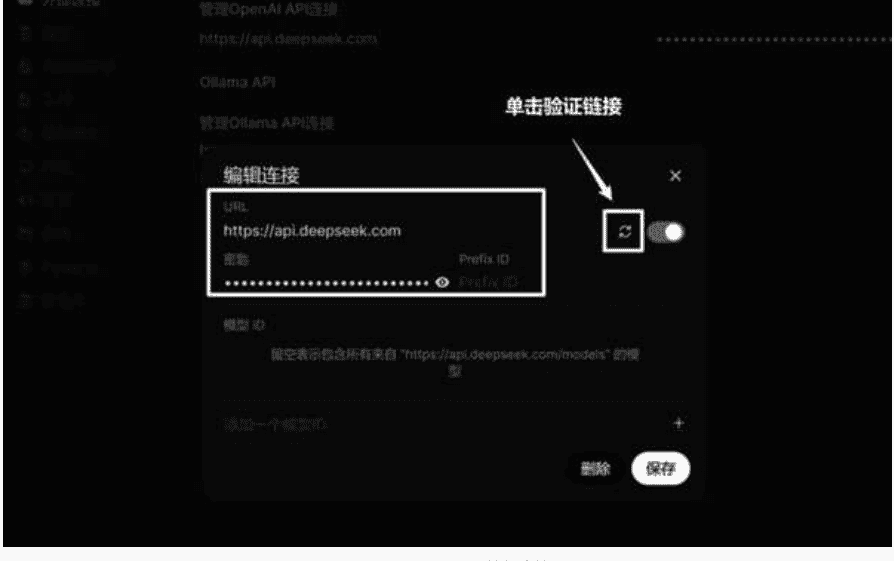

图3.25 Open-WebUI项目外部连接设置2

（4）选择对话模型并进行对话。单击对话页面左上角显示的模型可选择自己需要的模型，如图3.26所示。

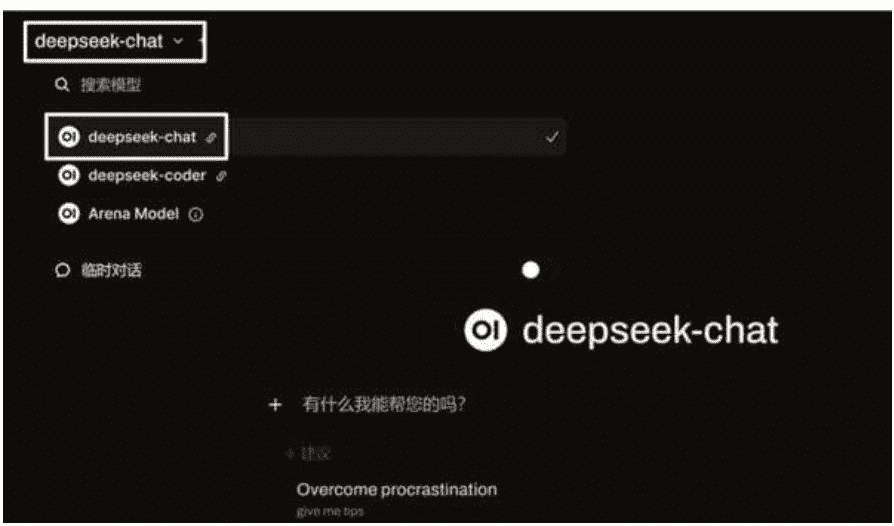

选择模型之后就可以在对话框内输入文字同大模型进行对话，对话效果如图3.27所示。

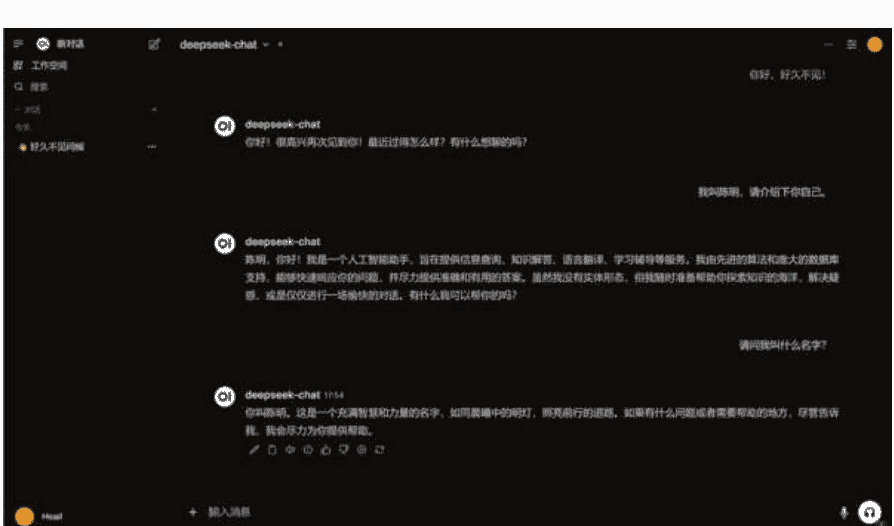

至此，Open-WebUI接入DeepSeek-V3模型的全流程已顺利完成。用户现在可以通过直观的前端交互界面，与本地部署的大模型自由对话，实现高效的智能交互体验。从整体架构来看，Open-WebUI+DeepSeek-V3不仅提供了便捷的模型调用方式，而且构建了一个完整的前后端一体化独立应用，使大语言模型的部署与使用更加直观、高效。

### 3.1 DeepSeek-V3对话大模型

本节将围绕DeepSeek-V3模型的应用实践展开。我们首先介绍模型架构与核心功能特点，接着阐述在线API的标准调用方式及参数使用规范，然后深入本地部署的详细步骤，包括环境准备、模型权重加载、推理测试等关键环节。此外，本节我们还将演示如何通过Function Calling功能调用外部函数，最后将结合Open-WebUI构建具备可视化交互能力的个性化聊天系统。

#### 3.1.1 DeepSeek-V3模型介绍

DeepSeek-V3是由中国人工智能初创企业深度求索于2024年12月发布的第三个版本的大型语言模型，其一经发布就受到了高度关注。在模型架构方面，DeepSeek-V3采用了MoE架构，总参数量达到6710亿，但每个token仅激活370亿参数。这种设计在保证模型性能的同时，显著降低了计算资源的消耗。此外，模型引入了多头潜在注意力（multi-head latent attention, MLA）机制，以提升推理效率。在训练过程中，DeepSeek-V3也采用了无辅助损失的负载均衡策略，并设定了多token预测的训练目标，进一步增强了模型性能。

DeepSeek-V3在多个基准测试中超越了众多其他开源模型，如Qwen2.5-72B和Llama-3.1-405B，性能可媲美闭源模型GPT-4o和Claude-3.5-Sonnet。同时，值得注意的是，DeepSeek-V3的训练成本仅为557.6万美元（约为GPT-4o模型训练成本的1/20），显著低于同类顶尖模型。这一成本效益的实现，为中小企业和开发者提供了新的机遇。最关键的是DeepSeek-V3原生支持OpenAI SDK调用，且支持Function Calling、Json Output等功能，使用GPT模型的开发人员可以无缝切换到DeepSeek模型。

总而言之，DeepSeek-V3作为一款高性能、低成本的大型语言模型，展示了中国在人工智能领域的创新实力，为全球AI社区带来了新的视角和可能性。

#### 3.1.2 DeepSeek-V3模型API调用

##### 1. DeepSeek账号注册与API获取

首先访问DeepSeek官网，其官网主页如图3.1所示。

##### 2. DeepSeek-V3模型调用

使用如下命令安装必要的依赖环境。

```
pip install openai
```

官方手册指出：DeepSeek API使用与OpenAI兼容的API格式。这样你可以直接使用OpenAI SDK来访问DeepSeek API。

```
import os
from openai import OpenAI

from IPython.display import display, Code, Markdown
import requests
import json

# <YOUR_DEEPSEEK_API_KEY>替换为复制的 API key 字符串
ds_api_key = '<YOUR_DEEPSEEK_API_KEY>'

#实例化客户端
client = OpenAI(api_key=ds_api_key,
                base_url="https://api.deepseek.com")

#调用 DeepSeek-V3 模型
response = client.chat.completions.create(
    model="deepseek-chat",
    messages=[
        {"role": "user", "content": "你好，好久不见!"}
    ]
)

#输出生成的响应内容
print(response.choices[0].message.content)
#输出完整的响应
print(response)
```

输出结果如下。

```
你好！好久不见！最近过得怎么样？有什么想聊的吗？
ChatCompletion(id='1fdbc70b-acbf-4c9a-a895-d26bd69ad531',
              choices=[Choice(finish_reason='stop',
                              index=0, logprobs=None,

system_message = {
                    message=ChatCompletionMessage(content='你好！好久不见！最近过得怎么样？有什么想聊的吗？',
                                                  refusal=None,
                                                  role='assistant',
                                                  audio=None,
                                                  function_call=None,
                                                  tool_calls=None)],
              created=1736238514,
              model='deepseek-chat',
              object='chat.completion',
              service_tier=None,
              system_fingerprint='fp_3a5770e1b4',
              usage=CompletionUsage(completion_tokens=14,
                                    prompt_tokens=8,
                                    total_tokens=22,
                                    completion_tokens_details=None,
                                    prompt_tokens_details=None,
                                    prompt_cache_hit_tokens=0,
                                    prompt_cache_miss_tokens=8))
```

与OpenAI一样的SDK，表明DeepSeek模型采用和GPT模型完全相同的参数体系。

可以输出DeepSeek目前支持的模型范围。

```
models_list = client.models.list()
print(models_list.data)
```

输出结果如下。

```
[Model(id='deepseek-chat', created=None, object='model', owned_by='deepseek'),
 Model(id='deepseek-coder', created=None, object='model', owned_by='deepseek')]
```

这里的“deepseek-chat”即为DeepSeek-V3模型。因为DeepSeek-V3模型属于聊天补全（chat completion）模型，官方已经对“deepseek-chat”指代的模型进行了升级。

#### 3.1.3 DeepSeek-V3模型核心参数详解

##### 1. messages

messages参数是DeepSeek-V3模型API中必填的参数之一，用于定义聊天上下文，包括用户的输入、系统的指令、助手的回复等。通过messages数组，模型可以理解当前对话的背景，从而生成更加连贯的响应。根据不同的使用场景，messages包含多种类型的消息，例如system message、user message和assistant message。下面是对messages参数及其各个子类型的详细解释。

###### 1) system message

system message用于设置系统消息，通常由开发者设定，以指导模型如何进行对话。这类消息可以定义规则或约束，并提供有关对话的背景信息。

- content（必填）：系统消息的内容，可以是字符串或数组。如果是数组，可能包含多个类型的内容（如文本、图像）。
- role（必填）：此处角色为system，表明这是系统发出的消息。
- name（可选）：提供系统消息发送者的名称，尤其适用于区分多个具有相同角色的参与者。

示例代码如下：

```
system_message = {
    "role": "system",
    "content": "你是一位擅长编写 python 代码的助手。"
}
```

###### 2) user message

该参数表示用户发给模型的消息，是对话的核心部分之一。它定义了用户的输入内容，模型根据这些内容生成响应。

- content（必填）：用户消息的内容，通常为文本或图像链接的数组。对于支持图像输入的模型，如DeepSeek-V2.5，还可以传递图像。
  - 文本内容：单纯的字符串形式，用户输入的文本。
  - 数组形式的内容：由文本或图像链接组成的数组，可同时传递多张图像或多段文本内容。
- role（必填）：角色为user，表示该消息来自用户。
- name（可选）：可以为用户指定一个名称，用于区分多个具有相同角色的用户。

示例代码如下。

```
user_message = {
    "role": "user",
    "content": "你好，请介绍下你自己。"
}
```

如果在和大模型的对话消息中同时传递多个类型的内容（如图像和文本），示例代码如下：

```
user_message_with_image = {
    "role": "user",
    "content": [
        {"type": "text", "text": "你能帮我介绍下这张图片里面的内容吗？"},
        {"type": "image_url",
         "image_url": {
             "url": "https://ml2022.oss-cn-hangzhou.aliyuncs.com/img/image-20241009205714055.png"}}
    ]
}
```

使用过程中通常单独创建用户消息，再将其作为参数传入模型调用函数中。

```
#创建用户消息
user_message = {
    "role": "user",
    "content": "你好，请介绍下你自己。"
}

#调用 DeepSeek-V3 模型
response = client.chat.completions.create(
    model="deepseek-chat",
    messages=[
        system_message,
        user_message
    ]
)

#输出生成的响应内容
print(response.choices[0].message.content)
```

输出结果如下。

> 你好！我是一位大学教授，专注于多个学科的研究与教学。我的工作主要包括教授本科生和研究生课程，指导学生的研究项目，以及进行学术研究。我致力于通过教育和研究推动知识的边界，并帮助学生发展他们的批判性思维和创新能力。此外，我也参与学术会议和研讨会，与同行交流最新的研究成果和教学方法。如果你有任何学术上的问题或需要指导，我很乐意提供帮助。

##### 2. 其余重要参数

在实际应用DeepSeek-V3进行推理调用时，用户可以通过一系列参数对模型的行为进行精细化控制。下面将详细介绍这些参数的作用，以帮助开发者根据不同场景的需求优化模型性能、管理生成内容，并提升交互体验。模型参数如表3.1所示。

表3.1 DeepSeek-V3模型参数汇总表

| 参数名 | 类型 | 必填/可选 | 默认值 | 说明 |
| :--- | :--- | :--- | :--- | :--- |
| model | string | 必填 | 无 | 指定要使用的模型 ID，例如 deepseek-chat 或 deepseek-code |
| store | boolean 或 null | 可选 | false | 是否存储本次对话的输出，供模型精炼或评估产品使用 |
| metadata | object 或 null | 可选 | null | 开发者自定义的标签和值，用于过滤仪表盘中的补全结果 |
| frequency_penalty | number 或 null | 可选 | 0 | 数值为-2.0～2.0，正值减少重复生成内容的可能性 |
| logit_bias | map | 可选 | null | 调整某些特定 token 出现的可能性，值为-100～100 |
| logprobs | boolean 或 null | 可选 | false | 是否返回生成的每个 token 的对数概率 |
| top_logprobs | integer 或 null | 可选 | null | 指定返回最有可能出现的前几个 token 及其概率，需开启 logprobs |
| max_completion_tokens | integer 或 null | 可选 | null | 指定模型生成的最大 token 数，包括可见文本和推理 token |
| n | integer 或 null | 可选 | 1 | 每个输入生成的对话补全选项数量，值越大，生成的回复越多 |
| presence_penalty | number 或 null | 可选 | 0 | 数值为-2.0～2.0，正值鼓励生成新的主题和内容 |
| response_format | object | 可选 | null | 指定生成结果的格式，可以设置为 json_schema 以确保结构化输出，或设置为 json_object 用于 JSON 格式 |
| seed | integer 或 null | 可选 | null | 保持生成的一致性，重复相同请求将尽量生成相同的结果 |
| service_tier | string 或 null | 可选 | auto | 指定服务延迟等级，适用于付费订阅用户 |
| stop | string/array/null | 可选 | null | 最多指定 4 个序列，API 遇到这些序列时会停止生成进一步的 token |
| stream | boolean 或 null | 可选 | false | 是否启用流式响应，若启用，生成的 token 将逐步返回 |
| stream_options | object 或 null | 可选 | null | 流式响应的选项，仅当 stream 为 true 时设置 |
| temperature | number 或 null | 可选 | 1 | 控制生成输出的随机性，值越高生成的文本越随机。建议调整此值或 top_p，而不是同时调整 |
| top_p | number 或 null | 可选 | 1 | 使用核采样方法，选择最有可能的 token，总概率达到 top_p 百分比。建议与 temperature 二选一 |
| tools | array | 可选 | null | 模型可以调用的工具列表，目前仅支持函数调用 |
| user | string | 可选 | null | 表示最终用户的唯一标识符，用于监控和检测滥用行为 |

为了更高效地配置模型参数，我们可以按照参数的功能和作用，将其划分为以下几大类别。

###### (1) 模型和输出。

- model是必填参数，决定使用哪个模型（如deepseek-chat或deepseek-code）。
- store用于控制是否存储生成的对话结果，便于后续模型训练或评估。
- metadata用于添加开发者自定义的标签，便于在仪表盘中过滤补全结果。
- max_completion_tokens和n控制生成内容的数量和长度，帮助管理生成成本。

###### (2) 生成行为控制。

- frequency_penalty和presence_penalty都用于影响生成结果的内容重复度和新颖性。
- logit_bias是用于调整特定token出现概率的高级控制工具。
- temperature和top_p通过不同的方式控制生成结果的随机性，建议选其一进行调整。

###### (3) 高级功能。

- logprobs和top_logprobs用于返回每个token的概率信息，适合对模型输出进行更细粒度分析。
- stream启用后会实时返回生成的结果，适用于需要逐步展示内容的场景。
- tools允许模型调用外部工具（如函数），适用于扩展模型的功能。

###### (4) 服务和用户。

- service_tier控制服务的延迟和稳定性，适合有高性能要求的付费用户。
- user用于标识最终用户，有助于监控使用行为，防止滥用。

#### 3.1.4 DeepSeek-V3模型本地部署与调用

##### 1. DeepSeek开源情况介绍

DeepSeek是开源大模型，我们首先需要对其开源情况有所了解。DeepSeek项目的GitHub文件情况如图3.5所示。

其中开源代码部分如图3.6所示。

图3.6 DeepSeek项目GitHub开源代码部分

以下是对图3.6中DeepSeek项目开源代码的介绍。

- convert.py: 用于格式转换，将一个已经训练好的模型检查点（checkpoint）文件从一个格式（如safetensors）转换并保存成一个适合特定模型并行度（model parallelism）和专家数（n_experts）的格式。
- fp8_cast_bf16.py: 代码的功能是将存储在FP8格式中的模型权重转换为BF16格式，并保存转换后的权重。它还更新了模型的索引文件，去除了scale_inv的引用。
- generate.py: 一个用于生成文本的示例程序，支持交互式和批量文本生成。它使用一个Transformer模型并进行分布式训练。
- kernel.py: 代码主要涉及量化和矩阵乘法操作，使用了Triton库进行加速，特别是针对FP8精度（浮点8位）进行了优化。Triton是一个专为GPU上的高效自定义操作而设计的编程框架，支持Python和PyTorch，可以通过简洁的代码来实现高效的GPU核心。
- model.py: 定义了DeekSeek-V3模型架构。

目前模型权重已经在Hugging Face上开源了，具体情况如图3.7所示。

##### 3. Model Downloads

| Model | #Total Params | #Activated Params | Context Length | Download |
|---|---|---|---|---|
| DeepSeek-V3-Base | 671B | 37B | 128K | Hugging Face |
| DeepSeek-V3 | 671B | 37B | 128K | Hugging Face |

> Note
The total size of DeepSeek-V3 models on Hugging Face is 685B, which includes 671B of the Main Model weights and 14B of the Multi-Token Prediction (MTP) Module weights.

To ensure optimal performance and flexibility, we have partnered with open-source communities and hardware vendors to provide multiple ways to run the model locally. For step-by-step guidance, check out Section 6: [How to Run Locally](https://github.com/deepseek-ai/DeepSeek-V3/blob/main/README.md#how-to-run-locally).

For developers looking to dive deeper, we recommend exploring [README_WEIGHTS.md](https://github.com/deepseek-ai/DeepSeek-V3/blob/main/README_WEIGHTS.md) for details on the Main Model weights and the Multi-Token Prediction (MTP) Modules. Please note that MTP support is currently under active development within the community, and we welcome your contributions and feedback.

图3.7 DeepSeek项目模型权重相关说明

DeepSeek-V3模型权重可在Hugging Face主页下载，权重总共约650G大小，用户也可在魔搭社区下载。作为权重全开源的模型，官方介绍的本地运行方法有如下几种。

- (1) DeepSeek-Infer Demo：提供了一个简单且轻量的演示，支持FP8和BF16推理。
- (2) SGLang：完全支持DeepSeek-V3模型在BF16和FP8推理模式下运行，且即将支持多标记预测（MTP）。
- (3) LMDeploy：支持高效的FP8和BF16推理，适用于本地和云端部署。
- (4) TensorRT-LLM：目前支持BF16推理和INT4/8量化，FP8支持即将推出。
- (5) vLLM：支持DeepSeek-V3模型在FP8和BF16模式下进行张量并行和流水线并行。
- (6) AMD GPU：通过SGLang，在BF16和FP8模式下支持在AMD GPU上运行DeepSeek-V3模型。
- (7) 华为Ascend NPU：支持在华为Ascend设备上运行DeepSeek-V3模型。

由于DeepSeek的框架原生采用FP8训练，因此仅提供FP8权重，预估仅700GB+显存便可运行。当然也可以转换到BF16，在半精度下，需要1400GB+，而量化到INT4时需要450GB+。以下是半精度下显存占用情况：（占用490G显存，需要7张80G A100，租赁成本约1000元／天）。

## 2. DeepSeek-V3本地部署

(1) 基本环境配置。本次的DeepSeek-V3本地部署将使用模型的Int4量化版运行，基本配置如下。

- ☑ 服务器硬件配置信息。
    - GPU: Nvidia H20 (98G) GPU * 8。
    - CPU: AMD EPYC 9K84 96-Core。
    - 桥接方式: NVLink。
    - 内存: 150G。
    - 存储: 2T。

- ☑ 深度学习环境配置信息。
    - 操作系统: Ubuntu 22.04。
    - PyTorch版本: 2.5.1。
    - Python版本: 3.12。
    - CUDA版本: 12.4。
    - 其他软件包版本根据DeepSeek-V3项目需求确定。

(2) 创建虚拟环境。执行如下命令创建虚拟环境。

```
# 创建一个名为 dv3 的 Conda 虚拟环境，并指定 Python 版本为 3.11
conda create --name dv3 python=3.11

conda init

# 重新加载 shell 配置
source ~/.bashrc

# 激活刚刚创建的 dv3 环境，使其成为当前终端会话的 Python 运行环境
conda activate dv3
```

输出结果如图3.8所示。

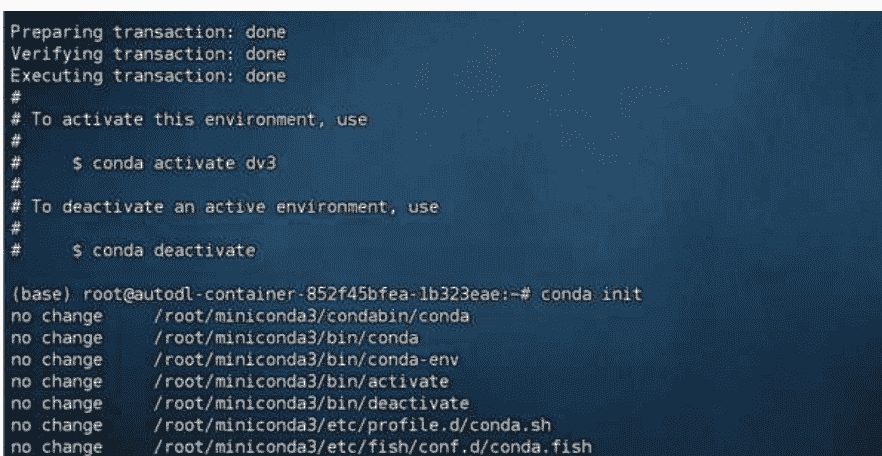

图3.8 创建虚拟环境

代码将在Jupyter Notebook环境中运行，在此之前，需要进行相关的安装和配置，执行如下命令。

```
conda install jupyterlab
conda install ipykernel
python -m ipykernel install --user --name dv3 --display-name "Python (dv3)"
```

(3) 通过GitHub拉取开源项目。首先登录GitHub主页，拉取所需项目；然后访问DeepSeek-V3主页；最后执行如下命令。

```
git clone https://github.com/deepseek-ai/DeepSeek-V3.git
```

输出结果如图3.9所示。

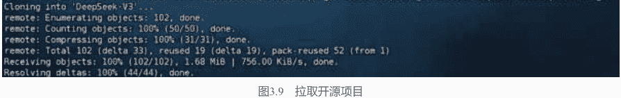

执行如下命令安装项目相关依赖。

```
cd DeepSeek-V3/inference
pip install -r requirements.txt
```

(4) 下载模型权重。可以在Hugging Face或者魔搭社区下载模型权重，推荐使用魔搭社区下载。

> **说明**
下载前需要提前留出600G左右存储空间，用于保存模型权重。

首先需要安装ModelScope开源模型库，执行如下命令。

```
pip install modelscope
```

输出结果如图3.10所示。


安装完成后，即可通过ModelScope下载模型权重，在下载时指定下载Int4类型的权重。执行如下命令。

```
mkdir ./deepseek
modelscope download --model OPEA/DeepSeek-V3-int4-sym-gptq-inc --local_dir ./deepseek
```

输出结果如图3.11所示。


## 3. 在Jupyter Notebook中进行推理调用

在Jupyter Notebook中进行推理调用，具体代码如下。

```python
import torch
from modelscope import AutoTokenizer, AutoModelForCausalLM, GenerationConfig

# 指定模型存储路径（修改为上一步中模型权重下载到的本地路径）
model_name = "./deepseek"

# 加载对应的分词器（Tokenizer）
tokenizer = AutoTokenizer.from_pretrained(model_name)

# 加载 CausalLM（因果语言模型），设置数据类型为 bfloat16，并自动映射到可用设备（如 GPU）
model = AutoModelForCausalLM.from_pretrained(model_name, torch_dtype=torch.bfloat16, device_map="auto")

# 加载生成配置（GenerationConfig），用于调整模型的生成策略
model.generation_config = GenerationConfig.from_pretrained(model_name)
model.generation_config.pad_token_id = model.generation_config.eos_token_id
```

首先需进行一些相关的配置，指定DeepSeek模型存储路径后将其加载为因果语言模型（causal language model，CausalLM），并配置相关的分词器和生成策略。

相关配置代码运行结果如图3.12所示。

```python
import torch
from modelscope import AutoTokenizer, AutoModelForCausalLM, GenerationConfig

model_name = "./deepseek-v3"

tokenizer = AutoTokenizer.from_pretrained(model_name)
model = AutoModelForCausalLM.from_pretrained(model_name, torch_dtype=torch.float16, device_map="auto")
model.generation_config = GenerationConfig.from_pretrained(model_name)
model.generation_config.pad_token_id = model.generation_config.eos_token_id
```

图3.12 模型配置代码运行结果

完成配置后，即可使用配置好的模型进行对话，按照规定格式构造消息列表，使用tokenizer将对话消息文本转换为模型可处理的张量格式，这时就可以输入模型来生成模型的回复，具体代码如下。

```python
# 构造对话消息列表
messages = [
    {"role": "user", "content": "你好，好久不见，请介绍下你自己！"}
]

# 使用 tokenizer 将对话消息转换为模型可处理的张量格式
input_tensor = tokenizer.apply_chat_template(messages, add_generation_prompt=True, return_tensors="pt")

# 使用模型进行文本生成
outputs = model.generate(input_tensor.to(model.device), max_new_tokens=100)

# 解码模型生成的文本
result = tokenizer.decode(outputs[0][input_tensor.shape[1]:], skip_special_tokens=True)
print(result)
```

运行效果如图3.13所示。

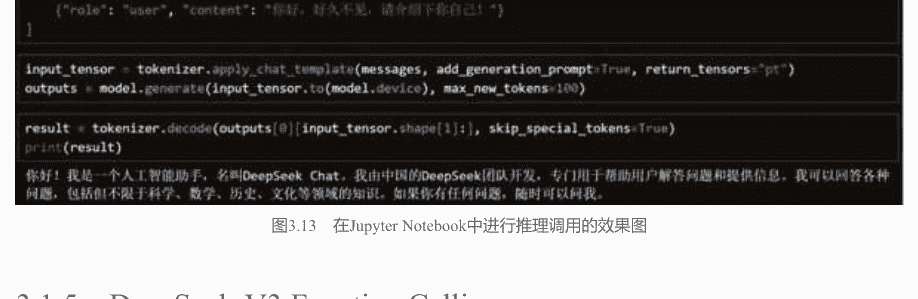

图3.13 在Jupyter Notebook中进行推理调用的效果图

#### 3.1.5 DeepSeek-V3 Function Calling

##### 1. Function Calling功能简介

Function Calling是大语言模型在向通用智能体能力迈进过程中的关键能力之一，允许模型不仅生成自然语言回答，还能根据用户意图调用预定义的函数或工具，以实现更具交互性与实用性的任务处理。其基本过程如图3.14所示。

在传统的对话系统中，模型往往只能进行语言输出，缺乏对外部环境的真实调用能力。Function Calling则通过一个结构化的接口定义（通常以JSON Schema描述函数），使模型具备“理解任务→调用函数→返回结果”的能力，从而完成如天气查询、数据库访问、文档检索、任务派发等实际操作。

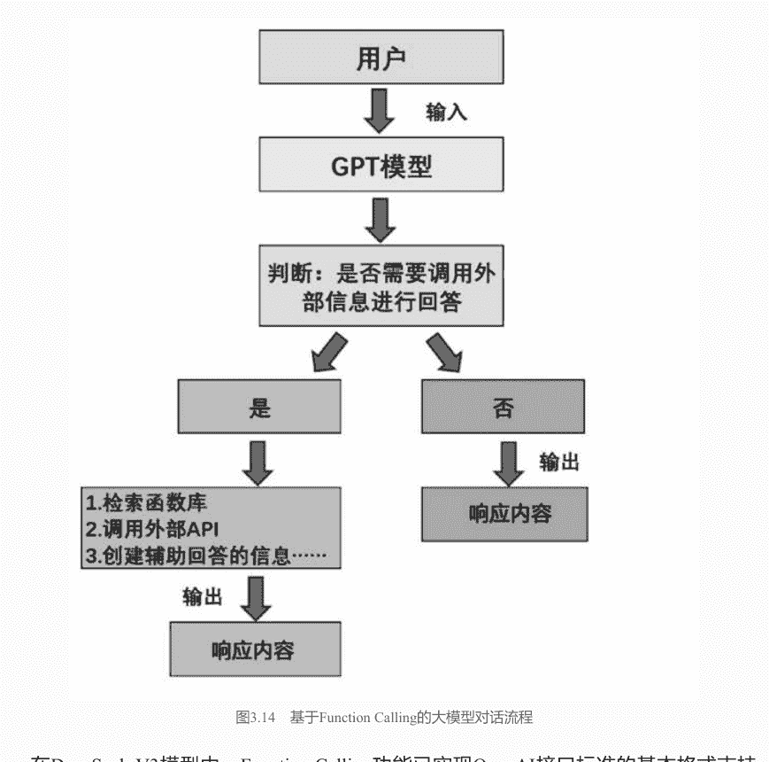

在DeepSeek-V3模型中，Function Calling功能已实现OpenAI接口标准的基本格式支持。开发者可以通过在API请求中添加functions字段，定义可被调用的函数结构，并由模型自动判断是否调用函数，以及调用哪个函数和传递哪些参数。

##### 2. 外部工具API

首先需要简单说明的是，到底什么是外部工具API。API的全称是应用程序接口，例如，目前我们在Python环境中使用了ChatCompletion.create函数，实际上就是OpenAI公司提供的GPT系列模型应用程序的一个接口，通过这个API（create函数或者openai库），我们能够非常顺利地调用GPT模型，并根据输入信息实时输出模型结果。而其他的很多应用程序也有相应的API。

本节示例中使用的是一个可以实时查询天气的API，即OpenWeather API。通过调用OpenWeather API获取实时天气信息，然后利用Function Calling功能调用该函数，这样相当于赋予了Chat模型实时获取天气信息的能力。此后，我们即可通过Chat模型实时查询天气，或根据天气情况询问穿衣建议等。从功能上来说，接入实时天气信息的Chat模型实际上就是一个非常简单的天气查询AI助手。

为了能够调用OpenWeather服务，和OpenAI的API使用过程类似，首先需要先注册OpenWeather账号，并获取OpenWeather API key。这里需要注意的是，对于大多数在线服务的API来说，都需要通过API key来进行身份验证，尽管OpenWeather相对更加开放，有非常多的免费使用次数，但身份验证仍然是必要的，防止API被滥用。OpenWeather API key获取流程如下。

- (1) 登录OpenWeather官网并选择Sign in→Create an Account完成注册。可以使用国内邮箱或者QQ邮箱进行注册。OpenWeather的官网页面如图3.15所示，其用户注册页面如图3.16所示。
- (2) 获取API key：注册完成后，即可在用户主页的API keys选项卡中查看当前账户的API key，如图3.17所示。

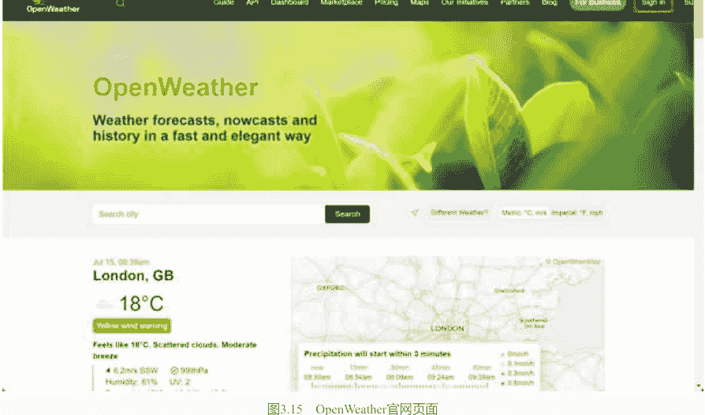

图3.15 OpenWeather官网页面


图3.16 OpenWeather用户注册页面


图3.17 OpenWeather用户主页

一般来说，完成注册后，用户通常会获得一个已经激活的API key。与OpenAI类似，OpenWeather的API key也创建多个，如图3.18所示。

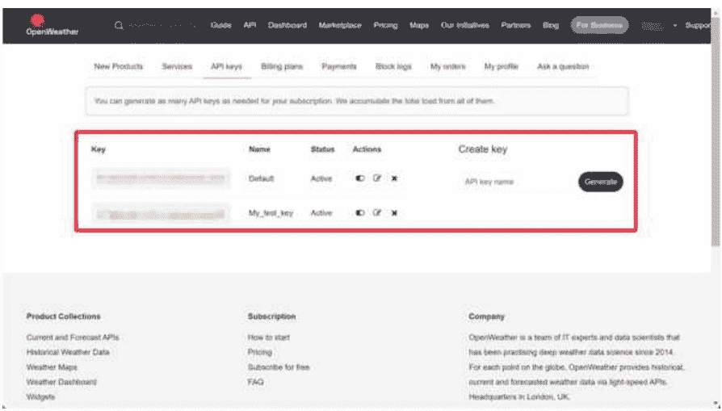

(3) 与OpenAI API key类似，为了方便后续调用，我们也可以直接将OpenWeather API key设置为环境变量，变量名为OPENWEATHER_API_KEY，如图3.19所示。


环境变量设置之后，即可创建OpenWeather API key变量，代码如下。

```python
open_weather_key = os.getenv("OPENWEATHER_API_KEY")
```

##### 3. 利用OpenWeather API获取实时天气信息

接下来，我们通过一个简单的示例来介绍如何使用OpenWeather API获取实时天气信息。我们将把该API的调用过程封装成一个函数。代码如下。

```python
def get_weather(loc):
    """
    查询即时天气函数
    :param loc: 必要参数，字符串类型，用于表示查询天气的具体城市名称。
    注意，中国的城市名称需要用其英文名称代替，例如如果需要查询北京市天气，则 loc 参数需要输入'Beijing'；
    :return: OpenWeather API 查询即时天气的结果，具体 URL 请求地址为：https://api.openweathermap.org/data/2.5/weather
    返回结果对象类型为解析之后的 JSON 格式对象，并用字符串形式进行表示，其中包含了全部重要的天气信息
    """
    # Step 1.构建请求
    url = "https://api.openweathermap.org/data/2.5/weather"

    # Step 2.设置查询参数
    params = {
        "q": loc,
        "appid": open_weather_key,        # 输入 API key
        "units": "metric",                # 使用摄氏度而不是华氏度
        "lang":"zh_cn"                    # 输出语言为简体中文
    }

    # Step 3.发送 GET 请求
    response = requests.get(url, params=params)

    # Step 4.解析响应
    data = response.json()
    return json.dumps(data)
```

##### 4. functions参数解释与定义过程

在完成外部函数及其库的准备工作之后，关键步骤是将外部函数的信息以某种形式传输给Chat模型。此时就需要用到ChatCompletion.create函数的functions参数，类似于messages参数，它用于向模型传输消息，functions参数专门用于提供可调用的外部函数信息。此外，从参数的具体形式来看，functions和messages参数也是非常类似的——都是包含多个字典的list。对于messages来说，每个字典都是一条信息，而对于functions参数来说，每个字典都是一个函数。在大语言模型实际进行问答时，会根据functions参数提供的信息对各函数进行检索。

显而易见，functions参数对于实现Chat模型的Function Calling功能至关重要。接下来，我们详细解释如何编写functions中的字典。总的来说，每个字典都有3个参数（3组键值对），各参数的名称及解释如下。

- (1) name：必选参数，字符串类型，代表函数名称。按照要求，函数名称必须由a-z、A-Z、0-9、下画线和英文破折号组成，最大长度为64。此名称用于模型在外部函数库中识别相应的函数。
- (2) description：可选参数，字符串类型，用于描述函数功能。虽然该参数不是必需的，但它是Chat模型识别函数功能的核心依据。即Chat函数实际上是通过每个函数的description来判断当前函数的实际功能的，若要实现多个备选函数的智能挑选，则需要严谨详细地描述函数功能（在特定情况下，如果已明确指定使用的函数，则无须设置description）。

（3）parameters：必选参数，需遵照JSON Schema格式进行输入的函数参数，JSON Schema是一种特殊的JSON对象，用于验证JSON数据格式是否满足要求。

例如，对于get_weather函数，我们需要创建如下字典来对其进行完整描述。

```
get_weather_function = {
    'name': 'get_weather',
    'description': '查询即时天气函数，根据输入的城市名称，查询对应城市的实时天气',
    'parameters': {
        'type': 'object',
        'properties': {
            'loc': {
                'description': '城市名称，注意，中国的城市名称需要用其英文名称代替，例如如果需要查询北京市天气，则loc参数需要输入"Beijing"',
                'type': 'string'
            }
        },
        'required': ['loc']
    }
}
```

同时还需要封装外部函数库，用于关联外部函数名称和外部函数对象。

```
available_functions = {
    "get_weather": get_weather,
}
```

对于最新模型的Function Calling功能来说，还需要进行更高层次封装，封装为一个tools对象，同时说明当前Function性质。

```
tools = [
    {
        "type": "function",
        "function": get_weather_function
    }
]
```

##### 5. Function Calling功能实现

Function Calling的本质，是让语言模型在对话中完成“识别任务→选中函数→给出参数→外部执行→返回结果→基于结果生成答复”的过程。这个过程分为两个阶段：第一次调用模型识别任务并调用函数，第二次调用模型生成最终回答。

### 1）第一阶段：模型识别任务并决定调用哪个函数

在一系列基础准备工作之后，我们将尝试在Chat模型对话中执行Function Calling功能。这里我们创建如下messages。

```
# 实例化客户端
client = OpenAI(api_key=ds_api_key,
                base_url="https://api.deepseek.com")

messages=[
    {"role": "user", "content": "请帮我查询北京地区今日天气情况"}
]
```

首先我们测试只输入这个信息而不输入外部函数库时模型能否知道如何查询天气。

```
response = client.chat.completions.create(
    model="deepseek-chat",
    messages=messages
)

response.choices[0].message.content
```

输出结果如下。

> ‘您好，建议您联网获取时效性较强的信息；如果还有其他问题需要帮助，请随时告诉我！’

很明显，模型无法回答。

接下来，将函数库相关信息输入Chat模型，这里需要额外设置两个参数，其一是tools参数，用于声明外部函数库的当前情况，其二是tool_choice参数，该参数用于控制是否执行Function Calling功能，该参数有两种不同的取值，默认取值为auto，表示模型将根据用户实际对话情况，选择性地自动挑选函数执行，若想让模型在本次对话中特定执行tools中的某个函数，则可以通过输入形式如{"name": "my_function"}的字典进行声明，此时模型不会再自动挑选模型，而是在tools中挑选my_function执行。

这里我们尝试让模型自动挑选函数来执行，参数设置方法与执行过程如下。

```
response = client.chat.completions.create(
    model="deepseek-chat",
    messages=[
        {"role": "user", "content": "请帮我查询北京地区今日天气情况"}
    ],
    tools=tools,
)
```

观察此时的response结果，输入以下代码。

```
response
```

输出结果如下。

```
ChatCompletion(id='ba15fffc-82b6-40f7-91e2-d34b71e8daac', choices=[Choice(finish_reason='tool_calls', index=0, logprobs=None, message=ChatCompletionMessage(content='', refusal=None, role='assistant', audio=None, function_call=None, tool_calls=[ChatCompletionMessageToolCall(id='call_0_87e140df-66ef-44dd-813f-45800e169690', function=Function(arguments='{"loc":"Beijing"}', name='get_weather'), type='function', index=0)]))], created=1736240025, model='deepseek-chat', object='chat.completion', service_tier=None, system_fingerprint='fp_3a5770e1b4', usage=CompletionUsage(completion_tokens=19, prompt_tokens=153, total_tokens=172, completion_tokens_details=None, prompt_tokens_details=None, prompt_cache_hit_tokens=0, prompt_cache_miss_tokens=153))
```

输入以下代码。

```
response_message = response.choices[0].message
response_message
```

输出结果如下。

```
ChatCompletionMessage(content='', refusal=None, role='assistant', audio=None, function_call=None, tool_calls=[ChatCompletionMessageToolCall(id='call_0_87e140df-66ef-44dd-813f-45800e169690', function=Function(arguments='{"loc":"Beijing"}', name='get_weather'), type='function', index=0)])
```

能够发现，此时返回的message中content为空，新增了一个tool_calls的list，该list就包含了当前调用外部函数的全部信息。

输入以下代码。

```
response_message.tool_calls
```

输出结果如下。

```
[ChatCompletionMessageToolCall(id='call_0_87e140df-66ef-44dd-813f-45800e169690', function=Function(arguments='{"loc":"Beijing"}', name='get_weather'), type='function', index=0)]
```

对于当前CompletionMessageToolCall对象，id为外部函数调用发起请求id，function则表示调用的外部函数的基本信息，而type则代表了当前调用的外部函数的类型，function代表调用自定义的外部函数。除此之外还可以选择retrieval或web_search，分别代表进行在线知识库的知识检索和进行在线搜索。

我们可以在此基础上分别提取调用的外部函数名称信息和参数信息，分别保存为function_name和function_args对象，代码如下：

```
# 完成对话需要调用的函数名称
function_name = response_message.tool_calls[0].function.name

# 具体的函数对象
fuction_to_call = available_functions[function_name]

# 执行该函数所需要的参数
function_args = json.loads(response_message.tool_calls[0].function.arguments)
```

需要注意的是，外部函数的计算过程仍然是在本地执行，即Chat模型不会将代码读取到服务器上后再进行在线计算，因此接下来我们需要根据模型返回的函数和函数参数，在本地完成函数计算，然后再将计算过程和结果保存为message并追加到messages后面，接着第二次调用Chat模型分析函数的计算结果，并最终根据函数计算结果输出用户问题的答案。

### 2）第二阶段：本地执行函数，并将结果反馈给模型

接下来我们将function_args对象传入fuction_to_call中并完成计算，代码如下：

```
function_response = fuction_to_call(**function_args)
function_response
```

输出结果如下。

```
{"coord": {"lon": 116.3972, "lat": 39.9075}, "weather": [{"id": 804, "main": "Clouds", "description": "\u9634\uff0c\u591a\u4e91", "icon": "04d"}], "base": "stations", "main": {"temp": 4.94, "feels_like": 1.77, "temp_min": 4.94, "temp_max": 4.94, "pressure": 1020, "humidity": 25, "sea_level": 1020, "grnd_level": 1014}, "visibility": 10000, "wind": {"speed": 4.03, "deg": 300, "gust": 9.43}, "clouds": {"all": 85}, "dt": 1736239986, "sys": {"type": 1, "id": 9609, "country": "CN", "sunrise": 1736206561, "sunset": 1736240684}, "timezone": 28800, "id": 1816670, "name": "Beijing", "cod": 200}
```

根据上述运行结果能够发现，模型已经顺利完成计算。接下来，我们在messages对象中追加两条消息，第一条消息是第一次模型返回的结果（即调用模型的assistant message），第二条消息则是外部函数的计算结果，该条消息的role为function，且name为函数名称。我们也可以区分function message与user message、system message、assistant message的不同之处。function message必须包含关键词name，且其内容来源于外部函数执行的计算结果，并需要手动输入。具体添加过程如下。

先执行代码查看我们最初的message。

```
messages
```

输出结果如下。

```
[{'role': 'user', 'content': '请帮我查询北京地区今日天气情况'}]
```

查看模型第一次返回的结果消息。

```
response_message.model_dump()
```

输出结果如下。

```
{'content': '',
 'refusal': None,
 'role': 'assistant',
 'audio': None,
 'function_call': None,
 'tool_calls': [{'id': 'call_0_87e140df-66ef-44dd-813f-45800e169690',
   'function': {'arguments': '{"loc":"Beijing"}', 'name': 'get_weather'},
   'type': 'function',
   'index': 0}]}
```

现在将两部分的消息进行拼接，执行以下代码。

```
# 追加模型第一次返回的结果消息
messages.append(response_message.model_dump())
messages
```

输出结果如下。

```
[{'role': 'user', 'content': '请帮我查询北京地区今日天气情况'},
 {'content': '',
  'refusal': None,
  'role': 'assistant',
  'audio': None,
  'function_call': None,
  'tool_calls': [{'id': 'call_0_87e140df-66ef-44dd-813f-45800e169690',
    'function': {'arguments': '{"loc":"Beijing"}', 'name': 'get_weather'},
    'type': 'function',
    'index': 0}]}]
```

再执行代码查看外部函数（调用天气查询API）的答复。

```
function_response
```

输出结果如下。

```
{"coord": {"lon": 116.3972, "lat": 39.9075}, "weather": [{"id": 804, "main": "Clouds", "description": "\u9634\uff0c\u591a\u4e91", "icon": "04d"}], "base": "stations", "main": {"temp": 4.94, "feels_like": 1.77, "temp_min": 4.94, "temp_max": 4.94, "pressure": 1020, "humidity": 25, "sea_level": 1020, "grnd_level": 1014}, "visibility": 10000, "wind": {"speed": 4.03, "deg": 300, "gust": 9.43}, "clouds": {"all": 85}, "dt": 1736239986, "sys": {"type": 1, "id": 9609, "country": "CN", "sunrise": 1736206561, "sunset": 1736240684}, "timezone": 28800, "id": 1816670, "name": "Beijing", "cod": 200}
```

将这部分消息继续拼接在messages里面，执行以下代码。

```
# 追加 function 返回消息
messages.append({
    "role": "tool",
    "content": function_response,
    "tool_call_id": response_message.tool_calls[0].id
})
messages
```

输出结果如下。

```
[{'role': 'user', 'content': '请帮我查询北京地区今日天气情况'},
 {'content': '',
  'refusal': None,
  'role': 'assistant',
  'audio': None,
  'function_call': None,
  'tool_calls': [{'id': 'call_0_87e140df-66ef-44dd-813f-45800e169690',
    'function': {'arguments': '{"loc":"Beijing"}', 'name': 'get_weather'},
    'type': 'function',
    'index': 0}]},
 {'role': 'tool',
  'content': '{"coord": {"lon": 116.3972, "lat": 39.9075}, "weather": [{"id": 804, "main": "Clouds", "description": "\u9634\uff0c\u591a\u4e91", "icon": "04d"}], "base": "stations", "main": {"temp": 4.94, "feels_like": 1.77, "temp_min": 4.94, "temp_max": 4.94, "pressure": 1020, "humidity": 25, "sea_level": 1020, "grnd_level": 1014}, "visibility": 10000, "wind": {"speed": 4.03, "deg": 300, "gust": 9.43}, "clouds": {"all": 85}, "dt": 1736239986, "sys": {"type": 1, "id": 9609, "country": "CN", "sunrise": 1736206561, "sunset": 1736240684}, "timezone": 28800, "id": 1816670, "name": "Beijing", "cod": 200}',
  'tool_call_id': 'call_0_87e140df-66ef-44dd-813f-45800e169690'}]
```

接下来，再次调用Chat模型来围绕messages进行回答。需要注意的是，此时我们不再需要向模型重复提问，只需要简单地将我们已经准备好的messages传入Chat模型即可。

> **注意**

这里的messages拼接了三部分内容：原本的用户提问内容+调用function需要的参数（模型第一阶段返回的内容）+本地具体执行外部函数返回的结果。

执行以下代码。

```python
second_response = client.chat.completions.create(
    model="deepseek-chat",
    messages=messages)
second_response.choices[0].message
```

输出结果如下。

```
ChatCompletionMessage(content='北京地区今日天气情况如下：\n\n- **天气状况**：阴，多云\n- **当前温度**：4.94°C\n- **体感温度**：1.77°C\n- **湿度**：25%\n- **风速**：4.03 米/秒\n- **风向**：300 度（西北风）\n- **能见度**：10000 米\n- **气压**：1020 hPa\n\n请注意保暖，适当增添衣物！', refusal=None, role='assistant', audio=None, function_call=None, tool_calls=None)
```

从上述输出结果能够发现，模型最终做出了准确回答。

##### 6. Function Calling函数封装

通过上面的逐步探索，我们已经了解了Function Calling的实现逻辑。通过下面代码将上面的过程进行封装。

```python
def run_conv(messages,
             api_key,
             tools=None,
             functions_list=None,
             model="deepseek-chat"):
    """
    能够自动执行外部函数调用的 Chat 对话模型
    :param messages: 必要参数，输入到 Chat 模型的 messages 参数对象
    :param api_key: 必要参数，调用模型的 API-KEY
    :param tools: 可选参数，默认为 None，可以设置为包含全部外部函数的列表对象
    :param model: Chat 模型，可选参数，默认模型为 deepseek-chat
    :return: Chat 模型输出结果
    """
    user_messages = messages

    client = OpenAI(api_key=api_key,
                    base_url="https://api.deepseek.com")

    # 如果没有外部函数库，则执行普通的对话任务
    if tools == None:
        response = client.chat.completions.create(
            model=model,
            messages=user_messages
        )
        final_response = response.choices[0].message.content

    # 若存在外部函数库，则需要灵活选取外部函数并进行回答
    else:
        # 创建外部函数库字典
        available_functions = {func.__name__: func for func in functions_list}

        # 创建包含用户问题的 messages
        messages = user_messages

        # first response
        response = client.chat.completions.create(
            model=model,
            messages=user_messages,
            tools=tools,
        )
        response_message = response.choices[0].message

        # 获取函数名
        function_name = response_message.tool_calls[0].function.name
        # 获取函数对象
        fuction_to_call = available_functions[function_name]
        # 获取函数参数
        function_args = json.loads(response_message.tool_calls[0].function.arguments)

        # 将函数参数输入到函数中，获取函数计算结果
        function_response = fuction_to_call(**function_args)

        # messages 中拼接 first response 消息
        user_messages.append(response_message.model_dump())

        # messages 中拼接外部函数输出结果
        user_messages.append(
            {
                "role": "tool",
                "content": function_response,
                "tool_call_id": response_message.tool_calls[0].id
            }
        )

        # 第二次调用模型
        second_response = client.chat.completions.create(
            model=model,
            messages=user_messages)

        # 获取最终结果
        final_response = second_response.choices[0].message.content

    return final_response
```

这里再次执行代码进行对话实验。

```python
messages = [{"role": "user", "content": "请问北京今天天气如何？"}]
run_conv(messages=messages,
         api_key = ds_api_key,
         tools=tools,
         functions_list=[get_weather])
```

输出结果如下。

> 北京今天的天气是多云，气温约为 4.94° C，体感温度约为 1.77° C，湿度为 25%，风速为 4.03 米/秒，风向为 300 度。空气质量良好，能见度为 10000 米。

至此，我们完整地使用DeepSeek-V3模型实现了Function Calling，即外部函数工具的调用。

#### 3.1.6 打造专属聊天机器人：Open-WebUI接入DeepSeek-V3

##### 1. Open-WebUI项目介绍

Open-WebUI是一个开源的Web界面，用于管理和交互式使用大语言模型（LLM）。它提供了直观的聊天界面，支持本地和远程模型，通过它可以轻松部署和调用各种开源模型，不需要复杂的命令行操作。

Open-WebUI项目支持接入在线大模型和开源大模型（包括OpenAI、GLM-4、Qwen2.5等），均可以通过其Functions（功能）模块来灵活接入，支持一键导入配置。

在Open-WebUI项目中，Functions通常是指该项目提供的可以执行特定任务或操作的模块或方法。这些功能模块可以帮助用户与大模型进行交互、配置模型参数、获取输出结果等。具体来说，这些Functions包括文本生成、模型参数调节、会话管理功能、API接口、模型选择和管理等实现细节。

##### 2. DeepSeek-V3接入Open-WebUI流程

(1) 创建虚拟环境，运行如下命令。

```bash
# 创建一个名为 open-webui 的 Conda 虚拟环境，并指定 Python 版本为 3.11
conda create -n open-webui python=3.11

# 初始化 Conda
conda init

# 重新加载 shell 配置
source ~/.bashrc

# 激活刚刚创建的 open-webui 环境，进入该环境
conda activate open-webui
```

(2) 安装Open-WebUI项目，运行如下命令。

```bash
pip install open-webui -i https://pypi.tuna.tsinghua.edu.cn/simple
```

输出结果如图3.20所示。


（3）开启服务，运行如下命令，服务将会启动本地的8080端口：http://localhost:8080。

```bash
open-webui serve
```

### 3．Open-WebUI前端交互操作

（1）单击图3.21中的“开始使用Open-WebUI”选项。按照操作提示创建管理员账号，用于项目管理（这里的信息均存储在项目本地服务器上）。


以管理员账号进入项目后，将显示如图3.22所示的账号主页信息。

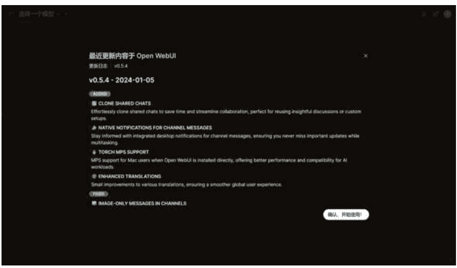

图3.22 Open-WebUI项目进入账号主页

（2）用户根据如图3.23所示的指示进行Open-WebUI项目的用户设置。


图3.23 Open-WebUI项目的用户设置

（3）在“设置”选项卡中单击“外部连接”，再单击“管理OpenAI API连接”右侧的“+”，进行连接的添加，如图3.24所示。


图3.24 Open-WebUI项目外部连接设置1

输入密钥后可单击图3.25所示按钮进行连接的验证。


图3.25 Open-WebUI项目外部连接设置2

（4）选择对话模型并进行对话。单击对话页面左上角显示的模型可选择自己需要的模型，如图3.26所示。


选择模型之后就可以在对话框内输入文字同大模型进行对话，对话效果如图3.27所示。


至此，Open-WebUI接入DeepSeek-V3模型的全流程已顺利完成。用户现在可以通过直观的前端交互界面，与本地部署的大模型自由对话，实现高效的智能交互体验。从整体架构来看，Open-WebUI+DeepSeek-V3不仅提供了便捷的模型调用方式，而且构建了一个完整的前后端一体化独立应用，使大语言模型的部署与使用更加直观、高效。

### 3.1 DeepSeek-V3对话大模型

本节将围绕DeepSeek-V3模型的应用实践展开。我们首先介绍模型架构与核心功能特点，接着阐述在线API的标准调用方式及参数使用规范，然后深入本地部署的详细步骤，包括环境准备、模型权重加载、推理测试等关键环节。此外，本节我们还将演示如何通过Function Calling功能调用外部函数，最后将结合Open-WebUI构建具备可视化交互能力的个性化聊天系统。

#### 3.1.1 DeepSeek-V3模型介绍

DeepSeek-V3是由中国人工智能初创企业深度求索于2024年12月发布的第三个版本的大型语言模型，其一经发布就受到了高度关注。在模型架构方面，DeepSeek-V3采用了MoE架构，总参数量达到6710亿，但每个token仅激活370亿参数。这种设计在保证模型性能的同时，显著降低了计算资源的消耗。此外，模型引入了多头潜在注意力（multi-head latent attention, MLA）机制，以提升推理效率。在训练过程中，DeepSeek-V3也采用了无辅助损失的负载均衡策略，并设定了多token预测的训练目标，进一步增强了模型性能。

DeepSeek-V3在多个基准测试中超越了众多其他开源模型，如Qwen2.5-72B和Llama-3.1-405B，性能可媲美闭源模型GPT-4o和Claude-3.5-Sonnet。同时，值得注意的是，DeepSeek-V3的训练成本仅为557.6万美元（约为GPT-4o模型训练成本的1/20），显著低于同类顶尖模型。这一成本效益的实现，为中小企业和开发者提供了新的机遇。最关键的是DeepSeek-V3原生支持OpenAI SDK调用，且支持Function Calling、Json Output等功能，使用GPT模型的开发人员可以无缝切换到DeepSeek模型。

总而言之，DeepSeek-V3作为一款高性能、低成本的大型语言模型，展示了中国在人工智能领域的创新实力，为全球AI社区带来了新的视角和可能性。

#### 3.1.2 DeepSeek-V3模型API调用

##### 1. DeepSeek账号注册与API获取

首先访问DeepSeek官网，其官网主页如图3.1所示。


图3.1 DeepSeek官网主页

单击图3.1右上角的“API开放平台”，即可进入DeepSeek的开放平台，查看有关API使用的内容，如图3.2所示。


图3.2 DeepSeek开放平台页面

单击图3.2左侧“接口文档”即可查看模型API调用的相关内容。单击左侧API keys即可进入API key的创建页面，也可通过该网址（https://platform.deepseek.com/api_keys）直达该网页，该网页界面如图3.3所示。


单击图3.3中的“创建API key”按钮即可开始创建API，如图3.4所示。这里建议复制图3.3中的API key并创建为新的系统环境变量，尽量避免直接暴露在代码中。

##### 2. DeepSeek-V3模型调用

使用如下命令安装必要的依赖环境。

```bash
pip install openai
```


官方手册指出：DeepSeek API使用与OpenAI兼容的API格式。这样你可以直接使用OpenAI SDK来访问DeepSeek API。

```python
import os
from openai import OpenAI

from IPython.display import display, Code, Markdown
import requests
import json

# <YOUR_DEEPSEEK_API_KEY>替换为复制的 API key 字符串
ds_api_key = '<YOUR_DEEPSEEK_API_KEY>'

#实例化客户端
client = OpenAI(api_key=ds_api_key,
                base_url="https://api.deepseek.com")

#调用 DeepSeek-V3 模型
response = client.chat.completions.create(
    model="deepseek-chat",
    messages=[
        {"role": "user", "content": "你好，好久不见!"}
    ]
)

#输出生成的响应内容
print(response.choices[0].message.content)
#输出完整的响应
print(response)
```

输出结果如下。

```
你好！好久不见！最近过得怎么样？有什么想聊的吗？
ChatCompletion(id='1fdbc70b-acbf-4c9a-a895-d26bd69ad531',
              choices=[Choice(finish_reason='stop',
                              index=0, logprobs=None,

              system_message = {
                  message=ChatCompletionMessage(content='你好！好久不见！最近过得怎么样？有什么想聊的吗？',
                                               refusal=None,
                                               role='assistant',
                                               audio=None,
                                               function_call=None,
                                               tool_calls=None)],
              created=1736238514,
              model='deepseek-chat',
              object='chat.completion',
              service_tier=None,
              system_fingerprint='fp_3a5770e1b4',
              usage=CompletionUsage(completion_tokens=14,
                                    prompt_tokens=8,
                                    total_tokens=22,
                                    completion_tokens_details=None,
                                    prompt_tokens_details=None,
                                    prompt_cache_hit_tokens=0,
                                    prompt_cache_miss_tokens=8))
```

与OpenAI一样的SDK，表明DeepSeek模型采用和GPT模型完全相同的参数体系。

可以输出DeepSeek目前支持的模型范围。

```python
models_list = client.models.list()
print(models_list.data)
```

#### 3.1.3 DeepSeek-V3模型核心参数详解

##### 1. messages

messages参数是DeepSeek-V3模型API中必填的参数之一，用于定义聊天上下文，包括用户的输入、系统的指令、助手的回复等。通过messages数组，模型可以理解当前对话的背景，从而生成更加连贯的响应。根据不同的使用场景，messages包含多种类型的消息，例如system message、user message和assistant message。下面是对messages参数及其各个子类型的详细解释。

1) system message

system message用于设置系统消息，通常由开发者设定，以指导模型如何进行对话。这类消息可以定义规则或约束，并提供有关对话的背景信息。

- :check_box_with_check: content（必填）：系统消息的内容，可以是字符串或数组。如果是数组，可能包含多个类型的内容（如文本、图像）。
- :check_box_with_check: role（必填）：此处角色为system，表明这是系统发出的消息。
- :check_box_with_check: name（可选）：提供系统消息发送者的名称，尤其适用于区分多个具有相同角色的参与者。

示例代码如下：

```
system_message = {
    "role": "system",
    "content": "你是一位擅长编写 python 代码的助手。"
}
```

2) user message

该参数表示用户发给模型的消息，是对话的核心部分之一。它定义了用户的输入内容，模型根据这些内容生成响应。

- :check_box_with_check: content（必填）：用户消息的内容，通常为文本或图像链接的数组。对于支持图像输入的模型，如DeepSeek-V2.5，还可以传递图像。
  - 文本内容：单纯的字符串形式，用户输入的文本。
  - 数组形式的内容：由文本或图像链接组成的数组，可同时传递多张图像或多段文本内容。
- :check_box_with_check: role（必填）：角色为user，表示该消息来自用户。
- :check_box_with_check: name（可选）：可以为用户指定一个名称，用于区分多个具有相同角色的用户。

示例代码如下。

```
user_message = {
    "role": "user",
    "content": "你好，请介绍下你自己。"
}
```

如果在和大模型的对话消息中同时传递多个类型的内容（如图像和文本），示例代码如下：

```
user_message_with_image = {
    "role": "user",
    "content": [
        {"type": "text", "text": "你能帮我介绍下这张图片里面的内容吗？"},
        {"type": "image_url",
         "image_url": {
             "url": "https://ml2022.oss-cn-hangzhou.aliyuncs.com/img/image-20241009205714055.png"}}]
}
```

使用过程中通常单独创建用户消息，再将其作为参数传入模型调用函数中。

```
#创建用户消息
user_message = {
    "role": "user",
    "content": "你好，请介绍下你自己。"
}

#调用 DeepSeek-V3 模型
response = client.chat.completions.create(
    model="deepseek-chat",
    messages=[
        system_message,
        user_message
    ]
)

#输出生成的响应内容
print(response.choices[0].message.content)
```

输出结果如下。

> 你好！我是一位大学教授，专注于多个学科的研究与教学。我的工作主要包括教授本科生和研究生课程，指导学生的研究项目，以及进行学术研究。我致力于通过教育和研究推动知识的边界，并帮助学生发展他们的批判性思维和创新能力。此外，我也参与学术会议和研讨会，与同行交流最新的研究成果和教学方法。如果你有任何学术上的问题或需要指导，我很乐意提供帮助。

##### 2. 其余重要参数

在实际应用DeepSeek-V3进行推理调用时，用户可以通过一系列参数对模型的行为进行精细化控制。下面将详细介绍这些参数的作用，以帮助开发者根据不同场景的需求优化模型性能、管理生成内容，并提升交互体验。模型参数如表3.1所示。

表3.1 DeepSeek-V3模型参数汇总表

| 参数名 | 类型 | 必填/可选 | 默认值 | 说明 |
| :--- | :--- | :--- | :--- | :--- |
| model | string | 必填 | 无 | 指定要使用的模型 ID，例如 deepseek-chat 或 deepseek-code |
| store | boolean 或 null | 可选 | false | 是否存储本次对话的输出，供模型精炼或评估产品使用 |
| metadata | object 或 null | 可选 | null | 开发者自定义的标签和值，用于过滤仪表盘中的补全结果 |
| frequency_penalty | number 或 null | 可选 | 0 | 数值为-2.0～2.0，正值减少重复生成内容的可能性 |
| logit_bias | map | 可选 | null | 调整某些特定 token 出现的可能性，值为-100～100 |
| logprobs | boolean 或 null | 可选 | false | 是否返回生成的每个 token 的对数概率 |
| top_logprobs | integer 或 null | 可选 | null | 指定返回最有可能出现的前几个 token 及其概率，需开启 logprobs |
| max_completion_tokens | integer 或 null | 可选 | null | 指定模型生成的最大 token 数，包括可见文本和推理 token |
| n | integer 或 null | 可选 | 1 | 每个输入生成的对话补全选项数量，值越大，生成的回复越多 |
| presence_penalty | number 或 null | 可选 | 0 | 数值为-2.0～2.0，正值鼓励生成新的主题和内容 |
| response_format | object | 可选 | null | 指定生成结果的格式，可以设置为 json_schema 以确保结构化输出，或设置为 json_object 用于 JSON 格式 |
| seed | integer 或 null | 可选 | null | 保持生成的一致性，重复相同请求将尽量生成相同的结果 |
| service_tier | string 或 null | 可选 | auto | 指定服务延迟等级，适用于付费订阅用户 |
| stop | string/array/null | 可选 | null | 最多指定 4 个序列，API 遇到这些序列时会停止生成进一步的 token |
| stream | boolean 或 null | 可选 | false | 是否启用流式响应，若启用，生成的 token 将逐步返回 |
| stream_options | object 或 null | 可选 | null | 流式响应的选项，仅当 stream 为 true 时设置 |
| temperature | number 或 null | 可选 | 1 | 控制生成输出的随机性，值越高生成的文本越随机。建议调整此值或 top_p，而不是同时调整 |
| top_p | number 或 null | 可选 | 1 | 使用核采样方法，选择最有可能的 token，总概率达到 top_p 百分比。建议与 temperature 二选一 |
| tools | array | 可选 | null | 模型可以调用的工具列表，目前仅支持函数调用 |
| user | string | 可选 | null | 表示最终用户的唯一标识符，用于监控和检测滥用行为 |

为了更高效地配置模型参数，我们可以按照参数的功能和作用，将其划分为以下几大类别。

###### (1) 模型和输出。

- :check_box_with_check: model是必填参数，决定使用哪个模型（如deepseek-chat或deepseek-code）。
- :check_box_with_check: store用于控制是否存储生成的对话结果，便于后续模型训练或评估。
- :check_box_with_check: metadata用于添加开发者自定义的标签，便于在仪表盘中过滤补全结果。
- :check_box_with_check: max_completion_tokens和n控制生成内容的数量和长度，帮助管理生成成本。

###### (2) 生成行为控制。

- :check_box_with_check: frequency_penalty和presence_penalty都用于影响生成结果的内容重复度和新颖性。
- :check_box_with_check: logit_bias是用于调整特定token出现概率的高级控制工具。
- :check_box_with_check: temperature和top_p通过不同的方式控制生成结果的随机性，建议选其一进行调整。

###### (3) 高级功能。

- :check_box_with_check: logprobs和top_logprobs用于返回每个token的概率信息，适合对模型输出进行更细粒度分析。
- :check_box_with_check: stream启用后会实时返回生成的结果，适用于需要逐步展示内容的场景。
- :check_box_with_check: tools允许模型调用外部工具（如函数），适用于扩展模型的功能。

###### (4) 服务和用户。

- :check_box_with_check: service_tier控制服务的延迟和稳定性，适合有高性能要求的付费用户。
- :check_box_with_check: user用于标识最终用户，有助于监控使用行为，防止滥用。

#### 3.1.4 DeepSeek-V3模型本地部署与调用

##### 1. DeepSeek开源情况介绍

DeepSeek是开源大模型，我们首先需要对其开源情况有所了解。DeepSeek项目的GitHub文件情况如图3.5所示。


其中开源代码部分如图3.6所示。

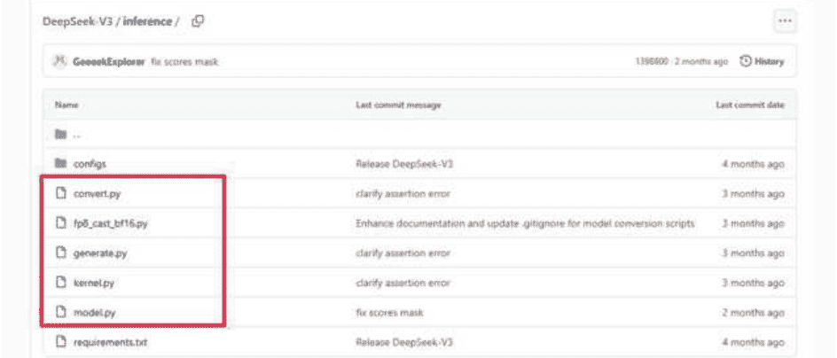

图3.6 DeepSeek项目GitHub开源代码部分

以下是对图3.6中DeepSeek项目开源代码的介绍。

- :check_box_with_check: convert.py: 用于格式转换，将一个已经训练好的模型检查点（checkpoint）文件从一个格式（如safetensors）转换并保存成一个适合特定模型并行度（model parallelism）和专家数（n_experts）的格式。
- :check_box_with_check: fp8_cast_bf16.py: 代码的功能是将存储在FP8格式中的模型权重转换为BF16格式，并保存转换后的权重。它还更新了模型的索引文件，去除了scale_inv的引用。
- :check_box_with_check: generate.py: 一个用于生成文本的示例程序，支持交互式和批量文本生成。它使用一个Transformer模型并进行分布式训练。
- :check_box_with_check: kernel.py: 代码主要涉及量化和矩阵乘法操作，使用了Triton库进行加速，特别是针对FP8精度（浮点8位）进行了优化。Triton是一个专为GPU上的高效自定义操作而设计的编程框架，支持Python和PyTorch，可以通过简洁的代码来实现高效的GPU核心。
- :check_box_with_check: model.py: 定义了DeepSeek-V3模型架构。

目前模型权重已经在Hugging Face上开源了，具体情况如图3.7所示。

##### 3. Model Downloads

| Model | #Total Params | #Activated Params | Context Length | Download |
|---|---|---|---|---|
| DeepSeek-V3-Base | 671B | 37B | 128K | Hugging Face |
| DeepSeek-V3 | 671B | 37B | 128K | Hugging Face |

> Note
The total size of DeepSeek-V3 models on Hugging Face is 685B, which includes 671B of the Main Model weights and 14B of the Multi-Token Prediction (MTP) Module weights.

To ensure optimal performance and flexibility, we have partnered with open-source communities and hardware vendors to provide multiple ways to run the model locally. For step-by-step guidance, check out Section 6: [How to Run Locally](https://github.com/deepseek-ai/DeepSeek-V3/blob/main/README.md#how-to-run-locally).

For developers looking to dive deeper, we recommend exploring [README_WEIGHTS.md](https://github.com/deepseek-ai/DeepSeek-V3/blob/main/README_WEIGHTS.md) for details on the Main Model weights and the Multi-Token Prediction (MTP) Modules. Please note that MTP support is currently under active development within the community, and we welcome your contributions and feedback.

图3.7 DeepSeek项目模型权重相关说明

DeepSeek-V3模型权重可在Hugging Face主页下载，权重总共约650G大小，用户也可在魔搭社区下载。作为权重全开源的模型，官方介绍的本地运行方法有如下几种。

- (1) DeepSeek-Infer Demo：提供了一个简单且轻量的演示，支持FP8和BF16推理。
- (2) SGLang：完全支持DeepSeek-V3模型在BF16和FP8推理模式下运行，且即将支持多标记预测（MTP）。
- (3) LMDeploy：支持高效的FP8和BF16推理，适用于本地和云端部署。
- (4) TensorRT-LLM：目前支持BF16推理和INT4/8量化，FP8支持即将推出。
- (5) vLLM：支持DeepSeek-V3模型在FP8和BF16模式下进行张量并行和流水线并行。
- (6) AMD GPU：通过SGLang，在BF16和FP8模式下支持在AMD GPU上运行DeepSeek-V3模型。
- (7) 华为Ascend NPU：支持在华为Ascend设备上运行DeepSeek-V3模型。

由于DeepSeek的框架原生采用FP8训练，因此仅提供FP8权重，预估仅700GB+显存便可运行。当然也可以转换到BF16，在半精度下，需要1400GB+，而量化到INT4时需要450GB+。以下是半精度下显存占用情况：（占用490G显存，需要7张80G A100，租赁成本约1000元／天）。

### 2. DeepSeek-V3本地部署

(1) 基本环境配置。本次的DeepSeek-V3本地部署将使用模型的Int4量化版运行，基本配置如下。

- :check_box_with_check: 服务器硬件配置信息。
  - GPU: Nvidia H20 (98G) GPU * 8。
  - CPU: AMD EPYC 9K84 96-Core。
  - 桥接方式: NVLink。
  - 内存: 150G。
  - 存储: 2T。
- :check_box_with_check: 深度学习环境配置信息。
  - 操作系统: Ubuntu 22.04。
  - PyTorch版本: 2.5.1。
  - Python版本: 3.12。
  - CUDA版本: 12.4。
  - 其他软件包版本根据DeepSeek-V3项目需求确定。

(2) 创建虚拟环境。执行如下命令创建虚拟环境。

```
# 创建一个名为 dv3 的 Conda 虚拟环境，并指定 Python 版本为 3.11
conda create --name dv3 python=3.11

conda init

# 重新加载 shell 配置
source ~/.bashrc

# 激活刚刚创建的 dv3 环境，使其成为当前终端会话的 Python 运行环境
conda activate dv3
```

输出结果如图3.8所示。

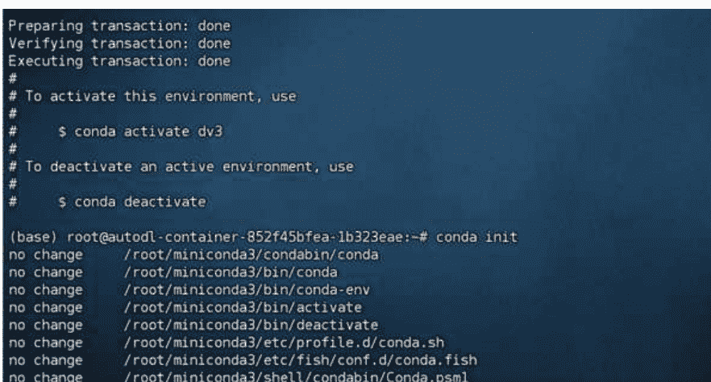

代码将在Jupyter Notebook环境中运行，在此之前，需要进行相关的安装和配置，执行如下命令。

```
conda install jupyterlab
conda install ipykernel
python -m ipykernel install --user --name dv3 --display-name "Python (dv3)"
```

（3）通过GitHub拉取开源项目。首先登录GitHub主页，拉取所需项目；然后访问DeepSeek-V3主页；最后执行如下命令。

```
git clone https://github.com/deepseek-ai/DeepSeek-V3.git
```

输出结果如图3.9所示。


执行如下命令安装项目相关依赖。

```
cd DeepSeek-V3/inference
pip install -r requirements.txt
```

（4）下载模型权重。可以在Hugging Face或者魔搭社区下载模型权重，推荐使用魔搭社区下载。

> **说明**
下载前需要提前留出600G左右存储空间，用于保存模型权重。

首先需要安装ModelScope开源模型库，执行如下命令。

```
pip install modelscope
```

输出结果如图3.10所示。


安装完成后，即可通过ModelScope下载模型权重，在下载时指定下载Int4类型的权重。执行如下命令。

```
mkdir ./deepseek
modelscope download --model OPEA/DeepSeek-V3-int4-sym-gptq-inc --local_dir ./deepseek
```

输出结果如图3.11所示。


## 3. 在Jupyter Notebook中进行推理调用

在Jupyter Notebook中进行推理调用，具体代码如下。

```python
import torch
from modelscope import AutoTokenizer, AutoModelForCausalLM, GenerationConfig

# 指定模型存储路径（修改为上一步中模型权重下载到的本地路径）
model_name = "./deepseek"

# 加载对应的分词器（Tokenizer）
tokenizer = AutoTokenizer.from_pretrained(model_name)

# 加载 CausalLM（因果语言模型），设置数据类型为 bfloat16，并自动映射到可用设备（如 GPU）
model = AutoModelForCausalLM.from_pretrained(model_name, torch_dtype=torch.bfloat16, device_map="auto")

# 加载生成配置（GenerationConfig），用于调整模型的生成策略
model.generation_config = GenerationConfig.from_pretrained(model_name)
model.generation_config.pad_token_id = model.generation_config.eos_token_id
```

首先需进行一些相关的配置，指定DeepSeek模型存储路径后将其加载为因果语言模型（causal language model，CausalLM），并配置相关的分词器和生成策略。

相关配置代码运行结果如图3.12所示。

```python
import torch
from modelscope import AutoTokenizer, AutoModelForCausalLM, GenerationConfig

model_name = "./deepseek-v3"

tokenizer = AutoTokenizer.from_pretrained(model_name)
model = AutoModelForCausalLM.from_pretrained(model_name, torch_dtype=torch.float16, device_map="auto")
model.generation_config = GenerationConfig.from_pretrained(model_name)
model.generation_config.pad_token_id = model.generation_config.eos_token_id
```

图3.12 模型配置代码运行结果

完成配置后，即可使用配置好的模型进行对话，按照规定格式构造消息列表，使用tokenizer将对话消息文本转换为模型可处理的张量格式，这时就可以输入模型来生成模型的回复，具体代码如下。

```python
# 构造对话消息列表
messages = [
    {"role": "user", "content": "你好，好久不见，请介绍下你自己！"}
]

# 使用 tokenizer 将对话消息转换为模型可处理的张量格式
input_tensor = tokenizer.apply_chat_template(messages, add_generation_prompt=True, return_tensors="pt")

# 使用模型进行文本生成
outputs = model.generate(input_tensor.to(model.device), max_new_tokens=100)

# 解码模型生成的文本
result = tokenizer.decode(outputs[0][input_tensor.shape[1]:], skip_special_tokens=True)
print(result)
```

运行效果如图3.13所示。

```python
messages = [
    {"role": "user", "content": "你好，好久不见，请介绍下你自己！"}
]

input_tensor = tokenizer.apply_chat_template(messages, add_generation_prompt=True, return_tensors="pt")
outputs = model.generate(input_tensor.to(model.device), max_new_tokens=100)

result = tokenizer.decode(outputs[0][input_tensor.shape[1]:], skip_special_tokens=True)
print(result)

你好！我是一个人工智能助手，名叫DeepSeek Chat，我由中国的DeepSeek团队开发，专门用于帮助用户解答问题和提供信息。我可以回答各种问题，包括但不限于科学、数学、历史、文化等领域的知识。如果你有任何问题，随时可以问我。
```

图3.13 在Jupyter Notebook中进行推理调用的效果图

#### 3.1.5 DeepSeek-V3 Function Calling

##### 1. Function Calling功能简介

Function Calling是大语言模型在向通用智能体能力迈进过程中的关键能力之一，允许模型不仅生成自然语言回答，还能根据用户意图调用预定义的函数或工具，以实现更具交互性与实用性的任务处理。其基本过程如图3.14所示。

在传统的对话系统中，模型往往只能进行语言输出，缺乏对外部环境的真实调用能力。Function Calling则通过一个结构化的接口定义（通常以JSON Schema描述函数），使模型具备“理解任务→调用函数→返回结果”的能力，从而完成如天气查询、数据库访问、文档检索、任务派发等实际操作。


在DeepSeek-V3模型中，Function Calling功能已实现OpenAI接口标准的基本格式支持。开发者可以通过在API请求中添加functions字段，定义可被调用的函数结构，并由模型自动判断是否调用函数，以及调用哪个函数和传递哪些参数。

##### 2. 外部工具API

首先需要简单说明的是，到底什么是外部工具API。API的全称是应用程序接口，例如，目前我们在Python环境中使用了ChatCompletion.create函数，实际上就是OpenAI公司提供的GPT系列模型应用程序的一个接口，通过这个API（create函数或者openai库），我们能够非常顺利地调用GPT模型，并根据输入信息实时输出模型结果。而其他的很多应用程序也有相应的API。

本节示例中使用的是一个可以实时查询天气的API，即OpenWeather API。通过调用OpenWeather API获取实时天气信息，然后利用Function Calling功能调用该函数，这样相当于赋予了Chat模型实时获取天气信息的能力。此后，我们即可通过Chat模型实时查询天气，或根据天气情况询问穿衣建议等。从功能上来说，接入实时天气信息的Chat模型实际上就是一个非常简单的天气查询AI助手。

为了能够调用OpenWeather服务，和OpenAI的API使用过程类似，首先需要先注册OpenWeather账号，并获取OpenWeather API key。这里需要注意的是，对于大多数在线服务的API来说，都需要通过API key来进行身份验证，尽管OpenWeather相对更加开放，有非常多的免费使用次数，但身份验证仍然是必要的，防止API被滥用。OpenWeather API key获取流程如下。

- (1) 登录OpenWeather官网并选择Sign in→Create an Account完成注册。可以使用国内邮箱或者QQ邮箱进行注册。OpenWeather的官网页面如图3.15所示，其用户注册页面如图3.16所示。
- (2) 获取API key：注册完成后，即可在用户主页的API keys选项卡中查看当前账户的API key，如图3.17所示。


图3.15 OpenWeather官网页面


图3.16 OpenWeather用户注册页面

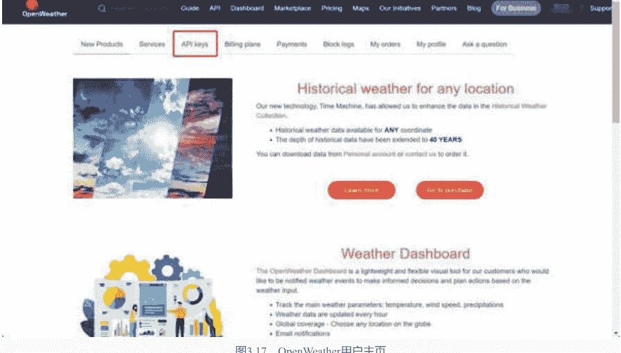

图3.17 OpenWeather用户主页

一般来说，完成注册后，用户通常会获得一个已经激活的API key。与OpenAI类似，OpenWeather的API key也创建多个，如图3.18所示。


- (3) 与OpenAI API key类似，为了方便后续调用，我们也可以直接将OpenWeather API key设置为环境变量，变量名为OPENWEATHER_API_KEY，如图3.19所示。


环境变量设置之后，即可创建OpenWeather API key变量，代码如下。

```python
open_weather_key = os.getenv("OPENWEATHER_API_KEY")
```

##### 3. 利用OpenWeather API获取实时天气信息

接下来，我们通过一个简单的示例来介绍如何使用OpenWeather API获取实时天气信息。我们将把该API的调用过程封装成一个函数。代码如下。

```python
def get_weather(loc):
    """
    查询即时天气函数
    :param loc: 必要参数，字符串类型，用于表示查询天气的具体城市名称。
    注意，中国的城市名称需要用其英文名称代替，例如如果需要查询北京市天气，则 loc 参数需要输入'Beijing'；
    :return: OpenWeather API 查询即时天气的结果，具体 URL 请求地址为：https://api.openweathermap.org/data/2.5/weather
    返回结果对象类型为解析之后的 JSON 格式对象，并用字符串形式进行表示，其中包含了全部重要的天气信息
    """
    # Step 1.构建请求
    url = "https://api.openweathermap.org/data/2.5/weather"

    # Step 2.设置查询参数
    params = {
        "q": loc,
        "appid": open_weather_key,        # 输入 API key
        "units": "metric",                # 使用摄氏度而不是华氏度
        "lang":"zh_cn"                    # 输出语言为简体中文
    }

    # Step 3.发送 GET 请求
    response = requests.get(url, params=params)

    # Step 4.解析响应
    data = response.json()
    return json.dumps(data)
```

##### 4. functions参数解释与定义过程

在完成外部函数及其库的准备工作之后，关键步骤是将外部函数的信息以某种形式传输给Chat模型。此时就需要用到ChatCompletion.create函数的functions参数，类似于messages参数，它用于向模型传输消息，functions参数专门用于提供可调用的外部函数信息。此外，从参数的具体形式来看，functions和messages参数也是非常类似的——都是包含多个字典的list。对于messages来说，每个字典都是一条信息，而对于functions参数来说，每个字典都是一个函数。在大语言模型实际进行问答时，会根据functions参数提供的信息对各函数进行检索。

显而易见，functions参数对于实现Chat模型的Function Calling功能至关重要。接下来，我们详细解释如何编写functions中的字典。总的来说，每个字典都有3个参数（3组键值对），各参数的名称及解释如下。

- (1) name：必选参数，字符串类型，代表函数名称。按照要求，函数名称必须由a-z、A-Z、0-9、下画线和英文破折号组成，最大长度为64。此名称用于模型在外部函数库中识别相应的函数。
- (2) description：可选参数，字符串类型，用于描述函数功能。虽然该参数不是必需的，但它是Chat模型识别函数功能的核心依据。即Chat函数实际上是通过每个函数的description来判断当前函数的实际功能的，若要实现多个备选函数的智能挑选，则需要严谨详细地描述函数功能（在特定情况下，如果已明确指定使用的函数，则无须设置description）。
- (3) parameters：必选参数，需遵照JSON Schema格式进行输入的函数参数，JSON Schema是一种特殊的JSON对象，用于验证JSON数据格式是否满足要求。

例如，对于get_weather函数，我们需要创建如下字典来对其进行完整描述。

```python
get_weather_function = {
    'name': 'get_weather',
    'description': '查询即时天气函数，根据输入的城市名称，查询对应城市的实时天气',
    'parameters': {
        'type': 'object',
        'properties': {
            'loc': {
                'description': '城市名称，注意，中国的城市名称需要用其英文名称代替，例如如果需要查询北京市天气，则loc参数需要输入"Beijing"',
                'type': 'string'
            }
        },
        'required': ['loc']
    }
}
```

同时还需要封装外部函数库，用于关联外部函数名称和外部函数对象。

```python
available_functions = {
    "get_weather": get_weather,
}
```

对于最新模型的Function Calling功能来说，还需要进行更高层次封装，封装为一个tools对象，同时说明当前Function性质。

```python
tools = [
    {
        "type": "function",
        "function": get_weather_function
    }
]
```

##### 5. Function Calling功能实现

Function Calling的本质，是让语言模型在对话中完成“识别任务→选中函数→给出参数→外部执行→返回结果→基于结果生成答复”的过程。这个过程分为两个阶段：第一次调用模型识别任务并调用函数，第二次调用模型生成最终回答。

1) 第一阶段：模型识别任务并决定调用哪个函数

在一系列基础准备工作之后，我们将尝试在Chat模型对话中执行Function Calling功能。这里我们创建如下messages。

```python
# 实例化客户端
client = OpenAI(api_key=ds_api_key,
                base_url="https://api.deepseek.com")

messages=[
    {"role": "user", "content": "请帮我查询北京地区今日天气情况"}
]
```

首先我们测试只输入这个信息而不输入外部函数库时模型能否知道如何查询天气。

```python
response = client.chat.completions.create(
    model="deepseek-chat",
    messages=messages
)

response.choices[0].message.content
```

输出结果如下。

> ‘您好，建议您联网获取时效性较强的信息；如果还有其他问题需要帮助，请随时告诉我！’

很明显，模型无法回答。

接下来，将函数库相关信息输入Chat模型，这里需要额外设置两个参数，其一是tools参数，用于声明外部函数库的当前情况，其二是tool_choice参数，该参数用于控制是否执行Function Calling功能，该参数有两种不同的取值，默认取值为auto，表示模型将根据用户实际对话情况，选择性地自动挑选函数执行，若想让模型在本次对话中特定执行tools中的某个函数，则可以通过输入形式如{"name": "my_function"}的字典进行声明，此时模型不会再自动挑选模型，而是在tools中挑选my_function执行。

这里我们尝试让模型自动挑选函数来执行，参数设置方法与执行过程如下。

```python
response = client.chat.completions.create(
    model="deepseek-chat",
    messages=[
        {"role": "user", "content": "请帮我查询北京地区今日天气情况"}
    ],
    tools=tools,
)
```

观察此时的response结果，输入以下代码。

```python
response
```

输出结果如下。

```
ChatCompletion(id='ba15fffc-82b6-40f7-91e2-d34b71e8daac', choices=[Choice(finish_reason='tool_calls', index=0, logprobs=None, message=ChatCompletionMessage(content='', refusal=None, role='assistant', audio=None, function_call=None, tool_calls=[ChatCompletionMessageToolCall(id='call_0_87e140df-66ef-44dd-813f-45800e169690', function=Function(arguments='{"loc":"Beijing"}', name='get_weather'), type='function', index=0)]))], created=1736240025, model='deepseek-chat', object='chat.completion', service_tier=None, system_fingerprint='fp_3a5770e1b4', usage=CompletionUsage(completion_tokens=19, prompt_tokens=153, total_tokens=172, completion_tokens_details=None, prompt_tokens_details=None, prompt_cache_hit_tokens=0, prompt_cache_miss_tokens=153))
```

输入以下代码。

```python
response_message = response.choices[0].message
response_message
```

输出结果如下。

```
ChatCompletionMessage(content='', refusal=None, role='assistant', audio=None, function_call=None, tool_calls=[ChatCompletionMessageToolCall(id='call_0_87e140df-66ef-44dd-813f-45800e169690', function=Function(arguments='{"loc":"Beijing"}', name='get_weather'), type='function', index=0)])
```

能够发现，此时返回的message中content为空，新增了一个tool_calls的list，该list就包含了当前调用外部函数的全部信息。

输入以下代码。

```python
response_message.tool_calls
```

输出结果如下。

```
[ChatCompletionMessageToolCall(id='call_0_87e140df-66ef-44dd-813f-45800e169690', function=Function(arguments='{"loc":"Beijing"}', name='get_weather'), type='function', index=0)]
```

对于当前CompletionMessageToolCall对象，id为外部函数调用发起请求id，function则表示调用的外部函数的基本信息，而type则代表了当前调用的外部函数的类型，function代表调用自定义的外部函数。除此之外还可以选择retrieval或web_search，分别代表进行在线知识库的知识检索和进行在线搜索。

我们可以在此基础上分别提取调用的外部函数名称信息和参数信息，分别保存为function_name和function_args对象，代码如下：

```python
# 完成对话需要调用的函数名称
function_name = response_message.tool_calls[0].function.name

# 具体的函数对象
fuction_to_call = available_functions[function_name]

# 执行该函数所需要的参数
function_args = json.loads(response_message.tool_calls[0].function.arguments)
```

需要注意的是，外部函数的计算过程仍然是在本地执行，即Chat模型不会将代码读取到服务器上后再进行在线计算，因此接下来我们需要根据模型返回的函数和函数参数，在本地完成函数计算，然后再将计算过程和结果保存为message并追加到messages后面，接着第二次调用Chat模型分析函数的计算结果，并最终根据函数计算结果输出用户问题的答案。

2）第二阶段：本地执行函数，并将结果反馈给模型

接下来我们将function_args对象传入fuction_to_call中并完成计算，代码如下：

```python
function_response = fuction_to_call(**function_args)
function_response
```

输出结果如下。

```json
{"coord": {"lon": 116.3972, "lat": 39.9075}, "weather": [{"id": 804, "main": "Clouds", "description": "阴，多云", "icon": "04d"}], "base": "stations", "main": {"temp": 4.94, "feels_like": 1.77, "temp_min": 4.94, "temp_max": 4.94, "pressure": 1020, "humidity": 25, "sea_level": 1020, "grnd_level": 1014}, "visibility": 10000, "wind": {"speed": 4.03, "deg": 300, "gust": 9.43}, "clouds": {"all": 85}, "dt": 1736239986, "sys": {"type": 1, "id": 9609, "country": "CN", "sunrise": 1736206561, "sunset": 1736240684}, "timezone": 28800, "id": 1816670, "name": "Beijing", "cod": 200}
```

根据上述运行结果能够发现，模型已经顺利完成计算。接下来，我们在messages对象中追加两条消息，第一条消息是第一次模型返回的结果（即调用模型的assistant message），第二条消息则是外部函数的计算结果，该条消息的role为function，且name为函数名称。我们也可以区分function message与user message、system message、assistant message的不同之处。function message必须包含关键词name，且其内容来源于外部函数执行的计算结果，并需要手动输入。具体添加过程如下。

先执行代码查看我们最初的message。

```python
messages
```

输出结果如下。

```
[{'role': 'user', 'content': '请帮我查询北京地区今日天气情况'}]
```

查看模型第一次返回的结果消息。

```python
response_message.model_dump()
```

输出结果如下。

```
{'content': '',
 'refusal': None,
 'role': 'assistant',
 'audio': None,
 'function_call': None,
 'tool_calls': [{'id': 'call_0_87e140df-66ef-44dd-813f-45800e169690',
   'function': {'arguments': '{"loc":"Beijing"}', 'name': 'get_weather'},
   'type': 'function',
   'index': 0}]}
```

现在将两部分的消息进行拼接，执行以下代码。

```python
# 追加模型第一次返回的结果消息
messages.append(response_message.model_dump())
messages
```

输出结果如下。

```
[{'role': 'user', 'content': '请帮我查询北京地区今日天气情况'},
 {'content': '',
  'refusal': None,
  'role': 'assistant',
  'audio': None,
  'function_call': None,
  'tool_calls': [{'id': 'call_0_87e140df-66ef-44dd-813f-45800e169690',
    'function': {'arguments': '{"loc":"Beijing"}', 'name': 'get_weather'},
    'type': 'function',
    'index': 0}]}]
```

再执行代码查看外部函数（调用天气查询API）的答复。

```python
function_response
```

输出结果如下。

```json
{"coord": {"lon": 116.3972, "lat": 39.9075}, "weather": [{"id": 804, "main": "Clouds", "description": "阴，多云", "icon": "04d"}], "base": "stations", "main": {"temp": 4.94, "feels_like": 1.77, "temp_min": 4.94, "temp_max": 4.94, "pressure": 1020, "humidity": 25, "sea_level": 1020, "grnd_level": 1014}, "visibility": 10000, "wind": {"speed": 4.03, "deg": 300, "gust": 9.43}, "clouds": {"all": 85}, "dt": 1736239986, "sys": {"type": 1, "id": 9609, "country": "CN", "sunrise": 1736206561, "sunset": 1736240684}, "timezone": 28800, "id": 1816670, "name": "Beijing", "cod": 200}
```

将这部分消息继续拼接在messages里面，执行以下代码。

```python
# 追加 function 返回消息
messages.append({
    "role": "tool",
    "content": function_response,
    "tool_call_id": response_message.tool_calls[0].id
})
messages
```

输出结果如下。

```
[{'role': 'user', 'content': '请帮我查询北京地区今日天气情况'},
 {'content': '',
  'refusal': None,
  'role': 'assistant',
  'audio': None,
  'function_call': None,
  'tool_calls': [{'id': 'call_0_87e140df-66ef-44dd-813f-45800e169690',
    'function': {'arguments': '{"loc":"Beijing"}', 'name': 'get_weather'},
    'type': 'function',
    'index': 0}]},
 {'role': 'tool',
  'content': '{"coord": {"lon": 116.3972, "lat": 39.9075}, "weather": [{"id": 804, "main": "Clouds", "description": "阴，多云", "icon": "04d"}], "base": "stations", "main": {"temp": 4.94, "feels_like": 1.77, "temp_min": 4.94, "temp_max": 4.94, "pressure": 1020, "humidity": 25, "sea_level": 1020, "grnd_level": 1014}, "visibility": 10000, "wind": {"speed": 4.03, "deg": 300, "gust": 9.43}, "clouds": {"all": 85}, "dt": 1736239986, "sys": {"type": 1, "id": 9609, "country": "CN", "sunrise": 1736206561, "sunset": 1736240684}, "timezone": 28800, "id": 1816670, "name": "Beijing", "cod": 200}',
  'tool_call_id': 'call_0_87e140df-66ef-44dd-813f-45800e169690'}]
```

接下来，再次调用Chat模型来围绕messages进行回答。需要注意的是，此时我们不再需要向模型重复提问，只需要简单地将我们已经准备好的messages传入Chat模型即可。

> **注意**

这里的messages拼接了三部分内容：原本的用户提问内容+调用function需要的参数（模型第一阶段返回的内容）+本地具体执行外部函数返回的结果。

执行以下代码。

```python
second_response = client.chat.completions.create(
    model="deepseek-chat",
    messages=messages)
second_response.choices[0].message
```

输出结果如下。

```
ChatCompletionMessage(content='北京地区今日天气情况如下：\n\n- **天气状况**：阴，多云\n- **当前温度**：4.94°C\n- **体感温度**：1.77°C\n- **湿度**：25%\n- **风速**：4.03 米/秒\n- **风向**：300 度（西北风）\n- **能见度**：10000 米\n- **气压**：1020 hPa\n\n请注意保暖，适当增添衣物！', refusal=None, role='assistant', audio=None, function_call=None, tool_calls=None)
```

从上述输出结果能够发现，模型最终做出了准确回答。

##### 6. Function Calling函数封装

通过上面的逐步探索，我们已经了解了Function Calling的实现逻辑。通过下面代码将上面的过程进行封装。

```python
def run_conv(messages,
             api_key,
             tools=None,
             functions_list=None,
             model="deepseek-chat"):
    """
    能够自动执行外部函数调用的 Chat 对话模型
    :param messages: 必要参数，输入到 Chat 模型的 messages 参数对象
    :param api_key: 必要参数，调用模型的 API-KEY
    :param tools: 可选参数，默认为 None，可以设置为包含全部外部函数的列表对象
    :param model: Chat 模型，可选参数，默认模型为 deepseek-chat
    :return: Chat 模型输出结果
    """
    user_messages = messages

    client = OpenAI(api_key=api_key,
                    base_url="https://api.deepseek.com")

    # 如果没有外部函数库，则执行普通的对话任务
    if tools == None:
        response = client.chat.completions.create(
            model=model,
            messages=user_messages
        )
        final_response = response.choices[0].message.content

    # 若存在外部函数库，则需要灵活选取外部函数并进行回答
    else:
        # 创建外部函数库字典
        available_functions = {func.__name__: func for func in functions_list}

        # 创建包含用户问题的 messages
        messages = user_messages

        # first response
        response = client.chat.completions.create(
            model=model,
            messages=user_messages,
            tools=tools,
        )
        response_message = response.choices[0].message

        # 获取函数名
        function_name = response_message.tool_calls[0].function.name
        # 获取函数对象
        fuction_to_call = available_functions[function_name]
        # 获取函数参数
        function_args = json.loads(response_message.tool_calls[0].function.arguments)

        # 将函数参数输入到函数中，获取函数计算结果
        function_response = fuction_to_call(**function_args)

        # messages 中拼接 first response 消息
        user_messages.append(response_message.model_dump())

        # messages 中拼接外部函数输出结果
        user_messages.append(
            {
                "role": "tool",
                "content": function_response,
                "tool_call_id": response_message.tool_calls[0].id
            }
        )

        # 第二次调用模型
        second_response = client.chat.completions.create(
            model=model,
            messages=user_messages)

        # 获取最终结果
        final_response = second_response.choices[0].message.content

    return final_response
```

这里再次执行代码进行对话实验。

```python
messages = [{"role": "user", "content": "请问北京今天天气如何？"}]
run_conv(messages=messages,
         api_key=ds_api_key,
         tools=tools,
         functions_list=[get_weather])
```

输出结果如下。

> 北京今天的天气是多云，气温约为 4.94° C，体感温度约为 1.77° C，湿度为 25%，风速为 4.03 米/秒，风向为 300 度。空气质量良好，能见度为 10000 米。

至此，我们完整地使用DeepSeek-V3模型实现了Function Calling，即外部函数工具的调用。

#### 3.1.6 打造专属聊天机器人：Open-WebUI接入DeepSeek-V3

##### 1. Open-WebUI项目介绍

Open-WebUI是一个开源的Web界面，用于管理和交互式使用大语言模型（LLM）。它提供了直观的聊天界面，支持本地和远程模型，通过它可以轻松部署和调用各种开源模型，不需要复杂的命令行操作。

Open-WebUI项目支持接入在线大模型和开源大模型（包括OpenAI、GLM-4、Qwen2.5等），均可以通过其Functions（功能）模块来灵活接入，支持一键导入配置。

在Open-WebUI项目中，Functions通常是指该项目提供的可以执行特定任务或操作的模块或方法。这些功能模块可以帮助用户与大模型进行交互、配置模型参数、获取输出结果等。具体来说，这些Functions包括文本生成、模型参数调节、会话管理功能、API接口、模型选择和管理等实现细节。

##### 2. DeepSeek-V3接入Open-WebUI流程

(1) 创建虚拟环境，运行如下命令。

```bash
# 创建一个名为 open-webui 的 Conda 虚拟环境，并指定 Python 版本为 3.11
conda create -n open-webui python=3.11

# 初始化 Conda
conda init

# 重新加载 shell 配置
source ~/.bashrc

# 激活刚刚创建的 open-webui 环境，进入该环境
conda activate open-webui
```

(2) 安装Open-WebUI项目，运行如下命令。

```bash
pip install open-webui -i https://pypi.tuna.tsinghua.edu.cn/simple
```

输出结果如图3.20所示。


（3）开启服务，运行如下命令，服务将会启动本地的8080端口：http://localhost:8080。

```bash
open-webui serve
```

### 3．Open-WebUI前端交互操作

（1）单击图3.21中的“开始使用Open-WebUI”选项。按照操作提示创建管理员账号，用于项目管理（这里的信息均存储在项目本地服务器上）。

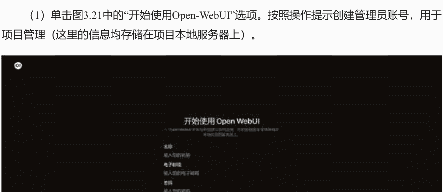

以管理员账号进入项目后，将显示如图3.22所示的账号主页信息。


图3.22 Open-WebUI项目进入账号主页

（2）用户根据如图3.23所示的指示进行Open-WebUI项目的用户设置。


图3.23 Open-WebUI项目的用户设置

（3）在“设置”选项卡中单击“外部连接”，再单击“管理OpenAI API连接”右侧的“+”，进行连接的添加，如图3.24所示。


图3.24 Open-WebUI项目外部连接设置1

输入密钥后可单击图3.25所示按钮进行连接的验证。


图3.25 Open-WebUI项目外部连接设置2

（4）选择对话模型并进行对话。单击对话页面左上角显示的模型可选择自己需要的模型，如图3.26所示。


选择模型之后就可以在对话框内输入文字同大模型进行对话，对话效果如图3.27所示。


至此，Open-WebUI接入DeepSeek-V3模型的全流程已顺利完成。用户现在可以通过直观的前端交互界面，与本地部署的大模型自由对话，实现高效的智能交互体验。从整体架构来看，Open-WebUI+DeepSeek-V3不仅提供了便捷的模型调用方式，而且构建了一个完整的前后端一体化独立应用，使大语言模型的部署与使用更加直观、高效。

### 3.1 DeepSeek-V3对话大模型

本节将围绕DeepSeek-V3模型的应用实践展开。我们首先介绍模型架构与核心功能特点，接着阐述在线API的标准调用方式及参数使用规范，然后深入本地部署的详细步骤，包括环境准备、模型权重加载、推理测试等关键环节。此外，本节我们还将演示如何通过Function Calling功能调用外部函数，最后将结合Open-WebUI构建具备可视化交互能力的个性化聊天系统。

#### 3.1.1 DeepSeek-V3模型介绍

DeepSeek-V3是由中国人工智能初创企业深度求索于2024年12月发布的第三个版本的大型语言模型，其一经发布就受到了高度关注。在模型架构方面，DeepSeek-V3采用了MoE架构，总参数量达到6710亿，但每个token仅激活370亿参数。这种设计在保证模型性能的同时，显著降低了计算资源的消耗。此外，模型引入了多头潜在注意力（multi-head latent attention, MLA）机制，以提升推理效率。在训练过程中，DeepSeek-V3也采用了无辅助损失的负载均衡策略，并设定了多token预测的训练目标，进一步增强了模型性能。

DeepSeek-V3在多个基准测试中超越了众多其他开源模型，如Qwen2.5-72B和Llama-3.1-405B，性能可媲美闭源模型GPT-4o和Claude-3.5-Sonnet。同时，值得注意的是，DeepSeek-V3的训练成本仅为557.6万美元（约为GPT-4o模型训练成本的1/20），显著低于同类顶尖模型。这一成本效益的实现，为中小企业和开发者提供了新的机遇。最关键的是DeepSeek-V3原生支持OpenAI SDK调用，且支持Function Calling、Json Output等功能，使用GPT模型的开发人员可以无缝切换到DeepSeek模型。

总而言之，DeepSeek-V3作为一款高性能、低成本的大型语言模型，展示了中国在人工智能领域的创新实力，为全球AI社区带来了新的视角和可能性。

#### 3.1.2 DeepSeek-V3模型API调用

##### 1. DeepSeek账号注册与API获取

首先访问DeepSeek官网，其官网主页如图3.1所示。


图3.1 DeepSeek官网主页

单击图3.1右上角的“API开放平台”，即可进入DeepSeek的开放平台，查看有关API使用的内容，如图3.2所示。


图3.2 DeepSeek开放平台页面

单击图3.2左侧“接口文档”即可查看模型API调用的相关内容。单击左侧API keys即可进入API key的创建页面，也可通过该网址（https://platform.deepseek.com/api_keys）直达该网页，该网页界面如图3.3所示。


单击图3.3中的“创建API key”按钮即可开始创建API，如图3.4所示。这里建议复制图3.3中的API key并创建为新的系统环境变量，尽量避免直接暴露在代码中。

##### 2. DeepSeek-V3模型调用

使用如下命令安装必要的依赖环境。

```bash
pip install openai
```


官方手册指出：DeepSeek API使用与OpenAI兼容的API格式。这样你可以直接使用OpenAI SDK来访问DeepSeek API。

```python
import os
from openai import OpenAI

from IPython.display import display, Code, Markdown
import requests
import json

# <YOUR_DEEPSEEK_API_KEY>替换为复制的 API key 字符串
ds_api_key = '<YOUR_DEEPSEEK_API_KEY>'

#实例化客户端
client = OpenAI(api_key=ds_api_key,
                base_url="https://api.deepseek.com")

#调用 DeepSeek-V3 模型
response = client.chat.completions.create(
    model="deepseek-chat",
    messages=[
        {"role": "user", "content": "你好，好久不见!"}
    ]
)

#输出生成的响应内容
print(response.choices[0].message.content)
#输出完整的响应
print(response)
```

输出结果如下。

```
你好！好久不见！最近过得怎么样？有什么想聊的吗？
ChatCompletion(id='1fdbc70b-acbf-4c9a-a895-d26bd69ad531',
              choices=[Choice(finish_reason='stop',
                              index=0, logprobs=None,
                              message=ChatCompletionMessage(content='你好！好久不见！最近过得怎么样？有什么想聊的吗？',
                                                            refusal=None,
                                                            role='assistant',
                                                            audio=None,
                                                            function_call=None,
                                                            tool_calls=None))],
              created=1736238514,
              model='deepseek-chat',
              object='chat.completion',
              service_tier=None,
              system_fingerprint='fp_3a5770e1b4',
              usage=CompletionUsage(completion_tokens=14,
                                    prompt_tokens=8,
                                    total_tokens=22,
                                    completion_tokens_details=None,
                                    prompt_tokens_details=None,
                                    prompt_cache_hit_tokens=0,
                                    prompt_cache_miss_tokens=8))
```

与OpenAI一样的SDK，表明DeepSeek模型采用和GPT模型完全相同的参数体系。

可以输出DeepSeek目前支持的模型范围。

```python
models_list = client.models.list()
print(models_list.data)
```

输出结果如下。

```
[Model(id='deepseek-chat', created=None, object='model', owned_by='deepseek'),
Model(id='deepseek-coder', created=None, object='model', owned_by='deepseek')]
```

这里的“deepseek-chat”即为DeepSeek-V3模型。因为DeepSeek-V3模型属于聊天补全（chat completion）模型，官方已经对“deepseek-chat”指代的模型进行了升级。

#### 3.1.3 DeepSeek-V3模型核心参数详解

##### 1. messages

messages参数是DeepSeek-V3模型API中必填的参数之一，用于定义聊天上下文，包括用户的输入、系统的指令、助手的回复等。通过messages数组，模型可以理解当前对话的背景，从而生成更加连贯的响应。根据不同的使用场景，messages包含多种类型的消息，例如system message、user message和assistant message。下面是对messages参数及其各个子类型的详细解释。

1) system message

system message用于设置系统消息，通常由开发者设定，以指导模型如何进行对话。这类消息可以定义规则或约束，并提供有关对话的背景信息。

- content（必填）：系统消息的内容，可以是字符串或数组。如果是数组，可能包含多个类型的内容（如文本、图像）。
- role（必填）：此处角色为system，表明这是系统发出的消息。
- name（可选）：提供系统消息发送者的名称，尤其适用于区分多个具有相同角色的参与者。

示例代码如下：

```python
system_message = {
    "role": "system",
    "content": "你是一位擅长编写 python 代码的助手。"
}
```

2) user message

该参数表示用户发给模型的消息，是对话的核心部分之一。它定义了用户的输入内容，模型根据这些内容生成响应。

- content（必填）：用户消息的内容，通常为文本或图像链接的数组。对于支持图像输入的模型，如DeepSeek-V2.5，还可以传递图像。
  - 文本内容：单纯的字符串形式，用户输入的文本。
  - 数组形式的内容：由文本或图像链接组成的数组，可同时传递多张图像或多段文本内容。
- role（必填）：角色为user，表示该消息来自用户。
- name（可选）：可以为用户指定一个名称，用于区分多个具有相同角色的用户。

示例代码如下。

```python
user_message = {
    "role": "user",
    "content": "你好，请介绍下你自己。"
}
```

如果在和大模型的对话消息中同时传递多个类型的内容（如图像和文本），示例代码如下：

```python
user_message_with_image = {
    "role": "user",
    "content": [
        {"type": "text", "text": "你能帮我介绍下这张图片里面的内容吗？"},
        {"type": "image_url",
         "image_url": {
             "url": "https://ml2022.oss-cn-hangzhou.aliyuncs.com/img/image-20241009205714055.png"}}
    ]
}
```

使用过程中通常单独创建用户消息，再将其作为参数传入模型调用函数中。

```python
#创建用户消息
user_message = {
    "role": "user",
    "content": "你好，请介绍下你自己。"
}

#调用 DeepSeek-V3 模型
response = client.chat.completions.create(
    model="deepseek-chat",
    messages=[
        system_message,
        user_message
    ]
)

#输出生成的响应内容
print(response.choices[0].message.content)
```

输出结果如下。

> 你好！我是一位大学教授，专注于多个学科的研究与教学。我的工作主要包括教授本科生和研究生课程，指导学生的研究项目，以及进行学术研究。我致力于通过教育和研究推动知识的边界，并帮助学生发展他们的批判性思维和创新能力。此外，我也参与学术会议和研讨会，与同行交流最新的研究成果和教学方法。如果你有任何学术上的问题或需要指导，我很乐意提供帮助。

##### 2. 其余重要参数

在实际应用DeepSeek-V3进行推理调用时，用户可以通过一系列参数对模型的行为进行精细化控制。下面将详细介绍这些参数的作用，以帮助开发者根据不同场景的需求优化模型性能、管理生成内容，并提升交互体验。模型参数如表3.1所示。

表3.1 DeepSeek-V3模型参数汇总表

#### 3.1.4 DeepSeek-V3模型本地部署与调用

##### 1. DeepSeek开源情况介绍

DeepSeek是开源大模型，我们首先需要对其开源情况有所了解。DeepSeek项目的GitHub文件情况如图3.5所示。


其中开源代码部分如图3.6所示。


图3.6 DeepSeek项目GitHub开源代码部分

以下是对图3.6中DeepSeek项目开源代码的介绍。

- convert.py: 用于格式转换，将一个已经训练好的模型检查点（checkpoint）文件从一个格式（如safetensors）转换并保存成一个适合特定模型并行度（model parallelism）和专家数（n_experts）的格式。
- fp8_cast_bf16.py: 代码的功能是将存储在FP8格式中的模型权重转换为BF16格式，并保存转换后的权重。它还更新了模型的索引文件，去除了scale_inv的引用。
- generate.py: 一个用于生成文本的示例程序，支持交互式和批量文本生成。它使用一个Transformer模型并进行分布式训练。
- kernel.py: 代码主要涉及量化和矩阵乘法操作，使用了Triton库进行加速，特别是针对FP8精度（浮点8位）进行了优化。Triton是一个专为GPU上的高效自定义操作而设计的编程框架，支持Python和PyTorch，可以通过简洁的代码来实现高效的GPU核心。
- model.py: 定义了DeekSeek-V3模型架构。

目前模型权重已经在Hugging Face上开源了，具体情况如图3.7所示。

##### 2. Model Downloads

| Model | #Total Params | #Activated Params | Context Length | Download |
|---|---|---|---|---|
| DeepSeek-V3-Base | 671B | 37B | 128K | Hugging Face |
| DeepSeek-V3 | 671B | 37B | 128K | Hugging Face |

> Note
The total size of DeepSeek-V3 models on Hugging Face is 685B, which includes 671B of the Main Model weights and 14B of the Multi-Token Prediction (MTP) Module weights.

To ensure optimal performance and flexibility, we have partnered with open-source communities and hardware vendors to provide multiple ways to run the model locally. For step-by-step guidance, check out Section 6: [How to Run Locally](https://github.com/deepseek-ai/DeepSeek-V3/blob/main/README.md#how-to-run-locally).

For developers looking to dive deeper, we recommend exploring [README_WEIGHTS.md](https://github.com/deepseek-ai/DeepSeek-V3/blob/main/README_WEIGHTS.md) for details on the Main Model weights and the Multi-Token Prediction (MTP) Modules. Please note that MTP support is currently under active development within the community, and we welcome your contributions and feedback.


DeepSeek-V3模型权重可在Hugging Face主页下载，权重总共约650G大小，用户也可在魔搭社区下载。作为权重全开源的模型，官方介绍的本地运行方法有如下几种。

(1) DeepSeek-Infer Demo：提供了一个简单且轻量的演示，支持FP8和BF16推理。
(2) SGLang：完全支持DeepSeek-V3模型在BF16和FP8推理模式下运行，且即将支持多标记预测（MTP）。
(3) LMDeploy：支持高效的FP8和BF16推理，适用于本地和云端部署。
(4) TensorRT-LLM：目前支持BF16推理和INT4/8量化，FP8支持即将推出。
(5) vLLM：支持DeepSeek-V3模型在FP8和BF16模式下进行张量并行和流水线并行。
(6) AMD GPU：通过SGLang，在BF16和FP8模式下支持在AMD GPU上运行DeepSeek-V3模型。
(7) 华为Ascend NPU：支持在华为Ascend设备上运行DeepSeek-V3模型。

由于DeepSeek的框架原生采用FP8训练，因此仅提供FP8权重，预估仅700GB+显存便可运行。当然也可以转换到BF16，在半精度下，需要1400GB+，而量化到INT4时需要450GB+。以下是半精度下显存占用情况：（占用490G显存，需要7张80G A100，租赁成本约1000元／天）。

### 2. DeepSeek-V3本地部署

(1) 基本环境配置。本次的DeepSeek-V3本地部署将使用模型的Int4量化版运行，基本配置如下。

服务器硬件配置信息。

- GPU: Nvidia H20 (98G) GPU * 8。
- CPU: AMD EPYC 9K84 96-Core。
- 桥接方式: NVLink。
- 内存: 150G。
- 存储: 2T。

深度学习环境配置信息。

- 操作系统: Ubuntu 22.04。
- PyTorch版本: 2.5.1。
- Python版本: 3.12。
- CUDA版本: 12.4。
- 其他软件包版本根据DeepSeek-V3项目需求确定。

(2) 创建虚拟环境。执行如下命令创建虚拟环境。

```
# 创建一个名为 dv3 的 Conda 虚拟环境，并指定 Python 版本为 3.11
conda create --name dv3 python=3.11

conda init

# 重新加载 shell 配置
source ~/.bashrc

# 激活刚刚创建的 dv3 环境，使其成为当前终端会话的 Python 运行环境
conda activate dv3
```

输出结果如图3.8所示。

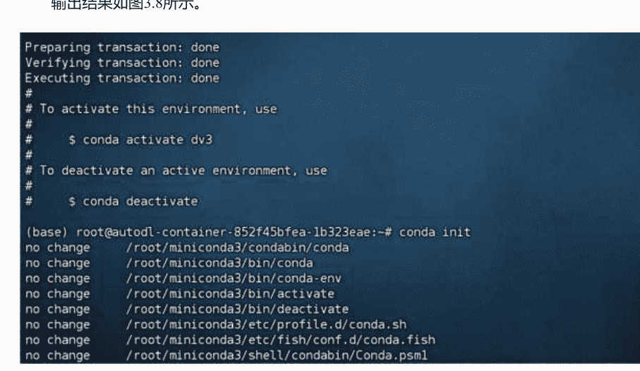

图3.8 创建虚拟环境

代码将在Jupyter Notebook环境中运行，在此之前，需要进行相关的安装和配置，执行如下命令。

```
conda install jupyterlab
conda install ipykernel
python -m ipykernel install --user --name dv3 --display-name "Python (dv3)"
```

(3) 通过GitHub拉取开源项目。首先登录GitHub主页，拉取所需项目；然后访问DeepSeek-V3主页；最后执行如下命令。

```
git clone https://github.com/deepseek-ai/DeepSeek-V3.git
```

输出结果如图3.9所示。


执行如下命令安装项目相关依赖。

```
cd DeepSeek-V3/inference
pip install -r requirements.txt
```

(4) 下载模型权重。可以在Hugging Face或者魔搭社区下载模型权重，推荐使用魔搭社区下载。

> **说明**
下载前需要提前留出600G左右存储空间，用于保存模型权重。

首先需要安装ModelScope开源模型库，执行如下命令。

```
pip install modelscope
```

输出结果如图3.10所示。


安装完成后，即可通过ModelScope下载模型权重，在下载时指定下载Int4类型的权重。执行如下命令。

```
bash
mkdir ./deepseek
modelscope download --model OPEA/DeepSeek-V3-int4-sym-gptq-inc --local_dir ./deepseek
```

输出结果如图3.11所示。


### 3. 在Jupyter Notebook中进行推理调用

在Jupyter Notebook中进行推理调用，具体代码如下。

```
python
import torch
from modelscope import AutoTokenizer, AutoModelForCausalLM, GenerationConfig

# 指定模型存储路径（修改为上一步中模型权重下载到的本地路径）
model_name = "./deepseek"

# 加载对应的分词器（Tokenizer）
tokenizer = AutoTokenizer.from_pretrained(model_name)

# 加载 CausalLM（因果语言模型），设置数据类型为 bfloat16，并自动映射到可用设备（如 GPU）
model = AutoModelForCausalLM.from_pretrained(model_name, torch_dtype=torch.bfloat16, device_map="auto")

# 加载生成配置（GenerationConfig），用于调整模型的生成策略
model.generation_config = GenerationConfig.from_pretrained(model_name)
model.generation_config.pad_token_id = model.generation_config.eos_token_id
```

首先需进行一些相关的配置，指定DeepSeek模型存储路径后将其加载为因果语言模型（causal language model，CausalLM），并配置相关的分词器和生成策略。

相关配置代码运行结果如图3.12所示。

```
python
import torch
from modelscope import AutoTokenizer, AutoModelForCausalLM, GenerationConfig

model_name = "./deepseek-v3"

tokenizer = AutoTokenizer.from_pretrained(model_name)
model = AutoModelForCausalLM.from_pretrained(model_name, torch_dtype=torch.float16, device_map="auto")
model.generation_config = GenerationConfig.from_pretrained(model_name)
model.generation_config.pad_token_id = model.generation_config.eos_token_id
```

图3.12 模型配置代码运行结果

完成配置后，即可使用配置好的模型进行对话，按照规定格式构造消息列表，使用tokenizer将对话消息文本转换为模型可处理的张量格式，这时就可以输入模型来生成模型的回复，具体代码如下。

```
python
# 构造对话消息列表
messages = [
    {"role": "user", "content": "你好，好久不见，请介绍下你自己！"}
]

# 使用 tokenizer 将对话消息转换为模型可处理的张量格式
input_tensor = tokenizer.apply_chat_template(messages, add_generation_prompt=True, return_tensors="pt")

# 使用模型进行文本生成
outputs = model.generate(input_tensor.to(model.device), max_new_tokens=100)

# 解码模型生成的文本
result = tokenizer.decode(outputs[0][input_tensor.shape[1]:], skip_special_tokens=True)
print(result)
```

运行效果如图3.13所示。

```
python
messages = [
    {"role": "user", "content": "你好，好久不见，请介绍下你自己！"}
]

input_tensor = tokenizer.apply_chat_template(messages, add_generation_prompt=True, return_tensors="pt")
outputs = model.generate(input_tensor.to(model.device), max_new_tokens=100)

result = tokenizer.decode(outputs[0][input_tensor.shape[1]:], skip_special_tokens=True)
print(result)

你好！我是一个人工智能助手，名叫DeepSeek Chat，我由中国的DeepSeek团队开发，专门用于帮助用户解答问题和提供信息。我可以回答各种问题，包括但不限于科学、数学、历史、文化等领域的知识。如果你有任何问题，随时可以问我。
```

图3.13 在Jupyter Notebook中进行推理调用的效果图

#### 3.1.5 DeepSeek-V3 Function Calling

##### 1. Function Calling功能简介

Function Calling是大语言模型在向通用智能体能力迈进过程中的关键能力之一，允许模型不仅生成自然语言回答，还能根据用户意图调用预定义的函数或工具，以实现更具交互性与实用性的任务处理。其基本过程如图3.14所示。

在传统的对话系统中，模型往往只能进行语言输出，缺乏对外部环境的真实调用能力。Function Calling则通过一个结构化的接口定义（通常以JSON Schema描述函数），使模型具备“理解任务→调用函数→返回结果”的能力，从而完成如天气查询、数据库访问、文档检索、任务派发等实际操作。

在DeepSeek-V3模型中，Function Calling功能已实现OpenAI接口标准的基本格式支持。开发者可以通过在API请求中添加functions字段，定义可被调用的函数结构，并由模型自动判断是否调用函数，以及调用哪个函数和传递哪些参数。

##### 2. 外部工具API

首先需要简单说明的是，到底什么是外部工具API。API的全称是应用程序接口，例如，目前我们在Python环境中使用了ChatCompletion.create函数，实际上就是OpenAI公司提供的GPT系列模型应用程序的一个接口，通过这个API（create函数或者openai库），我们能够非常顺利地调用GPT模型，并根据输入信息实时输出模型结果。而其他的很多应用程序也有相应的API。

本节示例中使用的是一个可以实时查询天气的API，即OpenWeather API。通过调用OpenWeather API获取实时天气信息，然后利用Function Calling功能调用该函数，这样相当于赋予了Chat模型实时获取天气信息的能力。此后，我们即可通过Chat模型实时查询天气，或根据天气情况询问穿衣建议等。从功能上来说，接入实时天气信息的Chat模型实际上就是一个非常简单的天气查询AI助手。

为了能够调用OpenWeather服务，和OpenAI的API使用过程类似，首先需要先注册OpenWeather账号，并获取OpenWeather API key。这里需要注意的是，对于大多数在线服务的API来说，都需要通过API key来进行身份验证，尽管OpenWeather相对更加开放，有非常多的免费使用次数，但身份验证仍然是必要的，防止API被滥用。OpenWeather API key获取流程如下。

(1) 登录OpenWeather官网并选择Sign in→Create an Account完成注册。可以使用国内邮箱或者QQ邮箱进行注册。OpenWeather的官网页面如图3.15所示，其用户注册页面如图3.16所示。

(2) 获取API key：注册完成后，即可在用户主页的API keys选项卡中查看当前账户的API key，如图3.17所示。

图3.15 OpenWeather官网页面

图3.16 OpenWeather用户注册页面

图3.17 OpenWeather用户主页

一般来说，完成注册后，用户通常会获得一个已经激活的API key。与OpenAI类似，OpenWeather的API key也创建多个，如图3.18所示。

（3）与OpenAI API key类似，为了方便后续调用，我们也可以直接将OpenWeather API key设置为环境变量，变量名为OPENWEATHER_API_KEY，如图3.19所示。

环境变量设置之后，即可创建OpenWeather API key变量，代码如下。

```
open_weather_key = os.getenv("OPENWEATHER_API_KEY")
```

##### 3. 利用OpenWeather API获取实时天气信息

接下来，我们通过一个简单的示例来介绍如何使用OpenWeather API获取实时天气信息。我们将把该API的调用过程封装成一个函数。代码如下。

```
def get_weather(loc):
    """
    查询即时天气函数
    :param loc: 必要参数，字符串类型，用于表示查询天气的具体城市名称。
    注意，中国的城市名称需要用其英文名称代替，例如如果需要查询北京市天气，则 loc 参数需要输入'Beijing'；
    :return: OpenWeather API 查询即时天气的结果，具体 URL 请求地址为：https://api.openweathermap.org/data/2.5/weather
    返回结果对象类型为解析之后的 JSON 格式对象，并用字符串形式进行表示，其中包含了全部重要的天气信息
    """
    # Step 1.构建请求
    url = "https://api.openweathermap.org/data/2.5/weather"

    # Step 2.设置查询参数
    params = {
        "q": loc,
        "appid": open_weather_key,        # 输入 API key
        "units": "metric",                # 使用摄氏度而不是华氏度
        "lang":"zh_cn"                    # 输出语言为简体中文
    }

    # Step 3.发送 GET 请求
    response = requests.get(url, params=params)

    # Step 4.解析响应
    data = response.json()
    return json.dumps(data)
```

##### 4. functions参数解释与定义过程

在完成外部函数及其库的准备工作之后，关键步骤是将外部函数的信息以某种形式传输给Chat模型。此时就需要用到ChatCompletion.create函数的functions参数，类似于messages参数，它用于向模型传输消息，functions参数专门用于提供可调用的外部函数信息。此外，从参数的具体形式来看，functions和messages参数也是非常类似的——都是包含多个字典的list。对于messages来说，每个字典都是一条信息，而对于functions参数来说，每个字典都是一个函数。在大语言模型实际进行问答时，会根据functions参数提供的信息对各函数进行检索。

显而易见，functions参数对于实现Chat模型的Function Calling功能至关重要。接下来，我们详细解释如何编写functions中的字典。总的来说，每个字典都有3个参数（3组键值对），各参数的名称及解释如下。

(1) name: 必选参数，字符串类型，代表函数名称。按照要求，函数名称必须由a-z、A-Z、0-9、下画线和英文破折号组成，最大长度为64。此名称用于模型在外部函数库中识别相应的函数。

(2) description: 可选参数，字符串类型，用于描述函数功能。虽然该参数不是必需的，但它是Chat模型识别函数功能的核心依据。即Chat函数实际上是通过每个函数的description来判断当前函数的实际功能的，若要实现多个备选函数的智能挑选，则需要严谨详细地描述函数功能（在特定情况下，如果已明确指定使用的函数，则无须设置description）。

（3）parameters：必选参数，需遵照JSON Schema格式进行输入的函数参数，JSON Schema是一种特殊的JSON对象，用于验证JSON数据格式是否满足要求。

例如，对于get_weather函数，我们需要创建如下字典来对其进行完整描述。

```
get_weather_function = {
    'name': 'get_weather',
    'description': '查询即时天气函数，根据输入的城市名称，查询对应城市的实时天气',
    'parameters': {
        'type': 'object',
        'properties': {
            'loc': {
                'description': '城市名称，注意，中国的城市名称需要用其英文名称代替，例如如果需要查询北京市天气，则loc参数需要输入"Beijing"',
                'type': 'string'
            }
        },
        'required': ['loc']
    }
}
```

同时还需要封装外部函数库，用于关联外部函数名称和外部函数对象。

```
available_functions = {
    "get_weather": get_weather,
}
```

对于最新模型的Function Calling功能来说，还需要进行更高层次封装，封装为一个tools对象，同时说明当前Function性质。

```
tools = [
    {
        "type": "function",
        "function": get_weather_function
    }
]
```

##### 5. Function Calling功能实现

Function Calling的本质，是让语言模型在对话中完成“识别任务→选中函数→给出参数→外部执行→返回结果→基于结果生成答复”的过程。这个过程分为两个阶段：第一次调用模型识别任务并调用函数，第二次调用模型生成最终回答。

1）第一阶段：模型识别任务并决定调用哪个函数

在一系列基础准备工作之后，我们将尝试在Chat模型对话中执行Function Calling功能。这里我们创建如下messages。

```
# 实例化客户端
client = OpenAI(api_key=ds_api_key,
                base_url="https://api.deepseek.com")

messages=[
    {"role": "user", "content": "请帮我查询北京地区今日天气情况"}
]
```

首先我们测试只输入这个信息而不输入外部函数库时模型能否知道如何查询天气。

```
response = client.chat.completions.create(
    model="deepseek-chat",
    messages=messages
)

response.choices[0].message.content
```

输出结果如下。

> ‘您好，建议您联网获取时效性较强的信息；如果还有其他问题需要帮助，请随时告诉我！’

很明显，模型无法回答。

接下来，将函数库相关信息输入Chat模型，这里需要额外设置两个参数，其一是tools参数，用于声明外部函数库的当前情况，其二是tool_choice参数，该参数用于控制是否执行Function Calling功能，该参数有两种不同的取值，默认取值为auto，表示模型将根据用户实际对话情况，选择性地自动挑选函数执行，若想让模型在本次对话中特定执行tools中的某个函数，则可以通过输入形式如{"name": "my_function"}的字典进行声明，此时模型不会再自动挑选模型，而是在tools中挑选my_function执行。

这里我们尝试让模型自动挑选函数来执行，参数设置方法与执行过程如下。

```
response = client.chat.completions.create(
    model="deepseek-chat",
    messages=[
        {"role": "user", "content": "请帮我查询北京地区今日天气情况"}
    ],
    tools=tools,
)
```

观察此时的response结果，输入以下代码。

```
response
```

输出结果如下。

```
ChatCompletion(id='ba15fffc-82b6-40f7-91e2-d34b71e8daac', choices=[Choice(finish_reason='tool_calls', index=0, logprobs=None, message=ChatCompletionMessage(content='', refusal=None, role='assistant', audio=None, function_call=None, tool_calls=[ChatCompletionMessageToolCall(id='call_0_87e140df-66ef-44dd-813f-45800e169690', function=Function(arguments='{"loc":"Beijing"}', name='get_weather'), type='function', index=0)]))], created=1736240025, model='deepseek-chat', object='chat.completion', service_tier=None, system_fingerprint='fp_3a5770e1b4', usage=CompletionUsage(completion_tokens=19, prompt_tokens=153, total_tokens=172, completion_tokens_details=None, prompt_tokens_details=None, prompt_cache_hit_tokens=0, prompt_cache_miss_tokens=153))
```

输入以下代码。

```
response_message = response.choices[0].message
response_message
```

输出结果如下。

```
ChatCompletionMessage(content='', refusal=None, role='assistant', audio=None, function_call=None, tool_calls=[ChatCompletionMessageToolCall(id='call_0_87e140df-66ef-44dd-813f-45800e169690', function=Function(arguments='{"loc":"Beijing"}', name='get_weather'), type='function', index=0)])
```

能够发现，此时返回的message中content为空，新增了一个tool_calls的list，该list就包含了当前调用外部函数的全部信息。

输入以下代码。

```
response_message.tool_calls
```

输出结果如下。

```
[ChatCompletionMessageToolCall(id='call_0_87e140df-66ef-44dd-813f-45800e169690', function=Function(arguments='{"loc":"Beijing"}', name='get_weather'), type='function', index=0)]
```

对于当前CompletionMessageToolCall对象，id为外部函数调用发起请求id，function则表示调用的外部函数的基本信息，而type则代表了当前调用的外部函数的类型，function代表调用自定义的外部函数。除此之外还可以选择retrieval或web_search，分别代表进行在线知识库的知识检索和进行在线搜索。

我们可以在此基础上分别提取调用的外部函数名称信息和参数信息，分别保存为function_name和function_args对象，代码如下：

```
# 完成对话需要调用的函数名称
function_name = response_message.tool_calls[0].function.name

# 具体的函数对象
fuction_to_call = available_functions[function_name]

# 执行该函数所需要的参数
function_args = json.loads(response_message.tool_calls[0].function.arguments)
```

需要注意的是，外部函数的计算过程仍然是在本地执行，即Chat模型不会将代码读取到服务器上后再进行在线计算，因此接下来我们需要根据模型返回的函数和函数参数，在本地完成函数计算，然后再将计算过程和结果保存为message并追加到messages后面，接着第二次调用Chat模型分析函数的计算结果，并最终根据函数计算结果输出用户问题的答案。

2）第二阶段：本地执行函数，并将结果反馈给模型

接下来我们将function_args对象传入fuction_to_call中并完成计算，代码如下：

```
function_response = fuction_to_call(**function_args)
function_response
```

输出结果如下。

```
{"coord": {"lon": 116.3972, "lat": 39.9075}, "weather": [{"id": 804, "main": "Clouds", "description": "阴，多云", "icon": "04d"}], "base": "stations", "main": {"temp": 4.94, "feels_like": 1.77, "temp_min": 4.94, "temp_max": 4.94, "pressure": 1020, "humidity": 25, "sea_level": 1020, "grnd_level": 1014}, "visibility": 10000, "wind": {"speed": 4.03, "deg": 300, "gust": 9.43}, "clouds": {"all": 85}, "dt": 1736239986, "sys": {"type": 1, "id": 9609, "country": "CN", "sunrise": 1736206561, "sunset": 1736240684}, "timezone": 28800, "id": 1816670, "name": "Beijing", "cod": 200}
```

根据上述运行结果能够发现，模型已经顺利完成计算。接下来，我们在messages对象中追加两条消息，第一条消息是第一次模型返回的结果（即调用模型的assistant message），第二条消息则是外部函数的计算结果，该条消息的role为function，且name为函数名称。我们也可以区分function message与user message、system message、assistant message的不同之处。function message必须包含关键词name，且其内容来源于外部函数执行的计算结果，并需要手动输入。具体添加过程如下。

先执行代码查看我们最初的message。

```
messages
```

输出结果如下。

```
[{'role': 'user', 'content': '请帮我查询北京地区今日天气情况'}]
```

查看模型第一次返回的结果消息。

```
response_message.model_dump()
```

输出结果如下。

```
{'content': '',
 'refusal': None,
 'role': 'assistant',
 'audio': None,
 'function_call': None,
 'tool_calls': [{'id': 'call_0_87e140df-66ef-44dd-813f-45800e169690',
   'function': {'arguments': '{"loc":"Beijing"}', 'name': 'get_weather'},
   'type': 'function',
   'index': 0}]}
```

现在将两部分的消息进行拼接，执行以下代码。

```
# 追加模型第一次返回的结果消息
messages.append(response_message.model_dump())
messages
```

输出结果如下。

##### 6. Function Calling函数封装

通过上面的逐步探索，我们已经了解了Function Calling的实现逻辑。通过下面代码将上面的过程进行封装。

```python
def run_conv(messages,
             api_key,
             tools=None,
             functions_list=None,
             model="deepseek-chat"):
    """
    能够自动执行外部函数调用的 Chat 对话模型
    :param messages: 必要参数，输入到 Chat 模型的 messages 参数对象
    :param api_key: 必要参数，调用模型的 API-KEY
    :param tools: 可选参数，默认为 None，可以设置为包含全部外部函数的列表对象
    :param model: Chat 模型，可选参数，默认模型为 deepseek-chat
    :return: Chat 模型输出结果
    """
    user_messages = messages

    client = OpenAI(api_key=api_key,
                    base_url="https://api.deepseek.com")

    # 如果没有外部函数库，则执行普通的对话任务
    if tools == None:
        response = client.chat.completions.create(
            model=model,
            messages=user_messages
        )
        final_response = response.choices[0].message.content

    # 若存在外部函数库，则需要灵活选取外部函数并进行回答
    else:
        # 创建外部函数库字典
        available_functions = {func.__name__: func for func in functions_list}

        # 创建包含用户问题的 messages
        messages = user_messages

        # first response
        response = client.chat.completions.create(
            model=model,
            messages=user_messages,
            tools=tools,
        )
        response_message = response.choices[0].message

        # 获取函数名
        function_name = response_message.tool_calls[0].function.name
        # 获取函数对象
        fuction_to_call = available_functions[function_name]
        # 获取函数参数
        function_args = json.loads(response_message.tool_calls[0].function.arguments)

        # 将函数参数输入到函数中，获取函数计算结果
        function_response = fuction_to_call(**function_args)

        # messages 中拼接 first response 消息
        user_messages.append(response_message.model_dump())

        # messages 中拼接外部函数输出结果
        user_messages.append(
            {
                "role": "tool",
                "content": function_response,
                "tool_call_id": response_message.tool_calls[0].id
            }
        )

        # 第二次调用模型
        second_response = client.chat.completions.create(
            model=model,
            messages=user_messages)

        # 获取最终结果
        final_response = second_response.choices[0].message.content

    return final_response
```

这里再次执行代码进行对话实验。

```python
messages = [{"role": "user", "content": "请问北京今天天气如何？"}]
run_conv(messages=messages,
         api_key = ds_api_key,
         tools=tools,
         functions_list=[get_weather])
```

输出结果如下。

> 北京今天的天气是多云，气温约为 4.94° C，体感温度约为 1.77° C，湿度为 25%，风速为 4.03 米/秒，风向为 300 度。空气质量良好，能见度为 10000 米。

至此，我们完整地使用DeepSeek-V3模型实现了Function Calling，即外部函数工具的调用。

#### 3.1.6 打造专属聊天机器人：Open-WebUI接入DeepSeek-V3

##### 1. Open-WebUI项目介绍

Open-WebUI是一个开源的Web界面，用于管理和交互式使用大语言模型（LLM）。它提供了直观的聊天界面，支持本地和远程模型，通过它可以轻松部署和调用各种开源模型，不需要复杂的命令行操作。

Open-WebUI项目支持接入在线大模型和开源大模型（包括OpenAI、GLM-4、Qwen2.5等），均可以通过其Functions（功能）模块来灵活接入，支持一键导入配置。

在Open-WebUI项目中，Functions通常是指该项目提供的可以执行特定任务或操作的模块或方法。这些功能模块可以帮助用户与大模型进行交互、配置模型参数、获取输出结果等。具体来说，这些Functions包括文本生成、模型参数调节、会话管理功能、API接口、模型选择和管理等实现细节。

##### 2. DeepSeek-V3接入Open-WebUI流程

(1) 创建虚拟环境，运行如下命令。

```bash
# 创建一个名为 open-webui 的 Conda 虚拟环境，并指定 Python 版本为 3.11
conda create -n open-webui python=3.11

# 初始化 Conda
conda init

# 重新加载 shell 配置
source ~/.bashrc

# 激活刚刚创建的 open-webui 环境，进入该环境
conda activate open-webui
```

(2) 安装Open-WebUI项目，运行如下命令。

```bash
pip install open-webui -i https://pypi.tuna.tsinghua.edu.cn/simple
```

输出结果如图3.20所示。

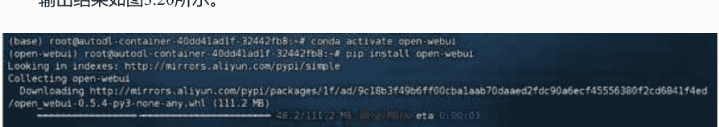

（3）开启服务，运行如下命令，服务将会启动本地的8080端口：http://localhost:8080。

```bash
open-webui serve
```

##### 3. Open-WebUI前端交互操作

（1）单击图3.21中的“开始使用Open-WebUI”选项。按照操作提示创建管理员账号，用于项目管理（这里的信息均存储在项目本地服务器上）。

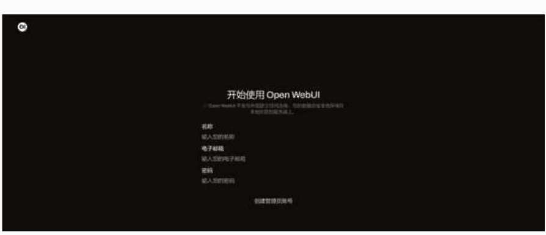

以管理员账号进入项目后，将显示如图3.22所示的账号主页信息。


（2）用户根据如图3.23所示的指示进行Open-WebUI项目的用户设置。

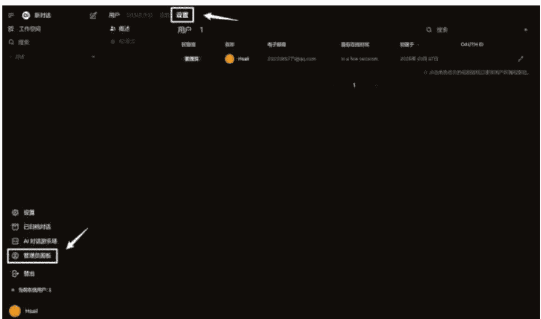

（3）在“设置”选项卡中单击“外部连接”，再单击“管理OpenAI API连接”右侧的“+”，进行连接的添加，如图3.24所示。

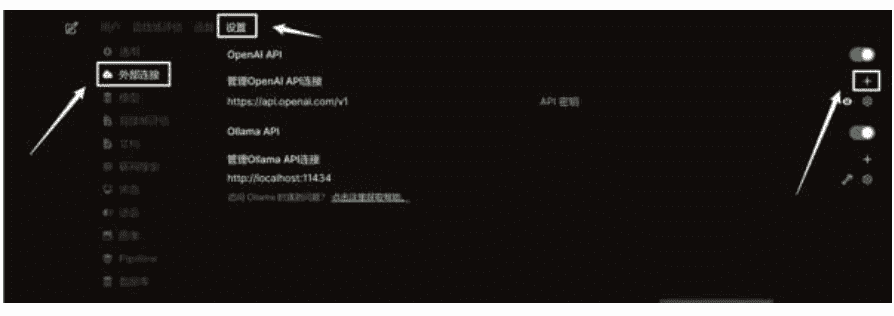

输入密钥后可单击图3.25所示按钮进行连接的验证。


（4）选择对话模型并进行对话。单击对话页面左上角显示的模型可选择自己需要的模型，如图3.26所示。


选择模型之后就可以在对话框内输入文字同大模型进行对话，对话效果如图3.27所示。


至此，Open-WebUI接入DeepSeek-V3模型的全流程已顺利完成。用户现在可以通过直观的前端交互界面，与本地部署的大模型自由对话，实现高效的智能交互体验。从整体架构来看，Open-WebUI+DeepSeek-V3不仅提供了便捷的模型调用方式，而且构建了一个完整的前后端一体化独立应用，使大语言模型的部署与使用更加直观、高效。

### 3.1 DeepSeek-V3对话大模型

本节将围绕DeepSeek-V3模型的应用实践展开。我们首先介绍模型架构与核心功能特点，接着阐述在线API的标准调用方式及参数使用规范，然后深入本地部署的详细步骤，包括环境准备、模型权重加载、推理测试等关键环节。此外，本节我们还将演示如何通过Function Calling功能调用外部函数，最后将结合Open-WebUI构建具备可视化交互能力的个性化聊天系统。

#### 3.1.1 DeepSeek-V3模型介绍

DeepSeek-V3是由中国人工智能初创企业深度求索于2024年12月发布的第三个版本的大型语言模型，其一经发布就受到了高度关注。在模型架构方面，DeepSeek-V3采用了MoE架构，总参数量达到6710亿，但每个token仅激活370亿参数。这种设计在保证模型性能的同时，显著降低了计算资源的消耗。此外，模型引入了多头潜在注意力（multi-head latent attention, MLA）机制，以提升推理效率。在训练过程中，DeepSeek-V3也采用了无辅助损失的负载均衡策略，并设定了多token预测的训练目标，进一步增强了模型性能。

DeepSeek-V3在多个基准测试中超越了众多其他开源模型，如Qwen2.5-72B和Llama-3.1-405B，性能可媲美闭源模型GPT-4o和Claude-3.5-Sonnet。同时，值得注意的是，DeepSeek-V3的训练成本仅为557.6万美元（约为GPT-4o模型训练成本的1/20），显著低于同类顶尖模型。这一成本效益的实现，为中小企业和开发者提供了新的机遇。最关键的是DeepSeek-V3原生支持OpenAI SDK调用，且支持Function Calling、Json Output等功能，使用GPT模型的开发人员可以无缝切换到DeepSeek模型。

总而言之，DeepSeek-V3作为一款高性能、低成本的大型语言模型，展示了中国在人工智能领域的创新实力，为全球AI社区带来了新的视角和可能性。

#### 3.1.2 DeepSeek-V3模型API调用

##### 1. DeepSeek账号注册与API获取

首先访问DeepSeek官网，其官网主页如图3.1所示。

##### 2. DeepSeek-V3模型调用

使用如下命令安装必要的依赖环境。

```
pip install openai
```

官方手册指出：DeepSeek API使用与OpenAI兼容的API格式。这样你可以直接使用OpenAI SDK来访问DeepSeek API。

```
import os
from openai import OpenAI

from IPython.display import display, Code, Markdown
import requests
import json

# <YOUR_DEEPSEEK_API_KEY>替换为复制的 API key 字符串
ds_api_key = '<YOUR_DEEPSEEK_API_KEY>'

#实例化客户端
client = OpenAI(api_key=ds_api_key,
                base_url="https://api.deepseek.com")

#调用 DeepSeek-V3 模型
response = client.chat.completions.create(
    model="deepseek-chat",
    messages=[
        {"role": "user", "content": "你好，好久不见!"}
    ]
)

#输出生成的响应内容
print(response.choices[0].message.content)
#输出完整的响应
print(response)
```

输出结果如下。

```
你好！好久不见！最近过得怎么样？有什么想聊的吗？
ChatCompletion(id='1fdbc70b-acbf-4c9a-a895-d26bd69ad531',
              choices=[Choice(finish_reason='stop',
                              index=0, logprobs=None,

              system_message = {
                  message=ChatCompletionMessage(content='你好！好久不见！最近过得怎么样？有什么想聊的吗？',
                                               refusal=None,
                                               role='assistant',
                                               audio=None,
                                               function_call=None,
                                               tool_calls=None)],
              created=1736238514,
              model='deepseek-chat',
              object='chat.completion',
              service_tier=None,
              system_fingerprint='fp_3a5770e1b4',
              usage=CompletionUsage(completion_tokens=14,
                                    prompt_tokens=8,
                                    total_tokens=22,
                                    completion_tokens_details=None,
                                    prompt_tokens_details=None,
                                    prompt_cache_hit_tokens=0,
                                    prompt_cache_miss_tokens=8))
```

与OpenAI一样的SDK，表明DeepSeek模型采用和GPT模型完全相同的参数体系。

可以输出DeepSeek目前支持的模型范围。

```
models_list = client.models.list()
print(models_list.data)
```

输出结果如下。

```
[Model(id='deepseek-chat', created=None, object='model', owned_by='deepseek'),
 Model(id='deepseek-coder', created=None, object='model', owned_by='deepseek')]
```

这里的“deepseek-chat”即为DeepSeek-V3模型。因为DeepSeek-V3模型属于聊天补全（chat completion）模型，官方已经对“deepseek-chat”指代的模型进行了升级。

#### 3.1.3 DeepSeek-V3模型核心参数详解

##### 1. messages

messages参数是DeepSeek-V3模型API中必填的参数之一，用于定义聊天上下文，包括用户的输入、系统的指令、助手的回复等。通过messages数组，模型可以理解当前对话的背景，从而生成更加连贯的响应。根据不同的使用场景，messages包含多种类型的消息，例如system message、user message和assistant message。下面是对messages参数及其各个子类型的详细解释。

1) system message

system message用于设置系统消息，通常由开发者设定，以指导模型如何进行对话。这类消息可以定义规则或约束，并提供有关对话的背景信息。

- :check_box_with_check: content（必填）：系统消息的内容，可以是字符串或数组。如果是数组，可能包含多个类型的内容（如文本、图像）。
- :check_box_with_check: role（必填）：此处角色为system，表明这是系统发出的消息。
- :check_box_with_check: name（可选）：提供系统消息发送者的名称，尤其适用于区分多个具有相同角色的参与者。

示例代码如下：

```
system_message = {
    "role": "system",
    "content": "你是一位擅长编写 python 代码的助手。"
}
```

2) user message

该参数表示用户发给模型的消息，是对话的核心部分之一。它定义了用户的输入内容，模型根据这些内容生成响应。

- :check_box_with_check: content（必填）：用户消息的内容，通常为文本或图像链接的数组。对于支持图像输入的模型，如DeepSeek-V2.5，还可以传递图像。
  - 文本内容：单纯的字符串形式，用户输入的文本。
  - 数组形式的内容：由文本或图像链接组成的数组，可同时传递多张图像或多段文本内容。
- :check_box_with_check: role (必填)：角色为user，表示该消息来自用户。
- :check_box_with_check: name (可选)：可以为用户指定一个名称，用于区分多个具有相同角色的用户。

示例代码如下。

```
user_message = {
    "role": "user",
    "content": "你好，请介绍下你自己。"
}
```

如果在和大模型的对话消息中同时传递多个类型的内容（如图像和文本），示例代码如下：

```
user_message_with_image = {
    "role": "user",
    "content": [
        {"type": "text", "text": "你能帮我介绍下这张图片里面的内容吗？"},
        {"type": "image_url",
         "image_url": {
             "url": "https://ml2022.oss-cn-hangzhou.aliyuncs.com/img/image-20241009205714055.png"}}
    ]
}
```

使用过程中通常单独创建用户消息，再将其作为参数传入模型调用函数中。

```
#创建用户消息
user_message = {
    "role": "user",
    "content": "你好，请介绍下你自己。"
}

#调用 DeepSeek-V3 模型
response = client.chat.completions.create(
    model="deepseek-chat",
    messages=[
        system_message,
        user_message
    ]
)

#输出生成的响应内容
print(response.choices[0].message.content)
```

输出结果如下。

> 你好！我是一位大学教授，专注于多个学科的研究与教学。我的工作主要包括教授本科生和研究生课程，指导学生的研究项目，以及进行学术研究。我致力于通过教育和研究推动知识的边界，并帮助学生发展他们的批判性思维和创新能力。此外，我也参与学术会议和研讨会，与同行交流最新的研究成果和教学方法。如果你有任何学术上的问题或需要指导，我很乐意提供帮助。

##### 2. 其余重要参数

在实际应用DeepSeek-V3进行推理调用时，用户可以通过一系列参数对模型的行为进行精细化控制。下面将详细介绍这些参数的作用，以帮助开发者根据不同场景的需求优化模型性能、管理生成内容，并提升交互体验。模型参数如表3.1所示。

表3.1 DeepSeek-V3模型参数汇总表

| 参数名 | 类型 | 必填/可选 | 默认值 | 说明 |
| :--- | :--- | :--- | :--- | :--- |
| model | string | 必填 | 无 | 指定要使用的模型 ID，例如 deepseek-chat 或 deepseek-code |
| store | boolean 或 null | 可选 | false | 是否存储本次对话的输出，供模型精炼或评估产品使用 |
| metadata | object 或 null | 可选 | null | 开发者自定义的标签和值，用于过滤仪表盘中的补全结果 |
| frequency_penalty | number 或 null | 可选 | 0 | 数值为-2.0～2.0，正值减少重复生成内容的可能性 |
| logit_bias | map | 可选 | null | 调整某些特定 token 出现的可能性，值为-100～100 |
| logprobs | boolean 或 null | 可选 | false | 是否返回生成的每个 token 的对数概率 |
| top_logprobs | integer 或 null | 可选 | null | 指定返回最有可能出现的前几个 token 及其概率，需开启 logprobs |
| max_completion_tokens | integer 或 null | 可选 | null | 指定模型生成的最大 token 数，包括可见文本和推理 token |
| n | integer 或 null | 可选 | 1 | 每个输入生成的对话补全选项数量，值越大，生成的回复越多 |
| presence_penalty | number 或 null | 可选 | 0 | 数值为-2.0～2.0，正值鼓励生成新的主题和内容 |
| response_format | object | 可选 | null | 指定生成结果的格式，可以设置为 json_schema 以确保结构化输出，或设置为 json_object 用于 JSON 格式 |
| seed | integer 或 null | 可选 | null | 保持生成的一致性，重复相同请求将尽量生成相同的结果 |
| service_tier | string 或 null | 可选 | auto | 指定服务延迟等级，适用于付费订阅用户 |
| stop | string/array/null | 可选 | null | 最多指定 4 个序列，API 遇到这些序列时会停止生成进一步的 token |
| stream | boolean 或 null | 可选 | false | 是否启用流式响应，若启用，生成的 token 将逐步返回 |
| stream_options | object 或 null | 可选 | null | 流式响应的选项，仅当 stream 为 true 时设置 |
| temperature | number 或 null | 可选 | 1 | 控制生成输出的随机性，值越高生成的文本越随机。建议调整此值或 top_p，而不是同时调整 |
| top_p | number 或 null | 可选 | 1 | 使用核采样方法，选择最有可能的 token，总概率达到 top_p 百分比。建议与 temperature 二选一 |
| tools | array | 可选 | null | 模型可以调用的工具列表，目前仅支持函数调用 |
| user | string | 可选 | null | 表示最终用户的唯一标识符，用于监控和检测滥用行为 |

为了更高效地配置模型参数，我们可以按照参数的功能和作用，将其划分为以下几大类别。

###### (1) 模型和输出。

- :check_box_with_check: model是必填参数，决定使用哪个模型（如deepseek-chat或deepseek-code）。
- :check_box_with_check: store用于控制是否存储生成的对话结果，便于后续模型训练或评估。
- :check_box_with_check: metadata用于添加开发者自定义的标签，便于在仪表盘中过滤补全结果。
- :check_box_with_check: max_completion_tokens和n控制生成内容的数量和长度，帮助管理生成成本。

###### (2) 生成行为控制。

- :check_box_with_check: frequency_penalty和presence_penalty都用于影响生成结果的内容重复度和新颖性。
- :check_box_with_check: logit_bias是用于调整特定token出现概率的高级控制工具。
- :check_box_with_check: temperature和top_p通过不同的方式控制生成结果的随机性，建议选其一进行调整。

###### (3) 高级功能。

- :check_box_with_check: logprobs和top_logprobs用于返回每个token的概率信息，适合对模型输出进行更细粒度分析。
- :check_box_with_check: stream启用后会实时返回生成的结果，适用于需要逐步展示内容的场景。
- :check_box_with_check: tools允许模型调用外部工具（如函数），适用于扩展模型的功能。

###### (4) 服务和用户。

- :check_box_with_check: service_tier控制服务的延迟和稳定性，适合有高性能要求的付费用户。
- :check_box_with_check: user用于标识最终用户，有助于监控使用行为，防止滥用。

#### 3.1.4 DeepSeek-V3模型本地部署与调用

##### 1. DeepSeek开源情况介绍

DeepSeek是开源大模型，我们首先需要对其开源情况有所了解。DeepSeek项目的GitHub文件情况如图3.5所示。

其中开源代码部分如图3.6所示。

图3.6 DeepSeek项目GitHub开源代码部分

以下是对图3.6中DeepSeek项目开源代码的介绍。

- :check_box_with_check: convert.py: 用于格式转换，将一个已经训练好的模型检查点（checkpoint）文件从一个格式（如safetensors）转换并保存成一个适合特定模型并行度（model parallelism）和专家数（n_experts）的格式。
- :check_box_with_check: fp8_cast_bf16.py: 代码的功能是将存储在FP8格式中的模型权重转换为BF16格式，并保存转换后的权重。它还更新了模型的索引文件，去除了scale_inv的引用。
- :check_box_with_check: generate.py: 一个用于生成文本的示例程序，支持交互式和批量文本生成。它使用一个Transformer模型并进行分布式训练。
- :check_box_with_check: kernel.py: 代码主要涉及量化和矩阵乘法操作，使用了Triton库进行加速，特别是针对FP8精度（浮点8位）进行了优化。Triton是一个专为GPU上的高效自定义操作而设计的编程框架，支持Python和PyTorch，可以通过简洁的代码来实现高效的GPU核心。
- :check_box_with_check: model.py: 定义了DeekSeek-V3模型架构。

目前模型权重已经在Hugging Face上开源了，具体情况如图3.7所示。

##### 3. Model Downloads

| Model | #Total Params | #Activated Params | Context Length | Download |
|---|---|---|---|---|
| DeepSeek-V3-Base | 671B | 37B | 128K | 🤗 Hugging Face |
| DeepSeek-V3 | 671B | 37B | 128K | 🤗 Hugging Face |

> Note
The total size of DeepSeek-V3 models on Hugging Face is 685B, which includes 671B of the Main Model weights and 14B of the Multi-Token Prediction (MTP) Module weights.

To ensure optimal performance and flexibility, we have partnered with open-source communities and hardware vendors to provide multiple ways to run the model locally. For step-by-step guidance, check out Section 6: [How to Run Locally](https://github.com/deepseek-ai/DeepSeek-V3/blob/main/README.md#how-to-run-locally).

For developers looking to dive deeper, we recommend exploring [README_WEIGHTS.md](https://github.com/deepseek-ai/DeepSeek-V3/blob/main/README_WEIGHTS.md) for details on the Main Model weights and the Multi-Token Prediction (MTP) Modules. Please note that MTP support is currently under active development within the community, and we welcome your contributions and feedback.

图3.7 DeepSeek项目模型权重相关说明

DeepSeek-V3模型权重可在Hugging Face主页下载，权重总共约650G大小，用户也可在魔搭社区下载。作为权重全开源的模型，官方介绍的本地运行方法有如下几种。

- (1) DeepSeek-Infer Demo：提供了一个简单且轻量的演示，支持FP8和BF16推理。
- (2) SGLang：完全支持DeepSeek-V3模型在BF16和FP8推理模式下运行，且即将支持多标记预测（MTP）。
- (3) LMDeploy：支持高效的FP8和BF16推理，适用于本地和云端部署。
- (4) TensorRT-LLM：目前支持BF16推理和INT4/8量化，FP8支持即将推出。
- (5) vLLM：支持DeepSeek-V3模型在FP8和BF16模式下进行张量并行和流水线并行。
- (6) AMD GPU：通过SGLang，在BF16和FP8模式下支持在AMD GPU上运行DeepSeek-V3模型。
- (7) 华为Ascend NPU：支持在华为Ascend设备上运行DeepSeek-V3模型。

由于DeepSeek的框架原生采用FP8训练，因此仅提供FP8权重，预估仅700GB+显存便可运行。当然也可以转换到BF16，在半精度下，需要1400GB+，而量化到INT4时需要450GB+。以下是半精度下显存占用情况：（占用490G显存，需要7张80G A100，租赁成本约1000元／天）。

## 2. DeepSeek-V3本地部署

(1) 基本环境配置。本次的DeepSeek-V3本地部署将使用模型的Int4量化版运行，基本配置如下。

- ☑ 服务器硬件配置信息。
    - GPU: Nvidia H20 (98G) GPU * 8。
    - CPU: AMD EPYC 9K84 96-Core。
    - 桥接方式: NVLink。
    - 内存: 150G。
    - 存储: 2T。

- ☑ 深度学习环境配置信息。
    - 操作系统: Ubuntu 22.04。
    - PyTorch版本: 2.5.1。
    - Python版本: 3.12。
    - CUDA版本: 12.4。
    - 其他软件包版本根据DeepSeek-V3项目需求确定。

(2) 创建虚拟环境。执行如下命令创建虚拟环境。

```
# 创建一个名为 dv3 的 Conda 虚拟环境，并指定 Python 版本为 3.11
conda create --name dv3 python=3.11

conda init

# 重新加载 shell 配置
source ~/.bashrc

# 激活刚刚创建的 dv3 环境，使其成为当前终端会话的 Python 运行环境
conda activate dv3
```

输出结果如图3.8所示。


图3.8 创建虚拟环境

代码将在Jupyter Notebook环境中运行，在此之前，需要进行相关的安装和配置，执行如下命令。

```
conda install jupyterlab
conda install ipykernel
python -m ipykernel install --user --name dv3 --display-name "Python (dv3)"
```

(3) 通过GitHub拉取开源项目。首先登录GitHub主页，拉取所需项目；然后访问DeepSeek-V3主页；最后执行如下命令。

```
git clone https://github.com/deepseek-ai/DeepSeek-V3.git
```

输出结果如图3.9所示。


执行如下命令安装项目相关依赖。

```
cd DeepSeek-V3/inference
pip install -r requirements.txt
```

(4) 下载模型权重。可以在Hugging Face或者魔搭社区下载模型权重，推荐使用魔搭社区下载。

> **说明**
下载前需要提前留出600G左右存储空间，用于保存模型权重。

首先需要安装ModelScope开源模型库，执行如下命令。

```
pip install modelscope
```

输出结果如图3.10所示。


安装完成后，即可通过ModelScope下载模型权重，在下载时指定下载Int4类型的权重。执行如下命令。

```
mkdir ./deepseek
modelscope download --model OPEA/DeepSeek-V3-int4-sym-gptq-inc --local_dir ./deepseek
```

输出结果如图3.11所示。

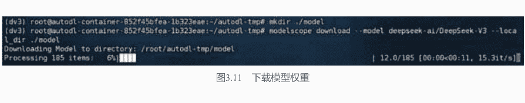

## 3. 在Jupyter Notebook中进行推理调用

在Jupyter Notebook中进行推理调用，具体代码如下。

```python
import torch
from modelscope import AutoTokenizer, AutoModelForCausalLM, GenerationConfig

# 指定模型存储路径（修改为上一步中模型权重下载到的本地路径）
model_name = "./deepseek"

# 加载对应的分词器（Tokenizer）
tokenizer = AutoTokenizer.from_pretrained(model_name)

# 加载 CausalLM（因果语言模型），设置数据类型为 bfloat16，并自动映射到可用设备（如 GPU）
model = AutoModelForCausalLM.from_pretrained(model_name, torch_dtype=torch.bfloat16, device_map="auto")

# 加载生成配置（GenerationConfig），用于调整模型的生成策略
model.generation_config = GenerationConfig.from_pretrained(model_name)
model.generation_config.pad_token_id = model.generation_config.eos_token_id
```

首先需进行一些相关的配置，指定DeepSeek模型存储路径后将其加载为因果语言模型（causal language model，CausalLM），并配置相关的分词器和生成策略。

相关配置代码运行结果如图3.12所示。

```python
import torch
from modelscope import AutoTokenizer, AutoModelForCausalLM, GenerationConfig

model_name = "./deepseek-v3"

tokenizer = AutoTokenizer.from_pretrained(model_name)
model = AutoModelForCausalLM.from_pretrained(model_name, torch_dtype=torch.float16, device_map="auto")
model.generation_config = GenerationConfig.from_pretrained(model_name)
model.generation_config.pad_token_id = model.generation_config.eos_token_id
```

图3.12 模型配置代码运行结果

完成配置后，即可使用配置好的模型进行对话，按照规定格式构造消息列表，使用tokenizer将对话消息文本转换为模型可处理的张量格式，这时就可以输入模型来生成模型的回复，具体代码如下。

```python
# 构造对话消息列表
messages = [
    {"role": "user", "content": "你好，好久不见，请介绍下你自己！"}
]

# 使用 tokenizer 将对话消息转换为模型可处理的张量格式
input_tensor = tokenizer.apply_chat_template(messages, add_generation_prompt=True, return_tensors="pt")

# 使用模型进行文本生成
outputs = model.generate(input_tensor.to(model.device), max_new_tokens=100)

# 解码模型生成的文本
result = tokenizer.decode(outputs[0][input_tensor.shape[1]:], skip_special_tokens=True)
print(result)
```

运行效果如图3.13所示。

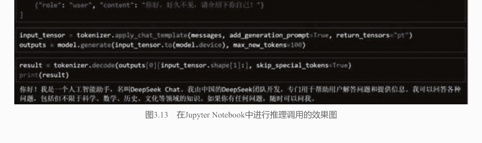

图3.13 在Jupyter Notebook中进行推理调用的效果图

#### 3.1.5 DeepSeek-V3 Function Calling

##### 1. Function Calling功能简介

Function Calling是大语言模型在向通用智能体能力迈进过程中的关键能力之一，允许模型不仅生成自然语言回答，还能根据用户意图调用预定义的函数或工具，以实现更具交互性与实用性的任务处理。其基本过程如图3.14所示。

在传统的对话系统中，模型往往只能进行语言输出，缺乏对外部环境的真实调用能力。Function Calling则通过一个结构化的接口定义（通常以JSON Schema描述函数），使模型具备“理解任务→调用函数→返回结果”的能力，从而完成如天气查询、数据库访问、文档检索、任务派发等实际操作。


在DeepSeek-V3模型中，Function Calling功能已实现OpenAI接口标准的基本格式支持。开发者可以通过在API请求中添加functions字段，定义可被调用的函数结构，并由模型自动判断是否调用函数，以及调用哪个函数和传递哪些参数。

##### 2. 外部工具API

首先需要简单说明的是，到底什么是外部工具API。API的全称是应用程序接口，例如，目前我们在Python环境中使用了ChatCompletion.create函数，实际上就是OpenAI公司提供的GPT系列模型应用程序的一个接口，通过这个API（create函数或者openai库），我们能够非常顺利地调用GPT模型，并根据输入信息实时输出模型结果。而其他的很多应用程序也有相应的API。

本节示例中使用的是一个可以实时查询天气的API，即OpenWeather API。通过调用OpenWeather API获取实时天气信息，然后利用Function Calling功能调用该函数，这样相当于赋予了Chat模型实时获取天气信息的能力。此后，我们即可通过Chat模型实时查询天气，或根据天气情况询问穿衣建议等。从功能上来说，接入实时天气信息的Chat模型实际上就是一个非常简单的天气查询AI助手。

为了能够调用OpenWeather服务，和OpenAI的API使用过程类似，首先需要先注册OpenWeather账号，并获取OpenWeather API key。这里需要注意的是，对于大多数在线服务的API来说，都需要通过API key来进行身份验证，尽管OpenWeather相对更加开放，有非常多的免费使用次数，但身份验证仍然是必要的，防止API被滥用。OpenWeather API key获取流程如下。

- (1) 登录OpenWeather官网并选择Sign in→Create an Account完成注册。可以使用国内邮箱或者QQ邮箱进行注册。OpenWeather的官网页面如图3.15所示，其用户注册页面如图3.16所示。
- (2) 获取API key：注册完成后，即可在用户主页的API keys选项卡中查看当前账户的API key，如图3.17所示。


图3.15 OpenWeather官网页面


图3.16 OpenWeather用户注册页面


图3.17 OpenWeather用户主页

一般来说，完成注册后，用户通常会获得一个已经激活的API key。与OpenAI类似，OpenWeather的API key也创建多个，如图3.18所示。


(3) 与OpenAI API key类似，为了方便后续调用，我们也可以直接将OpenWeather API key设置为环境变量，变量名为OPENWEATHER_API_KEY，如图3.19所示。


环境变量设置之后，即可创建OpenWeather API key变量，代码如下。

```python
open_weather_key = os.getenv("OPENWEATHER_API_KEY")
```

##### 3. 利用OpenWeather API获取实时天气信息

接下来，我们通过一个简单的示例来介绍如何使用OpenWeather API获取实时天气信息。我们将把该API的调用过程封装成一个函数。代码如下。

```python
def get_weather(loc):
    """
    查询即时天气函数
    :param loc: 必要参数，字符串类型，用于表示查询天气的具体城市名称。
    注意，中国的城市名称需要用其英文名称代替，例如如果需要查询北京市天气，则 loc 参数需要输入'Beijing'；
    :return: OpenWeather API 查询即时天气的结果，具体 URL 请求地址为：https://api.openweathermap.org/data/2.5/weather
    返回结果对象类型为解析之后的 JSON 格式对象，并用字符串形式进行表示，其中包含了全部重要的天气信息
    """
    # Step 1.构建请求
    url = "https://api.openweathermap.org/data/2.5/weather"

    # Step 2.设置查询参数
    params = {
        "q": loc,
        "appid": open_weather_key,        # 输入 API key
        "units": "metric",                # 使用摄氏度而不是华氏度
        "lang":"zh_cn"                   # 输出语言为简体中文
    }

    # Step 3.发送 GET 请求
    response = requests.get(url, params=params)

    # Step 4.解析响应
    data = response.json()
    return json.dumps(data)
```

##### 4. functions参数解释与定义过程

在完成外部函数及其库的准备工作之后，关键步骤是将外部函数的信息以某种形式传输给Chat模型。此时就需要用到ChatCompletion.create函数的functions参数，类似于messages参数，它用于向模型传输消息，functions参数专门用于提供可调用的外部函数信息。此外，从参数的具体形式来看，functions和messages参数也是非常类似的——都是包含多个字典的list。对于messages来说，每个字典都是一条信息，而对于functions参数来说，每个字典都是一个函数。在大语言模型实际进行问答时，会根据functions参数提供的信息对各函数进行检索。

显而易见，functions参数对于实现Chat模型的Function Calling功能至关重要。接下来，我们详细解释如何编写functions中的字典。总的来说，每个字典都有3个参数（3组键值对），各参数的名称及解释如下。

- (1) name: 必选参数，字符串类型，代表函数名称。按照要求，函数名称必须由a-z、A-Z、0-9、下画线和英文破折号组成，最大长度为64。此名称用于模型在外部函数库中识别相应的函数。
- (2) description: 可选参数，字符串类型，用于描述函数功能。虽然该参数不是必需的，但它是Chat模型识别函数功能的核心依据。即Chat函数实际上是通过每个函数的description来判断当前函数的实际功能的，若要实现多个备选函数的智能挑选，则需要严谨详细地描述函数功能（在特定情况下，如果已明确指定使用的函数，则无须设置description）。

(3) parameters：必选参数，需遵照JSON Schema格式进行输入的函数参数，JSON Schema是一种特殊的JSON对象，用于验证JSON数据格式是否满足要求。

例如，对于get_weather函数，我们需要创建如下字典来对其进行完整描述。

```python
get_weather_function = {
    'name': 'get_weather',
    'description': '查询即时天气函数，根据输入的城市名称，查询对应城市的实时天气',
    'parameters': {
        'type': 'object',
        'properties': {
            'loc': {
                'description': '城市名称，注意，中国的城市名称需要用其英文名称代替，例如如果需要查询北京市天气，则loc参数需要输入"Beijing"',
                'type': 'string'
            }
        },
        'required': ['loc']
    }
}
```

同时还需要封装外部函数库，用于关联外部函数名称和外部函数对象。

```python
available_functions = {
    "get_weather": get_weather,
}
```

对于最新模型的Function Calling功能来说，还需要进行更高层次封装，封装为一个tools对象，同时说明当前Function性质。

```python
tools = [
    {
        "type": "function",
        "function": get_weather_function
    }
]
```

##### 5. Function Calling功能实现

Function Calling的本质，是让语言模型在对话中完成“识别任务→选中函数→给出参数→外部执行→返回结果→基于结果生成答复”的过程。这个过程分为两个阶段：第一次调用模型识别任务并调用函数，第二次调用模型生成最终回答。

###### 1) 第一阶段：模型识别任务并决定调用哪个函数

在一系列基础准备工作之后，我们将尝试在Chat模型对话中执行Function Calling功能。这里我们创建如下messages。

```python
# 实例化客户端
client = OpenAI(api_key=ds_api_key,
                base_url="https://api.deepseek.com")

messages=[
    {"role": "user", "content": "请帮我查询北京地区今日天气情况"}
]
```

首先我们测试只输入这个信息而不输入外部函数库时模型能否知道如何查询天气。

```python
response = client.chat.completions.create(
    model="deepseek-chat",
    messages=messages
)

response.choices[0].message.content
```

输出结果如下。

> ‘您好，建议您联网获取时效性较强的信息；如果还有其他问题需要帮助，请随时告诉我！’

很明显，模型无法回答。

接下来，将函数库相关信息输入Chat模型，这里需要额外设置两个参数，其一是tools参数，用于声明外部函数库的当前情况，其二是tool_choice参数，该参数用于控制是否执行Function Calling功能，该参数有两种不同的取值，默认取值为auto，表示模型将根据用户实际对话情况，选择性地自动挑选函数执行，若想让模型在本次对话中特定执行tools中的某个函数，则可以通过输入形式如{"name": "my_function"}的字典进行声明，此时模型不会再自动挑选模型，而是在tools中挑选my_function执行。

这里我们尝试让模型自动挑选函数来执行，参数设置方法与执行过程如下。

```python
response = client.chat.completions.create(
    model="deepseek-chat",
    messages=[
        {"role": "user", "content": "请帮我查询北京地区今日天气情况"}
    ],
    tools=tools,
)
```

观察此时的response结果，输入以下代码。

```python
response
```

输出结果如下。

```
ChatCompletion(id='ba15fffc-82b6-40f7-91e2-d34b71e8daac', choices=[Choice(finish_reason='tool_calls', index=0, logprobs=None, message=ChatCompletionMessage(content='', refusal=None, role='assistant', audio=None, function_call=None, tool_calls=[ChatCompletionMessageToolCall(id='call_0_87e140df-66ef-44dd-813f-45800e169690', function=Function(arguments='{"loc":"Beijing"}', name='get_weather'), type='function', index=0)]))], created=1736240025, model='deepseek-chat', object='chat.completion', service_tier=None, system_fingerprint='fp_3a5770e1b4', usage=CompletionUsage(completion_tokens=19, prompt_tokens=153, total_tokens=172, completion_tokens_details=None, prompt_tokens_details=None, prompt_cache_hit_tokens=0, prompt_cache_miss_tokens=153))
```

输入以下代码。

```python
response_message = response.choices[0].message
response_message
```

输出结果如下。

```
ChatCompletionMessage(content='', refusal=None, role='assistant', audio=None, function_call=None, tool_calls=[ChatCompletionMessageToolCall(id='call_0_87e140df-66ef-44dd-813f-45800e169690', function=Function(arguments='{"loc":"Beijing"}', name='get_weather'), type='function', index=0)])
```

能够发现，此时返回的message中content为空，新增了一个tool_calls的list，该list就包含了当前调用外部函数的全部信息。

输入以下代码。

```python
response_message.tool_calls
```

输出结果如下。

```
[ChatCompletionMessageToolCall(id='call_0_87e140df-66ef-44dd-813f-45800e169690', function=Function(arguments='{"loc":"Beijing"}', name='get_weather'), type='function', index=0)]
```

对于当前CompletionMessageToolCall对象，id为外部函数调用发起请求id，function则表示调用的外部函数的基本信息，而type则代表了当前调用的外部函数的类型，function代表调用自定义的外部函数。除此之外还可以选择retrieval或web_search，分别代表进行在线知识库的知识检索和进行在线搜索。

我们可以在此基础上分别提取调用的外部函数名称信息和参数信息，分别保存为function_name和function_args对象，代码如下：

```python
# 完成对话需要调用的函数名称
function_name = response_message.tool_calls[0].function.name

# 具体的函数对象
fuction_to_call = available_functions[function_name]

# 执行该函数所需要的参数
function_args = json.loads(response_message.tool_calls[0].function.arguments)
```

需要注意的是，外部函数的计算过程仍然是在本地执行，即Chat模型不会将代码读取到服务器上后再进行在线计算，因此接下来我们需要根据模型返回的函数和函数参数，在本地完成函数计算，然后再将计算过程和结果保存为message并追加到messages后面，接着第二次调用Chat模型分析函数的计算结果，并最终根据函数计算结果输出用户问题的答案。

###### 2) 第二阶段：本地执行函数，并将结果反馈给模型

接下来我们将function_args对象传入fuction_to_call中并完成计算，代码如下：

```python
function_response = fuction_to_call(**function_args)
function_response
```

输出结果如下。

```json
{"coord": {"lon": 116.3972, "lat": 39.9075}, "weather": [{"id": 804, "main": "Clouds", "description": "阴，多云", "icon": "04d"}], "base": "stations", "main": {"temp": 4.94, "feels_like": 1.77, "temp_min": 4.94, "temp_max": 4.94, "pressure": 1020, "humidity": 25, "sea_level": 1020, "grnd_level": 1014}, "visibility": 10000, "wind": {"speed": 4.03, "deg": 300, "gust": 9.43}, "clouds": {"all": 85}, "dt": 1736239986, "sys": {"type": 1, "id": 9609, "country": "CN", "sunrise": 1736206561, "sunset": 1736240684}, "timezone": 28800, "id": 1816670, "name": "Beijing", "cod": 200}
```

根据上述运行结果能够发现，模型已经顺利完成计算。接下来，我们在messages对象中追加两条消息，第一条消息是第一次模型返回的结果（即调用模型的assistant message），第二条消息则是外部函数的计算结果，该条消息的role为function，且name为函数名称。我们也可以区分function message与user message、system message、assistant message的不同之处。function message必须包含关键词name，且其内容来源于外部函数执行的计算结果，并需要手动输入。具体添加过程如下。

先执行代码查看我们最初的message。

```python
messages
```

输出结果如下。

```python
[{'role': 'user', 'content': '请帮我查询北京地区今日天气情况'}]
```

查看模型第一次返回的结果消息。

```python
response_message.model_dump()
```

输出结果如下。

```python
{'content': '',
 'refusal': None,
 'role': 'assistant',
 'audio': None,
 'function_call': None,
 'tool_calls': [{'id': 'call_0_87e140df-66ef-44dd-813f-45800e169690',
   'function': {'arguments': '{"loc":"Beijing"}', 'name': 'get_weather'},
   'type': 'function',
   'index': 0}]
}
```

现在将两部分的消息进行拼接，执行以下代码。

```python
# 追加模型第一次返回的结果消息
messages.append(response_message.model_dump())
messages
```

输出结果如下。

```python
[{'role': 'user', 'content': '请帮我查询北京地区今日天气情况'},
 {'content': '',
  'refusal': None,
  'role': 'assistant',
  'audio': None,
  'function_call': None,
  'tool_calls': [{'id': 'call_0_87e140df-66ef-44dd-813f-45800e169690',
    'function': {'arguments': '{"loc":"Beijing"}', 'name': 'get_weather'},
    'type': 'function',
    'index': 0}]}]
```

再执行代码查看外部函数（调用天气查询API）的答复。

```python
function_response
```

输出结果如下。

```json
{"coord": {"lon": 116.3972, "lat": 39.9075}, "weather": [{"id": 804, "main": "Clouds", "description": "阴，多云", "icon": "04d"}], "base": "stations", "main": {"temp": 4.94, "feels_like": 1.77, "temp_min": 4.94, "temp_max": 4.94, "pressure": 1020, "humidity": 25, "sea_level": 1020, "grnd_level": 1014}, "visibility": 10000, "wind": {"speed": 4.03, "deg": 300, "gust": 9.43}, "clouds": {"all": 85}, "dt": 1736239986, "sys": {"type": 1, "id": 9609, "country": "CN", "sunrise": 1736206561, "sunset": 1736240684}, "timezone": 28800, "id": 1816670, "name": "Beijing", "cod": 200}
```

将这部分消息继续拼接在messages里面，执行以下代码。

```python
# 追加 function 返回消息
messages.append({
    "role": "tool",
    "content": function_response,
    "tool_call_id": response_message.tool_calls[0].id
})
messages
```

输出结果如下。

```python
[{'role': 'user', 'content': '请帮我查询北京地区今日天气情况'},
 {'content': '',
  'refusal': None,
  'role': 'assistant',
  'audio': None,
  'function_call': None,
  'tool_calls': [{'id': 'call_0_87e140df-66ef-44dd-813f-45800e169690',
    'function': {'arguments': '{"loc":"Beijing"}', 'name': 'get_weather'},
    'type': 'function',
    'index': 0}]},
 {'role': 'tool',
  'content': '{"coord": {"lon": 116.3972, "lat": 39.9075}, "weather": [{"id": 804, "main": "Clouds", "description": "阴，多云", "icon": "04d"}], "base": "stations", "main": {"temp": 4.94, "feels_like": 1.77, "temp_min": 4.94, "temp_max": 4.94, "pressure": 1020, "humidity": 25, "sea_level": 1020, "grnd_level": 1014}, "visibility": 10000, "wind": {"speed": 4.03, "deg": 300, "gust": 9.43}, "clouds": {"all": 85}, "dt": 1736239986, "sys": {"type": 1, "id": 9609, "country": "CN", "sunrise": 1736206561, "sunset": 1736240684}, "timezone": 28800, "id": 1816670, "name": "Beijing", "cod": 200}',
  'tool_call_id': 'call_0_87e140df-66ef-44dd-813f-45800e169690'}]
```

接下来，再次调用Chat模型来围绕messages进行回答。需要注意的是，此时我们不再需要向模型重复提问，只需要简单地将我们已经准备好的messages传入Chat模型即可。

> **注意**

这里的messages拼接了三部分内容：原本的用户提问内容+调用function需要的参数（模型第一阶段返回的内容）+本地具体执行外部函数返回的结果。

执行以下代码。

```python
second_response = client.chat.completions.create(
    model="deepseek-chat",
    messages=messages)
second_response.choices[0].message
```

输出结果如下。

```
ChatCompletionMessage(content='北京地区今日天气情况如下：\n\n- **天气状况**：阴，多云\n- **当前温度**：4.94°C\n- **体感温度**：1.77°C\n- **湿度**：25%\n- **风速**：4.03 米/秒\n- **风向**：300 度（西北风）\n- **能见度**：10000 米\n- **气压**：1020 hPa\n\n请注意保暖，适当增添衣物！', refusal=None, role='assistant', audio=None, function_call=None, tool_calls=None)
```

从上述输出结果能够发现，模型最终做出了准确回答。

##### 6. Function Calling函数封装

通过上面的逐步探索，我们已经了解了Function Calling的实现逻辑。通过下面代码将上面的过程进行封装。

```python
def run_conv(messages,
             api_key,
             tools=None,
             functions_list=None,
             model="deepseek-chat"):
    """
    能够自动执行外部函数调用的 Chat 对话模型
    :param messages: 必要参数，输入到 Chat 模型的 messages 参数对象
    :param api_key: 必要参数，调用模型的 API-KEY
    :param tools: 可选参数，默认为 None，可以设置为包含全部外部函数的列表对象
    :param model: Chat 模型，可选参数，默认模型为 deepseek-chat
    :return: Chat 模型输出结果
    """
    user_messages = messages

    client = OpenAI(api_key=api_key,
                    base_url="https://api.deepseek.com")

    # 如果没有外部函数库，则执行普通的对话任务
    if tools == None:
        response = client.chat.completions.create(
            model=model,
            messages=user_messages
        )
        final_response = response.choices[0].message.content

    # 若存在外部函数库，则需要灵活选取外部函数并进行回答
    else:
        # 创建外部函数库字典
        available_functions = {func.__name__: func for func in functions_list}

        # 创建包含用户问题的 messages
        messages = user_messages

        # first response
        response = client.chat.completions.create(
            model=model,
            messages=user_messages,
            tools=tools,
        )
        response_message = response.choices[0].message

        # 获取函数名
        function_name = response_message.tool_calls[0].function.name
        # 获取函数对象
        fuction_to_call = available_functions[function_name]
        # 获取函数参数
        function_args = json.loads(response_message.tool_calls[0].function.arguments)

        # 将函数参数输入到函数中，获取函数计算结果
        function_response = fuction_to_call(**function_args)

        # messages 中拼接 first response 消息
        user_messages.append(response_message.model_dump())

        # messages 中拼接外部函数输出结果
        user_messages.append(
            {
                "role": "tool",
                "content": function_response,
                "tool_call_id": response_message.tool_calls[0].id
            }
        )

        # 第二次调用模型
        second_response = client.chat.completions.create(
            model=model,
            messages=user_messages)

        # 获取最终结果
        final_response = second_response.choices[0].message.content

    return final_response
```

这里再次执行代码进行对话实验。

```python
messages = [{"role": "user", "content": "请问北京今天天气如何？"}]
run_conv(messages=messages,
         api_key = ds_api_key,
         tools=tools,
         functions_list=[get_weather])
```

输出结果如下。

> 北京今天的天气是多云，气温约为 4.94° C，体感温度约为 1.77° C，湿度为 25%，风速为 4.03 米/秒，风向为 300 度。空气质量良好，能见度为 10000 米。

至此，我们完整地使用DeepSeek-V3模型实现了Function Calling，即外部函数工具的调用。

#### 3.1.6 打造专属聊天机器人：Open-WebUI接入DeepSeek-V3

##### 1. Open-WebUI项目介绍

Open-WebUI是一个开源的Web界面，用于管理和交互式使用大语言模型（LLM）。它提供了直观的聊天界面，支持本地和远程模型，通过它可以轻松部署和调用各种开源模型，不需要复杂的命令行操作。

Open-WebUI项目支持接入在线大模型和开源大模型（包括OpenAI、GLM-4、Qwen2.5等），均可以通过其Functions（功能）模块来灵活接入，支持一键导入配置。

在Open-WebUI项目中，Functions通常是指该项目提供的可以执行特定任务或操作的模块或方法。这些功能模块可以帮助用户与大模型进行交互、配置模型参数、获取输出结果等。具体来说，这些Functions包括文本生成、模型参数调节、会话管理功能、API接口、模型选择和管理等实现细节。

##### 2. DeepSeek-V3接入Open-WebUI流程

(1) 创建虚拟环境，运行如下命令。

```bash
# 创建一个名为 open-webui 的 Conda 虚拟环境，并指定 Python 版本为 3.11
conda create -n open-webui python=3.11

# 初始化 Conda
conda init

# 重新加载 shell 配置
source ~/.bashrc

# 激活刚刚创建的 open-webui 环境，进入该环境
conda activate open-webui
```

(2) 安装Open-WebUI项目，运行如下命令。

```bash
pip install open-webui -i https://pypi.tuna.tsinghua.edu.cn/simple
```

输出结果如图3.20所示。


（3）开启服务，运行如下命令，服务将会启动本地的8080端口：http://localhost:8080。

```bash
open-webui serve
```

### 3．Open-WebUI前端交互操作

（1）单击图3.21中的“开始使用Open-WebUI”选项。按照操作提示创建管理员账号，用于项目管理（这里的信息均存储在项目本地服务器上）。


以管理员账号进入项目后，将显示如图3.22所示的账号主页信息。


图3.22 Open-WebUI项目进入账号主页

（2）用户根据如图3.23所示的指示进行Open-WebUI项目的用户设置。


图3.23 Open-WebUI项目的用户设置

（3）在“设置”选项卡中单击“外部连接”，再单击“管理OpenAI API连接”右侧的“+”，进行连接的添加，如图3.24所示。


图3.24 Open-WebUI项目外部连接设置1

输入密钥 后可单击图3.25所示按钮进行连接的验证。


图3.25 Open-WebUI项目外部连接设置2

（4）选择对话模型并进行对话。单击对话页面左上角显示的模型可选择自己需要的模型，如图3.26所示。


选择模型之后就可以在对话框内输入文字同大模型进行对话，对话效果如图3.27所示。


至此，Open-WebUI接入DeepSeek-V3模型的全流程已顺利完成。用户现在可以通过直观的前端交互界面，与本地部署的大模型自由对话，实现高效的智能交互体验。从整体架构来看，Open-WebUI+DeepSeek-V3不仅提供了便捷的模型调用方式，而且构建了一个完整的前后端一体化独立应用，使大语言模型的部署与使用更加直观、高效。

### 3.1 DeepSeek-V3对话大模型

本节将围绕DeepSeek-V3模型的应用实践展开。我们首先介绍模型架构与核心功能特点，接着阐述在线API的标准调用方式及参数使用规范，然后深入本地部署的详细步骤，包括环境准备、模型权重加载、推理测试等关键环节。此外，本节我们还将演示如何通过Function Calling功能调用外部函数，最后将结合Open-WebUI构建具备可视化交互能力的个性化聊天系统。

#### 3.1.1 DeepSeek-V3模型介绍

DeepSeek-V3是由中国人工智能初创企业深度求索于2024年12月发布的第三个版本的大型语言模型，其一经发布就受到了高度关注。在模型架构方面，DeepSeek-V3采用了MoE架构，总参数量达到6710亿，但每个token仅激活370亿参数。这种设计在保证模型性能的同时，显著降低了计算资源的消耗。此外，模型引入了多头潜在注意力（multi-head latent attention, MLA）机制，以提升推理效率。在训练过程中，DeepSeek-V3也采用了无辅助损失的负载均衡策略，并设定了多token预测的训练目标，进一步增强了模型性能。

DeepSeek-V3在多个基准测试中超越了众多其他开源模型，如Qwen2.5-72B和Llama-3.1-405B，性能可媲美闭源模型GPT-4o和Claude-3.5-Sonnet。同时，值得注意的是，DeepSeek-V3的训练成本仅为557.6万美元（约为GPT-4o模型训练成本的1/20），显著低于同类顶尖模型。这一成本效益的实现，为中小企业和开发者提供了新的机遇。最关键的是DeepSeek-V3原生支持OpenAI SDK调用，且支持Function Calling、Json Output等功能，使用GPT模型的开发人员可以无缝切换到DeepSeek模型。

总而言之，DeepSeek-V3作为一款高性能、低成本的大型语言模型，展示了中国在人工智能领域的创新实力，为全球AI社区带来了新的视角和可能性。

#### 3.1.2 DeepSeek-V3模型API调用

##### 1. DeepSeek账号注册与API获取

首先访问DeepSeek官网，其官网主页如图3.1所示。


图3.1 DeepSeek官网主页

单击图3.1右上角的“API开放平台”，即可进入DeepSeek的开放平台，查看有关API使用的内容，如图3.2所示。


图3.2 DeepSeek开放平台页面

单击图3.2左侧“接口文档”即可查看模型API调用的相关内容。单击左侧API keys即可进入API key的创建页面，也可通过该网址（https://platform.deepseek.com/api_keys）直达该网页，

该网页界面如图3.3所示。


单击图3.3中的“创建API key”按钮即可开始创建API，如图3.4所示。这里建议复制图3.3中的API key并创建为新的系统环境变量，尽量避免直接暴露在代码中。

##### 2. DeepSeek-V3模型调用

使用如下命令安装必要的依赖环境。

```bash
pip install openai
```


官方手册指出：DeepSeek API使用与OpenAI兼容的API格式。这样你可以直接使用OpenAI SDK来访问DeepSeek API。

```python
import os
from openai import OpenAI

from IPython.display import display, Code, Markdown
import requests
import json

# <YOUR_DEEPSEEK_API_KEY>替换为复制的 API key 字符串
ds_api_key = '<YOUR_DEEPSEEK_API_KEY>'

#实例化客户端
client = OpenAI(api_key=ds_api_key,
                base_url="https://api.deepseek.com")

#调用 DeepSeek-V3 模型
response = client.chat.completions.create(
    model="deepseek-chat",
    messages=[
        {"role": "user", "content": "你好，好久不见!"}
    ]
)

#输出生成的响应内容
print(response.choices[0].message.content)
#输出完整的响应
print(response)
```

输出结果如下。

```
你好！好久不见！最近过得怎么样？有什么想聊的吗？
ChatCompletion(id='1fdbc70b-acbf-4c9a-a895-d26bd69ad531',
              choices=[Choice(finish_reason='stop',
                              index=0, logprobs=None,

              system_message = {
                  message=ChatCompletionMessage(content='你好！好久不见！最近过得怎么样？有什么想聊的吗？',
                                               refusal=None,
                                               role='assistant',
                                               audio=None,
                                               function_call=None,
                                               tool_calls=None)],
              created=1736238514,
              model='deepseek-chat',
              object='chat.completion',
              service_tier=None,
              system_fingerprint='fp_3a5770e1b4',
              usage=CompletionUsage(completion_tokens=14,
                                    prompt_tokens=8,
                                    total_tokens=22,
                                    completion_tokens_details=None,
                                    prompt_tokens_details=None,
                                    prompt_cache_hit_tokens=0,
                                    prompt_cache_miss_tokens=8))
```

与OpenAI一样的SDK，表明DeepSeek模型采用和GPT模型完全相同的参数体系。

可以输出DeepSeek目前支持的模型范围。

```python
models_list = client.models.list()
print(models_list.data)
```

输出结果如下。

```
[Model(id='deepseek-chat', created=None, object='model', owned_by='deepseek'),
 Model(id='deepseek-coder', created=None, object='model', owned_by='deepseek')]
```

这里的“deepseek-chat”即为DeepSeek-V3模型。因为DeepSeek-V3模型属于聊天补全（chat completion）模型，官方已经对“deepseek-chat”指代的模型进行了升级。

#### 3.1.3 DeepSeek-V3模型核心参数详解

##### 1. messages

messages参数是DeepSeek-V3模型API中必填的参数之一，用于定义聊天上下文，包括用户的输入、系统的指令、助手的回复等。通过messages数组，模型可以理解当前对话的背景，从而生成更加连贯的响应。根据不同的使用场景，messages包含多种类型的消息，例如system message、user message和assistant message。下面是对messages参数及其各个子类型的详细解释。

1) system message

system message用于设置系统消息，通常由开发者设定，以指导模型如何进行对话。这类消息可以定义规则或约束，并提供有关对话的背景信息。

- :check_box_with_check: content（必填）：系统消息的内容，可以是字符串或数组。如果是数组，可能包含多个类型的内容（如文本、图像）。
- :check_box_with_check: role（必填）：此处角色为system，表明这是系统发出的消息。
- :check_box_with_check: name（可选）：提供系统消息发送者的名称，尤其适用于区分多个具有相同角色的参与者。

示例代码如下：

```
system_message = {
    "role": "system",
    "content": "你是一位擅长编写 python 代码的助手。"
}
```

2) user message

该参数表示用户发给模型的消息，是对话的核心部分之一。它定义了用户的输入内容，模型根据这些内容生成响应。

- :check_box_with_check: content（必填）：用户消息的内容，通常为文本或图像链接的数组。对于支持图像输入的模型，如DeepSeek-V2.5，还可以传递图像。
  - 文本内容：单纯的字符串形式，用户输入的文本。
  - 数组形式的内容：由文本或图像链接组成的数组，可同时传递多张图像或多段文本内容。
- :check_box_with_check: role（必填）：角色为user，表示该消息来自用户。
- :check_box_with_check: name（可选）：可以为用户指定一个名称，用于区分多个具有相同角色的用户。

示例代码如下。

```
user_message = {
    "role": "user",
    "content": "你好，请介绍下你自己。"
}
```

如果在和大模型的对话消息中同时传递多个类型的内容（如图像和文本），示例代码如下：

```
user_message_with_image = {
    "role": "user",
    "content": [
        {"type": "text", "text": "你能帮我介绍下这张图片里面的内容吗？"},
        {"type": "image_url",
         "image_url": {
             "url": "https://ml2022.oss-cn-hangzhou.aliyuncs.com/img/image-20241009205714055.png"}}
    ]
}
```

使用过程中通常单独创建用户消息，再将其作为参数传入模型调用函数中。

```
#创建用户消息
user_message = {
    "role": "user",
    "content": "你好，请介绍下你自己。"
}

#调用 DeepSeek-V3 模型
response = client.chat.completions.create(
    model="deepseek-chat",
    messages=[
        system_message,
        user_message
    ]
)

#输出生成的响应内容
print(response.choices[0].message.content)
```

输出结果如下。

> 你好！我是一位大学教授，专注于多个学科的研究与教学。我的工作主要包括教授本科生和研究生课程，指导学生的研究项目，以及进行学术研究。我致力于通过教育和研究推动知识的边界，并帮助学生发展他们的批判性思维和创新能力。此外，我也参与学术会议和研讨会，与同行交流最新的研究成果和教学方法。如果你有任何学术上的问题或需要指导，我很乐意提供帮助。

##### 2. 其余重要参数

在实际应用DeepSeek-V3进行推理调用时，用户可以通过一系列参数对模型的行为进行精细化控制。下面将详细介绍这些参数的作用，以帮助开发者根据不同场景的需求优化模型性能、管理生成内容，并提升交互体验。模型参数如表3.1所示。

表3.1 DeepSeek-V3模型参数汇总表

| 参数名 | 类型 | 必填/可选 | 默认值 | 说明 |
| :--- | :--- | :--- | :--- | :--- |
| model | string | 必填 | 无 | 指定要使用的模型 ID，例如 deepseek-chat 或 deepseek-code |
| store | boolean 或 null | 可选 | false | 是否存储本次对话的输出，供模型精炼或评估产品使用 |
| metadata | object 或 null | 可选 | null | 开发者自定义的标签和值，用于过滤仪表盘中的补全结果 |
| frequency_penalty | number 或 null | 可选 | 0 | 数值为-2.0～2.0，正值减少重复生成内容的可能性 |
| logit_bias | map | 可选 | null | 调整某些特定 token 出现的可能性，值为-100～100 |
| logprobs | boolean 或 null | 可选 | false | 是否返回生成的每个 token 的对数概率 |
| top_logprobs | integer 或 null | 可选 | null | 指定返回最有可能出现的前几个 token 及其概率，需开启 logprobs |
| max_completion_tokens | integer 或 null | 可选 | null | 指定模型生成的最大 token 数，包括可见文本和推理 token |
| n | integer 或 null | 可选 | 1 | 每个输入生成的对话补全选项数量，值越大，生成的回复越多 |
| presence_penalty | number 或 null | 可选 | 0 | 数值为-2.0～2.0，正值鼓励生成新的主题和内容 |
| response_format | object | 可选 | null | 指定生成结果的格式，可以设置为 json_schema 以确保结构化输出，或设置为 json_object 用于 JSON 格式 |
| seed | integer 或 null | 可选 | null | 保持生成的一致性，重复相同请求将尽量生成相同的结果 |
| service_tier | string 或 null | 可选 | auto | 指定服务延迟等级，适用于付费订阅用户 |
| stop | string/array/null | 可选 | null | 最多指定 4 个序列，API 遇到这些序列时会停止生成进一步的 token |
| stream | boolean 或 null | 可选 | false | 是否启用流式响应，若启用，生成的 token 将逐步返回 |
| stream_options | object 或 null | 可选 | null | 流式响应的选项，仅当 stream 为 true 时设置 |
| temperature | number 或 null | 可选 | 1 | 控制生成输出的随机性，值越高生成的文本越随机。建议调整此值或 top_p，而不是同时调整 |
| top_p | number 或 null | 可选 | 1 | 使用核采样方法，选择最有可能的 token，总概率达到 top_p 百分比。建议与 temperature 二选一 |
| tools | array | 可选 | null | 模型可以调用的工具列表，目前仅支持函数调用 |
| user | string | 可选 | null | 表示最终用户的唯一标识符，用于监控和检测滥用行为 |

为了更高效地配置模型参数，我们可以按照参数的功能和作用，将其划分为以下几大类别。

###### (1) 模型和输出。

- :check_box_with_check: model是必填参数，决定使用哪个模型（如deepseek-chat或deepseek-code）。
- :check_box_with_check: store用于控制是否存储生成的对话结果，便于后续模型训练或评估。
- :check_box_with_check: metadata用于添加开发者自定义的标签，便于在仪表盘中过滤补全结果。
- :check_box_with_check: max_completion_tokens和n控制生成内容的数量和长度，帮助管理生成成本。

###### (2) 生成行为控制。

- :check_box_with_check: frequency_penalty和presence_penalty都用于影响生成结果的内容重复度和新颖性。
- :check_box_with_check: logit_bias是用于调整特定token出现概率的高级控制工具。
- :check_box_with_check: temperature和top_p通过不同的方式控制生成结果的随机性，建议选其一进行调整。

###### (3) 高级功能。

- :check_box_with_check: logprobs和top_logprobs用于返回每个token的概率信息，适合对模型输出进行更细粒度分析。
- :check_box_with_check: stream启用后会实时返回生成的结果，适用于需要逐步展示内容的场景。
- :check_box_with_check: tools允许模型调用外部工具（如函数），适用于扩展模型的功能。

###### (4) 服务和用户。

- :check_box_with_check: service_tier控制服务的延迟和稳定性，适合有高性能要求的付费用户。
- :check_box_with_check: user用于标识最终用户，有助于监控使用行为，防止滥用。

#### 3.1.4 DeepSeek-V3模型本地部署与调用

##### 1. DeepSeek开源情况介绍

DeepSeek是开源大模型，我们首先需要对其开源情况有所了解。DeepSeek项目的GitHub文件情况如图3.5所示。


其中开源代码部分如图3.6所示。


图3.6 DeepSeek项目GitHub开源代码部分

以下是对图3.6中DeepSeek项目开源代码的介绍。

- :check_box_with_check: convert.py: 用于格式转换，将一个已经训练好的模型检查点（checkpoint）文件从一个格式（如safetensors）转换并保存成一个适合特定模型并行度（model parallelism）和专家数（n_experts）的格式。
- :check_box_with_check: fp8_cast_bf16.py: 代码的功能是将存储在FP8格式中的模型权重转换为BF16格式，并保存转换后的权重。它还更新了模型的索引文件，去除了scale_inv的引用。
- :check_box_with_check: generate.py: 一个用于生成文本的示例程序，支持交互式和批量文本生成。它使用一个Transformer模型并进行分布式训练。
- :check_box_with_check: kernel.py: 代码主要涉及量化和矩阵乘法操作，使用了Triton库进行加速，特别是针对FP8精度（浮点8位）进行了优化。Triton是一个专为GPU上的高效自定义操作而设计的编程框架，支持Python和PyTorch，可以通过简洁的代码来实现高效的GPU核心。
- :check_box_with_check: model.py: 定义了DeekSeek-V3模型架构。

目前模型权重已经在Hugging Face上开源了，具体情况如图3.7所示。

##### 3. Model Downloads

| Model | #Total Params | #Activated Params | Context Length | Download |
|---|---|---|---|---|
| DeepSeek-V3-Base | 671B | 37B | 128K | Hugging Face |
| DeepSeek-V3 | 671B | 37B | 128K | Hugging Face |

> Note
The total size of DeepSeek-V3 models on Hugging Face is 685B, which includes 671B of the Main Model weights and 14B of the Multi-Token Prediction (MTP) Module weights.

To ensure optimal performance and flexibility, we have partnered with open-source communities and hardware vendors to provide multiple ways to run the model locally. For step-by-step guidance, check out Section 6: [How to Run Locally](https://github.com/deepseek-ai/DeepSeek-V3/blob/main/README.md#how-to-run-locally).

For developers looking to dive deeper, we recommend exploring [README_WEIGHTS.md](https://github.com/deepseek-ai/DeepSeek-V3/blob/main/README_WEIGHTS.md) for details on the Main Model weights and the Multi-Token Prediction (MTP) Modules. Please note that MTP support is currently under active development within the community, and we welcome your contributions and feedback.


DeepSeek-V3模型权重可在Hugging Face主页下载，权重总共约650G大小，用户也可在魔搭社区下载。作为权重全开源的模型，官方介绍的本地运行方法有如下几种。

- (1) DeepSeek-Infer Demo：提供了一个简单且轻量的演示，支持FP8和BF16推理。
- (2) SGLang：完全支持DeepSeek-V3模型在BF16和FP8推理模式下运行，且即将支持多标记预测（MTP）。
- (3) LMDeploy：支持高效的FP8和BF16推理，适用于本地和云端部署。
- (4) TensorRT-LLM：目前支持BF16推理和INT4/8量化，FP8支持即将推出。
- (5) vLLM：支持DeepSeek-V3模型在FP8和BF16模式下进行张量并行和流水线并行。
- (6) AMD GPU：通过SGLang，在BF16和FP8模式下支持在AMD GPU上运行DeepSeek-V3模型。
- (7) 华为Ascend NPU：支持在华为Ascend设备上运行DeepSeek-V3模型。

由于DeepSeek的框架原生采用FP8训练，因此仅提供FP8权重，预估仅700GB+显存便可运行。当然也可以转换到BF16，在半精度下，需要1400GB+，而量化到INT4时需要450GB+。以下是半精度下显存占用情况：（占用490G显存，需要7张80G A100，租赁成本约1000元／天）。

### 2. DeepSeek-V3本地部署

(1) 基本环境配置。本次的DeepSeek-V3本地部署将使用模型的Int4量化版运行，基本配置如下。

- :check_box_with_check: 服务器硬件配置信息。
  - GPU: Nvidia H20 (98G) GPU * 8。
  - CPU: AMD EPYC 9K84 96-Core。
  - 桥接方式: NVLink。
  - 内存: 150G。
  - 存储: 2T。
- :check_box_with_check: 深度学习环境配置信息。
  - 操作系统: Ubuntu 22.04。
  - PyTorch版本: 2.5.1。
  - Python版本: 3.12。
  - CUDA版本: 12.4。
  - 其他软件包版本根据DeepSeek-V3项目需求确定。

(2) 创建虚拟环境。执行如下命令创建虚拟环境。

```
# 创建一个名为 dv3 的 Conda 虚拟环境，并指定 Python 版本为 3.11
conda create --name dv3 python=3.11

conda init

# 重新加载 shell 配置
source ~/.bashrc

# 激活刚刚创建的 dv3 环境，使其成为当前终端会话的 Python 运行环境
conda activate dv3
```

输出结果如图3.8所示。


代码将在Jupyter Notebook环境中运行，在此之前，需要进行相关的安装和配置，执行如下命令。

```
conda install jupyterlab
conda install ipykernel
python -m ipykernel install --user --name dv3 --display-name "Python (dv3)"
```

（3）通过GitHub拉取开源项目。首先登录GitHub主页，拉取所需项目；然后访问DeepSeek-V3主页；最后执行如下命令。

```
git clone https://github.com/deepseek-ai/DeepSeek-V3.git
```

输出结果如图3.9所示。


执行如下命令安装项目相关依赖。

```
cd DeepSeek-V3/inference
pip install -r requirements.txt
```

（4）下载模型权重。可以在Hugging Face或者魔搭社区下载模型权重，推荐使用魔搭社区下载。

> **说明**
下载前需要提前留出600G左右存储空间，用于保存模型权重。

首先需要安装ModelScope开源模型库，执行如下命令。

```
pip install modelscope
```

输出结果如图3.10所示。


安装完成后，即可通过ModelScope下载模型权重，在下载时指定下载Int4类型的权重。执行如下命令。

```
bash
mkdir ./deepseek
modelscope download --model OPEA/DeepSeek-V3-int4-sym-gptq-inc --local_dir ./deepseek
```

输出结果如图3.11所示。


## 3. 在Jupyter Notebook中进行推理调用

在Jupyter Notebook中进行推理调用，具体代码如下。

```
python
import torch
from modelscope import AutoTokenizer, AutoModelForCausalLM, GenerationConfig

# 指定模型存储路径（修改为上一步中模型权重下载到的本地路径）
model_name = "./deepseek"

# 加载对应的分词器（Tokenizer）
tokenizer = AutoTokenizer.from_pretrained(model_name)

# 加载 CausalLM（因果语言模型），设置数据类型为 bfloat16，并自动映射到可用设备（如 GPU）
model = AutoModelForCausalLM.from_pretrained(model_name, torch_dtype=torch.bfloat16, device_map="auto")

# 加载生成配置（GenerationConfig），用于调整模型的生成策略
model.generation_config = GenerationConfig.from_pretrained(model_name)
model.generation_config.pad_token_id = model.generation_config.eos_token_id
```

首先需进行一些相关的配置，指定DeepSeek模型存储路径后将其加载为因果语言模型（causal language model，CausalLM），并配置相关的分词器和生成策略。

相关配置代码运行结果如图3.12所示。

```
python
import torch
from modelscope import AutoTokenizer, AutoModelForCausalLM, GenerationConfig

model_name = "./deepseek-v3"

tokenizer = AutoTokenizer.from_pretrained(model_name)
model = AutoModelForCausalLM.from_pretrained(model_name, torch_dtype=torch.float16, device_map="auto")
model.generation_config = GenerationConfig.from_pretrained(model_name)
model.generation_config.pad_token_id = model.generation_config.eos_token_id
```

图3.12 模型配置代码运行结果

完成配置后，即可使用配置好的模型进行对话，按照规定格式构造消息列表，使用tokenizer将对话消息文本转换为模型可处理的张量格式，这时就可以输入模型来生成模型的回复，具体代码如下。

```
python
# 构造对话消息列表
messages = [
    {"role": "user", "content": "你好，好久不见，请介绍下你自己！"}
]

# 使用 tokenizer 将对话消息转换为模型可处理的张量格式
input_tensor = tokenizer.apply_chat_template(messages, add_generation_prompt=True, return_tensors="pt")

# 使用模型进行文本生成
outputs = model.generate(input_tensor.to(model.device), max_new_tokens=100)

# 解码模型生成的文本
result = tokenizer.decode(outputs[0][input_tensor.shape[1]:], skip_special_tokens=True)
print(result)
```

运行效果如图3.13所示。


图3.13 在Jupyter Notebook中进行推理调用的效果图

#### 3.1.5 DeepSeek-V3 Function Calling

##### 1. Function Calling功能简介

Function Calling是大语言模型在向通用智能体能力迈进过程中的关键能力之一，允许模型不仅生成自然语言回答，还能根据用户意图调用预定义的函数或工具，以实现更具交互性与实用性的任务处理。其基本过程如图3.14所示。

在传统的对话系统中，模型往往只能进行语言输出，缺乏对外部环境的真实调用能力。Function Calling则通过一个结构化的接口定义（通常以JSON Schema描述函数），使模型具备“理解任务→调用函数→返回结果”的能力，从而完成如天气查询、数据库访问、文档检索、任务派发等实际操作。


在DeepSeek-V3模型中，Function Calling功能已实现OpenAI接口标准的基本格式支持。开发者可以通过在API请求中添加functions字段，定义可被调用的函数结构，并由模型自动判断是否调用函数，以及调用哪个函数和传递哪些参数。

##### 2. 外部工具API

首先需要简单说明的是，到底什么是外部工具API。API的全称是应用程序接口，例如，目前我们在Python环境中使用了ChatCompletion.create函数，实际上就是OpenAI公司提供的GPT系列模型应用程序的一个接口，通过这个API（create函数或者openai库），我们能够非常顺利地调用GPT模型，并根据输入信息实时输出模型结果。而其他的很多应用程序也有相应的API。

本节示例中使用的是一个可以实时查询天气的API，即OpenWeather API。通过调用OpenWeather API获取实时天气信息，然后利用Function Calling功能调用该函数，这样相当于赋予了Chat模型实时获取天气信息的能力。此后，我们即可通过Chat模型实时查询天气，或根据天气情况询问穿衣建议等。从功能上来说，接入实时天气信息的Chat模型实际上就是一个非常简单的天气查询AI助手。

为了能够调用OpenWeather服务，和OpenAI的API使用过程类似，首先需要先注册OpenWeather账号，并获取OpenWeather API key。这里需要注意的是，对于大多数在线服务的API来说，都需要通过API key来进行身份验证，尽管OpenWeather相对更加开放，有非常多的免费使用次数，但身份验证仍然是必要的，防止API被滥用。OpenWeather API key获取流程如下。

- (1) 登录OpenWeather官网并选择Sign in→Create an Account完成注册。可以使用国内邮箱或者QQ邮箱进行注册。OpenWeather的官网页面如图3.15所示，其用户注册页面如图3.16所示。
- (2) 获取API key：注册完成后，即可在用户主页的API keys选项卡中查看当前账户的API key，如图3.17所示。


图3.15 OpenWeather官网页面


图3.16 OpenWeather用户注册页面


图3.17 OpenWeather用户主页

一般来说，完成注册后，用户通常会获得一个已经激活的API key。与OpenAI类似，OpenWeather的API key也创建多个，如图3.18所示。


- (3) 与OpenAI API key类似，为了方便后续调用，我们也可以直接将OpenWeather API key设置为环境变量，变量名为OPENWEATHER_API_KEY，如图3.19所示。


环境变量设置之后，即可创建OpenWeather API key变量，代码如下。

```
open_weather_key = os.getenv("OPENWEATHER_API_KEY")
```

##### 3. 利用OpenWeather API获取实时天气信息

接下来，我们通过一个简单的示例来介绍如何使用OpenWeather API获取实时天气信息。我们将把该API的调用过程封装成一个函数。代码如下。

```
def get_weather(loc):
    """
    查询即时天气函数
    :param loc: 必要参数，字符串类型，用于表示查询天气的具体城市名称。
    注意，中国的城市名称需要用其英文名称代替，例如如果需要查询北京市天气，则 loc 参数需要输入'Beijing'；
    :return: OpenWeather API 查询即时天气的结果，具体 URL 请求地址为：https://api.openweathermap.org/data/2.5/weather
    返回结果对象类型为解析之后的 JSON 格式对象，并用字符串形式进行表示，其中包含了全部重要的天气信息
    """
    # Step 1.构建请求
    url = "https://api.openweathermap.org/data/2.5/weather"

    # Step 2.设置查询参数
    params = {
        "q": loc,
        "appid": open_weather_key,        # 输入 API key
        "units": "metric",                # 使用摄氏度而不是华氏度
        "lang":"zh_cn"                    # 输出语言为简体中文
    }

    # Step 3.发送 GET 请求
    response = requests.get(url, params=params)

    # Step 4.解析响应
    data = response.json()
    return json.dumps(data)
```

##### 4. functions参数解释与定义过程

在完成外部函数及其库的准备工作之后，关键步骤是将外部函数的信息以某种形式传输给Chat模型。此时就需要用到ChatCompletion.create函数的functions参数，类似于messages参数，它用于向模型传输消息，functions参数专门用于提供可调用的外部函数信息。此外，从参数的具体形式来看，functions和messages参数也是非常类似的——都是包含多个字典的list。对于messages来说，每个字典都是一条信息，而对于functions参数来说，每个字典都是一个函数。在大语言模型实际进行问答时，会根据functions参数提供的信息对各函数进行检索。

显而易见，functions参数对于实现Chat模型的Function Calling功能至关重要。接下来，我们详细解释如何编写functions中的字典。总的来说，每个字典都有3个参数（3组键值对），各参数的名称及解释如下。

- (1) name：必选参数，字符串类型，代表函数名称。按照要求，函数名称必须由a-z、A-Z、0-9、下画线和英文破折号组成，最大长度为64。此名称用于模型在外部函数库中识别相应的函数。
- (2) description：可选参数，字符串类型，用于描述函数功能。虽然该参数不是必需的，但它是Chat模型识别函数功能的核心依据。即Chat函数实际上是通过每个函数的description来判断当前函数的实际功能的，若要实现多个备选函数的智能挑选，则需要严谨详细地描述函数功能（在特定情况下，如果已明确指定使用的函数，则无须设置description）。
- (3) parameters：必选参数，需遵照JSON Schema格式进行输入的函数参数，JSON Schema是一种特殊的JSON对象，用于验证JSON数据格式是否满足要求。

例如，对于get_weather函数，我们需要创建如下字典来对其进行完整描述。

```
get_weather_function = {
    'name': 'get_weather',
    'description': '查询即时天气函数，根据输入的城市名称，查询对应城市的实时天气',
    'parameters': {
        'type': 'object',
        'properties': {
            'loc': {
                'description': '城市名称，注意，中国的城市名称需要用其英文名称代替，例如如果需要查询北京市天气，则loc参数需要输入"Beijing"',
                'type': 'string'
            }
        },
        'required': ['loc']
    }
}
```

同时还需要封装外部函数库，用于关联外部函数名称和外部函数对象。

```
available_functions = {
    "get_weather": get_weather,
}
```

对于最新模型的Function Calling功能来说，还需要进行更高层次封装，封装为一个tools对象，同时说明当前Function性质。

```
tools = [
    {
        "type": "function",
        "function": get_weather_function
    }
]
```

##### 5. Function Calling功能实现

Function Calling的本质，是让语言模型在对话中完成“识别任务→选中函数→给出参数→外部执行→返回结果→基于结果生成答复”的过程。这个过程分为两个阶段：第一次调用模型识别任务并调用函数，第二次调用模型生成最终回答。

1）第一阶段：模型识别任务并决定调用哪个函数

在一系列基础准备工作之后，我们将尝试在Chat模型对话中执行Function Calling功能。这里我们创建如下messages。

```
# 实例化客户端
client = OpenAI(api_key=ds_api_key,
                base_url="https://api.deepseek.com")

messages=[
    {"role": "user", "content": "请帮我查询北京地区今日天气情况"}
]
```

首先我们测试只输入这个信息而不输入外部函数库时模型能否知道如何查询天气。

```
response = client.chat.completions.create(
    model="deepseek-chat",
    messages=messages
)

response.choices[0].message.content
```

输出结果如下。

> ‘您好，建议您联网获取时效性较强的信息；如果还有其他问题需要帮助，请随时告诉我！’

很明显，模型无法回答。

接下来，将函数库相关信息输入Chat模型，这里需要额外设置两个参数，其一是tools参数，用于声明外部函数库的当前情况，其二是tool_choice参数，该参数用于控制是否执行Function Calling功能，该参数有两种不同的取值，默认取值为auto，表示模型将根据用户实际对话情况，选择性地自动挑选函数执行，若想让模型在本次对话中特定执行tools中的某个函数，则可以通过输入形式如{"name": "my_function"}的字典进行声明，此时模型不会再自动挑选模型，而是在tools中挑选my_function执行。

这里我们尝试让模型自动挑选函数来执行，参数设置方法与执行过程如下。

```
response = client.chat.completions.create(
    model="deepseek-chat",
    messages=[
        {"role": "user", "content": "请帮我查询北京地区今日天气情况"}
    ],
    tools=tools,
)
```

观察此时的response结果，输入以下代码。

```
response
```

输出结果如下。

```
ChatCompletion(id='ba15fffc-82b6-40f7-91e2-d34b71e8daac', choices=[Choice(finish_reason='tool_calls', index=0, logprobs=None, message=ChatCompletionMessage(content='', refusal=None, role='assistant', audio=None, function_call=None, tool_calls=[ChatCompletionMessageToolCall(id='call_0_87e140df-66ef-44dd-813f-45800e169690', function=Function(arguments='{"loc":"Beijing"}', name='get_weather'), type='function', index=0)]))], created=1736240025, model='deepseek-chat', object='chat.completion', service_tier=None, system_fingerprint='fp_3a5770e1b4', usage=CompletionUsage(completion_tokens=19, prompt_tokens=153, total_tokens=172, completion_tokens_details=None, prompt_tokens_details=None, prompt_cache_hit_tokens=0, prompt_cache_miss_tokens=153))
```

输入以下代码。

```python
response_message = response.choices[0].message
response_message
```

输出结果如下。

```
ChatCompletionMessage(content='', refusal=None, role='assistant', audio=None, function_call=None, tool_calls=[ChatCompletionMessageToolCall(id='call_0_87e140df-66ef-44dd-813f-45800e169690', function=Function(arguments='{"loc":"Beijing"}', name='get_weather'), type='function', index=0)])
```

能够发现，此时返回的message中content为空，新增了一个tool_calls的list，该list就包含了当前调用外部函数的全部信息。

输入以下代码。

```python
response_message.tool_calls
```

输出结果如下。

```
[ChatCompletionMessageToolCall(id='call_0_87e140df-66ef-44dd-813f-45800e169690', function=Function(arguments='{"loc":"Beijing"}', name='get_weather'), type='function', index=0)]
```

对于当前CompletionMessageToolCall对象，id为外部函数调用发起请求id，function则表示调用的外部函数的基本信息，而type则代表了当前调用的外部函数的类型，function代表调用自定义的外部函数。除此之外还可以选择retrieval或web_search，分别代表进行在线知识库的知识检索和进行在线搜索。

我们可以在此基础上分别提取调用的外部函数名称信息和参数信息，分别保存为function_name和function_args对象，代码如下：

```python
# 完成对话需要调用的函数名称
function_name = response_message.tool_calls[0].function.name

# 具体的函数对象
fuction_to_call = available_functions[function_name]

# 执行该函数所需要的参数
function_args = json.loads(response_message.tool_calls[0].function.arguments)
```

需要注意的是，外部函数的计算过程仍然是在本地执行，即Chat模型不会将代码读取到服务器上后再进行在线计算，因此接下来我们需要根据模型返回的函数和函数参数，在本地完成函数计算，然后再将计算过程和结果保存为message并追加到messages后面，接着第二次调用Chat模型分析函数的计算结果，并最终根据函数计算结果输出用户问题的答案。

2）第二阶段：本地执行函数，并将结果反馈给模型

接下来我们将function_args对象传入fuction_to_call中并完成计算，代码如下：

```python
function_response = fuction_to_call(**function_args)
function_response
```

输出结果如下。

```
{"coord": {"lon": 116.3972, "lat": 39.9075}, "weather": [{"id": 804, "main": "Clouds", "description": "阴，多云", "icon": "04d"}], "base": "stations", "main": {"temp": 4.94, "feels_like": 1.77, "temp_min": 4.94, "temp_max": 4.94, "pressure": 1020, "humidity": 25, "sea_level": 1020, "grnd_level": 1014}, "visibility": 10000, "wind": {"speed": 4.03, "deg": 300, "gust": 9.43}, "clouds": {"all": 85}, "dt": 1736239986, "sys": {"type": 1, "id": 9609, "country": "CN", "sunrise": 1736206561, "sunset": 1736240684}, "timezone": 28800, "id": 1816670, "name": "Beijing", "cod": 200}
```

根据上述运行结果能够发现，模型已经顺利完成计算。接下来，我们在messages对象中追加两条消息，第一条消息是第一次模型返回的结果（即调用模型的assistant message），第二条消息则是外部函数的计算结果，该条消息的role为function，且name为函数名称。我们也可以区分function message与user message、system message、assistant message的不同之处。function message必须包含关键词name，且其内容来源于外部函数执行的计算结果，并需要手动输入。具体添加过程如下。

先执行代码查看我们最初的message。

```python
messages
```

输出结果如下。

```
[{'role': 'user', 'content': '请帮我查询北京地区今日天气情况'}]
```

查看模型第一次返回的结果消息。

```python
response_message.model_dump()
```

输出结果如下。

```
{'content': '',
 'refusal': None,
 'role': 'assistant',
 'audio': None,
 'function_call': None,
 'tool_calls': [{'id': 'call_0_87e140df-66ef-44dd-813f-45800e169690',
   'function': {'arguments': '{"loc":"Beijing"}', 'name': 'get_weather'},
   'type': 'function',
   'index': 0}]}
```

现在将两部分的消息进行拼接，执行以下代码。

```python
# 追加模型第一次返回的结果消息
messages.append(response_message.model_dump())
messages
```

输出结果如下。

```
[{'role': 'user', 'content': '请帮我查询北京地区今日天气情况'},
 {'content': '',
  'refusal': None,
  'role': 'assistant',
  'audio': None,
  'function_call': None,
  'tool_calls': [{'id': 'call_0_87e140df-66ef-44dd-813f-45800e169690',
    'function': {'arguments': '{"loc":"Beijing"}', 'name': 'get_weather'},
    'type': 'function',
    'index': 0}]}]
```

再执行代码查看外部函数（调用天气查询API）的答复。

```python
function_response
```

输出结果如下。

```
{'coord': {'lon': 116.3972, 'lat': 39.9075}, 'weather': [{'id': 804, 'main': 'Clouds', 'description': '阴，多云', 'icon': '04d'}], 'base': 'stations', 'main': {'temp': 4.94, 'feels_like': 1.77, 'temp_min': 4.94, 'temp_max': 4.94, 'pressure': 1020, 'humidity': 25, 'sea_level': 1020, 'grnd_level': 1014}, 'visibility': 10000, 'wind': {'speed': 4.03, 'deg': 300, 'gust': 9.43}, 'clouds': {'all': 85}, 'dt': 1736239986, 'sys': {'type': 1, 'id': 9609, 'country': 'CN', 'sunrise': 1736206561, 'sunset': 1736240684}, 'timezone': 28800, 'id': 1816670, 'name': 'Beijing', 'cod': 200}
```

将这部分消息继续拼接在messages里面，执行以下代码。

```python
# 追加 function 返回消息
messages.append({
    "role": "tool",
    "content": function_response,
    "tool_call_id": response_message.tool_calls[0].id
})
messages
```

输出结果如下。

```
[{'role': 'user', 'content': '请帮我查询北京地区今日天气情况'},
 {'content': '',
  'refusal': None,
  'role': 'assistant',
  'audio': None,
  'function_call': None,
  'tool_calls': [{'id': 'call_0_87e140df-66ef-44dd-813f-45800e169690',
    'function': {'arguments': '{"loc":"Beijing"}', 'name': 'get_weather'},
    'type': 'function',
    'index': 0}]},
 {'role': 'tool',
  'content': '{"coord": {"lon": 116.3972, "lat": 39.9075}, "weather": [{"id": 804, "main": "Clouds", "description": "阴，多云", "icon": "04d"}], "base": "stations", "main": {"temp": 4.94, "feels_like": 1.77, "temp_min": 4.94, "temp_max": 4.94, "pressure": 1020, "humidity": 25, "sea_level": 1020, "grnd_level": 1014}, "visibility": 10000, "wind": {"speed": 4.03, "deg": 300, "gust": 9.43}, "clouds": {"all": 85}, "dt": 1736239986, "sys": {"type": 1, "id": 9609, "country": "CN", "sunrise": 1736206561, "sunset": 1736240684}, "timezone": 28800, "id": 1816670, "name": "Beijing", "cod": 200}',
  'tool_call_id': 'call_0_87e140df-66ef-44dd-813f-45800e169690'}]
```

接下来，再次调用Chat模型来围绕messages进行回答。需要注意的是，此时我们不再需要向模型重复提问，只需要简单地将我们已经准备好的messages传入Chat模型即可。

> **注意**

这里的messages拼接了三部分内容：原本的用户提问内容+调用function需要的参数（模型第一阶段返回的内容）+本地具体执行外部函数返回的结果。

执行以下代码。

```python
second_response = client.chat.completions.create(
    model="deepseek-chat",
    messages=messages)
second_response.choices[0].message
```

输出结果如下。

```
ChatCompletionMessage(content='北京地区今日天气情况如下：\n\n- **天气状况**：阴，多云\n- **当前温度**：4.94°C\n- **体感温度**：1.77°C\n- **湿度**：25%\n- **风速**：4.03 米/秒\n- **风向**：300 度（西北风）\n- **能见度**：10000 米\n- **气压**：1020 hPa\n\n请注意保暖，适当增添衣物！', refusal=None, role='assistant', audio=None, function_call=None, tool_calls=None)
```

从上述输出结果能够发现，模型最终做出了准确回答。

##### 6. Function Calling函数封装

通过上面的逐步探索，我们已经了解了Function Calling的实现逻辑。通过下面代码将上面的过程进行封装。

```python
def run_conv(messages,
             api_key,
             tools=None,
             functions_list=None,
             model="deepseek-chat"):
    """
    能够自动执行外部函数调用的 Chat 对话模型
    :param messages: 必要参数，输入到 Chat 模型的 messages 参数对象
    :param api_key: 必要参数，调用模型的 API-KEY
    :param tools: 可选参数，默认为 None，可以设置为包含全部外部函数的列表对象
    :param model: Chat 模型，可选参数，默认模型为 deepseek-chat
    :return: Chat 模型输出结果
    """
    user_messages = messages

    client = OpenAI(api_key=api_key,
                    base_url="https://api.deepseek.com")

    # 如果没有外部函数库，则执行普通的对话任务
    if tools == None:
        response = client.chat.completions.create(
            model=model,
            messages=user_messages
        )
        final_response = response.choices[0].message.content

    # 若存在外部函数库，则需要灵活选取外部函数并进行回答
    else:
        # 创建外部函数库字典
        available_functions = {func.__name__: func for func in functions_list}

        # 创建包含用户问题的 messages
        messages = user_messages

        # first response
        response = client.chat.completions.create(
            model=model,
            messages=user_messages,
            tools=tools,
        )
        response_message = response.choices[0].message

        # 获取函数名
        function_name = response_message.tool_calls[0].function.name
        # 获取函数对象
        fuction_to_call = available_functions[function_name]
        # 获取函数参数
        function_args = json.loads(response_message.tool_calls[0].function.arguments)

        # 将函数参数输入到函数中，获取函数计算结果
        function_response = fuction_to_call(**function_args)

        # messages 中拼接 first response 消息
        user_messages.append(response_message.model_dump())

        # messages 中拼接外部函数输出结果
        user_messages.append(
            {
                "role": "tool",
                "content": function_response,
                "tool_call_id": response_message.tool_calls[0].id
            }
        )

        # 第二次调用模型
        second_response = client.chat.completions.create(
            model=model,
            messages=user_messages)

        # 获取最终结果
        final_response = second_response.choices[0].message.content

    return final_response
```

这里再次执行代码进行对话实验。

```python
messages = [{"role": "user", "content": "请问北京今天天气如何？"}]
run_conv(messages=messages,
         api_key=ds_api_key,
         tools=tools,
         functions_list=[get_weather])
```

输出结果如下。

> 北京今天的天气是多云，气温约为 4.94° C，体感温度约为 1.77° C，湿度为 25%，风速为 4.03 米/秒，风向为 300 度。空气质量良好，能见度为 10000 米。

至此，我们完整地使用DeepSeek-V3模型实现了Function Calling，即外部函数工具的调用。

#### 3.1.6 打造专属聊天机器人：Open-WebUI接入DeepSeek-V3

##### 1. Open-WebUI项目介绍

Open-WebUI是一个开源的Web界面，用于管理和交互式使用大语言模型（LLM）。它提供了直观的聊天界面，支持本地和远程模型，通过它可以轻松部署和调用各种开源模型，不需要复杂的命令行操作。

Open-WebUI项目支持接入在线大模型和开源大模型（包括OpenAI、GLM-4、Qwen2.5等），均可以通过其Functions（功能）模块来灵活接入，支持一键导入配置。

在Open-WebUI项目中，Functions通常是指该项目提供的可以执行特定任务或操作的模块或方法。这些功能模块可以帮助用户与大模型进行交互、配置模型参数、获取输出结果等。具体来说，这些Functions包括文本生成、模型参数调节、会话管理功能、API接口、模型选择和管理等实现细节。

##### 2. DeepSeek-V3接入Open-WebUI流程

(1) 创建虚拟环境，运行如下命令。

```bash
# 创建一个名为 open-webui 的 Conda 虚拟环境，并指定 Python 版本为 3.11
conda create -n open-webui python=3.11

# 初始化 Conda
conda init

# 重新加载 shell 配置
source ~/.bashrc

# 激活刚刚创建的 open-webui 环境，进入该环境
conda activate open-webui
```

(2) 安装Open-WebUI项目，运行如下命令。

```bash
pip install open-webui -i https://pypi.tuna.tsinghua.edu.cn/simple
```

输出结果如图3.20所示。


(3) 开启服务，运行如下命令，服务将会启动本地的8080端口：http://localhost:8080。

```bash
open-webui serve
```

##### 3. Open-WebUI前端交互操作

(1) 单击图3.21中的“开始使用Open-WebUI”选项。按照操作提示创建管理员账号，用于项目管理（这里的信息均存储在项目本地服务器上）。


以管理员账号进入项目后，将显示如图3.22所示的账号主页信息。


图3.22 Open-WebUI项目进入账号主页

(2) 用户根据如图3.23所示的指示进行Open-WebUI项目的用户设置。


图3.23 Open-WebUI项目的用户设置

(3) 在“设置”选项卡中单击“外部连接”，再单击“管理OpenAI API连接”右侧的“+”，进行连接的添加，如图3.24所示。


图3.24 Open-WebUI项目外部连接设置1

输入密钥后可单击图3.25所示按钮进行连接的验证。


图3.25 Open-WebUI项目外部连接设置2

(4) 选择对话模型并进行对话。单击对话页面左上角显示的模型可选择自己需要的模型，如图3.26所示。


图3.26 Open-WebUI项目选择对话模型

选择模型之后就可以在对话框内输入文字同大模型进行对话，对话效果如图3.27所示。


图3.27 Open-WebUI项目网页对话效果展示

至此，Open-WebUI接入DeepSeek-V3模型的全流程已顺利完成。用户现在可以通过直观的前端交互界面，与本地部署的大模型自由对话，实现高效的智能交互体验。从整体架构来看，Open-WebUI+DeepSeek-V3不仅提供了便捷的模型调用方式，而且构建了一个完整的前后端一体化独立应用，使大语言模型的部署与使用更加直观、高效。

### 3.1 DeepSeek-V3对话大模型

本节将围绕DeepSeek-V3模型的应用实践展开。我们首先介绍模型架构与核心功能特点，接着阐述在线API的标准调用方式及参数使用规范，然后深入本地部署的详细步骤，包括环境准备、模型权重加载、推理测试等关键环节。此外，本节我们还将演示如何通过Function Calling功能调用外部函数，最后将结合Open-WebUI构建具备可视化交互能力的个性化聊天系统。

#### 3.1.1 DeepSeek-V3模型介绍

DeepSeek-V3是由中国人工智能初创企业深度求索于2024年12月发布的第三个版本的大型语言模型，其一经发布就受到了高度关注。在模型架构方面，DeepSeek-V3采用了MoE架构，总参数量达到6710亿，但每个token仅激活370亿参数。这种设计在保证模型性能的同时，显著降低了计算资源的消耗。此外，模型引入了多头潜在注意力（multi-head latent attention, MLA）机制，以提升推理效率。在训练过程中，DeepSeek-V3也采用了无辅助损失的负载均衡策略，并设定了多token预测的训练目标，进一步增强了模型性能。

DeepSeek-V3在多个基准测试中超越了众多其他开源模型，如Qwen2.5-72B和Llama-3.1-405B，性能可媲美闭源模型GPT-4o和Claude-3.5-Sonnet。同时，值得注意的是，DeepSeek-V3的训练成本仅为557.6万美元（约为GPT-4o模型训练成本的1/20），显著低于同类顶尖模型。这一成本效益的实现，为中小企业和开发者提供了新的机遇。最关键的是DeepSeek-V3原生支持OpenAI SDK调用，且支持Function Calling、Json Output等功能，使用GPT模型的开发人员可以无缝切换到DeepSeek模型。

总而言之，DeepSeek-V3作为一款高性能、低成本的大型语言模型，展示了中国在人工智能领域的创新实力，为全球AI社区带来了新的视角和可能性。

#### 3.1.2 DeepSeek-V3模型API调用

##### 1. DeepSeek账号注册与API获取

首先访问DeepSeek官网，其官网主页如图3.1所示。


图3.1 DeepSeek官网主页

单击图3.1右上角的“API开放平台”，即可进入DeepSeek的开放平台，查看有关API使用的内容，如图3.2所示。


图3.2 DeepSeek开放平台页面

单击图3.2左侧“接口文档”即可查看模型API调用的相关内容。单击左侧API keys即可进入API key的创建页面，也可通过该网址（https://platform.deepseek.com/api_keys）直达该网页，该网页界面如图3.3所示。


单击图3.3中的“创建API key”按钮即可开始创建API，如图3.4所示。这里建议复制图3.3中的API key并创建为新的系统环境变量，尽量避免直接暴露在代码中。

##### 2. DeepSeek-V3模型调用

使用如下命令安装必要的依赖环境。

```bash
pip install openai
```


官方手册指出：DeepSeek API使用与OpenAI兼容的API格式。这样你可以直接使用OpenAI SDK来访问DeepSeek API。

```python
import os
from openai import OpenAI

from IPython.display import display, Code, Markdown
import requests
import json

# <YOUR_DEEPSEEK_API_KEY>替换为复制的 API key 字符串
ds_api_key = '<YOUR_DEEPSEEK_API_KEY>'

#实例化客户端
client = OpenAI(api_key=ds_api_key,
                base_url="https://api.deepseek.com")

#调用 DeepSeek-V3 模型
response = client.chat.completions.create(
    model="deepseek-chat",
    messages=[
        {"role": "user", "content": "你好，好久不见!"}
    ]
)

#输出生成的响应内容
print(response.choices[0].message.content)
#输出完整的响应
print(response)
```

输出结果如下。

```
你好！好久不见！最近过得怎么样？有什么想聊的吗？
ChatCompletion(id='1fdbc70b-acbf-4c9a-a895-d26bd69ad531',
              choices=[Choice(finish_reason='stop',
                              index=0, logprobs=None,
                              message=ChatCompletionMessage(content='你好！好久不见！最近过得怎么样？有什么想聊的吗？',
                                                            refusal=None,
                                                            role='assistant',
                                                            audio=None,
                                                            function_call=None,
                                                            tool_calls=None))],
              created=1736238514,
              model='deepseek-chat',
              object='chat.completion',
              service_tier=None,
              system_fingerprint='fp_3a5770e1b4',
              usage=CompletionUsage(completion_tokens=14,
                                    prompt_tokens=8,
                                    total_tokens=22,
                                    completion_tokens_details=None,
                                    prompt_tokens_details=None,
                                    prompt_cache_hit_tokens=0,
                                    prompt_cache_miss_tokens=8))
```

与OpenAI一样的SDK，表明DeepSeek模型采用和GPT模型完全相同的参数体系。

可以输出DeepSeek目前支持的模型范围。

```python
models_list = client.models.list()
print(models_list.data)
```

输出结果如下。

```
[Model(id='deepseek-chat', created=None, object='model', owned_by='deepseek'),
 Model(id='deepseek-coder', created=None, object='model', owned_by='deepseek')]
```

这里的“deepseek-chat”即为DeepSeek-V3模型。因为DeepSeek-V3模型属于聊天补全（chat completion）模型，官方已经对“deepseek-chat”指代的模型进行了升级。

#### 3.1.3 DeepSeek-V3模型核心参数详解

##### 1. messages

messages参数是DeepSeek-V3模型API中必填的参数之一，用于定义聊天上下文，包括用户的输入、系统的指令、助手的回复等。通过messages数组，模型可以理解当前对话的背景，从而生成更加连贯的响应。根据不同的使用场景，messages包含多种类型的消息，例如system message、user message和assistant message。下面是对messages参数及其各个子类型的详细解释。

1) system message

system message用于设置系统消息，通常由开发者设定，以指导模型如何进行对话。这类消息可以定义规则或约束，并提供有关对话的背景信息。

- content（必填）：系统消息的内容，可以是字符串或数组。如果是数组，可能包含多个类型的内容（如文本、图像）。
- role（必填）：此处角色为system，表明这是系统发出的消息。
- name（可选）：提供系统消息发送者的名称，尤其适用于区分多个具有相同角色的参与者。

示例代码如下：

```python
system_message = {
    "role": "system",
    "content": "你是一位擅长编写 python 代码的助手。"
}
```

2) user message

该参数表示用户发给模型的消息，是对话的核心部分之一。它定义了用户的输入内容，模型根据这些内容生成响应。

- content（必填）：用户消息的内容，通常为文本或图像链接的数组。对于支持图像输入的模型，如DeepSeek-V2.5，还可以传递图像。
  - 文本内容：单纯的字符串形式，用户输入的文本。
  - 数组形式的内容：由文本或图像链接组成的数组，可同时传递多张图像或多段文本内容。
- role（必填）：角色为user，表示该消息来自用户。
- name（可选）：可以为用户指定一个名称，用于区分多个具有相同角色的用户。

示例代码如下。

```python
user_message = {
    "role": "user",
    "content": "你好，请介绍下你自己。"
}
```

如果在和大模型的对话消息中同时传递多个类型的内容（如图像和文本），示例代码如下：

```python
user_message_with_image = {
    "role": "user",
    "content": [
        {"type": "text", "text": "你能帮我介绍下这张图片里面的内容吗？"},
        {"type": "image_url",
         "image_url": {
             "url": "https://ml2022.oss-cn-hangzhou.aliyuncs.com/img/image-20241009205714055.png"}}
    ]
}
```

使用过程中通常单独创建用户消息，再将其作为参数传入模型调用函数中。

```python
#创建用户消息
user_message = {
    "role": "user",
    "content": "你好，请介绍下你自己。"
}

#调用 DeepSeek-V3 模型
response = client.chat.completions.create(
    model="deepseek-chat",
    messages=[
        system_message,
        user_message
    ]
)

#输出生成的响应内容
print(response.choices[0].message.content)
```

输出结果如下。

> 你好！我是一位大学教授，专注于多个学科的研究与教学。我的工作主要包括教授本科生和研究生课程，指导学生的研究项目，以及进行学术研究。我致力于通过教育和研究推动知识的边界，并帮助学生发展他们的批判性思维和创新能力。此外，我也参与学术会议和研讨会，与同行交流最新的研究成果和教学方法。如果你有任何学术上的问题或需要指导，我很乐意提供帮助。

##### 2. 其余重要参数

在实际应用DeepSeek-V3进行推理调用时，用户可以通过一系列参数对模型的行为进行精细化控制。下面将详细介绍这些参数的作用，以帮助开发者根据不同场景的需求优化模型性能、管理生成内容，并提升交互体验。模型参数如表3.1所示。

表3.1 DeepSeek-V3模型参数汇总表

## 参数名 | 类型 | 必填/可选 | 默认值 | 说明
--- | --- | --- | --- | ---
model | string | 必填 | 无 | 指定要使用的模型 ID，例如 deepseek-chat 或 deepseek-code
store | boolean 或 null | 可选 | false | 是否存储本次对话的输出，供模型精炼或评估产品使用
metadata | object 或 null | 可选 | null | 开发者自定义的标签和值，用于过滤仪表盘中的补全结果
frequency_penalty | number 或 null | 可选 | 0 | 数值为-2.0～2.0，正值减少重复生成内容的可能性
logit_bias | map | 可选 | null | 调整某些特定 token 出现的可能性，值为-100～100
logprobs | boolean 或 null | 可选 | false | 是否返回生成的每个 token 的对数概率
top_logprobs | integer 或 null | 可选 | null | 指定返回最有可能出现的前几个 token 及其概率，需开启 logprobs
max_completion_tokens | integer 或 null | 可选 | null | 指定模型生成的最大 token 数，包括可见文本和推理 token
n | integer 或 null | 可选 | 1 | 每个输入生成的对话补全选项数量，值越大，生成的回复越多
presence_penalty | number 或 null | 可选 | 0 | 数值为-2.0～2.0，正值鼓励生成新的主题和内容
response_format | object | 可选 | null | 指定生成结果的格式，可以设置为 json_schema 以确保结构化输出，或设置为 json_object 用于 JSON 格式
seed | integer 或 null | 可选 | null | 保持生成的一致性，重复相同请求将尽量生成相同的结果
service_tier | string 或 null | 可选 | auto | 指定服务延迟等级，适用于付费订阅用户
stop | string/array/null | 可选 | null | 最多指定 4 个序列，API 遇到这些序列时会停止生成进一步的 token
stream | boolean 或 null | 可选 | false | 是否启用流式响应，若启用，生成的 token 将逐步返回
stream_options | object 或 null | 可选 | null | 流式响应的选项，仅当 stream 为 true 时设置
temperature | number 或 null | 可选 | 1 | 控制生成输出的随机性，值越高生成的文本越随机。建议调整此值或 top_p，而不是同时调整
top_p | number 或 null | 可选 | 1 | 使用核采样方法，选择最有可能的 token，总概率达到 top_p 百分比。建议与 temperature 二选一
tools | array | 可选 | null | 模型可以调用的工具列表，目前仅支持函数调用
user | string | 可选 | null | 表示最终用户的唯一标识符，用于监控和检测滥用行为

为了更高效地配置模型参数，我们可以按照参数的功能和作用，将其划分为以下几大类别。

###### (1) 模型和输出。

- model是必填参数，决定使用哪个模型（如deepseek-chat或deepseek-code）。
- store用于控制是否存储生成的对话结果，便于后续模型训练或评估。
- metadata用于添加开发者自定义的标签，便于在仪表盘中过滤补全结果。
- max_completion_tokens和n控制生成内容的数量和长度，帮助管理生成成本。

###### (2) 生成行为控制。

- frequency_penalty和presence_penalty都用于影响生成结果的内容重复度和新颖性。
- logit_bias是用于调整特定token出现概率的高级控制工具。
- temperature和top_p通过不同的方式控制生成结果的随机性，建议选其一进行调整。

###### (3) 高级功能。

- logprobs和top_logprobs用于返回每个token的概率信息，适合对模型输出进行更细粒度分析。
- stream启用后会实时返回生成的结果，适用于需要逐步展示内容的场景。
- tools允许模型调用外部工具（如函数），适用于扩展模型的功能。

###### (4) 服务和用户。

- service_tier控制服务的延迟和稳定性，适合有高性能要求的付费用户。
- user用于标识最终用户，有助于监控使用行为，防止滥用。

#### 3.1.4 DeepSeek-V3模型本地部署与调用

##### 1. DeepSeek开源情况介绍

DeepSeek是开源大模型，我们首先需要对其开源情况有所了解。DeepSeek项目的GitHub文件情况如图3.5所示。


其中开源代码部分如图3.6所示。


图3.6 DeepSeek项目GitHub开源代码部分

以下是对图3.6中DeepSeek项目开源代码的介绍。

- convert.py: 用于格式转换，将一个已经训练好的模型检查点（checkpoint）文件从一个格式（如safetensors）转换并保存成一个适合特定模型并行度（model parallelism）和专家数（n_experts）的格式。
- fp8_cast_bf16.py: 代码的功能是将存储在FP8格式中的模型权重转换为BF16格式，并保存转换后的权重。它还更新了模型的索引文件，去除了scale_inv的引用。
- generate.py: 一个用于生成文本的示例程序，支持交互式和批量文本生成。它使用一个Transformer模型并进行分布式训练。
- kernel.py: 代码主要涉及量化和矩阵乘法操作，使用了Triton库进行加速，特别是针对FP8精度（浮点8位）进行了优化。Triton是一个专为GPU上的高效自定义操作而设计的编程框架，支持Python和PyTorch，可以通过简洁的代码来实现高效的GPU核心。
- model.py: 定义了DeepSeek-V3模型架构。

目前模型权重已经在Hugging Face上开源了，具体情况如图3.7所示。

##### 3. Model Downloads

| Model | #Total Params | #Activated Params | Context Length | Download |
|---|---|---|---|---|
| DeepSeek-V3-Base | 671B | 37B | 128K | Hugging Face |
| DeepSeek-V3 | 671B | 37B | 128K | Hugging Face |

> Note
The total size of DeepSeek-V3 models on Hugging Face is 685B, which includes 671B of the Main Model weights and 14B of the Multi-Token Prediction (MTP) Module weights.

To ensure optimal performance and flexibility, we have partnered with open-source communities and hardware vendors to provide multiple ways to run the model locally. For step-by-step guidance, check out Section 6: [How to Run Locally](https://github.com/deepseek-ai/DeepSeek-V3/blob/main/How_to_Run_Locally.md).

For developers looking to dive deeper, we recommend exploring [README_WEIGHTS.md](https://github.com/deepseek-ai/DeepSeek-V3/blob/main/README_WEIGHTS.md) for details on the Main Model weights and the Multi-Token Prediction (MTP) Modules. Please note that MTP support is currently under active development within the community, and we welcome your contributions and feedback.

图3.7 DeepSeek项目模型权重相关说明

DeepSeek-V3模型权重可在Hugging Face主页下载，权重总共约650G大小，用户也可在魔搭社区下载。作为权重全开源的模型，官方介绍的本地运行方法有如下几种。

- (1) DeepSeek-Infer Demo：提供了一个简单且轻量的演示，支持FP8和BF16推理。
- (2) SGLang：完全支持DeepSeek-V3模型在BF16和FP8推理模式下运行，且即将支持多标记预测（MTP）。
- (3) LMDeploy：支持高效的FP8和BF16推理，适用于本地和云端部署。
- (4) TensorRT-LLM：目前支持BF16推理和INT4/8量化，FP8支持即将推出。
- (5) vLLM：支持DeepSeek-V3模型在FP8和BF16模式下进行张量并行和流水线并行。
- (6) AMD GPU：通过SGLang，在BF16和FP8模式下支持在AMD GPU上运行DeepSeek-V3模型。
- (7) 华为Ascend NPU：支持在华为Ascend设备上运行DeepSeek-V3模型。

由于DeepSeek的框架原生采用FP8训练，因此仅提供FP8权重，预估仅700GB+显存便可运行。当然也可以转换到BF16，在半精度下，需要1400GB+，而量化到INT4时需要450GB+。以下是半精度下显存占用情况：（占用490G显存，需要7张80G A100，租赁成本约1000元／天）。

### 2. DeepSeek-V3本地部署

(1) 基本环境配置。本次的DeepSeek-V3本地部署将使用模型的Int4量化版运行，基本配置如下。

- 服务器硬件配置信息。
  - GPU: Nvidia H20 (98G) GPU * 8。
  - CPU: AMD EPYC 9K84 96-Core。
  - 桥接方式: NVLink。
  - 内存: 150G。
  - 存储: 2T。
- 深度学习环境配置信息。
  - 操作系统: Ubuntu 22.04。
  - PyTorch版本: 2.5.1。
  - Python版本: 3.12。
  - CUDA版本: 12.4。
  - 其他软件包版本根据DeepSeek-V3项目需求确定。

(2) 创建虚拟环境。执行如下命令创建虚拟环境。

```
# 创建一个名为 dv3 的 Conda 虚拟环境，并指定 Python 版本为 3.11
conda create --name dv3 python=3.11

conda init

# 重新加载 shell 配置
source ~/.bashrc

# 激活刚刚创建的 dv3 环境，使其成为当前终端会话的 Python 运行环境
conda activate dv3
```

输出结果如图3.8所示。


图3.8 创建虚拟环境

代码将在Jupyter Notebook环境中运行，在此之前，需要进行相关的安装和配置，执行如下命令。

```
conda install jupyterlab
conda install ipykernel
python -m ipykernel install --user --name dv3 --display-name "Python (dv3)"
```

(3) 通过GitHub拉取开源项目。首先登录GitHub主页，拉取所需项目；然后访问DeepSeek-V3主页；最后执行如下命令。

```
git clone https://github.com/deepseek-ai/DeepSeek-V3.git
```

输出结果如图3.9所示。


执行如下命令安装项目相关依赖。

```
cd DeepSeek-V3/inference
pip install -r requirements.txt
```

(4) 下载模型权重。可以在Hugging Face或者魔搭社区下载模型权重，推荐使用魔搭社区下载。

> **说明**
下载前需要提前留出600G左右存储空间，用于保存模型权重。

首先需要安装ModelScope开源模型库，执行如下命令。

```
pip install modelscope
```

输出结果如图3.10所示。


安装完成后，即可通过ModelScope下载模型权重，在下载时指定下载Int4类型的权重。执行如下命令。

```
bash
mkdir ./deepseek
modelscope download --model OPEA/DeepSeek-V3-int4-sym-gptq-inc --local_dir ./deepseek
```

输出结果如图3.11所示。


### 3. 在Jupyter Notebook中进行推理调用

在Jupyter Notebook中进行推理调用，具体代码如下。

```python
import torch
from modelscope import AutoTokenizer, AutoModelForCausalLM, GenerationConfig

# 指定模型存储路径（修改为上一步中模型权重下载到的本地路径）
model_name = "./deepseek"

# 加载对应的分词器（Tokenizer）
tokenizer = AutoTokenizer.from_pretrained(model_name)

# 加载 CausalLM（因果语言模型），设置数据类型为 bfloat16，并自动映射到可用设备（如 GPU）
model = AutoModelForCausalLM.from_pretrained(model_name, torch_dtype=torch.bfloat16, device_map="auto")

# 加载生成配置（GenerationConfig），用于调整模型的生成策略
model.generation_config = GenerationConfig.from_pretrained(model_name)
model.generation_config.pad_token_id = model.generation_config.eos_token_id
```

首先需进行一些相关的配置，指定DeepSeek模型存储路径后将其加载为因果语言模型（causal language model，CausalLM），并配置相关的分词器和生成策略。

相关配置代码运行结果如图3.12所示。

```python
import torch
from modelscope import AutoTokenizer, AutoModelForCausalLM, GenerationConfig

model_name = "./deepseek-v3"

tokenizer = AutoTokenizer.from_pretrained(model_name)
model = AutoModelForCausalLM.from_pretrained(model_name, torch_dtype=torch.float16, device_map="auto")
model.generation_config = GenerationConfig.from_pretrained(model_name)
model.generation_config.pad_token_id = model.generation_config.eos_token_id
```

图3.12 模型配置代码运行结果

完成配置后，即可使用配置好的模型进行对话，按照规定格式构造消息列表，使用tokenizer将对话消息文本转换为模型可处理的张量格式，这时就可以输入模型来生成模型的回复，具体代码如下。

```python
# 构造对话消息列表
messages = [
    {"role": "user", "content": "你好，好久不见，请介绍下你自己！"}
]

# 使用 tokenizer 将对话消息转换为模型可处理的张量格式
input_tensor = tokenizer.apply_chat_template(messages, add_generation_prompt=True, return_tensors="pt")

# 使用模型进行文本生成
outputs = model.generate(input_tensor.to(model.device), max_new_tokens=100)

# 解码模型生成的文本
result = tokenizer.decode(outputs[0][input_tensor.shape[1]:], skip_special_tokens=True)
print(result)
```

运行效果如图3.13所示。


图3.13 在Jupyter Notebook中进行推理调用的效果图

#### 3.1.5 DeepSeek-V3 Function Calling

##### 1. Function Calling功能简介

Function Calling是大语言模型在向通用智能体能力迈进过程中的关键能力之一，允许模型不仅生成自然语言回答，还能根据用户意图调用预定义的函数或工具，以实现更具交互性与实用性的任务处理。其基本过程如图3.14所示。

在传统的对话系统中，模型往往只能进行语言输出，缺乏对外部环境的真实调用能力。Function Calling则通过一个结构化的接口定义（通常以JSON Schema描述函数），使模型具备“理解任务→调用函数→返回结果”的能力，从而完成如天气查询、数据库访问、文档检索、任务派发等实际操作。

在DeepSeek-V3模型中，Function Calling功能已实现OpenAI接口标准的基本格式支持。开发者可以通过在API请求中添加functions字段，定义可被调用的函数结构，并由模型自动判断是否调用函数，以及调用哪个函数和传递哪些参数。

##### 2. 外部工具API

首先需要简单说明的是，到底什么是外部工具API。API的全称是应用程序接口，例如，目前我们在Python环境中使用了ChatCompletion.create函数，实际上就是OpenAI公司提供的GPT系列模型应用程序的一个接口，通过这个API（create函数或者openai库），我们能够非常顺利地调用GPT模型，并根据输入信息实时输出模型结果。而其他的很多应用程序也有相应的API。

本节示例中使用的是一个可以实时查询天气的API，即OpenWeather API。通过调用OpenWeather API获取实时天气信息，然后利用Function Calling功能调用该函数，这样相当于赋予了Chat模型实时获取天气信息的能力。此后，我们即可通过Chat模型实时查询天气，或根据天气情况询问穿衣建议等。从功能上来说，接入实时天气信息的Chat模型实际上就是一个非常简单的天气查询AI助手。

为了能够调用OpenWeather服务，和OpenAI的API使用过程类似，首先需要先注册OpenWeather账号，并获取OpenWeather API key。这里需要注意的是，对于大多数在线服务的API来说，都需要通过API key来进行身份验证，尽管OpenWeather相对更加开放，有非常多的免费使用次数，但身份验证仍然是必要的，防止API被滥用。OpenWeather API key获取流程如下。

- (1) 登录OpenWeather官网并选择Sign in→Create an Account完成注册。可以使用国内邮箱或者QQ邮箱进行注册。OpenWeather的官网页面如图3.15所示，其用户注册页面如图3.16所示。
- (2) 获取API key：注册完成后，即可在用户主页的API keys选项卡中查看当前账户的API key，如图3.17所示。

图3.15 OpenWeather官网页面

图3.16 OpenWeather用户注册页面

图3.17 OpenWeather用户主页

一般来说，完成注册后，用户通常会获得一个已经激活的API key。与OpenAI类似，OpenWeather的API key也创建多个，如图3.18所示。

- (3) 与OpenAI API key类似，为了方便后续调用，我们也可以直接将OpenWeather API key设置为环境变量，变量名为OPENWEATHER_API_KEY，如图3.19所示。

环境变量设置之后，即可创建OpenWeather API key变量，代码如下。

```
open_weather_key = os.getenv("OPENWEATHER_API_KEY")
```

##### 3. 利用OpenWeather API获取实时天气信息

接下来，我们通过一个简单的示例来介绍如何使用OpenWeather API获取实时天气信息。我们将把该API的调用过程封装成一个函数。代码如下。

```
def get_weather(loc):
    """
    查询即时天气函数
    :param loc: 必要参数，字符串类型，用于表示查询天气的具体城市名称。
    注意，中国的城市名称需要用其英文名称代替，例如如果需要查询北京市天气，则 loc 参数需要输入'Beijing'；
    :return: OpenWeather API 查询即时天气的结果，具体 URL 请求地址为：https://api.openweathermap.org/data/2.5/weather
    返回结果对象类型为解析之后的 JSON 格式对象，并用字符串形式进行表示，其中包含了全部重要的天气信息
    """
    # Step 1.构建请求
    url = "https://api.openweathermap.org/data/2.5/weather"

    # Step 2.设置查询参数
    params = {
        "q": loc,
        "appid": open_weather_key,        # 输入 API key
        "units": "metric",                # 使用摄氏度而不是华氏度
        "lang":"zh_cn"                    # 输出语言为简体中文
    }

    # Step 3.发送 GET 请求
    response = requests.get(url, params=params)

    # Step 4.解析响应
    data = response.json()
    return json.dumps(data)
```

##### 4. functions参数解释与定义过程

在完成外部函数及其库的准备工作之后，关键步骤是将外部函数的信息以某种形式传输给Chat模型。此时就需要用到ChatCompletion.create函数的functions参数，类似于messages参数，它用于向模型传输消息，functions参数专门用于提供可调用的外部函数信息。此外，从参数的具体形式来看，functions和messages参数也是非常类似的——都是包含多个字典的list。对于messages来说，每个字典都是一条信息，而对于functions参数来说，每个字典都是一个函数。在大语言模型实际进行问答时，会根据functions参数提供的信息对各函数进行检索。

显而易见，functions参数对于实现Chat模型的Function Calling功能至关重要。接下来，我们详细解释如何编写functions中的字典。总的来说，每个字典都有3个参数（3组键值对），各参数的名称及解释如下。

- (1) name：必选参数，字符串类型，代表函数名称。按照要求，函数名称必须由a-z、A-Z、0-9、下画线和英文破折号组成，最大长度为64。此名称用于模型在外部函数库中识别相应的函数。
- (2) description：可选参数，字符串类型，用于描述函数功能。虽然该参数不是必需的，但它是Chat模型识别函数功能的核心依据。即Chat函数实际上是通过每个函数的description来判断当前函数的实际功能的，若要实现多个备选函数的智能挑选，则需要严谨详细地描述函数功能（在特定情况下，如果已明确指定使用的函数，则无须设置description）。
- (3) parameters：必选参数，需遵照JSON Schema格式进行输入的函数参数，JSON Schema是一种特殊的JSON对象，用于验证JSON数据格式是否满足要求。

例如，对于get_weather函数，我们需要创建如下字典来对其进行完整描述。

```
get_weather_function = {
    'name': 'get_weather',
    'description': '查询即时天气函数，根据输入的城市名称，查询对应城市的实时天气',
    'parameters': {
        'type': 'object',
        'properties': {
            'loc': {
                'description': '城市名称，注意，中国的城市名称需要用其英文名称代替，例如如果需要查询北京市天气，则loc参数需要输入"Beijing"',
                'type': 'string'
            }
        },
        'required': ['loc']
    }
}
```

同时还需要封装外部函数库，用于关联外部函数名称和外部函数对象。

```
available_functions = {
    "get_weather": get_weather,
}
```

对于最新模型的Function Calling功能来说，还需要进行更高层次封装，封装为一个tools对象，同时说明当前Function性质。

```
tools = [
    {
        "type": "function",
        "function": get_weather_function
    }
]
```

##### 5. Function Calling功能实现

Function Calling的本质，是让语言模型在对话中完成“识别任务→选中函数→给出参数→外部执行→返回结果→基于结果生成答复”的过程。这个过程分为两个阶段：第一次调用模型识别任务并调用函数，第二次调用模型生成最终回答。

### 1）第一阶段：模型识别任务并决定调用哪个函数

在一系列基础准备工作之后，我们将尝试在Chat模型对话中执行Function Calling功能。这里我们创建如下messages。

```
# 实例化客户端
client = OpenAI(api_key=ds_api_key,
                base_url="https://api.deepseek.com")

messages=[
    {"role": "user", "content": "请帮我查询北京地区今日天气情况"}
]
```

首先我们测试只输入这个信息而不输入外部函数库时模型能否知道如何查询天气。

```
response = client.chat.completions.create(
    model="deepseek-chat",
    messages=messages
)

response.choices[0].message.content
```

输出结果如下。

> ‘您好，建议您联网获取时效性较强的信息；如果还有其他问题需要帮助，请随时告诉我！’

很明显，模型无法回答。

接下来，将函数库相关信息输入Chat模型，这里需要额外设置两个参数，其一是tools参数，用于声明外部函数库的当前情况，其二是tool_choice参数，该参数用于控制是否执行Function Calling功能，该参数有两种不同的取值，默认取值为auto，表示模型将根据用户实际对话情况，选择性地自动挑选函数执行，若想让模型在本次对话中特定执行tools中的某个函数，则可以通过输入形式如{"name": "my_function"}的字典进行声明，此时模型不会再自动挑选模型，而是在tools中挑选my_function执行。

这里我们尝试让模型自动挑选函数来执行，参数设置方法与执行过程如下。

```
response = client.chat.completions.create(
    model="deepseek-chat",
    messages=[
        {"role": "user", "content": "请帮我查询北京地区今日天气情况"}
    ],
    tools=tools,
)
```

观察此时的response结果，输入以下代码。

```
response
```

输出结果如下。

```
ChatCompletion(id='ba15ffc-82b6-40f7-91e2-d34b71e8daac', choices=[Choice(finish_reason='tool_calls', index=0, logprobs=None, message=ChatCompletionMessage(content='', refusal=None, role='assistant', audio=None, function_call=None, tool_calls=[ChatCompletionMessageToolCall(id='call_0_87e140df-66ef-44dd-813f-45800e169690', function=Function(arguments='{"loc":"Beijing"}', name='get_weather'), type='function', index=0)]))], created=1736240025, model='deepseek-chat', object='chat.completion', service_tier=None, system_fingerprint='fp_3a5770e1b4', usage=CompletionUsage(completion_tokens=19, prompt_tokens=153, total_tokens=172, completion_tokens_details=None, prompt_tokens_details=None, prompt_cache_hit_tokens=0, prompt_cache_miss_tokens=153))
```

输入以下代码。

```
response_message = response.choices[0].message
response_message
```

输出结果如下。

```
ChatCompletionMessage(content='', refusal=None, role='assistant', audio=None, function_call=None, tool_calls=[ChatCompletionMessageToolCall(id='call_0_87e140df-66ef-44dd-813f-45800e169690', function=Function(arguments='{"loc":"Beijing"}', name='get_weather'), type='function', index=0)])
```

能够发现，此时返回的message中content为空，新增了一个tool_calls的list，该list就包含了当前调用外部函数的全部信息。

输入以下代码。

```
response_message.tool_calls
```

输出结果如下。

```
[ChatCompletionMessageToolCall(id='call_0_87e140df-66ef-44dd-813f-45800e169690', function=Function(arguments='{"loc":"Beijing"}', name='get_weather'), type='function', index=0)]
```

对于当前CompletionMessageToolCall对象，id为外部函数调用发起请求id，function则表示调用的外部函数的基本信息，而type则代表了当前调用的外部函数的类型，function代表调用自定义的外部函数。除此之外还可以选择retrieval或web_search，分别代表进行在线知识库的知识检索和进行在线搜索。

我们可以在此基础上分别提取调用的外部函数名称信息和参数信息，分别保存为function_name和function_args对象，代码如下：

```
# 完成对话需要调用的函数名称
function_name = response_message.tool_calls[0].function.name

# 具体的函数对象
fuction_to_call = available_functions[function_name]

# 执行该函数所需要的参数
function_args = json.loads(response_message.tool_calls[0].function.arguments)
```

需要注意的是，外部函数的计算过程仍然是在本地执行，即Chat模型不会将代码读取到服务器上后再进行在线计算，因此接下来我们需要根据模型返回的函数和函数参数，在本地完成函数计算，然后再将计算过程和结果保存为message并追加到messages后面，接着第二次调用Chat模型分析函数的计算结果，并最终根据函数计算结果输出用户问题的答案。

### 2）第二阶段：本地执行函数，并将结果反馈给模型

接下来我们将function_args对象传入fuction_to_call中并完成计算，代码如下：

```
function_response = fuction_to_call(**function_args)
function_response
```

输出结果如下。

```
{"coord": {"lon": 116.3972, "lat": 39.9075}, "weather": [{"id": 804, "main": "Clouds", "description": "阴，多云", "icon": "04d"}], "base": "stations", "main": {"temp": 4.94, "feels_like": 1.77, "temp_min": 4.94, "temp_max": 4.94, "pressure": 1020, "humidity": 25, "sea_level": 1020, "grnd_level": 1014}, "visibility": 10000, "wind": {"speed": 4.03, "deg": 300, "gust": 9.43}, "clouds": {"all": 85}, "dt": 1736239986, "sys": {"type": 1, "id": 9609, "country": "CN", "sunrise": 1736206561, "sunset": 1736240684}, "timezone": 28800, "id": 1816670, "name": "Beijing", "cod": 200}
```

根据上述运行结果能够发现，模型已经顺利完成计算。接下来，我们在messages对象中追加两条消息，第一条消息是第一次模型返回的结果（即调用模型的assistant message），第二条消息则是外部函数的计算结果，该条消息的role为function，且name为函数名称。我们也可以区分function message与user message、system message、assistant message的不同之处。function message必须包含关键词name，且其内容来源于外部函数执行的计算结果，并需要手动输入。具体添加过程如下。

先执行代码查看我们最初的message。

```
messages
```

输出结果如下。

```
[{'role': 'user', 'content': '请帮我查询北京地区今日天气情况'}]
```

查看模型第一次返回的结果消息。

```
response_message.model_dump()
```

输出结果如下。

```
{'content': '',
 'refusal': None,
 'role': 'assistant',
 'audio': None,
 'function_call': None,
 'tool_calls': [{'id': 'call_0_87e140df-66ef-44dd-813f-45800e169690',
   'function': {'arguments': '{"loc":"Beijing"}', 'name': 'get_weather'},
   'type': 'function',
   'index': 0}]}
```

现在将两部分的消息进行拼接，执行以下代码。

```
# 追加模型第一次返回的结果消息
messages.append(response_message.model_dump())
messages
```

输出结果如下。

python
[{'role': 'user', 'content': '请帮我查询北京地区今日天气情况'},
 {'content': '',
  'refusal': None,
  'role': 'assistant',
  'audio': None,
  'function_call': None,
  'tool_calls': [{'id': 'call_0_87e140df-66ef-44dd-813f-45800e169690',
    'function': {'arguments': '{"loc":"Beijing"}', 'name': 'get_weather'},
    'type': 'function',
    'index': 0}]}]
```

再执行代码查看外部函数（调用天气查询API）的答复。

function_response

输出结果如下。

```json
{"coord": {"lon": 116.3972, "lat": 39.9075}, "weather": [{"id": 804, "main": "Clouds", "description": "\u9634\uff0c\u591a\u4e91", "icon": "04d"}], "base": "stations", "main": {"temp": 4.94, "feels_like": 1.77, "temp_min": 4.94, "temp_max": 4.94, "pressure": 1020, "humidity": 25, "sea_level": 1020, "grnd_level": 1014}, "visibility": 10000, "wind": {"speed": 4.03, "deg": 300, "gust": 9.43}, "clouds": {"all": 85}, "dt": 1736239986, "sys": {"type": 1, "id": 9609, "country": "CN", "sunrise": 1736206561, "sunset": 1736240684}, "timezone": 28800, "id": 1816670, "name": "Beijing", "cod": 200}
```

将这部分消息继续拼接在messages里面，执行以下代码。

```python
# 追加 function 返回消息
messages.append({
    "role": "tool",
    "content": function_response,
    "tool_call_id": response_message.tool_calls[0].id
})
messages
```

输出结果如下。

```python
[{'role': 'user', 'content': '请帮我查询北京地区今日天气情况'},
 {'content': '',
  'refusal': None,
  'role': 'assistant',
  'audio': None,
  'function_call': None,
  'tool_calls': [{'id': 'call_0_87e140df-66ef-44dd-813f-45800e169690',
    'function': {'arguments': '{"loc":"Beijing"}', 'name': 'get_weather'},
    'type': 'function',
    'index': 0}]},
 {'role': 'tool',
  'content': '{"coord": {"lon": 116.3972, "lat": 39.9075}, "weather": [{"id": 804, "main": "Clouds", "description": "\u9634\uff0c\u591a\u4e91", "icon": "04d"}], "base": "stations", "main": {"temp": 4.94, "feels_like": 1.77, "temp_min": 4.94, "temp_max": 4.94, "pressure": 1020, "humidity": 25, "sea_level": 1020, "grnd_level": 1014}, "visibility": 10000, "wind": {"speed": 4.03, "deg": 300, "gust": 9.43}, "clouds": {"all": 85}, "dt": 1736239986, "sys": {"type": 1, "id": 9609, "country": "CN", "sunrise": 1736206561, "sunset": 1736240684}, "timezone": 28800, "id": 1816670, "name": "Beijing", "cod": 200}',
  'tool_call_id': 'call_0_87e140df-66ef-44dd-813f-45800e169690'}]
```

接下来，再次调用Chat模型来围绕messages进行回答。需要注意的是，此时我们不再需要向模型重复提问，只需要简单地将我们已经准备好的messages传入Chat模型即可。

> **注意**

这里的messages拼接了三部分内容：原本的用户提问内容+调用function需要的参数（模型第一阶段返回的内容）+本地具体执行外部函数返回的结果。

执行以下代码。

```python
second_response = client.chat.completions.create(
    model="deepseek-chat",
    messages=messages)
second_response.choices[0].message
```

输出结果如下。

```
ChatCompletionMessage(content='北京地区今日天气情况如下：\n\n- **天气状况**：阴，多云\n- **当前温度**：4.94°C\n- **体感温度**：1.77°C\n- **湿度**：25%\n- **风速**：4.03 米/秒\n- **风向**：300 度（西北风）\n- **能见度**：10000 米\n- **气压**：1020 hPa\n\n请注意保暖，适当增添衣物！', refusal=None, role='assistant', audio=None, function_call=None, tool_calls=None)
```

从上述输出结果能够发现，模型最终做出了准确回答。

##### 6. Function Calling函数封装

通过上面的逐步探索，我们已经了解了Function Calling的实现逻辑。通过下面代码将上面的过程进行封装。

```python
def run_conv(messages,
             api_key,
             tools=None,
             functions_list=None,
             model="deepseek-chat"):
    """
    能够自动执行外部函数调用的 Chat 对话模型
    :param messages: 必要参数，输入到 Chat 模型的 messages 参数对象
    :param api_key: 必要参数，调用模型的 API-KEY
    :param tools: 可选参数，默认为 None，可以设置为包含全部外部函数的列表对象
    :param model: Chat 模型，可选参数，默认模型为 deepseek-chat
    :return: Chat 模型输出结果
    """
    user_messages = messages

    client = OpenAI(api_key=api_key,
                    base_url="https://api.deepseek.com")

    # 如果没有外部函数库，则执行普通的对话任务
    if tools == None:
        response = client.chat.completions.create(
            model=model,
            messages=user_messages
        )
        final_response = response.choices[0].message.content

    # 若存在外部函数库，则需要灵活选取外部函数并进行回答
    else:
        # 创建外部函数库字典
        available_functions = {func.__name__: func for func in functions_list}

        # 创建包含用户问题的 messages
        messages = user_messages

        # first response
        response = client.chat.completions.create(
            model=model,
            messages=user_messages,
            tools=tools,
        )
        response_message = response.choices[0].message

        # 获取函数名
        function_name = response_message.tool_calls[0].function.name
        # 获取函数对象
        fuction_to_call = available_functions[function_name]
        # 获取函数参数
        function_args = json.loads(response_message.tool_calls[0].function.arguments)

        # 将函数参数输入到函数中，获取函数计算结果
        function_response = fuction_to_call(**function_args)

        # messages 中拼接 first response 消息
        user_messages.append(response_message.model_dump())

        # messages 中拼接外部函数输出结果
        user_messages.append(
            {
                "role": "tool",
                "content": function_response,
                "tool_call_id": response_message.tool_calls[0].id
            }
        )

        # 第二次调用模型
        second_response = client.chat.completions.create(
            model=model,
            messages=user_messages)

        # 获取最终结果
        final_response = second_response.choices[0].message.content

    return final_response
```

这里再次执行代码进行对话实验。

```python
messages = [{"role": "user", "content": "请问北京今天天气如何？"}]
run_conv(messages=messages,
         api_key = ds_api_key,
         tools=tools,
         functions_list=[get_weather])
```

输出结果如下。

> 北京今天的天气是多云，气温约为 4.94° C，体感温度约为 1.77° C，湿度为 25%，风速为 4.03 米/秒，风向为 300 度。空气质量良好，能见度为 10000 米。

至此，我们完整地使用DeepSeek-V3模型实现了Function Calling，即外部函数工具的调用。

#### 3.1.6 打造专属聊天机器人：Open-WebUI接入DeepSeek-V3

##### 1. Open-WebUI项目介绍

Open-WebUI是一个开源的Web界面，用于管理和交互式使用大语言模型（LLM）。它提供了直观的聊天界面，支持本地和远程模型，通过它可以轻松部署和调用各种开源模型，不需要复杂的命令行操作。

Open-WebUI项目支持接入在线大模型和开源大模型（包括OpenAI、GLM-4、Qwen2.5等），均可以通过其Functions（功能）模块来灵活接入，支持一键导入配置。

在Open-WebUI项目中，Functions通常是指该项目提供的可以执行特定任务或操作的模块或方法。这些功能模块可以帮助用户与大模型进行交互、配置模型参数、获取输出结果等。具体来说，这些Functions包括文本生成、模型参数调节、会话管理功能、API接口、模型选择和管理等实现细节。

##### 2. DeepSeek-V3接入Open-WebUI流程

(1) 创建虚拟环境，运行如下命令。

```bash
# 创建一个名为 open-webui 的 Conda 虚拟环境，并指定 Python 版本为 3.11
conda create -n open-webui python=3.11

# 初始化 Conda
conda init

# 重新加载 shell 配置
source ~/.bashrc

# 激活刚刚创建的 open-webui 环境，进入该环境
conda activate open-webui
```

(2) 安装Open-WebUI项目，运行如下命令。

```bash
pip install open-webui -i https://pypi.tuna.tsinghua.edu.cn/simple
```

输出结果如图3.20所示。


（3）开启服务，运行如下命令，服务将会启动本地的8080端口：http://localhost:8080。

```bash
open-webui serve
```

### 3．Open-WebUI前端交互操作

（1）单击图3.21中的“开始使用Open-WebUI”选项。按照操作提示创建管理员账号，用于项目管理（这里的信息均存储在项目本地服务器上）。


以管理员账号进入项目后，将显示如图3.22所示的账号主页信息。


图3.22 Open-WebUI项目进入账号主页

（2）用户根据如图3.23所示的指示进行Open-WebUI项目的用户设置。


图3.23 Open-WebUI项目的用户设置

（3）在“设置”选项卡中单击“外部连接”，再单击“管理OpenAI API连接”右侧的“+”，进行连接的添加，如图3.24所示。


图3.24 Open-WebUI项目外部连接设置1

输入密钥 后可单击图3.25所示按钮进行连接的验证。


图3.25 Open-WebUI项目外部连接设置2

（4）选择对话模型并进行对话。单击对话页面左上角显示的模型可选择自己需要的模型，如图3.26所示。


选择模型之后就可以在对话框内输入文字同大模型进行对话，对话效果如图3.27所示。


至此，Open-WebUI接入DeepSeek-V3模型的全流程已顺利完成。用户现在可以通过直观的前端交互界面，与本地部署的大模型自由对话，实现高效的智能交互体验。从整体架构来看，Open-WebUI+DeepSeek-V3不仅提供了便捷的模型调用方式，而且构建了一个完整的前后端一体化独立应用，使大语言模型的部署与使用更加直观、高效。

### 3.2 DeepSeek-R1推理大模型

本节将围绕DeepSeek-R1模型展开，详细介绍其核心功能、API调用方式、参数配置及应用场景。作为一款强大的大规模推理模型，DeepSeek-R1不仅具备出色的文本生成与理解能力，还支持Function Calling，能够在复杂任务中与外部工具无缝集成。此外，本章还将探讨DeepSeek-R1在不同环境下的本地部署方法，以及如何结合主流推理框架与工具进行优化，从而提升推理性能，拓展其应用边界。

#### 3.2.1 DeepSeek-R1模型介绍

DeepSeek-R1是DeepSeek于2025年1月发布的推理模型，目的是增强大型语言模型的推理能力。经测试，其在数学、代码、自然语言推理等任务上，性能比肩OpenAI o1正式版。

DeepSeek开源DeepSeek-R1-Zero和DeepSeek-R1两个660B模型的同时，通过DeepSeek-R1的输出，蒸馏了6个小模型开源给社区，其中32B和70B模型在多项能力上实现了对标OpenAI o1-mini的效果。

另外，article元素也可以用来表示插件，它的作用是使插件看似内嵌在页面中。

需要注意的是，DeepSeek-R1采用了和DeepSeek-V3完全相同的架构，只是训练过程和训练数据不同。具体来说，DeepSeek-R1是在DeepSeek-V3 base模型基础上，先进行了有监督学习微调，然后再进行强化学习训练，最终获得的模型，而同时开源的DeepSeek-R1-Zero少了有监督微调步骤，直接从DeepSeek-V3 base上经过强化学习训练得到。

因此，在DeepSeek-R1项目中，并没有看到模型权重、推理脚本，以及本地部署方法等关键信息。其实也是因为这些信息都已经包含在DeepSeek-V3模型项目中了，具体内容可查看3.1节的详细介绍。

目前模型权重已经在Hugging Face上开源了，具体情况如图3.28所示。

##### 3. Model Downloads

##### DeepSeek-R1 Models

| Model | #Total Params | #Activated Params | Context Length | Download |
|---|---|---|---|---|
| DeepSeek-R1-Zero | 671B | 37B | 128K | HuggingFace |
| DeepSeek-R1 | 671B | 37B | 128K | HuggingFace |

DeepSeek-R1-Zero & DeepSeek-R1 are trained based on DeepSeek-V3-Base. For more details regarding the model architecture, please refer to DeepSeek-V3 repository.

图3.28 DeepSeek-R1模型权重

DeepSeek-R1模型权重可在Hugging Face主页上下载，权重总共约650G大小。用户也可在魔搭社区下载。同时页面中也包含蒸馏模型的下载地址，如图3.29所示。

##### DeepSeek-R1-Distill Models

| Model | Base Model | Download |
|---|---|---|
| DeepSeek-R1-Distill-Qwen-1.5B | Qwen2.5-Math-1.5B | HuggingFace |
| DeepSeek-R1-Distill-Qwen-7B | Qwen2.5-Math-7B | HuggingFace |
| DeepSeek-R1-Distill-Llama-8B | Llama-3.1-8B | HuggingFace |
| DeepSeek-R1-Distill-Qwen-14B | Qwen2.5-14B | HuggingFace |
| DeepSeek-R1-Distill-Qwen-32B | Qwen2.5-32B | HuggingFace |
| DeepSeek-R1-Distill-Llama-70B | Llama-3.3-70B-Instruct | HuggingFace |

DeepSeek-R1-Distill models are fine-tuned based on open-source models, using samples generated by DeepSeek-R1. We slightly change their configs and tokenizers. Please use our setting to run these models.

图3.29 DeepSeek-R1蒸馏模型下载地址

#### 3.2.2 DeepSeek-R1模型API调用

为了让用户更便捷地使用DeepSeek-R1模型，DeepSeek官方提供了在线API接口服务，不需要本地部署即可调用大模型进行推理。本节将介绍如何通过Python调用DeepSeek-R1的在线API，包括密钥配置、请求参数及实际调用流程。

##### 1. DeepSeek账号注册与API获取

DeepSeek的API key获取流程在3.1节已经详细介绍，不同模型调用可以使用同一个API key，通常会在不同项目中建立不同的API key。

##### 2. DeepSeek-R1模型调用

使用如下命令安装必要的依赖环境。

```
pip install openai
```

官方手册指出：DeepSeek API使用与OpenAI兼容的API格式，这里同样使用OpenAI SDK来访问DeepSeek API。

```
import os
from openai import OpenAI

# <YOUR_DEEPSEEK_API_KEY>替换为复制的 API key 字符串
ds_api_key = '<YOUR_DEEPSEEK_API_KEY>'

# 实例化客户端
client = OpenAI(api_key=ds_api_key,
                base_url="https://api.deepseek.com")

# 调用 DeepSeek-V3 模型
response = client.chat.completions.create(
    model="deepseek-reasoner",
    messages=[
        {"role": "user", "content": "请问，9.8 和 9.11 哪个更大？"}
    ]
)

# 输出生成的响应内容
print(response.choices[0].message.content)

# 输出思考链
print(response.choices[0].message.reasoning_content)
```

输出结果如下。

```
"在比较数值大小时，9.8 和 9.11 需要统一小数位数来逐位对比：\n\n- **9.8** 可以写作 **9.80**\n- **9.11** 保持原格式 **9.11**\n\n**比较步骤：**\n\n1. **整数部分**：均为 9，相等。\n2. **十分位**（小数点后第一位）：9.80 的 **8** > 9.11 的 **1**。\n\n此时已能判定大小，无须继续比较后续位数。\n\n**结论**：\n\n**9.8 > 9.11**\n\n注意：如果是版本号（如软件版本），可能遵循不同规则（如 '9.11' 表示第 9 版第 11 次更新，大于 '9.8'），但纯数学比较时，**9.8 更大**。"

"嗯，用户问的是 9.8 和 9.11 哪个更大。这看起来像是一个小数比较的问题，但可能有一些细节需要注意。首先，我应该明确这两个数的位数。9.8 和 9.11，表面上看起来，可能会有人直接比较小数点后的数字，比如 8 和 11，然后觉得 11 更大，所以 9.11 更大。不过其实这可能是个误区，因为小数的比较需要逐位来看。\n\n首先，我要确认这两个数的整数部分是否相同。是的，都是 9，所以接下来比较小数部分。对于 9.8，可以写成 9.80，这样小数部分有两位，和 9.11 对齐。这样的话，小数部分分别是 80 和 11。这时候比较的话，80 显然比 11 大，所以 9.80（即 9.8）大于 9.11。可能用户会混淆小数点的位数，比如误以为 9.11 的小数点后两位比 9.8 的一位大，但其实需要补齐位数再比较。\n\n或者，用户可能是在不同的上下文中使用这些数字，比如版本号，这时候 9.11 可能代表的是第九版的第 11 次更新，而 9.8 则是第九版的第 8 次，那么在这种情况下，9.11 确实更大。但通常数字比较中，还是按照数值大小来判断。因此需要确认用户的意图，但根据问题本身，可能更偏向数值比较。\n\n所以，正确的做法是将两个数的小数位数统一，比较每一位的数字，得出 9.8 更大的结论。不过要确保用户没有特殊的上下文，比如软件版本或其他非数值比较的情况。如果没有特别说明，数学上 9.8 确实大于 9.11。"
```

DeepSeek-R1作为一款以“推理能力”为核心的大语言模型，其在线版本对外提供了API接口，上述实验通过调用deepseek-reasoner模型，获取具备“思考过程”的文本回复。与传统的对话模型不同，DeepSeek-R1支持返回reasoning_content（思考链）字段，用于展示模型在生成最终回答前的推理逻辑。

DeepSeek模型相关情况对比如表3.2所示。

表3.2 模型相关情况对比

| 模型名称 | 功能定位 | 是否支持推理链 | 适用场景 |
| :--- | :--- | :--- | :--- |
| deepseek-chat | 通用对话/任务型助手（当前为 DeepSeek-V3） | 否 | 日常问答、任务执行 |
| deepseek-reasoner | 推理能力增强版（DeepSeek-R1） | 支持 | 数学、逻辑、复杂判断、考试题 |
| deepseek-code | 编程优化版 | 否 | 代码生成、解释、调试 |

#### 3.2.3 DeepSeek-R1模型参数详解

通过API调用DeepSeek-R1模型时，可以灵活设置一系列参数来控制文本生成的内容长度、风格多样性、逻辑严谨性等输出特征。chat.completions.create（）接口的关键参数已作详细说明，DeepSeek-R1和DeepSeek-V3均使用该接口。

此外，DeepSeek-R1模型在参数解析与推理机制上具有部分特有特性与功能限制，在实际调用时应特别注意如下内容。

##### 1. max_tokens参数

- （1）max_tokens用于控制最终回答部分（即content字段）的最大长度。默认值为4096 token（约3000汉字），最大支持8192 token。
- （2）该限制不包含思维链内容（即reasoning_content字段）。在复杂任务场景中，思维链部分（reasoning_content）可长达32K token，因此总输出长度可能远大于max_tokens设置值。（官方预期将上线参数reasoning_effort，用于控制reasoning_content的推理深度与长度。）

##### 2. reasoning_content字段

- （1）DeepSeek-R1的独特之处在于：除普通回答（content）外，还返回模型的推理过程字段reasoning_content，与content平级。
- （2）此字段记录了模型是如何思考与得出最终结论的，适用于解释性任务、教学、评估等场景。

##### 3. 功能支持情况

- （1）已支持的功能包括对话补全（标准Chat Completion）和对话前缀续写（Beta），适用于接续已有内容生成完整对话的场景。
- （2）暂不支持Function Calling、JSON格式输出、FIM（Fill-in-the-Middle）补全（Beta）的功能。这些功能目前未开放，设置相关字段将无效。

##### 4. 不生效的参数

参数temperature、top_p、presence_penalty、frequency_penalty、logprobs、top_logprobs在调用deepseek-reasoner模型时不生效，但为了兼容现有OpenAI接口标准，设置它们不会报错，仅被静默忽略。

#### 3.2.4 DeepSeek-R1基础开发应用

##### 1. DeepSeek-R1思维链执行过程

思维链（reasoning_content）是DeepSeek-R1模型在完成任务时自动生成的推理轨迹。它以自然语言的方式，模拟模型在处理问题过程中的逻辑推导、步骤展开与中间判断，并且紧随content（最终回答）一同返回。思维链的执行演化规律如图3.30所示。


DeepSeek-R1的思维链在多轮对话中呈现出清晰的阶段性演化规律。

- (1) 第一轮对话通常体现为独立推理，模型基于用户的初始提问进行结构完整、逻辑自治的思考。
- (2) 进入第二轮时，模型开始进行递进式推理，能够引用前文内容（前文的问答对）并进行自然衔接，展现出良好的承接性。
- （3）到第三轮及更复杂的轮次，模型则逐步发展为综合性推理，整合多轮信息与多个变量，输出具有清晰逻辑排序的推理链条。随着对话的深入，DeepSeek-R1不仅展现了强大的单轮分析能力，更体现出对上下文的记忆保持、逻辑递进与归纳整合能力，具备类人类的“思维连续性”与“对话一致性”。这使得它不仅适用于一次性问答，还能胜任复杂交互场景。

##### 2. 借助DeepSeek-R1编写完整开发项目

在了解了DeepSeek-R1模型功能与推理机制之后，接下来的内容将聚焦于如何通过Prompt工程的方式，借助R1模型强大的逻辑推理与任务理解能力，直接围绕项目需求生成可用的项目代码。

这一过程不仅体现了大模型从“问答助手”到“智能开发助理”的跃迁，也展示了DeepSeek-R1在理解复杂语境、拆解开发目标、自动完成代码生成任务中的实际应用价值。通过精心设计的Prompt，我们将探索如何将自然语言需求精准转化为高质量代码，实现真正意义上的“以需求驱动开发”。

具体代码如下。

```
prompt = """
我想构建一个 Python 应用程序，它能够接收用户的问题，并在数据库中查找与之对应的答案。
如果有接近匹配的答案，它就检索出匹配的答案。
如果没有，它就请求用户提供答案，并将问题/答案对存储在数据库中。
为我规划所需的目录结构，然后完整地返回每个文件。只需在代码的开始和结束时提供你的推理，而不用贯穿整个代码。
"""

response = client.chat.completions.create(
    model="deepseek-reasoner",
    messages=[
        {
            "role": "user",
            "content": [
                {
                    "type": "text",
                    "text": prompt
                }
            ]
        }
    ]
)
```

这里将运行结果转换为Markdown形式输出，具体代码如下。

```
print (display (Markdown (response.choices[0].message.content) ) )
```

输出结果如下。

以下是为您规划的 Python 应用程序结构和完整代码文件：

```
qa_app/
├── config/
│   ├── __init__.py
│   └── config.py
├── database/
│   ├── __init__.py
│   └── db_connector.py
├── daos/
│   ├── __init__.py
│   └── qa_dao.py
├── services/
│   ├── __init__.py
│   └── qa_service.py
└── main.py
```

```
config/config.py
DB_PATH = 'qa_database.db'
```

```
database/db_connector.py
import sqlite3
from config.config import DB_PATH

def get_db_connection():
    conn = sqlite3.connect(DB_PATH)
    conn.row_factory = sqlite3.Row
    return conn

def init_db():
    with get_db_connection() as conn:
        conn.execute("""
            CREATE TABLE IF NOT EXISTS qa_pairs (
                id INTEGER PRIMARY KEY AUTOINCREMENT,
                question TEXT NOT NULL UNIQUE,
                answer TEXT NOT NULL,
                match_count INTEGER DEFAULT 0,
                created_at DATETIME DEFAULT CURRENT_TIMESTAMP
            )
        """)
        conn.commit()
```

```
daos/qa_dao.py
from database.db_connector import get_db_connection

class QaDao:
    @staticmethod
    def find_question(question):
        with get_db_connection() as conn:
            cursor = conn.execute("""
                SELECT * FROM qa_pairs
                WHERE question LIKE ?
                ORDER BY match_count DESC
                LIMIT 1
            """, ('%' + question + '%',))
            return cursor.fetchone()

    @staticmethod
    def insert_qa_pair(question, answer):
        with get_db_connection() as conn:
            cursor = conn.execute("""
                INSERT INTO qa_pairs (question, answer)
                VALUES (?, ?)
            """, (question, answer))
            conn.commit()
            return cursor.lastrowid

    @staticmethod
    def increment_match_count(qa_id):
        with get_db_connection() as conn:
            conn.execute("""
                UPDATE qa_pairs
                SET match_count = match_count + 1
                WHERE id = ?
            """, (qa_id,))
            conn.commit()
```

```
services/qa_service.py
from daos.qa_dao import QaDao

class QaService:
    @staticmethod
    def get_answer(question):
        qa_pair = QaDao.find_question(question)
        if qa_pair:
            QaDao.increment_match_count(qa_pair['id'])
            return qa_pair['answer']
        return None

    @staticmethod
    def save_new_qa(question, answer):
        return QaDao.insert_qa_pair(question, answer)
```

```
main.py
from database.db_connector import init_db
from services.qa_service import QaService

def main():
    init_db()
    print("QA System - Type 'exit' to quit")
    while True:
        question = input("\nYour question: ").strip()
        if question.lower() == 'exit':
            break
        if not question:
            continue
        answer = QaService.get_answer(question)
        if answer:
            print(f"Answer: {answer}")
        else:
```

### 3.2 DeepSeek-R1推理大模型

本节将围绕DeepSeek-R1模型展开，详细介绍其核心功能、API调用方式、参数配置及应用场景。作为一款强大的大规模推理模型，DeepSeek-R1不仅具备出色的文本生成与理解能力，还支持Function Calling，能够在复杂任务中与外部工具无缝集成。此外，本章还将探讨DeepSeek-R1在不同环境下的本地部署方法，以及如何结合主流推理框架与工具进行优化，从而提升推理性能，拓展其应用边界。

#### 3.2.1 DeepSeek-R1模型介绍

DeepSeek-R1是DeepSeek于2025年1月发布的推理模型，目的是增强大型语言模型的推理能力。经测试，其在数学、代码、自然语言推理等任务上，性能比肩OpenAI o1正式版。

DeepSeek开源DeepSeek-R1-Zero和DeepSeek-R1两个660B模型的同时，通过DeepSeek-R1的输出，蒸馏了6个小模型开源给社区，其中32B和70B模型在多项能力上实现了对标OpenAI o1-mini的效果。

另外，article元素也可以用来表示插件，它的作用是使插件看似内嵌在页面中。

需要注意的是，DeepSeek-R1采用了和DeepSeek-V3完全相同的架构，只是训练过程和训练数据不同。具体来说，DeepSeek-R1是在DeepSeek-V3 base模型基础上，先进行了有监督学习微调，然后再进行强化学习训练，最终获得的模型，而同时开源的DeepSeek-R1-Zero少了有监督微调步骤，直接从DeepSeek-V3 base上经过强化学习训练得到。

因此，在DeepSeek-R1项目中，并没有看到模型权重、推理脚本，以及本地部署方法等关键信息。其实也是因为这些信息都已经包含在DeepSeek-V3模型项目中了，具体内容可查看3.1节的详细介绍。

目前模型权重已经在Hugging Face上开源了，具体情况如图3.28所示。

##### 3. Model Downloads

##### DeepSeek-R1 Models

| Model | #Total Params | #Activated Params | Context Length | Download |
|---|---|---|---|---|
| DeepSeek-R1-Zero | 671B | 37B | 128K | HuggingFace |
| DeepSeek-R1 | 671B | 37B | 128K | HuggingFace |

DeepSeek-R1-Zero & DeepSeek-R1 are trained based on DeepSeek-V3-Base. For more details regarding the model architecture, please refer to DeepSeek-V3 repository.

图3.28 DeepSeek-R1模型权重

DeepSeek-R1模型权重可在Hugging Face主页上下载，权重总共约650G大小。用户也可在魔搭社区下载。同时页面中也包含蒸馏模型的下载地址，如图3.29所示。

##### DeepSeek-R1-Distill Models

| Model | Base Model | Download |
|---|---|---|
| DeepSeek-R1-Distill-Qwen-1.5B | Qwen2.5-Math-1.5B | HuggingFace |
| DeepSeek-R1-Distill-Qwen-7B | Qwen2.5-Math-7B | HuggingFace |
| DeepSeek-R1-Distill-Llama-8B | Llama-3.1-8B | HuggingFace |
| DeepSeek-R1-Distill-Qwen-14B | Qwen2.5-14B | HuggingFace |
| DeepSeek-R1-Distill-Qwen-32B | Qwen2.5-32B | HuggingFace |
| DeepSeek-R1-Distill-Llama-70B | Llama-3.3-70B-Instruct | HuggingFace |

DeepSeek-R1-Distill models are fine-tuned based on open-source models, using samples generated by DeepSeek-R1. We slightly change their configs and tokenizers. Please use our setting to run these models.

图3.29 DeepSeek-R1蒸馏模型下载地址

#### 3.2.2 DeepSeek-R1模型API调用

为了让用户更便捷地使用DeepSeek-R1模型，DeepSeek官方提供了在线API接口服务，不需要本地部署即可调用大模型进行推理。本节将介绍如何通过Python调用DeepSeek-R1的在线API，包括密钥配置、请求参数及实际调用流程。

##### 1. DeepSeek账号注册与API获取

DeepSeek的API key获取流程在3.1节已经详细介绍，不同模型调用可以使用同一个API key，通常会在不同项目中建立不同的API key。

##### 2. DeepSeek-R1模型调用

使用如下命令安装必要的依赖环境。

```python
new_answer = input("No answer found. Please provide the answer: ").strip()
if new_answer:
    QaService.save_new_qa(question, new_answer)
    print("New QA pair added!")
else:
    print("Answer cannot be empty. QA pair not saved.")

if __name__ == "__main__":
    main()
```

推理过程：
1. 使用分层架构设计（数据访问层、服务层、表示层）实现关注点分离
2. 采用 SQLite 作为嵌入式数据库，便于快速原型开发
3. 通过 LIKE 操作符实现简单的模糊匹配逻辑
4. 使用 match_count 字段跟踪常用答案的优先级
5. 包含数据库初始化脚本和唯一性约束以保证数据完整性

代码结束后的改进建议：
1. 可添加更智能的模糊匹配算法（如 Levenshtein 距离）
2. 可扩展为 Web 应用版本（如使用 Flask/Django 框架）
3. 可增加答案反馈机制以优化匹配质量
4. 可添加管理员界面以管理 QA 对
5. 可增加自然语言处理组件以提升问答准确性

在项目需求驱动的代码生成中，DeepSeek-R1模型展现出高度结构化的理解与实现能力。不仅准确把握了“问答系统”的基本功能逻辑，还按照现代软件工程中的分层架构思想，为项目自动规划了包括config、database、daos、services和main.py在内的完整模块目录结构，清晰体现出关注点分离、可维护性优先的设计理念。

从具体代码实现来看，模型选择了轻量化的SQLite数据库，结合match_count字段实现了基础的热度排序逻辑，并通过LIKE操作完成了问句的模糊匹配。在数据访问层（DAO）与服务层（Service）中，生成的接口清晰、语义合理，且包含常规的事务管理与异常规避逻辑，整体代码可直接运行并用于原型验证。

更值得肯定的是，模型还在推理链末尾自动给出了面向未来改进的建议，涵盖算法优化（如引入Levenshtein距离）、架构升级（如迁移至Web框架）、交互增强（如添加反馈机制）和NLP能力提升（如引入自然语言处理组件）等方面，体现出对实际开发流程与产品迭代路径的高度理解。

##### 3. 借助DeepSeek-R1编写贪吃蛇小游戏

本节将借助DeepSeek-R1模型的代码生成与逻辑构建能力，自动生成一款完整的贪吃蛇（Snake）小游戏。在用户仅以自然语言描述“游戏玩法规则”和“预期运行方式”的前提下，模型能够自动规划游戏结构、选择合适的图形界面库、定义核心控制逻辑，并生成可直接运行的Python脚本。通过这个例子的尝试可以切实感受模型对事件驱动编程模型、游戏状态管理、实时渲染逻辑的理解能力，以及它在处理图形交互类任务中的实用性与开发辅助价值。

具体代码如下。

```python
prompt = """
实现一个使用 HTML + JS + CSS 的贪吃蛇游戏。
整个代码应该写在一个单一的 HTML 块中，嵌入 JS 和 CSS。不要使用任何远程资源。
打开 HTML 后，用户需要按空格键开始/重新开始游戏，蛇在开始时会随机朝一个方向移动，并使用 "wasd" 键来控制
蛇的方向。
让游戏界面美观，并使游戏区域较大。
"""

response1 = client.chat.completions.create(
    model="deepseek-reasoner",
    messages=[
        {
            "role": "user",
            "content": [
                {
                    "type": "text",
                    "text": prompt
                }
            ]
        }
    ]
)

print(display(Markdown(response1.choices[0].message.content)))
```

由于输出内容较长，此处不详细展示。读者可在随书附带的电子资料中查看完整输出结果，或运行上述代码自行获取对应内容。

##### 4. 借助DeepSeek-R1进行复杂机器学习建模

这部分将通过自然语言Prompt描述一个具备特定业务目标的机器学习任务，借助DeepSeek-R1模型自动生成对应的数据处理流程、特征工程、集成学习算法建模、模型融合。通过这一过程，读者将切身感受到该模型在任务理解、建模逻辑组织、算法选型与自动化实现等方面的强大能力，进一步理解大模型在复杂数据科学任务中的应用潜力与实践价值。

具体代码如下。

```python
prompt = """
我需要完成一个机器学习建模任务，需要使用 Python 来读取本地的 telco.csv 文件，
并完整进行数据探索、数据清洗、特征衍生、特征筛选、集成学习算法建模、模型融合等操作，
请你帮我完成这个建模任务。
"""

response2 = client.chat.completions.create(
    model="o1-mini",
    messages=[
        {
            "role": "user",
            "content": [
                {
                    "type": "text",
                    "text": prompt
                }
            ],
        }
    ]
)

print(display(Markdown(response2.choices[0].message.content)))
```

由于输出内容较长，此处不详细展示。读者可在随书附带的电子资料中查看完整输出结果，或运行上述代码自行获取对应内容。

#### 3.2.5 DeepSeek-R1模型本地部署与调用

需要说明的是，DeepSeek-R1的部署方式与DeepSeek-V3高度一致，整体架构、转换工具及推理脚本几乎完全通用。因此，尽管前文已介绍过V3的部署流程，本文仍将针对R1模型的应用场景进行一次完整而系统的梳理，以帮助读者在实际操作中快速完成模型本地化部署与推理调用。

##### 1. DeepSeek-R1本地部署

(1) 基本环境配置。本次DeepSeek-R1的本地部署将使用模型的Int4量化版运行。

服务器硬件的配置如下。

- GPU: Nvidia H20 (98G) GPU * 8。
- CPU: AMD EPYC 9K84 96-Core。
- 桥接方式: NVLink。
- 内存: 150G。
- 存储: 2T。

深度学习环境的配置如下。

- 操作系统: Ubuntu 22.04。
- PyTorch版本: 2.5.1。
- Python版本: 3.12。
- CUDA版本：12.4。
- 其他软件包版本根据DeepSeek-V3项目需求确定。

（2）创建虚拟环境。执行如下命令创建虚拟环境。

```bash
# 创建一个名为 dv3 的 Conda 虚拟环境，并指定 Python 版本为 3.11
conda create --name dv3 python=3.11

conda init

# 重新加载 shell 配置
source ~/.bashrc

# 激活刚刚创建的 dv3 环境，使其成为当前终端会话的 Python 运行环境
conda activate dv3
```

输出结果如图3.31所示。


示例代码在Jupyter Notebook中运行，此前需进行相关的安装和配置，执行如下命令。

```bash
conda install jupyterlab
conda install ipykernel
python -m ipykernel install --user --name dv3 --display-name "Python (dv3)"
```

输出结果如图3.32所示。


（3）登录GitHub主页拉取开源项目。访问DeepSeek-V3主页，执行如下命令。

```bash
git clone https://github.com/deepseek-ai/DeepSeek-V3.git
```

输出结果如图3.33所示。


> **注意**

这里需要下载DeepSeek-V3的项目源码，然后使用DeepSeek-R1的权重进行调用。
因为推理脚本、本地部署相关的内容不包含在R1项目中。

执行如下命令安装项目相关依赖。

```bash
cd DeepSeek-V3/inference
pip install -r requirements.txt
```

（4）下载模型权重。可以在Hugging Face或者魔搭社区下载模型权重，如图3.34所示。


图3.34 DeepSeek-R1魔搭社区的主页

> **说明**

下载前需提前留出600G左右存储空间，用于保存模型权重。

首先需要安装ModelScope开源模型库，执行如下命令。

```bash
pip install modelscope
```

输出结果如图3.35所示。


图3.35 安装ModelScope开源模型库

安装完成后即可通过ModelScope下载模型权重，执行如下命令。

```bash
mkdir ./deepseek

modelscope download --model deepseek-ai/DeepSeek-R1 --local_dir ./deepseek
```

##### 2. DeepSeek-R1模型推理

由于DeepSeek-R1是一款体量庞大、结构复杂的MoE模型，其在Hugging Face上发布的模型权重默认是用于训练或单卡调试加载的通用格式。若要在本地进行高效推理，尤其是在多卡或多节点环境中执行真实规模的大模型调用，就需要执行以下两个关键步骤。

（1）模型格式转换。使用convert.py脚本将Hugging Face格式的DeepSeek-R1模型权重，转换为适配官方推理框架（如DeepSeek的MoE推理引擎）所需的特定格式。这个格式转换不仅仅是文件重命名，更涉及以下方面。

- 将专家模块（experts）的权重结构化保存。
- 支持张量并行（tensor parallelism）等推理优化机制。
- 精简冗余权重，提升推理加载效率。

执行如下命令。

```bash
cd DeepSeek-V3/inference
python convert.py --hf-ckpt-path /path/to/DeepSeek-R1 --save-path /path/to/DeepSeek-R1-Demo --n-experts 256 --model-parallel 16
```

各个参数的含义如下。

- python convert.py: 运行convert.py脚本，这个脚本的作用是将Hugging Face格式的模型权重转换为另一个特定的格式。
- --hf-ckpt-path /path/to/DeepSeek-R1: 指定Hugging Face格式的模型检查点路径（即模型文件所在的位置）。在这个例子中是/path/to/DeepSeek-R1。
- --save-path /path/to/DeepSeek-R1-Demo: 指定转换后的模型权重保存的路径，即保存模型的位置。
- --n-experts 256: 指定模型中的专家数量，这可能是与模型的分布式训练或者MoE模型相关的参数，设置为256表示该模型将使用256个专家。
- --model-parallel 16: 这个参数指定模型并行的程度，通常是指将模型分布在16个GPU上进行训练或推理。

（2）分布式推理部署。DeepSeek-R1的参数规模高达数百亿甚至上千亿，单个GPU难以容纳其全部权重，必须借助多个GPU（甚至多台机器）并行运行。因此，推理阶段需使用torchrun启动多进程来完成。

执行如下命令。

```bash
torchrun --nnodes 2 --nproc-per-node 8 --node-rank $RANK --master-addr $ADDR generate.py --ckpt-path /path/to/DeepSeek-R1-Demo --config configs/config_671B.json --interactive --temperature 0.7 --max-new-tokens 200
```

各个参数的含义如下。

- torchrun: 用于分布式训练或推理的命令。它会启动多个进程，支持跨多个节点（即多台机器）运行。
- --nnodes 2: 指定集群中的节点数目。在这个例子中，使用两个节点（即两台机器）。
- --nproc-per-node 8: 每个节点上运行的进程数。在每个节点上启动8个进程，通常是为了充分利用每个节点上的多个GPU。
- --node-rank $RANK: 当前节点在集群中的排名，用于区分不同节点。$RANK是一个环境变量，代表当前节点的编号。
- --master-addr $ADDR: 指定主节点的地址。主节点通常负责协调所有其他节点的工作。$ADDR是一个环境变量，表示主节点的IP地址或主机名。
- generate.py: 这是运行文本生成任务的脚本，它会使用模型进行推理以生成文本。
- --ckpt-path /path/to/DeepSeek-R1-Demo: 指定转换后的DeepSeek-R1模型检查点路径。这个路径是你之前在转换步骤中保存的模型文件。
- --config configs/config_671B.json: 指定模型的配置文件。配置文件包含模型的架构、超参数等信息。在这个例子中，配置文件是configs/config_671B.json。
- --interactive: 启用交互模式，通常表示用户可以在命令行中输入内容，并实时获得模型的响应。
- --temperature 0.7: 生成的温度值，影响模型的输出随机性。温度越高，生成的文本越随机；温度越低，生成的文本越确定。0.7通常意味着适度的随机性。
- --max-new-tokens 200: 限制生成的最大新token数量，表示每次生成时最多生成200个新的词元。

pip install openai

官方手册指出：DeepSeek API使用与OpenAI兼容的API格式，这里同样使用OpenAI SDK来访问DeepSeek API。

```python
import os
from openai import OpenAI

# <YOUR_DEEPSEEK_API_KEY>替换为复制的 API key 字符串
ds_api_key = '<YOUR_DEEPSEEK_API_KEY>'

# 实例化客户端
client = OpenAI(api_key=ds_api_key,
                base_url="https://api.deepseek.com")

# 调用 DeepSeek-V3 模型
response = client.chat.completions.create(
    model="deepseek-reasoner",
    messages=[
        {"role": "user", "content": "请问，9.8 和 9.11 哪个更大？"}
    ]
)

# 输出生成的响应内容
print(response.choices[0].message.content)

# 输出思考链
print(response.choices[0].message.reasoning_content)
```

输出结果如下。

```
"在比较数值大小时，9.8 和 9.11 需要统一小数位数来逐位对比：\n\n- **9.8** 可以写作 **9.80**\n- **9.11** 保持原格式 **9.11**\n\n**比较步骤：**\n\n1. **整数部分**：均为 9，相等。\n2. **十分位**（小数点后第一位）：9.80 的 **8** > 9.11 的 **1**。\n\n此时已能判定大小，无须继续比较后续位数。\n\n**结论**：\n\n**9.8 > 9.11**\n\n注意：如果是版本号（如软件版本），可能遵循不同规则（如 '9.11' 表示第 9 版第 11 次更新，大于 '9.8'），但纯数学比较时，**9.8 更大**。"

"嗯，用户问的是 9.8 和 9.11 哪个更大。这看起来像是一个小数比较的问题，但可能有一些细节需要注意。首先，我应该明确这两个数的位数。9.8 和 9.11，表面上看起来，可能有人会直接比较小数点后的数字，比如 8 和 11，然后觉得 11 更大，所以 9.11 更大。不过其实这可能是个误区，因为小数的比较需要逐位来看。\n\n首先，我要确认这两个数的整数部分是否相同。是的，都是 9，所以接下来比较小数部分。对于 9.8，可以写成 9.80，这样小数部分有两位，和 9.11 对齐。这样的话，小数部分分别是 80 和 11。这时候比较的话，80 显然比 11 大，所以 9.80（即 9.8）大于 9.11。可能用户会混淆小数点的位数，比如误以为 9.11 的小数点后两位比 9.8 的一位大，但其实需要补齐位数再比较。\n\n或者，用户可能是在不同的上下文中使用这些数字，比如版本号，这时候 9.11 可能代表的是第九版的第 11 次更新，而 9.8 则是第九版的第 8 次，那么在这种情况下，9.11 确实更大。但通常数字比较中，还是按照数值大小来判断。因此需要确认用户的意图，但根据问题本身，可能更偏向数值比较。\n\n所以，正确的做法是将两个数的小数位数统一，比较每一位的数字，得出 9.8 更大的结论。不过要确保用户没有特殊的上下文，比如软件版本或其他非数值比较的情况。如果没有特别说明，数学上 9.8 确实大于 9.11。"
```

DeepSeek-R1作为一款以“推理能力”为核心的大语言模型，其在线版本对外提供了API接口，上述实验通过调用deepseek-reasoner模型，获取具备“思考过程”的文本回复。与传统的对话模型不同，DeepSeek-R1支持返回reasoning_content（思考链）字段，用于展示模型在生成最终回答前的推理逻辑。

DeepSeek模型相关情况对比如表3.2所示。

表3.2 模型相关情况对比

| 模型名称 | 功能定位 | 是否支持推理链 | 适用场景 |
| :--- | :--- | :--- | :--- |
| deepseek-chat | 通用对话/任务型助手（当前为 DeepSeek-V3） | 否 | 日常问答、任务执行 |
| deepseek-reasoner | 推理能力增强版（DeepSeek-R1） | 支持 | 数学、逻辑、复杂判断、考试题 |
| deepseek-code | 编程优化版 | 否 | 代码生成、解释、调试 |

#### 3.2.3 DeepSeek-R1模型参数详解

通过API调用DeepSeek-R1模型时，可以灵活设置一系列参数来控制文本生成的内容长度、风格多样性、逻辑严谨性等输出特征。chat.completions.create（）接口的关键参数已作详细说明，DeepSeek-R1和DeepSeek-V3均使用该接口。

此外，DeepSeek-R1模型在参数解析与推理机制上具有部分特有特性与功能限制，在实际调用时应特别注意如下内容。

##### 1. max_tokens参数

（1）max_tokens用于控制最终回答部分（即content字段）的最大长度。默认值为4096 token（约3000汉字），最大支持8192 token。

（2）该限制不包含思维链内容（即reasoning_content字段）。在复杂任务场景中，思维链部分（reasoning_content）可长达32K token，因此总输出长度可能远大于max_tokens设置值。（官方预期将上线参数reasoning_effort，用于控制reasoning_content的推理深度与长度。）

##### 2. reasoning_content字段

（1）DeepSeek-R1的独特之处在于：除普通回答（content）外，还返回模型的推理过程字段reasoning_content，与content平级。

（2）此字段记录了模型是如何思考与得出最终结论的，适用于解释性任务、教学、评估等场景。

##### 3. 功能支持情况

（1）已支持的功能包括对话补全（标准Chat Completion）和对话前缀续写（Beta），适用于接续已有内容生成完整对话的场景。

（2）暂不支持Function Calling、JSON格式输出、FIM（Fill-in-the-Middle）补全（Beta）的功能。这些功能目前未开放，设置相关字段将无效。

##### 4. 不生效的参数

参数temperature、top_p、presence_penalty、frequency_penalty、logprobs、top_logprobs在调用deepseek-reasoner模型时不生效，但为了兼容现有OpenAI接口标准，设置它们不会报错，仅被静默忽略。

#### 3.2.4 DeepSeek-R1基础开发应用

##### 1. DeepSeek-R1思维链执行过程

思维链（reasoning_content）是DeepSeek-R1模型在完成任务时自动生成的推理轨迹。它以自然语言的方式，模拟模型在处理问题过程中的逻辑推导、步骤展开与中间判断，并且紧随content（最终回答）一同返回。思维链的执行演化规律如图3.30所示。


DeepSeek-R1的思维链在多轮对话中呈现出清晰的阶段性演化规律。

（1）第一轮对话通常体现为独立推理，模型基于用户的初始提问进行结构完整、逻辑自治的思考。

（2）进入第二轮时，模型开始进行递进式推理，能够引用前文内容（前文的问答对）并进行自然衔接，展现出良好的承接性。

（3）到第三轮及更复杂的轮次，模型则逐步发展为综合性推理，整合多轮信息与多个变量，输出具有清晰逻辑排序的推理链条。随着对话的深入，DeepSeek-R1不仅展现了强大的单轮分析能力，更体现出对上下文的记忆保持、逻辑递进与归纳整合能力，具备类人类的“思维连续性”与“对话一致性”。这使得它不仅适用于一次性问答，还能胜任复杂交互场景。

##### 2. 借助DeepSeek-R1编写完整开发项目

在了解了DeepSeek-R1模型功能与推理机制之后，接下来的内容将聚焦于如何通过Prompt工程的方式，借助R1模型强大的逻辑推理与任务理解能力，直接围绕项目需求生成可用的项目代码。

这一过程不仅体现了大模型从“问答助手”到“智能开发助理”的跃迁，也展示了DeepSeek-R1在理解复杂语境、拆解开发目标、自动完成代码生成任务中的实际应用价值。通过精心设计的Prompt，我们将探索如何将自然语言需求精准转化为高质量代码，实现真正意义上的“以需求驱动开发”。

具体代码如下。

```python
prompt = """
我想构建一个 Python 应用程序，它能够接收用户的问题，并在数据库中查找与之对应的答案。
如果有接近匹配的答案，它就检索出匹配的答案。
如果没有，它就请求用户提供答案，并将问题/答案对存储在数据库中。
为我规划所需的目录结构，然后完整地返回每个文件。只需在代码的开始和结束时提供你的推理，而不用贯穿整个代码。
"""

response = client.chat.completions.create(
    model="deepseek-reasoner",
    messages=[
        {
            "role": "user",
            "content": [
                {
                    "type": "text",
                    "text": prompt
                }
            ]
        }
    ]
)
```

这里将运行结果转换为Markdown形式输出，具体代码如下。

```python
print(display(Markdown(response.choices[0].message.content)))
```

输出结果如下。

以下是为您规划的 Python 应用程序结构和完整代码文件：

```
qa_app/
├── config/
│   ├── __init__.py
│   └── config.py
├── database/
│   ├── __init__.py
│   └── db_connector.py
├── daos/
│   ├── __init__.py
│   └── qa_dao.py
├── services/
│   ├── __init__.py
│   └── qa_service.py
└── main.py
```

```python
# config/config.py
DB_PATH = 'qa_database.db'
```

```python
# database/db_connector.py
import sqlite3
from config.config import DB_PATH

def get_db_connection():
    conn = sqlite3.connect(DB_PATH)
    conn.row_factory = sqlite3.Row
    return conn

def init_db():
    with get_db_connection() as conn:
        conn.execute("""
            CREATE TABLE IF NOT EXISTS qa_pairs (
                id INTEGER PRIMARY KEY AUTOINCREMENT,
                question TEXT NOT NULL UNIQUE,
                answer TEXT NOT NULL,
                match_count INTEGER DEFAULT 0,
                created_at DATETIME DEFAULT CURRENT_TIMESTAMP
            )
        """)
        conn.commit()
```

```python
# daos/qa_dao.py
from database.db_connector import get_db_connection

class QaDao:
    @staticmethod
    def find_question(question):
        with get_db_connection() as conn:
            cursor = conn.execute("""
                SELECT * FROM qa_pairs
                WHERE question LIKE ?
                ORDER BY match_count DESC
                LIMIT 1
            """, ('%' + question + '%',))
            return cursor.fetchone()

    @staticmethod
    def insert_qa_pair(question, answer):
        with get_db_connection() as conn:
            cursor = conn.execute("""
                INSERT INTO qa_pairs (question, answer)
                VALUES (?, ?)
            """, (question, answer))
            conn.commit()
            return cursor.lastrowid

    @staticmethod
    def increment_match_count(qa_id):
        with get_db_connection() as conn:
            conn.execute("""
                UPDATE qa_pairs
                SET match_count = match_count + 1
                WHERE id = ?
            """, (qa_id,))
            conn.commit()
```

```python
# services/qa_service.py
from daos.qa_dao import QaDao

class QaService:
    @staticmethod
    def get_answer(question):
        qa_pair = QaDao.find_question(question)
        if qa_pair:
            QaDao.increment_match_count(qa_pair['id'])
            return qa_pair['answer']
        return None

    @staticmethod
    def save_new_qa(question, answer):
        return QaDao.insert_qa_pair(question, answer)
```

```python
# main.py
from database.db_connector import init_db
from services.qa_service import QaService

def main():
    init_db()
    print("QA System - Type 'exit' to quit")
    while True:
        question = input("\nYour question: ").strip()
        if question.lower() == 'exit':
            break
        if not question:
            continue
        answer = QaService.get_answer(question)
        if answer:
            print(f"Answer: {answer}")
        else:
            new_answer = input("No answer found. Please provide the answer: ").strip()
            if new_answer:
                QaService.save_new_qa(question, new_answer)
                print("New QA pair added!")
            else:
                print("Answer cannot be empty. QA pair not saved.")

if __name__ == "__main__":
    main()
```

推理过程：
1. 使用分层架构设计（数据访问层、服务层、表示层）实现关注点分离
2. 采用 SQLite 作为嵌入式数据库，便于快速原型开发
3. 通过 LIKE 操作符实现简单的模糊匹配逻辑
4. 使用 match_count 字段跟踪常用答案的优先级
5. 包含数据库初始化脚本和唯一性约束以保证数据完整性

代码结束后的改进建议：
1. 可添加更智能的模糊匹配算法（如 Levenshtein 距离）
2. 可扩展为 Web 应用版本（如使用 Flask/Django 框架）
3. 可增加答案反馈机制以优化匹配质量
4. 可添加管理员界面以管理 QA 对
5. 可增加自然语言处理组件以提升问答准确性

在项目需求驱动的代码生成中，DeepSeek-R1模型展现出高度结构化的理解与实现能力。不仅准确把握了“问答系统”的基本功能逻辑，还按照现代软件工程中的分层架构思想，为项目自动规划了包括config、database、daos、services和main.py在内的完整模块目录结构，清晰体现出关注点分离、可维护性优先的设计理念。

从具体代码实现来看，模型选择了轻量化的SQLite数据库，结合match_count字段实现了基础的热度排序逻辑，并通过LIKE操作完成了问句的模糊匹配。在数据访问层（DAO）与服务层（Service）中，生成的接口清晰、语义合理，且包含常规的事务管理与异常规避逻辑，整体代码可直接运行并用于原型验证。

更值得肯定的是，模型还在推理链末尾自动给出了面向未来改进的建议，涵盖算法优化（如引入Levenshtein距离）、架构升级（如迁移至Web框架）、交互增强（如添加反馈机制）和NLP能力提升（如引入自然语言处理组件）等方面，体现出对实际开发流程与产品迭代路径的高度理解。

##### 3. 借助DeepSeek-R1编写贪吃蛇小游戏

本节将借助DeepSeek-R1模型的代码生成与逻辑构建能力，自动生成一款完整的贪吃蛇（Snake）小游戏。在用户仅以自然语言描述“游戏玩法规则”和“预期运行方式”的前提下，模型能够自动规划游戏结构、选择合适的图形界面库、定义核心控制逻辑，并生成可直接运行的Python脚本。通过这个例子的尝试可以切实感受模型对事件驱动编程模型、游戏状态管理、实时渲染逻辑的理解能力，以及它在处理图形交互类任务中的实用性与开发辅助价值。

具体代码如下。

##### 4. 借助DeepSeek-R1进行复杂机器学习建模

这部分将通过自然语言Prompt描述一个具备特定业务目标的机器学习任务，借助DeepSeek-R1模型自动生成对应的数据处理流程、特征工程、集成学习算法建模、模型融合。通过这一过程，读者将切身感受到该模型在任务理解、建模逻辑组织、算法选型与自动化实现等方面的强大能力，进一步理解大模型在复杂数据科学任务中的应用潜力与实践价值。

具体代码如下。

```python
prompt = """
实现一个使用 HTML + JS + CSS 的贪吃蛇游戏。
整个代码应该写在一个单一的 HTML 块中，嵌入 JS 和 CSS。不要使用任何远程资源。
打开 HTML 后，用户需要按空格键开始/重新开始游戏，蛇在开始时会随机朝一个方向移动，并使用 "wasd" 键来控制
蛇的方向。
让游戏界面美观，并使游戏区域较大。
"""

response1 = client.chat.completions.create(
    model="deepseek-reasoner",
    messages=[
        {
            "role": "user",
            "content": [
                {
                    "type": "text",
                    "text": prompt
                }
            ]
        }
    ]
)

print(display(Markdown(response1.choices[0].message.content)))
```

由于输出内容较长，此处不详细展示。读者可在随书附带的电子资料中查看完整输出结果，或运行上述代码自行获取对应内容。

```python
prompt = """
我需要完成一个机器学习建模任务，需要使用 Python 来读取本地的 telco.csv 文件，
并完整进行数据探索、数据清洗、特征衍生、特征筛选、集成学习算法建模、模型融合等操作，
请你帮我完成这个建模任务。
"""

response2 = client.chat.completions.create(
    model="o1-mini",
    messages=[
        {
            "role": "user",
            "content": [
                {
                    "type": "text",
                    "text": prompt
                }
            ],
        }
    ]
)

print(display(Markdown(response2.choices[0].message.content)))
```

由于输出内容较长，此处不详细展示。读者可在随书附带的电子资料中查看完整输出结果，或运行上述代码自行获取对应内容。

#### 3.2.5 DeepSeek-R1模型本地部署与调用

需要说明的是，DeepSeek-R1的部署方式与DeepSeek-V3高度一致，整体架构、转换工具及推理脚本几乎完全通用。因此，尽管前文已介绍过V3的部署流程，本文仍将针对R1模型的应用场景进行一次完整而系统的梳理，以帮助读者在实际操作中快速完成模型本地化部署与推理调用。

##### 1. DeepSeek-R1本地部署

(1) 基本环境配置。本次DeepSeek-R1的本地部署将使用模型的Int4量化版运行。

服务器硬件的配置如下。

- GPU: Nvidia H20 (98G) GPU * 8。
- CPU: AMD EPYC 9K84 96-Core。
- 桥接方式: NVLink。
- 内存: 150G。
- 存储: 2T。

深度学习环境的配置如下。

- 操作系统: Ubuntu 22.04。
- PyTorch版本: 2.5.1。
- Python版本: 3.12。
- CUDA版本：12.4。
- 其他软件包版本根据DeepSeek-V3项目需求确定。

（2）创建虚拟环境。执行如下命令创建虚拟环境。

```bash
# 创建一个名为 dv3 的 Conda 虚拟环境，并指定 Python 版本为 3.11
conda create --name dv3 python=3.11

conda init

# 重新加载 shell 配置
source ~/.bashrc

# 激活刚刚创建的 dv3 环境，使其成为当前终端会话的 Python 运行环境
conda activate dv3
```

输出结果如图3.31所示。


示例代码在Jupyter Notebook中运行，此前需进行相关的安装和配置，执行如下命令。

```bash
conda install jupyterlab
conda install ipykernel
python -m ipykernel install --user --name dv3 --display-name "Python (dv3)"
```

输出结果如图3.32所示。


（3）登录GitHub主页拉取开源项目。访问DeepSeek-V3主页，执行如下命令。

```bash
git clone https://github.com/deepseek-ai/DeepSeek-V3.git
```

输出结果如图3.33所示。


> **注意**
>
> 这里需要下载DeepSeek-V3的项目源码，然后使用DeepSeek-R1的权重进行调用。
> 因为推理脚本、本地部署相关的内容不包含在R1项目中。

执行如下命令安装项目相关依赖。

```bash
cd DeepSeek-V3/inference
pip install -r requirements.txt
```

（4）下载模型权重。可以在Hugging Face或者魔搭社区下载模型权重，如图3.34所示。


图3.34 DeepSeek-R1魔搭社区的主页

> **说明**
>
> 下载前需提前留出600G左右存储空间，用于保存模型权重。

首先需要安装ModelScope开源模型库，执行如下命令。

```bash
pip install modelscope
```

输出结果如图3.35所示。


图3.35 安装ModelScope开源模型库

安装完成后即可通过ModelScope下载模型权重，执行如下命令。

```bash
mkdir ./deepseek

modelscope download --model deepseek-ai/DeepSeek-R1 --local_dir ./deepseek
```

##### 2. DeepSeek-R1模型推理

由于DeepSeek-R1是一款体量庞大、结构复杂的MoE模型，其在Hugging Face上发布的模型权重默认是用于训练或单卡调试加载的通用格式。若要在本地进行高效推理，尤其是在多卡或多节点环境中执行真实规模的大模型调用，就需要执行以下两个关键步骤。

（1）模型格式转换。使用convert.py脚本将Hugging Face格式的DeepSeek-R1模型权重，转换为适配官方推理框架（如DeepSeek的MoE推理引擎）所需的特定格式。这个格式转换不仅仅是文件重命名，更涉及以下方面。

- 将专家模块（experts）的权重结构化保存。
- 支持张量并行（tensor parallelism）等推理优化机制。
- 精简冗余权重，提升推理加载效率。

执行如下命令。

```bash
cd DeepSeek-V3/inference
python convert.py --hf-ckpt-path /path/to/DeepSeek-R1 --save-path /path/to/DeepSeek-R1-Demo --n-experts 256 --model-parallel 16
```

各个参数的含义如下。

- python convert.py：运行convert.py脚本，这个脚本的作用是将Hugging Face格式的模型权重转换为另一个特定的格式。
- --hf-ckpt-path /path/to/DeepSeek-R1：指定Hugging Face格式的模型检查点路径（即模型文件所在的位置）。在这个例子中是/path/to/DeepSeek-R1。
- --save-path /path/to/DeepSeek-R1-Demo：指定转换后的模型权重保存的路径，即保存模型的位置。
- --n-experts 256：指定模型中的专家数量，这可能是与模型的分布式训练或者MoE模型相关的参数，设置为256表示该模型将使用256个专家。
- --model-parallel 16：这个参数指定模型并行的程度，通常是指将模型分布在16个GPU上进行训练或推理。

（2）分布式推理部署。DeepSeek-R1的参数规模高达数百亿甚至上千亿，单个GPU难以容纳其全部权重，必须借助多个GPU（甚至多台机器）并行运行。因此，推理阶段需使用torchrun启动多进程来完成。

执行如下命令。

```bash
torchrun --nnodes 2 --nproc-per-node 8 --node-rank $RANK --master-addr $ADDR generate.py --ckpt-path /path/to/DeepSeek-R1-Demo --config configs/config_671B.json --interactive --temperature 0.7 --max-new-tokens 200
```

各个参数的含义如下。

- torchrun：用于分布式训练或推理的命令。它会启动多个进程，支持跨多个节点（即多台机器）运行。
- --nnodes 2：指定集群中的节点数目。在这个例子中，使用两个节点（即两台机器）。
- --nproc-per-node 8: 每个节点上运行的进程数。在每个节点上启动8个进程，通常是为了充分利用每个节点上的多个GPU。
- --node-rank $RANK: 当前节点在集群中的排名，用于区分不同节点。$RANK是一个环境变量，代表当前节点的编号。
- --master-addr $ADDR: 指定主节点的地址。主节点通常负责协调所有其他节点的工作。$ADDR是一个环境变量，表示主节点的IP地址或主机名。
- generate.py: 这是运行文本生成任务的脚本，它会使用模型进行推理以生成文本。
- --ckpt-path /path/to/DeepSeek-R1-Demo: 指定转换后的DeepSeek-R1模型检查点路径。这个路径是你之前在转换步骤中保存的模型文件。
- --config configs/config_671B.json: 指定模型的配置文件。配置文件包含模型的架构、超参数等信息。在这个例子中，配置文件是configs/config_671B.json。
- --interactive: 启用交互模式，通常表示用户可以在命令行中输入内容，并实时获得模型的响应。
- --temperature 0.7: 生成的温度值，影响模型的输出随机性。温度越高，生成的文本越随机；温度越低，生成的文本越确定。0.7通常意味着适度的随机性。
- --max-new-tokens 200: 限制生成的最大新token数量，表示每次生成时最多生成200个新的词元。

### 3.2 DeepSeek-R1推理大模型

本节将围绕DeepSeek-R1模型展开，详细介绍其核心功能、API调用方式、参数配置及应用场景。作为一款强大的大规模推理模型，DeepSeek-R1不仅具备出色的文本生成与理解能力，还支持Function Calling，能够在复杂任务中与外部工具无缝集成。此外，本章还将探讨DeepSeek-R1在不同环境下的本地部署方法，以及如何结合主流推理框架与工具进行优化，从而提升推理性能，拓展其应用边界。

#### 3.2.1 DeepSeek-R1模型介绍

DeepSeek-R1是DeepSeek于2025年1月发布的推理模型，目的是增强大型语言模型的推理能力。经测试，其在数学、代码、自然语言推理等任务上，性能比肩OpenAI o1正式版。

DeepSeek开源DeepSeek-R1-Zero和DeepSeek-R1两个660B模型的同时，通过DeepSeek-R1的输出，蒸馏了6个小模型开源给社区，其中32B和70B模型在多项能力上实现了对标OpenAI o1-mini的效果。

另外，article元素也可以用来表示插件，它的作用是使插件看似内嵌在页面中。

需要注意的是，DeepSeek-R1采用了和DeepSeek-V3完全相同的架构，只是训练过程和训练数据不同。具体来说，DeepSeek-R1是在DeepSeek-V3 base模型基础上，先进行了有监督学习微调，然后再进行强化学习训练，最终获得的模型，而同时开源的DeepSeek-R1-Zero少了有监督微调步骤，直接从DeepSeek-V3 base上经过强化学习训练得到。

因此，在DeepSeek-R1项目中，并没有看到模型权重、推理脚本，以及本地部署方法等关键信息。其实也是因为这些信息都已经包含在DeepSeek-V3模型项目中了，具体内容可查看3.1节的详细介绍。

目前模型权重已经在Hugging Face上开源了，具体情况如图3.28所示。

##### 3. Model Downloads

##### DeepSeek-R1 Models

| Model | #Total Params | #Activated Params | Context Length | Download |
|---|---|---|---|---|
| DeepSeek-R1-Zero | 671B | 37B | 128K | HuggingFace |
| DeepSeek-R1 | 671B | 37B | 128K | HuggingFace |

DeepSeek-R1-Zero & DeepSeek-R1 are trained based on DeepSeek-V3-Base. For more details regarding the model architecture, please refer to DeepSeek-V3 repository.

图3.28 DeepSeek-R1模型权重

DeepSeek-R1模型权重可在Hugging Face主页上下载，权重总共约650G大小。用户也可在魔搭社区下载。同时页面中也包含蒸馏模型的下载地址，如图3.29所示。

##### DeepSeek-R1-Distill Models

| Model | Base Model | Download |
|---|---|---|
| DeepSeek-R1-Distill-Qwen-1.5B | Qwen2.5-Math-1.5B | HuggingFace |
| DeepSeek-R1-Distill-Qwen-7B | Qwen2.5-Math-7B | HuggingFace |
| DeepSeek-R1-Distill-Llama-8B | Llama-3.1-8B | HuggingFace |
| DeepSeek-R1-Distill-Qwen-14B | Qwen2.5-14B | HuggingFace |
| DeepSeek-R1-Distill-Qwen-32B | Qwen2.5-32B | HuggingFace |
| DeepSeek-R1-Distill-Llama-70B | Llama-3.3-70B-Instruct | HuggingFace |

DeepSeek-R1-Distill models are fine-tuned based on open-source models, using samples generated by DeepSeek-R1. We slightly change their configs and tokenizers. Please use our setting to run these models.

图3.29 DeepSeek-R1蒸馏模型下载地址

#### 3.2.2 DeepSeek-R1模型API调用

为了让用户更便捷地使用DeepSeek-R1模型，DeepSeek官方提供了在线API接口服务，不需要本地部署即可调用大模型进行推理。本节将介绍如何通过Python调用DeepSeek-R1的在线API，包括密钥配置、请求参数及实际调用流程。

##### 1. DeepSeek账号注册与API获取

DeepSeek的API key获取流程在3.1节已经详细介绍，不同模型调用可以使用同一个API key，通常会在不同项目中建立不同的API key。

##### 2. DeepSeek-R1模型调用

使用如下命令安装必要的依赖环境。

#### 3.2.3 DeepSeek-R1模型参数详解

通过API调用DeepSeek-R1模型时，可以灵活设置一系列参数来控制文本生成的内容长度、风格多样性、逻辑严谨性等输出特征。`chat.completions.create()`接口的关键参数已作详细说明，DeepSeek-R1和DeepSeek-V3均使用该接口。

此外，DeepSeek-R1模型在参数解析与推理机制上具有部分特有特性与功能限制，在实际调用时应特别注意如下内容。

##### 1. max_tokens参数

（1）`max_tokens`用于控制最终回答部分（即`content`字段）的最大长度。默认值为4096 token（约3000汉字），最大支持8192 token。
（2）该限制不包含思维链内容（即`reasoning_content`字段）。在复杂任务场景中，思维链部分（`reasoning_content`）可长达32K token，因此总输出长度可能远大于`max_tokens`设置值。（官方预期将上线参数`reasoning_effort`，用于控制`reasoning_content`的推理深度与长度。）

##### 2. reasoning_content字段

（1）DeepSeek-R1的独特之处在于：除普通回答（`content`）外，还返回模型的推理过程字段`reasoning_content`，与`content`平级。
（2）此字段记录了模型是如何思考与得出最终结论的，适用于解释性任务、教学、评估等场景。

##### 3. 功能支持情况

（1）已支持的功能包括对话补全（标准Chat Completion）和对话前缀续写（Beta），适用于接续已有内容生成完整对话的场景。
（2）暂不支持Function Calling、JSON格式输出、FIM（Fill-in-the-Middle）补全（Beta）的功能。这些功能目前未开放，设置相关字段将无效。

##### 4. 不生效的参数

参数`temperature`、`top_p`、`presence_penalty`、`frequency_penalty`、`logprobs`、`top_logprobs`在调用`deepseek-reasoner`模型时不生效，但为了兼容现有OpenAI接口标准，设置它们不会报错，仅被静默忽略。

#### 3.2.4 DeepSeek-R1基础开发应用

##### 1. DeepSeek-R1思维链执行过程

思维链（`reasoning_content`）是DeepSeek-R1模型在完成任务时自动生成的推理轨迹。它以自然语言的方式，模拟模型在处理问题过程中的逻辑推导、步骤展开与中间判断，并且紧随`content`（最终回答）一同返回。思维链的执行演化规律如图3.30所示。


图3.30 思维链的执行演化规律

DeepSeek-R1的思维链在多轮对话中呈现出清晰的阶段性演化规律。

（1）第一轮对话通常体现为独立推理，模型基于用户的初始提问进行结构完整、逻辑自治的思考。
（2）进入第二轮时，模型开始进行递进式推理，能够引用前文内容（前文的问答对）并进行自然衔接，展现出良好的承接性。
（3）到第三轮及更复杂的轮次，模型则逐步发展为综合性推理，整合多轮信息与多个变量，输出具有清晰逻辑排序的推理链条。随着对话的深入，DeepSeek-R1不仅展现了强大的单轮分析能力，更体现出对上下文的记忆保持、逻辑递进与归纳整合能力，具备类人类的“思维连续性”与“对话一致性”。这使得它不仅适用于一次性问答，还能胜任复杂交互场景。

##### 2. 借助DeepSeek-R1编写完整开发项目

在了解了DeepSeek-R1模型功能与推理机制之后，接下来的内容将聚焦于如何通过Prompt工程的方式，借助R1模型强大的逻辑推理与任务理解能力，直接围绕项目需求生成可用的项目代码。

这一过程不仅体现了大模型从“问答助手”到“智能开发助理”的跃迁，也展示了DeepSeek-R1在理解复杂语境、拆解开发目标、自动完成代码生成任务中的实际应用价值。通过精心设计的Prompt，我们将探索如何将自然语言需求精准转化为高质量代码，实现真正意义上的“以需求驱动开发”。

具体代码如下。

```python
prompt = """
我想构建一个 Python 应用程序，它能够接收用户的问题，并在数据库中查找与之对应的答案。
如果有接近匹配的答案，它就检索出匹配的答案。
如果没有，它就请求用户提供答案，并将问题/答案对存储在数据库中。
为我规划所需的目录结构，然后完整地返回每个文件。只需在代码的开始和结束时提供你的推理，而不用贯穿整个代码。
"""

response = client.chat.completions.create(
    model="deepseek-reasoner",
    messages=[
        {
            "role": "user",
            "content": [
                {
                    "type": "text",
                    "text": prompt
                }
            ]
        }
    ]
)
```

这里将运行结果转换为Markdown形式输出，具体代码如下。

```python
print(display(Markdown(response.choices[0].message.content)))
```

输出结果如下。

以下是为您规划的 Python 应用程序结构和完整代码文件：

```
qa_app/
├── config/
│   ├── __init__.py
│   └── config.py
├── database/
│   ├── __init__.py
│   └── db_connector.py
├── daos/
│   ├── __init__.py
│   └── qa_dao.py
├── services/
│   ├── __init__.py
│   └── qa_service.py
└── main.py
```

```python
# config/config.py
DB_PATH = 'qa_database.db'
```

```python
# database/db_connector.py
import sqlite3
from config.config import DB_PATH

def get_db_connection():
    conn = sqlite3.connect(DB_PATH)
    conn.row_factory = sqlite3.Row
    return conn

def init_db():
    with get_db_connection() as conn:
        conn.execute("""
            CREATE TABLE IF NOT EXISTS qa_pairs (
                id INTEGER PRIMARY KEY AUTOINCREMENT,
                question TEXT NOT NULL UNIQUE,
                answer TEXT NOT NULL,
                match_count INTEGER DEFAULT 0,
                created_at DATETIME DEFAULT CURRENT_TIMESTAMP
            )
        """)
        conn.commit()
```

```python
# daos/qa_dao.py
from database.db_connector import get_db_connection

class QaDao:
    @staticmethod
    def find_question(question):
        with get_db_connection() as conn:
            cursor = conn.execute("""
                SELECT * FROM qa_pairs
                WHERE question LIKE ?
                ORDER BY match_count DESC
                LIMIT 1
            """, ('%' + question + '%',))
            return cursor.fetchone()

    @staticmethod
    def insert_qa_pair(question, answer):
        with get_db_connection() as conn:
            cursor = conn.execute("""
                INSERT INTO qa_pairs (question, answer)
                VALUES (?, ?)
            """, (question, answer))
            conn.commit()
            return cursor.lastrowid

    @staticmethod
    def increment_match_count(qa_id):
        with get_db_connection() as conn:
            conn.execute("""
                UPDATE qa_pairs
                SET match_count = match_count + 1
                WHERE id = ?
            """, (qa_id,))
            conn.commit()
```

```python
# services/qa_service.py
from daos.qa_dao import QaDao

class QaService:
    @staticmethod
    def get_answer(question):
        qa_pair = QaDao.find_question(question)
        if qa_pair:
            QaDao.increment_match_count(qa_pair['id'])
            return qa_pair['answer']
        return None

    @staticmethod
    def save_new_qa(question, answer):
        return QaDao.insert_qa_pair(question, answer)
```

```python
# main.py
from database.db_connector import init_db
from services.qa_service import QaService

def main():
    init_db()
    print("QA System - Type 'exit' to quit")
    while True:
        question = input("\nYour question: ").strip()
        if question.lower() == 'exit':
            break
        if not question:
            continue
        answer = QaService.get_answer(question)
        if answer:
            print(f"Answer: {answer}")
        else:
            new_answer = input("No answer found. Please provide the answer: ").strip()
            if new_answer:
                QaService.save_new_qa(question, new_answer)
                print("New QA pair added!")
            else:
                print("Answer cannot be empty. QA pair not saved.")

if __name__ == "__main__":
    main()
```

推理过程：
1. 使用分层架构设计（数据访问层、服务层、表示层）实现关注点分离
2. 采用 SQLite 作为嵌入式数据库，便于快速原型开发
3. 通过 LIKE 操作符实现简单的模糊匹配逻辑
4. 使用 match_count 字段跟踪常用答案的优先级
5. 包含数据库初始化脚本和唯一性约束以保证数据完整性

代码结束后的改进建议：
1. 可添加更智能的模糊匹配算法（如 Levenshtein 距离）
2. 可扩展为 Web 应用版本（如使用 Flask/Django 框架）
3. 可增加答案反馈机制以优化匹配质量
4. 可添加管理员界面以管理 QA 对
5. 可增加自然语言处理组件以提升问答准确性

在项目需求驱动的代码生成中，DeepSeek-R1模型展现出高度结构化的理解与实现能力。不仅准确把握了“问答系统”的基本功能逻辑，还按照现代软件工程中的分层架构思想，为项目自动规划了包括config、database、daos、services和main.py在内的完整模块目录结构，清晰体现出关注点分离、可维护性优先的设计理念。

从具体代码实现来看，模型选择了轻量化的SQLite数据库，结合`match_count`字段实现了基础的热度排序逻辑，并通过LIKE操作完成了问句的模糊匹配。在数据访问层（DAO）与服务层（Service）中，生成的接口清晰、语义合理，且包含常规的事务管理与异常规避逻辑，整体代码可直接运行并用于原型验证。

更值得肯定的是，模型还在推理链末尾自动给出了面向未来改进的建议，涵盖算法优化（如引入Levenshtein距离）、架构升级（如迁移至Web框架）、交互增强（如添加反馈机制）和NLP能力提升（如引入自然语言处理组件）等方面，体现出对实际开发流程与产品迭代路径的高度理解。

##### 3. 借助DeepSeek-R1编写贪吃蛇小游戏

本节将借助DeepSeek-R1模型的代码生成与逻辑构建能力，自动生成一款完整的贪吃蛇（Snake）小游戏。在用户仅以自然语言描述“游戏玩法规则”和“预期运行方式”的前提下，模型能够自动规划游戏结构、选择合适的图形界面库、定义核心控制逻辑，并生成可直接运行的Python脚本。通过这个例子的尝试可以切实感受模型对事件驱动编程模型、游戏状态管理、实时渲染逻辑的理解能力，以及它在处理图形交互类任务中的实用性与开发辅助价值。

具体代码如下。

##### 4. 借助DeepSeek-R1进行复杂机器学习建模

这部分将通过自然语言Prompt描述一个具备特定业务目标的机器学习任务，借助DeepSeek-R1模型自动生成对应的数据处理流程、特征工程、集成学习算法建模、模型融合。通过这一过程，读者将切身感受到该模型在任务理解、建模逻辑组织、算法选型与自动化实现等方面的强大能力，进一步理解大模型在复杂数据科学任务中的应用潜力与实践价值。

具体代码如下。

```python
prompt = """
我需要完成一个机器学习建模任务，需要使用 Python 来读取本地的 telco.csv 文件，
并完整进行数据探索、数据清洗、特征衍生、特征筛选、集成学习算法建模、模型融合等操作，
请你帮我完成这个建模任务。
"""

response2 = client.chat.completions.create(
    model="o1-mini",
    messages=[
        {
            "role": "user",
            "content": [
                {
                    "type": "text",
                    "text": prompt
                }
            ]
        }
    ]
)

print(display(Markdown(response2.choices[0].message.content)))
```

由于输出内容较长，此处不详细展示。读者可在随书附带的电子资料中查看完整输出结果，或运行上述代码自行获取对应内容。

#### 3.2.5 DeepSeek-R1模型本地部署与调用

需要说明的是，DeepSeek-R1的部署方式与DeepSeek-V3高度一致，整体架构、转换工具及推理脚本几乎完全通用。因此，尽管前文已介绍过V3的部署流程，本文仍将针对R1模型的应用场景进行一次完整而系统的梳理，以帮助读者在实际操作中快速完成模型本地化部署与推理调用。

##### 1. DeepSeek-R1本地部署

(1) 基本环境配置。本次DeepSeek-R1的本地部署将使用模型的Int4量化版运行。

服务器硬件的配置如下。

- GPU: Nvidia H20 (98G) GPU * 8。
- CPU: AMD EPYC 9K84 96-Core。
- 桥接方式: NVLink。
- 内存: 150G。
- 存储: 2T。

深度学习环境的配置如下。

- 操作系统: Ubuntu 22.04。
- PyTorch版本: 2.5.1。
- Python版本: 3.12。
- CUDA版本：12.4。
- 其他软件包版本根据DeepSeek-V3项目需求确定。

（2）创建虚拟环境。执行如下命令创建虚拟环境。

```bash
# 创建一个名为 dv3 的 Conda 虚拟环境，并指定 Python 版本为 3.11
conda create --name dv3 python=3.11

conda init

# 重新加载 shell 配置
source ~/.bashrc

# 激活刚刚创建的 dv3 环境，使其成为当前终端会话的 Python 运行环境
conda activate dv3
```

输出结果如图3.31所示。


示例代码在Jupyter Notebook中运行，此前需进行相关的安装和配置，执行如下命令。

```bash
conda install jupyterlab
conda install ipykernel
python -m ipykernel install --user --name dv3 --display-name "Python (dv3)"
```

输出结果如图3.32所示。


（3）登录GitHub主页拉取开源项目。访问DeepSeek-V3主页，执行如下命令。

```bash
git clone https://github.com/deepseek-ai/DeepSeek-V3.git
```

输出结果如图3.33所示。


> **注意**

这里需要下载DeepSeek-V3的项目源码，然后使用DeepSeek-R1的权重进行调用。因为推理脚本、本地部署相关的内容不包含在R1项目中。

执行如下命令安装项目相关依赖。

```bash
cd DeepSeek-V3/inference
pip install -r requirements.txt
```

（4）下载模型权重。可以在Hugging Face或者魔搭社区下载模型权重，如图3.34所示。


图3.34 DeepSeek-R1魔搭社区的主页

> **说明**

下载前需提前留出600G左右存储空间，用于保存模型权重。

首先需要安装ModelScope开源模型库，执行如下命令。

```bash
pip install modelscope
```

输出结果如图3.35所示。


图3.35 安装ModelScope开源模型库

安装完成后即可通过ModelScope下载模型权重，执行如下命令。

```bash
mkdir ./deepseek

modelscope download --model deepseek-ai/DeepSeek-R1 --local_dir ./deepseek
```

##### 2. DeepSeek-R1模型推理

由于DeepSeek-R1是一款体量庞大、结构复杂的MoE模型，其在Hugging Face上发布的模型权重默认是用于训练或单卡调试加载的通用格式。若要在本地进行高效推理，尤其是在多卡或多节点环境中执行真实规模的大模型调用，就需要执行以下两个关键步骤。

（1）模型格式转换。使用convert.py脚本将Hugging Face格式的DeepSeek-R1模型权重，转换为适配官方推理框架（如DeepSeek的MoE推理引擎）所需的特定格式。这个格式转换不仅仅是文件重命名，更涉及以下方面。

- 将专家模块（experts）的权重结构化保存。
- 支持张量并行（tensor parallelism）等推理优化机制。
- 精简冗余权重，提升推理加载效率。

执行如下命令。

```bash
cd DeepSeek-V3/inference
python convert.py --hf-ckpt-path /path/to/DeepSeek-R1 --save-path /path/to/DeepSeek-R1-Demo --n-experts 256 --model-parallel 16
```

各个参数的含义如下。

- python convert.py：运行convert.py脚本，这个脚本的作用是将Hugging Face格式的模型权重转换为另一个特定的格式。
- --hf-ckpt-path /path/to/DeepSeek-R1：指定Hugging Face格式的模型检查点路径（即模型文件所在的位置）。在这个例子中是/path/to/DeepSeek-R1。
- --save-path /path/to/DeepSeek-R1-Demo：指定转换后的模型权重保存的路径，即保存模型的位置。
- --n-experts 256：指定模型中的专家数量，这可能是与模型的分布式训练或者MoE模型相关的参数，设置为256表示该模型将使用256个专家。
- --model-parallel 16：这个参数指定模型并行的程度，通常是指将模型分布在16个GPU上进行训练或推理。

（2）分布式推理部署。DeepSeek-R1的参数规模高达数百亿甚至上千亿，单个GPU难以容纳其全部权重，必须借助多个GPU（甚至多台机器）并行运行。因此，推理阶段需使用torchrun启动多进程来完成。

执行如下命令。

```bash
torchrun --nnodes 2 --nproc-per-node 8 --node-rank $RANK --master-addr $ADDR generate.py --ckpt-path /path/to/DeepSeek-R1-Demo --config configs/config_671B.json --interactive --temperature 0.7 --max-new-tokens 200
```

各个参数的含义如下。

- torchrun：用于分布式训练或推理的命令。它会启动多个进程，支持跨多个节点（即多台机器）运行。
- --nnodes 2：指定集群中的节点数目。在这个例子中，使用两个节点（即两台机器）。
- --nproc-per-node 8: 每个节点上运行的进程数。在每个节点上启动8个进程，通常是为了充分利用每个节点上的多个GPU。
- --node-rank $RANK: 当前节点在集群中的排名，用于区分不同节点。$RANK是一个环境变量，代表当前节点的编号。
- --master-addr $ADDR: 指定主节点的地址。主节点通常负责协调所有其他节点的工作。$ADDR是一个环境变量，表示主节点的IP地址或主机名。
- generate.py: 这是运行文本生成任务的脚本，它会使用模型进行推理以生成文本。
- --ckpt-path /path/to/DeepSeek-R1-Demo: 指定转换后的DeepSeek-R1模型检查点路径。这个路径是你之前在转换步骤中保存的模型文件。
- --config configs/config_671B.json: 指定模型的配置文件。配置文件包含模型的架构、超参数等信息。在这个例子中，配置文件是configs/config_671B.json。
- --interactive: 启用交互模式，通常表示用户可以在命令行中输入内容，并实时获得模型的响应。
- --temperature 0.7: 生成的温度值，影响模型的输出随机性。温度越高，生成的文本越随机；温度越低，生成的文本越确定。0.7通常意味着适度的随机性。
- --max-new-tokens 200: 限制生成的最大新token数量，表示每次生成时最多生成200个新的词元。

### 3.2 DeepSeek-R1推理大模型

本节将围绕DeepSeek-R1模型展开，详细介绍其核心功能、API调用方式、参数配置及应用场景。作为一款强大的大规模推理模型，DeepSeek-R1不仅具备出色的文本生成与理解能力，还支持Function Calling，能够在复杂任务中与外部工具无缝集成。此外，本章还将探讨DeepSeek-R1在不同环境下的本地部署方法，以及如何结合主流推理框架与工具进行优化，从而提升推理性能，拓展其应用边界。

#### 3.2.1 DeepSeek-R1模型介绍

DeepSeek-R1是DeepSeek于2025年1月发布的推理模型，目的是增强大型语言模型的推理能力。经测试，其在数学、代码、自然语言推理等任务上，性能比肩OpenAI o1正式版。

DeepSeek开源DeepSeek-R1-Zero和DeepSeek-R1两个660B模型的同时，通过DeepSeek-R1的输出，蒸馏了6个小模型开源给社区，其中32B和70B模型在多项能力上实现了对标OpenAI o1-mini的效果。

另外，article元素也可以用来表示插件，它的作用是使插件看似内嵌在页面中。

需要注意的是，DeepSeek-R1采用了和DeepSeek-V3完全相同的架构，只是训练过程和训练数据不同。具体来说，DeepSeek-R1是在DeepSeek-V3 base模型基础上，先进行了有监督学习微调，然后再进行强化学习训练，最终获得的模型，而同时开源的DeepSeek-R1-Zero少了有监督微调步骤，直接从DeepSeek-V3 base上经过强化学习训练得到。

因此，在DeepSeek-R1项目中，并没有看到模型权重、推理脚本，以及本地部署方法等关键信息。其实也是因为这些信息都已经包含在DeepSeek-V3模型项目中了，具体内容可查看3.1节的详细介绍。

目前模型权重已经在Hugging Face上开源了，具体情况如图3.28所示。

##### 3. Model Downloads

##### DeepSeek-R1 Models

| Model | #Total Params | #Activated Params | Context Length | Download |
|---|---|---|---|---|
| DeepSeek-R1-Zero | 671B | 37B | 128K | HuggingFace |
| DeepSeek-R1 | 671B | 37B | 128K | HuggingFace |

DeepSeek-R1-Zero & DeepSeek-R1 are trained based on DeepSeek-V3-Base. For more details regarding the model architecture, please refer to DeepSeek-V3 repository.

图3.28 DeepSeek-R1模型权重

DeepSeek-R1模型权重可在Hugging Face主页上下载，权重总共约650G大小。用户也可在魔搭社区下载。同时页面中也包含蒸馏模型的下载地址，如图3.29所示。

##### DeepSeek-R1-Distill Models

| Model | Base Model | Download |
|---|---|---|
| DeepSeek-R1-Distill-Qwen-1.5B | Qwen2.5-Math-1.5B | HuggingFace |
| DeepSeek-R1-Distill-Qwen-7B | Qwen2.5-Math-7B | HuggingFace |
| DeepSeek-R1-Distill-Llama-8B | Llama-3.1-8B | HuggingFace |
| DeepSeek-R1-Distill-Qwen-14B | Qwen2.5-14B | HuggingFace |
| DeepSeek-R1-Distill-Qwen-32B | Qwen2.5-32B | HuggingFace |
| DeepSeek-R1-Distill-Llama-70B | Llama-3.3-70B-Instruct | HuggingFace |

DeepSeek-R1-Distill models are fine-tuned based on open-source models, using samples generated by DeepSeek-R1. We slightly change their configs and tokenizers. Please use our setting to run these models.

图3.29 DeepSeek-R1蒸馏模型下载地址

#### 3.2.2 DeepSeek-R1模型API调用

为了让用户更便捷地使用DeepSeek-R1模型，DeepSeek官方提供了在线API接口服务，不需要本地部署即可调用大模型进行推理。本节将介绍如何通过Python调用DeepSeek-R1的在线API，包括密钥配置、请求参数及实际调用流程。

##### 1. DeepSeek账号注册与API获取

DeepSeek的API key获取流程在3.1节已经详细介绍，不同模型调用可以使用同一个API key，通常会在不同项目中建立不同的API key。

##### 2. DeepSeek-R1模型调用

使用如下命令安装必要的依赖环境。

#### 3.2.3 DeepSeek-R1模型参数详解

通过API调用DeepSeek-R1模型时，可以灵活设置一系列参数来控制文本生成的内容长度、风格多样性、逻辑严谨性等输出特征。chat.completions.create（）接口的关键参数已作详细说明，DeepSeek-R1和DeepSeek-V3均使用该接口。

此外，DeepSeek-R1模型在参数解析与推理机制上具有部分特有特性与功能限制，在实际调用时应特别注意如下内容。

##### 1. max_tokens参数

- （1）max_tokens用于控制最终回答部分（即content字段）的最大长度。默认值为4096 token（约3000汉字），最大支持8192 token。
- （2）该限制不包含思维链内容（即reasoning_content字段）。在复杂任务场景中，思维链部分（reasoning_content）可长达32K token，因此总输出长度可能远大于max_tokens设置值。（官方预期将上线参数reasoning_effort，用于控制reasoning_content的推理深度与长度。）

##### 2. reasoning_content字段

- （1）DeepSeek-R1的独特之处在于：除普通回答（content）外，还返回模型的推理过程字段reasoning_content，与content平级。
- （2）此字段记录了模型是如何思考与得出最终结论的，适用于解释性任务、教学、评估等场景。

##### 3. 功能支持情况

- （1）已支持的功能包括对话补全（标准Chat Completion）和对话前缀续写（Beta），适用于接续已有内容生成完整对话的场景。
- （2）暂不支持Function Calling、JSON格式输出、FIM（Fill-in-the-Middle）补全（Beta）的功能。这些功能目前未开放，设置相关字段将无效。

##### 4. 不生效的参数

参数temperature、top_p、presence_penalty、frequency_penalty、logprobs、top_logprobs在调用deepseek-reasoner模型时不生效，但为了兼容现有OpenAI接口标准，设置它们不会报错，仅被静默忽略。

#### 3.2.4 DeepSeek-R1基础开发应用

##### 1. DeepSeek-R1思维链执行过程

思维链（reasoning_content）是DeepSeek-R1模型在完成任务时自动生成的推理轨迹。它以自然语言的方式，模拟模型在处理问题过程中的逻辑推导、步骤展开与中间判断，并且紧随content（最终回答）一同返回。思维链的执行演化规律如图3.30所示。


DeepSeek-R1的思维链在多轮对话中呈现出清晰的阶段性演化规律。

- （1）第一轮对话通常体现为独立推理，模型基于用户的初始提问进行结构完整、逻辑自治的思考。
- （2）进入第二轮时，模型开始进行递进式推理，能够引用前文内容（前文的问答对）并进行自然衔接，展现出良好的承接性。
- （3）到第三轮及更复杂的轮次，模型则逐步发展为综合性推理，整合多轮信息与多个变量，输出具有清晰逻辑排序的推理链条。随着对话的深入，DeepSeek-R1不仅展现了强大的单轮分析能力，更体现出对上下文的记忆保持、逻辑递进与归纳整合能力，具备类人类的“思维连续性”与“对话一致性”。这使得它不仅适用于一次性问答，还能胜任复杂交互场景。

##### 2. 借助DeepSeek-R1编写完整开发项目

在了解了DeepSeek-R1模型功能与推理机制之后，接下来的内容将聚焦于如何通过Prompt工程的方式，借助R1模型强大的逻辑推理与任务理解能力，直接围绕项目需求生成可用的项目代码。

这一过程不仅体现了大模型从“问答助手”到“智能开发助理”的跃迁，也展示了DeepSeek-R1在理解复杂语境、拆解开发目标、自动完成代码生成任务中的实际应用价值。通过精心设计的Prompt，我们将探索如何将自然语言需求精准转化为高质量代码，实现真正意义上的“以需求驱动开发”。

具体代码如下。

```python
prompt = """
我想构建一个 Python 应用程序，它能够接收用户的问题，并在数据库中查找与之对应的答案。
如果有接近匹配的答案，它就检索出匹配的答案。
如果没有，它就请求用户提供答案，并将问题/答案对存储在数据库中。
为我规划所需的目录结构，然后完整地返回每个文件。只需在代码的开始和结束时提供你的推理，而不用贯穿整个代码。
"""

response = client.chat.completions.create(
    model="deepseek-reasoner",
    messages=[
        {
            "role": "user",
            "content": [
                {
                    "type": "text",
                    "text": prompt
                }
            ]
        }
    ]
)
```

这里将运行结果转换为Markdown形式输出，具体代码如下。

```python
print(display(Markdown(response.choices[0].message.content)))
```

输出结果如下。

以下是为您规划的 Python 应用程序结构和完整代码文件：

```
qa_app/
├── config/
│   ├── __init__.py
│   └── config.py
├── database/
│   ├── __init__.py
│   └── db_connector.py
├── daos/
│   ├── __init__.py
│   └── qa_dao.py
├── services/
│   ├── __init__.py
│   └── qa_service.py
└── main.py
```

```python
# config/config.py
DB_PATH = 'qa_database.db'
```

```python
# database/db_connector.py
import sqlite3
from config.config import DB_PATH

def get_db_connection():
    conn = sqlite3.connect(DB_PATH)
    conn.row_factory = sqlite3.Row
    return conn

def init_db():
    with get_db_connection() as conn:
        conn.execute("""
            CREATE TABLE IF NOT EXISTS qa_pairs (
                id INTEGER PRIMARY KEY AUTOINCREMENT,
                question TEXT NOT NULL UNIQUE,
                answer TEXT NOT NULL,
                match_count INTEGER DEFAULT 0,
                created_at DATETIME DEFAULT CURRENT_TIMESTAMP
            )
        """)
        conn.commit()
```

```python
# daos/qa_dao.py
from database.db_connector import get_db_connection

class QaDao:
    @staticmethod
    def find_question(question):
        with get_db_connection() as conn:
            cursor = conn.execute("""
                SELECT * FROM qa_pairs
                WHERE question LIKE ?
                ORDER BY match_count DESC
                LIMIT 1
            """, ('%' + question + '%',))
            return cursor.fetchone()

    @staticmethod
    def insert_qa_pair(question, answer):
        with get_db_connection() as conn:
            cursor = conn.execute("""
                INSERT INTO qa_pairs (question, answer)
                VALUES (?, ?)
            """, (question, answer))
            conn.commit()
            return cursor.lastrowid

    @staticmethod
    def increment_match_count(qa_id):
        with get_db_connection() as conn:
            conn.execute("""
                UPDATE qa_pairs
                SET match_count = match_count + 1
                WHERE id = ?
            """, (qa_id,))
            conn.commit()
```

```python
# services/qa_service.py
from daos.qa_dao import QaDao

class QaService:
    @staticmethod
    def get_answer(question):
        qa_pair = QaDao.find_question(question)
        if qa_pair:
            QaDao.increment_match_count(qa_pair['id'])
            return qa_pair['answer']
        return None

    @staticmethod
    def save_new_qa(question, answer):
        return QaDao.insert_qa_pair(question, answer)
```

```python
# main.py
from database.db_connector import init_db
from services.qa_service import QaService

def main():
    init_db()
    print("QA System - Type 'exit' to quit")
    while True:
        question = input("\nYour question: ").strip()
        if question.lower() == 'exit':
            break
        if not question:
            continue
        answer = QaService.get_answer(question)
        if answer:
            print(f"Answer: {answer}")
        else:
            new_answer = input("No answer found. Please provide the answer: ").strip()
            if new_answer:
                QaService.save_new_qa(question, new_answer)
                print("New QA pair added!")
            else:
                print("Answer cannot be empty. QA pair not saved.")

if __name__ == "__main__":
    main()
```

推理过程：
1. 使用分层架构设计（数据访问层、服务层、表示层）实现关注点分离
2. 采用 SQLite 作为嵌入式数据库，便于快速原型开发
3. 通过 LIKE 操作符实现简单的模糊匹配逻辑
4. 使用 match_count 字段跟踪常用答案的优先级
5. 包含数据库初始化脚本和唯一性约束以保证数据完整性

代码结束后的改进建议：
1. 可添加更智能的模糊匹配算法（如 Levenshtein 距离）
2. 可扩展为 Web 应用版本（如使用 Flask/Django 框架）
3. 可增加答案反馈机制以优化匹配质量
4. 可添加管理员界面以管理 QA 对
5. 可增加自然语言处理组件以提升问答准确性

在项目需求驱动的代码生成中，DeepSeek-R1模型展现出高度结构化的理解与实现能力。不仅准确把握了“问答系统”的基本功能逻辑，还按照现代软件工程中的分层架构思想，为项目自动规划了包括config、database、daos、services和main.py在内的完整模块目录结构，清晰体现出关注点分离、可维护性优先的设计理念。

从具体代码实现来看，模型选择了轻量化的SQLite数据库，结合match_count字段实现了基础的热度排序逻辑，并通过LIKE操作完成了问句的模糊匹配。在数据访问层（DAO）与服务层（Service）中，生成的接口清晰、语义合理，且包含常规的事务管理与异常规避逻辑，整体代码可直接运行并用于原型验证。

更值得肯定的是，模型还在推理链末尾自动给出了面向未来改进的建议，涵盖算法优化（如引入Levenshtein距离）、架构升级（如迁移至Web框架）、交互增强（如添加反馈机制）和NLP能力提升（如引入自然语言处理组件）等方面，体现出对实际开发流程与产品迭代路径的高度理解。

##### 3. 借助DeepSeek-R1编写贪吃蛇小游戏

本节将借助DeepSeek-R1模型的代码生成与逻辑构建能力，自动生成一款完整的贪吃蛇（Snake）小游戏。在用户仅以自然语言描述“游戏玩法规则”和“预期运行方式”的前提下，模型能够自动规划游戏结构、选择合适的图形界面库、定义核心控制逻辑，并生成可直接运行的Python脚本。通过这个例子的尝试可以切实感受模型对事件驱动编程模型、游戏状态管理、实时渲染逻辑的理解能力，以及它在处理图形交互类任务中的实用性与开发辅助价值。

具体代码如下。

实现一个使用 HTML + JS + CSS 的贪吃蛇游戏。
整个代码应该写在一个单一的 HTML 块中，嵌入 JS 和 CSS。不要使用任何远程资源。
打开 HTML 后，用户需要按空格键开始/重新开始游戏，蛇在开始时会随机朝一个方向移动，并使用 "wasd" 键来控制
蛇的方向。
让游戏界面美观，并使游戏区域较大。

```python
prompt = """
实现一个使用 HTML + JS + CSS 的贪吃蛇游戏。
整个代码应该写在一个单一的 HTML 块中，嵌入 JS 和 CSS。不要使用任何远程资源。
打开 HTML 后，用户需要按空格键开始/重新开始游戏，蛇在开始时会随机朝一个方向移动，并使用 "wasd" 键来控制
蛇的方向。
让游戏界面美观，并使游戏区域较大。
"""

response1 = client.chat.completions.create(
    model="deepseek-reasoner",
    messages=[
        {
            "role": "user",
            "content": [
                {
                    "type": "text",
                    "text": prompt
                }
            ]
        }
    ]
)

print(display(Markdown(response1.choices[0].message.content)))
```

由于输出内容较长，此处不详细展示。读者可在随书附带的电子资料中查看完整输出结果，或运行上述代码自行获取对应内容。

##### 4. 借助DeepSeek-R1进行复杂机器学习建模

这部分将通过自然语言Prompt描述一个具备特定业务目标的机器学习任务，借助DeepSeek-R1模型自动生成对应的数据处理流程、特征工程、集成学习算法建模、模型融合。通过这一过程，读者将切身感受到该模型在任务理解、建模逻辑组织、算法选型与自动化实现等方面的强大能力，进一步理解大模型在复杂数据科学任务中的应用潜力与实践价值。

具体代码如下。

```python
prompt = """
我需要完成一个机器学习建模任务，需要使用 Python 来读取本地的 telco.csv 文件，
并完整进行数据探索、数据清洗、特征衍生、特征筛选、集成学习算法建模、模型融合等操作，
请你帮我完成这个建模任务。
"""

response2 = client.chat.completions.create(
    model="o1-mini",
    messages=[
        {
            "role": "user",
            "content": [
                {
                    "type": "text",
                    "text": prompt
                }
            ],
        }
    ]
)

print(display(Markdown(response2.choices[0].message.content)))
```

由于输出内容较长，此处不详细展示。读者可在随书附带的电子资料中查看完整输出结果，或运行上述代码自行获取对应内容。

#### 3.2.5 DeepSeek-R1模型本地部署与调用

需要说明的是，DeepSeek-R1的部署方式与DeepSeek-V3高度一致，整体架构、转换工具及推理脚本几乎完全通用。因此，尽管前文已介绍过V3的部署流程，本文仍将针对R1模型的应用场景进行一次完整而系统的梳理，以帮助读者在实际操作中快速完成模型本地化部署与推理调用。

##### 1. DeepSeek-R1本地部署

(1) 基本环境配置。本次DeepSeek-R1的本地部署将使用模型的Int4量化版运行。

服务器硬件的配置如下。

- GPU: Nvidia H20 (98G) GPU * 8。
- CPU: AMD EPYC 9K84 96-Core。
- 桥接方式: NVLink。
- 内存: 150G。
- 存储: 2T。

深度学习环境的配置如下。

- 操作系统: Ubuntu 22.04。
- PyTorch版本: 2.5.1。
- Python版本: 3.12。
- CUDA版本：12.4。
- 其他软件包版本根据DeepSeek-V3项目需求确定。

（2）创建虚拟环境。执行如下命令创建虚拟环境。

```bash
# 创建一个名为 dv3 的 Conda 虚拟环境，并指定 Python 版本为 3.11
conda create --name dv3 python=3.11

conda init

# 重新加载 shell 配置
source ~/.bashrc

# 激活刚刚创建的 dv3 环境，使其成为当前终端会话的 Python 运行环境
conda activate dv3
```

输出结果如图3.31所示。


示例代码在Jupyter Notebook中运行，此前需进行相关的安装和配置，执行如下命令。

```bash
conda install jupyterlab
conda install ipykernel
python -m ipykernel install --user --name dv3 --display-name "Python (dv3)"
```

输出结果如图3.32所示。


（3）登录GitHub主页拉取开源项目。访问DeepSeek-V3主页，执行如下命令。

```bash
git clone https://github.com/deepseek-ai/DeepSeek-V3.git
```

输出结果如图3.33所示。


> **注意**

这里需要下载DeepSeek-V3的项目源码，然后使用DeepSeek-R1的权重进行调用。因为推理脚本、本地部署相关的内容不包含在R1项目中。

执行如下命令安装项目相关依赖。

```bash
cd DeepSeek-V3/inference
pip install -r requirements.txt
```

（4）下载模型权重。可以在Hugging Face或者魔搭社区下载模型权重，如图3.34所示。


图3.34 DeepSeek-R1魔搭社区的主页

> **说明**

下载前需提前留出600G左右存储空间，用于保存模型权重。

首先需要安装ModelScope开源模型库，执行如下命令。

```bash
pip install modelscope
```

输出结果如图3.35所示。


图3.35 安装ModelScope开源模型库

安装完成后即可通过ModelScope下载模型权重，执行如下命令。

```bash
mkdir ./deepseek

modelscope download --model deepseek-ai/DeepSeek-R1 --local_dir ./deepseek
```

##### 2. DeepSeek-R1模型推理

由于DeepSeek-R1是一款体量庞大、结构复杂的MoE模型，其在Hugging Face上发布的模型权重默认是用于训练或单卡调试加载的通用格式。若要在本地进行高效推理，尤其是在多卡或多节点环境中执行真实规模的大模型调用，就需要执行以下两个关键步骤。

（1）模型格式转换。使用convert.py脚本将Hugging Face格式的DeepSeek-R1模型权重，转换为适配官方推理框架（如DeepSeek的MoE推理引擎）所需的特定格式。这个格式转换不仅仅是文件重命名，更涉及以下方面。

- 将专家模块（experts）的权重结构化保存。
- 支持张量并行（tensor parallelism）等推理优化机制。
- 精简冗余权重，提升推理加载效率。

执行如下命令。

```bash
cd DeepSeek-V3/inference
python convert.py --hf-ckpt-path /path/to/DeepSeek-R1 --save-path /path/to/DeepSeek-R1-Demo --n-experts 256 --model-parallel 16
```

各个参数的含义如下。

- python convert.py：运行convert.py脚本，这个脚本的作用是将Hugging Face格式的模型权重转换为另一个特定的格式。
- --hf-ckpt-path /path/to/DeepSeek-R1：指定Hugging Face格式的模型检查点路径（即模型文件所在的位置）。在这个例子中是/path/to/DeepSeek-R1。
- --save-path /path/to/DeepSeek-R1-Demo：指定转换后的模型权重保存的路径，即保存模型的位置。
- --n-experts 256：指定模型中的专家数量，这可能是与模型的分布式训练或者MoE模型相关的参数，设置为256表示该模型将使用256个专家。
- --model-parallel 16：这个参数指定模型并行的程度，通常是指将模型分布在16个GPU上进行训练或推理。

（2）分布式推理部署。DeepSeek-R1的参数规模高达数百亿甚至上千亿，单个GPU难以容纳其全部权重，必须借助多个GPU（甚至多台机器）并行运行。因此，推理阶段需使用torchrun启动多进程来完成。

执行如下命令。

```bash
torchrun --nnodes 2 --nproc-per-node 8 --node-rank $RANK --master-addr $ADDR generate.py --ckpt-path /path/to/DeepSeek-R1-Demo --config configs/config_671B.json --interactive --temperature 0.7 --max-new-tokens 200
```

各个参数的含义如下。

- torchrun：用于分布式训练或推理的命令。它会启动多个进程，支持跨多个节点（即多台机器）运行。
- --nnodes 2：指定集群中的节点数目。在这个例子中，使用两个节点（即两台机器）。
- --nproc-per-node 8: 每个节点上运行的进程数。在每个节点上启动8个进程，通常是为了充分利用每个节点上的多个GPU。
- --node-rank $RANK: 当前节点在集群中的排名，用于区分不同节点。$RANK是一个环境变量，代表当前节点的编号。
- --master-addr $ADDR: 指定主节点的地址。主节点通常负责协调所有其他节点的工作。$ADDR是一个环境变量，表示主节点的IP地址或主机名。
- generate.py: 这是运行文本生成任务的脚本，它会使用模型进行推理以生成文本。
- --ckpt-path /path/to/DeepSeek-R1-Demo: 指定转换后的DeepSeek-R1模型检查点路径。这个路径是你之前在转换步骤中保存的模型文件。
- --config configs/config_671B.json: 指定模型的配置文件。配置文件包含模型的架构、超参数等信息。在这个例子中，配置文件是configs/config_671B.json。
- --interactive: 启用交互模式，通常表示用户可以在命令行中输入内容，并实时获得模型的响应。
- --temperature 0.7: 生成的温度值，影响模型的输出随机性。温度越高，生成的文本越随机；温度越低，生成的文本越确定。0.7通常意味着适度的随机性。
- --max-new-tokens 200: 限制生成的最大新token数量，表示每次生成时最多生成200个新的词元。

### 3.2 DeepSeek-R1推理大模型

本节将围绕DeepSeek-R1模型展开，详细介绍其核心功能、API调用方式、参数配置及应用场景。作为一款强大的大规模推理模型，DeepSeek-R1不仅具备出色的文本生成与理解能力，还支持Function Calling，能够在复杂任务中与外部工具无缝集成。此外，本章还将探讨DeepSeek-R1在不同环境下的本地部署方法，以及如何结合主流推理框架与工具进行优化，从而提升推理性能，拓展其应用边界。

#### 3.2.1 DeepSeek-R1模型介绍

DeepSeek-R1是DeepSeek于2025年1月发布的推理模型，目的是增强大型语言模型的推理能力。经测试，其在数学、代码、自然语言推理等任务上，性能比肩OpenAI o1正式版。

DeepSeek开源DeepSeek-R1-Zero和DeepSeek-R1两个660B模型的同时，通过DeepSeek-R1的输出，蒸馏了6个小模型开源给社区，其中32B和70B模型在多项能力上实现了对标OpenAI o1-mini的效果。

另外，article元素也可以用来表示插件，它的作用是使插件看似内嵌在页面中。

需要注意的是，DeepSeek-R1采用了和DeepSeek-V3完全相同的架构，只是训练过程和训练数据不同。具体来说，DeepSeek-R1是在DeepSeek-V3 base模型基础上，先进行了有监督学习微调，然后再进行强化学习训练，最终获得的模型，而同时开源的DeepSeek-R1-Zero少了有监督微调步骤，直接从DeepSeek-V3 base上经过强化学习训练得到。

因此，在DeepSeek-R1项目中，并没有看到模型权重、推理脚本，以及本地部署方法等关键信息。其实也是因为这些信息都已经包含在DeepSeek-V3模型项目中了，具体内容可查看3.1节的详细介绍。

目前模型权重已经在Hugging Face上开源了，具体情况如图3.28所示。

##### 3. Model Downloads

##### DeepSeek-R1 Models

| Model | #Total Params | #Activated Params | Context Length | Download |
|---|---|---|---|---|
| DeepSeek-R1-Zero | 671B | 37B | 128K | HuggingFace |
| DeepSeek-R1 | 671B | 37B | 128K | HuggingFace |

DeepSeek-R1-Zero & DeepSeek-R1 are trained based on DeepSeek-V3-Base. For more details regarding the model architecture, please refer to [DeepSeek-V3](https://github.com/deepseek-ai/DeepSeek-V3) repository.

图3.28 DeepSeek-R1模型权重

DeepSeek-R1模型权重可在Hugging Face主页上下载，权重总共约650G大小。用户也可在魔搭社区下载。同时页面中也包含蒸馏模型的下载地址，如图3.29所示。

##### DeepSeek-R1-Distill Models

| Model | Base Model | Download |
|---|---|---|
| DeepSeek-R1-Distill-Qwen-1.5B | Qwen2.5-Math-1.5B | HuggingFace |
| DeepSeek-R1-Distill-Qwen-7B | Qwen2.5-Math-7B | HuggingFace |
| DeepSeek-R1-Distill-Llama-8B | Llama-3.1-8B | HuggingFace |
| DeepSeek-R1-Distill-Qwen-14B | Qwen2.5-14B | HuggingFace |
| DeepSeek-R1-Distill-Qwen-32B | Qwen2.5-32B | HuggingFace |
| DeepSeek-R1-Distill-Llama-70B | Llama-3.3-70B-Instruct | HuggingFace |

DeepSeek-R1-Distill models are fine-tuned based on open-source models, using samples generated by DeepSeek-R1. We slightly change their configs and tokenizers. Please use our setting to run these models.

图3.29 DeepSeek-R1蒸馏模型下载地址

#### 3.2.2 DeepSeek-R1模型API调用

为了让用户更便捷地使用DeepSeek-R1模型，DeepSeek官方提供了在线API接口服务，不需要本地部署即可调用大模型进行推理。本节将介绍如何通过Python调用DeepSeek-R1的在线API，包括密钥配置、请求参数及实际调用流程。

##### 1. DeepSeek账号注册与API获取

DeepSeek的API key获取流程在3.1节已经详细介绍，不同模型调用可以使用同一个API key，通常会在不同项目中建立不同的API key。

##### 2. DeepSeek-R1模型调用

使用如下命令安装必要的依赖环境。

#### 3.2.3 DeepSeek-R1模型参数详解

通过API调用DeepSeek-R1模型时，可以灵活设置一系列参数来控制文本生成的内容长度、风格多样性、逻辑严谨性等输出特征。chat.completions.create（）接口的关键参数已作详细说明，DeepSeek-R1和DeepSeek-V3均使用该接口。

此外，DeepSeek-R1模型在参数解析与推理机制上具有部分特有特性与功能限制，在实际调用时应特别注意如下内容。

##### 1. max_tokens参数

- （1）max_tokens用于控制最终回答部分（即content字段）的最大长度。默认值为4096 token（约3000汉字），最大支持8192 token。
- （2）该限制不包含思维链内容（即reasoning_content字段）。在复杂任务场景中，思维链部分（reasoning_content）可长达32K token，因此总输出长度可能远大于max_tokens设置值。（官方预期将上线参数reasoning_effort，用于控制reasoning_content的推理深度与长度。）

##### 2. reasoning_content字段

- （1）DeepSeek-R1的独特之处在于：除普通回答（content）外，还返回模型的推理过程字段reasoning_content，与content平级。
- （2）此字段记录了模型是如何思考与得出最终结论的，适用于解释性任务、教学、评估等场景。

##### 3. 功能支持情况

- （1）已支持的功能包括对话补全（标准Chat Completion）和对话前缀续写（Beta），适用于接续已有内容生成完整对话的场景。
- （2）暂不支持Function Calling、JSON格式输出、FIM（Fill-in-the-Middle）补全（Beta）的功能。这些功能目前未开放，设置相关字段将无效。

##### 4. 不生效的参数

参数temperature、top_p、presence_penalty、frequency_penalty、logprobs、top_logprobs在调用deepseek-reasoner模型时不生效，但为了兼容现有OpenAI接口标准，设置它们不会报错，仅被静默忽略。

#### 3.2.4 DeepSeek-R1基础开发应用

##### 1. DeepSeek-R1思维链执行过程

思维链（reasoning_content）是DeepSeek-R1模型在完成任务时自动生成的推理轨迹。它以自然语言的方式，模拟模型在处理问题过程中的逻辑推导、步骤展开与中间判断，并且紧随content（最终回答）一同返回。思维链的执行演化规律如图3.30所示。


DeepSeek-R1的思维链在多轮对话中呈现出清晰的阶段性演化规律。

- （1）第一轮对话通常体现为独立推理，模型基于用户的初始提问进行结构完整、逻辑自治的思考。
- （2）进入第二轮时，模型开始进行递进式推理，能够引用前文内容（前文的问答对）并进行自然衔接，展现出良好的承接性。
- （3）到第三轮及更复杂的轮次，模型则逐步发展为综合性推理，整合多轮信息与多个变量，输出具有清晰逻辑排序的推理链条。随着对话的深入，DeepSeek-R1不仅展现了强大的单轮分析能力，更体现出对上下文的记忆保持、逻辑递进与归纳整合能力，具备类人类的“思维连续性”与“对话一致性”。这使得它不仅适用于一次性问答，还能胜任复杂交互场景。

##### 2. 借助DeepSeek-R1编写完整开发项目

在了解了DeepSeek-R1模型功能与推理机制之后，接下来的内容将聚焦于如何通过Prompt工程的方式，借助R1模型强大的逻辑推理与任务理解能力，直接围绕项目需求生成可用的项目代码。

这一过程不仅体现了大模型从“问答助手”到“智能开发助理”的跃迁，也展示了DeepSeek-R1在理解复杂语境、拆解开发目标、自动完成代码生成任务中的实际应用价值。通过精心设计的Prompt，我们将探索如何将自然语言需求精准转化为高质量代码，实现真正意义上的“以需求驱动开发”。

具体代码如下。

```python
prompt = """
我想构建一个 Python 应用程序，它能够接收用户的问题，并在数据库中查找与之对应的答案。
如果有接近匹配的答案，它就检索出匹配的答案。
如果没有，它就请求用户提供答案，并将问题/答案对存储在数据库中。
为我规划所需的目录结构，然后完整地返回每个文件。只需在代码的开始和结束时提供你的推理，而不用贯穿整个代码。
"""

response = client.chat.completions.create(
    model="deepseek-reasoner",
    messages=[
        {
            "role": "user",
            "content": [
                {
                    "type": "text",
                    "text": prompt
                }
            ]
        }
    ]
)
```

这里将运行结果转换为Markdown形式输出，具体代码如下。

```python
print(display(Markdown(response.choices[0].message.content)))
```

输出结果如下。

以下是为您规划的 Python 应用程序结构和完整代码文件：

```
qa_app/
├── config/
│   ├── __init__.py
│   └── config.py
├── database/
│   ├── __init__.py
│   └── db_connector.py
├── daos/
│   ├── __init__.py
│   └── qa_dao.py
├── services/
│   ├── __init__.py
│   └── qa_service.py
└── main.py
```

```python
# config/config.py
DB_PATH = 'qa_database.db'
```

```python
# database/db_connector.py
import sqlite3
from config.config import DB_PATH

def get_db_connection():
    conn = sqlite3.connect(DB_PATH)
    conn.row_factory = sqlite3.Row
    return conn

def init_db():
    with get_db_connection() as conn:
        conn.execute("""
            CREATE TABLE IF NOT EXISTS qa_pairs (
                id INTEGER PRIMARY KEY AUTOINCREMENT,
                question TEXT NOT NULL UNIQUE,
                answer TEXT NOT NULL,
                match_count INTEGER DEFAULT 0,
                created_at DATETIME DEFAULT CURRENT_TIMESTAMP
            )
        """)
        conn.commit()
```

```python
# daos/qa_dao.py
from database.db_connector import get_db_connection

class QaDao:
    @staticmethod
    def find_question(question):
        with get_db_connection() as conn:
            cursor = conn.execute("""
                SELECT * FROM qa_pairs
                WHERE question LIKE ?
                ORDER BY match_count DESC
                LIMIT 1
            """, ('%' + question + '%',))
            return cursor.fetchone()

    @staticmethod
    def insert_qa_pair(question, answer):
        with get_db_connection() as conn:
            cursor = conn.execute("""
                INSERT INTO qa_pairs (question, answer)
                VALUES (?, ?)
            """, (question, answer))
            conn.commit()
            return cursor.lastrowid

    @staticmethod
    def increment_match_count(qa_id):
        with get_db_connection() as conn:
            conn.execute("""
                UPDATE qa_pairs
                SET match_count = match_count + 1
                WHERE id = ?
            """, (qa_id,))
            conn.commit()
```

```python
# services/qa_service.py
from daos.qa_dao import QaDao

class QaService:
    @staticmethod
    def get_answer(question):
        qa_pair = QaDao.find_question(question)
        if qa_pair:
            QaDao.increment_match_count(qa_pair['id'])
            return qa_pair['answer']
        return None

    @staticmethod
    def save_new_qa(question, answer):
        return QaDao.insert_qa_pair(question, answer)
```

```python
# main.py
from database.db_connector import init_db
from services.qa_service import QaService

def main():
    init_db()
    print("QA System - Type 'exit' to quit")
    while True:
        question = input("\nYour question: ").strip()
        if question.lower() == 'exit':
            break
        if not question:
            continue
        answer = QaService.get_answer(question)
        if answer:
            print(f"Answer: {answer}")
        else:
            new_answer = input("No answer found. Please provide the answer: ").strip()
            if new_answer:
                QaService.save_new_qa(question, new_answer)
                print("New QA pair added!")
            else:
                print("Answer cannot be empty. QA pair not saved.")

if __name__ == "__main__":
    main()
```

推理过程：
1. 使用分层架构设计（数据访问层、服务层、表示层）实现关注点分离
2. 采用 SQLite 作为嵌入式数据库，便于快速原型开发
3. 通过 LIKE 操作符实现简单的模糊匹配逻辑
4. 使用 match_count 字段跟踪常用答案的优先级
5. 包含数据库初始化脚本和唯一性约束以保证数据完整性

代码结束后的改进建议：
1. 可添加更智能的模糊匹配算法（如 Levenshtein 距离）
2. 可扩展为 Web 应用版本（如使用 Flask/Django 框架）
3. 可增加答案反馈机制以优化匹配质量
4. 可添加管理员界面以管理 QA 对
5. 可增加自然语言处理组件以提升问答准确性

在项目需求驱动的代码生成中，DeepSeek-R1模型展现出高度结构化的理解与实现能力。不仅准确把握了“问答系统”的基本功能逻辑，还按照现代软件工程中的分层架构思想，为项目自动规划了包括config、database、daos、services和main.py在内的完整模块目录结构，清晰体现出关注点分离、可维护性优先的设计理念。

从具体代码实现来看，模型选择了轻量化的SQLite数据库，结合match_count字段实现了基础的热度排序逻辑，并通过LIKE操作完成了问句的模糊匹配。在数据访问层（DAO）与服务层（Service）中，生成的接口清晰、语义合理，且包含常规的事务管理与异常规避逻辑，整体代码可直接运行并用于原型验证。

更值得肯定的是，模型还在推理链末尾自动给出了面向未来改进的建议，涵盖算法优化（如引入Levenshtein距离）、架构升级（如迁移至Web框架）、交互增强（如添加反馈机制）和NLP能力提升（如引入自然语言处理组件）等方面，体现出对实际开发流程与产品迭代路径的高度理解。

##### 3. 借助DeepSeek-R1编写贪吃蛇小游戏

本节将借助DeepSeek-R1模型的代码生成与逻辑构建能力，自动生成一款完整的贪吃蛇（Snake）小游戏。在用户仅以自然语言描述“游戏玩法规则”和“预期运行方式”的前提下，模型能够自动规划游戏结构、选择合适的图形界面库、定义核心控制逻辑，并生成可直接运行的Python脚本。通过这个例子的尝试可以切实感受模型对事件驱动编程模型、游戏状态管理、实时渲染逻辑的理解能力，以及它在处理图形交互类任务中的实用性与开发辅助价值。

具体代码如下。

##### 4. 借助DeepSeek-R1进行复杂机器学习建模

这部分将通过自然语言Prompt描述一个具备特定业务目标的机器学习任务，借助DeepSeek-R1模型自动生成对应的数据处理流程、特征工程、集成学习算法建模、模型融合。通过这一过程，读者将切身感受到该模型在任务理解、建模逻辑组织、算法选型与自动化实现等方面的强大能力，进一步理解大模型在复杂数据科学任务中的应用潜力与实践价值。

具体代码如下。

```python
prompt = """
我需要完成一个机器学习建模任务，需要使用 Python 来读取本地的 telco.csv 文件，
并完整进行数据探索、数据清洗、特征衍生、特征筛选、集成学习算法建模、模型融合等操作，
请你帮我完成这个建模任务。
"""

response2 = client.chat.completions.create(
    model="o1-mini",
    messages=[
        {
            "role": "user",
            "content": [
                {
                    "type": "text",
                    "text": prompt
                }
            ],
        }
    ]
)

print(display(Markdown(response2.choices[0].message.content)))
```

由于输出内容较长，此处不详细展示。读者可在随书附带的电子资料中查看完整输出结果，或运行上述代码自行获取对应内容。

#### 3.2.5 DeepSeek-R1模型本地部署与调用

需要说明的是，DeepSeek-R1的部署方式与DeepSeek-V3高度一致，整体架构、转换工具及推理脚本几乎完全通用。因此，尽管前文已介绍过V3的部署流程，本文仍将针对R1模型的应用场景进行一次完整而系统的梳理，以帮助读者在实际操作中快速完成模型本地化部署与推理调用。

##### 1. DeepSeek-R1本地部署

(1) 基本环境配置。本次DeepSeek-R1的本地部署将使用模型的Int4量化版运行。

- 服务器硬件的配置如下。
    - GPU: Nvidia H20 (98G) GPU * 8。
    - CPU: AMD EPYC 9K84 96-Core。
    - 桥接方式: NVLink。
    - 内存: 150G。
    - 存储: 2T。

- 深度学习环境的配置如下。
    - 操作系统: Ubuntu 22.04。
    - PyTorch版本: 2.5.1。
    - Python版本: 3.12。
    - CUDA版本：12.4。
    - 其他软件包版本根据DeepSeek-V3项目需求确定。

（2）创建虚拟环境。执行如下命令创建虚拟环境。

```bash
# 创建一个名为 dv3 的 Conda 虚拟环境，并指定 Python 版本为 3.11
conda create --name dv3 python=3.11

conda init

# 重新加载 shell 配置
source ~/.bashrc

# 激活刚刚创建的 dv3 环境，使其成为当前终端会话的 Python 运行环境
conda activate dv3
```

输出结果如图3.31所示。


示例代码在Jupyter Notebook中运行，此前需进行相关的安装和配置，执行如下命令。

```bash
conda install jupyterlab
conda install ipykernel
python -m ipykernel install --user --name dv3 --display-name "Python (dv3)"
```

输出结果如图3.32所示。


（3）登录GitHub主页拉取开源项目。访问DeepSeek-V3主页，执行如下命令。

```bash
git clone https://github.com/deepseek-ai/DeepSeek-V3.git
```

输出结果如图3.33所示。


> **注意**
>
> 这里需要下载DeepSeek-V3的项目源码，然后使用DeepSeek-R1的权重进行调用。因为推理脚本、本地部署相关的内容不包含在R1项目中。

执行如下命令安装项目相关依赖。

```bash
cd DeepSeek-V3/inference
pip install -r requirements.txt
```

（4）下载模型权重。可以在Hugging Face或者魔搭社区下载模型权重，如图3.34所示。


图3.34 DeepSeek-R1魔搭社区的主页

> **说明**
>
> 下载前需提前留出600G左右存储空间，用于保存模型权重。

首先需要安装ModelScope开源模型库，执行如下命令。

```bash
pip install modelscope
```

输出结果如图3.35所示。


图3.35 安装ModelScope开源模型库

安装完成后即可通过ModelScope下载模型权重，执行如下命令。

```bash
mkdir ./deepseek

modelscope download --model deepseek-ai/DeepSeek-R1 --local_dir ./deepseek
```

##### 2. DeepSeek-R1模型推理

由于DeepSeek-R1是一款体量庞大、结构复杂的MoE模型，其在Hugging Face上发布的模型权重默认是用于训练或单卡调试加载的通用格式。若要在本地进行高效推理，尤其是在多卡或多节点环境中执行真实规模的大模型调用，就需要执行以下两个关键步骤。

（1）模型格式转换。使用convert.py脚本将Hugging Face格式的DeepSeek-R1模型权重，转换为适配官方推理框架（如DeepSeek的MoE推理引擎）所需的特定格式。这个格式转换不仅仅是文件重命名，更涉及以下方面。

- 将专家模块（experts）的权重结构化保存。
- 支持张量并行（tensor parallelism）等推理优化机制。
- 精简冗余权重，提升推理加载效率。

执行如下命令。

```bash
cd DeepSeek-V3/inference
python convert.py --hf-ckpt-path /path/to/DeepSeek-R1 --save-path /path/to/DeepSeek-R1-Demo --n-experts 256 --model-parallel 16
```

各个参数的含义如下。

- `python convert.py`：运行convert.py脚本，这个脚本的作用是将Hugging Face格式的模型权重转换为另一个特定的格式。
- `--hf-ckpt-path /path/to/DeepSeek-R1`：指定Hugging Face格式的模型检查点路径（即模型文件所在的位置）。在这个例子中是`/path/to/DeepSeek-R1`。
- `--save-path /path/to/DeepSeek-R1-Demo`：指定转换后的模型权重保存的路径，即保存模型的位置。
- `--n-experts 256`：指定模型中的专家数量，这可能是与模型的分布式训练或者MoE模型相关的参数，设置为256表示该模型将使用256个专家。
- `--model-parallel 16`：这个参数指定模型并行的程度，通常是指将模型分布在16个GPU上进行训练或推理。

（2）分布式推理部署。DeepSeek-R1的参数规模高达数百亿甚至上千亿，单个GPU难以容纳其全部权重，必须借助多个GPU（甚至多台机器）并行运行。因此，推理阶段需使用torchrun启动多进程来完成。

执行如下命令。

```bash
torchrun --nnodes 2 --nproc-per-node 8 --node-rank $RANK --master-addr $ADDR generate.py --ckpt-path /path/to/DeepSeek-R1-Demo --config configs/config_671B.json --interactive --temperature 0.7 --max-new-tokens 200
```

各个参数的含义如下。

- `torchrun`：用于分布式训练或推理的命令。它会启动多个进程，支持跨多个节点（即多台机器）运行。
- `--nnodes 2`：指定集群中的节点数目。在这个例子中，使用两个节点（即两台机器）。
- `--nproc-per-node 8`：每个节点上运行的进程数。在每个节点上启动8个进程，通常是为了充分利用每个节点上的多个GPU。
- `--node-rank $RANK`：当前节点在集群中的排名，用于区分不同节点。`$RANK`是一个环境变量，代表当前节点的编号。
- `--master-addr $ADDR`：指定主节点的地址。主节点通常负责协调所有其他节点的工作。`$ADDR`是一个环境变量，表示主节点的IP地址或主机名。
- `generate.py`：这是运行文本生成任务的脚本，它会使用模型进行推理以生成文本。
- `--ckpt-path /path/to/DeepSeek-R1-Demo`：指定转换后的DeepSeek-R1模型检查点路径。这个路径是你之前在转换步骤中保存的模型文件。
- `--config configs/config_671B.json`：指定模型的配置文件。配置文件包含模型的架构、超参数等信息。在这个例子中，配置文件是`configs/config_671B.json`。
- `--interactive`：启用交互模式，通常表示用户可以在命令行中输入内容，并实时获得模型的响应。
- `--temperature 0.7`：生成的温度值，影响模型的输出随机性。温度越高，生成的文本越随机；温度越低，生成的文本越确定。0.7通常意味着适度的随机性。
- `--max-new-tokens 200`：限制生成的最大新token数量，表示每次生成时最多生成200个新的词元。

### 3.2 DeepSeek-R1推理大模型

本节将围绕DeepSeek-R1模型展开，详细介绍其核心功能、API调用方式、参数配置及应用场景。作为一款强大的大规模推理模型，DeepSeek-R1不仅具备出色的文本生成与理解能力，还支持Function Calling，能够在复杂任务中与外部工具无缝集成。此外，本章还将探讨DeepSeek-R1在不同环境下的本地部署方法，以及如何结合主流推理框架与工具进行优化，从而提升推理性能，拓展其应用边界。

#### 3.2.1 DeepSeek-R1模型介绍

DeepSeek-R1是DeepSeek于2025年1月发布的推理模型，目的是增强大型语言模型的推理能力。经测试，其在数学、代码、自然语言推理等任务上，性能比肩OpenAI o1正式版。

DeepSeek开源DeepSeek-R1-Zero和DeepSeek-R1两个660B模型的同时，通过DeepSeek-R1的输出，蒸馏了6个小模型开源给社区，其中32B和70B模型在多项能力上实现了对标OpenAI o1-mini的效果。

另外，article元素也可以用来表示插件，它的作用是使插件看似内嵌在页面中。

需要注意的是，DeepSeek-R1采用了和DeepSeek-V3完全相同的架构，只是训练过程和训练数据不同。具体来说，DeepSeek-R1是在DeepSeek-V3 base模型基础上，先进行了有监督学习微调，然后再进行强化学习训练，最终获得的模型，而同时开源的DeepSeek-R1-Zero少了有监督微调步骤，直接从DeepSeek-V3 base上经过强化学习训练得到。

因此，在DeepSeek-R1项目中，并没有看到模型权重、推理脚本，以及本地部署方法等关键信息。其实也是因为这些信息都已经包含在DeepSeek-V3模型项目中了，具体内容可查看3.1节的详细介绍。

目前模型权重已经在Hugging Face上开源了，具体情况如图3.28所示。

##### 3. Model Downloads

##### DeepSeek-R1 Models

| Model | #Total Params | #Activated Params | Context Length | Download |
|---|---|---|---|---|
| DeepSeek-R1-Zero | 671B | 37B | 128K | HuggingFace |
| DeepSeek-R1 | 671B | 37B | 128K | HuggingFace |

DeepSeek-R1-Zero & DeepSeek-R1 are trained based on DeepSeek-V3-Base. For more details regarding the model architecture, please refer to [DeepSeek-V3](https://github.com/deepseek-ai/DeepSeek-V3) repository.

图3.28 DeepSeek-R1模型权重

DeepSeek-R1模型权重可在Hugging Face主页上下载，权重总共约650G大小。用户也可在魔搭社区下载。同时页面中也包含蒸馏模型的下载地址，如图3.29所示。

##### DeepSeek-R1-Distill Models

| Model | Base Model | Download |
|---|---|---|
| DeepSeek-R1-Distill-Qwen-1.5B | Qwen2.5-Math-1.5B | HuggingFace |
| DeepSeek-R1-Distill-Qwen-7B | Qwen2.5-Math-7B | HuggingFace |
| DeepSeek-R1-Distill-Llama-8B | Llama-3.1-8B | HuggingFace |
| DeepSeek-R1-Distill-Qwen-14B | Qwen2.5-14B | HuggingFace |
| DeepSeek-R1-Distill-Qwen-32B | Qwen2.5-32B | HuggingFace |
| DeepSeek-R1-Distill-Llama-70B | Llama-3.3-70B-Instruct | HuggingFace |

DeepSeek-R1-Distill models are fine-tuned based on open-source models, using samples generated by DeepSeek-R1. We slightly change their configs and tokenizers. Please use our setting to run these models.

图3.29 DeepSeek-R1蒸馏模型下载地址

#### 3.2.2 DeepSeek-R1模型API调用

为了让用户更便捷地使用DeepSeek-R1模型，DeepSeek官方提供了在线API接口服务，不需要本地部署即可调用大模型进行推理。本节将介绍如何通过Python调用DeepSeek-R1的在线API，包括密钥配置、请求参数及实际调用流程。

##### 1. DeepSeek账号注册与API获取

DeepSeek的API key获取流程在3.1节已经详细介绍，不同模型调用可以使用同一个API key，通常会在不同项目中建立不同的API key。

##### 2. DeepSeek-R1模型调用

使用如下命令安装必要的依赖环境。

#### 3.2.3 DeepSeek-R1模型参数详解

通过API调用DeepSeek-R1模型时，可以灵活设置一系列参数来控制文本生成的内容长度、风格多样性、逻辑严谨性等输出特征。chat.completions.create（）接口的关键参数已作详细说明，DeepSeek-R1和DeepSeek-V3均使用该接口。

此外，DeepSeek-R1模型在参数解析与推理机制上具有部分特有特性与功能限制，在实际调用时应特别注意如下内容。

##### 1. max_tokens参数

- （1）max_tokens用于控制最终回答部分（即content字段）的最大长度。默认值为4096 token（约3000汉字），最大支持8192 token。
- （2）该限制不包含思维链内容（即reasoning_content字段）。在复杂任务场景中，思维链部分（reasoning_content）可长达32K token，因此总输出长度可能远大于max_tokens设置值。（官方预期将上线参数reasoning_effort，用于控制reasoning_content的推理深度与长度。）

##### 2. reasoning_content字段

- （1）DeepSeek-R1的独特之处在于：除普通回答（content）外，还返回模型的推理过程字段reasoning_content，与content平级。
- （2）此字段记录了模型是如何思考与得出最终结论的，适用于解释性任务、教学、评估等场景。

##### 3. 功能支持情况

- （1）已支持的功能包括对话补全（标准Chat Completion）和对话前缀续写（Beta），适用于接续已有内容生成完整对话的场景。
- （2）暂不支持Function Calling、JSON格式输出、FIM（Fill-in-the-Middle）补全（Beta）的功能。这些功能目前未开放，设置相关字段将无效。

##### 4. 不生效的参数

参数temperature、top_p、presence_penalty、frequency_penalty、logprobs、top_logprobs在调用deepseek-reasoner模型时不生效，但为了兼容现有OpenAI接口标准，设置它们不会报错，仅被静默忽略。

#### 3.2.4 DeepSeek-R1基础开发应用

##### 1. DeepSeek-R1思维链执行过程

思维链（reasoning_content）是DeepSeek-R1模型在完成任务时自动生成的推理轨迹。它以自然语言的方式，模拟模型在处理问题过程中的逻辑推导、步骤展开与中间判断，并且紧随content（最终回答）一同返回。思维链的执行演化规律如图3.30所示。


DeepSeek-R1的思维链在多轮对话中呈现出清晰的阶段性演化规律。

- （1）第一轮对话通常体现为独立推理，模型基于用户的初始提问进行结构完整、逻辑自治的思考。
- （2）进入第二轮时，模型开始进行递进式推理，能够引用前文内容（前文的问答对）并进行自然衔接，展现出良好的承接性。
- （3）到第三轮及更复杂的轮次，模型则逐步发展为综合性推理，整合多轮信息与多个变量，输出具有清晰逻辑排序的推理链条。随着对话的深入，DeepSeek-R1不仅展现了强大的单轮分析能力，更体现出对上下文的记忆保持、逻辑递进与归纳整合能力，具备类人类的“思维连续性”与“对话一致性”。这使得它不仅适用于一次性问答，还能胜任复杂交互场景。

##### 2. 借助DeepSeek-R1编写完整开发项目

在了解了DeepSeek-R1模型功能与推理机制之后，接下来的内容将聚焦于如何通过Prompt工程的方式，借助R1模型强大的逻辑推理与任务理解能力，直接围绕项目需求生成可用的项目代码。

这一过程不仅体现了大模型从“问答助手”到“智能开发助理”的跃迁，也展示了DeepSeek-R1在理解复杂语境、拆解开发目标、自动完成代码生成任务中的实际应用价值。通过精心设计的Prompt，我们将探索如何将自然语言需求精准转化为高质量代码，实现真正意义上的“以需求驱动开发”。

具体代码如下。

```python
prompt = """
我想构建一个 Python 应用程序，它能够接收用户的问题，并在数据库中查找与之对应的答案。
如果有接近匹配的答案，它就检索出匹配的答案。
如果没有，它就请求用户提供答案，并将问题/答案对存储在数据库中。
为我规划所需的目录结构，然后完整地返回每个文件。只需在代码的开始和结束时提供你的推理，而不用贯穿整个代码。
"""

response = client.chat.completions.create(
    model="deepseek-reasoner",
    messages=[
        {
            "role": "user",
            "content": [
                {
                    "type": "text",
                    "text": prompt
                }
            ]
        }
    ]
)
```

这里将运行结果转换为Markdown形式输出，具体代码如下。

```python
print(display(Markdown(response.choices[0].message.content)))
```

输出结果如下。

以下是为您规划的 Python 应用程序结构和完整代码文件：

```
qa_app/
├── config/
│   ├── __init__.py
│   └── config.py
├── database/
│   ├── __init__.py
│   └── db_connector.py
├── daos/
│   ├── __init__.py
│   └── qa_dao.py
├── services/
│   ├── __init__.py
│   └── qa_service.py
└── main.py
```

```python
# config/config.py
DB_PATH = 'qa_database.db'
```

```python
# database/db_connector.py
import sqlite3
from config.config import DB_PATH

def get_db_connection():
    conn = sqlite3.connect(DB_PATH)
    conn.row_factory = sqlite3.Row
    return conn

def init_db():
    with get_db_connection() as conn:
        conn.execute("""
            CREATE TABLE IF NOT EXISTS qa_pairs (
                id INTEGER PRIMARY KEY AUTOINCREMENT,
                question TEXT NOT NULL UNIQUE,
                answer TEXT NOT NULL,
                match_count INTEGER DEFAULT 0,
                created_at DATETIME DEFAULT CURRENT_TIMESTAMP
            )
        """)
        conn.commit()
```

```python
# daos/qa_dao.py
from database.db_connector import get_db_connection

class QaDao:
    @staticmethod
    def find_question(question):
        with get_db_connection() as conn:
            cursor = conn.execute("""
                SELECT * FROM qa_pairs
                WHERE question LIKE ?
                ORDER BY match_count DESC
                LIMIT 1
            """, ('%' + question + '%',))
            return cursor.fetchone()

    @staticmethod
    def insert_qa_pair(question, answer):
        with get_db_connection() as conn:
            cursor = conn.execute("""
                INSERT INTO qa_pairs (question, answer)
                VALUES (?, ?)
            """, (question, answer))
            conn.commit()
            return cursor.lastrowid

    @staticmethod
    def increment_match_count(qa_id):
        with get_db_connection() as conn:
            conn.execute("""
                UPDATE qa_pairs
                SET match_count = match_count + 1
                WHERE id = ?
            """, (qa_id,))
            conn.commit()
```

```python
# services/qa_service.py
from daos.qa_dao import QaDao

class QaService:
    @staticmethod
    def get_answer(question):
        qa_pair = QaDao.find_question(question)
        if qa_pair:
            QaDao.increment_match_count(qa_pair['id'])
            return qa_pair['answer']
        return None

    @staticmethod
    def save_new_qa(question, answer):
        return QaDao.insert_qa_pair(question, answer)
```

```python
# main.py
from database.db_connector import init_db
from services.qa_service import QaService

def main():
    init_db()
    print("QA System - Type 'exit' to quit")
    while True:
        question = input("\nYour question: ").strip()
        if question.lower() == 'exit':
            break
        if not question:
            continue
        answer = QaService.get_answer(question)
        if answer:
            print(f"Answer: {answer}")
        else:
            new_answer = input("No answer found. Please provide the answer: ").strip()
            if new_answer:
                QaService.save_new_qa(question, new_answer)
                print("New QA pair added!")
            else:
                print("Answer cannot be empty. QA pair not saved.")

if __name__ == "__main__":
    main()
```

推理过程：
1. 使用分层架构设计（数据访问层、服务层、表示层）实现关注点分离
2. 采用 SQLite 作为嵌入式数据库，便于快速原型开发
3. 通过 LIKE 操作符实现简单的模糊匹配逻辑
4. 使用 match_count 字段跟踪常用答案的优先级
5. 包含数据库初始化脚本和唯一性约束以保证数据完整性

代码结束后的改进建议：
1. 可添加更智能的模糊匹配算法（如 Levenshtein 距离）
2. 可扩展为 Web 应用版本（如使用 Flask/Django 框架）
3. 可增加答案反馈机制以优化匹配质量
4. 可添加管理员界面以管理 QA 对
5. 可增加自然语言处理组件以提升问答准确性

在项目需求驱动的代码生成中，DeepSeek-R1模型展现出高度结构化的理解与实现能力。不仅准确把握了“问答系统”的基本功能逻辑，还按照现代软件工程中的分层架构思想，为项目自动规划了包括config、database、daos、services和main.py在内的完整模块目录结构，清晰体现出关注点分离、可维护性优先的设计理念。

从具体代码实现来看，模型选择了轻量化的SQLite数据库，结合match_count字段实现了基础的热度排序逻辑，并通过LIKE操作完成了问句的模糊匹配。在数据访问层（DAO）与服务层（Service）中，生成的接口清晰、语义合理，且包含常规的事务管理与异常规避逻辑，整体代码可直接运行并用于原型验证。

更值得肯定的是，模型还在推理链末尾自动给出了面向未来改进的建议，涵盖算法优化（如引入Levenshtein距离）、架构升级（如迁移至Web框架）、交互增强（如添加反馈机制）和NLP能力提升（如引入自然语言处理组件）等方面，体现出对实际开发流程与产品迭代路径的高度理解。

##### 3. 借助DeepSeek-R1编写贪吃蛇小游戏

本节将借助DeepSeek-R1模型的代码生成与逻辑构建能力，自动生成一款完整的贪吃蛇（Snake）小游戏。在用户仅以自然语言描述“游戏玩法规则”和“预期运行方式”的前提下，模型能够自动规划游戏结构、选择合适的图形界面库、定义核心控制逻辑，并生成可直接运行的Python脚本。通过这个例子的尝试可以切实感受模型对事件驱动编程模型、游戏状态管理、实时渲染逻辑的理解能力，以及它在处理图形交互类任务中的实用性与开发辅助价值。

具体代码如下。

prompt = """
实现一个使用 HTML + JS + CSS 的贪吃蛇游戏。
整个代码应该写在一个单一的 HTML 块中，嵌入 JS 和 CSS。不要使用任何远程资源。
打开 HTML 后，用户需要按空格键开始/重新开始游戏，蛇在开始时会随机朝一个方向移动，并使用 "wasd" 键来控制
蛇的方向。
让游戏界面美观，并使游戏区域较大。
"""

response1 = client.chat.completions.create(
    model="deepseek-reasoner",
    messages=[
        {
            "role": "user",
            "content": [
                {
                    "type": "text",
                    "text": prompt
                }
            ],
        }
    ]
)

print(display(Markdown(response1.choices[0].message.content)))

由于输出内容较长，此处不详细展示。读者可在随书附带的电子资料中查看完整输出结果，或运行上述代码自行获取对应内容。

##### 4. 借助DeepSeek-R1进行复杂机器学习建模

这部分将通过自然语言Prompt描述一个具备特定业务目标的机器学习任务，借助DeepSeek-R1模型自动生成对应的数据处理流程、特征工程、集成学习算法建模、模型融合。通过这一过程，读者将切身感受到该模型在任务理解、建模逻辑组织、算法选型与自动化实现等方面的强大能力，进一步理解大模型在复杂数据科学任务中的应用潜力与实践价值。

具体代码如下。

prompt = """
我需要完成一个机器学习建模任务，需要使用 Python 来读取本地的 telco.csv 文件，
并完整进行数据探索、数据清洗、特征衍生、特征筛选、集成学习算法建模、模型融合等操作，
请你帮我完成这个建模任务。
"""

response2 = client.chat.completions.create(
    model="o1-mini",
    messages=[
        {
            "role": "user",
            "content": [
                {
                    "type": "text",
                    "text": prompt
                }
            ]
        }
    ]
)

print(display(Markdown(response2.choices[0].message.content)))

由于输出内容较长，此处不详细展示。读者可在随书附带的电子资料中查看完整输出结果，或运行上述代码自行获取对应内容。

#### 3.2.5 DeepSeek-R1模型本地部署与调用

需要说明的是，DeepSeek-R1的部署方式与DeepSeek-V3高度一致，整体架构、转换工具及推理脚本几乎完全通用。因此，尽管前文已介绍过V3的部署流程，本文仍将针对R1模型的应用场景进行一次完整而系统的梳理，以帮助读者在实际操作中快速完成模型本地化部署与推理调用。

##### 1. DeepSeek-R1本地部署

(1) 基本环境配置。本次DeepSeek-R1的本地部署将使用模型的Int4量化版运行。

服务器硬件的配置如下。

- GPU: Nvidia H20 (98G) GPU * 8。
- CPU: AMD EPYC 9K84 96-Core。
- 桥接方式: NVLink。
- 内存: 150G。
- 存储: 2T。

深度学习环境的配置如下。

- 操作系统: Ubuntu 22.04。
- PyTorch版本: 2.5.1。
- Python版本: 3.12。
- CUDA版本：12.4。
- 其他软件包版本根据DeepSeek-V3项目需求确定。

（2）创建虚拟环境。执行如下命令创建虚拟环境。

```
# 创建一个名为 dv3 的 Conda 虚拟环境，并指定 Python 版本为 3.11
conda create --name dv3 python=3.11

conda init

# 重新加载 shell 配置
source ~/.bashrc

# 激活刚刚创建的 dv3 环境，使其成为当前终端会话的 Python 运行环境
conda activate dv3
```

输出结果如图3.31所示。


示例代码在Jupyter Notebook中运行，此前需进行相关的安装和配置，执行如下命令。

```
conda install jupyterlab
conda install ipykernel
python -m ipykernel install --user --name dv3 --display-name "Python (dv3)"
```

输出结果如图3.32所示。


（3）登录GitHub主页拉取开源项目。访问DeepSeek-V3主页，执行如下命令。

```
git clone https://github.com/deepseek-ai/DeepSeek-V3.git
```

输出结果如图3.33所示。


> **注意**

这里需要下载DeepSeek-V3的项目源码，然后使用DeepSeek-R1的权重进行调用。因为推理脚本、本地部署相关的内容不包含在R1项目中。

执行如下命令安装项目相关依赖。

```
cd DeepSeek-V3/inference
pip install -r requirements.txt
```

（4）下载模型权重。可以在Hugging Face或者魔搭社区下载模型权重，如图3.34所示。


图3.34 DeepSeek-R1魔搭社区的主页

> **说明**

下载前需提前留出600G左右存储空间，用于保存模型权重。

首先需要安装ModelScope开源模型库，执行如下命令。

```
pip install modelscope
```

输出结果如图3.35所示。


图3.35 安装ModelScope开源模型库

安装完成后即可通过ModelScope下载模型权重，执行如下命令。

```
mkdir ./deepseek

modelscope download --model deepseek-ai/DeepSeek-R1 --local_dir ./deepseek
```

##### 2. DeepSeek-R1模型推理

由于DeepSeek-R1是一款体量庞大、结构复杂的MoE模型，其在Hugging Face上发布的模型权重默认是用于训练或单卡调试加载的通用格式。若要在本地进行高效推理，尤其是在多卡或多节点环境中执行真实规模的大模型调用，就需要执行以下两个关键步骤。

（1）模型格式转换。使用convert.py脚本将Hugging Face格式的DeepSeek-R1模型权重，转换为适配官方推理框架（如DeepSeek的MoE推理引擎）所需的特定格式。这个格式转换不仅仅是文件重命名，更涉及以下方面。

- 将专家模块（experts）的权重结构化保存。
- 支持张量并行（tensor parallelism）等推理优化机制。
- 精简冗余权重，提升推理加载效率。

执行如下命令。

```
cd DeepSeek-V3/inference
python convert.py --hf-ckpt-path /path/to/DeepSeek-R1 --save-path /path/to/DeepSeek-R1-Demo --n-experts 256 --model-parallel 16
```

各个参数的含义如下。

- python convert.py：运行convert.py脚本，这个脚本的作用是将Hugging Face格式的模型权重转换为另一个特定的格式。
- --hf-ckpt-path /path/to/DeepSeek-R1：指定Hugging Face格式的模型检查点路径（即模型文件所在的位置）。在这个例子中是/path/to/DeepSeek-R1。
- --save-path /path/to/DeepSeek-R1-Demo：指定转换后的模型权重保存的路径，即保存模型的位置。
- --n-experts 256：指定模型中的专家数量，这可能是与模型的分布式训练或者MoE模型相关的参数，设置为256表示该模型将使用256个专家。
- --model-parallel 16：这个参数指定模型并行的程度，通常是指将模型分布在16个GPU上进行训练或推理。

（2）分布式推理部署。DeepSeek-R1的参数规模高达数百亿甚至上千亿，单个GPU难以容纳其全部权重，必须借助多个GPU（甚至多台机器）并行运行。因此，推理阶段需使用torchrun启动多进程来完成。

执行如下命令。

```
torchrun --nnodes 2 --nproc-per-node 8 --node-rank $RANK --master-addr $ADDR generate.py --ckpt-path /path/to/DeepSeek-R1-Demo --config configs/config_671B.json --interactive --temperature 0.7 --max-new-tokens 200
```

各个参数的含义如下。

- torchrun：用于分布式训练或推理的命令。它会启动多个进程，支持跨多个节点（即多台机器）运行。
- --nnodes 2：指定集群中的节点数目。在这个例子中，使用两个节点（即两台机器）。
- --nproc-per-node 8: 每个节点上运行的进程数。在每个节点上启动8个进程，通常是为了充分利用每个节点上的多个GPU。
- --node-rank $RANK: 当前节点在集群中的排名，用于区分不同节点。$RANK是一个环境变量，代表当前节点的编号。
- --master-addr $ADDR: 指定主节点的地址。主节点通常负责协调所有其他节点的工作。$ADDR是一个环境变量，表示主节点的IP地址或主机名。
- generate.py: 这是运行文本生成任务的脚本，它会使用模型进行推理以生成文本。
- --ckpt-path /path/to/DeepSeek-R1-Demo: 指定转换后的DeepSeek-R1模型检查点路径。这个路径是你之前在转换步骤中保存的模型文件。
- --config configs/config_671B.json: 指定模型的配置文件。配置文件包含模型的架构、超参数等信息。在这个例子中，配置文件是configs/config_671B.json。
- --interactive: 启用交互模式，通常表示用户可以在命令行中输入内容，并实时获得模型的响应。
- --temperature 0.7: 生成的温度值，影响模型的输出随机性。温度越高，生成的文本越随机；温度越低，生成的文本越确定。0.7通常意味着适度的随机性。
- --max-new-tokens 200: 限制生成的最大新token数量，表示每次生成时最多生成200个新的词元。

### 3.3 第三方工具集成部署DeepSeek系列模型

在完成对DeepSeek系列模型原生部署方式与API调用流程的讲解之后，本节将进一步拓展实际部署维度，介绍如何借助当前主流的大模型推理框架，对DeepSeek系列模型进行高性能、可扩展的第三方集成部署。

相比传统的单机部署方式，这些工具有更优的推理吞吐、更强的多机支持能力，广泛应用于企业级场景和生产环境中。通过与SGLang、LMDeploy、vLLM、Ollama等框架的集成，可以大幅提升DeepSeek模型在实际调用中的响应效率、部署灵活性与交互体验。

#### 3.3.1 SGLang部署方案

SGLang目前支持MLA优化、DP Attention、FP8（W8A8）、FP8 KV缓存和Torch Compile，在开源框架中提供了领先的延迟和吞吐量性能。需要注意的是，SGLang v0.4.1完全支持在NVIDIA和AMD GPU上运行DeepSeek-V3，使其成为一个高度通用且稳健的解决方案。SGLang还支持多节点张量并行，允许在多个网络连接的机器上运行该模型。目前多标记预测（MTP）正在开发中，进展可以在优化计划中追踪。

(1) 安装SGLang，执行如下命令。

```
pip install "sglang[all]>=0.4.1.post5" --find-links https://flashinfer.ai/whl/cu124/torch2.4/flashinfer
```

(2) 调用具体的模型。

调用DeepSeek-V3，执行如下命令。

```
python3 -m sglang.launch_server --model deepseek-ai/DeepSeek-V3 --tp 8 --trust-remote-code
```

调用DeepSeek-R1，执行如下命令。

```
python3 -m sglang.launch_server --model deepseek-ai/DeepSeek-R1 --tp 8 --trust-remote-code
```

可按照自己的需求选择要调用的模型，无论选择哪个模型，执行命令后，服务将在30000端口启动。接下来即可使用OpenAI的API规范来调用DeepSeek模型。具体代码如下。

```
import openai

# 创建 OpenAI 客户端
client = openai.Client(
    base_url="http://127.0.0.1:30000/v1", api_key="EMPTY")

# 调用 Chat Completion 接口，生成对话回复
response = client.chat.completions.create(
    model="default",           # 指定要使用的模型（本地服务中的默认模型）
    messages=[                  # 定义对话历史
        {"role": "system", "content": "You are a helpful AI assistant"},
        {"role": "user", "content": "List 3 countries and their capitals."},
    ],
    temperature=0,              # 设置生成的随机性，0 表示尽可能确定性的输出
    max_tokens=64,              # 限制生成的最大 token 数，避免输出过长
)
print(response)
```

#### 3.3.2 LMDeploy部署方案

LMDeploy是一个灵活且高性能的推理与服务框架，专为大语言模型量身定制，现在支持DeepSeek-V3。它提供了离线管道处理和在线部署能力，能够与基于PyTorch的工作流无缝集成。使用LMDeploy调用DeepSeek模型流程如下。

(1) 安装LMDeploy，执行如下命令。

```
# 克隆项目的 GitHub 仓库
git clone -b support-dsv3 https://github.com/InternLM/lmdeploy.git

# 进入克隆后的 lmdeploy 目录
cd lmdeploy

# 以“可编辑模式”安装 LMDeploy，使得本地代码的修改可以立即生效
pip install -e .
```

(2) 单任务推理，编写Python脚本执行，以DeepSeek-V3模型为例，具体代码如下。

```
from lmdeploy import pipeline, PytorchEngineConfig

if __name__ == "__main__":
    # 初始化推理管道 pipeline，指定 DeepSeek-V3-FP8 模型，并配置 PyTorch 推理引擎
    # "deepseek-ai/DeepSeek-V3-FP8"：指定要使用的模型
    # PytorchEngineConfig(tp=8)：配置 PyTorch 推理引擎，启用 8-way 张量并行（TP），适用于多 GPU 计算
    pipe = pipeline("deepseek-ai/DeepSeek-V3-FP8", backend_config=PytorchEngineConfig(tp=8))

    # 构造多个用户消息的输入列表，每个元素代表一个独立的对话请求
    messages_list = [
        [{"role": "user", "content": "Who are you?"}],  # 询问 AI 自我介绍
        [{"role": "user", "content": "Translate the following content into Chinese directly: "
          "DeepSeek-V3 adopts innovative architectures to guarantee "
          "economical training and efficient inference."}],  # 直接翻译文本
        [{"role": "user", "content": "Write a piece of quicksort code in C++."}],  # 让 AI 生成 C++ 版本的快速排序代码
    ]

    # 运行推理管道，批量处理多个对话请求，并获取模型生成的输出
    output = pipe(messages_list)

    print(output)
```

（3）在线服务调用。调用DeepSeek-V3模型，运行如下命令。

```
lmdeploy serve api_server deepseek-ai/DeepSeek-V3-FP8 --tp 8 --backend pytorch
```

调用DeepSeek-R1模型，运行如下命令。

```
lmdeploy serve api_server deepseek-ai/DeepSeek-R1-FP8 --tp 8 --backend pytorch
```

按照自己的模型选择运行任一命令后，即可在23333端口调用对应的DeepSeek模型。具体代码如下。

```
from openai import OpenAI

# 创建 OpenAI 客户端
client = OpenAI(
    api_key='YOUR_API_KEY',
    base_url=http://0.0.0.0:23333/v1  # 指定本地运行的 OpenAI 兼容 API 服务器地址
)

# 获取可用的模型列表，并选择第一个模型的 ID 作为默认使用模型
model_name = client.models.list().data[0].id

# 发送 Chat Completion 请求
response = client.chat.completions.create(
    model=model_name,  # 指定使用的模型
    messages=[
        {"role": "user", "content": "Write a piece of quicksort code in C++."}  # 用户请求生成 C++ 代码
    ],
    temperature=0.8,  # 控制生成的随机性，值越高，生成内容越多样化
    top_p=0.8  # 使用核采样，控制生成 token 的概率范围
)

print(response)
```

#### 3.3.3 vLLM部署方案

### 3.3 第三方工具集成部署DeepSeek系列模型

在完成对DeepSeek系列模型原生部署方式与API调用流程的讲解之后，本节将进一步拓展实际部署维度，介绍如何借助当前主流的大模型推理框架，对DeepSeek系列模型进行高性能、可扩展的第三方集成部署。

相比传统的单机部署方式，这些工具有更优的推理吞吐、更强的多机支持能力，广泛应用于企业级场景和生产环境中。通过与SGLang、LMDeploy、vLLM、Ollama等框架的集成，可以大幅提升DeepSeek模型在实际调用中的响应效率、部署灵活性与交互体验。

#### 3.3.1 SGLang部署方案

SGLang目前支持MLA优化、DP Attention、FP8（W8A8）、FP8 KV缓存和Torch Compile，在开源框架中提供了领先的延迟和吞吐量性能。需要注意的是，SGLang v0.4.1完全支持在NVIDIA和AMD GPU上运行DeepSeek-V3，使其成为一个高度通用且稳健的解决方案。SGLang还支持多节点张量并行，允许在多个网络连接的机器上运行该模型。目前多标记预测（MTP）正在开发中，进展可以在优化计划中追踪。

（1）安装SGLang，执行如下命令。

```
pip install "sglang[all]>=0.4.1.post5" --find-links https://flashinfer.ai/whl/cu124/torch2.4/flashinfer
```

（2）调用具体的模型。

- 调用DeepSeek-V3，执行如下命令。

```
python3 -m sglang.launch_server --model deepseek-ai/DeepSeek-V3 --tp 8 --trust-remote-code
```

- 调用DeepSeek-R1，执行如下命令。

```
python3 -m sglang.launch_server --model deepseek-ai/DeepSeek-R1 --tp 8 --trust-remote-code
```

可按照自己的需求选择要调用的模型，无论选择哪个模型，执行命令后，服务将在30000端口启动。接下来即可使用OpenAI的API规范来调用DeepSeek模型。具体代码如下。

```python
import openai

# 创建 OpenAI 客户端
client = openai.Client(
    base_url="http://127.0.0.1:30000/v1", api_key="EMPTY")

# 调用 Chat Completion 接口，生成对话回复
response = client.chat.completions.create(
    model="default",           # 指定要使用的模型（本地服务中的默认模型）
    messages=[                 # 定义对话历史
        {"role": "system", "content": "You are a helpful AI assistant"},
        {"role": "user", "content": "List 3 countries and their capitals."},
    ],
    temperature=0,             # 设置生成的随机性，0 表示尽可能确定性的输出
    max_tokens=64,             # 限制生成的最大 token 数，避免输出过长
)
print(response)
```

#### 3.3.2 LMDeploy部署方案

LMDeploy是一个灵活且高性能的推理与服务框架，专为大语言模型量身定制，现在支持DeepSeek-V3。它提供了离线管道处理和在线部署能力，能够与基于PyTorch的工作流无缝集成。使用LMDeploy调用DeepSeek模型流程如下。

（1）安装LMDeploy，执行如下命令。

```bash
# 克隆项目的 GitHub 仓库
git clone -b support-dsv3 https://github.com/InternLM/lmdeploy.git

# 进入克隆后的 lmdeploy 目录
cd lmdeploy

# 以“可编辑模式”安装 LMDeploy，使得本地代码的修改可以立即生效
pip install -e .
```

（2）单任务推理，编写Python脚本执行，以DeepSeek-V3模型为例，具体代码如下。

```python
from lmdeploy import pipeline, PytorchEngineConfig

if __name__ == "__main__":
    # 初始化推理管道 pipeline，指定 DeepSeek-V3-FP8 模型，并配置 PyTorch 推理引擎
    # "deepseek-ai/DeepSeek-V3-FP8": 指定要使用的模型
    # PytorchEngineConfig(tp=8): 配置 PyTorch 推理引擎，启用 8-way 张量并行（TP），适用于多 GPU 计算
    pipe = pipeline("deepseek-ai/DeepSeek-V3-FP8", backend_config=PytorchEngineConfig(tp=8))

    # 构造多个用户消息的输入列表，每个元素代表一个独立的对话请求
    messages_list = [
        [{"role": "user", "content": "Who are you?"}],  # 询问 AI 自我介绍
        [{"role": "user", "content": "Translate the following content into Chinese directly: "
          "DeepSeek-V3 adopts innovative architectures to guarantee "
          "economical training and efficient inference."}],  # 直接翻译文本
        [{"role": "user", "content": "Write a piece of quicksort code in C++."}],  # 让 AI 生成 C++ 版本的快速排序代码
    ]

    # 运行推理管道，批量处理多个对话请求，并获取模型生成的输出
    output = pipe(messages_list)

    print(output)
```

（3）在线服务调用。调用DeepSeek-V3模型，运行如下命令。

```
lmdeploy serve api_server deepseek-ai/DeepSeek-V3-FP8 --tp 8 --backend pytorch
```

调用DeepSeek-R1模型，运行如下命令。

```
lmdeploy serve api_server deepseek-ai/DeepSeek-R1-FP8 --tp 8 --backend pytorch
```

按照自己的模型选择运行任一命令后，即可在23333端口调用对应的DeepSeek模型。具体代码如下。

```python
from openai import OpenAI

# 创建 OpenAI 客户端
client = OpenAI(
    api_key='YOUR_API_KEY',
    base_url='http://0.0.0.0:23333/v1'  # 指定本地运行的 OpenAI 兼容 API 服务器地址
)

# 获取可用的模型列表，并选择第一个模型的 ID 作为默认使用模型
model_name = client.models.list().data[0].id

# 发送 Chat Completion 请求
response = client.chat.completions.create(
    model=model_name,  # 指定使用的模型
    messages=[
        {"role": "user", "content": "Write a piece of quicksort code in C++."}  # 用户请求生成 C++ 代码
    ],
    temperature=0.8,  # 控制生成的随机性，值越高，生成内容越多样化
    top_p=0.8  # 使用核采样，控制生成 token 的概率范围
)

print(response)
```

#### 3.3.3 vLLM部署方案

vLLM v0.6.6支持在NVIDIA和AMD GPU上以FP8和BF16模式进行DeepSeek-V3推理。除了标准技术外，vLLM还提供了管道并行性，允许你在多个网络连接的机器上运行该模型。vLLM部署DeepSeek模型的具体步骤如下。

（1）安装vLLM，先运行如下命令。

```
pip install vllm
```

（2）调用DeepSeek-V3。目前vLLM已支持DeepSeek-V3模型调用，可以在vLLM项目主页的模型支持列表中查看模型关键字，如图3.36所示。


接下来即可使用代码进行调用，具体代码如下。

```python
from vllm import LLM

# 初始化 LLM（大语言模型）实例
# - model="deepseek-ai/DeepSeek-V3" 指定使用 DeepSeek-V3 作为推理模型
# - task="generate" 指定任务类型为文本生成（仅适用于生成式模型）
llm = LLM(model="deepseek-ai/DeepSeek-V3", task="generate")

# 运行推理
output = llm.generate("Hello, my name is")

print(output)
```

（3）调用DeepSeek-R1。vLLM也可支持DeepSeek-R1模型调用，具体代码如下。

```python
from vllm import LLM

# For generative models (task=generate) only
llm = LLM(model="deepseek-ai/DeepSeek-R1", task="generate")  # 这里需要手动修改 R1 模型权重保存路径
output = llm.generate("Hello, my name is")
print(output)
```

#### 3.3.4 Ollama部署方案

目前DeepSeek-R1已支持使用Ollama进行调用，并且非常便捷的是Ollama集成了DeepSeek-R1半精度版本，以及其他各蒸馏模型的Q4_K_M量化版本，支持ollama run命令一键下载与调用。其中，各模型在Q4_K_M量化情况下运行所需的显存情况如图3.37所示。


图3.37 模型在Q4_K_M量化情况下运行所需的显存

（1）输入如下命令安装Ollama。

```
curl -fsSL https://ollama.com/install.sh | sh
```

输出结果如图3.38所示。


图3.38 安装Ollama

安装完成后可以使用ollama run命令自动下载模型权重并自动运行，或者手动下载1.5B模型的GGUF格式，然后注册Ollama服务，再进行调用。

使用ollama start来启动Ollama服务，输入以下命令。

```
ollama start
```

输出结果如图3.39所示。


图3.39 启动Ollama服务

（2）使用ollama run自动下载模型权重。实际调用时，只需输入如下命令行即可。

```
ollama run deepseek-r1:1.5b
```

输出结果如图3.40所示。


图3.40 下载模型权重

这里运行的是1.5B蒸馏模型。目前Ollama暂不支持全精度DeepSeek-R1模型运行。通过下面的命令，可下载并运行半精度的DeepSeek-R1模型。

```
ollama run deepseek-r1:671b
```

等待模型下载完成后即可直接使用，对话效果如图3.41所示。


图3.41 Ollama部署的DeepSeek-R1模型的对话展示

（3）手动下载GGUF权重并运行。除了使用ollama run命令，Ollama也支持调用手动下载的自定义模型，但需要是GGUF格式，可以在魔搭社区进行下载。

其中，Ollama调用的就是Q4_K_M量化版本。这里还是考虑下载Q4_K_M量化版本的GGUF权重进行调用，具体执行流程如下。

（1）下载GGUF格式权重，输入如下命令。

```bash
mkdir DeepSeek-R1-1.5B-GGUF

modelscope download --model unsloth/DeepSeek-R1-Distill-Qwen-1.5B-GGUF DeepSeek-R1-Distill-Qwen-1.5B-Q4_K_M.gguf --local_dir ./DeepSeek-R1-1.5B-GGUF
```

输出结果如图3.42所示。


图3.42 下载GGUF格式权重

（2）注册模型。需要创建一个ModelFile文件，用于进行Ollama模型注册，如图3.43所示。


然后在ModelFile文件中写入自定义模型GGUF权重地址，输入内容如下。

```
FROM ./DeepSeek-R1-1.5B-GGUF/DeepSeek-R1-Distill-Qwen-1.5B-Q4_K_M.gguf
```

得到如图3.44所示的运行结果。


（3）将该模型加入Ollama本地模型列表，输入如下命令。

```
ollama create DeepSeek-R1-1.5B -f ModelFile
```

输入如下命令，查看模型是否注册成功。

```
ollama list
```

输出结果如图3.45所示，注册成功后即可使用。


（4）输入如下命令启动DeepSeek-R1。

```
ollama run DeepSeek-R1-1.5B
```

运行结果如图3.46所示，此时我们就可以在终端上与大模型进行对话了。


图3.46 启动DeepSeek-R1

### 3.3 第三方工具集成部署DeepSeek系列模型

在完成对DeepSeek系列模型原生部署方式与API调用流程的讲解之后，本节将进一步拓展实际部署维度，介绍如何借助当前主流的大模型推理框架，对DeepSeek系列模型进行高性能、可扩展的第三方集成部署。

相比传统的单机部署方式，这些工具有更优的推理吞吐、更强的多机支持能力，广泛应用于企业级场景和生产环境中。通过与SGLang、LMDeploy、vLLM、Ollama等框架的集成，可以大幅提升DeepSeek模型在实际调用中的响应效率、部署灵活性与交互体验。

#### 3.3.1 SGLang部署方案

SGLang目前支持MLA优化、DP Attention、FP8（W8A8）、FP8 KV缓存和Torch Compile，在开源框架中提供了领先的延迟和吞吐量性能。需要注意的是，SGLang v0.4.1完全支持在NVIDIA和AMD GPU上运行DeepSeek-V3，使其成为一个高度通用且稳健的解决方案。SGLang还支持多节点张量并行，允许在多个网络连接的机器上运行该模型。目前多标记预测（MTP）正在开发中，进展可以在优化计划中追踪。

(1) 安装SGLang，执行如下命令。

```
pip install "sglang[all]>=0.4.1.post5" --find-links https://flashinfer.ai/whl/cu124/torch2.4/flashinfer
```

(2) 调用具体的模型。

- 调用DeepSeek-V3，执行如下命令。

```
python3 -m sglang.launch_server --model deepseek-ai/DeepSeek-V3 --tp 8 --trust-remote-code
```

- 调用DeepSeek-R1，执行如下命令。

```
python3 -m sglang.launch_server --model deepseek-ai/DeepSeek-R1 --tp 8 --trust-remote-code
```

可按照自己的需求选择要调用的模型，无论选择哪个模型，执行命令后，服务将在30000端口启动。接下来即可使用OpenAI的API规范来调用DeepSeek模型。具体代码如下。

```python
import openai

# 创建 OpenAI 客户端
client = openai.Client(
    base_url="http://127.0.0.1:30000/v1", api_key="EMPTY")

# 调用 Chat Completion 接口，生成对话回复
response = client.chat.completions.create(
    model="default",           # 指定要使用的模型（本地服务中的默认模型）
    messages=[                  # 定义对话历史
        {"role": "system", "content": "You are a helpful AI assistant"},
        {"role": "user", "content": "List 3 countries and their capitals."},
    ],
    temperature=0,              # 设置生成的随机性，0 表示尽可能确定性的输出
    max_tokens=64,              # 限制生成的最大 token 数，避免输出过长
)
print(response)
```

#### 3.3.2 LMDeploy部署方案

LMDeploy是一个灵活且高性能的推理与服务框架，专为大语言模型量身定制，现在支持DeepSeek-V3。它提供了离线管道处理和在线部署能力，能够与基于PyTorch的工作流无缝集成。使用LMDeploy调用DeepSeek模型流程如下。

(1) 安装LMDeploy，执行如下命令。

```bash
# 克隆项目的 GitHub 仓库
git clone -b support-dsv3 https://github.com/InternLM/lmdeploy.git

# 进入克隆后的 lmdeploy 目录
cd lmdeploy

# 以“可编辑模式”安装 LMDeploy，使得本地代码的修改可以立即生效
pip install -e .
```

(2) 单任务推理，编写Python脚本执行，以DeepSeek-V3模型为例，具体代码如下。

```python
from lmdeploy import pipeline, PytorchEngineConfig

if __name__ == "__main__":
    # 初始化推理管道 pipeline，指定 DeepSeek-V3-FP8 模型，并配置 PyTorch 推理引擎
    # "deepseek-ai/DeepSeek-V3-FP8"：指定要使用的模型
    # PytorchEngineConfig(tp=8)：配置 PyTorch 推理引擎，启用 8-way 张量并行（TP），适用于多 GPU 计算
    pipe = pipeline("deepseek-ai/DeepSeek-V3-FP8", backend_config=PytorchEngineConfig(tp=8))

    # 构造多个用户消息的输入列表，每个元素代表一个独立的对话请求
    messages_list = [
        [{"role": "user", "content": "Who are you?"}],  # 询问 AI 自我介绍
        [{"role": "user", "content": "Translate the following content into Chinese directly: "
          "DeepSeek-V3 adopts innovative architectures to guarantee "
          "economical training and efficient inference."}],  # 直接翻译文本
        [{"role": "user", "content": "Write a piece of quicksort code in C++."}],  # 让 AI 生成 C++ 版本的快速排序代码
    ]

    # 运行推理管道，批量处理多个对话请求，并获取模型生成的输出
    output = pipe(messages_list)

    print(output)
```

(3) 在线服务调用。调用DeepSeek-V3模型，运行如下命令。

```
lmdeploy serve api_server deepseek-ai/DeepSeek-V3-FP8 --tp 8 --backend pytorch
```

调用DeepSeek-R1模型，运行如下命令。

```
lmdeploy serve api_server deepseek-ai/DeepSeek-R1-FP8 --tp 8 --backend pytorch
```

按照自己的模型选择运行任一命令后，即可在23333端口调用对应的DeepSeek模型。具体代码如下。

```python
from openai import OpenAI

# 创建 OpenAI 客户端
client = OpenAI(
    api_key='YOUR_API_KEY',
    base_url='http://0.0.0.0:23333/v1'  # 指定本地运行的 OpenAI 兼容 API 服务器地址
)

# 获取可用的模型列表，并选择第一个模型的 ID 作为默认使用模型
model_name = client.models.list().data[0].id

# 发送 Chat Completion 请求
response = client.chat.completions.create(
    model=model_name,  # 指定使用的模型
    messages=[
        {"role": "user", "content": "Write a piece of quicksort code in C++."}  # 用户请求生成 C++ 代码
    ],
    temperature=0.8,  # 控制生成的随机性，值越高，生成内容越多样化
    top_p=0.8  # 使用核采样，控制生成 token 的概率范围
)

print(response)
```

#### 3.3.3 vLLM部署方案

vLLM v0.6.6支持在NVIDIA和AMD GPU上以FP8和BF16模式进行DeepSeek-V3推理。除了标准技术外，vLLM还提供了管道并行性，允许你在多个网络连接的机器上运行该模型。vLLM部署DeepSeek模型的具体步骤如下。

(1) 安装vLLM，先运行如下命令。

```
pip install vllm
```

(2) 调用DeepSeek-V3。目前vLLM已支持DeepSeek-V3模型调用，可以在vLLM项目主页的模型支持列表中查看模型关键字，如图3.36所示。

接下来即可使用代码进行调用，具体代码如下。

```python
from vllm import LLM

# 初始化 LLM（大语言模型）实例
# - model="deepseek-ai/DeepSeek-V3" 指定使用 DeepSeek-V3 作为推理模型
# - task="generate" 指定任务类型为文本生成（仅适用于生成式模型）
llm = LLM(model="deepseek-ai/DeepSeek-V3", task="generate")

# 运行推理
output = llm.generate("Hello, my name is")

print(output)
```

(3) 调用DeepSeek-R1。vLLM也可支持DeepSeek-R1模型调用，具体代码如下。

```python
from vllm import LLM

# For generative models (task=generate) only
llm = LLM(model="deepseek-ai/DeepSeek-R1", task="generate")  # 这里需要手动修改 R1 模型权重保存路径
output = llm.generate("Hello, my name is")
print(output)
```

#### 3.3.4 Ollama部署方案

目前DeepSeek-R1已支持使用Ollama进行调用，并且非常便捷的是Ollama集成了DeepSeek-R1半精度版本，以及其他各蒸馏模型的Q4_K_M量化版本，支持ollama run命令一键下载与调用。其中，各模型在Q4_K_M量化情况下运行所需的显存情况如图3.37所示。

(1) 输入如下命令安装Ollama。

```
curl -fsSL https://ollama.com/install.sh | sh
```

输出结果如图3.38所示。

安装完成后可以使用ollama run命令自动下载模型权重并自动运行，或者手动下载1.5B模型的GGUF格式，然后注册Ollama服务，再进行调用。

使用ollama start来启动Ollama服务，输入以下命令。

```
ollama start
```

输出结果如图3.39所示。

(2) 使用ollama run自动下载模型权重。实际调用时，只需输入如下命令行即可。

```
ollama run deepseek-r1:1.5b
```

输出结果如图3.40所示。

这里运行的是1.5B蒸馏模型。目前Ollama暂不支持全精度DeepSeek-R1模型运行。通过下面的命令，可下载并运行半精度的DeepSeek-R1模型。

```
ollama run deepseek-r1:671b
```

等待模型下载完成后即可直接使用，对话效果如图3.41所示。

(3) 手动下载GGUF权重并运行。除了使用ollama run命令，Ollama也支持调用手动下载的自定义模型，但需要是GGUF格式，可以在魔搭社区进行下载。

其中，Ollama调用的就是Q4_K_M量化版本。这里还是考虑下载Q4_K_M量化版本的GGUF权重进行调用，具体执行流程如下。

(1) 下载GGUF格式权重，输入如下命令。

```bash
mkdir DeepSeek-R1-1.5B-GGUF

modelscope download --model unsloth/DeepSeek-R1-Distill-Qwen-1.5B-GGUF DeepSeek-R1-Distill-Qwen-1.5B-Q4_K_M.gguf --local_dir ./DeepSeek-R1-1.5B-GGUF
```

输出结果如图3.42所示。

(2) 注册模型。需要创建一个ModelFile文件，用于进行Ollama模型注册，如图3.43所示。

然后在ModelFile文件中写入自定义模型GGUF权重地址，输入内容如下。

```
FROM ./DeepSeek-R1-1.5B-GGUF/DeepSeek-R1-Distill-Qwen-1.5B-Q4_K_M.gguf
```

得到如图3.44所示的运行结果。

(3) 将该模型加入Ollama本地模型列表，输入如下命令。

```
ollama create DeepSeek-R1-1.5B -f ModelFile
```

输入如下命令，查看模型是否注册成功。

```
ollama list
```

输出结果如图3.45所示，注册成功后即可使用。

(4) 输入如下命令启动DeepSeek-R1。

```
ollama run DeepSeek-R1-1.5B
```

运行结果如图3.46所示，此时我们就可以在终端上与大模型进行对话了。

运行结果如图3.46所示，此时我们就可以在终端上与大模型进行对话了。


图3.46 启动DeepSeek-R1

### 3.3 第三方工具集成部署DeepSeek系列模型

在完成对DeepSeek系列模型原生部署方式与API调用流程的讲解之后，本节将进一步拓展实际部署维度，介绍如何借助当前主流的大模型推理框架，对DeepSeek系列模型进行高性能、可扩展的第三方集成部署。

相比传统的单机部署方式，这些工具有更优的推理吞吐、更强的多机支持能力，广泛应用于企业级场景和生产环境中。通过与SGLang、LMDeploy、vLLM、Ollama等框架的集成，可以大幅提升DeepSeek模型在实际调用中的响应效率、部署灵活性与交互体验。

#### 3.3.1 SGLang部署方案

SGLang目前支持MLA优化、DP Attention、FP8（W8A8）、FP8 KV缓存和Torch Compile，在开源框架中提供了领先的延迟和吞吐量性能。需要注意的是，SGLang v0.4.1完全支持在NVIDIA和AMD GPU上运行DeepSeek-V3，使其成为一个高度通用且稳健的解决方案。SGLang还支持多节点张量并行，允许在多个网络连接的机器上运行该模型。目前多标记预测（MTP）正在开发中，进展可以在优化计划中追踪。

(1) 安装SGLang，执行如下命令。

```
pip install "sglang[all]>=0.4.1.post5" --find-links https://flashinfer.ai/whl/cu124/torch2.4/flashinfer
```

(2) 调用具体的模型。

- 调用DeepSeek-V3，执行如下命令。

```
python3 -m sglang.launch_server --model deepseek-ai/DeepSeek-V3 --tp 8 --trust-remote-code
```

- 调用DeepSeek-R1，执行如下命令。

```
python3 -m sglang.launch_server --model deepseek-ai/DeepSeek-R1 --tp 8 --trust-remote-code
```

可按照自己的需求选择要调用的模型，无论选择哪个模型，执行命令后，服务将在30000端口启动。接下来即可使用OpenAI的API规范来调用DeepSeek模型。具体代码如下。

```python
import openai

# 创建 OpenAI 客户端
client = openai.Client(
    base_url="http://127.0.0.1:30000/v1", api_key="EMPTY")

# 调用 Chat Completion 接口，生成对话回复
response = client.chat.completions.create(
    model="default",              # 指定要使用的模型（本地服务中的默认模型）
    messages=[                    # 定义对话历史
        {"role": "system", "content": "You are a helpful AI assistant"},
        {"role": "user", "content": "List 3 countries and their capitals."},
    ],
    temperature=0,                # 设置生成的随机性，0 表示尽可能确定性的输出
    max_tokens=64,                # 限制生成的最大 token 数，避免输出过长
)
print(response)
```

#### 3.3.2 LMDeploy部署方案

LMDeploy是一个灵活且高性能的推理与服务框架，专为大语言模型量身定制，现在支持DeepSeek-V3。它提供了离线管道处理和在线部署能力，能够与基于PyTorch的工作流无缝集成。使用LMDeploy调用DeepSeek模型流程如下。

(1) 安装LMDeploy，执行如下命令。

```bash
# 克隆项目的 GitHub 仓库
git clone -b support-dsv3 https://github.com/InternLM/lmdeploy.git

# 进入克隆后的 lmdeploy 目录
cd lmdeploy

# 以“可编辑模式”安装 LMDeploy，使得本地代码的修改可以立即生效
pip install -e .
```

(2) 单任务推理，编写Python脚本执行，以DeepSeek-V3模型为例，具体代码如下。

```python
from lmdeploy import pipeline, PytorchEngineConfig

if __name__ == "__main__":
    # 初始化推理管道 pipeline，指定 DeepSeek-V3-FP8 模型，并配置 PyTorch 推理引擎
    # "deepseek-ai/DeepSeek-V3-FP8"：指定要使用的模型
    # PytorchEngineConfig(tp=8)：配置 PyTorch 推理引擎，启用 8-way 张量并行（TP），适用于多 GPU 计算
    pipe = pipeline("deepseek-ai/DeepSeek-V3-FP8", backend_config=PytorchEngineConfig(tp=8))

    # 构造多个用户消息的输入列表，每个元素代表一个独立的对话请求
    messages_list = [
        [{"role": "user", "content": "Who are you?"}],  # 询问 AI 自我介绍
        [{"role": "user", "content": "Translate the following content into Chinese directly: "
          "DeepSeek-V3 adopts innovative architectures to guarantee "
          "economical training and efficient inference."}],  # 直接翻译文本
        [{"role": "user", "content": "Write a piece of quicksort code in C++."}],  # 让 AI 生成 C++ 版本的快速排序代码
    ]

    # 运行推理管道，批量处理多个对话请求，并获取模型生成的输出
    output = pipe(messages_list)

    print(output)
```

(3) 在线服务调用。调用DeepSeek-V3模型，运行如下命令。

```bash
lmdeploy serve api_server deepseek-ai/DeepSeek-V3-FP8 --tp 8 --backend pytorch
```

调用DeepSeek-R1模型，运行如下命令。

```bash
lmdeploy serve api_server deepseek-ai/DeepSeek-R1-FP8 --tp 8 --backend pytorch
```

按照自己的模型选择运行任一命令后，即可在23333端口调用对应的DeepSeek模型。具体代码如下。

```python
from openai import OpenAI

# 创建 OpenAI 客户端
client = OpenAI(
    api_key='YOUR_API_KEY',
    base_url='http://0.0.0.0:23333/v1'  # 指定本地运行的 OpenAI 兼容 API 服务器地址
)

# 获取可用的模型列表，并选择第一个模型的 ID 作为默认使用模型
model_name = client.models.list().data[0].id

# 发送 Chat Completion 请求
response = client.chat.completions.create(
    model=model_name,  # 指定使用的模型
    messages=[
        {"role": "user", "content": "Write a piece of quicksort code in C++."}  # 用户请求生成 C++ 代码
    ],
    temperature=0.8,  # 控制生成的随机性，值越高，生成内容越多样化
    top_p=0.8  # 使用核采样，控制生成 token 的概率范围
)

print(response)
```

#### 3.3.3 vLLM部署方案

vLLM v0.6.6支持在NVIDIA和AMD GPU上以FP8和BF16模式进行DeepSeek-V3推理。除了标准技术外，vLLM还提供了管道并行性，允许你在多个网络连接的机器上运行该模型。vLLM部署DeepSeek模型的具体步骤如下。

(1) 安装vLLM，先运行如下命令。

```bash
pip install vllm
```

(2) 调用DeepSeek-V3。目前vLLM已支持DeepSeek-V3模型调用，可以在vLLM项目主页的模型支持列表中查看模型关键字，如图3.36所示。


接下来即可使用代码进行调用，具体代码如下。

```python
from vllm import LLM

# 初始化 LLM（大语言模型）实例
# - model="deepseek-ai/DeepSeek-V3" 指定使用 DeepSeek-V3 作为推理模型
# - task="generate" 指定任务类型为文本生成（仅适用于生成式模型）
llm = LLM(model="deepseek-ai/DeepSeek-V3", task="generate")

# 运行推理
output = llm.generate("Hello, my name is")

print(output)
```

(3) 调用DeepSeek-R1。vLLM也可支持DeepSeek-R1模型调用，具体代码如下。

```python
from vllm import LLM

# For generative models (task=generate) only
llm = LLM(model="deepseek-ai/DeepSeek-R1", task="generate")  # 这里需要手动修改 R1 模型权重保存路径
output = llm.generate("Hello, my name is")
print(output)
```

#### 3.3.4 Ollama部署方案

目前DeepSeek-R1已支持使用Ollama进行调用，并且非常便捷的是Ollama集成了DeepSeek-R1半精度版本，以及其他各蒸馏模型的Q4_K_M量化版本，支持ollama run命令一键下载与调用。其中，各模型在Q4_K_M量化情况下运行所需的显存情况如图3.37所示。


图3.37 模型在Q4_K_M量化情况下运行所需的显存

(1) 输入如下命令安装Ollama。

```bash
curl -fsSL https://ollama.com/install.sh | sh
```

输出结果如图3.38所示。


图3.38 安装Ollama

安装完成后可以使用ollama run命令自动下载模型权重并自动运行，或者手动下载1.5B模型的GGUF格式，然后注册Ollama服务，再进行调用。

使用ollama start来启动Ollama服务，输入以下命令。

```bash
ollama start
```

输出结果如图3.39所示。


图3.39 启动Ollama服务

(2) 使用ollama run自动下载模型权重。实际调用时，只需输入如下命令行即可。

```bash
ollama run deepseek-r1:1.5b
```

输出结果如图3.40所示。


图3.40 下载模型权重

这里运行的是1.5B蒸馏模型。目前Ollama暂不支持全精度DeepSeek-R1模型运行。通过下面的命令，可下载并运行半精度的DeepSeek-R1模型。

```bash
ollama run deepseek-r1:671b
```

等待模型下载完成后即可直接使用，对话效果如图3.41所示。


(3) 手动下载GGUF权重并运行。除了使用ollama run命令，Ollama也支持调用手动下载的自定义模型，但需要是GGUF格式，可以在魔搭社区进行下载。

其中，Ollama调用的就是Q4_K_M量化版本。这里还是考虑下载Q4_K_M量化版本的GGUF权重进行调用，具体执行流程如下。

(1) 下载GGUF格式权重，输入如下命令。

```bash
mkdir DeepSeek-R1-1.5B-GGUF

modelscope download --model unsloth/DeepSeek-R1-Distill-Qwen-1.5B-GGUF DeepSeek-R1-Distill-Qwen-1.5B-Q4_K_M.gguf --local_dir ./DeepSeek-R1-1.5B-GGUF
```

输出结果如图3.42所示。


(2) 注册模型。需要创建一个ModelFile文件，用于进行Ollama模型注册，如图3.43所示。


然后在ModelFile文件中写入自定义模型GGUF权重地址，输入内容如下。

```
FROM ./DeepSeek-R1-1.5B-GGUF/DeepSeek-R1-Distill-Qwen-1.5B-Q4_K_M.gguf
```

得到如图3.44所示的运行结果。


(3) 将该模型加入Ollama本地模型列表，输入如下命令。

```bash
ollama create DeepSeek-R1-1.5B -f ModelFile
```

输入如下命令，查看模型是否注册成功。

```bash
ollama list
```

输出结果如图3.45所示，注册成功后即可使用。


(4) 输入如下命令启动DeepSeek-R1。

```bash
ollama run DeepSeek-R1-1.5B
```

运行结果如图3.46所示，此时我们就可以在终端上与大模型进行对话了。


图3.46 启动DeepSeek-R1

import openai

# 创建 OpenAI 客户端
client = openai.Client(
    base_url="http://127.0.0.1:30000/v1", api_key="EMPTY")

# 调用 Chat Completion 接口，生成对话回复
response = client.chat.completions.create(
    model="default",           # 指定要使用的模型（本地服务中的默认模型）
    messages=[                  # 定义对话历史
        {"role": "system", "content": "You are a helpful AI assistant"},
        {"role": "user", "content": "List 3 countries and their capitals."},
    ],
    temperature=0,              # 设置生成的随机性，0 表示尽可能确定性的输出
    max_tokens=64,              # 限制生成的最大 token 数，避免输出过长
)
print(response)

#### 3.3.2 LMDeploy部署方案

LMDeploy是一个灵活且高性能的推理与服务框架，专为大语言模型量身定制，现在支持DeepSeek-V3。它提供了离线管道处理和在线部署能力，能够与基于PyTorch的工作流无缝集成。使用LMDeploy调用DeepSeek模型流程如下。

(1) 安装LMDeploy，执行如下命令。

```
# 克隆项目的 GitHub 仓库
git clone -b support-dsv3 https://github.com/InternLM/lmdeploy.git

# 进入克隆后的 lmdeploy 目录
cd lmdeploy

# 以“可编辑模式”安装 LMDeploy，使得本地代码的修改可以立即生效
pip install -e .
```

(2) 单任务推理，编写Python脚本执行，以DeepSeek-V3模型为例，具体代码如下。

```python
from lmdeploy import pipeline, PytorchEngineConfig

if __name__ == "__main__":
    # 初始化推理管道 pipeline，指定 DeepSeek-V3-FP8 模型，并配置 PyTorch 推理引擎
    # "deepseek-ai/DeepSeek-V3-FP8"：指定要使用的模型
    # PytorchEngineConfig(tp=8)：配置 PyTorch 推理引擎，启用 8-way 张量并行（TP），适用于多 GPU 计算
    pipe = pipeline("deepseek-ai/DeepSeek-V3-FP8", backend_config=PytorchEngineConfig(tp=8))

    # 构造多个用户消息的输入列表，每个元素代表一个独立的对话请求
    messages_list = [
        [{"role": "user", "content": "Who are you?"}],  # 询问 AI 自我介绍
        [{"role": "user", "content": "Translate the following content into Chinese directly: "
          "DeepSeek-V3 adopts innovative architectures to guarantee "
          "economical training and efficient inference."}],  # 直接翻译文本
        [{"role": "user", "content": "Write a piece of quicksort code in C++."}],  # 让 AI 生成 C++ 版本的快速排序代码
    ]

    # 运行推理管道，批量处理多个对话请求，并获取模型生成的输出
    output = pipe(messages_list)

    print(output)
```

（3）在线服务调用。调用DeepSeek-V3模型，运行如下命令。

```
lmdeploy serve api_server deepseek-ai/DeepSeek-V3-FP8 --tp 8 --backend pytorch
```

调用DeepSeek-R1模型，运行如下命令。

```
lmdeploy serve api_server deepseek-ai/DeepSeek-R1-FP8 --tp 8 --backend pytorch
```

按照自己的模型选择运行任一命令后，即可在23333端口调用对应的DeepSeek模型。具体代码如下。

```python
from openai import OpenAI

# 创建 OpenAI 客户端
client = OpenAI(
    api_key='YOUR_API_KEY',
    base_url='http://0.0.0.0:23333/v1'  # 指定本地运行的 OpenAI 兼容 API 服务器地址
)

# 获取可用的模型列表，并选择第一个模型的 ID 作为默认使用模型
model_name = client.models.list().data[0].id

# 发送 Chat Completion 请求
response = client.chat.completions.create(
    model=model_name,  # 指定使用的模型
    messages=[
        {"role": "user", "content": "Write a piece of quicksort code in C++."}  # 用户请求生成 C++ 代码
    ],
    temperature=0.8,  # 控制生成的随机性，值越高，生成内容越多样化
    top_p=0.8  # 使用核采样，控制生成 token 的概率范围
)

print(response)
```

#### 3.3.3 vLLM部署方案

vLLM v0.6.6支持在NVIDIA和AMD GPU上以FP8和BF16模式进行DeepSeek-V3推理。除了标准技术外，vLLM还提供了管道并行性，允许你在多个网络连接的机器上运行该模型。vLLM部署DeepSeek模型的具体步骤如下。

（1）安装vLLM，先运行如下命令。

```
pip install vllm
```

（2）调用DeepSeek-V3。目前vLLM已支持DeepSeek-V3模型调用，可以在vLLM项目主页的模型支持列表中查看模型关键字，如图3.36所示。


接下来即可使用代码进行调用，具体代码如下。

```python
from vllm import LLM

# 初始化 LLM（大语言模型）实例
# - model="deepseek-ai/DeepSeek-V3" 指定使用 DeepSeek-V3 作为推理模型
# - task="generate" 指定任务类型为文本生成（仅适用于生成式模型）
llm = LLM(model="deepseek-ai/DeepSeek-V3", task="generate")

# 运行推理
output = llm.generate("Hello, my name is")

print(output)
```

（3）调用DeepSeek-R1。vLLM也可支持DeepSeek-R1模型调用，具体代码如下。

```python
from vllm import LLM

# For generative models (task=generate) only
llm = LLM(model="deepseek-ai/DeepSeek-R1", task="generate")  # 这里需要手动修改 R1 模型权重保存路径
output = llm.generate("Hello, my name is")
print(output)
```

#### 3.3.4 Ollama部署方案

目前DeepSeek-R1已支持使用Ollama进行调用，并且非常便捷的是Ollama集成了DeepSeek-R1半精度版本，以及其他各蒸馏模型的Q4_K_M量化版本，支持ollama run命令一键下载与调用。其中，各模型在Q4_K_M量化情况下运行所需的显存情况如图3.37所示。


图3.37 模型在Q4_K_M量化情况下运行所需的显存

（1）输入如下命令安装Ollama。

```
curl -fsSL https://ollama.com/install.sh | sh
```

输出结果如图3.38所示。


图3.38 安装Ollama

安装完成后可以使用ollama run命令自动下载模型权重并自动运行，或者手动下载1.5B模型的GGUF格式，然后注册Ollama服务，再进行调用。

使用ollama start来启动Ollama服务，输入以下命令。

```
ollama start
```

输出结果如图3.39所示。


图3.39 启动Ollama服务

（2）使用ollama run自动下载模型权重。实际调用时，只需输入如下命令行即可。

```
ollama run deepseek-r1:1.5b
```

输出结果如图3.40所示。


图3.40 下载模型权重

这里运行的是1.5B蒸馏模型。目前Ollama暂不支持全精度DeepSeek-R1模型运行。通过下面的命令，可下载并运行半精度的DeepSeek-R1模型。

```
ollama run deepseek-r1:671b
```

等待模型下载完成后即可直接使用，对话效果如图3.41所示。


图3.41 Ollama部署的DeepSeek-R1模型的对话展示

（3）手动下载GGUF权重并运行。除了使用ollama run命令，Ollama也支持调用手动下载的自定义模型，但需要是GGUF格式，可以在魔搭社区进行下载。

其中，Ollama调用的就是Q4_K_M量化版本。这里还是考虑下载Q4_K_M量化版本的GGUF权重进行调用，具体执行流程如下。

（1）下载GGUF格式权重，输入如下命令。

```
mkdir DeepSeek-R1-1.5B-GGUF

modelscope download --model unsloth/DeepSeek-R1-Distill-Qwen-1.5B-GGUF DeepSeek-R1-Distill-Qwen-1.5B-Q4_K_M.gguf --local_dir ./DeepSeek-R1-1.5B-GGUF
```

输出结果如图3.42所示。


图3.42 下载GGUF格式权重

（2）注册模型。需要创建一个ModelFile文件，用于进行Ollama模型注册，如图3.43所示。


然后在ModelFile文件中写入自定义模型GGUF权重地址，输入内容如下。

```
FROM ./DeepSeek-R1-1.5B-GGUF/DeepSeek-R1-Distill-Qwen-1.5B-Q4_K_M.gguf
```

得到如图3.44所示的运行结果。


（3）将该模型加入Ollama本地模型列表，输入如下命令。

```
ollama create DeepSeek-R1-1.5B -f ModelFile
```

输入如下命令，查看模型是否注册成功。

```
ollama list
```

输出结果如图3.45所示，注册成功后即可使用。


（4）输入如下命令启动DeepSeek-R1。

```
ollama run DeepSeek-R1-1.5B
```

运行结果如图3.46所示，此时我们就可以在终端上与大模型进行对话了。


图3.46 启动DeepSeek-R1

### 3.4 附加资源

1. DeepSeek-R1 论文链接：https://github.com/deepseek-ai/DeepSeek-R1/blob/main/DeepSeek_R1.pdf。
2. DeepSeek开源大模型的GitHub官网：https://github.com/deepseek-ai/DeepSeek-V3。
3. DeepSeek项目模型权重的说明文档：https://github.com/deepseek-ai/DeepSeek-V3/blob/main/README_WEIGHTS.md。
4. DeepSeek-V3 模型权重在 Hugging Face 的下载网址：https://huggingface.co/deepseekai/DeepSeek-V3，在魔搭社区的下载网址：https://www.modelscope.cn/models/deepseek-ai/DeepSeek-V3。
5. OpenWeather官网：https://openweathermap.org/。
6. Open-WebUI项目的GitHub网址：https://github.com/open-webui/open-webui。
7. Open-WebUI项目中Functions功能官方详细介绍网址：https://openwebui.com/functions。
8. DeepSeek-R1模型权重在Hugging Face的下载网址：https://huggingface.co/deepseek-ai/DeepSeek-R1。
9. DeepSeek-R1 魔搭社区的官网：https://www.modelscope.cn/models/deepseek-ai/DeepSeek-R1。
10. SGLang项目主页：https://github.com/sgl-project/sglang。
11. LMDeploy项目主页：https://github.com/InternLM/lmdeploy。
12. vLLM项目主页：https://github.com/vllm-project/vllm。
13. vLLM 支持的 DeepSeek-V3 模型调用列表：https://docs.vllm.ai/en/latest/models/supported_models.html。
14. DeepSeek-R1-Distill-Qwen-1.5B模型不同量化版本的GGUF模型（魔搭社区）网址：https://modelscope.cn/search?search=DeepSeek-R1-Distill-Qwen-1.5B-GGUF。
15. DeepSeek-R1 GitHub项目地址：https://github.com/deepseek-ai/DeepSeek-R1。

## 第4章 基于本地知识库的RAG

本章围绕基于本地知识库的RAG技术体系展开，涵盖通用RAG系统构建所需的向量化、文档切分、向量数据库构建、检索与生成流程。同时，本章详细介绍如何通过GraphRAG工具链构建面向复杂信息推理的图谱增强问答系统，为读者后续在企业知识库、搜索引擎等场景下的应用部署提供强有力的技术支持。

本章知识架构如下：


### 4.1 RAG技术体系介绍

本节聚焦于RAG技术体系，介绍其核心原理、关键模块及工程实现方法。作为一种结合“信息检索”与“大模型生成”的智能问答方案，RAG不仅能提升问答的准确性与知识丰富度，还有效减少了大模型“幻觉”问题，适用于知识库问答、企业智能助手等场景。

在本节中，我们将以构建本地化RAG系统为主线，逐步拆解文本向量化、文档加载与切分、向量数据库构建、检索机制设计以及大模型问答调用等核心环节。同时，我们将引入主流API模型作为回答生成组件，帮助读者理解如何将RAG框架与大模型进行高效对接。

#### 4.1.1 RAG简介

LLM在生成语言时，可能会产生幻觉或不准确的结果。这些问题包括：

- 信息误导：模型生成的内容可能基于不准确或过时的信息。
- 知识更新滞后：模型无法访问最新的信息，尤其是在专业领域。
- 推理能力不足：LLM在面对复杂推理任务时，难以提供高效且准确的结果。

为了解决这些问题，RAG应运而生。RAG通过从数据库检索与问题相关的信息，再基于检索内容生成回答，从而大幅提升模型输出的准确性和相关性。此方法不仅提高了知识更新效率，还增强了内容的可追溯性，使得RAG在实际应用中更加实用和可信。

#### 4.1.2 RAG系统的核心组成模块

为了实现RAG模型，需要以下5个核心模块。

1. 向量化模块：用于将文档片段转换为向量表示，以便后续检索。
2. 文档加载与切分模块：负责加载文档并将其切分为若干易于处理的文档片段。
3. 数据库模块：用于存储文档片段及其对应的向量表示。
4. 检索模块：根据用户输入的查询，检索相关的文档片段。
5. 生成模块：调用语言模型生成基于检索信息的回答。

RAG系统的结构如图4.1所示。

## 4.1 RAG系统的结构

由图4.1可以得出构造一个RAG系统的基本流程。

- 索引：首先，将文档库分割成较短的chunk（片段），并通过编码器构建向量索引。这里可以将文档库转化为可搜索的向量格式，使得后续的检索过程可以高效进行。
- 检索：根据用户查询（Query），通过计算与文档片段的相似度进行检索，返回相关文档并附上得分。这一阶段主要使用BM25、KNN/ANN等方法来确定哪些文档与查询最相关。
- 提示：将检索到的文档与系统的提示（Prompt）结合，构建完整的提示模板，为生成阶段提供必要的上下文信息。这一步是将检索结果转化为可用于生成的输入。
- 推理：在这个阶段，使用大语言模型（LLM）基于完整的提示进行推理，生成问题的答案。生成的内容会经过后处理来进一步优化，确保输出的质量和准确性。

这些模块共同构成了一个简易RAG的核心架构。每个模块在模型的不同阶段发挥作用，确保查询的处理从检索到生成都有条不紊地进行。

在了解RAG系统的核心模块组成后，接下来的章节将带领大家从零开始动手搭建一个完整的小型RAG系统。我们将完全在Jupyter Notebook环境中进行实验，便于读者边运行边观察，逐步构建并掌握RAG的流程。

在正式开始搭建之前，首先需要完成一些基础准备工作，包括：导入本书后续实验所需的关键包、设置API key与客户端、初始化环境变量等。

以下代码块为实验前的通用初始化内容，请在开始实验前运行。

```python
import os
from openai import OpenAI
import matplotlib.pyplot as plt
import numpy as np
from typing import Dict, List, Optional, Tuple, Union

import PyPDF2
import markdown
import html2text
import json
from tqdm import tqdm
import tiktoken
import re
from bs4 import BeautifulSoup
from IPython.display import display, Code, Markdown

# 设置 OpenAI API key 与 Base URL
api_key = 'your-openai-api-key'

# 实例化 OpenAI 客户端
client = OpenAI(api_key=api_key,
                base_url="https://ai.devtool.tech/proxy/v1")

# 设置环境变量（供部分包或工具读取）
os.environ["OPENAI_API_KEY"] = 'your-openai-api-key'
os.environ["OPENAI_BASE_URL"] = "https://ai.devtool.tech/proxy/v1"
```

#### 4.1.3 文本向量化模块创建

在自然语言处理和机器学习领域中，Embedding是将文本转化为数值向量的常用方法。通过这种方式，模型可以衡量不同文本之间的相似性，进而应用于如搜索、分类、推荐等多个领域。OpenAI发布了其第三代Embedding模型，这些模型具有更高的性能、更低的成本，且在多语言处理上表现出色。以下是关于OpenAI新一代Embedding模型的详细介绍和调用方法。

##### 1. OpenAI第三代Embedding模型简介

Embedding是将文本字符串表示为向量（浮点数列表）的技术。通过计算向量之间的距离来衡量文本之间的相关性。向量距离越小，表示文本之间的相关性越高；反之则越低。

常见的Embedding应用场景描述如下。

- 搜索：根据文本的相关性对结果进行排序。
- 聚类分析：根据文本相似性对文档进行分组。
- 个性化推荐：根据相关文本内容推荐项目或信息。
- 异常检测：识别与其他内容相关性较低的异常文本。
- 多样性评估：研究文本集合中相似性的分布情况。
- 分类任务：按照文本与标签的相似度将其归类。

OpenAI推出的text-embedding-3-small和text-embedding-3-large模型具备更高的性能，并支持更多语言。这两个模型分别生成1536维和3072维的向量。此外，用户可通过设置维度参数，在不影响语义表达的前提下优化存储和处理效率。

##### 2. OpenAI Embedding模型获取方法

为了获取文本的Embedding向量，可以将文本字符串发送到OpenAI的Embedding API端点，并指定所使用的模型（如text-embedding-3-small）。响应结果将包含Embedding向量，以及一些额外的元数据信息。

这里将使用OpenAI的text-embedding-3-small模型，调用Embedding接口对文本进行向量化处理。我们选用一段示例文本，通过API获取其对应的向量表示，并观察返回结果的结构与维度。

以下代码展示了一个基础的向量化调用流程。

```python
# 调用 embedding API 获取文本的向量表示
response = client.embeddings.create(
    input="测试文本",  # 输入文本
    model="text-embedding-3-small"  # 选择 Embedding 模型
)
# 打印返回的 embedding 向量
print(response.data[0].embedding)
```

输出结果将是一个浮点数构成的矩阵。打印该向量矩阵的维度，代码如下。

```python
len(response.data[0].embedding)
```

输出结果如下。

```
1536
```

返回的Embedding向量可以直接用于多种应用场景，例如存储在向量数据库中，进行文本相似度搜索等。默认情况下，text-embedding-3-small生成的向量长度为1536，text-embedding-3-large的向量长度为3072。

##### 3. 向量相似度计算

在文本被转换为向量之后，我们需要一种方式来衡量不同文本之间的相似程度。这就涉及了向量间的相似度计算方法。在RAG系统中，最常用的两种度量方式是余弦相似度（cosine similarity）和欧氏距离（Euclidean distance）。

其中，余弦相似度被广泛应用于文本向量的相似度判断，尤其适用于衡量文本语义上的相似程度，因为它关注的是两个向量的方向而非大小，非常适合处理经过归一化的文本向量。

余弦相似度计算流程如下。

设有两个向量：

$$\boldsymbol{a} = [a_1, a_2, a_3, \cdots]$$
$$\boldsymbol{b} = [b_1, b_2, b_3, \cdots]$$

它们的余弦相似度定义为：

$$\text{余弦相似度}(\boldsymbol{a}, \boldsymbol{b}) = \frac{\boldsymbol{a} \cdot \boldsymbol{b}}{|\boldsymbol{a}| |\boldsymbol{b}|}$$

其中点积 (dot product) 为：

$$\boldsymbol{a} \cdot \boldsymbol{b} = a_1 b_1 + a_2 b_2 + \dots + a_n b_n$$

向量的模（长度）为：

$$|\boldsymbol{a}| = \sqrt{a_1^2 + a_2^2 + \dots + a_n^2}$$
$$|\boldsymbol{b}| = \sqrt{b_1^2 + b_2^2 + \dots + b_n^2}$$

余弦相似度的取值范围为[-1, 1]，其中：该值越接近1，表示两个向量越相似；接近0表示无关。

下面定义一个用于计算两个向量余弦相似度的函数，代码如下。

```python
def cosine_sim(vector1: List[float], vector2: List[float]) -> float:
    """
    计算两个向量之间的余弦相似度
    """
    dot_product = np.dot(vector1, vector2)
    magnitude = np.linalg.norm(vector1) * np.linalg.norm(vector2)
    if not magnitude:
        return 0
    return dot_product / magnitude
```

以下代码中准备了三个中文句子，先使用上一步Embedding模型将其转换为对应的向量，代码如下。

```python
text1 = "我喜欢吃苹果"
text2 = "苹果是我最喜欢吃的水果"
text3 = "我喜欢用苹果手机"

vector1 = client.embeddings.create(
    input=text1,
    model="text-embedding-3-large"
).data[0].embedding

vector2 = client.embeddings.create(
    input=text2,
    model="text-embedding-3-large"
).data[0].embedding

vector3 = client.embeddings.create(
    input=text3,
    model="text-embedding-3-large"
).data[0].embedding
```

然后我们分别对三个向量两两计算余弦相似度，代码如下。

```python
cosine_sim(vector1, vector2)
```

输出结果如下。

```
np.float64(0.7661800739633343)
```

text1与text2的相似度较高（约0.7661），说明模型识别出两者在“吃苹果”这个语义层面上的高度重合。尽管句式不同，但它们都表达了对“苹果”这一水果的喜好，因此语义上的相似度较强。

```python
cosine_sim(vector1, vector3)
```

输出结果如下。

```
np.float64(0.7224817543294454)
```

text1与text3的相似度为约0.7225，略低于前一组。虽然它们都包含“我喜欢”和“苹果”两个关键词，但在text3中，“苹果”指的是手机品牌，语义场景发生了转移，因此相似度有所下降。

```python
cosine_sim(vector2, vector3)
```

输出结果如下。

```
np.float64(0.6315437708887437)
```

text2与text3的相似度最低（约0.6315），这符合语义判断预期：text2明确围绕“水果”展开，而text3则偏向“电子产品”，两者虽然共享关键词“苹果”，但上下文含义完全不同。

##### 4. 构建Embedding基类

为提升系统的扩展性并支持灵活采用不同模型，我们首先设计一个Embedding基类，用于统一获取文本的向量表示，并集成计算两个向量之间余弦相似度的功能。这样，在未来更换向量化模型时，只需继承该基类并重写向量生成方法，无须重复实现相似度计算逻辑。

```python
class BaseEmbeddings:
    """
    向量化的基类，用于将文本转换为向量表示。不同的子类可以实现不同的向量获取方法。
    """
    def __init__(self, path: str, is_api: bool) -> None:
        """
        初始化基类。

        参数:
        path (str) - 如果是本地模型，path 表示模型路径；如果是 API 模式，path 可以为空
        is_api (bool) - 表示是否使用 API 调用，如果为 True 表示通过 API 获取 Embedding
        """
        self.path = path
        self.is_api = is_api

    def get_embedding(self, text: str, model: str) -> List[float]:
        """
        抽象方法，用于获取文本的向量表示，具体实现需要在子类中定义。

        参数:
        text (str) - 需要转换为向量的文本
        model (str) - 所使用的模型名称

        返回:
        list[float] - 文本的向量表示
        """
        raise NotImplementedError

    @classmethod
    def cosine_similarity(cls, vector1: List[float], vector2: List[float]) -> float:
        """
        计算两个向量之间的余弦相似度，用于衡量它们的相似程度。

        参数:
        vector1 (list[float]) - 第一个向量
        vector2 (list[float]) - 第二个向量

        返回:
        float - 余弦相似度值，范围从 -1 到 1，越接近 1 表示向量越相似
        """
        dot_product = np.dot(vector1, vector2)  # 向量点积
        magnitude = np.linalg.norm(vector1) * np.linalg.norm(vector2)  # 向量的模
        if not magnitude:
            return 0
        return dot_product / magnitude  # 计算余弦相似度
```

在此基类的基础上，可以通过继承它实现具体的模型。例如，可以使用OpenAI的API生成文本的向量表示，只需重写get_embedding方法即可。

```python
class OpenAIEmbedding(BaseEmbeddings):
    """
    使用 OpenAI 的 Embedding API 来获取文本向量的类，继承自 BaseEmbeddings。
    """
    def __init__(self, path: str = "", is_api: bool = True) -> None:
        """
        初始化类，设置 OpenAI API 客户端，如果使用的是 API 调用。

        参数：
        path (str) - 本地模型的路径，使用 API 时可以为空
        is_api (bool) - 是否通过 API 获取 Embedding，默认为 True
        """
        super().__init__(path, is_api)
        if self.is_api:
            # 初始化 OpenAI API 客户端
            from openai import OpenAI
            self.client = OpenAI()
            self.client.api_key = os.getenv("OPENAI_API_KEY")  # 从环境变量中获取 API 密钥
            self.client.base_url = os.getenv("OPENAI_BASE_URL")  # 从环境变量中获取 API 基础 URL

    def get_embedding(self, text: str, model: str = "text-embedding-3-large") -> List[float]:
        """
        使用 OpenAI 的 Embedding API 获取文本的向量表示。

        参数：
        text (str) - 需要转化为向量的文本
        model (str) - 使用的 Embedding 模型名称，默认为 'text-embedding-3-large'

        返回：
        list[float] - 文本的向量表示
        """
        if self.is_api:
            # 去掉文本中的换行符，保证输入格式规范
            text = text.replace("\n", " ")
            # 调用 OpenAI API 获取文本的向量表示
            return self.client.embeddings.create(input=[text], model=model).data[0].embedding
        else:
            raise NotImplementedError  # 如果不是 API 模式，这里未实现本地模型的处理
```

这样设计的结构让我们可以轻松替换或扩展向量化模型，而不需要改变整体框架。

Embedding基类的使用示例如下。

```python
# 初始化 Embedding 模型
embedding_model = OpenAIEmbedding()
# 输入需要获取向量表示的文本
text = "这是一个示例文本，用于演示 OpenAI Embedding 的使用。"

# 获取文本的向量表示
embedding_vector = embedding_model.get_embedding(text, model="text-embedding-3-large")

print("文本的向量表示为：", embedding_vector)
vector1 = embedding_model.get_embedding(text1)
vector2 = embedding_model.get_embedding(text2)
similarity = BaseEmbeddings.cosine_similarity(vector1, vector2)
print(f"两段文本的余弦相似度为: {similarity}")
```

输出结果如下。

```
两段文本的余弦相似度为: 0.7661800739633343
```

#### 4.1.4 文档加载与切分模块创建

通常情况下，一个完整的文档（如PDF报告、长篇文章等）篇幅较长，如果直接将整篇文档向量化，不仅会超出模型的最大token限制，还会弱化语义，使得检索精度下降。因此，我们需要将文档划分为多个较小的片段，每个片段既简洁又包含相对独立的语义单元，以提升RAG系统的整体召回质量与问答准确率。

##### 1. 文档格式处理函数

在实际应用中，用户上传的知识文档格式可能多种多样，如PDF、Markdown、TXT等。为了实现更高的兼容性和灵活性，首先需要构建一个文档加载模块，能够自动识别并解析不同的文件类型。

下面的代码展示了一个多格式文档处理函数的基本实现。

```python
def read_file_content(cls, file_path: str):
    # 根据文件扩展名选择读取方法
    if file_path.endswith('.pdf'):
        return cls.read_pdf(file_path)
    elif file_path.endswith('.md'):
        return cls.read_markdown(file_path)
    elif file_path.endswith('.txt'):
        return cls.read_text(file_path)
    else:
        raise ValueError("Unsupported file type")
```

这个函数将根据文件扩展名调用相应的解析方法，如read_pdf、read_markdown、read_text等，确保我们能够提取不同类型文档中的纯文本内容，用于后续的切分与向量化。

##### 2. 文档切分函数

完成文档内容提取后，还需要对其进行合理的切分。切分的目标是：生成长度适中、语义相对完整的文本片段。我们采用按token数量进行切分的方法，并通过设定重叠窗口保证上下文的连续性，避免关键信息在切片边界处被截断。

为了确保每个片段既不超出大模型的最大token限制，又尽可能保留上下文信息，我们设计一个基于token长度控制的简易切分函数。

```python
def get_chunk(cls, text: str, max_token_len: int = 600, cover_content: int = 150):
    chunk_text = []
    curr_len = 0
    curr_chunk = ""
    lines = text.split('\n')  # 以换行符为单位切分文本

    for line in lines:
        line = line.replace(' ', '')
        line_len = len(enc.encode(line))  # 计算当前行的 token 长度
        if line_len > max_token_len:
            print('warning line_len = ', line_len)
        if curr_len + line_len <= max_token_len:
            curr_chunk += line + '\n'
            curr_len += line_len + 1
        else:
            chunk_text.append(curr_chunk)
            curr_chunk = curr_chunk[-cover_content:] + line
            curr_len = line_len + cover_content

    if curr_chunk:
        chunk_text.append(curr_chunk)

    return chunk_text
```

该函数以换行符为单位，将原始文本分行处理，并使用tiktoken编码器精确计算每一行的token数。在累加每行内容构建文本片段的过程中，一旦当前片段长度即将超过设定的最大token数（如600），函数就会将该片段保存，同时保留末尾的一部分内容（默认150 token）作为“上下文窗口”，与下一段进行拼接，从而增强段落之间的语义连贯性。

在实际应用中，文档预处理包括切分，多格式文档的解析、目录结构的遍历、token编码器的统一处理等多个步骤。为此，我们对这些操作进行模块化封装，构建一个功能完整的文档读取类ReadFiles。这个类具备以下能力。

- 支持读取.txt、.md、.pdf等常见格式的文本文件。
- 自动遍历指定目录下的所有符合条件的文件。
- 对每份文档进行token级别的智能切分，并提供上下文重叠机制，提升语义连贯性。
- 可灵活设定每段的最大token长度与重叠比例，兼顾精度与性能。

通过这个类的封装，用户只需指定一个目录路径，即可一键获取所有分好片段的文档内容，大大简化了文档预处理在RAG系统中的工程实现。

完整类的代码如下。

```python
class ReadFiles:
    """
    读取文件的类，用于从指定路径读取支持的文件类型（如 .txt、.md、.pdf）并进行内容分割。
    """

    def __init__(self, path: str) -> None:
        """
        初始化函数，设定要读取的文件路径，并获取该路径下所有符合要求的文件。
        :param path: 文件夹路径
        """
        self._path = path
        self.file_list = self.get_files()  # 获取文件列表

    def get_files(self):
        """
        遍历指定文件夹，获取支持的文件类型（txt, md, pdf）列表。
        :return: 文件路径列表
        """
        file_list = []
        for filepath, dirnames, filenames in os.walk(self._path):
            # os.walk 函数将递归遍历指定文件夹
            for filename in filenames:
                # 根据文件后缀筛选支持的文件类型
                if filename.endswith(".md"):
                    file_list.append(os.path.join(filepath, filename))
                elif filename.endswith(".txt"):
                    file_list.append(os.path.join(filepath, filename))
                elif filename.endswith(".pdf"):
                    file_list.append(os.path.join(filepath, filename))
        return file_list

    def get_content(self, max_token_len: int = 600, cover_content: int = 150):
        """
        读取文件内容并进行分割，将长文本切分为多个块。
        :param max_token_len: 每个文档片段的最大 token 长度
        :param cover_content: 在每个片段之间重叠的 token 长度
        :return: 切分后的文档片段列表
        """
        docs = []
        for file in self.file_list:
            content = self.read_file_content(file)  # 读取文件内容
            # 分割文档为多个小块
            chunk_content = self.get_chunk(content, max_token_len=max_token_len, cover_content=cover_content)
            docs.extend(chunk_content)
        return docs

    @classmethod
    def get_chunk(cls, text: str, max_token_len: int = 600, cover_content: int = 150):
        """
        将文档内容按最大 token 长度进行切分。
        :param text: 文档内容
        :param max_token_len: 每个片段的最大 token 长度
        :param cover_content: 重叠的内容长度
        :return: 切分后的文档片段列表
        """
        chunk_text = []
        curr_len = 0
        curr_chunk = ""
        token_len = max_token_len - cover_content
        lines = text.splitlines()  # 以换行符分割文本为行

        for line in lines:
            line = line.replace(' ', '')  # 去除空格
            line_len = len(enc.encode(line))  # 计算当前行的 token 长度
            if line_len > max_token_len:
                # 如果单行长度超过限制，将其分割为多个片段
                num_chunks = (line_len + token_len - 1) // token_len
                for i in range(num_chunks):
                    start = i * token_len
                    end = start + token_len
                    # 防止跨单词分割
                    while not line[start:end].rstrip().isspace():
                        start += 1
                        end += 1
                        if start >= line_len:
                            break
                    curr_chunk = curr_chunk[-cover_content:] + line[start:end]
                    chunk_text.append(curr_chunk)
                start = (num_chunks - 1) * token_len
                curr_chunk = curr_chunk[-cover_content:] + line[start:end]
                chunk_text.append(curr_chunk)
            elif curr_len + line_len <= token_len:
                # 当前片段长度未超过限制时，继续累加
                curr_chunk += line + '\n'
                curr_len += line_len + 1
            else:
                chunk_text.append(curr_chunk)  # 保存当前片段
                curr_chunk = curr_chunk[-cover_content:] + line
                curr_len = line_len + cover_content

        if curr_chunk:
            chunk_text.append(curr_chunk)

        return chunk_text

    @classmethod
    def read_file_content(cls, file_path: str):
        """
        读取文件内容，根据文件类型选择不同的读取方式。
        :param file_path: 文件路径
        :return: 文件内容
        """
        if file_path.endswith('.pdf'):
            return cls.read_pdf(file_path)
        elif file_path.endswith('.md'):
            return cls.read_markdown(file_path)
        elif file_path.endswith('.txt'):
            return cls.read_text(file_path)
        else:
            raise ValueError("Unsupported file type")

    @classmethod
    def read_pdf(cls, file_path: str):
        """
        读取 PDF 文件内容。
        :param file_path: PDF 文件路径
        :return: PDF 文件中的文本内容
        """
        with open(file_path, 'rb') as file:
            reader = PyPDF2.PdfReader(file)
            text = ""
            for page_num in range(len(reader.pages)):
                text += reader.pages[page_num].extract_text()
            return text

    @classmethod
    def read_markdown(cls, file_path: str):
        """
        读取 Markdown 文件内容，并将其转换为纯文本。
        :param file_path: Markdown 文件路径
        :return: 纯文本内容
        """
        with open(file_path, 'r', encoding='utf-8') as file:
            md_text = file.read()
            html_text = markdown.markdown(md_text)
            # 使用 BeautifulSoup 从 HTML 中提取纯文本
            soup = BeautifulSoup(html_text, 'html.parser')
            plain_text = soup.get_text()
            # 使用正则表达式移除网址链接
            text = re.sub(r'http\S+', '', plain_text)
            return text

    @classmethod
    def read_text(cls, file_path: str):
        """
        读取普通文本文件内容。
        :param file_path: 文本文件路径
        :return: 文件内容
        """
        with open(file_path, 'r', encoding='utf-8') as file:
            return file.read()
```

除了通用文本格式（如.txt、.md、.pdf）的读取与切分，RAG系统在某些场景中也需要处理已经结构化存储的知识文档，例如JSON格式的文本语料或知识库条目。为此，我们设计一个辅助类Documents，用于从本地读取预分类的、结构清晰的JSON文件，代码如下。

```python
class Documents:
    """
    文档类，用于读取已分好类的 JSON 格式文档。
    """
    def __init__(self, path: str = "") -> None:
        self.path = path

    def get_content(self):
        """
        读取 JSON 格式的文档内容。
        :return: JSON 文档的内容
        """
        with open(self.path, mode='r', encoding='utf-8') as f:
            content = json.load(f)
        return content
```

基本文档读取类的构建完成后，我们可以通过一个简单的调用流程，实现从本地目录中读取文档、提取内容并进行自动切分。以下是一个完整的使用示例。

```python
# 初始化 ReadFiles 类，指定文件目录路径
file_reader = ReadFiles(path="./data")

# 获取目录下所有支持的文件类型
file_list = file_reader.get_files()
print("支持的文件列表：", file_list)
```

输出内容如下。

支持的文件列表：['./data/虚拟环境配置方法.md']

使用上面的函数类对文档进行分块。

```python
# 读取文件内容并分块
document_chunks = file_reader.get_content(max_token_len=600, cover_content=150)
print("分块后的文档内容：", document_chunks)
```

输出内容如下。

在 Windows 上使用 Anaconda 和 JupyterLab 配置 Python 虚拟环境

在本教程中，我们将介绍如何在 Windows 操作系统上，使用 Anaconda 创建一个 Python 虚拟环境，并在该环境中安装特定版本的 Python 和 OpenAI 库。我们还将展示如何将该环境配置为 JupyterLab 的一个 Kernel，以便在不同项目间切换不同的开发环境。

## 准备工作

确保你的 Windows 系统中已经安装了 Anaconda。此外，你还需要安装 JupyterLab。如果尚未安装，可以通过 Anaconda Navigator 或使用 conda 命令行工具进行安装。

## 创建虚拟环境

### 打开 Anaconda Prompt

从开始菜单中找到并启动 Anaconda Prompt。

### 创建新的虚拟环境

使用以下命令创建一个名为 openenv 的新虚拟环境，其中安装了 Python3.8：

```bash
conda create -n openenv python=3.8
```

### 激活虚拟环境

创建虚拟环境后，使用以下命令激活它：

```bash
conda activate openenv
```

## 安装所需库

在虚拟环境中，安装特定版本的 OpenAI 库。

### 安装 OpenAI 0.28.1

在激活的虚拟环境中，使用以下命令安装 OpenAI 0.28，以及其他需要安装的库。这里需要注意的是，目前安装 OpenAI 0.28 版本的库需要提前设置代理，代理设置方法如下：

```bash
# 以下 'YOUR_PROXY_PORT' 需要自己代理的端口号
set HTTP_PROXY=
set HTTPS_PROXY=
```

然后再执行以下安装过程：

```bash
pip install openai==0.28.1
pip install matplotlib seaborn tiktoken pymysql google-api-python-client google_auth_oauthlib bs4 pydrive cryptography
```

## 配置 Jupyter Kernel

为了在 JupyterLab 中使用新的虚拟环境，你需要将其添加为一个新的 Kernel。

### 安装 IPython Kernel

在虚拟环境中安装 IPythonkernel：

```bash
ipkernel install
```

### 添加环境到 Jupyter 的 Kernel 列表

将这个虚拟环境添加到 Jupyter 的 Kernel 列表中：

```bash
python -m ipykernel install --user --name openenv --display-name "openenv"
```

## 使用 JupyterLab

### 启动 JupyterLab

你可以在任何地方启动 JupyterLab：

```bash
jupyterlab
```

### 在 JupyterLab 中选择虚拟环境的 Kernel

打开一个新的 notebook，然后在右上角的 Kernel 选项中选择 "Python(myenv)" Kernel。现在，你的 notebook 将在你的虚拟环境中运行。

## 结束工作

完成工作后，记得退出虚拟环境：

```bash
conda deactivate
```

#### 4.1.5 词向量数据库与向量检索模块

我们将继续构建词向量数据库以及向量检索模块，这是RAG模型中的核心功能。向量数据库用于存储文档片段及其对应的向量表示，而检索模块则根据用户提出的问题（query）在数据库中检索相关的文档片段。通过这些功能，我们创建的RAG能够根据输入的查询文本快速找到最相关的文档片段。

为了构建这个向量数据库，我们需要以下几个关键功能。

- (1) 持久化存储（persist）：将数据库存储到本地，便于下次加载使用。
- (2) 加载数据库（load_vector）：从本地文件加载已经存储的向量和文档。
- (3) 获取向量表示 (get_vector)：将文档转化为向量表示并存储。
- (4) 检索 (query)：根据用户的query，检索数据库中的相关文档片段。

我们将基于这些功能来实现一个简单的VectorStore类。首先，创建一个基础的VectorStore，提供上述功能的框架。通过这个类，我们将文档片段转化为向量存储，加载本地数据库，进行检索。

```python
class VectorStore:
    def __init__(self, document: List[str] = None) -> None:
        """
        初始化向量存储类，存储文档和对应的向量表示。
        :param document: 文档列表，默认为空。
        """
        if document is None:
            document = []
        self.document = document  # 存储文档内容
        self.vectors = []  # 存储文档的向量表示

    def get_vector(self, EmbeddingModel: BaseEmbeddings) -> List[List[float]]:
        """
        使用传入的 EmbeddingModel 将文档向量化。
        :param EmbeddingModel: 传入的用于生成向量的模型（需继承 BaseEmbeddings 类）。
        :return: 返回文档对应的向量列表。
        """
        # 遍历所有文档，获取每个文档的向量表示
        self.vectors = [EmbeddingModel.get_embedding(doc) for doc in self.document]
        return self.vectors

    def persist(self, path: str = 'storage'):
        """
        将文档和对应的向量表示持久化到本地目录中，以便后续加载使用。
        :param path: 存储路径，默认为 'storage'。
        """
        if not os.path.exists(path):
            os.makedirs(path)  # 如果路径不存在，创建路径
        # 保存向量为 numpy 文件
        np.save(os.path.join(path, 'vectors.npy'), self.vectors)
        # 将文档内容存储到文本文件中
        with open(os.path.join(path, 'documents.txt'), 'w') as f:
            for doc in self.document:
                f.write(f"{doc}\n")

    def load_vector(self, path: str = 'storage'):
        """
        从本地加载之前保存的文档和向量数据。
        :param path: 存储路径，默认为 'storage'。
        """
        # 加载保存的向量数据
        self.vectors = np.load(os.path.join(path, 'vectors.npy')).tolist()
        # 加载文档内容
        with open(os.path.join(path, 'documents.txt'), 'r') as f:
            self.document = [line.strip() for line in f.readlines()]

    def get_similarity(self, vector1: List[float], vector2: List[float]) -> float:
        """
        计算两个向量的余弦相似度。
        :param vector1: 第一个向量。
        :param vector2: 第二个向量。
        :return: 返回两个向量的余弦相似度，范围从 -1 到 1。
        """
        dot_product = np.dot(vector1, vector2)
        magnitude = np.linalg.norm(vector1) * np.linalg.norm(vector2)
        if not magnitude:
            return 0
        return dot_product / magnitude

    def query(self, query: str, EmbeddingModel: BaseEmbeddings, k: int = 1) -> List[str]:
        """
        根据用户的查询文本，检索最相关的文档片段。
        :param query: 用户的查询文本。
        :param EmbeddingModel: 用于将查询向量化的嵌入模型。
        :param k: 返回最相似的文档数量，默认为 1。
        :return: 返回最相似的文档列表。
        """
        # 将查询文本向量化
        query_vector = EmbeddingModel.get_embedding(query)
        # 计算查询向量与每个文档向量的相似度
        similarities = [self.get_similarity(query_vector, vector) for vector in self.vectors]
        # 获取相似度最高的 k 个文档索引
        top_k_indices = np.argsort(similarities)[-k:][::-1]
        # 返回对应的文档内容
        return [self.document[idx] for idx in top_k_indices]
```

上述代码核心方法如下。

- (1) get_vector方法：这个方法使用传入的EmbeddingModel对所有文档进行向量化，并将这些向量存储在self.vectors中。
- (2) persist方法：该方法将文档片段及其向量表示保存到本地文件系统，便于持久化存储。
- (3) load_vector方法：从本地文件系统加载已保存的文档片段和向量，供后续检索使用。
- (4) get_similarity方法：计算两个向量之间的余弦相似度，用于比较查询文本和文档向量的相似度。
- (5) query方法：接收用户输入的查询，通过向量化后在数据库中检索最相关的文档片段，并返回最匹配的文档。

假设我们已经有一组文档片段存储在documents中，并且使用OpenAI的Embedding API进行向量化处理，以下是一个简化的运行示例。

```python
# 初始化文档列表
documents = [
    "机器学习是人工智能的一个分支。",
    "深度学习是一种特殊的机器学习方法。",
    "监督学习是一种训练模型的方式。",
    "强化学习通过奖励和惩罚进行学习。",
    "无监督学习不依赖标签数据。",
]
# 创建向量数据库
vector_store = VectorStore(document=documents)

# 使用 OpenAI Embedding 模型对文档进行向量化
embedding_model = OpenAIEmbedding()

# 获取文档向量并存储
vector_store.get_vector(embedding_model)

# 持久化存储到本地
vector_store.persist('storage')
# 模拟用户查询
query = "什么是深度学习？"
result = vector_store.query(query, embedding_model)

print("检索结果：", result)
```

输出结果如下：

检索结果：['深度学习是一种特殊的机器学习方法。']

#### 4.1.6 大模型问答模块编写

现在我们已经构建了向量数据库和检索模块，接下来我们将实现大模型问答模块，用于根据检索到的相关文档片段生成对用户问题的回答。为了简化和便于扩展，我们先实现一个基类BaseModel，然后再以GPT-4o模型为例，展示如何使用大语言模型来完成这个任务。

##### 1. 大模型模块的基类

首先编写一个基类BaseModel，该基类主要包含两个方法：chat和load_model。其中，chat负责处理用户的输入并生成回答。如果使用本地模型，load_model负责加载模型。如果使用API模型（如OpenAI），可以不用实现该方法。

```python
class BaseModel:
    """
    基础模型类，作为所有模型的基类。
    包含一些通用的接口，如加载模型、生成回答等。
    """
    def __init__(self, path: str = "") -> None:
        self.path = path  # 用于存储模型文件的路径，默认为空。

    def chat(self, prompt: str, history: List[dict], content: str) -> str:
        """
        使用模型生成回答的抽象方法。
        :param prompt: 用户的提问内容
        :param history: 之前的对话历史（字典列表）
        :param content: 提供的上下文内容
        :return: 模型生成的答案
        """
        pass  # 具体的实现由子类提供

    def load_model(self):
        """
        加载模型的方法，通常用于本地模型。
        """
        pass  # 如果是 API 模型，可能不需要实现
```

##### 2. 借助GPT-4o模型进行对话

在完成BaseModel的定义之后，我们可以针对具体模型进行子类扩展。以OpenAI提供的GPT-4o模型为例，编写一个实际可用的问答模块GPT4oChat，用于通过API接口生成回答。

GPT4oChat继承自BaseModel，并重写了其中的chat方法，实现了调用GPT-4o模型生成回答的完整逻辑。通过将用户的提问与从向量库中检索到的相关上下文片段组合为完整提示词（prompt），发送给GPT-4o进行处理，最终返回模型生成的自然语言答案。

##### 3. 提示模板

为了方便维护和复用提示词，可以使用一个字典来保存不同模型的提示模板。在这里我们为GPT-4o定义了一个模板。

```python
PROMPT_TEMPLATE = dict(
    GPT4o_PROMPT_TEMPLATE="""
    下面有一个或许与这个问题相关的参考段落，若你觉得参考段落能和问题相关，则先总结参考段落的内容。
    若你觉得参考段落和问题无关，则使用你自己的原始知识来回答用户的问题，并且总是使用中文来进行回答。
    问题: {question}
    可参考的上下文:
    ...
    {context}
    ...
    有用的回答:"""
)
```

#### 4.1.7 RAG Demo完整流程演示

接下来，我们将展示一个完整的RAG Demo，结合我们前面实现的向量检索和大模型模块，展示如何在实际应用中使用RAG模型回答问题。

(1) 加载并切分文档。

```python
# 加载并切分文档
docs = ReadFiles('./data').get_content(max_token_len=600, cover_content=150)
vector = VectorStore(docs)
```

(2) 使用OpenAI Embedding模型进行向量化。

```python
# 使用 OpenAI Embedding 模型进行向量化
embedding = OpenAIEmbedding()
vector.get_vector(EmbeddingModel=embedding)
```

(3) 将向量和文档保存到本地。

```python
# 将向量和文档保存到本地
vector.persist(path='storage')
```

(4) 用户提出问题。

```python
# 用户提出问题
question = '如何选择 Jupyter 的 Kernel？'
```

(5) 在数据库中检索最相关的文档片段。

```python
# 在数据库中检索最相关的文档片段
content = vector.query(question, EmbeddingModel=embedding, k=1)[0]
content
```

输出结果如下。

```
'b：\n\nbash\njupyterlab\n\n 在 JupyterLab 中选择虚拟环境的 Kernel\n 打开一个新的 Notebook，然后在右上角的 Kernel 选项中选择 “Python(myenv)” Kernel。现在，你的 Notebook 将在你的虚拟环境中运行。\n\n 结束工作\n 完成工作后，记得退出虚拟环境：\nbashconda deactivate\n'
```

(6) 使用GPT4oChat模型生成答案。

```python
# 使用 GPT4oChat 模型生成答案
chat = GPT4oChat(api_key = os.getenv("OPENAI_API_KEY"))  # 传入 OpenAI API 密钥
print(chat.chat(question, [], content))
```

输出结果如下。

参考段落主要讲述了如何在 JupyterLab 中选择特定的 Python 虚拟环境作为 Kernel。用户需要打开一个新的 Notebook，然后在右上角的 Kernel 选项中选择相应的虚拟环境（如 “Python(myenv)”）。这样，Notebook 就会在所选的虚拟环境中运行。此外，段落还提到完成工作后应该如何退出虚拟环境。

针对问题 “如何选择 Jupyter 的 Kernel”，可以总结为以下步骤：

1. 打开 Jupyter Notebook 或 JupyterLab。
2. 创建一个新的 Notebook。
3. 在右上角找到 Kernel 选项。
4. 从下拉菜单中选择想要使用的 Kernel，例如选择对应的虚拟环境。
5. 如果需要，完成工作后记得退出虚拟环境。

遵循这些步骤，你就可以成功选择所需的 Kernel 来运行你的 Notebook 了。

以上6个步骤即为RAG的基本技术流程。接下来，我们可以用一个函数，将上述6个步骤封装起来，便于后续直接使用。

```python
def run_mini_rag(question: str, knowledge_base_path: str, k: int = 1) -> str:
    """
    运行一个简化版的 RAG 项目。

    :param question: 用户提出的问题
    :param knowledge_base_path: 知识库的路径，包含文档的文件夹路径
    :param api_key: OpenAI API 密钥，用于调用 GPT-4o 模型
    :param k: 返回与问题最相关的 k 个文档片段，默认为 1
    :return: 返回 GPT-4o 模型生成的回答
    """
    api_key = os.getenv("OPENAI_API_KEY")
    # 1. 加载并切分文档
    docs = ReadFiles(knowledge_base_path).get_content(max_token_len=600, cover_content=150)
    vector = VectorStore(docs)

    # 2. 使用 OpenAI Embedding 模型进行向量化
    embedding = OpenAIEmbedding()
    vector.get_vector(EmbeddingModel=embedding)

    # 3. 将向量和文档保存到本地（可选）
    vector.persist(path='storage')

    # 4. 在数据库中检索最相关的文档片段
    content = vector.query(question, EmbeddingModel=embedding, k=k)[0]

    # 5. 使用 GPT-4o 生成答案
    chat = GPT4oChat(api_key=api_key)
    answer = chat.chat(question, [], content)

    return answer
```

在使用时只需要传入用户提问的问题和知识库地址即可。

```python
question = '请问我应该如何在安装 OpenAI 库的时候设置代理呢？'
knowledge_base_path = './data'

answer = run_mini_rag(question, knowledge_base_path)
```

我们可以将答复的内容转化为Markdown的形式进行输出。

```python
display(Markdown(answer))
```

输出内容如下。

参考段落的内容主要介绍了在虚拟环境中安装 OpenAI 库及其他相关库时，如何设置代理。具体步骤包括在命令行中设置 HTTP 和 HTTPS 代理，然后使用 pip 命令安装 OpenAI 库的指定版本和其他需要的库。
为了在安装 OpenAI 库的时候设置代理，可以按照以下步骤操作：
1. 打开终端或命令行界面。
2. 设置 HTTP 和 HTTPS 代理。使用以下命令：
set HTTP_PROXY=http://YOUR_PROXY_IP:YOUR_PROXY_PORT
set HTTPS_PROXY=https://YOUR_PROXY_IP:YOUR_PROXY_PORT
3. 请将 YOUR_PROXY_IP 和 YOUR_PROXY_PORT 替换为你所使用的代理地址和端口号。
4. 然后执行安装 OpenAI 库的命令：
pip install openai==0.28.1
5. 根据需要，你还可以安装其他相关库，使用类似命令进行安装。
通过这些步骤，你就可以在设置了代理的情况下成功安装 OpenAI 库。

[1] 图片来源：Zhang等人在2024年发表的 Evaluation of Retrieval-Augmented Generation: A Survey，arXiv:2405.07437。

### 4.1 RAG技术体系介绍

本节聚焦于RAG技术体系，介绍其核心原理、关键模块及工程实现方法。作为一种结合“信息检索”与“大模型生成”的智能问答方案，RAG不仅能提升问答的准确性与知识丰富度，还有效减少了大模型“幻觉”问题，适用于知识库问答、企业智能助手等场景。

在本节中，我们将以构建本地化RAG系统为主线，逐步拆解文本向量化、文档加载与切分、向量数据库构建、检索机制设计以及大模型问答调用等核心环节。同时，我们将引入主流API模型作为回答生成组件，帮助读者理解如何将RAG框架与大模型进行高效对接。

#### 4.1.1 RAG简介

LLM在生成语言时，可能会产生幻觉或不准确的结果。这些问题包括：

- 信息误导：模型生成的内容可能基于不准确或过时的信息。
- 知识更新滞后：模型无法访问最新的信息，尤其是在专业领域。
- 推理能力不足：LLM在面对复杂推理任务时，难以提供高效且准确的结果。

为了解决这些问题，RAG应运而生。RAG通过从数据库检索与问题相关的信息，再基于检索内容生成回答，从而大幅提升模型输出的准确性和相关性。此方法不仅提高了知识更新效率，还增强了内容的可追溯性，使得RAG在实际应用中更加实用和可信。

#### 4.1.2 RAG系统的核心组成模块

为了实现RAG模型，需要以下5个核心模块。

1. 向量化模块：用于将文档片段转换为向量表示，以便后续检索。
2. 文档加载与切分模块：负责加载文档并将其切分为若干易于处理的文档片段。
3. 数据库模块：用于存储文档片段及其对应的向量表示。
4. 检索模块：根据用户输入的查询，检索相关的文档片段。
5. 生成模块：调用语言模型生成基于检索信息的回答。

RAG系统的结构如图4.1所示。

![图4.1 RAG系统的结构 [1]](img/eaa5ebe072517544fe811a2cd9763273_611_0.png)

由图4.1可以得出构造一个RAG系统的基本流程。

- 索引：首先，将文档库分割成较短的chunk（片段），并通过编码器构建向量索引。这里可以将文档库转化为可搜索的向量格式，使得后续的检索过程可以高效进行。
- 检索：根据用户查询（Query），通过计算与文档片段的相似度进行检索，返回相关文档并附上得分。这一阶段主要使用BM25、KNN/ANN等方法来确定哪些文档与查询最相关。
- 提示：将检索到的文档与系统的提示（Prompt）结合，构建完整的提示模板，为生成阶段提供必要的上下文信息。这一步是将检索结果转化为可用于生成的输入。
- 推理：在这个阶段，使用大语言模型（LLM）基于完整的提示进行推理，生成问题的答案。生成的内容会经过后处理来进一步优化，确保输出的质量和准确性。

这些模块共同构成了一个简易RAG的核心架构。每个模块在模型的不同阶段发挥作用，确保查询的处理从检索到生成都有条不紊地进行。

在了解RAG系统的核心模块组成后，接下来的章节将带领大家从零开始动手搭建一个完整的小型RAG系统。我们将完全在Jupyter Notebook环境中进行实验，便于读者边运行边观察，逐步构建并掌握RAG的流程。

在正式开始搭建之前，首先需要完成一些基础准备工作，包括：导入本书后续实验所需的关键包、设置API key与客户端、初始化环境变量等。

以下代码块为实验前的通用初始化内容，请在开始实验前运行。

```python
import os
from openai import OpenAI
import matplotlib.pyplot as plt
import numpy as np
from typing import Dict, List, Optional, Tuple, Union

import PyPDF2
import markdown
import html2text
import json
from tqdm import tqdm
import tiktoken
import re
from bs4 import BeautifulSoup
from IPython.display import display, Code, Markdown

# 设置 OpenAI API key 与 Base URL
api_key = 'your-openai-api-key'

# 实例化 OpenAI 客户端
client = OpenAI(api_key=api_key,
                base_url="https://ai.devtool.tech/proxy/v1")

# 设置环境变量（供部分包或工具读取）
os.environ["OPENAI_API_KEY"] = 'your-openai-api-key'
os.environ["OPENAI_BASE_URL"] = "https://ai.devtool.tech/proxy/v1"
```

#### 4.1.3 文本向量化模块创建

在自然语言处理和机器学习领域中，Embedding是将文本转化为数值向量的常用方法。通过这种方式，模型可以衡量不同文本之间的相似性，进而应用于如搜索、分类、推荐等多个领域。OpenAI发布了其第三代Embedding模型，这些模型具有更高的性能、更低的成本，且在多语言处理上表现出色。以下是关于OpenAI新一代Embedding模型的详细介绍和调用方法。

##### 1. OpenAI第三代Embedding模型简介

Embedding是将文本字符串表示为向量（浮点数列表）的技术。通过计算向量之间的距离来衡量文本之间的相关性。向量距离越小，表示文本之间的相关性越高；反之则越低。

常见的Embedding应用场景描述如下。

- 搜索：根据文本的相关性对结果进行排序。
- 聚类分析：根据文本相似性对文档进行分组。
- 个性化推荐：根据相关文本内容推荐项目或信息。
- 异常检测：识别与其他内容相关性较低的异常文本。
- 多样性评估：研究文本集合中相似性的分布情况。
- 分类任务：按照文本与标签的相似度将其归类。

OpenAI推出的text-embedding-3-small和text-embedding-3-large模型具备更高的性能，并支持更多语言。这两个模型分别生成1536维和3072维的向量。此外，用户可通过设置维度参数，在不影响语义表达的前提下优化存储和处理效率。

##### 2. OpenAI Embedding模型获取方法

为了获取文本的Embedding向量，可以将文本字符串发送到OpenAI的Embedding API端点，并指定所使用的模型（如text-embedding-3-small）。响应结果将包含Embedding向量，以及一些额外的元数据信息。

这里将使用OpenAI的text-embedding-3-small模型，调用Embedding接口对文本进行向量化处理。我们选用一段示例文本，通过API获取其对应的向量表示，并观察返回结果的结构与维度。

以下代码展示了一个基础的向量化调用流程。

```python
# 调用 embedding API 获取文本的向量表示
response = client.embeddings.create(
    input="测试文本",  # 输入文本
    model="text-embedding-3-small"  # 选择 Embedding 模型
)
# 打印返回的 embedding 向量
print(response.data[0].embedding)
```

输出结果将是一个浮点数构成的矩阵。打印该向量矩阵的维度，代码如下。

```python
len(response.data[0].embedding)
```

输出结果如下。

```
1536
```

返回的Embedding向量可以直接用于多种应用场景，例如存储在向量数据库中，进行文本相似度搜索等。默认情况下，text-embedding-3-small生成的向量长度为1536，text-embedding-3-large的向量长度为3072。

##### 3. 向量相似度计算

在文本被转换为向量之后，我们需要一种方式来衡量不同文本之间的相似程度。这就涉及了向量间的相似度计算方法。在RAG系统中，最常用的两种度量方式是余弦相似度（cosine similarity）和欧氏距离（Euclidean distance）。

其中，余弦相似度被广泛应用于文本向量的相似度判断，尤其适用于衡量文本语义上的相似程度，因为它关注的是两个向量的方向而非大小，非常适合处理经过归一化的文本向量。

余弦相似度计算流程如下。

设有两个向量：

$$\boldsymbol{a} = [a_1, a_2, a_3, \cdots]$$
$$\boldsymbol{b} = [b_1, b_2, b_3, \cdots]$$

它们的余弦相似度定义为：

$$\text{余弦相似度}(\boldsymbol{a}, \boldsymbol{b}) = \frac{\boldsymbol{a} \cdot \boldsymbol{b}}{|\boldsymbol{a}| |\boldsymbol{b}|}$$

其中点积 (dot product) 为：

$$\boldsymbol{a} \cdot \boldsymbol{b} = a_1 b_1 + a_2 b_2 + \dots + a_n b_n$$

向量的模（长度）为：

$$|\boldsymbol{a}| = \sqrt{a_1^2 + a_2^2 + \dots + a_n^2}$$
$$|\boldsymbol{b}| = \sqrt{b_1^2 + b_2^2 + \dots + b_n^2}$$

余弦相似度的取值范围为[-1, 1]，其中：该值越接近1，表示两个向量越相似；接近0表示无关。

下面定义一个用于计算两个向量余弦相似度的函数，代码如下。

```python
def cosine_sim(vector1: List[float], vector2: List[float]) -> float:
    """
    计算两个向量之间的余弦相似度
    """
    dot_product = np.dot(vector1, vector2)
    magnitude = np.linalg.norm(vector1) * np.linalg.norm(vector2)
    if not magnitude:
        return 0
    return dot_product / magnitude
```

以下代码中准备了三个中文句子，先使用上一步Embedding模型将其转换为对应的向量，代码如下。

```python
text1 = "我喜欢吃苹果"
text2 = "苹果是我最喜欢吃的水果"
text3 = "我喜欢用苹果手机"

vector1 = client.embeddings.create(
    input=text1,
    model="text-embedding-3-large"
).data[0].embedding

vector2 = client.embeddings.create(
    input=text2,
    model="text-embedding-3-large"
).data[0].embedding

vector3 = client.embeddings.create(
    input=text3,
    model="text-embedding-3-large"
).data[0].embedding
```

然后我们分别对三个向量两两计算余弦相似度，代码如下。

```python
cosine_sim(vector1, vector2)
```

输出结果如下。

```
np.float64(0.7661800739633343)
```

text1与text2的相似度较高（约0.7661），说明模型识别出两者在“吃苹果”这个语义层面上的高度重合。尽管句式不同，但它们都表达了对“苹果”这一水果的喜好，因此语义上的相似度较强。

```python
cosine_sim(vector1, vector3)
```

输出结果如下。

```
np.float64(0.7224817543294454)
```

text1与text3的相似度为约0.7225，略低于前一组。虽然它们都包含“我喜欢”和“苹果”两个关键词，但在text3中，“苹果”指的是手机品牌，语义场景发生了转移，因此相似度有所下降。

```python
cosine_sim(vector2, vector3)
```

输出结果如下。

```
np.float64(0.6315437708887437)
```

text2与text3的相似度最低（约0.6315），这符合语义判断预期：text2明确围绕“水果”展开，而text3则偏向“电子产品”，两者虽然共享关键词“苹果”，但上下文含义完全不同。

##### 4. 构建Embedding基类

为提升系统的扩展性并支持灵活采用不同模型，我们首先设计一个Embedding基类，用于统一获取文本的向量表示，并集成计算两个向量之间余弦相似度的功能。这样，在未来更换向量化模型时，只需继承该基类并重写向量生成方法，无须重复实现相似度计算逻辑。

```python
class BaseEmbeddings:
    """
    向量化的基类，用于将文本转换为向量表示。不同的子类可以实现不同的向量获取方法。
    """
    def __init__(self, path: str, is_api: bool) -> None:
        """
        初始化基类。

        参数:
        path (str) - 如果是本地模型，path 表示模型路径；如果是 API 模式，path 可以为空
        is_api (bool) - 表示是否使用 API 调用，如果为 True 表示通过 API 获取 Embedding
        """
        self.path = path
        self.is_api = is_api

    def get_embedding(self, text: str, model: str) -> List[float]:
        """
        抽象方法，用于获取文本的向量表示，具体实现需要在子类中定义。

        参数:
        text (str) - 需要转换为向量的文本
        model (str) - 所使用的模型名称

        返回:
        list[float] - 文本的向量表示
        """
        raise NotImplementedError

    @classmethod
    def cosine_similarity(cls, vector1: List[float], vector2: List[float]) -> float:
        """
        计算两个向量之间的余弦相似度，用于衡量它们的相似程度。

        参数:
        vector1 (list[float]) - 第一个向量
        vector2 (list[float]) - 第二个向量

        返回:
        float - 余弦相似度值，范围从 -1 到 1，越接近 1 表示向量越相似
        """
        dot_product = np.dot(vector1, vector2)  # 向量点积
        magnitude = np.linalg.norm(vector1) * np.linalg.norm(vector2)  # 向量的模
        if not magnitude:
            return 0
        return dot_product / magnitude  # 计算余弦相似度
```

在此基类的基础上，可以通过继承它实现具体的模型。例如，可以使用OpenAI的API生成文本的向量表示，只需重写get_embedding方法即可。

```python
class OpenAIEmbedding(BaseEmbeddings):
    """
    使用 OpenAI 的 Embedding API 来获取文本向量的类，继承自 BaseEmbeddings。
    """
    def __init__(self, path: str = "", is_api: bool = True) -> None:
        """
        初始化类，设置 OpenAI API 客户端，如果使用的是 API 调用。

        参数：
        path (str) - 本地模型的路径，使用 API 时可以为空
        is_api (bool) - 是否通过 API 获取 Embedding，默认为 True
        """
        super().__init__(path, is_api)
        if self.is_api:
            # 初始化 OpenAI API 客户端
            from openai import OpenAI
            self.client = OpenAI()
            self.client.api_key = os.getenv("OPENAI_API_KEY")  # 从环境变量中获取 API 密钥
            self.client.base_url = os.getenv("OPENAI_BASE_URL")  # 从环境变量中获取 API 基础 URL

    def get_embedding(self, text: str, model: str = "text-embedding-3-large") -> List[float]:
        """
        使用 OpenAI 的 Embedding API 获取文本的向量表示。

        参数：
        text (str) - 需要转化为向量的文本
        model (str) - 使用的 Embedding 模型名称，默认为 'text-embedding-3-large'

        返回：
        list[float] - 文本的向量表示
        """
        if self.is_api:
            # 去掉文本中的换行符，保证输入格式规范
            text = text.replace("\n", " ")
            # 调用 OpenAI API 获取文本的向量表示
            return self.client.embeddings.create(input=[text], model=model).data[0].embedding
        else:
            raise NotImplementedError  # 如果不是 API 模式，这里未实现本地模型的处理
```

这样设计的结构让我们可以轻松替换或扩展向量化模型，而不需要改变整体框架。

Embedding基类的使用示例如下。

```python
# 初始化 Embedding 模型
embedding_model = OpenAIEmbedding()
# 输入需要获取向量表示的文本
text = "这是一个示例文本，用于演示 OpenAI Embedding 的使用。"

# 获取文本的向量表示
embedding_vector = embedding_model.get_embedding(text, model="text-embedding-3-large")

print("文本的向量表示为：", embedding_vector)
vector1 = embedding_model.get_embedding(text1)
vector2 = embedding_model.get_embedding(text2)
similarity = BaseEmbeddings.cosine_similarity(vector1, vector2)
print(f"两段文本的余弦相似度为: {similarity}")
```

输出结果如下。

```
两段文本的余弦相似度为: 0.7661800739633343
```

#### 4.1.4 文档加载与切分模块创建

通常情况下，一个完整的文档（如PDF报告、长篇文章等）篇幅较长，如果直接将整篇文档向量化，不仅会超出模型的最大token限制，还会弱化语义，使得检索精度下降。因此，我们需要将文档划分为多个较小的片段，每个片段既简洁又包含相对独立的语义单元，以提升RAG系统的整体召回质量与问答准确率。

##### 1. 文档格式处理函数

在实际应用中，用户上传的知识文档格式可能多种多样，如PDF、Markdown、TXT等。为了实现更高的兼容性和灵活性，首先需要构建一个文档加载模块，能够自动识别并解析不同的文件类型。

下面的代码展示了一个多格式文档处理函数的基本实现。

```python
def read_file_content(cls, file_path: str):
    # 根据文件扩展名选择读取方法
    if file_path.endswith('.pdf'):
        return cls.read_pdf(file_path)
    elif file_path.endswith('.md'):
        return cls.read_markdown(file_path)
    elif file_path.endswith('.txt'):
        return cls.read_text(file_path)
    else:
        raise ValueError("Unsupported file type")
```

这个函数将根据文件扩展名调用相应的解析方法，如read_pdf、read_markdown、read_text等，确保我们能够提取不同类型文档中的纯文本内容，用于后续的切分与向量化。

##### 2. 文档切分函数

完成文档内容提取后，还需要对其进行合理的切分。切分的目标是：生成长度适中、语义相对完整的文本片段。我们采用按token数量进行切分的方法，并通过设定重叠窗口保证上下文的连续性，避免关键信息在切片边界处被截断。

为了确保每个片段既不超出大模型的最大token限制，又尽可能保留上下文信息，我们设计一个基于token长度控制的简易切分函数。

```python
def get_chunk(cls, text: str, max_token_len: int = 600, cover_content: int = 150):
    chunk_text = []
    curr_len = 0
    curr_chunk = ""
    lines = text.split('\n')  # 以换行符为单位切分文本

    for line in lines:
        line = line.replace(' ', '')
        line_len = len(enc.encode(line))  # 计算当前行的 token 长度
        if line_len > max_token_len:
            print('warning line_len = ', line_len)
        if curr_len + line_len <= max_token_len:
            curr_chunk += line + '\n'
            curr_len += line_len + 1
        else:
            chunk_text.append(curr_chunk)
            curr_chunk = curr_chunk[-cover_content:] + line
            curr_len = line_len + cover_content

    if curr_chunk:
        chunk_text.append(curr_chunk)

    return chunk_text
```

该函数以换行符为单位，将原始文本分行处理，并使用tiktoken编码器精确计算每一行的token数。在累加每行内容构建文本片段的过程中，一旦当前片段长度即将超过设定的最大token数（如600），函数就会将该片段保存，同时保留末尾的一部分内容（默认150 token）作为“上下文窗口”，与下一段进行拼接，从而增强段落之间的语义连贯性。

在实际应用中，文档预处理包括切分，多格式文档的解析、目录结构的遍历、token编码器的统一处理等多个步骤。为此，我们对这些操作进行模块化封装，构建一个功能完整的文档读取类ReadFiles。这个类具备以下能力。

- 支持读取.txt、.md、.pdf等常见格式的文本文件。
- 自动遍历指定目录下的所有符合条件的文件。
- 对每份文档进行token级别的智能切分，并提供上下文重叠机制，提升语义连贯性。
- 可灵活设定每段的最大token长度与重叠比例，兼顾精度与性能。

通过这个类的封装，用户只需指定一个目录路径，即可一键获取所有分好片段的文档内容，大大简化了文档预处理在RAG系统中的工程实现。

完整类的代码如下。

```python
class ReadFiles:
    """
    读取文件的类，用于从指定路径读取支持的文件类型（如 .txt、.md、.pdf）并进行内容分割。
    """

    def __init__(self, path: str) -> None:
        """
        初始化函数，设定要读取的文件路径，并获取该路径下所有符合要求的文件。
        :param path: 文件夹路径
        """
        self._path = path
        self.file_list = self.get_files()  # 获取文件列表

    def get_files(self):
        """
        遍历指定文件夹，获取支持的文件类型（txt, md, pdf）列表。
        :return: 文件路径列表
        """
        file_list = []
        for filepath, dirnames, filenames in os.walk(self._path):
            # os.walk 函数将递归遍历指定文件夹
            for filename in filenames:
                # 根据文件后缀筛选支持的文件类型
                if filename.endswith(".md"):
                    file_list.append(os.path.join(filepath, filename))
                elif filename.endswith(".txt"):
                    file_list.append(os.path.join(filepath, filename))
                elif filename.endswith(".pdf"):
                    file_list.append(os.path.join(filepath, filename))
        return file_list
```

def get_content(self, max_token_len: int = 600, cover_content: int = 150):
    """
    读取文件内容并进行分割，将长文本切分为多个块。
    :param max_token_len: 每个文档片段的最大 token 长度
    :param cover_content: 在每个片段之间重叠的 token 长度
    :return: 切分后的文档片段列表
    """
    docs = []
    for file in self.file_list:
        content = self.read_file_content(file)  # 读取文件内容
        # 分割文档为多个小块
        chunk_content = self.get_chunk(content, max_token_len=max_token_len, cover_content=cover_content)
        docs.extend(chunk_content)
    return docs

@classmethod
def get_chunk(cls, text: str, max_token_len: int = 600, cover_content: int = 150):
    """
    将文档内容按最大 token 长度进行切分。
    :param text: 文档内容
    :param max_token_len: 每个片段的最大 token 长度
    :param cover_content: 重叠的内容长度
    :return: 切分后的文档片段列表
    """
    chunk_text = []
    curr_len = 0
    curr_chunk = ""
    token_len = max_token_len - cover_content
    lines = text.splitlines()  # 以换行符分割文本为行

    for line in lines:
        line = line.replace(' ', '')  # 去除空格
        line_len = len(enc.encode(line))  # 计算当前行的 token 长度
        if line_len > max_token_len:
            # 如果单行长度超过限制，将其分割为多个片段
            num_chunks = (line_len + token_len - 1) // token_len
            for i in range(num_chunks):
                start = i * token_len
                end = start + token_len
                # 防止跨单词分割
                while not line[start:end].rstrip().isspace():
                    start += 1
                    end += 1
                    if start >= line_len:
                        break
                curr_chunk = curr_chunk[-cover_content:] + line[start:end]
                chunk_text.append(curr_chunk)
            start = (num_chunks - 1) * token_len
            curr_chunk = curr_chunk[-cover_content:] + line[start:end]
            chunk_text.append(curr_chunk)
        elif curr_len + line_len <= token_len:
            # 当前片段长度未超过限制时，继续累加
            curr_chunk += line + '\n'
            curr_len += line_len + 1
        else:
            chunk_text.append(curr_chunk)  # 保存当前片段
            curr_chunk = curr_chunk[-cover_content:] + line
            curr_len = line_len + cover_content

    if curr_chunk:
        chunk_text.append(curr_chunk)

    return chunk_text

@classmethod
def read_file_content(cls, file_path: str):
    """
    读取文件内容，根据文件类型选择不同的读取方式。
    :param file_path: 文件路径
    :return: 文件内容
    """
    if file_path.endswith('.pdf'):
        return cls.read_pdf(file_path)
    elif file_path.endswith('.md'):
        return cls.read_markdown(file_path)
    elif file_path.endswith('.txt'):
        return cls.read_text(file_path)
    else:
        raise ValueError("Unsupported file type")

@classmethod
def read_pdf(cls, file_path: str):
    """
    读取 PDF 文件内容。
    :param file_path: PDF 文件路径
    :return: PDF 文件中的文本内容
    """
    with open(file_path, 'rb') as file:
        reader = PyPDF2.PdfReader(file)
        text = ""
        for page_num in range(len(reader.pages)):
            text += reader.pages[page_num].extract_text()
        return text

@classmethod
def read_markdown(cls, file_path: str):
    """
    读取 Markdown 文件内容，并将其转换为纯文本。
    :param file_path: Markdown 文件路径
    :return: 纯文本内容
    """
    with open(file_path, 'r', encoding='utf-8') as file:
        md_text = file.read()
        html_text = markdown.markdown(md_text)
        # 使用 BeautifulSoup 从 HTML 中提取纯文本
        soup = BeautifulSoup(html_text, 'html.parser')
        plain_text = soup.get_text()
        # 使用正则表达式移除网址链接
        text = re.sub(r'http\S+', '', plain_text)
        return text

@classmethod
def read_text(cls, file_path: str):
    """
    读取普通文本文件内容。
    :param file_path: 文本文件路径
    :return: 文件内容
    """
    with open(file_path, 'r', encoding='utf-8') as file:
        return file.read()

除了通用文本格式（如.txt、.md、.pdf）的读取与切分，RAG系统在某些场景中也需要处理已经结构化存储的知识文档，例如JSON格式的文本语料或知识库条目。为此，我们设计一个辅助类Documents，用于从本地读取预分类的、结构清晰的JSON文件，代码如下。

class Documents:
    """
    文档类，用于读取已分好类的 JSON 格式文档。
    """
    def __init__(self, path: str = "") -> None:
        self.path = path

    def get_content(self):
        """
        读取 JSON 格式的文档内容。
        :return: JSON 文档的内容
        """
        with open(self.path, mode='r', encoding='utf-8') as f:
            content = json.load(f)
        return content

基本文档读取类的构建完成后，我们可以通过一个简单的调用流程，实现从本地目录中读取文档、提取内容并进行自动切分。以下是一个完整的使用示例。

# 初始化 ReadFiles 类，指定文件目录路径
file_reader = ReadFiles(path="./data")

# 获取目录下所有支持的文件类型
file_list = file_reader.get_files()
print("支持的文件列表：", file_list)

输出内容如下。

支持的文件列表：['./data/虚拟环境配置方法.md']

使用上面的函数类对文档进行分块。

# 读取文件内容并分块
document_chunks = file_reader.get_content(max_token_len=600, cover_content=150)
print("分块后的文档内容：", document_chunks)

输出内容如下。

分块后的文档内容：["在 Windows 上使用 Anaconda 和 JupyterLab 配置 Python 虚拟环境\n在本教程中，我们将介绍如何在 Windows 操作系统上，使用 Anaconda 创建一个 Python 虚拟环境，并在该环境中安装特定版本的 Python 和 OpenAI 库。我们还将展示如何将该环境配置为 JupyterLab 的一个 Kernel，以便在不同项目间切换不同的开发环境。\n准备工作\n确保你的 Windows 系统中已经安装了 Anaconda。此外，你还需要安装 JupyterLab。如果尚未安装，可以通过 Anaconda Navigator 或使用 conda 命令行工具进行安装。\n创建虚拟环境\n\n\n打开 Anaconda Prompt\n从开始菜单中找到并启动 Anaconda Prompt。\n\n\n创建新的虚拟环境\n使用以下命令创建一个名为 openenv 的新虚拟环境，其中安装了 Python3.8：\n\n\nbash\nconda create -n openenv python=3.8\n\n\n激活虚拟环境\n创建虚拟环境后，使用以下命令激活它：\n\n\nbash\nconda activate openenv\n\n\n安装所需库\n在虚拟环境中，安装特定版本的 OpenAI 库。\n\n\n安装 OpenAI0.28.1\n在激活的虚拟环境中，使用以下命令安装 OpenAI0.28，以及其他需要安装的库。这里需要注意的是，目前安装 OpenAI0.28 版本的库需要提前设置代理，代理设置方法如下：\n\n\nbash\n# 以下 YOUR_PROXY_PORT 需要自己代理的端口号\nset HTTP_PROXY=\nset HTTPS_PROXY=\n\n\n虚拟环境中，使用以下命令安装 OpenAI0.28，以及其他需要安装的库。这里需要注意的是，目前安装 OpenAI0.28 版本的库需要提前设置代理，代理设置方法如下：\n\n\nbash\n# 以下 YOUR_PROXY_PORT 需要自己代理的端口号\nset HTTP_PROXY=\nset HTTPS_PROXY=\n\n\n然后再执行以下安装过程：\nbash\npip install openai==0.28.1\npip install matplotlib seaborn tiktoken pymysql google-api-python-client google_auth_oauthlib bs4 pydrive cryptography\n\n\n配置 Jupyter Kernel\n为了在 JupyterLab 中使用新的虚拟环境，你需要将其添加为一个新的 Kernel。\n\n\n安装 IPython Kernel\n在虚拟环境中安装 IPython kernel：\n\n\nbash\npip install ipykernel\n\n\n添加环境到 Jupyter 的 Kernel 列表\n将这个虚拟环境添加到 Jupyter 的 Kernel 列表中：\n\n\nbash\npython -m ipykernel install --user --name openenv --display-name \"openenv\"\n\n\n使用 JupyterLab\n\n\n启动 JupyterLab\n你可以在任何地方启动 JupyterLab：\n\n\nbash\njupyter lab\n\n\n在 JupyterLab 中选择虚拟环境的 Kernel\n打开一个新的 notebook，然后在右上角的 Kernel 选项中选择 \"Python (openenv)\" Kernel。现在，你的 notebook 将在你的虚拟环境中运行。\n\n\n结束工作\n完成工作后，记得退出虚拟环境：\n\n\nbash\njupyter lab\n\n\n在 JupyterLab 中选择虚拟环境的 Kernel\n打开一个新的 notebook，然后在右上角的 Kernel 选项中选择 \"Python (openenv)\" Kernel。现在，你的 notebook 将在你的虚拟环境中运行。\n\n\n结束工作\n完成工作后，记得退出虚拟环境：\n\nbash\nconda deactivate\n"]

我们可以查看某一个切分后的文档块。

document_chunks[0]

输出内容如下。

"在 Windows 上使用 Anaconda 和 JupyterLab 配置 Python 虚拟环境\n在本教程中，我们将介绍如何在 Windows 操作系统上，使用 Anaconda 创建一个 Python 虚拟环境，并在该环境中安装特定版本的 Python 和 OpenAI 库。我们还将展示如何将该环境配置为 JupyterLab 的一个 Kernel，以便在不同项目间切换不同的开发环境。\n准备工作\n确保你的 Windows 系统中已经安装了 Anaconda。此外，你还需要安装 JupyterLab。如果尚未安装，可以通过 Anaconda Navigator 或使用 conda 命令行工具进行安装。\n创建虚拟环境\n\n\n打开 Anaconda Prompt\n从开始菜单中找到并启动 Anaconda Prompt。\n\n\n创建新的虚拟环境\n使用以下命令创建一个名为 openenv 的新虚拟环境，其中安装了 Python3.8：\n\n\nbash\nconda create -n openenv python=3.8\n\n\n激活虚拟环境\n创建虚拟环境后，使用以下命令激活它：\n\n\nbash\nconda activate openenv\n\n\n安装所需库\n在虚拟环境中，安装特定版本的 OpenAI 库。\n\n\n安装 OpenAI0.28.1\n在激活的虚拟环境中，使用以下命令安装 OpenAI0.28，以及其他需要安装的库。这里需要注意的是，目前安装 OpenAI0.28 版本的库需要提前设置代理，代理设置方法如下：\n\n\nbash\n# 以下 YOUR_PROXY_PORT 需要自己代理的端口号\nset HTTP_PROXY=\nset HTTPS_PROXY=\n\n\n虚拟环境中，使用以下命令安装 OpenAI0.28，以及其他需要安装的库。这里需要注意的是，目前安装 OpenAI0.28 版本的库需要提前设置代理，代理设置方法如下：\n\n\nbash\n# 以下 YOUR_PROXY_PORT 需要自己代理的端口号\nset HTTP_PROXY=\nset HTTPS_PROXY=\n\n\n然后再执行以下安装过程：\nbash\npip install openai==0.28.1\npip install matplotlib seaborn tiktoken pymysql google-api-python-client google_auth_oauthlib bs4 pydrive cryptography\n\n\n配置 Jupyter Kernel\n为了在 JupyterLab 中使用新的虚拟环境，你需要将其添加为一个新的 Kernel。\n\n\n安装 IPython Kernel\n在虚拟环境中安装 IPython kernel：\n\n\nbash\npip install ipykernel\n\n\n添加环境到 Jupyter 的 Kernel 列表\n将这个虚拟环境添加到 Jupyter 的 Kernel 列表中：\n\n\nbash\npython -m ipykernel install --user --name openenv --display-name \"openenv\"\n\n\n使用 JupyterLab\n\n\n启动 JupyterLab\n你可以在任何地方启动 JupyterLab：\n\n\nbash\njupyter lab\n\n\n在 JupyterLab 中选择虚拟环境的 Kernel\n打开一个新的 notebook，然后在右上角的 Kernel 选项中选择 \"Python (openenv)\" Kernel。现在，你的 notebook 将在你的虚拟环境中运行。\n\n\n结束工作\n完成工作后，记得退出虚拟环境：\n\n\nbash\njupyter lab\n\n\n在 JupyterLab 中选择虚拟环境的 Kernel\n打开一个新的 notebook，然后在右上角的 Kernel 选项中选择 \"Python (openenv)\" Kernel。现在，你的 notebook 将在你的虚拟环境中运行。\n\n\n结束工作\n完成工作后，记得退出虚拟环境：\n\nbash\nconda deactivate\n"

#### 4.1.5 词向量数据库与向量检索模块

我们将继续构建词向量数据库以及向量检索模块，这是RAG模型中的核心功能。向量数据库用于存储文档片段及其对应的向量表示，而检索模块则根据用户提出的问题（query）在数据库中检索相关的文档片段。通过这些功能，我们创建的RAG能够根据输入的查询文本快速找到最相关的文档片段。

为了构建这个向量数据库，我们需要以下几个关键功能。

- (1) 持久化存储（persist）：将数据库存储到本地，便于下次加载使用。
- (2) 加载数据库（load_vector）：从本地文件加载已经存储的向量和文档。

## 4.1.5 向量数据库模块编写

(3) 获取向量表示 (get_vector)：将文档转化为向量表示并存储。

(4) 检索 (query)：根据用户的query，检索数据库中的相关文档片段。

我们将基于这些功能来实现一个简单的VectorStore类。首先，创建一个基础的VectorStore，提供上述功能的框架。通过这个类，我们将文档片段转化为向量存储，加载本地数据库，进行检索。

```python
class VectorStore:
    def __init__(self, document: List[str] = None) -> None:
        """
        初始化向量存储类，存储文档和对应的向量表示。
        :param document: 文档列表，默认为空。
        """
        if document is None:
            document = []
        self.document = document  # 存储文档内容
        self.vectors = []  # 存储文档的向量表示

    def get_vector(self, EmbeddingModel: BaseEmbeddings) -> List[List[float]]:
        """
        使用传入的 EmbeddingModel 将文档向量化。
        :param EmbeddingModel: 传入的用于生成向量的模型（需继承 BaseEmbeddings 类）。
        :return: 返回文档对应的向量列表。
        """
        # 遍历所有文档，获取每个文档的向量表示
        self.vectors = [EmbeddingModel.get_embedding(doc) for doc in self.document]
        return self.vectors

    def persist(self, path: str = 'storage'):
        """
        将文档和对应的向量表示持久化到本地目录中，以便后续加载使用。
        :param path: 存储路径，默认为 'storage'。
        """
        if not os.path.exists(path):
            os.makedirs(path)  # 如果路径不存在，创建路径
        # 保存向量为 numpy 文件
        np.save(os.path.join(path, 'vectors.npy'), self.vectors)
        # 将文档内容存储到文本文件中
        with open(os.path.join(path, 'documents.txt'), 'w') as f:
            for doc in self.document:
                f.write(f"{doc}\n")

    def load_vector(self, path: str = 'storage'):
        """
        从本地加载之前保存的文档和向量数据。
        :param path: 存储路径，默认为 'storage'。
        """
        # 加载保存的向量数据
        self.vectors = np.load(os.path.join(path, 'vectors.npy')).tolist()
        # 加载文档内容
        with open(os.path.join(path, 'documents.txt'), 'r') as f:
            self.document = [line.strip() for line in f.readlines()]

    def get_similarity(self, vector1: List[float], vector2: List[float]) -> float:
        """
        计算两个向量的余弦相似度。
        :param vector1: 第一个向量。
        :param vector2: 第二个向量。
        :return: 返回两个向量的余弦相似度，范围从 -1 到 1。
        """
        dot_product = np.dot(vector1, vector2)
        magnitude = np.linalg.norm(vector1) * np.linalg.norm(vector2)
        if not magnitude:
            return 0
        return dot_product / magnitude

    def query(self, query: str, EmbeddingModel: BaseEmbeddings, k: int = 1) -> List[str]:
        """
        根据用户的查询文本，检索最相关的文档片段。
        :param query: 用户的查询文本。
        :param EmbeddingModel: 用于将查询向量化的嵌入模型。
        :param k: 返回最相似的文档数量，默认为 1。
        :return: 返回最相似的文档列表。
        """
        # 将查询文本向量化
        query_vector = EmbeddingModel.get_embedding(query)
        # 计算查询向量与每个文档向量的相似度
        similarities = [self.get_similarity(query_vector, vector) for vector in self.vectors]
        # 获取相似度最高的 k 个文档索引
        top_k_indices = np.argsort(similarities)[-k:][::-1]
        # 返回对应的文档内容
        return [self.document[idx] for idx in top_k_indices]
```

上述代码核心方法如下。

- 1. get_vector方法：这个方法使用传入的EmbeddingModel对所有文档进行向量化，并将这些向量存储在self.vectors中。
- 2. persist方法：该方法将文档片段及其向量表示保存到本地文件系统，便于持久化存储。
- 3. load_vector方法：从本地文件系统加载已保存的文档片段和向量，供后续检索使用。
- 4. get_similarity方法：计算两个向量之间的余弦相似度，用于比较查询文本和文档向量的相似度。
- 5. query方法：接收用户输入的查询，通过向量化后在数据库中检索最相关的文档片段，并返回最匹配的文档。

假设我们已经有一组文档片段存储在documents中，并且使用OpenAI的Embedding API进行向量化处理，以下是一个简化的运行示例。

```python
# 初始化文档列表
documents = [
    "机器学习是人工智能的一个分支。",
    "深度学习是一种特殊的机器学习方法。",
    "监督学习是一种训练模型的方式。",
    "强化学习通过奖励和惩罚进行学习。",
    "无监督学习不依赖标签数据。",
]
# 创建向量数据库
vector_store = VectorStore(document=documents)

# 使用 OpenAI Embedding 模型对文档进行向量化
embedding_model = OpenAIEmbedding()

# 获取文档向量并存储
vector_store.get_vector(embedding_model)

# 持久化存储到本地
vector_store.persist('storage')
# 模拟用户查询
query = "什么是深度学习？"
result = vector_store.query(query, embedding_model)

print("检索结果：", result)
```

输出结果如下：

```
检索结果：['深度学习是一种特殊的机器学习方法。']
```

#### 4.1.6 大模型问答模块编写

现在我们已经构建了向量数据库和检索模块，接下来我们将实现大模型问答模块，用于根据检索到的相关文档片段生成对用户问题的回答。为了简化和便于扩展，我们先实现一个基类BaseModel，然后再以GPT-4o模型为例，展示如何使用大语言模型来完成这个任务。

##### 1. 大模型模块的基类

首先编写一个基类BaseModel，该基类主要包含两个方法：chat和load_model。其中，chat负责处理用户的输入并生成回答。如果使用本地模型，load_model负责加载模型。如果使用API模型（如OpenAI），可以不用实现该方法。

```python
class BaseModel:
    """
    基础模型类，作为所有模型的基类。
    包含一些通用的接口，如加载模型、生成回答等。
    """
    def __init__(self, path: str = "") -> None:
        self.path = path  # 用于存储模型文件的路径，默认为空。

    def chat(self, prompt: str, history: List[dict], content: str) -> str:
        """
        使用模型生成回答的抽象方法。
        :param prompt: 用户的提问内容
        :param history: 之前的对话历史（字典列表）
        :param content: 提供的上下文内容
        :return: 模型生成的答案
        """
        pass  # 具体的实现由子类提供

    def load_model(self):
        """
        加载模型的方法，通常用于本地模型。
        """
        pass  # 如果是 API 模型，可能不需要实现
```

##### 2. 借助GPT-4o模型进行对话

在完成BaseModel的定义之后，我们可以针对具体模型进行子类扩展。以OpenAI提供的GPT-4o模型为例，编写一个实际可用的问答模块GPT4oChat，用于通过API接口生成回答。

GPT4oChat继承自BaseModel，并重写了其中的chat方法，实现了调用GPT-4o模型生成回答的完整逻辑。通过将用户的提问与从向量库中检索到的相关上下文片段组合为完整提示词（prompt），发送给GPT-4o进行处理，最终返回模型生成的自然语言答案。

```python
class GPT4oChat(BaseModel):
    """
    基于 GPT-4o 模型的对话类，继承自 BaseModel。
    主要用于通过 OpenAI API 来生成对话回答。
    """

    def __init__(self, api_key: str, base_url: str = "https://ai.devtool.tech/proxy/v1") -> None:
        """
        初始化 GPT-4o 模型。
        :param api_key: OpenAI API 的密钥
        :param base_url: 用于访问 OpenAI API 的基础 URL，默认为代理 URL
        """
        super().__init__()
        self.client = OpenAI(api_key=api_key, base_url=base_url)  # 初始化 OpenAI 客户端

    def chat(self, prompt: str, history: List = [], content: str = "") -> str:
        """
        使用 GPT-4o 生成回答。
        :param prompt: 用户的提示词
        :param history: 之前的对话历史（可选）
        :param content: 可参考的上下文信息（可选）
        :return: 生成的回答
        """
        # 构建包含问题和上下文的完整提示词
        full_prompt = PROMPT_TEMPLATE['GPT4o_PROMPT_TEMPLATE'].format(question=prompt, context=content)

        # 调用 GPT-4o 模型进行推理
        response = self.client.chat.completions.create(
            model="gpt-4o-mini",  # 使用 GPT-4o 小型模型
            messages=[
                {"role": "user", "content": full_prompt}
            ]
        )

        # 返回模型生成的第一个回答
        return response.choices[0].message.content
```

##### 3. 提示模板

为了方便维护和复用提示词，可以使用一个字典来保存不同模型的提示模板。在这里我们为GPT-4o定义了一个模板。

```python
PROMPT_TEMPLATE = dict(
    GPT4o_PROMPT_TEMPLATE="""
    下面有一个或许与这个问题相关的参考段落，若你觉得参考段落能和问题相关，则先总结参考段落的内容。
    若你觉得参考段落和问题无关，则使用你自己的原始知识来回答用户的问题，并且总是使用中文来进行回答。
    问题: {question}
    可参考的上下文:
    ...
    {context}
    ...
    有用的回答:"""
)
```

#### 4.1.7 RAG Demo完整流程演示

接下来，我们将展示一个完整的RAG Demo，结合我们前面实现的向量检索和大模型模块，展示如何在实际应用中使用RAG模型回答问题。

(1) 加载并切分文档。

```python
# 加载并切分文档
docs = ReadFiles('./data').get_content(max_token_len=600, cover_content=150)
vector = VectorStore(docs)
```

(2) 使用OpenAI Embedding模型进行向量化。

```python
# 使用 OpenAI Embedding 模型进行向量化
embedding = OpenAIEmbedding()
vector.get_vector(EmbeddingModel=embedding)
```

(3) 将向量和文档保存到本地。

```python
# 将向量和文档保存到本地
vector.persist(path='storage')
```

(4) 用户提出问题。

```python
# 用户提出问题
question = '如何选择 Jupyter 的 Kernel？'
```

(5) 在数据库中检索最相关的文档片段。

```python
# 在数据库中检索最相关的文档片段
content = vector.query(question, EmbeddingModel=embedding, k=1)[0]
content
```

输出结果如下。

```
'b：\n\nbash\njupyterlab\n\n 在 JupyterLab 中选择虚拟环境的 Kernel\n 打开一个新的 Notebook，然后在右上角的 Kernel 选项中选择 “Python(myenv)” Kernel。现在，你的 Notebook 将在你的虚拟环境中运行。\n\n 结束工作\n 完成工作后，记得退出虚拟环境：\nbashconda deactivate\n'
```

(6) 使用GPT4oChat模型生成答案。

```python
# 使用 GPT4oChat 模型生成答案
chat = GPT4oChat(api_key = os.getenv("OPENAI_API_KEY"))  # 传入 OpenAI API 密钥
print(chat.chat(question, [], content))
```

输出结果如下。

```
参考段落主要讲述了如何在 JupyterLab 中选择特定的 Python 虚拟环境作为 Kernel。用户需要打开一个新的 Notebook，然后在右上角的 Kernel 选项中选择相应的虚拟环境（如 “Python(myenv)”）。这样，Notebook 就会在所选的虚拟环境中运行。此外，段落还提到完成工作后应该如何退出虚拟环境。

针对问题 “如何选择 Jupyter 的 Kernel”，可以总结为以下步骤：

1. 打开 Jupyter Notebook 或 JupyterLab。
2. 创建一个新的 Notebook。
3. 在右上角找到 Kernel 选项。
4. 从下拉菜单中选择想要使用的 Kernel，例如选择对应的虚拟环境。
5. 如果需要，完成工作后记得退出虚拟环境。

遵循这些步骤，你就可以成功选择所需的 Kernel 来运行你的 Notebook 了。
```

以上6个步骤即为RAG的基本技术流程。接下来，我们可以用一个函数，将上述6个步骤封装起来，便于后续直接使用。

```python
def run_mini_rag(question: str, knowledge_base_path: str, k: int = 1) -> str:
    """
    运行一个简化版的 RAG 项目。

    :param question: 用户提出的问题
    :param knowledge_base_path: 知识库的路径，包含文档的文件夹路径
    :param api_key: OpenAI API 密钥，用于调用 GPT-4o 模型
    :param k: 返回与问题最相关的 k 个文档片段，默认为 1
    :return: 返回 GPT-4o 模型生成的回答
    """
    api_key = os.getenv("OPENAI_API_KEY")
    # 1. 加载并切分文档
    docs = ReadFiles(knowledge_base_path).get_content(max_token_len=600, cover_content=150)
    vector = VectorStore(docs)

    # 2. 使用 OpenAI Embedding 模型进行向量化
    embedding = OpenAIEmbedding()
    vector.get_vector(EmbeddingModel=embedding)

    # 3. 将向量和文档保存到本地（可选）
    vector.persist(path='storage')

    # 4. 在数据库中检索最相关的文档片段
    content = vector.query(question, EmbeddingModel=embedding, k=k)[0]

    # 5. 使用 GPT-4o 生成答案
    chat = GPT4oChat(api_key=api_key)
    answer = chat.chat(question, [], content)

    return answer
```

在使用时只需要传入用户提问的问题和知识库地址即可。

```python
question = '请问我应该如何在安装 OpenAI 库的时候设置代理呢？'
knowledge_base_path = './data'

answer = run_mini_rag(question, knowledge_base_path)
```

我们可以将答复的内容转化为Markdown的形式进行输出。

```python
display (Markdown (answer) )
```

输出内容如下。

```
参考段落的内容主要介绍了在虚拟环境中安装 OpenAI 库及其他相关库时，如何设置代理。具体步骤包括在命令行中设置 HTTP 和 HTTPS 代理，然后使用 pip 命令安装 OpenAI 库的指定版本和其他需要的库。
为了在安装 OpenAI 库的时候设置代理，可以按照以下步骤操作：
1. 打开终端或命令行界面。
2. 设置 HTTP 和 HTTPS 代理。使用以下命令：
set HTTP_PROXY=http://YOUR_PROXY_IP:YOUR_PROXY_PORT
set HTTPS_PROXY=https://YOUR_PROXY_IP:YOUR_PROXY_PORT
3. 请将 YOUR_PROXY_IP 和 YOUR_PROXY_PORT 替换为你所使用的代理地址和端口号。
4. 然后执行安装 OpenAI 库的命令：
pip install openai==0.28.1
5. 根据需要，你还可以安装其他相关库，使用类似命令进行安装。
通过这些步骤，你就可以在设置了代理的情况下成功安装 OpenAI 库。
```

### 4.1 RAG技术体系介绍

本节聚焦于RAG技术体系，介绍其核心原理、关键模块及工程实现方法。作为一种结合“信息检索”与“大模型生成”的智能问答方案，RAG不仅能提升问答的准确性与知识丰富度，还有效减少了大模型“幻觉”问题，适用于知识库问答、企业智能助手等场景。

在本节中，我们将以构建本地化RAG系统为主线，逐步拆解文本向量化、文档加载与切分、向量数据库构建、检索机制设计以及大模型问答调用等核心环节。同时，我们将引入主流API模型作为回答生成组件，帮助读者理解如何将RAG框架与大模型进行高效对接。

#### 4.1.1 RAG简介

LLM在生成语言时，可能会产生幻觉或不准确的结果。这些问题包括：

- 信息误导：模型生成的内容可能基于不准确或过时的信息。
- 知识更新滞后：模型无法访问最新的信息，尤其是在专业领域。
- 推理能力不足：LLM在面对复杂推理任务时，难以提供高效且准确的结果。

为了解决这些问题，RAG应运而生。RAG通过从数据库检索与问题相关的信息，再基于检索内容生成回答，从而大幅提升模型输出的准确性和相关性。此方法不仅提高了知识更新效率，还增强了内容的可追溯性，使得RAG在实际应用中更加实用和可信。

#### 4.1.2 RAG系统的核心组成模块

为了实现RAG模型，需要以下5个核心模块。

（1）向量化模块：用于将文档片段转换为向量表示，以便后续检索。
（2）文档加载与切分模块：负责加载文档并将其切分为若干易于处理的文档片段。
（3）数据库模块：用于存储文档片段及其对应的向量表示。
（4）检索模块：根据用户输入的查询，检索相关的文档片段。
（5）生成模块：调用语言模型生成基于检索信息的回答。

RAG系统的结构如图4.1所示。


图4.1 RAG系统的结构 [1]

由图4.1可以得出构造一个RAG系统的基本流程。

- 索引：首先，将文档库分割成较短的chunk（片段），并通过编码器构建向量索引。这里可以将文档库转化为可搜索的向量格式，使得后续的检索过程可以高效进行。
- 检索：根据用户查询（Query），通过计算与文档片段的相似度进行检索，返回相关文档并附上得分。这一阶段主要使用BM25、KNN/ANN等方法来确定哪些文档与查询最相关。
- 提示：将检索到的文档与系统的提示（Prompt）结合，构建完整的提示模板，为生成阶段提供必要的上下文信息。这一步是将检索结果转化为可用于生成的输入。
- 推理：在这个阶段，使用大语言模型（LLM）基于完整的提示进行推理，生成问题的答案。生成的内容会经过后处理来进一步优化，确保输出的质量和准确性。

这些模块共同构成了一个简易RAG的核心架构。每个模块在模型的不同阶段发挥作用，确保查询的处理从检索到生成都有条不紊地进行。

在了解RAG系统的核心模块组成后，接下来的章节将带领大家从零开始动手搭建一个完整的小型RAG系统。我们将完全在Jupyter Notebook环境中进行实验，便于读者边运行边观察，逐步构建并掌握RAG的流程。

在正式开始搭建之前，首先需要完成一些基础准备工作，包括：导入本书后续实验所需的关键包、设置API key与客户端、初始化环境变量等。

以下代码块为实验前的通用初始化内容，请在开始实验前运行。

```python
import os
from openai import OpenAI
import matplotlib.pyplot as plt
import numpy as np
from typing import Dict, List, Optional, Tuple, Union

import PyPDF2
import markdown
import html2text
import json
from tqdm import tqdm
import tiktoken
import re
from bs4 import BeautifulSoup
from IPython.display import display, Code, Markdown

# 设置 OpenAI API key 与 Base URL
api_key = 'your-openai-api-key'

# 实例化 OpenAI 客户端
client = OpenAI(api_key=api_key,
                base_url="https://ai.devtool.tech/proxy/v1")

# 设置环境变量（供部分包或工具读取）
os.environ["OPENAI_API_KEY"] = 'your-openai-api-key'
os.environ["OPENAI_BASE_URL"] = "https://ai.devtool.tech/proxy/v1"
```

#### 4.1.3 文本向量化模块创建

在自然语言处理和机器学习领域中，Embedding是将文本转化为数值向量的常用方法。通过这种方式，模型可以衡量不同文本之间的相似性，进而应用于如搜索、分类、推荐等多个领域。OpenAI发布了其第三代Embedding模型，这些模型具有更高的性能、更低的成本，且在多语言处理上表现出色。以下是关于OpenAI新一代Embedding模型的详细介绍和调用方法。

##### 1. OpenAI第三代Embedding模型简介

Embedding是将文本字符串表示为向量（浮点数列表）的技术。通过计算向量之间的距离来衡量文本之间的相关性。向量距离越小，表示文本之间的相关性越高；反之则越低。

常见的Embedding应用场景描述如下。

- 搜索：根据文本的相关性对结果进行排序。
- 聚类分析：根据文本相似性对文档进行分组。
- 个性化推荐：根据相关文本内容推荐项目或信息。
- 异常检测：识别与其他内容相关性较低的异常文本。
- 多样性评估：研究文本集合中相似性的分布情况。
- 分类任务：按照文本与标签的相似度将其归类。

OpenAI推出的text-embedding-3-small和text-embedding-3-large模型具备更高的性能，并支持更多语言。这两个模型分别生成1536维和3072维的向量。此外，用户可通过设置维度参数，在不影响语义表达的前提下优化存储和处理效率。

##### 2. OpenAI Embedding模型获取方法

为了获取文本的Embedding向量，可以将文本字符串发送到OpenAI的Embedding API端点，并指定所使用的模型（如text-embedding-3-small）。响应结果将包含Embedding向量，以及一些额外的元数据信息。

这里将使用OpenAI的text-embedding-3-small模型，调用Embedding接口对文本进行向量化处理。我们选用一段示例文本，通过API获取其对应的向量表示，并观察返回结果的结构与维度。

以下代码展示了一个基础的向量化调用流程。

```python
# 调用 embedding API 获取文本的向量表示
response = client.embeddings.create(
    input="测试文本",  # 输入文本
    model="text-embedding-3-small"  # 选择 Embedding 模型
)
# 打印返回的 embedding 向量
print(response.data[0].embedding)
```

输出结果将是一个浮点数构成的矩阵。打印该向量矩阵的维度，代码如下。

```python
len(response.data[0].embedding)
```

输出结果如下。

```
1536
```

返回的Embedding向量可以直接用于多种应用场景，例如存储在向量数据库中，进行文本相似度搜索等。默认情况下，text-embedding-3-small生成的向量长度为1536，text-embedding-3-large的向量长度为3072。

##### 3. 向量相似度计算

在文本被转换为向量之后，我们需要一种方式来衡量不同文本之间的相似程度。这就涉及了向量间的相似度计算方法。在RAG系统中，最常用的两种度量方式是余弦相似度（cosine similarity）和欧氏距离（Euclidean distance）。

其中，余弦相似度被广泛应用于文本向量的相似度判断，尤其适用于衡量文本语义上的相似程度，因为它关注的是两个向量的方向而非大小，非常适合处理经过归一化的文本向量。

余弦相似度计算流程如下。

设有两个向量：

$$\boldsymbol{a} = [a_1, a_2, a_3, \cdots]$$
$$\boldsymbol{b} = [b_1, b_2, b_3, \cdots]$$

它们的余弦相似度定义为：

$$\text{余弦相似度}(\boldsymbol{a}, \boldsymbol{b}) = \frac{\boldsymbol{a} \cdot \boldsymbol{b}}{|\boldsymbol{a}| |\boldsymbol{b}|}$$

其中点积 (dot product) 为：

$$\boldsymbol{a} \cdot \boldsymbol{b} = a_1 b_1 + a_2 b_2 + \dots + a_n b_n$$

向量的模（长度）为：

$$|\boldsymbol{a}| = \sqrt{a_1^2 + a_2^2 + \dots + a_n^2}$$
$$|\boldsymbol{b}| = \sqrt{b_1^2 + b_2^2 + \dots + b_n^2}$$

余弦相似度的取值范围为[-1, 1]，其中：该值越接近1，表示两个向量越相似；接近0表示无关。

下面定义一个用于计算两个向量余弦相似度的函数，代码如下。

```python
def cosine_sim(vector1: List[float], vector2: List[float]) -> float:
    """
    计算两个向量之间的余弦相似度
    """
    dot_product = np.dot(vector1, vector2)
    magnitude = np.linalg.norm(vector1) * np.linalg.norm(vector2)
    if not magnitude:
        return 0
    return dot_product / magnitude
```

以下代码中准备了三个中文句子，先使用上一步Embedding模型将其转换为对应的向量，代码如下。

```python
text1 = "我喜欢吃苹果"
text2 = "苹果是我最喜欢吃的水果"
text3 = "我喜欢用苹果手机"

vector1 = client.embeddings.create(
    input=text1,
    model="text-embedding-3-large"
).data[0].embedding

vector2 = client.embeddings.create(
    input=text2,
    model="text-embedding-3-large"
).data[0].embedding

vector3 = client.embeddings.create(
    input=text3,
    model="text-embedding-3-large"
).data[0].embedding
```

然后我们分别对三个向量两两计算余弦相似度，代码如下。

```python
cosine_sim(vector1, vector2)
```

输出结果如下。

```
np.float64(0.7661800739633343)
```

text1与text2的相似度较高（约0.7661），说明模型识别出两者在“吃苹果”这个语义层面上的高度重合。尽管句式不同，但它们都表达了对“苹果”这一水果的喜好，因此语义上的相似度较强。

```python
cosine_sim(vector1, vector3)
```

输出结果如下。

```
np.float64(0.7224817543294454)
```

text1与text3的相似度为约0.7225，略低于前一组。虽然它们都包含“我喜欢”和“苹果”两个关键词，但在text3中，“苹果”指的是手机品牌，语义场景发生了转移，因此相似度有所下降。

```python
cosine_sim(vector2, vector3)
```

输出结果如下。

```
np.float64(0.6315437708887437)
```

text2与text3的相似度最低（约0.6315），这符合语义判断预期：text2明确围绕“水果”展开，而text3则偏向“电子产品”，两者虽然共享关键词“苹果”，但上下文含义完全不同。

##### 4. 构建Embedding基类

为提升系统的扩展性并支持灵活采用不同模型，我们首先设计一个Embedding基类，用于统一获取文本的向量表示，并集成计算两个向量之间余弦相似度的功能。这样，在未来更换向量化模型时，只需继承该基类并重写向量生成方法，无须重复实现相似度计算逻辑。

```python
class BaseEmbeddings:
    """
    向量化的基类，用于将文本转换为向量表示。不同的子类可以实现不同的向量获取方法。
    """
    def __init__(self, path: str, is_api: bool) -> None:
        """
        初始化基类。

        参数：
        path (str) - 如果是本地模型，path 表示模型路径；如果是 API 模式，path 可以为空
        is_api (bool) - 表示是否使用 API 调用，如果为 True 表示通过 API 获取 Embedding
        """
        self.path = path
        self.is_api = is_api

    def get_embedding(self, text: str, model: str) -> List[float]:
        """
        抽象方法，用于获取文本的向量表示，具体实现需要在子类中定义。

        参数：
        text (str) - 需要转换为向量的文本
        model (str) - 所使用的模型名称

        返回：
        list[float] - 文本的向量表示
        """
        raise NotImplementedError

    @classmethod
    def cosine_similarity(cls, vector1: List[float], vector2: List[float]) -> float:
        """
        计算两个向量之间的余弦相似度，用于衡量它们的相似程度。

        参数：
        vector1 (list[float]) - 第一个向量
        vector2 (list[float]) - 第二个向量

        返回：
        float - 余弦相似度值，范围从 -1 到 1，越接近 1 表示向量越相似
        """
        dot_product = np.dot(vector1, vector2)  # 向量点积
        magnitude = np.linalg.norm(vector1) * np.linalg.norm(vector2)  # 向量的模
        if not magnitude:
            return 0
        return dot_product / magnitude  # 计算余弦相似度
```

在此基类的基础上，可以通过继承它实现具体的模型。例如，可以使用OpenAI的API生成文本的向量表示，只需重写get_embedding方法即可。

```python
class OpenAIEmbedding(BaseEmbeddings):
    """
    使用 OpenAI 的 Embedding API 来获取文本向量的类，继承自 BaseEmbeddings。
    """
    def __init__(self, path: str = "", is_api: bool = True) -> None:
        """
        初始化类，设置 OpenAI API 客户端，如果使用的是 API 调用。

        参数：
        path (str) - 本地模型的路径，使用 API 时可以为空
        is_api (bool) - 是否通过 API 获取 Embedding，默认为 True
        """
        super().__init__(path, is_api)
        if self.is_api:
            # 初始化 OpenAI API 客户端
            from openai import OpenAI
            self.client = OpenAI()
            self.client.api_key = os.getenv("OPENAI_API_KEY")  # 从环境变量中获取 API 密钥
            self.client.base_url = os.getenv("OPENAI_BASE_URL")  # 从环境变量中获取 API 基础 URL

    def get_embedding(self, text: str, model: str = "text-embedding-3-large") -> List[float]:
        """
        使用 OpenAI 的 Embedding API 获取文本的向量表示。

        参数：
        text (str) - 需要转化为向量的文本
        model (str) - 使用的 Embedding 模型名称，默认为 'text-embedding-3-large'

        返回：
        list[float] - 文本的向量表示
        """
        if self.is_api:
            # 去掉文本中的换行符，保证输入格式规范
            text = text.replace("\n", " ")
            # 调用 OpenAI API 获取文本的向量表示
            return self.client.embeddings.create(input=[text], model=model).data[0].embedding
        else:
            raise NotImplementedError  # 如果不是 API 模式，这里未实现本地模型的处理
```

这样设计的结构让我们可以轻松替换或扩展向量化模型，而不需要改变整体框架。

Embedding基类的使用示例如下。

```python
# 初始化 Embedding 模型
embedding_model = OpenAIEmbedding()
# 输入需要获取向量表示的文本
text = "这是一个示例文本，用于演示 OpenAI Embedding 的使用。"

# 获取文本的向量表示
embedding_vector = embedding_model.get_embedding(text, model="text-embedding-3-large")

print("文本的向量表示为：", embedding_vector)
vector1 = embedding_model.get_embedding(text1)
vector2 = embedding_model.get_embedding(text2)
similarity = BaseEmbeddings.cosine_similarity(vector1, vector2)
print(f"两段文本的余弦相似度为: {similarity}")
```

输出结果如下。

```
两段文本的余弦相似度为: 0.7661800739633343
```

#### 4.1.4 文档加载与切分模块创建

通常情况下，一个完整的文档（如PDF报告、长篇文章等）篇幅较长，如果直接将整篇文档向量化，不仅会超出模型的最大token限制，还会弱化语义，使得检索精度下降。因此，我们需要将文档划分为多个较小的片段，每个片段既简洁又包含相对独立的语义单元，以提升RAG系统的整体召回质量与问答准确率。

##### 1. 文档格式处理函数

在实际应用中，用户上传的知识文档格式可能多种多样，如PDF、Markdown、TXT等。为了实现更高的兼容性和灵活性，首先需要构建一个文档加载模块，能够自动识别并解析不同的文件类型。

下面的代码展示了一个多格式文档处理函数的基本实现。

```python
def read_file_content(cls, file_path: str):
    # 根据文件扩展名选择读取方法
    if file_path.endswith('.pdf'):
        return cls.read_pdf(file_path)
    elif file_path.endswith('.md'):
        return cls.read_markdown(file_path)
    elif file_path.endswith('.txt'):
        return cls.read_text(file_path)
    else:
        raise ValueError("Unsupported file type")
```

这个函数将根据文件扩展名调用相应的解析方法，如`read_pdf`、`read_markdown`、`read_text`等，确保我们能够提取不同类型文档中的纯文本内容，用于后续的切分与向量化。

##### 2. 文档切分函数

完成文档内容提取后，还需要对其进行合理的切分。切分的目标是：生成长度适中、语义相对完整的文本片段。我们采用按token数量进行切分的方法，并通过设定重叠窗口保证上下文的连续性，避免关键信息在切片边界处被截断。

为了确保每个片段既不超出大模型的最大token限制，又尽可能保留上下文信息，我们设计一个基于token长度控制的简易切分函数。

```python
def get_chunk(cls, text: str, max_token_len: int = 600, cover_content: int = 150):
    chunk_text = []
    curr_len = 0
    curr_chunk = ""
    lines = text.split('\n')  # 以换行符为单位切分文本

    for line in lines:
        line = line.replace(' ', '')
        line_len = len(enc.encode(line))  # 计算当前行的 token 长度
        if line_len > max_token_len:
            print('warning line_len = ', line_len)
        if curr_len + line_len <= max_token_len:
            curr_chunk += line + '\n'
            curr_len += line_len + 1
        else:
            chunk_text.append(curr_chunk)
            curr_chunk = curr_chunk[-cover_content:] + line
            curr_len = line_len + cover_content

    if curr_chunk:
        chunk_text.append(curr_chunk)

    return chunk_text
```

该函数以换行符为单位，将原始文本分行处理，并使用tiktoken编码器精确计算每一行的token数。在累加每行内容构建文本片段的过程中，一旦当前片段长度即将超过设定的最大token数（如600），函数就会将该片段保存，同时保留末尾的一部分内容（默认150 token）作为“上下文窗口”，与下一段进行拼接，从而增强段落之间的语义连贯性。

在实际应用中，文档预处理包括切分，多格式文档的解析、目录结构的遍历、token编码器的统一处理等多个步骤。为此，我们对这些操作进行模块化封装，构建一个功能完整的文档读取类`ReadFiles`。这个类具备以下能力。

- 支持读取.txt、.md、.pdf等常见格式的文本文件。
- 自动遍历指定目录下的所有符合条件的文件。
- 对每份文档进行token级别的智能切分，并提供上下文重叠机制，提升语义连贯性。
- 可灵活设定每段的最大token长度与重叠比例，兼顾精度与性能。

通过这个类的封装，用户只需指定一个目录路径，即可一键获取所有分好片段的文档内容，大大简化了文档预处理在RAG系统中的工程实现。

完整类的代码如下。

```python
class ReadFiles:
    """
    读取文件的类，用于从指定路径读取支持的文件类型（如 .txt、.md、.pdf）并进行内容分割。
    """

    def __init__(self, path: str) -> None:
        """
        初始化函数，设定要读取的文件路径，并获取该路径下所有符合要求的文件。
        :param path: 文件夹路径
        """
        self._path = path
        self.file_list = self.get_files()  # 获取文件列表

    def get_files(self):
        """
        遍历指定文件夹，获取支持的文件类型（txt, md, pdf）列表。
        :return: 文件路径列表
        """
        file_list = []
        for filepath, dirnames, filenames in os.walk(self._path):
            # os.walk 函数将递归遍历指定文件夹
            for filename in filenames:
                # 根据文件后缀筛选支持的文件类型
                if filename.endswith(".md"):
                    file_list.append(os.path.join(filepath, filename))
                elif filename.endswith(".txt"):
                    file_list.append(os.path.join(filepath, filename))
                elif filename.endswith(".pdf"):
                    file_list.append(os.path.join(filepath, filename))
        return file_list

    def get_content(self, max_token_len: int = 600, cover_content: int = 150):
        """
        读取文件内容并进行分割，将长文本切分为多个块。
        :param max_token_len: 每个文档片段的最大 token 长度
        :param cover_content: 在每个片段之间重叠的 token 长度
        :return: 切分后的文档片段列表
        """
        docs = []
        for file in self.file_list:
            content = self.read_file_content(file)  # 读取文件内容
            # 分割文档为多个小块
            chunk_content = self.get_chunk(content, max_token_len=max_token_len, cover_content=cover_content)
            docs.extend(chunk_content)
        return docs

    @classmethod
    def get_chunk(cls, text: str, max_token_len: int = 600, cover_content: int = 150):
        """
        将文档内容按最大 token 长度进行切分。
        :param text: 文档内容
        :param max_token_len: 每个片段的最大 token 长度
        :param cover_content: 重叠的内容长度
        :return: 切分后的文档片段列表
        """
        chunk_text = []
        curr_len = 0
        curr_chunk = ""
        token_len = max_token_len - cover_content
        lines = text.splitlines()  # 以换行符分割文本为行

        for line in lines:
            line = line.replace(' ', '')  # 去除空格
            line_len = len(enc.encode(line))  # 计算当前行的 token 长度
            if line_len > max_token_len:
                # 如果单行长度超过限制，将其分割为多个片段
                num_chunks = (line_len + token_len - 1) // token_len
                for i in range(num_chunks):
                    start = i * token_len
                    end = start + token_len
                    # 防止跨单词分割
                    while not line[start:end].rstrip().isspace():
                        start += 1
                        end += 1
                        if start >= line_len:
                            break
                    curr_chunk = curr_chunk[-cover_content:] + line[start:end]
                    chunk_text.append(curr_chunk)
                start = (num_chunks - 1) * token_len
                curr_chunk = curr_chunk[-cover_content:] + line[start:end]
                chunk_text.append(curr_chunk)
            elif curr_len + line_len <= token_len:
                # 当前片段长度未超过限制时，继续累加
                curr_chunk += line + '\n'
                curr_len += line_len + 1
            else:
                chunk_text.append(curr_chunk)  # 保存当前片段
                curr_chunk = curr_chunk[-cover_content:] + line
                curr_len = line_len + cover_content

        if curr_chunk:
            chunk_text.append(curr_chunk)

        return chunk_text

    @classmethod
    def read_file_content(cls, file_path: str):
        """
        读取文件内容，根据文件类型选择不同的读取方式。
        :param file_path: 文件路径
        :return: 文件内容
        """
        if file_path.endswith('.pdf'):
            return cls.read_pdf(file_path)
        elif file_path.endswith('.md'):
            return cls.read_markdown(file_path)
        elif file_path.endswith('.txt'):
            return cls.read_text(file_path)
        else:
            raise ValueError("Unsupported file type")

    @classmethod
    def read_pdf(cls, file_path: str):
        """
        读取 PDF 文件内容。
        :param file_path: PDF 文件路径
        :return: PDF 文件中的文本内容
        """
        with open(file_path, 'rb') as file:
            reader = PyPDF2.PdfReader(file)
            text = ""
            for page_num in range(len(reader.pages)):
                text += reader.pages[page_num].extract_text()
            return text

    @classmethod
    def read_markdown(cls, file_path: str):
        """
        读取 Markdown 文件内容，并将其转换为纯文本。
        :param file_path: Markdown 文件路径
        :return: 纯文本内容
        """
        with open(file_path, 'r', encoding='utf-8') as file:
            md_text = file.read()
            html_text = markdown.markdown(md_text)
            # 使用 BeautifulSoup 从 HTML 中提取纯文本
            soup = BeautifulSoup(html_text, 'html.parser')
            plain_text = soup.get_text()
            # 使用正则表达式移除网址链接
            text = re.sub(r'http\S+', '', plain_text)
            return text

    @classmethod
    def read_text(cls, file_path: str):
        """
        读取普通文本文件内容。
        :param file_path: 文本文件路径
        :return: 文件内容
        """
        with open(file_path, 'r', encoding='utf-8') as file:
            return file.read()
```

除了通用文本格式（如.txt、.md、.pdf）的读取与切分，RAG系统在某些场景中也需要处理已经结构化存储的知识文档，例如JSON格式的文本语料或知识库条目。为此，我们设计一个辅助类`Documents`，用于从本地读取预分类的、结构清晰的JSON文件，代码如下。

```python
class Documents:
    """
    文档类，用于读取已分好类的 JSON 格式文档。
    """
    def __init__(self, path: str = "") -> None:
        self.path = path

    def get_content(self):
        """
        读取 JSON 格式的文档内容。
        :return: JSON 文档的内容
        """
        with open(self.path, mode='r', encoding='utf-8') as f:
            content = json.load(f)
        return content
```

基本文档读取类的构建完成后，我们可以通过一个简单的调用流程，实现从本地目录中读取文档、提取内容并进行自动切分。以下是一个完整的使用示例。

```python
# 初始化 ReadFiles 类，指定文件目录路径
file_reader = ReadFiles(path="./data")

# 获取目录下所有支持的文件类型
file_list = file_reader.get_files()
print("支持的文件列表：", file_list)
```

输出内容如下。

支持的文件列表：['./data/虚拟环境配置方法.md']

使用上面的函数类对文档进行分块。

```python
# 读取文件内容并分块
document_chunks = file_reader.get_content(max_token_len=600, cover_content=150)
print("分块后的文档内容：", document_chunks)
```

输出内容如下。

## 在 Windows 上使用 Anaconda 和 JupyterLab 配置 Python 虚拟环境

在本教程中，我们将介绍如何在 Windows 操作系统上，使用 Anaconda 创建一个 Python 虚拟环境，并在该环境中安装特定版本的 Python 和 OpenAI 库。我们还将展示如何将该环境配置为 JupyterLab 的一个 Kernel，以便在不同项目间切换不同的开发环境。

### 准备工作

确保你的 Windows 系统中已经安装了 Anaconda。此外，你还需要安装 JupyterLab。如果尚未安装，可以通过 Anaconda Navigator 或使用 conda 命令行工具进行安装。

### 创建虚拟环境

#### 打开 Anaconda Prompt

从开始菜单中找到并启动 Anaconda Prompt。

#### 创建新的虚拟环境

使用以下命令创建一个名为 openenv 的新虚拟环境，其中安装了 Python3.8：

```bash
conda create -n openenv python=3.8
```

#### 激活虚拟环境

创建虚拟环境后，使用以下命令激活它：

```bash
conda activate openenv
```

### 安装所需库

在虚拟环境中，安装特定版本的 OpenAI 库。

#### 安装 OpenAI 0.28.1

在激活的虚拟环境中，使用以下命令安装 OpenAI 0.28，以及其他需要安装的库。这里需要注意的是，目前安装 OpenAI 0.28 版本的库需要提前设置代理，代理设置方法如下：

```bash
# 以下 YOUR_PROXY_PORT 需要自己代理的端口号
set HTTP_PROXY=
set HTTPS_PROXY=
```

然后再执行以下安装过程：

```bash
pip install openai==0.28.1
pip install matplotlib seaborn tiktoken pymysql google-api-python-client google_auth_oauthlib bs4 pydrive cryptography
```

### 配置 Jupyter Kernel

为了在 JupyterLab 中使用新的虚拟环境，你需要将其添加为一个新的 Kernel。

#### 安装 IPython Kernel

在虚拟环境中安装 IPython kernel：

```bash
pip install ipykernel
```

#### 添加环境到 Jupyter 的 Kernel 列表

将这个虚拟环境添加到 Jupyter 的 Kernel 列表中：

```bash
python -m ipykernel install --user --name openenv --display-name "openenv"
```

### 使用 JupyterLab

#### 启动 JupyterLab

你可以在任何地方启动 JupyterLab：

```bash
jupyter lab
```

#### 在 JupyterLab 中选择虚拟环境的 Kernel

打开一个新的 notebook，然后在右上角的 Kernel 选项中选择 "Python (openenv)" Kernel。现在，你的 notebook 将在你的虚拟环境中运行。

### 结束工作

完成工作后，记得退出虚拟环境：

```bash
conda deactivate
```

#### 4.1.5 词向量数据库与向量检索模块

我们将继续构建词向量数据库以及向量检索模块，这是RAG模型中的核心功能。向量数据库用于存储文档片段及其对应的向量表示，而检索模块则根据用户提出的问题（query）在数据库中检索相关的文档片段。通过这些功能，我们创建的RAG能够根据输入的查询文本快速找到最相关的文档片段。

为了构建这个向量数据库，我们需要以下几个关键功能。

- (1) 持久化存储（persist）：将数据库存储到本地，便于下次加载使用。
- (2) 加载数据库（load_vector）：从本地文件加载已经存储的向量和文档。
- (3) 获取向量表示 (get_vector)：将文档转化为向量表示并存储。
- (4) 检索 (query)：根据用户的query，检索数据库中的相关文档片段。

我们将基于这些功能来实现一个简单的VectorStore类。首先，创建一个基础的VectorStore，提供上述功能的框架。通过这个类，我们将文档片段转化为向量存储，加载本地数据库，进行检索。

```python
class VectorStore:
    def __init__(self, document: List[str] = None) -> None:
        """
        初始化向量存储类，存储文档和对应的向量表示。
        :param document: 文档列表，默认为空。
        """
        if document is None:
            document = []
        self.document = document  # 存储文档内容
        self.vectors = []  # 存储文档的向量表示

    def get_vector(self, EmbeddingModel: BaseEmbeddings) -> List[List[float]]:
        """
        使用传入的 EmbeddingModel 将文档向量化。
        :param EmbeddingModel: 传入的用于生成向量的模型（需继承 BaseEmbeddings 类）。
        :return: 返回文档对应的向量列表。
        """
        # 遍历所有文档，获取每个文档的向量表示
        self.vectors = [EmbeddingModel.get_embedding(doc) for doc in self.document]
        return self.vectors

    def persist(self, path: str = 'storage'):
        """
        将文档和对应的向量表示持久化到本地目录中，以便后续加载使用。
        :param path: 存储路径，默认为 'storage'。
        """
        if not os.path.exists(path):
            os.makedirs(path)  # 如果路径不存在，创建路径
        # 保存向量为 numpy 文件
        np.save(os.path.join(path, 'vectors.npy'), self.vectors)
        # 将文档内容存储到文本文件中
        with open(os.path.join(path, 'documents.txt'), 'w') as f:
            for doc in self.document:
                f.write(f"{doc}\n")

    def load_vector(self, path: str = 'storage'):
        """
        从本地加载之前保存的文档和向量数据。
        :param path: 存储路径，默认为 'storage'。
        """
        # 加载保存的向量数据
        self.vectors = np.load(os.path.join(path, 'vectors.npy')).tolist()
        # 加载文档内容
        with open(os.path.join(path, 'documents.txt'), 'r') as f:
            self.document = [line.strip() for line in f.readlines()]

    def get_similarity(self, vector1: List[float], vector2: List[float]) -> float:
        """
        计算两个向量的余弦相似度。
        :param vector1: 第一个向量。
        :param vector2: 第二个向量。
        :return: 返回两个向量的余弦相似度，范围从 -1 到 1。
        """
        dot_product = np.dot(vector1, vector2)
        magnitude = np.linalg.norm(vector1) * np.linalg.norm(vector2)
        if not magnitude:
            return 0
        return dot_product / magnitude

    def query(self, query: str, EmbeddingModel: BaseEmbeddings, k: int = 1) -> List[str]:
        """
        根据用户的查询文本，检索最相关的文档片段。
        :param query: 用户的查询文本。
        :param EmbeddingModel: 用于将查询向量化的嵌入模型。
        :param k: 返回最相似的文档数量，默认为 1。
        :return: 返回最相似的文档列表。
        """
        # 将查询文本向量化
        query_vector = EmbeddingModel.get_embedding(query)
        # 计算查询向量与每个文档向量的相似度
        similarities = [self.get_similarity(query_vector, vector) for vector in self.vectors]
        # 获取相似度最高的 k 个文档索引
        top_k_indices = np.argsort(similarities)[-k:][::-1]
        # 返回对应的文档内容
        return [self.document[idx] for idx in top_k_indices]
```

上述代码核心方法如下。

- (1) get_vector方法：这个方法使用传入的EmbeddingModel对所有文档进行向量化，并将这些向量存储在self.vectors中。
- (2) persist方法：该方法将文档片段及其向量表示保存到本地文件系统，便于持久化存储。
- (3) load_vector方法：从本地文件系统加载已保存的文档片段和向量，供后续检索使用。
- (4) get_similarity方法：计算两个向量之间的余弦相似度，用于比较查询文本和文档向量的相似度。
- (5) query方法：接收用户输入的查询，通过向量化后在数据库中检索最相关的文档片段，并返回最匹配的文档。

假设我们已经有一组文档片段存储在documents中，并且使用OpenAI的Embedding API进行向量化处理，以下是一个简化的运行示例。

```python
# 初始化文档列表
documents = [
    "机器学习是人工智能的一个分支。",
    "深度学习是一种特殊的机器学习方法。",
    "监督学习是一种训练模型的方式。",
    "强化学习通过奖励和惩罚进行学习。",
    "无监督学习不依赖标签数据。",
]
# 创建向量数据库
vector_store = VectorStore(document=documents)

# 使用 OpenAI Embedding 模型对文档进行向量化
embedding_model = OpenAIEmbedding()

# 获取文档向量并存储
vector_store.get_vector(embedding_model)

# 持久化存储到本地
vector_store.persist('storage')
# 模拟用户查询
query = "什么是深度学习？"
result = vector_store.query(query, embedding_model)

print("检索结果：", result)
```

输出结果如下：

检索结果：['深度学习是一种特殊的机器学习方法。']

#### 4.1.6 大模型问答模块编写

现在我们已经构建了向量数据库和检索模块，接下来我们将实现大模型问答模块，用于根据检索到的相关文档片段生成对用户问题的回答。为了简化和便于扩展，我们先实现一个基类BaseModel，然后再以GPT-4o模型为例，展示如何使用大语言模型来完成这个任务。

##### 1. 大模型模块的基类

首先编写一个基类BaseModel，该基类主要包含两个方法：chat和load_model。其中，chat负责处理用户的输入并生成回答。如果使用本地模型，load_model负责加载模型。如果使用API模型（如OpenAI），可以不用实现该方法。

```python
class BaseModel:
    """
    基础模型类，作为所有模型的基类。
    包含一些通用的接口，如加载模型、生成回答等。
    """
    def __init__(self, path: str = "") -> None:
        self.path = path  # 用于存储模型文件的路径，默认为空。

    def chat(self, prompt: str, history: List[dict], content: str) -> str:
        """
        使用模型生成回答的抽象方法。
        :param prompt: 用户的提问内容
        :param history: 之前的对话历史（字典列表）
        :param content: 提供的上下文内容
        :return: 模型生成的答案
        """
        pass  # 具体的实现由子类提供

    def load_model(self):
        """
        加载模型的方法，通常用于本地模型。
        """
        pass  # 如果是 API 模型，可能不需要实现
```

##### 2. 借助GPT-4o模型进行对话

在完成BaseModel的定义之后，我们可以针对具体模型进行子类扩展。以OpenAI提供的GPT-4o模型为例，编写一个实际可用的问答模块GPT4oChat，用于通过API接口生成回答。

GPT4oChat继承自BaseModel，并重写了其中的chat方法，实现了调用GPT-4o模型生成回答的完整逻辑。通过将用户的提问与从向量库中检索到的相关上下文片段组合为完整提示词（prompt），发送给GPT-4o进行处理，最终返回模型生成的自然语言答案。

##### 3. 提示模板

为了方便维护和复用提示词，可以使用一个字典来保存不同模型的提示模板。在这里我们为GPT-4o定义了一个模板。

```python
PROMPT_TEMPLATE = dict(
    GPT4o_PROMPT_TEMPLATE="""
    下面有一个或许与这个问题相关的参考段落，若你觉得参考段落能和问题相关，则先总结参考段落的内容。
    若你觉得参考段落和问题无关，则使用你自己的原始知识来回答用户的问题，并且总是使用中文来进行回答。
    问题: {question}
    可参考的上下文:
    ...
    {context}
    ...
    有用的回答:"""
)
```

#### 4.1.7 RAG Demo完整流程演示

接下来，我们将展示一个完整的RAG Demo，结合我们前面实现的向量检索和大模型模块，展示如何在实际应用中使用RAG模型回答问题。

(1) 加载并切分文档。

```python
# 加载并切分文档
docs = ReadFiles('./data').get_content(max_token_len=600, cover_content=150)
vector = VectorStore(docs)
```

(2) 使用OpenAI Embedding模型进行向量化。

```python
# 使用 OpenAI Embedding 模型进行向量化
embedding = OpenAIEmbedding()
vector.get_vector(EmbeddingModel=embedding)
```

(3) 将向量和文档保存到本地。

```python
# 将向量和文档保存到本地
vector.persist(path='storage')
```

(4) 用户提出问题。

```python
# 用户提出问题
question = '如何选择 Jupyter 的 Kernel？'
```

(5) 在数据库中检索最相关的文档片段。

```python
# 在数据库中检索最相关的文档片段
content = vector.query(question, EmbeddingModel=embedding, k=1)[0]
content
```

输出结果如下。

```
'b：\n\nbash\njupyterlab\n\n 在 JupyterLab 中选择虚拟环境的 Kernel\n 打开一个新的 Notebook，然后在右上角的 Kernel 选项中选择 “Python(myenv)” Kernel。现在，你的 Notebook 将在你的虚拟环境中运行。\n\n 结束工作\n 完成工作后，记得退出虚拟环境：\nbashconda deactivate\n'
```

(6) 使用GPT4oChat模型生成答案。

```python
# 使用 GPT4oChat 模型生成答案
chat = GPT4oChat(api_key = os.getenv("OPENAI_API_KEY"))  # 传入 OpenAI API 密钥
print(chat.chat(question, [], content))
```

输出结果如下。

参考段落主要讲述了如何在 JupyterLab 中选择特定的 Python 虚拟环境作为 Kernel。用户需要打开一个新的 Notebook，然后在右上角的 Kernel 选项中选择相应的虚拟环境（如 “Python(myenv)”）。这样，Notebook 就会在所选的虚拟环境中运行。此外，段落还提到完成工作后应该如何退出虚拟环境。

针对问题 “如何选择 Jupyter 的 Kernel”，可以总结为以下步骤：

1. 打开 Jupyter Notebook 或 JupyterLab。
2. 创建一个新的 Notebook。
3. 在右上角找到 Kernel 选项。
4. 从下拉菜单中选择想要使用的 Kernel，例如选择对应的虚拟环境。
5. 如果需要，完成工作后记得退出虚拟环境。

遵循这些步骤，你就可以成功选择所需的 Kernel 来运行你的 Notebook 了。

以上6个步骤即为RAG的基本技术流程。接下来，我们可以用一个函数，将上述6个步骤封装起来，便于后续直接使用。

```python
def run_mini_rag(question: str, knowledge_base_path: str, k: int = 1) -> str:
    """
    运行一个简化版的 RAG 项目。

    :param question: 用户提出的问题
    :param knowledge_base_path: 知识库的路径，包含文档的文件夹路径
    :param api_key: OpenAI API 密钥，用于调用 GPT-4o 模型
    :param k: 返回与问题最相关的 k 个文档片段，默认为 1
    :return: 返回 GPT-4o 模型生成的回答
    """
    api_key = os.getenv("OPENAI_API_KEY")
    # 1. 加载并切分文档
    docs = ReadFiles(knowledge_base_path).get_content(max_token_len=600, cover_content=150)
    vector = VectorStore(docs)

    # 2. 使用 OpenAI Embedding 模型进行向量化
    embedding = OpenAIEmbedding()
    vector.get_vector(EmbeddingModel=embedding)

    # 3. 将向量和文档保存到本地（可选）
    vector.persist(path='storage')

    # 4. 在数据库中检索最相关的文档片段
    content = vector.query(question, EmbeddingModel=embedding, k=k)[0]

    # 5. 使用 GPT-4o 生成答案
    chat = GPT4oChat(api_key=api_key)
    answer = chat.chat(question, [], content)

    return answer
```

在使用时只需要传入用户提问的问题和知识库地址即可。

```python
question = '请问我应该如何在安装 OpenAI 库的时候设置代理呢？'
knowledge_base_path = './data'

answer = run_mini_rag(question, knowledge_base_path)
```

我们可以将答复的内容转化为Markdown的形式进行输出。

```python
display(Markdown(answer))
```

输出内容如下。

参考段落的内容主要介绍了在虚拟环境中安装 OpenAI 库及其他相关库时，如何设置代理。具体步骤包括在命令行中设置 HTTP 和 HTTPS 代理，然后使用 pip 命令安装 OpenAI 库的指定版本和其他需要的库。
为了在安装 OpenAI 库的时候设置代理，可以按照以下步骤操作：
1. 打开终端或命令行界面。
2. 设置 HTTP 和 HTTPS 代理。使用以下命令：
set HTTP_PROXY=http://YOUR_PROXY_IP:YOUR_PROXY_PORT
set HTTPS_PROXY=https://YOUR_PROXY_IP:YOUR_PROXY_PORT
3. 请将 YOUR_PROXY_IP 和 YOUR_PROXY_PORT 替换为你所使用的代理地址和端口号。
4. 然后执行安装 OpenAI 库的命令：
pip install openai==0.28.1
5. 根据需要，你还可以安装其他相关库，使用类似命令进行安装。
通过这些步骤，你就可以在设置了代理的情况下成功安装 OpenAI 库。

[1] 图片来源：Zhang等人在2024年发表的 Evaluation of Retrieval-Augmented Generation: A Survey，arXiv:2405.07437。

### 4.1 RAG技术体系介绍

本节聚焦于RAG技术体系，介绍其核心原理、关键模块及工程实现方法。作为一种结合“信息检索”与“大模型生成”的智能问答方案，RAG不仅能提升问答的准确性与知识丰富度，还有效减少了大模型“幻觉”问题，适用于知识库问答、企业智能助手等场景。

在本节中，我们将以构建本地化RAG系统为主线，逐步拆解文本向量化、文档加载与切分、向量数据库构建、检索机制设计以及大模型问答调用等核心环节。同时，我们将引入主流API模型作为回答生成组件，帮助读者理解如何将RAG框架与大模型进行高效对接。

#### 4.1.1 RAG简介

LLM在生成语言时，可能会产生幻觉或不准确的结果。这些问题包括：

- 信息误导：模型生成的内容可能基于不准确或过时的信息。
- 知识更新滞后：模型无法访问最新的信息，尤其是在专业领域。
- 推理能力不足：LLM在面对复杂推理任务时，难以提供高效且准确的结果。

为了解决这些问题，RAG应运而生。RAG通过从数据库检索与问题相关的信息，再基于检索内容生成回答，从而大幅提升模型输出的准确性和相关性。此方法不仅提高了知识更新效率，还增强了内容的可追溯性，使得RAG在实际应用中更加实用和可信。

#### 4.1.2 RAG系统的核心组成模块

为了实现RAG模型，需要以下5个核心模块。

1. 向量化模块：用于将文档片段转换为向量表示，以便后续检索。
2. 文档加载与切分模块：负责加载文档并将其切分为若干易于处理的文档片段。
3. 数据库模块：用于存储文档片段及其对应的向量表示。
4. 检索模块：根据用户输入的查询，检索相关的文档片段。
5. 生成模块：调用语言模型生成基于检索信息的回答。

RAG系统的结构如图4.1所示。


图4.1 RAG系统的结构 [1]

由图4.1可以得出构造一个RAG系统的基本流程。

- 索引：首先，将文档库分割成较短的chunk（片段），并通过编码器构建向量索引。这里可以将文档库转化为可搜索的向量格式，使得后续的检索过程可以高效进行。
- 检索：根据用户查询（Query），通过计算与文档片段的相似度进行检索，返回相关文档并附上得分。这一阶段主要使用BM25、KNN/ANN等方法来确定哪些文档与查询最相关。
- 提示：将检索到的文档与系统的提示（Prompt）结合，构建完整的提示模板，为生成阶段提供必要的上下文信息。这一步是将检索结果转化为可用于生成的输入。
- 推理：在这个阶段，使用大语言模型（LLM）基于完整的提示进行推理，生成问题的答案。生成的内容会经过后处理来进一步优化，确保输出的质量和准确性。

这些模块共同构成了一个简易RAG的核心架构。每个模块在模型的不同阶段发挥作用，确保查询的处理从检索到生成都有条不紊地进行。

在了解RAG系统的核心模块组成后，接下来的章节将带领大家从零开始动手搭建一个完整的小型RAG系统。我们将完全在Jupyter Notebook环境中进行实验，便于读者边运行边观察，逐步构建并掌握RAG的流程。

在正式开始搭建之前，首先需要完成一些基础准备工作，包括：导入本书后续实验所需的关键包、设置API key与客户端、初始化环境变量等。

以下代码块为实验前的通用初始化内容，请在开始实验前运行。

```python
import os
from openai import OpenAI
import matplotlib.pyplot as plt
import numpy as np
from typing import Dict, List, Optional, Tuple, Union

import PyPDF2
import markdown
import html2text
import json
from tqdm import tqdm
import tiktoken
import re
from bs4 import BeautifulSoup
from IPython.display import display, Code, Markdown

# 设置 OpenAI API key 与 Base URL
api_key = 'your-openai-api-key'

# 实例化 OpenAI 客户端
client = OpenAI(api_key=api_key,
                base_url="https://ai.devtool.tech/proxy/v1")

# 设置环境变量（供部分包或工具读取）
os.environ["OPENAI_API_KEY"] = 'your-openai-api-key'
os.environ["OPENAI_BASE_URL"] = "https://ai.devtool.tech/proxy/v1"
```

#### 4.1.3 文本向量化模块创建

在自然语言处理和机器学习领域中，Embedding是将文本转化为数值向量的常用方法。通过这种方式，模型可以衡量不同文本之间的相似性，进而应用于如搜索、分类、推荐等多个领域。OpenAI发布了其第三代Embedding模型，这些模型具有更高的性能、更低的成本，且在多语言处理上表现出色。以下是关于OpenAI新一代Embedding模型的详细介绍和调用方法。

##### 1. OpenAI第三代Embedding模型简介

Embedding是将文本字符串表示为向量（浮点数列表）的技术。通过计算向量之间的距离来衡量文本之间的相关性。向量距离越小，表示文本之间的相关性越高；反之则越低。

常见的Embedding应用场景描述如下。

- 搜索：根据文本的相关性对结果进行排序。
- 聚类分析：根据文本相似性对文档进行分组。
- 个性化推荐：根据相关文本内容推荐项目或信息。
- 异常检测：识别与其他内容相关性较低的异常文本。
- 多样性评估：研究文本集合中相似性的分布情况。
- 分类任务：按照文本与标签的相似度将其归类。

OpenAI推出的text-embedding-3-small和text-embedding-3-large模型具备更高的性能，并支持更多语言。这两个模型分别生成1536维和3072维的向量。此外，用户可通过设置维度参数，在不影响语义表达的前提下优化存储和处理效率。

##### 2. OpenAI Embedding模型获取方法

为了获取文本的Embedding向量，可以将文本字符串发送到OpenAI的Embedding API端点，并指定所使用的模型（如text-embedding-3-small）。响应结果将包含Embedding向量，以及一些额外的元数据信息。

这里将使用OpenAI的text-embedding-3-small模型，调用Embedding接口对文本进行向量化处理。我们选用一段示例文本，通过API获取其对应的向量表示，并观察返回结果的结构与维度。

以下代码展示了一个基础的向量化调用流程。

```python
# 调用 embedding API 获取文本的向量表示
response = client.embeddings.create(
    input="测试文本",  # 输入文本
    model="text-embedding-3-small"  # 选择 Embedding 模型
)
# 打印返回的 embedding 向量
print(response.data[0].embedding)
```

输出结果将是一个浮点数构成的矩阵。打印该向量矩阵的维度，代码如下。

```python
len(response.data[0].embedding)
```

输出结果如下。

```
1536
```

返回的Embedding向量可以直接用于多种应用场景，例如存储在向量数据库中，进行文本相似度搜索等。默认情况下，text-embedding-3-small生成的向量长度为1536，text-embedding-3-large的向量长度为3072。

##### 3. 向量相似度计算

在文本被转换为向量之后，我们需要一种方式来衡量不同文本之间的相似程度。这就涉及了向量间的相似度计算方法。在RAG系统中，最常用的两种度量方式是余弦相似度（cosine similarity）和欧氏距离（Euclidean distance）。

其中，余弦相似度被广泛应用于文本向量的相似度判断，尤其适用于衡量文本语义上的相似程度，因为它关注的是两个向量的方向而非大小，非常适合处理经过归一化的文本向量。

余弦相似度计算流程如下。

设有两个向量：

$$\boldsymbol{a} = [a_1, a_2, a_3, \cdots]$$
$$\boldsymbol{b} = [b_1, b_2, b_3, \cdots]$$

它们的余弦相似度定义为：

$$\text{余弦相似度}(\boldsymbol{a}, \boldsymbol{b}) = \frac{\boldsymbol{a} \cdot \boldsymbol{b}}{|\boldsymbol{a}| |\boldsymbol{b}|}$$

其中点积 (dot product) 为：

$$\boldsymbol{a} \cdot \boldsymbol{b} = a_1 b_1 + a_2 b_2 + \dots + a_n b_n$$

向量的模（长度）为：

$$|\boldsymbol{a}| = \sqrt{a_1^2 + a_2^2 + \dots + a_n^2}$$
$$|\boldsymbol{b}| = \sqrt{b_1^2 + b_2^2 + \dots + b_n^2}$$

余弦相似度的取值范围为[-1, 1]，其中：该值越接近1，表示两个向量越相似；接近0表示无关。

下面定义一个用于计算两个向量余弦相似度的函数，代码如下。

```python
def cosine_sim(vector1: List[float], vector2: List[float]) -> float:
    """
    计算两个向量之间的余弦相似度
    """
    dot_product = np.dot(vector1, vector2)
    magnitude = np.linalg.norm(vector1) * np.linalg.norm(vector2)
    if not magnitude:
        return 0
    return dot_product / magnitude
```

以下代码中准备了三个中文句子，先使用上一步Embedding模型将其转换为对应的向量，代码如下。

```python
text1 = "我喜欢吃苹果"
text2 = "苹果是我最喜欢吃的水果"
text3 = "我喜欢用苹果手机"

vector1 = client.embeddings.create(
    input=text1,
    model="text-embedding-3-large"
).data[0].embedding

vector2 = client.embeddings.create(
    input=text2,
    model="text-embedding-3-large"
).data[0].embedding

vector3 = client.embeddings.create(
    input=text3,
    model="text-embedding-3-large"
).data[0].embedding
```

然后我们分别对三个向量两两计算余弦相似度，代码如下。

```python
cosine_sim(vector1, vector2)
```

输出结果如下。

```
np.float64(0.7661800739633343)
```

text1与text2的相似度较高（约0.7661），说明模型识别出两者在“吃苹果”这个语义层面上的高度重合。尽管句式不同，但它们都表达了对“苹果”这一水果的喜好，因此语义上的相似度较强。

```python
cosine_sim(vector1, vector3)
```

输出结果如下。

```
np.float64(0.7224817543294454)
```

text1与text3的相似度为约0.7225，略低于前一组。虽然它们都包含“我喜欢”和“苹果”两个关键词，但在text3中，“苹果”指的是手机品牌，语义场景发生了转移，因此相似度有所下降。

```python
cosine_sim(vector2, vector3)
```

输出结果如下。

```
np.float64(0.6315437708887437)
```

text2与text3的相似度最低（约0.6315），这符合语义判断预期：text2明确围绕“水果”展开，而text3则偏向“电子产品”，两者虽然共享关键词“苹果”，但上下文含义完全不同。

##### 4. 构建Embedding基类

为提升系统的扩展性并支持灵活采用不同模型，我们首先设计一个Embedding基类，用于统一获取文本的向量表示，并集成计算两个向量之间余弦相似度的功能。这样，在未来更换向量化模型时，只需继承该基类并重写向量生成方法，无须重复实现相似度计算逻辑。

```python
class BaseEmbeddings:
    """
    向量化的基类，用于将文本转换为向量表示。不同的子类可以实现不同的向量获取方法。
    """
    def __init__(self, path: str, is_api: bool) -> None:
        """
        初始化基类。

        参数：
        path (str) - 如果是本地模型，path 表示模型路径；如果是 API 模式，path 可以为空
        is_api (bool) - 表示是否使用 API 调用，如果为 True 表示通过 API 获取 Embedding
        """
        self.path = path
        self.is_api = is_api

    def get_embedding(self, text: str, model: str) -> List[float]:
        """
        抽象方法，用于获取文本的向量表示，具体实现需要在子类中定义。

        参数：
        text (str) - 需要转换为向量的文本
        model (str) - 所使用的模型名称

        返回：
        list[float] - 文本的向量表示
        """
        raise NotImplementedError

    @classmethod
    def cosine_similarity(cls, vector1: List[float], vector2: List[float]) -> float:
        """
        计算两个向量之间的余弦相似度，用于衡量它们的相似程度。

        参数：
        vector1 (list[float]) - 第一个向量
        vector2 (list[float]) - 第二个向量

        返回：
        float - 余弦相似度值，范围从 -1 到 1，越接近 1 表示向量越相似
        """
        dot_product = np.dot(vector1, vector2)  # 向量点积
        magnitude = np.linalg.norm(vector1) * np.linalg.norm(vector2)  # 向量的模
        if not magnitude:
            return 0
        return dot_product / magnitude  # 计算余弦相似度
```

在此基类的基础上，可以通过继承它实现具体的模型。例如，可以使用OpenAI的API生成文本的向量表示，只需重写get_embedding方法即可。

```python
class OpenAIEmbedding(BaseEmbeddings):
    """
    使用 OpenAI 的 Embedding API 来获取文本向量的类，继承自 BaseEmbeddings。
    """
    def __init__(self, path: str = "", is_api: bool = True) -> None:
        """
        初始化类，设置 OpenAI API 客户端，如果使用的是 API 调用。

        参数：
        path (str) - 本地模型的路径，使用 API 时可以为空
        is_api (bool) - 是否通过 API 获取 Embedding，默认为 True
        """
        super().__init__(path, is_api)
        if self.is_api:
            # 初始化 OpenAI API 客户端
            from openai import OpenAI
            self.client = OpenAI()
            self.client.api_key = os.getenv("OPENAI_API_KEY")  # 从环境变量中获取 API 密钥
            self.client.base_url = os.getenv("OPENAI_BASE_URL")  # 从环境变量中获取 API 基础 URL

    def get_embedding(self, text: str, model: str = "text-embedding-3-large") -> List[float]:
        """
        使用 OpenAI 的 Embedding API 获取文本的向量表示。

        参数：
        text (str) - 需要转化为向量的文本
        model (str) - 使用的 Embedding 模型名称，默认为 'text-embedding-3-large'

        返回：
        list[float] - 文本的向量表示
        """
        if self.is_api:
            # 去掉文本中的换行符，保证输入格式规范
            text = text.replace("\n", " ")
            # 调用 OpenAI API 获取文本的向量表示
            return self.client.embeddings.create(input=[text], model=model).data[0].embedding
        else:
            raise NotImplementedError  # 如果不是 API 模式，这里未实现本地模型的处理
```

这样设计的结构让我们可以轻松替换或扩展向量化模型，而不需要改变整体框架。

Embedding基类的使用示例如下。

```python
# 初始化 Embedding 模型
embedding_model = OpenAIEmbedding()
# 输入需要获取向量表示的文本
text = "这是一个示例文本，用于演示 OpenAI Embedding 的使用。"

# 获取文本的向量表示
embedding_vector = embedding_model.get_embedding(text, model="text-embedding-3-large")

print("文本的向量表示为：", embedding_vector)
vector1 = embedding_model.get_embedding(text1)
vector2 = embedding_model.get_embedding(text2)
similarity = BaseEmbeddings.cosine_similarity(vector1, vector2)
print(f"两段文本的余弦相似度为: {similarity}")
```

输出结果如下。

```
两段文本的余弦相似度为: 0.7661800739633343
```

#### 4.1.4 文档加载与切分模块创建

通常情况下，一个完整的文档（如PDF报告、长篇文章等）篇幅较长，如果直接将整篇文档向量化，不仅会超出模型的最大token限制，还会弱化语义，使得检索精度下降。因此，我们需要将文档划分为多个较小的片段，每个片段既简洁又包含相对独立的语义单元，以提升RAG系统的整体召回质量与问答准确率。

##### 1. 文档格式处理函数

在实际应用中，用户上传的知识文档格式可能多种多样，如PDF、Markdown、TXT等。为了实现更高的兼容性和灵活性，首先需要构建一个文档加载模块，能够自动识别并解析不同的文件类型。

下面的代码展示了一个多格式文档处理函数的基本实现。

```python
def read_file_content(cls, file_path: str):
    # 根据文件扩展名选择读取方法
    if file_path.endswith('.pdf'):
        return cls.read_pdf(file_path)
    elif file_path.endswith('.md'):
        return cls.read_markdown(file_path)
    elif file_path.endswith('.txt'):
        return cls.read_text(file_path)
    else:
        raise ValueError("Unsupported file type")
```

这个函数将根据文件扩展名调用相应的解析方法，如read_pdf、read_markdown、read_text等，确保我们能够提取不同类型文档中的纯文本内容，用于后续的切分与向量化。

##### 2. 文档切分函数

完成文档内容提取后，还需要对其进行合理的切分。切分的目标是：生成长度适中、语义相对完整的文本片段。我们采用按token数量进行切分的方法，并通过设定重叠窗口保证上下文的连续性，避免关键信息在切片边界处被截断。

为了确保每个片段既不超出大模型的最大token限制，又尽可能保留上下文信息，我们设计一个基于token长度控制的简易切分函数。

```python
def get_chunk(cls, text: str, max_token_len: int = 600, cover_content: int = 150):
    chunk_text = []
    curr_len = 0
    curr_chunk = ""
    lines = text.split('\n')  # 以换行符为单位切分文本

    for line in lines:
        line = line.replace(' ', '')
        line_len = len(enc.encode(line))  # 计算当前行的 token 长度
        if line_len > max_token_len:
            print('warning line_len = ', line_len)
        if curr_len + line_len <= max_token_len:
            curr_chunk += line + '\n'
            curr_len += line_len + 1
        else:
            chunk_text.append(curr_chunk)
            curr_chunk = curr_chunk[-cover_content:] + line
            curr_len = line_len + cover_content

    if curr_chunk:
        chunk_text.append(curr_chunk)

    return chunk_text
```

该函数以换行符为单位，将原始文本分行处理，并使用tiktoken编码器精确计算每一行的token数。在累加每行内容构建文本片段的过程中，一旦当前片段长度即将超过设定的最大token数（如600），函数就会将该片段保存，同时保留末尾的一部分内容（默认150 token）作为“上下文窗口”，与下一段进行拼接，从而增强段落之间的语义连贯性。

在实际应用中，文档预处理包括切分，多格式文档的解析、目录结构的遍历、token编码器的统一处理等多个步骤。为此，我们对这些操作进行模块化封装，构建一个功能完整的文档读取类ReadFiles。这个类具备以下能力。

- 支持读取.txt、.md、.pdf等常见格式的文本文件。
- 自动遍历指定目录下的所有符合条件的文件。
- 对每份文档进行token级别的智能切分，并提供上下文重叠机制，提升语义连贯性。
- 可灵活设定每段的最大token长度与重叠比例，兼顾精度与性能。

通过这个类的封装，用户只需指定一个目录路径，即可一键获取所有分好片段的文档内容，大大简化了文档预处理在RAG系统中的工程实现。

完整类的代码如下。

```python
class ReadFiles:
    """
    读取文件的类，用于从指定路径读取支持的文件类型（如 .txt、.md、.pdf）并进行内容分割。
    """

    def __init__(self, path: str) -> None:
        """
        初始化函数，设定要读取的文件路径，并获取该路径下所有符合要求的文件。
        :param path: 文件夹路径
        """
        self._path = path
        self.file_list = self.get_files()  # 获取文件列表

    def get_files(self):
        """
        遍历指定文件夹，获取支持的文件类型（txt, md, pdf）列表。
        :return: 文件路径列表
        """
        file_list = []
        for filepath, dirnames, filenames in os.walk(self._path):
            # os.walk 函数将递归遍历指定文件夹
            for filename in filenames:
                # 根据文件后缀筛选支持的文件类型
                if filename.endswith(".md"):
                    file_list.append(os.path.join(filepath, filename))
                elif filename.endswith(".txt"):
                    file_list.append(os.path.join(filepath, filename))
                elif filename.endswith(".pdf"):
                    file_list.append(os.path.join(filepath, filename))
        return file_list
```

def get_content(self, max_token_len: int = 600, cover_content: int = 150):
    """
    读取文件内容并进行分割，将长文本切分为多个块。
    :param max_token_len: 每个文档片段的最大 token 长度
    :param cover_content: 在每个片段之间重叠的 token 长度
    :return: 切分后的文档片段列表
    """
    docs = []
    for file in self.file_list:
        content = self.read_file_content(file)  # 读取文件内容
        # 分割文档为多个小块
        chunk_content = self.get_chunk(content, max_token_len=max_token_len, cover_content=cover_content)
        docs.extend(chunk_content)
    return docs

@classmethod
def get_chunk(cls, text: str, max_token_len: int = 600, cover_content: int = 150):
    """
    将文档内容按最大 token 长度进行切分。
    :param text: 文档内容
    :param max_token_len: 每个片段的最大 token 长度
    :param cover_content: 重叠的内容长度
    :return: 切分后的文档片段列表
    """
    chunk_text = []
    curr_len = 0
    curr_chunk = ""
    token_len = max_token_len - cover_content
    lines = text.splitlines()  # 以换行符分割文本为行

    for line in lines:
        line = line.replace(' ', '')  # 去除空格
        line_len = len(enc.encode(line))  # 计算当前行的 token 长度
        if line_len > max_token_len:
            # 如果单行长度超过限制，将其分割为多个片段
            num_chunks = (line_len + token_len - 1) // token_len
            for i in range(num_chunks):
                start = i * token_len
                end = start + token_len
                # 防止跨单词分割
                while not line[start:end].rstrip().isspace():
                    start += 1
                    end += 1
                    if start >= line_len:
                        break
                curr_chunk = curr_chunk[-cover_content:] + line[start:end]
                chunk_text.append(curr_chunk)
            start = (num_chunks - 1) * token_len
            curr_chunk = curr_chunk[-cover_content:] + line[start:end]
            chunk_text.append(curr_chunk)
        elif curr_len + line_len <= token_len:
            # 当前片段长度未超过限制时，继续累加
            curr_chunk += line + '\n'
            curr_len += line_len + 1
        else:
            chunk_text.append(curr_chunk)  # 保存当前片段
            curr_chunk = curr_chunk[-cover_content:] + line
            curr_len = line_len + cover_content

    if curr_chunk:
        chunk_text.append(curr_chunk)

    return chunk_text

@classmethod
def read_file_content(cls, file_path: str):
    """
    读取文件内容，根据文件类型选择不同的读取方式。
    :param file_path: 文件路径
    :return: 文件内容
    """
    if file_path.endswith('.pdf'):
        return cls.read_pdf(file_path)
    elif file_path.endswith('.md'):
        return cls.read_markdown(file_path)
    elif file_path.endswith('.txt'):
        return cls.read_text(file_path)
    else:
        raise ValueError("Unsupported file type")

@classmethod
def read_pdf(cls, file_path: str):
    """
    读取 PDF 文件内容。
    :param file_path: PDF 文件路径
    :return: PDF 文件中的文本内容
    """
    with open(file_path, 'rb') as file:
        reader = PyPDF2.PdfReader(file)
        text = ""
        for page_num in range(len(reader.pages)):
            text += reader.pages[page_num].extract_text()
        return text

@classmethod
def read_markdown(cls, file_path: str):
    """
    读取 Markdown 文件内容，并将其转换为纯文本。
    :param file_path: Markdown 文件路径
    :return: 纯文本内容
    """
    with open(file_path, 'r', encoding='utf-8') as file:
        md_text = file.read()
        html_text = markdown.markdown(md_text)
        # 使用 BeautifulSoup 从 HTML 中提取纯文本
        soup = BeautifulSoup(html_text, 'html.parser')
        plain_text = soup.get_text()
        # 使用正则表达式移除网址链接
        text = re.sub(r'http\S+', '', plain_text)
        return text

@classmethod
def read_text(cls, file_path: str):
    """
    读取普通文本文件内容。
    :param file_path: 文本文件路径
    :return: 文件内容
    """
    with open(file_path, 'r', encoding='utf-8') as file:
        return file.read()

除了通用文本格式（如.txt、.md、.pdf）的读取与切分，RAG系统在某些场景中也需要处理已经结构化存储的知识文档，例如JSON格式的文本语料或知识库条目。为此，我们设计一个辅助类Documents，用于从本地读取预分类的、结构清晰的JSON文件，代码如下。

class Documents:
    """
    文档类，用于读取已分好类的 JSON 格式文档。
    """
    def __init__(self, path: str = "") -> None:
        self.path = path

    def get_content(self):
        """
        读取 JSON 格式的文档内容。
        :return: JSON 文档的内容
        """
        with open(self.path, mode='r', encoding='utf-8') as f:
            content = json.load(f)
        return content

基本文档读取类的构建完成后，我们可以通过一个简单的调用流程，实现从本地目录中读取文档、提取内容并进行自动切分。以下是一个完整的使用示例。

# 初始化 ReadFiles 类，指定文件目录路径
file_reader = ReadFiles(path="./data")

# 获取目录下所有支持的文件类型
file_list = file_reader.get_files()
print("支持的文件列表：", file_list)

输出内容如下。

支持的文件列表：['./data/虚拟环境配置方法.md']

使用上面的函数类对文档进行分块。

# 读取文件内容并分块
document_chunks = file_reader.get_content(max_token_len=600, cover_content=150)
print("分块后的文档内容：", document_chunks)

输出内容如下。

分块后的文档内容：["在 Windows 上使用 Anaconda 和 JupyterLab 配置 Python 虚拟环境\n在本教程中，我们将介绍如何在 Windows 操作系统上，使用 Anaconda 创建一个 Python 虚拟环境，并在该环境中安装特定版本的 Python 和 OpenAI 库。我们还将展示如何将该环境配置为 JupyterLab 的一个 Kernel，以便在不同项目间切换不同的开发环境。\n准备工作\n确保你的 Windows 系统中已经安装了 Anaconda。此外，你还需要安装 JupyterLab。如果尚未安装，可以通过 Anaconda Navigator 或使用 conda 命令行工具进行安装。\n创建虚拟环境\n\n\n打开 Anaconda Prompt\n从开始菜单中找到并启动 Anaconda Prompt。\n\n\n创建新的虚拟环境\n使用以下命令创建一个名为 openenv 的新虚拟环境，其中安装了 Python3.8：\n\n\nbash\nconda create -n openenv python=3.8\n\n\n激活虚拟环境\n创建虚拟环境后，使用以下命令激活它：\n\n\nbash\nconda activate openenv\n\n\n安装所需库\n在虚拟环境中，安装特定版本的 OpenAI 库。\n\n\n安装 OpenAI0.28.1\n在激活的虚拟环境中，使用以下命令安装 OpenAI0.28，以及其他需要安装的库。这里需要注意的是，目前安装 OpenAI0.28 版本的库需要提前设置代理，代理设置方法如下：\n\n\nbash\n# 以下 YOUR_PROXY_PORT 需要自己代理的端口号\nset HTTP_PROXY=\nset HTTPS_PROXY=\n\n\n虚拟环境中，使用以下命令安装 OpenAI0.28，以及其他需要安装的库。这里需要注意的是，目前安装 OpenAI0.28 版本的库需要提前设置代理，代理设置方法如下：\n\n\nbash\n# 以下 YOUR_PROXY_PORT 需要自己代理的端口号\nset HTTP_PROXY=\nset HTTPS_PROXY=\n\n\n然后再执行以下安装过程：\nbash\npip install openai==0.28.1\npip install matplotlib seaborn tiktoken pymysql google-api-python-client google_auth_oauthlib bs4 pydrive cryptography\n\n\n配置 Jupyter Kernel\n为了在 JupyterLab 中使用新的虚拟环境，你需要将其添加为一个新的 Kernel。\n\n\n安装 IPython Kernel\n在虚拟环境中安装 IPython kernel：\n\n\nbash\npip install ipykernel\n\n\n添加环境到 Jupyter 的 Kernel 列表\n将这个虚拟环境添加到 Jupyter 的 Kernel 列表中：\n\n\nbash\npython -m ipykernel install --user --name openenv --display-name \"openenv\"\n\n\n使用 JupyterLab\n\n\n启动 JupyterLab\n你可以在任何地方启动 JupyterLab：\n\n\nbash\njupyter lab\n\n\n在 JupyterLab 中选择虚拟环境的 Kernel\n打开一个新的 notebook，然后在右上角的 Kernel 选项中选择 \"Python (openenv)\" Kernel。现在，你的 notebook 将在你的虚拟环境中运行。\n\n\n结束工作\n完成工作后，记得退出虚拟环境：\n\n\nbash\njupyter lab\n\n\n在 JupyterLab 中选择虚拟环境的 Kernel\n打开一个新的 notebook，然后在右上角的 Kernel 选项中选择 \"Python (openenv)\" Kernel。现在，你的 notebook 将在你的虚拟环境中运行。\n\n\n结束工作\n完成工作后，记得退出虚拟环境：\n\n\nbash\nconda deactivate\n"]

我们可以查看某一个切分后的文档块。

document_chunks[0]

输出内容如下。

"在 Windows 上使用 Anaconda 和 JupyterLab 配置 Python 虚拟环境\n在本教程中，我们将介绍如何在 Windows 操作系统上，使用 Anaconda 创建一个 Python 虚拟环境，并在该环境中安装特定版本的 Python 和 OpenAI 库。我们还将展示如何将该环境配置为 JupyterLab 的一个 Kernel，以便在不同项目间切换不同的开发环境。\n准备工作\n确保你的 Windows 系统中已经安装了 Anaconda。此外，你还需要安装 JupyterLab。如果尚未安装，可以通过 Anaconda Navigator 或使用 conda 命令行工具进行安装。\n创建虚拟环境\n\n\n打开 Anaconda Prompt\n从开始菜单中找到并启动 Anaconda Prompt。\n\n\n创建新的虚拟环境\n使用以下命令创建一个名为 openenv 的新虚拟环境，其中安装了 Python3.8：\n\n\nbash\nconda create -n openenv python=3.8\n\n\n激活虚拟环境\n创建虚拟环境后，使用以下命令激活它：\n\n\nbash\nconda activate openenv\n\n\n安装所需库\n在虚拟环境中，安装特定版本的 OpenAI 库。\n\n\n安装 OpenAI0.28.1\n在激活的虚拟环境中，使用以下命令安装 OpenAI0.28，以及其他需要安装的库。这里需要注意的是，目前安装 OpenAI0.28 版本的库需要提前设置代理，代理设置方法如下：\n\n\nbash\n# 以下 YOUR_PROXY_PORT 需要自己代理的端口号\nset HTTP_PROXY=\nset HTTPS_PROXY=\n\n\n虚拟环境中，使用以下命令安装 OpenAI0.28，以及其他需要安装的库。这里需要注意的是，目前安装 OpenAI0.28 版本的库需要提前设置代理，代理设置方法如下：\n\n\nbash\n# 以下 YOUR_PROXY_PORT 需要自己代理的端口号\nset HTTP_PROXY=\nset HTTPS_PROXY=\n\n\n然后再执行以下安装过程：\nbash\npip install openai==0.28.1\npip install matplotlib seaborn tiktoken pymysql google-api-python-client google_auth_oauthlib bs4 pydrive cryptography\n\n\n配置 Jupyter Kernel\n为了在 JupyterLab 中使用新的虚拟环境，你需要将其添加为一个新的 Kernel。\n\n\n安装 IPython Kernel\n在虚拟环境中安装 IPython kernel：\n\n\nbash\npip install ipykernel\n\n\n添加环境到 Jupyter 的 Kernel 列表\n将这个虚拟环境添加到 Jupyter 的 Kernel 列表中：\n\n\nbash\npython -m ipykernel install --user --name openenv --display-name \"openenv\"\n\n\n使用 JupyterLab\n\n\n启动 JupyterLab\n你可以在任何地方启动 JupyterLab：\n\n\nbash\njupyter lab\n\n\n在 JupyterLab 中选择虚拟环境的 Kernel\n打开一个新的 notebook，然后在右上角的 Kernel 选项中选择 \"Python (openenv)\" Kernel。现在，你的 notebook 将在你的虚拟环境中运行。\n\n\n结束工作\n完成工作后，记得退出虚拟环境：\n\n\nbash\njupyter lab\n\n\n在 JupyterLab 中选择虚拟环境的 Kernel\n打开一个新的 notebook，然后在右上角的 Kernel 选项中选择 \"Python (openenv)\" Kernel。现在，你的 notebook 将在你的虚拟环境中运行。\n\n\n结束工作\n完成工作后，记得退出虚拟环境：\n\n\nbash\nconda deactivate\n"

#### 4.1.5 词向量数据库与向量检索模块

我们将继续构建词向量数据库以及向量检索模块，这是RAG模型中的核心功能。向量数据库用于存储文档片段及其对应的向量表示，而检索模块则根据用户提出的问题（query）在数据库中检索相关的文档片段。通过这些功能，我们创建的RAG能够根据输入的查询文本快速找到最相关的文档片段。

为了构建这个向量数据库，我们需要以下几个关键功能。

- (1) 持久化存储（persist）：将数据库存储到本地，便于下次加载使用。
- (2) 加载数据库（load_vector）：从本地文件加载已经存储的向量和文档。

(3) 获取向量表示 (get_vector)：将文档转化为向量表示并存储。

(4) 检索 (query)：根据用户的query，检索数据库中的相关文档片段。

我们将基于这些功能来实现一个简单的VectorStore类。首先，创建一个基础的VectorStore，提供上述功能的框架。通过这个类，我们将文档片段转化为向量存储，加载本地数据库，进行检索。

```python
class VectorStore:
    def __init__(self, document: List[str] = None) -> None:
        """
        初始化向量存储类，存储文档和对应的向量表示。
        :param document: 文档列表，默认为空。
        """
        if document is None:
            document = []
        self.document = document  # 存储文档内容
        self.vectors = []  # 存储文档的向量表示

    def get_vector(self, EmbeddingModel: BaseEmbeddings) -> List[List[float]]:
        """
        使用传入的 EmbeddingModel 将文档向量化。
        :param EmbeddingModel: 传入的用于生成向量的模型（需继承 BaseEmbeddings 类）。
        :return: 返回文档对应的向量列表。
        """
        # 遍历所有文档，获取每个文档的向量表示
        self.vectors = [EmbeddingModel.get_embedding(doc) for doc in self.document]
        return self.vectors

    def persist(self, path: str = 'storage'):
        """
        将文档和对应的向量表示持久化到本地目录中，以便后续加载使用。
        :param path: 存储路径，默认为 'storage'。
        """
        if not os.path.exists(path):
            os.makedirs(path)  # 如果路径不存在，创建路径
        # 保存向量为 numpy 文件
        np.save(os.path.join(path, 'vectors.npy'), self.vectors)
        # 将文档内容存储到文本文件中
        with open(os.path.join(path, 'documents.txt'), 'w') as f:
            for doc in self.document:
                f.write(f"{doc}\n")

    def load_vector(self, path: str = 'storage'):
        """
        从本地加载之前保存的文档和向量数据。
        :param path: 存储路径，默认为 'storage'。
        """
        # 加载保存的向量数据
        self.vectors = np.load(os.path.join(path, 'vectors.npy')).tolist()
        # 加载文档内容
        with open(os.path.join(path, 'documents.txt'), 'r') as f:
            self.document = [line.strip() for line in f.readlines()]

    def get_similarity(self, vector1: List[float], vector2: List[float]) -> float:
        """
        计算两个向量的余弦相似度。
        :param vector1: 第一个向量。
        :param vector2: 第二个向量。
        :return: 返回两个向量的余弦相似度，范围从 -1 到 1。
        """
        dot_product = np.dot(vector1, vector2)
        magnitude = np.linalg.norm(vector1) * np.linalg.norm(vector2)
        if not magnitude:
            return 0
        return dot_product / magnitude

    def query(self, query: str, EmbeddingModel: BaseEmbeddings, k: int = 1) -> List[str]:
        """
        根据用户的查询文本，检索最相关的文档片段。
        :param query: 用户的查询文本。
        :param EmbeddingModel: 用于将查询向量化的嵌入模型。
        :param k: 返回最相似的文档数量，默认为 1。
        :return: 返回最相似的文档列表。
        """
        # 将查询文本向量化
        query_vector = EmbeddingModel.get_embedding(query)
        # 计算查询向量与每个文档向量的相似度
        similarities = [self.get_similarity(query_vector, vector) for vector in self.vectors]
        # 获取相似度最高的 k 个文档索引
        top_k_indices = np.argsort(similarities)[-k:][::-1]
        # 返回对应的文档内容
        return [self.document[idx] for idx in top_k_indices]
```

上述代码核心方法如下。

- （1）get_vector方法：这个方法使用传入的EmbeddingModel对所有文档进行向量化，并将这些向量存储在self.vectors中。
- （2）persist方法：该方法将文档片段及其向量表示保存到本地文件系统，便于持久化存储。
- （3）load_vector方法：从本地文件系统加载已保存的文档片段和向量，供后续检索使用。
- （4）get_similarity方法：计算两个向量之间的余弦相似度，用于比较查询文本和文档向量的相似度。
- （5）query方法：接收用户输入的查询，通过向量化后在数据库中检索最相关的文档片段，并返回最匹配的文档。

假设我们已经有一组文档片段存储在documents中，并且使用OpenAI的Embedding API进行向量化处理，以下是一个简化的运行示例。

```python
# 初始化文档列表
documents = [
    "机器学习是人工智能的一个分支。",
    "深度学习是一种特殊的机器学习方法。",
    "监督学习是一种训练模型的方式。",
    "强化学习通过奖励和惩罚进行学习。",
    "无监督学习不依赖标签数据。",
]
# 创建向量数据库
vector_store = VectorStore(document=documents)

# 使用 OpenAI Embedding 模型对文档进行向量化
embedding_model = OpenAIEmbedding()

# 获取文档向量并存储
vector_store.get_vector(embedding_model)

# 持久化存储到本地
vector_store.persist('storage')
# 模拟用户查询
query = "什么是深度学习？"
result = vector_store.query(query, embedding_model)

print("检索结果：", result)
```

输出结果如下：

检索结果：['深度学习是一种特殊的机器学习方法。']

#### 4.1.6 大模型问答模块编写

现在我们已经构建了向量数据库和检索模块，接下来我们将实现大模型问答模块，用于根据检索到的相关文档片段生成对用户问题的回答。为了简化和便于扩展，我们先实现一个基类BaseModel，然后再以GPT-4o模型为例，展示如何使用大语言模型来完成这个任务。

##### 1. 大模型模块的基类

首先编写一个基类BaseModel，该基类主要包含两个方法：chat和load_model。其中，chat负责处理用户的输入并生成回答。如果使用本地模型，load_model负责加载模型。如果使用API模型（如OpenAI），可以不用实现该方法。

```python
class BaseModel:
    """
    基础模型类，作为所有模型的基类。
    包含一些通用的接口，如加载模型、生成回答等。
    """
    def __init__(self, path: str = "") -> None:
        self.path = path  # 用于存储模型文件的路径，默认为空。

    def chat(self, prompt: str, history: List[dict], content: str) -> str:
        """
        使用模型生成回答的抽象方法。
        :param prompt: 用户的提问内容
        :param history: 之前的对话历史（字典列表）
        :param content: 提供的上下文内容
        :return: 模型生成的答案
        """
        pass  # 具体的实现由子类提供

    def load_model(self):
        """
        加载模型的方法，通常用于本地模型。
        """
        pass  # 如果是 API 模型，可能不需要实现
```

##### 2. 借助GPT-4o模型进行对话

在完成BaseModel的定义之后，我们可以针对具体模型进行子类扩展。以OpenAI提供的GPT-4o模型为例，编写一个实际可用的问答模块GPT4oChat，用于通过API接口生成回答。

GPT4oChat继承自BaseModel，并重写了其中的chat方法，实现了调用GPT-4o模型生成回答的完整逻辑。通过将用户的提问与从向量库中检索到的相关上下文片段组合为完整提示词（prompt），发送给GPT-4o进行处理，最终返回模型生成的自然语言答案。

```python
class GPT4oChat(BaseModel):
    """
    基于 GPT-4o 模型的对话类，继承自 BaseModel。
    主要用于通过 OpenAI API 来生成对话回答。
    """

    def __init__(self, api_key: str, base_url: str = "https://ai.devtool.tech/proxy/v1") -> None:
        """
        初始化 GPT-4o 模型。
        :param api_key: OpenAI API 的密钥
        :param base_url: 用于访问 OpenAI API 的基础 URL，默认为代理 URL
        """
        super().__init__()
        self.client = OpenAI(api_key=api_key, base_url=base_url)  # 初始化 OpenAI 客户端

    def chat(self, prompt: str, history: List = [], content: str = "") -> str:
        """
        使用 GPT-4o 生成回答。
        :param prompt: 用户的提示词
        :param history: 之前的对话历史（可选）
        :param content: 可参考的上下文信息（可选）
        :return: 生成的回答
        """
        # 构建包含问题和上下文的完整提示词
        full_prompt = PROMPT_TEMPLATE['GPT4o_PROMPT_TEMPLATE'].format(question=prompt, context=content)

        # 调用 GPT-4o 模型进行推理
        response = self.client.chat.completions.create(
            model="gpt-4o-mini",  # 使用 GPT-4o 小型模型
            messages=[
                {"role": "user", "content": full_prompt}
            ]
        )

        # 返回模型生成的第一个回答
        return response.choices[0].message.content
```

##### 3. 提示模板

为了方便维护和复用提示词，可以使用一个字典来保存不同模型的提示模板。在这里我们为GPT-4o定义了一个模板。

```python
PROMPT_TEMPLATE = dict(
    GPT4o_PROMPT_TEMPLATE="""
    下面有一个或许与这个问题相关的参考段落，若你觉得参考段落能和问题相关，则先总结参考段落的内容。
    若你觉得参考段落和问题无关，则使用你自己的原始知识来回答用户的问题，并且总是使用中文来进行回答。
    问题: {question}
    可参考的上下文:
    ...
    {context}
    ...
    有用的回答:"""
)
```

#### 4.1.7 RAG Demo完整流程演示

接下来，我们将展示一个完整的RAG Demo，结合我们前面实现的向量检索和大模型模块，展示如何在实际应用中使用RAG模型回答问题。

(1) 加载并切分文档。

```python
# 加载并切分文档
docs = ReadFiles('./data').get_content(max_token_len=600, cover_content=150)
vector = VectorStore(docs)
```

(2) 使用OpenAI Embedding模型进行向量化。

```python
# 使用 OpenAI Embedding 模型进行向量化
embedding = OpenAIEmbedding()
vector.get_vector(EmbeddingModel=embedding)
```

(3) 将向量和文档保存到本地。

```python
# 将向量和文档保存到本地
vector.persist(path='storage')
```

(4) 用户提出问题。

```python
# 用户提出问题
question = '如何选择 Jupyter 的 Kernel？'
```

(5) 在数据库中检索最相关的文档片段。

```python
# 在数据库中检索最相关的文档片段
content = vector.query(question, EmbeddingModel=embedding, k=1)[0]
content
```

输出结果如下。

```
'b：\n\nbash\njupyterlab\n\n 在 JupyterLab 中选择虚拟环境的 Kernel\n 打开一个新的 Notebook，然后在右上角的 Kernel 选项中选择 “Python(myenv)” Kernel。现在，你的 Notebook 将在你的虚拟环境中运行。\n\n 结束工作\n 完成工作后，记得退出虚拟环境：\nbashconda deactivate\n'
```

(6) 使用GPT4oChat模型生成答案。

```python
# 使用 GPT4oChat 模型生成答案
chat = GPT4oChat(api_key = os.getenv("OPENAI_API_KEY"))  # 传入 OpenAI API 密钥
print(chat.chat(question, [], content))
```

输出结果如下。

参考段落主要讲述了如何在 JupyterLab 中选择特定的 Python 虚拟环境作为 Kernel。用户需要打开一个新的 Notebook，然后在右上角的 Kernel 选项中选择相应的虚拟环境（如 “Python(myenv)”）。这样，Notebook 就会在所选的虚拟环境中运行。此外，段落还提到完成工作后应该如何退出虚拟环境。

针对问题 “如何选择 Jupyter 的 Kernel”，可以总结为以下步骤：

1. 打开 Jupyter Notebook 或 JupyterLab。
2. 创建一个新的 Notebook。
3. 在右上角找到 Kernel 选项。
4. 从下拉菜单中选择想要使用的 Kernel，例如选择对应的虚拟环境。
5. 如果需要，完成工作后记得退出虚拟环境。

遵循这些步骤，你就可以成功选择所需的 Kernel 来运行你的 Notebook 了。

以上6个步骤即为RAG的基本技术流程。接下来，我们可以用一个函数，将上述6个步骤封装起来，便于后续直接使用。

```python
def run_mini_rag(question: str, knowledge_base_path: str, k: int = 1) -> str:
    """
    运行一个简化版的 RAG 项目。

    :param question: 用户提出的问题
    :param knowledge_base_path: 知识库的路径，包含文档的文件夹路径
    :param api_key: OpenAI API 密钥，用于调用 GPT-4o 模型
    :param k: 返回与问题最相关的 k 个文档片段，默认为 1
    :return: 返回 GPT-4o 模型生成的回答
    """
    api_key = os.getenv("OPENAI_API_KEY")
    # 1. 加载并切分文档
    docs = ReadFiles(knowledge_base_path).get_content(max_token_len=600, cover_content=150)
    vector = VectorStore(docs)

    # 2. 使用 OpenAI Embedding 模型进行向量化
    embedding = OpenAIEmbedding()
    vector.get_vector(EmbeddingModel=embedding)

    # 3. 将向量和文档保存到本地（可选）
    vector.persist(path='storage')

    # 4. 在数据库中检索最相关的文档片段
    content = vector.query(question, EmbeddingModel=embedding, k=k)[0]

    # 5. 使用 GPT-4o 生成答案
    chat = GPT4oChat(api_key=api_key)
    answer = chat.chat(question, [], content)

    return answer
```

在使用时只需要传入用户提问的问题和知识库地址即可。

```python
question = '请问我应该如何在安装 OpenAI 库的时候设置代理呢？'
knowledge_base_path = './data'

answer = run_mini_rag(question, knowledge_base_path)
```

我们可以将答复的内容转化为Markdown的形式进行输出。

```python
display (Markdown (answer) )
```

输出内容如下。

参考段落的内容主要介绍了在虚拟环境中安装 OpenAI 库及其他相关库时，如何设置代理。具体步骤包括在命令行中设置 HTTP 和 HTTPS 代理，然后使用 pip 命令安装 OpenAI 库的指定版本和其他需要的库。
为了在安装 OpenAI 库的时候设置代理，可以按照以下步骤操作：
1. 打开终端或命令行界面。
2. 设置 HTTP 和 HTTPS 代理。使用以下命令：
set HTTP_PROXY=http://YOUR_PROXY_IP:YOUR_PROXY_PORT
set HTTPS_PROXY=https://YOUR_PROXY_IP:YOUR_PROXY_PORT
3. 请将 YOUR_PROXY_IP 和 YOUR_PROXY_PORT 替换为你所使用的代理地址和端口号。
4. 然后执行安装 OpenAI 库的命令：
pip install openai==0.28.1
5. 根据需要，你还可以安装其他相关库，使用类似命令进行安装。
通过这些步骤，你就可以在设置了代理的情况下成功安装 OpenAI 库。

### 4.1 RAG技术体系介绍

本节聚焦于RAG技术体系，介绍其核心原理、关键模块及工程实现方法。作为一种结合“信息检索”与“大模型生成”的智能问答方案，RAG不仅能提升问答的准确性与知识丰富度，还有效减少了大模型“幻觉”问题，适用于知识库问答、企业智能助手等场景。

在本节中，我们将以构建本地化RAG系统为主线，逐步拆解文本向量化、文档加载与切分、向量数据库构建、检索机制设计以及大模型问答调用等核心环节。同时，我们将引入主流API模型作为回答生成组件，帮助读者理解如何将RAG框架与大模型进行高效对接。

#### 4.1.1 RAG简介

LLM在生成语言时，可能会产生幻觉或不准确的结果。这些问题包括：

- 信息误导：模型生成的内容可能基于不准确或过时的信息。
- 知识更新滞后：模型无法访问最新的信息，尤其是在专业领域。
- 推理能力不足：LLM在面对复杂推理任务时，难以提供高效且准确的结果。

为了解决这些问题，RAG应运而生。RAG通过从数据库检索与问题相关的信息，再基于检索内容生成回答，从而大幅提升模型输出的准确性和相关性。此方法不仅提高了知识更新效率，还增强了内容的可追溯性，使得RAG在实际应用中更加实用和可信。

#### 4.1.2 RAG系统的核心组成模块

为了实现RAG模型，需要以下5个核心模块。

1. 向量化模块：用于将文档片段转换为向量表示，以便后续检索。
2. 文档加载与切分模块：负责加载文档并将其切分为若干易于处理的文档片段。
3. 数据库模块：用于存储文档片段及其对应的向量表示。
4. 检索模块：根据用户输入的查询，检索相关的文档片段。
5. 生成模块：调用语言模型生成基于检索信息的回答。

RAG系统的结构如图4.1所示。


图4.1 RAG系统的结构 [1]

由图4.1可以得出构造一个RAG系统的基本流程。

- 索引：首先，将文档库分割成较短的chunk（片段），并通过编码器构建向量索引。这里可以将文档库转化为可搜索的向量格式，使得后续的检索过程可以高效进行。
- 检索：根据用户查询（Query），通过计算与文档片段的相似度进行检索，返回相关文档并附上得分。这一阶段主要使用BM25、KNN/ANN等方法来确定哪些文档与查询最相关。
- 提示：将检索到的文档与系统的提示（Prompt）结合，构建完整的提示模板，为生成阶段提供必要的上下文信息。这一步是将检索结果转化为可用于生成的输入。
- 推理：在这个阶段，使用大语言模型（LLM）基于完整的提示进行推理，生成问题的答案。生成的内容会经过后处理来进一步优化，确保输出的质量和准确性。

这些模块共同构成了一个简易RAG的核心架构。每个模块在模型的不同阶段发挥作用，确保查询的处理从检索到生成都有条不紊地进行。

在了解RAG系统的核心模块组成后，接下来的章节将带领大家从零开始动手搭建一个完整的小型RAG系统。我们将完全在Jupyter Notebook环境中进行实验，便于读者边运行边观察，逐步构建并掌握RAG的流程。

在正式开始搭建之前，首先需要完成一些基础准备工作，包括：导入本书后续实验所需的关键包、设置API key与客户端、初始化环境变量等。

以下代码块为实验前的通用初始化内容，请在开始实验前运行。

```python
import os
from openai import OpenAI
import matplotlib.pyplot as plt
import numpy as np
from typing import Dict, List, Optional, Tuple, Union

import PyPDF2
import markdown
import html2text
import json
from tqdm import tqdm
import tiktoken
import re
from bs4 import BeautifulSoup
from IPython.display import display, Code, Markdown

# 设置 OpenAI API key 与 Base URL
api_key = 'your-openai-api-key'

# 实例化 OpenAI 客户端
client = OpenAI(api_key=api_key,
                base_url="https://ai.devtool.tech/proxy/v1")

# 设置环境变量（供部分包或工具读取）
os.environ["OPENAI_API_KEY"] = 'your-openai-api-key'
os.environ["OPENAI_BASE_URL"] = "https://ai.devtool.tech/proxy/v1"
```

#### 4.1.3 文本向量化模块创建

在自然语言处理和机器学习领域中，Embedding是将文本转化为数值向量的常用方法。通过这种方式，模型可以衡量不同文本之间的相似性，进而应用于如搜索、分类、推荐等多个领域。OpenAI发布了其第三代Embedding模型，这些模型具有更高的性能、更低的成本，且在多语言处理上表现出色。以下是关于OpenAI新一代Embedding模型的详细介绍和调用方法。

##### 1. OpenAI第三代Embedding模型简介

Embedding是将文本字符串表示为向量（浮点数列表）的技术。通过计算向量之间的距离来衡量文本之间的相关性。向量距离越小，表示文本之间的相关性越高；反之则越低。

常见的Embedding应用场景描述如下。

- 搜索：根据文本的相关性对结果进行排序。
- 聚类分析：根据文本相似性对文档进行分组。
- 个性化推荐：根据相关文本内容推荐项目或信息。
- 异常检测：识别与其他内容相关性较低的异常文本。
- 多样性评估：研究文本集合中相似性的分布情况。
- 分类任务：按照文本与标签的相似度将其归类。

OpenAI推出的text-embedding-3-small和text-embedding-3-large模型具备更高的性能，并支持更多语言。这两个模型分别生成1536维和3072维的向量。此外，用户可通过设置维度参数，在不影响语义表达的前提下优化存储和处理效率。

##### 2. OpenAI Embedding模型获取方法

为了获取文本的Embedding向量，可以将文本字符串发送到OpenAI的Embedding API端点，并指定所使用的模型（如text-embedding-3-small）。响应结果将包含Embedding向量，以及一些额外的元数据信息。

这里将使用OpenAI的text-embedding-3-small模型，调用Embedding接口对文本进行向量化处理。我们选用一段示例文本，通过API获取其对应的向量表示，并观察返回结果的结构与维度。

以下代码展示了一个基础的向量化调用流程。

```python
# 调用 embedding API 获取文本的向量表示
response = client.embeddings.create(
    input="测试文本",  # 输入文本
    model="text-embedding-3-small"  # 选择 Embedding 模型
)
# 打印返回的 embedding 向量
print(response.data[0].embedding)
```

输出结果将是一个浮点数构成的矩阵。打印该向量矩阵的维度，代码如下。

```python
len(response.data[0].embedding)
```

输出结果如下。

```
1536
```

返回的Embedding向量可以直接用于多种应用场景，例如存储在向量数据库中，进行文本相似度搜索等。默认情况下，text-embedding-3-small生成的向量长度为1536，text-embedding-3-large的向量长度为3072。

##### 3. 向量相似度计算

在文本被转换为向量之后，我们需要一种方式来衡量不同文本之间的相似程度。这就涉及了向量间的相似度计算方法。在RAG系统中，最常用的两种度量方式是余弦相似度（cosine similarity）和欧氏距离（Euclidean distance）。

其中，余弦相似度被广泛应用于文本向量的相似度判断，尤其适用于衡量文本语义上的相似程度，因为它关注的是两个向量的方向而非大小，非常适合处理经过归一化的文本向量。

余弦相似度计算流程如下。

设有两个向量：

$$\boldsymbol{a} = [a_1, a_2, a_3, \cdots]$$
$$\boldsymbol{b} = [b_1, b_2, b_3, \cdots]$$

它们的余弦相似度定义为：

$$\text{余弦相似度}(\boldsymbol{a}, \boldsymbol{b}) = \frac{\boldsymbol{a} \cdot \boldsymbol{b}}{|\boldsymbol{a}| |\boldsymbol{b}|}$$

其中点积 (dot product) 为：

$$\boldsymbol{a} \cdot \boldsymbol{b} = a_1 b_1 + a_2 b_2 + \dots + a_n b_n$$

向量的模（长度）为：

$$|\boldsymbol{a}| = \sqrt{a_1^2 + a_2^2 + \dots + a_n^2}$$
$$|\boldsymbol{b}| = \sqrt{b_1^2 + b_2^2 + \dots + b_n^2}$$

余弦相似度的取值范围为[-1, 1]，其中：该值越接近1，表示两个向量越相似；接近0表示无关。

下面定义一个用于计算两个向量余弦相似度的函数，代码如下。

```python
def cosine_sim(vector1: List[float], vector2: List[float]) -> float:
    """
    计算两个向量之间的余弦相似度
    """
    dot_product = np.dot(vector1, vector2)
    magnitude = np.linalg.norm(vector1) * np.linalg.norm(vector2)
    if not magnitude:
        return 0
    return dot_product / magnitude
```

以下代码中准备了三个中文句子，先使用上一步Embedding模型将其转换为对应的向量，代码如下。

```python
text1 = "我喜欢吃苹果"
text2 = "苹果是我最喜欢吃的水果"
text3 = "我喜欢用苹果手机"

vector1 = client.embeddings.create(
    input=text1,
    model="text-embedding-3-large"
).data[0].embedding

vector2 = client.embeddings.create(
    input=text2,
    model="text-embedding-3-large"
).data[0].embedding

vector3 = client.embeddings.create(
    input=text3,
    model="text-embedding-3-large"
).data[0].embedding
```

然后我们分别对三个向量两两计算余弦相似度，代码如下。

```python
cosine_sim(vector1, vector2)
```

输出结果如下。

```
np.float64(0.7661800739633343)
```

text1与text2的相似度较高（约0.7661），说明模型识别出两者在“吃苹果”这个语义层面上的高度重合。尽管句式不同，但它们都表达了对“苹果”这一水果的喜好，因此语义上的相似度较强。

```python
cosine_sim(vector1, vector3)
```

输出结果如下。

```
np.float64(0.7224817543294454)
```

text1与text3的相似度为约0.7225，略低于前一组。虽然它们都包含“我喜欢”和“苹果”两个关键词，但在text3中，“苹果”指的是手机品牌，语义场景发生了转移，因此相似度有所下降。

```python
cosine_sim(vector2, vector3)
```

输出结果如下。

```
np.float64(0.6315437708887437)
```

text2与text3的相似度最低（约0.6315），这符合语义判断预期：text2明确围绕“水果”展开，而text3则偏向“电子产品”，两者虽然共享关键词“苹果”，但上下文含义完全不同。

##### 4. 构建Embedding基类

为提升系统的扩展性并支持灵活采用不同模型，我们首先设计一个Embedding基类，用于统一获取文本的向量表示，并集成计算两个向量之间余弦相似度的功能。这样，在未来更换向量化模型时，只需继承该基类并重写向量生成方法，无须重复实现相似度计算逻辑。

```python
class BaseEmbeddings:
    """
    向量化的基类，用于将文本转换为向量表示。不同的子类可以实现不同的向量获取方法。
    """
    def __init__(self, path: str, is_api: bool) -> None:
        """
        初始化基类。

        参数:
        path (str) - 如果是本地模型，path 表示模型路径；如果是 API 模式，path 可以为空
        is_api (bool) - 表示是否使用 API 调用，如果为 True 表示通过 API 获取 Embedding
        """
        self.path = path
        self.is_api = is_api

    def get_embedding(self, text: str, model: str) -> List[float]:
        """
        抽象方法，用于获取文本的向量表示，具体实现需要在子类中定义。

        参数:
        text (str) - 需要转换为向量的文本
        model (str) - 所使用的模型名称

        返回:
        list[float] - 文本的向量表示
        """
        raise NotImplementedError

    @classmethod
    def cosine_similarity(cls, vector1: List[float], vector2: List[float]) -> float:
        """
        计算两个向量之间的余弦相似度，用于衡量它们的相似程度。

        参数:
        vector1 (list[float]) - 第一个向量
        vector2 (list[float]) - 第二个向量

        返回:
        float - 余弦相似度值，范围从 -1 到 1，越接近 1 表示向量越相似
        """
        dot_product = np.dot(vector1, vector2)  # 向量点积
        magnitude = np.linalg.norm(vector1) * np.linalg.norm(vector2)  # 向量的模
        if not magnitude:
            return 0
        return dot_product / magnitude  # 计算余弦相似度
```

在此基类的基础上，可以通过继承它实现具体的模型。例如，可以使用OpenAI的API生成文本的向量表示，只需重写get_embedding方法即可。

```python
class OpenAIEmbedding(BaseEmbeddings):
    """
    使用 OpenAI 的 Embedding API 来获取文本向量的类，继承自 BaseEmbeddings。
    """
    def __init__(self, path: str = "", is_api: bool = True) -> None:
        """
        初始化类，设置 OpenAI API 客户端，如果使用的是 API 调用。

        参数：
        path (str) - 本地模型的路径，使用 API 时可以为空
        is_api (bool) - 是否通过 API 获取 Embedding，默认为 True
        """
        super().__init__(path, is_api)
        if self.is_api:
            # 初始化 OpenAI API 客户端
            from openai import OpenAI
            self.client = OpenAI()
            self.client.api_key = os.getenv("OPENAI_API_KEY")  # 从环境变量中获取 API 密钥
            self.client.base_url = os.getenv("OPENAI_BASE_URL")  # 从环境变量中获取 API 基础 URL

    def get_embedding(self, text: str, model: str = "text-embedding-3-large") -> List[float]:
        """
        使用 OpenAI 的 Embedding API 获取文本的向量表示。

        参数：
        text (str) - 需要转化为向量的文本
        model (str) - 使用的 Embedding 模型名称，默认为 'text-embedding-3-large'

        返回：
        list[float] - 文本的向量表示
        """
        if self.is_api:
            # 去掉文本中的换行符，保证输入格式规范
            text = text.replace("\n", " ")
            # 调用 OpenAI API 获取文本的向量表示
            return self.client.embeddings.create(input=[text], model=model).data[0].embedding
        else:
            raise NotImplementedError  # 如果不是 API 模式，这里未实现本地模型的处理
```

这样设计的结构让我们可以轻松替换或扩展向量化模型，而不需要改变整体框架。

Embedding基类的使用示例如下。

```python
# 初始化 Embedding 模型
embedding_model = OpenAIEmbedding()
# 输入需要获取向量表示的文本
text = "这是一个示例文本，用于演示 OpenAI Embedding 的使用。"

# 获取文本的向量表示
embedding_vector = embedding_model.get_embedding(text, model="text-embedding-3-large")

print("文本的向量表示为：", embedding_vector)
vector1 = embedding_model.get_embedding(text1)
vector2 = embedding_model.get_embedding(text2)
similarity = BaseEmbeddings.cosine_similarity(vector1, vector2)
print(f"两段文本的余弦相似度为: {similarity}")
```

输出结果如下。

```
两段文本的余弦相似度为: 0.7661800739633343
```

#### 4.1.4 文档加载与切分模块创建

通常情况下，一个完整的文档（如PDF报告、长篇文章等）篇幅较长，如果直接将整篇文档向量化，不仅会超出模型的最大token限制，还会弱化语义，使得检索精度下降。因此，我们需要将文档划分为多个较小的片段，每个片段既简洁又包含相对独立的语义单元，以提升RAG系统的整体召回质量与问答准确率。

##### 1. 文档格式处理函数

在实际应用中，用户上传的知识文档格式可能多种多样，如PDF、Markdown、TXT等。为了实现更高的兼容性和灵活性，首先需要构建一个文档加载模块，能够自动识别并解析不同的文件类型。

下面的代码展示了一个多格式文档处理函数的基本实现。

```python
def read_file_content(cls, file_path: str):
    # 根据文件扩展名选择读取方法
    if file_path.endswith('.pdf'):
        return cls.read_pdf(file_path)
    elif file_path.endswith('.md'):
        return cls.read_markdown(file_path)
    elif file_path.endswith('.txt'):
        return cls.read_text(file_path)
    else:
        raise ValueError("Unsupported file type")
```

这个函数将根据文件扩展名调用相应的解析方法，如`read_pdf`、`read_markdown`、`read_text`等，确保我们能够提取不同类型文档中的纯文本内容，用于后续的切分与向量化。

##### 2. 文档切分函数

完成文档内容提取后，还需要对其进行合理的切分。切分的目标是：生成长度适中、语义相对完整的文本片段。我们采用按token数量进行切分的方法，并通过设定重叠窗口保证上下文的连续性，避免关键信息在切片边界处被截断。

为了确保每个片段既不超出大模型的最大token限制，又尽可能保留上下文信息，我们设计一个基于token长度控制的简易切分函数。

```python
def get_chunk(cls, text: str, max_token_len: int = 600, cover_content: int = 150):
    chunk_text = []
    curr_len = 0
    curr_chunk = ""
    lines = text.split('\n')  # 以换行符为单位切分文本

    for line in lines:
        line = line.replace(' ', '')
        line_len = len(enc.encode(line))  # 计算当前行的 token 长度
        if line_len > max_token_len:
            print('warning line_len = ', line_len)
        if curr_len + line_len <= max_token_len:
            curr_chunk += line + '\n'
            curr_len += line_len + 1
        else:
            chunk_text.append(curr_chunk)
            curr_chunk = curr_chunk[-cover_content:] + line
            curr_len = line_len + cover_content

    if curr_chunk:
        chunk_text.append(curr_chunk)

    return chunk_text
```

该函数以换行符为单位，将原始文本分行处理，并使用tiktoken编码器精确计算每一行的token数。在累加每行内容构建文本片段的过程中，一旦当前片段长度即将超过设定的最大token数（如600），函数就会将该片段保存，同时保留末尾的一部分内容（默认150 token）作为“上下文窗口”，与下一段进行拼接，从而增强段落之间的语义连贯性。

在实际应用中，文档预处理包括切分，多格式文档的解析、目录结构的遍历、token编码器的统一处理等多个步骤。为此，我们对这些操作进行模块化封装，构建一个功能完整的文档读取类`ReadFiles`。这个类具备以下能力。

- 支持读取.txt、.md、.pdf等常见格式的文本文件。
- 自动遍历指定目录下的所有符合条件的文件。
- 对每份文档进行token级别的智能切分，并提供上下文重叠机制，提升语义连贯性。
- 可灵活设定每段的最大token长度与重叠比例，兼顾精度与性能。

通过这个类的封装，用户只需指定一个目录路径，即可一键获取所有分好片段的文档内容，大大简化了文档预处理在RAG系统中的工程实现。

完整类的代码如下。

```python
class ReadFiles:
    """
    读取文件的类，用于从指定路径读取支持的文件类型（如 .txt、.md、.pdf）并进行内容分割。
    """

    def __init__(self, path: str) -> None:
        """
        初始化函数，设定要读取的文件路径，并获取该路径下所有符合要求的文件。
        :param path: 文件夹路径
        """
        self._path = path
        self.file_list = self.get_files()  # 获取文件列表

    def get_files(self):
        """
        遍历指定文件夹，获取支持的文件类型（txt, md, pdf）列表。
        :return: 文件路径列表
        """
        file_list = []
        for filepath, dirnames, filenames in os.walk(self._path):
            # os.walk 函数将递归遍历指定文件夹
            for filename in filenames:
                # 根据文件后缀筛选支持的文件类型
                if filename.endswith(".md"):
                    file_list.append(os.path.join(filepath, filename))
                elif filename.endswith(".txt"):
                    file_list.append(os.path.join(filepath, filename))
                elif filename.endswith(".pdf"):
                    file_list.append(os.path.join(filepath, filename))
        return file_list

    def get_content(self, max_token_len: int = 600, cover_content: int = 150):
        """
        读取文件内容并进行分割，将长文本切分为多个块。
        :param max_token_len: 每个文档片段的最大 token 长度
        :param cover_content: 在每个片段之间重叠的 token 长度
        :return: 切分后的文档片段列表
        """
        docs = []
        for file in self.file_list:
            content = self.read_file_content(file)  # 读取文件内容
            # 分割文档为多个小块
            chunk_content = self.get_chunk(content, max_token_len=max_token_len, cover_content=cover_content)
            docs.extend(chunk_content)
        return docs

    @classmethod
    def get_chunk(cls, text: str, max_token_len: int = 600, cover_content: int = 150):
        """
        将文档内容按最大 token 长度进行切分。
        :param text: 文档内容
        :param max_token_len: 每个片段的最大 token 长度
        :param cover_content: 重叠的内容长度
        :return: 切分后的文档片段列表
        """
        chunk_text = []
        curr_len = 0
        curr_chunk = ""
        token_len = max_token_len - cover_content
        lines = text.splitlines()  # 以换行符分割文本为行

        for line in lines:
            line = line.replace(' ', '')  # 去除空格
            line_len = len(enc.encode(line))  # 计算当前行的 token 长度
            if line_len > max_token_len:
                # 如果单行长度超过限制，将其分割为多个片段
                num_chunks = (line_len + token_len - 1) // token_len
                for i in range(num_chunks):
                    start = i * token_len
                    end = start + token_len
                    # 防止跨单词分割
                    while not line[start:end].rstrip().isspace():
                        start += 1
                        end += 1
                        if start >= line_len:
                            break
                    curr_chunk = curr_chunk[-cover_content:] + line[start:end]
                    chunk_text.append(curr_chunk)
                start = (num_chunks - 1) * token_len
                curr_chunk = curr_chunk[-cover_content:] + line[start:end]
                chunk_text.append(curr_chunk)
            elif curr_len + line_len <= token_len:
                # 当前片段长度未超过限制时，继续累加
                curr_chunk += line + '\n'
                curr_len += line_len + 1
            else:
                chunk_text.append(curr_chunk)  # 保存当前片段
                curr_chunk = curr_chunk[-cover_content:] + line
                curr_len = line_len + cover_content

        if curr_chunk:
            chunk_text.append(curr_chunk)

        return chunk_text

    @classmethod
    def read_file_content(cls, file_path: str):
        """
        读取文件内容，根据文件类型选择不同的读取方式。
        :param file_path: 文件路径
        :return: 文件内容
        """
        if file_path.endswith('.pdf'):
            return cls.read_pdf(file_path)
        elif file_path.endswith('.md'):
            return cls.read_markdown(file_path)
        elif file_path.endswith('.txt'):
            return cls.read_text(file_path)
        else:
            raise ValueError("Unsupported file type")

    @classmethod
    def read_pdf(cls, file_path: str):
        """
        读取 PDF 文件内容。
        :param file_path: PDF 文件路径
        :return: PDF 文件中的文本内容
        """
        with open(file_path, 'rb') as file:
            reader = PyPDF2.PdfReader(file)
            text = ""
            for page_num in range(len(reader.pages)):
                text += reader.pages[page_num].extract_text()
            return text

    @classmethod
    def read_markdown(cls, file_path: str):
        """
        读取 Markdown 文件内容，并将其转换为纯文本。
        :param file_path: Markdown 文件路径
        :return: 纯文本内容
        """
        with open(file_path, 'r', encoding='utf-8') as file:
            md_text = file.read()
            html_text = markdown.markdown(md_text)
            # 使用 BeautifulSoup 从 HTML 中提取纯文本
            soup = BeautifulSoup(html_text, 'html.parser')
            plain_text = soup.get_text()
            # 使用正则表达式移除网址链接
            text = re.sub(r'http\S+', '', plain_text)
            return text

    @classmethod
    def read_text(cls, file_path: str):
        """
        读取普通文本文件内容。
        :param file_path: 文本文件路径
        :return: 文件内容
        """
        with open(file_path, 'r', encoding='utf-8') as file:
            return file.read()
```

除了通用文本格式（如.txt、.md、.pdf）的读取与切分，RAG系统在某些场景中也需要处理已经结构化存储的知识文档，例如JSON格式的文本语料或知识库条目。为此，我们设计一个辅助类`Documents`，用于从本地读取预分类的、结构清晰的JSON文件，代码如下。

```python
class Documents:
    """
    文档类，用于读取已分好类的 JSON 格式文档。
    """
    def __init__(self, path: str = "") -> None:
        self.path = path

    def get_content(self):
        """
        读取 JSON 格式的文档内容。
        :return: JSON 文档的内容
        """
        with open(self.path, mode='r', encoding='utf-8') as f:
            content = json.load(f)
        return content
```

基本文档读取类的构建完成后，我们可以通过一个简单的调用流程，实现从本地目录中读取文档、提取内容并进行自动切分。以下是一个完整的使用示例。

```python
# 初始化 ReadFiles 类，指定文件目录路径
file_reader = ReadFiles(path="./data")

# 获取目录下所有支持的文件类型
file_list = file_reader.get_files()
print("支持的文件列表：", file_list)
```

输出内容如下。

支持的文件列表：['./data/虚拟环境配置方法.md']

使用上面的函数类对文档进行分块。

```python
# 读取文件内容并分块
document_chunks = file_reader.get_content(max_token_len=600, cover_content=150)
print("分块后的文档内容：", document_chunks)
```

输出内容如下。

在 Windows 上使用 Anaconda 和 JupyterLab 配置 Python 虚拟环境

在本教程中，我们将介绍如何在 Windows 操作系统上，使用 Anaconda 创建一个 Python 虚拟环境，并在该环境中安装特定版本的 Python 和 OpenAI 库。我们还将展示如何将该环境配置为 JupyterLab 的一个 Kernel，以便在不同项目间切换不同的开发环境。

## 准备工作

确保你的 Windows 系统中已经安装了 Anaconda。此外，你还需要安装 JupyterLab。如果尚未安装，可以通过 Anaconda Navigator 或使用 conda 命令行工具进行安装。

## 创建虚拟环境

### 打开 Anaconda Prompt

从开始菜单中找到并启动 Anaconda Prompt。

### 创建新的虚拟环境

使用以下命令创建一个名为 openenv 的新虚拟环境，其中安装了 Python3.8：

```bash
conda create -n openenv python=3.8
```

### 激活虚拟环境

创建虚拟环境后，使用以下命令激活它：

```bash
conda activate openenv
```

## 安装所需库

在虚拟环境中，安装特定版本的 OpenAI 库。

### 安装 OpenAI 0.28.1

在激活的虚拟环境中，使用以下命令安装 OpenAI 0.28，以及其他需要安装的库。这里需要注意的是，目前安装 OpenAI 0.28 版本的库需要提前设置代理，代理设置方法如下：

```bash
# 以下 'YOUR_PROXY_PORT' 需要自己代理的端口号
set HTTP_PROXY=
set HTTPS_PROXY=
```

然后再执行以下安装过程：

```bash
pip install openai==0.28.1
pip install matplotlib seaborn tiktoken pymysql google-api-python-client google_auth_oauthlib bs4 pydrive cryptography
```

## 配置 Jupyter Kernel

为了在 JupyterLab 中使用新的虚拟环境，你需要将其添加为一个新的 Kernel。

### 安装 IPython Kernel

在虚拟环境中安装 IPython kernel：

```bash
ipkernel install
```

### 添加环境到 Jupyter 的 Kernel 列表

将这个虚拟环境添加到 Jupyter 的 Kernel 列表中：

```bash
python -m ipykernel install --user --name openenv --display-name "openenv"
```

## 使用 JupyterLab

### 启动 JupyterLab

你可以在任何地方启动 JupyterLab：

```bash
jupyterlab
```

### 在 JupyterLab 中选择虚拟环境的 Kernel

打开一个新的 notebook，然后在右上角的 Kernel 选项中选择 "Python (openenv)" Kernel。现在，你的 notebook 将在你的虚拟环境中运行。

## 结束工作

完成工作后，记得退出虚拟环境：

```bash
conda deactivate
```

#### 4.1.5 词向量数据库与向量检索模块

我们将继续构建词向量数据库以及向量检索模块，这是RAG模型中的核心功能。向量数据库用于存储文档片段及其对应的向量表示，而检索模块则根据用户提出的问题（query）在数据库中检索相关的文档片段。通过这些功能，我们创建的RAG能够根据输入的查询文本快速找到最相关的文档片段。

为了构建这个向量数据库，我们需要以下几个关键功能。

- (1) 持久化存储（persist）：将数据库存储到本地，便于下次加载使用。
- (2) 加载数据库（load_vector）：从本地文件加载已经存储的向量和文档。
- (3) 获取向量表示 (get_vector)：将文档转化为向量表示并存储。
- (4) 检索 (query)：根据用户的query，检索数据库中的相关文档片段。

我们将基于这些功能来实现一个简单的VectorStore类。首先，创建一个基础的VectorStore，提供上述功能的框架。通过这个类，我们将文档片段转化为向量存储，加载本地数据库，进行检索。

```python
class VectorStore:
    def __init__(self, document: List[str] = None) -> None:
        """
        初始化向量存储类，存储文档和对应的向量表示。
        :param document: 文档列表，默认为空。
        """
        if document is None:
            document = []
        self.document = document  # 存储文档内容
        self.vectors = []  # 存储文档的向量表示

    def get_vector(self, EmbeddingModel: BaseEmbeddings) -> List[List[float]]:
        """
        使用传入的 EmbeddingModel 将文档向量化。
        :param EmbeddingModel: 传入的用于生成向量的模型（需继承 BaseEmbeddings 类）。
        :return: 返回文档对应的向量列表。
        """
        # 遍历所有文档，获取每个文档的向量表示
        self.vectors = [EmbeddingModel.get_embedding(doc) for doc in self.document]
        return self.vectors

    def persist(self, path: str = 'storage'):
        """
        将文档和对应的向量表示持久化到本地目录中，以便后续加载使用。
        :param path: 存储路径，默认为 'storage'。
        """
        if not os.path.exists(path):
            os.makedirs(path)  # 如果路径不存在，创建路径
        # 保存向量为 numpy 文件
        np.save(os.path.join(path, 'vectors.npy'), self.vectors)
        # 将文档内容存储到文本文件中
        with open(os.path.join(path, 'documents.txt'), 'w') as f:
            for doc in self.document:
                f.write(f"{doc}\n")

    def load_vector(self, path: str = 'storage'):
        """
        从本地加载之前保存的文档和向量数据。
        :param path: 存储路径，默认为 'storage'。
        """
        # 加载保存的向量数据
        self.vectors = np.load(os.path.join(path, 'vectors.npy')).tolist()
        # 加载文档内容
        with open(os.path.join(path, 'documents.txt'), 'r') as f:
            self.document = [line.strip() for line in f.readlines()]

    def get_similarity(self, vector1: List[float], vector2: List[float]) -> float:
        """
        计算两个向量的余弦相似度。
        :param vector1: 第一个向量。
        :param vector2: 第二个向量。
        :return: 返回两个向量的余弦相似度，范围从 -1 到 1。
        """
        dot_product = np.dot(vector1, vector2)
        magnitude = np.linalg.norm(vector1) * np.linalg.norm(vector2)
        if not magnitude:
            return 0
        return dot_product / magnitude

    def query(self, query: str, EmbeddingModel: BaseEmbeddings, k: int = 1) -> List[str]:
        """
        根据用户的查询文本，检索最相关的文档片段。
        :param query: 用户的查询文本。
        :param EmbeddingModel: 用于将查询向量化的嵌入模型。
        :param k: 返回最相似的文档数量，默认为 1。
        :return: 返回最相似的文档列表。
        """
        # 将查询文本向量化
        query_vector = EmbeddingModel.get_embedding(query)
        # 计算查询向量与每个文档向量的相似度
        similarities = [self.get_similarity(query_vector, vector) for vector in self.vectors]
        # 获取相似度最高的 k 个文档索引
        top_k_indices = np.argsort(similarities)[-k:][::-1]
        # 返回对应的文档内容
        return [self.document[idx] for idx in top_k_indices]
```

上述代码核心方法如下。

- （1）get_vector方法：这个方法使用传入的EmbeddingModel对所有文档进行向量化，并将这些向量存储在self.vectors中。
- （2）persist方法：该方法将文档片段及其向量表示保存到本地文件系统，便于持久化存储。
- （3）load_vector方法：从本地文件系统加载已保存的文档片段和向量，供后续检索使用。
- （4）get_similarity方法：计算两个向量之间的余弦相似度，用于比较查询文本和文档向量的相似度。
- （5）query方法：接收用户输入的查询，通过向量化后在数据库中检索最相关的文档片段，并返回最匹配的文档。

假设我们已经有一组文档片段存储在documents中，并且使用OpenAI的Embedding API进行向量化处理，以下是一个简化的运行示例。

```python
# 初始化文档列表
documents = [
    "机器学习是人工智能的一个分支。",
    "深度学习是一种特殊的机器学习方法。",
    "监督学习是一种训练模型的方式。",
    "强化学习通过奖励和惩罚进行学习。",
    "无监督学习不依赖标签数据。",
]
# 创建向量数据库
vector_store = VectorStore(document=documents)

# 使用 OpenAI Embedding 模型对文档进行向量化
embedding_model = OpenAIEmbedding()

# 获取文档向量并存储
vector_store.get_vector(embedding_model)

# 持久化存储到本地
vector_store.persist('storage')
# 模拟用户查询
query = "什么是深度学习？"
result = vector_store.query(query, embedding_model)

print("检索结果：", result)
```

输出结果如下：

```
检索结果：['深度学习是一种特殊的机器学习方法。']
```

#### 4.1.6 大模型问答模块编写

现在我们已经构建了向量数据库和检索模块，接下来我们将实现大模型问答模块，用于根据检索到的相关文档片段生成对用户问题的回答。为了简化和便于扩展，我们先实现一个基类BaseModel，然后再以GPT-4o模型为例，展示如何使用大语言模型来完成这个任务。

##### 1. 大模型模块的基类

首先编写一个基类BaseModel，该基类主要包含两个方法：chat和load_model。其中，chat负责处理用户的输入并生成回答。如果使用本地模型，load_model负责加载模型。如果使用API模型（如OpenAI），可以不用实现该方法。

```python
class BaseModel:
    """
    基础模型类，作为所有模型的基类。
    包含一些通用的接口，如加载模型、生成回答等。
    """
    def __init__(self, path: str = "") -> None:
        self.path = path  # 用于存储模型文件的路径，默认为空。

    def chat(self, prompt: str, history: List[dict], content: str) -> str:
        """
        使用模型生成回答的抽象方法。
        :param prompt: 用户的提问内容
        :param history: 之前的对话历史（字典列表）
        :param content: 提供的上下文内容
        :return: 模型生成的答案
        """
        pass  # 具体的实现由子类提供

    def load_model(self):
        """
        加载模型的方法，通常用于本地模型。
        """
        pass  # 如果是 API 模型，可能不需要实现
```

##### 2. 借助GPT-4o模型进行对话

在完成BaseModel的定义之后，我们可以针对具体模型进行子类扩展。以OpenAI提供的GPT-4o模型为例，编写一个实际可用的问答模块GPT4oChat，用于通过API接口生成回答。

GPT4oChat继承自BaseModel，并重写了其中的chat方法，实现了调用GPT-4o模型生成回答的完整逻辑。通过将用户的提问与从向量库中检索到的相关上下文片段组合为完整提示词（prompt），发送给GPT-4o进行处理，最终返回模型生成的自然语言答案。

##### 3. 提示模板

为了方便维护和复用提示词，可以使用一个字典来保存不同模型的提示模板。在这里我们为GPT-4o定义了一个模板。

```python
PROMPT_TEMPLATE = dict(
    GPT4o_PROMPT_TEMPLATE="""
    下面有一个或许与这个问题相关的参考段落，若你觉得参考段落能和问题相关，则先总结参考段落的内容。
    若你觉得参考段落和问题无关，则使用你自己的原始知识来回答用户的问题，并且总是使用中文来进行回答。
    问题: {question}
    可参考的上下文:
    ...
    {context}
    ...
    有用的回答:"""
)
```

#### 4.1.7 RAG Demo完整流程演示

接下来，我们将展示一个完整的RAG Demo，结合我们前面实现的向量检索和大模型模块，展示如何在实际应用中使用RAG模型回答问题。

(1) 加载并切分文档。

```python
# 加载并切分文档
docs = ReadFiles('./data').get_content(max_token_len=600, cover_content=150)
vector = VectorStore(docs)
```

(2) 使用OpenAI Embedding模型进行向量化。

```python
# 使用 OpenAI Embedding 模型进行向量化
embedding = OpenAIEmbedding()
vector.get_vector(EmbeddingModel=embedding)
```

(3) 将向量和文档保存到本地。

```python
# 将向量和文档保存到本地
vector.persist(path='storage')
```

(4) 用户提出问题。

```python
# 用户提出问题
question = '如何选择 Jupyter 的 Kernel？'
```

(5) 在数据库中检索最相关的文档片段。

```python
# 在数据库中检索最相关的文档片段
content = vector.query(question, EmbeddingModel=embedding, k=1)[0]
content
```

输出结果如下。

```
'b：\n\nbash\njupyterlab\n\n 在 JupyterLab 中选择虚拟环境的 Kernel\n 打开一个新的 Notebook，然后在右上角的 Kernel 选项中选择 “Python(myenv)” Kernel。现在，你的 Notebook 将在你的虚拟环境中运行。\n\n 结束工作\n 完成工作后，记得退出虚拟环境：\nbashconda deactivate\n'
```

(6) 使用GPT4oChat模型生成答案。

```python
# 使用 GPT4oChat 模型生成答案
chat = GPT4oChat(api_key = os.getenv("OPENAI_API_KEY"))  # 传入 OpenAI API 密钥
print(chat.chat(question, [], content))
```

输出结果如下。

参考段落主要讲述了如何在 JupyterLab 中选择特定的 Python 虚拟环境作为 Kernel。用户需要打开一个新的 Notebook，然后在右上角的 Kernel 选项中选择相应的虚拟环境（如 “Python(myenv)”）。这样，Notebook 就会在所选的虚拟环境中运行。此外，段落还提到完成工作后应该如何退出虚拟环境。

针对问题 “如何选择 Jupyter 的 Kernel”，可以总结为以下步骤：

1. 打开 Jupyter Notebook 或 JupyterLab。
2. 创建一个新的 Notebook。
3. 在右上角找到 Kernel 选项。
4. 从下拉菜单中选择想要使用的 Kernel，例如选择对应的虚拟环境。
5. 如果需要，完成工作后记得退出虚拟环境。

遵循这些步骤，你就可以成功选择所需的 Kernel 来运行你的 Notebook 了。

以上6个步骤即为RAG的基本技术流程。接下来，我们可以用一个函数，将上述6个步骤封装起来，便于后续直接使用。

```python
def run_mini_rag(question: str, knowledge_base_path: str, k: int = 1) -> str:
    """
    运行一个简化版的 RAG 项目。

    :param question: 用户提出的问题
    :param knowledge_base_path: 知识库的路径，包含文档的文件夹路径
    :param api_key: OpenAI API 密钥，用于调用 GPT-4o 模型
    :param k: 返回与问题最相关的 k 个文档片段，默认为 1
    :return: 返回 GPT-4o 模型生成的回答
    """
    api_key = os.getenv("OPENAI_API_KEY")
    # 1. 加载并切分文档
    docs = ReadFiles(knowledge_base_path).get_content(max_token_len=600, cover_content=150)
    vector = VectorStore(docs)

    # 2. 使用 OpenAI Embedding 模型进行向量化
    embedding = OpenAIEmbedding()
    vector.get_vector(EmbeddingModel=embedding)

    # 3. 将向量和文档保存到本地（可选）
    vector.persist(path='storage')

    # 4. 在数据库中检索最相关的文档片段
    content = vector.query(question, EmbeddingModel=embedding, k=k)[0]

    # 5. 使用 GPT-4o 生成答案
    chat = GPT4oChat(api_key=api_key)
    answer = chat.chat(question, [], content)

    return answer
```

在使用时只需要传入用户提问的问题和知识库地址即可。

```python
question = '请问我应该如何在安装 OpenAI 库的时候设置代理呢？'
knowledge_base_path = './data'

answer = run_mini_rag(question, knowledge_base_path)
```

我们可以将答复的内容转化为Markdown的形式进行输出。

```python
display(Markdown(answer))
```

输出内容如下。

参考段落的内容主要介绍了在虚拟环境中安装 OpenAI 库及其他相关库时，如何设置代理。具体步骤包括在命令行中设置 HTTP 和 HTTPS 代理，然后使用 pip 命令安装 OpenAI 库的指定版本和其他需要的库。
为了在安装 OpenAI 库的时候设置代理，可以按照以下步骤操作：
1. 打开终端或命令行界面。
2. 设置 HTTP 和 HTTPS 代理。使用以下命令：
set HTTP_PROXY=http://YOUR_PROXY_IP:YOUR_PROXY_PORT
set HTTPS_PROXY=https://YOUR_PROXY_IP:YOUR_PROXY_PORT
3. 请将 YOUR_PROXY_IP 和 YOUR_PROXY_PORT 替换为你所使用的代理地址和端口号。
4. 然后执行安装 OpenAI 库的命令：
pip install openai==0.28.1
5. 根据需要，你还可以安装其他相关库，使用类似命令进行安装。
通过这些步骤，你就可以在设置了代理的情况下成功安装 OpenAI 库。

[1] 图片来源：Zhang等人在2024年发表的 Evaluation of Retrieval-Augmented Generation: A Survey，arXiv:2405.07437。

### 4.1 RAG技术体系介绍

本节聚焦于RAG技术体系，介绍其核心原理、关键模块及工程实现方法。作为一种结合“信息检索”与“大模型生成”的智能问答方案，RAG不仅能提升问答的准确性与知识丰富度，还有效减少了大模型“幻觉”问题，适用于知识库问答、企业智能助手等场景。

在本节中，我们将以构建本地化RAG系统为主线，逐步拆解文本向量化、文档加载与切分、向量数据库构建、检索机制设计以及大模型问答调用等核心环节。同时，我们将引入主流API模型作为回答生成组件，帮助读者理解如何将RAG框架与大模型进行高效对接。

#### 4.1.1 RAG简介

LLM在生成语言时，可能会产生幻觉或不准确的结果。这些问题包括：

- 信息误导：模型生成的内容可能基于不准确或过时的信息。
- 知识更新滞后：模型无法访问最新的信息，尤其是在专业领域。
- 推理能力不足：LLM在面对复杂推理任务时，难以提供高效且准确的结果。

为了解决这些问题，RAG应运而生。RAG通过从数据库检索与问题相关的信息，再基于检索内容生成回答，从而大幅提升模型输出的准确性和相关性。此方法不仅提高了知识更新效率，还增强了内容的可追溯性，使得RAG在实际应用中更加实用和可信。

#### 4.1.2 RAG系统的核心组成模块

为了实现RAG模型，需要以下5个核心模块。

1. 向量化模块：用于将文档片段转换为向量表示，以便后续检索。
2. 文档加载与切分模块：负责加载文档并将其切分为若干易于处理的文档片段。
3. 数据库模块：用于存储文档片段及其对应的向量表示。
4. 检索模块：根据用户输入的查询，检索相关的文档片段。
5. 生成模块：调用语言模型生成基于检索信息的回答。

RAG系统的结构如图4.1所示。


图4.1 RAG系统的结构 [1]

由图4.1可以得出构造一个RAG系统的基本流程。

- 索引：首先，将文档库分割成较短的chunk（片段），并通过编码器构建向量索引。这里可以将文档库转化为可搜索的向量格式，使得后续的检索过程可以高效进行。
- 检索：根据用户查询（Query），通过计算与文档片段的相似度进行检索，返回相关文档并附上得分。这一阶段主要使用BM25、KNN/ANN等方法来确定哪些文档与查询最相关。
- 提示：将检索到的文档与系统的提示（Prompt）结合，构建完整的提示模板，为生成阶段提供必要的上下文信息。这一步是将检索结果转化为可用于生成的输入。
- 推理：在这个阶段，使用大语言模型（LLM）基于完整的提示进行推理，生成问题的答案。生成的内容会经过后处理来进一步优化，确保输出的质量和准确性。

这些模块共同构成了一个简易RAG的核心架构。每个模块在模型的不同阶段发挥作用，确保查询的处理从检索到生成都有条不紊地进行。

在了解RAG系统的核心模块组成后，接下来的章节将带领大家从零开始动手搭建一个完整的小型RAG系统。我们将完全在Jupyter Notebook环境中进行实验，便于读者边运行边观察，逐步构建并掌握RAG的流程。

在正式开始搭建之前，首先需要完成一些基础准备工作，包括：导入本书后续实验所需的关键包、设置API key与客户端、初始化环境变量等。

以下代码块为实验前的通用初始化内容，请在开始实验前运行。

```python
import os
from openai import OpenAI
import matplotlib.pyplot as plt
import numpy as np
from typing import Dict, List, Optional, Tuple, Union

import PyPDF2
import markdown
import html2text
import json
from tqdm import tqdm
import tiktoken
import re
from bs4 import BeautifulSoup
from IPython.display import display, Code, Markdown

# 设置 OpenAI API key 与 Base URL
api_key = 'your-openai-api-key'

# 实例化 OpenAI 客户端
client = OpenAI(api_key=api_key,
                base_url="https://ai.devtool.tech/proxy/v1")

# 设置环境变量（供部分包或工具读取）
os.environ["OPENAI_API_KEY"] = 'your-openai-api-key'
os.environ["OPENAI_BASE_URL"] = "https://ai.devtool.tech/proxy/v1"
```

#### 4.1.3 文本向量化模块创建

在自然语言处理和机器学习领域中，Embedding是将文本转化为数值向量的常用方法。通过这种方式，模型可以衡量不同文本之间的相似性，进而应用于如搜索、分类、推荐等多个领域。OpenAI发布了其第三代Embedding模型，这些模型具有更高的性能、更低的成本，且在多语言处理上表现出色。以下是关于OpenAI新一代Embedding模型的详细介绍和调用方法。

##### 1. OpenAI第三代Embedding模型简介

Embedding是将文本字符串表示为向量（浮点数列表）的技术。通过计算向量之间的距离来衡量文本之间的相关性。向量距离越小，表示文本之间的相关性越高；反之则越低。

常见的Embedding应用场景描述如下。

- 搜索：根据文本的相关性对结果进行排序。
- 聚类分析：根据文本相似性对文档进行分组。
- 个性化推荐：根据相关文本内容推荐项目或信息。
- 异常检测：识别与其他内容相关性较低的异常文本。
- 多样性评估：研究文本集合中相似性的分布情况。
- 分类任务：按照文本与标签的相似度将其归类。

OpenAI推出的text-embedding-3-small和text-embedding-3-large模型具备更高的性能，并支持更多语言。这两个模型分别生成1536维和3072维的向量。此外，用户可通过设置维度参数，在不影响语义表达的前提下优化存储和处理效率。

##### 2. OpenAI Embedding模型获取方法

为了获取文本的Embedding向量，可以将文本字符串发送到OpenAI的Embedding API端点，并指定所使用的模型（如text-embedding-3-small）。响应结果将包含Embedding向量，以及一些额外的元数据信息。

这里将使用OpenAI的text-embedding-3-small模型，调用Embedding接口对文本进行向量化处理。我们选用一段示例文本，通过API获取其对应的向量表示，并观察返回结果的结构与维度。

以下代码展示了一个基础的向量化调用流程。

```python
# 调用 embedding API 获取文本的向量表示
response = client.embeddings.create(
    input="测试文本",  # 输入文本
    model="text-embedding-3-small"  # 选择 Embedding 模型
)
# 打印返回的 embedding 向量
print(response.data[0].embedding)
```

输出结果将是一个浮点数构成的矩阵。打印该向量矩阵的维度，代码如下。

```python
len(response.data[0].embedding)
```

输出结果如下。

```
1536
```

返回的Embedding向量可以直接用于多种应用场景，例如存储在向量数据库中，进行文本相似度搜索等。默认情况下，text-embedding-3-small生成的向量长度为1536，text-embedding-3-large的向量长度为3072。

##### 3. 向量相似度计算

在文本被转换为向量之后，我们需要一种方式来衡量不同文本之间的相似程度。这就涉及了向量间的相似度计算方法。在RAG系统中，最常用的两种度量方式是余弦相似度（cosine similarity）和欧氏距离（Euclidean distance）。

其中，余弦相似度被广泛应用于文本向量的相似度判断，尤其适用于衡量文本语义上的相似程度，因为它关注的是两个向量的方向而非大小，非常适合处理经过归一化的文本向量。

余弦相似度计算流程如下。

设有两个向量：

$$\boldsymbol{a} = [a_1, a_2, a_3, \cdots]$$
$$\boldsymbol{b} = [b_1, b_2, b_3, \cdots]$$

它们的余弦相似度定义为：

$$\text{余弦相似度}(\boldsymbol{a}, \boldsymbol{b}) = \frac{\boldsymbol{a} \cdot \boldsymbol{b}}{|\boldsymbol{a}| |\boldsymbol{b}|}$$

其中点积 (dot product) 为：

$$\boldsymbol{a} \cdot \boldsymbol{b} = a_1 b_1 + a_2 b_2 + \dots + a_n b_n$$

向量的模（长度）为：

$$|\boldsymbol{a}| = \sqrt{a_1^2 + a_2^2 + \dots + a_n^2}$$
$$|\boldsymbol{b}| = \sqrt{b_1^2 + b_2^2 + \dots + b_n^2}$$

余弦相似度的取值范围为[-1, 1]，其中：该值越接近1，表示两个向量越相似；接近0表示无关。

下面定义一个用于计算两个向量余弦相似度的函数，代码如下。

```python
def cosine_sim(vector1: List[float], vector2: List[float]) -> float:
    """
    计算两个向量之间的余弦相似度
    """
    dot_product = np.dot(vector1, vector2)
    magnitude = np.linalg.norm(vector1) * np.linalg.norm(vector2)
    if not magnitude:
        return 0
    return dot_product / magnitude
```

以下代码中准备了三个中文句子，先使用上一步Embedding模型将其转换为对应的向量，代码如下。

```python
text1 = "我喜欢吃苹果"
text2 = "苹果是我最喜欢吃的水果"
text3 = "我喜欢用苹果手机"

vector1 = client.embeddings.create(
    input=text1,
    model="text-embedding-3-large"
).data[0].embedding

vector2 = client.embeddings.create(
    input=text2,
    model="text-embedding-3-large"
).data[0].embedding

vector3 = client.embeddings.create(
    input=text3,
    model="text-embedding-3-large"
).data[0].embedding
```

然后我们分别对三个向量两两计算余弦相似度，代码如下。

```python
cosine_sim(vector1, vector2)
```

输出结果如下。

```
np.float64(0.7661800739633343)
```

text1与text2的相似度较高（约0.7661），说明模型识别出两者在“吃苹果”这个语义层面上的高度重合。尽管句式不同，但它们都表达了对“苹果”这一水果的喜好，因此语义上的相似度较强。

```python
cosine_sim(vector1, vector3)
```

输出结果如下。

```
np.float64(0.7224817543294454)
```

text1与text3的相似度为约0.7225，略低于前一组。虽然它们都包含“我喜欢”和“苹果”两个关键词，但在text3中，“苹果”指的是手机品牌，语义场景发生了转移，因此相似度有所下降。

```python
cosine_sim(vector2, vector3)
```

输出结果如下。

```
np.float64(0.6315437708887437)
```

text2与text3的相似度最低（约0.6315），这符合语义判断预期：text2明确围绕“水果”展开，而text3则偏向“电子产品”，两者虽然共享关键词“苹果”，但上下文含义完全不同。

##### 4. 构建Embedding基类

为提升系统的扩展性并支持灵活采用不同模型，我们首先设计一个Embedding基类，用于统一获取文本的向量表示，并集成计算两个向量之间余弦相似度的功能。这样，在未来更换向量化模型时，只需继承该基类并重写向量生成方法，无须重复实现相似度计算逻辑。

```python
class BaseEmbeddings:
    """
    向量化的基类，用于将文本转换为向量表示。不同的子类可以实现不同的向量获取方法。
    """
    def __init__(self, path: str, is_api: bool) -> None:
        """
        初始化基类。

        参数:
        path (str) - 如果是本地模型，path 表示模型路径；如果是 API 模式，path 可以为空
        is_api (bool) - 表示是否使用 API 调用，如果为 True 表示通过 API 获取 Embedding
        """
        self.path = path
        self.is_api = is_api

    def get_embedding(self, text: str, model: str) -> List[float]:
        """
        抽象方法，用于获取文本的向量表示，具体实现需要在子类中定义。

        参数:
        text (str) - 需要转换为向量的文本
        model (str) - 所使用的模型名称

        返回:
        list[float] - 文本的向量表示
        """
        raise NotImplementedError

    @classmethod
    def cosine_similarity(cls, vector1: List[float], vector2: List[float]) -> float:
        """
        计算两个向量之间的余弦相似度，用于衡量它们的相似程度。

        参数:
        vector1 (list[float]) - 第一个向量
        vector2 (list[float]) - 第二个向量

        返回:
        float - 余弦相似度值，范围从 -1 到 1，越接近 1 表示向量越相似
        """
        dot_product = np.dot(vector1, vector2)  # 向量点积
        magnitude = np.linalg.norm(vector1) * np.linalg.norm(vector2)  # 向量的模
        if not magnitude:
            return 0
        return dot_product / magnitude  # 计算余弦相似度
```

在此基类的基础上，可以通过继承它实现具体的模型。例如，可以使用OpenAI的API生成文本的向量表示，只需重写get_embedding方法即可。

```python
class OpenAIEmbedding(BaseEmbeddings):
    """
    使用 OpenAI 的 Embedding API 来获取文本向量的类，继承自 BaseEmbeddings。
    """
    def __init__(self, path: str = "", is_api: bool = True) -> None:
        """
        初始化类，设置 OpenAI API 客户端，如果使用的是 API 调用。

        参数：
        path (str) - 本地模型的路径，使用 API 时可以为空
        is_api (bool) - 是否通过 API 获取 Embedding，默认为 True
        """
        super().__init__(path, is_api)
        if self.is_api:
            # 初始化 OpenAI API 客户端
            from openai import OpenAI
            self.client = OpenAI()
            self.client.api_key = os.getenv("OPENAI_API_KEY")  # 从环境变量中获取 API 密钥
            self.client.base_url = os.getenv("OPENAI_BASE_URL")  # 从环境变量中获取 API 基础 URL

    def get_embedding(self, text: str, model: str = "text-embedding-3-large") -> List[float]:
        """
        使用 OpenAI 的 Embedding API 获取文本的向量表示。

        参数：
        text (str) - 需要转化为向量的文本
        model (str) - 使用的 Embedding 模型名称，默认为 'text-embedding-3-large'

        返回：
        list[float] - 文本的向量表示
        """
        if self.is_api:
            # 去掉文本中的换行符，保证输入格式规范
            text = text.replace("\n", " ")
            # 调用 OpenAI API 获取文本的向量表示
            return self.client.embeddings.create(input=[text], model=model).data[0].embedding
        else:
            raise NotImplementedError  # 如果不是 API 模式，这里未实现本地模型的处理
```

这样设计的结构让我们可以轻松替换或扩展向量化模型，而不需要改变整体框架。

Embedding基类的使用示例如下。

```python
# 初始化 Embedding 模型
embedding_model = OpenAIEmbedding()
# 输入需要获取向量表示的文本
text = "这是一个示例文本，用于演示 OpenAI Embedding 的使用。"

# 获取文本的向量表示
embedding_vector = embedding_model.get_embedding(text, model="text-embedding-3-large")

print("文本的向量表示为：", embedding_vector)
vector1 = embedding_model.get_embedding(text1)
vector2 = embedding_model.get_embedding(text2)
similarity = BaseEmbeddings.cosine_similarity(vector1, vector2)
print(f"两段文本的余弦相似度为: {similarity}")
```

输出结果如下。

```
两段文本的余弦相似度为: 0.7661800739633343
```

#### 4.1.4 文档加载与切分模块创建

通常情况下，一个完整的文档（如PDF报告、长篇文章等）篇幅较长，如果直接将整篇文档向量化，不仅会超出模型的最大token限制，还会弱化语义，使得检索精度下降。因此，我们需要将文档划分为多个较小的片段，每个片段既简洁又包含相对独立的语义单元，以提升RAG系统的整体召回质量与问答准确率。

##### 1. 文档格式处理函数

在实际应用中，用户上传的知识文档格式可能多种多样，如PDF、Markdown、TXT等。为了实现更高的兼容性和灵活性，首先需要构建一个文档加载模块，能够自动识别并解析不同的文件类型。

下面的代码展示了一个多格式文档处理函数的基本实现。

```python
def read_file_content(cls, file_path: str):
    # 根据文件扩展名选择读取方法
    if file_path.endswith('.pdf'):
        return cls.read_pdf(file_path)
    elif file_path.endswith('.md'):
        return cls.read_markdown(file_path)
    elif file_path.endswith('.txt'):
        return cls.read_text(file_path)
    else:
        raise ValueError("Unsupported file type")
```

这个函数将根据文件扩展名调用相应的解析方法，如read_pdf、read_markdown、read_text等，确保我们能够提取不同类型文档中的纯文本内容，用于后续的切分与向量化。

##### 2. 文档切分函数

完成文档内容提取后，还需要对其进行合理的切分。切分的目标是：生成长度适中、语义相对完整的文本片段。我们采用按token数量进行切分的方法，并通过设定重叠窗口保证上下文的连续性，避免关键信息在切片边界处被截断。

为了确保每个片段既不超出大模型的最大token限制，又尽可能保留上下文信息，我们设计一个基于token长度控制的简易切分函数。

```python
def get_chunk(cls, text: str, max_token_len: int = 600, cover_content: int = 150):
    chunk_text = []
    curr_len = 0
    curr_chunk = ""
    lines = text.split('\n')  # 以换行符为单位切分文本

    for line in lines:
        line = line.replace(' ', '')
        line_len = len(enc.encode(line))  # 计算当前行的 token 长度
        if line_len > max_token_len:
            print('warning line_len = ', line_len)
        if curr_len + line_len <= max_token_len:
            curr_chunk += line + '\n'
            curr_len += line_len + 1
        else:
            chunk_text.append(curr_chunk)
            curr_chunk = curr_chunk[-cover_content:] + line
            curr_len = line_len + cover_content

    if curr_chunk:
        chunk_text.append(curr_chunk)

    return chunk_text
```

该函数以换行符为单位，将原始文本分行处理，并使用tiktoken编码器精确计算每一行的token数。在累加每行内容构建文本片段的过程中，一旦当前片段长度即将超过设定的最大token数（如600），函数就会将该片段保存，同时保留末尾的一部分内容（默认150 token）作为“上下文窗口”，与下一段进行拼接，从而增强段落之间的语义连贯性。

在实际应用中，文档预处理包括切分，多格式文档的解析、目录结构的遍历、token编码器的统一处理等多个步骤。为此，我们对这些操作进行模块化封装，构建一个功能完整的文档读取类ReadFiles。这个类具备以下能力。

- 支持读取.txt、.md、.pdf等常见格式的文本文件。
- 自动遍历指定目录下的所有符合条件的文件。
- 对每份文档进行token级别的智能切分，并提供上下文重叠机制，提升语义连贯性。
- 可灵活设定每段的最大token长度与重叠比例，兼顾精度与性能。

通过这个类的封装，用户只需指定一个目录路径，即可一键获取所有分好片段的文档内容，大大简化了文档预处理在RAG系统中的工程实现。

完整类的代码如下。

```python
class ReadFiles:
    """
    读取文件的类，用于从指定路径读取支持的文件类型（如 .txt、.md、.pdf）并进行内容分割。
    """

    def __init__(self, path: str) -> None:
        """
        初始化函数，设定要读取的文件路径，并获取该路径下所有符合要求的文件。
        :param path: 文件夹路径
        """
        self._path = path
        self.file_list = self.get_files()  # 获取文件列表

    def get_files(self):
        """
        遍历指定文件夹，获取支持的文件类型（txt, md, pdf）列表。
        :return: 文件路径列表
        """
        file_list = []
        for filepath, dirnames, filenames in os.walk(self._path):
            # os.walk 函数将递归遍历指定文件夹
            for filename in filenames:
                # 根据文件后缀筛选支持的文件类型
                if filename.endswith(".md"):
                    file_list.append(os.path.join(filepath, filename))
                elif filename.endswith(".txt"):
                    file_list.append(os.path.join(filepath, filename))
                elif filename.endswith(".pdf"):
                    file_list.append(os.path.join(filepath, filename))
        return file_list
```

def get_content(self, max_token_len: int = 600, cover_content: int = 150):
    """
    读取文件内容并进行分割，将长文本切分为多个块。
    :param max_token_len: 每个文档片段的最大 token 长度
    :param cover_content: 在每个片段之间重叠的 token 长度
    :return: 切分后的文档片段列表
    """
    docs = []
    for file in self.file_list:
        content = self.read_file_content(file)  # 读取文件内容
        # 分割文档为多个小块
        chunk_content = self.get_chunk(content, max_token_len=max_token_len, cover_content=cover_content)
        docs.extend(chunk_content)
    return docs

@classmethod
def get_chunk(cls, text: str, max_token_len: int = 600, cover_content: int = 150):
    """
    将文档内容按最大 token 长度进行切分。
    :param text: 文档内容
    :param max_token_len: 每个片段的最大 token 长度
    :param cover_content: 重叠的内容长度
    :return: 切分后的文档片段列表
    """
    chunk_text = []
    curr_len = 0
    curr_chunk = ""
    token_len = max_token_len - cover_content
    lines = text.splitlines()  # 以换行符分割文本为行

    for line in lines:
        line = line.replace(' ', '')  # 去除空格
        line_len = len(enc.encode(line))  # 计算当前行的 token 长度
        if line_len > max_token_len:
            # 如果单行长度超过限制，将其分割为多个片段
            num_chunks = (line_len + token_len - 1) // token_len
            for i in range(num_chunks):
                start = i * token_len
                end = start + token_len
                # 防止跨单词分割
                while not line[start:end].rstrip().isspace():
                    start += 1
                    end += 1
                    if start >= line_len:
                        break
                curr_chunk = curr_chunk[-cover_content:] + line[start:end]
                chunk_text.append(curr_chunk)
            start = (num_chunks - 1) * token_len
            curr_chunk = curr_chunk[-cover_content:] + line[start:end]
            chunk_text.append(curr_chunk)
        elif curr_len + line_len <= token_len:
            # 当前片段长度未超过限制时，继续累加
            curr_chunk += line + '\n'
            curr_len += line_len + 1
        else:
            chunk_text.append(curr_chunk)  # 保存当前片段
            curr_chunk = curr_chunk[-cover_content:] + line
            curr_len = line_len + cover_content

    if curr_chunk:
        chunk_text.append(curr_chunk)

    return chunk_text

@classmethod
def read_file_content(cls, file_path: str):
    """
    读取文件内容，根据文件类型选择不同的读取方式。
    :param file_path: 文件路径
    :return: 文件内容
    """
    if file_path.endswith('.pdf'):
        return cls.read_pdf(file_path)
    elif file_path.endswith('.md'):
        return cls.read_markdown(file_path)
    elif file_path.endswith('.txt'):
        return cls.read_text(file_path)
    else:
        raise ValueError("Unsupported file type")

@classmethod
def read_pdf(cls, file_path: str):
    """
    读取 PDF 文件内容。
    :param file_path: PDF 文件路径
    :return: PDF 文件中的文本内容
    """
    with open(file_path, 'rb') as file:
        reader = PyPDF2.PdfReader(file)
        text = ""
        for page_num in range(len(reader.pages)):
            text += reader.pages[page_num].extract_text()
        return text

@classmethod
def read_markdown(cls, file_path: str):
    """
    读取 Markdown 文件内容，并将其转换为纯文本。
    :param file_path: Markdown 文件路径
    :return: 纯文本内容
    """
    with open(file_path, 'r', encoding='utf-8') as file:
        md_text = file.read()
        html_text = markdown.markdown(md_text)
        # 使用 BeautifulSoup 从 HTML 中提取纯文本
        soup = BeautifulSoup(html_text, 'html.parser')
        plain_text = soup.get_text()
        # 使用正则表达式移除网址链接
        text = re.sub(r'http\S+', '', plain_text)
        return text

@classmethod
def read_text(cls, file_path: str):
    """
    读取普通文本文件内容。
    :param file_path: 文本文件路径
    :return: 文件内容
    """
    with open(file_path, 'r', encoding='utf-8') as file:
        return file.read()

除了通用文本格式（如.txt、.md、.pdf）的读取与切分，RAG系统在某些场景中也需要处理已经结构化存储的知识文档，例如JSON格式的文本语料或知识库条目。为此，我们设计一个辅助类Documents，用于从本地读取预分类的、结构清晰的JSON文件，代码如下。

class Documents:
    """
    文档类，用于读取已分好类的 JSON 格式文档。
    """
    def __init__(self, path: str = "") -> None:
        self.path = path

    def get_content(self):
        """
        读取 JSON 格式的文档内容。
        :return: JSON 文档的内容
        """
        with open(self.path, mode='r', encoding='utf-8') as f:
            content = json.load(f)
        return content

基本文档读取类的构建完成后，我们可以通过一个简单的调用流程，实现从本地目录中读取文档、提取内容并进行自动切分。以下是一个完整的使用示例。

# 初始化 ReadFiles 类，指定文件目录路径
file_reader = ReadFiles(path="./data")

# 获取目录下所有支持的文件类型
file_list = file_reader.get_files()
print("支持的文件列表：", file_list)

输出内容如下。

支持的文件列表：['./data/虚拟环境配置方法.md']

使用上面的函数类对文档进行分块。

# 读取文件内容并分块
document_chunks = file_reader.get_content(max_token_len=600, cover_content=150)
print("分块后的文档内容：", document_chunks)

输出内容如下。

分块后的文档内容：["在 Windows 上使用 Anaconda 和 JupyterLab 配置 Python 虚拟环境\n在本教程中，我们将介绍如何在 Windows 操作系统上，使用 Anaconda 创建一个 Python 虚拟环境，并在该环境中安装特定版本的 Python 和 OpenAI 库。我们还将展示如何将该环境配置为 JupyterLab 的一个 Kernel，以便在不同项目间切换不同的开发环境。\n准备工作\n确保你的 Windows 系统中已经安装了 Anaconda。此外，你还需要安装 JupyterLab。如果尚未安装，可以通过 Anaconda Navigator 或使用 conda 命令行工具进行安装。\n创建虚拟环境\n\n\n打开 Anaconda Prompt\n从开始菜单中找到并启动 Anaconda Prompt。\n\n\n创建新的虚拟环境\n使用以下命令创建一个名为 openenv 的新虚拟环境，其中安装了 Python3.8：\n\n\nbash\nconda create -n openenv python=3.8\n\n\n激活虚拟环境\n创建虚拟环境后，使用以下命令激活它：\n\n\nbash\nconda activate openenv\n\n\n安装所需库\n在虚拟环境中，安装特定版本的 OpenAI 库。\n\n\n安装 OpenAI0.28.1\n在激活的虚拟环境中，使用以下命令安装 OpenAI0.28，以及其他需要安装的库。这里需要注意的是，目前安装 OpenAI0.28 版本的库需要提前设置代理，代理设置方法如下：\n\n\nbash\n# 以下 'YOUR_PROXY_PORT' 需要自己代理的端口号\nset HTTP_PROXY=\nset HTTPS_PROXY=\n\n\n'虚拟环境中，使用以下命令安装 OpenAI0.28，以及其他需要安装的库。这里需要注意的是，目前安装 OpenAI0.28 版本的库需要提前设置代理，代理设置方法如下：\n\n\nbash\n# 以下 'YOUR_PROXY_PORT' 需要自己代理的端口号\nset HTTP_PROXY=\nset HTTPS_PROXY=\n\n\n然后再执行以下安装过程：\nbash\npip install openai==0.28.1\npip install matplotlib seaborn tiktoken pymysql google-api-python-client google_auth_oauthlib bs4 pydrive cryptography\n\n\n配置 JupyterKernel\n为了在 JupyterLab 中使用新的虚拟环境，你需要将其添加为一个新的 Kernel。\n\n\n安装 IPythonKernel\n在虚拟环境中安装 IPythonkernel：\n\n\nbash\npip install ipykernel\n\n\n添加环境到 Jupyter 的 Kernel 列表\n将这个虚拟环境添加到 Jupyter 的 Kernel 列表中：\n\n\nbash\npython -m ipykernel install --user --name openenv --display-name \"openenv\"\n\n\n使用 JupyterLab\n\n\n启动 JupyterLab\n你可以在任何地方启动 JupyterLab：\n\n\nbash\njupyter lab\n\n\n在 JupyterLab 中选择虚拟环境的 Kernel\n打开一个新的 notebook，然后在右上角的 Kernel 选项中选择 \"Python(myenv)\" Kernel。现在，你的 notebook 将在你的虚拟环境中运行。\n\n\n结束工作\n完成工作后，记得退出虚拟环境：\n\n\nbash\njupyter lab\n\n\n在 JupyterLab 中选择虚拟环境的 Kernel\n打开一个新的 notebook，然后在右上角的 Kernel 选项中选择 \"Python(myenv)\" Kernel。现在，你的 notebook 将在你的虚拟环境中运行。\n\n\n结束工作\n完成工作后，记得退出虚拟环境：\n\nbash\nconda deactivate\n"]

我们可以查看某一个切分后的文档块。

document_chunks[0]

输出内容如下。

"在 Windows 上使用 Anaconda 和 JupyterLab 配置 Python 虚拟环境\n在本教程中，我们将介绍如何在 Windows 操作系统上，使用 Anaconda 创建一个 Python 虚拟环境，并在该环境中安装特定版本的 Python 和 OpenAI 库。我们还将展示如何将该环境配置为 JupyterLab 的一个 Kernel，以便在不同项目间切换不同的开发环境。\n准备工作\n确保你的 Windows 系统中已经安装了 Anaconda。此外，你还需要安装 JupyterLab。如果尚未安装，可以通过 Anaconda Navigator 或使用 conda 命令行工具进行安装。\n创建虚拟环境\n\n\n打开 Anaconda Prompt\n从开始菜单中找到并启动 Anaconda Prompt。\n\n\n创建新的虚拟环境\n使用以下命令创建一个名为 openenv 的新虚拟环境，其中安装了 Python3.8：\n\n\nbash\nconda create -n openenv python=3.8\n\n\n激活虚拟环境\n创建虚拟环境后，使用以下命令激活它：\n\n\nbash\nconda activate openenv\n\n\n安装所需库\n在虚拟环境中，安装特定版本的 OpenAI 库。\n\n\n安装 OpenAI0.28.1\n在激活的虚拟环境中，使用以下命令安装 OpenAI0.28，以及其他需要安装的库。这里需要注意的是，目前安装 OpenAI0.28 版本的库需要提前设置代理，代理设置方法如下：\n\n\nbash\n# 以下 'YOUR_PROXY_PORT' 需要自己代理的端口号\nset HTTP_PROXY=\nset HTTPS_PROXY=\n\n\n'虚拟环境中，使用以下命令安装 OpenAI0.28，以及其他需要安装的库。这里需要注意的是，目前安装 OpenAI0.28 版本的库需要提前设置代理，代理设置方法如下：\n\n\nbash\n# 以下 'YOUR_PROXY_PORT' 需要自己代理的端口号\nset HTTP_PROXY=\nset HTTPS_PROXY=\n\n\n然后再执行以下安装过程：\nbash\npip install openai==0.28.1\npip install matplotlib seaborn tiktoken pymysql google-api-python-client google_auth_oauthlib bs4 pydrive cryptography\n\n\n配置 JupyterKernel\n为了在 JupyterLab 中使用新的虚拟环境，你需要将其添加为一个新的 Kernel。\n\n\n安装 IPythonKernel\n在虚拟环境中安装 IPythonkernel：\n\n\nbash\npip install ipykernel\n\n\n添加环境到 Jupyter 的 Kernel 列表\n将这个虚拟环境添加到 Jupyter 的 Kernel 列表中：\n\n\nbash\npython -m ipykernel install --user --name openenv --display-name \"openenv\"\n\n\n使用 JupyterLab\n\n\n启动 JupyterLab\n你可以在任何地方启动 JupyterLab：\n\n\nbash\njupyter lab\n\n\n在 JupyterLab 中选择虚拟环境的 Kernel\n打开一个新的 notebook，然后在右上角的 Kernel 选项中选择 \"Python(myenv)\" Kernel。现在，你的 notebook 将在你的虚拟环境中运行。\n\n\n结束工作\n完成工作后，记得退出虚拟环境：\n\n\nbash\njupyter lab\n\n\n在 JupyterLab 中选择虚拟环境的 Kernel\n打开一个新的 notebook，然后在右上角的 Kernel 选项中选择 \"Python(myenv)\" Kernel。现在，你的 notebook 将在你的虚拟环境中运行。\n\n\n结束工作\n完成工作后，记得退出虚拟环境：\n\nbash\nconda deactivate\n"

#### 4.1.5 词向量数据库与向量检索模块

我们将继续构建词向量数据库以及向量检索模块，这是RAG模型中的核心功能。向量数据库用于存储文档片段及其对应的向量表示，而检索模块则根据用户提出的问题（query）在数据库中检索相关的文档片段。通过这些功能，我们创建的RAG能够根据输入的查询文本快速找到最相关的文档片段。

为了构建这个向量数据库，我们需要以下几个关键功能。

- (1) 持久化存储（persist）：将数据库存储到本地，便于下次加载使用。
- (2) 加载数据库（load_vector）：从本地文件加载已经存储的向量和文档。

#### 4.1.6 大模型问答模块编写

现在我们已经构建了向量数据库和检索模块，接下来我们将实现大模型问答模块，用于根据检索到的相关文档片段生成对用户问题的回答。为了简化和便于扩展，我们先实现一个基类BaseModel，然后再以GPT-4o模型为例，展示如何使用大语言模型来完成这个任务。

##### 1. 大模型模块的基类

首先编写一个基类BaseModel，该基类主要包含两个方法：chat和load_model。其中，chat负责处理用户的输入并生成回答。如果使用本地模型，load_model负责加载模型。如果使用API模型（如OpenAI），可以不用实现该方法。

```python
class BaseModel:
    """
    基础模型类，作为所有模型的基类。
    包含一些通用的接口，如加载模型、生成回答等。
    """
    def __init__(self, path: str = "") -> None:
        self.path = path  # 用于存储模型文件的路径，默认为空。

    def chat(self, prompt: str, history: List[dict], content: str) -> str:
        """
        使用模型生成回答的抽象方法。
        :param prompt: 用户的提问内容
        :param history: 之前的对话历史（字典列表）
        :param content: 提供的上下文内容
        :return: 模型生成的答案
        """
        pass  # 具体的实现由子类提供

    def load_model(self):
        """
        加载模型的方法，通常用于本地模型。
        """
        pass  # 如果是 API 模型，可能不需要实现
```

##### 2. 借助GPT-4o模型进行对话

在完成BaseModel的定义之后，我们可以针对具体模型进行子类扩展。以OpenAI提供的GPT-4o模型为例，编写一个实际可用的问答模块GPT4oChat，用于通过API接口生成回答。

GPT4oChat继承自BaseModel，并重写了其中的chat方法，实现了调用GPT-4o模型生成回答的完整逻辑。通过将用户的提问与从向量库中检索到的相关上下文片段组合为完整提示词（prompt），发送给GPT-4o进行处理，最终返回模型生成的自然语言答案。

```python
class GPT4oChat(BaseModel):
    """
    基于 GPT-4o 模型的对话类，继承自 BaseModel。
    主要用于通过 OpenAI API 来生成对话回答。
    """

    def __init__(self, api_key: str, base_url: str = "https://ai.devtool.tech/proxy/v1") -> None:
        """
        初始化 GPT-4o 模型。
        :param api_key: OpenAI API 的密钥
        :param base_url: 用于访问 OpenAI API 的基础 URL，默认为代理 URL
        """
        super().__init__()
        self.client = OpenAI(api_key=api_key, base_url=base_url)  # 初始化 OpenAI 客户端

    def chat(self, prompt: str, history: List = [], content: str = "") -> str:
        """
        使用 GPT-4o 生成回答。
        :param prompt: 用户的提示词
        :param history: 之前的对话历史（可选）
        :param content: 可参考的上下文信息（可选）
        :return: 生成的回答
        """
        # 构建包含问题和上下文的完整提示词
        full_prompt = PROMPT_TEMPLATE['GPT4o_PROMPT_TEMPLATE'].format(question=prompt, context=content)

        # 调用 GPT-4o 模型进行推理
        response = self.client.chat.completions.create(
            model="gpt-4o-mini",  # 使用 GPT-4o 小型模型
            messages=[
                {"role": "user", "content": full_prompt}
            ]
        )

        # 返回模型生成的第一个回答
        return response.choices[0].message.content
```

##### 3. 提示模板

为了方便维护和复用提示词，可以使用一个字典来保存不同模型的提示模板。在这里我们为GPT-4o定义了一个模板。

```python
PROMPT_TEMPLATE = dict(
    GPT4o_PROMPT_TEMPLATE="""
    下面有一个或许与这个问题相关的参考段落，若你觉得参考段落能和问题相关，则先总结参考段落的内容。
    若你觉得参考段落和问题无关，则使用你自己的原始知识来回答用户的问题，并且总是使用中文来进行回答。
    问题: {question}
    可参考的上下文:
    ...
    {context}
    ...
    有用的回答:"""
)
```

#### 4.1.7 RAG Demo完整流程演示

接下来，我们将展示一个完整的RAG Demo，结合我们前面实现的向量检索和大模型模块，展示如何在实际应用中使用RAG模型回答问题。

(1) 加载并切分文档。

```python
# 加载并切分文档
docs = ReadFiles('./data').get_content(max_token_len=600, cover_content=150)
vector = VectorStore(docs)
```

(2) 使用OpenAI Embedding模型进行向量化。

```python
# 使用 OpenAI Embedding 模型进行向量化
embedding = OpenAIEmbedding()
vector.get_vector(EmbeddingModel=embedding)
```

(3) 将向量和文档保存到本地。

```python
# 将向量和文档保存到本地
vector.persist(path='storage')
```

(4) 用户提出问题。

```python
# 用户提出问题
question = '如何选择 Jupyter 的 Kernel？'
```

(5) 在数据库中检索最相关的文档片段。

```python
# 在数据库中检索最相关的文档片段
content = vector.query(question, EmbeddingModel=embedding, k=1)[0]
content
```

输出结果如下。

```
'b：\n\nbash\njupyterlab\n\n 在 JupyterLab 中选择虚拟环境的 Kernel\n 打开一个新的 Notebook，然后在右上角的 Kernel 选项中选择 "Python(myenv)" Kernel。现在，你的 Notebook 将在你的虚拟环境中运行。\n\n 结束工作\n 完成工作后，记得退出虚拟环境：\nbashconda deactivate\n'
```

(6) 使用GPT4oChat模型生成答案。

```python
# 使用 GPT4oChat 模型生成答案
chat = GPT4oChat(api_key = os.getenv("OPENAI_API_KEY"))  # 传入 OpenAI API 密钥
print(chat.chat(question, [], content))
```

输出结果如下。

参考段落主要讲述了如何在 JupyterLab 中选择特定的 Python 虚拟环境作为 Kernel。用户需要打开一个新的 Notebook，然后在右上角的 Kernel 选项中选择相应的虚拟环境（如 "Python(myenv)"）。这样，Notebook 就会在所选的虚拟环境中运行。此外，段落还提到完成工作后应该如何退出虚拟环境。

针对问题 "如何选择 Jupyter 的 Kernel"，可以总结为以下步骤：

1. 打开 Jupyter Notebook 或 JupyterLab。
2. 创建一个新的 Notebook。
3. 在右上角找到 Kernel 选项。
4. 从下拉菜单中选择想要使用的 Kernel，例如选择对应的虚拟环境。
5. 如果需要，完成工作后记得退出虚拟环境。

遵循这些步骤，你就可以成功选择所需的 Kernel 来运行你的 Notebook 了。

以上6个步骤即为RAG的基本技术流程。接下来，我们可以用一个函数，将上述6个步骤封装起来，便于后续直接使用。

```python
def run_mini_rag(question: str, knowledge_base_path: str, k: int = 1) -> str:
    """
    运行一个简化版的 RAG 项目。

    :param question: 用户提出的问题
    :param knowledge_base_path: 知识库的路径，包含文档的文件夹路径
    :param api_key: OpenAI API 密钥，用于调用 GPT-4o 模型
    :param k: 返回与问题最相关的 k 个文档片段，默认为 1
    :return: 返回 GPT-4o 模型生成的回答
    """
    api_key = os.getenv("OPENAI_API_KEY")
    # 1. 加载并切分文档
    docs = ReadFiles(knowledge_base_path).get_content(max_token_len=600, cover_content=150)
    vector = VectorStore(docs)

    # 2. 使用 OpenAI Embedding 模型进行向量化
    embedding = OpenAIEmbedding()
    vector.get_vector(EmbeddingModel=embedding)

    # 3. 将向量和文档保存到本地（可选）
    vector.persist(path='storage')

    # 4. 在数据库中检索最相关的文档片段
    content = vector.query(question, EmbeddingModel=embedding, k=k)[0]

    # 5. 使用 GPT-4o 生成答案
    chat = GPT4oChat(api_key=api_key)
    answer = chat.chat(question, [], content)

    return answer
```

在使用时只需要传入用户提问的问题和知识库地址即可。

```python
question = '请问我应该如何在安装 OpenAI 库的时候设置代理呢？'
knowledge_base_path = './data'

answer = run_mini_rag(question, knowledge_base_path)
```

我们可以将答复的内容转化为Markdown的形式进行输出。

```python
display(Markdown(answer))
```

输出内容如下。

参考段落的内容主要介绍了在虚拟环境中安装 OpenAI 库及其他相关库时，如何设置代理。具体步骤包括在命令行中设置 HTTP 和 HTTPS 代理，然后使用 pip 命令安装 OpenAI 库的指定版本和其他需要的库。
为了在安装 OpenAI 库的时候设置代理，可以按照以下步骤操作：
1. 打开终端或命令行界面。
2. 设置 HTTP 和 HTTPS 代理。使用以下命令：
set HTTP_PROXY=http://YOUR_PROXY_IP:YOUR_PROXY_PORT
set HTTPS_PROXY=https://YOUR_PROXY_IP:YOUR_PROXY_PORT
3. 请将 YOUR_PROXY_IP 和 YOUR_PROXY_PORT 替换为你所使用的代理地址和端口号。
4. 然后执行安装 OpenAI 库的命令：
pip install openai==0.28.1
5. 根据需要，你还可以安装其他相关库，使用类似命令进行安装。
通过这些步骤，你就可以在设置了代理的情况下成功安装 OpenAI 库。

### 4.1 RAG技术体系介绍

本节聚焦于RAG技术体系，介绍其核心原理、关键模块及工程实现方法。作为一种结合“信息检索”与“大模型生成”的智能问答方案，RAG不仅能提升问答的准确性与知识丰富度，还有效减少了大模型“幻觉”问题，适用于知识库问答、企业智能助手等场景。

在本节中，我们将以构建本地化RAG系统为主线，逐步拆解文本向量化、文档加载与切分、向量数据库构建、检索机制设计以及大模型问答调用等核心环节。同时，我们将引入主流API模型作为回答生成组件，帮助读者理解如何将RAG框架与大模型进行高效对接。

#### 4.1.1 RAG简介

LLM在生成语言时，可能会产生幻觉或不准确的结果。这些问题包括：

- 信息误导：模型生成的内容可能基于不准确或过时的信息。
- 知识更新滞后：模型无法访问最新的信息，尤其是在专业领域。
- 推理能力不足：LLM在面对复杂推理任务时，难以提供高效且准确的结果。

为了解决这些问题，RAG应运而生。RAG通过从数据库检索与问题相关的信息，再基于检索内容生成回答，从而大幅提升模型输出的准确性和相关性。此方法不仅提高了知识更新效率，还增强了内容的可追溯性，使得RAG在实际应用中更加实用和可信。

#### 4.1.2 RAG系统的核心组成模块

为了实现RAG模型，需要以下5个核心模块。

（1）向量化模块：用于将文档片段转换为向量表示，以便后续检索。
（2）文档加载与切分模块：负责加载文档并将其切分为若干易于处理的文档片段。
（3）数据库模块：用于存储文档片段及其对应的向量表示。
（4）检索模块：根据用户输入的查询，检索相关的文档片段。
（5）生成模块：调用语言模型生成基于检索信息的回答。

RAG系统的结构如图4.1所示。


图4.1 RAG系统的结构 [1]

由图4.1可以得出构造一个RAG系统的基本流程。

- 索引：首先，将文档库分割成较短的chunk（片段），并通过编码器构建向量索引。这里可以将文档库转化为可搜索的向量格式，使得后续的检索过程可以高效进行。
- 检索：根据用户查询（Query），通过计算与文档片段的相似度进行检索，返回相关文档并附上得分。这一阶段主要使用BM25、KNN/ANN等方法来确定哪些文档与查询最相关。
- 提示：将检索到的文档与系统的提示（Prompt）结合，构建完整的提示模板，为生成阶段提供必要的上下文信息。这一步是将检索结果转化为可用于生成的输入。
- 推理：在这个阶段，使用大语言模型（LLM）基于完整的提示进行推理，生成问题的答案。生成的内容会经过后处理来进一步优化，确保输出的质量和准确性。

这些模块共同构成了一个简易RAG的核心架构。每个模块在模型的不同阶段发挥作用，确保查询的处理从检索到生成都有条不紊地进行。

在了解RAG系统的核心模块组成后，接下来的章节将带领大家从零开始动手搭建一个完整的小型RAG系统。我们将完全在Jupyter Notebook环境中进行实验，便于读者边运行边观察，逐步构建并掌握RAG的流程。

在正式开始搭建之前，首先需要完成一些基础准备工作，包括：导入本书后续实验所需的关键包、设置API key与客户端、初始化环境变量等。

以下代码块为实验前的通用初始化内容，请在开始实验前运行。

```python
import os
from openai import OpenAI
import matplotlib.pyplot as plt
import numpy as np
from typing import Dict, List, Optional, Tuple, Union

import PyPDF2
import markdown
import html2text
import json
from tqdm import tqdm
import tiktoken
import re
from bs4 import BeautifulSoup
from IPython.display import display, Code, Markdown

# 设置 OpenAI API key 与 Base URL
api_key = 'your-openai-api-key'

# 实例化 OpenAI 客户端
client = OpenAI(api_key=api_key,
                base_url="https://ai.devtool.tech/proxy/v1")

# 设置环境变量（供部分包或工具读取）
os.environ["OPENAI_API_KEY"] = 'your-openai-api-key'
os.environ["OPENAI_BASE_URL"] = "https://ai.devtool.tech/proxy/v1"
```

#### 4.1.3 文本向量化模块创建

在自然语言处理和机器学习领域中，Embedding是将文本转化为数值向量的常用方法。通过这种方式，模型可以衡量不同文本之间的相似性，进而应用于如搜索、分类、推荐等多个领域。OpenAI发布了其第三代Embedding模型，这些模型具有更高的性能、更低的成本，且在多语言处理上表现出色。以下是关于OpenAI新一代Embedding模型的详细介绍和调用方法。

##### 1. OpenAI第三代Embedding模型简介

Embedding是将文本字符串表示为向量（浮点数列表）的技术。通过计算向量之间的距离来衡量文本之间的相关性。向量距离越小，表示文本之间的相关性越高；反之则越低。

常见的Embedding应用场景描述如下。

- 搜索：根据文本的相关性对结果进行排序。
- 聚类分析：根据文本相似性对文档进行分组。
- 个性化推荐：根据相关文本内容推荐项目或信息。
- 异常检测：识别与其他内容相关性较低的异常文本。
- 多样性评估：研究文本集合中相似性的分布情况。
- 分类任务：按照文本与标签的相似度将其归类。

OpenAI推出的text-embedding-3-small和text-embedding-3-large模型具备更高的性能，并支持更多语言。这两个模型分别生成1536维和3072维的向量。此外，用户可通过设置维度参数，在不影响语义表达的前提下优化存储和处理效率。

##### 2. OpenAI Embedding模型获取方法

为了获取文本的Embedding向量，可以将文本字符串发送到OpenAI的Embedding API端点，并指定所使用的模型（如text-embedding-3-small）。响应结果将包含Embedding向量，以及一些额外的元数据信息。

这里将使用OpenAI的text-embedding-3-small模型，调用Embedding接口对文本进行向量化处理。我们选用一段示例文本，通过API获取其对应的向量表示，并观察返回结果的结构与维度。

以下代码展示了一个基础的向量化调用流程。

```python
# 调用 embedding API 获取文本的向量表示
response = client.embeddings.create(
    input="测试文本",  # 输入文本
    model="text-embedding-3-small"  # 选择 Embedding 模型
)
# 打印返回的 embedding 向量
print(response.data[0].embedding)
```

输出结果将是一个浮点数构成的矩阵。打印该向量矩阵的维度，代码如下。

```python
len(response.data[0].embedding)
```

输出结果如下。

```
1536
```

返回的Embedding向量可以直接用于多种应用场景，例如存储在向量数据库中，进行文本相似度搜索等。默认情况下，text-embedding-3-small生成的向量长度为1536，text-embedding-3-large的向量长度为3072。

##### 3. 向量相似度计算

在文本被转换为向量之后，我们需要一种方式来衡量不同文本之间的相似程度。这就涉及了向量间的相似度计算方法。在RAG系统中，最常用的两种度量方式是余弦相似度（cosine similarity）和欧氏距离（Euclidean distance）。

其中，余弦相似度被广泛应用于文本向量的相似度判断，尤其适用于衡量文本语义上的相似程度，因为它关注的是两个向量的方向而非大小，非常适合处理经过归一化的文本向量。

余弦相似度计算流程如下。

设有两个向量：

$$\boldsymbol{a} = [a_1, a_2, a_3, \cdots]$$
$$\boldsymbol{b} = [b_1, b_2, b_3, \cdots]$$

它们的余弦相似度定义为：

$$\text{余弦相似度}(\boldsymbol{a}, \boldsymbol{b}) = \frac{\boldsymbol{a} \cdot \boldsymbol{b}}{|\boldsymbol{a}| |\boldsymbol{b}|}$$

其中点积 (dot product) 为：

$$\boldsymbol{a} \cdot \boldsymbol{b} = a_1 b_1 + a_2 b_2 + \dots + a_n b_n$$

向量的模（长度）为：

$$|\boldsymbol{a}| = \sqrt{a_1^2 + a_2^2 + \dots + a_n^2}$$
$$|\boldsymbol{b}| = \sqrt{b_1^2 + b_2^2 + \dots + b_n^2}$$

余弦相似度的取值范围为[-1, 1]，其中：该值越接近1，表示两个向量越相似；接近0表示无关。

下面定义一个用于计算两个向量余弦相似度的函数，代码如下。

```python
def cosine_sim(vector1: List[float], vector2: List[float]) -> float:
    """
    计算两个向量之间的余弦相似度
    """
    dot_product = np.dot(vector1, vector2)
    magnitude = np.linalg.norm(vector1) * np.linalg.norm(vector2)
    if not magnitude:
        return 0
    return dot_product / magnitude
```

以下代码中准备了三个中文句子，先使用上一步Embedding模型将其转换为对应的向量，代码如下。

```python
text1 = "我喜欢吃苹果"
text2 = "苹果是我最喜欢吃的水果"
text3 = "我喜欢用苹果手机"

vector1 = client.embeddings.create(
    input=text1,
    model="text-embedding-3-large"
).data[0].embedding

vector2 = client.embeddings.create(
    input=text2,
    model="text-embedding-3-large"
).data[0].embedding

vector3 = client.embeddings.create(
    input=text3,
    model="text-embedding-3-large"
).data[0].embedding
```

然后我们分别对三个向量两两计算余弦相似度，代码如下。

```python
cosine_sim(vector1, vector2)
```

输出结果如下。

```
np.float64(0.7661800739633343)
```

text1与text2的相似度较高（约0.7661），说明模型识别出两者在“吃苹果”这个语义层面上的高度重合。尽管句式不同，但它们都表达了对“苹果”这一水果的喜好，因此语义上的相似度较强。

```python
cosine_sim(vector1, vector3)
```

输出结果如下。

```
np.float64(0.7224817543294454)
```

text1与text3的相似度为约0.7225，略低于前一组。虽然它们都包含“我喜欢”和“苹果”两个关键词，但在text3中，“苹果”指的是手机品牌，语义场景发生了转移，因此相似度有所下降。

```python
cosine_sim(vector2, vector3)
```

输出结果如下。

```
np.float64(0.6315437708887437)
```

text2与text3的相似度最低（约0.6315），这符合语义判断预期：text2明确围绕“水果”展开，而text3则偏向“电子产品”，两者虽然共享关键词“苹果”，但上下文含义完全不同。

##### 4. 构建Embedding基类

为提升系统的扩展性并支持灵活采用不同模型，我们首先设计一个Embedding基类，用于统一获取文本的向量表示，并集成计算两个向量之间余弦相似度的功能。这样，在未来更换向量化模型时，只需继承该基类并重写向量生成方法，无须重复实现相似度计算逻辑。

```python
class BaseEmbeddings:
    """
    向量化的基类，用于将文本转换为向量表示。不同的子类可以实现不同的向量获取方法。
    """
    def __init__(self, path: str, is_api: bool) -> None:
        """
        初始化基类。

        参数:
        path (str) - 如果是本地模型，path 表示模型路径；如果是 API 模式，path 可以为空
        is_api (bool) - 表示是否使用 API 调用，如果为 True 表示通过 API 获取 Embedding
        """
        self.path = path
        self.is_api = is_api

    def get_embedding(self, text: str, model: str) -> List[float]:
        """
        抽象方法，用于获取文本的向量表示，具体实现需要在子类中定义。

        参数:
        text (str) - 需要转换为向量的文本
        model (str) - 所使用的模型名称

        返回:
        list[float] - 文本的向量表示
        """
        raise NotImplementedError

    @classmethod
    def cosine_similarity(cls, vector1: List[float], vector2: List[float]) -> float:
        """
        计算两个向量之间的余弦相似度，用于衡量它们的相似程度。

        参数:
        vector1 (list[float]) - 第一个向量
        vector2 (list[float]) - 第二个向量

        返回:
        float - 余弦相似度值，范围从 -1 到 1，越接近 1 表示向量越相似
        """
        dot_product = np.dot(vector1, vector2)  # 向量点积
        magnitude = np.linalg.norm(vector1) * np.linalg.norm(vector2)  # 向量的模
        if not magnitude:
            return 0
        return dot_product / magnitude  # 计算余弦相似度
```

在此基类的基础上，可以通过继承它实现具体的模型。例如，可以使用OpenAI的API生成文本的向量表示，只需重写get_embedding方法即可。

```python
class OpenAIEmbedding(BaseEmbeddings):
    """
    使用 OpenAI 的 Embedding API 来获取文本向量的类，继承自 BaseEmbeddings。
    """
    def __init__(self, path: str = "", is_api: bool = True) -> None:
        """
        初始化类，设置 OpenAI API 客户端，如果使用的是 API 调用。

        参数：
        path (str) - 本地模型的路径，使用 API 时可以为空
        is_api (bool) - 是否通过 API 获取 Embedding，默认为 True
        """
        super().__init__(path, is_api)
        if self.is_api:
            # 初始化 OpenAI API 客户端
            from openai import OpenAI
            self.client = OpenAI()
            self.client.api_key = os.getenv("OPENAI_API_KEY")  # 从环境变量中获取 API 密钥
            self.client.base_url = os.getenv("OPENAI_BASE_URL")  # 从环境变量中获取 API 基础 URL

    def get_embedding(self, text: str, model: str = "text-embedding-3-large") -> List[float]:
        """
        使用 OpenAI 的 Embedding API 获取文本的向量表示。

        参数：
        text (str) - 需要转化为向量的文本
        model (str) - 使用的 Embedding 模型名称，默认为 'text-embedding-3-large'

        返回：
        list[float] - 文本的向量表示
        """
        if self.is_api:
            # 去掉文本中的换行符，保证输入格式规范
            text = text.replace("\n", " ")
            # 调用 OpenAI API 获取文本的向量表示
            return self.client.embeddings.create(input=[text], model=model).data[0].embedding
        else:
            raise NotImplementedError  # 如果不是 API 模式，这里未实现本地模型的处理
```

这样设计的结构让我们可以轻松替换或扩展向量化模型，而不需要改变整体框架。

Embedding基类的使用示例如下。

```python
# 初始化 Embedding 模型
embedding_model = OpenAIEmbedding()
# 输入需要获取向量表示的文本
text = "这是一个示例文本，用于演示 OpenAI Embedding 的使用。"

# 获取文本的向量表示
embedding_vector = embedding_model.get_embedding(text, model="text-embedding-3-large")

print("文本的向量表示为：", embedding_vector)
vector1 = embedding_model.get_embedding(text1)
vector2 = embedding_model.get_embedding(text2)
similarity = BaseEmbeddings.cosine_similarity(vector1, vector2)
print(f"两段文本的余弦相似度为: {similarity}")
```

输出结果如下。

```
两段文本的余弦相似度为: 0.7661800739633343
```

#### 4.1.4 文档加载与切分模块创建

通常情况下，一个完整的文档（如PDF报告、长篇文章等）篇幅较长，如果直接将整篇文档向量化，不仅会超出模型的最大token限制，还会弱化语义，使得检索精度下降。因此，我们需要将文档划分为多个较小的片段，每个片段既简洁又包含相对独立的语义单元，以提升RAG系统的整体召回质量与问答准确率。

##### 1. 文档格式处理函数

在实际应用中，用户上传的知识文档格式可能多种多样，如PDF、Markdown、TXT等。为了实现更高的兼容性和灵活性，首先需要构建一个文档加载模块，能够自动识别并解析不同的文件类型。

下面的代码展示了一个多格式文档处理函数的基本实现。

```python
def read_file_content(cls, file_path: str):
    # 根据文件扩展名选择读取方法
    if file_path.endswith('.pdf'):
        return cls.read_pdf(file_path)
    elif file_path.endswith('.md'):
        return cls.read_markdown(file_path)
    elif file_path.endswith('.txt'):
        return cls.read_text(file_path)
    else:
        raise ValueError("Unsupported file type")
```

这个函数将根据文件扩展名调用相应的解析方法，如`read_pdf`、`read_markdown`、`read_text`等，确保我们能够提取不同类型文档中的纯文本内容，用于后续的切分与向量化。

##### 2. 文档切分函数

完成文档内容提取后，还需要对其进行合理的切分。切分的目标是：生成长度适中、语义相对完整的文本片段。我们采用按token数量进行切分的方法，并通过设定重叠窗口保证上下文的连续性，避免关键信息在切片边界处被截断。

为了确保每个片段既不超出大模型的最大token限制，又尽可能保留上下文信息，我们设计一个基于token长度控制的简易切分函数。

```python
def get_chunk(cls, text: str, max_token_len: int = 600, cover_content: int = 150):
    chunk_text = []
    curr_len = 0
    curr_chunk = ""
    lines = text.split('\n')  # 以换行符为单位切分文本

    for line in lines:
        line = line.replace(' ', '')
        line_len = len(enc.encode(line))  # 计算当前行的 token 长度
        if line_len > max_token_len:
            print('warning line_len = ', line_len)
        if curr_len + line_len <= max_token_len:
            curr_chunk += line + '\n'
            curr_len += line_len + 1
        else:
            chunk_text.append(curr_chunk)
            curr_chunk = curr_chunk[-cover_content:] + line
            curr_len = line_len + cover_content

    if curr_chunk:
        chunk_text.append(curr_chunk)

    return chunk_text
```

该函数以换行符为单位，将原始文本分行处理，并使用tiktoken编码器精确计算每一行的token数。在累加每行内容构建文本片段的过程中，一旦当前片段长度即将超过设定的最大token数（如600），函数就会将该片段保存，同时保留末尾的一部分内容（默认150 token）作为“上下文窗口”，与下一段进行拼接，从而增强段落之间的语义连贯性。

在实际应用中，文档预处理包括切分，多格式文档的解析、目录结构的遍历、token编码器的统一处理等多个步骤。为此，我们对这些操作进行模块化封装，构建一个功能完整的文档读取类`ReadFiles`。这个类具备以下能力。

- 支持读取.txt、.md、.pdf等常见格式的文本文件。
- 自动遍历指定目录下的所有符合条件的文件。
- 对每份文档进行token级别的智能切分，并提供上下文重叠机制，提升语义连贯性。
- 可灵活设定每段的最大token长度与重叠比例，兼顾精度与性能。

通过这个类的封装，用户只需指定一个目录路径，即可一键获取所有分好片段的文档内容，大大简化了文档预处理在RAG系统中的工程实现。

完整类的代码如下。

```python
class ReadFiles:
    """
    读取文件的类，用于从指定路径读取支持的文件类型（如 .txt、.md、.pdf）并进行内容分割。
    """

    def __init__(self, path: str) -> None:
        """
        初始化函数，设定要读取的文件路径，并获取该路径下所有符合要求的文件。
        :param path: 文件夹路径
        """
        self._path = path
        self.file_list = self.get_files()  # 获取文件列表

    def get_files(self):
        """
        遍历指定文件夹，获取支持的文件类型（txt, md, pdf）列表。
        :return: 文件路径列表
        """
        file_list = []
        for filepath, dirnames, filenames in os.walk(self._path):
            # os.walk 函数将递归遍历指定文件夹
            for filename in filenames:
                # 根据文件后缀筛选支持的文件类型
                if filename.endswith(".md"):
                    file_list.append(os.path.join(filepath, filename))
                elif filename.endswith(".txt"):
                    file_list.append(os.path.join(filepath, filename))
                elif filename.endswith(".pdf"):
                    file_list.append(os.path.join(filepath, filename))
        return file_list

    def get_content(self, max_token_len: int = 600, cover_content: int = 150):
        """
        读取文件内容并进行分割，将长文本切分为多个块。
        :param max_token_len: 每个文档片段的最大 token 长度
        :param cover_content: 在每个片段之间重叠的 token 长度
        :return: 切分后的文档片段列表
        """
        docs = []
        for file in self.file_list:
            content = self.read_file_content(file)  # 读取文件内容
            # 分割文档为多个小块
            chunk_content = self.get_chunk(content, max_token_len=max_token_len, cover_content=cover_content)
            docs.extend(chunk_content)
        return docs

    @classmethod
    def get_chunk(cls, text: str, max_token_len: int = 600, cover_content: int = 150):
        """
        将文档内容按最大 token 长度进行切分。
        :param text: 文档内容
        :param max_token_len: 每个片段的最大 token 长度
        :param cover_content: 重叠的内容长度
        :return: 切分后的文档片段列表
        """
        chunk_text = []
        curr_len = 0
        curr_chunk = ""
        token_len = max_token_len - cover_content
        lines = text.splitlines()  # 以换行符分割文本为行

        for line in lines:
            line = line.replace(' ', '')  # 去除空格
            line_len = len(enc.encode(line))  # 计算当前行的 token 长度
            if line_len > max_token_len:
                # 如果单行长度超过限制，将其分割为多个片段
                num_chunks = (line_len + token_len - 1) // token_len
                for i in range(num_chunks):
                    start = i * token_len
                    end = start + token_len
                    # 防止跨单词分割
                    while not line[start:end].rstrip().isspace():
                        start += 1
                        end += 1
                        if start >= line_len:
                            break
                    curr_chunk = curr_chunk[-cover_content:] + line[start:end]
                    chunk_text.append(curr_chunk)
                start = (num_chunks - 1) * token_len
                curr_chunk = curr_chunk[-cover_content:] + line[start:end]
                chunk_text.append(curr_chunk)
            elif curr_len + line_len <= token_len:
                # 当前片段长度未超过限制时，继续累加
                curr_chunk += line + '\n'
                curr_len += line_len + 1
            else:
                chunk_text.append(curr_chunk)  # 保存当前片段
                curr_chunk = curr_chunk[-cover_content:] + line
                curr_len = line_len + cover_content

        if curr_chunk:
            chunk_text.append(curr_chunk)

        return chunk_text

    @classmethod
    def read_file_content(cls, file_path: str):
        """
        读取文件内容，根据文件类型选择不同的读取方式。
        :param file_path: 文件路径
        :return: 文件内容
        """
        if file_path.endswith('.pdf'):
            return cls.read_pdf(file_path)
        elif file_path.endswith('.md'):
            return cls.read_markdown(file_path)
        elif file_path.endswith('.txt'):
            return cls.read_text(file_path)
        else:
            raise ValueError("Unsupported file type")

    @classmethod
    def read_pdf(cls, file_path: str):
        """
        读取 PDF 文件内容。
        :param file_path: PDF 文件路径
        :return: PDF 文件中的文本内容
        """
        with open(file_path, 'rb') as file:
            reader = PyPDF2.PdfReader(file)
            text = ""
            for page_num in range(len(reader.pages)):
                text += reader.pages[page_num].extract_text()
            return text

    @classmethod
    def read_markdown(cls, file_path: str):
        """
        读取 Markdown 文件内容，并将其转换为纯文本。
        :param file_path: Markdown 文件路径
        :return: 纯文本内容
        """
        with open(file_path, 'r', encoding='utf-8') as file:
            md_text = file.read()
            html_text = markdown.markdown(md_text)
            # 使用 BeautifulSoup 从 HTML 中提取纯文本
            soup = BeautifulSoup(html_text, 'html.parser')
            plain_text = soup.get_text()
            # 使用正则表达式移除网址链接
            text = re.sub(r'http\S+', '', plain_text)
            return text

    @classmethod
    def read_text(cls, file_path: str):
        """
        读取普通文本文件内容。
        :param file_path: 文本文件路径
        :return: 文件内容
        """
        with open(file_path, 'r', encoding='utf-8') as file:
            return file.read()
```

除了通用文本格式（如.txt、.md、.pdf）的读取与切分，RAG系统在某些场景中也需要处理已经结构化存储的知识文档，例如JSON格式的文本语料或知识库条目。为此，我们设计一个辅助类`Documents`，用于从本地读取预分类的、结构清晰的JSON文件，代码如下。

```python
class Documents:
    """
    文档类，用于读取已分好类的 JSON 格式文档。
    """
    def __init__(self, path: str = "") -> None:
        self.path = path

    def get_content(self):
        """
        读取 JSON 格式的文档内容。
        :return: JSON 文档的内容
        """
        with open(self.path, mode='r', encoding='utf-8') as f:
            content = json.load(f)
        return content
```

基本文档读取类的构建完成后，我们可以通过一个简单的调用流程，实现从本地目录中读取文档、提取内容并进行自动切分。以下是一个完整的使用示例。

```python
# 初始化 ReadFiles 类，指定文件目录路径
file_reader = ReadFiles(path="./data")

# 获取目录下所有支持的文件类型
file_list = file_reader.get_files()
print("支持的文件列表：", file_list)
```

输出内容如下。

支持的文件列表：['./data/虚拟环境配置方法.md']

使用上面的函数类对文档进行分块。

```python
# 读取文件内容并分块
document_chunks = file_reader.get_content(max_token_len=600, cover_content=150)
print("分块后的文档内容：", document_chunks)
```

输出内容如下。

在 Windows 上使用 Anaconda 和 JupyterLab 配置 Python 虚拟环境

在本教程中，我们将介绍如何在 Windows 操作系统上，使用 Anaconda 创建一个 Python 虚拟环境，并在该环境中安装特定版本的 Python 和 OpenAI 库。我们还将展示如何将该环境配置为 JupyterLab 的一个 Kernel，以便在不同项目间切换不同的开发环境。

## 准备工作

确保你的 Windows 系统中已经安装了 Anaconda。此外，你还需要安装 JupyterLab。如果尚未安装，可以通过 Anaconda Navigator 或使用 conda 命令行工具进行安装。

## 创建虚拟环境

### 打开 Anaconda Prompt

从开始菜单中找到并启动 Anaconda Prompt。

### 创建新的虚拟环境

使用以下命令创建一个名为 openenv 的新虚拟环境，其中安装了 Python3.8：

```bash
conda create -n openenv python=3.8
```

### 激活虚拟环境

创建虚拟环境后，使用以下命令激活它：

```bash
conda activate openenv
```

## 安装所需库

在虚拟环境中，安装特定版本的 OpenAI 库。

### 安装 OpenAI 0.28.1

在激活的虚拟环境中，使用以下命令安装 OpenAI 0.28，以及其他需要安装的库。这里需要注意的是，目前安装 OpenAI 0.28 版本的库需要提前设置代理，代理设置方法如下：

```bash
# 以下 'YOUR_PROXY_PORT' 需要自己代理的端口号
set HTTP_PROXY=
set HTTPS_PROXY=
```

然后再执行以下安装过程：

```bash
pip install openai==0.28.1
pip install matplotlib seaborn tiktoken pymysql google-api-python-client google_auth_oauthlib bs4 pydrive cryptography
```

## 配置 Jupyter Kernel

为了在 JupyterLab 中使用新的虚拟环境，你需要将其添加为一个新的 Kernel。

### 安装 IPython Kernel

在虚拟环境中安装 IPython Kernel：

```bash
pip install ipykernel
```

### 添加环境到 Jupyter 的 Kernel 列表

将这个虚拟环境添加到 Jupyter 的 Kernel 列表中：

```bash
python -m ipykernel install --user --name openenv --display-name "openenv"
```

## 使用 JupyterLab

### 启动 JupyterLab

你可以在任何地方启动 JupyterLab：

```bash
jupyterlab
```

### 在 JupyterLab 中选择虚拟环境的 Kernel

打开一个新的 notebook，然后在右上角的 Kernel 选项中选择 "Python(myenv)" Kernel。现在，你的 notebook 将在你的虚拟环境中运行。

## 结束工作

完成工作后，记得退出虚拟环境：

```bash
conda deactivate
```

#### 4.1.5 词向量数据库与向量检索模块

我们将继续构建词向量数据库以及向量检索模块，这是RAG模型中的核心功能。向量数据库用于存储文档片段及其对应的向量表示，而检索模块则根据用户提出的问题（query）在数据库中检索相关的文档片段。通过这些功能，我们创建的RAG能够根据输入的查询文本快速找到最相关的文档片段。

为了构建这个向量数据库，我们需要以下几个关键功能。

- (1) 持久化存储（persist）：将数据库存储到本地，便于下次加载使用。
- (2) 加载数据库（load_vector）：从本地文件加载已经存储的向量和文档。
- (3) 获取向量表示 (get_vector)：将文档转化为向量表示并存储。
- (4) 检索 (query)：根据用户的query，检索数据库中的相关文档片段。

我们将基于这些功能来实现一个简单的VectorStore类。首先，创建一个基础的VectorStore，提供上述功能的框架。通过这个类，我们将文档片段转化为向量存储，加载本地数据库，进行检索。

```python
class VectorStore:
    def __init__(self, document: List[str] = None) -> None:
        """
        初始化向量存储类，存储文档和对应的向量表示。
        :param document: 文档列表，默认为空。
        """
        if document is None:
            document = []
        self.document = document  # 存储文档内容
        self.vectors = []  # 存储文档的向量表示

    def get_vector(self, EmbeddingModel: BaseEmbeddings) -> List[List[float]]:
        """
        使用传入的 EmbeddingModel 将文档向量化。
        :param EmbeddingModel: 传入的用于生成向量的模型（需继承 BaseEmbeddings 类）。
        :return: 返回文档对应的向量列表。
        """
        # 遍历所有文档，获取每个文档的向量表示
        self.vectors = [EmbeddingModel.get_embedding(doc) for doc in self.document]
        return self.vectors

    def persist(self, path: str = 'storage'):
        """
        将文档和对应的向量表示持久化到本地目录中，以便后续加载使用。
        :param path: 存储路径，默认为 'storage'。
        """
        if not os.path.exists(path):
            os.makedirs(path)  # 如果路径不存在，创建路径
        # 保存向量为 numpy 文件
        np.save(os.path.join(path, 'vectors.npy'), self.vectors)
        # 将文档内容存储到文本文件中
        with open(os.path.join(path, 'documents.txt'), 'w') as f:
            for doc in self.document:
                f.write(f"{doc}\n")

    def load_vector(self, path: str = 'storage'):
        """
        从本地加载之前保存的文档和向量数据。
        :param path: 存储路径，默认为 'storage'。
        """
        # 加载保存的向量数据
        self.vectors = np.load(os.path.join(path, 'vectors.npy')).tolist()
        # 加载文档内容
        with open(os.path.join(path, 'documents.txt'), 'r') as f:
            self.document = [line.strip() for line in f.readlines()]

    def get_similarity(self, vector1: List[float], vector2: List[float]) -> float:
        """
        计算两个向量的余弦相似度。
        :param vector1: 第一个向量。
        :param vector2: 第二个向量。
        :return: 返回两个向量的余弦相似度，范围从 -1 到 1。
        """
        dot_product = np.dot(vector1, vector2)
        magnitude = np.linalg.norm(vector1) * np.linalg.norm(vector2)
        if not magnitude:
            return 0
        return dot_product / magnitude

    def query(self, query: str, EmbeddingModel: BaseEmbeddings, k: int = 1) -> List[str]:
        """
        根据用户的查询文本，检索最相关的文档片段。
        :param query: 用户的查询文本。
        :param EmbeddingModel: 用于将查询向量化的嵌入模型。
        :param k: 返回最相似的文档数量，默认为 1。
        :return: 返回最相似的文档列表。
        """
        # 将查询文本向量化
        query_vector = EmbeddingModel.get_embedding(query)
        # 计算查询向量与每个文档向量的相似度
        similarities = [self.get_similarity(query_vector, vector) for vector in self.vectors]
        # 获取相似度最高的 k 个文档索引
        top_k_indices = np.argsort(similarities)[-k:][::-1]
        # 返回对应的文档内容
        return [self.document[idx] for idx in top_k_indices]
```

上述代码核心方法如下。

- （1）get_vector方法：这个方法使用传入的EmbeddingModel对所有文档进行向量化，并将这些向量存储在self.vectors中。
- （2）persist方法：该方法将文档片段及其向量表示保存到本地文件系统，便于持久化存储。
- （3）load_vector方法：从本地文件系统加载已保存的文档片段和向量，供后续检索使用。
- （4）get_similarity方法：计算两个向量之间的余弦相似度，用于比较查询文本和文档向量的相似度。
- （5）query方法：接收用户输入的查询，通过向量化后在数据库中检索最相关的文档片段，并返回最匹配的文档。

假设我们已经有一组文档片段存储在documents中，并且使用OpenAI的Embedding API进行向量化处理，以下是一个简化的运行示例。

```python
# 初始化文档列表
documents = [
    "机器学习是人工智能的一个分支。",
    "深度学习是一种特殊的机器学习方法。",
    "监督学习是一种训练模型的方式。",
    "强化学习通过奖励和惩罚进行学习。",
    "无监督学习不依赖标签数据。",
]
# 创建向量数据库
vector_store = VectorStore(document=documents)

# 使用 OpenAI Embedding 模型对文档进行向量化
embedding_model = OpenAIEmbedding()

# 获取文档向量并存储
vector_store.get_vector(embedding_model)

# 持久化存储到本地
vector_store.persist('storage')
# 模拟用户查询
query = "什么是深度学习？"
result = vector_store.query(query, embedding_model)

print("检索结果：", result)
```

输出结果如下：

检索结果：['深度学习是一种特殊的机器学习方法。']

#### 4.1.6 大模型问答模块编写

现在我们已经构建了向量数据库和检索模块，接下来我们将实现大模型问答模块，用于根据检索到的相关文档片段生成对用户问题的回答。为了简化和便于扩展，我们先实现一个基类BaseModel，然后再以GPT-4o模型为例，展示如何使用大语言模型来完成这个任务。

##### 1. 大模型模块的基类

首先编写一个基类BaseModel，该基类主要包含两个方法：chat和load_model。其中，chat负责处理用户的输入并生成回答。如果使用本地模型，load_model负责加载模型。如果使用API模型（如OpenAI），可以不用实现该方法。

```python
class BaseModel:
    """
    基础模型类，作为所有模型的基类。
    包含一些通用的接口，如加载模型、生成回答等。
    """
    def __init__(self, path: str = "") -> None:
        self.path = path  # 用于存储模型文件的路径，默认为空。

    def chat(self, prompt: str, history: List[dict], content: str) -> str:
        """
        使用模型生成回答的抽象方法。
        :param prompt: 用户的提问内容
        :param history: 之前的对话历史（字典列表）
        :param content: 提供的上下文内容
        :return: 模型生成的答案
        """
        pass  # 具体的实现由子类提供

    def load_model(self):
        """
        加载模型的方法，通常用于本地模型。
        """
        pass  # 如果是 API 模型，可能不需要实现
```

##### 2. 借助GPT-4o模型进行对话

在完成BaseModel的定义之后，我们可以针对具体模型进行子类扩展。以OpenAI提供的GPT-4o模型为例，编写一个实际可用的问答模块GPT4oChat，用于通过API接口生成回答。

GPT4oChat继承自BaseModel，并重写了其中的chat方法，实现了调用GPT-4o模型生成回答的完整逻辑。通过将用户的提问与从向量库中检索到的相关上下文片段组合为完整提示词（prompt），发送给GPT-4o进行处理，最终返回模型生成的自然语言答案。

```python
class GPT4oChat(BaseModel):
    """
    基于 GPT-4o 模型的对话类，继承自 BaseModel。
    主要用于通过 OpenAI API 来生成对话回答。
    """

    def __init__(self, api_key: str, base_url: str = "https://ai.devtool.tech/proxy/v1") -> None:
        """
        初始化 GPT-4o 模型。
        :param api_key: OpenAI API 的密钥
        :param base_url: 用于访问 OpenAI API 的基础 URL，默认为代理 URL
        """
        super().__init__()
        self.client = OpenAI(api_key=api_key, base_url=base_url)  # 初始化 OpenAI 客户端

    def chat(self, prompt: str, history: List = [], content: str = "") -> str:
        """
        使用 GPT-4o 生成回答。
        :param prompt: 用户的提示词
        :param history: 之前的对话历史（可选）
        :param content: 可参考的上下文信息（可选）
        :return: 生成的回答
        """
        # 构建包含问题和上下文的完整提示词
        full_prompt = PROMPT_TEMPLATE['GPT4o_PROMPT_TEMPLATE'].format(question=prompt, context=content)

        # 调用 GPT-4o 模型进行推理
        response = self.client.chat.completions.create(
            model="gpt-4o-mini",  # 使用 GPT-4o 小型模型
            messages=[
                {"role": "user", "content": full_prompt}
            ]
        )

        # 返回模型生成的第一个回答
        return response.choices[0].message.content
```

##### 3. 提示模板

为了方便维护和复用提示词，可以使用一个字典来保存不同模型的提示模板。在这里我们为GPT-4o定义了一个模板。

```python
PROMPT_TEMPLATE = dict(
    GPT4o_PROMPT_TEMPLATE="""
    下面有一个或许与这个问题相关的参考段落，若你觉得参考段落能和问题相关，则先总结参考段落的内容。
    若你觉得参考段落和问题无关，则使用你自己的原始知识来回答用户的问题，并且总是使用中文来进行回答。
    问题: {question}
    可参考的上下文:
    ...
    {context}
    ...
    有用的回答:"""
)
```

#### 4.1.7 RAG Demo完整流程演示

接下来，我们将展示一个完整的RAG Demo，结合我们前面实现的向量检索和大模型模块，展示如何在实际应用中使用RAG模型回答问题。

(1) 加载并切分文档。

```python
# 加载并切分文档
docs = ReadFiles('./data').get_content(max_token_len=600, cover_content=150)
vector = VectorStore(docs)
```

(2) 使用OpenAI Embedding模型进行向量化。

```python
# 使用 OpenAI Embedding 模型进行向量化
embedding = OpenAIEmbedding()
vector.get_vector(EmbeddingModel=embedding)
```

(3) 将向量和文档保存到本地。

```python
# 将向量和文档保存到本地
vector.persist(path='storage')
```

(4) 用户提出问题。

```python
# 用户提出问题
question = '如何选择 Jupyter 的 Kernel？'
```

(5) 在数据库中检索最相关的文档片段。

```python
# 在数据库中检索最相关的文档片段
content = vector.query(question, EmbeddingModel=embedding, k=1)[0]
content
```

输出结果如下。

```
'b：\n\nbash\njupyterlab\n\n 在 JupyterLab 中选择虚拟环境的 Kernel\n 打开一个新的 Notebook，然后在右上角的 Kernel 选项中选择 “Python(myenv)” Kernel。现在，你的 Notebook 将在你的虚拟环境中运行。\n\n 结束工作\n 完成工作后，记得退出虚拟环境：\nbashconda deactivate\n'
```

(6) 使用GPT4oChat模型生成答案。

```python
# 使用 GPT4oChat 模型生成答案
chat = GPT4oChat(api_key = os.getenv("OPENAI_API_KEY"))  # 传入 OpenAI API 密钥
print(chat.chat(question, [], content))
```

输出结果如下。

参考段落主要讲述了如何在 JupyterLab 中选择特定的 Python 虚拟环境作为 Kernel。用户需要打开一个新的 Notebook，然后在右上角的 Kernel 选项中选择相应的虚拟环境（如 “Python(myenv)”）。这样，Notebook 就会在所选的虚拟环境中运行。此外，段落还提到完成工作后应该如何退出虚拟环境。

针对问题 “如何选择 Jupyter 的 Kernel”，可以总结为以下步骤：

1. 打开 Jupyter Notebook 或 JupyterLab。
2. 创建一个新的 Notebook。
3. 在右上角找到 Kernel 选项。
4. 从下拉菜单中选择想要使用的 Kernel，例如选择对应的虚拟环境。
5. 如果需要，完成工作后记得退出虚拟环境。

遵循这些步骤，你就可以成功选择所需的 Kernel 来运行你的 Notebook 了。

以上6个步骤即为RAG的基本技术流程。接下来，我们可以用一个函数，将上述6个步骤封装起来，便于后续直接使用。

```python
def run_mini_rag(question: str, knowledge_base_path: str, k: int = 1) -> str:
    """
    运行一个简化版的 RAG 项目。

    :param question: 用户提出的问题
    :param knowledge_base_path: 知识库的路径，包含文档的文件夹路径
    :param api_key: OpenAI API 密钥，用于调用 GPT-4o 模型
    :param k: 返回与问题最相关的 k 个文档片段，默认为 1
    :return: 返回 GPT-4o 模型生成的回答
    """
    api_key = os.getenv("OPENAI_API_KEY")
    # 1. 加载并切分文档
    docs = ReadFiles(knowledge_base_path).get_content(max_token_len=600, cover_content=150)
    vector = VectorStore(docs)

    # 2. 使用 OpenAI Embedding 模型进行向量化
    embedding = OpenAIEmbedding()
    vector.get_vector(EmbeddingModel=embedding)

    # 3. 将向量和文档保存到本地（可选）
    vector.persist(path='storage')

    # 4. 在数据库中检索最相关的文档片段
    content = vector.query(question, EmbeddingModel=embedding, k=k)[0]

    # 5. 使用 GPT-4o 生成答案
    chat = GPT4oChat(api_key=api_key)
    answer = chat.chat(question, [], content)

    return answer
```

在使用时只需要传入用户提问的问题和知识库地址即可。

```python
question = '请问我应该如何在安装 OpenAI 库的时候设置代理呢？'
knowledge_base_path = './data'

answer = run_mini_rag(question, knowledge_base_path)
```

我们可以将答复的内容转化为Markdown的形式进行输出。

```python
display (Markdown (answer) )
```

输出内容如下。

参考段落的内容主要介绍了在虚拟环境中安装 OpenAI 库及其他相关库时，如何设置代理。具体步骤包括在命令行中设置 HTTP 和 HTTPS 代理，然后使用 pip 命令安装 OpenAI 库的指定版本和其他需要的库。
为了在安装 OpenAI 库的时候设置代理，可以按照以下步骤操作：
1. 打开终端或命令行界面。
2. 设置 HTTP 和 HTTPS 代理。使用以下命令：
set HTTP_PROXY=http://YOUR_PROXY_IP:YOUR_PROXY_PORT
set HTTPS_PROXY=https://YOUR_PROXY_IP:YOUR_PROXY_PORT
3. 请将 YOUR_PROXY_IP 和 YOUR_PROXY_PORT 替换为你所使用的代理地址和端口号。
4. 然后执行安装 OpenAI 库的命令：
pip install openai==0.28.1
5. 根据需要，你还可以安装其他相关库，使用类似命令进行安装。
通过这些步骤，你就可以在设置了代理的情况下成功安装 OpenAI 库。

[1] 图片来源：Zhang等人在2024年发表的 Evaluation of Retrieval-Augmented Generation: A Survey，arXiv:2405.07437。

### 4.1 RAG技术体系介绍

本节聚焦于RAG技术体系，介绍其核心原理、关键模块及工程实现方法。作为一种结合“信息检索”与“大模型生成”的智能问答方案，RAG不仅能提升问答的准确性与知识丰富度，还有效减少了大模型“幻觉”问题，适用于知识库问答、企业智能助手等场景。

在本节中，我们将以构建本地化RAG系统为主线，逐步拆解文本向量化、文档加载与切分、向量数据库构建、检索机制设计以及大模型问答调用等核心环节。同时，我们将引入主流API模型作为回答生成组件，帮助读者理解如何将RAG框架与大模型进行高效对接。

#### 4.1.1 RAG简介

LLM在生成语言时，可能会产生幻觉或不准确的结果。这些问题包括：

- 信息误导：模型生成的内容可能基于不准确或过时的信息。
- 知识更新滞后：模型无法访问最新的信息，尤其是在专业领域。
- 推理能力不足：LLM在面对复杂推理任务时，难以提供高效且准确的结果。

为了解决这些问题，RAG应运而生。RAG通过从数据库检索与问题相关的信息，再基于检索内容生成回答，从而大幅提升模型输出的准确性和相关性。此方法不仅提高了知识更新效率，还增强了内容的可追溯性，使得RAG在实际应用中更加实用和可信。

#### 4.1.2 RAG系统的核心组成模块

为了实现RAG模型，需要以下5个核心模块。

1. 向量化模块：用于将文档片段转换为向量表示，以便后续检索。
2. 文档加载与切分模块：负责加载文档并将其切分为若干易于处理的文档片段。
3. 数据库模块：用于存储文档片段及其对应的向量表示。
4. 检索模块：根据用户输入的查询，检索相关的文档片段。
5. 生成模块：调用语言模型生成基于检索信息的回答。

RAG系统的结构如图4.1所示。


图4.1 RAG系统的结构 [1]

由图4.1可以得出构造一个RAG系统的基本流程。

- 索引：首先，将文档库分割成较短的chunk（片段），并通过编码器构建向量索引。这里可以将文档库转化为可搜索的向量格式，使得后续的检索过程可以高效进行。
- 检索：根据用户查询（Query），通过计算与文档片段的相似度进行检索，返回相关文档并附上得分。这一阶段主要使用BM25、KNN/ANN等方法来确定哪些文档与查询最相关。
- 提示：将检索到的文档与系统的提示（Prompt）结合，构建完整的提示模板，为生成阶段提供必要的上下文信息。这一步是将检索结果转化为可用于生成的输入。
- 推理：在这个阶段，使用大语言模型（LLM）基于完整的提示进行推理，生成问题的答案。生成的内容会经过后处理来进一步优化，确保输出的质量和准确性。

这些模块共同构成了一个简易RAG的核心架构。每个模块在模型的不同阶段发挥作用，确保查询的处理从检索到生成都有条不紊地进行。

在了解RAG系统的核心模块组成后，接下来的章节将带领大家从零开始动手搭建一个完整的小型RAG系统。我们将完全在Jupyter Notebook环境中进行实验，便于读者边运行边观察，逐步构建并掌握RAG的流程。

在正式开始搭建之前，首先需要完成一些基础准备工作，包括：导入本书后续实验所需的关键包、设置API key与客户端、初始化环境变量等。

以下代码块为实验前的通用初始化内容，请在开始实验前运行。

```python
import os
from openai import OpenAI
import matplotlib.pyplot as plt
import numpy as np
from typing import Dict, List, Optional, Tuple, Union

import PyPDF2
import markdown
import html2text
import json
from tqdm import tqdm
import tiktoken
import re
from bs4 import BeautifulSoup
from IPython.display import display, Code, Markdown

# 设置 OpenAI API key 与 Base URL
api_key = 'your-openai-api-key'

# 实例化 OpenAI 客户端
client = OpenAI(api_key=api_key,
                base_url="https://ai.devtool.tech/proxy/v1")

# 设置环境变量（供部分包或工具读取）
os.environ["OPENAI_API_KEY"] = 'your-openai-api-key'
os.environ["OPENAI_BASE_URL"] = "https://ai.devtool.tech/proxy/v1"
```

#### 4.1.3 文本向量化模块创建

在自然语言处理和机器学习领域中，Embedding是将文本转化为数值向量的常用方法。通过这种方式，模型可以衡量不同文本之间的相似性，进而应用于如搜索、分类、推荐等多个领域。OpenAI发布了其第三代Embedding模型，这些模型具有更高的性能、更低的成本，且在多语言处理上表现出色。以下是关于OpenAI新一代Embedding模型的详细介绍和调用方法。

##### 1. OpenAI第三代Embedding模型简介

Embedding是将文本字符串表示为向量（浮点数列表）的技术。通过计算向量之间的距离来衡量文本之间的相关性。向量距离越小，表示文本之间的相关性越高；反之则越低。

常见的Embedding应用场景描述如下。

- 搜索：根据文本的相关性对结果进行排序。
- 聚类分析：根据文本相似性对文档进行分组。
- 个性化推荐：根据相关文本内容推荐项目或信息。
- 异常检测：识别与其他内容相关性较低的异常文本。
- 多样性评估：研究文本集合中相似性的分布情况。
- 分类任务：按照文本与标签的相似度将其归类。

OpenAI推出的text-embedding-3-small和text-embedding-3-large模型具备更高的性能，并支持更多语言。这两个模型分别生成1536维和3072维的向量。此外，用户可通过设置维度参数，在不影响语义表达的前提下优化存储和处理效率。

##### 2. OpenAI Embedding模型获取方法

为了获取文本的Embedding向量，可以将文本字符串发送到OpenAI的Embedding API端点，并指定所使用的模型（如text-embedding-3-small）。响应结果将包含Embedding向量，以及一些额外的元数据信息。

这里将使用OpenAI的text-embedding-3-small模型，调用Embedding接口对文本进行向量化处理。我们选用一段示例文本，通过API获取其对应的向量表示，并观察返回结果的结构与维度。

以下代码展示了一个基础的向量化调用流程。

```python
# 调用 embedding API 获取文本的向量表示
response = client.embeddings.create(
    input="测试文本",  # 输入文本
    model="text-embedding-3-small"  # 选择 Embedding 模型
)
# 打印返回的 embedding 向量
print(response.data[0].embedding)
```

输出结果将是一个浮点数构成的矩阵。打印该向量矩阵的维度，代码如下。

```python
len(response.data[0].embedding)
```

输出结果如下。

```
1536
```

返回的Embedding向量可以直接用于多种应用场景，例如存储在向量数据库中，进行文本相似度搜索等。默认情况下，text-embedding-3-small生成的向量长度为1536，text-embedding-3-large的向量长度为3072。

##### 3. 向量相似度计算

在文本被转换为向量之后，我们需要一种方式来衡量不同文本之间的相似程度。这就涉及了向量间的相似度计算方法。在RAG系统中，最常用的两种度量方式是余弦相似度（cosine similarity）和欧氏距离（Euclidean distance）。

其中，余弦相似度被广泛应用于文本向量的相似度判断，尤其适用于衡量文本语义上的相似程度，因为它关注的是两个向量的方向而非大小，非常适合处理经过归一化的文本向量。

余弦相似度计算流程如下。

设有两个向量：

$$\boldsymbol{a} = [a_1, a_2, a_3, \cdots]$$
$$\boldsymbol{b} = [b_1, b_2, b_3, \cdots]$$

它们的余弦相似度定义为：

$$\text{余弦相似度}(\boldsymbol{a}, \boldsymbol{b}) = \frac{\boldsymbol{a} \cdot \boldsymbol{b}}{|\boldsymbol{a}| |\boldsymbol{b}|}$$

其中点积 (dot product) 为：

$$\boldsymbol{a} \cdot \boldsymbol{b} = a_1 b_1 + a_2 b_2 + \dots + a_n b_n$$

向量的模（长度）为：

$$|\boldsymbol{a}| = \sqrt{a_1^2 + a_2^2 + \dots + a_n^2}$$
$$|\boldsymbol{b}| = \sqrt{b_1^2 + b_2^2 + \dots + b_n^2}$$

余弦相似度的取值范围为[-1, 1]，其中：该值越接近1，表示两个向量越相似；接近0表示无关。

下面定义一个用于计算两个向量余弦相似度的函数，代码如下。

```python
def cosine_sim(vector1: List[float], vector2: List[float]) -> float:
    """
    计算两个向量之间的余弦相似度
    """
    dot_product = np.dot(vector1, vector2)
    magnitude = np.linalg.norm(vector1) * np.linalg.norm(vector2)
    if not magnitude:
        return 0
    return dot_product / magnitude
```

以下代码中准备了三个中文句子，先使用上一步Embedding模型将其转换为对应的向量，代码如下。

##### 4. 构建Embedding基类

为提升系统的扩展性并支持灵活采用不同模型，我们首先设计一个Embedding基类，用于统一获取文本的向量表示，并集成计算两个向量之间余弦相似度的功能。这样，在未来更换向量化模型时，只需继承该基类并重写向量生成方法，无须重复实现相似度计算逻辑。

```python
class BaseEmbeddings:
    """
    向量化的基类，用于将文本转换为向量表示。不同的子类可以实现不同的向量获取方法。
    """
    def __init__(self, path: str, is_api: bool) -> None:
        """
        初始化基类。

        参数:
        path (str) - 如果是本地模型，path 表示模型路径；如果是 API 模式，path 可以为空
        is_api (bool) - 表示是否使用 API 调用，如果为 True 表示通过 API 获取 Embedding
        """
        self.path = path
        self.is_api = is_api

    def get_embedding(self, text: str, model: str) -> List[float]:
        """
        抽象方法，用于获取文本的向量表示，具体实现需要在子类中定义。

        参数:
        text (str) - 需要转换为向量的文本
        model (str) - 所使用的模型名称

        返回:
        list[float] - 文本的向量表示
        """
        raise NotImplementedError

    @classmethod
    def cosine_similarity(cls, vector1: List[float], vector2: List[float]) -> float:
        """
        计算两个向量之间的余弦相似度，用于衡量它们的相似程度。

        参数:
        vector1 (list[float]) - 第一个向量
        vector2 (list[float]) - 第二个向量

        返回:
        float - 余弦相似度值，范围从 -1 到 1，越接近 1 表示向量越相似
        """
        dot_product = np.dot(vector1, vector2)  # 向量点积
        magnitude = np.linalg.norm(vector1) * np.linalg.norm(vector2)  # 向量的模
        if not magnitude:
            return 0
        return dot_product / magnitude  # 计算余弦相似度
```

在此基类的基础上，可以通过继承它实现具体的模型。例如，可以使用OpenAI的API生成文本的向量表示，只需重写get_embedding方法即可。

```python
class OpenAIEmbedding(BaseEmbeddings):
    """
    使用 OpenAI 的 Embedding API 来获取文本向量的类，继承自 BaseEmbeddings。
    """
    def __init__(self, path: str = "", is_api: bool = True) -> None:
        """
        初始化类，设置 OpenAI API 客户端，如果使用的是 API 调用。

        参数：
        path (str) - 本地模型的路径，使用 API 时可以为空
        is_api (bool) - 是否通过 API 获取 Embedding，默认为 True
        """
        super().__init__(path, is_api)
        if self.is_api:
            # 初始化 OpenAI API 客户端
            from openai import OpenAI
            self.client = OpenAI()
            self.client.api_key = os.getenv("OPENAI_API_KEY")  # 从环境变量中获取 API 密钥
            self.client.base_url = os.getenv("OPENAI_BASE_URL")  # 从环境变量中获取 API 基础 URL

    def get_embedding(self, text: str, model: str = "text-embedding-3-large") -> List[float]:
        """
        使用 OpenAI 的 Embedding API 获取文本的向量表示。

        参数：
        text (str) - 需要转化为向量的文本
        model (str) - 使用的 Embedding 模型名称，默认为 'text-embedding-3-large'

        返回：
        list[float] - 文本的向量表示
        """
        if self.is_api:
            # 去掉文本中的换行符，保证输入格式规范
            text = text.replace("\n", " ")
            # 调用 OpenAI API 获取文本的向量表示
            return self.client.embeddings.create(input=[text], model=model).data[0].embedding
        else:
            raise NotImplementedError  # 如果不是 API 模式，这里未实现本地模型的处理
```

这样设计的结构让我们可以轻松替换或扩展向量化模型，而不需要改变整体框架。

Embedding基类的使用示例如下。

```python
# 初始化 Embedding 模型
embedding_model = OpenAIEmbedding()
# 输入需要获取向量表示的文本
text = "这是一个示例文本，用于演示 OpenAI Embedding 的使用。"

# 获取文本的向量表示
embedding_vector = embedding_model.get_embedding(text, model="text-embedding-3-large")

print("文本的向量表示为：", embedding_vector)
vector1 = embedding_model.get_embedding(text1)
vector2 = embedding_model.get_embedding(text2)
similarity = BaseEmbeddings.cosine_similarity(vector1, vector2)
print(f"两段文本的余弦相似度为: {similarity}")
```

输出结果如下。

两段文本的余弦相似度为: 0.7661800739633343

#### 4.1.4 文档加载与切分模块创建

通常情况下，一个完整的文档（如PDF报告、长篇文章等）篇幅较长，如果直接将整篇文档向量化，不仅会超出模型的最大token限制，还会弱化语义，使得检索精度下降。因此，我们需要将文档划分为多个较小的片段，每个片段既简洁又包含相对独立的语义单元，以提升RAG系统的整体召回质量与问答准确率。

##### 1. 文档格式处理函数

在实际应用中，用户上传的知识文档格式可能多种多样，如PDF、Markdown、TXT等。为了实现更高的兼容性和灵活性，首先需要构建一个文档加载模块，能够自动识别并解析不同的文件类型。

下面的代码展示了一个多格式文档处理函数的基本实现。

```python
def read_file_content(cls, file_path: str):
    # 根据文件扩展名选择读取方法
    if file_path.endswith('.pdf'):
        return cls.read_pdf(file_path)
    elif file_path.endswith('.md'):
        return cls.read_markdown(file_path)
    elif file_path.endswith('.txt'):
        return cls.read_text(file_path)
    else:
        raise ValueError("Unsupported file type")
```

这个函数将根据文件扩展名调用相应的解析方法，如read_pdf、read_markdown、read_text等，确保我们能够提取不同类型文档中的纯文本内容，用于后续的切分与向量化。

##### 2. 文档切分函数

完成文档内容提取后，还需要对其进行合理的切分。切分的目标是：生成长度适中、语义相对完整的文本片段。我们采用按token数量进行切分的方法，并通过设定重叠窗口保证上下文的连续性，避免关键信息在切片边界处被截断。

为了确保每个片段既不超出大模型的最大token限制，又尽可能保留上下文信息，我们设计一个基于token长度控制的简易切分函数。

```python
def get_chunk(cls, text: str, max_token_len: int = 600, cover_content: int = 150):
    chunk_text = []
    curr_len = 0
    curr_chunk = ""
    lines = text.split('\n')  # 以换行符为单位切分文本

    for line in lines:
        line = line.replace(' ', '')
        line_len = len(enc.encode(line))  # 计算当前行的 token 长度
        if line_len > max_token_len:
            print('warning line_len = ', line_len)
        if curr_len + line_len <= max_token_len:
            curr_chunk += line + '\n'
            curr_len += line_len + 1
        else:
            chunk_text.append(curr_chunk)
            curr_chunk = curr_chunk[-cover_content:] + line
            curr_len = line_len + cover_content

    if curr_chunk:
        chunk_text.append(curr_chunk)

    return chunk_text
```

该函数以换行符为单位，将原始文本分行处理，并使用tiktoken编码器精确计算每一行的token数。在累加每行内容构建文本片段的过程中，一旦当前片段长度即将超过设定的最大token数（如600），函数就会将该片段保存，同时保留末尾的一部分内容（默认150 token）作为“上下文窗口”，与下一段进行拼接，从而增强段落之间的语义连贯性。

在实际应用中，文档预处理包括切分，多格式文档的解析、目录结构的遍历、token编码器的统一处理等多个步骤。为此，我们对这些操作进行模块化封装，构建一个功能完整的文档读取类ReadFiles。这个类具备以下能力。

- 支持读取.txt、.md、.pdf等常见格式的文本文件。
- 自动遍历指定目录下的所有符合条件的文件。
- 对每份文档进行token级别的智能切分，并提供上下文重叠机制，提升语义连贯性。
- 可灵活设定每段的最大token长度与重叠比例，兼顾精度与性能。

通过这个类的封装，用户只需指定一个目录路径，即可一键获取所有分好片段的文档内容，大大简化了文档预处理在RAG系统中的工程实现。

完整类的代码如下。

```python
class ReadFiles:
    """
    读取文件的类，用于从指定路径读取支持的文件类型（如 .txt、.md、.pdf）并进行内容分割。
    """

    def __init__(self, path: str) -> None:
        """
        初始化函数，设定要读取的文件路径，并获取该路径下所有符合要求的文件。
        :param path: 文件夹路径
        """
        self._path = path
        self.file_list = self.get_files()  # 获取文件列表

    def get_files(self):
        """
        遍历指定文件夹，获取支持的文件类型（txt, md, pdf）列表。
        :return: 文件路径列表
        """
        file_list = []
        for filepath, dirnames, filenames in os.walk(self._path):
            # os.walk 函数将递归遍历指定文件夹
            for filename in filenames:
                # 根据文件后缀筛选支持的文件类型
                if filename.endswith(".md"):
                    file_list.append(os.path.join(filepath, filename))
                elif filename.endswith(".txt"):
                    file_list.append(os.path.join(filepath, filename))
                elif filename.endswith(".pdf"):
                    file_list.append(os.path.join(filepath, filename))
        return file_list

    def get_content(self, max_token_len: int = 600, cover_content: int = 150):
        """
        读取文件内容并进行分割，将长文本切分为多个块。
        :param max_token_len: 每个文档片段的最大 token 长度
        :param cover_content: 在每个片段之间重叠的 token 长度
        :return: 切分后的文档片段列表
        """
        docs = []
        for file in self.file_list:
            content = self.read_file_content(file)  # 读取文件内容
            # 分割文档为多个小块
            chunk_content = self.get_chunk(content, max_token_len=max_token_len, cover_content=cover_content)
            docs.extend(chunk_content)
        return docs

    @classmethod
    def get_chunk(cls, text: str, max_token_len: int = 600, cover_content: int = 150):
        """
        将文档内容按最大 token 长度进行切分。
        :param text: 文档内容
        :param max_token_len: 每个片段的最大 token 长度
        :param cover_content: 重叠的内容长度
        :return: 切分后的文档片段列表
        """
        chunk_text = []
        curr_len = 0
        curr_chunk = ""
        token_len = max_token_len - cover_content
        lines = text.splitlines()  # 以换行符分割文本为行

        for line in lines:
            line = line.replace(' ', '')  # 去除空格
            line_len = len(enc.encode(line))  # 计算当前行的 token 长度
            if line_len > max_token_len:
                # 如果单行长度超过限制，将其分割为多个片段
                num_chunks = (line_len + token_len - 1) // token_len
                for i in range(num_chunks):
                    start = i * token_len
                    end = start + token_len
                    # 防止跨单词分割
                    while not line[start:end].rstrip().isspace():
                        start += 1
                        end += 1
                        if start >= line_len:
                            break
                    curr_chunk = curr_chunk[-cover_content:] + line[start:end]
                    chunk_text.append(curr_chunk)
                start = (num_chunks - 1) * token_len
                curr_chunk = curr_chunk[-cover_content:] + line[start:end]
                chunk_text.append(curr_chunk)
            elif curr_len + line_len <= token_len:
                # 当前片段长度未超过限制时，继续累加
                curr_chunk += line + '\n'
                curr_len += line_len + 1
            else:
                chunk_text.append(curr_chunk)  # 保存当前片段
                curr_chunk = curr_chunk[-cover_content:] + line
                curr_len = line_len + cover_content
```

除了通用文本格式（如.txt、.md、.pdf）的读取与切分，RAG系统在某些场景中也需要处理已经结构化存储的知识文档，例如JSON格式的文本语料或知识库条目。为此，我们设计一个辅助类Documents，用于从本地读取预分类的、结构清晰的JSON文件，代码如下。

```python
class Documents:
    """
    文档类，用于读取已分好类的 JSON 格式文档。
    """
    def __init__(self, path: str = "") -> None:
        self.path = path

    def get_content(self):
        """
        读取 JSON 格式的文档内容。
        :return: JSON 文档的内容
        """
        with open(self.path, mode='r', encoding='utf-8') as f:
            content = json.load(f)
        return content
```

基本文档读取类的构建完成后，我们可以通过一个简单的调用流程，实现从本地目录中读取文档、提取内容并进行自动切分。以下是一个完整的使用示例。

```python
# 初始化 ReadFiles 类，指定文件目录路径
file_reader = ReadFiles(path="./data")

# 获取目录下所有支持的文件类型
file_list = file_reader.get_files()
print("支持的文件列表：", file_list)
```

输出内容如下。

支持的文件列表：['./data/虚拟环境配置方法.md']

使用上面的函数类对文档进行分块。

```python
# 读取文件内容并分块
document_chunks = file_reader.get_content(max_token_len=600, cover_content=150)
print("分块后的文档内容：", document_chunks)
```

输出内容如下。

分块后的文档内容：["在 Windows 上使用 Anaconda 和 JupyterLab 配置 Python 虚拟环境\n在本教程中，我们将介绍如何在 Windows 操作系统上，使用 Anaconda 创建一个 Python 虚拟环境，并在该环境中安装特定版本的 Python 和 OpenAI 库。我们还将展示如何将该环境配置为 JupyterLab 的一个 Kernel，以便在不同项目间切换不同的开发环境。\n准备工作\n确保你的 Windows 系统中已经安装了 Anaconda。此外，你还需要安装 JupyterLab。如果尚未安装，可以通过 Anaconda Navigator 或使用 conda 命令行工具进行安装。\n创建虚拟环境\n\n\n打开 Anaconda Prompt\n从开始菜单中找到并启动 Anaconda Prompt。\n\n\n创建新的虚拟环境\n使用以下命令创建一个名为 openenv 的新虚拟环境，其中安装了 Python3.8：\n\n\nbash\nconda create -n openenv python=3.8\n\n\n激活虚拟环境\n创建虚拟环境后，使用以下命令激活它：\n\n\nbash\nconda activate openenv\n\n\n安装所需库\n在虚拟环境中，安装特定版本的 OpenAI 库。\n\n\n安装 OpenAI0.28.1\n在激活的虚拟环境中，使用以下命令安装 OpenAI0.28，以及其他需要安装的库。这里需要注意的是，目前安装 OpenAI0.28 版本的库需要提前设置代理，代理设置方法如下：\n\n\nbash\n# 以下 'YOUR_PROXY_PORT' 需要自己代理的端口号\nset HTTP_PROXY=\nset HTTPS_PROXY=\n\n\n'虚拟环境中，使用以下命令安装 OpenAI0.28，以及其他需要安装的库。这里需要注意的是，目前安装 OpenAI0.28 版本的库需要提前设置代理，代理设置方法如下：\n\n\nbash\n# 以下 'YOUR_PROXY_PORT' 需要自己代理的端口号\nset HTTP_PROXY=\nset HTTPS_PROXY=\n\n\n然后再执行以下安装过程：\nbash\npip install openai==0.28.1\npip install matplotlib seaborn tiktoken pymysql google-api-python-client google_auth_oauthlib bs4 pydrive cryptography\n\n\n配置 JupyterKernel\n为了在 JupyterLab 中使用新的虚拟环境，你需要将其添加为一个新的 Kernel。\n\n\n安装 IPythonKernel\n在虚拟环境中安装 IPythonkernel：\n\n\nbash\nipkernel install\n\n\n添加环境到 Jupyter 的 Kernel 列表\n将这个虚拟环境添加到 Jupyter 的 Kernel 列表中：\n\n\nbash\npython -m ipykernel install --user --name openenv --display-name \"openenv\"\n\n\n使用 JupyterLab\n\n\n启动 JupyterLab\n你可以在任何地方启动 JupyterLab：\n\n\nbash\njupyterlab\n\n\n在 JupyterLab 中选择虚拟环境的 Kernel\n打开一个新的 notebook，然后在右上角的 Kernel 选项中选择 \"Python(myenv)\" Kernel。现在，你的 notebook 将在你的虚拟环境中运行。\n\n\n结束工作\n完成工作后，记得退出虚拟环境：\n\n\nbash\njupyterlab\n\n\n在 JupyterLab 中选择虚拟环境的 Kernel\n打开一个新的 notebook，然后在右上角的 Kernel 选项中选择 \"Python(myenv)\" Kernel。现在，你的 notebook 将在你的虚拟环境中运行。\n\n\n结束工作\n完成工作后，记得退出虚拟环境：\n\nbash\nconda deactivate\n"]

我们可以查看某一个切分后的文档块。

```python
document_chunks[0]
```

输出内容如下。

```
"在 Windows 上使用 Anaconda 和 JupyterLab 配置 Python 虚拟环境\n在本教程中，我们将介绍如何在 Windows 操作系统上，使用 Anaconda 创建一个 Python 虚拟环境，并在该环境中安装特定版本的 Python 和 OpenAI 库。我们还将展示如何将该环境配置为 JupyterLab 的一个 Kernel，以便在不同项目间切换不同的开发环境。\n准备工作\n确保你的 Windows 系统中已经安装了 Anaconda。此外，你还需要安装 JupyterLab。如果尚未安装，可以通过 Anaconda Navigator 或使用 conda 命令行工具进行安装。\n创建虚拟环境\n\n\n打开 Anaconda Prompt\n从开始菜单中找到并启动 Anaconda Prompt。\n\n\n创建新的虚拟环境\n使用以下命令创建一个名为 openenv 的新虚拟环境，其中安装了 Python3.8：\n\n\nbash\nconda create -n openenv python=3.8\n\n\n激活虚拟环境\n创建虚拟环境后，使用以下命令激活它：\n\n\nbash\nconda activate openenv\n\n\n安装所需库\n在虚拟环境中，安装特定版本的 OpenAI 库。\n\n\n安装 OpenAI0.28.1\n在激活的虚拟环境中，使用以下命令安装 OpenAI0.28，以及其他需要安装的库。这里需要注意的是，目前安装 OpenAI0.28 版本的库需要提前设置代理，代理设置方法如下：\n\n\nbash\n# 以下 'YOUR_PROXY_PORT' 需要自己代理的端口号\nset HTTP_PROXY=\nset HTTPS_PROXY=\n\n\n'虚拟环境中，使用以下命令安装 OpenAI0.28，以及其他需要安装的库。这里需要注意的是，目前安装 OpenAI0.28 版本的库需要提前设置代理，代理设置方法如下：\n\n\nbash\n# 以下 'YOUR_PROXY_PORT' 需要自己代理的端口号\nset HTTP_PROXY=\nset HTTPS_PROXY=\n\n\n然后再执行以下安装过程：\nbash\npip install openai==0.28.1\npip install matplotlib seaborn tiktoken pymysql google-api-python-client google_auth_oauthlib bs4 pydrive cryptography\n\n\n配置 JupyterKernel\n为了在 JupyterLab 中使用新的虚拟环境，你需要将其添加为一个新的 Kernel。\n\n\n安装 IPythonKernel\n在虚拟环境中安装 IPythonkernel：\n\n\nbash\nipkernel install\n\n\n添加环境到 Jupyter 的 Kernel 列表\n将这个虚拟环境添加到 Jupyter 的 Kernel 列表中：\n\n\nbash\npython -m ipykernel install --user --name openenv --display-name \"openenv\"\n\n\n使用 JupyterLab\n\n\n启动 JupyterLab\n你可以在任何地方启动 JupyterLab：\n\n\nbash\njupyterlab\n\n\n在 JupyterLab 中选择虚拟环境的 Kernel\n打开一个新的 notebook，然后在右上角的 Kernel 选项中选择 \"Python(myenv)\" Kernel。现在，你的 notebook 将在你的虚拟环境中运行。\n\n\n结束工作\n完成工作后，记得退出虚拟环境：\n\n\nbash\njupyterlab\n\n\n在 JupyterLab 中选择虚拟环境的 Kernel\n打开一个新的 notebook，然后在右上角的 Kernel 选项中选择 \"Python(myenv)\" Kernel。现在，你的 notebook 将在你的虚拟环境中运行。\n\n\n结束工作\n完成工作后，记得退出虚拟环境：\n\nbash\nconda deactivate\n"
```

#### 4.1.5 词向量数据库与向量检索模块

我们将继续构建词向量数据库以及向量检索模块，这是RAG模型中的核心功能。向量数据库用于存储文档片段及其对应的向量表示，而检索模块则根据用户提出的问题（query）在数据库中检索相关的文档片段。通过这些功能，我们创建的RAG能够根据输入的查询文本快速找到最相关的文档片段。

为了构建这个向量数据库，我们需要以下几个关键功能。

- (1) 持久化存储（persist）：将数据库存储到本地，便于下次加载使用。
- (2) 加载数据库（load_vector）：从本地文件加载已经存储的向量和文档。
- (3) 获取向量表示 (get_vector)：将文档转化为向量表示并存储。
- (4) 检索 (query)：根据用户的query，检索数据库中的相关文档片段。

我们将基于这些功能来实现一个简单的VectorStore类。首先，创建一个基础的VectorStore，提供上述功能的框架。通过这个类，我们将文档片段转化为向量存储，加载本地数据库，进行检索。

```python
class VectorStore:
    def __init__(self, document: List[str] = None) -> None:
        """
        初始化向量存储类，存储文档和对应的向量表示。
        :param document: 文档列表，默认为空。
        """
        if document is None:
            document = []
        self.document = document  # 存储文档内容
        self.vectors = []  # 存储文档的向量表示

    def get_vector(self, EmbeddingModel: BaseEmbeddings) -> List[List[float]]:
        """
        使用传入的 EmbeddingModel 将文档向量化。
        :param EmbeddingModel: 传入的用于生成向量的模型（需继承 BaseEmbeddings 类）。
        :return: 返回文档对应的向量列表。
        """
        # 遍历所有文档，获取每个文档的向量表示
        self.vectors = [EmbeddingModel.get_embedding(doc) for doc in self.document]
        return self.vectors

    def persist(self, path: str = 'storage'):
        """
        将文档和对应的向量表示持久化到本地目录中，以便后续加载使用。
        :param path: 存储路径，默认为 'storage'。
        """
        if not os.path.exists(path):
            os.makedirs(path)  # 如果路径不存在，创建路径
        # 保存向量为 numpy 文件
        np.save(os.path.join(path, 'vectors.npy'), self.vectors)
        # 将文档内容存储到文本文件中
        with open(os.path.join(path, 'documents.txt'), 'w') as f:
            for doc in self.document:
                f.write(f"{doc}\n")

    def load_vector(self, path: str = 'storage'):
        """
        从本地加载之前保存的文档和向量数据。
        :param path: 存储路径，默认为 'storage'。
        """
        # 加载保存的向量数据
        self.vectors = np.load(os.path.join(path, 'vectors.npy')).tolist()
        # 加载文档内容
        with open(os.path.join(path, 'documents.txt'), 'r') as f:
            self.document = [line.strip() for line in f.readlines()]

    def get_similarity(self, vector1: List[float], vector2: List[float]) -> float:
        """
        计算两个向量的余弦相似度。
        :param vector1: 第一个向量。
        :param vector2: 第二个向量。
        :return: 返回两个向量的余弦相似度，范围从 -1 到 1。
        """
        dot_product = np.dot(vector1, vector2)
        magnitude = np.linalg.norm(vector1) * np.linalg.norm(vector2)
        if not magnitude:
            return 0
        return dot_product / magnitude

    def query(self, query: str, EmbeddingModel: BaseEmbeddings, k: int = 1) -> List[str]:
        """
        根据用户的查询文本，检索最相关的文档片段。
        :param query: 用户的查询文本。
        :param EmbeddingModel: 用于将查询向量化的嵌入模型。
        :param k: 返回最相似的文档数量，默认为 1。
        :return: 返回最相似的文档列表。
        """
        # 将查询文本向量化
        query_vector = EmbeddingModel.get_embedding(query)
        # 计算查询向量与每个文档向量的相似度
        similarities = [self.get_similarity(query_vector, vector) for vector in self.vectors]
        # 获取相似度最高的 k 个文档索引
        top_k_indices = np.argsort(similarities)[-k:][::-1]
        # 返回对应的文档内容
        return [self.document[idx] for idx in top_k_indices]
```

上述代码核心方法如下。

（1）get_vector方法：这个方法使用传入的EmbeddingModel对所有文档进行向量化，并将这些向量存储在self.vectors中。
（2）persist方法：该方法将文档片段及其向量表示保存到本地文件系统，便于持久化存储。
（3）load_vector方法：从本地文件系统加载已保存的文档片段和向量，供后续检索使用。
（4）get_similarity方法：计算两个向量之间的余弦相似度，用于比较查询文本和文档向量的相似度。
（5）query方法：接收用户输入的查询，通过向量化后在数据库中检索最相关的文档片段，并返回最匹配的文档。

假设我们已经有一组文档片段存储在documents中，并且使用OpenAI的Embedding API进行向量化处理，以下是一个简化的运行示例。

```python
# 初始化文档列表
documents = [
    "机器学习是人工智能的一个分支。",
    "深度学习是一种特殊的机器学习方法。",
    "监督学习是一种训练模型的方式。",
    "强化学习通过奖励和惩罚进行学习。",
    "无监督学习不依赖标签数据。",
]
# 创建向量数据库
vector_store = VectorStore(document=documents)

# 使用 OpenAI Embedding 模型对文档进行向量化
embedding_model = OpenAIEmbedding()

# 获取文档向量并存储
vector_store.get_vector(embedding_model)

# 持久化存储到本地
vector_store.persist('storage')
# 模拟用户查询
query = "什么是深度学习？"
result = vector_store.query(query, embedding_model)

print("检索结果：", result)
```

输出结果如下：

```
检索结果：['深度学习是一种特殊的机器学习方法。']
```

#### 4.1.6 大模型问答模块编写

现在我们已经构建了向量数据库和检索模块，接下来我们将实现大模型问答模块，用于根据检索到的相关文档片段生成对用户问题的回答。为了简化和便于扩展，我们先实现一个基类BaseModel，然后再以GPT-4o模型为例，展示如何使用大语言模型来完成这个任务。

##### 1. 大模型模块的基类

首先编写一个基类BaseModel，该基类主要包含两个方法：chat和load_model。其中，chat负责处理用户的输入并生成回答。如果使用本地模型，load_model负责加载模型。如果使用API模型（如OpenAI），可以不用实现该方法。

```python
class BaseModel:
    """
    基础模型类，作为所有模型的基类。
    包含一些通用的接口，如加载模型、生成回答等。
    """
    def __init__(self, path: str = "") -> None:
        self.path = path  # 用于存储模型文件的路径，默认为空。

    def chat(self, prompt: str, history: List[dict], content: str) -> str:
        """
        使用模型生成回答的抽象方法。
        :param prompt: 用户的提问内容
        :param history: 之前的对话历史（字典列表）
        :param content: 提供的上下文内容
        :return: 模型生成的答案
        """
        pass  # 具体的实现由子类提供

    def load_model(self):
        """
        加载模型的方法，通常用于本地模型。
        """
        pass  # 如果是 API 模型，可能不需要实现
```

##### 2. 借助GPT-4o模型进行对话

在完成BaseModel的定义之后，我们可以针对具体模型进行子类扩展。以OpenAI提供的GPT-4o模型为例，编写一个实际可用的问答模块GPT4oChat，用于通过API接口生成回答。

GPT4oChat继承自BaseModel，并重写了其中的chat方法，实现了调用GPT-4o模型生成回答的完整逻辑。通过将用户的提问与从向量库中检索到的相关上下文片段组合为完整提示词（prompt），发送给GPT-4o进行处理，最终返回模型生成的自然语言答案。

```python
class GPT4oChat(BaseModel):
    """
    基于 GPT-4o 模型的对话类，继承自 BaseModel。
    主要用于通过 OpenAI API 来生成对话回答。
    """

    def __init__(self, api_key: str, base_url: str = "https://ai.devtool.tech/proxy/v1") -> None:
        """
        初始化 GPT-4o 模型。
        :param api_key: OpenAI API 的密钥
        :param base_url: 用于访问 OpenAI API 的基础 URL，默认为代理 URL
        """
        super().__init__()
        self.client = OpenAI(api_key=api_key, base_url=base_url)  # 初始化 OpenAI 客户端

    def chat(self, prompt: str, history: List = [], content: str = "") -> str:
        """
        使用 GPT-4o 生成回答。
        :param prompt: 用户的提示词
        :param history: 之前的对话历史（可选）
        :param content: 可参考的上下文信息（可选）
        :return: 生成的回答
        """
        # 构建包含问题和上下文的完整提示词
        full_prompt = PROMPT_TEMPLATE['GPT4o_PROMPT_TEMPLATE'].format(question=prompt, context=content)

        # 调用 GPT-4o 模型进行推理
        response = self.client.chat.completions.create(
            model="gpt-4o-mini",  # 使用 GPT-4o 小型模型
            messages=[
                {"role": "user", "content": full_prompt}
            ]
        )

        # 返回模型生成的第一个回答
        return response.choices[0].message.content
```

##### 3. 提示模板

为了方便维护和复用提示词，可以使用一个字典来保存不同模型的提示模板。在这里我们为GPT-4o定义了一个模板。

```python
PROMPT_TEMPLATE = dict(
    GPT4o_PROMPT_TEMPLATE="""
    下面有一个或许与这个问题相关的参考段落，若你觉得参考段落能和问题相关，则先总结参考段落的内容。
    若你觉得参考段落和问题无关，则使用你自己的原始知识来回答用户的问题，并且总是使用中文来进行回答。
    问题: {question}
    可参考的上下文:
    ...
    {context}
    ...
    有用的回答:"""
)
```

#### 4.1.7 RAG Demo完整流程演示

接下来，我们将展示一个完整的RAG Demo，结合我们前面实现的向量检索和大模型模块，展示如何在实际应用中使用RAG模型回答问题。

（1）加载并切分文档。

```python
# 加载并切分文档
docs = ReadFiles('./data').get_content(max_token_len=600, cover_content=150)
vector = VectorStore(docs)
```

（2）使用OpenAI Embedding模型进行向量化。

```python
# 使用 OpenAI Embedding 模型进行向量化
embedding = OpenAIEmbedding()
vector.get_vector(EmbeddingModel=embedding)
```

（3）将向量和文档保存到本地。

```python
# 将向量和文档保存到本地
vector.persist(path='storage')
```

（4）用户提出问题。

```python
# 用户提出问题
question = '如何选择 Jupyter 的 Kernel？'
```

（5）在数据库中检索最相关的文档片段。

```python
# 在数据库中检索最相关的文档片段
content = vector.query(question, EmbeddingModel=embedding, k=1)[0]
content
```

输出结果如下。

```
'b：\n\nbash\njupyterlab\n\n 在 JupyterLab 中选择虚拟环境的 Kernel\n 打开一个新的 Notebook，然后在右上角的 Kernel 选项中选择 "Python(myenv)" Kernel。现在，你的 Notebook 将在你的虚拟环境中运行。\n\n 结束工作\n 完成工作后，记得退出虚拟环境：\nbashconda deactivate\n'
```

（6）使用GPT4oChat模型生成答案。

```python
# 使用 GPT4oChat 模型生成答案
chat = GPT4oChat(api_key = os.getenv("OPENAI_API_KEY")) # 传入 OpenAI API 密钥
print(chat.chat(question, [], content))
```

输出结果如下。

```
参考段落主要讲述了如何在 JupyterLab 中选择特定的 Python 虚拟环境作为 Kernel。用户需要打开一个新的 Notebook，然后在右上角的 Kernel 选项中选择相应的虚拟环境（如 "Python(myenv)"）。这样，Notebook 就会在所选的虚拟环境中运行。此外，段落还提到完成工作后应该如何退出虚拟环境。

针对问题 "如何选择 Jupyter 的 Kernel"，可以总结为以下步骤：

1. 打开 Jupyter Notebook 或 JupyterLab。
2. 创建一个新的 Notebook。
3. 在右上角找到 Kernel 选项。
4. 从下拉菜单中选择想要使用的 Kernel，例如选择对应的虚拟环境。
5. 如果需要，完成工作后记得退出虚拟环境。

遵循这些步骤，你就可以成功选择所需的 Kernel 来运行你的 Notebook 了。
```

以上6个步骤即为RAG的基本技术流程。接下来，我们可以用一个函数，将上述6个步骤封装起来，便于后续直接使用。

```python
def run_mini_rag(question: str, knowledge_base_path: str, k: int = 1) -> str:
    """
    运行一个简化版的 RAG 项目。

    :param question: 用户提出的问题
    :param knowledge_base_path: 知识库的路径，包含文档的文件夹路径
    :param api_key: OpenAI API 密钥，用于调用 GPT-4o 模型
    :param k: 返回与问题最相关的 k 个文档片段，默认为 1
    :return: 返回 GPT-4o 模型生成的回答
    """
    api_key = os.getenv("OPENAI_API_KEY")
    # 1. 加载并切分文档
    docs = ReadFiles(knowledge_base_path).get_content(max_token_len=600, cover_content=150)
    vector = VectorStore(docs)

    # 2. 使用 OpenAI Embedding 模型进行向量化
    embedding = OpenAIEmbedding()
    vector.get_vector(EmbeddingModel=embedding)

    # 3. 将向量和文档保存到本地（可选）
    vector.persist(path='storage')

    # 4. 在数据库中检索最相关的文档片段
    content = vector.query(question, EmbeddingModel=embedding, k=k)[0]

    # 5. 使用 GPT-4o 生成答案
    chat = GPT4oChat(api_key=api_key)
    answer = chat.chat(question, [], content)

    return answer
```

在使用时只需要传入用户提问的问题和知识库地址即可。

```python
question = '请问我应该如何在安装 OpenAI 库的时候设置代理呢？'
knowledge_base_path = './data'

answer = run_mini_rag(question, knowledge_base_path)
```

我们可以将答复的内容转化为Markdown的形式进行输出。

```python
display (Markdown (answer) )
```

输出内容如下。

```
参考段落的内容主要介绍了在虚拟环境中安装 OpenAI 库及其他相关库时，如何设置代理。具体步骤包括在命令行中设置 HTTP 和 HTTPS 代理，然后使用 pip 命令安装 OpenAI 库的指定版本和其他需要的库。
为了在安装 OpenAI 库的时候设置代理，可以按照以下步骤操作：
1. 打开终端或命令行界面。
2. 设置 HTTP 和 HTTPS 代理。使用以下命令：
set HTTP_PROXY=http://YOUR_PROXY_IP:YOUR_PROXY_PORT
set HTTPS_PROXY=https://YOUR_PROXY_IP:YOUR_PROXY_PORT
3. 请将 YOUR_PROXY_IP 和 YOUR_PROXY_PORT 替换为你所使用的代理地址和端口号。
4. 然后执行安装 OpenAI 库的命令：
pip install openai==0.28.1
5. 根据需要，你还可以安装其他相关库，使用类似命令进行安装。
通过这些步骤，你就可以在设置了代理的情况下成功安装 OpenAI 库。
```

[1] 图片来源：Zhang等人在2024年发表的 Evaluation of Retrieval-Augmented Generation: A Survey，arXiv:2405.07437。

### 4.2 GraphRAG项目介绍

相较于传统RAG的“向量相似度+文本拼接”方式，GraphRAG通过引入知识图谱构建、实体关系建模与社区摘要生成等机制，显著增强了上下文表达的结构化、语义关联性和可控性。在大规模文档、复杂查询和高难度推理任务场景中，GraphRAG展现出更强的多跳推理能力和问答精度保障。

通过对GraphRAG项目的技术背景、核心流程与索引阶段机制的拆解解析，读者将系统掌握其面向企业级应用的设计思路与工程实现路径，并为后续的实战部署与个性化扩展提供清晰的认知框架。

#### 4.2.1 传统RAG技术实现流程与技术瓶颈

在大模型应用逐渐走向企业化、产品化的过程中，一个亟待解决的核心问题是：如何将大模型能力有效地与私域数据结合。私域数据通常包括企业内部文档、研究材料、业务记录、邮件往来等内容，其特点是体量庞大、结构复杂、知识点分散。由于大模型在推理过程中受限于上下文窗口的长度，无法一次性加载过多数据，因此必须依赖一种高效的方式，从私域知识中精准筛选出当前问题所需的核心信息。

为了解决这个问题，RAG技术应运而生。RAG由Facebook AI团队在2020年提出，是一种融合信息检索与生成式语言模型的混合结构。其基本流程包括如下两个阶段。

- 检索阶段：基于用户问题，从构建好的向量数据库中检索出最相关的知识片段。
- 生成阶段：将检索到的片段与用户问题一同输入大语言模型中，生成最终答案。

传统的RAG系统（通常被称为基线RAG或Native RAG）主要依赖向量相似度来完成检索任务。这一机制在许多场景下已表现出良好的效果，特别是在结构简单、问答目标明确的场景中，能够显著提升大模型的响应准确性和稳定性。传统RAG技术实现流程如图4.2所示。


图4.2 传统RAG技术实现流程

然而，随着实际应用需求的提升，传统RAG也暴露出一些明显的局限性，尤其在以下几类任务中表现不佳。

（1）传统RAG难以串联多片段信息。当用户问题需要多个文档片段之间的逻辑联动才能得到答案时，传统RAG缺乏全局视角，容易遗漏关键联系。

（2）传统RAG的推理能力不足。对于“通过已有数据推断新结论”这类需要一定逻辑链条的任务，传统RAG更倾向于表层匹配，难以完成真正的推理。

（3）传统RAG无法处理复杂结构或长文档。当面对结构复杂的大文档或文档集，需要整体理解和语义总结时，传统RAG的向量切片机制容易丢失语境，无法准确建模全局信息。

#### 4.2.2 GraphRAG技术方案的提出背景

为了解决传统RAG在处理复杂数据结构、增强逻辑推理能力方面的短板，技术社区开始探索更具结构化和图谱化的知识表示方式。其中，GraphRAG方法为当前RAG技术的发展提供了一个全新的方向。

GraphRAG的核心思想是：在原始文档的基础上，引入知识图谱构建机制，通过大语言模型自动抽取概念、实体及其关系，构建结构化语义图谱，从而增强文档间的上下文关联性与推理能力。在实际应用中，GraphRAG会首先将语料库转化为一个知识图谱，然后结合图谱机器学习方法，对用户查询进行增强式提示构建与推理路径规划，使生成结果更加精确、逻辑更加连贯。

这里我们先了解GraphRAG和传统RAG的区别，如图4.3所示。

基于语义块检索的RAG技术，最大的一个问题是很难检索到全局的信息。例如，我们问的问题散落在不同的语义块，那么基于语义块检索的RAG技术就很难检索到全局的信息。

### 4.2 GraphRAG项目介绍

相较于传统RAG的“向量相似度+文本拼接”方式，GraphRAG通过引入知识图谱构建、实体关系建模与社区摘要生成等机制，显著增强了上下文表达的结构化、语义关联性和可控性。在大规模文档、复杂查询和高难度推理任务场景中，GraphRAG展现出更强的多跳推理能力和问答精度保障。

通过对GraphRAG项目的技术背景、核心流程与索引阶段机制的拆解解析，读者将系统掌握其面向企业级应用的设计思路与工程实现路径，并为后续的实战部署与个性化扩展提供清晰的认知框架。

#### 4.2.1 传统RAG技术实现流程与技术瓶颈

在大模型应用逐渐走向企业化、产品化的过程中，一个亟待解决的核心问题是：如何将大模型能力有效地与私域数据结合。私域数据通常包括企业内部文档、研究材料、业务记录、邮件往来等内容，其特点是体量庞大、结构复杂、知识点分散。由于大模型在推理过程中受限于上下文窗口的长度，无法一次性加载过多数据，因此必须依赖一种高效的方式，从私域知识中精准筛选出当前问题所需的核心信息。

为了解决这个问题，RAG技术应运而生。RAG由Facebook AI团队在2020年提出，是一种融合信息检索与生成式语言模型的混合结构。其基本流程包括如下两个阶段。

- 检索阶段：基于用户问题，从构建好的向量数据库中检索出最相关的知识片段。
- 生成阶段：将检索到的片段与用户问题一同输入大语言模型中，生成最终答案。

传统的RAG系统（通常被称为基线RAG或Native RAG）主要依赖向量相似度来完成检索任务。这一机制在许多场景下已表现出良好的效果，特别是在结构简单、问答目标明确的场景中，能够显著提升大模型的响应准确性和稳定性。传统RAG技术实现流程如图4.2所示。


然而，随着实际应用需求的提升，传统RAG也暴露出一些明显的局限性，尤其在以下几类任务中表现不佳。

1. 传统RAG难以串联多片段信息。当用户问题需要多个文档片段之间的逻辑联动才能得到答案时，传统RAG缺乏全局视角，容易遗漏关键联系。
2. 传统RAG的推理能力不足。对于“通过已有数据推断新结论”这类需要一定逻辑链条的任务，传统RAG更倾向于表层匹配，难以完成真正的推理。
3. 传统RAG无法处理复杂结构或长文档。当面对结构复杂的大文档或文档集，需要整体理解和语义总结时，传统RAG的向量切片机制容易丢失语境，无法准确建模全局信息。

#### 4.2.2 GraphRAG技术方案的提出背景

为了解决传统RAG在处理复杂数据结构、增强逻辑推理能力方面的短板，技术社区开始探索更具结构化和图谱化的知识表示方式。其中，GraphRAG方法为当前RAG技术的发展提供了一个全新的方向。

GraphRAG的核心思想是：在原始文档的基础上，引入知识图谱构建机制，通过大语言模型自动抽取概念、实体及其关系，构建结构化语义图谱，从而增强文档间的上下文关联性与推理能力。在实际应用中，GraphRAG会首先将语料库转化为一个知识图谱，然后结合图谱机器学习方法，对用户查询进行增强式提示构建与推理路径规划，使生成结果更加精确、逻辑更加连贯。

这里我们先了解GraphRAG和传统RAG的区别，如图4.3所示。

基于语义块检索的RAG技术，最大的一个问题是很难检索到全局的信息。例如，我们问的问题散落在不同的语义块，那么基于语义块检索的RAG技术就很难检索到全局的信息。关键词匹配局限就在于如果用户查询“哪些动物吃食物？”，传统方法可能只能检索到“Dog eats Food”或“Cat eats Food”中的一个，而无法同时获取所有相关信息。

图结构可以在图谱中建立实体之间的关系，从而更全面地检索全局信息。在进行检索时，可以从图谱中获取与问题相关的所有信息。图结构中的信息关联示例如图4.4所示。


图4.3 GraphRAG和传统RAG的区别


图4.4 图结构中信息关联示例

GraphRAG是一种技术范式，其目的是将知识图谱与大语言模型结合起来，以增强信息检索和生成能力。在这一技术范式下，衍生出非常多的开源项目、框架或工具去实现这一流程。比较受欢迎的主流项目如表4.1所示。

表4.1 主流GraphRAG项目表

| 项目名称 | 描述 |
| :--- | :--- |
| Microsoft GraphRAG | 将知识图谱和 RAG 结合的数据工作流和转换工具，可以提供数据处理、检索问答能力 |
| LightRAG | 一个轻量级的 RAG 框架，支持图增强文本索引、增量更新算法等，比 Microsoft GraphRAG 更适合个人使用，成本相对较低 |
| Fast-GraphRAG | 更低延迟的 GraphRAG 实现，动态数据生成和增量更新等，成本约为 Microsoft GraphRAG 的 1/6 |
| RAGFlow | 基于深度文档理解构建的开源 RAG 引擎 |
| kotaemon | 集成 GraphRAG 及混合检索等方法的具备本地知识库问答的项目 |

现阶段Microsoft GraphRAG是使用最广泛的GraphRAG项目，虽一直被诟病构建成本高，但其在数据处理、检索问答等能力上均表现非常优秀，而且基于其流程构建的数据也能非常好地迁移到其他项目。例如，可以直接接入LangChain框架构建知识库问答系统，或者直接接入图数据库中进行逻辑分离的混合检索等。所以本书会以Microsoft GraphRAG为核心框架，详细介绍其构建流程、数据处理、检索问答及与外部工具集成的完整实战流程。

#### 4.2.3 GraphRAG项目介绍及核心特点

Microsoft GraphRAG项目（https://github.com/microsoft/graphrag）在版本更新过程中，数据处理、检索问答等能力不断提升，并且配置方法也有了较大变化。

传统RAG方法在查询时难以在不同信息片段之间建立关联，或难以对大规模数据集进行整体理解。GraphRAG通过以下方式有效解决了这些问题。

1. 更好的连接信息点：GraphRAG能够处理需要从多个数据点合成新见解的任务。
2. 更全面的理解能力：GraphRAG更擅长对大型数据集进行全面理解，能够更好地处理复杂的抽象问题。

借助微软开源的GraphRAG项目，我们可以快速做到以下事项。

1. 传统的RAG方法使用向量相似度进行检索，而GraphRAG引入了知识图谱来捕捉实体、关系及其他重要元数据，从而实现基于图的检索。
2. GraphRAG使用Leiden技术进行层次聚类，将实体及其关系进行组织，提供更丰富的上下文信息来处理复杂的查询。
3. 支持多种搜索模式。
    - 全局搜索：利用社区总结进行全局性推理。
    - 局部搜索：通过扩展相关实体的邻居和关联概念进行具体实体的推理。
    - DRIFT搜索：结合局部搜索和社区信息，提供更准确和相关的答案。
4. 图机器学习：集成了图机器学习技术，提升查询响应质量，并提供来自结构化和非结构化数据的深度洞察。
5. Prompt调优：提供调优工具，帮助根据特定数据和需求调整查询提示，从而提高结果质量。

#### 4.2.4 GraphRAG整体流程介绍

与传统RAG一样，GraphRAG的实现过程涉及两个主要阶段：Indexing（索引）和Query（查询）。该框架的完整流程如图4.5所示。


##### 1. GraphRAG Indexing阶段

GraphRAG的索引阶段是整个RAG体系中的核心组成部分。相比传统RAG仅通过向量相似度完成的索引构建流程，GraphRAG引入了知识图谱构建、实体关系建模与社区结构识别等图结构语义增强手段，从而大幅提升模型在复杂问题语境下的推理能力与检索效果。

图4.6展示了GraphRAG构建索引的完整流程。GraphRAG的索引阶段主要负责对原始语料进行结构化加工和图谱构建，主要包括以下6个步骤。


图4.6 GraphRAG构建索引的完整流程

###### 1) 文档预处理与分块

索引流程的起点是对原始文档进行统一加载，并根据设定的最大token长度进行分块（chunk）。这一步与传统Baseline RAG的处理类似，其目的是将长文本切割为较小、语义完整的片段，便于后续分析和构建知识图谱。

1. 文本分块通常采用重叠窗口策略（sliding window with overlap），以避免重要信息在切分处被截断。
2. 每个生成的文本块（TextUnit）都将记录其来源文档与编号，形成基础的文本单元表。

###### 2) 图谱抽取

在每个文本单元的基础上，GraphRAG进一步提取图结构。在这个阶段，系统会进行图谱提取（包含实体关系提取）和图谱总结。这意味着每个文本块会被转化为图节点，并通过关系提取建立图的边，帮助描述文本单元之间的相互关系。该阶段还包括观点提取过程，用于识别文本中的核心信息和观点。

###### 3) 图谱增强

在构建了初步的图结构后，GraphRAG进行图结构的增强。在这一阶段，系统使用图聚类和图嵌入技术进一步优化图结构。具体的技术包括使用Leiden分层社区检测算法来检测图中的社区，并利用Node2Vec算法对图进行嵌入。增强的图结构会为后续的分析和推理提供更丰富的语义信息。

###### 4）社区总结生成

图结构增强后，GraphRAG会对每个社区进行总结。这个步骤包括生成社区报告，总结出每个社区的核心内容、主题、实体、关系以及相关文档片段等。社区报告可以帮助厘清文档内容之间的关系，为进一步的分析提供信息支持。生成的社区报告也会进行总结和嵌入，得到社区表的形式以便后续的使用。

###### 5）文档处理

通过将文档与增强后的图结构结合，生成文档粒度的嵌入表示，系统可以更好地理解文档内容之间的关联，并汇总成文档结构表，来支持更高层次的文档间信息组织和查询。

###### 6）网络可视化流程

最后，GraphRAG提供了可视化工具，帮助用户直观理解图结构和实体之间的关系。通过使用UMAP进行降维处理，并可视化文档和实体，用户可以更轻松地理解知识图谱及其推理路径。

##### 2. GraphRAG Query阶段

查询阶段主要围绕用户问题展开，借助之前构建的图谱与结构化表示完成更精确的响应生成，流程如下。

###### 1）User Query（用户查询）

接收用户输入的自然语言问题。

###### 2）Select Community Level（选择社区层级）

根据问题内容，定位适配的社区或语义层级，以确定检索范围。

###### 3）Retrieve Community Summaries（检索社区信息）

从已构建的社区结构中检索出与当前问题语义最匹配的社区摘要，作为上下文支撑。

用户可以通过不同的搜索模式进行查询。

- 全局搜索：当我们想了解整个语料库或数据集的整体概况时，GraphRAG可以利用社区摘要来快速推理和获取信息。这种方式适用于大范围问题，如某个主题的总体理解。
- 局部搜索：如果问题关注于某个特定的实体，GraphRAG会向该实体的邻居（即相关实体）扩展搜索，以获得更详细和精准的答案。
- DRIFT搜索：这是对局部搜索的增强，除了获取邻居和相关概念，还引入了社区信息的上下文，从而提供更深入的推理和连接。

###### 4）Generate Partial Responses（生成部分回复）

将检索到的信息进行组织与归纳，形成多个部分回复或语义片段。

###### 5）Combine Response（合并回复）

对多个部分回复进行归纳总结，构建完整回复。

###### 6）Final Answer（最终回答）

输出最终的问答结果，供用户查看或用于下游任务。

### 4.2 GraphRAG项目介绍

相较于传统RAG的“向量相似度+文本拼接”方式，GraphRAG通过引入知识图谱构建、实体关系建模与社区摘要生成等机制，显著增强了上下文表达的结构化、语义关联性和可控性。在大规模文档、复杂查询和高难度推理任务场景中，GraphRAG展现出更强的多跳推理能力和问答精度保障。

通过对GraphRAG项目的技术背景、核心流程与索引阶段机制的拆解解析，读者将系统掌握其面向企业级应用的设计思路与工程实现路径，并为后续的实战部署与个性化扩展提供清晰的认知框架。

#### 4.2.1 传统RAG技术实现流程与技术瓶颈

在大模型应用逐渐走向企业化、产品化的过程中，一个亟待解决的核心问题是：如何将大模型能力有效地与私域数据结合。私域数据通常包括企业内部文档、研究材料、业务记录、邮件往来等内容，其特点是体量庞大、结构复杂、知识点分散。由于大模型在推理过程中受限于上下文窗口的长度，无法一次性加载过多数据，因此必须依赖一种高效的方式，从私域知识中精准筛选出当前问题所需的核心信息。

为了解决这个问题，RAG技术应运而生。RAG由Facebook AI团队在2020年提出，是一种融合信息检索与生成式语言模型的混合结构。其基本流程包括如下两个阶段。

- 检索阶段：基于用户问题，从构建好的向量数据库中检索出最相关的知识片段。
- 生成阶段：将检索到的片段与用户问题一同输入大语言模型中，生成最终答案。

传统的RAG系统（通常被称为基线RAG或Native RAG）主要依赖向量相似度来完成检索任务。这一机制在许多场景下已表现出良好的效果，特别是在结构简单、问答目标明确的场景中，能够显著提升大模型的响应准确性和稳定性。传统RAG技术实现流程如图4.2所示。


图4.2 传统RAG技术实现流程

然而，随着实际应用需求的提升，传统RAG也暴露出一些明显的局限性，尤其在以下几类任务中表现不佳。

（1）传统RAG难以串联多片段信息。当用户问题需要多个文档片段之间的逻辑联动才能得到答案时，传统RAG缺乏全局视角，容易遗漏关键联系。

（2）传统RAG的推理能力不足。对于“通过已有数据推断新结论”这类需要一定逻辑链条的任务，传统RAG更倾向于表层匹配，难以完成真正的推理。

（3）传统RAG无法处理复杂结构或长文档。当面对结构复杂的大文档或文档集，需要整体理解和语义总结时，传统RAG的向量切片机制容易丢失语境，无法准确建模全局信息。

#### 4.2.2 GraphRAG技术方案的提出背景

为了解决传统RAG在处理复杂数据结构、增强逻辑推理能力方面的短板，技术社区开始探索更具结构化和图谱化的知识表示方式。其中，GraphRAG方法为当前RAG技术的发展提供了一个全新的方向。

GraphRAG的核心思想是：在原始文档的基础上，引入知识图谱构建机制，通过大语言模型自动抽取概念、实体及其关系，构建结构化语义图谱，从而增强文档间的上下文关联性与推理能力。在实际应用中，GraphRAG会首先将语料库转化为一个知识图谱，然后结合图谱机器学习方法，对用户查询进行增强式提示构建与推理路径规划，使生成结果更加精确、逻辑更加连贯。

这里我们先了解GraphRAG和传统RAG的区别，如图4.3所示。

基于语义块检索的RAG技术，最大的一个问题是很难检索到全局的信息。例如，我们问的问题散落在不同的语义块，那么基于语义块检索的RAG技术就很难检索到全局的信息。关键词匹配局限就在于如果用户查询“哪些动物吃食物？”，传统方法可能只能检索到“Dog eats Food”或“Cat eats Food”中的一个，而无法同时获取所有相关信息。

图结构可以在图谱中建立实体之间的关系，从而更全面地检索全局信息。在进行检索时，可以从图谱中获取与问题相关的所有信息。图结构中的信息关联示例如图4.4所示。


图4.3 GraphRAG和传统RAG的区别


图4.4 图结构中信息关联示例

GraphRAG是一种技术范式，其目的是将知识图谱与大语言模型结合起来，以增强信息检索和生成能力。在这一技术范式下，衍生出非常多的开源项目、框架或工具去实现这一流程。比较受欢迎的主流项目如表4.1所示。

### 表4.1 主流GraphRAG项目表

| 项目名称 | 描述 |
| --- | --- |
| Microsoft GraphRAG | 将知识图谱和 RAG 结合的数据工作流和转换工具，可以提供数据处理、检索问答能力 |
| LightRAG | 一个轻量级的 RAG 框架，支持图增强文本索引、增量更新算法等，比 Microsoft GraphRAG 更适合个人使用，成本相对较低 |
| Fast-GraphRAG | 更低延迟的 GraphRAG 实现，动态数据生成和增量更新等，成本约为 Microsoft GraphRAG 的 1/6 |
| RAGFlow | 基于深度文档理解构建的开源 RAG 引擎 |
| kotaemon | 集成 GraphRAG 及混合检索等方法的具备本地知识库问答的项目 |

现阶段Microsoft GraphRAG是使用最广泛的GraphRAG项目，虽一直被诟病构建成本高，但其在数据处理、检索问答等能力上均表现非常优秀，而且基于其流程构建的数据也能非常好地迁移到其他项目。例如，可以直接接入LangChain框架构建知识库问答系统，或者直接接入图数据库中进行逻辑分离的混合检索等。所以本书会以Microsoft GraphRAG为核心框架，详细介绍其构建流程、数据处理、检索问答及与外部工具集成的完整实战流程。

#### 4.2.3 GraphRAG项目介绍及核心特点

Microsoft GraphRAG项目（https://github.com/microsoft/graphrag）在版本更新过程中，数据处理、检索问答等能力不断提升，并且配置方法也有了较大变化。

传统RAG方法在查询时难以在不同信息片段之间建立关联，或难以对大规模数据集进行整体理解。GraphRAG通过以下方式有效解决了这些问题。

（1）更好的连接信息点：GraphRAG能够处理需要从多个数据点合成新见解的任务。

（2）更全面的理解能力：GraphRAG更擅长对大型数据集进行全面理解，能够更好地处理复杂的抽象问题。

借助微软开源的GraphRAG项目，我们可以快速做到以下事项。

（1）传统的RAG方法使用向量相似度进行检索，而GraphRAG引入了知识图谱来捕捉实体、关系及其他重要元数据，从而实现基于图的检索。

（2）GraphRAG使用Leiden技术进行层次聚类，将实体及其关系进行组织，提供更丰富的上下文信息来处理复杂的查询。

（3）支持多种搜索模式。

- 全局搜索：利用社区总结进行全局性推理。
- 局部搜索：通过扩展相关实体的邻居和关联概念进行具体实体的推理。
- DRIFT搜索：结合局部搜索和社区信息，提供更准确和相关的答案。

（4）图机器学习：集成了图机器学习技术，提升查询响应质量，并提供来自结构化和非结构化数据的深度洞察。

（5）Prompt调优：提供调优工具，帮助根据特定数据和需求调整查询提示，从而提高结果质量。

#### 4.2.4 GraphRAG整体流程介绍

与传统RAG一样，GraphRAG的实现过程涉及两个主要阶段：Indexing（索引）和Query（查询）。该框架的完整流程如图4.5所示。


##### 1. GraphRAG Indexing阶段

GraphRAG的索引阶段是整个RAG体系中的核心组成部分。相比传统RAG仅通过向量相似度完成的索引构建流程，GraphRAG引入了知识图谱构建、实体关系建模与社区结构识别等图结构语义增强手段，从而大幅提升模型在复杂问题语境下的推理能力与检索效果。

图4.6展示了GraphRAG构建索引的完整流程。GraphRAG的索引阶段主要负责对原始语料进行结构化加工和图谱构建，主要包括以下6个步骤。


图4.6 GraphRAG构建索引的完整流程

###### 1) 文档预处理与分块

索引流程的起点是对原始文档进行统一加载，并根据设定的最大token长度进行分块（chunk）。这一步与传统Baseline RAG的处理类似，其目的是将长文本切割为较小、语义完整的片段，便于后续分析和构建知识图谱。

（1）文本分块通常采用重叠窗口策略（sliding window with overlap），以避免重要信息在切分处被截断。

（2）每个生成的文本块（TextUnit）都将记录其来源文档与编号，形成基础的文本单元表。

###### 2) 图谱抽取

在每个文本单元的基础上，GraphRAG进一步提取图结构。在这个阶段，系统会进行图谱提取（包含实体关系提取）和图谱总结。这意味着每个文本块会被转化为图节点，并通过关系提取建立图的边，帮助描述文本单元之间的相互关系。该阶段还包括观点提取过程，用于识别文本中的核心信息和观点。

###### 3) 图谱增强

在构建了初步的图结构后，GraphRAG进行图结构的增强。在这一阶段，系统使用图聚类和图嵌入技术进一步优化图结构。具体的技术包括使用Leiden分层社区检测算法来检测图中的社区，并利用Node2Vec算法对图进行嵌入。增强的图结构会为后续的分析和推理提供更丰富的语义信息。

###### 4）社区总结生成

图结构增强后，GraphRAG会对每个社区进行总结。这个步骤包括生成社区报告，总结出每个社区的核心内容、主题、实体、关系以及相关文档片段等。社区报告可以帮助厘清文档内容之间的关系，为进一步的分析提供信息支持。生成的社区报告也会进行总结和嵌入，得到社区表的形式以便后续的使用。

###### 5）文档处理

通过将文档与增强后的图结构结合，生成文档粒度的嵌入表示，系统可以更好地理解文档内容之间的关联，并汇总成文档结构表，来支持更高层次的文档间信息组织和查询。

###### 6）网络可视化流程

最后，GraphRAG提供了可视化工具，帮助用户直观理解图结构和实体之间的关系。通过使用UMAP进行降维处理，并可视化文档和实体，用户可以更轻松地理解知识图谱及其推理路径。

##### 2. GraphRAG Query阶段

查询阶段主要围绕用户问题展开，借助之前构建的图谱与结构化表示完成更精确的响应生成，流程如下。

###### 1）User Query（用户查询）

接收用户输入的自然语言问题。

###### 2）Select Community Level（选择社区层级）

根据问题内容，定位适配的社区或语义层级，以确定检索范围。

###### 3）Retrieve Community Summaries（检索社区信息）

从已构建的社区结构中检索出与当前问题语义最匹配的社区摘要，作为上下文支撑。

用户可以通过不同的搜索模式进行查询。

- 全局搜索：当我们想了解整个语料库或数据集的整体概况时，GraphRAG可以利用社区摘要来快速推理和获取信息。这种方式适用于大范围问题，如某个主题的总体理解。
- 局部搜索：如果问题关注于某个特定的实体，GraphRAG会向该实体的邻居（即相关实体）扩展搜索，以获得更详细和精准的答案。
- DRIFT搜索：这是对局部搜索的增强，除了获取邻居和相关概念，还引入了社区信息的上下文，从而提供更深入的推理和连接。

###### 4）Generate Partial Responses（生成部分回复）

将检索到的信息进行组织与归纳，形成多个部分回复或语义片段。

###### 5）Combine Response（合并回复）

对多个部分回复进行归纳总结，构建完整回复。

###### 6）Final Answer（最终回答）

输出最终的问答结果，供用户查看或用于下游任务。

### 4.2 GraphRAG项目介绍

相较于传统RAG的“向量相似度+文本拼接”方式，GraphRAG通过引入知识图谱构建、实体关系建模与社区摘要生成等机制，显著增强了上下文表达的结构化、语义关联性和可控性。在大规模文档、复杂查询和高难度推理任务场景中，GraphRAG展现出更强的多跳推理能力和问答精度保障。

通过对GraphRAG项目的技术背景、核心流程与索引阶段机制的拆解解析，读者将系统掌握其面向企业级应用的设计思路与工程实现路径，并为后续的实战部署与个性化扩展提供清晰的认知框架。

#### 4.2.1 传统RAG技术实现流程与技术瓶颈

在大模型应用逐渐走向企业化、产品化的过程中，一个亟待解决的核心问题是：如何将大模型能力有效地与私域数据结合。私域数据通常包括企业内部文档、研究材料、业务记录、邮件往来等内容，其特点是体量庞大、结构复杂、知识点分散。由于大模型在推理过程中受限于上下文窗口的长度，无法一次性加载过多数据，因此必须依赖一种高效的方式，从私域知识中精准筛选出当前问题所需的核心信息。

为了解决这个问题，RAG技术应运而生。RAG由Facebook AI团队在2020年提出，是一种融合信息检索与生成式语言模型的混合结构。其基本流程包括如下两个阶段。

- 检索阶段：基于用户问题，从构建好的向量数据库中检索出最相关的知识片段。
- 生成阶段：将检索到的片段与用户问题一同输入大语言模型中，生成最终答案。

传统的RAG系统（通常被称为基线RAG或Native RAG）主要依赖向量相似度来完成检索任务。这一机制在许多场景下已表现出良好的效果，特别是在结构简单、问答目标明确的场景中，能够显著提升大模型的响应准确性和稳定性。传统RAG技术实现流程如图4.2所示。


图4.2 传统RAG技术实现流程

然而，随着实际应用需求的提升，传统RAG也暴露出一些明显的局限性，尤其在以下几类任务中表现不佳。

（1）传统RAG难以串联多片段信息。当用户问题需要多个文档片段之间的逻辑联动才能得到答案时，传统RAG缺乏全局视角，容易遗漏关键联系。

（2）传统RAG的推理能力不足。对于“通过已有数据推断新结论”这类需要一定逻辑链条的任务，传统RAG更倾向于表层匹配，难以完成真正的推理。

（3）传统RAG无法处理复杂结构或长文档。当面对结构复杂的大文档或文档集，需要整体理解和语义总结时，传统RAG的向量切片机制容易丢失语境，无法准确建模全局信息。

#### 4.2.2 GraphRAG技术方案的提出背景

为了解决传统RAG在处理复杂数据结构、增强逻辑推理能力方面的短板，技术社区开始探索更具结构化和图谱化的知识表示方式。其中，GraphRAG方法为当前RAG技术的发展提供了一个全新的方向。

GraphRAG的核心思想是：在原始文档的基础上，引入知识图谱构建机制，通过大语言模型自动抽取概念、实体及其关系，构建结构化语义图谱，从而增强文档间的上下文关联性与推理能力。在实际应用中，GraphRAG会首先将语料库转化为一个知识图谱，然后结合图谱机器学习方法，对用户查询进行增强式提示构建与推理路径规划，使生成结果更加精确、逻辑更加连贯。

这里我们先了解GraphRAG和传统RAG的区别，如图4.3所示。

基于语义块检索的RAG技术，最大的一个问题是很难检索到全局的信息。例如，我们问的问题散落在不同的语义块，那么基于语义块检索的RAG技术就很难检索到全局的信息。关键词匹配局限就在于如果用户查询“哪些动物吃食物？”，传统方法可能只能检索到“Dog eats Food”或“Cat eats Food”中的一个，而无法同时获取所有相关信息。

图结构可以在图谱中建立实体之间的关系，从而更全面地检索全局信息。在进行检索时，可以从图谱中获取与问题相关的所有信息。图结构中的信息关联示例如图4.4所示。


图4.3 GraphRAG和传统RAG的区别


图4.4 图结构中信息关联示例

GraphRAG是一种技术范式，其目的是将知识图谱与大语言模型结合起来，以增强信息检索和生成能力。在这一技术范式下，衍生出非常多的开源项目、框架或工具去实现这一流程。比较受欢迎的主流项目如表4.1所示。

### 表4.1 主流GraphRAG项目表

| 项目名称 | 描述 |
| --- | --- |
| Microsoft GraphRAG | 将知识图谱和 RAG 结合的数据工作流和转换工具，可以提供数据处理、检索问答能力 |
| LightRAG | 一个轻量级的 RAG 框架，支持图增强文本索引、增量更新算法等，比 Microsoft GraphRAG 更适合个人使用，成本相对较低 |
| Fast-GraphRAG | 更低延迟的 GraphRAG 实现，动态数据生成和增量更新等，成本约为 Microsoft GraphRAG 的 1/6 |
| RAGFlow | 基于深度文档理解构建的开源 RAG 引擎 |
| kotaemon | 集成 GraphRAG 及混合检索等方法的具备本地知识库问答的项目 |

现阶段Microsoft GraphRAG是使用最广泛的GraphRAG项目，虽一直被诟病构建成本高，但其在数据处理、检索问答等能力上均表现非常优秀，而且基于其流程构建的数据也能非常好地迁移到其他项目。例如，可以直接接入LangChain框架构建知识库问答系统，或者直接接入图数据库中进行逻辑分离的混合检索等。所以本书会以Microsoft GraphRAG为核心框架，详细介绍其构建流程、数据处理、检索问答及与外部工具集成的完整实战流程。

#### 4.2.3 GraphRAG项目介绍及核心特点

Microsoft GraphRAG项目（https://github.com/microsoft/graphrag）在版本更新过程中，数据处理、检索问答等能力不断提升，并且配置方法也有了较大变化。

传统RAG方法在查询时难以在不同信息片段之间建立关联，或难以对大规模数据集进行整体理解。GraphRAG通过以下方式有效解决了这些问题。

（1）更好的连接信息点：GraphRAG能够处理需要从多个数据点合成新见解的任务。
（2）更全面的理解能力：GraphRAG更擅长对大型数据集进行全面理解，能够更好地处理复杂的抽象问题。

借助微软开源的GraphRAG项目，我们可以快速做到以下事项。

（1）传统的RAG方法使用向量相似度进行检索，而GraphRAG引入了知识图谱来捕捉实体、关系及其他重要元数据，从而实现基于图的检索。
（2）GraphRAG使用Leiden技术进行层次聚类，将实体及其关系进行组织，提供更丰富的上下文信息来处理复杂的查询。
（3）支持多种搜索模式。

- 全局搜索：利用社区总结进行全局性推理。
- 局部搜索：通过扩展相关实体的邻居和关联概念进行具体实体的推理。
- DRIFT搜索：结合局部搜索和社区信息，提供更准确和相关的答案。

（4）图机器学习：集成了图机器学习技术，提升查询响应质量，并提供来自结构化和非结构化数据的深度洞察。

（5）Prompt调优：提供调优工具，帮助根据特定数据和需求调整查询提示，从而提高结果质量。

#### 4.2.4 GraphRAG整体流程介绍

与传统RAG一样，GraphRAG的实现过程涉及两个主要阶段：Indexing（索引）和Query（查询）。该框架的完整流程如图4.5所示。


##### 1. GraphRAG Indexing阶段

GraphRAG的索引阶段是整个RAG体系中的核心组成部分。相比传统RAG仅通过向量相似度完成的索引构建流程，GraphRAG引入了知识图谱构建、实体关系建模与社区结构识别等图结构语义增强手段，从而大幅提升模型在复杂问题语境下的推理能力与检索效果。

图4.6展示了GraphRAG构建索引的完整流程。GraphRAG的索引阶段主要负责对原始语料进行结构化加工和图谱构建，主要包括以下6个步骤。


图4.6 GraphRAG构建索引的完整流程

###### 1) 文档预处理与分块

索引流程的起点是对原始文档进行统一加载，并根据设定的最大token长度进行分块（chunk）。这一步与传统Baseline RAG的处理类似，其目的是将长文本切割为较小、语义完整的片段，便于后续分析和构建知识图谱。

（1）文本分块通常采用重叠窗口策略（sliding window with overlap），以避免重要信息在切分处被截断。
（2）每个生成的文本块（TextUnit）都将记录其来源文档与编号，形成基础的文本单元表。

###### 2) 图谱抽取

在每个文本单元的基础上，GraphRAG进一步提取图结构。在这个阶段，系统会进行图谱提取（包含实体关系提取）和图谱总结。这意味着每个文本块会被转化为图节点，并通过关系提取建立图的边，帮助描述文本单元之间的相互关系。该阶段还包括观点提取过程，用于识别文本中的核心信息和观点。

###### 3) 图谱增强

在构建了初步的图结构后，GraphRAG进行图结构的增强。在这一阶段，系统使用图聚类和图嵌入技术进一步优化图结构。具体的技术包括使用Leiden分层社区检测算法来检测图中的社区，并利用Node2Vec算法对图进行嵌入。增强的图结构会为后续的分析和推理提供更丰富的语义信息。

###### 4）社区总结生成

图结构增强后，GraphRAG会对每个社区进行总结。这个步骤包括生成社区报告，总结出每个社区的核心内容、主题、实体、关系以及相关文档片段等。社区报告可以帮助厘清文档内容之间的关系，为进一步的分析提供信息支持。生成的社区报告也会进行总结和嵌入，得到社区表的形式以便后续的使用。

###### 5）文档处理

通过将文档与增强后的图结构结合，生成文档粒度的嵌入表示，系统可以更好地理解文档内容之间的关联，并汇总成文档结构表，来支持更高层次的文档间信息组织和查询。

###### 6）网络可视化流程

最后，GraphRAG提供了可视化工具，帮助用户直观理解图结构和实体之间的关系。通过使用UMAP进行降维处理，并可视化文档和实体，用户可以更轻松地理解知识图谱及其推理路径。

##### 2. GraphRAG Query阶段

查询阶段主要围绕用户问题展开，借助之前构建的图谱与结构化表示完成更精确的响应生成，流程如下。

###### 1）User Query（用户查询）

接收用户输入的自然语言问题。

###### 2）Select Community Level（选择社区层级）

根据问题内容，定位适配的社区或语义层级，以确定检索范围。

###### 3）Retrieve Community Summaries（检索社区信息）

从已构建的社区结构中检索出与当前问题语义最匹配的社区摘要，作为上下文支撑。

用户可以通过不同的搜索模式进行查询。

- 全局搜索：当我们想了解整个语料库或数据集的整体概况时，GraphRAG可以利用社区摘要来快速推理和获取信息。这种方式适用于大范围问题，如某个主题的总体理解。
- 局部搜索：如果问题关注于某个特定的实体，GraphRAG会向该实体的邻居（即相关实体）扩展搜索，以获得更详细和精准的答案。
- DRIFT搜索：这是对局部搜索的增强，除了获取邻居和相关概念，还引入了社区信息的上下文，从而提供更深入的推理和连接。

###### 4）Generate Partial Responses（生成部分回复）

将检索到的信息进行组织与归纳，形成多个部分回复或语义片段。

###### 5）Combine Response（合并回复）

对多个部分回复进行归纳总结，构建完整回复。

###### 6）Final Answer（最终回答）

输出最终的问答结果，供用户查看或用于下游任务。

### 4.3 GraphRAG安装部署与调用

本节将从工程实现的角度，详细讲解GraphRAG项目的部署安装、索引构建、问答调用及可视化应用的全流程操作。同时，本节还将通过完整的代码示例，演示本地与全局问答的实现方式，帮助开发者掌握GraphRAG在真实业务场景中的落地能力。

此外，本节还引入了知识图谱的可视化工具来辅助理解实体与关系网络的语义结构。通过本节内容，读者不仅可以完成GraphRAG项目的本地部署与调试，还能在构建大规模私有知识问答系统中灵活应用该技术方案。

#### 4.3.1 GraphRAG安装与项目创建

##### 1. Python环境安装及版本要求

微软的GraphRAG开源项目库中包含一个CLI工具（命令行工具），通过在终端中输入命令即可实现GraphRAG的构建和检索功能。本节实验将使用Anaconda管理虚拟环境。Conda作为包和版本管理工具，可在创建虚拟环境时指定Python版本。官方建议的Python版本为3.10～3.12。接下来，创建一个指定Python版本的虚拟环境。执行如下命令。

```
conda create -name graphrag python=3.11 -y
```

name参数用于指定虚拟环境的名称，python=3.11用于指定Python版本。创建虚拟环境后，需要进入虚拟环境，执行如下命令。

```
conda activate graphrag
```

##### 2. 安装Microsoft GraphRAG的CLI工具

进入虚拟环境后，就可以安装Microsoft GraphRAG的CLI工具了，执行如下命令。

```
pip install graphrag
```

输出结果如图4.7所示。

##### 3. 验证Microsoft GraphRAG的CLI工具是否安装成功

安装完成后，接下来验证Microsoft GraphRAG的CLI工具是否安装成功。执行如下命令。

```
pip show graphrag
```

##### 4. Microsoft GraphRAG的CLI工具的基本使用方法

作为命令行工具，一定会涉及一些命令参数，这可以通过如下命令查看。

```
graphrag --help
```

输出结果如图4.9所示。

```
(graphrag) root@4U:~# graphrag --help
Usage: graphrag [OPTIONS] COMMAND [ARGS]...

GraphRAG: A graph-based retrieval-augmented generation (RAG) system.

Options:
  --install-completion  Install completion for the current shell.
  --show-completion     Show completion for the current shell, to copy it or customize the installation.
  --help                Show this message and exit.

Commands:
  init          Generate a default configuration file.
  index         Build a knowledge graph index.
  update        Update an existing knowledge graph index.
  prompt-tune   Generate custom graphrag prompts with your own data (i.e. auto templating).
  query         Query a knowledge graph index.
```

图4.9 CLI命令参数

通过graphrag --help命令返回的参数信息，主要面向GraphRAG的构建和检索功能，具体说明如下。

- init: 初始化GraphRAG的配置文件。
- index: 构建GraphRAG索引，即Indexing过程。
- query: 检索GraphRAG的查询，即Querying过程。
- update: 更新GraphRAG的索引，即增量更新。

##### 5. 创建检索项目文件夹并上传数据集

首先我们执行如下命令创建项目的文件夹。

```
mkdir -p ./openl/input
```

创建完成后如图4.10所示。


然后我们需要将数据集文件放在这个文件夹内，如图4.11所示。


##### 6. 初始化GraphRAG项目文件

所谓的GraphRAG初始化，其实就是生成一个默认的配置文件，然后我们就可以根据这个配置文件控制GraphRAG的索引构建流程。因此，构建索引的第一步，就是先执行graphrag init命令来生成默认的配置文件，执行如下命令。

```
graphrag init --root ./openl
```

其中，--root参数用于指定生成的配置文件的存储路径，./表示当前目录。

执行命令后，会生成两个配置文件及一个文件夹，如图4.12所示，分别描述如下。

- settings.yaml: 主配置文件，包含GraphRAG从索引构建到检索的设置。
- .env: 环境变量文件，主要存储API_KEY密钥等敏感信息，在settings.yaml文件中引用。
- prompts/: 提示词文件夹，包含GraphRAG使用的默认提示。


打开.env文件，填写OpenAI API-KEY，填写效果如图4.13所示。


如果需要修改模型或者切换至不同的代理地址，可打开setting.yaml文件，修改model和api_base参数。修改默认配置后，建议进行一次基础的对话测试，以确保大语言模型能够正常运行并正确响应。

#### 4.3.2 GraphRAG索引过程执行

在完成.env文件和settings.yaml文件的配置，并准备好了数据文件后，接下来我们就可以执行索引的构建了。通过GraphRAG的CLI工具，执行如下命令。

```
graphrag index --root ./openl
```

在执行后，会看到GraphRAG的索引构建流程开始执行，如图4.14所示，构建索引的流程会顺利执行，并最终看到All workflows completed successfully的提示。


同时，在构建索引结束后会分别生成cache、logs和output三个文件夹，分别用于存储构建索引过程中产生的缓存文件、日志文件和输出文件，如图4.15所示。


其中，output文件夹中会生成很多个xxx.parquet文件，这些文件是GraphRAG的索引文件。Parquet文件存储了知识图谱的各个核心组成部分，例如，实体、关系、社区信息以及文本单元等。这些文件共同组成了一个完整的知识图谱。如图4.16所示。


索引阶段的主要输出内容如表4.2所示。

表4.2 索引阶段的主要输出内容

| 表名 | 文件名 | 内容 | 包含信息 |
| :--- | :--- | :--- | :--- |
| 实体表 (Nodes Table) | create_final_nodes.parquet | 知识图谱中的实体节点（如人、地点、组织） | 实体的名称（如 "John Doe"）、实体的类别（如 "PERSON"、"ORGANIZATION"、"LOCATION"）、社区相关的信息（如实体所属的社区）、实体的度数 (degree) |
| 关系表 (Relationships Table) | create_final_relationships.parquet | 知识图谱中实体之间的关系（即图谱的边） | 两个实体之间的关系描述（例如 "works for"、"lives in"）、关系的强度（数值化，用于衡量关系的显著性或重要性） |
| 实体嵌入表 (Entity Embedding Table) | create_final_entities.parquet | 实体的语义嵌入，用于表示实体的语义信息 | 支持语义搜索（通过嵌入计算实体之间的相似度） |
| 社区报告表 (Community Reports Table) | create_final_community_reports.parquet | 社区的摘要信息 | 支持全局搜索（通过社区信息回答关于数据集整体的问题） |
| 文本单元表 (Text Units Table) | create_final_text_units.parquet | 被切分的原始文本单元 (TextUnit) | 将知识图谱和原始文本结合，为 LLM 提供上下文支持 |
| 社区表 (Community Table) | create_final_communities.parquet | 每个社区基本情况 | 社区成员列表、社区内实体的关系、社区特征等 |
| 文件表 (Documents Table) | create_final_documents.parquet | 用于记录所有参与知识图谱构建的文件情况 | 文件 ID、文件标题、文本内容等 |

> **说明**
>
> 为什么用Parquet格式保存知识图谱？
>
> (1) 高效存储。
>
> * 知识图谱中的数据通常是结构化的，包含大量的实体、关系、嵌入等。
> * Parquet的列式存储能够显著减少磁盘占用，同时提高读取效率。
>
> (2) 快速读取。
>
> * 查询阶段需要快速加载实体、关系、嵌入等数据到内存中。
> * Parquet支持按需加载所需的列，避免了不必要的数据读取。
>
> (3) 兼容性好。
>
> * Parquet是一个开放的标准，广泛支持各种数据处理工具（如Pandas、Spark、Hadoop）。
> * GraphRAG可以在Python中使用Pandas或其他工具轻松读取这些文件。

#### 4.3.3 查看知识图谱相关表格

通过Pandas可以加载并查看这些关键表格文件。以下是各类表格的核心内容与代码示例。

##### 1. 文件表

文件表记录了原始文档的基本信息及其对应的文本单元（text_unit_ids），是构建知识图谱的起点。运行如下代码。

```
documents_df = pd.read_parquet("./openl/output/create_final_documents.parquet")
documents_df.head()
```

输出结果如图4.17所示。

##### 2. 文本单元表

文本单元表展示被切分的文本片段，每条记录通常对应一个语义独立的知识单元，包含其文本内容、长度、所属文档，以及关联的实体和关系。运行如下代码。

```
text_unit_df = pd.read_parquet("./openl/output/create_final_text_units.parquet")
text_unit_df.head()
```

| | id | human_readable_id | title | text | text_unit_ids |
|---|---|---|---|---|---|
| 0 | c546fa97b72c8b72b7efb0c1ac45cb1d | 1 | D3、C4.5决策树的建模流程.txt | Lesson 8.3 ID3、C4.5决策树的建模流程 \nID3和C4.5作为的经典决策树算... | [0653a697b64dd8c029503ffc22af9ec3, b1fce21a45f... |

图4.17 文件表查看结果

输出结果如图4.18所示。

| | id | human_readable_id | text | n_tokens | document_ids | entity_ids | relationship_ids |
|---|---|---|---|---|---|---|---|
| 0 | 0653a697b64dd8c029503ffc22af9ec3 | 1 | Lesson 8.3 ID3、C4.5决策树的建模流程\nID3和C4.5作为的经典决策树算... | 1200 | [c546fa97b72c8b72b7efb0c1ac45cb1d] | [22113170e6c742ba940314e15c401dc1, 23e8813975c... | [813887b9c3f54445832a00a8d1b47264, 16f36977566... |
| 1 | b1fce21a45f01c5ef14bafc9fe3bab1d | 2 | 8961919\n然后即可算出按照如此规则进行数据集划分，最终能够减少的不纯度数值：\n# ... | 1200 | [c546fa97b72c8b72b7efb0c1ac45cb1d] | None | None |

图4.18 文本单元表查看结果

##### 3. 实体嵌入表

实体嵌入表记录了从文本中抽取的实体（如算法、变量等）及其描述、类型和嵌入信息，是构建知识图谱节点的基础。运行如下代码。

```
entity_embedding_df = pd.read_parquet("./openl/output/create_final_entities.parquet")
entity_embedding_df.head()
```

输出结果如图4.19所示。

##### 4. 实体表

实体表是实体在图谱结构中的可视化坐标和网络属性（如社区归属、节点度）表示，支持后续图谱展示与聚类分析。运行如下代码。

```
entity_embedding_df = pd.read_parquet("./openl/output/create_final_entities.parquet")
entity_embedding_df.head()
```

输出结果如图4.20所示。

| | id | human_readable_id | title | type | description | text_unit_ids |
|---|---|---|---|---|---|---|
| 0 | 22113170e6c742ba940314e15c401dc1 | 0 | ID3 | EVENT | ID3 is a classic decision tree algorithm used ... | [0653a697b64dd8c029503ffc22af9ec3, 08530861b09 ...] |
| 1 | 23e8813975cc43d7921375da3c781c3c | 1 | C4.5 | EVENT | C4.5 is an improved version of the ID3 decisio... | [0653a697b64dd8c029503ffc22af9ec3, 08530861b09 ...] |

图4.19 实体嵌入表查看结果

| | id | human_readable_id | title | community | level | degree | x | y |
|---|---|---|---|---|---|---|---|---|
| 0 | 22113170e6c742ba940314e15c401dc1 | 0 | ID3 | 0 | 0 | 7 | 0 | 0 |
| 1 | 23e8813975cc43d7921375da3c781c3c | 1 | C4.5 | 0 | 0 | 4 | 0 | 0 |

图4.20 实体表查看结果

##### 5. 关系表

定义知识图谱中实体间的语义关系，如“ID3是C4.5的前身”，每一条边都记录了来源节点、目标节点、关系描述和关联的文本单元。运行如下代码。

```
relationships_df = pd.read_parquet("./openl/output/create_final_relationships.parquet")
relationships_df.head()
```

输出结果如图4.21所示。

##### 6. 社区表

通过社区检测算法聚类得到语义社区，社区中的实体和关系形成了高内聚的知识集群，可作为查询阶段的重要组织单位。运行如下代码。

```python
community_df = pd.read_parquet("./openl/output/create_final_communities.parquet")
community_df.head()
```

输出结果如图4.22所示。

| id | human_readable_id | community | level | title | entity_ids | relationship_ids | text_unit_ids | period | size |
|---|---|---|---|---|---|---|---|---|---|
| 17bfead0-7ccc-438a-922b-5c06deea39ea | 0 | 0 | 0 | Community 0 | [221113170e6c742ba940314e15c401dc1, 23e8813975c...] | [813887b9c3f54445832a00a8d1b47264, 16f36977566...] | [0653a697b64dd8c029503ffc22af9ec3, 08530861b090...] | 2024-11-28 | 11 |
| 8eb758a5-95a9-4e42-93e2-5ac1adff8a42 | 1 | 1 | 1 | Community 1 | [221113170e6c742ba940314e15c401dc1, 3c4aa4fad05...] | [813887b9c3f54445832a00a8d1b47264, 16f36977566...] | [0653a697b64dd8c029503ffc22af9ec3, 08530861b090...] | 2024-11-28 | 7 |

图4.22 社区表查看结果

##### 7. 社区报告表

每条记录即为一个社区的语义总结，包括社区主题、摘要、发现、评分及其结构化JSON表达，是GraphRAG查询过程中生成响应的核心参考。运行如下代码。

```python
community_report_df = pd.read_parquet("./openl/output/create_final_community_reports.parquet")
community_report_df.head()
```

输出结果如图4.23所示。


从结果中可以得出以下结论。

1）社区0

- 主题是"ID3 Algorithm and Related Technologies"。
- 主题围绕ID3算法和相关技术。
- 内容提到了该算法的重要性，以及其对机器学习领域的影响。
- 社区大小为7。

2）社区1

- 主题是"C4.5 and Related Decision Tree Algorithms"。
- 主题是C4.5和相关的决策树算法。
- 该社区比社区0更小（大小为4）。
- 排名评分为7.5，影响程度较高。

#### 4.3.4 GraphRAG问答流程实现

在完成知识图谱索引构建并查看相关结构化文件后，我们进入GraphRAG的第二阶段——问答流程（Query）。这一阶段的目标是基于图谱、社区报告、实体嵌入等索引产物，结合大语言模型生成用户问题的高质量回答。

##### 1. 导入核心模块与关系组

首先，我们需要导入GraphRAG提供的一系列核心模块。这些模块大致可分为四类：加载索引数据、向量存储、语言模型调用、本地搜索与问答流程。运行如下代码。

```python
import os
import pandas as pd
import tiktoken

from graphrag.query.context_builder.entity_extraction import EntityVectorStoreKey
from graphrag.query.indexer_adapters import (
    read_indexer_covariates,
    read_indexer_entities,
    read_indexer_relationships,
    read_indexer_reports,
    read_indexer_text_units,
)
from graphrag.query.input.loaders.dfs import (
    store_entity_semantic_embeddings,
)
from graphrag.query.llm.oai.chat_openai import ChatOpenAI
from graphrag.query.llm.oai.embedding import OpenAIEmbedding
from graphrag.query.llm.oai.typing import OpenaiApiType
from graphrag.query.question_gen.local_gen import LocalQuestionGen
from graphrag.query.structured_search.local_search.mixed_context import (
    LocalSearchMixedContext,
)
from graphrag.query.structured_search.local_search.search import LocalSearch
from graphrag.vector_stores.lancedb import LanceDBVectorStore
```

这些模块的功能如下。

1）与索引器相关的模块

索引数据加载器（read_indexer_*）：从之前构建的.parquet文件中读取图谱相关的数据，包括实体、关系、社区报告、文本单元等。

实体嵌入处理器（store_entity_semantic_embeddings）：将实体语义描述进行向量化并存入向量数据库。

2）与LLM（大型语言模型）相关的模块

语言模型调用接口（ChatOpenAI、OpenAIEmbedding）：用于与大模型交互，包括问答和嵌入生成。

3）与本地搜索相关的模块

本地搜索模块（LocalSearch、LocalSearchMixedContext）：实现基于图谱邻接结构与实体嵌入的本地化问答。

4）与向量存储相关的模块

向量数据库接口（LanceDBVectorStore）：用于管理语义向量的持久化存储与高效检索。

##### 2. 配置路径

接下来，我们指定索引文件路径与表格文件名，并加载实体信息与其嵌入表示，运行如下代码。

```python
INPUT_DIR = "./openl/output"
LANCEDB_URI = f"{INPUT_DIR}/lancedb"

COMMUNITY_REPORT_TABLE = "create_final_community_reports"
ENTITY_TABLE = "create_final_nodes"
ENTITY_EMBEDDING_TABLE = "create_final_entities"
RELATIONSHIP_TABLE = "create_final_relationships"
TEXT_UNIT_TABLE = "create_final_text_units"
COMMUNITY_LEVEL = 2
```

定义输入目录与文件路径的详细说明如下。

（1）INPUT_DIR：索引器输出文件的存放目录。在这里，索引器输出的路径为./openl/output。

（2）LANCEDB_URI：存放向量存储（LanceDB数据库）的目录路径。在GraphRAG中，实体嵌入向量通常被存储在LanceDB中，以便后续搜索时高效检索。

定义数据表文件名的详细说明如下。

（1）COMMUNITY_REPORT_TABLE：存储社区报告的文件名。社区报告是基于知识图谱生成的每个社区的摘要。

（2）ENTITY_TABLE：存储实体的文件名（知识图谱中的节点）。每个节点代表一个实体，例如人、地点或组织。

（3）ENTITY_EMBEDDING_TABLE：存储实体的嵌入向量。嵌入表示实体的语义信息，用于计算实体之间的相似度。

（4）RELATIONSHIP_TABLE：存储实体间关系的文件名（知识图谱中的边）。关系表示两个实体之间的交互或连接。

（5）TEXT_UNIT_TABLE：存储文本单元的文件名（原始文本数据被切分为的小块）。

（6）COMMUNITY_LEVEL：指定加载的社区层级。社区层级表示知识图谱的聚类粒度（层次化结构中的第2层）。

##### 3. 加载实体、关系与社区报告表数据

（1）读取实体数据，并存储实体描述的嵌入，运行如下代码。

```python
entity_df = pd.read_parquet(f"{INPUT_DIR}/{ENTITY_TABLE}.parquet")
entity_embedding_df = pd.read_parquet(f"{INPUT_DIR}/{ENTITY_EMBEDDING_TABLE}.parquet")

entities = read_indexer_entities(entity_df, entity_embedding_df, COMMUNITY_LEVEL)

description_embedding_store = LanceDBVectorStore(
    collection_name="default-entity-description",
)
description_embedding_store.connect(db_uri=LANCEDB_URI)
entity_description_embeddings = store_entity_semantic_embeddings(
    entities=entities, vectorstore=description_embedding_store
)

print(f"Entity count: {len(entity_df)}")
```

输出内容如下。

Entity count: 22

可以运行如下代码查看数据情况。

```python
entity_df.head()
```

（2）读取关系数据，运行如下代码加载图谱中的关系（边）。

```python
relationship_df = pd.read_parquet(f"{INPUT_DIR}/{RELATIONSHIP_TABLE}.parquet")
relationships = read_indexer_relationships(relationship_df)

print(f"Relationship count: {len(relationship_df)}")
```

输出内容如下。

Relationship count: 10

运行如下代码查看数据情况。

```python
relationship_df.head()
```

输出结果如图4.24所示。

| | id | human_readable_id | source | target | description | weight | combined_degree | text_unit_ids |
|---|---|---|---|---|---|---|---|---|
| 0 | 813887b9c3f54445832a00a8d1b47264 | 0 | ID3 | C4.5 | C4.5 is an improved version of the ID3 algorit... | 16.0 | 11 | [0653a697b64dd8c029503ffc22af9ec3, 08530861b09

初始化嵌入生成器（OpenAIEmbedding），用于生成文本的嵌入向量。参数说明如下。

- api_key: 用于访问OpenAI嵌入API的密钥。
- api_base: API的基础路径，可以填写反向代理地址。
- api_type: API类型，与LLM相同。
- model: 指定嵌入模型名称，如text-embedding-ada-002。
- deployment_name: 模型部署名称。
- max_retries: 最大重试次数。

##### 5. 构建本地搜索引擎并进行问答

接下来，构建本地搜索引擎（LocalSearch）用于基于知识图谱的问答。在GraphRAG中，本地搜索依赖上下文构建器（context builder）来组织语义丰富、结构完备的查询上下文。

（1）运行如下代码创建LocalSearch上下文构建器。

```python
context_builder = LocalSearchMixedContext(
    community_reports=reports,
    text_units=text_units,
    entities=entities,
    relationships=relationships,
    covariates=None,
    entity_text_embeddings=description_embedding_store,
    embedding_vectorstore_key=EntityVectorStoreKey.ID,
    text_embedder=text_embedder,
    token_encoder=token_encoder,
)
```

相关参数说明如下。

- community_reports: 传入之前加载的社区报告数据（reports）。用于补充社区级别的背景信息，在本地搜索中提供更多上下文。
- text_units: 传入已加载的文本单元数据（text_units）。提供来自原始文档的小块文本，用于回答具体问题或补充答案的上下文。
- entities: 传入知识图谱中的实体（entities）。提供实体的详细信息和属性，帮助本地搜索定位特定实体。
- relationships: 传入知识图谱中的关系（relationships）。用于描述实体之间的交互和连接，有助于构建更复杂的答案。
- covariates: 传入协变量（covariates），如果索引阶段未启用协变量，设置为None。用于提供附加声明性元数据或上下文信息。如果协变量未启用，仍可正常运行本地搜索，但答案可能少一些附加的语义信息。
- entity_text_embeddings: 传入实体嵌入的存储对象（description_embedding_store）。将实体的文本嵌入存储在向量数据库中。用于通过语义搜索快速找到相关实体。
- embedding_vectorstore_key: 设置嵌入向量存储的键类型。如果向量存储中的实体是按ID存储的，使用EntityVectorStoreKey.ID。如果向量存储按实体标题存储，则设置为EntityVectorStoreKey.TITLE。
- text_embedder: 传入嵌入生成器对象（text_embedder）。用于生成文本或问题的语义嵌入，支持与存储的实体嵌入进行相似度比较。
- token_encoder: 传入分词器（token_encoder）。确保生成的上下文不会超过LLM的上下文窗口限制。有助于在构建查询时分配合理的上下文。

上下文构建器是本地搜索的核心组件，它负责将加载的数据整合成结构化的上下文，详细说明如下。

- 结合社区报告，提供更高层次的背景信息，用于回答主题性问题。
- 整合文本单元，使用来自原始文档的文本片段，为问题构建直接的上下文。
- 集成知识图谱的实体和关系，为本地搜索中的实体相关问题提供详细的语义信息。
- 利用嵌入和分词器，确保上下文生成语义准确、符合LLM的上下文限制。

（2）创建本地搜索引擎参数组。执行如下代码，设置本地搜索引擎的各类参数，用于控制不同信息来源在最终上下文中的权重、范围和优先级。

```python
local_context_params = {
    "text_unit_prop": 0.5,
    "community_prop": 0.1,
    "conversation_history_max_turns": 5,
    "conversation_history_user_turns_only": True,
    "top_k_mapped_entities": 10,
    "top_k_relationships": 10,
    "include_entity_rank": True,
    "include_relationship_weight": True,
    "include_community_rank": True,
    "return_candidate_context": True,
    "embedding_vectorstore_key": EntityVectorStoreKey.ID,
    "max_tokens": 12_000,
}

llm_params = {
    "max_tokens": 2_000,
    "temperature": 0.0,
}
```

相关参数说明如下。

- text_unit_prop: 上下文窗口中分配给文本单元的比例（默认50%）。控制原始文档中的文本内容在上下文中的权重。
- community_prop: 上下文窗口中分配给社区报告的比例（默认10%）。用于为回答提供更高层次的社区背景。
- conversation_history_max_turns: 上下文中包含的最大对话轮数（默认5轮）。控制是否包括之前的对话历史，以及保留的对话轮数。
- conversation_history_user_turns_only: 如果为True，则只包括用户的提问，而忽略模型的回答。
- top_k_mapped_entities: 从嵌入向量存储中检索的相关实体的数量（默认10个）。
- top_k_relationships: 检索到上下文窗口中的最大关系数（默认10个）。
- include_entity_rank: 是否在上下文中包含实体的排名（默认是根据实体的节点度数）。
- include_relationship_weight: 是否在上下文中包含关系权重（如表示关系的重要性）。
- include_community_rank: 是否在上下文中包含社区排名。
- return_candidate_context: 如果为True，返回一个数据帧集合，包含所有可能相关的实体、关系和协变量记录。这些记录的上下文中会有一列in_context表示是否被纳入上下文窗口。
- embedding_vectorstore_key: 嵌入向量存储的键类型。如果向量存储的标识符是实体标题而非ID，则设置为EntityVectorStoreKey.TITLE。
- max_tokens: 上下文窗口允许的最大token数（12 000个）。需要根据所用LLM的token限制调整（如GPT-4支持8192或32 768）。

（3）执行如下代码创建本地搜索引擎LocalSearch。

```python
search_engine = LocalSearch(
    llm=llm,
    context_builder=context_builder,
    token_encoder=token_encoder,
    llm_params=llm_params,
    context_builder_params=local_context_params,
    response_type="multiple paragraphs",
)
```

相关参数说明如下。

- llm: 已初始化的LLM对象（ChatOpenAI），用于生成答案。
- context_builder: 上一段代码中创建的上下文构建器（LocalSearchMixedContext），负责生成语义丰富的上下文。
- token_encoder: 分词器，用于计算上下文和生成回答的token数，确保不会超过LLM的限制。
- llm_params: LLM的参数，包括生成答案时的token数和温度。
- context_builder_params: 上下文构建器的配置，控制上下文中每种数据的比例和数量限制。
- response_type: 指定回答的格式。此处为multiple paragraphs，表示生成的回答以多段文字形式呈现。可以根据需求设置为single paragraph或prioritized list等。

（4）执行基于图谱的问答任务。我们现在可以使用search_engine.asearch（）方法进行实际问答查询。该方法为异步调用（async），可以结合Jupyter环境中await关键字使用。执行如下代码。

```python
result = await search_engine.asearch("请帮我介绍下 ID3 决策树算法")
display(Markdown(result.response))
```

输出结果如下。

ID3（Iterative Dichotomiser 3）决策树算法是一种用于分类的机器学习算法，由 Ross Quinlan 在 1986 年提出。它是一种基于信息增益的决策树生成算法，广泛应用于数据挖掘和知识发现领域。以下是对 ID3 算法的详细介绍。

**算法概述**
ID3 算法的核心思想是通过选择具有最大信息增益的特征来分割数据集，从而构建决策树。信息增益是衡量一个特征在数据集上对分类结果的影响程度的指标。ID3 算法通过递归地选择特征并分割数据集，最终生成一棵决策树。

**信息增益**
信息增益是 ID3 算法选择特征的标准。它基于信息论中的熵概念。熵用于衡量数据集的纯度或不确定性。信息增益计算如下：

1. 计算数据集的熵：熵越高，数据集的不确定性越大。
2. 计算特征的条件熵：在给定特征的条件下，数据集的熵。
3. 计算信息增益：信息增益等于数据集的熵减去特征的条件熵。
选择信息增益最大的特征作为当前节点的分裂特征。

**算法步骤**

1. 初始化：从根节点开始，计算当前数据集的熵。
2. 选择特征：计算每个特征的信息增益，选择信息增益最大的特征进行分裂。
3. 分裂数据集：根据选择的特征，将数据集分裂成子集。
4. 递归构建子树：对每个子集，重复上述步骤，直到满足停止条件（如所有实例属于同一类，或没有剩余特征可分裂）。
5. 生成决策树：当所有节点都满足停止条件时，生成完整的决策树。

**优缺点**
优点：
- 简单易懂，易于实现。
- 生成的决策树具有良好的可解释性。
缺点：
- 对噪声数据敏感，容易过拟合。
- 只能处理离散特征，连续特征需要离散化。
- 不支持缺失值处理。

**应用场景**
ID3 算法适用于需要解释性强的分类任务，如信用评分、医疗诊断等。然而，由于其对噪声敏感和过拟合的缺点，在实际应用中常与其他技术结合使用，如剪枝技术或使用改进版本（如 C4.5 算法）。
总之，ID3 决策树算法是机器学习中一种经典的分类算法，尽管存在一些局限性，但其简单性和可解释性使其在许多领域得到了广泛应用。

##### 6. 构建全局搜索引擎并进行问答

在本地搜索（LocalSearch）中，我们围绕具体“实体”展开的语义推理。而在实际应用中，用户也常常提出一些更抽象、更泛化的问题，例如“这些文档主要讲了什么”“这个数据集最核心的主题是什么”“有哪些算法值得关注”等。这类问题往往超越了某个具体实体的边界，需要对整个知识图谱的全貌进行综合判断。

为了满足这类需求，GraphRAG提供了全局搜索（GlobalSearch）模块，它通过社区（Community）、报告（Report）和实体（Entity）等抽象层级，构建语义浓缩的全局上下文，并结合大语言模型完成自然语言问答。

（1）导入知识图谱相关内容。首先，我们从.parquet文件中加载构建GraphRAG全局上下文所需的基础结构数据，执行如下代码。

```python
from graphrag.query.indexer_adapters import (
    read_indexer_communities,
    read_indexer_entities,
    read_indexer_reports,
)
from graphrag.query.llm.oai.chat_openai import ChatOpenAI
from graphrag.query.llm.oai.typing import OpenaiApiType
from graphrag.query.structured_search.global_search.community_context import (
    GlobalCommunityContext,
)
from graphrag.query.structured_search.global_search.search import GlobalSearch
```

执行如下代码读取社区、实体、社区报告数据。

```python
COMMUNITY_TABLE = "create_final_communities"
COMMUNITY_REPORT_TABLE = "create_final_community_reports"
ENTITY_TABLE = "create_final_nodes"
ENTITY_EMBEDDING_TABLE = "create_final_entities"
community_df = pd.read_parquet(f"{INPUT_DIR}/{COMMUNITY_TABLE}.parquet")
entity_df = pd.read_parquet(f"{INPUT_DIR}/{ENTITY_TABLE}.parquet")
report_df = pd.read_parquet(f"{INPUT_DIR}/{COMMUNITY_REPORT_TABLE}.parquet")
entity_embedding_df = pd.read_parquet(f"{INPUT_DIR}/{ENTITY_EMBEDDING_TABLE}.parquet")

communities = read_indexer_communities(community_df, entity_df, report_df)
reports = read_indexer_reports(report_df, entity_df, COMMUNITY_LEVEL)
entities = read_indexer_entities(entity_df, entity_embedding_df, COMMUNITY_LEVEL)
```

（2）执行如下代码创建Global Search模式的上下文构建器（context_builder）。

```python
context_builder = GlobalCommunityContext(
    community_reports=reports,
    communities=communities,
    entities=entities,
    token_encoder=token_encoder,
)
```

对代码进行如下解释。

- GlobalCommunityContext是为Global Search模式创建的上下文构建器。它负责从不同的数据源（如社区报告、实体、社区信息等）提取相关数据，并构建一个用于查询的大范围上下文。
- community_reports=reports：这里传入的是从文件中读取的reports数据（COMMUNITY_REPORT_TABLE表的数据）。这些报告包含了关于不同社区的详细信息，如主题、摘要、影响力、发现等。在全局搜索中，这些社区报告有助于构建整个数据集的高层次概览。
- communities=communities：communities数据包含社区的结构和信息。在图谱中，社区可能代表了不同的主题、领域或相关性较高的实体群体。这部分数据通常用于在全局搜索时进行分组和排名，例如通过社群的重要性或与查询的相关性来排序。
- entities=entities：entities是从之前的索引步骤中提取的实体数据（来自ENTITY_TABLE表）。这些实体（如人物、地点、事件等）可以用来扩展全局搜索的范围。它们提供了具体的名词、对象和概念，有助于为全局查询提供上下文。注意：如果不希望在全局搜索中使用社区权重来影响排名（例如，不考虑某个社区对某个实体的影响），可以将entities参数设为None。
- token_encoder=token_encoder：token_encoder是用于对文本进行编码的工具。它将文本转化为可以输入到模型中的token序列。在之前的代码中，我们已经看到token_encoder是通过tiktoken.get_encoding("cl100k_base")获取的，它的作用是把文本切分为一定数量的token，以便在模型中使用。

（3）配置全局搜索参数。执行如下代码，配置上下文构建策略。

```python
context_builder_params = {
    "use_community_summary": False,
    "shuffle_data": True,
    "include_community_rank": True,
    "min_community_rank": 0,
    "community_rank_name": "rank",
    "include_community_weight": True,
    "community_weight_name": "occurrence weight",
    "normalize_community_weight": True,
    "max_tokens": 12_000,
    "context_name": "Reports",
}

map_llm_params = {
    "max_tokens": 1000,
    "temperature": 0.0,
    "response_format": {"type": "json_object"},
}

reduce_llm_params = {
    "max_tokens": 2000,
    "temperature": 0.0,
}
```

执行如下代码，设置映射阶段与归约阶段的LLM参数。

```python
map_llm_params = {
    "max_tokens": 1000,
    "temperature": 0.0,
    "response_format": {"type": "json_object"},
}

reduce_llm_params = {
    "max_tokens": 2000,
    "temperature": 0.0,
}
```

（4）执行如下代码构建全局搜索引擎。

```python
search_engine = GlobalSearch(
    llm=llm,
    context_builder=context_builder,
    token_encoder=token_encoder,
    max_data_tokens=12_000,
    map_llm_params=map_llm_params,
    reduce_llm_params=reduce_llm_params,
    allow_general_knowledge=False,
    json_mode=True,
    context_builder_params=context_builder_params,
    concurrent_coroutines=32,
    response_type="multiple paragraphs",
)
```

这里创建了一个全局搜索引擎，利用前面配置的上下文构建器（context_builder）、语言模型（llm）以及其他相关的参数进行搜索。对应参数详解如下。

-   - ✅ llm: 这个参数传入的是已经配置好的语言模型（LLM），即你之前定义的ChatOpenAI模型。全局搜索引擎将使用这个模型来生成回答。
-   - ✅ context_builder: 上下文构建器，之前我们已经讨论了GlobalCommunityContext，它负责根据社区报告、社区等信息来构建查询的上下文。
-   - ✅ token_encoder: token_encoder是用来处理文本的编码工具，通常是一个模型专用的tokenizer。
-   - ✅ max_data_tokens: 最大数据token数量。它控制了模型可以处理的最大上下文大小。你可以根据实际使用的模型的最大token限制来设置（例如，如果模型最大token限制是8K，则可以设置为5000，留一些余量）。这个设置控制了全局搜索时在上下文窗口内所使用的最大token数。
-   - ✅ map_llm_params和reduce_llm_params: 这两个参数分别传入了映射和归约阶段的LLM配置（之前我们已经详细分析过这些参数）。这些参数会影响LLM在不同阶段生成内容的方式（如max_tokens和temperature等）。
-   - ✅ allow_general_knowledge: 这个参数控制是否允许模型在回答中加入通用知识。如果设置为True，LLM会尝试将外部知识加入查询的结果中。这对于需要广泛知识背景的任务可能有帮助，但也有可能导致模型生成虚假信息（hallucinations）。为了避免这个问题，默认值设置为False。
-   - ✅ json_mode: 这个参数控制结果的格式。如果设置为True，LLM会生成结构化的JSON格式输出。如果设置为False，则返回的是更自由形式的文本回答。对于结构化数据的处理，通常使用JSON格式。
-   - ✅ context_builder_params: 这是传入给上下文构建器的参数，用来进一步配置如何构建查询上下文（例如是否使用社区简要摘要、是否包含社区排名等）。我们在之前的代码分析中已经详细介绍了这些参数。
-   - ✅ concurrent_coroutines: 这个参数控制并发协程的数量。全局搜索引擎支持并发处理多个查询，如果你需要同时处理多个请求，可以增加这个值。比如设置为32，意味着最多可以同时处理32个查询。
-   - ✅ response_type: 这个参数定义了模型生成的响应的类型和格式。它是一个自由文本的描述，指明返回的内容应该是什么样的格式。在这里，"multiple paragraphs"表示模型会生成多段文字的回答，适合长篇的说明或报告。

（5）执行全局搜索问答任务。运行如下代码，将自动从社区报告中筛选与“ID3”相关的内容，并结合图谱实体进行结构化抽取与重写，最终生成自然语言回答。

```python
result = await search_engine.asearch("请帮我介绍下 ID3 决策树算法")
display(Markdown(result.response))
```

输出结果如下。

**ID3 决策树算法简介**
ID3 算法是一种基础的决策树算法，广泛应用于分类任务中。其核心操作是通过离散化连续变量（如年龄和收入）来减少数据集的不纯度，这是决策树建模中的关键步骤 [Data: Reports (1)]。这种方法有助于提高模型的准确性和效率。
**与其他算法的比较**
ID3算法常与 CART 树算法进行比较。两者虽然都旨在减少数据集的不纯度，但在数据分割的方法上有所不同。这种比较对于理解每种算法在不同数据科学应用中的优缺点至关重要 [Data: Reports (1)]。
**计算工具的使用**
在 ID3 算法中，Numpy 是一个重要的科学计算包，用于计算信息熵，这是决策树建模中的关键组成部分。这突显了 Numpy 在支持 ID3 算法所需的复杂数值计算中的重要性 [Data: Reports (1)]。
**实现与兼容性**
值得注意的是，ID3 算法不能直接使用 Python 中流行的机器学习库 Sklearn 来实现。这种不兼容性表明，对于依赖 Sklearn 进行机器学习任务的用户来说，可能需要寻找替代实现或进行适应性调整 [Data: Reports (1)]。
**模块化实现**
ML_basic_function 模块可能包含在 ID3 决策树建模过程中使用的基本机器学习函数。该模块的包含表明了一种模块化的方法来实现机器学习算法，从而实现代码组件的可重用性和适应性 [Data: Reports (1)]。

（6）查看全局搜索调用的社区报告。可以运行如下代码查看模型在问答中引用的社区摘要。

```python
result.context_data["reports"]
```

返回数据中包括社区id、title、rank、content、occurrence weight等信息。

运行如下代码，查看原始生成使用的完整上下文。

```python
print(result.context_text[0])
```

输出结果如下。

```
'id|title|occurrence weight|content|rank\n2|C4.5 and Related Decision Tree Algorithms|1.0|"# C4.5 and Related Decision Tree Algorithms\n\nThe community centers around the C4.5 decision tree algorithm, which is an advanced version of the ID3 algorithm. It is closely related to the CART algorithm and utilizes Information Value and Gain Ratio for improved data handling and decision-making processes. These relationships highlight C4.5's significance in the field of data science and its impact on decision tree methodologies.\n\n## C4.5 as an advanced decision tree algorithm\n\nC4.5 is an improved version of the ID3 decision tree algorithm, notable for its ability to handle both discrete and continuous variables. It optimizes impurity reduction and uses information entropy for evaluation, making it a robust and versatile tool. The inclusion of pruning techniques enhances model generalization, setting it apart from its predecessor, ID3 [Data: Entities (1)].\n\n## Relationship between C4.5 and CART\n\nC4.5 shares a method with the CART algorithm for handling continuous variables by finding midpoints as split points. This shared methodology underscores the interconnectedness of decision tree algorithms and highlights the collaborative nature of advancements in this field [Data: Relationships (7)].\n\n## Use of Information Value in C4.5\n\nC4.5 utilizes Information Value to adjust Information Gain, which aids in the selection of optimal split rules. This adjustment is crucial for enhancing the accuracy and efficiency of the decision-making process within the algorithm [Data: Relationships (8)].\n\n## Gain Ratio's role in C4.5\n\nThe Gain Ratio is a metric used in C4.5 that adjusts Information Gain using Information Value to guide the selection of split rules. This metric is essential for improving the algorithm's ability to divide data sets effectively, thereby enhancing its overall performance [Data: Entities (9); Relationships (9)]."'
```

此外，还可以获取本次问答中大模型调用次数与token使用统计。

```python
print(
    f"LLM calls: {result.llm_calls}. Prompt tokens: {result.prompt_tokens}. Output tokens: {result.output_tokens}."
)
```

输出结果如下。

```
LLM calls: 2. Prompt tokens: 2844. Output tokens: 882.
```

#### 4.3.5 GraphRAG中知识图谱可视化方法

图谱结构的可视化是理解GraphRAG工作原理、关系网络分布、实体社区归属的重要手段。本节将介绍如何借助yfiles-jupyter-graphs工具，在Jupyter Notebook环境下对GraphRAG构建的知识图谱进行交互式可视化。

##### 1. yfiles-jupyter-graphs简介与安装

yfiles-jupyter-graphs是一个在Jupyter Notebook环境中进行交互式图形可视化的Python库，专为图形数据的展示、交互和分析而设计。它基于yFiles，一个功能强大的图形绘制引擎，能够生成、布局和展示各种复杂的图形数据结构。yfiles-jupyter-graphs使得开发者和数据科学家能够便捷地在Jupyter Notebook中创建、分析和可视化网络图、知识图谱、社交网络等图形数据。

执行如下命令安装yfiles-jupyter-graphs库。

```bash
pip install yfiles_jupyter_graphs
```

安装完成后，执行如下代码在Jupyter环境中导入这个库。

```python
from yfiles_jupyter_graphs import GraphWidget
```

##### 2. 读取实体与关系并转化为yfiles_jupyter_graphs可读取的字典格式

为了使用GraphWidget进行渲染，需要将GraphRAG输出的实体（Entity）和关系（Relationship）数据转为标准的“节点-边”结构。定义如下节点转换函数。

```python
def convert_entities_to_dicts(df):
    """Convert the entities dataframe to a list of dicts for yfiles-jupyter-graphs."""
    nodes_dict = {}
    for _, row in df.iterrows():
        # Create a dictionary for each row and collect unique nodes
        node_id = row["title"]
        if node_id not in nodes_dict:
            nodes_dict[node_id] = {
                "id": node_id,
                "properties": row.to_dict(),
            }
    return list(nodes_dict.values())
```

该函数将GraphRAG的实体数据（df）转换为字典格式，方便yfiles-jupyter-graphs进行图形渲染。每个实体（如人、组织、地点等）被转换为一个字典，包含实体的属性数据。具体步骤如下。

1.  df.iterrows()：逐行遍历实体数据的DataFrame，每行代表一个实体。
2.  node_id = row["title"]：假设实体的ID（如实体名称、标题等）保存在title这一列中，用它来标识每个节点。
3.  nodes_dict[node_id]：使用实体的title作为唯一标识符（node_id），将该实体的属性以字典形式保存到nodes_dict中。row.to_dict() 将每行的所有列转换为字典。
4.  return list(nodes_dict.values())：返回所有节点的字典列表。

定义如下的边转换函数。

```python
def convert_relationships_to_dicts(df):
    """Convert the relationships dataframe to a list of dicts for yfiles-jupyter-graphs."""
    relationships = []
    for _, row in df.iterrows():
        # Create a dictionary for each row
        relationships.append({
            "start": row["source"],
            "end": row["target"],
            "properties": row.to_dict(),
        })
    return relationships
```

该函数将GraphRAG的关系数据（df）转换为适合yfiles-jupyter-graphs格式的字典列表。

具体步骤如下。

1.  df.iterrows()：逐行遍历关系数据的DataFrame，每行代表一个关系。
2.  relationships.append(...)：对于每一行数据，创建一个包含关系信息的字典。每个关系有：
    -   - ✅ start: 关系的起始实体（source列）。
    -   - ✅ end: 关系的结束实体（target列）。
    -   - ✅ properties: 将整个行的内容转换为字典，存储附加属性。
3.  return relationships：返回一个包含所有关系字典的列表。

运行下面代码查看本地的实体-关系数据。

```python
relationship_df.head()
```

输出内容如图4.27所示。

| | id | human_readable_id | source | target | description | weight | combined_degree | text_unit_ids |
|---|---|---|---|---|---|---|---|---|
| 0 | 813887b9c3f54445832a00a8d1b47264 | 0 | ID3 | C4.5 | C4.5 is an improved version of the ID3 algorit... | 16.0 | 11 | [0653a697b64dd8c029503ffc22af9ec3, 08530861b09...] |
| 1 | 16f369775666497b8ece38456683313e | 1 | ID3 | CART TREE | ID3 and CART Tree both aim to reduce dataset i... | 7.0 | 8 | [0653a697b64dd8c029503ffc22af9ec3] |

图4.27 实体-关系数据（部分）

对第一条数据使用上面定义的函数进行转化，代码如下。

```python
convert_relationships_to_dicts(relationship_df)[0]
```

##### 3. 创建GraphWidget图形组件

执行如下代码创建组件。

```python
from yfiles_jupyter_graphs import GraphWidget

w = GraphWidget()
w.directed = True                # 设置为有向图
w.nodes = convert_entities_to_dicts(entity_df)  # 加载节点
w.edges = convert_relationships_to_dicts(relationship_df)  # 加载边
w.node_label_mapping = "title"    # 显示实体名称
```

我们希望根据实体所属的社区，为不同节点赋予不同颜色，并根据节点重要程度控制大小。可通过以下方式实现。

```python
# 社区到颜色的映射
def community_to_color(community):
    """Map a community to a color."""
    colors = [
        "crimson",
        "darkorange",
        "indigo",
        "cornflowerblue",
        "cyan",
        "teal",
        "green",
    ]
    try:
        return colors[int(community) % len(colors)] if community is not None else "lightgray"
    except (ValueError, TypeError):
        # 如果 community 不是整数或其他错误，返回默认颜色
        return "lightgray"
```

代码定义了一个函数`community_to_color`，用于将一个社区（community）映射为颜色。它首先定义了一个颜色列表`colors`，然后根据社区的编号将其映射到列表中的颜色。如果社区编号无效（例如不是整数），则返回默认颜色`lightgray`。如果社区编号为`None`，则也返回`lightgray`。这样每个社区的节点将根据其所属的社区被赋予不同的颜色。

通过如下代码获取一条边的源节点所属的社区。

```python
def edge_to_source_community(edge):
    """Get the community of the source node of an edge."""
    source_node = next(
        (entry for entry in w.nodes if entry["properties"]["title"] == edge["start"]),
        None,
    )
    source_node_community = source_node["properties"]["community"]
    return source_node_community if source_node_community is not None else None
```

具体步骤如下。

- (1) 函数从节点列表`w.nodes`中查找与边的`start`节点ID匹配的节点。
- (2) 然后获取该源节点的`community`属性，即该节点所属的社区。
- (3) 如果该节点没有社区信息，返回`None`；否则返回社区的编号。

通过如下代码，可以设置边颜色、节点大小和边厚度等。

```python
w.node_color_mapping = lambda node: community_to_color(
    node["properties"].get("community", None)  # 使用 .get 方法获取属性，避免 KeyError
)
w.edge_color_mapping = lambda edge: community_to_color(edge_to_source_community(edge))

w.node_scale_factor_mapping = lambda node: 0.5 + node["properties"].get("size", 1) * 1.5 / 20

w.edge_thickness_factor_mapping = "weight"
```

使用圆形布局（`circular_layout`）使图谱结构更紧凑、易观察。

```python
w.circular_layout()
display(w)
```

执行后，可在Jupyter Notebook中生成交互式图谱，如图4.28所示。


在图4.28中，用户可以通过鼠标悬停查看每个实体或边的详细属性；此外，该图支持缩放、拖曳以及路径的选中操作；该图中边的粗细代表关系强度；节点的颜色代表其所属社区，节点的大小表示节点的重要性或连接度。

### 4.3 GraphRAG安装部署与调用

本节将从工程实现的角度，详细讲解GraphRAG项目的部署安装、索引构建、问答调用及可视化应用的全流程操作。同时，本节还将通过完整的代码示例，演示本地与全局问答的实现方式，帮助开发者掌握GraphRAG在真实业务场景中的落地能力。

此外，本节还引入了知识图谱的可视化工具来辅助理解实体与关系网络的语义结构。通过本节内容，读者不仅可以完成GraphRAG项目的本地部署与调试，还能在构建大规模私有知识问答系统中灵活应用该技术方案。

#### 4.3.1 GraphRAG安装与项目创建

##### 1. Python环境安装及版本要求

微软的GraphRAG开源项目库中包含一个CLI工具（命令行工具），通过在终端中输入命令即可实现GraphRAG的构建和检索功能。本节实验将使用Anaconda管理虚拟环境。Conda作为包和版本管理工具，可在创建虚拟环境时指定Python版本。官方建议的Python版本为3.10～3.12。接下来，创建一个指定Python版本的虚拟环境。执行如下命令。

```bash
conda create -name graphrag python=3.11 -y
```

`name`参数用于指定虚拟环境的名称，`python=3.11`用于指定Python版本。创建虚拟环境后，需要进入虚拟环境，执行如下命令。

```bash
conda activate graphrag
```

##### 2. 安装Microsoft GraphRAG的CLI工具

进入虚拟环境后，就可以安装Microsoft GraphRAG的CLI工具了，执行如下命令。

```bash
pip install graphrag
```

输出结果如图4.7所示。

##### 3. 验证Microsoft GraphRAG的CLI工具是否安装成功

安装完成后，接下来验证Microsoft GraphRAG的CLI工具是否安装成功。执行如下命令。

```bash
pip show graphrag
```

```
(graphrag) root@4U:~# pip install graphrag
Looking in indexes: https://pypi.tuna.tsinghua.edu.cn/simple
Collecting graphrag
  Downloading https://pypi.tuna.tsinghua.edu.cn/packages/f7/31/638fa7a1069bbabffedb85c3fe810eea8dc1851829fb4b6d/graphrag-2.0.0-py3-none-any.whl (361 kB)
Collecting aiofiles<25.0.0,>=24.1.0 (from graphrag)
  Downloading https://pypi.tuna.tsinghua.edu.cn/packages/a5/45/30bb92d442636f570cb5651bc661f891a5dc3a4c3667db0/aiofiles-24.1.0-py3-none-any.whl (15 kB)
Collecting azure-cosmos<5.0.0,>=4.9.0 (from graphrag)
  Downloading https://pypi.tuna.tsinghua.edu.cn/packages/61/dc/380f843744535497acd0b85aacb5938c8d6e897a858cd95/azure_cosmos-4.9.0-py3-none-any.whl (303 kB)
Collecting azure-identity<2.0.0,>=1.19.0 (from graphrag)
  Downloading https://pypi.tuna.tsinghua.edu.cn/packages/de/aa/819513c1dbef990af690bb5eefb5edb7302528f50ce1994/azure_identity-1.20.0-py3-none-any.whl (188 kB)
Collecting azure-search-documents<12.0.0,>=11.5.2 (from graphrag)
  Downloading https://pypi.tuna.tsinghua.edu.cn/packages/e0/1b/2cbc9de289ec025bac468d0e7140ecd043486f9fda70f7d/azure_search_documents-11.5.2-py3-none-any.whl (298 kB)
```

图4.7 安装CLI工具

输出结果如图4.8所示。可以看到我们安装的Microsoft GraphRAG的CLI工具版本为2.0.0。

```
(graphrag) root@4U:~# pip show graphrag
Name: graphrag
Version: 2.0.0
Summary: GraphRAG: A graph-based retrieval-augmented generation (RAG) system.
Home-page: 
Author: Alonso Guevara Fernández
Author-email: alonsog@microsoft.com
License: MIT
Location: /root/anaconda3/envs/graphrag/lib/python3.11/site-packages
Requires: aiofiles, azure-cosmos, azure-identity, azure-search-documents, azure-storage-blob, devtools, environs, fnllm, future, graspologic, json-repair, lancedb, networkx, nltk, numpy, openai, pandas, pyarrow, pydantic, python-dotenv, pyyaml, rich, spacy, textblob, tiktoken, tqdm, typer, typing-extensions, umap-learn
Required-by: 
(graphrag) root@4U:~#
```

图4.8 验证CLI工具安装

##### 4. Microsoft GraphRAG的CLI工具的基本使用方法

作为命令行工具，一定会涉及一些命令参数，这可以通过如下命令查看。

```bash
graphrag --help
```

输出结果如图4.9所示。

```
(graphrag) root@4U:~# graphrag --help
Usage: graphrag [OPTIONS] COMMAND [ARGS]...

GraphRAG: A graph-based retrieval-augmented generation (RAG) system.

Options:
  --install-completion   Install completion for the current shell.
  --show-completion      Show completion for the current shell, to copy it or customize the installation.
  --help                 Show this message and exit.

Commands:
  init         Generate a default configuration file.
  index        Build a knowledge graph index.
  update       Update an existing knowledge graph index.
  prompt-tune  Generate custom graphrag prompts with your own data (i.e. auto templating).
  query        Query a knowledge graph index.
```

图4.9 CLI命令参数

通过`graphrag --help`命令返回的参数信息，主要面向GraphRAG的构建和检索功能，具体说明如下。

- ✅ init: 初始化GraphRAG的配置文件。
- ✅ index: 构建GraphRAG索引，即Indexing过程。
- ✅ query: 检索GraphRAG的查询，即Querying过程。
- ✅ update: 更新GraphRAG的索引，即增量更新。

##### 5. 创建检索项目文件夹并上传数据集

首先我们执行如下命令创建项目的文件夹。

```bash
mkdir -p ./openl/input
```

创建完成后如图4.10所示。


然后我们需要将数据集文件放在这个文件夹内，如图4.11所示。


##### 6. 初始化GraphRAG项目文件

所谓的GraphRAG初始化，其实就是生成一个默认的配置文件，然后我们就可以根据这个配置文件控制GraphRAG的索引构建流程。因此，构建索引的第一步，就是先执行`graphrag init`命令来生成默认的配置文件，执行如下命令。

```bash
graphrag init --root ./openl
```

其中，`--root`参数用于指定生成的配置文件的存储路径，`./`表示当前目录。

执行命令后，会生成两个配置文件及一个文件夹，如图4.12所示，分别描述如下。

- ✅ settings.yaml: 主配置文件，包含GraphRAG从索引构建到检索的设置。
- ✅ .env: 环境变量文件，主要存储API_KEY密钥等敏感信息，在settings.yaml文件中引用。
- ✅ prompts/: 提示词文件夹，包含GraphRAG使用的默认提示。


打开`.env`文件，填写OpenAI API-KEY，填写效果如图4.13所示。


如果需要修改模型或者切换至不同的代理地址，可打开`setting.yaml`文件，修改`model`和`api_base`参数。修改默认配置后，建议进行一次基础的对话测试，以确保大语言模型能够正常运行并正确响应。

#### 4.3.2 GraphRAG索引过程执行

在完成`.env`文件和`settings.yaml`文件的配置，并准备好了数据文件后，接下来我们就可以执行索引的构建了。通过GraphRAG的CLI工具，执行如下命令。

```bash
graphrag index --root ./openl
```

在执行后，会看到GraphRAG的索引构建流程开始执行，如图4.14所示，构建索引的流程会顺利执行，并最终看到`All workflows completed successfully`的提示。


图4.14 GraphRAG的索引构建

同时，在构建索引结束后会分别生成`cache`、`logs`和`output`三个文件夹，分别用于存储构建索引过程中产生的缓存文件、日志文件和输出文件，如图4.15所示。


图4.15 构建索引结束后的文件夹效果

其中，`output`文件夹中会生成很多个`xxx.parquet`文件，这些文件是GraphRAG的索引文件。Parquet文件存储了知识图谱的各个核心组成部分，例如，实体、关系、社区信息以及文本单元等。这些文件共同组成了一个完整的知识图谱。如图4.16所示。

索引阶段的主要输出内容如表4.2所示。

表4.2 索引阶段的主要输出内容

| 表名 | 文件名 | 内容 | 包含信息 |
| :--- | :--- | :--- | :--- |
| 实体表 (Nodes Table) | create_final_nodes.parquet | 知识图谱中的实体节点（如人、地点、组织） | 实体的名称（如 "John Doe"）、实体的类别（如 "PERSON"、"ORGANIZATION"、"LOCATION"）、社区相关的信息（如实体所属的社区）、实体的度数（degree） |
| 关系表 (Relationships Table) | create_final_relationships.parquet | 知识图谱中实体之间的关系（即图谱的边） | 两个实体之间的关系描述（例如 "works for"、"lives in"）、关系的强度（数值化，用于衡量关系的显著性或重要性） |
| 实体嵌入表 (Entity Embedding Table) | create_final_entities.parquet | 实体的语义嵌入，用于表示实体的语义信息 | 支持语义搜索（通过嵌入计算实体之间的相似度） |
| 社区报告表 (Community Reports Table) | create_final_community_reports.parquet | 社区的摘要信息 | 支持全局搜索（通过社区信息回答关于数据集整体的问题） |
| 文本单元表 (Text Units Table) | create_final_text_units.parquet | 被切分的原始文本单元（TextUnit） | 将知识图谱和原始文本结合，为 LLM 提供上下文支持 |
| 社区表 (Community Table) | create_final_Communities.parquet | 每个社区基本情况 | 社区成员列表、社区内实体的关系、社区特征等 |
| 文件表 (Documents Table) | create_final_documents.parquet | 用于记录所有参与知识图谱构建的文件情况 | 文件 ID、文件标题、文本内容等 |

> **说明**

为什么用Parquet格式保存知识图谱？

(1) 高效存储。

* 知识图谱中的数据通常是结构化的，包含大量的实体、关系、嵌入等。
* Parquet的列式存储能够显著减少磁盘占用，同时提高读取效率。

(2) 快速读取。

* 查询阶段需要快速加载实体、关系、嵌入等数据到内存中。
* Parquet支持按需加载所需的列，避免了不必要的数据读取。

(3) 兼容性好。

* Parquet是一个开放的标准，广泛支持各种数据处理工具（如Pandas、Spark、Hadoop）。
* GraphRAG可以在Python中使用Pandas或其他工具轻松读取这些文件。

#### 4.3.3 查看知识图谱相关表格

通过Pandas可以加载并查看这些关键表格文件。以下是各类表格的核心内容与代码示例。

##### 1. 文件表

文件表记录了原始文档的基本信息及其对应的文本单元（text_unit_ids），是构建知识图谱的起点。运行如下代码。

```
documents_df = pd.read_parquet("./openl/output/create_final_documents.parquet")
documents_df.head()
```

输出结果如图4.17所示。

##### 2. 文本单元表

文本单元表展示被切分的文本片段，每条记录通常对应一个语义独立的知识单元，包含其文本内容、长度、所属文档，以及关联的实体和关系。运行如下代码。

```
text_unit_df = pd.read_parquet("./openl/output/create_final_text_units.parquet")
text_unit_df.head()
```

| | id | human_readable_id | title | text | text_unit_ids |
|---|---|---|---|---|---|
| 0 | c546fa97b72c8b72b7efb0c1ac45cb1d | 1 | D3、C4.5决策树的建模流程.txt | Lesson 8.3 ID3、C4.5决策树的建模流程 \nID3和C4.5作为的经典决策树算... | [0653a697b64dd8c029503ffc22af9ec3, b1fce21a45f...] |

图4.17 文件表查看结果

输出结果如图4.18所示。

| | id | human_readable_id | text | n_tokens | document_ids | entity_ids | relationship_ids |
|---|---|---|---|---|---|---|---|
| 0 | 0653a697b64dd8c029503ffc22af9ec3 | 1 | Lesson 8.3 ID3、C4.5决策树的建模流程\nID3和C4.5作为的经典决策树算... | 1200 | [c546fa97b72c8b72b7efb0c1ac45cb1d] | [22113170e6c742ba940314e15c401dc1, 23e8813975c...] | [813887b9c3f54445832a00a8d1b47264, 16f36977566...] |
| 1 | b1fce21a45f01c5ef14bafc9fe3bab1d | 2 | 8961919\n然后即可算出按照如此规则进行数据集划分，最终能够减少的不纯度数值：\n# ... | 1200 | [c546fa97b72c8b72b7efb0c1ac45cb1d] | None | None |

图4.18 文本单元表查看结果

##### 3. 实体嵌入表

实体嵌入表记录了从文本中抽取的实体（如算法、变量等）及其描述、类型和嵌入信息，是构建知识图谱节点的基础。运行如下代码。

```
entity_embedding_df = pd.read_parquet("./openl/output/create_final_entities.parquet")
entity_embedding_df.head()
```

输出结果如图4.19所示。

##### 4. 实体表

实体表是实体在图谱结构中的可视化坐标和网络属性（如社区归属、节点度）表示，支持后续图谱展示与聚类分析。运行如下代码。

```
entity_embedding_df = pd.read_parquet("./openl/output/create_final_entities.parquet")
entity_embedding_df.head()
```

输出结果如图4.20所示。

| | id | human_readable_id | title | type | description | text_unit_ids |
|---|---|---|---|---|---|---|
| 0 | 22113170e6c742ba940314e15c401dc1 | 0 | ID3 | EVENT | ID3 is a classic decision tree algorithm used ... | [0653a697b64dd8c029503ffc22af9ec3, 08530861b09 ... |
| 1 | 23e8813975cc43d7921375da3c781c3c | 1 | C4.5 | EVENT | C4.5 is an improved version of the ID3 decisio... | [0653a697b64dd8c029503ffc22af9ec3, 08530861b09 ... |

图4.19 实体嵌入表查看结果

| | id | human_readable_id | title | community | level | degree | x | y |
|---|---|---|---|---|---|---|---|---|
| 0 | 22113170e6c742ba940314e15c401dc1 | 0 | ID3 | 0 | 0 | 7 | 0 | 0 |
| 1 | 23e8813975cc43d7921375da3c781c3c | 1 | C4.5 | 0 | 0 | 4 | 0 | 0 |

图4.20 实体表查看结果

##### 5. 关系表

定义知识图谱中实体间的语义关系，如“ID3是C4.5的前身”，每一条边都记录了来源节点、目标节点、关系描述和关联的文本单元。运行如下代码。

```
relationships_df = pd.read_parquet("./openl/output/create_final_relationships.parquet")
relationships_df.head()
```

输出结果如图4.21所示。

| id | human_readable_id | source | target | description | weight | combined_degree | text_unit_ids |
|---|---|---|---|---|---|---|---|
| 0 | 813887b9c3f54445832a00a8d1b47264 | 0 | ID3 | C4.5 | C4.5 is an improved version of the ID3 algorit... | 16.0 | 11 | [0653a697b64dd8c029503ffc22af9ec3, 08530861b09...] |
| 1 | 16f369775666497b8ece38456683313e | 1 | ID3 | CART TREE | ID3 and CART Tree both aim to reduce dataset i... | 7.0 | 8 | [0653a697b64dd8c029503ffc22af9ec3] |

图4.21 关系表查看结果

##### 6. 社区表

通过社区检测算法聚类得到语义社区，社区中的实体和关系形成了高内聚的知识集群，可作为查询阶段的重要组织单位。运行如下代码。

```
community_df = pd.read_parquet("./openl/output/create_final_communities.parquet")
community_df.head()
```

输出结果如图4.22所示。

| id | human_readable_id | community | level | title | entity_ids | relationship_ids | text_unit_ids | period | size |
|---|---|---|---|---|---|---|---|---|---|
| 0 | 17bfead0-7ccc-438a-922b-5c06deea39ea | 0 | 0 | Community 0 | [221113170e6c742ba940314e15c401dc1, 23e8813975c...] | [813887b9c3f54445832a00a8d1b47264, 16f36977566...] | [0653a697b64dd8c029503ffc22af9ec3, 08530861b090...] | 2024-11-28 | 11 |
| 1 | 8eb758a5-95a9-4e42-93e2-5ac1adff8a42 | 1 | 1 | Community 1 | [221113170e6c742ba940314e15c401dc1, 3c4aa4fad05...] | [813887b9c3f54445832a00a8d1b47264, 16f36977566...] | [0653a697b64dd8c029503ffc22af9ec3, 08530861b090...] | 2024-11-28 | 7 |

图4.22 社区表查看结果

##### 7. 社区报告表

每条记录即为一个社区的语义总结，包括社区主题、摘要、发现、评分及其结构化JSON表达，是GraphRAG查询过程中生成响应的核心参考。运行如下代码。

```
community_report_df = pd.read_parquet("./openl/output/create_final_community_reports.parquet")
community_report_df.head()
```

输出结果如图4.23所示。

从结果中可以得出以下结论。

1）社区0

- 主题是"ID3 Algorithm and Related Technologies"。
- 主题围绕ID3算法和相关技术。
- 内容提到了该算法的重要性，以及其对机器学习领域的影响。
- 社区大小为7。

2）社区1

- 主题是"C4.5 and Related Decision Tree Algorithms"。
- 主题是C4.5和相关的决策树算法。
- 该社区比社区0更小（大小为4）。
- 排名评分为7.5，影响程度较高。

#### 4.3.4 GraphRAG问答流程实现

在完成知识图谱索引构建并查看相关结构化文件后，我们进入GraphRAG的第二阶段——问答流程（Query）。这一阶段的目标是基于图谱、社区报告、实体嵌入等索引产物，结合大语言模型生成用户问题的高质量回答。

##### 1. 导入核心模块与关系组

首先，我们需要导入GraphRAG提供的一系列核心模块。这些模块大致可分为四类：加载索引数据、向量存储、语言模型调用、本地搜索与问答流程。运行如下代码。

```
import os
import pandas as pd
import tiktoken

from graphrag.query.context_builder.entity_extraction import EntityVectorStoreKey
from graphrag.query.indexer_adapters import (
    read_indexer_covariates,
    read_indexer_entities,
    read_indexer_relationships,
    read_indexer_reports,
    read_indexer_text_units,
)
from graphrag.query.input.loaders.dfs import (
    store_entity_semantic_embeddings,
)
from graphrag.query.llm.oai.chat_openai import ChatOpenAI
from graphrag.query.llm.oai.embedding import OpenAIEmbedding
from graphrag.query.llm.oai.typing import OpenaiApiType
from graphrag.query.question_gen.local_gen import LocalQuestionGen
from graphrag.query.structured_search.local_search.mixed_context import (
    LocalSearchMixedContext,
)
from graphrag.query.structured_search.local_search.search import LocalSearch
from graphrag.vector_stores.lancedb import LanceDBVectorStore
```

这些模块的功能如下。

1）与索引器相关的模块

索引数据加载器（read_indexer_*）：从之前构建的.parquet文件中读取图谱相关的数据，包括实体、关系、社区报告、文本单元等。

实体嵌入处理器（store_entity_semantic_embeddings）：将实体语义描述进行向量化并存入向量数据库。

2）与LLM（大型语言模型）相关的模块

语言模型调用接口（ChatOpenAI、OpenAIEmbedding）：用于与大模型交互，包括问答和嵌入生成。

3）与本地搜索相关的模块

本地搜索模块（LocalSearch、LocalSearchMixedContext）：实现基于图谱邻接结构与实体嵌入的本地化问答。

4）与向量存储相关的模块

向量数据库接口（LanceDBVectorStore）：用于管理语义向量的持久化存储与高效检索。

##### 2. 配置路径

接下来，我们指定索引文件路径与表格文件名，并加载实体信息与其嵌入表示，运行如下代码。

```
INPUT_DIR = "./openl/output"
LANCEDB_URI = f"{INPUT_DIR}/lancedb"

COMMUNITY_REPORT_TABLE = "create_final_community_reports"
ENTITY_TABLE = "create_final_nodes"
ENTITY_EMBEDDING_TABLE = "create_final_entities"
RELATIONSHIP_TABLE = "create_final_relationships"
TEXT_UNIT_TABLE = "create_final_text_units"
COMMUNITY_LEVEL = 2
```

定义输入目录与文件路径的详细说明如下。

（1）INPUT_DIR：索引器输出文件的存放目录。在这里，索引器输出的路径为./openl/output。

（2）LANCEDB_URI：存放向量存储（LanceDB数据库）的目录路径。在GraphRAG中，实体嵌入向量通常被存储在LanceDB中，以便后续搜索时高效检索。

定义数据表文件名的详细说明如下。

（1）COMMUNITY_REPORT_TABLE：存储社区报告的文件名。社区报告是基于知识图谱生成的每个社区的摘要。

（2）ENTITY_TABLE：存储实体的文件名（知识图谱中的节点）。每个节点代表一个实体，例如人、地点或组织。

（3）ENTITY_EMBEDDING_TABLE：存储实体的嵌入向量。嵌入表示实体的语义信息，用于计算实体之间的相似度。

（4）RELATIONSHIP_TABLE：存储实体间关系的文件名（知识图谱中的边）。关系表示两个实体之间的交互或连接。

（5）TEXT_UNIT_TABLE：存储文本单元的文件名（原始文本数据被切分为的小块）。

（6）COMMUNITY_LEVEL：指定加载的社区层级。社区层级表示知识图谱的聚类粒度（层次化结构中的第2层）。

##### 3. 加载实体、关系与社区报告表数据

（1）读取实体数据，并存储实体描述的嵌入，运行如下代码。

##### 4. 设置模型参数

（1）GraphRAG v0.5版本常见问题提示。在GraphRAG v0.5版本中，如果使用OpenAI的text-embedding-3-small模型，可能会因维度识别错误导致运行失败。为此需要手动修改lancedb.py文件中的维度设置。

- 对于text-embedding-3-small：设置N=1536。
- 对于text-embedding-3-large：设置N=3072。

该脚本文件如图4.25所示。


图4.25 脚本文件位置

打开脚本文件后，需修改内容如图4.26所示。


图4.26 修改脚本文件

（2）大语言模型相关参数设置。为了调用LLM与嵌入生成器，我们需要完成API配置，并运行如下代码，实例化模型类。

```python
api_key = "YOUR_API_KEY"
llm_model = "gpt-4o"
embedding_model = "text-embedding-3-small"
```

运行如下代码，初始化大语言模型。

```python
llm = ChatOpenAI(
    api_key=api_key,
    model=llm_model,
    api_base="https://ai.devtool.tech/proxy/v1",
    api_type=OpenaiApiType.OpenAI,
    max_retries=20,
)
```

初始化Chat模型（ChatOpenAI），用于与OpenAI或Azure OpenAI的聊天模型（如GPT系列）交互。参数说明如下。

- api_key: 访问OpenAI或Azure OpenAI的密钥。
- model: 指定LLM名称（如gpt-4o）。
- api_base: API的基础路径，可以填写反向代理地址。
- api_type: API类型，可以是OpenaiApiType.OpenAI（OpenAI直连服务）、OpenaiApiType.AzureOpenAI（Azure OpenAI服务）。
- max_retries: 最大重试次数，用于处理网络或服务中断。

运行如下代码初始化分词器。

```python
token_encoder = tiktoken.get_encoding("cl100k_base")
```

文本分词器（tiktoken），对输入文本进行分词或token化操作。参数说明如下。

- cl100k_base: 一种token编码方式，适用于GPT系列模型（如gpt-3.5-turbo和gpt-4o）。
- 用来计算输入文本的token数量，确保不超过模型的上下文窗口限制。

运行如下代码初始化嵌入生成器。

```python
text_embedder = OpenAIEmbedding(
    api_key=api_key,
    api_base="https://ai.devtool.tech/proxy/v1",
    api_type=OpenaiApiType.OpenAI,
    model=embedding_model,
    deployment_name=embedding_model,
    max_retries=20,
)
```

初始化嵌入生成器（OpenAIEmbedding），用于生成文本的嵌入向量。参数说明如下。

- api_key: 用于访问OpenAI嵌入API的密钥。
- api_base: API的基础路径，可以填写反向代理地址。
- api_type: API类型，与LLM相同。
- model: 指定嵌入模型名称，如text-embedding-ada-002。
- deployment_name: 模型部署名称。
- max_retries: 最大重试次数。

##### 5. 构建本地搜索引擎并进行问答

接下来，构建本地搜索引擎（LocalSearch）用于基于知识图谱的问答。在GraphRAG中，本地搜索依赖上下文构建器（context builder）来组织语义丰富、结构完备的查询上下文。

（1）运行如下代码创建LocalSearch上下文构建器。

```python
context_builder = LocalSearchMixedContext(
    community_reports=reports,
    text_units=text_units,
    entities=entities,
    relationships=relationships,
    covariates=None,
    entity_text_embeddings=description_embedding_store,
    embedding_vectorstore_key=EntityVectorStoreKey.ID,
    text_embedder=text_embedder,
    token_encoder=token_encoder,
)
```

相关参数说明如下。

- community_reports: 传入之前加载的社区报告数据（reports）。用于补充社区级别的背景信息，在本地搜索中提供更多上下文。
- text_units: 传入已加载的文本单元数据（text_units）。提供来自原始文档的小块文本，用于回答具体问题或补充答案的上下文。
- entities: 传入知识图谱中的实体（entities）。提供实体的详细信息和属性，帮助本地搜索定位特定实体。
- relationships: 传入知识图谱中的关系（relationships）。用于描述实体之间的交互和连接，有助于构建更复杂的答案。
- covariates: 传入协变量（covariates），如果索引阶段未启用协变量，设置为None。用于提供附加声明性元数据或上下文信息。如果协变量未启用，仍可正常运行本地搜索，但答案可能少一些附加的语义信息。
- entity_text_embeddings: 传入实体嵌入的存储对象（description_embedding_store）。将实体的文本嵌入存储在向量数据库中。用于通过语义搜索快速找到相关实体。
- embedding_vectorstore_key: 设置嵌入向量存储的键类型。如果向量存储中的实体是按ID存储的，使用EntityVectorStoreKey.ID。如果向量存储按实体标题存储，则设置为EntityVectorStoreKey.TITLE。
- text_embedder: 传入嵌入生成器对象（text_embedder）。用于生成文本或问题的语义嵌入，支持与存储的实体嵌入进行相似度比较。
- token_encoder: 传入分词器（token_encoder）。确保生成的上下文不会超过LLM的上下文窗口限制。有助于在构建查询时分配合理的上下文。

上下文构建器是本地搜索的核心组件，它负责将加载的数据整合成结构化的上下文，详细说明如下。

- 结合社区报告，提供更高层次的背景信息，用于回答主题性问题。
- 整合文本单元，使用来自原始文档的文本片段，为问题构建直接的上下文。
- 集成知识图谱的实体和关系，为本地搜索中的实体相关问题提供详细的语义信息。
- 利用嵌入和分词器，确保上下文生成语义准确、符合LLM的上下文限制。

（2）创建本地搜索引擎参数组。执行如下代码，设置本地搜索引擎的各类参数，用于控制不同信息来源在最终上下文中的权重、范围和优先级。

```python
local_context_params = {
    "text_unit_prop": 0.5,
    "community_prop": 0.1,
    "conversation_history_max_turns": 5,
    "conversation_history_user_turns_only": True,
    "top_k_mapped_entities": 10,
    "top_k_relationships": 10,
    "include_entity_rank": True,
    "include_relationship_weight": True,
    "include_community_rank": True,
    "return_candidate_context": True,
    "embedding_vectorstore_key": EntityVectorStoreKey.ID,
    "max_tokens": 12_000,
}

llm_params = {
    "max_tokens": 2_000,
    "temperature": 0.0,
}
```

相关参数说明如下。

- text_unit_prop: 上下文窗口中分配给文本单元的比例（默认50%）。控制原始文档中的文本内容在上下文中的权重。
- community_prop: 上下文窗口中分配给社区报告的比例（默认10%）。用于为回答提供更高层次的社区背景。
- conversation_history_max_turns: 上下文中包含的最大对话轮数（默认5轮）。控制是否包括之前的对话历史，以及保留的对话轮数。
- conversation_history_user_turns_only: 如果为True，则只包括用户的提问，而忽略模型的回答。
- top_k_mapped_entities: 从嵌入向量存储中检索的相关实体的数量（默认10个）。
- top_k_relationships: 检索到上下文窗口中的最大关系数（默认10个）。
- include_entity_rank: 是否在上下文中包含实体的排名（默认是根据实体的节点度数）。
- include_relationship_weight: 是否在上下文中包含关系权重（如表示关系的重要性）。
- include_community_rank: 是否在上下文中包含社区排名。
- return_candidate_context: 如果为True，返回一个数据帧集合，包含所有可能相关的实体、关系和协变量记录。这些记录的上下文中会有一列in_context表示是否被纳入上下文窗口。
- embedding_vectorstore_key: 嵌入向量存储的键类型。如果向量存储的标识符是实体标题而非ID，则设置为EntityVectorStoreKey.TITLE。
- max_tokens: 上下文窗口允许的最大token数（12 000个）。需要根据所用LLM的token限制调整（如GPT-4支持8192或32 768）。

（3）执行如下代码创建本地搜索引擎LocalSearch。

```python
search_engine = LocalSearch(
    llm=llm,
    context_builder=context_builder,
    token_encoder=token_encoder,
    llm_params=llm_params,
    context_builder_params=local_context_params,
    response_type="multiple paragraphs",
)
```

相关参数说明参数如下。

- llm: 已初始化的LLM对象（ChatOpenAI），用于生成答案。
- context_builder: 上一段代码中创建的上下文构建器（LocalSearchMixedContext），负责生成语义丰富的上下文。
- token_encoder: 分词器，用于计算上下文和生成回答的token数，确保不会超过LLM的限制。
- llm_params: LLM的参数，包括生成答案时的token数和温度。
- context_builder_params: 上下文构建器的配置，控制上下文中每种数据的比例和数量限制。
- response_type: 指定回答的格式。此处为multiple paragraphs，表示生成的回答以多段文字形式呈现。可以根据需求设置为single paragraph或prioritized list等。

（4）执行基于图谱的问答任务。我们现在可以使用search_engine.asearch（）方法进行实际问答查询。该方法为异步调用（async），可以结合Jupyter环境中await关键字使用。执行如下代码。

```python
result = await search_engine.asearch("请帮我介绍下 ID3 决策树算法")
display(Markdown(result.response))
```

ID3（Iterative Dichotomiser 3）决策树算法是一种用于分类的机器学习算法，由 Ross Quinlan 在 1986 年提出。它是一种基于信息增益的决策树生成算法，广泛应用于数据挖掘和知识发现领域。以下是对 ID3 算法的详细介绍。

## 算法概述

ID3 算法的核心思想是通过选择具有最大信息增益的特征来分割数据集，从而构建决策树。信息增益是衡量一个特征在数据集上对分类结果的影响程度的指标。ID3 算法通过递归地选择特征并分割数据集，最终生成一棵决策树。

## 信息增益

信息增益是 ID3 算法选择特征的标准。它基于信息论中的熵概念。熵用于衡量数据集的纯度或不确定性。信息增益计算如下：

1. 计算数据集的熵：熵越高，数据集的不确定性越大。
2. 计算特征的条件熵：在给定特征的条件下，数据集的熵。
3. 计算信息增益：信息增益等于数据集的熵减去特征的条件熵。

选择信息增益最大的特征作为当前节点的分裂特征。

## 算法步骤

1. 初始化：从根节点开始，计算当前数据集的熵。
2. 选择特征：计算每个特征的信息增益，选择信息增益最大的特征进行分裂。
3. 分裂数据集：根据选择的特征，将数据集分裂成子集。
4. 递归构建子树：对每个子集，重复上述步骤，直到满足停止条件（如所有实例属于同一类，或没有剩余特征可分裂）。
5. 生成决策树：当所有节点都满足停止条件时，生成完整的决策树。

## 优缺点

优点：

- 简单易懂，易于实现。
- 生成的决策树具有良好的可解释性。

缺点：

- 对噪声数据敏感，容易过拟合。
- 只能处理离散特征，连续特征需要离散化。
- 不支持缺失值处理。

## 应用场景

ID3 算法适用于需要解释性强的分类任务，如信用评分、医疗诊断等。然而，由于其对噪声敏感和过拟合的缺点，在实际应用中常与其他技术结合使用，如剪枝技术或使用改进版本（如 C4.5 算法）。

总之，ID3 决策树算法是机器学习中一种经典的分类算法，尽管存在一些局限性，但其简单性和可解释性使其在许多领域得到了广泛应用。

##### 6. 构建全局搜索引擎并进行问答

在本地搜索（LocalSearch）中，我们围绕具体“实体”展开的语义推理。而在实际应用中，用户也常常提出一些更抽象、更泛化的问题，例如“这些文档主要讲了什么”“这个数据集最核心的主题是什么”“有哪些算法值得关注”等。这类问题往往超越了某个具体实体的边界，需要对整个知识图谱的全貌进行综合判断。

为了满足这类需求，GraphRAG提供了全局搜索（GlobalSearch）模块，它通过社区（Community）、报告（Report）和实体（Entity）等抽象层级，构建语义浓缩的全局上下文，并结合大语言模型完成自然语言问答。

（1）导入知识图谱相关内容。首先，我们从.parquet文件中加载构建GraphRAG全局上下文所需的基础结构数据，执行如下代码。

```python
from graphrag.query.indexer_adapters import (
    read_indexer_communities,
    read_indexer_entities,
    read_indexer_reports,
)
from graphrag.query.llm.oai.chat_openai import ChatOpenAI
from graphrag.query.llm.oai.typing import OpenaiApiType
from graphrag.query.structured_search.global_search.community_context import (
    GlobalCommunityContext,
)
from graphrag.query.structured_search.global_search.search import GlobalSearch
```

执行如下代码读取社区、实体、社区报告数据。

```python
COMMUNITY_TABLE = "create_final_communities"
COMMUNITY_REPORT_TABLE = "create_final_community_reports"
ENTITY_TABLE = "create_final_nodes"
ENTITY_EMBEDDING_TABLE = "create_final_entities"
community_df = pd.read_parquet(f"{INPUT_DIR}/{COMMUNITY_TABLE}.parquet")
entity_df = pd.read_parquet(f"{INPUT_DIR}/{ENTITY_TABLE}.parquet")
report_df = pd.read_parquet(f"{INPUT_DIR}/{COMMUNITY_REPORT_TABLE}.parquet")
entity_embedding_df = pd.read_parquet(f"{INPUT_DIR}/{ENTITY_EMBEDDING_TABLE}.parquet")

communities = read_indexer_communities(community_df, entity_df, report_df)
reports = read_indexer_reports(report_df, entity_df, COMMUNITY_LEVEL)
entities = read_indexer_entities(entity_df, entity_embedding_df, COMMUNITY_LEVEL)
```

（2）执行如下代码创建Global Search模式的上下文构建器（context_builder）。

```python
context_builder = GlobalCommunityContext(
    community_reports=reports,
    communities=communities,
    entities=entities,
    token_encoder=token_encoder,
)
```

对代码进行如下解释。

- GlobalCommunityContext是为Global Search模式创建的上下文构建器。它负责从不同的数据源（如社区报告、实体、社区信息等）提取相关数据，并构建一个用于查询的大范围上下文。
- community_reports=reports：这里传入的是从文件中读取的reports数据（COMMUNITY_REPORT_TABLE表的数据）。这些报告包含了关于不同社区的详细信息，如主题、摘要、影响力、发现等。在全局搜索中，这些社区报告有助于构建整个数据集的高层次概览。
- communities=communities：communities数据包含社区的结构和信息。在图谱中，社区可能代表了不同的主题、领域或相关性较高的实体群体。这部分数据通常用于在全局搜索时进行分组和排名，例如通过社群的重要性或与查询的相关性来排序。
- entities=entities：entities是从之前的索引步骤中提取的实体数据（来自ENTITY_TABLE表）。这些实体（如人物、地点、事件等）可以用来扩展全局搜索的范围。它们提供了具体的名词、对象和概念，有助于为全局查询提供上下文。注意：如果不希望在全局搜索中使用社区权重来影响排名（例如，不考虑某个社区对某个实体的影响），可以将entities参数设为None。
- token_encoder=token_encoder：token_encoder是用于对文本进行编码的工具。它将文本转化为可以输入到模型中的token序列。在之前的代码中，我们已经看到token_encoder是通过tiktoken.get_encoding("cl100k_base")获取的，它的作用是把文本切分为一定数量的token，以便在模型中使用。

（3）配置全局搜索参数。执行如下代码，配置上下文构建策略。

```python
context_builder_params = {
    "use_community_summary": False,
    "shuffle_data": True,
    "include_community_rank": True,
    "min_community_rank": 0,
    "community_rank_name": "rank",
    "include_community_weight": True,
    "community_weight_name": "occurrence weight",
    "normalize_community_weight": True,
    "max_tokens": 12_000,
    "context_name": "Reports",
}

map_llm_params = {
    "max_tokens": 1000,
    "temperature": 0.0,
    "response_format": {"type": "json_object"},
}

reduce_llm_params = {
    "max_tokens": 2000,
    "temperature": 0.0,
}
```

执行如下代码，设置映射阶段与归约阶段的LLM参数。

```python
map_llm_params = {
    "max_tokens": 1000,
    "temperature": 0.0,
    "response_format": {"type": "json_object"},
}

reduce_llm_params = {
    "max_tokens": 2000,
    "temperature": 0.0,
}
```

（4）执行如下代码构建全局搜索引擎。

```python
search_engine = GlobalSearch(
    llm=llm,
    context_builder=context_builder,
    token_encoder=token_encoder,
    max_data_tokens=12_000,
    map_llm_params=map_llm_params,
    reduce_llm_params=reduce_llm_params,
    allow_general_knowledge=False,
    json_mode=True,
    context_builder_params=context_builder_params,
    concurrent_coroutines=32,
    response_type="multiple paragraphs",
)
```

这里创建了一个全局搜索引擎，利用前面配置的上下文构建器（context_builder）、语言模型（llm）以及其他相关的参数进行搜索。对应参数详解如下。

- llm: 这个参数传入的是已经配置好的语言模型（LLM），即你之前定义的ChatOpenAI模型。全局搜索引擎将使用这个模型来生成回答。
- context_builder: 上下文构建器，之前我们已经讨论了GlobalCommunityContext，它负责根据社区报告、社区等信息来构建查询的上下文。
- token_encoder: token_encoder是用来处理文本的编码工具，通常是一个模型专用的tokenizer。
- max_data_tokens: 最大数据token数量。它控制了模型可以处理的最大上下文大小。你可以根据实际使用的模型的最大token限制来设置（例如，如果模型最大token限制是8K，则可以设置为5000，留一些余量）。这个设置控制了全局搜索时在上下文窗口内所使用的最大token数。
- map_llm_params和reduce_llm_params: 这两个参数分别传入了映射和归约阶段的LLM配置（之前我们已经详细分析过这些参数）。这些参数会影响LLM在不同阶段生成内容的方式（如max_tokens和temperature等）。
- allow_general_knowledge: 这个参数控制是否允许模型在回答中加入通用知识。如果设置为True，LLM会尝试将外部知识加入查询的结果中。这对于需要广泛知识背景的任务可能有帮助，但也有可能导致模型生成虚假信息（hallucinations）。为了避免这个问题，默认值设置为False。
- json_mode: 这个参数控制结果的格式。如果设置为True，LLM会生成结构化的JSON格式输出。如果设置为False，则返回的是更自由形式的文本回答。对于结构化数据的处理，通常使用JSON格式。
- context_builder_params: 这是传入给上下文构建器的参数，用来进一步配置如何构建查询上下文（例如是否使用社区简要摘要、是否包含社区排名等）。我们在之前的代码分析中已经详细介绍了这些参数。
- concurrent_coroutines: 这个参数控制并发协程的数量。全局搜索引擎支持并发处理多个查询，如果你需要同时处理多个请求，可以增加这个值。比如设置为32，意味着最多可以同时处理32个查询。
- response_type: 这个参数定义了模型生成的响应的类型和格式。它是一个自由文本的描述，指明返回的内容应该是什么样的格式。在这里，"multiple paragraphs"表示模型会生成多段文字的回答，适合长篇的说明或报告。

（5）执行全局搜索问答任务。运行如下代码，将自动从社区报告中筛选与“ID3”相关的内容，并结合图谱实体进行结构化抽取与重写，最终生成自然语言回答。

```python
result = await search_engine.asearch("请帮我介绍下 ID3 决策树算法")
display(Markdown(result.response))
```

输出结果如下。

**ID3 决策树算法简介**
ID3 算法是一种基础的决策树算法，广泛应用于分类任务中。其核心操作是通过离散化连续变量（如年龄和收入）来减少数据集的不纯度，这是决策树建模中的关键步骤 [Data: Reports (1)]。这种方法有助于提高模型的准确性和效率。
**与其他算法的比较**
ID3算法常与 CART 树算法进行比较。两者虽然都旨在减少数据集的不纯度，但在数据分割的方法上有所不同。这种比较对于理解每种算法在不同数据科学应用中的优缺点至关重要 [Data: Reports (1)]。
**计算工具的使用**
在 ID3 算法中，Numpy 是一个重要的科学计算包，用于计算信息熵，这是决策树建模中的关键组成部分。这突显了 Numpy 在支持 ID3 算法所需的复杂数值计算中的重要性 [Data: Reports (1)]。
**实现与兼容性**
值得注意的是，ID3 算法不能直接使用 Python 中流行的机器学习库 Sklearn 来实现。这种不兼容性表明，对于依赖 Sklearn 进行机器学习任务的用户来说，可能需要寻找替代实现或进行适应性调整 [Data: Reports (1)]。
**模块化实现**
ML_basic_function 模块可能包含在 ID3 决策树建模过程中使用的基本机器学习函数。该模块的包含表明了一种模块化的方法来实现机器学习算法，从而实现代码组件的可重用性和适应性 [Data: Reports (1)]。

（6）查看全局搜索调用的社区报告。可以运行如下代码查看模型在问答中引用的社区摘要。

```python
result.context_data["reports"]
```

返回数据中包括社区id、title、rank、content、occurrence weight等信息。

运行如下代码，查看原始生成使用的完整上下文。

```python
print (result.context_text[0])
```

输出结果如下。

```
'id|title|occurrence weight|content|rank\n2|C4.5 and Related Decision Tree Algorithms|1.0|"# C4.5 and Related Decision Tree Algorithms\n\nThe community centers around the C4.5 decision tree algorithm, which is an advanced version of the ID3 algorithm. It is closely related to the CART algorithm and utilizes Information Value and Gain Ratio for improved data handling and decision-making processes. These relationships highlight C4.5\'s significance in the field of data science and its impact on decision tree methodologies.\n\n## C4.5 as an advanced decision tree algorithm\n\nC4.5 is an improved version of the ID3 decision tree algorithm, notable for its ability to handle both discrete and continuous variables. It optimizes impurity reduction and uses information entropy for evaluation, making it a robust and versatile tool. The inclusion of pruning techniques enhances model generalization, setting it apart from its predecessor, ID3 [Data: Entities (1)].\n\n## Relationship between C4.5 and CART\n\nC4.5 shares a method with the CART algorithm for handling continuous variables by finding midpoints as split points. This shared methodology underscores the interconnectedness of decision tree algorithms and highlights the collaborative nature of advancements in this field [Data: Relationships (7)].\n\n## Use of Information Value in C4.5\n\nC4.5 utilizes Information Value to adjust Information Gain, which aids in the selection of optimal split rules. This adjustment is crucial for enhancing the accuracy and efficiency of the decision-making process within the algorithm [Data: Relationships (8)].\n\n## Gain Ratio\'s role in C4.5\n\nThe Gain Ratio is a metric used in C4.5 that adjusts Information Gain using Information Value to guide the selection of split rules. This metric is essential for improving the algorithm\'s ability to divide data sets effectively, thereby enhancing its overall performance [Data: Entities (9); Relationships (9)]."|2'
```

此外，还可以获取本次问答中大模型调用次数与token使用统计。

```python
print(
    f"LLM calls: {result.llm_calls}. Prompt tokens: {result.prompt_tokens}. Output tokens: {result.output_tokens}."
)
```

输出结果如下。

```
LLM calls: 2. Prompt tokens: 2844. Output tokens: 882.
```

#### 4.3.5 GraphRAG中知识图谱可视化方法

图谱结构的可视化是理解GraphRAG工作原理、关系网络分布、实体社区归属的重要手段。本节将介绍如何借助yfiles-jupyter-graphs工具，在Jupyter Notebook环境下对GraphRAG构建的知识图谱进行交互式可视化。

##### 1. yfiles-jupyter-graphs简介与安装

yfiles-jupyter-graphs是一个在Jupyter Notebook环境中进行交互式图形可视化的Python库，专为图形数据的展示、交互和分析而设计。它基于yFiles，一个功能强大的图形绘制引擎，能够生成、布局和展示各种复杂的图形数据结构。yfiles-jupyter-graphs使得开发者和数据科学家能够便捷地在Jupyter Notebook中创建、分析和可视化网络图、知识图谱、社交网络等图形数据。

执行如下命令安装yfiles-jupyter-graphs库。

```
pip install yfiles_jupyter_graphs
```

安装完成后，执行如下代码在Jupyter环境中导入这个库。

```
from yfiles_jupyter_graphs import GraphWidget
```

##### 2. 读取实体与关系并转化为yfiles_jupyter_graphs可读取的字典格式

为了使用GraphWidget进行渲染，需要将GraphRAG输出的实体（Entity）和关系（Relationship）数据转为标准的“节点-边”结构。定义如下节点转换函数。

```
def convert_entities_to_dicts(df):
    """Convert the entities dataframe to a list of dicts for yfiles-jupyter-graphs."""
    nodes_dict = {}
    for _, row in df.iterrows():
        # Create a dictionary for each row and collect unique nodes
        node_id = row["title"]
        if node_id not in nodes_dict:
            nodes_dict[node_id] = {
                "id": node_id,
                "properties": row.to_dict(),
            }
    return list(nodes_dict.values())
```

该函数将GraphRAG的实体数据（df）转换为字典格式，方便yfiles-jupyter-graphs进行图形渲染。每个实体（如人、组织、地点等）被转换为一个字典，包含实体的属性数据。具体步骤如下。

- (1) df.iterrows()：逐行遍历实体数据的DataFrame，每行代表一个实体。
- (2) node_id = row["title"]：假设实体的ID（如实体名称、标题等）保存在title这一列中，用它来标识每个节点。
- (3) nodes_dict[node_id]：使用实体的title作为唯一标识符（node_id），将该实体的属性以字典形式保存到nodes_dict中。row.to_dict()将每行的所有列转换为字典。
- (4) return list(nodes_dict.values())：返回所有节点的字典列表。

定义如下的边转换函数。

```
def convert_relationships_to_dicts(df):
    """Convert the relationships dataframe to a list of dicts for yfiles-jupyter-graphs."""
    relationships = []
    for _, row in df.iterrows():
        # Create a dictionary for each row
        relationships.append({
            "start": row["source"],
            "end": row["target"],
            "properties": row.to_dict(),
        })
    return relationships
```

该函数将GraphRAG的关系数据（df）转换为适合yfiles-jupyter-graphs格式的字典列表。

具体步骤如下。

- 1. df.iterrows()：逐行遍历关系数据的DataFrame，每行代表一个关系。
- 2. relationships.append(...)：对于每一行数据，创建一个包含关系信息的字典。每个关系有：
    - start：关系的起始实体（source列）。
    - end：关系的结束实体（target列）。
    - properties：将整个行的内容转换为字典，存储附加属性。
- 3. return relationships：返回一个包含所有关系字典的列表。

运行下面代码查看本地的实体-关系数据。

```
relationship_df.head()
```

输出内容如图4.27所示。

| | id | human_readable_id | source | target | description | weight | combined_degree | text_unit_ids |
|---|---|---|---|---|---|---|---|---|
| 0 | 813887b9c3f54445832a00a8d1b47264 | 0 | ID3 | C4.5 | C4.5 is an improved version of the ID3 algorit... | 16.0 | 11 | [0653a697b64dd8c029503ffc22af9ec3, 08530861b09...] |
| 1 | 16f369775666497b8ece38456683313e | 1 | ID3 | CART TREE | ID3 and CART Tree both aim to reduce dataset i... | 7.0 | 8 | [0653a697b64dd8c029503ffc22af9ec3] |

图4.27 实体-关系数据（部分）

对第一条数据使用上面定义的函数进行转化，代码如下。

```
convert_relationships_to_dicts(relationship_df)[0]
```

输出内容如下。

```
{'start': 'ID3',
 'end': 'C4.5',
 'properties': {'id': '813887b9c3f54445832a00a8d1b47264',
                'human_readable_id': 0,
                'source': 'ID3',
                'target': 'C4.5',
                'description': 'C4.5 is an improved version of the ID3 algorithm, designed to address some of the limitations found in ID3.',
                'weight': 16.0,
                'combined_degree': 11,
                'text_unit_ids': array(['0653a697b64dd8c029503ffc22af9ec3',
                                       '08530861b09098077a0ebcd53ab3ae62'], dtype=object)}}
```

##### 3. 创建GraphWidget图形组件

执行如下代码创建组件。

```
from yfiles_jupyter_graphs import GraphWidget

w = GraphWidget()
w.directed = True                # 设置为有向图
w.nodes = convert_entities_to_dicts(entity_df)  # 加载节点
w.edges = convert_relationships_to_dicts(relationship_df)  # 加载边
w.node_label_mapping = "title"    # 显示实体名称
```

我们希望根据实体所属的社区，为不同节点赋予不同颜色，并根据节点重要程度控制大小。可通过以下方式实现。

```
# 社区到颜色的映射
def community_to_color(community):
    """Map a community to a color."""
    colors = [
        "crimson",
        "darkorange",
        "indigo",
        "cornflowerblue",
        "cyan",
        "teal",
        "green",
    ]
    try:
        return colors[int(community) % len(colors)] if community is not None else "lightgray"
    except (ValueError, TypeError):
        # 如果 community 不是整数或其他错误，返回默认颜色
        return "lightgray"
```

代码定义了一个函数community_to_color，用于将一个社区（community）映射为颜色。它首先定义了一个颜色列表colors，然后根据社区的编号将其映射到列表中的颜色。如果社区编号无效（例如不是整数），则返回默认颜色lightgray。如果社区编号为None，则也返回lightgray。这样每个社区的节点将根据其所属的社区被赋予不同的颜色。

通过如下代码获取一条边的源节点所属的社区。

```
def edge_to_source_community(edge):
    """Get the community of the source node of an edge."""
    source_node = next(
        (entry for entry in w.nodes if entry["properties"]["title"] == edge["start"]),
        None,
    )
    source_node_community = source_node["properties"]["community"]
    return source_node_community if source_node_community is not None else None
```

具体步骤如下。

- 1. 函数从节点列表w.nodes中查找与边的start节点ID匹配的节点。
- 2. 然后获取该源节点的community属性，即该节点所属的社区。
- 3. 如果该节点没有社区信息，返回None；否则返回社区的编号。

通过如下代码，可以设置边颜色、节点大小和边厚度等。

```
w.node_color_mapping = lambda node: community_to_color(
    node["properties"].get("community", None)  # 使用 .get 方法获取属性，避免 KeyError
)
w.edge_color_mapping = lambda edge: community_to_color(edge_to_source_community(edge))

w.node_scale_factor_mapping = lambda node: 0.5 + node["properties"].get("size", 1) * 1.5 / 20

w.edge_thickness_factor_mapping = "weight"
```

使用圆形布局（circular_layout）使图谱结构更紧凑、易观察。

```
w.circular_layout()
display(w)
```

执行后，可在Jupyter Notebook中生成交互式图谱，如图4.28所示。


图4.28 交互式图谱

在图4.28中，用户可以通过鼠标悬停查看每个实体或边的详细属性；此外，该图支持缩放、拖曳以及路径的选中操作；该图中边的粗细代表关系强度；节点的颜色代表其所属社区，节点的大小表示节点的重要性或连接度。

### 4.3 GraphRAG安装部署与调用

本节将从工程实现的角度，详细讲解GraphRAG项目的部署安装、索引构建、问答调用及可视化应用的全流程操作。同时，本节还将通过完整的代码示例，演示本地与全局问答的实现方式，帮助开发者掌握GraphRAG在真实业务场景中的落地能力。

此外，本节还引入了知识图谱的可视化工具来辅助理解实体与关系网络的语义结构。通过本节内容，读者不仅可以完成GraphRAG项目的本地部署与调试，还能在构建大规模私有知识问答系统中灵活应用该技术方案。

#### 4.3.1 GraphRAG安装与项目创建

##### 1. Python环境安装及版本要求

微软的GraphRAG开源项目库中包含一个CLI工具（命令行工具），通过在终端中输入命令即可实现GraphRAG的构建和检索功能。本节实验将使用Anaconda管理虚拟环境。Conda作为包和版本管理工具，可在创建虚拟环境时指定Python版本。官方建议的Python版本为3.10～3.12。接下来，创建一个指定Python版本的虚拟环境。执行如下命令。

```
conda create -name graphrag python=3.11 -y
```

name参数用于指定虚拟环境的名称，python=3.11用于指定Python版本。创建虚拟环境后，需要进入虚拟环境，执行如下命令。

```
conda activate graphrag
```

##### 2. 安装Microsoft GraphRAG的CLI工具

进入虚拟环境后，就可以安装Microsoft GraphRAG的CLI工具了，执行如下命令。

```
pip install graphrag
```

输出结果如图4.7所示。

##### 3. 验证Microsoft GraphRAG的CLI工具是否安装成功

安装完成后，接下来验证Microsoft GraphRAG的CLI工具是否安装成功。执行如下命令。

```
pip show graphrag
```

```
(graphrag) root@4U:~# pip install graphrag
Looking in indexes: https://pypi.tuna.tsinghua.edu.cn/simple
Collecting graphrag
  Downloading https://pypi.tuna.tsinghua.edu.cn/packages/f7/31/638fa7a1069bbabffedb85c3fe810eea8dc1851829fb4b6d/graphrag-2.0.0-py3-none-any.whl (361 kB)
Collecting aiofiles<25.0.0,>=24.1.0 (from graphrag)
  Downloading https://pypi.tuna.tsinghua.edu.cn/packages/a5/45/30bb92d442636f570cb5651bc661f891a5dc3a4c3667db0/aiofiles-24.1.0-py3-none-any.whl (15 kB)
Collecting azure-cosmos<5.0.0,>=4.9.0 (from graphrag)
  Downloading https://pypi.tuna.tsinghua.edu.cn/packages/61/dc/380f843744535497acd0b85aacb5938c8d6e897a858cd95/azure_cosmos-4.9.0-py3-none-any.whl (303 kB)
Collecting azure-identity<2.0.0,>=1.19.0 (from graphrag)
  Downloading https://pypi.tuna.tsinghua.edu.cn/packages/de/aa/819513c1dbef990af690bb5eefb5edb7302528f50ce1994/azure_identity-1.20.0-py3-none-any.whl (188 kB)
Collecting azure-search-documents<12.0.0,>=11.5.2 (from graphrag)
  Downloading https://pypi.tuna.tsinghua.edu.cn/packages/e0/1b/2cbc9de289ec025bac468d0e7140ecd043486f9fda70f7d/azure_search_documents-11.5.2-py3-none-any.whl (298 kB)
```

图4.7 安装CLI工具

输出结果如图4.8所示。可以看到我们安装的Microsoft GraphRAG的CLI工具版本为2.0.0。

```
(graphrag) root@4U:~# pip show graphrag
Name: graphrag
Version: 2.0.0
Summary: GraphRAG: A graph-based retrieval-augmented generation (RAG) system.
Home-page: 
Author: Alonso Guevara Fernández
Author-email: alonsog@microsoft.com
License: MIT
Location: /root/anaconda3/envs/graphrag/lib/python3.11/site-packages
Requires: aiofiles, azure-cosmos, azure-identity, azure-search-documents, azure-storage-blob, devtools, environs, fnllm, future, graspologic, json-repair, lancedb, networkx, nltk, numpy, openai, pandas, pyarrow, pydantic, python-dotenv, pyyaml, rich, spacy, textblob, tiktoken, tqdm, typer, typing-extensions, umap-learn
Required-by:
(graphrag) root@4U:~#
```

图4.8 验证CLI工具安装

##### 4. Microsoft GraphRAG的CLI工具的基本使用方法

作为命令行工具，一定会涉及一些命令参数，这可以通过如下命令查看。

```
graphrag --help
```

输出结果如图4.9所示。

```
(graphrag) root@4U:~# graphrag --help
Usage: graphrag [OPTIONS] COMMAND [ARGS]...

GraphRAG: A graph-based retrieval-augmented generation (RAG) system.

Options:
  --install-completion   Install completion for the current shell.
  --show-completion      Show completion for the current shell, to copy it or customize the installation.
  --help                 Show this message and exit.

Commands:
  init         Generate a default configuration file.
  index        Build a knowledge graph index.
  update       Update an existing knowledge graph index.
  prompt-tune  Generate custom graphrag prompts with your own data (i.e. auto templating).
  query        Query a knowledge graph index.
```

图4.9 CLI命令参数

通过 `graphrag --help` 命令返回的参数信息，主要面向 GraphRAG 的构建和检索功能，具体说明如下。

- ✅ init: 初始化 GraphRAG 的配置文件。
- ✅ index: 构建 GraphRAG 索引，即 Indexing 过程。
- ✅ query: 检索 GraphRAG 的查询，即 Querying 过程。
- ✅ update: 更新 GraphRAG 的索引，即增量更新。

##### 5. 创建检索项目文件夹并上传数据集

首先我们执行如下命令创建项目的文件夹。

```
mkdir -p ./openl/input
```

创建完成后如图 4.10 所示。


然后我们需要将数据集文件放在这个文件夹内，如图 4.11 所示。


## 6. 初始化 GraphRAG 项目文件

所谓的 GraphRAG 初始化，其实就是生成一个默认的配置文件，然后我们就可以根据这个配置文件控制 GraphRAG 的索引构建流程。因此，构建索引的第一步，就是先执行 `graphrag init` 命令来生成默认的配置文件，执行如下命令。

```
graphrag init --root ./openl
```

其中，`--root` 参数用于指定生成的配置文件的存储路径，`./` 表示当前目录。

执行命令后，会生成两个配置文件及一个文件夹，如图 4.12 所示，分别描述如下。

- ✅ settings.yaml: 主配置文件，包含 GraphRAG 从索引构建到检索的设置。
- ✅ .env: 环境变量文件，主要存储 API_KEY 密钥等敏感信息，在 settings.yaml 文件中引用。
- ✅ prompts/: 提示词文件夹，包含 GraphRAG 使用的默认提示。


打开 `.env` 文件，填写 OpenAI API-KEY，填写效果如图 4.13 所示。


如果需要修改模型或者切换至不同的代理地址，可打开 `settings.yaml` 文件，修改 `model` 和 `api_base` 参数。修改默认配置后，建议进行一次基础的对话测试，以确保大语言模型能够正常运行并正确响应。

## 4.3.2 GraphRAG 索引过程执行

在完成 `.env` 文件和 `settings.yaml` 文件的配置，并准备好了数据文件后，接下来我们就可以执行索引的构建了。通过 GraphRAG 的 CLI 工具，执行如下命令。

```
graphrag index --root ./openl
```

在执行后，会看到 GraphRAG 的索引构建流程开始执行，如图 4.14 所示，构建索引的流程会顺利执行，并最终看到 `All workflows completed successfully` 的提示。


同时，在构建索引结束后会分别生成 `cache`、`logs` 和 `output` 三个文件夹，分别用于存储构建索引过程中产生的缓存文件、日志文件和输出文件，如图 4.15 所示。


其中，`output` 文件夹中会生成很多个 `xxx.parquet` 文件，这些文件是 GraphRAG 的索引文件。Parquet 文件存储了知识图谱的各个核心组成部分，例如，实体、关系、社区信息以及文本单元等。这些文件共同组成了一个完整的知识图谱。如图 4.16 所示。


索引阶段的主要输出内容如表 4.2 所示。

表 4.2 索引阶段的主要输出内容

| 表名 | 文件名 | 内容 | 包含信息 |
| :--- | :--- | :--- | :--- |
| 实体表 (Nodes Table) | create_final_nodes.parquet | 知识图谱中的实体节点（如人、地点、组织） | 实体的名称（如 "John Doe"）、实体的类别（如 "PERSON"、"ORGANIZATION"、"LOCATION"）、社区相关的信息（如实体所属的社区）、实体的度数 (degree) |
| 关系表 (Relationships Table) | create_final_relationships.parquet | 知识图谱中实体之间的关系（即图谱的边） | 两个实体之间的关系描述（例如 "works for"、"lives in"）、关系的强度（数值化，用于衡量关系的显著性或重要性） |
| 实体嵌入表 (Entity Embedding Table) | create_final_entities.parquet | 实体的语义嵌入，用于表示实体的语义信息 | 支持语义搜索（通过嵌入计算实体之间的相似度） |
| 社区报告表 (Community Reports Table) | create_final_community_reports.parquet | 社区的摘要信息 | 支持全局搜索（通过社区信息回答关于数据集整体的问题） |
| 文本单元表 (Text Units Table) | create_final_text_units.parquet | 被切分的原始文本单元 (TextUnit) | 将知识图谱和原始文本结合，为 LLM 提供上下文支持 |
| 社区表 (Community Table) | create_final_communities.parquet | 每个社区基本情况 | 社区成员列表、社区内实体的关系、社区特征等 |
| 文件表 (Documents Table) | create_final_documents.parquet | 用于记录所有参与知识图谱构建的文件情况 | 文件 ID、文件标题、文本内容等 |

> **说明**

为什么用 Parquet 格式保存知识图谱？

(1) 高效存储。

- 知识图谱中的数据通常是结构化的，包含大量的实体、关系、嵌入等。
- Parquet 的列式存储能够显著减少磁盘占用，同时提高读取效率。

(2) 快速读取。

- 查询阶段需要快速加载实体、关系、嵌入等数据到内存中。
- Parquet 支持按需加载所需的列，避免了不必要的数据读取。

(3) 兼容性好。

- Parquet 是一个开放的标准，广泛支持各种数据处理工具（如 Pandas、Spark、Hadoop）。
- GraphRAG 可以在 Python 中使用 Pandas 或其他工具轻松读取这些文件。

#### 4.3.3 查看知识图谱相关表格

通过 Pandas 可以加载并查看这些关键表格文件。以下是各类表格的核心内容与代码示例。

##### 1. 文件表

文件表记录了原始文档的基本信息及其对应的文本单元（text_unit_ids），是构建知识图谱的起点。运行如下代码。

```
documents_df = pd.read_parquet("./openl/output/create_final_documents.parquet")
documents_df.head()
```

输出结果如图 4.17 所示。

##### 2. 文本单元表

文本单元表展示被切分的文本片段，每条记录通常对应一个语义独立的知识单元，包含其文本内容、长度、所属文档，以及关联的实体和关系。运行如下代码。

```
text_unit_df = pd.read_parquet("./openl/output/create_final_text_units.parquet")
text_unit_df.head()
```

| | id | human_readable_id | title | text | text_unit_ids |
|---|---|---|---|---|---|
| 0 | c546fa97b72c8b72b7efb0c1ac45cb1d | 1 | D3、C4.5 决策树的建模流程.txt | Lesson 8.3 ID3、C4.5 决策树的建模流程 \nID3 和 C4.5 作为的经典决策树算... | [0653a697b64dd8c029503ffc22af9ec3, b1fce21a45f...] |

图 4.17 文件表查看结果

输出结果如图 4.18 所示。

| | id | human_readable_id | text | n_tokens | document_ids | entity_ids | relationship_ids |
|---|---|---|---|---|---|---|---|
| 0 | 0653a697b64dd8c029503ffc22af9ec3 | 1 | Lesson 8.3 ID3、C4.5 决策树的建模流程\nID3 和 C4.5 作为的经典决策树算... | 1200 | [c546fa97b72c8b72b7efb0c1ac45cb1d] | [22113170e6c742ba940314e15c401dc1, 23e8813975c...] | [813887b9c3f54445832a00a8d1b47264, 16f36977566...] |
| 1 | b1fce21a45f01c5ef14bafc9fe3bab1d | 2 | 8961919\n然后即可算出按照如此规则进行数据集划分，最终能够减少的不纯度数值：\n# ... | 1200 | [c546fa97b72c8b72b7efb0c1ac45cb1d] | None | None |

图 4.18 文本单元表查看结果

##### 3. 实体嵌入表

实体嵌入表记录了从文本中抽取的实体（如算法、变量等）及其描述、类型和嵌入信息，是构建知识图谱节点的基础。运行如下代码。

```
entity_embedding_df = pd.read_parquet("./openl/output/create_final_entities.parquet")
entity_embedding_df.head()
```

输出结果如图 4.19 所示。

##### 4. 实体表

实体表是实体在图谱结构中的可视化坐标和网络属性（如社区归属、节点度）表示，支持后续图谱展示与聚类分析。运行如下代码。

```
entity_embedding_df = pd.read_parquet("./openl/output/create_final_entities.parquet")
entity_embedding_df.head()
```

输出结果如图 4.20 所示。

| | id | human_readable_id | title | type | description | text_unit_ids |
|---|---|---|---|---|---|---|
| 0 | 22113170e6c742ba940314e15c401dc1 | 0 | ID3 | EVENT | ID3 is a classic decision tree algorithm used ... | [0653a697b64dd8c029503ffc22af9ec3, 08530861b09 ... |
| 1 | 23e8813975cc43d7921375da3c781c3c | 1 | C4.5 | EVENT | C4.5 is an improved version of the ID3 decisio... | [0653a697b64dd8c029503ffc22af9ec3, 08530861b09 ... |

图 4.19 实体嵌入表查看结果

| | id | human_readable_id | title | community | level | degree | x | y |
|---|---|---|---|---|---|---|---|---|
| 0 | 22113170e6c742ba940314e15c401dc1 | 0 | ID3 | 0 | 0 | 7 | 0 | 0 |
| 1 | 23e8813975cc43d7921375da3c781c3c | 1 | C4.5 | 0 | 0 | 4 | 0 | 0 |

图 4.20 实体表查看结果

##### 5. 关系表

定义知识图谱中实体间的语义关系，如“ID3 是 C4.5 的前身”，每一条边都记录了来源节点、目标节点、关系描述和关联的文本单元。运行如下代码。

```
relationships_df = pd.read_parquet("./openl/output/create_final_relationships.parquet")
relationships_df.head()
```

输出结果如图 4.21 所示。

| id | human_readable_id | source | target | description | weight | combined_degree | text_unit_ids |
|---|---|---|---|---|---|---|---|
| 813887b9c3f54445832a00a8d1b47264 | 0 | ID3 | C4.5 | C4.5 is an improved version of the ID3 algorit... | 16.0 | 11 | [0653a697b64dd8c029503ffc22af9ec3, 08530861b09...] |
| 16f369775666497b8ece38456683313e | 1 | ID3 | CART TREE | ID3 and CART Tree both aim to reduce dataset i... | 7.0 | 8 | [0653a697b64dd8c029503ffc22af9ec3] |

图 4.21 关系表查看结果

##### 6. 社区表

通过社区检测算法聚类得到语义社区，社区中的实体和关系形成了高内聚的知识集群，可作为查询阶段的重要组织单位。运行如下代码。

```
community_df = pd.read_parquet("./openl/output/create_final_communities.parquet")
community_df.head()
```

输出结果如图 4.22 所示。

| id | human_readable_id | community | level | title | entity_ids | relationship_ids | text_unit_ids | period | size |
|---|---|---|---|---|---|---|---|---|---|
| 17bfead0-7ccc-438a-922b-5c06deea39ea | 0 | 0 | 0 | Community 0 | [221113170e6c742ba940314e15c401dc1, 23e8813975c...] | [813887b9c3f54445832a00a8d1b47264, 16f36977566...] | [0653a697b64dd8c029503ffc22af9ec3, 08530861b090...] | 2024-11-28 | 11 |
| 8eb758a5-95a9-4e42-93e2-5ac1adff8a42 | 1 | 1 | 1 | Community 1 | [221113170e6c742ba940314e15c401dc1, 3c4aa4fad05...] | [813887b9c3f54445832a00a8d1b47264, 16f36977566...] | [0653a697b64dd8c029503ffc22af9ec3, 08530861b090...] | 2024-11-28 | 7 |

图 4.22 社区表查看结果

##### 7. 社区报告表

每条记录即为一个社区的语义总结，包括社区主题、摘要、发现、评分及其结构化 JSON 表达，是 GraphRAG 查询过程中生成响应的核心参考。运行如下代码。

```
community_report_df = pd.read_parquet("./openl/output/create_final_community_reports.parquet")
community_report_df.head()
```

输出结果如图 4.23 所示。


从结果中可以得出以下结论。

1）社区 0

- ✅ 主题是 "ID3 Algorithm and Related Technologies"。
- ✅ 主题围绕 ID3 算法和相关技术。
- ✅ 内容提到了该算法的重要性，以及其对机器学习领域的影响。
- ✅ 社区大小为 7。

2）社区 1

- ✅ 主题是 "C4.5 and Related Decision Tree Algorithms"。
- ✅ 主题是 C4.5 和相关的决策树算法。
- ✅ 该社区比社区 0 更小（大小为 4）。
- ✅ 排名评分为 7.5，影响程度较高。

## 4.3.4 GraphRAG 问答流程实现

在完成知识图谱索引构建并查看相关结构化文件后，我们进入 GraphRAG 的第二阶段——问答流程（Query）。这一阶段的目标是基于图谱、社区报告、实体嵌入等索引产物，结合大语言模型生成用户问题的高质量回答。

##### 1. 导入核心模块与关系组

首先，我们需要导入 GraphRAG 提供的一系列核心模块。这些模块大致可分为四类：加载索引数据、向量存储、语言模型调用、本地搜索与问答流程。运行如下代码。

import os
import pandas as pd
import tiktoken

from graphrag.query.context_builder.entity_extraction import EntityVectorStoreKey
from graphrag.query.indexer_adapters import (
    read_indexer_covariates,
    read_indexer_entities,
    read_indexer_relationships,
    read_indexer_reports,
    read_indexer_text_units,
)
from graphrag.query.input.loaders.dfs import (
    store_entity_semantic_embeddings,
)
from graphrag.query.llm.oai.chat_openai import ChatOpenAI
from graphrag.query.llm.oai.embedding import OpenAIEmbedding
from graphrag.query.llm.oai.typing import OpenaiApiType
from graphrag.query.question_gen.local_gen import LocalQuestionGen
from graphrag.query.structured_search.local_search.mixed_context import (
    LocalSearchMixedContext,
)
from graphrag.query.structured_search.local_search.search import LocalSearch
from graphrag.vector_stores.lancedb import LanceDBVectorStore

这些模块的功能如下。

###### 1）与索引器相关的模块

索引数据加载器（read_indexer_*）：从之前构建的.parquet文件中读取图谱相关的数据，包括实体、关系、社区报告、文本单元等。

实体嵌入处理器（store_entity_semantic_embeddings）：将实体语义描述进行向量化并存入向量数据库。

###### 2）与LLM（大型语言模型）相关的模块

语言模型调用接口（ChatOpenAI、OpenAIEmbedding）：用于与大模型交互，包括问答和嵌入生成。

###### 3）与本地搜索相关的模块

本地搜索模块（LocalSearch、LocalSearchMixedContext）：实现基于图谱邻接结构与实体嵌入的本地化问答。

###### 4）与向量存储相关的模块

向量数据库接口（LanceDBVectorStore）：用于管理语义向量的持久化存储与高效检索。

##### 2. 配置路径

接下来，我们指定索引文件路径与表格文件名，并加载实体信息与其嵌入表示，运行如下代码。

```python
INPUT_DIR = "./openl/output"
LANCEDB_URI = f"{INPUT_DIR}/lancedb"

COMMUNITY_REPORT_TABLE = "create_final_community_reports"
ENTITY_TABLE = "create_final_nodes"
ENTITY_EMBEDDING_TABLE = "create_final_entities"
RELATIONSHIP_TABLE = "create_final_relationships"
TEXT_UNIT_TABLE = "create_final_text_units"
COMMUNITY_LEVEL = 2
```

定义输入目录与文件路径的详细说明如下。

- （1）INPUT_DIR：索引器输出文件的存放目录。在这里，索引器输出的路径为./openl/output。
- （2）LANCEDB_URI：存放向量存储（LanceDB数据库）的目录路径。在GraphRAG中，实体嵌入向量通常被存储在LanceDB中，以便后续搜索时高效检索。

定义数据表文件名的详细说明如下。

- （1）COMMUNITY_REPORT_TABLE：存储社区报告的文件名。社区报告是基于知识图谱生成的每个社区的摘要。
- （2）ENTITY_TABLE：存储实体的文件名（知识图谱中的节点）。每个节点代表一个实体，例如人、地点或组织。
- （3）ENTITY_EMBEDDING_TABLE：存储实体的嵌入向量。嵌入表示实体的语义信息，用于计算实体之间的相似度。
- （4）RELATIONSHIP_TABLE：存储实体间关系的文件名（知识图谱中的边）。关系表示两个实体之间的交互或连接。
- （5）TEXT_UNIT_TABLE：存储文本单元的文件名（原始文本数据被切分为的小块）。
- （6）COMMUNITY_LEVEL：指定加载的社区层级。社区层级表示知识图谱的聚类粒度（层次化结构中的第2层）。

##### 3. 加载实体、关系与社区报告表数据

（1）读取实体数据，并存储实体描述的嵌入，运行如下代码。

```python
entity_df = pd.read_parquet(f"{INPUT_DIR}/{ENTITY_TABLE}.parquet")
entity_embedding_df = pd.read_parquet(f"{INPUT_DIR}/{ENTITY_EMBEDDING_TABLE}.parquet")

entities = read_indexer_entities(entity_df, entity_embedding_df, COMMUNITY_LEVEL)

description_embedding_store = LanceDBVectorStore(
    collection_name="default-entity-description",
)
description_embedding_store.connect(db_uri=LANCEDB_URI)
entity_description_embeddings = store_entity_semantic_embeddings(
    entities=entities, vectorstore=description_embedding_store
)

print(f"Entity count: {len(entity_df)}")
```

输出内容如下。

Entity count: 22

可以运行如下代码查看数据情况。

```python
entity_df.head()
```

（2）读取关系数据，运行如下代码加载图谱中的关系（边）。

```python
relationship_df = pd.read_parquet(f"{INPUT_DIR}/{RELATIONSHIP_TABLE}.parquet")
relationships = read_indexer_relationships(relationship_df)

print(f"Relationship count: {len(relationship_df)}")
```

输出内容如下。

Relationship count: 10

运行如下代码查看数据情况。

```python
relationship_df.head()
```

输出结果如图4.24所示。

| | id | human_readable_id | source | target | description | weight | combined_degree | text_unit_ids |
|---|---|---|---|---|---|---|---|---|
| 0 | 813887b9c3f54445832a00a8d1b47264 | 0 | ID3 | C4.5 | C4.5 is an improved version of the ID3 algorit... | 16.0 | 11 | [0653a697b64dd8c029503ffc22af9ec3, 08530861b09...] |
| 1 | 16f369775666497b8ece38456683313e | 1 | ID3 | CART TREE | ID3 and CART Tree both aim to reduce dataset i... | 7.0 | 8 | [0653a697b64dd8c029503ffc22af9ec3] |

图4.24 运行结果

输出示例表明系统成功识别了多个实体间的语义连接。例如：

- ✅ ID3→C4.5: C4.5是ID3的改进版本。
- ✅ ID3→CART TREE：共同目标是数据划分。

（3）运行如下代码读取社区报告表。

```python
report_df = pd.read_parquet(f"{INPUT_DIR}/{COMMUNITY_REPORT_TABLE}.parquet")
reports = read_indexer_reports(report_df, entity_df, COMMUNITY_LEVEL)

print(f"Report records: {len(report_df)}")
report_df.head()
```

输出内容如下。

Report records: 3

运行如下代码查看数据情况。

```python
report_df.head()
```

（4）最后运行如下代码，加载切分后的文本单元。

```python
text_unit_df = pd.read_parquet(f"{INPUT_DIR}/{TEXT_UNIT_TABLE}.parquet")
text_units = read_indexer_text_units(text_unit_df)

print(f"Text unit records: {len(text_unit_df)}")
text_unit_df.head()

print(f"Report records: {len(report_df)}")
```

输出内容如下。

Text unit records: 4

##### 4. 设置模型参数

（1）GraphRAG v0.5版本常见问题提示。在GraphRAG v0.5版本中，如果使用OpenAI的text-embedding-3-small模型，可能会因维度识别错误导致运行失败。为此需要手动修改lancedb.py文件中的维度设置。

- ✅ 对于text-embedding-3-small：设置N=1536。
- ✅ 对于text-embedding-3-large：设置N=3072。

该脚本文件如图4.25所示。


图4.25 脚本文件位置

打开脚本文件后，需修改内容如图4.26所示。


图4.26 修改脚本文件

（2）大语言模型相关参数设置。为了调用LLM与嵌入生成器，我们需要完成API配置，并运行如下代码，实例化模型类。

```python
api_key = "YOUR_API_KEY"
llm_model = "gpt-4o"
embedding_model = "text-embedding-3-small"
```

运行如下代码，初始化大语言模型。

```python
llm = ChatOpenAI(
    api_key=api_key,
    model=llm_model,
    api_base="https://ai.devtool.tech/proxy/v1",
    api_type=OpenaiApiType.OpenAI,
    max_retries=20,
)
```

初始化Chat模型（ChatOpenAI），用于与OpenAI或Azure OpenAI的聊天模型（如GPT系列）交互。参数说明如下。

- ✅ api_key：访问OpenAI或Azure OpenAI的密钥。
- ✅ model：指定LLM名称（如gpt-4o）。
- ✅ api_base：API的基础路径，可以填写反向代理地址。
- ✅ api_type：API类型，可以是OpenaiApiType.OpenAI（OpenAI直连服务）、OpenaiApiType.AzureOpenAI（Azure OpenAI服务）。
- ✅ max_retries：最大重试次数，用于处理网络或服务中断。

运行如下代码初始化分词器。

```python
token_encoder = tiktoken.get_encoding("cl100k_base")
```

文本分词器（tiktoken），对输入文本进行分词或token化操作。参数说明如下。

- ✅ cl100k_base：一种token编码方式，适用于GPT系列模型（如gpt-3.5-turbo和gpt-4o）。
- ✅ 用来计算输入文本的token数量，确保不超过模型的上下文窗口限制。

运行如下代码初始化嵌入生成器。

```python
text_embedder = OpenAIEmbedding(
    api_key=api_key,
    api_base="https://ai.devtool.tech/proxy/v1",
    api_type=OpenaiApiType.OpenAI,
    model=embedding_model,
    deployment_name=embedding_model,
    max_retries=20,
)
```

初始化嵌入生成器（OpenAIEmbedding），用于生成文本的嵌入向量。参数说明如下。

- ✅ api_key: 用于访问OpenAI嵌入API的密钥。
- ✅ api_base: API的基础路径，可以填写反向代理地址。
- ✅ api_type: API类型，与LLM相同。
- ✅ model: 指定嵌入模型名称，如text-embedding-ada-002。
- ✅ deployment_name: 模型部署名称。
- ✅ max_retries: 最大重试次数。

##### 5. 构建本地搜索引擎并进行问答

接下来，构建本地搜索引擎（LocalSearch）用于基于知识图谱的问答。在GraphRAG中，本地搜索依赖上下文构建器（context builder）来组织语义丰富、结构完备的查询上下文。

（1）运行如下代码创建LocalSearch上下文构建器。

```python
context_builder = LocalSearchMixedContext(
    community_reports=reports,
    text_units=text_units,
    entities=entities,
    relationships=relationships,
    covariates=None,
    entity_text_embeddings=description_embedding_store,
    embedding_vectorstore_key=EntityVectorStoreKey.ID,
    text_embedder=text_embedder,
    token_encoder=token_encoder,
)
```

相关参数说明如下。

- ✅ community_reports: 传入之前加载的社区报告数据（reports）。用于补充社区级别的背景信息，在本地搜索中提供更多上下文。
- ✅ text_units: 传入已加载的文本单元数据（text_units）。提供来自原始文档的小块文本，用于回答具体问题或补充答案的上下文。
- ✅ entities: 传入知识图谱中的实体（entities）。提供实体的详细信息和属性，帮助本地搜索定位特定实体。
- ✅ relationships: 传入知识图谱中的关系（relationships）。用于描述实体之间的交互和连接，有助于构建更复杂的答案。
- ✅ covariates: 传入协变量（covariates），如果索引阶段未启用协变量，设置为None。用于提供附加声明性元数据或上下文信息。如果协变量未启用，仍可正常运行本地搜索，但答案可能少一些附加的语义信息。
- ✅ entity_text_embeddings: 传入实体嵌入的存储对象（description_embedding_store）。将实体的文本嵌入存储在向量数据库中。用于通过语义搜索快速找到相关实体。
- ✅ embedding_vectorstore_key: 设置嵌入向量存储的键类型。如果向量存储中的实体是按ID存储的，使用EntityVectorStoreKey.ID。如果向量存储按实体标题存储，则设置为EntityVectorStoreKey.TITLE。
- ✅ text_embedder: 传入嵌入生成器对象（text_embedder）。用于生成文本或问题的语义嵌入，支持与存储的实体嵌入进行相似度比较。
- ✅ token_encoder: 传入分词器（token_encoder）。确保生成的上下文不会超过LLM的上下文窗口限制。有助于在构建查询时分配合理的上下文。

上下文构建器是本地搜索的核心组件，它负责将加载的数据整合成结构化的上下文，详细说明如下。

- ✅ 结合社区报告，提供更高层次的背景信息，用于回答主题性问题。
- ✅ 整合文本单元，使用来自原始文档的文本片段，为问题构建直接的上下文。
- ✅ 集成知识图谱的实体和关系，为本地搜索中的实体相关问题提供详细的语义信息。
- ✅ 利用嵌入和分词器，确保上下文生成语义准确、符合LLM的上下文限制。

（2）创建本地搜索引擎参数组。执行如下代码，设置本地搜索引擎的各类参数，用于控制不同信息来源在最终上下文中的权重、范围和优先级。

```python
local_context_params = {
    "text_unit_prop": 0.5,
    "community_prop": 0.1,
    "conversation_history_max_turns": 5,
    "conversation_history_user_turns_only": True,
    "top_k_mapped_entities": 10,
    "top_k_relationships": 10,
    "include_entity_rank": True,
    "include_relationship_weight": True,
    "include_community_rank": True,
    "return_candidate_context": True,
    "embedding_vectorstore_key": EntityVectorStoreKey.ID,
    "max_tokens": 12_000,
}

llm_params = {
    "max_tokens": 2_000,
    "temperature": 0.0,
}
```

相关参数说明如下。

- ✅ text_unit_prop: 上下文窗口中分配给文本单元的比例（默认50%）。控制原始文档中的文本内容在上下文中的权重。
- ✅ community_prop: 上下文窗口中分配给社区报告的比例（默认10%）。用于为回答提供更高层次的社区背景。

##### 6. 构建全局搜索引擎并进行问答

在本地搜索（LocalSearch）中，我们围绕具体“实体”展开的语义推理。而在实际应用中，用户也常常提出一些更抽象、更泛化的问题，例如“这些文档主要讲了什么”“这个数据集最核心的主题是什么”“有哪些算法值得关注”等。这类问题往往超越了某个具体实体的边界，需要对整个知识图谱的全貌进行综合判断。

为了满足这类需求，GraphRAG提供了全局搜索（GlobalSearch）模块，它通过社区（Community）、报告（Report）和实体（Entity）等抽象层级，构建语义浓缩的全局上下文，并结合大语言模型完成自然语言问答。

（1）导入知识图谱相关内容。首先，我们从.parquet文件中加载构建GraphRAG全局上下文所需的基础结构数据，执行如下代码。

```python
from graphrag.query.indexer_adapters import (
    read_indexer_communities,
    read_indexer_entities,
    read_indexer_reports,
)
from graphrag.query.llm.oai.chat_openai import ChatOpenAI
from graphrag.query.llm.oai.typing import OpenaiApiType
from graphrag.query.structured_search.global_search.community_context import (
    GlobalCommunityContext,
)
from graphrag.query.structured_search.global_search.search import GlobalSearch
```

执行如下代码读取社区、实体、社区报告数据。

```python
COMMUNITY_TABLE = "create_final_communities"
COMMUNITY_REPORT_TABLE = "create_final_community_reports"
ENTITY_TABLE = "create_final_nodes"
ENTITY_EMBEDDING_TABLE = "create_final_entities"
community_df = pd.read_parquet(f"{INPUT_DIR}/{COMMUNITY_TABLE}.parquet")
entity_df = pd.read_parquet(f"{INPUT_DIR}/{ENTITY_TABLE}.parquet")
report_df = pd.read_parquet(f"{INPUT_DIR}/{COMMUNITY_REPORT_TABLE}.parquet")
entity_embedding_df = pd.read_parquet(f"{INPUT_DIR}/{ENTITY_EMBEDDING_TABLE}.parquet")

communities = read_indexer_communities(community_df, entity_df, report_df)
reports = read_indexer_reports(report_df, entity_df, COMMUNITY_LEVEL)
entities = read_indexer_entities(entity_df, entity_embedding_df, COMMUNITY_LEVEL)
```

（2）执行如下代码创建Global Search模式的上下文构建器（context_builder）。

```python
context_builder = GlobalCommunityContext(
    community_reports=reports,
    communities=communities,
    entities=entities,
    token_encoder=token_encoder,
)
```

对代码进行如下解释。

- :check_box_with_check: GlobalCommunityContext是为Global Search模式创建的上下文构建器。它负责从不同的数据源（如社区报告、实体、社区信息等）提取相关数据，并构建一个用于查询的大范围上下文。
- :check_box_with_check: community_reports=reports：这里传入的是从文件中读取的reports数据（COMMUNITY_REPORT_TABLE表的数据）。这些报告包含了关于不同社区的详细信息，如主题、摘要、影响力、发现等。在全局搜索中，这些社区报告有助于构建整个数据集的高层次概览。
- :check_box_with_check: communities=communities：communities数据包含社区的结构和信息。在图谱中，社区可能代表了不同的主题、领域或相关性较高的实体群体。这部分数据通常用于在全局搜索时进行分组和排名，例如通过社群的重要性或与查询的相关性来排序。
- :check_box_with_check: entities=entities：entities是从之前的索引步骤中提取的实体数据（来自ENTITY_TABLE表）。这些实体（如人物、地点、事件等）可以用来扩展全局搜索的范围。它们提供了具体的名词、对象和概念，有助于为全局查询提供上下文。注意：如果不希望在全局搜索中使用社区权重来影响排名（例如，不考虑某个社区对某个实体的影响），可以将entities参数设为None。
- :check_box_with_check: token_encoder=token_encoder：token_encoder是用于对文本进行编码的工具。它将文本转化为可以输入到模型中的token序列。在之前的代码中，我们已经看到token_encoder是通过tiktoken.get_encoding("cl100k_base")获取的，它的作用是把文本切分为一定数量的token，以便在模型中使用。

（3）配置全局搜索参数。执行如下代码，配置上下文构建策略。

```python
context_builder_params = {
    "use_community_summary": False,
    "shuffle_data": True,
    "include_community_rank": True,
    "min_community_rank": 0,
    "community_rank_name": "rank",
    "include_community_weight": True,
    "community_weight_name": "occurrence weight",
    "normalize_community_weight": True,
    "max_tokens": 12_000,
    "context_name": "Reports",
}

map_llm_params = {
    "max_tokens": 1000,
    "temperature": 0.0,
    "response_format": {"type": "json_object"},
}

reduce_llm_params = {
    "max_tokens": 2000,
    "temperature": 0.0,
}
```

执行如下代码，设置映射阶段与归约阶段的LLM参数。

```python
map_llm_params = {
    "max_tokens": 1000,
    "temperature": 0.0,
    "response_format": {"type": "json_object"},
}

reduce_llm_params = {
    "max_tokens": 2000,
    "temperature": 0.0,
}
```

（4）执行如下代码构建全局搜索引擎。

```python
search_engine = GlobalSearch(
    llm=llm,
    context_builder=context_builder,
    token_encoder=token_encoder,
    max_data_tokens=12_000,
    map_llm_params=map_llm_params,
    reduce_llm_params=reduce_llm_params,
    allow_general_knowledge=False,
    json_mode=True,
    context_builder_params=context_builder_params,
    concurrent_coroutines=32,
    response_type="multiple paragraphs",
)
```

这里创建了一个全局搜索引擎，利用前面配置的上下文构建器（context_builder）、语言模型（llm）以及其他相关的参数进行搜索。对应参数详解如下。

- :check_box_with_check: llm: 这个参数传入的是已经配置好的语言模型（LLM），即你之前定义的ChatOpenAI模型。全局搜索引擎将使用这个模型来生成回答。
- :check_box_with_check: context_builder: 上下文构建器，之前我们已经讨论了GlobalCommunityContext，它负责根据社区报告、社区等信息来构建查询的上下文。
- :check_box_with_check: token_encoder: token_encoder是用来处理文本的编码工具，通常是一个模型专用的tokenizer。
- :check_box_with_check: max_data_tokens: 最大数据token数量。它控制了模型可以处理的最大上下文大小。你可以根据实际使用的模型的最大token限制来设置（例如，如果模型最大token限制是8K，则可以设置为5000，留一些余量）。这个设置控制了全局搜索时在上下文窗口内所使用的最大token数。
- :check_box_with_check: map_llm_params和reduce_llm_params: 这两个参数分别传入了映射和归约阶段的LLM配置（之前我们已经详细分析过这些参数）。这些参数会影响LLM在不同阶段生成内容的方式（如max_tokens和temperature等）。
- :check_box_with_check: allow_general_knowledge: 这个参数控制是否允许模型在回答中加入通用知识。如果设置为True，LLM会尝试将外部知识加入查询的结果中。这对于需要广泛知识背景的任务可能有帮助，但也有可能导致模型生成虚假信息（hallucinations）。为了避免这个问题，默认值设置为False。
- :check_box_with_check: json_mode: 这个参数控制结果的格式。如果设置为True，LLM会生成结构化的JSON格式输出。如果设置为False，则返回的是更自由形式的文本回答。对于结构化数据的处理，通常使用JSON格式。
- :check_box_with_check: context_builder_params: 这是传入给上下文构建器的参数，用来进一步配置如何构建查询上下文（例如是否使用社区简要摘要、是否包含社区排名等）。我们在之前的代码分析中已经详细介绍了这些参数。
- :check_box_with_check: concurrent_coroutines: 这个参数控制并发协程的数量。全局搜索引擎支持并发处理多个查询，如果你需要同时处理多个请求，可以增加这个值。比如设置为32，意味着最多可以同时处理32个查询。
- :check_box_with_check: response_type: 这个参数定义了模型生成的响应的类型和格式。它是一个自由文本的描述，指明返回的内容应该是什么样的格式。在这里，"multiple paragraphs"表示模型会生成多段文字的回答，适合长篇的说明或报告。

（5）执行全局搜索问答任务。运行如下代码，将自动从社区报告中筛选与“ID3”相关的内容，并结合图谱实体进行结构化抽取与重写，最终生成自然语言回答。

```python
result = await search_engine.asearch("请帮我介绍下 ID3 决策树算法")
display(Markdown(result.response))
```

输出结果如下。

**ID3 决策树算法简介**
ID3 算法是一种基础的决策树算法，广泛应用于分类任务中。其核心操作是通过离散化连续变量（如年龄和收入）来减少数据集的不纯度，这是决策树建模中的关键步骤 [Data: Reports (1)]。这种方法有助于提高模型的准确性和效率。
**与其他算法的比较**
ID3 算法常与 CART 树算法进行比较。两者虽然都旨在减少数据集的不纯度，但在数据分割的方法上有所不同。这种比较对于理解每种算法在不同数据科学应用中的优缺点至关重要 [Data: Reports (1)]。
**计算工具的使用**
在 ID3 算法中，Numpy 是一个重要的科学计算包，用于计算信息熵，这是决策树建模中的关键组成部分。这突显了 Numpy 在支持 ID3 算法所需的复杂数值计算中的重要性 [Data: Reports (1)]。
**实现与兼容性**
值得注意的是，ID3 算法不能直接使用 Python 中流行的机器学习库 Sklearn 来实现。这种不兼容性表明，对于依赖 Sklearn 进行机器学习任务的用户来说，可能需要寻找替代实现或进行适应性调整 [Data: Reports (1)]。
**模块化实现**
ML_basic_function 模块可能包含在 ID3 决策树建模过程中使用的基本机器学习函数。该模块的包含表明了一种模块化的方法来实现机器学习算法，从而实现代码组件的可重用性和适应性 [Data: Reports (1)]。

(6) 查看全局搜索调用的社区报告。可以运行如下代码查看模型在问答中引用的社区摘要。

```
result.context_data["reports"]
```

返回数据中包括社区id、title、rank、content、occurrence weight等信息。

运行如下代码，查看原始生成使用的完整上下文。

```
print(result.context_text[0])
```

输出结果如下。

```
'id|title|occurrence weight|content|rank\n2|C4.5 and Related Decision Tree Algorithms|1.0|"# C4.5 and Related Decision Tree Algorithms\n\nThe community centers around the C4.5 decision tree algorithm, which is an advanced version of the ID3 algorithm. It is closely related to the CART algorithm and utilizes Information Value and Gain Ratio for improved data handling and decision-making processes. These relationships highlight C4.5\'s significance in the field of data science and its impact on decision tree methodologies.\n\n## C4.5 as an advanced decision tree algorithm\n\nC4.5 is an improved version of the ID3 decision tree algorithm, notable for its ability to handle both discrete and continuous variables. It optimizes impurity reduction and uses information entropy for evaluation, making it a robust and versatile tool. The inclusion of pruning techniques enhances model generalization, setting it apart from its predecessor, ID3 [Data: Entities (1)].\n\n## Relationship between C4.5 and CART\n\nC4.5 shares a method with the CART algorithm for handling continuous variables by finding midpoints as split points. This shared methodology underscores the interconnectedness of decision tree algorithms and highlights the collaborative nature of advancements in this field [Data: Relationships (7)].\n\n## Use of Information Value in C4.5\n\nC4.5 utilizes Information Value to adjust Information Gain, which aids in the selection of optimal split rules. This adjustment is crucial for enhancing the accuracy and efficiency of the decision-making process within the algorithm [Data: Relationships (8)].\n\n## Gain Ratio\'s role in C4.5\n\nThe Gain Ratio is a metric used in C4.5 that adjusts Information Gain using Information Value to guide the selection of split rules. This metric is essential for improving the algorithm\'s ability to divide data sets effectively, thereby enhancing its overall performance [Data: Entities (9); Relationships (9)]."'
```

此外，还可以获取本次问答中大模型调用次数与token使用统计。

```
print(
    f"LLM calls: {result.llm_calls}. Prompt tokens: {result.prompt_tokens}. Output tokens: {result.output_tokens}."
)
```

输出结果如下。

```
LLM calls: 2. Prompt tokens: 2844. Output tokens: 882.
```

#### 4.3.5 GraphRAG中知识图谱可视化方法

图谱结构的可视化是理解GraphRAG工作原理、关系网络分布、实体社区归属的重要手段。本节将介绍如何借助yfiles-jupyter-graphs工具，在Jupyter Notebook环境下对GraphRAG构建的知识图谱进行交互式可视化。

##### 1. yfiles-jupyter-graphs简介与安装

yfiles-jupyter-graphs是一个在Jupyter Notebook环境中进行交互式图形可视化的Python库，专为图形数据的展示、交互和分析而设计。它基于yFiles，一个功能强大的图形绘制引擎，能够生成、布局和展示各种复杂的图形数据结构。yfiles-jupyter-graphs使得开发者和数据科学家能够便捷地在Jupyter Notebook中创建、分析和可视化网络图、知识图谱、社交网络等图形数据。

执行如下命令安装yfiles-jupyter-graphs库。

```
pip install yfiles_jupyter_graphs
```

安装完成后，执行如下代码在Jupyter环境中导入这个库。

```
from yfiles_jupyter_graphs import GraphWidget
```

##### 2. 读取实体与关系并转化为yfiles_jupyter_graphs可读取的字典格式

为了使用GraphWidget进行渲染，需要将GraphRAG输出的实体（Entity）和关系（Relationship）数据转为标准的“节点-边”结构。定义如下节点转换函数。

```
def convert_entities_to_dicts(df):
    """Convert the entities dataframe to a list of dicts for yfiles-jupyter-graphs."""
    nodes_dict = {}
    for _, row in df.iterrows():
        # Create a dictionary for each row and collect unique nodes
        node_id = row["title"]
        if node_id not in nodes_dict:
            nodes_dict[node_id] = {
                "id": node_id,
                "properties": row.to_dict(),
            }
    return list(nodes_dict.values())
```

该函数将GraphRAG的实体数据（df）转换为字典格式，方便yfiles-jupyter-graphs进行图形渲染。每个实体（如人、组织、地点等）被转换为一个字典，包含实体的属性数据。具体步骤如下。

1.  `df.iterrows()`：逐行遍历实体数据的DataFrame，每行代表一个实体。
2.  `node_id = row["title"]`：假设实体的ID（如实体名称、标题等）保存在title这一列中，用它来标识每个节点。
3.  `nodes_dict[node_id]`：使用实体的title作为唯一标识符（node_id），将该实体的属性以字典形式保存到nodes_dict中。`row.to_dict()`将每行的所有列转换为字典。
4.  `return list(nodes_dict.values())`：返回所有节点的字典列表。

定义如下的边转换函数。

```
def convert_relationships_to_dicts(df):
    """Convert the relationships dataframe to a list of dicts for yfiles-jupyter-graphs."""
    relationships = []
    for _, row in df.iterrows():
        # Create a dictionary for each row
        relationships.append({
            "start": row["source"],
            "end": row["target"],
            "properties": row.to_dict(),
        })
    return relationships
```

该函数将GraphRAG的关系数据（df）转换为适合yfiles-jupyter-graphs格式的字典列表。

具体步骤如下。

1.  `df.iterrows()`：逐行遍历关系数据的DataFrame，每行代表一个关系。
2.  `relationships.append(...)`：对于每一行数据，创建一个包含关系信息的字典。每个关系有：
    -   `start`：关系的起始实体（source列）。
    -   `end`：关系的结束实体（target列）。
    -   `properties`：将整个行的内容转换为字典，存储附加属性。
3.  `return relationships`：返回一个包含所有关系字典的列表。

运行下面代码查看本地的实体-关系数据。

```
relationship_df.head()
```

输出内容如图4.27所示。

| | id | human_readable_id | source | target | description | weight | combined_degree | text_unit_ids |
|---|---|---|---|---|---|---|---|---|
| 0 | 813887b9c3f54445832a00a8d1b47264 | 0 | ID3 | C4.5 | C4.5 is an improved version of the ID3 algorit... | 16.0 | 11 | [0653a697b64dd8c029503ffc22af9ec3, 08530861b09...] |
| 1 | 16f369775666497b8ece38456683313e | 1 | ID3 | CART TREE | ID3 and CART Tree both aim to reduce dataset i... | 7.0 | 8 | [0653a697b64dd8c029503ffc22af9ec3] |

图4.27 实体-关系数据（部分）

对第一条数据使用上面定义的函数进行转化，代码如下。

```
convert_relationships_to_dicts(relationship_df)[0]
```

输出内容如下。

```
{'start': 'ID3',
 'end': 'C4.5',
 'properties': {'id': '813887b9c3f54445832a00a8d1b47264',
                'human_readable_id': 0,
                'source': 'ID3',
                'target': 'C4.5',
                'description': 'C4.5 is an improved version of the ID3 algorithm, designed to address some of the limitations found in ID3.',
                'weight': 16.0,
                'combined_degree': 11,
                'text_unit_ids': array(['0653a697b64dd8c029503ffc22af9ec3',
                                       '08530861b09098077a0ebcd53ab3ae62'], dtype=object)}}
```

##### 3. 创建GraphWidget图形组件

执行如下代码创建组件。

```
from yfiles_jupyter_graphs import GraphWidget

w = GraphWidget()
w.directed = True  # 设置为有向图
w.nodes = convert_entities_to_dicts(entity_df)  # 加载节点
w.edges = convert_relationships_to_dicts(relationship_df)  # 加载边
w.node_label_mapping = "title"  # 显示实体名称
```

我们希望根据实体所属的社区，为不同节点赋予不同颜色，并根据节点重要程度控制大小。可通过以下方式实现。

```
# 社区到颜色的映射
def community_to_color(community):
    """Map a community to a color."""
    colors = [
        "crimson",
        "darkorange",
        "indigo",
        "cornflowerblue",
        "cyan",
        "teal",
        "green",
    ]
    try:
        return colors[int(community) % len(colors)] if community is not None else "lightgray"
    except (ValueError, TypeError):
        # 如果 community 不是整数或其他错误，返回默认颜色
        return "lightgray"
```

代码定义了一个函数`community_to_color`，用于将一个社区（community）映射为颜色。它首先定义了一个颜色列表`colors`，然后根据社区的编号将其映射到列表中的颜色。如果社区编号无效（例如不是整数），则返回默认颜色`lightgray`。如果社区编号为`None`，则也返回`lightgray`。这样每个社区的节点将根据其所属的社区被赋予不同的颜色。

通过如下代码获取一条边的源节点所属的社区。

```
def edge_to_source_community(edge):
    """Get the community of the source node of an edge."""
    source_node = next(
        (entry for entry in w.nodes if entry["properties"]["title"] == edge["start"]),
        None,
    )
    source_node_community = source_node["properties"]["community"]
    return source_node_community if source_node_community is not None else None
```

具体步骤如下。

1.  函数从节点列表`w.nodes`中查找与边的`start`节点ID匹配的节点。
2.  然后获取该源节点的`community`属性，即该节点所属的社区。
3.  如果该节点没有社区信息，返回`None`；否则返回社区的编号。

通过如下代码，可以设置边颜色、节点大小和边厚度等。

```
w.node_color_mapping = lambda node: community_to_color(
    node["properties"].get("community", None)  # 使用 .get 方法获取属性，避免 KeyError
)
w.edge_color_mapping = lambda edge: community_to_color(edge_to_source_community(edge))

w.node_scale_factor_mapping = lambda node: 0.5 + node["properties"].get("size", 1) * 1.5 / 20

w.edge_thickness_factor_mapping = "weight"
```

使用圆形布局（`circular_layout`）使图谱结构更紧凑、易观察。

```
w.circular_layout()
display(w)
```

执行后，可在Jupyter Notebook中生成交互式图谱，如图4.28所示。


图4.28 交互式图谱

在图4.28中，用户可以通过鼠标悬停查看每个实体或边的详细属性；此外，该图支持缩放、拖曳以及路径的选中操作；该图中边的粗细代表关系强度；节点的颜色代表其所属社区，节点的大小表示节点的重要性或连接度。

### 4.3 GraphRAG安装部署与调用

本节将从工程实现的角度，详细讲解GraphRAG项目的部署安装、索引构建、问答调用及可视化应用的全流程操作。同时，本节还将通过完整的代码示例，演示本地与全局问答的实现方式，帮助开发者掌握GraphRAG在真实业务场景中的落地能力。

此外，本节还引入了知识图谱的可视化工具来辅助理解实体与关系网络的语义结构。通过本节内容，读者不仅可以完成GraphRAG项目的本地部署与调试，还能在构建大规模私有知识问答系统中灵活应用该技术方案。

#### 4.3.1 GraphRAG安装与项目创建

##### 1. Python环境安装及版本要求

微软的GraphRAG开源项目库中包含一个CLI工具（命令行工具），通过在终端中输入命令即可实现GraphRAG的构建和检索功能。本节实验将使用Anaconda管理虚拟环境。Conda作为包和版本管理工具，可在创建虚拟环境时指定Python版本。官方建议的Python版本为3.10～3.12。接下来，创建一个指定Python版本的虚拟环境。执行如下命令。

```
conda create -name graphrag python=3.11 -y
```

name参数用于指定虚拟环境的名称，python=3.11用于指定Python版本。创建虚拟环境后，需要进入虚拟环境，执行如下命令。

```
conda activate graphrag
```

##### 2. 安装Microsoft GraphRAG的CLI工具

进入虚拟环境后，就可以安装Microsoft GraphRAG的CLI工具了，执行如下命令。

```
pip install graphrag
```

输出结果如图4.7所示。

##### 3. 验证Microsoft GraphRAG的CLI工具是否安装成功

安装完成后，接下来验证Microsoft GraphRAG的CLI工具是否安装成功。执行如下命令。

```
pip show graphrag
```

```
(graphrag) root@4U:~# pip install graphrag
Looking in indexes: https://pypi.tuna.tsinghua.edu.cn/simple
Collecting graphrag
  Downloading https://pypi.tuna.tsinghua.edu.cn/packages/f7/31/638fa7a1069bbabffedb85c3fe810eea8dc1851829fb4b6d/graphrag-2.0.0-py3-none-any.whl (361 kB)
Collecting aiofiles<25.0.0,>=24.1.0 (from graphrag)
  Downloading https://pypi.tuna.tsinghua.edu.cn/packages/a5/45/30bb92d442636f570cb5651bc661f891a5dc3a4c3667db0/aiofiles-24.1.0-py3-none-any.whl (15 kB)
Collecting azure-cosmos<5.0.0,>=4.9.0 (from graphrag)
  Downloading https://pypi.tuna.tsinghua.edu.cn/packages/61/dc/380f843744535497acd0b85aacb5938c8d6e897a858cd95/azure_cosmos-4.9.0-py3-none-any.whl (303 kB)
Collecting azure-identity<2.0.0,>=1.19.0 (from graphrag)
  Downloading https://pypi.tuna.tsinghua.edu.cn/packages/de/aa/819513c1dbef990af690bb5eefb5edb7302528f50ce1994/azure_identity-1.20.0-py3-none-any.whl (188 kB)
Collecting azure-search-documents<12.0.0,>=11.5.2 (from graphrag)
  Downloading https://pypi.tuna.tsinghua.edu.cn/packages/e0/1b/2cbc9de289ec025bac468d0e7140ecd043486f9fda70f7d/azure_search_documents-11.5.2-py3-none-any.whl (298 kB)
```

图4.7 安装CLI工具

输出结果如图4.8所示。可以看到我们安装的Microsoft GraphRAG的CLI工具版本为2.0.0。

```
(graphrag) root@4U:~# pip show graphrag
Name: graphrag
Version: 2.0.0
Summary: GraphRAG: A graph-based retrieval-augmented generation (RAG) system.
Home-page: 
Author: Alonso Guevara Fernández
Author-email: alonsog@microsoft.com
License: MIT
Location: /root/anaconda3/envs/graphrag/lib/python3.11/site-packages
Requires: aiofiles, azure-cosmos, azure-identity, azure-search-documents, azure-storage-blob, devtools, environs, fnllm, future, graspologic, json-repair, lancedb, networkx, nltk, numpy, openai, pandas, pyarrow, pydantic, python-dotenv, pyyaml, rich, spacy, textblob, tiktoken, tqdm, typer, typing-extensions, umap-learn
Required-by:
(graphrag) root@4U:~#
```

图4.8 验证CLI工具安装

##### 4. Microsoft GraphRAG的CLI工具的基本使用方法

作为命令行工具，一定会涉及一些命令参数，这可以通过如下命令查看。

```
graphrag --help
```

输出结果如图4.9所示。

```
(graphrag) root@4U:~# graphrag --help
Usage: graphrag [OPTIONS] COMMAND [ARGS]...

GraphRAG: A graph-based retrieval-augmented generation (RAG) system.

Options:
  --install-completion   Install completion for the current shell.
  --show-completion      Show completion for the current shell, to copy it or customize the installation.
  --help                 Show this message and exit.

Commands:
  init         Generate a default configuration file.
  index        Build a knowledge graph index.
  update       Update an existing knowledge graph index.
  prompt-tune  Generate custom graphrag prompts with your own data (i.e. auto templating).
  query        Query a knowledge graph index.
```

图4.9 CLI命令参数

通过graphrag --help命令返回的参数信息，主要面向GraphRAG的构建和检索功能，具体说明如下。

- init: 初始化GraphRAG的配置文件。
- index: 构建GraphRAG索引，即Indexing过程。
- query: 检索GraphRAG的查询，即Querying过程。
- update: 更新GraphRAG的索引，即增量更新。

##### 5. 创建检索项目文件夹并上传数据集

首先我们执行如下命令创建项目的文件夹。

```
mkdir -p ./openl/input
```

创建完成后如图4.10所示。


然后我们需要将数据集文件放在这个文件夹内，如图4.11所示。


##### 6. 初始化GraphRAG项目文件

所谓的GraphRAG初始化，其实就是生成一个默认的配置文件，然后我们就可以根据这个配置文件控制GraphRAG的索引构建流程。因此，构建索引的第一步，就是先执行graphrag init命令来生成默认的配置文件，执行如下命令。

```
graphrag init --root ./openl
```

其中，--root参数用于指定生成的配置文件的存储路径，./表示当前目录。

执行命令后，会生成两个配置文件及一个文件夹，如图4.12所示，分别描述如下。

- settings.yaml: 主配置文件，包含GraphRAG从索引构建到检索的设置。
- .env: 环境变量文件，主要存储API_KEY密钥等敏感信息，在settings.yaml文件中引用。
- prompts/: 提示词文件夹，包含GraphRAG使用的默认提示。


打开.env文件，填写OpenAI API-KEY，填写效果如图4.13所示。


如果需要修改模型或者切换至不同的代理地址，可打开setting.yaml文件，修改model和api_base参数。修改默认配置后，建议进行一次基础的对话测试，以确保大语言模型能够正常运行并正确响应。

#### 4.3.2 GraphRAG索引过程执行

在完成.env文件和settings.yaml文件的配置，并准备好了数据文件后，接下来我们就可以执行索引的构建了。通过GraphRAG的CLI工具，执行如下命令。

```
graphrag index --root ./openl
```

在执行后，会看到GraphRAG的索引构建流程开始执行，如图4.14所示，构建索引的流程会顺利执行，并最终看到All workflows completed successfully的提示。


图4.14 GraphRAG的索引构建

同时，在构建索引结束后会分别生成cache、logs和output三个文件夹，分别用于存储构建索引过程中产生的缓存文件、日志文件和输出文件，如图4.15所示。


图4.15 构建索引结束后的文件夹效果

其中，output文件夹中会生成很多个xxx.parquet文件，这些文件是GraphRAG的索引文件。Parquet文件存储了知识图谱的各个核心组成部分，例如，实体、关系、社区信息以及文本单元等。这些文件共同组成了一个完整的知识图谱。如图4.16所示。


索引阶段的主要输出内容如表4.2所示。

表4.2 索引阶段的主要输出内容

| 表名 | 文件名 | 内容 | 包含信息 |
| :--- | :--- | :--- | :--- |
| 实体表 (Nodes Table) | create_final_nodes.parquet | 知识图谱中的实体节点（如人、地点、组织） | 实体的名称（如 "John Doe"）、实体的类别（如 "PERSON"、"ORGANIZATION"、"LOCATION"）、社区相关的信息（如实体所属的社区）、实体的度数（degree） |
| 关系表 (Relationships Table) | create_final_relationships.parquet | 知识图谱中实体之间的关系（即图谱的边） | 两个实体之间的关系描述（例如 "works for"、"lives in"）、关系的强度（数值化，用于衡量关系的显著性或重要性） |
| 实体嵌入表 (Entity Embedding Table) | create_final_entities.parquet | 实体的语义嵌入，用于表示实体的语义信息 | 支持语义搜索（通过嵌入计算实体之间的相似度） |
| 社区报告表 (Community Reports Table) | create_final_community_reports.parquet | 社区的摘要信息 | 支持全局搜索（通过社区信息回答关于数据集整体的问题） |
| 文本单元表 (Text Units Table) | create_final_text_units.parquet | 被切分的原始文本单元（TextUnit） | 将知识图谱和原始文本结合，为 LLM 提供上下文支持 |
| 社区表 (Community Table) | create_final_Communities.parquet | 每个社区基本情况 | 社区成员列表、社区内实体的关系、社区特征等 |
| 文件表 (Documents Table) | create_final_documents.parquet | 用于记录所有参与知识图谱构建的文件情况 | 文件 ID、文件标题、文本内容等 |

> **说明**

为什么用Parquet格式保存知识图谱？

(1) 高效存储。

- 知识图谱中的数据通常是结构化的，包含大量的实体、关系、嵌入等。
- Parquet的列式存储能够显著减少磁盘占用，同时提高读取效率。

(2) 快速读取。

- 查询阶段需要快速加载实体、关系、嵌入等数据到内存中。
- Parquet支持按需加载所需的列，避免了不必要的数据读取。

(3) 兼容性好。

- Parquet是一个开放的标准，广泛支持各种数据处理工具（如Pandas、Spark、Hadoop）。
- GraphRAG可以在Python中使用Pandas或其他工具轻松读取这些文件。

#### 4.3.3 查看知识图谱相关表格

通过Pandas可以加载并查看这些关键表格文件。以下是各类表格的核心内容与代码示例。

##### 1. 文件表

文件表记录了原始文档的基本信息及其对应的文本单元（text_unit_ids），是构建知识图谱的起点。运行如下代码。

```
documents_df = pd.read_parquet("./openl/output/create_final_documents.parquet")
documents_df.head()
```

输出结果如图4.17所示。

##### 2. 文本单元表

文本单元表展示被切分的文本片段，每条记录通常对应一个语义独立的知识单元，包含其文本内容、长度、所属文档，以及关联的实体和关系。运行如下代码。

```
text_unit_df = pd.read_parquet("./openl/output/create_final_text_units.parquet")
text_unit_df.head()
```

| | id | human_readable_id | title | text | text_unit_ids |
|---|---|---|---|---|---|
| 0 | c546fa97b72c8b72b7efb0c1ac45cb1d | 1 | D3、C4.5决策树的建模流程.txt | Lesson 8.3 ID3、C4.5决策树的建模流程 \nID3和C4.5作为的经典决策树算... | [0653a697b64dd8c029503ffc22af9ec3, b1fce21a45f... |

图4.17 文件表查看结果

输出结果如图4.18所示。

| | id | human_readable_id | text | n_tokens | document_ids | entity_ids | relationship_ids |
|---|---|---|---|---|---|---|---|
| 0 | 0653a697b64dd8c029503ffc22af9ec3 | 1 | Lesson 8.3 ID3、C4.5决策树的建模流程\nID3和C4.5作为的经典决策树算... | 1200 | [c546fa97b72c8b72b7efb0c1ac45cb1d] | [22113170e6c742ba940314e15c401dc1, 23e8813975c... | [813887b9c3f54445832a00a8d1b47264, 16f36977566... |
| 1 | b1fce21a45f01c5ef14bafc9fe3bab1d | 2 | 8961919\n然后即可算出按照如此规则进行数据集划分，最终能够减少的不纯度数值：\n# ... | 1200 | [c546fa97b72c8b72b7efb0c1ac45cb1d] | None | None |

图4.18 文本单元表查看结果

##### 3. 实体嵌入表

实体嵌入表记录了从文本中抽取的实体（如算法、变量等）及其描述、类型和嵌入信息，是构建知识图谱节点的基础。运行如下代码。

```
entity_embedding_df = pd.read_parquet("./openl/output/create_final_entities.parquet")
entity_embedding_df.head()
```

输出结果如图4.19所示。

##### 4. 实体表

实体表是实体在图谱结构中的可视化坐标和网络属性（如社区归属、节点度）表示，支持后续图谱展示与聚类分析。运行如下代码。

```
entity_embedding_df = pd.read_parquet("./openl/output/create_final_entities.parquet")
entity_embedding_df.head()
```

输出结果如图4.20所示。

##### 5. 关系表

定义知识图谱中实体间的语义关系，如“ID3是C4.5的前身”，每一条边都记录了来源节点、目标节点、关系描述和关联的文本单元。运行如下代码。

```python
relationships_df = pd.read_parquet("./openl/output/create_final_relationships.parquet")
relationships_df.head()
```

输出结果如图4.21所示。

| | id | human_readable_id | source | target | description | weight | combined_degree | text_unit_ids |
|---|---|---|---|---|---|---|---|---|
| 0 | 813887b9c3f54445832a00a8d1b47264 | 0 | ID3 | C4.5 | C4.5 is an improved version of the ID3 algorit... | 16.0 | 11 | [0653a697b64dd8c029503ffc22af9ec3, 08530861b09...] |
| 1 | 16f369775666497b8ece38456683313e | 1 | ID3 | CART TREE | ID3 and CART Tree both aim to reduce dataset i... | 7.0 | 8 | [0653a697b64dd8c029503ffc22af9ec3] |

图4.21 关系表查看结果

##### 6. 社区表

通过社区检测算法聚类得到语义社区，社区中的实体和关系形成了高内聚的知识集群，可作为查询阶段的重要组织单位。运行如下代码。

```python
community_df = pd.read_parquet("./openl/output/create_final_communities.parquet")
community_df.head()
```

输出结果如图4.22所示。

| | id | human_readable_id | community | level | title | entity_ids | relationship_ids | text_unit_ids | period | size |
|---|---|---|---|---|---|---|---|---|---|---|
| 0 | 17bfead0-7ccc-438a-922b-5c06deea39ea | 0 | 0 | 0 | Community 0 | [221113170e6c742ba940314e15c401dc1, 23e8813975c...] | [813887b9c3f54445832a00a8d1b47264, 16f36977566...] | [0653a697b64dd8c029503ffc22af9ec3, 08530861b090...] | 2024-11-28 | 11 |
| 1 | 8eb758a5-95a9-4e42-93e2-5ac1adff8a42 | 1 | 1 | 1 | Community 1 | [221113170e6c742ba940314e15c401dc1, 3c4aa4fad05...] | [813887b9c3f54445832a00a8d1b47264, 16f36977566...] | [0653a697b64dd8c029503ffc22af9ec3, 08530861b090...] | 2024-11-28 | 7 |

图4.22 社区表查看结果

##### 7. 社区报告表

每条记录即为一个社区的语义总结，包括社区主题、摘要、发现、评分及其结构化JSON表达，是GraphRAG查询过程中生成响应的核心参考。运行如下代码。

```python
community_report_df = pd.read_parquet("./openl/output/create_final_community_reports.parquet")
community_report_df.head()
```

输出结果如图4.23所示。


从结果中可以得出以下结论。

1）社区0

- 主题是"ID3 Algorithm and Related Technologies"。
- 主题围绕ID3算法和相关技术。
- 内容提到了该算法的重要性，以及其对机器学习领域的影响。
- 社区大小为7。

2）社区1

- 主题是"C4.5 and Related Decision Tree Algorithms"。
- 主题是C4.5和相关的决策树算法。
- 该社区比社区0更小（大小为4）。
- 排名评分为7.5，影响程度较高。

#### 4.3.4 GraphRAG问答流程实现

在完成知识图谱索引构建并查看相关结构化文件后，我们进入GraphRAG的第二阶段——问答流程（Query）。这一阶段的目标是基于图谱、社区报告、实体嵌入等索引产物，结合大语言模型生成用户问题的高质量回答。

##### 1. 导入核心模块与关系组

首先，我们需要导入GraphRAG提供的一系列核心模块。这些模块大致可分为四类：加载索引数据、向量存储、语言模型调用、本地搜索与问答流程。运行如下代码。

```python
import os
import pandas as pd
import tiktoken

from graphrag.query.context_builder.entity_extraction import EntityVectorStoreKey
from graphrag.query.indexer_adapters import (
    read_indexer_covariates,
    read_indexer_entities,
    read_indexer_relationships,
    read_indexer_reports,
    read_indexer_text_units,
)
from graphrag.query.input.loaders.dfs import (
    store_entity_semantic_embeddings,
)
from graphrag.query.llm.oai.chat_openai import ChatOpenAI
from graphrag.query.llm.oai.embedding import OpenAIEmbedding
from graphrag.query.llm.oai.typing import OpenaiApiType
from graphrag.query.question_gen.local_gen import LocalQuestionGen
from graphrag.query.structured_search.local_search.mixed_context import (
    LocalSearchMixedContext,
)
from graphrag.query.structured_search.local_search.search import LocalSearch
from graphrag.vector_stores.lancedb import LanceDBVectorStore
```

这些模块的功能如下。

1）与索引器相关的模块

索引数据加载器（read_indexer_*）：从之前构建的.parquet文件中读取图谱相关的数据，包括实体、关系、社区报告、文本单元等。

实体嵌入处理器（store_entity_semantic_embeddings）：将实体语义描述进行向量化并存入向量数据库。

2）与LLM（大型语言模型）相关的模块

语言模型调用接口（ChatOpenAI、OpenAIEmbedding）：用于与大模型交互，包括问答和嵌入生成。

3）与本地搜索相关的模块

本地搜索模块（LocalSearch、LocalSearchMixedContext）：实现基于图谱邻接结构与实体嵌入的本地化问答。

4）与向量存储相关的模块

向量数据库接口（LanceDBVectorStore）：用于管理语义向量的持久化存储与高效检索。

##### 2. 配置路径

接下来，我们指定索引文件路径与表格文件名，并加载实体信息与其嵌入表示，运行如下代码。

```python
INPUT_DIR = "./openl/output"
LANCEDB_URI = f"{INPUT_DIR}/lancedb"

COMMUNITY_REPORT_TABLE = "create_final_community_reports"
ENTITY_TABLE = "create_final_nodes"
ENTITY_EMBEDDING_TABLE = "create_final_entities"
RELATIONSHIP_TABLE = "create_final_relationships"
TEXT_UNIT_TABLE = "create_final_text_units"
COMMUNITY_LEVEL = 2
```

定义输入目录与文件路径的详细说明如下。

（1）INPUT_DIR：索引器输出文件的存放目录。在这里，索引器输出的路径为./openl/output。

（2）LANCEDB_URI：存放向量存储（LanceDB数据库）的目录路径。在GraphRAG中，实体嵌入向量通常被存储在LanceDB中，以便后续搜索时高效检索。

定义数据表文件名的详细说明如下。

（1）COMMUNITY_REPORT_TABLE：存储社区报告的文件名。社区报告是基于知识图谱生成的每个社区的摘要。

（2）ENTITY_TABLE：存储实体的文件名（知识图谱中的节点）。每个节点代表一个实体，例如人、地点或组织。

（3）ENTITY_EMBEDDING_TABLE：存储实体的嵌入向量。嵌入表示实体的语义信息，用于计算实体之间的相似度。

（4）RELATIONSHIP_TABLE：存储实体间关系的文件名（知识图谱中的边）。关系表示两个实体之间的交互或连接。

（5）TEXT_UNIT_TABLE：存储文本单元的文件名（原始文本数据被切分为的小块）。

（6）COMMUNITY_LEVEL：指定加载的社区层级。社区层级表示知识图谱的聚类粒度（层次化结构中的第2层）。

##### 3. 加载实体、关系与社区报告表数据

（1）读取实体数据，并存储实体描述的嵌入，运行如下代码。

```python
entity_df = pd.read_parquet(f"{INPUT_DIR}/{ENTITY_TABLE}.parquet")
entity_embedding_df = pd.read_parquet(f"{INPUT_DIR}/{ENTITY_EMBEDDING_TABLE}.parquet")

entities = read_indexer_entities(entity_df, entity_embedding_df, COMMUNITY_LEVEL)

description_embedding_store = LanceDBVectorStore(
    collection_name="default-entity-description",
)
description_embedding_store.connect(db_uri=LANCEDB_URI)
entity_description_embeddings = store_entity_semantic_embeddings(
    entities=entities, vectorstore=description_embedding_store
)

print(f"Entity count: {len(entity_df)}")
```

输出内容如下。

Entity count: 22

可以运行如下代码查看数据情况。

```python
entity_df.head()
```

（2）读取关系数据，运行如下代码加载图谱中的关系（边）。

```python
relationship_df = pd.read_parquet(f"{INPUT_DIR}/{RELATIONSHIP_TABLE}.parquet")
relationships = read_indexer_relationships(relationship_df)

print(f"Relationship count: {len(relationship_df)}")
```

输出内容如下。

Relationship count: 10

运行如下代码查看数据情况。

```python
relationship_df.head()
```

输出结果如图4.24所示。

| | id | human_readable_id | source | target | description | weight | combined_degree | text_unit_ids |
|---|---|---|---|---|---|---|---|---|
| 0 | 813887b9c3f54445832a00a8d1b47264 | 0 | ID3 | C4.5 | C4.5 is an improved version of the ID3 algorit... | 16.0 | 11 | [0653a697b64dd8c029503ffc22af9ec3, 08530861b09...] |
| 1 | 16f369775666497b8ece38456683313e | 1 | ID3 | CART TREE | ID3 and CART Tree both aim to reduce dataset i... | 7.0 | 8 | [0653a697b64dd8c029503ffc22af9ec3] |

图4.24 运行结果

输出示例表明系统成功识别了多个实体间的语义连接。例如：

- ID3→C4.5: C4.5是ID3的改进版本。
- ID3→CART TREE：共同目标是数据划分。

（3）运行如下代码读取社区报告表。

```python
report_df = pd.read_parquet(f"{INPUT_DIR}/{COMMUNITY_REPORT_TABLE}.parquet")
reports = read_indexer_reports(report_df, entity_df, COMMUNITY_LEVEL)

print(f"Report records: {len(report_df)}")
report_df.head()
```

输出内容如下。

Report records: 3

运行如下代码查看数据情况。

```python
report_df.head()
```

（4）最后运行如下代码，加载切分后的文本单元。

```python
text_unit_df = pd.read_parquet(f"{INPUT_DIR}/{TEXT_UNIT_TABLE}.parquet")
text_units = read_indexer_text_units(text_unit_df)

print(f"Text unit records: {len(text_unit_df)}")
text_unit_df.head()

print(f"Report records: {len(report_df)}")
```

输出内容如下。

Text unit records: 4

##### 4. 设置模型参数

（1）GraphRAG v0.5版本常见问题提示。在GraphRAG v0.5版本中，如果使用OpenAI的text-embedding-3-small模型，可能会因维度识别错误导致运行失败。为此需要手动修改lancedb.py文件中的维度设置。

- 对于text-embedding-3-small：设置N=1536。
- 对于text-embedding-3-large：设置N=3072。

该脚本文件如图4.25所示。


## 4. 大语言模型相关参数设置

为了调用LLM与嵌入生成器，我们需要完成API配置，并运行如下代码，实例化模型类。

```python
api_key = "YOUR_API_KEY"
llm_model = "gpt-4o"
embedding_model = "text-embedding-3-small"
```

运行如下代码，初始化大语言模型。

```python
llm = ChatOpenAI(
    api_key=api_key,
    model=llm_model,
    api_base="https://ai.devtool.tech/proxy/v1",
    api_type=OpenaiApiType.OpenAI,
    max_retries=20,
)
```

初始化Chat模型（ChatOpenAI），用于与OpenAI或Azure OpenAI的聊天模型（如GPT系列）交互。参数说明如下。

- `api_key`: 访问OpenAI或Azure OpenAI的密钥。
- `model`: 指定LLM名称（如gpt-4o）。
- `api_base`: API的基础路径，可以填写反向代理地址。
- `api_type`: API类型，可以是OpenaiApiType.OpenAI（OpenAI直连服务）、OpenaiApiType.AzureOpenAI（Azure OpenAI服务）。
- `max_retries`: 最大重试次数，用于处理网络或服务中断。

运行如下代码初始化分词器。

```python
token_encoder = tiktoken.get_encoding("cl100k_base")
```

文本分词器（tiktoken），对输入文本进行分词或token化操作。参数说明如下。

- `cl100k_base`: 一种token编码方式，适用于GPT系列模型（如gpt-3.5-turbo和gpt-4o）。
- 用来计算输入文本的token数量，确保不超过模型的上下文窗口限制。

运行如下代码初始化嵌入生成器。

```python
text_embedder = OpenAIEmbedding(
    api_key=api_key,
    api_base="https://ai.devtool.tech/proxy/v1",
    api_type=OpenaiApiType.OpenAI,
    model=embedding_model,
    deployment_name=embedding_model,
    max_retries=20,
)
```

初始化嵌入生成器（OpenAIEmbedding），用于生成文本的嵌入向量。参数说明如下。

- `api_key`: 用于访问OpenAI嵌入API的密钥。
- `api_base`: API的基础路径，可以填写反向代理地址。
- `api_type`: API类型，与LLM相同。
- `model`: 指定嵌入模型名称，如text-embedding-ada-002。
- `deployment_name`: 模型部署名称。
- `max_retries`: 最大重试次数。

##### 5. 构建本地搜索引擎并进行问答

接下来，构建本地搜索引擎（LocalSearch）用于基于知识图谱的问答。在GraphRAG中，本地搜索依赖上下文构建器（context builder）来组织语义丰富、结构完备的查询上下文。

（1）运行如下代码创建LocalSearch上下文构建器。

```python
context_builder = LocalSearchMixedContext(
    community_reports=reports,
    text_units=text_units,
    entities=entities,
    relationships=relationships,
    covariates=None,
    entity_text_embeddings=description_embedding_store,
    embedding_vectorstore_key=EntityVectorStoreKey.ID,
    text_embedder=text_embedder,
    token_encoder=token_encoder,
)
```

相关参数说明如下。

- `community_reports`: 传入之前加载的社区报告数据（reports）。用于补充社区级别的背景信息，在本地搜索中提供更多上下文。
- `text_units`: 传入已加载的文本单元数据（text_units）。提供来自原始文档的小块文本，用于回答具体问题或补充答案的上下文。
- `entities`: 传入知识图谱中的实体（entities）。提供实体的详细信息和属性，帮助本地搜索定位特定实体。
- `relationships`: 传入知识图谱中的关系（relationships）。用于描述实体之间的交互和连接，有助于构建更复杂的答案。
- `covariates`: 传入协变量（covariates），如果索引阶段未启用协变量，设置为None。用于提供附加声明性元数据或上下文信息。如果协变量未启用，仍可正常运行本地搜索，但答案可能少一些附加的语义信息。
- `entity_text_embeddings`: 传入实体嵌入的存储对象（description_embedding_store）。将实体的文本嵌入存储在向量数据库中。用于通过语义搜索快速找到相关实体。
- `embedding_vectorstore_key`: 设置嵌入向量存储的键类型。如果向量存储中的实体是按ID存储的，使用EntityVectorStoreKey.ID。如果向量存储按实体标题存储，则设置为EntityVectorStoreKey.TITLE。
- `text_embedder`: 传入嵌入生成器对象（text_embedder）。用于生成文本或问题的语义嵌入，支持与存储的实体嵌入进行相似度比较。
- `token_encoder`: 传入分词器（token_encoder）。确保生成的上下文不会超过LLM的上下文窗口限制。有助于在构建查询时分配合理的上下文。

上下文构建器是本地搜索的核心组件，它负责将加载的数据整合成结构化的上下文，详细说明如下。

- 结合社区报告，提供更高层次的背景信息，用于回答主题性问题。
- 整合文本单元，使用来自原始文档的文本片段，为问题构建直接的上下文。
- 集成知识图谱的实体和关系，为本地搜索中的实体相关问题提供详细的语义信息。
- 利用嵌入和分词器，确保上下文生成语义准确、符合LLM的上下文限制。

（2）创建本地搜索引擎参数组。执行如下代码，设置本地搜索引擎的各类参数，用于控制不同信息来源在最终上下文中的权重、范围和优先级。

```python
local_context_params = {
    "text_unit_prop": 0.5,
    "community_prop": 0.1,
    "conversation_history_max_turns": 5,
    "conversation_history_user_turns_only": True,
    "top_k_mapped_entities": 10,
    "top_k_relationships": 10,
    "include_entity_rank": True,
    "include_relationship_weight": True,
    "include_community_rank": True,
    "return_candidate_context": True,
    "embedding_vectorstore_key": EntityVectorStoreKey.ID,
    "max_tokens": 12_000,
}

llm_params = {
    "max_tokens": 2_000,
    "temperature": 0.0,
}
```

相关参数说明如下。

- `text_unit_prop`: 上下文窗口中分配给文本单元的比例（默认50%）。控制原始文档中的文本内容在上下文中的权重。
- `community_prop`: 上下文窗口中分配给社区报告的比例（默认10%）。用于为回答提供更高层次的社区背景。
- `conversation_history_max_turns`: 上下文中包含的最大对话轮数（默认5轮）。控制是否包括之前的对话历史，以及保留的对话轮数。
- `conversation_history_user_turns_only`: 如果为True，则只包括用户的提问，而忽略模型的回答。
- `top_k_mapped_entities`: 从嵌入向量存储中检索的相关实体的数量（默认10个）。
- `top_k_relationships`: 检索到上下文窗口中的最大关系数（默认10个）。
- `include_entity_rank`: 是否在上下文中包含实体的排名（默认是根据实体的节点度数）。
- `include_relationship_weight`: 是否在上下文中包含关系权重（如表示关系的重要性）。
- `include_community_rank`: 是否在上下文中包含社区排名。
- `return_candidate_context`: 如果为True，返回一个数据帧集合，包含所有可能相关的实体、关系和协变量记录。这些记录的上下文中会有一列in_context表示是否被纳入上下文窗口。
- `embedding_vectorstore_key`: 嵌入向量存储的键类型。如果向量存储的标识符是实体标题而非ID，则设置为EntityVectorStoreKey.TITLE。
- `max_tokens`: 上下文窗口允许的最大token数（12 000个）。需要根据所用LLM的token限制调整（如GPT-4支持8192或32 768）。

（3）执行如下代码创建本地搜索引擎LocalSearch。

```python
search_engine = LocalSearch(
    llm=llm,
    context_builder=context_builder,
    token_encoder=token_encoder,
    llm_params=llm_params,
    context_builder_params=local_context_params,
    response_type="multiple paragraphs",
)
```

相关参数说明如下。

- `llm`: 已初始化的LLM对象（ChatOpenAI），用于生成答案。
- `context_builder`: 上一段代码中创建的上下文构建器（LocalSearchMixedContext），负责生成语义丰富的上下文。
- `token_encoder`: 分词器，用于计算上下文和生成回答的token数，确保不会超过LLM的限制。
- `llm_params`: LLM的参数，包括生成答案时的token数和温度。
- `context_builder_params`: 上下文构建器的配置，控制上下文中每种数据的比例和数量限制。
- `response_type`: 指定回答的格式。此处为multiple paragraphs，表示生成的回答以多段文字形式呈现。可以根据需求设置为single paragraph或prioritized list等。

（4）执行基于图谱的问答任务。我们现在可以使用`search_engine.asearch()`方法进行实际问答查询。该方法为异步调用（async），可以结合Jupyter环境中`await`关键字使用。执行如下代码。

```python
result = await search_engine.asearch("请帮我介绍下 ID3 决策树算法")
display(Markdown(result.response))
```

输出结果如下。

ID3（Iterative Dichotomiser 3）决策树算法是一种用于分类的机器学习算法，由 Ross Quinlan 在 1986 年提出。它是一种基于信息增益的决策树生成算法，广泛应用于数据挖掘和知识发现领域。以下是对 ID3 算法的详细介绍。

### 算法概述

ID3 算法的核心思想是通过选择具有最大信息增益的特征来分割数据集，从而构建决策树。信息增益是衡量一个特征在数据集上对分类结果的影响程度的指标。ID3 算法通过递归地选择特征并分割数据集，最终生成一棵决策树。

### 信息增益

信息增益是 ID3 算法选择特征的标准。它基于信息论中的熵概念。熵用于衡量数据集的纯度或不确定性。信息增益计算如下：

1. 计算数据集的熵：熵越高，数据集的不确定性越大。
2. 计算特征的条件熵：在给定特征的条件下，数据集的熵。
3. 计算信息增益：信息增益等于数据集的熵减去特征的条件熵。

选择信息增益最大的特征作为当前节点的分裂特征。

### 算法步骤

1. 初始化：从根节点开始，计算当前数据集的熵。
2. 选择特征：计算每个特征的信息增益，选择信息增益最大的特征进行分裂。
3. 分裂数据集：根据选择的特征，将数据集分裂成子集。
4. 递归构建子树：对每个子集，重复上述步骤，直到满足停止条件（如所有实例属于同一类，或没有剩余特征可分裂）。
5. 生成决策树：当所有节点都满足停止条件时，生成完整的决策树。

### 优缺点

优点：

- 简单易懂，易于实现。
- 生成的决策树具有良好的可解释性。

缺点：

- 对噪声数据敏感，容易过拟合。
- 只能处理离散特征，连续特征需要离散化。
- 不支持缺失值处理。

### 应用场景

ID3 算法适用于需要解释性强的分类任务，如信用评分、医疗诊断等。然而，由于其对噪声敏感和过拟合的缺点，在实际应用中常与其他技术结合使用，如剪枝技术或使用改进版本（如 C4.5 算法）。

总之，ID3 决策树算法是机器学习中一种经典的分类算法，尽管存在一些局限性，但其简单性和可解释性使其在许多领域得到了广泛应用。

##### 6. 构建全局搜索引擎并进行问答

在本地搜索（LocalSearch）中，我们围绕具体“实体”展开的语义推理。而在实际应用中，用户也常常提出一些更抽象、更泛化的问题，例如“这些文档主要讲了什么”“这个数据集最核心的主题是什么”“有哪些算法值得关注”等。这类问题往往超越了某个具体实体的边界，需要对整个知识图谱的全貌进行综合判断。

为了满足这类需求，GraphRAG提供了全局搜索（GlobalSearch）模块，它通过社区（Community）、报告（Report）和实体（Entity）等抽象层级，构建语义浓缩的全局上下文，并结合大语言模型完成自然语言问答。

（1）导入知识图谱相关内容。首先，我们从.parquet文件中加载构建GraphRAG全局上下文所需的基础结构数据，执行如下代码。

```python
from graphrag.query.indexer_adapters import (
    read_indexer_communities,
    read_indexer_entities,
    read_indexer_reports,
)
from graphrag.query.llm.oai.chat_openai import ChatOpenAI
from graphrag.query.llm.oai.typing import OpenaiApiType
from graphrag.query.structured_search.global_search.community_context import (
    GlobalCommunityContext,
)
from graphrag.query.structured_search.global_search.search import GlobalSearch
```

执行如下代码读取社区、实体、社区报告数据。

```python
COMMUNITY_TABLE = "create_final_communities"
COMMUNITY_REPORT_TABLE = "create_final_community_reports"
ENTITY_TABLE = "create_final_nodes"
ENTITY_EMBEDDING_TABLE = "create_final_entities"
community_df = pd.read_parquet(f"{INPUT_DIR}/{COMMUNITY_TABLE}.parquet")
entity_df = pd.read_parquet(f"{INPUT_DIR}/{ENTITY_TABLE}.parquet")
report_df = pd.read_parquet(f"{INPUT_DIR}/{COMMUNITY_REPORT_TABLE}.parquet")
entity_embedding_df = pd.read_parquet(f"{INPUT_DIR}/{ENTITY_EMBEDDING_TABLE}.parquet")

communities = read_indexer_communities(community_df, entity_df, report_df)
reports = read_indexer_reports(report_df, entity_df, COMMUNITY_LEVEL)
entities = read_indexer_entities(entity_df, entity_embedding_df, COMMUNITY_LEVEL)
```

（2）执行如下代码创建Global Search模式的上下文构建器（context_builder）。

```python
context_builder = GlobalCommunityContext(
    community_reports=reports,
    communities=communities,
    entities=entities,
    token_encoder=token_encoder,
)
```

对代码进行如下解释。

- `GlobalCommunityContext`是为Global Search模式创建的上下文构建器。它负责从不同的数据源（如社区报告、实体、社区信息等）提取相关数据，并构建一个用于查询的大范围上下文。
- `community_reports=reports`：这里传入的是从文件中读取的reports数据（COMMUNITY_REPORT_TABLE表的数据）。这些报告包含了关于不同社区的详细信息，如主题、摘要、影响力、发现等。在全局搜索中，这些社区报告有助于构建整个数据集的高层次概览。
- `communities=communities`：communities数据包含社区的结构和信息。在图谱中，社区可能代表了不同的主题、领域或相关性较高的实体群体。这部分数据通常用于在全局搜索时进行分组和排名，例如通过社群的重要性或与查询的相关性来排序。
- `entities=entities`：entities是从之前的索引步骤中提取的实体数据（来自ENTITY_TABLE表）。这些实体（如人物、地点、事件等）可以用来扩展全局搜索的范围。它们提供了具体的名词、对象和概念，有助于为全局查询提供上下文。注意：如果不希望在全局搜索中使用社区权重来影响排名（例如，不考虑某个社区对某个实体的影响），可以将entities参数设为None。
- `token_encoder=token_encoder`：token_encoder是用于对文本进行编码的工具。它将文本转化为可以输入到模型中的token序列。在之前的代码中，我们已经看到token_encoder是通过tiktoken.get_encoding("cl100k_base")获取的，它的作用是把文本切分为一定数量的token，以便在模型中使用。

（3）配置全局搜索参数。执行如下代码，配置上下文构建策略。

```python
context_builder_params = {
    "use_community_summary": False,
    "shuffle_data": True,
    "include_community_rank": True,
    "min_community_rank": 0,
    "community_rank_name": "rank",
    "include_community_weight": True,
    "community_weight_name": "occurrence weight",
    "normalize_community_weight": True,
    "max_tokens": 12_000,
    "context_name": "Reports",
}

map_llm_params = {
    "max_tokens": 1000,
    "temperature": 0.0,
    "response_format": {"type": "json_object"},
}

reduce_llm_params = {
    "max_tokens": 2000,
    "temperature": 0.0,
}
```

执行如下代码，设置映射阶段与归约阶段的LLM参数。

```python
map_llm_params = {
    "max_tokens": 1000,
    "temperature": 0.0,
    "response_format": {"type": "json_object"},
}

reduce_llm_params = {
    "max_tokens": 2000,
    "temperature": 0.0,
}
```

（4）执行如下代码构建全局搜索引擎。

```python
search_engine = GlobalSearch(
    llm=llm,
    context_builder=context_builder,
    token_encoder=token_encoder,
    max_data_tokens=12_000,
    map_llm_params=map_llm_params,
    reduce_llm_params=reduce_llm_params,
    allow_general_knowledge=False,
    json_mode=True,
    context_builder_params=context_builder_params,
    concurrent_coroutines=32,
    response_type="multiple paragraphs",
)
```

这里创建了一个全局搜索引擎，利用前面配置的上下文构建器（context_builder）、语言模型（llm）以及其他相关的参数进行搜索。对应参数详解如下。

- **llm**: 这个参数传入的是已经配置好的语言模型（LLM），即你之前定义的ChatOpenAI模型。全局搜索引擎将使用这个模型来生成回答。
- **context_builder**: 上下文构建器，之前我们已经讨论了GlobalCommunityContext，它负责根据社区报告、社区等信息来构建查询的上下文。
- **token_encoder**: token_encoder是用来处理文本的编码工具，通常是一个模型专用的tokenizer。
- **max_data_tokens**: 最大数据token数量。它控制了模型可以处理的最大上下文大小。你可以根据实际使用的模型的最大token限制来设置（例如，如果模型最大token限制是8K，则可以设置为5000，留一些余量）。这个设置控制了全局搜索时在上下文窗口内所使用的最大token数。
- **map_llm_params和reduce_llm_params**: 这两个参数分别传入了映射和归约阶段的LLM配置（之前我们已经详细分析过这些参数）。这些参数会影响LLM在不同阶段生成内容的方式（如max_tokens和temperature等）。
- **allow_general_knowledge**: 这个参数控制是否允许模型在回答中加入通用知识。如果设置为True，LLM会尝试将外部知识加入查询的结果中。这对于需要广泛知识背景的任务可能有帮助，但也有可能导致模型生成虚假信息（hallucinations）。为了避免这个问题，默认值设置为False。
- **json_mode**: 这个参数控制结果的格式。如果设置为True，LLM会生成结构化的JSON格式输出。如果设置为False，则返回的是更自由形式的文本回答。对于结构化数据的处理，通常使用JSON格式。
- **context_builder_params**: 这是传入给上下文构建器的参数，用来进一步配置如何构建查询上下文（例如是否使用社区简要摘要、是否包含社区排名等）。我们在之前的代码分析中已经详细介绍了这些参数。
- **concurrent_coroutines**: 这个参数控制并发协程的数量。全局搜索引擎支持并发处理多个查询，如果你需要同时处理多个请求，可以增加这个值。比如设置为32，意味着最多可以同时处理32个查询。
- **response_type**: 这个参数定义了模型生成的响应的类型和格式。它是一个自由文本的描述，指明返回的内容应该是什么样的格式。在这里，"multiple paragraphs"表示模型会生成多段文字的回答，适合长篇的说明或报告。

（5）执行全局搜索问答任务。运行如下代码，将自动从社区报告中筛选与“ID3”相关的内容，并结合图谱实体进行结构化抽取与重写，最终生成自然语言回答。

```python
result = await search_engine.asearch("请帮我介绍下 ID3 决策树算法")
display(Markdown(result.response))
```

输出结果如下。

**ID3 决策树算法简介**
ID3 算法是一种基础的决策树算法，广泛应用于分类任务中。其核心操作是通过离散化连续变量（如年龄和收入）来减少数据集的不纯度，这是决策树建模中的关键步骤 [Data: Reports (1)]。这种方法有助于提高模型的准确性和效率。
**与其他算法的比较**
ID3算法常与 CART 树算法进行比较。两者虽然都旨在减少数据集的不纯度，但在数据分割的方法上有所不同。这种比较对于理解每种算法在不同数据科学应用中的优缺点至关重要 [Data: Reports (1)]。
**计算工具的使用**
在 ID3 算法中，Numpy 是一个重要的科学计算包，用于计算信息熵，这是决策树建模中的关键组成部分。这突显了Numpy 在支持 ID3 算法所需的复杂数值计算中的重要性 [Data: Reports (1)]。
**实现与兼容性**
值得注意的是，ID3 算法不能直接使用 Python 中流行的机器学习库 Sklearn 来实现。这种不兼容性表明，对于依赖Sklearn 进行机器学习任务的用户来说，可能需要寻找替代实现或进行适应性调整 [Data: Reports (1)]。
**模块化实现**
ML_basic_function 模块可能包含在 ID3 决策树建模过程中使用的基本机器学习函数。该模块的包含表明了一种模块化的方法来实现机器学习算法，从而实现代码组件的可重用性和适应性 [Data: Reports (1)]。

（6）查看全局搜索调用的社区报告。可以运行如下代码查看模型在问答中引用的社区摘要。

```python
result.context_data["reports"]
```

返回数据中包括社区id、title、rank、content、occurrence weight等信息。

运行如下代码，查看原始生成使用的完整上下文。

```python
print(result.context_text[0])
```

输出结果如下。

```
'id|title|occurrence weight|content|rank\n2|C4.5 and Related Decision Tree Algorithms|1.0|"# C4.5 and Related Decision Tree Algorithms\n\nThe community centers around the C4.5 decision tree algorithm, which is an advanced version of the ID3 algorithm. It is closely related to the CART algorithm and utilizes Information Value and Gain Ratio for improved data handling and decision-making processes. These relationships highlight C4.5\'s significance in the field of data science and its impact on decision tree methodologies.\n\n## C4.5 as an advanced decision tree algorithm\n\nC4.5 is an improved version of the ID3 decision tree algorithm, notable for its ability to handle both discrete and continuous variables. It optimizes impurity reduction and uses information entropy for evaluation, making it a robust and versatile tool. The inclusion of pruning techniques enhances model generalization, setting it apart from its predecessor, ID3 [Data: Entities (1)].\n\n## Relationship between C4.5 and CART\n\nC4.5 shares a method with the CART algorithm for handling continuous variables by finding midpoints as split points. This shared methodology underscores the interconnectedness of decision tree algorithms and highlights the collaborative nature of advancements in this field [Data: Relationships (7)].\n\n## Use of Information Value in C4.5\n\nC4.5 utilizes Information Value to adjust Information Gain, which aids in the selection of optimal split rules. This adjustment is crucial for enhancing the accuracy and efficiency of the decision-making process within the algorithm [Data: Relationships (8)].\n\n## Gain Ratio\'s role in C4.5\n\nThe Gain Ratio is a metric used in C4.5 that adjusts Information Gain using Information Value to guide the selection of split rules. This metric is essential for improving the algorithm\'s ability to divide data sets effectively, thereby enhancing its overall performance [Data: Entities (9); Relationships (9)]."|'
```

此外，还可以获取本次问答中大模型调用次数与token使用统计。

```python
print(
    f"LLM calls: {result.llm_calls}. Prompt tokens: {result.prompt_tokens}. Output tokens: {result.output_tokens}."
)
```

输出结果如下。

```
LLM calls: 2. Prompt tokens: 2844. Output tokens: 882.
```

#### 4.3.5 GraphRAG中知识图谱可视化方法

图谱结构的可视化是理解GraphRAG工作原理、关系网络分布、实体社区归属的重要手段。本节将介绍如何借助yfiles-jupyter-graphs工具，在Jupyter Notebook环境下对GraphRAG构建的知识图谱进行交互式可视化。

##### 1. yfiles-jupyter-graphs简介与安装

yfiles-jupyter-graphs是一个在Jupyter Notebook环境中进行交互式图形可视化的Python库，专为图形数据的展示、交互和分析而设计。它基于yFiles，一个功能强大的图形绘制引擎，能够生成、布局和展示各种复杂的图形数据结构。yfiles-jupyter-graphs使得开发者和数据科学家能够便捷地在Jupyter Notebook中创建、分析和可视化网络图、知识图谱、社交网络等图形数据。

执行如下命令安装yfiles-jupyter-graphs库。

```bash
pip install yfiles_jupyter_graphs
```

安装完成后，执行如下代码在Jupyter环境中导入这个库。

```python
from yfiles_jupyter_graphs import GraphWidget
```

##### 2. 读取实体与关系并转化为yfiles_jupyter_graphs可读取的字典格式

为了使用GraphWidget进行渲染，需要将GraphRAG输出的实体（Entity）和关系（Relationship）数据转为标准的“节点-边”结构。定义如下节点转换函数。

```python
def convert_entities_to_dicts(df):
    """Convert the entities dataframe to a list of dicts for yfiles-jupyter-graphs."""
    nodes_dict = {}
    for _, row in df.iterrows():
        # Create a dictionary for each row and collect unique nodes
        node_id = row["title"]
        if node_id not in nodes_dict:
            nodes_dict[node_id] = {
                "id": node_id,
                "properties": row.to_dict(),
            }
    return list(nodes_dict.values())
```

该函数将GraphRAG的实体数据（df）转换为字典格式，方便yfiles-jupyter-graphs进行图形渲染。每个实体（如人、组织、地点等）被转换为一个字典，包含实体的属性数据。具体步骤如下。

1.  `df.iterrows()`：逐行遍历实体数据的DataFrame，每行代表一个实体。
2.  `node_id = row["title"]`：假设实体的ID（如实体名称、标题等）保存在title这一列中，用它来标识每个节点。
3.  `nodes_dict[node_id]`：使用实体的title作为唯一标识符（node_id），将该实体的属性以字典形式保存到nodes_dict中。`row.to_dict()`将每行的所有列转换为字典。
4.  `return list(nodes_dict.values())`：返回所有节点的字典列表。

定义如下的边转换函数。

```python
def convert_relationships_to_dicts(df):
    """Convert the relationships dataframe to a list of dicts for yfiles-jupyter-graphs."""
    relationships = []
    for _, row in df.iterrows():
        # Create a dictionary for each row
        relationships.append({
            "start": row["source"],
            "end": row["target"],
            "properties": row.to_dict(),
        })
    return relationships
```

该函数将GraphRAG的关系数据（df）转换为适合yfiles-jupyter-graphs格式的字典列表。

具体步骤如下。

1.  `df.iterrows()`：逐行遍历关系数据的DataFrame，每行代表一个关系。
2.  `relationships.append(...)`：对于每一行数据，创建一个包含关系信息的字典。每个关系有：
    - **start**：关系的起始实体（source列）。
    - **end**：关系的结束实体（target列）。
    - **properties**：将整个行的内容转换为字典，存储附加属性。
3.  `return relationships`：返回一个包含所有关系字典的列表。

运行下面代码查看本地的实体-关系数据。

```python
relationship_df.head()
```

输出内容如图4.27所示。

| | id | human_readable_id | source | target | description | weight | combined_degree | text_unit_ids |
|---|---|---|---|---|---|---|---|---|
| 0 | 813887b9c3f54445832a00a8d1b47264 | 0 | ID3 | C4.5 | C4.5 is an improved version of the ID3 algorit... | 16.0 | 11 | [0653a697b64dd8c029503ffc22af9ec3, 08530861b09...] |
| 1 | 16f369775666497b8ece38456683313e | 1 | ID3 | CART TREE | ID3 and CART Tree both aim to reduce dataset i... | 7.0 | 8 | [0653a697b64dd8c029503ffc22af9ec3] |

图4.27 实体-关系数据（部分）

对第一条数据使用上面定义的函数进行转化，代码如下。

```python
convert_relationships_to_dicts(relationship_df)[0]
```

##### 3. 创建GraphWidget图形组件

执行如下代码创建组件。

```python
from yfiles_jupyter_graphs import GraphWidget

w = GraphWidget()
w.directed = True                # 设置为有向图
w.nodes = convert_entities_to_dicts(entity_df)  # 加载节点
w.edges = convert_relationships_to_dicts(relationship_df)  # 加载边
w.node_label_mapping = "title"    # 显示实体名称
```

我们希望根据实体所属的社区，为不同节点赋予不同颜色，并根据节点重要程度控制大小。可通过以下方式实现。

```python
# 社区到颜色的映射
def community_to_color(community):
    """Map a community to a color."""
    colors = [
        "crimson",
        "darkorange",
        "indigo",
        "cornflowerblue",
        "cyan",
        "teal",
        "green",
    ]
    try:
        return colors[int(community) % len(colors)] if community is not None else "lightgray"
    except (ValueError, TypeError):
        # 如果 community 不是整数或其他错误，返回默认颜色
        return "lightgray"
```

代码定义了一个函数`community_to_color`，用于将一个社区（community）映射为颜色。它首先定义了一个颜色列表`colors`，然后根据社区的编号将其映射到列表中的颜色。如果社区编号无效（例如不是整数），则返回默认颜色`lightgray`。如果社区编号为`None`，则也返回`lightgray`。这样每个社区的节点将根据其所属的社区被赋予不同的颜色。

通过如下代码获取一条边的源节点所属的社区。

```python
def edge_to_source_community(edge):
    """Get the community of the source node of an edge."""
    source_node = next(
        (entry for entry in w.nodes if entry["properties"]["title"] == edge["start"]),
        None,
    )
    source_node_community = source_node["properties"]["community"]
    return source_node_community if source_node_community is not None else None
```

具体步骤如下。

1. 函数从节点列表`w.nodes`中查找与边的`start`节点ID匹配的节点。
2. 然后获取该源节点的`community`属性，即该节点所属的社区。
3. 如果该节点没有社区信息，返回`None`；否则返回社区的编号。

通过如下代码，可以设置边颜色、节点大小和边厚度等。

```python
w.node_color_mapping = lambda node: community_to_color(
    node["properties"].get("community", None)  # 使用 .get 方法获取属性，避免 KeyError
)
w.edge_color_mapping = lambda edge: community_to_color(edge_to_source_community(edge))

w.node_scale_factor_mapping = lambda node: 0.5 + node["properties"].get("size", 1) * 1.5 / 20

w.edge_thickness_factor_mapping = "weight"
```

使用圆形布局（`circular_layout`）使图谱结构更紧凑、易观察。

```python
w.circular_layout()
display(w)
```

执行后，可在Jupyter Notebook中生成交互式图谱，如图4.28所示。


在图4.28中，用户可以通过鼠标悬停查看每个实体或边的详细属性；此外，该图支持缩放、拖曳以及路径的选中操作；该图中边的粗细代表关系强度；节点的颜色代表其所属社区，节点的大小表示节点的重要性或连接度。

### 4.3 GraphRAG安装部署与调用

本节将从工程实现的角度，详细讲解GraphRAG项目的部署安装、索引构建、问答调用及可视化应用的全流程操作。同时，本节还将通过完整的代码示例，演示本地与全局问答的实现方式，帮助开发者掌握GraphRAG在真实业务场景中的落地能力。

此外，本节还引入了知识图谱的可视化工具来辅助理解实体与关系网络的语义结构。通过本节内容，读者不仅可以完成GraphRAG项目的本地部署与调试，还能在构建大规模私有知识问答系统中灵活应用该技术方案。

#### 4.3.1 GraphRAG安装与项目创建

##### 1. Python环境安装及版本要求

微软的GraphRAG开源项目库中包含一个CLI工具（命令行工具），通过在终端中输入命令即可实现GraphRAG的构建和检索功能。本节实验将使用Anaconda管理虚拟环境。Conda作为包和版本管理工具，可在创建虚拟环境时指定Python版本。官方建议的Python版本为3.10～3.12。接下来，创建一个指定Python版本的虚拟环境。执行如下命令。

```bash
conda create -name graphrag python=3.11 -y
```

`name`参数用于指定虚拟环境的名称，`python=3.11`用于指定Python版本。创建虚拟环境后，需要进入虚拟环境，执行如下命令。

```bash
conda activate graphrag
```

##### 2. 安装Microsoft GraphRAG的CLI工具

进入虚拟环境后，就可以安装Microsoft GraphRAG的CLI工具了，执行如下命令。

```bash
pip install graphrag
```

输出结果如图4.7所示。

##### 3. 验证Microsoft GraphRAG的CLI工具是否安装成功

安装完成后，接下来验证Microsoft GraphRAG的CLI工具是否安装成功。执行如下命令。

```bash
pip show graphrag
```

```
(graphrag) root@4U:~# pip install graphrag
Looking in indexes: https://pypi.tuna.tsinghua.edu.cn/simple
Collecting graphrag
  Downloading https://pypi.tuna.tsinghua.edu.cn/packages/f7/31/638fa7a1069bbabffedb85c3fe810eea8dc1851829fb4b6d/graphrag-2.0.0-py3-none-any.whl (361 kB)
Collecting aiofiles<25.0.0,>=24.1.0 (from graphrag)
  Downloading https://pypi.tuna.tsinghua.edu.cn/packages/a5/45/30bb92d442636f570cb5651bc661f891a5dc3a4c3667db0/aiofiles-24.1.0-py3-none-any.whl (15 kB)
Collecting azure-cosmos<5.0.0,>=4.9.0 (from graphrag)
  Downloading https://pypi.tuna.tsinghua.edu.cn/packages/61/dc/380f843744535497acd0b85aacb5938c8d6e897a858cd95/azure_cosmos-4.9.0-py3-none-any.whl (303 kB)
Collecting azure-identity<2.0.0,>=1.19.0 (from graphrag)
  Downloading https://pypi.tuna.tsinghua.edu.cn/packages/de/aa/819513c1dbef990af690bb5eefb5edb7302528f50ce1994/azure_identity-1.20.0-py3-none-any.whl (188 kB)
Collecting azure-search-documents<12.0.0,>=11.5.2 (from graphrag)
  Downloading https://pypi.tuna.tsinghua.edu.cn/packages/e0/1b/2cbc9de289ec025bac468d0e7140ecd043486f9fda70f7d/azure_search_documents-11.5.2-py3-none-any.whl (298 kB)
```

图4.7 安装CLI工具

输出结果如图4.8所示。可以看到我们安装的Microsoft GraphRAG的CLI工具版本为2.0.0。

```
(graphrag) root@4U:~# pip show graphrag
Name: graphrag
Version: 2.0.0
Summary: GraphRAG: A graph-based retrieval-augmented generation (RAG) system.
Home-page: 
Author: Alonso Guevara Fernández
Author-email: alonsog@microsoft.com
License: MIT
Location: /root/anaconda3/envs/graphrag/lib/python3.11/site-packages
Requires: aiofiles, azure-cosmos, azure-identity, azure-search-documents, azure-storage-blob, devtools, environs, fnllm, future, graspologic, json-repair, lancedb, networkx, nltk, numpy, openai, pandas, pyarrow, pydantic, python-dotenv, pyyaml, rich, spacy, textblob, tiktoken, tqdm, typer, typing-extensions, umap-learn
Required-by: 
(graphrag) root@4U:~#
```

图4.8 验证CLI工具安装

##### 4. Microsoft GraphRAG的CLI工具的基本使用方法

作为命令行工具，一定会涉及一些命令参数，这可以通过如下命令查看。

```bash
graphrag --help
```

输出结果如图4.9所示。

```
(graphrag) root@4U:~# graphrag --help
Usage: graphrag [OPTIONS] COMMAND [ARGS]...

GraphRAG: A graph-based retrieval-augmented generation (RAG) system.

Options:
  --install-completion   Install completion for the current shell.
  --show-completion      Show completion for the current shell, to copy it or customize the installation.
  --help                 Show this message and exit.

Commands:
  init         Generate a default configuration file.
  index        Build a knowledge graph index.
  update       Update an existing knowledge graph index.
  prompt-tune  Generate custom graphrag prompts with your own data (i.e. auto templating).
  query        Query a knowledge graph index.
```

图4.9 CLI命令参数

通过`graphrag --help`命令返回的参数信息，主要面向GraphRAG的构建和检索功能，具体说明如下。

- [x] init: 初始化GraphRAG的配置文件。
- [x] index: 构建GraphRAG索引，即Indexing过程。
- [x] query: 检索GraphRAG的查询，即Querying过程。
- [x] update: 更新GraphRAG的索引，即增量更新。

##### 5. 创建检索项目文件夹并上传数据集

首先我们执行如下命令创建项目的文件夹。

```bash
mkdir -p ./openl/input
```

创建完成后如图4.10所示。


然后我们需要将数据集文件放在这个文件夹内，如图4.11所示。


##### 6. 初始化GraphRAG项目文件

所谓的GraphRAG初始化，其实就是生成一个默认的配置文件，然后我们就可以根据这个配置文件控制GraphRAG的索引构建流程。因此，构建索引的第一步，就是先执行`graphrag init`命令来生成默认的配置文件，执行如下命令。

```bash
graphrag init --root ./openl
```

其中，`--root`参数用于指定生成的配置文件的存储路径，`./`表示当前目录。

执行命令后，会生成两个配置文件及一个文件夹，如图4.12所示，分别描述如下。

- [x] settings.yaml: 主配置文件，包含GraphRAG从索引构建到检索的设置。
- [x] .env: 环境变量文件，主要存储API_KEY密钥等敏感信息，在settings.yaml文件中引用。
- [x] prompts/: 提示词文件夹，包含GraphRAG使用的默认提示。


打开`.env`文件，填写OpenAI API-KEY，填写效果如图4.13所示。


如果需要修改模型或者切换至不同的代理地址，可打开`setting.yaml`文件，修改`model`和`api_base`参数。修改默认配置后，建议进行一次基础的对话测试，以确保大语言模型能够正常运行并正确响应。

#### 4.3.2 GraphRAG索引过程执行

在完成`.env`文件和`settings.yaml`文件的配置，并准备好了数据文件后，接下来我们就可以执行索引的构建了。通过GraphRAG的CLI工具，执行如下命令。

```bash
graphrag index --root ./openl
```

在执行后，会看到GraphRAG的索引构建流程开始执行，如图4.14所示，构建索引的流程会顺利执行，并最终看到`All workflows completed successfully`的提示。


图4.14 GraphRAG的索引构建

同时，在构建索引结束后会分别生成`cache`、`logs`和`output`三个文件夹，分别用于存储构建索引过程中产生的缓存文件、日志文件和输出文件，如图4.15所示。


图4.15 构建索引结束后的文件夹效果

其中，`output`文件夹中会生成很多个`xxx.parquet`文件，这些文件是GraphRAG的索引文件。Parquet文件存储了知识图谱的各个核心组成部分，例如，实体、关系、社区信息以及文本单元等。这些文件共同组成了一个完整的知识图谱。如图4.16所示。

索引阶段的主要输出内容如表4.2所示。

表4.2 索引阶段的主要输出内容

| 表名 | 文件名 | 内容 | 包含信息 |
| :--- | :--- | :--- | :--- |
| 实体表 (Nodes Table) | create_final_nodes.parquet | 知识图谱中的实体节点（如人、地点、组织） | 实体的名称（如 "John Doe"）、实体的类别（如 "PERSON"、"ORGANIZATION"、"LOCATION"）、社区相关的信息（如实体所属的社区）、实体的度数 (degree) |
| 关系表 (Relationships Table) | create_final_relationships.parquet | 知识图谱中实体之间的关系（即图谱的边） | 两个实体之间的关系描述（例如 "works for"、"lives in"）、关系的强度（数值化，用于衡量关系的显著性或重要性） |
| 实体嵌入表 (Entity Embedding Table) | create_final_entities.parquet | 实体的语义嵌入，用于表示实体的语义信息 | 支持语义搜索（通过嵌入计算实体之间的相似度） |
| 社区报告表 (Community Reports Table) | create_final_community_reports.parquet | 社区的摘要信息 | 支持全局搜索（通过社区信息回答关于数据集整体的问题） |
| 文本单元表 (Text Units Table) | create_final_text_units.parquet | 被切分的原始文本单元 (TextUnit) | 将知识图谱和原始文本结合，为 LLM 提供上下文支持 |
| 社区表 (Community Table) | create_final_communities.parquet | 每个社区基本情况 | 社区成员列表、社区内实体的关系、社区特征等 |
| 文件表 (Documents Table) | create_final_documents.parquet | 用于记录所有参与知识图谱构建的文件情况 | 文件 ID、文件标题、文本内容等 |

> **说明**

为什么用Parquet格式保存知识图谱？

(1) 高效存储。

- 知识图谱中的数据通常是结构化的，包含大量的实体、关系、嵌入等。
- Parquet的列式存储能够显著减少磁盘占用，同时提高读取效率。

(2) 快速读取。

- 查询阶段需要快速加载实体、关系、嵌入等数据到内存中。
- Parquet支持按需加载所需的列，避免了不必要的数据读取。

(3) 兼容性好。

- Parquet是一个开放的标准，广泛支持各种数据处理工具（如Pandas、Spark、Hadoop）。
- GraphRAG可以在Python中使用Pandas或其他工具轻松读取这些文件。

#### 4.3.3 查看知识图谱相关表格

通过Pandas可以加载并查看这些关键表格文件。以下是各类表格的核心内容与代码示例。

##### 1. 文件表

文件表记录了原始文档的基本信息及其对应的文本单元（text_unit_ids），是构建知识图谱的起点。运行如下代码。

```
documents_df = pd.read_parquet("./openl/output/create_final_documents.parquet")
documents_df.head()
```

输出结果如图4.17所示。

##### 2. 文本单元表

文本单元表展示被切分的文本片段，每条记录通常对应一个语义独立的知识单元，包含其文本内容、长度、所属文档，以及关联的实体和关系。运行如下代码。

```
text_unit_df = pd.read_parquet("./openl/output/create_final_text_units.parquet")
text_unit_df.head()
```

| | id | human_readable_id | title | text | text_unit_ids |
|---|---|---|---|---|---|
| 0 | c546fa97b72c8b72b7efb0c1ac45cb1d | 1 | D3、C4.5决策树的建模流程.txt | Lesson 8.3 ID3、C4.5决策树的建模流程\nID3和C4.5作为的经典决策树算... | [0653a697b64dd8c029503ffc22af9ec3, b1fce21a45f... |

图4.17 文件表查看结果

输出结果如图4.18所示。

| | id | human_readable_id | text | n_tokens | document_ids | entity_ids | relationship_ids |
|---|---|---|---|---|---|---|---|
| 0 | 0653a697b64dd8c029503ffc22af9ec3 | 1 | Lesson 8.3 ID3、C4.5决策树的建模流程\nID3和C4.5作为的经典决策树算... | 1200 | [c546fa97b72c8b72b7efb0c1ac45cb1d] | [22113170e6c742ba940314e15c401dc1, 23e8813975c... | [813887b9c3f54445832a00a8d1b47264, 16f36977566... |
| 1 | b1fce21a45f01c5ef14bafc9fe3bab1d | 2 | 8961919\n然后即可算出按照如此规则进行数据集划分，最终能够减少的不纯度数值：\n# ... | 1200 | [c546fa97b72c8b72b7efb0c1ac45cb1d] | None | None |

图4.18 文本单元表查看结果

##### 3. 实体嵌入表

实体嵌入表记录了从文本中抽取的实体（如算法、变量等）及其描述、类型和嵌入信息，是构建知识图谱节点的基础。运行如下代码。

```
entity_embedding_df = pd.read_parquet("./openl/output/create_final_entities.parquet")
entity_embedding_df.head()
```

输出结果如图4.19所示。

##### 4. 实体表

实体表是实体在图谱结构中的可视化坐标和网络属性（如社区归属、节点度）表示，支持后续图谱展示与聚类分析。运行如下代码。

```
entity_embedding_df = pd.read_parquet("./openl/output/create_final_entities.parquet")
entity_embedding_df.head()
```

输出结果如图4.20所示。

| | id | human_readable_id | title | type | description | text_unit_ids |
|---|---|---|---|---|---|---|
| 0 | 22113170e6c742ba940314e15c401dc1 | 0 | ID3 | EVENT | ID3 is a classic decision tree algorithm used ... | [0653a697b64dd8c029503ffc22af9ec3, 08530861b09 ... |
| 1 | 23e8813975cc43d7921375da3c781c3c | 1 | C4.5 | EVENT | C4.5 is an improved version of the ID3 decisio... | [0653a697b64dd8c029503ffc22af9ec3, 08530861b09 ... |

图4.19 实体嵌入表查看结果

| | id | human_readable_id | title | community | level | degree | x | y |
|---|---|---|---|---|---|---|---|---|
| 0 | 22113170e6c742ba940314e15c401dc1 | 0 | ID3 | 0 | 0 | 7 | 0 | 0 |
| 1 | 23e8813975cc43d7921375da3c781c3c | 1 | C4.5 | 0 | 0 | 4 | 0 | 0 |

图4.20 实体表查看结果

##### 5. 关系表

定义知识图谱中实体间的语义关系，如“ID3是C4.5的前身”，每一条边都记录了来源节点、目标节点、关系描述和关联的文本单元。运行如下代码。

```
relationships_df = pd.read_parquet("./openl/output/create_final_relationships.parquet")
relationships_df.head()
```

输出结果如图4.21所示。

| id | human_readable_id | source | target | description | weight | combined_degree | text_unit_ids |
|---|---|---|---|---|---|---|---|
| 0 | 813887b9c3f54445832a00a8d1b47264 | 0 | ID3 | C4.5 | C4.5 is an improved version of the ID3 algorit... | 16.0 | 11 | [0653a697b64dd8c029503ffc22af9ec3, 08530861b09...] |
| 1 | 16f369775666497b8ece38456683313e | 1 | ID3 | CART TREE | ID3 and CART Tree both aim to reduce dataset i... | 7.0 | 8 | [0653a697b64dd8c029503ffc22af9ec3] |

图4.21 关系表查看结果

##### 6. 社区表

通过社区检测算法聚类得到语义社区，社区中的实体和关系形成了高内聚的知识集群，可作为查询阶段的重要组织单位。运行如下代码。

```
community_df = pd.read_parquet("./openl/output/create_final_communities.parquet")
community_df.head()
```

输出结果如图4.22所示。

| id | human_readable_id | community | level | title | entity_ids | relationship_ids | text_unit_ids | period | size |
|---|---|---|---|---|---|---|---|---|---|
| 0 | 17bfead0-7ccc-438a-922b-5c06deea39ea | 0 | 0 | Community 0 | [221113170e6c742ba940314e15c401dc1, 23e8813975c...] | [813887b9c3f54445832a00a8d1b47264, 16f36977566...] | [0653a697b64dd8c029503ffc22af9ec3, 08530861b090...] | 2024-11-28 | 11 |
| 1 | 8eb758a5-95a9-4e42-93e2-5ac1adff8a42 | 1 | 1 | Community 1 | [221113170e6c742ba940314e15c401dc1, 3c4aa4fad05...] | [813887b9c3f54445832a00a8d1b47264, 16f36977566...] | [0653a697b64dd8c029503ffc22af9ec3, 08530861b090...] | 2024-11-28 | 7 |

图4.22 社区表查看结果

##### 7. 社区报告表

每条记录即为一个社区的语义总结，包括社区主题、摘要、发现、评分及其结构化JSON表达，是GraphRAG查询过程中生成响应的核心参考。运行如下代码。

```
community_report_df = pd.read_parquet("./openl/output/create_final_community_reports.parquet")
community_report_df.head()
```

输出结果如图4.23所示。

从结果中可以得出以下结论。

1）社区0

- 主题是"ID3 Algorithm and Related Technologies"。
- 主题围绕ID3算法和相关技术。
- 内容提到了该算法的重要性，以及其对机器学习领域的影响。
- 社区大小为7。

2）社区1

- 主题是"C4.5 and Related Decision Tree Algorithms"。
- 主题是C4.5和相关的决策树算法。
- 该社区比社区0更小（大小为4）。
- 排名评分为7.5，影响程度较高。

#### 4.3.4 GraphRAG问答流程实现

在完成知识图谱索引构建并查看相关结构化文件后，我们进入GraphRAG的第二阶段——问答流程（Query）。这一阶段的目标是基于图谱、社区报告、实体嵌入等索引产物，结合大语言模型生成用户问题的高质量回答。

##### 1. 导入核心模块与关系组

首先，我们需要导入GraphRAG提供的一系列核心模块。这些模块大致可分为四类：加载索引数据、向量存储、语言模型调用、本地搜索与问答流程。运行如下代码。

```
import os
import pandas as pd
import tiktoken

from graphrag.query.context_builder.entity_extraction import EntityVectorStoreKey
from graphrag.query.indexer_adapters import (
    read_indexer_covariates,
    read_indexer_entities,
    read_indexer_relationships,
    read_indexer_reports,
    read_indexer_text_units,
)
from graphrag.query.input.loaders.dfs import (
    store_entity_semantic_embeddings,
)
from graphrag.query.llm.oai.chat_openai import ChatOpenAI
from graphrag.query.llm.oai.embedding import OpenAIEmbedding
from graphrag.query.llm.oai.typing import OpenaiApiType
from graphrag.query.question_gen.local_gen import LocalQuestionGen
from graphrag.query.structured_search.local_search.mixed_context import (
    LocalSearchMixedContext,
)
from graphrag.query.structured_search.local_search.search import LocalSearch
from graphrag.vector_stores.lancedb import LanceDBVectorStore
```

这些模块的功能如下。

1）与索引器相关的模块

索引数据加载器（read_indexer_*）：从之前构建的.parquet文件中读取图谱相关的数据，包括实体、关系、社区报告、文本单元等。

实体嵌入处理器（store_entity_semantic_embeddings）：将实体语义描述进行向量化并存入向量数据库。

2）与LLM（大型语言模型）相关的模块

语言模型调用接口（ChatOpenAI、OpenAIEmbedding）：用于与大模型交互，包括问答和嵌入生成。

3）与本地搜索相关的模块

本地搜索模块（LocalSearch、LocalSearchMixedContext）：实现基于图谱邻接结构与实体嵌入的本地化问答。

4）与向量存储相关的模块

向量数据库接口（LanceDBVectorStore）：用于管理语义向量的持久化存储与高效检索。

##### 2. 配置路径

接下来，我们指定索引文件路径与表格文件名，并加载实体信息与其嵌入表示，运行如下代码。

```
INPUT_DIR = "./openl/output"
LANCEDB_URI = f"{INPUT_DIR}/lancedb"

COMMUNITY_REPORT_TABLE = "create_final_community_reports"
ENTITY_TABLE = "create_final_nodes"
ENTITY_EMBEDDING_TABLE = "create_final_entities"
RELATIONSHIP_TABLE = "create_final_relationships"
TEXT_UNIT_TABLE = "create_final_text_units"
COMMUNITY_LEVEL = 2
```

定义输入目录与文件路径的详细说明如下。

（1）INPUT_DIR：索引器输出文件的存放目录。在这里，索引器输出的路径为./openl/output。

（2）LANCEDB_URI：存放向量存储（LanceDB数据库）的目录路径。在GraphRAG中，实体嵌入向量通常被存储在LanceDB中，以便后续搜索时高效检索。

定义数据表文件名的详细说明如下。

（1）COMMUNITY_REPORT_TABLE：存储社区报告的文件名。社区报告是基于知识图谱生成的每个社区的摘要。

（2）ENTITY_TABLE：存储实体的文件名（知识图谱中的节点）。每个节点代表一个实体，例如人、地点或组织。

（3）ENTITY_EMBEDDING_TABLE：存储实体的嵌入向量。嵌入表示实体的语义信息，用于计算实体之间的相似度。

（4）RELATIONSHIP_TABLE：存储实体间关系的文件名（知识图谱中的边）。关系表示两个实体之间的交互或连接。

（5）TEXT_UNIT_TABLE：存储文本单元的文件名（原始文本数据被切分为的小块）。

（6）COMMUNITY_LEVEL：指定加载的社区层级。社区层级表示知识图谱的聚类粒度（层次化结构中的第2层）。

##### 3. 加载实体、关系与社区报告表数据

（1）读取实体数据，并存储实体描述的嵌入，运行如下代码。

##### 4. 设置模型参数

（1）GraphRAG v0.5版本常见问题提示。在GraphRAG v0.5版本中，如果使用OpenAI的text-embedding-3-small模型，可能会因维度识别错误导致运行失败。为此需要手动修改lancedb.py文件中的维度设置。

- 对于text-embedding-3-small：设置N=1536。
- 对于text-embedding-3-large：设置N=3072。

该脚本文件如图4.25所示。


图4.25 脚本文件位置

打开脚本文件后，需修改内容如图4.26所示。


图4.26 修改脚本文件

（2）大语言模型相关参数设置。为了调用LLM与嵌入生成器，我们需要完成API配置，并运行如下代码，实例化模型类。

```python
api_key = "YOUR_API_KEY"
llm_model = "gpt-4o"
embedding_model = "text-embedding-3-small"
```

运行如下代码，初始化大语言模型。

```python
llm = ChatOpenAI(
    api_key=api_key,
    model=llm_model,
    api_base="https://ai.devtool.tech/proxy/v1",
    api_type=OpenaiApiType.OpenAI,
    max_retries=20,
)
```

初始化Chat模型（ChatOpenAI），用于与OpenAI或Azure OpenAI的聊天模型（如GPT系列）交互。参数说明如下。

- api_key: 访问OpenAI或Azure OpenAI的密钥。
- model: 指定LLM名称（如gpt-4o）。
- api_base: API的基础路径，可以填写反向代理地址。
- api_type: API类型，可以是OpenaiApiType.OpenAI（OpenAI直连服务）、OpenaiApiType.AzureOpenAI（Azure OpenAI服务）。
- max_retries: 最大重试次数，用于处理网络或服务中断。

运行如下代码初始化分词器。

```python
token_encoder = tiktoken.get_encoding("cl100k_base")
```

文本分词器（tiktoken），对输入文本进行分词或token化操作。参数说明如下。

- cl100k_base: 一种token编码方式，适用于GPT系列模型（如gpt-3.5-turbo和gpt-4o）。
- 用来计算输入文本的token数量，确保不超过模型的上下文窗口限制。

运行如下代码初始化嵌入生成器。

```python
text_embedder = OpenAIEmbedding(
    api_key=api_key,
    api_base="https://ai.devtool.tech/proxy/v1",
    api_type=OpenaiApiType.OpenAI,
    model=embedding_model,
    deployment_name=embedding_model,
    max_retries=20,
)
```

初始化嵌入生成器（OpenAIEmbedding），用于生成文本的嵌入向量。参数说明如下。

- api_key: 用于访问OpenAI嵌入API的密钥。
- api_base: API的基础路径，可以填写反向代理地址。
- api_type: API类型，与LLM相同。
- model: 指定嵌入模型名称，如text-embedding-ada-002。
- deployment_name: 模型部署名称。
- max_retries: 最大重试次数。

##### 5. 构建本地搜索引擎并进行问答

接下来，构建本地搜索引擎（LocalSearch）用于基于知识图谱的问答。在GraphRAG中，本地搜索依赖上下文构建器（context builder）来组织语义丰富、结构完备的查询上下文。

（1）运行如下代码创建LocalSearch上下文构建器。

```python
context_builder = LocalSearchMixedContext(
    community_reports=reports,
    text_units=text_units,
    entities=entities,
    relationships=relationships,
    covariates=None,
    entity_text_embeddings=description_embedding_store,
    embedding_vectorstore_key=EntityVectorStoreKey.ID,
    text_embedder=text_embedder,
    token_encoder=token_encoder,
)
```

相关参数说明如下。

- community_reports: 传入之前加载的社区报告数据（reports）。用于补充社区级别的背景信息，在本地搜索中提供更多上下文。
- text_units: 传入已加载的文本单元数据（text_units）。提供来自原始文档的小块文本，用于回答具体问题或补充答案的上下文。
- entities: 传入知识图谱中的实体（entities）。提供实体的详细信息和属性，帮助本地搜索定位特定实体。
- relationships: 传入知识图谱中的关系（relationships）。用于描述实体之间的交互和连接，有助于构建更复杂的答案。
- covariates: 传入协变量（covariates），如果索引阶段未启用协变量，设置为None。用于提供附加声明性元数据或上下文信息。如果协变量未启用，仍可正常运行本地搜索，但答案可能少一些附加的语义信息。
- entity_text_embeddings: 传入实体嵌入的存储对象（description_embedding_store）。将实体的文本嵌入存储在向量数据库中。用于通过语义搜索快速找到相关实体。
- embedding_vectorstore_key: 设置嵌入向量存储的键类型。如果向量存储中的实体是按ID存储的，使用EntityVectorStoreKey.ID。如果向量存储按实体标题存储，则设置为EntityVectorStoreKey.TITLE。
- text_embedder: 传入嵌入生成器对象（text_embedder）。用于生成文本或问题的语义嵌入，支持与存储的实体嵌入进行相似度比较。
- token_encoder: 传入分词器（token_encoder）。确保生成的上下文不会超过LLM的上下文窗口限制。有助于在构建查询时分配合理的上下文。

上下文构建器是本地搜索的核心组件，它负责将加载的数据整合成结构化的上下文，详细说明如下。

- 结合社区报告，提供更高层次的背景信息，用于回答主题性问题。
- 整合文本单元，使用来自原始文档的文本片段，为问题构建直接的上下文。
- 集成知识图谱的实体和关系，为本地搜索中的实体相关问题提供详细的语义信息。
- 利用嵌入和分词器，确保上下文生成语义准确、符合LLM的上下文限制。

（2）创建本地搜索引擎参数组。执行如下代码，设置本地搜索引擎的各类参数，用于控制不同信息来源在最终上下文中的权重、范围和优先级。

```python
local_context_params = {
    "text_unit_prop": 0.5,
    "community_prop": 0.1,
    "conversation_history_max_turns": 5,
    "conversation_history_user_turns_only": True,
    "top_k_mapped_entities": 10,
    "top_k_relationships": 10,
    "include_entity_rank": True,
    "include_relationship_weight": True,
    "include_community_rank": True,
    "return_candidate_context": True,
    "embedding_vectorstore_key": EntityVectorStoreKey.ID,
    "max_tokens": 12_000,
}

llm_params = {
    "max_tokens": 2_000,
    "temperature": 0.0,
}
```

相关参数说明如下。

- text_unit_prop: 上下文窗口中分配给文本单元的比例（默认50%）。控制原始文档中的文本内容在上下文中的权重。
- community_prop: 上下文窗口中分配给社区报告的比例（默认10%）。用于为回答提供更高层次的社区背景。
- conversation_history_max_turns: 上下文中包含的最大对话轮数（默认5轮）。控制是否包括之前的对话历史，以及保留的对话轮数。
- conversation_history_user_turns_only: 如果为True，则只包括用户的提问，而忽略模型的回答。
- top_k_mapped_entities: 从嵌入向量存储中检索的相关实体的数量（默认10个）。
- top_k_relationships: 检索到上下文窗口中的最大关系数（默认10个）。
- include_entity_rank: 是否在上下文中包含实体的排名（默认是根据实体的节点度数）。
- include_relationship_weight: 是否在上下文中包含关系权重（如表示关系的重要性）。
- include_community_rank: 是否在上下文中包含社区排名。
- return_candidate_context: 如果为True，返回一个数据帧集合，包含所有可能相关的实体、关系和协变量记录。这些记录的上下文中会有一列in_context表示是否被纳入上下文窗口。
- embedding_vectorstore_key: 嵌入向量存储的键类型。如果向量存储的标识符是实体标题而非ID，则设置为EntityVectorStoreKey.TITLE。
- max_tokens: 上下文窗口允许的最大token数（12 000个）。需要根据所用LLM的token限制调整（如GPT-4支持8192或32 768）。

（3）执行如下代码创建本地搜索引擎LocalSearch。

```python
search_engine = LocalSearch(
    llm=llm,
    context_builder=context_builder,
    token_encoder=token_encoder,
    llm_params=llm_params,
    context_builder_params=local_context_params,
    response_type="multiple paragraphs",
)
```

相关参数说明参数如下。

- llm: 已初始化的LLM对象（ChatOpenAI），用于生成答案。
- context_builder: 上一段代码中创建的上下文构建器（LocalSearchMixedContext），负责生成语义丰富的上下文。
- token_encoder: 分词器，用于计算上下文和生成回答的token数，确保不会超过LLM的限制。
- llm_params: LLM的参数，包括生成答案时的token数和温度。
- context_builder_params: 上下文构建器的配置，控制上下文中每种数据的比例和数量限制。
- response_type: 指定回答的格式。此处为multiple paragraphs，表示生成的回答以多段文字形式呈现。可以根据需求设置为single paragraph或prioritized list等。

（4）执行基于图谱的问答任务。我们现在可以使用search_engine.asearch（）方法进行实际问答查询。该方法为异步调用（async），可以结合Jupyter环境中await关键字使用。执行如下代码。

```python
result = await search_engine.asearch("请帮我介绍下 ID3 决策树算法")
display(Markdown(result.response))
```

ID3（Iterative Dichotomiser 3）决策树算法是一种用于分类的机器学习算法，由 Ross Quinlan 在 1986 年提出。它是一种基于信息增益的决策树生成算法，广泛应用于数据挖掘和知识发现领域。以下是对 ID3 算法的详细介绍。

## 算法概述

ID3 算法的核心思想是通过选择具有最大信息增益的特征来分割数据集，从而构建决策树。信息增益是衡量一个特征在数据集上对分类结果的影响程度的指标。ID3 算法通过递归地选择特征并分割数据集，最终生成一棵决策树。

## 信息增益

信息增益是 ID3 算法选择特征的标准。它基于信息论中的熵概念。熵用于衡量数据集的纯度或不确定性。信息增益计算如下：

1. 计算数据集的熵：熵越高，数据集的不确定性越大。
2. 计算特征的条件熵：在给定特征的条件下，数据集的熵。
3. 计算信息增益：信息增益等于数据集的熵减去特征的条件熵。

选择信息增益最大的特征作为当前节点的分裂特征。

## 算法步骤

1. 初始化：从根节点开始，计算当前数据集的熵。
2. 选择特征：计算每个特征的信息增益，选择信息增益最大的特征进行分裂。
3. 分裂数据集：根据选择的特征，将数据集分裂成子集。
4. 递归构建子树：对每个子集，重复上述步骤，直到满足停止条件（如所有实例属于同一类，或没有剩余特征可分裂）。
5. 生成决策树：当所有节点都满足停止条件时，生成完整的决策树。

## 优缺点

优点：

- 简单易懂，易于实现。
- 生成的决策树具有良好的可解释性。

缺点：

- 对噪声数据敏感，容易过拟合。
- 只能处理离散特征，连续特征需要离散化。
- 不支持缺失值处理。

## 应用场景

ID3 算法适用于需要解释性强的分类任务，如信用评分、医疗诊断等。然而，由于其对噪声敏感和过拟合的缺点，在实际应用中常与其他技术结合使用，如剪枝技术或使用改进版本（如 C4.5 算法）。

总之，ID3 决策树算法是机器学习中一种经典的分类算法，尽管存在一些局限性，但其简单性和可解释性使其在许多领域得到了广泛应用。

##### 6. 构建全局搜索引擎并进行问答

在本地搜索（LocalSearch）中，我们围绕具体“实体”展开的语义推理。而在实际应用中，用户也常常提出一些更抽象、更泛化的问题，例如“这些文档主要讲了什么”“这个数据集最核心的主题是什么”“有哪些算法值得关注”等。这类问题往往超越了某个具体实体的边界，需要对整个知识图谱的全貌进行综合判断。

为了满足这类需求，GraphRAG提供了全局搜索（GlobalSearch）模块，它通过社区（Community）、报告（Report）和实体（Entity）等抽象层级，构建语义浓缩的全局上下文，并结合大语言模型完成自然语言问答。

（1）导入知识图谱相关内容。首先，我们从.parquet文件中加载构建GraphRAG全局上下文所需的基础结构数据，执行如下代码。

```python
from graphrag.query.indexer_adapters import (
    read_indexer_communities,
    read_indexer_entities,
    read_indexer_reports,
)
from graphrag.query.llm.oai.chat_openai import ChatOpenAI
from graphrag.query.llm.oai.typing import OpenaiApiType
from graphrag.query.structured_search.global_search.community_context import (
    GlobalCommunityContext,
)
from graphrag.query.structured_search.global_search.search import GlobalSearch
```

执行如下代码读取社区、实体、社区报告数据。

```python
COMMUNITY_TABLE = "create_final_communities"
COMMUNITY_REPORT_TABLE = "create_final_community_reports"
ENTITY_TABLE = "create_final_nodes"
ENTITY_EMBEDDING_TABLE = "create_final_entities"
community_df = pd.read_parquet(f"{INPUT_DIR}/{COMMUNITY_TABLE}.parquet")
entity_df = pd.read_parquet(f"{INPUT_DIR}/{ENTITY_TABLE}.parquet")
report_df = pd.read_parquet(f"{INPUT_DIR}/{COMMUNITY_REPORT_TABLE}.parquet")
entity_embedding_df = pd.read_parquet(f"{INPUT_DIR}/{ENTITY_EMBEDDING_TABLE}.parquet")

communities = read_indexer_communities(community_df, entity_df, report_df)
reports = read_indexer_reports(report_df, entity_df, COMMUNITY_LEVEL)
entities = read_indexer_entities(entity_df, entity_embedding_df, COMMUNITY_LEVEL)
```

（2）执行如下代码创建Global Search模式的上下文构建器（context_builder）。

```python
context_builder = GlobalCommunityContext(
    community_reports=reports,
    communities=communities,
    entities=entities,
    token_encoder=token_encoder,
)
```

对代码进行如下解释。

- GlobalCommunityContext是为Global Search模式创建的上下文构建器。它负责从不同的数据源（如社区报告、实体、社区信息等）提取相关数据，并构建一个用于查询的大范围上下文。
- community_reports=reports：这里传入的是从文件中读取的reports数据（COMMUNITY_REPORT_TABLE表的数据）。这些报告包含了关于不同社区的详细信息，如主题、摘要、影响力、发现等。在全局搜索中，这些社区报告有助于构建整个数据集的高层次概览。
- communities=communities：communities数据包含社区的结构和信息。在图谱中，社区可能代表了不同的主题、领域或相关性较高的实体群体。这部分数据通常用于在全局搜索时进行分组和排名，例如通过社群的重要性或与查询的相关性来排序。
- entities=entities：entities是从之前的索引步骤中提取的实体数据（来自ENTITY_TABLE表）。这些实体（如人物、地点、事件等）可以用来扩展全局搜索的范围。它们提供了具体的名词、对象和概念，有助于为全局查询提供上下文。注意：如果不希望在全局搜索中使用社区权重来影响排名（例如，不考虑某个社区对某个实体的影响），可以将entities参数设为None。
- token_encoder=token_encoder：token_encoder是用于对文本进行编码的工具。它将文本转化为可以输入到模型中的token序列。在之前的代码中，我们已经看到token_encoder是通过tiktoken.get_encoding("cl100k_base")获取的，它的作用是把文本切分为一定数量的token，以便在模型中使用。

（3）配置全局搜索参数。执行如下代码，配置上下文构建策略。

```python
context_builder_params = {
    "use_community_summary": False,
    "shuffle_data": True,
    "include_community_rank": True,
    "min_community_rank": 0,
    "community_rank_name": "rank",
    "include_community_weight": True,
    "community_weight_name": "occurrence weight",
    "normalize_community_weight": True,
    "max_tokens": 12_000,
    "context_name": "Reports",
}

map_llm_params = {
    "max_tokens": 1000,
    "temperature": 0.0,
    "response_format": {"type": "json_object"},
}

reduce_llm_params = {
    "max_tokens": 2000,
    "temperature": 0.0,
}
```

执行如下代码，设置映射阶段与归约阶段的LLM参数。

```python
map_llm_params = {
    "max_tokens": 1000,
    "temperature": 0.0,
    "response_format": {"type": "json_object"},
}

reduce_llm_params = {
    "max_tokens": 2000,
    "temperature": 0.0,
}
```

（4）执行如下代码构建全局搜索引擎。

```python
search_engine = GlobalSearch(
    llm=llm,
    context_builder=context_builder,
    token_encoder=token_encoder,
    max_data_tokens=12_000,
    map_llm_params=map_llm_params,
    reduce_llm_params=reduce_llm_params,
    allow_general_knowledge=False,
    json_mode=True,
    context_builder_params=context_builder_params,
    concurrent_coroutines=32,
    response_type="multiple paragraphs",
)
```

这里创建了一个全局搜索引擎，利用前面配置的上下文构建器（context_builder）、语言模型（llm）以及其他相关的参数进行搜索。对应参数详解如下。

- llm: 这个参数传入的是已经配置好的语言模型（LLM），即你之前定义的ChatOpenAI模型。全局搜索引擎将使用这个模型来生成回答。
- context_builder: 上下文构建器，之前我们已经讨论了GlobalCommunityContext，它负责根据社区报告、社区等信息来构建查询的上下文。
- token_encoder: token_encoder是用来处理文本的编码工具，通常是一个模型专用的tokenizer。
- max_data_tokens: 最大数据token数量。它控制了模型可以处理的最大上下文大小。你可以根据实际使用的模型的最大token限制来设置（例如，如果模型最大token限制是8K，则可以设置为5000，留一些余量）。这个设置控制了全局搜索时在上下文窗口内所使用的最大token数。
- map_llm_params和reduce_llm_params: 这两个参数分别传入了映射和归约阶段的LLM配置（之前我们已经详细分析过这些参数）。这些参数会影响LLM在不同阶段生成内容的方式（如max_tokens和temperature等）。
- allow_general_knowledge: 这个参数控制是否允许模型在回答中加入通用知识。如果设置为True，LLM会尝试将外部知识加入查询的结果中。这对于需要广泛知识背景的任务可能有帮助，但也有可能导致模型生成虚假信息（hallucinations）。为了避免这个问题，默认值设置为False。
- json_mode: 这个参数控制结果的格式。如果设置为True，LLM会生成结构化的JSON格式输出。如果设置为False，则返回的是更自由形式的文本回答。对于结构化数据的处理，通常使用JSON格式。
- context_builder_params: 这是传入给上下文构建器的参数，用来进一步配置如何构建查询上下文（例如是否使用社区简要摘要、是否包含社区排名等）。我们在之前的代码分析中已经详细介绍了这些参数。
- concurrent_coroutines: 这个参数控制并发协程的数量。全局搜索引擎支持并发处理多个查询，如果你需要同时处理多个请求，可以增加这个值。比如设置为32，意味着最多可以同时处理32个查询。
- response_type: 这个参数定义了模型生成的响应的类型和格式。它是一个自由文本的描述，指明返回的内容应该是什么样的格式。在这里，"multiple paragraphs"表示模型会生成多段文字的回答，适合长篇的说明或报告。

（5）执行全局搜索问答任务。运行如下代码，将自动从社区报告中筛选与“ID3”相关的内容，并结合图谱实体进行结构化抽取与重写，最终生成自然语言回答。

```python
result = await search_engine.asearch("请帮我介绍下 ID3 决策树算法")
display(Markdown(result.response))
```

输出结果如下。

**ID3 决策树算法简介**
ID3 算法是一种基础的决策树算法，广泛应用于分类任务中。其核心操作是通过离散化连续变量（如年龄和收入）来减少数据集的不纯度，这是决策树建模中的关键步骤 [Data: Reports (1)]。这种方法有助于提高模型的准确性和效率。
**与其他算法的比较**
ID3算法常与 CART 树算法进行比较。两者虽然都旨在减少数据集的不纯度，但在数据分割的方法上有所不同。这种比较对于理解每种算法在不同数据科学应用中的优缺点至关重要 [Data: Reports (1)]。
**计算工具的使用**
在 ID3 算法中，Numpy 是一个重要的科学计算包，用于计算信息熵，这是决策树建模中的关键组成部分。这突显了 Numpy 在支持 ID3 算法所需的复杂数值计算中的重要性 [Data: Reports (1)]。
**实现与兼容性**
值得注意的是，ID3 算法不能直接使用 Python 中流行的机器学习库 Sklearn 来实现。这种不兼容性表明，对于依赖 Sklearn 进行机器学习任务的用户来说，可能需要寻找替代实现或进行适应性调整 [Data: Reports (1)]。
**模块化实现**
ML_basic_function 模块可能包含在 ID3 决策树建模过程中使用的基本机器学习函数。该模块的包含表明了一种模块化的方法来实现机器学习算法，从而实现代码组件的可重用性和适应性 [Data: Reports (1)]。

（6）查看全局搜索调用的社区报告。可以运行如下代码查看模型在问答中引用的社区摘要。

```python
result.context_data["reports"]
```

返回数据中包括社区id、title、rank、content、occurrence weight等信息。

运行如下代码，查看原始生成使用的完整上下文。

```python
print (result.context_text[0])
```

输出结果如下。

```
'id|title|occurrence weight|content|rank\n2|C4.5 and Related Decision Tree Algorithms|1.0|"# C4.5 and Related Decision Tree Algorithms\n\nThe community centers around the C4.5 decision tree algorithm, which is an advanced version of the ID3 algorithm. It is closely related to the CART algorithm and utilizes Information Value and Gain Ratio for improved data handling and decision-making processes. These relationships highlight C4.5\'s significance in the field of data science and its impact on decision tree methodologies.\n\n## C4.5 as an advanced decision tree algorithm\n\nC4.5 is an improved version of the ID3 decision tree algorithm, notable for its ability to handle both discrete and continuous variables. It optimizes impurity reduction and uses information entropy for evaluation, making it a robust and versatile tool. The inclusion of pruning techniques enhances model generalization, setting it apart from its predecessor, ID3 [Data: Entities (1)].\n\n## Relationship between C4.5 and CART\n\nC4.5 shares a method with the CART algorithm for handling continuous variables by finding midpoints as split points. This shared methodology underscores the interconnectedness of decision tree algorithms and highlights the collaborative nature of advancements in this field [Data: Relationships (7)].\n\n## Use of Information Value in C4.5\n\nC4.5 utilizes Information Value to adjust Information Gain, which aids in the selection of optimal split rules. This adjustment is crucial for enhancing the accuracy and efficiency of the decision-making process within the algorithm [Data: Relationships (8)].\n\n## Gain Ratio\'s role in C4.5\n\nThe Gain Ratio is a metric used in C4.5 that adjusts Information Gain using Information Value to guide the selection of split rules. This metric is essential for improving the algorithm\'s ability to divide data sets effectively, thereby enhancing its overall performance [Data: Entities (9); Relationships (9)]."|'
```

此外，还可以获取本次问答中大模型调用次数与token使用统计。

```python
print(
    f"LLM calls: {result.llm_calls}. Prompt tokens: {result.prompt_tokens}. Output tokens: {result.output_tokens}."
)
```

输出结果如下。

```
LLM calls: 2. Prompt tokens: 2844. Output tokens: 882.
```

#### 4.3.5 GraphRAG中知识图谱可视化方法

图谱结构的可视化是理解GraphRAG工作原理、关系网络分布、实体社区归属的重要手段。本节将介绍如何借助yfiles-jupyter-graphs工具，在Jupyter Notebook环境下对GraphRAG构建的知识图谱进行交互式可视化。

##### 1. yfiles-jupyter-graphs简介与安装

yfiles-jupyter-graphs是一个在Jupyter Notebook环境中进行交互式图形可视化的Python库，专为图形数据的展示、交互和分析而设计。它基于yFiles，一个功能强大的图形绘制引擎，能够生成、布局和展示各种复杂的图形数据结构。yfiles-jupyter-graphs使得开发者和数据科学家能够便捷地在Jupyter Notebook中创建、分析和可视化网络图、知识图谱、社交网络等图形数据。

执行如下命令安装yfiles-jupyter-graphs库。

```
pip install yfiles_jupyter_graphs
```

安装完成后，执行如下代码在Jupyter环境中导入这个库。

```
from yfiles_jupyter_graphs import GraphWidget
```

##### 2. 读取实体与关系并转化为yfiles_jupyter_graphs可读取的字典格式

为了使用GraphWidget进行渲染，需要将GraphRAG输出的实体（Entity）和关系（Relationship）数据转为标准的“节点-边”结构。定义如下节点转换函数。

```
def convert_entities_to_dicts(df):
    """Convert the entities dataframe to a list of dicts for yfiles-jupyter-graphs."""
    nodes_dict = {}
    for _, row in df.iterrows():
        # Create a dictionary for each row and collect unique nodes
        node_id = row["title"]
        if node_id not in nodes_dict:
            nodes_dict[node_id] = {
                "id": node_id,
                "properties": row.to_dict(),
            }
    return list(nodes_dict.values())
```

该函数将GraphRAG的实体数据（df）转换为字典格式，方便yfiles-jupyter-graphs进行图形渲染。每个实体（如人、组织、地点等）被转换为一个字典，包含实体的属性数据。具体步骤如下。

1.  `df.iterrows()`：逐行遍历实体数据的DataFrame，每行代表一个实体。
2.  `node_id = row["title"]`：假设实体的ID（如实体名称、标题等）保存在title这一列中，用它来标识每个节点。
3.  `nodes_dict[node_id]`：使用实体的title作为唯一标识符（node_id），将该实体的属性以字典形式保存到nodes_dict中。`row.to_dict()`将每行的所有列转换为字典。
4.  `return list(nodes_dict.values())`：返回所有节点的字典列表。

定义如下的边转换函数。

```
def convert_relationships_to_dicts(df):
    """Convert the relationships dataframe to a list of dicts for yfiles-jupyter-graphs."""
    relationships = []
    for _, row in df.iterrows():
        # Create a dictionary for each row
        relationships.append({
            "start": row["source"],
            "end": row["target"],
            "properties": row.to_dict(),
        })
    return relationships
```

该函数将GraphRAG的关系数据（df）转换为适合yfiles-jupyter-graphs格式的字典列表。

具体步骤如下。

1.  `df.iterrows()`：逐行遍历关系数据的DataFrame，每行代表一个关系。
2.  `relationships.append(...)`：对于每一行数据，创建一个包含关系信息的字典。每个关系有：
    -   `start`：关系的起始实体（source列）。
    -   `end`：关系的结束实体（target列）。
    -   `properties`：将整个行的内容转换为字典，存储附加属性。
3.  `return relationships`：返回一个包含所有关系字典的列表。

运行下面代码查看本地的实体-关系数据。

```
relationship_df.head()
```

输出内容如图4.27所示。

| | id | human_readable_id | source | target | description | weight | combined_degree | text_unit_ids |
|---|---|---|---|---|---|---|---|---|
| 0 | 813887b9c3f54445832a00a8d1b47264 | 0 | ID3 | C4.5 | C4.5 is an improved version of the ID3 algorit... | 16.0 | 11 | [0653a697b64dd8c029503ffc22af9ec3, 08530861b09...] |
| 1 | 16f369775666497b8ece38456683313e | 1 | ID3 | CART TREE | ID3 and CART Tree both aim to reduce dataset i... | 7.0 | 8 | [0653a697b64dd8c029503ffc22af9ec3] |

图4.27 实体-关系数据（部分）

对第一条数据使用上面定义的函数进行转化，代码如下。

```
convert_relationships_to_dicts(relationship_df)[0]
```

输出内容如下。

```
{'start': 'ID3',
 'end': 'C4.5',
 'properties': {'id': '813887b9c3f54445832a00a8d1b47264',
                'human_readable_id': 0,
                'source': 'ID3',
                'target': 'C4.5',
                'description': 'C4.5 is an improved version of the ID3 algorithm, designed to address some of the limitations found in ID3.',
                'weight': 16.0,
                'combined_degree': 11,
                'text_unit_ids': array(['0653a697b64dd8c029503ffc22af9ec3',
                                       '08530861b09098077a0ebcd53ab3ae62'], dtype=object)}}
```

##### 3. 创建GraphWidget图形组件

执行如下代码创建组件。

```
from yfiles_jupyter_graphs import GraphWidget

w = GraphWidget()
w.directed = True  # 设置为有向图
w.nodes = convert_entities_to_dicts(entity_df)  # 加载节点
w.edges = convert_relationships_to_dicts(relationship_df)  # 加载边
w.node_label_mapping = "title"  # 显示实体名称
```

我们希望根据实体所属的社区，为不同节点赋予不同颜色，并根据节点重要程度控制大小。可通过以下方式实现。

```
# 社区到颜色的映射
def community_to_color(community):
    """Map a community to a color."""
    colors = [
        "crimson",
        "darkorange",
        "indigo",
        "cornflowerblue",
        "cyan",
        "teal",
        "green",
    ]
    try:
        return colors[int(community) % len(colors)] if community is not None else "lightgray"
    except (ValueError, TypeError):
        # 如果 community 不是整数或其他错误，返回默认颜色
        return "lightgray"
```

代码定义了一个函数`community_to_color`，用于将一个社区（community）映射为颜色。它首先定义了一个颜色列表`colors`，然后根据社区的编号将其映射到列表中的颜色。如果社区编号无效（例如不是整数），则返回默认颜色`lightgray`。如果社区编号为`None`，则也返回`lightgray`。这样每个社区的节点将根据其所属的社区被赋予不同的颜色。

通过如下代码获取一条边的源节点所属的社区。

```
def edge_to_source_community(edge):
    """Get the community of the source node of an edge."""
    source_node = next(
        (entry for entry in w.nodes if entry["properties"]["title"] == edge["start"]),
        None,
    )
    source_node_community = source_node["properties"]["community"]
    return source_node_community if source_node_community is not None else None
```

具体步骤如下。

1.  函数从节点列表`w.nodes`中查找与边的`start`节点ID匹配的节点。
2.  然后获取该源节点的`community`属性，即该节点所属的社区。
3.  如果该节点没有社区信息，返回`None`；否则返回社区的编号。

通过如下代码，可以设置边颜色、节点大小和边厚度等。

```
w.node_color_mapping = lambda node: community_to_color(
    node["properties"].get("community", None)  # 使用 .get 方法获取属性，避免 KeyError
)
w.edge_color_mapping = lambda edge: community_to_color(edge_to_source_community(edge))

w.node_scale_factor_mapping = lambda node: 0.5 + node["properties"].get("size", 1) * 1.5 / 20

w.edge_thickness_factor_mapping = "weight"
```

使用圆形布局（`circular_layout`）使图谱结构更紧凑、易观察。

```
w.circular_layout()
display(w)
```

执行后，可在Jupyter Notebook中生成交互式图谱，如图4.28所示。


在图4.28中，用户可以通过鼠标悬停查看每个实体或边的详细属性；此外，该图支持缩放、拖曳以及路径的选中操作；该图中边的粗细代表关系强度；节点的颜色代表其所属社区，节点的大小表示节点的重要性或连接度。

### 4.3 GraphRAG安装部署与调用

本节将从工程实现的角度，详细讲解GraphRAG项目的部署安装、索引构建、问答调用及可视化应用的全流程操作。同时，本节还将通过完整的代码示例，演示本地与全局问答的实现方式，帮助开发者掌握GraphRAG在真实业务场景中的落地能力。

此外，本节还引入了知识图谱的可视化工具来辅助理解实体与关系网络的语义结构。通过本节内容，读者不仅可以完成GraphRAG项目的本地部署与调试，还能在构建大规模私有知识问答系统中灵活应用该技术方案。

#### 4.3.1 GraphRAG安装与项目创建

##### 1. Python环境安装及版本要求

微软的GraphRAG开源项目库中包含一个CLI工具（命令行工具），通过在终端中输入命令即可实现GraphRAG的构建和检索功能。本节实验将使用Anaconda管理虚拟环境。Conda作为包和版本管理工具，可在创建虚拟环境时指定Python版本。官方建议的Python版本为3.10～3.12。接下来，创建一个指定Python版本的虚拟环境。执行如下命令。

```
conda create -name graphrag python=3.11 -y
```

`name`参数用于指定虚拟环境的名称，`python=3.11`用于指定Python版本。创建虚拟环境后，需要进入虚拟环境，执行如下命令。

```
conda activate graphrag
```

##### 2. 安装Microsoft GraphRAG的CLI工具

进入虚拟环境后，就可以安装Microsoft GraphRAG的CLI工具了，执行如下命令。

```
pip install graphrag
```

输出结果如图4.7所示。

##### 3. 验证Microsoft GraphRAG的CLI工具是否安装成功

安装完成后，接下来验证Microsoft GraphRAG的CLI工具是否安装成功。执行如下命令。

```
pip show graphrag
```


输出结果如图4.8所示。可以看到我们安装的Microsoft GraphRAG的CLI工具版本为2.0.0。


##### 4. Microsoft GraphRAG的CLI工具的基本使用方法

作为命令行工具，一定会涉及一些命令参数，这可以通过如下命令查看。

```
bash
graphrag --help
```

输出结果如图4.9所示。


通过`graphrag --help`命令返回的参数信息，主要面向GraphRAG的构建和检索功能，具体说明如下。

-   `init`：初始化GraphRAG的配置文件。
-   `index`：构建GraphRAG索引，即Indexing过程。
-   `query`：检索GraphRAG的查询，即Querying过程。
-   `update`：更新GraphRAG的索引，即增量更新。

##### 5. 创建检索项目文件夹并上传数据集

首先我们执行如下命令创建项目的文件夹。

```
mkdir -p ./openl/input
```

创建完成后如图4.10所示。


然后我们需要将数据集文件放在这个文件夹内，如图4.11所示。


##### 6. 初始化GraphRAG项目文件

所谓的GraphRAG初始化，其实就是生成一个默认的配置文件，然后我们就可以根据这个配置文件控制GraphRAG的索引构建流程。因此，构建索引的第一步，就是先执行`graphrag init`命令来生成默认的配置文件，执行如下命令。

```
graphrag init --root ./openl
```

其中，`--root`参数用于指定生成的配置文件的存储路径，`./`表示当前目录。

执行命令后，会生成两个配置文件及一个文件夹，如图4.12所示，分别描述如下。

-   `settings.yaml`：主配置文件，包含GraphRAG从索引构建到检索的设置。
-   `.env`：环境变量文件，主要存储API_KEY密钥等敏感信息，在`settings.yaml`文件中引用。
-   `prompts/`：提示词文件夹，包含GraphRAG使用的默认提示。


打开`.env`文件，填写OpenAI API-KEY，填写效果如图4.13所示。


如果需要修改模型或者切换至不同的代理地址，可打开`setting.yaml`文件，修改`model`和`api_base`参数。修改默认配置后，建议进行一次基础的对话测试，以确保大语言模型能够正常运行并正确响应。

#### 4.3.2 GraphRAG索引过程执行

在完成`.env`文件和`settings.yaml`文件的配置，并准备好了数据文件后，接下来我们就可以执行索引的构建了。通过GraphRAG的CLI工具，执行如下命令。

```
graphrag index --root ./openl
```

在执行后，会看到GraphRAG的索引构建流程开始执行，如图4.14所示，构建索引的流程会顺利执行，并最终看到`All workflows completed successfully`的提示。

#### 4.3.3 查看知识图谱相关表格

通过Pandas可以加载并查看这些关键表格文件。以下是各类表格的核心内容与代码示例。

##### 1. 文件表

文件表记录了原始文档的基本信息及其对应的文本单元（text_unit_ids），是构建知识图谱的起点。运行如下代码。

```python
documents_df = pd.read_parquet("./openl/output/create_final_documents.parquet")
documents_df.head()
```

输出结果如图4.17所示。

##### 2. 文本单元表

文本单元表展示被切分的文本片段，每条记录通常对应一个语义独立的知识单元，包含其文本内容、长度、所属文档，以及关联的实体和关系。运行如下代码。

```python
text_unit_df = pd.read_parquet("./openl/output/create_final_text_units.parquet")
text_unit_df.head()
```

| id | human_readable_id | title | text | text_unit_ids |
|---|---|---|---|---|
| c546fa97b72c8b72b7efb0c1ac45cb1d | 1 | D3、C4.5决策树的建模流程.txt | Lesson 8.3 ID3、C4.5决策树的建模流程 \nID3和C4.5作为的经典决策树算... | [0653a697b64dd8c029503ffc22af9ec3, b1fce21a45f...] |

图4.17 文件表查看结果

输出结果如图4.18所示。

| | id | human_readable_id | text | n_tokens | document_ids | entity_ids | relationship_ids |
|---|---|---|---|---|---|---|---|
| 0 | 0653a697b64dd8c029503ffc22af9ec3 | 1 | Lesson 8.3 ID3、C4.5决策树的建模流程\nID3和C4.5作为的经典决策树算... | 1200 | [c546fa97b72c8b72b7efb0c1ac45cb1d] | [22113170e6c742ba940314e15c401dc1, 23e8813975c...] | [813887b9c3f54445832a00a8d1b47264, 16f36977566...] |
| 1 | b1fce21a45f01c5ef14bafc9fe3bab1d | 2 | 8961919\n然后即可算出按照如此规则进行数据集划分，最终能够减少的不纯度数值：\n# ... | 1200 | [c546fa97b72c8b72b7efb0c1ac45cb1d] | None | None |

图4.18 文本单元表查看结果

##### 3. 实体嵌入表

实体嵌入表记录了从文本中抽取的实体（如算法、变量等）及其描述、类型和嵌入信息，是构建知识图谱节点的基础。运行如下代码。

```python
entity_embedding_df = pd.read_parquet("./openl/output/create_final_entities.parquet")
entity_embedding_df.head()
```

输出结果如图4.19所示。

##### 4. 实体表

实体表是实体在图谱结构中的可视化坐标和网络属性（如社区归属、节点度）表示，支持后续图谱展示与聚类分析。运行如下代码。

```python
entity_embedding_df = pd.read_parquet("./openl/output/create_final_entities.parquet")
entity_embedding_df.head()
```

输出结果如图4.20所示。

| | id | human_readable_id | title | type | description | text_unit_ids |
|---|---|---|---|---|---|---|
| 0 | 22113170e6c742ba940314e15c401dc1 | 0 | ID3 | EVENT | ID3 is a classic decision tree algorithm used ... | [0653a697b64dd8c029503ffc22af9ec3, 08530861b09 ... |
| 1 | 23e8813975cc43d7921375da3c781c3c | 1 | C4.5 | EVENT | C4.5 is an improved version of the ID3 decisio... | [0653a697b64dd8c029503ffc22af9ec3, 08530861b09 ... |

图4.19 实体嵌入表查看结果

| | id | human_readable_id | title | community | level | degree | x | y |
|---|---|---|---|---|---|---|---|---|
| 0 | 22113170e6c742ba940314e15c401dc1 | 0 | ID3 | 0 | 0 | 7 | 0 | 0 |
| 1 | 23e8813975cc43d7921375da3c781c3c | 1 | C4.5 | 0 | 0 | 4 | 0 | 0 |

图4.20 实体表查看结果

##### 5. 关系表

定义知识图谱中实体间的语义关系，如“ID3是C4.5的前身”，每一条边都记录了来源节点、目标节点、关系描述和关联的文本单元。运行如下代码。

```python
relationships_df = pd.read_parquet("./openl/output/create_final_relationships.parquet")
relationships_df.head()
```

输出结果如图4.21所示。

| id | human_readable_id | source | target | description | weight | combined_degree | text_unit_ids |
|---|---|---|---|---|---|---|---|
| 0 | 813887b9c3f54445832a00a8d1b47264 | 0 | ID3 | C4.5 | C4.5 is an improved version of the ID3 algorit... | 16.0 | 11 | [0653a697b64dd8c029503ffc22af9ec3, 08530861b09...] |
| 1 | 16f369775666497b8ece38456683313e | 1 | ID3 | CART TREE | ID3 and CART Tree both aim to reduce dataset i... | 7.0 | 8 | [0653a697b64dd8c029503ffc22af9ec3] |

图4.21 关系表查看结果

##### 6. 社区表

通过社区检测算法聚类得到语义社区，社区中的实体和关系形成了高内聚的知识集群，可作为查询阶段的重要组织单位。运行如下代码。

```python
community_df = pd.read_parquet("./openl/output/create_final_communities.parquet")
community_df.head()
```

输出结果如图4.22所示。

| id | human_readable_id | community | level | title | entity_ids | relationship_ids | text_unit_ids | period | size |
|---|---|---|---|---|---|---|---|---|---|
| 0 | 17bfead0-7ccc-438a-922b-5c06deea39ea | 0 | 0 | Community 0 | [221113170e6c742ba940314e15c401dc1, 23e8813975c...] | [813887b9c3f54445832a00a8d1b47264, 16f36977566...] | [0653a697b64dd8c029503ffc22af9ec3, 08530861b090...] | 2024-11-28 | 11 |
| 1 | 8eb758a5-95a9-4e42-93e2-5ac1adff8a42 | 1 | 1 | Community 1 | [221113170e6c742ba940314e15c401dc1, 3c4aa4fad05...] | [813887b9c3f54445832a00a8d1b47264, 16f36977566...] | [0653a697b64dd8c029503ffc22af9ec3, 08530861b090...] | 2024-11-28 | 7 |

图4.22 社区表查看结果

##### 7. 社区报告表

每条记录即为一个社区的语义总结，包括社区主题、摘要、发现、评分及其结构化JSON表达，是GraphRAG查询过程中生成响应的核心参考。运行如下代码。

```python
community_report_df = pd.read_parquet("./openl/output/create_final_community_reports.parquet")
community_report_df.head()
```

输出结果如图4.23所示。

从结果中可以得出以下结论。

1）社区0

- 主题是“ID3 Algorithm and Related Technologies”。
- 主题围绕ID3算法和相关技术。
- 内容提到了该算法的重要性，以及其对机器学习领域的影响。
- 社区大小为7。

2）社区1

- 主题是“C4.5 and Related Decision Tree Algorithms”。
- 主题是C4.5和相关的决策树算法。
- 该社区比社区0更小（大小为4）。
- 排名评分为7.5，影响程度较高。

#### 4.3.4 GraphRAG问答流程实现

在完成知识图谱索引构建并查看相关结构化文件后，我们进入GraphRAG的第二阶段——问答流程（Query）。这一阶段的目标是基于图谱、社区报告、实体嵌入等索引产物，结合大语言模型生成用户问题的高质量回答。

##### 1. 导入核心模块与关系组

首先，我们需要导入GraphRAG提供的一系列核心模块。这些模块大致可分为四类：加载索引数据、向量存储、语言模型调用、本地搜索与问答流程。运行如下代码。

```python
import os
import pandas as pd
import tiktoken

from graphrag.query.context_builder.entity_extraction import EntityVectorStoreKey
from graphrag.query.indexer_adapters import (
    read_indexer_covariates,
    read_indexer_entities,
    read_indexer_relationships,
    read_indexer_reports,
    read_indexer_text_units,
)
from graphrag.query.input.loaders.dfs import (
    store_entity_semantic_embeddings,
)
from graphrag.query.llm.oai.chat_openai import ChatOpenAI
from graphrag.query.llm.oai.embedding import OpenAIEmbedding
from graphrag.query.llm.oai.typing import OpenaiApiType
from graphrag.query.question_gen.local_gen import LocalQuestionGen
from graphrag.query.structured_search.local_search.mixed_context import (
    LocalSearchMixedContext,
)
from graphrag.query.structured_search.local_search.search import LocalSearch
from graphrag.vector_stores.lancedb import LanceDBVectorStore
```

这些模块的功能如下。

1）与索引器相关的模块

索引数据加载器（read_indexer_*）：从之前构建的.parquet文件中读取图谱相关的数据，包括实体、关系、社区报告、文本单元等。

实体嵌入处理器（store_entity_semantic_embeddings）：将实体语义描述进行向量化并存入向量数据库。

2）与LLM（大型语言模型）相关的模块

语言模型调用接口（ChatOpenAI、OpenAIEmbedding）：用于与大模型交互，包括问答和嵌入生成。

3）与本地搜索相关的模块

本地搜索模块（LocalSearch、LocalSearchMixedContext）：实现基于图谱邻接结构与实体嵌入的本地化问答。

4）与向量存储相关的模块

向量数据库接口（LanceDBVectorStore）：用于管理语义向量的持久化存储与高效检索。

##### 2. 配置路径

接下来，我们指定索引文件路径与表格文件名，并加载实体信息与其嵌入表示，运行如下代码。

```python
INPUT_DIR = "./openl/output"
LANCEDB_URI = f"{INPUT_DIR}/lancedb"

COMMUNITY_REPORT_TABLE = "create_final_community_reports"
ENTITY_TABLE = "create_final_nodes"
ENTITY_EMBEDDING_TABLE = "create_final_entities"
RELATIONSHIP_TABLE = "create_final_relationships"
TEXT_UNIT_TABLE = "create_final_text_units"
COMMUNITY_LEVEL = 2
```

定义输入目录与文件路径的详细说明如下。

（1）INPUT_DIR：索引器输出文件的存放目录。在这里，索引器输出的路径为./openl/output。

（2）LANCEDB_URI：存放向量存储（LanceDB数据库）的目录路径。在GraphRAG中，实体嵌入向量通常被存储在LanceDB中，以便后续搜索时高效检索。

定义数据表文件名的详细说明如下。

（1）COMMUNITY_REPORT_TABLE：存储社区报告的文件名。社区报告是基于知识图谱生成的每个社区的摘要。

（2）ENTITY_TABLE：存储实体的文件名（知识图谱中的节点）。每个节点代表一个实体，例如人、地点或组织。

（3）ENTITY_EMBEDDING_TABLE：存储实体的嵌入向量。嵌入表示实体的语义信息，用于计算实体之间的相似度。

（4）RELATIONSHIP_TABLE：存储实体间关系的文件名（知识图谱中的边）。关系表示两个实体之间的交互或连接。

（5）TEXT_UNIT_TABLE：存储文本单元的文件名（原始文本数据被切分为的小块）。

（6）COMMUNITY_LEVEL：指定加载的社区层级。社区层级表示知识图谱的聚类粒度（层次化结构中的第2层）。

##### 3. 加载实体、关系与社区报告表数据

（1）读取实体数据，并存储实体描述的嵌入，运行如下代码。

##### 4. 设置模型参数

（1）GraphRAG v0.5版本常见问题提示。在GraphRAG v0.5版本中，如果使用OpenAI的text-embedding-3-small模型，可能会因维度识别错误导致运行失败。为此需要手动修改lancedb.py文件中的维度设置。

- 对于text-embedding-3-small：设置N=1536。
- 对于text-embedding-3-large：设置N=3072。

该脚本文件如图4.25所示。


图4.25 脚本文件位置

打开脚本文件后，需修改内容如图4.26所示。


图4.26 修改脚本文件

（2）大语言模型相关参数设置。为了调用LLM与嵌入生成器，我们需要完成API配置，并运行如下代码，实例化模型类。

```
api_key = "YOUR_API_KEY"
llm_model = "gpt-4o"
embedding_model = "text-embedding-3-small"
```

运行如下代码，初始化大语言模型。

```
llm = ChatOpenAI(
    api_key=api_key,
    model=llm_model,
    api_base="https://ai.devtool.tech/proxy/v1",
    api_type=OpenaiApiType.OpenAI,
    max_retries=20,
)
```

初始化Chat模型（ChatOpenAI），用于与OpenAI或Azure OpenAI的聊天模型（如GPT系列）交互。参数说明如下。

- api_key: 访问OpenAI或Azure OpenAI的密钥。
- model: 指定LLM名称（如gpt-4o）。
- api_base: API的基础路径，可以填写反向代理地址。
- api_type: API类型，可以是OpenaiApiType.OpenAI（OpenAI直连服务）、OpenaiApiType.AzureOpenAI（Azure OpenAI服务）。
- max_retries: 最大重试次数，用于处理网络或服务中断。

运行如下代码初始化分词器。

```
token_encoder = tiktoken.get_encoding("cl100k_base")
```

文本分词器（tiktoken），对输入文本进行分词或token化操作。参数说明如下。

- cl100k_base: 一种token编码方式，适用于GPT系列模型（如gpt-3.5-turbo和gpt-4o）。
- 用来计算输入文本的token数量，确保不超过模型的上下文窗口限制。

运行如下代码初始化嵌入生成器。

```
text_embedder = OpenAIEmbedding(
    api_key=api_key,
    api_base="https://ai.devtool.tech/proxy/v1",
    api_type=OpenaiApiType.OpenAI,
    model=embedding_model,
    deployment_name=embedding_model,
    max_retries=20,
)
```

初始化嵌入生成器（OpenAIEmbedding），用于生成文本的嵌入向量。参数说明如下。

- api_key: 用于访问OpenAI嵌入API的密钥。
- api_base: API的基础路径，可以填写反向代理地址。
- api_type: API类型，与LLM相同。
- model: 指定嵌入模型名称，如text-embedding-ada-002。
- deployment_name: 模型部署名称。
- max_retries: 最大重试次数。

##### 5. 构建本地搜索引擎并进行问答

接下来，构建本地搜索引擎（LocalSearch）用于基于知识图谱的问答。在GraphRAG中，本地搜索依赖上下文构建器（context builder）来组织语义丰富、结构完备的查询上下文。

（1）运行如下代码创建LocalSearch上下文构建器。

```
context_builder = LocalSearchMixedContext(
    community_reports=reports,
    text_units=text_units,
    entities=entities,
    relationships=relationships,
    covariates=None,
    entity_text_embeddings=description_embedding_store,
    embedding_vectorstore_key=EntityVectorStoreKey.ID,
    text_embedder=text_embedder,
    token_encoder=token_encoder,
)
```

相关参数说明如下。

- community_reports: 传入之前加载的社区报告数据（reports）。用于补充社区级别的背景信息，在本地搜索中提供更多上下文。
- text_units: 传入已加载的文本单元数据（text_units）。提供来自原始文档的小块文本，用于回答具体问题或补充答案的上下文。
- entities: 传入知识图谱中的实体（entities）。提供实体的详细信息和属性，帮助本地搜索定位特定实体。
- relationships: 传入知识图谱中的关系（relationships）。用于描述实体之间的交互和连接，有助于构建更复杂的答案。
- covariates: 传入协变量（covariates），如果索引阶段未启用协变量，设置为None。用于提供附加声明性元数据或上下文信息。如果协变量未启用，仍可正常运行本地搜索，但答案可能少一些附加的语义信息。
- entity_text_embeddings: 传入实体嵌入的存储对象（description_embedding_store）。将实体的文本嵌入存储在向量数据库中。用于通过语义搜索快速找到相关实体。
- embedding_vectorstore_key: 设置嵌入向量存储的键类型。如果向量存储中的实体是按ID存储的，使用EntityVectorStoreKey.ID。如果向量存储按实体标题存储，则设置为EntityVectorStoreKey.TITLE。
- text_embedder: 传入嵌入生成器对象（text_embedder）。用于生成文本或问题的语义嵌入，支持与存储的实体嵌入进行相似度比较。
- token_encoder: 传入分词器（token_encoder）。确保生成的上下文不会超过LLM的上下文窗口限制。有助于在构建查询时分配合理的上下文。

上下文构建器是本地搜索的核心组件，它负责将加载的数据整合成结构化的上下文，详细说明如下。

- 结合社区报告，提供更高层次的背景信息，用于回答主题性问题。
- 整合文本单元，使用来自原始文档的文本片段，为问题构建直接的上下文。
- 集成知识图谱的实体和关系，为本地搜索中的实体相关问题提供详细的语义信息。
- 利用嵌入和分词器，确保上下文生成语义准确、符合LLM的上下文限制。

（2）创建本地搜索引擎参数组。执行如下代码，设置本地搜索引擎的各类参数，用于控制不同信息来源在最终上下文中的权重、范围和优先级。

```
local_context_params = {
    "text_unit_prop": 0.5,
    "community_prop": 0.1,
    "conversation_history_max_turns": 5,
    "conversation_history_user_turns_only": True,
    "top_k_mapped_entities": 10,
    "top_k_relationships": 10,
    "include_entity_rank": True,
    "include_relationship_weight": True,
    "include_community_rank": True,
    "return_candidate_context": True,
    "embedding_vectorstore_key": EntityVectorStoreKey.ID,
    "max_tokens": 12_000,
}

llm_params = {
    "max_tokens": 2_000,
    "temperature": 0.0,
}
```

相关参数说明如下。

- text_unit_prop: 上下文窗口中分配给文本单元的比例（默认50%）。控制原始文档中的文本内容在上下文中的权重。
- community_prop: 上下文窗口中分配给社区报告的比例（默认10%）。用于为回答提供更高层次的社区背景。
- conversation_history_max_turns: 上下文中包含的最大对话轮数（默认5轮）。控制是否包括之前的对话历史，以及保留的对话轮数。
- conversation_history_user_turns_only: 如果为True，则只包括用户的提问，而忽略模型的回答。
- top_k_mapped_entities: 从嵌入向量存储中检索的相关实体的数量（默认10个）。
- top_k_relationships: 检索到上下文窗口中的最大关系数（默认10个）。
- include_entity_rank: 是否在上下文中包含实体的排名（默认是根据实体的节点度数）。
- include_relationship_weight: 是否在上下文中包含关系权重（如表示关系的重要性）。
- include_community_rank: 是否在上下文中包含社区排名。
- return_candidate_context: 如果为True，返回一个数据帧集合，包含所有可能相关的实体、关系和协变量记录。这些记录的上下文中会有一列in_context表示是否被纳入上下文窗口。
- embedding_vectorstore_key: 嵌入向量存储的键类型。如果向量存储的标识符是实体标题而非ID，则设置为EntityVectorStoreKey.TITLE。
- max_tokens: 上下文窗口允许的最大token数（12 000个）。需要根据所用LLM的token限制调整（如GPT-4支持8192或32 768）。

（3）执行如下代码创建本地搜索引擎LocalSearch。

```
search_engine = LocalSearch(
    llm=llm,
    context_builder=context_builder,
    token_encoder=token_encoder,
    llm_params=llm_params,
    context_builder_params=local_context_params,
    response_type="multiple paragraphs",
)
```

相关参数说明参数如下。

- llm: 已初始化的LLM对象（ChatOpenAI），用于生成答案。
- context_builder: 上一段代码中创建的上下文构建器（LocalSearchMixedContext），负责生成语义丰富的上下文。
- token_encoder: 分词器，用于计算上下文和生成回答的token数，确保不会超过LLM的限制。
- llm_params: LLM的参数，包括生成答案时的token数和温度。
- context_builder_params: 上下文构建器的配置，控制上下文中每种数据的比例和数量限制。
- response_type: 指定回答的格式。此处为multiple paragraphs，表示生成的回答以多段文字形式呈现。可以根据需求设置为single paragraph或prioritized list等。

（4）执行基于图谱的问答任务。我们现在可以使用search_engine.asearch（）方法进行实际问答查询。该方法为异步调用（async），可以结合Jupyter环境中await关键字使用。执行如下代码。

```
result = await search_engine.asearch("请帮我介绍下 ID3 决策树算法")
display(Markdown(result.response))
```

ID3（Iterative Dichotomiser 3）决策树算法是一种用于分类的机器学习算法，由 Ross Quinlan 在 1986 年提出。它是一种基于信息增益的决策树生成算法，广泛应用于数据挖掘和知识发现领域。以下是对 ID3 算法的详细介绍。

## 算法概述
ID3 算法的核心思想是通过选择具有最大信息增益的特征来分割数据集，从而构建决策树。信息增益是衡量一个特征在数据集上对分类结果的影响程度的指标。ID3 算法通过递归地选择特征并分割数据集，最终生成一棵决策树。

## 信息增益
信息增益是 ID3 算法选择特征的标准。它基于信息论中的熵概念。熵用于衡量数据集的纯度或不确定性。信息增益计算如下：

1. 计算数据集的熵：熵越高，数据集的不确定性越大。
2. 计算特征的条件熵：在给定特征的条件下，数据集的熵。
3. 计算信息增益：信息增益等于数据集的熵减去特征的条件熵。
选择信息增益最大的特征作为当前节点的分裂特征。

## 算法步骤

1. 初始化：从根节点开始，计算当前数据集的熵。
2. 选择特征：计算每个特征的信息增益，选择信息增益最大的特征进行分裂。
3. 分裂数据集：根据选择的特征，将数据集分裂成子集。
4. 递归构建子树：对每个子集，重复上述步骤，直到满足停止条件（如所有实例属于同一类，或没有剩余特征可分裂）。
5. 生成决策树：当所有节点都满足停止条件时，生成完整的决策树。

## 优缺点
优点：
- 简单易懂，易于实现。
- 生成的决策树具有良好的可解释性。
缺点：
- 对噪声数据敏感，容易过拟合。
- 只能处理离散特征，连续特征需要离散化。
- 不支持缺失值处理。

## 应用场景
ID3 算法适用于需要解释性强的分类任务，如信用评分、医疗诊断等。然而，由于其对噪声敏感和过拟合的缺点，在实际应用中常与其他技术结合使用，如剪枝技术或使用改进版本（如 C4.5 算法）。
总之，ID3 决策树算法是机器学习中一种经典的分类算法，尽管存在一些局限性，但其简单性和可解释性使其在许多领域得到了广泛应用。

##### 6. 构建全局搜索引擎并进行问答

在本地搜索（LocalSearch）中，我们围绕具体“实体”展开的语义推理。而在实际应用中，用户也常常提出一些更抽象、更泛化的问题，例如“这些文档主要讲了什么”“这个数据集最核心的主题是什么”“有哪些算法值得关注”等。这类问题往往超越了某个具体实体的边界，需要对整个知识图谱的全貌进行综合判断。

为了满足这类需求，GraphRAG提供了全局搜索（GlobalSearch）模块，它通过社区（Community）、报告（Report）和实体（Entity）等抽象层级，构建语义浓缩的全局上下文，并结合大语言模型完成自然语言问答。

（1）导入知识图谱相关内容。首先，我们从.parquet文件中加载构建GraphRAG全局上下文所需的基础结构数据，执行如下代码。

```python
from graphrag.query.indexer_adapters import (
    read_indexer_communities,
    read_indexer_entities,
    read_indexer_reports,
)
from graphrag.query.llm.oai.chat_openai import ChatOpenAI
from graphrag.query.llm.oai.typing import OpenaiApiType
from graphrag.query.structured_search.global_search.community_context import (
    GlobalCommunityContext,
)
from graphrag.query.structured_search.global_search.search import GlobalSearch
```

执行如下代码读取社区、实体、社区报告数据。

```python
COMMUNITY_TABLE = "create_final_communities"
COMMUNITY_REPORT_TABLE = "create_final_community_reports"
ENTITY_TABLE = "create_final_nodes"
ENTITY_EMBEDDING_TABLE = "create_final_entities"
community_df = pd.read_parquet(f"{INPUT_DIR}/{COMMUNITY_TABLE}.parquet")
entity_df = pd.read_parquet(f"{INPUT_DIR}/{ENTITY_TABLE}.parquet")
report_df = pd.read_parquet(f"{INPUT_DIR}/{COMMUNITY_REPORT_TABLE}.parquet")
entity_embedding_df = pd.read_parquet(f"{INPUT_DIR}/{ENTITY_EMBEDDING_TABLE}.parquet")

communities = read_indexer_communities(community_df, entity_df, report_df)
reports = read_indexer_reports(report_df, entity_df, COMMUNITY_LEVEL)
entities = read_indexer_entities(entity_df, entity_embedding_df, COMMUNITY_LEVEL)
```

（2）执行如下代码创建Global Search模式的上下文构建器（context_builder）。

```python
context_builder = GlobalCommunityContext(
    community_reports=reports,
    communities=communities,
    entities=entities,
    token_encoder=token_encoder,
)
```

对代码进行如下解释。

- GlobalCommunityContext是为Global Search模式创建的上下文构建器。它负责从不同的数据源（如社区报告、实体、社区信息等）提取相关数据，并构建一个用于查询的大范围上下文。
- community_reports=reports：这里传入的是从文件中读取的reports数据（COMMUNITY_REPORT_TABLE表的数据）。这些报告包含了关于不同社区的详细信息，如主题、摘要、影响力、发现等。在全局搜索中，这些社区报告有助于构建整个数据集的高层次概览。
- communities=communities：communities数据包含社区的结构和信息。在图谱中，社区可能代表了不同的主题、领域或相关性较高的实体群体。这部分数据通常用于在全局搜索时进行分组和排名，例如通过社群的重要性或与查询的相关性来排序。
- entities=entities：entities是从之前的索引步骤中提取的实体数据（来自ENTITY_TABLE表）。这些实体（如人物、地点、事件等）可以用来扩展全局搜索的范围。它们提供了具体的名词、对象和概念，有助于为全局查询提供上下文。注意：如果不希望在全局搜索中使用社区权重来影响排名（例如，不考虑某个社区对某个实体的影响），可以将entities参数设为None。
- token_encoder=token_encoder：token_encoder是用于对文本进行编码的工具。它将文本转化为可以输入到模型中的token序列。在之前的代码中，我们已经看到token_encoder是通过tiktoken.get_encoding("cl100k_base")获取的，它的作用是把文本切分为一定数量的token，以便在模型中使用。

（3）配置全局搜索参数。执行如下代码，配置上下文构建策略。

```python
context_builder_params = {
    "use_community_summary": False,
    "shuffle_data": True,
    "include_community_rank": True,
    "min_community_rank": 0,
    "community_rank_name": "rank",
    "include_community_weight": True,
    "community_weight_name": "occurrence weight",
    "normalize_community_weight": True,
    "max_tokens": 12_000,
    "context_name": "Reports",
}

map_llm_params = {
    "max_tokens": 1000,
    "temperature": 0.0,
    "response_format": {"type": "json_object"},
}

reduce_llm_params = {
    "max_tokens": 2000,
    "temperature": 0.0,
}
```

执行如下代码，设置映射阶段与归约阶段的LLM参数。

```python
map_llm_params = {
    "max_tokens": 1000,
    "temperature": 0.0,
    "response_format": {"type": "json_object"},
}

reduce_llm_params = {
    "max_tokens": 2000,
    "temperature": 0.0,
}
```

（4）执行如下代码构建全局搜索引擎。

```python
search_engine = GlobalSearch(
    llm=llm,
    context_builder=context_builder,
    token_encoder=token_encoder,
    max_data_tokens=12_000,
    map_llm_params=map_llm_params,
    reduce_llm_params=reduce_llm_params,
    allow_general_knowledge=False,
    json_mode=True,
    context_builder_params=context_builder_params,
    concurrent_coroutines=32,
    response_type="multiple paragraphs",
)
```

这里创建了一个全局搜索引擎，利用前面配置的上下文构建器（context_builder）、语言模型（llm）以及其他相关的参数进行搜索。对应参数详解如下。

- llm: 这个参数传入的是已经配置好的语言模型（LLM），即你之前定义的ChatOpenAI模型。全局搜索引擎将使用这个模型来生成回答。
- context_builder: 上下文构建器，之前我们已经讨论了GlobalCommunityContext，它负责根据社区报告、社区等信息来构建查询的上下文。
- token_encoder: token_encoder是用来处理文本的编码工具，通常是一个模型专用的tokenizer。
- max_data_tokens: 最大数据token数量。它控制了模型可以处理的最大上下文大小。你可以根据实际使用的模型的最大token限制来设置（例如，如果模型最大token限制是8K，则可以设置为5000，留一些余量）。这个设置控制了全局搜索时在上下文窗口内所使用的最大token数。
- map_llm_params和reduce_llm_params: 这两个参数分别传入了映射和归约阶段的LLM配置（之前我们已经详细分析过这些参数）。这些参数会影响LLM在不同阶段生成内容的方式（如max_tokens和temperature等）。
- allow_general_knowledge: 这个参数控制是否允许模型在回答中加入通用知识。如果设置为True，LLM会尝试将外部知识加入查询的结果中。这对于需要广泛知识背景的任务可能有帮助，但也有可能导致模型生成虚假信息（hallucinations）。为了避免这个问题，默认值设置为False。
- json_mode: 这个参数控制结果的格式。如果设置为True，LLM会生成结构化的JSON格式输出。如果设置为False，则返回的是更自由形式的文本回答。对于结构化数据的处理，通常使用JSON格式。
- context_builder_params: 这是传入给上下文构建器的参数，用来进一步配置如何构建查询上下文（例如是否使用社区简要摘要、是否包含社区排名等）。我们在之前的代码分析中已经详细介绍了这些参数。
- concurrent_coroutines: 这个参数控制并发协程的数量。全局搜索引擎支持并发处理多个查询，如果你需要同时处理多个请求，可以增加这个值。比如设置为32，意味着最多可以同时处理32个查询。
- response_type: 这个参数定义了模型生成的响应的类型和格式。它是一个自由文本的描述，指明返回的内容应该是什么样的格式。在这里，"multiple paragraphs"表示模型会生成多段文字的回答，适合长篇的说明或报告。

（5）执行全局搜索问答任务。运行如下代码，将自动从社区报告中筛选与“ID3”相关的内容，并结合图谱实体进行结构化抽取与重写，最终生成自然语言回答。

```python
result = await search_engine.asearch("请帮我介绍下 ID3 决策树算法")
display(Markdown(result.response))
```

输出结果如下。

**ID3 决策树算法简介**
ID3 算法是一种基础的决策树算法，广泛应用于分类任务中。其核心操作是通过离散化连续变量（如年龄和收入）来减少数据集的不纯度，这是决策树建模中的关键步骤 [Data: Reports (1)]。这种方法有助于提高模型的准确性和效率。
**与其他算法的比较**
ID3 算法常与 CART 树算法进行比较。两者虽然都旨在减少数据集的不纯度，但在数据分割的方法上有所不同。这种比较对于理解每种算法在不同数据科学应用中的优缺点至关重要 [Data: Reports (1)]。
**计算工具的使用**
在 ID3 算法中，Numpy 是一个重要的科学计算包，用于计算信息熵，这是决策树建模中的关键组成部分。这突显了 Numpy 在支持 ID3 算法所需的复杂数值计算中的重要性 [Data: Reports (1)]。
**实现与兼容性**
值得注意的是，ID3 算法不能直接使用 Python 中流行的机器学习库 Sklearn 来实现。这种不兼容性表明，对于依赖 Sklearn 进行机器学习任务的用户来说，可能需要寻找替代实现或进行适应性调整 [Data: Reports (1)]。
**模块化实现**
ML_basic_function 模块可能包含在 ID3 决策树建模过程中使用的基本机器学习函数。该模块的包含表明了一种模块化的方法来实现机器学习算法，从而实现代码组件的可重用性和适应性 [Data: Reports (1)]。

（6）查看全局搜索调用的社区报告。可以运行如下代码查看模型在问答中引用的社区摘要。

```python
result.context_data["reports"]
```

返回数据中包括社区id、title、rank、content、occurrence weight等信息。

运行如下代码，查看原始生成使用的完整上下文。

```python
print (result.context_text[0])
```

输出结果如下。

```
'id|title|occurrence weight|content|rank\n2|C4.5 and Related Decision Tree Algorithms|1.0|"# C4.5 and Related Decision Tree Algorithms\n\nThe community centers around the C4.5 decision tree algorithm, which is an advanced version of the ID3 algorithm. It is closely related to the CART algorithm and utilizes Information Value and Gain Ratio for improved data handling and decision-making processes. These relationships highlight C4.5\'s significance in the field of data science and its impact on decision tree methodologies.\n\n## C4.5 as an advanced decision tree algorithm\n\nC4.5 is an improved version of the ID3 decision tree algorithm, notable for its ability to handle both discrete and continuous variables. It optimizes impurity reduction and uses information entropy for evaluation, making it a robust and versatile tool. The inclusion of pruning techniques enhances model generalization, setting it apart from its predecessor, ID3 [Data: Entities (1)].\n\n## Relationship between C4.5 and CART\n\nC4.5 shares a method with the CART algorithm for handling continuous variables by finding midpoints as split points. This shared methodology underscores the interconnectedness of decision tree algorithms and highlights the collaborative nature of advancements in this field [Data: Relationships (7)].\n\n## Use of Information Value in C4.5\n\nC4.5 utilizes Information Value to adjust Information Gain, which aids in the selection of optimal split rules. This adjustment is crucial for enhancing the accuracy and efficiency of the decision-making process within the algorithm [Data: Relationships (8)].\n\n## Gain Ratio\'s role in C4.5\n\nThe Gain Ratio is a metric used in C4.5 that adjusts Information Gain using Information Value to guide the selection of split rules. This metric is essential for improving the algorithm\'s ability to divide data sets effectively, thereby enhancing its overall performance [Data: Entities (9); Relationships (9)]."'
```

此外，还可以获取本次问答中大模型调用次数与token使用统计。

```python
print(
    f"LLM calls: {result.llm_calls}. Prompt tokens: {result.prompt_tokens}. Output tokens: {result.output_tokens}."
)
```

输出结果如下。

```
LLM calls: 2. Prompt tokens: 2844. Output tokens: 882.
```

#### 4.3.5 GraphRAG中知识图谱可视化方法

图谱结构的可视化是理解GraphRAG工作原理、关系网络分布、实体社区归属的重要手段。本节将介绍如何借助yfiles-jupyter-graphs工具，在Jupyter Notebook环境下对GraphRAG构建的知识图谱进行交互式可视化。

##### 1. yfiles-jupyter-graphs简介与安装

yfiles-jupyter-graphs是一个在Jupyter Notebook环境中进行交互式图形可视化的Python库，专为图形数据的展示、交互和分析而设计。它基于yFiles，一个功能强大的图形绘制引擎，能够生成、布局和展示各种复杂的图形数据结构。yfiles-jupyter-graphs使得开发者和数据科学家能够便捷地在Jupyter Notebook中创建、分析和可视化网络图、知识图谱、社交网络等图形数据。

执行如下命令安装yfiles-jupyter-graphs库。

```
pip install yfiles_jupyter_graphs
```

安装完成后，执行如下代码在Jupyter环境中导入这个库。

```
from yfiles_jupyter_graphs import GraphWidget
```

##### 2. 读取实体与关系并转化为yfiles_jupyter_graphs可读取的字典格式

为了使用GraphWidget进行渲染，需要将GraphRAG输出的实体（Entity）和关系（Relationship）数据转为标准的“节点-边”结构。定义如下节点转换函数。

```
def convert_entities_to_dicts(df):
    """Convert the entities dataframe to a list of dicts for yfiles-jupyter-graphs."""
    nodes_dict = {}
    for _, row in df.iterrows():
        # Create a dictionary for each row and collect unique nodes
        node_id = row["title"]
        if node_id not in nodes_dict:
            nodes_dict[node_id] = {
                "id": node_id,
                "properties": row.to_dict(),
            }
    return list(nodes_dict.values())
```

该函数将GraphRAG的实体数据（df）转换为字典格式，方便yfiles-jupyter-graphs进行图形渲染。每个实体（如人、组织、地点等）被转换为一个字典，包含实体的属性数据。具体步骤如下。

- (1) df.iterrows()：逐行遍历实体数据的DataFrame，每行代表一个实体。
- (2) node_id = row["title"]: 假设实体的ID（如实体名称、标题等）保存在title这一列中，用它来标识每个节点。
- (3) nodes_dict[node_id]: 使用实体的title作为唯一标识符（node_id），将该实体的属性以字典形式保存到nodes_dict中。row.to_dict() 将每行的所有列转换为字典。
- (4) return list(nodes_dict.values())：返回所有节点的字典列表。

定义如下的边转换函数。

```
def convert_relationships_to_dicts(df):
    """Convert the relationships dataframe to a list of dicts for yfiles-jupyter-graphs."""
    relationships = []
    for _, row in df.iterrows():
        # Create a dictionary for each row
        relationships.append({
            "start": row["source"],
            "end": row["target"],
            "properties": row.to_dict(),
        })
    return relationships
```

该函数将GraphRAG的关系数据（df）转换为适合yfiles-jupyter-graphs格式的字典列表。

具体步骤如下。

- (1) df.iterrows()：逐行遍历关系数据的DataFrame，每行代表一个关系。
- (2) relationships.append(...)：对于每一行数据，创建一个包含关系信息的字典。每个关系有：
    - start：关系的起始实体（source列）。
    - end：关系的结束实体（target列）。
    - properties：将整个行的内容转换为字典，存储附加属性。
- (3) return relationships：返回一个包含所有关系字典的列表。

运行下面代码查看本地的实体-关系数据。

```
relationship_df.head()
```

输出内容如图4.27所示。

| | id | human_readable_id | source | target | description | weight | combined_degree | text_unit_ids |
|---|---|---|---|---|---|---|---|---|
| 0 | 813887b9c3f54445832a00a8d1b47264 | 0 | ID3 | C4.5 | C4.5 is an improved version of the ID3 algorit... | 16.0 | 11 | [0653a697b64dd8c029503ffc22af9ec3, 08530861b09...] |
| 1 | 16f369775666497b8ece38456683313e | 1 | ID3 | CART TREE | ID3 and CART Tree both aim to reduce dataset i... | 7.0 | 8 | [0653a697b64dd8c029503ffc22af9ec3] |

图4.27 实体-关系数据（部分）

对第一条数据使用上面定义的函数进行转化，代码如下。

```
convert_relationships_to_dicts(relationship_df)[0]
```

输出内容如下。

```
{'start': 'ID3',
 'end': 'C4.5',
 'properties': {'id': '813887b9c3f54445832a00a8d1b47264',
                'human_readable_id': 0,
                'source': 'ID3',
                'target': 'C4.5',
                'description': 'C4.5 is an improved version of the ID3 algorithm, designed to address some of the limitations found in ID3.',
                'weight': 16.0,
                'combined_degree': 11,
                'text_unit_ids': array(['0653a697b64dd8c029503ffc22af9ec3',
                                       '08530861b09098077a0ebcd53ab3ae62'], dtype=object)}}
```

##### 3. 创建GraphWidget图形组件

执行如下代码创建组件。

```
from yfiles_jupyter_graphs import GraphWidget

w = GraphWidget()
w.directed = True  # 设置为有向图
w.nodes = convert_entities_to_dicts(entity_df)  # 加载节点
w.edges = convert_relationships_to_dicts(relationship_df)  # 加载边
w.node_label_mapping = "title"  # 显示实体名称
```

我们希望根据实体所属的社区，为不同节点赋予不同颜色，并根据节点重要程度控制大小。可通过以下方式实现。

```
# 社区到颜色的映射
def community_to_color(community):
    """Map a community to a color."""
    colors = [
        "crimson",
        "darkorange",
        "indigo",
        "cornflowerblue",
        "cyan",
        "teal",
        "green",
    ]
    try:
        return colors[int(community) % len(colors)] if community is not None else "lightgray"
    except (ValueError, TypeError):
        # 如果 community 不是整数或其他错误，返回默认颜色
        return "lightgray"
```

代码定义了一个函数community_to_color，用于将一个社区（community）映射为颜色。它首先定义了一个颜色列表colors，然后根据社区的编号将其映射到列表中的颜色。如果社区编号无效（例如不是整数），则返回默认颜色lightgray。如果社区编号为None，则也返回lightgray。这样每个社区的节点将根据其所属的社区被赋予不同的颜色。

通过如下代码获取一条边的源节点所属的社区。

```
def edge_to_source_community(edge):
    """Get the community of the source node of an edge."""
    source_node = next(
        (entry for entry in w.nodes if entry["properties"]["title"] == edge["start"]),
        None,
    )
    source_node_community = source_node["properties"]["community"]
    return source_node_community if source_node_community is not None else None
```

具体步骤如下。

- (1) 函数从节点列表w.nodes中查找与边的start节点ID匹配的节点。
- (2) 然后获取该源节点的community属性，即该节点所属的社区。
- (3) 如果该节点没有社区信息，返回None；否则返回社区的编号。

通过如下代码，可以设置边颜色、节点大小和边厚度等。

```
w.node_color_mapping = lambda node: community_to_color(
    node["properties"].get("community", None)  # 使用 .get 方法获取属性，避免 KeyError
)
w.edge_color_mapping = lambda edge: community_to_color(edge_to_source_community(edge))

w.node_scale_factor_mapping = lambda node: 0.5 + node["properties"].get("size", 1) * 1.5 / 20

w.edge_thickness_factor_mapping = "weight"
```

使用圆形布局（circular_layout）使图谱结构更紧凑、易观察。

```
w.circular_layout()
display(w)
```

执行后，可在Jupyter Notebook中生成交互式图谱，如图4.28所示。


在图4.28中，用户可以通过鼠标悬停查看每个实体或边的详细属性；此外，该图支持缩放、拖曳以及路径的选中操作；该图中边的粗细代表关系强度；节点的颜色代表其所属社区，节点的大小表示节点的重要性或连接度。

## 第5章 RAG应用实战

本章将基于RAG模型的实际应用，围绕本地部署和知识库问答流程展开。在这一章中，我们将详细介绍如何利用微软GraphRAG和不同的大模型进行企业级知识管理与智能问答，帮助你掌握从环境搭建、模型部署到实际应用的完整流程。

本章知识架构如下：


### 5.1 GraphRAG与Ollama本地部署流程实战

本节将围绕GraphRAG与Ollama的本地部署实践展开，系统介绍如何在完全脱离外部网络的环境下，构建一个具备图谱索引能力与多轮问答能力的本地化RAG系统。在本节中，我们将以Qwen2.5-7B-Instruct和nomic-embed-text为代表，分别承担问答生成与语义向量计算的角色，并完成与GraphRAG的底层集成。

通过本节实战，你将掌握如何将本地大模型引入GraphRAG系统，在保证数据隐私和可控性的前提下，实现高性能、结构化的智能检索问答，为企业级落地部署提供一套可复制的参考路径。

#### 5.1.1 基础环境搭建

##### 1. 创建虚拟环境

为了隔离本地依赖，建议使用Conda创建一个新的虚拟环境，执行如下命令。

```
conda create --name graphrag-ollama python=3.10
conda init
source ~/.bashrc
conda activate graphrag-ollama
```

安装JupyterLab和内核支持，以便后续在Notebook环境中调试更方便，执行如下命令。

```
conda install jupyterlab
conda install ipykernel
python -m ipykernel install --user --name graphrag-ollama --display-name "Python (graphrag-ollama)"
```

##### 2. 安装魔搭社区SDK

在本实验中，我们需要借助魔搭社区（ModelScope）SDK完成模型加载等操作，执行如下命令。

```
pip install modelscope
```

##### 3. 安装与配置Ollama

在本实验中，将使用Ollama作为本地大语言模型的推理引擎，执行如下命令安装Ollama。

```
curl -fsSL https://ollama.com/install.sh | sh
```

输出内容如图5.1所示。


运行如下代码安装Ollama的SDK。

```
pip install ollama
```

安装成功后，使用如下命令启动服务。

```
ollama start
```

输出内容如图5.2所示。


##### 4. 创建模型存放文件夹

为了统一管理项目依赖与模型文件，建议提前创建模型文件夹用于后续下载与缓存，执行如下代码。

```
cd ~/auto-tmp
mkdir models
```

创建文件夹效果如图5.3所示。


#### 5.1.2 下载模型文件

在本节中，我们将完成两个核心模型（Embedding模型和大语言模型Qwen2.5-7B）的下载与本地集成配置，它们分别服务于GraphRAG中的文本向量化与问答生成任务。

##### 1. 下载Embedding模型

GraphRAG的首要步骤是将文本数据转化为高质量向量，推荐使用nomic-embed-text-v1.5模型，可从魔搭社区下载GGUF模型文件直接调用。可以使用如下命令下载模型文件。

```
modelscope download --model Embedding-GGUF/nomic-embed-text-v1.5-GGUF nomic-embed-text-v1.5.f16.gguf --local_dir /root/autodl-tmp/models
```

输出内容如图5.4所示。


下载完成后即可在对应文件夹内查看模型文件，如图5.5所示。


##### 2. 下载大语言模型

本实验选用指令微调版本Qwen2.5-7B-Instruct，同样推荐从魔搭社区下载GGUF格式版本的模型文件。执行以下命令完成模型下载。

```
modelscope download --model Qwen/Qwen2.5-7B-Instruct-GGUF qwen2.5-7b-instruct-q4_0.gguf --local_dir /root/autodl-tmp/models
```

输出内容如图5.6所示。


下载完成后，即可在/root/autodl-tmp/models文件夹中查看，如图5.7所示。


#### 5.1.3 借助Ollama调用本地大模型

完成本地模型文件下载后，下一步是将这些模型正式接入Ollama。

##### 1. 注册本地Embedding模型

Ollama允许通过自定义模型文件将GGUF格式的模型文件注册为可用的本地模型。

（1）创建 Embedding 模型配置文件。进入模型文件所在目录，创建一个名为 EmbeddingModelFile的文件，执行如下命令。

```
cd /root/autodl-tmp/models
touch EmbeddingModelFile
```

在创建的EmbeddingModelFile文件中，写入Embedding模型名称，执行如下代码。

```
FROM ./nomic-embed-text-v1.5.f16.gguf
```

(2) 将模型注册到Ollama中。使用以下命令将模型添加到Ollama的本地模型列表中。

```
ollama create nomic-embed-text -f EmbeddingModelFile
```

输出效果如图5.8所示。


(3) 确认模型加载成功。执行以下命令查看本地模型列表，确认nomic-embed-text是否已成功注册。

```
ollama list
```

输出效果如图5.9所示。


(4) 测试Embedding模型调用。通过Ollama提供的RESTful接口，验证本地模型是否能够生成向量结果，执行如下代码。

```
import requests

url = 'http://localhost:11434/api/embeddings'  # 设置 API URL

# 设置请求体数据
data = {
    "model": "nomic-embed-text",
    "prompt": "你好，好久不见！"
}

response = requests.post(url, json=data)  # 发送 POST 请求并获取响应

if response.status_code == 200:
    print("Response:", response.json())
else:
    print(f"Request failed with status code {response.status_code}")  # 打印响应内容
```

输出为向量矩阵，运行如下代码查看向量长度。

```
len(response.json()['embedding'])  # 输出 768
```

获得维度为768的Embedding向量，同时Ollama控制台中也会实时显示调用记录，如图5.10所示。


##### 2. 注册本地Qwen2.5-7B模型

（1）创建Chat模型配置文件。在模型目录下，创建一个ChatModelFile文件，如图5.11所示。


在创建的ChatModelFile文件中写入如下代码。

```
FROM ./qwen2.5-7b-instruct-q4_k_m.gguf
```

（2）将模型注册到Ollama中。运行如下命令，将本地模型加入Ollama模型列表。

```
ollama create qwen2.5-7b-instruct -f ChatModelFile
```

输出内容如图5.12所示。


（3）查看模型是否注册成功。运行如下命令查看是否已加入模型列表。

```
ollama list
```

输出效果如图5.13所示。


图5.13 模型列表

（4）测试对话模型调用效果。接下来即可测试使用Chat模型，执行如下代码。

```
import requests

# 设置 API URL
url = 'http://localhost:11434/api/chat'

# 设置请求体数据
data = {
    "model": "qwen2.5-7b-instruct",
    "messages": [
        {"role": "user",
         "content": "你好，好久不见！"}
    ],
    "stream": False
}

# 发送 POST 请求并获取响应
response = requests.post(url, json=data)

# 打印响应内容
if response.status_code == 200:
    print("Response:", response.json())  # 如果返回的是 JSON 格式的响应
else:
    print(f"Request failed with status code {response.status_code}")
```

输出内容如下。

```
Response: {'model': 'qwen2.5-7b-instruct', 'created_at': '2024-11-29T09:03:25.209042552Z', 'message': {'role': 'assistant', 'content': '很高兴见到你。你好！我也很高兴见到你。最近怎么样？'}, 'done_reason': 'stop', 'done': True, 'total_duration': 203578629, 'load_duration': 39258147, 'prompt_eval_count': 5, 'prompt_eval_duration': 18000000, 'eval_count': 16, 'eval_duration': 145000000}
```

#### 5.1.4 构建GraphRAG检索项目

##### 1. 快速安装GraphRAG

在完成基础环境和本地模型配置后，我们可以通过pip命令快速安装微软开源的GraphRAG框架，执行如下命令。

```
pip install graphrag
```

##### 2. 创建检索项目文件夹

为了便于管理每个检索项目的数据与配置文件，建议为每个项目创建独立目录。在本示例中，以ml-ollama为项目名称创建文件夹，准备好input目录并上传待索引的数据集，执行如下代码。

```
cd /root/autodl-tmp/graphrag-ollama
mkdir -p ./ml-ollama/input
```

文件夹创建效果如图5.14所示。


##### 3. 上传数据集

将数据文件（如.txt、.md、.pdf等）上传至input目录，即可作为后续构建知识索引的原始语料。上传一个txt文本文档（如图5.15所示）作为原始数据，上传后的文件夹效果如图5.16所示。


##### 4. 初始化项目文件

GraphRAG提供了CLI工具用于快速初始化项目文件结构。使用如下命令完成初始化。

```
graphrag init --root /root/autodl-tmp/graphrag-ollama/ml-ollama
```

该命令将在项目目录下生成包括.env文件、settings.yaml文件、project子目录等必要文件和子目录。

##### 5. 修改项目配置

（1）修改.env文件。在.env文件中，将GRAPHRAG_API_KEY设置为ollama，用于指示当前项目将通过Ollama接入本地大模型服务，具体代码如下。

```
GRAPHRAG_API_KEY=ollama
```

（2）修改setting.yaml文件。settings.yaml是整个项目的核心配置文件。根据不同的模型用途（LLM、Embedding），需要配置两部分的模型名称和API路径，此处Ollama启动的服务默认在11434端口。

配置大语言模型的代码如下。

```
model: qwen2.5-7b-instruct
api_base: http://localhost:11434/v1
```

配置完成的效果如图5.17所示。


图5.17 大语言模型配置效果

配置Embedding模型的代码如下。

```
model: nomic-embed-text
api_base: http://localhost:11434/api
```

配置完成的效果如图5.18所示。

```
26  embeddings:
27    async_mode: threaded # or asyncio
28    vector_store:
29      type: lancedb
30      db_uri: 'output/lancedb'
31      container_name: default
32      overwrite: true
33    llm:
34      api_key: ollama
35      type: openai embedding # or azure openai embedding
36      model: nomic-embed-text
37      api_base: http://localhost:11434/api
38      # api_version: 2024-02-15-preview
39      # audience: "https://cognitiveservices.azure.com/.default"
40      # organization: <organization_id>
41      # deployment_name: <azure_model_deployment_name>
42
```

图5.18 Embedding模型配置效果

#### 5.1.5 修改GraphRAG源码以适配Ollama

由于当前GraphRAG默认接入OpenAI的API，我们需要手动对部分源码进行调整，以支持使用本地 Ollama 模型作为 Embedding 和 Chat 后端。源码目录通常位于：/root/miniconda3/envs/graphrag-ollama/lib/python3.10/site-packages/graphrag，即本机pip安装库的地址。以下三个模块是主要修改对象。

##### 1. 修改llm/openai/openai_embeddings_llm.py文件

此文件定义了Embedding模型的调用方式。我们将其修改为通过Ollama.Embeddings实现本地向量化功能。具体修改为如下代码。

```
"""The EmbeddingsLLM class."""

from typing_extensions import Unpack

from graphrag.llm.base import BaseLLM
from graphrag.llm.types import (
    EmbeddingInput,
    EmbeddingOutput,
    LLMInput,
)

from .openai_configuration import OpenAIConfiguration
from .types import OpenAIClientTypes

import ollama

class OpenAIEmbeddingsLLM(BaseLLM[EmbeddingInput, EmbeddingOutput]):
    """A text-embedding generator LLM."""

    _client: OpenAIClientTypes
    _configuration: OpenAIConfiguration

    def __init__(self, client: OpenAIClientTypes, configuration: OpenAIConfiguration):
        self.client = client
        self.configuration = configuration

    async def _execute_llm(
        self, input: EmbeddingInput, **kwargs: Unpack[LLMInput]
    ) -> EmbeddingOutput | None:
        args = {
            "model": self.configuration.model,
            **(kwargs.get("model_parameters") or {}),
        }

        embedding_list = []
        for inp in input:
            embedding = ollama.embeddings(model='nomic-embed-text', prompt=inp)
            embedding_list.append(embedding["embedding"])
        return embedding_list
```

##### 2. 修改query/llm/oai/embedding.py文件

该文件控制了检索流程中Embedding的使用。需要将基于OpenAI的异步调用方式改为调用本地Ollama.Embeddings接口，并去除重试机制的OpenAI特定依赖。

核心修改代码如下，为OpenAIEmbedding类的同步嵌入方法embed和辅助函数_embed_with_retry。

```
def embed(self, text: str, **kwargs: Any) -> list[float]:
    """
    Embed text using OpenAI Embedding's sync function.

    For text longer than max_tokens, chunk texts into max_tokens, embed each chunk, then combine using
    weighted average.
    Please refer to: https://github.com/openai/openai-cookbook/blob/main/examples/Embedding_long_inputs.ipynb
    """
    token_chunks = chunk_text(
        text=text, token_encoder=self.token_encoder, max_tokens=self.max_tokens
    )
    chunk_embeddings = []
    chunk_lens = []
    for chunk in token_chunks:
        try:
            # embedding, chunk_len = self._embed_with_retry(chunk, **kwargs)
            embedding = ollama.embeddings(model='nomic-embed-text', prompt=chunk)['embedding']
            chunk_len = len(chunk)
            chunk_embeddings.append(embedding)
            chunk_lens.append(chunk_len)
        # TODO: catch a more specific exception
        except Exception as e:  # noqa BLE001
            self._reporter.error(
                message="Error embedding chunk",
                details={self.__class__.__name__: str(e)},
            )
            continue
    # chunk_embeddings = np.average(chunk_embeddings, axis=0, weights=chunk_lens)
    # chunk_embeddings = chunk_embeddings / np.linalg.norm(chunk_embeddings)
    # return chunk_embeddings.tolist()
    return chunk_embeddings

def _embed_with_retry(
    _self, text: str | tuple, **kwargs: Any
) -> tuple[list[float], int]:
    try:
        retryer = Retrying(
            stop=stop_after_attempt(_self.max_retries),
            wait=wait_exponential_jitter(max=10),
            reraise=True,
            retry=retry_if_exception_type(_self.retry_error_types),
        )
        for attempt in retryer:
            with attempt:
                embedding = (
                    _self.sync_client.embeddings.create(  # type: ignore
                        input=text,
                        model=_self.model,
                        **kwargs,  # type: ignore
                    )
                    .data[0]
                    .embedding
                    or []
                )
                return (embedding, len(text))
    except RetryError as e:
        self._reporter.error(
            message="Error at embed_with_retry()",
            details={self.__class__.__name__: str(e)},
        )
        return ([], 0)
    else:
        # TODO: why not just throw in this case?
        return ([], 0)
```

##### 3. 修改/query/llm/text_utils.py文件

为了适配长文本分块逻辑，我们对chunk_text函数做了轻量化修改，使其支持将字符串按最大token数切分为多段，返回iterator供后续调用。具体修改后代码如下。

#### 5.1.6 将Ollama接入微软GraphRAG

完成模型配置、项目初始化与源码改造后，GraphRAG已完全切换至本地运行模式，结合Ollama支持的本地大模型与嵌入（Embedding）模型，接下来可以正式启动检索增强生成任务。本节将介绍两大关键流程：构建本地向量索引（Index）和执行本地问答流程（Query）。

##### 1. 构建本地向量索引

运行以下命令，即可对上传的数据集进行语义嵌入与图谱生成。

```
graphrag index --root /root/autodl-tmp/graphrag-ollama/ml-ollama
```

执行过程将自动完成以下步骤。

- 加载input目录下所有文本内容。
- 使用nomic-embed-text模型生成语义向量。
- 构建实体间的语义关系图谱。
- 输出至output目录，生成.parquet图谱文件与向量数据库。

运行效果如图5.19所示。


在执行过程中，Ollama对话页面也能看到模型的调用过程，如图5.20所示。


> **注意**
>
> 若模型性能较弱，索引文本时可能出现“Graph has no nodes”警告。建议在构建图谱时使用高性能模型，对话阶段对此要求不高。

##### 2. 执行本地问答流程

本实验中GraphRAG提供两种方式发起本地问答请求：命令行调用与Python SDK编程调用。

（1）命令行调用。执行如下命令。

```
!graphrag query --root /root/autodl-tmp/graphrag-ollama/ml-ollama --method local --query "请帮我介绍下ID3算法"
```

输出内容如下。

```
INFO: Vector Store Args: {
    "type": "lancedb",
    "db_uri": "/root/autodl-tmp/graphrag-ollama/ml-ollama/output/lancedb",
    "container_name": "==== REDACTED ====",
    "overwrite": true
}
creating llm client with {'api_key': 'REDACTED,len=6', 'type': 'openai_chat', 'model': 'qwen2.5-7b-instruct', 'max_tokens': 4000, 'temperature': 0.0, 'top_p': 1.0, 'n': 1, 'request_timeout': 180.0, 'api_base': 'http://localhost:11434/v1', 'api_version': None, 'organization': None, 'proxy': None, 'audience': None, 'deployment_name': None, 'model_supports_json': True, 'tokens_per_minute': 0, 'requests_per_minute': 0, 'max_retries': 10, 'max_retry_wait': 10.0, 'sleep_on_rate_limit_recommendation': True, 'concurrent_requests': 25}
creating embedding llm client with {'api_key': 'REDACTED,len=6', 'type': 'openai_embedding', 'model': 'nomic-embed-text', 'max_tokens': 4000, 'temperature': 0, 'top_p': 1, 'n': 1, 'request_timeout': 180.0, 'api_base': 'http://localhost:11434/api', 'api_version': None, 'organization': None, 'proxy': None, 'audience': None, 'deployment_name': None, 'model_supports_json': None, 'tokens_per_minute': 0, 'requests_per_minute': 0, 'max_retries': 10, 'max_retry_wait': 10.0, 'sleep_on_rate_limit_recommendation': True, 'concurrent_requests': 25}
```

SUCCESS: Local Search Response:

当然可以！ID3（Iterative Dichotomizer 3）是一种经典的决策树学习算法，由 Ross Quinlan 在 1986 年提出。它主要用于分类问题，并且是后续更复杂的 C4.5 和 C5.0 算法的基础。

#### 基本概念

- **决策树**：一种树形结构，每个内部节点表示一个属性上的测试，每个分支代表一个测试结果，每个叶节点代表一个类别。
- **信息熵（Entropy）**：衡量数据集的不确定性或混乱程度。对于分类问题，信息熵越小，说明数据集中的样本分布越均匀，分类效果越好。
- **信息增益（Information Gain）**：表示通过某个属性划分数据集后，数据集的信息熵减少的程度。

#### 算法步骤

1. **选择根节点**：
   - 从所有可用的特征中选择一个能够最大化信息增益的特征作为决策树的根节点。
2. **递归构建子树**：
   - 对于每个可能的属性值，创建一个新的分支，并将数据集按照该属性值进行划分。
   - 计算每个子数据集的信息熵，并计算当前属性的信息增益。
   - 选择信息增益最大的属性作为当前节点的分裂标准。
3. **停止条件**：
   - 当所有样本属于同一类别时，创建一个叶节点并结束该分支。
   - 如果没有更多的特征可以使用（即所有特征都已用完），则创建一个叶节点并将当前子数据集中的多数类作为分类结果。

#### 优点

- 简单易懂：算法基于信息论的基本原理，易于理解和实现。
- 计算效率高：通过选择具有最大信息增益的属性进行划分，可以快速构建决策树模型。

#### 缺点

- **过拟合**：当数据集中的噪声较大或特征过多时，ID3 容易产生过于复杂的决策树，导致过拟合问题。
- **处理连续值**：对于连续型变量，需要先将其离散化，这可能会引入额外的误差。
- **偏向于多分类属性**：如果某个属性有较多的取值，则该属性的信息增益会相对较高，从而可能导致决策树偏向于选择这种属性。

#### 总结

ID3 算法是构建决策树的一种经典方法，它通过信息熵和信息增益来指导特征的选择。尽管存在一些局限性，但其简单性和高效性使其在许多实际应用中仍然具有很高的价值。随着后续版本 C4.5 和 C5.0 的发展，解决了部分问题并提高了模型的泛化能力。如果你对机器学习感兴趣，了解这些算法的基本原理是非常有帮助的。希望这个介绍对你有所帮助！如果有任何其他问题或需要进一步解释，请随时告诉我。

（2）Python SDK调用模式。除了命令行方式，GraphRAG还支持通过SDK实现更灵活的图谱接入与问题解答流程。具体步骤如下。

①执行如下代码导入相关依赖。

```python
import os
import pandas as pd
import tiktoken

from graphrag.query.context_builder.entity_extraction import EntityVectorStoreKey
from graphrag.query.indexer_adapters import (
    read_indexer_covariates,
    read_indexer_entities,
    read_indexer_relationships,
    read_indexer_reports,
    read_indexer_text_units,
)
from graphrag.query.input.loaders.dfs import (
    store_entity_semantic_embeddings,
)
from graphrag.query.llm.oai.chat_openai import ChatOpenAI
from graphrag.query.llm.oai.embedding import OpenAIEmbedding
from graphrag.query.llm.oai.typing import OpenaiApiType
from graphrag.query.question_gen.local_gen import LocalQuestionGen
from graphrag.query.structured_search.local_search.mixed_context import (
    LocalSearchMixedContext,
)
from graphrag.query.structured_search.local_search.search import LocalSearch
from graphrag.vector_stores.lancedb import LanceDBVectorStore
```

②执行如下代码加载知识图谱文件。

```python
INPUT_DIR = "/root/autodl-tmp/graphrag-ollama/mi-ollama/output"
LANCEDB_URI = f"{INPUT_DIR}/lancedb"

COMMUNITY_REPORT_TABLE = "create_final_community_reports"
ENTITY_TABLE = "create_final_nodes"
ENTITY_EMBEDDING_TABLE = "create_final_entities"
RELATIONSHIP_TABLE = "create_final_relationships"
TEXT_UNIT_TABLE = "create_final_text_units"
COMMUNITY_LEVEL = 2

entity_df = pd.read_parquet(f"{INPUT_DIR}/{ENTITY_TABLE}.parquet")
entity_embedding_df = pd.read_parquet(f"{INPUT_DIR}/{ENTITY_EMBEDDING_TABLE}.parquet")

entities = read_indexer_entities(entity_df, entity_embedding_df, COMMUNITY_LEVEL)

description_embedding_store = LanceDBVectorStore(
    collection_name="default-entity-description",
)
description_embedding_store.connect(db_uri=LANCEDB_URI)
entity_description_embeddings = store_entity_semantic_embeddings(
    entities=entities, vectorstore=description_embedding_store
)

print(f"Entity count: {len(entity_df)}")
```

输出内容如下。

```
Entity count: 10
```

上述代码中加载的是实体及其嵌入，加载完成后构建了实体向量数据库（LanceDB）。实体文件记录了图谱中每个节点的基本信息，包括id、title、community分群标签等；而嵌入文件则包含每个实体的语义向量。运行以下代码加载图谱的关系数据。

```python
relationship_df = pd.read_parquet(f"{INPUT_DIR}/{RELATIONSHIP_TABLE}.parquet")
relationships = read_indexer_relationships(relationship_df)

print(f"Relationship count: {len(relationship_df)}")
```

关系数据记录了实体之间的关系，如ID3与C4.5是改进关系，ID3与AGE是依赖关系等。每条关系包含source、target、description、weight等字段。代码运行完成后，将输出图谱中关系的数量。

```
Relationship count: 11
```

运行如下代码加载社区报告数据。

```python
report_df = pd.read_parquet(f"{INPUT_DIR}/{COMMUNITY_REPORT_TABLE}.parquet")
reports = read_indexer_reports(report_df, entity_df, COMMUNITY_LEVEL)

print(f"Report records: {len(report_df)}")
```

社区报告是对某一主题实体群的总结性描述，如“ID3决策树算法社区”“C4.5与sklearn集成社区”等，是后续上下文构建的核心组成部分。代码运行完成后，将输出社区报告数量。

```
Report records: 2
```

运行如下代码加载文本单元数据。

```python
text_unit_df = pd.read_parquet(f"{INPUT_DIR}/{TEXT_UNIT_TABLE}.parquet")
text_units = read_indexer_text_units(text_unit_df)

print(f"Text unit records: {len(text_unit_df)}")
```

文本单元是GraphRAG中最小的语义片段，代码运行完成后，将输出文本单元数量。

```
Text unit records: 4
```

③创建模型与向量编码器。执行如下代码，将本地Ollama部署的Qwen2.5和nomic-embed-text模型作为GraphRAG运行依赖的两个核心模型对象。

```python
llm = ChatOpenAI(
    api_key='ollama',
    model='qwen2.5-7b-instruct',
    api_base="http://localhost:11434/v1",
    api_type=OpenaiApiType.OpenAI,
    max_retries=20,
)

token_encoder = tiktoken.get_encoding("cl100k_base")

text_embedder = OpenAIEmbedding(
    api_key='ollama',
    api_base="http://localhost:11434/api",
    api_type=OpenaiApiType.OpenAI,
    model='nomic-embed-text',
    max_retries=20,
)
```

④构建上下文环境。利用②中加载的实体、关系、报告和文本单元，构建一个上下文构建器，执行如下代码。

```python
context_builder = LocalSearchMixedContext(
    community_reports=reports,
    text_units=text_units,
    entities=entities,
    relationships=relationships,
    covariates=None,
    entity_text_embeddings=description_embedding_store,
    embedding_vectorstore_key=EntityVectorStoreKey.ID,
    text_embedder=text_embedder,
    token_encoder=token_encoder,
)
```

这个组件负责将用户的问题转化为嵌入，并在LanceDB中搜索对应的实体、关系和文本上下文，构建一套结构化的语义输入。

⑤设置问答参数。为了控制模型行为，可以设置LLM生成参数与上下文检索参数，执行如下代码。

```python
local_context_params = {
    "text_unit_prop": 0.5,
    "community_prop": 0.1,
    "conversation_history_max_turns": 5,
    "conversation_history_user_turns_only": True,
    "top_k_mapped_entities": 10,
    "top_k_relationships": 10,
    "include_entity_rank": True,
    "include_relationship_weight": True,
    "include_community_rank": True,
    "return_candidate_context": True,
    "embedding_vectorstore_key": EntityVectorStoreKey.ID,
    "max_tokens": 12_000,
}

llm_params = {
    "max_tokens": 2_000,
    "temperature": 0.0,
}
```

⑥创建搜索引擎并执行问答任务。所有组件就绪后，即可创建GraphRAG的本地问答引擎LocalSearch，执行如下代码。

```python
search_engine = LocalSearch(
    llm=llm,
    context_builder=context_builder,
    token_encoder=token_encoder,
    llm_params=llm_params,
    context_builder_params=local_context_params,
    response_type="multiple paragraphs",
)
```

随后可直接向模型发出问题，返回结构化答案。

```python
result = await search_engine.asearch("请帮我介绍下 ID3 决策树算法")
from IPython.display import Markdown, display
display(Markdown(result.response))
```

输出内容如下。

当然可以！**ID3**（Iterative Dichotomiser 3）是一种经典的分类和回归树（CART）算法，主要用于构建决策树。它由**Ross Quinlan**在1986年提出，并且是最早使用信息增益作为特征选择标准的算法之一。

**基本概念**
- **决策树**：一种树形结构，每个内部节点表示一个属性上的测试，每个分支代表一个测试结果，每个叶节点代表一个类别或值。
- **信息熵（Entropy）**：衡量数据集不确定性的度量。对于二分类问题，信息熵的计算公式为：
[
H(S) = -\sum_{i=1}^{n} p_i \log_2(p_i)
]
其中 \(p_i\) 是第 \(i\) 类别的概率。
- **信息增益（Information Gain）**：衡量一个特征对数据集分类能力的度量。计算公式为：
[
IG(S, A) = H(S) - H(S|A)
]
其中 \(H(S)\) 是原始数据集的信息熵，\(H(S|A)\) 是在特征 \(A\) 下的数据集条件信息熵。

**算法步骤**
1. 选择最佳划分属性：计算每个特征的信息增益，并选择具有最大信息增益的特征作为当前节点的分裂标准。
2. 创建子树：根据选定的特征将数据集划分为若干个子集，为每个子集递归地构建决策树。
3. 停止条件：
   - 当所有样本属于同一类别时，该节点成为叶节点。
   - 当没有更多的特征可以用于划分时，该节点也成为叶节点。

**优点**
- 简单易懂：信息增益的计算直观且易于理解。
- 计算效率高：相比于其他一些更复杂的算法（如C4.5），ID3的计算速度更快。

**缺点**
- 倾向选择具有较多取值的特征：因为信息增益倾向于选择具有更多分裂选项的特征，这可能导致过拟合。
- 无法处理连续型数据：ID3只能处理离散型数据，对于连续型数据需要进行离散化处理。

**实现示例**
假设有一个包含三个属性（A1, A2, A3）和一个目标变量（Class）的数据集。我们可以通过以下步骤来构建决策树：

```python
from collections import Counter
```

```python
def entropy(data):
    labels = [row[-1] for row in data]
    counts = Counter(labels)
    ent = 0.0
    for lbl in counts:
        prob_of_lbl = counts[lbl] / float(len(labels))
        ent -= prob_of_lbl * np.log2(prob_of_lbl)
    return ent

def information_gain(data, feature):
    total_entropy = entropy(data)
    vals, counts = np.unique([row[feature] for row in data], return_counts=True)
    weighted_avg_entropy = sum([(counts[i] / float(len(data))) * entropy([row for row in data if row[feature] == vals[i]]) for i in range(len(vals))])
    return total_entropy - weighted_avg_entropy

def id3(data, features):
    labels = [row[-1] for row in data]
    most_common_label = Counter(labels).most_common(1)[0][0]

    # 如果所有样本属于同一类别，返回该类别的节点
    if len(set(labels)) == 1:
        return most_common_label

    # 如果没有特征可以用于划分，返回多数类的节点
    if not features:
        return most_common_label

    best_feature = max(features, key=lambda f: information_gain(data, f))
    tree = {best_feature: {}}

    for val in np.unique([row[best_feature] for row in data]):
        sub_data = [row for row in data if row[best_feature] == val]
        remaining_features = list(features)
        remaining_features.remove(best_feature)

        subtree = id3(sub_data, remaining_features)
        tree[best_feature][val] = subtree

    return tree
```

这个示例展示了如何使用 ID3 算法构建决策树。实际应用中，可以进一步优化和扩展该算法以处理更复杂的数据集。希望这些信息对你有所帮助！如果你有任何其他问题或需要更多细节，请随时告诉我。

也可以提问相关问题进行测试，执行如下代码。

```python
result = await search_engine.asearch("ID3 和 C4.5 之间是什么关系")
display(Markdown(result.response))
```

输出内容如下。

ID3（Iterative Dichotomiser 3）和 C4.5 是两个紧密相关的机器学习算法，它们都属于决策树分类器。具体来说：

1. 起源：ID3 是由 J. Ross Quinlan 在 1979 年开发的最早的决策树算法之一。

2. 发展：
   - ID3 是 C4.5 的前身。
   - C4.5 是对 ID3 进行改进和扩展的结果，由 J. Ross Quinlan 在 1993 年发布。

3. 主要区别：
   - 处理缺失值：C4.5 能够处理数据中的缺失值，而原始的 ID3 不能。
   - 剪枝技术：C4.5 引入了预剪枝和后剪枝的技术来减少过拟合的风险。ID3 只有简单的剪枝方法。
   - 增益比率：C4.5 使用增益比率作为特征选择的标准，而 ID3 仅使用信息增益。

4. 算法流程：
   - ID3：基于信息熵和信息增益进行决策树的构建。它通过递归地将数据集划分为更小的子集来生成决策树。
   - C4.5：在 ID3 的基础上增加了处理缺失值、剪枝技术以及使用增益比率等改进。

总结来说，C4.5 是对 ID3 进行了多项改进和扩展后的版本。可以说 C4.5 继承并发展了 ID3 的核心思想和技术，并在此基础上添加了许多新的功能和优化措施。因此，可以将它们视为同一系列算法中的不同阶段或版本。在实际应用中，C4.5 通常被认为是一个更强大、更灵活的决策树分类器。

希望这个解释对你有所帮助！如果你有更多问题，请随时提问。

### 5.1 GraphRAG与Ollama本地部署流程实战

本节将围绕GraphRAG与Ollama的本地部署实践展开，系统介绍如何在完全脱离外部网络的环境下，构建一个具备图谱索引能力与多轮问答能力的本地化RAG系统。在本节中，我们将以Qwen2.5-7B-Instruct和nomic-embed-text为代表，分别承担问答生成与语义向量计算的角色，并完成与GraphRAG的底层集成。

通过本节实战，你将掌握如何将本地大模型引入GraphRAG系统，在保证数据隐私和可控性的前提下，实现高性能、结构化的智能检索问答，为企业级落地部署提供一套可复制的参考路径。

#### 5.1.1 基础环境搭建

##### 1. 创建虚拟环境

为了隔离本地依赖，建议使用Conda创建一个新的虚拟环境，执行如下命令。

```bash
conda create --name graphrag-ollama python=3.10
conda init
source ~/.bashrc
conda activate graphrag-ollama
```

安装JupyterLab和内核支持，以便后续在Notebook环境中调试更方便，执行如下命令。

```bash
conda install jupyterlab
conda install ipykernel
python -m ipykernel install --user --name graphrag-ollama --display-name "Python (graphrag-ollama)"
```

##### 2. 安装魔搭社区SDK

在本实验中，我们需要借助魔搭社区（ModelScope）SDK完成模型加载等操作，执行如下命令。

```bash
pip install modelscope
```

##### 3. 安装与配置Ollama

在本实验中，将使用Ollama作为本地大语言模型的推理引擎，执行如下命令安装Ollama。

```bash
curl -fsSL https://ollama.com/install.sh | sh
```

输出内容如图5.1所示。


运行如下代码安装Ollama的SDK。

```bash
pip install ollama
```

安装成功后，使用如下命令启动服务。

```bash
ollama start
```

输出内容如图5.2所示。


##### 4. 创建模型存放文件夹

为了统一管理项目依赖与模型文件，建议提前创建模型文件夹用于后续下载与缓存，执行如下代码。

```bash
cd ~/auto-tmp
mkdir models
```

创建文件夹效果如图5.3所示。


#### 5.1.2 下载模型文件

在本节中，我们将完成两个核心模型（Embedding模型和大语言模型Qwen2.5-7B）的下载与本地集成配置，它们分别服务于GraphRAG中的文本向量化与问答生成任务。

##### 1. 下载Embedding模型

GraphRAG的首要步骤是将文本数据转化为高质量向量，推荐使用nomic-embed-text-v1.5模型，可从魔搭社区下载GGUF模型文件直接调用。可以使用如下命令下载模型文件。

```bash
modelscope download --model Embedding-GGUF/nomic-embed-text-v1.5-GGUF nomic-embed-text-v1.5.f16.gguf --local_dir /root/autodl-tmp/models
```

输出内容如图5.4所示。


下载完成后即可在对应文件夹内查看模型文件，如图5.5所示。


##### 2. 下载大语言模型

本实验选用指令微调版本Qwen2.5-7B-Instruct，同样推荐从魔搭社区下载GGUF格式版本的模型文件。执行以下命令完成模型下载。

```bash
modelscope download --model Qwen/Qwen2.5-7B-Instruct-GGUF qwen2.5-7b-instruct-q4_0.gguf --local_dir /root/autodl-tmp/models
```

输出内容如图5.6所示。


下载完成后，即可在/root/autodl-tmp/models文件夹中查看，如图5.7所示。


#### 5.1.3 借助Ollama调用本地大模型

完成本地模型文件下载后，下一步是将这些模型正式接入Ollama。

##### 1. 注册本地Embedding模型

Ollama允许通过自定义模型文件将GGUF格式的模型文件注册为可用的本地模型。

（1）创建 Embedding 模型配置文件。进入模型文件所在目录，创建一个名为 EmbeddingModelFile的文件，执行如下命令。

```bash
cd /root/autodl-tmp/models
touch EmbeddingModelFile
```

在创建的EmbeddingModelFile文件中，写入Embedding模型名称，执行如下代码。

```
FROM ./nomic-embed-text-v1.5.f16.gguf
```

(2) 将模型注册到Ollama中。使用以下命令将模型添加到Ollama的本地模型列表中。

```bash
ollama create nomic-embed-text -f EmbeddingModelFile
```

输出效果如图5.8所示。


(3) 确认模型加载成功。执行以下命令查看本地模型列表，确认nomic-embed-text是否已成功注册。

```bash
ollama list
```

输出效果如图5.9所示。


(4) 测试Embedding模型调用。通过Ollama提供的RESTful接口，验证本地模型是否能够生成向量结果，执行如下代码。

```python
import requests

url = 'http://localhost:11434/api/embeddings'  # 设置 API URL

# 设置请求体数据
data = {
    "model": "nomic-embed-text",
    "prompt": "你好，好久不见！"
}

response = requests.post(url, json=data)  # 发送 POST 请求并获取响应

if response.status_code == 200:
    print("Response:", response.json())
else:
    print(f"Request failed with status code {response.status_code}")  # 打印响应内容
```

输出为向量矩阵，运行如下代码查看向量长度。

```python
len(response.json()['embedding'])  # 输出 768
```

获得维度为768的Embedding向量，同时Ollama控制台中也会实时显示调用记录，如图5.10所示。


##### 2. 注册本地Qwen2.5-7B模型

（1）创建Chat模型配置文件。在模型目录下，创建一个ChatModelFile文件，如图5.11所示。


在创建的ChatModelFile文件中写入如下代码。

```
FROM ./qwen2.5-7b-instruct-q4_k_m.gguf
```

（2）将模型注册到Ollama中。运行如下命令，将本地模型加入Ollama模型列表。

```bash
ollama create qwen2.5-7b-instruct -f ChatModelFile
```

输出内容如图5.12所示。


（3）查看模型是否注册成功。运行如下命令查看是否已加入模型列表。

```bash
ollama list
```

输出效果如图5.13所示。


图5.13 模型列表

（4）测试对话模型调用效果。接下来即可测试使用Chat模型，执行如下代码。

```python
import requests

# 设置 API URL
url = 'http://localhost:11434/api/chat'

# 设置请求体数据
data = {
    "model": "qwen2.5-7b-instruct",
    "messages": [
        {"role": "user",
         "content": "你好，好久不见！"}
    ],
    "stream": False
}

# 发送 POST 请求并获取响应
response = requests.post(url, json=data)

# 打印响应内容
if response.status_code == 200:
    print("Response:", response.json())  # 如果返回的是 JSON 格式的响应
else:
    print(f"Request failed with status code {response.status_code}")
```

输出内容如下。

```
Response: {'model': 'qwen2.5-7b-instruct', 'created_at': '2024-11-29T09:03:25.209042552Z', 'message': {'role': 'assistant', 'content': '很高兴见到你。你好！我也很高兴见到你。最近怎么样？'}, 'done_reason': 'stop', 'done': True, 'total_duration': 203578629, 'load_duration': 39258147, 'prompt_eval_count': 5, 'prompt_eval_duration': 18000000, 'eval_count': 16, 'eval_duration': 145000000}
```

#### 5.1.4 构建GraphRAG检索项目

##### 1. 快速安装GraphRAG

在完成基础环境和本地模型配置后，我们可以通过pip命令快速安装微软开源的GraphRAG框架，执行如下命令。

```bash
pip install graphrag
```

##### 2. 创建检索项目文件夹

为了便于管理每个检索项目的数据与配置文件，建议为每个项目创建独立目录。在本示例中，以ml-ollama为项目名称创建文件夹，准备好input目录并上传待索引的数据集，执行如下代码。

```
cd /root/autodl-tmp/graphrag-ollama
mkdir -p ./ml-ollama/input
```

文件夹创建效果如图5.14所示。


##### 3. 上传数据集

将数据文件（如.txt、.md、.pdf等）上传至input目录，即可作为后续构建知识索引的原始语料。上传一个txt文本文档（如图5.15所示）作为原始数据，上传后的文件夹效果如图5.16所示。


##### 4. 初始化项目文件

GraphRAG提供了CLI工具用于快速初始化项目文件结构。使用如下命令完成初始化。

```
graphrag init --root /root/autodl-tmp/graphrag-ollama/ml-ollama
```

该命令将在项目目录下生成包括.env文件、settings.yaml文件、project子目录等必要文件和子目录。

##### 5. 修改项目配置

（1）修改.env文件。在.env文件中，将GRAPHRAG_API_KEY设置为ollama，用于指示当前项目将通过Ollama接入本地大模型服务，具体代码如下。

```
GRAPHRAG_API_KEY=ollama
```

（2）修改setting.yaml文件。settings.yaml是整个项目的核心配置文件。根据不同的模型用途（LLM、Embedding），需要配置两部分的模型名称和API路径，此处Ollama启动的服务默认在11434端口。

配置大语言模型的代码如下。

```
model: qwen2.5-7b-instruct
api_base: http://localhost:11434/v1
```

配置完成的效果如图5.17所示。


图5.17 大语言模型配置效果

配置Embedding模型的代码如下。

```
model: nomic-embed-text
api_base: http://localhost:11434/api
```

配置完成的效果如图5.18所示。


图5.18 Embedding模型配置效果

#### 5.1.5 修改GraphRAG源码以适配Ollama

由于当前GraphRAG默认接入OpenAI的API，我们需要手动对部分源码进行调整，以支持使用本地 Ollama 模型作为 Embedding 和 Chat 后端。源码目录通常位于：/root/miniconda3/envs/graphrag-ollama/lib/python3.10/site-packages/graphrag，即本机pip安装库的地址。以下三个模块是主要修改对象。

##### 1. 修改llm/openai/openai_embeddings_llm.py文件

此文件定义了Embedding模型的调用方式。我们将其修改为通过Ollama.Embeddings实现本地向量化功能。具体修改为如下代码。

```
"""The EmbeddingsLLM class."""

from typing_extensions import Unpack

from graphrag.llm.base import BaseLLM
from graphrag.llm.types import (
    EmbeddingInput,
    EmbeddingOutput,
    LLMInput,
)

from .openai_configuration import OpenAIConfiguration
from .types import OpenAIClientTypes

import ollama

class OpenAIEmbeddingsLLM(BaseLLM[EmbeddingInput, EmbeddingOutput]):
    """A text-embedding generator LLM."""

    _client: OpenAIClientTypes
    _configuration: OpenAIConfiguration

    def __init__(self, client: OpenAIClientTypes, configuration: OpenAIConfiguration):
        self.client = client
        self.configuration = configuration

    async def _execute_llm(
        self, input: EmbeddingInput, **kwargs: Unpack[LLMInput]
    ) -> EmbeddingOutput | None:
        args = {
            "model": self.configuration.model,
            **(kwargs.get("model_parameters") or {}),
        }

        embedding_list = []
        for inp in input:
            embedding = ollama.embeddings(model='nomic-embed-text', prompt=inp)
            embedding_list.append(embedding["embedding"])
        return embedding_list
```

##### 2. 修改query/llm/oai/embedding.py文件

该文件控制了检索流程中Embedding的使用。需要将基于OpenAI的异步调用方式改为调用本地Ollama.Embeddings接口，并去除重试机制的OpenAI特定依赖。

核心修改代码如下，为OpenAIEmbedding类的同步嵌入方法embed和辅助函数_embed_with_retry。

```
python
def embed(self, text: str, **kwargs: Any) -> list[float]:
    """
    Embed text using OpenAI Embedding's sync function.

    For text longer than max_tokens, chunk texts into max_tokens, embed each chunk, then combine using
    weighted average.
    Please refer to: https://github.com/openai/openai-cookbook/blob/main/examples/Embedding_long_inputs.ipynb
    """
    token_chunks = chunk_text(
        text=text, token_encoder=self.token_encoder, max_tokens=self.max_tokens
    )
    chunk_embeddings = []
    chunk_lens = []
    for chunk in token_chunks:
        try:
            # embedding, chunk_len = self._embed_with_retry(chunk, **kwargs)
            embedding = ollama.embeddings(model='nomic-embed-text', prompt=chunk)['embedding']
            chunk_len = len(chunk)
            chunk_embeddings.append(embedding)
            chunk_lens.append(chunk_len)
        # TODO: catch a more specific exception
        except Exception as e:  # noqa BLE001
            self._reporter.error(
                message="Error embedding chunk",
                details={self.__class__.__name__: str(e)},
            )
            continue
    # chunk_embeddings = np.average(chunk_embeddings, axis=0, weights=chunk_lens)
    # chunk_embeddings = chunk_embeddings / np.linalg.norm(chunk_embeddings)
    # return chunk_embeddings.tolist()
    return chunk_embeddings

def _embed_with_retry(
    _self, text: str | tuple, **kwargs: Any
) -> tuple[list[float], int]:
    try:
        retryer = Retrying(
            stop=stop_after_attempt(_self.max_retries),
            wait=wait_exponential_jitter(max=10),
            reraise=True,
            retry=retry_if_exception_type(_self.retry_error_types),
        )
        for attempt in retryer:
            with attempt:
                embedding = (
                    _self.sync_client.embeddings.create(  # type: ignore
                        input=text,
                        model=_self.model,
                        **kwargs,  # type: ignore
                    )
                    .data[0]
                    .embedding
                    or []
                )
                return (embedding, len(text))
    except RetryError as e:
        self._reporter.error(
            message="Error at embed_with_retry()",
            details={self.__class__.__name__: str(e)},
        )
        return ([], 0)
    else:
        # TODO: why not just throw in this case?
        return ([], 0)
```

##### 3. 修改/query/llm/text_utils.py文件

为了适配长文本分块逻辑，我们对chunk_text函数做了轻量化修改，使其支持将字符串按最大token数切分为多段，返回iterator供后续调用。具体修改后代码如下。

```
"""Text Utilities for LLM."""

from collections.abc import Iterator
from itertools import islice

import tiktoken

def num_tokens(text: str, token_encoder: tiktoken.Encoding | None = None) -> int:
    """Return the number of tokens in the given text."""
    if token_encoder is None:
        token_encoder = tiktoken.get_encoding("cl100k_base")
    return len(token_encoder.encode(text))  # type: ignore

def batched(iterable: Iterator, n: int):
    """
    Batch data into tuples of length n. The last batch may be shorter.

    Taken from Python's cookbook: https://docs.python.org/3/library/itertools.html#itertools.batched
    """
    # batched('ABCDEFG', 3) --> ABC DEF G
    if n < 1:
        value_error = "n must be at least one"
        raise ValueError(value_error)
    it = iter(iterable)
    while batch := tuple(islice(it, n)):
        yield batch

def chunk_text(
    text: str, max_tokens: int, token_encoder: tiktoken.Encoding | None = None
):
    """Chunk text by token length."""
    if token_encoder is None:
        token_encoder = tiktoken.get_encoding("cl100k_base")
    tokens = token_encoder.encode(text)  # type: ignore
    tokens = token_encoder.decode(tokens)

    chunk_iterator = batched(iter(tokens), max_tokens)
    yield from (token_encoder.decode(list(chunk)) for chunk in chunk_iterator)
    #yield from chunk_iterator
```

#### 5.1.6 将Ollama接入微软GraphRAG

完成模型配置、项目初始化与源码改造后，GraphRAG已完全切换至本地运行模式，结合Ollama支持的本地大模型与嵌入（Embedding）模型，接下来可以正式启动检索增强生成任务。本节将介绍两大关键流程：构建本地向量索引（Index）和执行本地问答流程（Query）。

##### 1. 构建本地向量索引

运行以下命令，即可对上传的数据集进行语义嵌入与图谱生成。

```
graphrag index --root /root/autodl-tmp/graphrag-ollama/ml-ollama
```

执行过程将自动完成以下步骤。

- [x] 加载input目录下所有文本内容。
- [x] 使用nomic-embed-text模型生成语义向量。
- [x] 构建实体间的语义关系图谱。
- [x] 输出至output目录，生成.parquet图谱文件与向量数据库。

运行效果如图5.19所示。


在执行过程中，Ollama对话页面也能看到模型的调用过程，如图5.20所示。


> **注意**
>
> 若模型性能较弱，索引文本时可能出现“Graph has no nodes”警告。建议在构建图谱时使用高性能模型，对话阶段对此要求不高。

##### 2. 执行本地问答流程

本实验中GraphRAG提供两种方式发起本地问答请求：命令行调用与Python SDK编程调用。

（1）命令行调用。执行如下命令。

```
!graphrag query --root /root/autodl-tmp/graphrag-ollama/ml-ollama --method local --query "请帮我介绍下ID3算法"
```

输出内容如下。

```
INFO: Vector Store Args: {
    "type": "lancedb",
    "db_uri": "/root/autodl-tmp/graphrag-ollama/ml-ollama/output/lancedb",
    "container_name": "==== REDACTED ====",
    "overwrite": true
}
creating llm client with {'api_key': 'REDACTED,len=6', 'type': 'openai_chat', 'model': 'qwen2.5-7b-instruct', 'max_tokens': 4000, 'temperature': 0.0, 'top_p': 1.0, 'n': 1, 'request_timeout': 180.0, 'api_base': 'http://localhost:11434/v1', 'api_version': None, 'organization': None, 'proxy': None, 'audience': None, 'deployment_name': None, 'model_supports_json': True, 'tokens_per_minute': 0, 'requests_per_minute': 0, 'max_retries': 10, 'max_retry_wait': 10.0, 'sleep_on_rate_limit_recommendation': True, 'concurrent_requests': 25}
creating embedding llm client with {'api_key': 'REDACTED,len=6', 'type': 'openai_embedding', 'model': 'nomic-embed-text', 'max_tokens': 4000, 'temperature': 0, 'top_p': 1, 'n': 1, 'request_timeout': 180.0, 'api_base': 'http://localhost:11434/api', 'api_version': None, 'organization': None, 'proxy': None, 'audience': None, 'deployment_name': None, 'model_supports_json': None, 'tokens_per_minute': 0, 'requests_per_minute': 0, 'max_retries': 10, 'max_retry_wait': 10.0, 'sleep_on_rate_limit_recommendation': True, 'concurrent_requests': 25}
```

SUCCESS: Local Search Response:

当然可以！ID3（Iterative Dichotomizer 3）是一种经典的决策树学习算法，由 Ross Quinlan 在 1986 年提出。它主要用于分类问题，并且是后续更复杂的 C4.5 和 C5.0 算法的基础。

### 基本概念

- **决策树**：一种树形结构，每个内部节点表示一个属性上的测试，每个分支代表一个测试结果，每个叶节点代表一个类别。
- **信息熵（Entropy）**：衡量数据集的不确定性或混乱程度。对于分类问题，信息熵越小，说明数据集中的样本分布越均匀，分类效果越好。
- **信息增益（Information Gain）**：表示通过某个属性划分数据集后，数据集的信息熵减少的程度。

### 算法步骤

1. **选择根节点**：
   - 从所有可用的特征中选择一个能够最大化信息增益的特征作为决策树的根节点。
2. **递归构建子树**：
   - 对于每个可能的属性值，创建一个新的分支，并将数据集按照该属性值进行划分。
   - 计算每个子数据集的信息熵，并计算当前属性的信息增益。
   - 选择信息增益最大的属性作为当前节点的分裂标准。
3. **停止条件**：
   - 当所有样本属于同一类别时，创建一个叶节点并结束该分支。
   - 如果没有更多的特征可以使用（即所有特征都已用完），则创建一个叶节点并将当前子数据集中的多数类作为分类结果。

### 优点

- **简单易懂**：算法基于信息论的基本原理，易于理解和实现。
- **计算效率高**：通过选择具有最大信息增益的属性进行划分，可以快速构建决策树模型。

### 缺点

- **过拟合**：当数据集中的噪声较大或特征过多时，ID3 容易产生过于复杂的决策树，导致过拟合问题。
- **处理连续值**：对于连续型变量，需要先将其离散化，这可能会引入额外的误差。
- **偏向于多分类属性**：如果某个属性有较多的取值，则该属性的信息增益会相对较高，从而可能导致决策树偏向于选择这种属性。

### 总结

ID3 算法是构建决策树的一种经典方法，它通过信息熵和信息增益来指导特征的选择。尽管存在一些局限性，但其简单性和高效性使其在许多实际应用中仍然具有很高的价值。随着后续版本 C4.5 和 C5.0 的发展，解决了部分问题并提高了模型的泛化能力。如果你对机器学习感兴趣，了解这些算法的基本原理是非常有帮助的。希望这个介绍对你有所帮助！如果有任何其他问题或需要进一步解释，请随时告诉我。

(2) Python SDK调用模式。除了命令行方式，GraphRAG还支持通过SDK实现更灵活的图谱接入与问题解答流程。具体步骤如下。

①执行如下代码导入相关依赖。

```python
import os
import pandas as pd
import tiktoken

from graphrag.query.context_builder.entity_extraction import EntityVectorStoreKey
from graphrag.query.indexer_adapters import (
    read_indexer_covariates,
    read_indexer_entities,
    read_indexer_relationships,
    read_indexer_reports,
    read_indexer_text_units,
)
from graphrag.query.input.loaders.dfs import (
    store_entity_semantic_embeddings,
)
from graphrag.query.llm.oai.chat_openai import ChatOpenAI
from graphrag.query.llm.oai.embedding import OpenAIEmbedding
from graphrag.query.llm.oai.typing import OpenaiApiType
from graphrag.query.question_gen.local_gen import LocalQuestionGen
from graphrag.query.structured_search.local_search.mixed_context import (
    LocalSearchMixedContext,
)
from graphrag.query.structured_search.local_search.search import LocalSearch
from graphrag.vector_stores.lancedb import LanceDBVectorStore
```

②执行如下代码加载知识图谱文件。

```python
INPUT_DIR = "/root/autodl-tmp/graphrag-ollama/mi-ollama/output"
LANCEDB_URI = f"{INPUT_DIR}/lancedb"

COMMUNITY_REPORT_TABLE = "create_final_community_reports"
ENTITY_TABLE = "create_final_nodes"
ENTITY_EMBEDDING_TABLE = "create_final_entities"
RELATIONSHIP_TABLE = "create_final_relationships"
TEXT_UNIT_TABLE = "create_final_text_units"
COMMUNITY_LEVEL = 2

entity_df = pd.read_parquet(f"{INPUT_DIR}/{ENTITY_TABLE}.parquet")
entity_embedding_df = pd.read_parquet(f"{INPUT_DIR}/{ENTITY_EMBEDDING_TABLE}.parquet")

entities = read_indexer_entities(entity_df, entity_embedding_df, COMMUNITY_LEVEL)

description_embedding_store = LanceDBVectorStore(
    collection_name="default-entity-description",
)
description_embedding_store.connect(db_uri=LANCEDB_URI)
entity_description_embeddings = store_entity_semantic_embeddings(
    entities=entities, vectorstore=description_embedding_store
)

print(f"Entity count: {len(entity_df)}")
```

输出内容如下。

```
Entity count: 10
```

上述代码中加载的是实体及其嵌入，加载完成后构建了实体向量数据库（LanceDB）。实体文件记录了图谱中每个节点的基本信息，包括id、title、community分群标签等；而嵌入文件则包含每个实体的语义向量。运行以下代码加载图谱的关系数据。

```python
relationship_df = pd.read_parquet(f"{INPUT_DIR}/{RELATIONSHIP_TABLE}.parquet")
relationships = read_indexer_relationships(relationship_df)

print(f"Relationship count: {len(relationship_df)}")
```

关系数据记录了实体之间的关系，如ID3与C4.5是改进关系，ID3与AGE是依赖关系等。每条关系包含source、target、description、weight等字段。代码运行完成后，将输出图谱中关系的数量。

```
Relationship count: 11
```

运行如下代码加载社区报告数据。

```python
report_df = pd.read_parquet(f"{INPUT_DIR}/{COMMUNITY_REPORT_TABLE}.parquet")
reports = read_indexer_reports(report_df, entity_df, COMMUNITY_LEVEL)

print(f"Report records: {len(report_df)}")
```

社区报告是对某一主题实体群的总结性描述，如“ID3决策树算法社区”“C4.5与sklearn集成社区”等，是后续上下文构建的核心组成部分。代码运行完成后，将输出社区报告数量。

```
Report records: 2
```

运行如下代码加载文本单元数据。

```python
text_unit_df = pd.read_parquet(f"{INPUT_DIR}/{TEXT_UNIT_TABLE}.parquet")
text_units = read_indexer_text_units(text_unit_df)

print(f"Text unit records: {len(text_unit_df)}")
```

文本单元是GraphRAG中最小的语义片段，代码运行完成后，将输出文本单元数量。

```
Text unit records: 4
```

③创建模型与向量编码器。执行如下代码，将本地Ollama部署的Qwen2.5和nomic-embed-text模型作为GraphRAG运行依赖的两个核心模型对象。

```python
llm = ChatOpenAI(
    api_key='ollama',
    model='qwen2.5-7b-instruct',
    api_base="http://localhost:11434/v1",
    api_type=OpenaiApiType.OpenAI,
    max_retries=20,
)

token_encoder = tiktoken.get_encoding("cl100k_base")

text_embedder = OpenAIEmbedding(
    api_key='ollama',
    api_base="http://localhost:11434/api",
    api_type=OpenaiApiType.OpenAI,
    model='nomic-embed-text',
    max_retries=20,
)
```

④构建上下文环境。利用②中加载的实体、关系、报告和文本单元，构建一个上下文构建器，执行如下代码。

```python
context_builder = LocalSearchMixedContext(
    community_reports=reports,
    text_units=text_units,
    entities=entities,
    relationships=relationships,
    covariates=None,
    entity_text_embeddings=description_embedding_store,
    embedding_vectorstore_key=EntityVectorStoreKey.ID,
    text_embedder=text_embedder,
    token_encoder=token_encoder,
)
```

这个组件负责将用户的问题转化为嵌入，并在LanceDB中搜索对应的实体、关系和文本上下文，构建一套结构化的语义输入。

⑤设置问答参数。为了控制模型行为，可以设置LLM生成参数与上下文检索参数，执行如下代码。

```python
local_context_params = {
    "text_unit_prop": 0.5,
    "community_prop": 0.1,
    "conversation_history_max_turns": 5,
    "conversation_history_user_turns_only": True,
    "top_k_mapped_entities": 10,
    "top_k_relationships": 10,
    "include_entity_rank": True,
    "include_relationship_weight": True,
    "include_community_rank": True,
    "return_candidate_context": True,
    "embedding_vectorstore_key": EntityVectorStoreKey.ID,
    "max_tokens": 12_000,
}

llm_params = {
    "max_tokens": 2_000,
    "temperature": 0.0,
}
```

⑥创建搜索引擎并执行问答任务。所有组件就绪后，即可创建GraphRAG的本地问答引擎LocalSearch，执行如下代码。

```python
search_engine = LocalSearch(
    llm=llm,
    context_builder=context_builder,
    token_encoder=token_encoder,
    llm_params=llm_params,
    context_builder_params=local_context_params,
    response_type="multiple paragraphs",
)
```

随后可直接向模型发出问题，返回结构化答案。

```python
result = await search_engine.asearch("请帮我介绍下 ID3 决策树算法")
from IPython.display import Markdown, display
display(Markdown(result.response))
```

输出内容如下。

当然可以！**ID3**（Iterative Dichotomiser 3）是一种经典的分类和回归树（CART）算法，主要用于构建决策树。它由**Ross Quinlan**在1986年提出，并且是最早使用信息增益作为特征选择标准的算法之一。

**基本概念**
- **决策树**：一种树形结构，每个内部节点表示一个属性上的测试，每个分支代表一个测试结果，每个叶节点代表一个类别或值。
- **信息熵（Entropy）**：衡量数据集不确定性的度量。对于二分类问题，信息熵的计算公式为：
  \[
  H(S) = -\sum_{i=1}^{n} p_i \log_2(p_i)
  \]
  其中 \(p_i\) 是第 \(i\) 类别的概率。
- **信息增益（Information Gain）**：衡量一个特征对数据集分类能力的度量。计算公式为：
  \[
  IG(S, A) = H(S) - H(S|A)
  \]
  其中 \(H(S)\) 是原始数据集的信息熵，\(H(S|A)\) 是在特征 \(A\) 下的数据集条件信息熵。

**算法步骤**
1. 选择最佳划分属性：计算每个特征的信息增益，并选择具有最大信息增益的特征作为当前节点的分裂标准。
2. 创建子树：根据选定的特征将数据集划分为若干个子集，为每个子集递归地构建决策树。
3. 停止条件：
   - 当所有样本属于同一类别时，该节点成为叶节点。
   - 当没有更多的特征可以用于划分时，该节点也成为叶节点。

**优点**
- 简单易懂：信息增益的计算直观且易于理解。
- 计算效率高：相比于其他一些更复杂的算法（如C4.5），ID3的计算速度更快。

**缺点**
- 倾向选择具有较多取值的特征：因为信息增益倾向于选择具有更多分裂选项的特征，这可能导致过拟合。
- 无法处理连续型数据：ID3只能处理离散型数据，对于连续型数据需要进行离散化处理。

**实现示例**
假设有一个包含三个属性（A1, A2, A3）和一个目标变量（Class）的数据集。我们可以通过以下步骤来构建决策树：

```python
from collections import Counter
```

```python
def entropy(data):
    labels = [row[-1] for row in data]
    counts = Counter(labels)
    ent = 0.0
    for lbl in counts:
        prob_of_lbl = counts[lbl] / float(len(labels))
        ent -= prob_of_lbl * np.log2(prob_of_lbl)
    return ent

def information_gain(data, feature):
    total_entropy = entropy(data)
    vals, counts = np.unique([row[feature] for row in data], return_counts=True)
    weighted_avg_entropy = sum([(counts[i] / float(len(data))) * entropy([row for row in data if row[feature] == vals[i]]) for i in range(len(vals))])
    return total_entropy - weighted_avg_entropy

def id3(data, features):
    labels = [row[-1] for row in data]
    most_common_label = Counter(labels).most_common(1)[0][0]

    # 如果所有样本属于同一类别，返回该类别的节点
    if len(set(labels)) == 1:
        return most_common_label

    # 如果没有特征可以用于划分，返回多数类的节点
    if not features:
        return most_common_label

    best_feature = max(features, key=lambda f: information_gain(data, f))
    tree = {best_feature: {}}

    for val in np.unique([row[best_feature] for row in data]):
        sub_data = [row for row in data if row[best_feature] == val]
        remaining_features = list(features)
        remaining_features.remove(best_feature)

        subtree = id3(sub_data, remaining_features)
        tree[best_feature][val] = subtree

    return tree
```

这个示例展示了如何使用 ID3 算法构建决策树。实际应用中，可以进一步优化和扩展该算法以处理更复杂的数据集。希望这些信息对你有所帮助！如果你有任何其他问题或需要更多细节，请随时告诉我。

也可以提问相关问题进行测试，执行如下代码。

```python
result = await search_engine.asearch("ID3 和 C4.5 之间是什么关系")
display(Markdown(result.response))
```

输出内容如下。

ID3（Iterative Dichotomiser 3）和 C4.5 是两个紧密相关的机器学习算法，它们都属于决策树分类器。具体来说：

1. 起源：ID3 是由 J. Ross Quinlan 在 1979 年开发的最早的决策树算法之一。
2. 发展：
   - ID3 是 C4.5 的前身。
   - C4.5 是对 ID3 进行改进和扩展的结果，由 J. Ross Quinlan 在 1993 年发布。
3. 主要区别：
   - 处理缺失值：C4.5 能够处理数据中的缺失值，而原始的 ID3 不能。
   - 剪枝技术：C4.5 引入了预剪枝和后剪枝的技术来减少过拟合的风险。ID3 只有简单的剪枝方法。
   - 增益比率：C4.5 使用增益比率作为特征选择的标准，而 ID3 仅使用信息增益。
4. 算法流程：
   - ID3：基于信息熵和信息增益进行决策树的构建。它通过递归地将数据集划分为更小的子集来生成决策树。
   - C4.5：在 ID3 的基础上增加了处理缺失值、剪枝技术以及使用增益比率等改进。

总结来说，C4.5 是对 ID3 进行了多项改进和扩展后的版本。可以说 C4.5 继承并发展了 ID3 的核心思想和技术，并在此基础上添加了许多新的功能和优化措施。因此，可以将它们视为同一系列算法中的不同阶段或版本。在实际应用中，C4.5 通常被认为是一个更强大、更灵活的决策树分类器。

希望这个解释对你有所帮助！如果你有更多问题，请随时提问。

### 5.1 GraphRAG与Ollama本地部署流程实战

本节将围绕GraphRAG与Ollama的本地部署实践展开，系统介绍如何在完全脱离外部网络的环境下，构建一个具备图谱索引能力与多轮问答能力的本地化RAG系统。在本节中，我们将以Qwen2.5-7B-Instruct和nomic-embed-text为代表，分别承担问答生成与语义向量计算的角色，并完成与GraphRAG的底层集成。

通过本节实战，你将掌握如何将本地大模型引入GraphRAG系统，在保证数据隐私和可控性的前提下，实现高性能、结构化的智能检索问答，为企业级落地部署提供一套可复制的参考路径。

#### 5.1.1 基础环境搭建

##### 1. 创建虚拟环境

为了隔离本地依赖，建议使用Conda创建一个新的虚拟环境，执行如下命令。

```
conda create --name graphrag-ollama python=3.10
conda init
source ~/.bashrc
conda activate graphrag-ollama
```

安装JupyterLab和内核支持，以便后续在Notebook环境中调试更方便，执行如下命令。

```
conda install jupyterlab
conda install ipykernel
python -m ipykernel install --user --name graphrag-ollama --display-name "Python (graphrag-ollama)"
```

##### 2. 安装魔搭社区SDK

在本实验中，我们需要借助魔搭社区（ModelScope）SDK完成模型加载等操作，执行如下命令。

```
pip install modelscope
```

##### 3. 安装与配置Ollama

在本实验中，将使用Ollama作为本地大语言模型的推理引擎，执行如下命令安装Ollama。

```
curl -fsSL https://ollama.com/install.sh | sh
```

输出内容如图5.1所示。


运行如下代码安装Ollama的SDK。

```
pip install ollama
```

安装成功后，使用如下命令启动服务。

```
ollama start
```

输出内容如图5.2所示。


##### 4. 创建模型存放文件夹

为了统一管理项目依赖与模型文件，建议提前创建模型文件夹用于后续下载与缓存，执行如下代码。

```
cd ~/auto-tmp
mkdir models
```

创建文件夹效果如图5.3所示。


#### 5.1.2 下载模型文件

在本节中，我们将完成两个核心模型（Embedding模型和大语言模型Qwen2.5-7B）的下载与本地集成配置，它们分别服务于GraphRAG中的文本向量化与问答生成任务。

##### 1. 下载Embedding模型

GraphRAG的首要步骤是将文本数据转化为高质量向量，推荐使用nomic-embed-text-v1.5模型，可从魔搭社区下载GGUF模型文件直接调用。可以使用如下命令下载模型文件。

```
modelscope download --model Embedding-GGUF/nomic-embed-text-v1.5-GGUF nomic-embed-text-v1.5.f16.gguf --local_dir /root/autodl-tmp/models
```

输出内容如图5.4所示。


下载完成后即可在对应文件夹内查看模型文件，如图5.5所示。


##### 2. 下载大语言模型

本实验选用指令微调版本Qwen2.5-7B-Instruct，同样推荐从魔搭社区下载GGUF格式版本的模型文件。执行以下命令完成模型下载。

```
modelscope download --model Qwen/Qwen2.5-7B-Instruct-GGUF qwen2.5-7b-instruct-q4_0.gguf --local_dir /root/autodl-tmp/models
```

输出内容如图5.6所示。


下载完成后，即可在/root/autodl-tmp/models文件夹中查看，如图5.7所示。


#### 5.1.3 借助Ollama调用本地大模型

完成本地模型文件下载后，下一步是将这些模型正式接入Ollama。

##### 1. 注册本地Embedding模型

Ollama允许通过自定义模型文件将GGUF格式的模型文件注册为可用的本地模型。

（1）创建 Embedding 模型配置文件。进入模型文件所在目录，创建一个名为 EmbeddingModelFile的文件，执行如下命令。

```
cd /root/autodl-tmp/models
touch EmbeddingModelFile
```

在创建的EmbeddingModelFile文件中，写入Embedding模型名称，执行如下代码。

```
FROM ./nomic-embed-text-v1.5.f16.gguf
```

(2) 将模型注册到Ollama中。使用以下命令将模型添加到Ollama的本地模型列表中。

```
ollama create nomic-embed-text -f EmbeddingModelFile
```

输出效果如图5.8所示。


(3) 确认模型加载成功。执行以下命令查看本地模型列表，确认nomic-embed-text是否已成功注册。

```
ollama list
```

输出效果如图5.9所示。


(4) 测试Embedding模型调用。通过Ollama提供的RESTful接口，验证本地模型是否能够生成向量结果，执行如下代码。

```
import requests

url = 'http://localhost:11434/api/embeddings'  # 设置 API URL

# 设置请求体数据
data = {
    "model": "nomic-embed-text",
    "prompt": "你好，好久不见！"
}

response = requests.post(url, json=data)  # 发送 POST 请求并获取响应

if response.status_code == 200:
    print("Response:", response.json())
else:
    print(f"Request failed with status code {response.status_code}")  # 打印响应内容
```

输出为向量矩阵，运行如下代码查看向量长度。

```
len(response.json()['embedding'])  # 输出 768
```

获得维度为768的Embedding向量，同时Ollama控制台中也会实时显示调用记录，如图5.10所示。


##### 2. 注册本地Qwen2.5-7B模型

（1）创建Chat模型配置文件。在模型目录下，创建一个ChatModelFile文件，如图5.11所示。


在创建的ChatModelFile文件中写入如下代码。

```
FROM ./qwen2.5-7b-instruct-q4_k_m.gguf
```

（2）将模型注册到Ollama中。运行如下命令，将本地模型加入Ollama模型列表。

```
ollama create qwen2.5-7b-instruct -f ChatModelFile
```

输出内容如图5.12所示。


（3）查看模型是否注册成功。运行如下命令查看是否已加入模型列表。

```
ollama list
```

输出效果如图5.13所示。


图5.13 模型列表

（4）测试对话模型调用效果。接下来即可测试使用Chat模型，执行如下代码。

```
import requests

# 设置 API URL
url = 'http://localhost:11434/api/chat'

# 设置请求体数据
data = {
    "model": "qwen2.5-7b-instruct",
    "messages": [
        {"role": "user",
         "content": "你好，好久不见！"}
    ],
    "stream": False
}

# 发送 POST 请求并获取响应
response = requests.post(url, json=data)

# 打印响应内容
if response.status_code == 200:
    print("Response:", response.json())  # 如果返回的是 JSON 格式的响应
else:
    print(f"Request failed with status code {response.status_code}")
```

输出内容如下。

```
Response: {'model': 'qwen2.5-7b-instruct', 'created_at': '2024-11-29T09:03:25.209042552Z', 'message': {'role': 'assistant', 'content': '很高兴见到你。你好！我也很高兴见到你。最近怎么样？'}, 'done_reason': 'stop', 'done': True, 'total_duration': 203578629, 'load_duration': 39258147, 'prompt_eval_count': 5, 'prompt_eval_duration': 18000000, 'eval_count': 16, 'eval_duration': 145000000}
```

#### 5.1.4 构建GraphRAG检索项目

##### 1. 快速安装GraphRAG

在完成基础环境和本地模型配置后，我们可以通过pip命令快速安装微软开源的GraphRAG框架，执行如下命令。

```
pip install graphrag
```

##### 2. 创建检索项目文件夹

为了便于管理每个检索项目的数据与配置文件，建议为每个项目创建独立目录。在本示例中，以ml-ollama为项目名称创建文件夹，准备好input目录并上传待索引的数据集，执行如下代码。

```
cd /root/autodl-tmp/graphrag-ollama
mkdir -p ./ml-ollama/input
```

文件夹创建效果如图5.14所示。


##### 3. 上传数据集

将数据文件（如.txt、.md、.pdf等）上传至input目录，即可作为后续构建知识索引的原始语料。上传一个txt文本文档（如图5.15所示）作为原始数据，上传后的文件夹效果如图5.16所示。


##### 4. 初始化项目文件

GraphRAG提供了CLI工具用于快速初始化项目文件结构。使用如下命令完成初始化。

```
graphrag init --root /root/autodl-tmp/graphrag-ollama/ml-ollama
```

该命令将在项目目录下生成包括.env文件、settings.yaml文件、project子目录等必要文件和子目录。

##### 5. 修改项目配置

（1）修改.env文件。在.env文件中，将GRAPHRAG_API_KEY设置为ollama，用于指示当前项目将通过Ollama接入本地大模型服务，具体代码如下。

```
GRAPHRAG_API_KEY=ollama
```

（2）修改setting.yaml文件。settings.yaml是整个项目的核心配置文件。根据不同的模型用途（LLM、Embedding），需要配置两部分的模型名称和API路径，此处Ollama启动的服务默认在11434端口。

配置大语言模型的代码如下。

```
model: qwen2.5-7b-instruct
api_base: http://localhost:11434/v1
```

配置完成的效果如图5.17所示。


图5.17 大语言模型配置效果

配置Embedding模型的代码如下。

```
model: nomic-embed-text
api_base: http://localhost:11434/api
```

配置完成的效果如图5.18所示。


图5.18 Embedding模型配置效果

#### 5.1.5 修改GraphRAG源码以适配Ollama

由于当前GraphRAG默认接入OpenAI的API，我们需要手动对部分源码进行调整，以支持使用本地 Ollama 模型作为 Embedding 和 Chat 后端。源码目录通常位于：/root/miniconda3/envs/graphrag-ollama/lib/python3.10/site-packages/graphrag，即本机pip安装库的地址。以下三个模块是主要修改对象。

##### 1. 修改llm/openai/openai_embeddings_llm.py文件

此文件定义了Embedding模型的调用方式。我们将其修改为通过Ollama.Embeddings实现本地向量化功能。具体修改为如下代码。

```
"""The EmbeddingsLLM class."""

from typing_extensions import Unpack

from graphrag.llm.base import BaseLLM
from graphrag.llm.types import (
    EmbeddingInput,
    EmbeddingOutput,
    LLMInput,
)

from .openai_configuration import OpenAIConfiguration
from .types import OpenAIClientTypes

import ollama

class OpenAIEmbeddingsLLM(BaseLLM[EmbeddingInput, EmbeddingOutput]):
    """A text-embedding generator LLM."""

    _client: OpenAIClientTypes
    _configuration: OpenAIConfiguration

    def __init__(self, client: OpenAIClientTypes, configuration: OpenAIConfiguration):
        self.client = client
        self.configuration = configuration

    async def _execute_llm(
        self, input: EmbeddingInput, **kwargs: Unpack[LLMInput]
    ) -> EmbeddingOutput | None:
        args = {
            "model": self.configuration.model,
            **(kwargs.get("model_parameters") or {}),
        }

        embedding_list = []
        for inp in input:
            embedding = ollama.embeddings(model='nomic-embed-text', prompt=inp)
            embedding_list.append(embedding["embedding"])
        return embedding_list
```

##### 2. 修改query/llm/oai/embedding.py文件

该文件控制了检索流程中Embedding的使用。需要将基于OpenAI的异步调用方式改为调用本地Ollama.Embeddings接口，并去除重试机制的OpenAI特定依赖。

核心修改代码如下，为OpenAIEmbedding类的同步嵌入方法embed和辅助函数_embed_with_retry。

##### 3. 修改/query/llm/text_utils.py文件

为了适配长文本分块逻辑，我们对chunk_text函数做了轻量化修改，使其支持将字符串按最大token数切分为多段，返回iterator供后续调用。具体修改后代码如下。

```python
"""Text Utilities for LLM."""

from collections.abc import Iterator
from itertools import islice

import tiktoken

def num_tokens(text: str, token_encoder: tiktoken.Encoding | None = None) -> int:
    """Return the number of tokens in the given text."""
    if token_encoder is None:
        token_encoder = tiktoken.get_encoding("cl100k_base")
    return len(token_encoder.encode(text))  # type: ignore

def batched(iterable: Iterator, n: int):
    """
    Batch data into tuples of length n. The last batch may be shorter.

    Taken from Python's cookbook: https://docs.python.org/3/library/itertools.html#itertools.batched
    """
    # batched('ABCDEFG', 3) --> ABC DEF G
    if n < 1:
        value_error = "n must be at least one"
        raise ValueError(value_error)
    it = iter(iterable)
    while batch := tuple(islice(it, n)):
        yield batch

def chunk_text(
    text: str, max_tokens: int, token_encoder: tiktoken.Encoding | None = None
):
    """Chunk text by token length."""
    if token_encoder is None:
        token_encoder = tiktoken.get_encoding("cl100k_base")
    tokens = token_encoder.encode(text)  # type: ignore
    tokens = token_encoder.decode(tokens)

    chunk_iterator = batched(iter(tokens), max_tokens)
    yield from (token_encoder.decode(list(chunk)) for chunk in chunk_iterator)
    #yield from chunk_iterator
```

#### 5.1.6 将Ollama接入微软GraphRAG

完成模型配置、项目初始化与源码改造后，GraphRAG已完全切换至本地运行模式，结合Ollama支持的本地大模型与嵌入（Embedding）模型，接下来可以正式启动检索增强生成任务。本节将介绍两大关键流程：构建本地向量索引（Index）和执行本地问答流程（Query）。

##### 1. 构建本地向量索引

运行以下命令，即可对上传的数据集进行语义嵌入与图谱生成。

```
graphrag index --root /root/autodl-tmp/graphrag-ollama/ml-ollama
```

执行过程将自动完成以下步骤。

- [x] 加载input目录下所有文本内容。
- [x] 使用nomic-embed-text模型生成语义向量。
- [x] 构建实体间的语义关系图谱。
- [x] 输出至output目录，生成.parquet图谱文件与向量数据库。

运行效果如图5.19所示。


在执行过程中，Ollama对话页面也能看到模型的调用过程，如图5.20所示。


> **注意**
>
> 若模型性能较弱，索引文本时可能出现“Graph has no nodes”警告。建议在构建图谱时使用高性能模型，对话阶段对此要求不高。

##### 2. 执行本地问答流程

本实验中GraphRAG提供两种方式发起本地问答请求：命令行调用与Python SDK编程调用。

（1）命令行调用。执行如下命令。

```
!graphrag query --root /root/autodl-tmp/graphrag-ollama/ml-ollama --method local --query "请帮我介绍下ID3算法"
```

输出内容如下。

```
INFO: Vector Store Args: {
    "type": "lancedb",
    "db_uri": "/root/autodl-tmp/graphrag-ollama/ml-ollama/output/lancedb",
    "container_name": "==== REDACTED ====",
    "overwrite": true
}
creating llm client with {'api_key': 'REDACTED,len=6', 'type': 'openai_chat', 'model': 'qwen2.5-7b-instruct', 'max_tokens': 4000, 'temperature': 0.0, 'top_p': 1.0, 'n': 1, 'request_timeout': 180.0, 'api_base': 'http://localhost:11434/v1', 'api_version': None, 'organization': None, 'proxy': None, 'audience': None, 'deployment_name': None, 'model_supports_json': True, 'tokens_per_minute': 0, 'requests_per_minute': 0, 'max_retries': 10, 'max_retry_wait': 10.0, 'sleep_on_rate_limit_recommendation': True, 'concurrent_requests': 25}
creating embedding llm client with {'api_key': 'REDACTED,len=6', 'type': 'openai_embedding', 'model': 'nomic-embed-text', 'max_tokens': 4000, 'temperature': 0, 'top_p': 1, 'n': 1, 'request_timeout': 180.0, 'api_base': 'http://localhost:11434/api', 'api_version': None, 'organization': None, 'proxy': None, 'audience': None, 'deployment_name': None, 'model_supports_json': None, 'tokens_per_minute': 0, 'requests_per_minute': 0, 'max_retries': 10, 'max_retry_wait': 10.0, 'sleep_on_rate_limit_recommendation': True, 'concurrent_requests': 25}
```

SUCCESS: Local Search Response:

当然可以！ID3（Iterative Dichotomizer 3）是一种经典的决策树学习算法，由 Ross Quinlan 在 1986 年提出。它主要用于分类问题，并且是后续更复杂的 C4.5 和 C5.0 算法的基础。

### 基本概念

- **决策树**：一种树形结构，每个内部节点表示一个属性上的测试，每个分支代表一个测试结果，每个叶节点代表一个类别。
- **信息熵（Entropy）**：衡量数据集的不确定性或混乱程度。对于分类问题，信息熵越小，说明数据集中的样本分布越均匀，分类效果越好。
- **信息增益（Information Gain）**：表示通过某个属性划分数据集后，数据集的信息熵减少的程度。

### 算法步骤

1. **选择根节点**：
   - 从所有可用的特征中选择一个能够最大化信息增益的特征作为决策树的根节点。
2. **递归构建子树**：
   - 对于每个可能的属性值，创建一个新的分支，并将数据集按照该属性值进行划分。
   - 计算每个子数据集的信息熵，并计算当前属性的信息增益。
   - 选择信息增益最大的属性作为当前节点的分裂标准。
3. **停止条件**：
   - 当所有样本属于同一类别时，创建一个叶节点并结束该分支。
   - 如果没有更多的特征可以使用（即所有特征都已用完），则创建一个叶节点并将当前子数据集中的多数类作为分类结果。

### 优点

- 简单易懂：算法基于信息论的基本原理，易于理解和实现。
- 计算效率高：通过选择具有最大信息增益的属性进行划分，可以快速构建决策树模型。

### 缺点

- **过拟合**：当数据集中的噪声较大或特征过多时，ID3 容易产生过于复杂的决策树，导致过拟合问题。
- **处理连续值**：对于连续型变量，需要先将其离散化，这可能会引入额外的误差。
- **偏向于多分类属性**：如果某个属性有较多的取值，则该属性的信息增益会相对较高，从而可能导致决策树偏向于选择这种属性。

### 总结

ID3 算法是构建决策树的一种经典方法，它通过信息熵和信息增益来指导特征的选择。尽管存在一些局限性，但其简单性和高效性使其在许多实际应用中仍然具有很高的价值。随着后续版本 C4.5 和 C5.0 的发展，解决了部分问题并提高了模型的泛化能力。如果你对机器学习感兴趣，了解这些算法的基本原理是非常有帮助的。希望这个介绍对你有所帮助！如果有任何其他问题或需要进一步解释，请随时告诉我。

（2）Python SDK调用模式。除了命令行方式，GraphRAG还支持通过SDK实现更灵活的图谱接入与问题解答流程。具体步骤如下。

①执行如下代码导入相关依赖。

```python
import os
import pandas as pd
import tiktoken

from graphrag.query.context_builder.entity_extraction import EntityVectorStoreKey
from graphrag.query.indexer_adapters import (
    read_indexer_covariates,
    read_indexer_entities,
    read_indexer_relationships,
    read_indexer_reports,
    read_indexer_text_units,
)
from graphrag.query.input.loaders.dfs import (
    store_entity_semantic_embeddings,
)
from graphrag.query.llm.oai.chat_openai import ChatOpenAI
from graphrag.query.llm.oai.embedding import OpenAIEmbedding
from graphrag.query.llm.oai.typing import OpenaiApiType
from graphrag.query.question_gen.local_gen import LocalQuestionGen
from graphrag.query.structured_search.local_search.mixed_context import (
    LocalSearchMixedContext,
)
from graphrag.query.structured_search.local_search.search import LocalSearch
from graphrag.vector_stores.lancedb import LanceDBVectorStore
```

②执行如下代码加载知识图谱文件。

```python
INPUT_DIR = "/root/autodl-tmp/graphrag-ollama/mi-ollama/output"
LANCEDB_URI = f"{INPUT_DIR}/lancedb"

COMMUNITY_REPORT_TABLE = "create_final_community_reports"
ENTITY_TABLE = "create_final_nodes"
ENTITY_EMBEDDING_TABLE = "create_final_entities"
RELATIONSHIP_TABLE = "create_final_relationships"
TEXT_UNIT_TABLE = "create_final_text_units"
COMMUNITY_LEVEL = 2

entity_df = pd.read_parquet(f"{INPUT_DIR}/{ENTITY_TABLE}.parquet")
entity_embedding_df = pd.read_parquet(f"{INPUT_DIR}/{ENTITY_EMBEDDING_TABLE}.parquet")

entities = read_indexer_entities(entity_df, entity_embedding_df, COMMUNITY_LEVEL)

description_embedding_store = LanceDBVectorStore(
    collection_name="default-entity-description",
)
description_embedding_store.connect(db_uri=LANCEDB_URI)
entity_description_embeddings = store_entity_semantic_embeddings(
    entities=entities, vectorstore=description_embedding_store
)

print(f"Entity count: {len(entity_df)}")
```

输出内容如下。

```
Entity count: 10
```

上述代码中加载的是实体及其嵌入，加载完成后构建了实体向量数据库（LanceDB）。实体文件记录了图谱中每个节点的基本信息，包括id、title、community分群标签等；而嵌入文件则包含每个实体的语义向量。运行以下代码加载图谱的关系数据。

```python
relationship_df = pd.read_parquet(f"{INPUT_DIR}/{RELATIONSHIP_TABLE}.parquet")
relationships = read_indexer_relationships(relationship_df)

print(f"Relationship count: {len(relationship_df)}")
```

关系数据记录了实体之间的关系，如ID3与C4.5是改进关系，ID3与AGE是依赖关系等。每条关系包含source、target、description、weight等字段。代码运行完成后，将输出图谱中关系的数量。

Relationship count: 11

运行如下代码加载社区报告数据。

```python
report_df = pd.read_parquet(f"{INPUT_DIR}/{COMMUNITY_REPORT_TABLE}.parquet")
reports = read_indexer_reports(report_df, entity_df, COMMUNITY_LEVEL)

print(f"Report records: {len(report_df)}")
```

社区报告是对某一主题实体群的总结性描述，如“ID3决策树算法社区”“C4.5与sklearn集成社区”等，是后续上下文构建的核心组成部分。代码运行完成后，将输出社区报告数量。

Report records: 2

运行如下代码加载文本单元数据。

```python
text_unit_df = pd.read_parquet(f"{INPUT_DIR}/{TEXT_UNIT_TABLE}.parquet")
text_units = read_indexer_text_units(text_unit_df)

print(f"Text unit records: {len(text_unit_df)}")
```

文本单元是GraphRAG中最小的语义片段，代码运行完成后，将输出文本单元数量。

Text unit records: 4

③创建模型与向量编码器。执行如下代码，将本地Ollama部署的Qwen2.5和nomic-embed-text模型作为GraphRAG运行依赖的两个核心模型对象。

```python
llm = ChatOpenAI(
    api_key='ollama',
    model='qwen2.5-7b-instruct',
    api_base="http://localhost:11434/v1",
    api_type=OpenaiApiType.OpenAI,
    max_retries=20,
)

token_encoder = tiktoken.get_encoding("cl100k_base")

text_embedder = OpenAIEmbedding(
    api_key='ollama',
    api_base="http://localhost:11434/api",
    api_type=OpenaiApiType.OpenAI,
    model='nomic-embed-text',
    max_retries=20,
)
```

④构建上下文环境。利用②中加载的实体、关系、报告和文本单元，构建一个上下文构建器，执行如下代码。

```python
context_builder = LocalSearchMixedContext(
    community_reports=reports,
    text_units=text_units,
    entities=entities,
    relationships=relationships,
    covariates=None,
    entity_text_embeddings=description_embedding_store,
    embedding_vectorstore_key=EntityVectorStoreKey.ID,
    text_embedder=text_embedder,
    token_encoder=token_encoder,
)
```

这个组件负责将用户的问题转化为嵌入，并在LanceDB中搜索对应的实体、关系和文本上下文，构建一套结构化的语义输入。

⑤设置问答参数。为了控制模型行为，可以设置LLM生成参数与上下文检索参数，执行如下代码。

```python
local_context_params = {
    "text_unit_prop": 0.5,
    "community_prop": 0.1,
    "conversation_history_max_turns": 5,
    "conversation_history_user_turns_only": True,
    "top_k_mapped_entities": 10,
    "top_k_relationships": 10,
    "include_entity_rank": True,
    "include_relationship_weight": True,
    "include_community_rank": True,
    "return_candidate_context": True,
    "embedding_vectorstore_key": EntityVectorStoreKey.ID,
    "max_tokens": 12_000,
}

llm_params = {
    "max_tokens": 2_000,
    "temperature": 0.0,
}
```

⑥创建搜索引擎并执行问答任务。所有组件就绪后，即可创建GraphRAG的本地问答引擎LocalSearch，执行如下代码。

```python
search_engine = LocalSearch(
    llm=llm,
    context_builder=context_builder,
    token_encoder=token_encoder,
    llm_params=llm_params,
    context_builder_params=local_context_params,
    response_type="multiple paragraphs",
)
```

随后可直接向模型发出问题，返回结构化答案。

```python
result = await search_engine.asearch("请帮我介绍下 ID3 决策树算法")
from IPython.display import Markdown, display
display(Markdown(result.response))
```

输出内容如下。

当然可以！**ID3**（Iterative Dichotomiser 3）是一种经典的分类和回归树（CART）算法，主要用于构建决策树。它由**Ross Quinlan**在1986年提出，并且是最早使用信息增益作为特征选择标准的算法之一。

**基本概念**
- **决策树**：一种树形结构，每个内部节点表示一个属性上的测试，每个分支代表一个测试结果，每个叶节点代表一个类别或值。
- **信息熵（Entropy）**：衡量数据集不确定性的度量。对于二分类问题，信息熵的计算公式为：
  \[
  H(S) = -\sum_{i=1}^{n} p_i \log_2(p_i)
  \]
  其中 \(p_i\) 是第 \(i\) 类别的概率。
- **信息增益（Information Gain）**：衡量一个特征对数据集分类能力的度量。计算公式为：
  \[
  IG(S, A) = H(S) - H(S|A)
  \]
  其中 \(H(S)\) 是原始数据集的信息熵，\(H(S|A)\) 是在特征 \(A\) 下的数据集条件信息熵。

**算法步骤**
1. 选择最佳划分属性：计算每个特征的信息增益，并选择具有最大信息增益的特征作为当前节点的分裂标准。
2. 创建子树：根据选定的特征将数据集划分为若干个子集，为每个子集递归地构建决策树。
3. 停止条件：
   - 当所有样本属于同一类别时，该节点成为叶节点。
   - 当没有更多的特征可以用于划分时，该节点也成为叶节点。

**优点**
- 简单易懂：信息增益的计算直观且易于理解。
- 计算效率高：相比于其他一些更复杂的算法（如C4.5），ID3的计算速度更快。

**缺点**
- 倾向选择具有较多取值的特征：因为信息增益倾向于选择具有更多分裂选项的特征，这可能导致过拟合。
- 无法处理连续型数据：ID3只能处理离散型数据，对于连续型数据需要进行离散化处理。

**实现示例**
假设有一个包含三个属性（A1, A2, A3）和一个目标变量（Class）的数据集。我们可以通过以下步骤来构建决策树：

```python
from collections import Counter
```

```python
def entropy(data):
    labels = [row[-1] for row in data]
    counts = Counter(labels)
    ent = 0.0
    for lbl in counts:
        prob_of_lbl = counts[lbl] / float(len(labels))
        ent -= prob_of_lbl * np.log2(prob_of_lbl)
    return ent

def information_gain(data, feature):
    total_entropy = entropy(data)
    vals, counts = np.unique([row[feature] for row in data], return_counts=True)
    weighted_avg_entropy = sum([(counts[i] / float(len(data))) * entropy([row for row in data if row[feature] == vals[i]]) for i in range(len(vals))])
    return total_entropy - weighted_avg_entropy

def id3(data, features):
    labels = [row[-1] for row in data]
    most_common_label = Counter(labels).most_common(1)[0][0]

    # 如果所有样本属于同一类别，返回该类别的节点
    if len(set(labels)) == 1:
        return most_common_label

    # 如果没有特征可以用于划分，返回多数类的节点
    if not features:
        return most_common_label

    best_feature = max(features, key=lambda f: information_gain(data, f))
    tree = {best_feature: {}}

    for val in np.unique([row[best_feature] for row in data]):
        sub_data = [row for row in data if row[best_feature] == val]
        remaining_features = list(features)
        remaining_features.remove(best_feature)

        subtree = id3(sub_data, remaining_features)
        tree[best_feature][val] = subtree

    return tree
```

这个示例展示了如何使用 ID3 算法构建决策树。实际应用中，可以进一步优化和扩展该算法以处理更复杂的数据集。希望这些信息对你有所帮助！如果你有任何其他问题或需要更多细节，请随时告诉我。

也可以提问相关问题进行测试，执行如下代码。

```python
result = await search_engine.asearch("ID3 和 C4.5 之间是什么关系")
display(Markdown(result.response))
```

输出内容如下。

ID3（Iterative Dichotomiser 3）和 C4.5 是两个紧密相关的机器学习算法，它们都属于决策树分类器。具体来说：

1. 起源：ID3 是由 J. Ross Quinlan 在 1979 年开发的最早的决策树算法之一。
2. 发展：
   - ID3 是 C4.5 的前身。
   - C4.5 是对 ID3 进行改进和扩展的结果，由 J. Ross Quinlan 在 1993 年发布。
3. 主要区别：
   - 处理缺失值：C4.5 能够处理数据中的缺失值，而原始的 ID3 不能。
   - 剪枝技术：C4.5 引入了预剪枝和后剪枝的技术来减少过拟合的风险。ID3 只有简单的剪枝方法。
   - 增益比率：C4.5 使用增益比率作为特征选择的标准，而 ID3 仅使用信息增益。
4. 算法流程：
   - ID3：基于信息熵和信息增益进行决策树的构建。它通过递归地将数据集划分为更小的子集来生成决策树。
   - C4.5：在 ID3 的基础上增加了处理缺失值、剪枝技术以及使用增益比率等改进。

总结来说，C4.5 是对 ID3 进行了多项改进和扩展后的版本。可以说 C4.5 继承并发展了 ID3 的核心思想和技术，并在此基础上添加了许多新的功能和优化措施。因此，可以将它们视为同一系列算法中的不同阶段或版本。在实际应用中，C4.5 通常被认为是一个更强大、更灵活的决策树分类器。

希望这个解释对你有所帮助！如果你有更多问题，请随时提问。

### 5.1 GraphRAG与Ollama本地部署流程实战

本节将围绕GraphRAG与Ollama的本地部署实践展开，系统介绍如何在完全脱离外部网络的环境下，构建一个具备图谱索引能力与多轮问答能力的本地化RAG系统。在本节中，我们将以Qwen2.5-7B-Instruct和nomic-embed-text为代表，分别承担问答生成与语义向量计算的角色，并完成与GraphRAG的底层集成。

通过本节实战，你将掌握如何将本地大模型引入GraphRAG系统，在保证数据隐私和可控性的前提下，实现高性能、结构化的智能检索问答，为企业级落地部署提供一套可复制的参考路径。

#### 5.1.1 基础环境搭建

##### 1. 创建虚拟环境

为了隔离本地依赖，建议使用Conda创建一个新的虚拟环境，执行如下命令。

```bash
conda create --name graphrag-ollama python=3.10
conda init
source ~/.bashrc
conda activate graphrag-ollama
```

安装JupyterLab和内核支持，以便后续在Notebook环境中调试更方便，执行如下命令。

```bash
conda install jupyterlab
conda install ipykernel
python -m ipykernel install --user --name graphrag-ollama --display-name "Python (graphrag-ollama)"
```

##### 2. 安装魔搭社区SDK

在本实验中，我们需要借助魔搭社区（ModelScope）SDK完成模型加载等操作，执行如下命令。

```bash
pip install modelscope
```

##### 3. 安装与配置Ollama

在本实验中，将使用Ollama作为本地大语言模型的推理引擎，执行如下命令安装Ollama。

```bash
curl -fsSL https://ollama.com/install.sh | sh
```

输出内容如图5.1所示。


运行如下代码安装Ollama的SDK。

```bash
pip install ollama
```

安装成功后，使用如下命令启动服务。

```bash
ollama start
```

输出内容如图5.2所示。


##### 4. 创建模型存放文件夹

为了统一管理项目依赖与模型文件，建议提前创建模型文件夹用于后续下载与缓存，执行如下代码。

```bash
cd ~/auto-tmp
mkdir models
```

创建文件夹效果如图5.3所示。


#### 5.1.2 下载模型文件

在本节中，我们将完成两个核心模型（Embedding模型和大语言模型Qwen2.5-7B）的下载与本地集成配置，它们分别服务于GraphRAG中的文本向量化与问答生成任务。

##### 1. 下载Embedding模型

GraphRAG的首要步骤是将文本数据转化为高质量向量，推荐使用nomic-embed-text-v1.5模型，可从魔搭社区下载GGUF模型文件直接调用。可以使用如下命令下载模型文件。

```bash
modelscope download --model Embedding-GGUF/nomic-embed-text-v1.5-GGUF nomic-embed-text-v1.5.f16.gguf --local_dir /root/autodl-tmp/models
```

输出内容如图5.4所示。


下载完成后即可在对应文件夹内查看模型文件，如图5.5所示。


##### 2. 下载大语言模型

本实验选用指令微调版本Qwen2.5-7B-Instruct，同样推荐从魔搭社区下载GGUF格式版本的模型文件。执行以下命令完成模型下载。

```
modelscope download --model Qwen/Qwen2.5-7B-Instruct-GGUF qwen2.5-7b-instruct-q4_0.gguf --local_dir /root/autodl-tmp/models
```

输出内容如图5.6所示。


下载完成后，即可在/root/autodl-tmp/models文件夹中查看，如图5.7所示。


#### 5.1.3 借助Ollama调用本地大模型

完成本地模型文件下载后，下一步是将这些模型正式接入Ollama。

##### 1. 注册本地Embedding模型

Ollama允许通过自定义模型文件将GGUF格式的模型文件注册为可用的本地模型。

（1）创建 Embedding 模型配置文件。进入模型文件所在目录，创建一个名为 EmbeddingModelFile的文件，执行如下命令。

```
cd /root/autodl-tmp/models
touch EmbeddingModelFile
```

在创建的EmbeddingModelFile文件中，写入Embedding模型名称，执行如下代码。

```
FROM ./nomic-embed-text-v1.5.f16.gguf
```

（2）将模型注册到Ollama中。使用以下命令将模型添加到Ollama的本地模型列表中。

```
ollama create nomic-embed-text -f EmbeddingModelFile
```

输出效果如图5.8所示。


（3）确认模型加载成功。执行以下命令查看本地模型列表，确认nomic-embed-text是否已成功注册。

```
ollama list
```

输出效果如图5.9所示。


（4）测试Embedding模型调用。通过Ollama提供的RESTful接口，验证本地模型是否能够生成向量结果，执行如下代码。

```
import requests

url = 'http://localhost:11434/api/embeddings'  # 设置 API URL

# 设置请求体数据
data = {
    "model": "nomic-embed-text",
    "prompt": "你好，好久不见！"
}

response = requests.post(url, json=data)  # 发送 POST 请求并获取响应

if response.status_code == 200:
    print("Response:", response.json())
else:
    print(f"Request failed with status code {response.status_code}")  # 打印响应内容
```

输出为向量矩阵，运行如下代码查看向量长度。

```
len(response.json()['embedding'])  # 输出 768
```

获得维度为768的Embedding向量，同时Ollama控制台中也会实时显示调用记录，如图5.10所示。


##### 2. 注册本地Qwen2.5-7B模型

（1）创建Chat模型配置文件。在模型目录下，创建一个ChatModelFile文件，如图5.11所示。


在创建的ChatModelFile文件中写入如下代码。

```
FROM ./qwen2.5-7b-instruct-q4_k_m.gguf
```

（2）将模型注册到Ollama中。运行如下命令，将本地模型加入Ollama模型列表。

```
ollama create qwen2.5-7b-instruct -f ChatModelFile
```

输出内容如图5.12所示。


（3）查看模型是否注册成功。运行如下命令查看是否已加入模型列表。

```
ollama list
```

输出效果如图5.13所示。


图5.13 模型列表

（4）测试对话模型调用效果。接下来即可测试使用Chat模型，执行如下代码。

```
import requests

# 设置 API URL
url = 'http://localhost:11434/api/chat'

# 设置请求体数据
data = {
    "model": "qwen2.5-7b-instruct",
    "messages": [
        {"role": "user",
         "content": "你好，好久不见！"}
    ],
    "stream": False
}

# 发送 POST 请求并获取响应
response = requests.post(url, json=data)

# 打印响应内容
if response.status_code == 200:
    print("Response:", response.json())  # 如果返回的是 JSON 格式的响应
else:
    print(f"Request failed with status code {response.status_code}")
```

输出内容如下。

```
Response: {'model': 'qwen2.5-7b-instruct', 'created_at': '2024-11-29T09:03:25.209042552Z', 'message': {'role': 'assistant', 'content': '很高兴见到你。 你好！我也很高兴见到你。最近怎么样？'}, 'done_reason': 'stop', 'done': True, 'total_duration': 203578629, 'load_duration': 39258147, 'prompt_eval_count': 5, 'prompt_eval_duration': 18000000, 'eval_count': 16, 'eval_duration': 145000000}
```

#### 5.1.4 构建GraphRAG检索项目

##### 1. 快速安装GraphRAG

在完成基础环境和本地模型配置后，我们可以通过pip命令快速安装微软开源的GraphRAG框架，执行如下命令。

```
pip install graphrag
```

##### 2. 创建检索项目文件夹

为了便于管理每个检索项目的数据与配置文件，建议为每个项目创建独立目录。在本示例中，以ml-ollama为项目名称创建文件夹，准备好input目录并上传待索引的数据集，执行如下代码。

```
cd /root/autodl-tmp/graphrag-ollama
mkdir -p ./ml-ollama/input
```

文件夹创建效果如图5.14所示。


##### 3. 上传数据集

将数据文件（如.txt、.md、.pdf等）上传至input目录，即可作为后续构建知识索引的原始语料。上传一个txt文本文档（如图5.15所示）作为原始数据，上传后的文件夹效果如图5.16所示。


##### 4. 初始化项目文件

GraphRAG提供了CLI工具用于快速初始化项目文件结构。使用如下命令完成初始化。

```
graphrag init --root /root/autodl-tmp/graphrag-ollama/ml-ollama
```

该命令将在项目目录下生成包括.env文件、settings.yaml文件、project子目录等必要文件和子目录。

##### 5. 修改项目配置

（1）修改.env文件。在.env文件中，将GRAPHRAG_API_KEY设置为ollama，用于指示当前项目将通过Ollama接入本地大模型服务，具体代码如下。

```
GRAPHRAG_API_KEY=ollama
```

（2）修改setting.yaml文件。settings.yaml是整个项目的核心配置文件。根据不同的模型用途（LLM、Embedding），需要配置两部分的模型名称和API路径，此处Ollama启动的服务默认在11434端口。

配置大语言模型的代码如下。

```
model: qwen2.5-7b-instruct
api_base: http://localhost:11434/v1
```

配置完成的效果如图5.17所示。


配置Embedding模型的代码如下。

```
model: nomic-embed-text
api_base: http://localhost:11434/api
```

配置完成的效果如图5.18所示。


#### 5.1.5 修改GraphRAG源码以适配Ollama

由于当前GraphRAG默认接入OpenAI的API，我们需要手动对部分源码进行调整，以支持使用本地 Ollama 模型作为 Embedding 和 Chat 后端。源码目录通常位于：/root/miniconda3/envs/graphrag-ollama/lib/python3.10/site-packages/graphrag，即本机pip安装库的地址。以下三个模块是主要修改对象。

##### 1. 修改llm/openai/openai_embeddings_llm.py文件

此文件定义了Embedding模型的调用方式。我们将其修改为通过Ollama.Embeddings实现本地向量化功能。具体修改为如下代码。

```
"""The EmbeddingsLLM class."""

from typing_extensions import Unpack

from graphrag.llm.base import BaseLLM
from graphrag.llm.types import (
    EmbeddingInput,
    EmbeddingOutput,
    LLMInput,
)

from .openai_configuration import OpenAIConfiguration
from .types import OpenAIClientTypes

import ollama

class OpenAIEmbeddingsLLM(BaseLLM[EmbeddingInput, EmbeddingOutput]):
    """A text-embedding generator LLM."""

    _client: OpenAIClientTypes
    _configuration: OpenAIConfiguration

    def __init__(self, client: OpenAIClientTypes, configuration: OpenAIConfiguration):
        self.client = client
        self.configuration = configuration

    async def _execute_llm(
        self, input: EmbeddingInput, **kwargs: Unpack[LLMInput]
    ) -> EmbeddingOutput | None:
        args = {
            "model": self.configuration.model,
            **(kwargs.get("model_parameters") or {}),
        }

        embedding_list = []
        for inp in input:
            embedding = ollama.embeddings(model='nomic-embed-text', prompt=inp)
            embedding_list.append(embedding["embedding"])
        return embedding_list
```

##### 2. 修改query/llm/oai/embedding.py文件

该文件控制了检索流程中Embedding的使用。需要将基于OpenAI的异步调用方式改为调用本地Ollama.Embeddings接口，并去除重试机制的OpenAI特定依赖。

核心修改代码如下，为OpenAIEmbedding类的同步嵌入方法embed和辅助函数_embed_with_retry。

```
def embed(self, text: str, **kwargs: Any) -> list[float]:
    """
    Embed text using OpenAI Embedding's sync function.

    For text longer than max_tokens, chunk texts into max_tokens, embed each chunk, then combine using
    weighted average.
    Please refer to: https://github.com/openai/openai-cookbook/blob/main/examples/Embedding_long_inputs.ipynb
    """
    token_chunks = chunk_text(
        text=text, token_encoder=self.token_encoder, max_tokens=self.max_tokens
    )
    chunk_embeddings = []
    chunk_lens = []
    for chunk in token_chunks:
        try:
            # embedding, chunk_len = self._embed_with_retry(chunk, **kwargs)
            embedding = ollama.embeddings(model='nomic-embed-text', prompt=chunk)['embedding']
            chunk_len = len(chunk)
            chunk_embeddings.append(embedding)
            chunk_lens.append(chunk_len)
        # TODO: catch a more specific exception
        except Exception as e:  # noqa BLE001
            self._reporter.error(
                message="Error embedding chunk",
                details={self.__class__.__name__: str(e)},
            )
            continue
    # chunk_embeddings = np.average(chunk_embeddings, axis=0, weights=chunk_lens)
    # chunk_embeddings = chunk_embeddings / np.linalg.norm(chunk_embeddings)
    # return chunk_embeddings.tolist()
    return chunk_embeddings

def _embed_with_retry(
    self, text: str | tuple, **kwargs: Any
) -> tuple[list[float], int]:
    try:
        retryer = Retrying(
            stop=stop_after_attempt(self.max_retries),
            wait=wait_exponential_jitter(max=10),
            reraise=True,
            retry=retry_if_exception_type(self.retry_error_types),
        )
        for attempt in retryer:
            with attempt:
                embedding = (
                    self.sync_client.embeddings.create(  # type: ignore
                        input=text,
                        model=self.model,
                        **kwargs,  # type: ignore
                    )
                    .data[0]
                    .embedding
                    or []
                )
                return (embedding, len(text))
    except RetryError as e:
        self._reporter.error(
            message="Error at embed_with_retry()",
            details={self.__class__.__name__: str(e)},
        )
        return ([], 0)
    else:
        # TODO: why not just throw in this case?
        return ([], 0)
```

##### 3. 修改/query/llm/text_utils.py文件

为了适配长文本分块逻辑，我们对chunk_text函数做了轻量化修改，使其支持将字符串按最大token数切分为多段，返回iterator供后续调用。具体修改后代码如下。

#### 5.1.6 将Ollama接入微软GraphRAG

完成模型配置、项目初始化与源码改造后，GraphRAG已完全切换至本地运行模式，结合Ollama支持的本地大模型与嵌入（Embedding）模型，接下来可以正式启动检索增强生成任务。本节将介绍两大关键流程：构建本地向量索引（Index）和执行本地问答流程（Query）。

##### 1. 构建本地向量索引

运行以下命令，即可对上传的数据集进行语义嵌入与图谱生成。

```
graphrag index --root /root/autodl-tmp/graphrag-ollama/ml-ollama
```

执行过程将自动完成以下步骤。

- 加载input目录下所有文本内容。
- 使用nomic-embed-text模型生成语义向量。
- 构建实体间的语义关系图谱。
- 输出至output目录，生成.parquet图谱文件与向量数据库。

运行效果如图5.19所示。


在执行过程中，Ollama对话页面也能看到模型的调用过程，如图5.20所示。


> **注意**
>
> 若模型性能较弱，索引文本时可能出现“Graph has no nodes”警告。建议在构建图谱时使用高性能模型，对话阶段对此要求不高。

##### 2. 执行本地问答流程

本实验中GraphRAG提供两种方式发起本地问答请求：命令行调用与Python SDK编程调用。

（1）命令行调用。执行如下命令。

```
!graphrag query --root /root/autodl-tmp/graphrag-ollama/ml-ollama --method local --query "请帮我介绍下ID3算法"
```

输出内容如下。

```
INFO: Vector Store Args: {
    "type": "lancedb",
    "db_uri": "/root/autodl-tmp/graphrag-ollama/ml-ollama/output/lancedb",
    "container_name": "==== REDACTED ====",
    "overwrite": true
}
creating llm client with {'api_key': 'REDACTED,len=6', 'type': 'openai_chat', 'model': 'qwen2.5-7b-instruct', 'max_tokens': 4000, 'temperature': 0.0, 'top_p': 1.0, 'n': 1, 'request_timeout': 180.0, 'api_base': 'http://localhost:11434/v1', 'api_version': None, 'organization': None, 'proxy': None, 'audience': None, 'deployment_name': None, 'model_supports_json': True, 'tokens_per_minute': 0, 'requests_per_minute': 0, 'max_retries': 10, 'max_retry_wait': 10.0, 'sleep_on_rate_limit_recommendation': True, 'concurrent_requests': 25}
creating embedding llm client with {'api_key': 'REDACTED,len=6', 'type': 'openai_embedding', 'model': 'nomic-embed-text', 'max_tokens': 4000, 'temperature': 0, 'top_p': 1, 'n': 1, 'request_timeout': 180.0, 'api_base': 'http://localhost:11434/api', 'api_version': None, 'organization': None, 'proxy': None, 'audience': None, 'deployment_name': None, 'model_supports_json': None, 'tokens_per_minute': 0, 'requests_per_minute': 0, 'max_retries': 10, 'max_retry_wait': 10.0, 'sleep_on_rate_limit_recommendation': True, 'concurrent_requests': 25}
```

SUCCESS: Local Search Response:

当然可以！ID3（Iterative Dichotomizer 3）是一种经典的决策树学习算法，由 Ross Quinlan 在 1986 年提出。它主要用于分类问题，并且是后续更复杂的 C4.5 和 C5.0 算法的基础。

#### 基本概念

- **决策树**：一种树形结构，每个内部节点表示一个属性上的测试，每个分支代表一个测试结果，每个叶节点代表一个类别。
- **信息熵（Entropy）**：衡量数据集的不确定性或混乱程度。对于分类问题，信息熵越小，说明数据集中的样本分布越均匀，分类效果越好。
- **信息增益（Information Gain）**：表示通过某个属性划分数据集后，数据集的信息熵减少的程度。

#### 算法步骤

1. **选择根节点**：
   - 从所有可用的特征中选择一个能够最大化信息增益的特征作为决策树的根节点。
2. **递归构建子树**：
   - 对于每个可能的属性值，创建一个新的分支，并将数据集按照该属性值进行划分。
   - 计算每个子数据集的信息熵，并计算当前属性的信息增益。
   - 选择信息增益最大的属性作为当前节点的分裂标准。
3. **停止条件**：
   - 当所有样本属于同一类别时，创建一个叶节点并结束该分支。
   - 如果没有更多的特征可以使用（即所有特征都已用完），则创建一个叶节点并将当前子数据集中的多数类作为分类结果。

#### 优点

- 简单易懂：算法基于信息论的基本原理，易于理解和实现。
- 计算效率高：通过选择具有最大信息增益的属性进行划分，可以快速构建决策树模型。

#### 缺点

- **过拟合**：当数据集中的噪声较大或特征过多时，ID3 容易产生过于复杂的决策树，导致过拟合问题。
- **处理连续值**：对于连续型变量，需要先将其离散化，这可能会引入额外的误差。
- **偏向于多分类属性**：如果某个属性有较多的取值，则该属性的信息增益会相对较高，从而可能导致决策树偏向于选择这种属性。

#### 总结

ID3 算法是构建决策树的一种经典方法，它通过信息熵和信息增益来指导特征的选择。尽管存在一些局限性，但其简单性和高效性使其在许多实际应用中仍然具有很高的价值。随着后续版本 C4.5 和 C5.0 的发展，解决了部分问题并提高了模型的泛化能力。如果你对机器学习感兴趣，了解这些算法的基本原理是非常有帮助的。希望这个介绍对你有所帮助！如果有任何其他问题或需要进一步解释，请随时告诉我。

（2）Python SDK调用模式。除了命令行方式，GraphRAG还支持通过SDK实现更灵活的图谱接入与问题解答流程。具体步骤如下。

①执行如下代码导入相关依赖。

```python
import os
import pandas as pd
import tiktoken

from graphrag.query.context_builder.entity_extraction import EntityVectorStoreKey
from graphrag.query.indexer_adapters import (
    read_indexer_covariates,
    read_indexer_entities,
    read_indexer_relationships,
    read_indexer_reports,
    read_indexer_text_units,
)
from graphrag.query.input.loaders.dfs import (
    store_entity_semantic_embeddings,
)
from graphrag.query.llm.oai.chat_openai import ChatOpenAI
from graphrag.query.llm.oai.embedding import OpenAIEmbedding
from graphrag.query.llm.oai.typing import OpenaiApiType
from graphrag.query.question_gen.local_gen import LocalQuestionGen
from graphrag.query.structured_search.local_search.mixed_context import (
    LocalSearchMixedContext,
)
from graphrag.query.structured_search.local_search.search import LocalSearch
from graphrag.vector_stores.lancedb import LanceDBVectorStore
```

②执行如下代码加载知识图谱文件。

```python
INPUT_DIR = "/root/autodl-tmp/graphrag-ollama/mi-ollama/output"
LANCEDB_URI = f"{INPUT_DIR}/lancedb"

COMMUNITY_REPORT_TABLE = "create_final_community_reports"
ENTITY_TABLE = "create_final_nodes"
ENTITY_EMBEDDING_TABLE = "create_final_entities"
RELATIONSHIP_TABLE = "create_final_relationships"
TEXT_UNIT_TABLE = "create_final_text_units"
COMMUNITY_LEVEL = 2

entity_df = pd.read_parquet(f"{INPUT_DIR}/{ENTITY_TABLE}.parquet")
entity_embedding_df = pd.read_parquet(f"{INPUT_DIR}/{ENTITY_EMBEDDING_TABLE}.parquet")

entities = read_indexer_entities(entity_df, entity_embedding_df, COMMUNITY_LEVEL)

description_embedding_store = LanceDBVectorStore(
    collection_name="default-entity-description",
)
description_embedding_store.connect(db_uri=LANCEDB_URI)
entity_description_embeddings = store_entity_semantic_embeddings(
    entities=entities, vectorstore=description_embedding_store
)

print(f"Entity count: {len(entity_df)}")
```

输出内容如下。

```
Entity count: 10
```

上述代码中加载的是实体及其嵌入，加载完成后构建了实体向量数据库（LanceDB）。实体文件记录了图谱中每个节点的基本信息，包括id、title、community分群标签等；而嵌入文件则包含每个实体的语义向量。运行以下代码加载图谱的关系数据。

```python
relationship_df = pd.read_parquet(f"{INPUT_DIR}/{RELATIONSHIP_TABLE}.parquet")
relationships = read_indexer_relationships(relationship_df)

print(f"Relationship count: {len(relationship_df)}")
```

关系数据记录了实体之间的关系，如ID3与C4.5是改进关系，ID3与AGE是依赖关系等。每条关系包含source、target、description、weight等字段。代码运行完成后，将输出图谱中关系的数量。

```
Relationship count: 11
```

运行如下代码加载社区报告数据。

```python
report_df = pd.read_parquet(f"{INPUT_DIR}/{COMMUNITY_REPORT_TABLE}.parquet")
reports = read_indexer_reports(report_df, entity_df, COMMUNITY_LEVEL)

print(f"Report records: {len(report_df)}")
```

社区报告是对某一主题实体群的总结性描述，如“ID3决策树算法社区”“C4.5与sklearn集成社区”等，是后续上下文构建的核心组成部分。代码运行完成后，将输出社区报告数量。

```
Report records: 2
```

运行如下代码加载文本单元数据。

```python
text_unit_df = pd.read_parquet(f"{INPUT_DIR}/{TEXT_UNIT_TABLE}.parquet")
text_units = read_indexer_text_units(text_unit_df)

print(f"Text unit records: {len(text_unit_df)}")
```

文本单元是GraphRAG中最小的语义片段，代码运行完成后，将输出文本单元数量。

```
Text unit records: 4
```

③创建模型与向量编码器。执行如下代码，将本地Ollama部署的Qwen2.5和nomic-embed-text模型作为GraphRAG运行依赖的两个核心模型对象。

```python
llm = ChatOpenAI(
    api_key='ollama',
    model='qwen2.5-7b-instruct',
    api_base="http://localhost:11434/v1",
    api_type=OpenaiApiType.OpenAI,
    max_retries=20,
)

token_encoder = tiktoken.get_encoding("cl100k_base")

text_embedder = OpenAIEmbedding(
    api_key='ollama',
    api_base="http://localhost:11434/api",
    api_type=OpenaiApiType.OpenAI,
    model='nomic-embed-text',
    max_retries=20,
)
```

④构建上下文环境。利用②中加载的实体、关系、报告和文本单元，构建一个上下文构建器，执行如下代码。

```python
context_builder = LocalSearchMixedContext(
    community_reports=reports,
    text_units=text_units,
    entities=entities,
    relationships=relationships,
    covariates=None,
    entity_text_embeddings=description_embedding_store,
    embedding_vectorstore_key=EntityVectorStoreKey.ID,
    text_embedder=text_embedder,
    token_encoder=token_encoder,
)
```

这个组件负责将用户的问题转化为嵌入，并在LanceDB中搜索对应的实体、关系和文本上下文，构建一套结构化的语义输入。

⑤设置问答参数。为了控制模型行为，可以设置LLM生成参数与上下文检索参数，执行如下代码。

```python
local_context_params = {
    "text_unit_prop": 0.5,
    "community_prop": 0.1,
    "conversation_history_max_turns": 5,
    "conversation_history_user_turns_only": True,
    "top_k_mapped_entities": 10,
    "top_k_relationships": 10,
    "include_entity_rank": True,
    "include_relationship_weight": True,
    "include_community_rank": True,
    "return_candidate_context": True,
    "embedding_vectorstore_key": EntityVectorStoreKey.ID,
    "max_tokens": 12_000,
}

llm_params = {
    "max_tokens": 2_000,
    "temperature": 0.0,
}
```

⑥创建搜索引擎并执行问答任务。所有组件就绪后，即可创建GraphRAG的本地问答引擎LocalSearch，执行如下代码。

```python
search_engine = LocalSearch(
    llm=llm,
    context_builder=context_builder,
    token_encoder=token_encoder,
    llm_params=llm_params,
    context_builder_params=local_context_params,
    response_type="multiple paragraphs",
)
```

随后可直接向模型发出问题，返回结构化答案。

```python
result = await search_engine.asearch("请帮我介绍下 ID3 决策树算法")
from IPython.display import Markdown, display
display(Markdown(result.response))
```

输出内容如下。

当然可以！**ID3**（Iterative Dichotomiser 3）是一种经典的分类和回归树（CART）算法，主要用于构建决策树。它由 **Ross Quinlan** 在 1986 年提出，并且是最早使用信息增益作为特征选择标准的算法之一。

**基本概念**
- **决策树**：一种树形结构，每个内部节点表示一个属性上的测试，每个分支代表一个测试结果，每个叶节点代表一个类别或值。
- **信息熵（Entropy）**：衡量数据集不确定性的度量。对于二分类问题，信息熵的计算公式为：
[
H(S) = -\sum_{i=1}^{n} p_i \log_2(p_i)
]
其中 \(p_i\) 是第 \(i\) 类别的概率。
- **信息增益（Information Gain）**：衡量一个特征对数据集分类能力的度量。计算公式为：
[
IG(S, A) = H(S) - H(S|A)
]
其中 \(H(S)\) 是原始数据集的信息熵，\(H(S|A)\) 是在特征 \(A\) 下的数据集条件信息熵。

**算法步骤**
1. 选择最佳划分属性：计算每个特征的信息增益，并选择具有最大信息增益的特征作为当前节点的分裂标准。
2. 创建子树：根据选定的特征将数据集划分为若干个子集，为每个子集递归地构建决策树。
3. 停止条件：
   - 当所有样本属于同一类别时，该节点成为叶节点。
   - 当没有更多的特征可以用于划分时，该节点也成为叶节点。

**优点**
- 简单易懂：信息增益的计算直观且易于理解。
- 计算效率高：相比于其他一些更复杂的算法（如 C4.5），ID3 的计算速度更快。

**缺点**
- 倾向选择具有较多取值的特征：因为信息增益倾向于选择具有更多分裂选项的特征，这可能导致过拟合。
- 无法处理连续型数据：ID3 只能处理离散型数据，对于连续型数据需要进行离散化处理。

**实现示例**
假设有一个包含三个属性（A1, A2, A3）和一个目标变量（Class）的数据集。我们可以通过以下步骤来构建决策树：

```python
from collections import Counter
```

```python
def entropy(data):
    labels = [row[-1] for row in data]
    counts = Counter(labels)
    ent = 0.0
    for lbl in counts:
        prob_of_lbl = counts[lbl] / float(len(labels))
        ent -= prob_of_lbl * np.log2(prob_of_lbl)
    return ent

def information_gain(data, feature):
    total_entropy = entropy(data)
    vals, counts = np.unique([row[feature] for row in data], return_counts=True)
    weighted_avg_entropy = sum([(counts[i] / float(len(data))) * entropy([row for row in data if row[feature] == vals[i]]) for i in range(len(vals))])
    return total_entropy - weighted_avg_entropy

def id3(data, features):
    labels = [row[-1] for row in data]
    most_common_label = Counter(labels).most_common(1)[0][0]

    # 如果所有样本属于同一类别，返回该类别的节点
    if len(set(labels)) == 1:
        return most_common_label

    # 如果没有特征可以用于划分，返回多数类的节点
    if not features:
        return most_common_label

    best_feature = max(features, key=lambda f: information_gain(data, f))
    tree = {best_feature: {}}

    for val in np.unique([row[best_feature] for row in data]):
        sub_data = [row for row in data if row[best_feature] == val]
        remaining_features = list(features)
        remaining_features.remove(best_feature)

        subtree = id3(sub_data, remaining_features)
        tree[best_feature][val] = subtree

    return tree
```

这个示例展示了如何使用 ID3 算法构建决策树。实际应用中，可以进一步优化和扩展该算法以处理更复杂的数据集。希望这些信息对你有所帮助！如果你有任何其他问题或需要更多细节，请随时告诉我。

也可以提问相关问题进行测试，执行如下代码。

```python
result = await search_engine.asearch("ID3 和 C4.5 之间是什么关系")
display(Markdown(result.response))
```

输出内容如下。

ID3（Iterative Dichotomiser 3）和 C4.5 是两个紧密相关的机器学习算法，它们都属于决策树分类器。具体来说：

1. 起源：ID3 是由 J. Ross Quinlan 在 1979 年开发的最早的决策树算法之一。
2. 发展：
   - ID3 是 C4.5 的前身。
   - C4.5 是对 ID3 进行改进和扩展的结果，由 J. Ross Quinlan 在 1993 年发布。
3. 主要区别：
   - 处理缺失值：C4.5 能够处理数据中的缺失值，而原始的 ID3 不能。
   - 剪枝技术：C4.5 引入了预剪枝和后剪枝的技术来减少过拟合的风险。ID3 只有简单的剪枝方法。
   - 增益比率：C4.5 使用增益比率作为特征选择的标准，而 ID3 仅使用信息增益。
4. 算法流程：
   - ID3：基于信息熵和信息增益进行决策树的构建。它通过递归地将数据集划分为更小的子集来生成决策树。
   - C4.5：在 ID3 的基础上增加了处理缺失值、剪枝技术以及使用增益比率等改进。

总结来说，C4.5 是对 ID3 进行了多项改进和扩展后的版本。可以说 C4.5 继承并发展了 ID3 的核心思想和技术，并在此基础上添加了许多新的功能和优化措施。因此，可以将它们视为同一系列算法中的不同阶段或版本。在实际应用中，C4.5 通常被认为是一个更强大、更灵活的决策树分类器。

希望这个解释对你有所帮助！如果你有更多问题，请随时提问。

### 5.1 GraphRAG与Ollama本地部署流程实战

本节将围绕GraphRAG与Ollama的本地部署实践展开，系统介绍如何在完全脱离外部网络的环境下，构建一个具备图谱索引能力与多轮问答能力的本地化RAG系统。在本节中，我们将以Qwen2.5-7B-Instruct和nomic-embed-text为代表，分别承担问答生成与语义向量计算的角色，并完成与GraphRAG的底层集成。

通过本节实战，你将掌握如何将本地大模型引入GraphRAG系统，在保证数据隐私和可控性的前提下，实现高性能、结构化的智能检索问答，为企业级落地部署提供一套可复制的参考路径。

#### 5.1.1 基础环境搭建

##### 1. 创建虚拟环境

为了隔离本地依赖，建议使用Conda创建一个新的虚拟环境，执行如下命令。

```bash
conda create --name graphrag-ollama python=3.10
conda init
source ~/.bashrc
conda activate graphrag-ollama
```

安装JupyterLab和内核支持，以便后续在Notebook环境中调试更方便，执行如下命令。

```bash
conda install jupyterlab
conda install ipykernel
python -m ipykernel install --user --name graphrag-ollama --display-name "Python (graphrag-ollama)"
```

##### 2. 安装魔搭社区SDK

在本实验中，我们需要借助魔搭社区（ModelScope）SDK完成模型加载等操作，执行如下命令。

```bash
pip install modelscope
```

##### 3. 安装与配置Ollama

在本实验中，将使用Ollama作为本地大语言模型的推理引擎，执行如下命令安装Ollama。

```bash
curl -fsSL https://ollama.com/install.sh | sh
```

输出内容如图5.1所示。


运行如下代码安装Ollama的SDK。

```bash
pip install ollama
```

安装成功后，使用如下命令启动服务。

```bash
ollama start
```

输出内容如图5.2所示。


##### 4. 创建模型存放文件夹

为了统一管理项目依赖与模型文件，建议提前创建模型文件夹用于后续下载与缓存，执行如下代码。

```bash
cd ~/auto-tmp
mkdir models
```

创建文件夹效果如图5.3所示。


#### 5.1.2 下载模型文件

在本节中，我们将完成两个核心模型（Embedding模型和大语言模型Qwen2.5-7B）的下载与本地集成配置，它们分别服务于GraphRAG中的文本向量化与问答生成任务。

##### 1. 下载Embedding模型

GraphRAG的首要步骤是将文本数据转化为高质量向量，推荐使用nomic-embed-text-v1.5模型，可从魔搭社区下载GGUF模型文件直接调用。可以使用如下命令下载模型文件。

```bash
modelscope download --model Embedding-GGUF/nomic-embed-text-v1.5-GGUF nomic-embed-text-v1.5.f16.gguf --local_dir /root/autodl-tmp/models
```

输出内容如图5.4所示。


下载完成后即可在对应文件夹内查看模型文件，如图5.5所示。


##### 2. 下载大语言模型

本实验选用指令微调版本Qwen2.5-7B-Instruct，同样推荐从魔搭社区下载GGUF格式版本的模型文件。执行以下命令完成模型下载。

```bash
modelscope download --model Qwen/Qwen2.5-7B-Instruct-GGUF qwen2.5-7b-instruct-q4_0.gguf --local_dir /root/autodl-tmp/models
```

输出内容如图5.6所示。


下载完成后，即可在/root/autodl-tmp/models文件夹中查看，如图5.7所示。


#### 5.1.3 借助Ollama调用本地大模型

完成本地模型文件下载后，下一步是将这些模型正式接入Ollama。

##### 1. 注册本地Embedding模型

Ollama允许通过自定义模型文件将GGUF格式的模型文件注册为可用的本地模型。

（1）创建 Embedding 模型配置文件。进入模型文件所在目录，创建一个名为 EmbeddingModelFile的文件，执行如下命令。

```bash
cd /root/autodl-tmp/models
touch EmbeddingModelFile
```

在创建的EmbeddingModelFile文件中，写入Embedding模型名称，执行如下代码。

```
FROM ./nomic-embed-text-v1.5.f16.gguf
```

(2) 将模型注册到Ollama中。使用以下命令将模型添加到Ollama的本地模型列表中。

```bash
ollama create nomic-embed-text -f EmbeddingModelFile
```

输出效果如图5.8所示。


(3) 确认模型加载成功。执行以下命令查看本地模型列表，确认nomic-embed-text是否已成功注册。

```bash
ollama list
```

输出效果如图5.9所示。


(4) 测试Embedding模型调用。通过Ollama提供的RESTful接口，验证本地模型是否能够生成向量结果，执行如下代码。

```python
import requests

url = 'http://localhost:11434/api/embeddings'  # 设置 API URL

# 设置请求体数据
data = {
    "model": "nomic-embed-text",
    "prompt": "你好，好久不见！"
}

response = requests.post(url, json=data)  # 发送 POST 请求并获取响应

if response.status_code == 200:
    print("Response:", response.json())
else:
    print(f"Request failed with status code {response.status_code}")  # 打印响应内容
```

输出为向量矩阵，运行如下代码查看向量长度。

```python
len(response.json()['embedding'])  # 输出 768
```

获得维度为768的Embedding向量，同时Ollama控制台中也会实时显示调用记录，如图5.10所示。


##### 2. 注册本地Qwen2.5-7B模型

（1）创建Chat模型配置文件。在模型目录下，创建一个ChatModelFile文件，如图5.11所示。


在创建的ChatModelFile文件中写入如下代码。

```
FROM ./qwen2.5-7b-instruct-q4_k_m.gguf
```

（2）将模型注册到Ollama中。运行如下命令，将本地模型加入Ollama模型列表。

```bash
ollama create qwen2.5-7b-instruct -f ChatModelFile
```

输出内容如图5.12所示。


（3）查看模型是否注册成功。运行如下命令查看是否已加入模型列表。

```bash
ollama list
```

输出效果如图5.13所示。


图5.13 模型列表

（4）测试对话模型调用效果。接下来即可测试使用Chat模型，执行如下代码。

```python
import requests

# 设置 API URL
url = 'http://localhost:11434/api/chat'

# 设置请求体数据
data = {
    "model": "qwen2.5-7b-instruct",
    "messages": [
        {"role": "user",
         "content": "你好，好久不见！"}
    ],
    "stream": False
}

# 发送 POST 请求并获取响应
response = requests.post(url, json=data)

# 打印响应内容
if response.status_code == 200:
    print("Response:", response.json())  # 如果返回的是 JSON 格式的响应
else:
    print(f"Request failed with status code {response.status_code}")
```

输出内容如下。

```
Response: {'model': 'qwen2.5-7b-instruct', 'created_at': '2024-11-29T09:03:25.209042552Z', 'message': {'role': 'assistant', 'content': '很高兴见到你。你好！我也很高兴见到你。最近怎么样？'}, 'done_reason': 'stop', 'done': True, 'total_duration': 203578629, 'load_duration': 39258147, 'prompt_eval_count': 5, 'prompt_eval_duration': 18000000, 'eval_count': 16, 'eval_duration': 145000000}
```

#### 5.1.4 构建GraphRAG检索项目

##### 1. 快速安装GraphRAG

在完成基础环境和本地模型配置后，我们可以通过pip命令快速安装微软开源的GraphRAG框架，执行如下命令。

```bash
pip install graphrag
```

##### 2. 创建检索项目文件夹

为了便于管理每个检索项目的数据与配置文件，建议为每个项目创建独立目录。在本示例中，以ml-ollama为项目名称创建文件夹，准备好input目录并上传待索引的数据集，执行如下代码。

```
cd /root/autodl-tmp/graphrag-ollama
mkdir -p ./ml-ollama/input
```

文件夹创建效果如图5.14所示。


##### 3. 上传数据集

将数据文件（如.txt、.md、.pdf等）上传至input目录，即可作为后续构建知识索引的原始语料。上传一个txt文本文档（如图5.15所示）作为原始数据，上传后的文件夹效果如图5.16所示。


##### 4. 初始化项目文件

GraphRAG提供了CLI工具用于快速初始化项目文件结构。使用如下命令完成初始化。

```
graphrag init --root /root/autodl-tmp/graphrag-ollama/ml-ollama
```

该命令将在项目目录下生成包括.env文件、settings.yaml文件、project子目录等必要文件和子目录。

##### 5. 修改项目配置

（1）修改.env文件。在.env文件中，将GRAPHRAG_API_KEY设置为ollama，用于指示当前项目将通过Ollama接入本地大模型服务，具体代码如下。

```
GRAPHRAG_API_KEY=ollama
```

（2）修改settings.yaml文件。settings.yaml是整个项目的核心配置文件。根据不同的模型用途（LLM、Embedding），需要配置两部分的模型名称和API路径，此处Ollama启动的服务默认在11434端口。

配置大语言模型的代码如下。

```
model: qwen2.5-7b-instruct
api_base: http://localhost:11434/v1
```

配置完成的效果如图5.17所示。


图5.17 大语言模型配置效果

配置Embedding模型的代码如下。

```
model: nomic-embed-text
api_base: http://localhost:11434/api
```

配置完成的效果如图5.18所示。


图5.18 Embedding模型配置效果

#### 5.1.5 修改GraphRAG源码以适配Ollama

由于当前GraphRAG默认接入OpenAI的API，我们需要手动对部分源码进行调整，以支持使用本地 Ollama 模型作为 Embedding 和 Chat 后端。源码目录通常位于：/root/miniconda3/envs/graphrag-ollama/lib/python3.10/site-packages/graphrag，即本机pip安装库的地址。以下三个模块是主要修改对象。

##### 1. 修改llm/openai/openai_embeddings_llm.py文件

此文件定义了Embedding模型的调用方式。我们将其修改为通过Ollama.Embeddings实现本地向量化功能。具体修改为如下代码。

```python
"""The EmbeddingsLLM class."""

from typing_extensions import Unpack

from graphrag.llm.base import BaseLLM
from graphrag.llm.types import (
    EmbeddingInput,
    EmbeddingOutput,
    LLMInput,
)

from .openai_configuration import OpenAIConfiguration
from .types import OpenAIClientTypes

import ollama

class OpenAIEmbeddingsLLM(BaseLLM[EmbeddingInput, EmbeddingOutput]):
    """A text-embedding generator LLM."""

    _client: OpenAIClientTypes
    _configuration: OpenAIConfiguration

    def __init__(self, client: OpenAIClientTypes, configuration: OpenAIConfiguration):
        self.client = client
        self.configuration = configuration

    async def _execute_llm(
        self, input: EmbeddingInput, **kwargs: Unpack[LLMInput]
    ) -> EmbeddingOutput | None:
        args = {
            "model": self.configuration.model,
            **(kwargs.get("model_parameters") or {}),
        }

        embedding_list = []
        for inp in input:
            embedding = ollama.embeddings(model='nomic-embed-text', prompt=inp)
            embedding_list.append(embedding["embedding"])
        return embedding_list
```

##### 2. 修改query/llm/oai/embedding.py文件

该文件控制了检索流程中Embedding的使用。需要将基于OpenAI的异步调用方式改为调用本地Ollama.Embeddings接口，并去除重试机制的OpenAI特定依赖。

核心修改代码如下，为OpenAIEmbedding类的同步嵌入方法embed和辅助函数_embed_with_retry。

```python
def embed(self, text: str, **kwargs: Any) -> list[float]:
    """
    Embed text using OpenAI Embedding's sync function.

    For text longer than max_tokens, chunk texts into max_tokens, embed each chunk, then combine using
    weighted average.
    Please refer to: https://github.com/openai/openai-cookbook/blob/main/examples/Embedding_long_inputs.ipynb
    """
    token_chunks = chunk_text(
        text=text, token_encoder=self.token_encoder, max_tokens=self.max_tokens
    )
    chunk_embeddings = []
    chunk_lens = []
    for chunk in token_chunks:
        try:
            # embedding, chunk_len = self._embed_with_retry(chunk, **kwargs)
            embedding = ollama.embeddings(model='nomic-embed-text', prompt=chunk)['embedding']
            chunk_len = len(chunk)
            chunk_embeddings.append(embedding)
            chunk_lens.append(chunk_len)
        # TODO: catch a more specific exception
        except Exception as e:  # noqa BLE001
            self._reporter.error(
                message="Error embedding chunk",
                details={self.__class__.__name__: str(e)},
            )
            continue
    # chunk_embeddings = np.average(chunk_embeddings, axis=0, weights=chunk_lens)
    # chunk_embeddings = chunk_embeddings / np.linalg.norm(chunk_embeddings)
    # return chunk_embeddings.tolist()
    return chunk_embeddings

def _embed_with_retry(
    _self, text: str | tuple, **kwargs: Any
) -> tuple[list[float], int]:
    try:
        retryer = Retrying(
            stop=stop_after_attempt(_self.max_retries),
            wait=wait_exponential_jitter(max=10),
            reraise=True,
            retry=retry_if_exception_type(_self.retry_error_types),
        )
        for attempt in retryer:
            with attempt:
                embedding = (
                    _self.sync_client.embeddings.create(  # type: ignore
                        input=text,
                        model=_self.model,
                        **kwargs,  # type: ignore
                    )
                    .data[0]
                    .embedding
                    or []
                )
                return (embedding, len(text))
    except RetryError as e:
        self._reporter.error(
            message="Error at embed_with_retry()",
            details={self.__class__.__name__: str(e)},
        )
        return ([], 0)
    else:
        # TODO: why not just throw in this case?
        return ([], 0)
```

##### 3. 修改/query/llm/text_utils.py文件

为了适配长文本分块逻辑，我们对chunk_text函数做了轻量化修改，使其支持将字符串按最大token数切分为多段，返回iterator供后续调用。具体修改后代码如下。

```python
"""Text Utilities for LLM."""

from collections.abc import Iterator
from itertools import islice

import tiktoken

def num_tokens(text: str, token_encoder: tiktoken.Encoding | None = None) -> int:
    """Return the number of tokens in the given text."""
    if token_encoder is None:
        token_encoder = tiktoken.get_encoding("cl100k_base")
    return len(token_encoder.encode(text))  # type: ignore

def batched(iterable: Iterator, n: int):
    """
    Batch data into tuples of length n. The last batch may be shorter.

    Taken from Python's cookbook: https://docs.python.org/3/library/itertools.html#itertools.batched
    """
    # batched('ABCDEFG', 3) --> ABC DEF G
    if n < 1:
        value_error = "n must be at least one"
        raise ValueError(value_error)
    it = iter(iterable)
    while batch := tuple(islice(it, n)):
        yield batch

def chunk_text(
    text: str, max_tokens: int, token_encoder: tiktoken.Encoding | None = None
):
    """Chunk text by token length."""
    if token_encoder is None:
        token_encoder = tiktoken.get_encoding("cl100k_base")
    tokens = token_encoder.encode(text)  # type: ignore
    tokens = token_encoder.decode(tokens)

    chunk_iterator = batched(iter(tokens), max_tokens)
    yield from (token_encoder.decode(list(chunk)) for chunk in chunk_iterator)
    #yield from chunk_iterator
```

#### 5.1.6 将Ollama接入微软GraphRAG

完成模型配置、项目初始化与源码改造后，GraphRAG已完全切换至本地运行模式，结合Ollama支持的本地大模型与嵌入（Embedding）模型，接下来可以正式启动检索增强生成任务。本节将介绍两大关键流程：构建本地向量索引（Index）和执行本地问答流程（Query）。

##### 1. 构建本地向量索引

运行以下命令，即可对上传的数据集进行语义嵌入与图谱生成。

```
graphrag index --root /root/autodl-tmp/graphrag-ollama/ml-ollama
```

执行过程将自动完成以下步骤。

- [x] 加载input目录下所有文本内容。
- [x] 使用nomic-embed-text模型生成语义向量。
- [x] 构建实体间的语义关系图谱。
- [x] 输出至output目录，生成.parquet图谱文件与向量数据库。

运行效果如图5.19所示。


在执行过程中，Ollama对话页面也能看到模型的调用过程，如图5.20所示。


> **注意**
>
> 若模型性能较弱，索引文本时可能出现“Graph has no nodes”警告。建议在构建图谱时使用高性能模型，对话阶段对此要求不高。

##### 2. 执行本地问答流程

本实验中GraphRAG提供两种方式发起本地问答请求：命令行调用与Python SDK编程调用。

（1）命令行调用。执行如下命令。

```
!graphrag query --root /root/autodl-tmp/graphrag-ollama/ml-ollama --method local --query "请帮我介绍下ID3算法"
```

输出内容如下。

```
INFO: Vector Store Args: {
    "type": "lancedb",
    "db_uri": "/root/autodl-tmp/graphrag-ollama/ml-ollama/output/lancedb",
    "container_name": "==== REDACTED ====",
    "overwrite": true
}
creating llm client with {'api_key': 'REDACTED,len=6', 'type': 'openai_chat', 'model': 'qwen2.5-7b-instruct', 'max_tokens': 4000, 'temperature': 0.0, 'top_p': 1.0, 'n': 1, 'request_timeout': 180.0, 'api_base': 'http://localhost:11434/v1', 'api_version': None, 'organization': None, 'proxy': None, 'audience': None, 'deployment_name': None, 'model_supports_json': True, 'tokens_per_minute': 0, 'requests_per_minute': 0, 'max_retries': 10, 'max_retry_wait': 10.0, 'sleep_on_rate_limit_recommendation': True, 'concurrent_requests': 25}
creating embedding llm client with {'api_key': 'REDACTED,len=6', 'type': 'openai_embedding', 'model': 'nomic-embed-text', 'max_tokens': 4000, 'temperature': 0, 'top_p': 1, 'n': 1, 'request_timeout': 180.0, 'api_base': 'http://localhost:11434/api', 'api_version': None, 'organization': None, 'proxy': None, 'audience': None, 'deployment_name': None, 'model_supports_json': None, 'tokens_per_minute': 0, 'requests_per_minute': 0, 'max_retries': 10, 'max_retry_wait': 10.0, 'sleep_on_rate_limit_recommendation': True, 'concurrent_requests': 25}
```

SUCCESS: Local Search Response:

当然可以！ID3（Iterative Dichotomizer 3）是一种经典的决策树学习算法，由 Ross Quinlan 在 1986 年提出。它主要用于分类问题，并且是后续更复杂的 C4.5 和 C5.0 算法的基础。

### 基本概念

- **决策树**：一种树形结构，每个内部节点表示一个属性上的测试，每个分支代表一个测试结果，每个叶节点代表一个类别。
- **信息熵（Entropy）**：衡量数据集的不确定性或混乱程度。对于分类问题，信息熵越小，说明数据集中的样本分布越均匀，分类效果越好。
- **信息增益（Information Gain）**：表示通过某个属性划分数据集后，数据集的信息熵减少的程度。

### 算法步骤

1. **选择根节点**：
   - 从所有可用的特征中选择一个能够最大化信息增益的特征作为决策树的根节点。
2. **递归构建子树**：
   - 对于每个可能的属性值，创建一个新的分支，并将数据集按照该属性值进行划分。
   - 计算每个子数据集的信息熵，并计算当前属性的信息增益。
   - 选择信息增益最大的属性作为当前节点的分裂标准。
3. **停止条件**：
   - 当所有样本属于同一类别时，创建一个叶节点并结束该分支。
   - 如果没有更多的特征可以使用（即所有特征都已用完），则创建一个叶节点并将当前子数据集中的多数类作为分类结果。

### 优点

- **简单易懂**：算法基于信息论的基本原理，易于理解和实现。
- **计算效率高**：通过选择具有最大信息增益的属性进行划分，可以快速构建决策树模型。

### 缺点

- **过拟合**：当数据集中的噪声较大或特征过多时，ID3 容易产生过于复杂的决策树，导致过拟合问题。
- **处理连续值**：对于连续型变量，需要先将其离散化，这可能会引入额外的误差。
- **偏向于多分类属性**：如果某个属性有较多的取值，则该属性的信息增益会相对较高，从而可能导致决策树偏向于选择这种属性。

### 总结

ID3 算法是构建决策树的一种经典方法，它通过信息熵和信息增益来指导特征的选择。尽管存在一些局限性，但其简单性和高效性使其在许多实际应用中仍然具有很高的价值。随着后续版本 C4.5 和 C5.0 的发展，解决了部分问题并提高了模型的泛化能力。如果你对机器学习感兴趣，了解这些算法的基本原理是非常有帮助的。希望这个介绍对你有所帮助！如果有任何其他问题或需要进一步解释，请随时告诉我。

（2）Python SDK调用模式。除了命令行方式，GraphRAG还支持通过SDK实现更灵活的图谱接入与问题解答流程。具体步骤如下。

①执行如下代码导入相关依赖。

```python
import os
import pandas as pd
import tiktoken

from graphrag.query.context_builder.entity_extraction import EntityVectorStoreKey
from graphrag.query.indexer_adapters import (
    read_indexer_covariates,
    read_indexer_entities,
    read_indexer_relationships,
    read_indexer_reports,
    read_indexer_text_units,
)
from graphrag.query.input.loaders.dfs import (
    store_entity_semantic_embeddings,
)
from graphrag.query.llm.oai.chat_openai import ChatOpenAI
from graphrag.query.llm.oai.embedding import OpenAIEmbedding
from graphrag.query.llm.oai.typing import OpenaiApiType
from graphrag.query.question_gen.local_gen import LocalQuestionGen
from graphrag.query.structured_search.local_search.mixed_context import (
    LocalSearchMixedContext,
)
from graphrag.query.structured_search.local_search.search import LocalSearch
from graphrag.vector_stores.lancedb import LanceDBVectorStore
```

②执行如下代码加载知识图谱文件。

```python
INPUT_DIR = "/root/autodl-tmp/graphrag-ollama/mi-ollama/output"
LANCEDB_URI = f"{INPUT_DIR}/lancedb"

COMMUNITY_REPORT_TABLE = "create_final_community_reports"
ENTITY_TABLE = "create_final_nodes"
ENTITY_EMBEDDING_TABLE = "create_final_entities"
RELATIONSHIP_TABLE = "create_final_relationships"
TEXT_UNIT_TABLE = "create_final_text_units"
COMMUNITY_LEVEL = 2

entity_df = pd.read_parquet(f"{INPUT_DIR}/{ENTITY_TABLE}.parquet")
entity_embedding_df = pd.read_parquet(f"{INPUT_DIR}/{ENTITY_EMBEDDING_TABLE}.parquet")

entities = read_indexer_entities(entity_df, entity_embedding_df, COMMUNITY_LEVEL)

description_embedding_store = LanceDBVectorStore(
    collection_name="default-entity-description",
)
description_embedding_store.connect(db_uri=LANCEDB_URI)
entity_description_embeddings = store_entity_semantic_embeddings(
    entities=entities, vectorstore=description_embedding_store
)

print(f"Entity count: {len(entity_df)}")
```

输出内容如下。

```
Entity count: 10
```

上述代码中加载的是实体及其嵌入，加载完成后构建了实体向量数据库（LanceDB）。实体文件记录了图谱中每个节点的基本信息，包括id、title、community分群标签等；而嵌入文件则包含每个实体的语义向量。运行以下代码加载图谱的关系数据。

```python
relationship_df = pd.read_parquet(f"{INPUT_DIR}/{RELATIONSHIP_TABLE}.parquet")
relationships = read_indexer_relationships(relationship_df)

print(f"Relationship count: {len(relationship_df)}")
```

关系数据记录了实体之间的关系，如ID3与C4.5是改进关系，ID3与AGE是依赖关系等。每条关系包含source、target、description、weight等字段。代码运行完成后，将输出图谱中关系的数量。

```
Relationship count: 11
```

运行如下代码加载社区报告数据。

```python
report_df = pd.read_parquet(f"{INPUT_DIR}/{COMMUNITY_REPORT_TABLE}.parquet")
reports = read_indexer_reports(report_df, entity_df, COMMUNITY_LEVEL)

print(f"Report records: {len(report_df)}")
```

社区报告是对某一主题实体群的总结性描述，如“ID3决策树算法社区”“C4.5与sklearn集成社区”等，是后续上下文构建的核心组成部分。代码运行完成后，将输出社区报告数量。

```
Report records: 2
```

运行如下代码加载文本单元数据。

```python
text_unit_df = pd.read_parquet(f"{INPUT_DIR}/{TEXT_UNIT_TABLE}.parquet")
text_units = read_indexer_text_units(text_unit_df)

print(f"Text unit records: {len(text_unit_df)}")
```

文本单元是GraphRAG中最小的语义片段，代码运行完成后，将输出文本单元数量。

```
Text unit records: 4
```

③创建模型与向量编码器。执行如下代码，将本地Ollama部署的Qwen2.5和nomic-embed-text模型作为GraphRAG运行依赖的两个核心模型对象。

```python
llm = ChatOpenAI(
    api_key='ollama',
    model='qwen2.5-7b-instruct',
    api_base="http://localhost:11434/v1",
    api_type=OpenaiApiType.OpenAI,
    max_retries=20,
)

token_encoder = tiktoken.get_encoding("cl100k_base")

text_embedder = OpenAIEmbedding(
    api_key='ollama',
    api_base="http://localhost:11434/api",
    api_type=OpenaiApiType.OpenAI,
    model='nomic-embed-text',
    max_retries=20,
)
```

④构建上下文环境。利用②中加载的实体、关系、报告和文本单元，构建一个上下文构建器，执行如下代码。

```python
context_builder = LocalSearchMixedContext(
    community_reports=reports,
    text_units=text_units,
    entities=entities,
    relationships=relationships,
    covariates=None,
    entity_text_embeddings=description_embedding_store,
    embedding_vectorstore_key=EntityVectorStoreKey.ID,
    text_embedder=text_embedder,
    token_encoder=token_encoder,
)
```

这个组件负责将用户的问题转化为嵌入，并在LanceDB中搜索对应的实体、关系和文本上下文，构建一套结构化的语义输入。

⑤设置问答参数。为了控制模型行为，可以设置LLM生成参数与上下文检索参数，执行如下代码。

```python
local_context_params = {
    "text_unit_prop": 0.5,
    "community_prop": 0.1,
    "conversation_history_max_turns": 5,
    "conversation_history_user_turns_only": True,
    "top_k_mapped_entities": 10,
    "top_k_relationships": 10,
    "include_entity_rank": True,
    "include_relationship_weight": True,
    "include_community_rank": True,
    "return_candidate_context": True,
    "embedding_vectorstore_key": EntityVectorStoreKey.ID,
    "max_tokens": 12_000,
}

llm_params = {
    "max_tokens": 2_000,
    "temperature": 0.0,
}
```

⑥创建搜索引擎并执行问答任务。所有组件就绪后，即可创建GraphRAG的本地问答引擎LocalSearch，执行如下代码。

```python
search_engine = LocalSearch(
    llm=llm,
    context_builder=context_builder,
    token_encoder=token_encoder,
    llm_params=llm_params,
    context_builder_params=local_context_params,
    response_type="multiple paragraphs",
)
```

随后可直接向模型发出问题，返回结构化答案。

```python
result = await search_engine.asearch("请帮我介绍下 ID3 决策树算法")
from IPython.display import Markdown, display
display(Markdown(result.response))
```

输出内容如下。

当然可以！**ID3**（Iterative Dichotomiser 3）是一种经典的分类和回归树（CART）算法，主要用于构建决策树。它由**Ross Quinlan**在1986年提出，并且是最早使用信息增益作为特征选择标准的算法之一。

**基本概念**
- **决策树**：一种树形结构，每个内部节点表示一个属性上的测试，每个分支代表一个测试结果，每个叶节点代表一个类别或值。
- **信息熵（Entropy）**：衡量数据集不确定性的度量。对于二分类问题，信息熵的计算公式为：
  \[
  H(S) = -\sum_{i=1}^{n} p_i \log_2(p_i)
  \]
  其中 \(p_i\) 是第 \(i\) 类别的概率。
- **信息增益（Information Gain）**：衡量一个特征对数据集分类能力的度量。计算公式为：
  \[
  IG(S, A) = H(S) - H(S|A)
  \]
  其中 \(H(S)\) 是原始数据集的信息熵，\(H(S|A)\) 是在特征 \(A\) 下的数据集条件信息熵。

**算法步骤**
1. 选择最佳划分属性：计算每个特征的信息增益，并选择具有最大信息增益的特征作为当前节点的分裂标准。
2. 创建子树：根据选定的特征将数据集划分为若干个子集，为每个子集递归地构建决策树。
3. 停止条件：
   - 当所有样本属于同一类别时，该节点成为叶节点。
   - 当没有更多的特征可以用于划分时，该节点也成为叶节点。

**优点**
- 简单易懂：信息增益的计算直观且易于理解。
- 计算效率高：相比于其他一些更复杂的算法（如C4.5），ID3的计算速度更快。

**缺点**
- 倾向选择具有较多取值的特征：因为信息增益倾向于选择具有更多分裂选项的特征，这可能导致过拟合。
- 无法处理连续型数据：ID3只能处理离散型数据，对于连续型数据需要进行离散化处理。

**实现示例**
假设有一个包含三个属性（A1, A2, A3）和一个目标变量（Class）的数据集。我们可以通过以下步骤来构建决策树：

```python
from collections import Counter
import numpy as np

def entropy(data):
    labels = [row[-1] for row in data]
    counts = Counter(labels)
    ent = 0.0
    for lbl in counts:
        prob_of_lbl = counts[lbl] / float(len(labels))
        ent -= prob_of_lbl * np.log2(prob_of_lbl)
    return ent

def information_gain(data, feature):
    total_entropy = entropy(data)
    vals, counts = np.unique([row[feature] for row in data], return_counts=True)
    weighted_avg_entropy = sum([(counts[i] / float(len(data))) * entropy([row for row in data if row[feature] == vals[i]]) for i in range(len(vals))])
    return total_entropy - weighted_avg_entropy

def id3(data, features):
    labels = [row[-1] for row in data]
    most_common_label = Counter(labels).most_common(1)[0][0]

    # 如果所有样本属于同一类别，返回该类别的节点
    if len(set(labels)) == 1:
        return most_common_label

    # 如果没有特征可以用于划分，返回多数类的节点
    if not features:
        return most_common_label

    best_feature = max(features, key=lambda f: information_gain(data, f))
    tree = {best_feature: {}}

    for val in np.unique([row[best_feature] for row in data]):
        sub_data = [row for row in data if row[best_feature] == val]
        remaining_features = list(features)
        remaining_features.remove(best_feature)

        subtree = id3(sub_data, remaining_features)
        tree[best_feature][val] = subtree

    return tree
```

这个示例展示了如何使用 ID3 算法构建决策树。实际应用中，可以进一步优化和扩展该算法以处理更复杂的数据集。希望这些信息对你有所帮助！如果你有任何其他问题或需要更多细节，请随时告诉我。

也可以提问相关问题进行测试，执行如下代码。

```python
result = await search_engine.asearch("ID3 和 C4.5 之间是什么关系")
display(Markdown(result.response))
```

输出内容如下。

ID3（Iterative Dichotomiser 3）和 C4.5 是两个紧密相关的机器学习算法，它们都属于决策树分类器。具体来说：

1. 起源：ID3 是由 J. Ross Quinlan 在 1979 年开发的最早的决策树算法之一。
2. 发展：
   - ID3 是 C4.5 的前身。
   - C4.5 是对 ID3 进行改进和扩展的结果，由 J. Ross Quinlan 在 1993 年发布。
3. 主要区别：
   - 处理缺失值：C4.5 能够处理数据中的缺失值，而原始的 ID3 不能。
   - 剪枝技术：C4.5 引入了预剪枝和后剪枝的技术来减少过拟合的风险。ID3 只有简单的剪枝方法。
   - 增益比率：C4.5 使用增益比率作为特征选择的标准，而 ID3 仅使用信息增益。
4. 算法流程：
   - ID3：基于信息熵和信息增益进行决策树的构建。它通过递归地将数据集划分为更小的子集来生成决策树。
   - C4.5：在 ID3 的基础上增加了处理缺失值、剪枝技术以及使用增益比率等改进。

总结来说，C4.5 是对 ID3 进行了多项改进和扩展后的版本。可以说 C4.5 继承并发展了 ID3 的核心思想和技术，并在此基础上添加了许多新的功能和优化措施。因此，可以将它们视为同一系列算法中的不同阶段或版本。在实际应用中，C4.5 通常被认为是一个更强大、更灵活的决策树分类器。

希望这个解释对你有所帮助！如果你有更多问题，请随时提问。

### 5.1 GraphRAG与Ollama本地部署流程实战

本节将围绕GraphRAG与Ollama的本地部署实践展开，系统介绍如何在完全脱离外部网络的环境下，构建一个具备图谱索引能力与多轮问答能力的本地化RAG系统。在本节中，我们将以Qwen2.5-7B-Instruct和nomic-embed-text为代表，分别承担问答生成与语义向量计算的角色，并完成与GraphRAG的底层集成。

通过本节实战，你将掌握如何将本地大模型引入GraphRAG系统，在保证数据隐私和可控性的前提下，实现高性能、结构化的智能检索问答，为企业级落地部署提供一套可复制的参考路径。

#### 5.1.1 基础环境搭建

##### 1. 创建虚拟环境

为了隔离本地依赖，建议使用Conda创建一个新的虚拟环境，执行如下命令。

```
conda create --name graphrag-ollama python=3.10
conda init
source ~/.bashrc
conda activate graphrag-ollama
```

安装JupyterLab和内核支持，以便后续在Notebook环境中调试更方便，执行如下命令。

```
conda install jupyterlab
conda install ipykernel
python -m ipykernel install --user --name graphrag-ollama --display-name "Python (graphrag-ollama)"
```

##### 2. 安装魔搭社区SDK

在本实验中，我们需要借助魔搭社区（ModelScope）SDK完成模型加载等操作，执行如下命令。

```
pip install modelscope
```

##### 3. 安装与配置Ollama

在本实验中，将使用Ollama作为本地大语言模型的推理引擎，执行如下命令安装Ollama。

```
curl -fsSL https://ollama.com/install.sh | sh
```

输出内容如图5.1所示。


运行如下代码安装Ollama的SDK。

```
pip install ollama
```

安装成功后，使用如下命令启动服务。

```
ollama start
```

输出内容如图5.2所示。


##### 4. 创建模型存放文件夹

为了统一管理项目依赖与模型文件，建议提前创建模型文件夹用于后续下载与缓存，执行如下代码。

```
cd ~/auto-tmp
mkdir models
```

创建文件夹效果如图5.3所示。


#### 5.1.2 下载模型文件

在本节中，我们将完成两个核心模型（Embedding模型和大语言模型Qwen2.5-7B）的下载与本地集成配置，它们分别服务于GraphRAG中的文本向量化与问答生成任务。

##### 1. 下载Embedding模型

GraphRAG的首要步骤是将文本数据转化为高质量向量，推荐使用nomic-embed-text-v1.5模型，可从魔搭社区下载GGUF模型文件直接调用。可以使用如下命令下载模型文件。

```
modelscope download --model Embedding-GGUF/nomic-embed-text-v1.5-GGUF nomic-embed-text-v1.5.f16.gguf --local_dir /root/autodl-tmp/models
```

输出内容如图5.4所示。


下载完成后即可在对应文件夹内查看模型文件，如图5.5所示。


##### 2. 下载大语言模型

本实验选用指令微调版本Qwen2.5-7B-Instruct，同样推荐从魔搭社区下载GGUF格式版本的模型文件。执行以下命令完成模型下载。

```
modelscope download --model Qwen/Qwen2.5-7B-Instruct-GGUF qwen2.5-7b-instruct-q4_0.gguf --local_dir /root/autodl-tmp/models
```

输出内容如图5.6所示。


下载完成后，即可在/root/autodl-tmp/models文件夹中查看，如图5.7所示。


#### 5.1.3 借助Ollama调用本地大模型

完成本地模型文件下载后，下一步是将这些模型正式接入Ollama。

##### 1. 注册本地Embedding模型

Ollama允许通过自定义模型文件将GGUF格式的模型文件注册为可用的本地模型。

（1）创建 Embedding 模型配置文件。进入模型文件所在目录，创建一个名为 EmbeddingModelFile的文件，执行如下命令。

```
cd /root/autodl-tmp/models
touch EmbeddingModelFile
```

在创建的EmbeddingModelFile文件中，写入Embedding模型名称，执行如下代码。

```
FROM ./nomic-embed-text-v1.5.f16.gguf
```

（2）将模型注册到Ollama中。使用以下命令将模型添加到Ollama的本地模型列表中。

```
ollama create nomic-embed-text -f EmbeddingModelFile
```

输出效果如图5.8所示。


（3）确认模型加载成功。执行以下命令查看本地模型列表，确认nomic-embed-text是否已成功注册。

```
ollama list
```

输出效果如图5.9所示。


（4）测试Embedding模型调用。通过Ollama提供的RESTful接口，验证本地模型是否能够生成向量结果，执行如下代码。

```
import requests

url = 'http://localhost:11434/api/embeddings'  # 设置 API URL

# 设置请求体数据
data = {
    "model": "nomic-embed-text",
    "prompt": "你好，好久不见！"
}

response = requests.post(url, json=data)  # 发送 POST 请求并获取响应

if response.status_code == 200:
    print("Response:", response.json())
else:
    print(f"Request failed with status code {response.status_code}")  # 打印响应内容
```

输出为向量矩阵，运行如下代码查看向量长度。

```
len(response.json()['embedding'])  # 输出 768
```

获得维度为768的Embedding向量，同时Ollama控制台中也会实时显示调用记录，如图5.10所示。


##### 2. 注册本地Qwen2.5-7B模型

（1）创建Chat模型配置文件。在模型目录下，创建一个ChatModelFile文件，如图5.11所示。


在创建的ChatModelFile文件中写入如下代码。

```
FROM ./qwen2.5-7b-instruct-q4_k_m.gguf
```

（2）将模型注册到Ollama中。运行如下命令，将本地模型加入Ollama模型列表。

```
ollama create qwen2.5-7b-instruct -f ChatModelFile
```

输出内容如图5.12所示。


（3）查看模型是否注册成功。运行如下命令查看是否已加入模型列表。

```
ollama list
```

输出效果如图5.13所示。


图5.13 模型列表

（4）测试对话模型调用效果。接下来即可测试使用Chat模型，执行如下代码。

```
import requests

# 设置 API URL
url = 'http://localhost:11434/api/chat'

# 设置请求体数据
data = {
    "model": "qwen2.5-7b-instruct",
    "messages": [
        {"role": "user",
         "content": "你好，好久不见！"}
    ],
    "stream": False
}

# 发送 POST 请求并获取响应
response = requests.post(url, json=data)

# 打印响应内容
if response.status_code == 200:
    print("Response:", response.json())  # 如果返回的是 JSON 格式的响应
else:
    print(f"Request failed with status code {response.status_code}")
```

输出内容如下。

```
Response: {'model': 'qwen2.5-7b-instruct', 'created_at': '2024-11-29T09:03:25.209042552Z', 'message': {'role': 'assistant', 'content': '很高兴见到你。你好！我也很高兴见到你。最近怎么样？'}, 'done_reason': 'stop', 'done': True, 'total_duration': 203578629, 'load_duration': 39258147, 'prompt_eval_count': 5, 'prompt_eval_duration': 18000000, 'eval_count': 16, 'eval_duration': 145000000}
```

#### 5.1.4 构建GraphRAG检索项目

##### 1. 快速安装GraphRAG

在完成基础环境和本地模型配置后，我们可以通过pip命令快速安装微软开源的GraphRAG框架，执行如下命令。

```
pip install graphrag
```

##### 2. 创建检索项目文件夹

为了便于管理每个检索项目的数据与配置文件，建议为每个项目创建独立目录。在本示例中，以ml-ollama为项目名称创建文件夹，准备好input目录并上传待索引的数据集，执行如下代码。

```
cd /root/autodl-tmp/graphrag-ollama
mkdir -p ./ml-ollama/input
```

文件夹创建效果如图5.14所示。


##### 3. 上传数据集

将数据文件（如.txt、.md、.pdf等）上传至input目录，即可作为后续构建知识索引的原始语料。上传一个txt文本文档（如图5.15所示）作为原始数据，上传后的文件夹效果如图5.16所示。


##### 4. 初始化项目文件

GraphRAG提供了CLI工具用于快速初始化项目文件结构。使用如下命令完成初始化。

```
graphrag init --root /root/autodl-tmp/graphrag-ollama/ml-ollama
```

该命令将在项目目录下生成包括.env文件、settings.yaml文件、project子目录等必要文件和子目录。

##### 5. 修改项目配置

（1）修改.env文件。在.env文件中，将GRAPHRAG_API_KEY设置为ollama，用于指示当前项目将通过Ollama接入本地大模型服务，具体代码如下。

```
GRAPHRAG_API_KEY=ollama
```

（2）修改setting.yaml文件。settings.yaml是整个项目的核心配置文件。根据不同的模型用途（LLM、Embedding），需要配置两部分的模型名称和API路径，此处Ollama启动的服务默认在11434端口。

配置大语言模型的代码如下。

```
model: qwen2.5-7b-instruct
api_base: http://localhost:11434/v1
```

配置完成的效果如图5.17所示。


图5.17 大语言模型配置效果

配置Embedding模型的代码如下。

```
model: nomic-embed-text
api_base: http://localhost:11434/api
```

配置完成的效果如图5.18所示。

```
26  embeddings:
27    async_mode: threaded # or asyncio
28    vector_store:
29      type: lancedb
30      db_uri: 'output/lancedb'
31      container_name: default
32      overwrite: true
33    llm:
34      api_key: ollama
35      type: openai embedding # or azure openai embedding
36      model: nomic-embed-text
37      api_base: http://localhost:11434/api
38      # api_version: 2024-02-15-preview
39      # audience: "https://cognitiveservices.azure.com/.default"
40      # organization: <organization_id>
41      # deployment_name: <azure_model_deployment_name>
42
```

图5.18 Embedding模型配置效果

#### 5.1.5 修改GraphRAG源码以适配Ollama

由于当前GraphRAG默认接入OpenAI的API，我们需要手动对部分源码进行调整，以支持使用本地 Ollama 模型作为 Embedding 和 Chat 后端。源码目录通常位于：/root/miniconda3/envs/graphrag-ollama/lib/python3.10/site-packages/graphrag，即本机pip安装库的地址。以下三个模块是主要修改对象。

##### 1. 修改llm/openai/openai_embeddings_llm.py文件

此文件定义了Embedding模型的调用方式。我们将其修改为通过Ollama.Embeddings实现本地向量化功能。具体修改为如下代码。

```
"""The EmbeddingsLLM class."""

from typing_extensions import Unpack

from graphrag.llm.base import BaseLLM
from graphrag.llm.types import (
    EmbeddingInput,
    EmbeddingOutput,
    LLMInput,
)

from .openai_configuration import OpenAIConfiguration
from .types import OpenAIClientTypes

import ollama

class OpenAIEmbeddingsLLM(BaseLLM[EmbeddingInput, EmbeddingOutput]):
    """A text-embedding generator LLM."""

    _client: OpenAIClientTypes
    _configuration: OpenAIConfiguration

    def __init__(self, client: OpenAIClientTypes, configuration: OpenAIConfiguration):
        self.client = client
        self.configuration = configuration

    async def _execute_llm(
        self, input: EmbeddingInput, **kwargs: Unpack[LLMInput]
    ) -> EmbeddingOutput | None:
        args = {
            "model": self.configuration.model,
            **(kwargs.get("model_parameters") or {}),
        }

        embedding_list = []
        for inp in input:
            embedding = ollama.embeddings(model='nomic-embed-text', prompt=inp)
            embedding_list.append(embedding["embedding"])
        return embedding_list
```

##### 2. 修改query/llm/oai/embedding.py文件

该文件控制了检索流程中Embedding的使用。需要将基于OpenAI的异步调用方式改为调用本地Ollama.Embeddings接口，并去除重试机制的OpenAI特定依赖。

核心修改代码如下，为OpenAIEmbedding类的同步嵌入方法embed和辅助函数_embed_with_retry。

##### 3. 修改/query/llm/text_utils.py文件

为了适配长文本分块逻辑，我们对chunk_text函数做了轻量化修改，使其支持将字符串按最大token数切分为多段，返回iterator供后续调用。具体修改后代码如下。

```python
"""Text Utilities for LLM."""

from collections.abc import Iterator
from itertools import islice

import tiktoken

def num_tokens(text: str, token_encoder: tiktoken.Encoding | None = None) -> int:
    """Return the number of tokens in the given text."""
    if token_encoder is None:
        token_encoder = tiktoken.get_encoding("cl100k_base")
    return len(token_encoder.encode(text))  # type: ignore

def batched(iterable: Iterator, n: int):
    """
    Batch data into tuples of length n. The last batch may be shorter.

    Taken from Python's cookbook: https://docs.python.org/3/library/itertools.html#itertools.batched
    """
    # batched('ABCDEFG', 3) --> ABC DEF G
    if n < 1:
        value_error = "n must be at least one"
        raise ValueError(value_error)
    it = iter(iterable)
    while batch := tuple(islice(it, n)):
        yield batch

def chunk_text(
    text: str, max_tokens: int, token_encoder: tiktoken.Encoding | None = None
):
    """Chunk text by token length."""
    if token_encoder is None:
        token_encoder = tiktoken.get_encoding("cl100k_base")
    tokens = token_encoder.encode(text)  # type: ignore
    tokens = token_encoder.decode(tokens)

    chunk_iterator = batched(iter(tokens), max_tokens)
    yield from (token_encoder.decode(list(chunk)) for chunk in chunk_iterator)
    #yield from chunk_iterator
```

#### 5.1.6 将Ollama接入微软GraphRAG

完成模型配置、项目初始化与源码改造后，GraphRAG已完全切换至本地运行模式，结合Ollama支持的本地大模型与嵌入（Embedding）模型，接下来可以正式启动检索增强生成任务。本节将介绍两大关键流程：构建本地向量索引（Index）和执行本地问答流程（Query）。

##### 1. 构建本地向量索引

运行以下命令，即可对上传的数据集进行语义嵌入与图谱生成。

```
graphrag index --root /root/autodl-tmp/graphrag-ollama/ml-ollama
```

执行过程将自动完成以下步骤。

- [x] 加载input目录下所有文本内容。
- [x] 使用nomic-embed-text模型生成语义向量。
- [x] 构建实体间的语义关系图谱。
- [x] 输出至output目录，生成.parquet图谱文件与向量数据库。

运行效果如图5.19所示。


在执行过程中，Ollama对话页面也能看到模型的调用过程，如图5.20所示。


> **注意**

若模型性能较弱，索引文本时可能出现“Graph has no nodes”警告。建议在构建图谱时使用高性能模型，对话阶段对此要求不高。

##### 2. 执行本地问答流程

本实验中GraphRAG提供两种方式发起本地问答请求：命令行调用与Python SDK编程调用。

（1）命令行调用。执行如下命令。

```
!graphrag query --root /root/autodl-tmp/graphrag-ollama/ml-ollama --method local --query "请帮我介绍下ID3算法"
```

输出内容如下。

```
INFO: Vector Store Args: {
    "type": "lancedb",
    "db_uri": "/root/autodl-tmp/graphrag-ollama/ml-ollama/output/lancedb",
    "container_name": "==== REDACTED ====",
    "overwrite": true
}
creating llm client with {'api_key': 'REDACTED,len=6', 'type': 'openai_chat', 'model': 'qwen2.5-7b-instruct', 'max_tokens': 4000, 'temperature': 0.0, 'top_p': 1.0, 'n': 1, 'request_timeout': 180.0, 'api_base': 'http://localhost:11434/v1', 'api_version': None, 'organization': None, 'proxy': None, 'audience': None, 'deployment_name': None, 'model_supports_json': True, 'tokens_per_minute': 0, 'requests_per_minute': 0, 'max_retries': 10, 'max_retry_wait': 10.0, 'sleep_on_rate_limit_recommendation': True, 'concurrent_requests': 25}
creating embedding llm client with {'api_key': 'REDACTED,len=6', 'type': 'openai_embedding', 'model': 'nomic-embed-text', 'max_tokens': 4000, 'temperature': 0, 'top_p': 1, 'n': 1, 'request_timeout': 180.0, 'api_base': 'http://localhost:11434/api', 'api_version': None, 'organization': None, 'proxy': None, 'audience': None, 'deployment_name': None, 'model_supports_json': None, 'tokens_per_minute': 0, 'requests_per_minute': 0, 'max_retries': 10, 'max_retry_wait': 10.0, 'sleep_on_rate_limit_recommendation': True, 'concurrent_requests': 25}
```

SUCCESS: Local Search Response:

当然可以！ID3（Iterative Dichotomizer 3）是一种经典的决策树学习算法，由 Ross Quinlan 在 1986 年提出。它主要用于分类问题，并且是后续更复杂的 C4.5 和 C5.0 算法的基础。

### 基本概念

- **决策树**：一种树形结构，每个内部节点表示一个属性上的测试，每个分支代表一个测试结果，每个叶节点代表一个类别。
- **信息熵（Entropy）**：衡量数据集的不确定性或混乱程度。对于分类问题，信息熵越小，说明数据集中的样本分布越均匀，分类效果越好。
- **信息增益（Information Gain）**：表示通过某个属性划分数据集后，数据集的信息熵减少的程度。

### 算法步骤

1. **选择根节点**：
   - 从所有可用的特征中选择一个能够最大化信息增益的特征作为决策树的根节点。
2. **递归构建子树**：
   - 对于每个可能的属性值，创建一个新的分支，并将数据集按照该属性值进行划分。
   - 计算每个子数据集的信息熵，并计算当前属性的信息增益。
   - 选择信息增益最大的属性作为当前节点的分裂标准。
3. **停止条件**：
   - 当所有样本属于同一类别时，创建一个叶节点并结束该分支。
   - 如果没有更多的特征可以使用（即所有特征都已用完），则创建一个叶节点并将当前子数据集中的多数类作为分类结果。

### 优点

- 简单易懂：算法基于信息论的基本原理，易于理解和实现。
- 计算效率高：通过选择具有最大信息增益的属性进行划分，可以快速构建决策树模型。

### 缺点

- **过拟合**：当数据集中的噪声较大或特征过多时，ID3 容易产生过于复杂的决策树，导致过拟合问题。
- **处理连续值**：对于连续型变量，需要先将其离散化，这可能会引入额外的误差。
- **偏向于多分类属性**：如果某个属性有较多的取值，则该属性的信息增益会相对较高，从而可能导致决策树偏向于选择这种属性。

### 总结

ID3 算法是构建决策树的一种经典方法，它通过信息熵和信息增益来指导特征的选择。尽管存在一些局限性，但其简单性和高效性使其在许多实际应用中仍然具有很高的价值。随着后续版本 C4.5 和 C5.0 的发展，解决了部分问题并提高了模型的泛化能力。如果你对机器学习感兴趣，了解这些算法的基本原理是非常有帮助的。希望这个介绍对你有所帮助！如果有任何其他问题或需要进一步解释，请随时告诉我。

（2）Python SDK调用模式。除了命令行方式，GraphRAG还支持通过SDK实现更灵活的图谱接入与问题解答流程。具体步骤如下。

①执行如下代码导入相关依赖。

```python
import os
import pandas as pd
import tiktoken

from graphrag.query.context_builder.entity_extraction import EntityVectorStoreKey
from graphrag.query.indexer_adapters import (
    read_indexer_covariates,
    read_indexer_entities,
    read_indexer_relationships,
    read_indexer_reports,
    read_indexer_text_units,
)
from graphrag.query.input.loaders.dfs import (
    store_entity_semantic_embeddings,
)
from graphrag.query.llm.oai.chat_openai import ChatOpenAI
from graphrag.query.llm.oai.embedding import OpenAIEmbedding
from graphrag.query.llm.oai.typing import OpenaiApiType
from graphrag.query.question_gen.local_gen import LocalQuestionGen
from graphrag.query.structured_search.local_search.mixed_context import (
    LocalSearchMixedContext,
)
from graphrag.query.structured_search.local_search.search import LocalSearch
from graphrag.vector_stores.lancedb import LanceDBVectorStore
```

②执行如下代码加载知识图谱文件。

```python
INPUT_DIR = "/root/autodl-tmp/graphrag-ollama/mi-ollama/output"
LANCEDB_URI = f"{INPUT_DIR}/lancedb"

COMMUNITY_REPORT_TABLE = "create_final_community_reports"
ENTITY_TABLE = "create_final_nodes"
ENTITY_EMBEDDING_TABLE = "create_final_entities"
RELATIONSHIP_TABLE = "create_final_relationships"
TEXT_UNIT_TABLE = "create_final_text_units"
COMMUNITY_LEVEL = 2

entity_df = pd.read_parquet(f"{INPUT_DIR}/{ENTITY_TABLE}.parquet")
entity_embedding_df = pd.read_parquet(f"{INPUT_DIR}/{ENTITY_EMBEDDING_TABLE}.parquet")

entities = read_indexer_entities(entity_df, entity_embedding_df, COMMUNITY_LEVEL)

description_embedding_store = LanceDBVectorStore(
    collection_name="default-entity-description",
)
description_embedding_store.connect(db_uri=LANCEDB_URI)
entity_description_embeddings = store_entity_semantic_embeddings(
    entities=entities, vectorstore=description_embedding_store
)

print(f"Entity count: {len(entity_df)}")
```

输出内容如下。

```
Entity count: 10
```

上述代码中加载的是实体及其嵌入，加载完成后构建了实体向量数据库（LanceDB）。实体文件记录了图谱中每个节点的基本信息，包括id、title、community分群标签等；而嵌入文件则包含每个实体的语义向量。运行以下代码加载图谱的关系数据。

```python
relationship_df = pd.read_parquet(f"{INPUT_DIR}/{RELATIONSHIP_TABLE}.parquet")
relationships = read_indexer_relationships(relationship_df)

print(f"Relationship count: {len(relationship_df)}")
```

关系数据记录了实体之间的关系，如ID3与C4.5是改进关系，ID3与AGE是依赖关系等。每条关系包含source、target、description、weight等字段。代码运行完成后，将输出图谱中关系的数量。

```
Relationship count: 11
```

运行如下代码加载社区报告数据。

```python
report_df = pd.read_parquet(f"{INPUT_DIR}/{COMMUNITY_REPORT_TABLE}.parquet")
reports = read_indexer_reports(report_df, entity_df, COMMUNITY_LEVEL)

print(f"Report records: {len(report_df)}")
```

社区报告是对某一主题实体群的总结性描述，如“ID3决策树算法社区”“C4.5与sklearn集成社区”等，是后续上下文构建的核心组成部分。代码运行完成后，将输出社区报告数量。

```
Report records: 2
```

运行如下代码加载文本单元数据。

```python
text_unit_df = pd.read_parquet(f"{INPUT_DIR}/{TEXT_UNIT_TABLE}.parquet")
text_units = read_indexer_text_units(text_unit_df)

print(f"Text unit records: {len(text_unit_df)}")
```

文本单元是GraphRAG中最小的语义片段，代码运行完成后，将输出文本单元数量。

```
Text unit records: 4
```

③创建模型与向量编码器。执行如下代码，将本地Ollama部署的Qwen2.5和nomic-embed-text模型作为GraphRAG运行依赖的两个核心模型对象。

```python
llm = ChatOpenAI(
    api_key='ollama',
    model='qwen2.5-7b-instruct',
    api_base="http://localhost:11434/v1",
    api_type=OpenaiApiType.OpenAI,
    max_retries=20,
)

token_encoder = tiktoken.get_encoding("cl100k_base")

text_embedder = OpenAIEmbedding(
    api_key='ollama',
    api_base="http://localhost:11434/api",
    api_type=OpenaiApiType.OpenAI,
    model='nomic-embed-text',
    max_retries=20,
)
```

④构建上下文环境。利用②中加载的实体、关系、报告和文本单元，构建一个上下文构建器，执行如下代码。

```python
context_builder = LocalSearchMixedContext(
    community_reports=reports,
    text_units=text_units,
    entities=entities,
    relationships=relationships,
    covariates=None,
    entity_text_embeddings=description_embedding_store,
    embedding_vectorstore_key=EntityVectorStoreKey.ID,
    text_embedder=text_embedder,
    token_encoder=token_encoder,
)
```

这个组件负责将用户的问题转化为嵌入，并在LanceDB中搜索对应的实体、关系和文本上下文，构建一套结构化的语义输入。

⑤设置问答参数。为了控制模型行为，可以设置LLM生成参数与上下文检索参数，执行如下代码。

```python
local_context_params = {
    "text_unit_prop": 0.5,
    "community_prop": 0.1,
    "conversation_history_max_turns": 5,
    "conversation_history_user_turns_only": True,
    "top_k_mapped_entities": 10,
    "top_k_relationships": 10,
    "include_entity_rank": True,
    "include_relationship_weight": True,
    "include_community_rank": True,
    "return_candidate_context": True,
    "embedding_vectorstore_key": EntityVectorStoreKey.ID,
    "max_tokens": 12_000,
}

llm_params = {
    "max_tokens": 2_000,
    "temperature": 0.0,
}
```

⑥创建搜索引擎并执行问答任务。所有组件就绪后，即可创建GraphRAG的本地问答引擎LocalSearch，执行如下代码。

```python
search_engine = LocalSearch(
    llm=llm,
    context_builder=context_builder,
    token_encoder=token_encoder,
    llm_params=llm_params,
    context_builder_params=local_context_params,
    response_type="multiple paragraphs",
)
```

随后可直接向模型发出问题，返回结构化答案。

```python
result = await search_engine.asearch("请帮我介绍下 ID3 决策树算法")
from IPython.display import Markdown, display
display(Markdown(result.response))
```

输出内容如下。

当然可以！ID3（Iterative Dichotomiser 3）是一种经典的分类和回归树（CART）算法，主要用于构建决策树。它由Ross Quinlan在1986年提出，并且是最早使用信息增益作为特征选择标准的算法之一。

**基本概念**

- 决策树：一种树形结构，每个内部节点表示一个属性上的测试，每个分支代表一个测试结果，每个叶节点代表一个类别或值。
- 信息熵（Entropy）：衡量数据集不确定性的度量。对于二分类问题，信息熵的计算公式为：
  \[
  H(S) = -\sum_{i=1}^{n} p_i \log_2(p_i)
  \]
  其中 \(p_i\) 是第 \(i\) 类别的概率。
- 信息增益（Information Gain）：衡量一个特征对数据集分类能力的度量。计算公式为：
  \[
  IG(S, A) = H(S) - H(S|A)
  \]
  其中 \(H(S)\) 是原始数据集的信息熵，\(H(S|A)\) 是在特征 \(A\) 下的数据集条件信息熵。

**算法步骤**

1. 选择最佳划分属性：计算每个特征的信息增益，并选择具有最大信息增益的特征作为当前节点的分裂标准。
2. 创建子树：根据选定的特征将数据集划分为若干个子集，为每个子集递归地构建决策树。
3. 停止条件：
   - 当所有样本属于同一类别时，该节点成为叶节点。
   - 当没有更多的特征可以用于划分时，该节点也成为叶节点。

**优点**

- 简单易懂：信息增益的计算直观且易于理解。
- 计算效率高：相比于其他一些更复杂的算法（如C4.5），ID3的计算速度更快。

**缺点**

- 倾向选择具有较多取值的特征：因为信息增益倾向于选择具有更多分裂选项的特征，这可能导致过拟合。
- 无法处理连续型数据：ID3只能处理离散型数据，对于连续型数据需要进行离散化处理。

**实现示例**

假设有一个包含三个属性（A1, A2, A3）和一个目标变量（Class）的数据集。我们可以通过以下步骤来构建决策树：

```python
from collections import Counter
import numpy as np

def entropy(data):
    labels = [row[-1] for row in data]
    counts = Counter(labels)
    ent = 0.0
    for lbl in counts:
        prob_of_lbl = counts[lbl] / float(len(labels))
        ent -= prob_of_lbl * np.log2(prob_of_lbl)
    return ent

def information_gain(data, feature):
    total_entropy = entropy(data)
    vals, counts = np.unique([row[feature] for row in data], return_counts=True)
    weighted_avg_entropy = sum([(counts[i] / float(len(data))) * entropy([row for row in data if row[feature] == vals[i]]) for i in range(len(vals))])
    return total_entropy - weighted_avg_entropy

def id3(data, features):
    labels = [row[-1] for row in data]
    most_common_label = Counter(labels).most_common(1)[0][0]

    # 如果所有样本属于同一类别，返回该类别的节点
    if len(set(labels)) == 1:
        return most_common_label

    # 如果没有特征可以用于划分，返回多数类的节点
    if not features:
        return most_common_label

    best_feature = max(features, key=lambda f: information_gain(data, f))
    tree = {best_feature: {}}

    for val in np.unique([row[best_feature] for row in data]):
        sub_data = [row for row in data if row[best_feature] == val]
        remaining_features = list(features)
        remaining_features.remove(best_feature)

        subtree = id3(sub_data, remaining_features)
        tree[best_feature][val] = subtree

    return tree
```

这个示例展示了如何使用 ID3 算法构建决策树。实际应用中，可以进一步优化和扩展该算法以处理更复杂的数据集。希望这些信息对你有所帮助！如果你有任何其他问题或需要更多细节，请随时告诉我。

也可以提问相关问题进行测试，执行如下代码。

```python
result = await search_engine.asearch("ID3 和 C4.5 之间是什么关系")
display(Markdown(result.response))
```

输出内容如下。

ID3（Iterative Dichotomiser 3）和 C4.5 是两个紧密相关的机器学习算法，它们都属于决策树分类器。具体来说：

1. 起源：ID3 是由 J. Ross Quinlan 在 1979 年开发的最早的决策树算法之一。
2. 发展：
   - ID3 是 C4.5 的前身。
   - C4.5 是对 ID3 进行改进和扩展的结果，由 J. Ross Quinlan 在 1993 年发布。
3. 主要区别：
   - 处理缺失值：C4.5 能够处理数据中的缺失值，而原始的 ID3 不能。
   - 剪枝技术：C4.5 引入了预剪枝和后剪枝的技术来减少过拟合的风险。ID3 只有简单的剪枝方法。
   - 增益比率：C4.5 使用增益比率作为特征选择的标准，而 ID3 仅使用信息增益。
4. 算法流程：
   - ID3：基于信息熵和信息增益进行决策树的构建。它通过递归地将数据集划分为更小的子集来生成决策树。
   - C4.5：在 ID3 的基础上增加了处理缺失值、剪枝技术以及使用增益比率等改进。

总结来说，C4.5 是对 ID3 进行了多项改进和扩展后的版本。可以说 C4.5 继承并发展了 ID3 的核心思想和技术，并在此基础上添加了许多新的功能和优化措施。因此，可以将它们视为同一系列算法中的不同阶段或版本。在实际应用中，C4.5 通常被认为是一个更强大、更灵活的决策树分类器。

希望这个解释对你有所帮助！如果你有更多问题，请随时提问。

### 5.1 GraphRAG与Ollama本地部署流程实战

本节将围绕GraphRAG与Ollama的本地部署实践展开，系统介绍如何在完全脱离外部网络的环境下，构建一个具备图谱索引能力与多轮问答能力的本地化RAG系统。在本节中，我们将以Qwen2.5-7B-Instruct和nomic-embed-text为代表，分别承担问答生成与语义向量计算的角色，并完成与GraphRAG的底层集成。

通过本节实战，你将掌握如何将本地大模型引入GraphRAG系统，在保证数据隐私和可控性的前提下，实现高性能、结构化的智能检索问答，为企业级落地部署提供一套可复制的参考路径。

#### 5.1.1 基础环境搭建

##### 1. 创建虚拟环境

为了隔离本地依赖，建议使用Conda创建一个新的虚拟环境，执行如下命令。

```bash
conda create --name graphrag-ollama python=3.10
conda init
source ~/.bashrc
conda activate graphrag-ollama
```

安装JupyterLab和内核支持，以便后续在Notebook环境中调试更方便，执行如下命令。

```bash
conda install jupyterlab
conda install ipykernel
python -m ipykernel install --user --name graphrag-ollama --display-name "Python (graphrag-ollama)"
```

##### 2. 安装魔搭社区SDK

在本实验中，我们需要借助魔搭社区（ModelScope）SDK完成模型加载等操作，执行如下命令。

```bash
pip install modelscope
```

##### 3. 安装与配置Ollama

在本实验中，将使用Ollama作为本地大语言模型的推理引擎，执行如下命令安装Ollama。

```bash
curl -fsSL https://ollama.com/install.sh | sh
```

输出内容如图5.1所示。


运行如下代码安装Ollama的SDK。

```bash
pip install ollama
```

安装成功后，使用如下命令启动服务。

```bash
ollama start
```

输出内容如图5.2所示。


##### 4. 创建模型存放文件夹

为了统一管理项目依赖与模型文件，建议提前创建模型文件夹用于后续下载与缓存，执行如下代码。

```bash
cd ~/auto-tmp
mkdir models
```

创建文件夹效果如图5.3所示。


#### 5.1.2 下载模型文件

在本节中，我们将完成两个核心模型（Embedding模型和大语言模型Qwen2.5-7B）的下载与本地集成配置，它们分别服务于GraphRAG中的文本向量化与问答生成任务。

##### 1. 下载Embedding模型

GraphRAG的首要步骤是将文本数据转化为高质量向量，推荐使用nomic-embed-text-v1.5模型，可从魔搭社区下载GGUF模型文件直接调用。可以使用如下命令下载模型文件。

```bash
modelscope download --model Embedding-GGUF/nomic-embed-text-v1.5-GGUF nomic-embed-text-v1.5.f16.gguf --local_dir /root/autodl-tmp/models
```

输出内容如图5.4所示。


下载完成后即可在对应文件夹内查看模型文件，如图5.5所示。


##### 2. 下载大语言模型

本实验选用指令微调版本Qwen2.5-7B-Instruct，同样推荐从魔搭社区下载GGUF格式版本的模型文件。执行以下命令完成模型下载。

```
modelscope download --model Qwen/Qwen2.5-7B-Instruct-GGUF qwen2.5-7b-instruct-q4_0.gguf --local_dir /root/autodl-tmp/models
```

输出内容如图5.6所示。


下载完成后，即可在/root/autodl-tmp/models文件夹中查看，如图5.7所示。


#### 5.1.3 借助Ollama调用本地大模型

完成本地模型文件下载后，下一步是将这些模型正式接入Ollama。

##### 1. 注册本地Embedding模型

Ollama允许通过自定义模型文件将GGUF格式的模型文件注册为可用的本地模型。

（1）创建 Embedding 模型配置文件。进入模型文件所在目录，创建一个名为EmbeddingModelFile的文件，执行如下命令。

```
cd /root/autodl-tmp/models
touch EmbeddingModelFile
```

在创建的EmbeddingModelFile文件中，写入Embedding模型名称，执行如下代码。

```
FROM ./nomic-embed-text-v1.5.f16.gguf
```

（2）将模型注册到Ollama中。使用以下命令将模型添加到Ollama的本地模型列表中。

```
ollama create nomic-embed-text -f EmbeddingModelFile
```

输出效果如图5.8所示。


（3）确认模型加载成功。执行以下命令查看本地模型列表，确认nomic-embed-text是否已成功注册。

```
ollama list
```

输出效果如图5.9所示。


（4）测试Embedding模型调用。通过Ollama提供的RESTful接口，验证本地模型是否能够生成向量结果，执行如下代码。

```
import requests

url = 'http://localhost:11434/api/embeddings'  # 设置 API URL

# 设置请求体数据
data = {
    "model": "nomic-embed-text",
    "prompt": "你好，好久不见！"
}

response = requests.post(url, json=data)  # 发送 POST 请求并获取响应

if response.status_code == 200:
    print("Response:", response.json())
else:
    print(f"Request failed with status code {response.status_code}")  # 打印响应内容
```

输出为向量矩阵，运行如下代码查看向量长度。

```
len(response.json()['embedding'])  # 输出 768
```

获得维度为768的Embedding向量，同时Ollama控制台中也会实时显示调用记录，如图5.10所示。


##### 2. 注册本地Qwen2.5-7B模型

（1）创建Chat模型配置文件。在模型目录下，创建一个ChatModelFile文件，如图5.11所示。


在创建的ChatModelFile文件中写入如下代码。

```
FROM ./qwen2.5-7b-instruct-q4_k_m.gguf
```

（2）将模型注册到Ollama中。运行如下命令，将本地模型加入Ollama模型列表。

```
ollama create qwen2.5-7b-instruct -f ChatModelFile
```

输出内容如图5.12所示。


（3）查看模型是否注册成功。运行如下命令查看是否已加入模型列表。

```
ollama list
```

输出效果如图5.13所示。


图5.13 模型列表

（4）测试对话模型调用效果。接下来即可测试使用Chat模型，执行如下代码。

```
import requests

# 设置 API URL
url = 'http://localhost:11434/api/chat'

# 设置请求体数据
data = {
    "model": "qwen2.5-7b-instruct",
    "messages": [
        {"role": "user",
         "content": "你好，好久不见！"}
    ],
    "stream": False
}

# 发送 POST 请求并获取响应
response = requests.post(url, json=data)

# 打印响应内容
if response.status_code == 200:
    print("Response:", response.json())  # 如果返回的是 JSON 格式的响应
else:
    print(f"Request failed with status code {response.status_code}")
```

输出内容如下。

```
Response: {'model': 'qwen2.5-7b-instruct', 'created_at': '2024-11-29T09:03:25.209042552Z', 'message': {'role': 'assistant', 'content': '很高兴见到你。你好！我也很高兴见到你。最近怎么样？'}, 'done_reason': 'stop', 'done': True, 'total_duration': 203578629, 'load_duration': 39258147, 'prompt_eval_count': 5, 'prompt_eval_duration': 18000000, 'eval_count': 16, 'eval_duration': 145000000}
```

#### 5.1.4 构建GraphRAG检索项目

##### 1. 快速安装GraphRAG

在完成基础环境和本地模型配置后，我们可以通过pip命令快速安装微软开源的GraphRAG框架，执行如下命令。

```
pip install graphrag
```

##### 2. 创建检索项目文件夹

为了便于管理每个检索项目的数据与配置文件，建议为每个项目创建独立目录。在本示例中，以ml-ollama为项目名称创建文件夹，准备好input目录并上传待索引的数据集，执行如下代码。

```
cd /root/autodl-tmp/graphrag-ollama
mkdir -p ./ml-ollama/input
```

文件夹创建效果如图5.14所示。


##### 3. 上传数据集

将数据文件（如.txt、.md、.pdf等）上传至input目录，即可作为后续构建知识索引的原始语料。上传一个txt文本文档（如图5.15所示）作为原始数据，上传后的文件夹效果如图5.16所示。


##### 4. 初始化项目文件

GraphRAG提供了CLI工具用于快速初始化项目文件结构。使用如下命令完成初始化。

```
graphrag init --root /root/autodl-tmp/graphrag-ollama/ml-ollama
```

该命令将在项目目录下生成包括.env文件、settings.yaml文件、project子目录等必要文件和子目录。

##### 5. 修改项目配置

（1）修改.env文件。在.env文件中，将GRAPHRAG_API_KEY设置为ollama，用于指示当前项目将通过Ollama接入本地大模型服务，具体代码如下。

```
GRAPHRAG_API_KEY=ollama
```

（2）修改setting.yaml文件。settings.yaml是整个项目的核心配置文件。根据不同的模型用途（LLM、Embedding），需要配置两部分的模型名称和API路径，此处Ollama启动的服务默认在11434端口。

配置大语言模型的代码如下。

```
model: qwen2.5-7b-instruct
api_base: http://localhost:11434/v1
```

配置完成的效果如图5.17所示。


图5.17 大语言模型配置效果

配置Embedding模型的代码如下。

```
model:nomic-embed-text
api_base: http://localhost:11434/api
```

配置完成的效果如图5.18所示。


图5.18 Embedding模型配置效果

#### 5.1.5 修改GraphRAG源码以适配Ollama

由于当前GraphRAG默认接入OpenAI的API，我们需要手动对部分源码进行调整，以支持使用本地 Ollama 模型作为 Embedding 和 Chat 后端。源码目录通常位于：/root/miniconda3/envs/graphrag-ollama/lib/python3.10/site-packages/graphrag，即本机pip安装库的地址。以下三个模块是主要修改对象。

##### 1. 修改llm/openai/openai_embeddings_llm.py文件

此文件定义了Embedding模型的调用方式。我们将其修改为通过Ollama.Embeddings实现本地向量化功能。具体修改为如下代码。

```
"""The EmbeddingsLLM class."""

from typing_extensions import Unpack

from graphrag.llm.base import BaseLLM
from graphrag.llm.types import (
    EmbeddingInput,
    EmbeddingOutput,
    LLMInput,
)

from .openai_configuration import OpenAIConfiguration
from .types import OpenAIClientTypes

import ollama

class OpenAIEmbeddingsLLM(BaseLLM[EmbeddingInput, EmbeddingOutput]):
    """A text-embedding generator LLM."""

    _client: OpenAIClientTypes
    _configuration: OpenAIConfiguration

    def __init__(self, client: OpenAIClientTypes, configuration: OpenAIConfiguration):
        self.client = client
        self.configuration = configuration

    async def _execute_llm(
        self, input: EmbeddingInput, **kwargs: Unpack[LLMInput]
    ) -> EmbeddingOutput | None:
        args = {
            "model": self.configuration.model,
            **(kwargs.get("model_parameters") or {}),
        }

        embedding_list = []
        for inp in input:
            embedding = ollama.embeddings(model='nomic-embed-text', prompt=inp)
            embedding_list.append(embedding["embedding"])
        return embedding_list
```

##### 2. 修改query/llm/oai/embedding.py文件

该文件控制了检索流程中Embedding的使用。需要将基于OpenAI的异步调用方式改为调用本地Ollama.Embeddings接口，并去除重试机制的OpenAI特定依赖。

核心修改代码如下，为OpenAIEmbedding类的同步嵌入方法embed和辅助函数_embed_with_retry。

```
python
def embed(self, text: str, **kwargs: Any) -> list[float]:
    """
    Embed text using OpenAI Embedding's sync function.

    For text longer than max_tokens, chunk texts into max_tokens, embed each chunk, then combine using
    weighted average.
    Please refer to: https://github.com/openai/openai-cookbook/blob/main/examples/Embedding_long_inputs.ipynb
    """
    token_chunks = chunk_text(
        text=text, token_encoder=self.token_encoder, max_tokens=self.max_tokens
    )
    chunk_embeddings = []
    chunk_lens = []
    for chunk in token_chunks:
        try:
            # embedding, chunk_len = self._embed_with_retry(chunk, **kwargs)
            embedding = ollama.embeddings(model='nomic-embed-text', prompt=chunk)['embedding']
            chunk_len = len(chunk)
            chunk_embeddings.append(embedding)
            chunk_lens.append(chunk_len)
        # TODO: catch a more specific exception
        except Exception as e:  # noqa BLE001
            self._reporter.error(
                message="Error embedding chunk",
                details={self.__class__.__name__: str(e)},
            )
            continue
    # chunk_embeddings = np.average(chunk_embeddings, axis=0, weights=chunk_lens)
    # chunk_embeddings = chunk_embeddings / np.linalg.norm(chunk_embeddings)
    # return chunk_embeddings.tolist()
    return chunk_embeddings

def _embed_with_retry(
    self, text: str | tuple, **kwargs: Any
) -> tuple[list[float], int]:
    try:
        retryer = Retrying(
            stop=stop_after_attempt(self.max_retries),
            wait=wait_exponential_jitter(max=10),
            reraise=True,
            retry=retry_if_exception_type(self.retry_error_types),
        )
        for attempt in retryer:
            with attempt:
                embedding = (
                    self.sync_client.embeddings.create(  # type: ignore
                        input=text,
                        model=self.model,
                        **kwargs,  # type: ignore
                    )
                    .data[0]
                    .embedding
                    or []
                )
                return (embedding, len(text))
    except RetryError as e:
        self._reporter.error(
            message="Error at embed_with_retry()",
            details={self.__class__.__name__: str(e)},
        )
        return ([], 0)
    else:
        # TODO: why not just throw in this case?
        return ([], 0)
```

##### 3. 修改/query/llm/text_utils.py文件

为了适配长文本分块逻辑，我们对chunk_text函数做了轻量化修改，使其支持将字符串按最大token数切分为多段，返回iterator供后续调用。具体修改后代码如下。

#### 5.1.6 将Ollama接入微软GraphRAG

完成模型配置、项目初始化与源码改造后，GraphRAG已完全切换至本地运行模式，结合Ollama支持的本地大模型与嵌入（Embedding）模型，接下来可以正式启动检索增强生成任务。本节将介绍两大关键流程：构建本地向量索引（Index）和执行本地问答流程（Query）。

##### 1. 构建本地向量索引

运行以下命令，即可对上传的数据集进行语义嵌入与图谱生成。

```
graphrag index --root /root/autodl-tmp/graphrag-ollama/ml-ollama
```

执行过程将自动完成以下步骤。

- 加载input目录下所有文本内容。
- 使用nomic-embed-text模型生成语义向量。
- 构建实体间的语义关系图谱。
- 输出至output目录，生成.parquet图谱文件与向量数据库。

运行效果如图5.19所示。


在执行过程中，Ollama对话页面也能看到模型的调用过程，如图5.20所示。


> **注意**
>
> 若模型性能较弱，索引文本时可能出现“Graph has no nodes”警告。建议在构建图谱时使用高性能模型，对话阶段对此要求不高。

##### 2. 执行本地问答流程

本实验中GraphRAG提供两种方式发起本地问答请求：命令行调用与Python SDK编程调用。

（1）命令行调用。执行如下命令。

```
!graphrag query --root /root/autodl-tmp/graphrag-ollama/ml-ollama --method local --query "请帮我介绍下ID3算法"
```

输出内容如下。

```
INFO: Vector Store Args: {
    "type": "lancedb",
    "db_uri": "/root/autodl-tmp/graphrag-ollama/ml-ollama/output/lancedb",
    "container_name": "==== REDACTED ====",
    "overwrite": true
}
creating llm client with {'api_key': 'REDACTED,len=6', 'type': 'openai_chat', 'model': 'qwen2.5-7b-instruct', 'max_tokens': 4000, 'temperature': 0.0, 'top_p': 1.0, 'n': 1, 'request_timeout': 180.0, 'api_base': 'http://localhost:11434/v1', 'api_version': None, 'organization': None, 'proxy': None, 'audience': None, 'deployment_name': None, 'model_supports_json': True, 'tokens_per_minute': 0, 'requests_per_minute': 0, 'max_retries': 10, 'max_retry_wait': 10.0, 'sleep_on_rate_limit_recommendation': True, 'concurrent_requests': 25}
creating embedding llm client with {'api_key': 'REDACTED,len=6', 'type': 'openai_embedding', 'model': 'nomic-embed-text', 'max_tokens': 4000, 'temperature': 0, 'top_p': 1, 'n': 1, 'request_timeout': 180.0, 'api_base': 'http://localhost:11434/api', 'api_version': None, 'organization': None, 'proxy': None, 'audience': None, 'deployment_name': None, 'model_supports_json': None, 'tokens_per_minute': 0, 'requests_per_minute': 0, 'max_retries': 10, 'max_retry_wait': 10.0, 'sleep_on_rate_limit_recommendation': True, 'concurrent_requests': 25}
```

SUCCESS: Local Search Response:

当然可以！ID3（Iterative Dichotomizer 3）是一种经典的决策树学习算法，由 Ross Quinlan 在 1986 年提出。它主要用于分类问题，并且是后续更复杂的 C4.5 和 C5.0 算法的基础。

#### 基本概念

- **决策树**：一种树形结构，每个内部节点表示一个属性上的测试，每个分支代表一个测试结果，每个叶节点代表一个类别。
- **信息熵（Entropy）**：衡量数据集的不确定性或混乱程度。对于分类问题，信息熵越小，说明数据集中的样本分布越均匀，分类效果越好。
- **信息增益（Information Gain）**：表示通过某个属性划分数据集后，数据集的信息熵减少的程度。

#### 算法步骤

1. **选择根节点**：
   - 从所有可用的特征中选择一个能够最大化信息增益的特征作为决策树的根节点。
2. **递归构建子树**：
   - 对于每个可能的属性值，创建一个新的分支，并将数据集按照该属性值进行划分。
   - 计算每个子数据集的信息熵，并计算当前属性的信息增益。
   - 选择信息增益最大的属性作为当前节点的分裂标准。
3. **停止条件**：
   - 当所有样本属于同一类别时，创建一个叶节点并结束该分支。
   - 如果没有更多的特征可以使用（即所有特征都已用完），则创建一个叶节点并将当前子数据集中的多数类作为分类结果。

#### 优点

- 简单易懂：算法基于信息论的基本原理，易于理解和实现。
- 计算效率高：通过选择具有最大信息增益的属性进行划分，可以快速构建决策树模型。

#### 缺点

- **过拟合**：当数据集中的噪声较大或特征过多时，ID3 容易产生过于复杂的决策树，导致过拟合问题。
- **处理连续值**：对于连续型变量，需要先将其离散化，这可能会引入额外的误差。
- **偏向于多分类属性**：如果某个属性有较多的取值，则该属性的信息增益会相对较高，从而可能导致决策树偏向于选择这种属性。

#### 总结

ID3 算法是构建决策树的一种经典方法，它通过信息熵和信息增益来指导特征的选择。尽管存在一些局限性，但其简单性和高效性使其在许多实际应用中仍然具有很高的价值。随着后续版本 C4.5 和 C5.0 的发展，解决了部分问题并提高了模型的泛化能力。如果你对机器学习感兴趣，了解这些算法的基本原理是非常有帮助的。希望这个介绍对你有所帮助！如果有任何其他问题或需要进一步解释，请随时告诉我。

（2）Python SDK调用模式。除了命令行方式，GraphRAG还支持通过SDK实现更灵活的图谱接入与问题解答流程。具体步骤如下。

①执行如下代码导入相关依赖。

```python
import os
import pandas as pd
import tiktoken

from graphrag.query.context_builder.entity_extraction import EntityVectorStoreKey
from graphrag.query.indexer_adapters import (
    read_indexer_covariates,
    read_indexer_entities,
    read_indexer_relationships,
    read_indexer_reports,
    read_indexer_text_units,
)
from graphrag.query.input.loaders.dfs import (
    store_entity_semantic_embeddings,
)
from graphrag.query.llm.oai.chat_openai import ChatOpenAI
from graphrag.query.llm.oai.embedding import OpenAIEmbedding
from graphrag.query.llm.oai.typing import OpenaiApiType
from graphrag.query.question_gen.local_gen import LocalQuestionGen
from graphrag.query.structured_search.local_search.mixed_context import (
    LocalSearchMixedContext,
)
from graphrag.query.structured_search.local_search.search import LocalSearch
from graphrag.vector_stores.lancedb import LanceDBVectorStore
```

②执行如下代码加载知识图谱文件。

```python
INPUT_DIR = "/root/autodl-tmp/graphrag-ollama/mi-ollama/output"
LANCEDB_URI = f"{INPUT_DIR}/lancedb"

COMMUNITY_REPORT_TABLE = "create_final_community_reports"
ENTITY_TABLE = "create_final_nodes"
ENTITY_EMBEDDING_TABLE = "create_final_entities"
RELATIONSHIP_TABLE = "create_final_relationships"
TEXT_UNIT_TABLE = "create_final_text_units"
COMMUNITY_LEVEL = 2

entity_df = pd.read_parquet(f"{INPUT_DIR}/{ENTITY_TABLE}.parquet")
entity_embedding_df = pd.read_parquet(f"{INPUT_DIR}/{ENTITY_EMBEDDING_TABLE}.parquet")

entities = read_indexer_entities(entity_df, entity_embedding_df, COMMUNITY_LEVEL)

description_embedding_store = LanceDBVectorStore(
    collection_name="default-entity-description",
)
description_embedding_store.connect(db_uri=LANCEDB_URI)
entity_description_embeddings = store_entity_semantic_embeddings(
    entities=entities, vectorstore=description_embedding_store
)

print(f"Entity count: {len(entity_df)}")
```

输出内容如下。

```
Entity count: 10
```

上述代码中加载的是实体及其嵌入，加载完成后构建了实体向量数据库（LanceDB）。实体文件记录了图谱中每个节点的基本信息，包括id、title、community分群标签等；而嵌入文件则包含每个实体的语义向量。运行以下代码加载图谱的关系数据。

```python
relationship_df = pd.read_parquet(f"{INPUT_DIR}/{RELATIONSHIP_TABLE}.parquet")
relationships = read_indexer_relationships(relationship_df)

print(f"Relationship count: {len(relationship_df)}")
```

关系数据记录了实体之间的关系，如ID3与C4.5是改进关系，ID3与AGE是依赖关系等。每条关系包含source、target、description、weight等字段。代码运行完成后，将输出图谱中关系的数量。

```
Relationship count: 11
```

运行如下代码加载社区报告数据。

```python
report_df = pd.read_parquet(f"{INPUT_DIR}/{COMMUNITY_REPORT_TABLE}.parquet")
reports = read_indexer_reports(report_df, entity_df, COMMUNITY_LEVEL)

print(f"Report records: {len(report_df)}")
```

社区报告是对某一主题实体群的总结性描述，如“ID3决策树算法社区”“C4.5与sklearn集成社区”等，是后续上下文构建的核心组成部分。代码运行完成后，将输出社区报告数量。

```
Report records: 2
```

运行如下代码加载文本单元数据。

```python
text_unit_df = pd.read_parquet(f"{INPUT_DIR}/{TEXT_UNIT_TABLE}.parquet")
text_units = read_indexer_text_units(text_unit_df)

print(f"Text unit records: {len(text_unit_df)}")
```

文本单元是GraphRAG中最小的语义片段，代码运行完成后，将输出文本单元数量。

```
Text unit records: 4
```

③创建模型与向量编码器。执行如下代码，将本地Ollama部署的Qwen2.5和nomic-embed-text模型作为GraphRAG运行依赖的两个核心模型对象。

```python
llm = ChatOpenAI(
    api_key='ollama',
    model='qwen2.5-7b-instruct',
    api_base="http://localhost:11434/v1",
    api_type=OpenaiApiType.OpenAI,
    max_retries=20,
)

token_encoder = tiktoken.get_encoding("cl100k_base")

text_embedder = OpenAIEmbedding(
    api_key='ollama',
    api_base="http://localhost:11434/api",
    api_type=OpenaiApiType.OpenAI,
    model='nomic-embed-text',
    max_retries=20,
)
```

④构建上下文环境。利用②中加载的实体、关系、报告和文本单元，构建一个上下文构建器，执行如下代码。

```python
context_builder = LocalSearchMixedContext(
    community_reports=reports,
    text_units=text_units,
    entities=entities,
    relationships=relationships,
    covariates=None,
    entity_text_embeddings=description_embedding_store,
    embedding_vectorstore_key=EntityVectorStoreKey.ID,
    text_embedder=text_embedder,
    token_encoder=token_encoder,
)
```

这个组件负责将用户的问题转化为嵌入，并在LanceDB中搜索对应的实体、关系和文本上下文，构建一套结构化的语义输入。

⑤设置问答参数。为了控制模型行为，可以设置LLM生成参数与上下文检索参数，执行如下代码。

```python
local_context_params = {
    "text_unit_prop": 0.5,
    "community_prop": 0.1,
    "conversation_history_max_turns": 5,
    "conversation_history_user_turns_only": True,
    "top_k_mapped_entities": 10,
    "top_k_relationships": 10,
    "include_entity_rank": True,
    "include_relationship_weight": True,
    "include_community_rank": True,
    "return_candidate_context": True,
    "embedding_vectorstore_key": EntityVectorStoreKey.ID,
    "max_tokens": 12_000,
}

llm_params = {
    "max_tokens": 2_000,
    "temperature": 0.0,
}
```

⑥创建搜索引擎并执行问答任务。所有组件就绪后，即可创建GraphRAG的本地问答引擎LocalSearch，执行如下代码。

```python
search_engine = LocalSearch(
    llm=llm,
    context_builder=context_builder,
    token_encoder=token_encoder,
    llm_params=llm_params,
    context_builder_params=local_context_params,
    response_type="multiple paragraphs",
)
```

随后可直接向模型发出问题，返回结构化答案。

```python
result = await search_engine.asearch("请帮我介绍下 ID3 决策树算法")
from IPython.display import Markdown, display
display(Markdown(result.response))
```

输出内容如下。

当然可以！**ID3**（Iterative Dichotomiser 3）是一种经典的分类和回归树（CART）算法，主要用于构建决策树。它由**Ross Quinlan**在1986年提出，并且是最早使用信息增益作为特征选择标准的算法之一。

**基本概念**
- **决策树**：一种树形结构，每个内部节点表示一个属性上的测试，每个分支代表一个测试结果，每个叶节点代表一个类别或值。
- **信息熵（Entropy）**：衡量数据集不确定性的度量。对于二分类问题，信息熵的计算公式为：
  \[
  H(S) = -\sum_{i=1}^{n} p_i \log_2(p_i)
  \]
  其中 \(p_i\) 是第 \(i\) 类别的概率。
- **信息增益（Information Gain）**：衡量一个特征对数据集分类能力的度量。计算公式为：
  \[
  IG(S, A) = H(S) - H(S|A)
  \]
  其中 \(H(S)\) 是原始数据集的信息熵，\(H(S|A)\) 是在特征 \(A\) 下的数据集条件信息熵。

**算法步骤**
1. 选择最佳划分属性：计算每个特征的信息增益，并选择具有最大信息增益的特征作为当前节点的分裂标准。
2. 创建子树：根据选定的特征将数据集划分为若干个子集，为每个子集递归地构建决策树。
3. 停止条件：
   - 当所有样本属于同一类别时，该节点成为叶节点。
   - 当没有更多的特征可以用于划分时，该节点也成为叶节点。

**优点**
- 简单易懂：信息增益的计算直观且易于理解。
- 计算效率高：相比于其他一些更复杂的算法（如C4.5），ID3的计算速度更快。

**缺点**
- 倾向选择具有较多取值的特征：因为信息增益倾向于选择具有更多分裂选项的特征，这可能导致过拟合。
- 无法处理连续型数据：ID3只能处理离散型数据，对于连续型数据需要进行离散化处理。

**实现示例**
假设有一个包含三个属性（A1, A2, A3）和一个目标变量（Class）的数据集。我们可以通过以下步骤来构建决策树：

```python
from collections import Counter
```

```python
def entropy(data):
    labels = [row[-1] for row in data]
    counts = Counter(labels)
    ent = 0.0
    for lbl in counts:
        prob_of_lbl = counts[lbl] / float(len(labels))
        ent -= prob_of_lbl * np.log2(prob_of_lbl)
    return ent

def information_gain(data, feature):
    total_entropy = entropy(data)
    vals, counts = np.unique([row[feature] for row in data], return_counts=True)
    weighted_avg_entropy = sum([(counts[i] / float(len(data))) * entropy([row for row in data if row[feature] == vals[i]]) for i in range(len(vals))])
    return total_entropy - weighted_avg_entropy

def id3(data, features):
    labels = [row[-1] for row in data]
    most_common_label = Counter(labels).most_common(1)[0][0]

    # 如果所有样本属于同一类别，返回该类别的节点
    if len(set(labels)) == 1:
        return most_common_label

    # 如果没有特征可以用于划分，返回多数类的节点
    if not features:
        return most_common_label

    best_feature = max(features, key=lambda f: information_gain(data, f))
    tree = {best_feature: {}}

    for val in np.unique([row[best_feature] for row in data]):
        sub_data = [row for row in data if row[best_feature] == val]
        remaining_features = list(features)
        remaining_features.remove(best_feature)

        subtree = id3(sub_data, remaining_features)
        tree[best_feature][val] = subtree

    return tree
```

这个示例展示了如何使用 ID3 算法构建决策树。实际应用中，可以进一步优化和扩展该算法以处理更复杂的数据集。希望这些信息对你有所帮助！如果你有任何其他问题或需要更多细节，请随时告诉我。

也可以提问相关问题进行测试，执行如下代码。

```python
result = await search_engine.asearch("ID3 和 C4.5 之间是什么关系")
display(Markdown(result.response))
```

输出内容如下。

ID3（Iterative Dichotomiser 3）和 C4.5 是两个紧密相关的机器学习算法，它们都属于决策树分类器。具体来说：

1. 起源：ID3 是由 J. Ross Quinlan 在 1979 年开发的最早的决策树算法之一。
2. 发展：
   - ID3 是 C4.5 的前身。
   - C4.5 是对 ID3 进行改进和扩展的结果，由 J. Ross Quinlan 在 1993 年发布。
3. 主要区别：
   - 处理缺失值：C4.5 能够处理数据中的缺失值，而原始的 ID3 不能。
   - 剪枝技术：C4.5 引入了预剪枝和后剪枝的技术来减少过拟合的风险。ID3 只有简单的剪枝方法。
   - 增益比率：C4.5 使用增益比率作为特征选择的标准，而 ID3 仅使用信息增益。
4. 算法流程：
   - ID3：基于信息熵和信息增益进行决策树的构建。它通过递归地将数据集划分为更小的子集来生成决策树。
   - C4.5：在 ID3 的基础上增加了处理缺失值、剪枝技术以及使用增益比率等改进。

总结来说，C4.5 是对 ID3 进行了多项改进和扩展后的版本。可以说 C4.5 继承并发展了 ID3 的核心思想和技术，并在此基础上添加了许多新的功能和优化措施。因此，可以将它们视为同一系列算法中的不同阶段或版本。在实际应用中，C4.5 通常被认为是一个更强大、更灵活的决策树分类器。

希望这个解释对你有所帮助！如果你有更多问题，请随时提问。

### 5.2 DeepSeek-V3企业知识库问答实战

随着企业数据的日益增加，传统的基于关键词的搜索系统往往无法满足日益复杂的查询需求，而基于GraphRAG和DeepSeek-V3的问答系统能够通过理解上下文、推理关系，并结合实体和图谱，提供更加精准且高效的答案。本节将以项目实操方式展开，深入探讨如何使用DeepSeek-V3模型实现企业知识库的问答系统。

#### 5.2.1 DeepSeek-V3与GraphRAG

##### 1. 国产开源大模型之光：DeepSeek-V3

DeepSeek-V3是中国人工智能公司深度求索（DeepSeek）于2024年12月26日发布的开源大型语言模型。该模型采用MoE架构，拥有6710亿个参数，每个token激活370亿参数，并在14.8万亿token上进行了预训练。在多项基准测试中，DeepSeek-V3表现出色，尤其在代码和数学任务上，超越了其他开源模型，其性能与行业领先的闭源模型相当。

##### 2. 知识库问答最强检索增强技术：GraphRAG

RAG是一种通过结合真实世界的信息来提升大型语言模型输出质量的技术。RAG技术是大多数基于LLM的工具中的一个重要组成部分。大多数RAG方法使用向量相似度作为检索技术，我们将其称为基线RAG（baseline RAG）。

RAG技术在帮助LLM推理私有数据集方面展现了巨大潜力，如企业的专有研究、业务文档或通信数据。然而，基线RAG在某些情况下表现不理想。当答案需整合多个信息片段并从中提炼新见解时，或在处理大量复杂数据进行总结与理解时，基线RAG往往表现不佳，难以把握大型数据集或单一大文档的整体语义。

为应对这些挑战，技术社区不断扩展和改进RAG方法。微软研究院提出的GraphRAG，利用LLM从输入文本构建知识图谱，并结合社区总结与图谱机器学习输出来增强查询时的提示。GraphRAG在处理复杂信息推理时表现出显著改进，尤其在智能性方面超越了基线RAG，适用于私有数据集的分析。

#### 5.2.2 GraphRAG安装与项目创建

首先我们需要安装这个项目并构建GraphRAG项目结构，接着上传知识数据集，完成知识图谱构建的准备工作。

##### 1. 安装GraphRAG

运行如下命令，直接通过pip安装GraphRAG。

```bash
pip install graphrag
```

##### 2. 创建检索项目文件夹

GraphRAG的运行需要一个清晰的项目目录结构。每个知识检索项目建议单独维护一个工作目录，便于管理原始数据、索引文件和配置参数。

我们以openl为示例项目名，执行以下命令创建目录结构。

```bash
mkdir -p ./openl/input
```

input子目录用于存放原始数据集，如知识文档、结构化数据、知识说明等。

##### 3. 上传数据集

将待处理的企业知识库数据上传到input目录中，如图5.21所示，我们上传了一个.txt文件。


##### 4. 初始化项目文件

完成数据上传后，我们使用graphrag init命令初始化检索项目，自动生成项目配置文件和默认目录结构。

```bash
graphrag init --root ./openl
```

输出内容如下。

```
Initializing project at /root/autodl-tmp/graphrag/openl
GraphRAG Indexer
```

执行完毕后，会在openl/项目目录下生成一系列默认配置文件，包括.env环境变量文件、setting.yaml参数文件。这些文件将作为后续运行GraphRAG索引与问答流程的核心配置依据。

##### 5. 修改项目配置

初始化完成后，需要根据所使用的大语言模型（如DeepSeek-V3）修改默认配置，完成本地或代理API的接入设置。

（1）修改.env文件。使用文本编辑器打开openl/.env文件，填写用于模型调用的API key。若你使用代理服务访问DeepSeek模型或OpenAI模型，请将API key设置为你的代理服务标识，如图5.22所示。


（2）修改setting.yaml文件。打开openl/setting.yaml配置文件，设置使用的模型名称及API地址，如图5.23所示。示例中大语言模型使用DeepSeek-V3在线模型，通过API进行调用；Embedding模型使用OpenAI的text-embedding-3-large在线模型，通过API进行调用。


图5.23 setting.yaml文件修改效果

#### 5.2.3 GraphRAG索引过程执行

完成数据上传与配置之后，下一步就是正式构建图谱索引。在GraphRAG中，构建索引不仅仅是“预处理”过程，更是整个知识问答系统的语义中枢构建过程——通过实体识别、关系提取、嵌入生成和社区归纳等步骤，得到结构化的语义图谱，并以高效形式保存在本地。

##### 1. 借助GraphRAG脚本执行索引

执行以下命令即可启动GraphRAG的索引过程。

```bash
graphrag index --root ./openl
```

该命令将自动读取./openl/input下的数据集，根据配置文件中设定的模型与参数完成图谱构建。执行过程中，终端将实时显示进度，包括实体提取、嵌入生成、图谱构建、社区划分等模块的运行状态，如图5.24所示。


图5.24 GraphRAG索引执行过程

成功运行后，所有结构化图谱信息会保存在./openl/output/目录中，如图5.25所示。


图5.25 GraphRAG索引执行效果

GraphRAG索引阶段的输出是标准化的.parquet格式表格文件，涵盖了知识图谱的各个组成部分。output文件夹内每个文件所代表的关键信息如表5.1所示。

表5.1 GraphRAG索引阶段输出文件说明

| 文件名 | 内容类型 | 说明 |
|---|---|---|
| create_final_documents.parquet | 文件表 | 记录所有导入的原始文档及其元信息 |
| create_final_text_units.parquet | 文本单元表 | 被切分后的知识块，作为嵌入与检索的基本单元 |
| create_final_entities.parquet | 实体嵌入表 | 每个实体的语义向量表示，用于支持语义检索 |
| create_final_nodes.parquet | 实体表 | 图谱中的所有实体节点及其结构信息，如类型、社区归属、连接度等 |
| create_final_relationships.parquet | 关系表 | 图谱中实体之间的语义边与权重描述 |
| create_final_communities.parquet | 社区表 | 社区编号、大小等基础元信息 |
| create_final_community_reports.parquet | 社区报告表 | 每个社区的高层语义总结，用于支持全局搜索功能 |

##### 2. 查看知识图谱相关表格

我们可以通过Pandas查看各类索引表格。

1）文件表

该表记录了原始文档的基本信息及其对应的文本单元（text_unit_ids），是构建知识图谱的起点。运行如下代码。

```python
import pandas as pd
documents_df = pd.read_parquet("./openl/output/create_final_documents.parquet")
documents_df.head()
```

输出结果如图5.26所示。

| id | human_readable_id | title | text | text_unit_ids |
|---|---|---|---|---|
| 2ef33abc7acb307f736e46c7f20fe87568b4e9bd6311cc... | 1 | ID3、C4.5决策树的建模流程.txt | Lesson 8.3 ID3、C4.5决策树的建模流程\nID3和C4.5作为经典决策树算... | [4ba5acd798a419708cfe5cc86f1fcb6df907a20b1992a... |

图5.26 文件表查看结果

2）文本单元表

该表展示了被切分的文本片段，每条记录通常对应一个语义独立的知识单元，包含文本内容、长度、所属文档，以及关联的实体和关系。运行如下代码。

```python
text_unit_df = pd.read_parquet("./openl/output/create_final_text_units.parquet")
text_unit_df.head()
```

输出结果如图5.27所示。

| id | human_readable_id | text | n_tokens | document_ids | entity_ids | relationship_ids |
|---|---|---|---|---|---|---|
| 4ba5acd798a419708cfe5cc86f1fcb6df907a20b1992ad... | 1 | Lesson 8.3 ID3、C4.5决策树的建模流程\nID3和C4.5作为的经典决策树算... | 1200 | [2ef33abc7acb307f736e46c7f20fe87568b4e9bd6311c... | [35bbb43d-b9f4-4a4d-bd53-7059efc44056, f1535df... | [a0bbf6be-4a2c-4ad4-9e98-0e26fdf9d543, 80278b1... |
| 7a8436d7970da4b0e5c837b0a3eaaa196e6e2284c7c754... | 2 | 8961919\n然后即可算出按照如此规则进行数据集划分，最终能够减少的不纯度数值：\n# ... | 1200 | [2ef33abc7acb307f736e46c7f20fe87568b4e9bd6311c... | [35bbb43d-b9f4-4a4d-bd53-7059efc44056, f1535df... | [a0bbf6be-4a2c-4ad4-9e98-0e26fdf9d543, 80278b1... |

图5.27 文本单元表查看结果

3）实体嵌入表

该表记录了从文本中抽取的实体（如算法、变量等）及其描述、类型和嵌入信息，是构建知识图谱节点的基础。运行如下代码可查看该表前几行数据。

```python
entity_embedding_df = pd.read_parquet("./openl/output/create_final_entities.parquet")
entity_embedding_df.head()
```

4）实体表

该表是实体在图谱结构中的可视化坐标和网络属性（如社区归属、节点度）表示，支持后续图谱展示与聚类分析。运行如下代码可查看该表前几行数据。

```python
entity_embedding_df = pd.read_parquet("./openl/output/create_final_entities.parquet")
entity_embedding_df.head()
```

5）关系表

该表定义了知识图谱中实体间的语义关系，例如“ID3是C4.5的前身”。每一条边都记录了来源节点、目标节点、关系描述和关联的文本单元。运行如下代码可查看该表前几行数据。

```python
relationships_df = pd.read_parquet("./openl/output/create_final_relationships.parquet")
relationships_df.head()
```

6）社区表

该表包含了通过社区检测算法聚类得到的语义社区。这些社区中的实体和关系形成了高内聚的知识集群，可作为查询阶段的重要组织单位。运行以下代码，可查看该表前几行数据。

## 7）社区报告表

该表中的每条记录即为一个社区的语义总结，包括社区主题、摘要、发现、评分及其结构化JSON表达，是GraphRAG查询过程中生成响应的核心参考源。运行如下代码。

```python
community_report_df = pd.read_parquet("./openl/output/create_final_community_reports.parquet")
community_report_df.head()
```

输出结果如图5.28所示。


社区报告是GraphRAG的一大亮点。该表是对图谱中相近实体及其文本上下文进行语义聚类后的结果，重要字段的含义如表5.2所示。

表5.2 社区报告中的重要字段含义

| 字段名 | 含义 |
|---|---|
| title | 社区主题名称，如“Decision Tree Algorithms: ID3, C4.5, and CART” |
| summary | 精炼摘要，概括该社区的主要内容与研究焦点 |
| full_content | 完整描述，可提供给大模型作为参考上下文 |
| rank | 影响力或重要性评分 |
| findings | 以JSON形式展现的重要结论、实体之间的关键关系 |
| period, size | 生成时间与社区体量 |

从结果（社区报告表）中可以得出以下结论。

社区0：

- ✅ 主题是“Decision Tree Algorithms: ID3, C4.5, and CART”。
- ✅ 主题显示该社区系统性地覆盖了3种经典的决策树算法。
- ✅ 社区大小为7。

社区1：

- ✅ 主题是“C4.5 and Decision Tree Algorithms”。
- ✅ 主题是C4.5算法和其他决策树算法。
- ✅ 该社区规模比社区0小，大小为4。
- ✅ 内容上该社区专注于C4.5以及C4.5与其他决策树算法之间的联系，强调C4.5相较于ID3的改进与发展。
- ✅ 影响力同社区0一样均为7.5。

### 说明

值得注意的是，**GraphRAG生成的知识图谱结构具有一定的不确定性和动态性。**

不同大语言模型在处理同一文档时，可能会识别出不同的实体节点或语义关系。即使是同一个模型，在不同运行批次中，也可能因上下文边界切分、token数量微调等因素，生成略有差异的知识图谱结构。

GraphRAG的索引流程中包含了诸如“社区总结生成”和“节点描述生成”等LLM参与的生成性步骤，这些步骤在默认配置下**非确定性执行**。因此，两个完全相同的数据源，在不同的时间点执行`graphrag index`命令，也有可能输出不同数量的节点、不同权重的关系，乃至不同社区划分粒度。

若对一致性有强依赖（例如自动评测或持续集成场景），建议固定`temperature`以设定确定性参数，并保存图谱快照以便复用。

#### 5.2.4 GraphRAG问答流程

在构建知识图谱索引并查看相关结构化文件后，我们进入GraphRAG的第二阶段——问答流程（Query）。本阶段旨在利用图谱、社区报告、实体嵌入等索引资源，结合大语言模型，为用户问题提供高质量的回答。

命令行交互可快速测试问答性能。除了使用Python代码环境进行问答外，如果希望快速测试问答性能，也可以直接在命令行中借助GraphRAG提供的脚本命令进行快速问答，执行如下命令。

```bash
graphrag query --root ./openl/input --method local --query "请帮我介绍下ID3算法"
```

输出内容如图5.29所示。


#### 5.2.5 导入核心模块与关系组

##### 1. 导入核心模块

在使用Python代码进行交互问答时，首先，需要导入GraphRAG提供的一系列核心模块。这些模块大致可分为四类：数据加载、向量存储、语言模型调用、本地搜索以及问答流程。运行如下代码。

```python
import os

import pandas as pd
import tiktoken

from graphrag.query.context_builder.entity_extraction import EntityVectorStoreKey
from graphrag.query.indexer_adapters import (
    read_indexer_covariates,
    read_indexer_entities,
    read_indexer_relationships,
    read_indexer_reports,
    read_indexer_text_units,
)
from graphrag.query.input.loaders.dfs import (
    store_entity_semantic_embeddings,
)
from graphrag.query.llm.oai.chat_openai import ChatOpenAI
from graphrag.query.llm.oai.embedding import OpenAIEmbedding
from graphrag.query.llm.oai.typing import OpenaiApiType
from graphrag.query.question_gen.local_gen import LocalQuestionGen
from graphrag.query.structured_search.local_search.mixed_context import (
    LocalSearchMixedContext,
)
from graphrag.query.structured_search.local_search.search import LocalSearch
from graphrag.vector_stores.lancedb import LanceDBVectorStore
```

模块功能结构梳理如下。

(1) 索引数据加载模块（read_indexer_*系列）：从.parquet文件中解析图谱的核心结构数据，包括实体、关系、社区报告与文本单元等。
(2) 向量存储模块（LanceDBVectorStore、store_entity_semantic_embeddings）：负责对实体进行语义向量化，并将其存入LanceDB以供后续检索调用。
(3) 大模型调用接口（ChatOpenAI、OpenAIEmbedding）：封装语言模型的嵌入生成与问答调用，为构建上下文与生成响应提供支持。
(4) 本地搜索模块（LocalSearch、LocalSearchMixedContext）：基于图谱结构进行实体-关系检索，结合上下文聚合能力构建本地化问答引擎。

##### 2. 配置路径

设置索引文件存储路径和表格名称，并加载实体信息及其嵌入表示。运行如下代码。

```python
INPUT_DIR = "./openai/output"
LANCEDB_URI = f"{INPUT_DIR}/lancedb"

COMMUNITY_REPORT_TABLE = "create_final_community_reports"  # 社区级别的语义摘要信息
ENTITY_TABLE = "create_final_nodes"  # 图谱中的节点实体
ENTITY_EMBEDDING_TABLE = "create_final_entities"  # 实体的语义向量表示
RELATIONSHIP_TABLE = "create_final_relationships"  # 实体之间的连接关系
TEXT_UNIT_TABLE = "create_final_text_units"  # 被分块后的原始文本单元
COMMUNITY_LEVEL = 2  # 聚类粒度控制参数，数值越小表示越抽象，越大则越细致
```

配置说明如下。

(1) INPUT_DIR：知识图谱索引文件的主目录，通常为graphrag index命令的输出目录。
(2) LANCEDB_URI：实体嵌入所用的LanceDB向量存储路径。
(3) 各类.parquet文件分别对应知识图谱的不同组成部分，对应关系及说明已在代码中注释，需要注意的是配置文件中一般不出现注释及中文文本，运行前应删除注释文字，避免运行报错。

##### 3. 加载实体、关系与社区报告表数据

(1) 读取实体数据。读取实体数据并存储实体描述的嵌入，运行如下代码。

```python
entity_df = pd.read_parquet(f"{INPUT_DIR}/{ENTITY_TABLE}.parquet")
entity_embedding_df = pd.read_parquet(f"{INPUT_DIR}/{ENTITY_EMBEDDING_TABLE}.parquet")

entities = read_indexer_entities(entity_df, entity_embedding_df, COMMUNITY_LEVEL)

description_embedding_store = LanceDBVectorStore(
    collection_name="default-entity-description",
)
description_embedding_store.connect(db_uri=LANCEDB_URI)
entity_description_embeddings = store_entity_semantic_embeddings(
    entities=entities, vectorstore=description_embedding_store
)

print(f"Entity count: {len(entity_df)}")
```

输出内容如下。

```
Entity count: 13
```

运行如下代码查看数据情况。

```python
entity_df.head()
```

输出结果如图5.30所示。

| | id | human_readable_id | title | community | level | degree | x | y |
|---|---|---|---|---|---|---|---|---|
| 0 | 35bbb43d-b9f4-4a4d-bd53-7059efc44056 | 0 | ID3 | 0 | 0 | 9 | 0 | 0 |
| 1 | f1535df1-c0e1-4bd4-9b18-49b05918a0aa | 1 | C4.5 | 1 | 0 | 11 | 0 | 0 |

图5.30 实体数据情况展示（部分）

(2) 读取关系数据。运行如下代码，加载图谱中的关系。

```python
relationship_df = pd.read_parquet(f"{INPUT_DIR}/{RELATIONSHIP_TABLE}.parquet")
relationships = read_indexer_relationships(relationship_df)

print(f"Relationship count: {len(relationship_df)}")
```

输出内容如下。

```
Relationship count: 29
```

运行如下代码查看数据情况。

```python
relationship_df.head()
```

输出结果如图5.31所示。

| id | human_readable_id | source | target | description | weight | combined_degree | text_unit_ids |
|---|---|---|---|---|---|---|---|
| 0 | a0bbf6be-4a2c-4ad4-9e98-0e26fdf9d543 | 0 | ID3 | C4.5 | ID3 and C4.5 are both decision tree algorithms... | 18.0 | 20 | [4ba5acd798a419708cfe5cc86f1fcb6df907a20b1992a... |
| 1 | 80278b16-6586-491e-af78-f73b39394df9 | 1 | ID3 | CART | ID3 and CART are both decision tree algorithms... | 14.0 | 17 | [4ba5acd798a419708cfe5cc86f1fcb6df907a20b1992a... |

图5.31 关系数据情况展示（部分）

输出示例表明系统成功识别了多个实体间的语义连接。例如：

- ✅ ID3→C4.5: C4.5是ID3的改进版本;
- ✅ ID3↔CART: CART和ID3都是分类回归树的基础模型，属于不同的发展路线。

(3) 读取社区报告。运行如下代码读取社区报告表。

```python
report_df = pd.read_parquet(f"{INPUT_DIR}/{COMMUNITY_REPORT_TABLE}.parquet")
reports = read_indexer_reports(report_df, entity_df, COMMUNITY_LEVEL)

print(f"Report records: {len(report_df)}")
report_df.head()
```

输出内容如下。

```
Report records: 3
```

运行如下代码查看数据情况。

```python
report_df.head()
```

输出结果如图5.32所示。

| id | human_readable_id | community | parent | level | title | summary | full_content | rank | rank_explanation | findings | full_content_json | period | size |
|---|---|---|---|---|---|---|---|---|---|---|---|---|---|
| 0 | c81a85511b7246ac8f93a15783e26855 | 0 | -1 | 0 | Decision Tree Algorithms: ID3, C4.5, and CART | This community revolves around key decision t... | # Decision Tree Algorithms: ID3, C4.5, and CAR... | 7.5 | The impact severity rating is high due to the ... | ["explanation": "ID3 is recognized as a class... | {"title": "Decision Tree Algorithms: ID3... | 2025-01-08 | 7 |
| 1 | 0c4f80094a64a3ab1a184b10eab137e | 1 | -1 | 0 | C4.5 and Decision Tree Algorithms | This community is centered around the C4.5 dec... | # C4.5 and Decision Tree Algorithms\nThis co... | 7.5 | The impact severity rating is high due to the ... | ["explanation": "C4.5 represents a significan... | {"title": "C4.5 and Decision Tree Algori... | 2025-01-08 | 4 |
| 2 | 983b4c9940e4ee7820611ff6fd533be | 2 | -1 | 0 | NumPy and ML_Basic_Function Community | This community is centered around the NumPy li... | # NumPy and ML_Basic_Function Community\nThis... | 7.5 | The impact severity rating is high due to the ... | ["explanation": "NumPy is identified as a Py... | {"title": "NumPy and ML_Basic_Fu... | 2025-01-08 | 2 |

图5.32 社区报告数据情况展示（部分）

(4) 加载文本单元。最后运行如下代码加载切分后的文本单元。

```python
text_unit_df = pd.read_parquet(f"{INPUT_DIR}/{TEXT_UNIT_TABLE}.parquet")
text_units = read_indexer_text_units(text_unit_df)

print(f"Text unit records: {len(text_unit_df)}")
text_unit_df.head()

print(f"Report records: {len(report_df)}")
```

输出内容如下。

```
Text unit records: 4
```

可以运行如下代码查看具体数据情况。

```python
text_unit_df.head()
```

#### 5.2.6 设置模型参数

##### 1. 设置接口参数与模型名称

为了调用LLM与嵌入生成器，我们需要完成API配置，并实例化模型类，运行如下代码。

```python
sd_api_key = "YOUR_DeepSeek_API_KEY"
openai_api_key = "YOUR_DeepSeek_API_KEY"
llm_model = "deepseek-chat"
embedding_model = "text-embedding-3-large"
llm_api_base = "https://api.deepseek.com"
embedding_model_api_base = "https://ai.devtool.tech/proxy/v1"
```

##### 2. 初始化对话模型

ChatOpenAI是GraphRAG对接OpenAI兼容模型的统一接口类，适用于包括DeepSeek在内的任意支持OpenAI协议的服务运行。运行如下代码。

```python
llm = ChatOpenAI(
    api_key=sd_api_key,
    model=llm_model,
    api_base=llm_api_base,
    api_type=OpenaiApiType.OpenAI,
    max_retries=20,
)
```

该接口用于生成自然语言回答。常用参数有以下3个。

- ✅ api_base：可配置官方地址或代理服务。
- ✅ api_type：设为OpenaiApiType.OpenAI，表示标准OpenAI接口格式。
- ✅ max_retries：提高稳定性，在请求失败时自动重试。

##### 3. 加载分词器

分词器tiktoken将输入文本转为模型可以理解的token序列。在调用大模型前，它可以用于估算token数量、分段文本等操作。运行如下代码。

```
token_encoder = tiktoken.get_encoding("cl100k_base")
```

##### 4. 初始化嵌入模型

嵌入模型用于将实体描述、查询语句等文本转换为向量表示，是实现语义搜索的关键。与对话模型类似，OpenAIEmbedding同样支持标准OpenAI接口格式。运行如下代码。

```
text_embedder = OpenAIEmbedding(
    api_key=openai_api_key,
    api_base=embedding_model_api_base,
    api_type=OpenaiApiType.OpenAI,
    model=embedding_model,
    deployment_name=embedding_model,
    max_retries=20,
)
```

此处选用text-embedding-3-large模型，高性能的嵌入模型不仅能提升向量表达能力，还能为图谱索引和问答链路打下坚实的语义基础，显著增强GraphRAG的上下文构建质量与搜索效果。

#### 5.2.7 构建LocalSearch搜索引擎并进行问答

完成基础数据加载和模型初始化后，需要构建本地搜索（LocalSearch）引擎用于基于知识图谱的问答。在GraphRAG中，本地搜索依赖上下文构建器组织语义丰富、结构完备的查询上下文。

##### 1. 创建LocalSearch上下文构建器

本地搜索的核心是构建语义丰富的上下文。以下代码将实体、关系、社区报告、嵌入等组件整合为一个上下文构建器对象。

```
context_builder = LocalSearchMixedContext(
    community_reports=reports,
    text_units=text_units,
    entities=entities,
    relationships=relationships,
    covariates=None,
    entity_text_embeddings=description_embedding_store,
    embedding_vectorstore_key=EntityVectorStoreKey.ID,
    text_embedder=text_embedder,
    token_encoder=token_encoder,
)
```

上下文构建器是本地搜索的核心组件，它负责将加载的数据整合成结构化的上下文，主要包括以下几部分。

- 结合社区报告，提供更高层次的背景信息，用于回答主题性问题。
- 整合文本单元，使用来自原始文档的文本片段，为问题构建直接的上下文。
- 集成知识图谱的实体和关系，为本地搜索中的实体相关问题提供详细的语义信息。
- 利用嵌入和分词器，确保上下文生成语义准确、符合LLM的上下文限制。

##### 2. 创建本地搜索引擎参数组

上下文生成策略参数控制不同来源（文本单元、实体、社区等）对问答结果的影响权重，执行如下代码。

```
local_context_params = {
    "text_unit_prop": 0.5,
    "community_prop": 0.1,
    "conversation_history_max_turns": 5,
    "conversation_history_user_turns_only": True,
    "top_k_mapped_entities": 10,
    "top_k_relationships": 10,
    "include_entity_rank": True,
    "include_relationship_weight": True,
    "include_community_rank": True,
    "return_candidate_context": True,
    "embedding_vectorstore_key": EntityVectorStoreKey.ID,
    "max_tokens": 12_000,
}

llm_params = {
    "max_tokens": 2_000,
    "temperature": 0.0,
}
```

以上代码的核心参数说明如表5.3所示，每个参数的详细说明见4.3.4节。

表5.3 本地搜索引擎核心参数说明

| 参数项 | 说明 |
| :--- | :--- |
| text_unit_prop | 原始文本在上下文中占比（如 0.5 为 50%） |
| community_prop | 社区信息在上下文中占比 |
| top_k_mapped_entities | 检索最相关的实体数目 |
| conversation_history_max_turns | 保留历史对话轮次 |
| max_tokens | 控制整体上下文 token 数，防止超限 |

##### 3. 创建本地搜索引擎LocalSearch

基于上述配置，构建完整的本地问答引擎，执行以下代码。

```
search_engine = LocalSearch(
    llm=llm,
    context_builder=context_builder,
    token_encoder=token_encoder,
    llm_params=llm_params,
    context_builder_params=local_context_params,
    response_type="multiple paragraphs",
)
```

这里的参数如下。

- llm: 大语言模型。
- context_builder: 上下文生成器。
- llm_params: 控制生成行为（如最大token数、温度）。
- response_type: 回答形式，支持"single paragraph"、"multiple paragraphs"、"prioritized list"等。

##### 4. 执行基于图谱的问答任务

通过异步方式发起图谱驱动的问答任务，执行如下代码。

```
result = await search_engine.asearch("请帮我介绍下 ID3 决策树算法")
display(Markdown(result.response))
```

输出结果如下。

> **ID3 决策树算法概述**
ID3（Iterative Dichotomiser 3）是一种经典的决策树算法，主要用于分类任务。它通过信息熵（information entropy）来评估数据集划分的纯度，并选择信息增益（information gain）最大的属性进行节点分裂。ID3 的核心思想是通过递归地选择最佳属性来构建决策树，从而实现对数据的分类 [Data: Entities (0); Reports (0); Relationships (0)]。

**信息熵与信息增益**
ID3 使用信息熵来衡量数据集的混乱程度。信息熵越低，数据集的纯度越高。信息增益则是通过计算分裂前后信息熵的差值来评估某个属性对数据集划分的效果。ID3 在每一步选择信息增益最大的属性进行分裂，从而逐步构建决策树 [Data: Entities (0); Reports (0); Relationships (27)]。

**数据集划分与离散变量处理**
ID3 只能处理离散变量，无法直接处理连续变量。如果数据集中包含连续变量，需要先对其进行离散化处理（如分箱）。ID3 通过一次展开一列的方式对数据集进行划分，这与 CART 算法中寻找切分点的方式不同。例如，在某个数据集中，ID3 会根据 AGE 列的不同取值将数据集划分为多个子集，然后计算每个子集的信息熵和信息增益 [Data: Sources (0, 1); Entities (6, 7, 8, 9); Relationships (10, 11, 12, 13)]。

**ID3 的局限性**
尽管 ID3 在决策树算法的发展中具有重要地位，但它也存在一些局限性：
1. 无法处理连续变量：ID3 只能处理离散变量，连续变量需要先进行离散化处理 [Data: Entities (0); Reports (0)]。
2. 倾向于选择多分类属性：ID3 在选择分裂属性时，倾向于选择分类水平较多的属性，这可能导致模型过拟合 [Data: Sources (1); Entities (0)]。
3. 缺乏剪枝机制：ID3 没有内置的剪枝机制来防止过拟合，这使得模型在训练数据上表现良好，但在测试数据上可能表现不佳 [Data: Sources (1); Entities (0)]。

**ID3 与 C4.5、CART 的关系**
ID3 是决策树算法的基础，后续的 C4.5 和 CART 算法在 ID3 的基础上进行了改进。C4.5 引入了连续变量处理、剪枝机制和信息值（information value）等改进，而 CART 则支持分类和回归任务，并采用二分法进行数据集划分 [Data: Entities (1, 2); Relationships (0, 1, 4, 14)]。

**总结**
ID3 作为决策树算法的奠基者，通过信息熵和信息增益构建分类模型，尽管存在一些局限性，但其核心思想为后续算法的发展提供了重要基础。C4.5 和 CART 等算法在 ID3 的基础上进行了优化，进一步提升了决策树模型的性能和适用性 [Data: Entities (0, 1, 2); Reports (0, 1); Relationships (0, 1, 4, 14)]。

#### 5.2.8 构建GlobalSearch搜索引擎并进行问答

在前述的LocalSearch中，我们已经实现了基于具体实体的语义问答能力。然而，在实际应用中，用户常常会提出更高层次的问题，例如：

- 这些文档的主题是什么？
- 这个知识图谱的核心结构是怎样的？
- 有哪些值得重点关注的技术方向？

这类问题通常涉及整个知识图谱的结构与内容，不再局限于某一实体节点。为此，GraphRAG提供了GlobalSearch（全局搜索）模块，专门用于支持抽象语义概览类问答。

##### 1. 加载构建全局上下文所需的数据

首先导入构建全局上下文的基础数据：社区、社区报告和实体。

```
from graphrag.query.indexer_adapters import (
    read_indexer_communities,
    read_indexer_entities,
    read_indexer_reports,
)
from graphrag.query.llm.oai.chat_openai import ChatOpenAI
from graphrag.query.llm.oai.typing import OpenaiApiType
from graphrag.query.structured_search.global_search.community_context import (
    GlobalCommunityContext,
)
from graphrag.query.structured_search.global_search.search import GlobalSearch
```

然后读取.parquet文件，构建基础图谱结构。

```
COMMUNITY_TABLE = "create_final_communities"
COMMUNITY_REPORT_TABLE = "create_final_community_reports"
ENTITY_TABLE = "create_final_nodes"
ENTITY_EMBEDDING_TABLE = "create_final_entities"

community_df = pd.read_parquet(f"{INPUT_DIR}/{COMMUNITY_TABLE}.parquet")
entity_df = pd.read_parquet(f"{INPUT_DIR}/{ENTITY_TABLE}.parquet")
report_df = pd.read_parquet(f"{INPUT_DIR}/{COMMUNITY_REPORT_TABLE}.parquet")
entity_embedding_df = pd.read_parquet(f"{INPUT_DIR}/{ENTITY_EMBEDDING_TABLE}.parquet")

communities = read_indexer_communities(community_df, entity_df, report_df)
reports = read_indexer_reports(report_df, entity_df, COMMUNITY_LEVEL)
entities = read_indexer_entities(entity_df, entity_embedding_df, COMMUNITY_LEVEL)
```

##### 2. 初始化全局搜索上下文构建器

全局搜索使用专门的GlobalCommunityContext构建器。它聚焦社区级信息，通过社区摘要、实体嵌入等内容组织宏观语义上下文。执行如下代码。

```
context_builder = GlobalCommunityContext(
    community_reports=reports, #用于全局语义构建的社区摘要
    communities=communities, #图谱中的社群结构，用于语义聚合与排序
    entities=entities, #支持实体补全或语义扩展（可选）
    token_encoder=token_encoder, #控制 token 长度，避免超出上下文窗口
)
```

##### 3. 配置全局搜索参数

执行如下代码，配置上下文构建策略。

```
context_builder_params = {
    "use_community_summary": False,
    "shuffle_data": True,
    "include_community_rank": True,
    "min_community_rank": 0,
    "community_rank_name": "rank",
    "include_community_weight": True,
    "community_weight_name": "occurrence weight",
    "normalize_community_weight": True,
    "max_tokens": 12_000,
    "context_name": "Reports",
}

map_llm_params = {
    "max_tokens": 1000,
    "temperature": 0.0,
    "response_format": {"type": "json_object"},
}

reduce_llm_params = {
    "max_tokens": 2000,
    "temperature": 0.0,
}
```

执行如下代码，设置映射阶段与归约阶段的LLM参数。

```
map_llm_params = {
    "max_tokens": 1000,
    "temperature": 0.0,
    "response_format": {"type": "json_object"},
}

reduce_llm_params = {
    "max_tokens": 2000,
    "temperature": 0.0,
}
```

##### 4. 构建全局搜索引擎

执行如下代码，创建全局搜索引擎对象。

```
search_engine = GlobalSearch(
    llm=llm,
    context_builder=context_builder,
    token_encoder=token_encoder,
    max_data_tokens=12_000,
    map_llm_params=map_llm_params,
    reduce_llm_params=reduce_llm_params,
    allow_general_knowledge=False,
    json_mode=True,
    context_builder_params=context_builder_params,
    concurrent_coroutines=32,
    response_type="multiple paragraphs",
)
```

这里创建了一个全局搜索引擎，利用上下文构建器（context_builder）、语言模型以及其他相关的参数进行搜索。核心参数如表5.4所示。

表5.4 全局搜索引擎核心参数说明

| 参数 | 说明 |
| :--- | :--- |
| allow_general_knowledge | 是否允许模型引入外部知识（建议关闭） |
| json_mode | 是否返回结构化结果（JSON） |
| concurrent_coroutines | 最大并发任务数 |

##### 5. 执行全局搜索问答任务

运行如下代码，使用asearch方法发起基于社区抽象层的问答请求。

```
result = await search_engine.asearch("请帮我介绍下 ID3 决策树算法")
display(Markdown(result.response))
```

输出结果如下。

> ID3（Iterative Dichotomiser 3）是一种经典的决策树算法，主要用于分类任务。它通过信息熵（information entropy）来评估分裂的纯度，并专注于处理离散变量。信息熵的使用使得 ID3 能够有效地根据最具信息量的属性对数据集进行划分，从而构建决策树 [Data: Reports (0)]。

**核心原理**
ID3 的核心在于其使用信息熵来衡量数据集的混乱程度，并选择能够最大程度减少熵的属性进行分裂。这种方法确保了决策树在每一步都能选择最优的分裂点，从而提高分类的准确性。然而，ID3 仅适用于离散变量，无法直接处理连续变量 [Data: Reports (0)]。

**局限性**
尽管 ID3 在决策树算法的发展中起到了奠基作用，但它也存在一些明显的局限性。首先，ID3 容易过拟合，尤其是在处理复杂数据集时。其次，它无法直接处理连续变量，这限制了其在实际应用中的灵活性 [Data: Reports (0)]。

**后续发展**
ID3 的局限性促使了后续算法的改进。例如，C4.5 算法在 ID3 的基础上引入了对连续变量的处理、剪枝技术以及改进的属性选择标准，使其成为一个更强大且通用的算法。CART（Classification and Regression Trees）也是 ID3 的重要后继者，进一步扩展了决策树的应用范围 [Data: Reports (0)]。

**总结**
ID3 作为决策树算法的先驱，为后续算法的发展奠定了重要基础。尽管它存在一些局限性，但其核心思想——通过信息熵进行分裂——仍然是现代决策树算法的核心组成部分。通过 C4.5 和 CART 等算法的改进，ID3 的局限性得到了有效解决，进一步推动了决策树技术在机器学习领域的广泛应用 [Data: Reports (0)]。

##### 6. 查看全局搜索调用的社区报告

运行如下代码查看模型在问答中引用的社区报告。

```
result.context_data["reports"]
```

### 5.2 DeepSeek-V3企业知识库问答实战

随着企业数据的日益增加，传统的基于关键词的搜索系统往往无法满足日益复杂的查询需求，而基于GraphRAG和DeepSeek-V3的问答系统能够通过理解上下文、推理关系，并结合实体和图谱，提供更加精准且高效的答案。本节将以项目实操方式展开，深入探讨如何使用DeepSeek-V3模型实现企业知识库的问答系统。

#### 5.2.1 DeepSeek-V3与GraphRAG

##### 1. 国产开源大模型之光：DeepSeek-V3

DeepSeek-V3是中国人工智能公司深度求索（DeepSeek）于2024年12月26日发布的开源大型语言模型。该模型采用MoE架构，拥有6710亿个参数，每个token激活370亿参数，并在14.8万亿token上进行了预训练。在多项基准测试中，DeepSeek-V3表现出色，尤其在代码和数学任务上，超越了其他开源模型，其性能与行业领先的闭源模型相当。

##### 2. 知识库问答最强检索增强技术：GraphRAG

RAG是一种通过结合真实世界的信息来提升大型语言模型输出质量的技术。RAG技术是大多数基于LLM的工具中的一个重要组成部分。大多数RAG方法使用向量相似度作为检索技术，我们将其称为基线RAG（baseline RAG）。

RAG技术在帮助LLM推理私有数据集方面展现了巨大潜力，如企业的专有研究、业务文档或通信数据。然而，基线RAG在某些情况下表现不理想。当答案需整合多个信息片段并从中提炼新见解时，或在处理大量复杂数据进行总结与理解时，基线RAG往往表现不佳，难以把握大型数据集或单一大文档的整体语义。

为应对这些挑战，技术社区不断扩展和改进RAG方法。微软研究院提出的GraphRAG，利用LLM从输入文本构建知识图谱，并结合社区总结与图谱机器学习输出来增强查询时的提示。GraphRAG在处理复杂信息推理时表现出显著改进，尤其在智能性方面超越了基线RAG，适用于私有数据集的分析。

#### 5.2.2 GraphRAG安装与项目创建

首先我们需要安装这个项目并构建GraphRAG项目结构，接着上传知识数据集，完成知识图谱构建的准备工作。

##### 1. 安装GraphRAG

运行如下命令，直接通过pip安装GraphRAG。

```
pip install graphrag
```

##### 2. 创建检索项目文件夹

GraphRAG的运行需要一个清晰的项目目录结构。每个知识检索项目建议单独维护一个工作目录，便于管理原始数据、索引文件和配置参数。

我们以openl为示例项目名，执行以下命令创建目录结构。

```
mkdir -p ./openl/input
```

input子目录用于存放原始数据集，如知识文档、结构化数据、知识说明等。

##### 3. 上传数据集

将待处理的企业知识库数据上传到input目录中，如图5.21所示，我们上传了一个.txt文件。


##### 4. 初始化项目文件

完成数据上传后，我们使用graphrag init命令初始化检索项目，自动生成项目配置文件和默认目录结构。

```
graphrag init --root ./openl
```

输出内容如下。

```
Initializing project at /root/autodl-tmp/graphrag/openl
GraphRAG Indexer
```

执行完毕后，会在openl/项目目录下生成一系列默认配置文件，包括.env环境变量文件、setting.yaml参数文件。这些文件将作为后续运行GraphRAG索引与问答流程的核心配置依据。

##### 5. 修改项目配置

初始化完成后，需要根据所使用的大语言模型（如DeepSeek-V3）修改默认配置，完成本地或代理API的接入设置。

（1）修改.env文件。使用文本编辑器打开openl/.env文件，填写用于模型调用的API key。若你使用代理服务访问DeepSeek模型或OpenAI模型，请将API key设置为你的代理服务标识，如图5.22所示。


（2）修改setting.yaml文件。打开openl/setting.yaml配置文件，设置使用的模型名称及API地址，如图5.23所示。示例中大语言模型使用DeepSeek-V3在线模型，通过API进行调用；Embedding模型使用OpenaAI的text-embedding-3-large在线模型，通过API进行调用。


#### 5.2.3 GraphRAG索引过程执行

完成数据上传与配置之后，下一步就是正式构建图谱索引。在GraphRAG中，构建索引不仅仅是“预处理”过程，更是整个知识问答系统的语义中枢构建过程——通过实体识别、关系提取、嵌入生成和社区归纳等步骤，得到结构化的语义图谱，并以高效形式保存在本地。

##### 1. 借助GraphRAG脚本执行索引

执行以下命令即可启动GraphRAG的索引过程。

```
graphrag index --root ./open1
```

该命令将自动读取./open1/input下的数据集，根据配置文件中设定的模型与参数完成图谱构建。执行过程中，终端将实时显示进度，包括实体提取、嵌入生成、图谱构建、社区划分等模块的运行状态，如图5.24所示。


图5.24 GraphRAG索引执行过程

成功运行后，所有结构化图谱信息会保存在./openl/output/目录中，如图5.25所示。


图5.25 GraphRAG索引执行效果

GraphRAG索引阶段的输出是标准化的.parquet格式表格文件，涵盖了知识图谱的各个组成部分。output文件夹内每个文件所代表的关键信息如表5.1所示。

表5.1 GraphRAG索引阶段输出文件说明

| 文件名 | 内容类型 | 说明 |
| --- | --- | --- |
| create_final_documents.parquet | 文件表 | 记录所有导入的原始文档及其元信息 |
| create_final_text_units.parquet | 文本单元表 | 被切分后的知识块，作为嵌入与检索的基本单元 |
| create_final_entities.parquet | 实体嵌入表 | 每个实体的语义向量表示，用于支持语义检索 |
| create_final_nodes.parquet | 实体表 | 图谱中的所有实体节点及其结构信息，如类型、社区归属、连接度等 |
| create_final_relationships.parquet | 关系表 | 图谱中实体之间的语义边与权重描述 |
| create_final_communities.parquet | 社区表 | 社区编号、大小等基础元信息 |
| create_final_community_reports.parquet | 社区报告表 | 每个社区的高层语义总结，用于支持全局搜索功能 |

##### 2. 查看知识图谱相关表格

我们可以通过Pandas查看各类索引表格。

1）文件表

该表记录了原始文档的基本信息及其对应的文本单元（text_unit_ids），是构建知识图谱的起点。运行如下代码。

```
import pandas
documents_df = pd.read_parquet("./openl/output/create_final_documents.parquet")
documents_df.head()
```

输出结果如图5.26所示。

| id | human_readable_id | title | text | text_unit_ids |
|---|---|---|---|---|
| 2ef33abc7acb307f736e46c7f20fe87568b4e9bd6311cc... | 1 | ID3、C4.5决策树的建模流程.txt | Lesson 8.3 ID3、C4.5决策树的建模流程\nID3和C4.5作为的经典决策树算... | [4ba5acd798a419708cfe5cc86f1fcb6df907a20b1992a... |

图5.26 文件表查看结果

2）文本单元表

该表展示了被切分的文本片段，每条记录通常对应一个语义独立的知识单元，包含文本内容、长度、所属文档，以及关联的实体和关系。运行如下代码。

```
text_unit_df = pd.read_parquet("./openl/output/create_final_text_units.parquet")
text_unit_df.head()
```

输出结果如图5.27所示。

| | id | human_readable_id | text | n_tokens | document_ids | entity_ids | relationship_ids |
|---|---|---|---|---|---|---|---|
| 0 | 4ba5acd798a419708cfe5cc86f1fcb6df907a20b1992ad... | 1 | Lesson 8.3 ID3、C4.5决策树的建模流程\nID3和C4.5作为的经典决策树算... | 1200 | [2ef33abc7acb307f736e46c7f20fe87568b4e9bd6311c... | [35bbb43d-b9f4-4a4d-bd53-7059efc44056, f1535df... | [a0bbf6be-4a2c-4ad4-9e98-0e26fdf9d543, 80278b1... |
| 1 | 7a8436d7970da4b0e5c837b0a3eaaa196e6e2284c7c754... | 2 | 8961919\n然后即可算出按照如此规则进行数据集划分，最终能够减少的不纯度数值：\n# ... | 1200 | [2ef33abc7acb307f736e46c7f20fe87568b4e9bd6311c... | [35bbb43d-b9f4-4a4d-bd53-7059efc44056, f1535df... | [a0bbf6be-4a2c-4ad4-9e98-0e26fdf9d543, 80278b1... |

图5.27 文本单元表查看结果

3）实体嵌入表

该表记录了从文本中抽取的实体（如算法、变量等）及其描述、类型和嵌入信息，是构建知识图谱节点的基础。运行如下代码可查看该表前几行数据。

```
entity_embedding_df = pd.read_parquet("./openl/output/create_final_entities.parquet")
entity_embedding_df.head()
```

4）实体表

该表是实体在图谱结构中的可视化坐标和网络属性（如社区归属、节点度）表示，支持后续图谱展示与聚类分析。运行如下代码可查看该表前几行数据。

```
entity_embedding_df = pd.read_parquet("./openl/output/create_final_entities.parquet")
entity_embedding_df.head()
```

5）关系表

该表定义了知识图谱中实体间的语义关系，例如“ID3是C4.5的前身”。每一条边都记录了来源节点、目标节点、关系描述和关联的文本单元。运行如下代码可查看该表前几行数据。

```
relationships_df = pd.read_parquet("./openl/output/create_final_relationships.parquet")
relationships_df.head()
```

6）社区表

该表包含了通过社区检测算法聚类得到的语义社区。这些社区中的实体和关系形成了高内聚的知识集群，可作为查询阶段的重要组织单位。运行以下代码，可查看该表前几行数据。

```
community_df = pd.read_parquet("./openl/output/create_final_communities.parquet")
community_df.head()
```

7）社区报告表

该表中的每条记录即为一个社区的语义总结，包括社区主题、摘要、发现、评分及其结构化JSON表达，是GraphRAG查询过程中生成响应的核心参考源。运行如下代码。

```
community_report_df = pd.read_parquet("./openl/output/create_final_community_reports.parquet")
community_report_df.head()
```

输出结果如图5.28所示。


社区报告是GraphRAG的一大亮点。该表是对图谱中相近实体及其文本上下文进行语义聚类后的结果，重要字段的含义如表5.2所示。

表5.2 社区报告中的重要字段含义

| 字段名 | 含义 |
|---|---|
| title | 社区主题名称，如“Decision Tree Algorithms: ID3, C4.5, and CART” |
| summary | 精炼摘要，概括该社区的主要内容与研究焦点 |
| full_content | 完整描述，可提供给大模型作为参考上下文 |
| rank | 影响力或重要性评分 |
| findings | 以JSON形式展现的重要结论、实体之间的关键关系 |
| period, size | 生成时间与社区体量 |

从结果（社区报告表）中可以得出以下结论。

社区0：

- 主题是“Decision Tree Algorithms: ID3, C4.5, and CART”。
- 主题显示该社区系统性地覆盖了3种经典的决策树算法。
- 社区大小为7。

社区1：

- 主题是“C4.5 and Decision Tree Algorithms”。
- 主题是C4.5算法和其他决策树算法。
- 该社区规模比社区0小，大小为4。
- 内容上该社区专注于C4.5以及C4.5与其他决策树算法之间的联系，强调C4.5相较于ID3的改进与发展。
- 影响力同社区0一样均为7.5。

> ### 说明

值得注意的是，**GraphRAG生成的知识图谱结构具有一定的不确定性和动态性。**

不同大语言模型在处理同一文档时，可能会识别出不同的实体节点或语义关系。即使是同一个模型，在不同运行批次中，也可能因上下文边界切分、token数量微调等因素，生成略有差异的知识图谱结构。

GraphRAG的索引流程中包含了诸如“社区总结生成”和“节点描述生成”等LLM参与的生成性步骤，这些步骤在默认配置下**非确定性执行**。因此，两个完全相同的数据源，在不同的时间点执行graphrag index命令，也有可能输出不同数量的节点、不同权重的关系，乃至不同社区划分粒度。

若对一致性有强依赖（例如自动评测或持续集成场景），建议固定temperature以设定确定性参数，并保存图谱快照以便复用。

#### 5.2.4 GraphRAG问答流程

在构建知识图谱索引并查看相关结构化文件后，我们进入GraphRAG的第二阶段——问答流程（Query）。本阶段旨在利用图谱、社区报告、实体嵌入等索引资源，结合大语言模型，为用户问题提供高质量的回答。

命令行交互可快速测试问答性能。除了使用Python代码环境进行问答外，如果希望快速测试问答性能，也可以直接在命令行中借助GraphRAG提供的脚本命令进行快速问答，执行如下命令。

```
graphrag query --root ./openl/input --method local --query "请帮我介绍下ID3算法"
```

输出内容如图5.29所示。

返回数据中包括社区title、rank、content、occurrence weight等信息，如图5.33所示。

| | id | title | occurrence weight | content | rank |
|---|---|---|---|---|---|
| 0 | 1 | C4.5 and Decision Tree Algorithms | 1.00 | # C4.5 and Decision Tree Algorithms\n\nThis co... | 7.5 |
| 1 | 0 | Decision Tree Algorithms: ID3, C4.5, and CART | 1.00 | # Decision Tree Algorithms: ID3, C4.5, and CAR... | 7.5 |
| 2 | 2 | NumPy and ML_Basic_Function Community | 0.25 | # NumPy and ML_Basic_Function Community\n\nThi... | 7.5 |

图5.33 查看社区报告（部分）

运行如下代码，查看原始生成使用的完整上下文。

```
print (result.context_text[0])
```

此外，还可以获取本次问答中大模型调用次数与token使用统计。

```
print(
    f"LLM calls: {result.llm_calls}. Prompt tokens: {result.prompt_tokens}. Output tokens: {result.output_tokens}."
)
```

输出结果如下。

LLM calls: 2. Prompt tokens: 3501. Output tokens: 1006.

#### 5.2.5 导入核心模块与关系组

##### 1. 导入核心模块

在使用Python代码进行交互问答时，首先，需要导入GraphRAG提供的一系列核心模块。这些模块大致可分为四类：数据加载、向量存储、语言模型调用、本地搜索以及问答流程。运行如下代码。

```python
import os
import pandas as pd
import tiktoken

from graphrag.query.context_builder.entity_extraction import EntityVectorStoreKey
from graphrag.query.indexer_adapters import (
    read_indexer_covariates,
    read_indexer_entities,
    read_indexer_relationships,
    read_indexer_reports,
    read_indexer_text_units,
)
from graphrag.query.input.loaders.dfs import (
    store_entity_semantic_embeddings,
)
from graphrag.query.llm.oai.chat_openai import ChatOpenAI
from graphrag.query.llm.oai.embedding import OpenAIEmbedding
from graphrag.query.llm.oai.typing import OpenaiApiType
from graphrag.query.question_gen.local_gen import LocalQuestionGen
from graphrag.query.structured_search.local_search.mixed_context import (
    LocalSearchMixedContext,
)
from graphrag.query.structured_search.local_search.search import LocalSearch
from graphrag.vector_stores.lancedb import LanceDBVectorStore
```

模块功能结构梳理如下。

- (1) 索引数据加载模块（read_indexer_*系列）：从.parquet文件中解析图谱的核心结构数据，包括实体、关系、社区报告与文本单元等。
- (2) 向量存储模块（LanceDBVectorStore、store_entity_semantic_embeddings）：负责对实体进行语义向量化，并将其存入LanceDB以供后续检索调用。
- (3) 大模型调用接口（ChatOpenAI、OpenAIEmbedding）：封装语言模型的嵌入生成与问答调用，为构建上下文与生成响应提供支持。
- (4) 本地搜索模块（LocalSearch、LocalSearchMixedContext）：基于图谱结构进行实体-关系检索，结合上下文聚合能力构建本地化问答引擎。

##### 2. 配置路径

设置索引文件存储路径和表格名称，并加载实体信息及其嵌入表示。运行如下代码。

```python
INPUT_DIR = "./openai/output"
LANCEDB_URI = f"{INPUT_DIR}/lancedb"

COMMUNITY_REPORT_TABLE = "create_final_community_reports"  # 社区级别的语义摘要信息
ENTITY_TABLE = "create_final_nodes"  # 图谱中的节点实体
ENTITY_EMBEDDING_TABLE = "create_final_entities"  # 实体的语义向量表示
RELATIONSHIP_TABLE = "create_final_relationships"  # 实体之间的连接关系
TEXT_UNIT_TABLE = "create_final_text_units"  # 被分块后的原始文本单元
COMMUNITY_LEVEL = 2  # 聚类粒度控制参数，数值越小表示越抽象，越大则越细致
```

配置说明如下。

- (1) INPUT_DIR：知识图谱索引文件的主目录，通常为graphrag index命令的输出目录。
- (2) LANCEDB_URI：实体嵌入所用的LanceDB向量存储路径。
- (3) 各类.parquet文件分别对应知识图谱的不同组成部分，对应关系及说明已在代码中注释，需要注意的是配置文件中一般不出现注释及中文文本，运行前应删除注释文字，避免运行报错。

##### 3. 加载实体、关系与社区报告表数据

(1) 读取实体数据。读取实体数据并存储实体描述的嵌入，运行如下代码。

```python
entity_df = pd.read_parquet(f"{INPUT_DIR}/{ENTITY_TABLE}.parquet")
entity_embedding_df = pd.read_parquet(f"{INPUT_DIR}/{ENTITY_EMBEDDING_TABLE}.parquet")

entities = read_indexer_entities(entity_df, entity_embedding_df, COMMUNITY_LEVEL)

description_embedding_store = LanceDBVectorStore(
    collection_name="default-entity-description",
)
description_embedding_store.connect(db_uri=LANCEDB_URI)
entity_description_embeddings = store_entity_semantic_embeddings(
    entities=entities, vectorstore=description_embedding_store
)

print(f"Entity count: {len(entity_df)}")
```

输出内容如下。

Entity count: 13

运行如下代码查看数据情况。

```python
entity_df.head()
```

输出结果如图5.30所示。

| | id | human_readable_id | title | community | level | degree | x | y |
|---|---|---|---|---|---|---|---|---|
| 0 | 35bbb43d-b9f4-4a4d-bd53-7059efc44056 | 0 | ID3 | 0 | 0 | 9 | 0 | 0 |
| 1 | f1535df1-c0e1-4bd4-9b18-49b05918a0aa | 1 | C4.5 | 1 | 0 | 11 | 0 | 0 |

图5.30 实体数据情况展示（部分）

(2) 读取关系数据。运行如下代码，加载图谱中的关系。

```python
relationship_df = pd.read_parquet(f"{INPUT_DIR}/{RELATIONSHIP_TABLE}.parquet")
relationships = read_indexer_relationships(relationship_df)

print(f"Relationship count: {len(relationship_df)}")
```

输出内容如下。

Relationship count: 29

运行如下代码查看数据情况。

```python
relationship_df.head()
```

输出结果如图5.31所示。

| | id | human_readable_id | source | target | description | weight | combined_degree | text_unit_ids |
|---|---|---|---|---|---|---|---|---|
| 0 | a0bbf6be-4a2c-4ad4-9e98-0e26fdf9d543 | 0 | ID3 | C4.5 | ID3 and C4.5 are both decision tree algorithms... | 18.0 | 20 | [4ba5acd798a419708cfe5cc86f1fcb6df907a20b1992a...] |
| 1 | 80278b16-6586-491e-af78-f73b39394df9 | 1 | ID3 | CART | ID3 and CART are both decision tree algorithms... | 14.0 | 17 | [4ba5acd798a419708cfe5cc86f1fcb6df907a20b1992a...] |

图5.31 关系数据情况展示（部分）

输出示例表明系统成功识别了多个实体间的语义连接。例如：

- ✅ ID3→C4.5: C4.5是ID3的改进版本;
- ✅ ID3↔CART: CART和ID3都是分类回归树的基础模型，属于不同的发展路线。

(3) 读取社区报告。运行如下代码读取社区报告表。

```python
report_df = pd.read_parquet(f"{INPUT_DIR}/{COMMUNITY_REPORT_TABLE}.parquet")
reports = read_indexer_reports(report_df, entity_df, COMMUNITY_LEVEL)

print(f"Report records: {len(report_df)}")
report_df.head()
```

输出内容如下。

Report records: 3

运行如下代码查看数据情况。

```python
report_df.head()
```

输出结果如图5.32所示。

| | id | human_readable_id | community | parent | level | title | summary | full_content | rank | rank_explanation | findings | full_content_json | period | size |
|---|---|---|---|---|---|---|---|---|---|---|---|---|---|---|
| 0 | c81a85511b7246ac8f93a15783e26855 | 0 | 0 | -1 | 0 | Decision Tree Algorithms: ID3, C4.5, and CART | This community revolves around key decision t... | # Decision Tree Algorithms: ID3, C4.5, and CAR... | 7.5 | The impact severity rating is high due to the ... | ['explanation': 'ID3 is recognized as a class... | {"title": "Decision Tree Algorithms: ID3... | 2025-01-08 | 7 |
| 1 | 0c4fb0094a64a3ab1a184b10eab137e | 1 | 1 | -1 | 0 | C4.5 and Decision Tree Algorithms | This community is centered around the C4.5 dec... | # C4.5 and Decision Tree Algorithms\nThis co... | 7.5 | The impact severity rating is high due to the ... | ['explanation': 'C4.5 represents a significan... | {"title": "C4.5 and Decision Tree Algori... | 2025-01-08 | 4 |
| 2 | 983b4c9940e4ee7820611ff6fd533be | 2 | 2 | -1 | 0 | NumPy and ML_Basic_Function Community | This community is centered around the NumPy li... | # NumPy and ML_Basic_Function Community\nThis... | 7.5 | The impact severity rating is high due to the ... | ['explanation': 'NumPy is identified as a Py... | {"title": "NumPy and ML_Basic_Fu... | 2025-01-08 | 2 |

图5.32 社区报告数据情况展示（部分）

(4) 加载文本单元。最后运行如下代码加载切分后的文本单元。

```python
text_unit_df = pd.read_parquet(f"{INPUT_DIR}/{TEXT_UNIT_TABLE}.parquet")
text_units = read_indexer_text_units(text_unit_df)

print(f"Text unit records: {len(text_unit_df)}")
text_unit_df.head()

print(f"Report records: {len(report_df)}")
```

输出内容如下。

Text unit records: 4

可以运行如下代码查看具体数据情况。

```python
text_unit_df.head()
```

#### 5.2.6 设置模型参数

##### 1. 设置接口参数与模型名称

为了调用LLM与嵌入生成器，我们需要完成API配置，并实例化模型类，运行如下代码。

```python
sd_api_key = "YOUR_DeepSeek_API_KEY"
openai_api_key = "YOUR_DeepSeek_API_KEY"
llm_model = "deepseek-chat"
embedding_model = "text-embedding-3-large"
llm_api_base = "https://api.deepseek.com"
embedding_model_api_base = "https://ai.devtool.tech/proxy/v1"
```

##### 2. 初始化对话模型

ChatOpenAI是GraphRAG对接OpenAI兼容模型的统一接口类，适用于包括DeepSeek在内的任意支持OpenAI协议的服务运行。运行如下代码。

```python
llm = ChatOpenAI(
    api_key=sd_api_key,
    model=llm_model,
    api_base=llm_api_base,
    api_type=OpenaiApiType.OpenAI,
    max_retries=20,
)
```

该接口用于生成自然语言回答。常用参数有以下3个。

- ✅ api_base：可配置官方地址或代理服务。
- ✅ api_type：设为OpenaiApiType.OpenAI，表示标准OpenAI接口格式。
- ✅ max_retries：提高稳定性，在请求失败时自动重试。

##### 3. 加载分词器

分词器tiktoken将输入文本转为模型可以理解的token序列。在调用大模型前，它可以用于估算token数量、分段文本等操作。运行如下代码。

```python
token_encoder = tiktoken.get_encoding("cl100k_base")
```

##### 4. 初始化嵌入模型

嵌入模型用于将实体描述、查询语句等文本转换为向量表示，是实现语义搜索的关键。与对话模型类似，OpenAIEmbedding同样支持标准OpenAI接口格式。运行如下代码。

```python
text_embedder = OpenAIEmbedding(
    api_key=openai_api_key,
    api_base=embedding_model_api_base,
    api_type=OpenaiApiType.OpenAI,
    model=embedding_model,
    deployment_name=embedding_model,
    max_retries=20,
)
```

此处选用text-embedding-3-large模型，高性能的嵌入模型不仅能提升向量表达能力，还能为图谱索引和问答链路打下坚实的语义基础，显著增强GraphRAG的上下文构建质量与搜索效果。

#### 5.2.7 构建LocalSearch搜索引擎并进行问答

完成基础数据加载和模型初始化后，需要构建本地搜索（LocalSearch）引擎用于基于知识图谱的问答。在GraphRAG中，本地搜索依赖上下文构建器组织语义丰富、结构完备的查询上下文。

##### 1. 创建LocalSearch上下文构建器

本地搜索的核心是构建语义丰富的上下文。以下代码将实体、关系、社区报告、嵌入等组件整合为一个上下文构建器对象。

```python
context_builder = LocalSearchMixedContext(
    community_reports=reports,
    text_units=text_units,
    entities=entities,
    relationships=relationships,
    covariates=None,
    entity_text_embeddings=description_embedding_store,
    embedding_vectorstore_key=EntityVectorStoreKey.ID,
    text_embedder=text_embedder,
    token_encoder=token_encoder,
)
```

上下文构建器是本地搜索的核心组件，它负责将加载的数据整合成结构化的上下文，主要包括以下几部分。

- 结合社区报告，提供更高层次的背景信息，用于回答主题性问题。
- 整合文本单元，使用来自原始文档的文本片段，为问题构建直接的上下文。
- 集成知识图谱的实体和关系，为本地搜索中的实体相关问题提供详细的语义信息。
- 利用嵌入和分词器，确保上下文生成语义准确、符合LLM的上下文限制。

##### 2. 创建本地搜索引擎参数组

上下文生成策略参数控制不同来源（文本单元、实体、社区等）对问答结果的影响权重，执行如下代码。

```
local_context_params = {
    "text_unit_prop": 0.5,
    "community_prop": 0.1,
    "conversation_history_max_turns": 5,
    "conversation_history_user_turns_only": True,
    "top_k_mapped_entities": 10,
    "top_k_relationships": 10,
    "include_entity_rank": True,
    "include_relationship_weight": True,
    "include_community_rank": True,
    "return_candidate_context": True,
    "embedding_vectorstore_key": EntityVectorStoreKey.ID,
    "max_tokens": 12_000,
}

llm_params = {
    "max_tokens": 2_000,
    "temperature": 0.0,
}
```

以上代码的核心参数说明如表5.3所示，每个参数的详细说明见4.3.4节。

表5.3 本地搜索引擎核心参数说明

| 参数项 | 说明 |
| :--- | :--- |
| text_unit_prop | 原始文本在上下文中占比（如 0.5 为 50%） |
| community_prop | 社区信息在上下文中占比 |
| top_k_mapped_entities | 检索最相关的实体数目 |
| conversation_history_max_turns | 保留历史对话轮次 |
| max_tokens | 控制整体上下文 token 数，防止超限 |

##### 3. 创建本地搜索引擎LocalSearch

基于上述配置，构建完整的本地问答引擎，执行以下代码。

```
search_engine = LocalSearch(
    llm=llm,
    context_builder=context_builder,
    token_encoder=token_encoder,
    llm_params=llm_params,
    context_builder_params=local_context_params,
    response_type="multiple paragraphs",
)
```

这里的参数如下。

- llm: 大语言模型。
- context_builder: 上下文生成器。
- llm_params: 控制生成行为（如最大token数、温度）。
- response_type: 回答形式，支持"single paragraph"、"multiple paragraphs"、"prioritized list"等。

##### 4. 执行基于图谱的问答任务

通过异步方式发起图谱驱动的问答任务，执行如下代码。

```
result = await search_engine.asearch("请帮我介绍下 ID3 决策树算法")
display(Markdown(result.response))
```

输出结果如下。

**ID3 决策树算法概述**
ID3（Iterative Dichotomiser 3）是一种经典的决策树算法，主要用于分类任务。它通过信息熵（information entropy）来评估数据集划分的纯度，并选择信息增益（information gain）最大的属性进行节点分裂。ID3 的核心思想是通过递归地选择最佳属性来构建决策树，从而实现对数据的分类 [Data: Entities (0); Reports (0); Relationships (0)]。

**信息熵与信息增益**
ID3 使用信息熵来衡量数据集的混乱程度。信息熵越低，数据集的纯度越高。信息增益则是通过计算分裂前后信息熵的差值来评估某个属性对数据集划分的效果。ID3 在每一步选择信息增益最大的属性进行分裂，从而逐步构建决策树 [Data: Entities (0); Reports (0); Relationships (27)]。

**数据集划分与离散变量处理**
ID3 只能处理离散变量，无法直接处理连续变量。如果数据集中包含连续变量，需要先对其进行离散化处理（如分箱）。ID3 通过一次展开一列的方式对数据集进行划分，这与 CART 算法中寻找切分点的方式不同。例如，在某个数据集中，ID3 会根据 AGE 列的不同取值将数据集划分为多个子集，然后计算每个子集的信息熵和信息增益 [Data: Sources (0, 1); Entities (6, 7, 8, 9); Relationships (10, 11, 12, 13)]。

**ID3 的局限性**
尽管 ID3 在决策树算法的发展中具有重要地位，但它也存在一些局限性：
1. 无法处理连续变量：ID3 只能处理离散变量，连续变量需要先进行离散化处理 [Data: Entities (0); Reports (0)]。
2. 倾向于选择多分类属性：ID3 在选择分裂属性时，倾向于选择分类水平较多的属性，这可能导致模型过拟合 [Data: Sources (1); Entities (0)]。
3. 缺乏剪枝机制：ID3 没有内置的剪枝机制来防止过拟合，这使得模型在训练数据上表现良好，但在测试数据上可能表现不佳 [Data: Sources (1); Entities (0)]。

**ID3 与 C4.5、CART 的关系**
ID3 是决策树算法的基础，后续的 C4.5 和 CART 算法在 ID3 的基础上进行了改进。C4.5 引入了连续变量处理、剪枝机制和信息值（information value）等改进，而 CART 则支持分类和回归任务，并采用二分法进行数据集划分 [Data: Entities (1, 2); Relationships (0, 1, 4, 14)]。

**总结**
ID3 作为决策树算法的奠基者，通过信息熵和信息增益构建分类模型，尽管存在一些局限性，但其核心思想为后续算法的发展提供了重要基础。C4.5 和 CART 等算法在 ID3 的基础上进行了优化，进一步提升了决策树模型的性能和适用性 [Data: Entities (0, 1, 2); Reports (0, 1); Relationships (0, 1, 4, 14)]。

#### 5.2.8 构建GlobalSearch搜索引擎并进行问答

在前述的LocalSearch中，我们已经实现了基于具体实体的语义问答能力。然而，在实际应用中，用户常常会提出更高层次的问题，例如：

- 这些文档的主题是什么？
- 这个知识图谱的核心结构是怎样的？
- 有哪些值得重点关注的技术方向？

这类问题通常涉及整个知识图谱的结构与内容，不再局限于某一实体节点。为此，GraphRAG提供了GlobalSearch（全局搜索）模块，专门用于支持抽象语义概览类问答。

##### 1. 加载构建全局上下文所需的数据

首先导入构建全局上下文的基础数据：社区、社区报告和实体。

```
from graphrag.query.indexer_adapters import (
    read_indexer_communities,
    read_indexer_entities,
    read_indexer_reports,
)
from graphrag.query.llm.oai.chat_openai import ChatOpenAI
from graphrag.query.llm.oai.typing import OpenaiApiType
from graphrag.query.structured_search.global_search.community_context import (
    GlobalCommunityContext,
)
from graphrag.query.structured_search.global_search.search import GlobalSearch
```

然后读取.parquet文件，构建基础图谱结构。

```
COMMUNITY_TABLE = "create_final_communities"
COMMUNITY_REPORT_TABLE = "create_final_community_reports"
ENTITY_TABLE = "create_final_nodes"
ENTITY_EMBEDDING_TABLE = "create_final_entities"

community_df = pd.read_parquet(f"{INPUT_DIR}/{COMMUNITY_TABLE}.parquet")
entity_df = pd.read_parquet(f"{INPUT_DIR}/{ENTITY_TABLE}.parquet")
report_df = pd.read_parquet(f"{INPUT_DIR}/{COMMUNITY_REPORT_TABLE}.parquet")
entity_embedding_df = pd.read_parquet(f"{INPUT_DIR}/{ENTITY_EMBEDDING_TABLE}.parquet")

communities = read_indexer_communities(community_df, entity_df, report_df)
reports = read_indexer_reports(report_df, entity_df, COMMUNITY_LEVEL)
entities = read_indexer_entities(entity_df, entity_embedding_df, COMMUNITY_LEVEL)
```

##### 2. 初始化全局搜索上下文构建器

全局搜索使用专门的GlobalCommunityContext构建器。它聚焦社区级信息，通过社区摘要、实体嵌入等内容组织宏观语义上下文。执行如下代码。

```
context_builder = GlobalCommunityContext(
    community_reports=reports, #用于全局语义构建的社区摘要
    communities=communities, #图谱中的社群结构，用于语义聚合与排序
    entities=entities, #支持实体补全或语义扩展（可选）
    token_encoder=token_encoder, #控制 token 长度，避免超出上下文窗口
)
```

##### 3. 配置全局搜索参数

执行如下代码，配置上下文构建策略。

```
context_builder_params = {
    "use_community_summary": False,
    "shuffle_data": True,
    "include_community_rank": True,
    "min_community_rank": 0,
    "community_rank_name": "rank",
    "include_community_weight": True,
    "community_weight_name": "occurrence weight",
    "normalize_community_weight": True,
    "max_tokens": 12_000,
    "context_name": "Reports",
}

map_llm_params = {
    "max_tokens": 1000,
    "temperature": 0.0,
    "response_format": {"type": "json_object"},
}

reduce_llm_params = {
    "max_tokens": 2000,
    "temperature": 0.0,
}
```

执行如下代码，设置映射阶段与归约阶段的LLM参数。

```
map_llm_params = {
    "max_tokens": 1000,
    "temperature": 0.0,
    "response_format": {"type": "json_object"},
}

reduce_llm_params = {
    "max_tokens": 2000,
    "temperature": 0.0,
}
```

##### 4. 构建全局搜索引擎

执行如下代码，创建全局搜索引擎对象。

```
search_engine = GlobalSearch(
    llm=llm,
    context_builder=context_builder,
    token_encoder=token_encoder,
    max_data_tokens=12_000,
    map_llm_params=map_llm_params,
    reduce_llm_params=reduce_llm_params,
    allow_general_knowledge=False,
    json_mode=True,
    context_builder_params=context_builder_params,
    concurrent_coroutines=32,
    response_type="multiple paragraphs",
)
```

这里创建了一个全局搜索引擎，利用上下文构建器（context_builder）、语言模型以及其他相关的参数进行搜索。核心参数如表5.4所示。

表5.4 全局搜索引擎核心参数说明

| 参数 | 说明 |
| :--- | :--- |
| allow_general_knowledge | 是否允许模型引入外部知识（建议关闭） |
| json_mode | 是否返回结构化结果（JSON） |
| concurrent_coroutines | 最大并发任务数 |

##### 5. 执行全局搜索问答任务

运行如下代码，使用asearch方法发起基于社区抽象层的问答请求。

```
result = await search_engine.asearch("请帮我介绍下 ID3 决策树算法")
display(Markdown(result.response))
```

输出结果如下。

> ID3（Iterative Dichotomiser 3）是一种经典的决策树算法，主要用于分类任务。它通过信息熵（information entropy）来评估分裂的纯度，并专注于处理离散变量。信息熵的使用使得 ID3 能够有效地根据最具信息量的属性对数据集进行划分，从而构建决策树 [Data: Reports (0)]。

**核心原理**
ID3 的核心在于其使用信息熵来衡量数据集的混乱程度，并选择能够最大程度减少熵的属性进行分裂。这种方法确保了决策树在每一步都能选择最优的分裂点，从而提高分类的准确性。然而，ID3 仅适用于离散变量，无法直接处理连续变量 [Data: Reports (0)]。

**局限性**
尽管 ID3 在决策树算法的发展中起到了奠基作用，但它也存在一些明显的局限性。首先，ID3 容易过拟合，尤其是在处理复杂数据集时。其次，它无法直接处理连续变量，这限制了其在实际应用中的灵活性 [Data: Reports (0)]。

**后续发展**
ID3 的局限性促使了后续算法的改进。例如，C4.5 算法在 ID3 的基础上引入了对连续变量的处理、剪枝技术以及改进的属性选择标准，使其成为一个更强大且通用的算法。CART（Classification and Regression Trees）也是 ID3 的重要后继者，进一步扩展了决策树的应用范围 [Data: Reports (0)]。

**总结**
ID3 作为决策树算法的先驱，为后续算法的发展奠定了重要基础。尽管它存在一些局限性，但其核心思想——通过信息熵进行分裂——仍然是现代决策树算法的核心组成部分。通过 C4.5 和 CART 等算法的改进，ID3 的局限性得到了有效解决，进一步推动了决策树技术在机器学习领域的广泛应用 [Data: Reports (0)]。

##### 6. 查看全局搜索调用的社区报告

运行如下代码查看模型在问答中引用的社区报告。

```
result.context_data["reports"]
```

返回数据中包括社区title、rank、content、occurrence weight等信息，如图5.33所示。

| | id | title | occurrence weight | content | rank |
|---|---|---|---|---|---|
| 0 | 1 | C4.5 and Decision Tree Algorithms | 1.00 | # C4.5 and Decision Tree Algorithms\n\nThis co... | 7.5 |
| 1 | 0 | Decision Tree Algorithms: ID3, C4.5, and CART | 1.00 | # Decision Tree Algorithms: ID3, C4.5, and CAR... | 7.5 |
| 2 | 2 | NumPy and ML_Basic_Function Community | 0.25 | # NumPy and ML_Basic_Function Community\n\nThi... | 7.5 |

图5.33 查看社区报告（部分）

运行如下代码，查看原始生成使用的完整上下文。

```
print (result.context_text[0])
```

此外，还可以获取本次问答中大模型调用次数与token使用统计。

```
print(
    f"LLM calls: {result.llm_calls}. Prompt tokens: {result.prompt_tokens}. Output tokens: {result.output_tokens}."
)
```

输出结果如下。

LLM calls: 2. Prompt tokens: 3501. Output tokens: 1006.

### 5.2 DeepSeek-V3企业知识库问答实战

随着企业数据的日益增加，传统的基于关键词的搜索系统往往无法满足日益复杂的查询需求，而基于GraphRAG和DeepSeek-V3的问答系统能够通过理解上下文、推理关系，并结合实体和图谱，提供更加精准且高效的答案。本节将以项目实操方式展开，深入探讨如何使用DeepSeek-V3模型实现企业知识库的问答系统。

#### 5.2.1 DeepSeek-V3与GraphRAG

##### 1. 国产开源大模型之光：DeepSeek-V3

DeepSeek-V3是中国人工智能公司深度求索（DeepSeek）于2024年12月26日发布的开源大型语言模型。该模型采用MoE架构，拥有6710亿个参数，每个token激活370亿参数，并在14.8万亿token上进行了预训练。在多项基准测试中，DeepSeek-V3表现出色，尤其在代码和数学任务上，超越了其他开源模型，其性能与行业领先的闭源模型相当。

##### 2. 知识库问答最强检索增强技术：GraphRAG

RAG是一种通过结合真实世界的信息来提升大型语言模型输出质量的技术。RAG技术是大多数基于LLM的工具中的一个重要组成部分。大多数RAG方法使用向量相似度作为检索技术，我们将其称为基线RAG（baseline RAG）。

RAG技术在帮助LLM推理私有数据集方面展现了巨大潜力，如企业的专有研究、业务文档或通信数据。然而，基线RAG在某些情况下表现不理想。当答案需整合多个信息片段并从中提炼新见解时，或在处理大量复杂数据进行总结与理解时，基线RAG往往表现不佳，难以把握大型数据集或单一大文档的整体语义。

为应对这些挑战，技术社区不断扩展和改进RAG方法。微软研究院提出的GraphRAG，利用LLM从输入文本构建知识图谱，并结合社区总结与图谱机器学习输出来增强查询时的提示。GraphRAG在处理复杂信息推理时表现出显著改进，尤其在智能性方面超越了基线RAG，适用于私有数据集的分析。

#### 5.2.2 GraphRAG安装与项目创建

首先我们需要安装这个项目并构建GraphRAG项目结构，接着上传知识数据集，完成知识图谱构建的准备工作。

##### 1. 安装GraphRAG

运行如下命令，直接通过pip安装GraphRAG。

```
pip install graphrag
```

##### 2. 创建检索项目文件夹

GraphRAG的运行需要一个清晰的项目目录结构。每个知识检索项目建议单独维护一个工作目录，便于管理原始数据、索引文件和配置参数。

我们以openl为示例项目名，执行以下命令创建目录结构。

```
mkdir -p ./openl/input
```

input子目录用于存放原始数据集，如知识文档、结构化数据、知识说明等。

##### 3. 上传数据集

将待处理的企业知识库数据上传到input目录中，如图5.21所示，我们上传了一个.txt文件。


##### 4. 初始化项目文件

完成数据上传后，我们使用graphrag init命令初始化检索项目，自动生成项目配置文件和默认目录结构。

```
graphrag init --root ./openl
```

输出内容如下。

```
Initializing project at /root/autodl-tmp/graphrag/openl
GraphRAG Indexer
```

执行完毕后，会在openl/项目目录下生成一系列默认配置文件，包括.env环境变量文件、setting.yaml参数文件。这些文件将作为后续运行GraphRAG索引与问答流程的核心配置依据。

##### 5. 修改项目配置

初始化完成后，需要根据所使用的大语言模型（如DeepSeek-V3）修改默认配置，完成本地或代理API的接入设置。

（1）修改.env文件。使用文本编辑器打开openl/.env文件，填写用于模型调用的API key。若你使用代理服务访问DeepSeek模型或OpenAI模型，请将API key设置为你的代理服务标识，如图5.22所示。


（2）修改setting.yaml文件。打开openl/setting.yaml配置文件，设置使用的模型名称及API地址，如图5.23所示。示例中大语言模型使用DeepSeek-V3在线模型，通过API进行调用；Embedding模型使用OpenAI的text-embedding-3-large在线模型，通过API进行调用。


#### 5.2.3 GraphRAG索引过程执行

完成数据上传与配置之后，下一步就是正式构建图谱索引。在GraphRAG中，构建索引不仅仅是“预处理”过程，更是整个知识问答系统的语义中枢构建过程——通过实体识别、关系提取、嵌入生成和社区归纳等步骤，得到结构化的语义图谱，并以高效形式保存在本地。

##### 1. 借助GraphRAG脚本执行索引

执行以下命令即可启动GraphRAG的索引过程。

```
graphrag index --root ./openl
```

该命令将自动读取./openl/input下的数据集，根据配置文件中设定的模型与参数完成图谱构建。执行过程中，终端将实时显示进度，包括实体提取、嵌入生成、图谱构建、社区划分等模块的运行状态，如图5.24所示。


图5.24 GraphRAG索引执行过程

成功运行后，所有结构化图谱信息会保存在./openl/output/目录中，如图5.25所示。


图5.25 GraphRAG索引执行效果

GraphRAG索引阶段的输出是标准化的.parquet格式表格文件，涵盖了知识图谱的各个组成部分。output文件夹内每个文件所代表的关键信息如表5.1所示。

表5.1 GraphRAG索引阶段输出文件说明

| 文件名 | 内容类型 | 说明 |
|---|---|---|
| create_final_documents.parquet | 文件表 | 记录所有导入的原始文档及其元信息 |
| create_final_text_units.parquet | 文本单元表 | 被切分后的知识块，作为嵌入与检索的基本单元 |
| create_final_entities.parquet | 实体嵌入表 | 每个实体的语义向量表示，用于支持语义检索 |
| create_final_nodes.parquet | 实体表 | 图谱中的所有实体节点及其结构信息，如类型、社区归属、连接度等 |
| create_final_relationships.parquet | 关系表 | 图谱中实体之间的语义边与权重描述 |
| create_final_communities.parquet | 社区表 | 社区编号、大小等基础元信息 |
| create_final_community_reports.parquet | 社区报告表 | 每个社区的高层语义总结，用于支持全局搜索功能 |

##### 2. 查看知识图谱相关表格

我们可以通过Pandas查看各类索引表格。

1) 文件表

该表记录了原始文档的基本信息及其对应的文本单元（text_unit_ids），是构建知识图谱的起点。运行如下代码。

```
import pandas
documents_df = pd.read_parquet("./openl/output/create_final_documents.parquet")
documents_df.head()
```

输出结果如图5.26所示。

| id | human_readable_id | title | text | text_unit_ids |
|---|---|---|---|---|
| 2ef33abc7acb307f736e46c7f20fe87568b4e9bd6311cc... | 1 | ID3、C4.5决策树的建模流程.txt | Lesson 8.3 ID3、C4.5决策树的建模流程\nID3和C4.5作为的经典决策树算... | [4ba5acd798a419708cfe5cc86f1fcb6df907a20b1992a... |

图5.26 文件表查看结果

2) 文本单元表

该表展示了被切分的文本片段，每条记录通常对应一个语义独立的知识单元，包含文本内容、长度、所属文档，以及关联的实体和关系。运行如下代码。

```
text_unit_df = pd.read_parquet("./openl/output/create_final_text_units.parquet")
text_unit_df.head()
```

输出结果如图5.27所示。

| | id | human_readable_id | text | n_tokens | document_ids | entity_ids | relationship_ids |
|---|---|---|---|---|---|---|---|
| 0 | 4ba5acd798a419708cfe5cc86f1fcb6df907a20b1992ad... | 1 | Lesson 8.3 ID3、C4.5决策树的建模流程\nID3和C4.5作为的经典决策树算... | 1200 | [2ef33abc7acb307f736e46c7f20fe87568b4e9bd6311c... | [35bbb43d-b9f4-4a4d-bd53-7059efc44056, f1535df... | [a0bbf6be-4a2c-4ad4-9e98-0e26fdf9d543, 80278b1... |
| 1 | 7a8436d7970da4b0e5c837b0a3eaaa196e6e2284c7c754... | 2 | 8961919\n然后即可算出按照如此规则进行数据集划分，最终能够减少的不纯度数值：\n# ... | 1200 | [2ef33abc7acb307f736e46c7f20fe87568b4e9bd6311c... | [35bbb43d-b9f4-4a4d-bd53-7059efc44056, f1535df... | [a0bbf6be-4a2c-4ad4-9e98-0e26fdf9d543, 80278b1... |

图5.27 文本单元表查看结果

3) 实体嵌入表

该表记录了从文本中抽取的实体（如算法、变量等）及其描述、类型和嵌入信息，是构建知识图谱节点的基础。运行如下代码可查看该表前几行数据。

```
entity_embedding_df = pd.read_parquet("./openl/output/create_final_entities.parquet")
entity_embedding_df.head()
```

4) 实体表

该表是实体在图谱结构中的可视化坐标和网络属性（如社区归属、节点度）表示，支持后续图谱展示与聚类分析。运行如下代码可查看该表前几行数据。

```
entity_embedding_df = pd.read_parquet("./openl/output/create_final_entities.parquet")
entity_embedding_df.head()
```

5) 关系表

该表定义了知识图谱中实体间的语义关系，例如“ID3是C4.5的前身”。每一条边都记录了来源节点、目标节点、关系描述和关联的文本单元。运行如下代码可查看该表前几行数据。

```
relationships_df = pd.read_parquet("./openl/output/create_final_relationships.parquet")
relationships_df.head()
```

6) 社区表

该表包含了通过社区检测算法聚类得到的语义社区。这些社区中的实体和关系形成了高内聚的知识集群，可作为查询阶段的重要组织单位。运行以下代码，可查看该表前几行数据。

```
community_df = pd.read_parquet("./openl/output/create_final_communities.parquet")
community_df.head()
```

7) 社区报告表

该表中的每条记录即为一个社区的语义总结，包括社区主题、摘要、发现、评分及其结构化JSON表达，是GraphRAG查询过程中生成响应的核心参考源。运行如下代码。

```
community_report_df = pd.read_parquet("./openl/output/create_final_community_reports.parquet")
community_report_df.head()
```

输出结果如图5.28所示。


社区报告是GraphRAG的一大亮点。该表是对图谱中相近实体及其文本上下文进行语义聚类后的结果，重要字段的含义如表5.2所示。

表5.2 社区报告中的重要字段含义

| 字段名 | 含义 |
| --- | --- |
| title | 社区主题名称，如“Decision Tree Algorithms: ID3, C4.5, and CART” |
| summary | 精炼摘要，概括该社区的主要内容与研究焦点 |
| full_content | 完整描述，可提供给大模型作为参考上下文 |
| rank | 影响力或重要性评分 |
| findings | 以JSON形式展现的重要结论、实体之间的关键关系 |
| period, size | 生成时间与社区体量 |

从结果（社区报告表）中可以得出以下结论。

社区0：

- 主题是“Decision Tree Algorithms: ID3, C4.5, and CART”。
- 主题显示该社区系统性地覆盖了3种经典的决策树算法。
- 社区大小为7。

社区1：

- 主题是"C4.5 and Decision Tree Algorithms"。
- 主题是C4.5算法和其他决策树算法。
- 该社区规模比社区0小，大小为4。
- 内容上该社区专注于C4.5以及C4.5与其他决策树算法之间的联系，强调C4.5相较于ID3的改进与发展。
- 影响力同社区0一样均为7.5。

> ### 说明

值得注意的是，**GraphRAG生成的知识图谱结构具有一定的不确定性和动态性。**

不同大语言模型在处理同一文档时，可能会识别出不同的实体节点或语义关系。即使是同一个模型，在不同运行批次中，也可能因上下文边界切分、token数量微调等因素，生成略有差异的知识图谱结构。

GraphRAG的索引流程中包含了诸如“社区总结生成”和“节点描述生成”等LLM参与的生成性步骤，这些步骤在默认配置下**非确定性执行**。因此，两个完全相同的数据源，在不同的时间点执行graphrag index命令，也有可能输出不同数量的节点、不同权重的关系，乃至不同社区划分粒度。

若对一致性有强依赖（例如自动评测或持续集成场景），建议固定temperature以设定确定性参数，并保存图谱快照以便复用。

#### 5.2.4 GraphRAG问答流程

在构建知识图谱索引并查看相关结构化文件后，我们进入GraphRAG的第二阶段——问答流程（Query）。本阶段旨在利用图谱、社区报告、实体嵌入等索引资源，结合大语言模型，为用户问题提供高质量的回答。

命令行交互可快速测试问答性能。除了使用Python代码环境进行问答外，如果希望快速测试问答性能，也可以直接在命令行中借助GraphRAG提供的脚本命令进行快速问答，执行如下命令。

```
graphrag query --root ./openl/input --method local --query "请帮我介绍下ID3算法"
```

输出内容如图5.29所示。


#### 5.2.5 导入核心模块与关系组

##### 1. 导入核心模块

在使用Python代码进行交互问答时，首先，需要导入GraphRAG提供的一系列核心模块。这些模块大致可分为四类：数据加载、向量存储、语言模型调用、本地搜索以及问答流程。运行如下代码。

```
import os

import pandas as pd
import tiktoken

from graphrag.query.context_builder.entity_extraction import EntityVectorStoreKey
from graphrag.query.indexer_adapters import (
    read_indexer_covariates,
    read_indexer_entities,
    read_indexer_relationships,
    read_indexer_reports,
    read_indexer_text_units,
)
from graphrag.query.input.loaders.dfs import (
    store_entity_semantic_embeddings,
)
from graphrag.query.llm.oai.chat_openai import ChatOpenAI
from graphrag.query.llm.oai.embedding import OpenAIEmbedding
from graphrag.query.llm.oai.typing import OpenaiApiType
from graphrag.query.question_gen.local_gen import LocalQuestionGen
from graphrag.query.structured_search.local_search.mixed_context import (
    LocalSearchMixedContext,
)
from graphrag.query.structured_search.local_search.search import LocalSearch
from graphrag.vector_stores.lancedb import LanceDBVectorStore
```

模块功能结构梳理如下。

##### 2. 配置路径

设置索引文件存储路径和表格名称，并加载实体信息及其嵌入表示。运行如下代码。

```
INPUT_DIR = "./openai/output"
LANCEDB_URI = f"{INPUT_DIR}/lancedb"

COMMUNITY_REPORT_TABLE = "create_final_community_reports"  #社区级别的语义摘要信息
ENTITY_TABLE = "create_final_nodes"  #图谱中的节点实体
ENTITY_EMBEDDING_TABLE = "create_final_entities"  #实体的语义向量表示
RELATIONSHIP_TABLE = "create_final_relationships"  #实体之间的连接关系
TEXT_UNIT_TABLE = "create_final_text_units"  #被分块后的原始文本单元
COMMUNITY_LEVEL = 2  #聚类粒度控制参数，数值越小表示越抽象，越大则越细致
```

配置说明如下。

- (1) INPUT_DIR：知识图谱索引文件的主目录，通常为graphrag index命令的输出目录。
- (2) LANCEDB_URI：实体嵌入所用的LanceDB向量存储路径。
- (3) 各类.parquet文件分别对应知识图谱的不同组成部分，对应关系及说明已在代码中注释，需要注意的是配置文件中一般不出现注释及中文文本，运行前应删除注释文字，避免运行报错。

##### 3. 加载实体、关系与社区报告表数据

(1) 读取实体数据。读取实体数据并存储实体描述的嵌入，运行如下代码。

```
entity_df = pd.read_parquet(f"{INPUT_DIR}/{ENTITY_TABLE}.parquet")
entity_embedding_df = pd.read_parquet(f"{INPUT_DIR}/{ENTITY_EMBEDDING_TABLE}.parquet")

entities = read_indexer_entities(entity_df, entity_embedding_df, COMMUNITY_LEVEL)

description_embedding_store = LanceDBVectorStore(
    collection_name="default-entity-description",
)
description_embedding_store.connect(db_uri=LANCEDB_URI)
entity_description_embeddings = store_entity_semantic_embeddings(
    entities=entities, vectorstore=description_embedding_store
)

print(f"Entity count: {len(entity_df)}")
```

输出内容如下。

Entity count: 13

运行如下代码查看数据情况。

```
entity_df.head()
```

输出结果如图5.30所示。

| | id | human_readable_id | title | community | level | degree | x | y |
|---|---|---|---|---|---|---|---|---|
| 0 | 35bbb43d-b9f4-4a4d-bd53-7059efc44056 | 0 | ID3 | 0 | 0 | 9 | 0 | 0 |
| 1 | f1535df1-c0e1-4bd4-9b18-49b05918a0aa | 1 | C4.5 | 1 | 0 | 11 | 0 | 0 |

图5.30 实体数据情况展示（部分）

(2) 读取关系数据。运行如下代码，加载图谱中的关系。

```
relationship_df = pd.read_parquet(f"{INPUT_DIR}/{RELATIONSHIP_TABLE}.parquet")
relationships = read_indexer_relationships(relationship_df)

print(f"Relationship count: {len(relationship_df)}")
```

输出内容如下。

Relationship count: 29

运行如下代码查看数据情况。

```
relationship_df.head()
```

输出结果如图5.31所示。

| id | human_readable_id | source | target | description | weight | combined_degree | text_unit_ids |
|---|---|---|---|---|---|---|---|
| 0 | a0bbf6be-4a2c-4ad4-9e98-0e26fdf9d543 | 0 | ID3 | C4.5 | ID3 and C4.5 are both decision tree algorithms... | 18.0 | 20 | [4ba5acd798a419708cfe5cc86f1fcb6df907a20b1992a... |
| 1 | 80278b16-6586-491e-af78-f73b39394df9 | 1 | ID3 | CART | ID3 and CART are both decision tree algorithms... | 14.0 | 17 | [4ba5acd798a419708cfe5cc86f1fcb6df907a20b1992a... |

图5.31 关系数据情况展示（部分）

输出示例表明系统成功识别了多个实体间的语义连接。例如：

- ID3→C4.5: C4.5是ID3的改进版本;
- ID3↔CART: CART和ID3都是分类回归树的基础模型，属于不同的发展路线。

(3) 读取社区报告。运行如下代码读取社区报告表。

```
report_df = pd.read_parquet(f"{INPUT_DIR}/{COMMUNITY_REPORT_TABLE}.parquet")
reports = read_indexer_reports(report_df, entity_df, COMMUNITY_LEVEL)

print(f"Report records: {len(report_df)}")
report_df.head()
```

输出内容如下。

Report records: 3

运行如下代码查看数据情况。

```
report_df.head()
```

输出结果如图5.32所示。

| id | human_readable_id | community | parent | level | title | summary | full_content | rank | rank_explanation | findings | full_content_json | period | size |
|---|---|---|---|---|---|---|---|---|---|---|---|---|---|
| 0 | c81a85511b7246ac8f93a15783e26855 | 0 | 0 | -1 | 0 | Decision Tree Algorithms: ID3, C4.5, and CART | This community revolves around key decision t... | # Decision Tree Algorithms: ID3, C4.5, and CAR... | 7.5 | The impact severity rating is high due to the ... | ["explanation": "ID3 is recognized as a class... | {"title": "Decision Tree Algorithms: ID3... | 2025-01-08 | 7 |
| 1 | 0c4e8b0094a64a3ab1a184b10eab137e | 1 | 1 | -1 | 0 | C4.5 and Decision Tree Algorithms | This community is centered around the C4.5 dec... | # C4.5 and Decision Tree Algorithms\nThis co... | 7.5 | The impact severity rating is high due to the ... | ["explanation": "C4.5 represents a significan... | {"title": "C4.5 and Decision Tree Algori... | 2025-01-08 | 4 |
| 2 | 983b4c9940e4ee7820611ff6fd330e | 2 | 2 | -1 | 0 | NumPy and ML_Basic_Function Community | This community is centered around the NumPy li... | # NumPy and ML_Basic_Function Community\nThis... | 7.5 | The impact severity rating is high due to the ... | ["explanation": "NumPy is identified as a Py... | {"title": "NumPy and ML_Basic_Fu... | 2025-01-08 | 2 |

图5.32 社区报告数据情况展示（部分）

(4) 加载文本单元。最后运行如下代码加载切分后的文本单元。

```
text_unit_df = pd.read_parquet(f"{INPUT_DIR}/{TEXT_UNIT_TABLE}.parquet")
text_units = read_indexer_text_units(text_unit_df)

print(f"Text unit records: {len(text_unit_df)}")
text_unit_df.head()

print(f"Report records: {len(report_df)}")
```

输出内容如下。

Text unit records: 4

可以运行如下代码查看具体数据情况。

```
text_unit_df.head()
```

#### 5.2.6 设置模型参数

##### 1. 设置接口参数与模型名称

为了调用LLM与嵌入生成器，我们需要完成API配置，并实例化模型类，运行如下代码。

```
sd_api_key = "YOUR_DeepSeek_API_KEY"
openai_api_key = "YOUR_DeepSeek_API_KEY"
llm_model = "deepseek-chat"
embedding_model = "text-embedding-3-large"
llm_api_base = "https://api.deepseek.com"
embedding_model_api_base = "https://ai.devtool.tech/proxy/v1"
```

##### 2. 初始化对话模型

ChatOpenAI是GraphRAG对接OpenAI兼容模型的统一接口类，适用于包括DeepSeek在内的任意支持OpenAI协议的服务运行。运行如下代码。

```
llm = ChatOpenAI(
    api_key=sd_api_key,
    model=llm_model,
    api_base=llm_api_base,
    api_type=OpenaiApiType.OpenAI,
    max_retries=20,
)
```

该接口用于生成自然语言回答。常用参数有以下3个。

- api_base：可配置官方地址或代理服务。
- api_type：设为OpenaiApiType.OpenAI，表示标准OpenAI接口格式。
- max_retries：提高稳定性，在请求失败时自动重试。

##### 3. 加载分词器

分词器tiktoken将输入文本转为模型可以理解的token序列。在调用大模型前，它可以用于估算token数量、分段文本等操作。运行如下代码。

```
token_encoder = tiktoken.get_encoding("cl100k_base")
```

##### 4. 初始化嵌入模型

嵌入模型用于将实体描述、查询语句等文本转换为向量表示，是实现语义搜索的关键。与对话模型类似，OpenAIEmbedding同样支持标准OpenAI接口格式。运行如下代码。

```
text_embedder = OpenAIEmbedding(
    api_key=openai_api_key,
    api_base=embedding_model_api_base,
    api_type=OpenaiApiType.OpenAI,
    model=embedding_model,
    deployment_name=embedding_model,
    max_retries=20,
)
```

此处选用text-embedding-3-large模型，高性能的嵌入模型不仅能提升向量表达能力，还能为图谱索引和问答链路打下坚实的语义基础，显著增强GraphRAG的上下文构建质量与搜索效果。

#### 5.2.7 构建LocalSearch搜索引擎并进行问答

完成基础数据加载和模型初始化后，需要构建本地搜索（LocalSearch）引擎用于基于知识图谱的问答。在GraphRAG中，本地搜索依赖上下文构建器组织语义丰富、结构完备的查询上下文。

##### 1. 创建LocalSearch上下文构建器

本地搜索的核心是构建语义丰富的上下文。以下代码将实体、关系、社区报告、嵌入等组件整合为一个上下文构建器对象。

```
context_builder = LocalSearchMixedContext(
    community_reports=reports,
    text_units=text_units,
    entities=entities,
    relationships=relationships,
    covariates=None,
    entity_text_embeddings=description_embedding_store,
    embedding_vectorstore_key=EntityVectorStoreKey.ID,
    text_embedder=text_embedder,
    token_encoder=token_encoder,
)
```

上下文构建器是本地搜索的核心组件，它负责将加载的数据整合成结构化的上下文，主要包括以下几部分。

- 结合社区报告，提供更高层次的背景信息，用于回答主题性问题。
- 整合文本单元，使用来自原始文档的文本片段，为问题构建直接的上下文。
- 集成知识图谱的实体和关系，为本地搜索中的实体相关问题提供详细的语义信息。
- 利用嵌入和分词器，确保上下文生成语义准确、符合LLM的上下文限制。

##### 2. 创建本地搜索引擎参数组

上下文生成策略参数控制不同来源（文本单元、实体、社区等）对问答结果的影响权重，执行如下代码。

```
local_context_params = {
    "text_unit_prop": 0.5,
    "community_prop": 0.1,
    "conversation_history_max_turns": 5,
    "conversation_history_user_turns_only": True,
    "top_k_mapped_entities": 10,
    "top_k_relationships": 10,
    "include_entity_rank": True,
    "include_relationship_weight": True,
    "include_community_rank": True,
    "return_candidate_context": True,
    "embedding_vectorstore_key": EntityVectorStoreKey.ID,
    "max_tokens": 12_000,
}

llm_params = {
    "max_tokens": 2_000,
    "temperature": 0.0,
}
```

以上代码的核心参数说明如表5.3所示，每个参数的详细说明见4.3.4节。

表5.3 本地搜索引擎核心参数说明

| 参数项 | 说明 |
| :--- | :--- |
| text_unit_prop | 原始文本在上下文中占比（如 0.5 为 50%） |
| community_prop | 社区信息在上下文中占比 |
| top_k_mapped_entities | 检索最相关的实体数目 |
| conversation_history_max_turns | 保留历史对话轮次 |
| max_tokens | 控制整体上下文 token 数，防止超限 |

##### 3. 创建本地搜索引擎LocalSearch

基于上述配置，构建完整的本地问答引擎，执行以下代码。

##### 4. 执行基于图谱的问答任务

通过异步方式发起图谱驱动的问答任务，执行如下代码。

```python
result = await search_engine.asearch("请帮我介绍下ID3决策树算法")
display(Markdown(result.response))
```

输出结果如下。

**ID3 决策树算法概述**
ID3（Iterative Dichotomiser 3）是一种经典的决策树算法，主要用于分类任务。它通过信息熵（information entropy）来评估数据集划分的纯度，并选择信息增益（information gain）最大的属性进行节点分裂。ID3 的核心思想是通过递归地选择最佳属性来构建决策树，从而实现对数据的分类 [Data: Entities (0); Reports (0); Relationships (0)]。

**信息熵与信息增益**
ID3 使用信息熵来衡量数据集的混乱程度。信息熵越低，数据集的纯度越高。信息增益则是通过计算分裂前后信息熵的差值来评估某个属性对数据集划分的效果。ID3 在每一步选择信息增益最大的属性进行分裂，从而逐步构建决策树 [Data: Entities (0); Reports (0); Relationships (27)]。

**数据集划分与离散变量处理**
ID3 只能处理离散变量，无法直接处理连续变量。如果数据集中包含连续变量，需要先对其进行离散化处理（如分箱）。ID3 通过一次展开一列的方式对数据集进行划分，这与 CART 算法中寻找切分点的方式不同。例如，在某个数据集中，ID3 会根据 AGE 列的不同取值将数据集划分为多个子集，然后计算每个子集的信息熵和信息增益 [Data: Sources (0, 1); Entities (6, 7, 8, 9); Relationships (10, 11, 12, 13)]。

**ID3 的局限性**
尽管 ID3 在决策树算法的发展中具有重要地位，但它也存在一些局限性：
1. 无法处理连续变量：ID3 只能处理离散变量，连续变量需要先进行离散化处理 [Data: Entities (0); Reports (0)]。
2. 倾向于选择多分类属性：ID3 在选择分裂属性时，倾向于选择分类水平较多的属性，这可能导致模型过拟合 [Data: Sources (1); Entities (0)]。
3. 缺乏剪枝机制：ID3 没有内置的剪枝机制来防止过拟合，这使得模型在训练数据上表现良好，但在测试数据上可能表现不佳 [Data: Sources (1); Entities (0)]。

**ID3 与 C4.5、CART 的关系**
ID3 是决策树算法的基础，后续的 C4.5 和 CART 算法在 ID3 的基础上进行了改进。C4.5 引入了连续变量处理、剪枝机制和信息值（information value）等改进，而 CART 则支持分类和回归任务，并采用二分法进行数据集划分 [Data: Entities (1, 2); Relationships (0, 1, 4, 14)]。

**总结**
ID3 作为决策树算法的奠基者，通过信息熵和信息增益构建分类模型，尽管存在一些局限性，但其核心思想为后续算法的发展提供了重要基础。C4.5 和 CART 等算法在 ID3 的基础上进行了优化，进一步提升了决策树模型的性能和适用性 [Data: Entities (0, 1, 2); Reports (0, 1); Relationships (0, 1, 4, 14)]。

#### 5.2.8 构建GlobalSearch搜索引擎并进行问答

在前述的LocalSearch中，我们已经实现了基于具体实体的语义问答能力。然而，在实际应用中，用户常常会提出更高层次的问题，例如：

- 这些文档的主题是什么？
- 这个知识图谱的核心结构是怎样的？
- 有哪些值得重点关注的技术方向？

这类问题通常涉及整个知识图谱的结构与内容，不再局限于某一实体节点。为此，GraphRAG提供了GlobalSearch（全局搜索）模块，专门用于支持抽象语义概览类问答。

##### 1. 加载构建全局上下文所需的数据

首先导入构建全局上下文的基础数据：社区、社区报告和实体。

```python
from graphrag.query.indexer_adapters import (
    read_indexer_communities,
    read_indexer_entities,
    read_indexer_reports,
)
from graphrag.query.llm.oai.chat_openai import ChatOpenAI
from graphrag.query.llm.oai.typing import OpenaiApiType
from graphrag.query.structured_search.global_search.community_context import (
    GlobalCommunityContext,
)
from graphrag.query.structured_search.global_search.search import GlobalSearch
```

然后读取.parquet文件，构建基础图谱结构。

```python
COMMUNITY_TABLE = "create_final_communities"
COMMUNITY_REPORT_TABLE = "create_final_community_reports"
ENTITY_TABLE = "create_final_nodes"
ENTITY_EMBEDDING_TABLE = "create_final_entities"

community_df = pd.read_parquet(f"{INPUT_DIR}/{COMMUNITY_TABLE}.parquet")
entity_df = pd.read_parquet(f"{INPUT_DIR}/{ENTITY_TABLE}.parquet")
report_df = pd.read_parquet(f"{INPUT_DIR}/{COMMUNITY_REPORT_TABLE}.parquet")
entity_embedding_df = pd.read_parquet(f"{INPUT_DIR}/{ENTITY_EMBEDDING_TABLE}.parquet")

communities = read_indexer_communities(community_df, entity_df, report_df)
reports = read_indexer_reports(report_df, entity_df, COMMUNITY_LEVEL)
entities = read_indexer_entities(entity_df, entity_embedding_df, COMMUNITY_LEVEL)
```

##### 2. 初始化全局搜索上下文构建器

全局搜索使用专门的GlobalCommunityContext构建器。它聚焦社区级信息，通过社区摘要、实体嵌入等内容组织宏观语义上下文。执行如下代码。

```python
context_builder = GlobalCommunityContext(
    community_reports=reports,        #用于全局语义构建的社区摘要
    communities=communities,          #图谱中的社群结构，用于语义聚合与排序
    entities=entities,                #支持实体补全或语义扩展（可选）
    token_encoder=token_encoder,      #控制 token 长度，避免超出上下文窗口
)
```

##### 3. 配置全局搜索参数

执行如下代码，配置上下文构建策略。

```python
context_builder_params = {
    "use_community_summary": False,
    "shuffle_data": True,
    "include_community_rank": True,
    "min_community_rank": 0,
    "community_rank_name": "rank",
    "include_community_weight": True,
    "community_weight_name": "occurrence weight",
    "normalize_community_weight": True,
    "max_tokens": 12_000,
    "context_name": "Reports",
}

map_llm_params = {
    "max_tokens": 1000,
    "temperature": 0.0,
    "response_format": {"type": "json_object"},
}

reduce_llm_params = {
    "max_tokens": 2000,
    "temperature": 0.0,
}
```

执行如下代码，设置映射阶段与归约阶段的LLM参数。

```python
map_llm_params = {
    "max_tokens": 1000,
    "temperature": 0.0,
    "response_format": {"type": "json_object"},
}

reduce_llm_params = {
    "max_tokens": 2000,
    "temperature": 0.0,
}
```

##### 4. 构建全局搜索引擎

执行如下代码，创建全局搜索引擎对象。

```python
search_engine = GlobalSearch(
    llm=llm,
    context_builder=context_builder,
    token_encoder=token_encoder,
    max_data_tokens=12_000,
    map_llm_params=map_llm_params,
    reduce_llm_params=reduce_llm_params,
    allow_general_knowledge=False,
    json_mode=True,
    context_builder_params=context_builder_params,
    concurrent_coroutines=32,
    response_type="multiple paragraphs",
)
```

这里创建了一个全局搜索引擎，利用上下文构建器（context_builder）、语言模型以及其他相关的参数进行搜索。核心参数如表5.4所示。

表5.4 全局搜索引擎核心参数说明

| 参数 | 说明 |
| :--- | :--- |
| allow_general_knowledge | 是否允许模型引入外部知识（建议关闭） |
| json_mode | 是否返回结构化结果（JSON） |
| concurrent_coroutines | 最大并发任务数 |

##### 5. 执行全局搜索问答任务

运行如下代码，使用asearch方法发起基于社区抽象层的问答请求。

```python
result = await search_engine.asearch("请帮我介绍下 ID3 决策树算法")
display(Markdown(result.response))
```

输出结果如下。

> ID3（Iterative Dichotomiser 3）是一种经典的决策树算法，主要用于分类任务。它通过信息熵（information entropy）来评估分裂的纯度，并专注于处理离散变量。信息熵的使用使得 ID3 能够有效地根据最具信息量的属性对数据集进行划分，从而构建决策树 [Data: Reports (0)]。

**核心原理**
ID3 的核心在于其使用信息熵来衡量数据集的混乱程度，并选择能够最大程度减少熵的属性进行分裂。这种方法确保了决策树在每一步都能选择最优的分裂点，从而提高分类的准确性。然而，ID3 仅适用于离散变量，无法直接处理连续变量 [Data: Reports (0)]。

**局限性**
尽管 ID3 在决策树算法的发展中起到了奠基作用，但它也存在一些明显的局限性。首先，ID3 容易过拟合，尤其是在处理复杂数据集时。其次，它无法直接处理连续变量，这限制了其在实际应用中的灵活性 [Data: Reports (0)]。

**后续发展**
ID3 的局限性促使了后续算法的改进。例如，C4.5 算法在 ID3 的基础上引入了对连续变量的处理、剪枝技术以及改进的属性选择标准，使其成为一个更强大且通用的算法。CART（Classification and Regression Trees）也是 ID3 的重要后继者，进一步扩展了决策树的应用范围 [Data: Reports (0)]。

**总结**
ID3 作为决策树算法的先驱，为后续算法的发展奠定了重要基础。尽管它存在一些局限性，但其核心思想——通过信息熵进行分裂——仍然是现代决策树算法的核心组成部分。通过 C4.5 和 CART 等算法的改进，ID3 的局限性得到了有效解决，进一步推动了决策树技术在机器学习领域的广泛应用 [Data: Reports (0)]。

##### 6. 查看全局搜索调用的社区报告

运行如下代码查看模型在问答中引用的社区报告。

```python
result.context_data["reports"]
```

返回数据中包括社区title、rank、content、occurrence weight等信息，如图5.33所示。

| | id | title | occurrence weight | content | rank |
|---|---|---|---|---|---|
| 0 | 1 | C4.5 and Decision Tree Algorithms | 1.00 | # C4.5 and Decision Tree Algorithms\n\nThis co... | 7.5 |
| 1 | 0 | Decision Tree Algorithms: ID3, C4.5, and CART | 1.00 | # Decision Tree Algorithms: ID3, C4.5, and CAR... | 7.5 |
| 2 | 2 | NumPy and ML_Basic_Function Community | 0.25 | # NumPy and ML_Basic_Function Community\n\nThi... | 7.5 |

图5.33 查看社区报告（部分）

运行如下代码，查看原始生成使用的完整上下文。

```python
print (result.context_text[0])
```

此外，还可以获取本次问答中大模型调用次数与token使用统计。

```python
print(
    f"LLM calls: {result.llm_calls}. Prompt tokens: {result.prompt_tokens}. Output tokens: {result.output_tokens}."
)
```

输出结果如下。

LLM calls: 2. Prompt tokens: 3501. Output tokens: 1006.

### 5.2 DeepSeek-V3企业知识库问答实战

随着企业数据的日益增加，传统的基于关键词的搜索系统往往无法满足日益复杂的查询需求，而基于GraphRAG和DeepSeek-V3的问答系统能够通过理解上下文、推理关系，并结合实体和图谱，提供更加精准且高效的答案。本节将以项目实操方式展开，深入探讨如何使用DeepSeek-V3模型实现企业知识库的问答系统。

#### 5.2.1 DeepSeek-V3与GraphRAG

##### 1. 国产开源大模型之光：DeepSeek-V3

DeepSeek-V3是中国人工智能公司深度求索（DeepSeek）于2024年12月26日发布的开源大型语言模型。该模型采用MoE架构，拥有6710亿个参数，每个token激活370亿参数，并在14.8万亿token上进行了预训练。在多项基准测试中，DeepSeek-V3表现出色，尤其在代码和数学任务上，超越了其他开源模型，其性能与行业领先的闭源模型相当。

##### 2. 知识库问答最强检索增强技术：GraphRAG

RAG是一种通过结合真实世界的信息来提升大型语言模型输出质量的技术。RAG技术是大多数基于LLM的工具中的一个重要组成部分。大多数RAG方法使用向量相似度作为检索技术，我们将其称为基线RAG（baseline RAG）。

RAG技术在帮助LLM推理私有数据集方面展现了巨大潜力，如企业的专有研究、业务文档或通信数据。然而，基线RAG在某些情况下表现不理想。当答案需整合多个信息片段并从中提炼新见解时，或在处理大量复杂数据进行总结与理解时，基线RAG往往表现不佳，难以把握大型数据集或单一大文档的整体语义。

为应对这些挑战，技术社区不断扩展和改进RAG方法。微软研究院提出的GraphRAG，利用LLM从输入文本构建知识图谱，并结合社区总结与图谱机器学习输出来增强查询时的提示。GraphRAG在处理复杂信息推理时表现出显著改进，尤其在智能性方面超越了基线RAG，适用于私有数据集的分析。

#### 5.2.2 GraphRAG安装与项目创建

首先我们需要安装这个项目并构建GraphRAG项目结构，接着上传知识数据集，完成知识图谱构建的准备工作。

##### 1. 安装GraphRAG

运行如下命令，直接通过pip安装GraphRAG。

```
pip install graphrag
```

##### 2. 创建检索项目文件夹

GraphRAG的运行需要一个清晰的项目目录结构。每个知识检索项目建议单独维护一个工作目录，便于管理原始数据、索引文件和配置参数。

我们以openl为示例项目名，执行以下命令创建目录结构。

```
mkdir -p ./openl/input
```

input子目录用于存放原始数据集，如知识文档、结构化数据、知识说明等。

##### 3. 上传数据集

将待处理的企业知识库数据上传到input目录中，如图5.21所示，我们上传了一个.txt文件。


##### 4. 初始化项目文件

完成数据上传后，我们使用graphrag init命令初始化检索项目，自动生成项目配置文件和默认目录结构。

```
graphrag init --root ./openl
```

输出内容如下。

```
Initializing project at /root/autodl-tmp/graphrag/openl
GraphRAG Indexer
```

执行完毕后，会在openl/项目目录下生成一系列默认配置文件，包括.env环境变量文件、setting.yaml参数文件。这些文件将作为后续运行GraphRAG索引与问答流程的核心配置依据。

##### 5. 修改项目配置

初始化完成后，需要根据所使用的大语言模型（如DeepSeek-V3）修改默认配置，完成本地或代理API的接入设置。

（1）修改.env文件。使用文本编辑器打开openl/.env文件，填写用于模型调用的API key。若你使用代理服务访问DeepSeek模型或OpenAI模型，请将API key设置为你的代理服务标识，如图5.22所示。


（2）修改setting.yaml文件。打开openl/setting.yaml配置文件，设置使用的模型名称及API地址，如图5.23所示。示例中大语言模型使用DeepSeek-V3在线模型，通过API进行调用；Embedding模型使用OpenAI的text-embedding-3-large在线模型，通过API进行调用。


#### 5.2.3 GraphRAG索引过程执行

完成数据上传与配置之后，下一步就是正式构建图谱索引。在GraphRAG中，构建索引不仅仅是“预处理”过程，更是整个知识问答系统的语义中枢构建过程——通过实体识别、关系提取、嵌入生成和社区归纳等步骤，得到结构化的语义图谱，并以高效形式保存在本地。

##### 1. 借助GraphRAG脚本执行索引

执行以下命令即可启动GraphRAG的索引过程。

```
graphrag index --root ./openl
```

该命令将自动读取./openl/input下的数据集，根据配置文件中设定的模型与参数完成图谱构建。执行过程中，终端将实时显示进度，包括实体提取、嵌入生成、图谱构建、社区划分等模块的运行状态，如图5.24所示。


图5.24 GraphRAG索引执行过程

成功运行后，所有结构化图谱信息会保存在./openl/output/目录中，如图5.25所示。


图5.25 GraphRAG索引执行效果

GraphRAG索引阶段的输出是标准化的.parquet格式表格文件，涵盖了知识图谱的各个组成部分。output文件夹内每个文件所代表的关键信息如表5.1所示。

表5.1 GraphRAG索引阶段输出文件说明

| 文件名 | 内容类型 | 说明 |
| --- | --- | --- |
| create_final_documents.parquet | 文件表 | 记录所有导入的原始文档及其元信息 |
| create_final_text_units.parquet | 文本单元表 | 被切分后的知识块，作为嵌入与检索的基本单元 |
| create_final_entities.parquet | 实体嵌入表 | 每个实体的语义向量表示，用于支持语义检索 |
| create_final_nodes.parquet | 实体表 | 图谱中的所有实体节点及其结构信息，如类型、社区归属、连接度等 |
| create_final_relationships.parquet | 关系表 | 图谱中实体之间的语义边与权重描述 |
| create_final_communities.parquet | 社区表 | 社区编号、大小等基础元信息 |
| create_final_community_reports.parquet | 社区报告表 | 每个社区的高层语义总结，用于支持全局搜索功能 |

##### 2. 查看知识图谱相关表格

我们可以通过Pandas查看各类索引表格。

1）文件表

该表记录了原始文档的基本信息及其对应的文本单元（text_unit_ids），是构建知识图谱的起点。运行如下代码。

```
import pandas
documents_df = pd.read_parquet("./openl/output/create_final_documents.parquet")
documents_df.head()
```

输出结果如图5.26所示。

| id | human_readable_id | title | text | text_unit_ids |
|---|---|---|---|---|
| 2ef33abc7acb307f736e46c7f20fe87568b4e9bd6311cc... | 1 | ID3、C4.5决策树的建模流程.txt | Lesson 8.3 ID3、C4.5决策树的建模流程\nID3和C4.5作为的经典决策树算... | [4ba5acd798a419708cfe5cc86f1fcb6df907a20b1992a... |

图5.26 文件表查看结果

2）文本单元表

该表展示了被切分的文本片段，每条记录通常对应一个语义独立的知识单元，包含文本内容、长度、所属文档，以及关联的实体和关系。运行如下代码。

```
text_unit_df = pd.read_parquet("./openl/output/create_final_text_units.parquet")
text_unit_df.head()
```

输出结果如图5.27所示。

| | id | human_readable_id | text | n_tokens | document_ids | entity_ids | relationship_ids |
|---|---|---|---|---|---|---|---|
| 0 | 4ba5acd798a419708cfe5cc86f1fcb6df907a20b1992ad... | 1 | Lesson 8.3 ID3、C4.5决策树的建模流程\nID3和C4.5作为的经典决策树算... | 1200 | [2ef33abc7acb307f736e46c7f20fe87568b4e9bd6311c... | [35bbb43d-b9f4-4a4d-bd53-7059efc44056, f1535df... | [a0bbf6be-4a2c-4ad4-9e98-0e26fdf9d543, 80278b1... |
| 1 | 7a8436d7970da4b0e5c837b0a3eaaa196e6e2284c7c754... | 2 | 8961919\n然后即可算出按照如此规则进行数据集划分，最终能够减少的不纯度数值：\n# ... | 1200 | [2ef33abc7acb307f736e46c7f20fe87568b4e9bd6311c... | [35bbb43d-b9f4-4a4d-bd53-7059efc44056, f1535df... | [a0bbf6be-4a2c-4ad4-9e98-0e26fdf9d543, 80278b1... |

图5.27 文本单元表查看结果

3）实体嵌入表

该表记录了从文本中抽取的实体（如算法、变量等）及其描述、类型和嵌入信息，是构建知识图谱节点的基础。运行如下代码可查看该表前几行数据。

```
entity_embedding_df = pd.read_parquet("./openl/output/create_final_entities.parquet")
entity_embedding_df.head()
```

4）实体表

该表是实体在图谱结构中的可视化坐标和网络属性（如社区归属、节点度）表示，支持后续图谱展示与聚类分析。运行如下代码可查看该表前几行数据。

```
entity_embedding_df = pd.read_parquet("./openl/output/create_final_entities.parquet")
entity_embedding_df.head()
```

5）关系表

该表定义了知识图谱中实体间的语义关系，例如“ID3是C4.5的前身”。每一条边都记录了来源节点、目标节点、关系描述和关联的文本单元。运行如下代码可查看该表前几行数据。

```
relationships_df = pd.read_parquet("./openl/output/create_final_relationships.parquet")
relationships_df.head()
```

6）社区表

该表包含了通过社区检测算法聚类得到的语义社区。这些社区中的实体和关系形成了高内聚的知识集群，可作为查询阶段的重要组织单位。运行以下代码，可查看该表前几行数据。

```
community_df = pd.read_parquet("./openl/output/create_final_communities.parquet")
community_df.head()
```

7）社区报告表

该表中的每条记录即为一个社区的语义总结，包括社区主题、摘要、发现、评分及其结构化JSON表达，是GraphRAG查询过程中生成响应的核心参考源。运行如下代码。

```
community_report_df = pd.read_parquet("./openl/output/create_final_community_reports.parquet")
community_report_df.head()
```

输出结果如图5.28所示。


社区报告是GraphRAG的一大亮点。该表是对图谱中相近实体及其文本上下文进行语义聚类后的结果，重要字段的含义如表5.2所示。

表5.2 社区报告中的重要字段含义

| 字段名 | 含义 |
|---|---|
| title | 社区主题名称，如“Decision Tree Algorithms: ID3, C4.5, and CART” |
| summary | 精炼摘要，概括该社区的主要内容与研究焦点 |
| full_content | 完整描述，可提供给大模型作为参考上下文 |
| rank | 影响力或重要性评分 |
| findings | 以JSON形式展现的重要结论、实体之间的关键关系 |
| period, size | 生成时间与社区体量 |

从结果（社区报告表）中可以得出以下结论。

社区0：

- 主题是“Decision Tree Algorithms: ID3, C4.5, and CART”。
- 主题显示该社区系统性地覆盖了3种经典的决策树算法。
- 社区大小为7。

社区1：

- 主题是"C4.5 and Decision Tree Algorithms"。
- 主题是C4.5算法和其他决策树算法。
- 该社区规模比社区0小，大小为4。
- 内容上该社区专注于C4.5以及C4.5与其他决策树算法之间的联系，强调C4.5相较于ID3的改进与发展。
- 影响力同社区0一样均为7.5。

> ### 说明

值得注意的是，**GraphRAG生成的知识图谱结构具有一定的不确定性和动态性。**

不同大语言模型在处理同一文档时，可能会识别出不同的实体节点或语义关系。即使是同一个模型，在不同运行批次中，也可能因上下文边界切分、token数量微调等因素，生成略有差异的知识图谱结构。

GraphRAG的索引流程中包含了诸如“社区总结生成”和“节点描述生成”等LLM参与的生成性步骤，这些步骤在默认配置下**非确定性执行**。因此，两个完全相同的数据源，在不同的时间点执行graphrag index命令，也有可能输出不同数量的节点、不同权重的关系，乃至不同社区划分粒度。

若对一致性有强依赖（例如自动评测或持续集成场景），建议固定temperature以设定确定性参数，并保存图谱快照以便复用。

#### 5.2.4 GraphRAG问答流程

在构建知识图谱索引并查看相关结构化文件后，我们进入GraphRAG的第二阶段——问答流程（Query）。本阶段旨在利用图谱、社区报告、实体嵌入等索引资源，结合大语言模型，为用户问题提供高质量的回答。

命令行交互可快速测试问答性能。除了使用Python代码环境进行问答外，如果希望快速测试问答性能，也可以直接在命令行中借助GraphRAG提供的脚本命令进行快速问答，执行如下命令。

```
graphrag query --root ./openl/input --method local --query "请帮我介绍下ID3算法"
```

输出内容如图5.29所示。


#### 5.2.5 导入核心模块与关系组

##### 1. 导入核心模块

在使用Python代码进行交互问答时，首先，需要导入GraphRAG提供的一系列核心模块。这些模块大致可分为四类：数据加载、向量存储、语言模型调用、本地搜索以及问答流程。运行如下代码。

```
python
import os

import pandas as pd
import tiktoken

from graphrag.query.context_builder.entity_extraction import EntityVectorStoreKey
from graphrag.query.indexer_adapters import (
    read_indexer_covariates,
    read_indexer_entities,
    read_indexer_relationships,
    read_indexer_reports,
    read_indexer_text_units,
)
from graphrag.query.input.loaders.dfs import (
    store_entity_semantic_embeddings,
)
from graphrag.query.llm.oai.chat_openai import ChatOpenAI
from graphrag.query.llm.oai.embedding import OpenAIEmbedding
from graphrag.query.llm.oai.typing import OpenaiApiType
from graphrag.query.question_gen.local_gen import LocalQuestionGen
from graphrag.query.structured_search.local_search.mixed_context import (
    LocalSearchMixedContext,
)
from graphrag.query.structured_search.local_search.search import LocalSearch
from graphrag.vector_stores.lancedb import LanceDBVectorStore
```

模块功能结构梳理如下。

(1) 索引数据加载模块（read_indexer_*系列）：从.parquet文件中解析图谱的核心结构数据，包括实体、关系、社区报告与文本单元等。

(2) 向量存储模块（LanceDBVectorStore、store_entity_semantic_embeddings）：负责对实体进行语义向量化，并将其存入LanceDB以供后续检索调用。

(3) 大模型调用接口（ChatOpenAI、OpenAIEmbedding）：封装语言模型的嵌入生成与问答调用，为构建上下文与生成响应提供支持。

(4) 本地搜索模块（LocalSearch、LocalSearchMixedContext）：基于图谱结构进行实体-关系检索，结合上下文聚合能力构建本地化问答引擎。

##### 2. 配置路径

设置索引文件存储路径和表格名称，并加载实体信息及其嵌入表示。运行如下代码。

```
INPUT_DIR = "./openai/output"
LANCEDB_URI = f"{INPUT_DIR}/lancedb"

COMMUNITY_REPORT_TABLE = "create_final_community_reports"  #社区级别的语义摘要信息
ENTITY_TABLE = "create_final_nodes"  #图谱中的节点实体
ENTITY_EMBEDDING_TABLE = "create_final_entities"  #实体的语义向量表示
RELATIONSHIP_TABLE = "create_final_relationships"  #实体之间的连接关系
TEXT_UNIT_TABLE = "create_final_text_units"  #被分块后的原始文本单元
COMMUNITY_LEVEL = 2  #聚类粒度控制参数，数值越小表示越抽象，越大则越细致
```

配置说明如下。

(1) INPUT_DIR：知识图谱索引文件的主目录，通常为graphrag index命令的输出目录。

(2) LANCEDB_URI：实体嵌入所用的LanceDB向量存储路径。

(3) 各类.parquet文件分别对应知识图谱的不同组成部分，对应关系及说明已在代码中注释，需要注意的是配置文件中一般不出现注释及中文文本，运行前应删除注释文字，避免运行报错。

##### 3. 加载实体、关系与社区报告表数据

(1) 读取实体数据。读取实体数据并存储实体描述的嵌入，运行如下代码。

#### 5.2.6 设置模型参数

##### 1. 设置接口参数与模型名称

为了调用LLM与嵌入生成器，我们需要完成API配置，并实例化模型类，运行如下代码。

```python
sd_api_key = "YOUR_DeepSeek_API_KEY"
openai_api_key = "YOUR_DeepSeek_API_KEY"
llm_model = "deepseek-chat"
embedding_model = "text-embedding-3-large"
llm_api_base = "https://api.deepseek.com"
embedding_model_api_base = "https://ai.devtool.tech/proxy/v1"
```

##### 2. 初始化对话模型

ChatOpenAI是GraphRAG对接OpenAI兼容模型的统一接口类，适用于包括DeepSeek在内的任意支持OpenAI协议的服务运行。运行如下代码。

```python
llm = ChatOpenAI(
    api_key=sd_api_key,
    model=llm_model,
    api_base=llm_api_base,
    api_type=OpenaiApiType.OpenAI,
    max_retries=20,
)
```

该接口用于生成自然语言回答。常用参数有以下3个。

- ✅ api_base：可配置官方地址或代理服务。
- ✅ api_type：设为OpenaiApiType.OpenAI，表示标准OpenAI接口格式。
- ✅ max_retries：提高稳定性，在请求失败时自动重试。

##### 3. 加载分词器

分词器tiktoken将输入文本转为模型可以理解的token序列。在调用大模型前，它可以用于估算token数量、分段文本等操作。运行如下代码。

```python
token_encoder = tiktoken.get_encoding("cl100k_base")
```

##### 4. 初始化嵌入模型

嵌入模型用于将实体描述、查询语句等文本转换为向量表示，是实现语义搜索的关键。与对话模型类似，OpenAIEmbedding同样支持标准OpenAI接口格式。运行如下代码。

```python
text_embedder = OpenAIEmbedding(
    api_key=openai_api_key,
    api_base=embedding_model_api_base,
    api_type=OpenaiApiType.OpenAI,
    model=embedding_model,
    deployment_name=embedding_model,
    max_retries=20,
)
```

此处选用text-embedding-3-large模型，高性能的嵌入模型不仅能提升向量表达能力，还能为图谱索引和问答链路打下坚实的语义基础，显著增强GraphRAG的上下文构建质量与搜索效果。

#### 5.2.7 构建LocalSearch搜索引擎并进行问答

完成基础数据加载和模型初始化后，需要构建本地搜索（LocalSearch）引擎用于基于知识图谱的问答。在GraphRAG中，本地搜索依赖上下文构建器组织语义丰富、结构完备的查询上下文。

##### 1. 创建LocalSearch上下文构建器

本地搜索的核心是构建语义丰富的上下文。以下代码将实体、关系、社区报告、嵌入等组件整合为一个上下文构建器对象。

```python
context_builder = LocalSearchMixedContext(
    community_reports=reports,
    text_units=text_units,
    entities=entities,
    relationships=relationships,
    covariates=None,
    entity_text_embeddings=description_embedding_store,
    embedding_vectorstore_key=EntityVectorStoreKey.ID,
    text_embedder=text_embedder,
    token_encoder=token_encoder,
)
```

上下文构建器是本地搜索的核心组件，它负责将加载的数据整合成结构化的上下文，主要包括以下几部分。

- ✅ 结合社区报告，提供更高层次的背景信息，用于回答主题性问题。
- ✅ 整合文本单元，使用来自原始文档的文本片段，为问题构建直接的上下文。
- ✅ 集成知识图谱的实体和关系，为本地搜索中的实体相关问题提供详细的语义信息。
- ✅ 利用嵌入和分词器，确保上下文生成语义准确、符合LLM的上下文限制。

##### 2. 创建本地搜索引擎参数组

上下文生成策略参数控制不同来源（文本单元、实体、社区等）对问答结果的影响权重，执行如下代码。

```python
local_context_params = {
    "text_unit_prop": 0.5,
    "community_prop": 0.1,
    "conversation_history_max_turns": 5,
    "conversation_history_user_turns_only": True,
    "top_k_mapped_entities": 10,
    "top_k_relationships": 10,
    "include_entity_rank": True,
    "include_relationship_weight": True,
    "include_community_rank": True,
    "return_candidate_context": True,
    "embedding_vectorstore_key": EntityVectorStoreKey.ID,
    "max_tokens": 12_000,
}

llm_params = {
    "max_tokens": 2_000,
    "temperature": 0.0,
}
```

以上代码的核心参数说明如表5.3所示，每个参数的详细说明见4.3.4节。

**表5.3 本地搜索引擎核心参数说明**

| 参数项 | 说明 |
| :--- | :--- |
| text_unit_prop | 原始文本在上下文中占比（如 0.5 为 50%） |
| community_prop | 社区信息在上下文中占比 |
| top_k_mapped_entities | 检索最相关的实体数目 |
| conversation_history_max_turns | 保留历史对话轮次 |
| max_tokens | 控制整体上下文 token 数，防止超限 |

##### 3. 创建本地搜索引擎LocalSearch

基于上述配置，构建完整的本地问答引擎，执行以下代码。

```python
search_engine = LocalSearch(
    llm=llm,
    context_builder=context_builder,
    token_encoder=token_encoder,
    llm_params=llm_params,
    context_builder_params=local_context_params,
    response_type="multiple paragraphs",
)
```

这里的参数如下。

- ✅ llm: 大语言模型。
- ✅ context_builder: 上下文生成器。
- ✅ llm_params: 控制生成行为（如最大token数、温度）。
- ✅ response_type: 回答形式，支持"single paragraph"、"multiple paragraphs"、"prioritized list"等。

##### 4. 执行基于图谱的问答任务

通过异步方式发起图谱驱动的问答任务，执行如下代码。

```python
result = await search_engine.asearch("请帮我介绍下ID3决策树算法")
display(Markdown(result.response))
```

输出结果如下。

**ID3 决策树算法概述**
ID3（Iterative Dichotomiser 3）是一种经典的决策树算法，主要用于分类任务。它通过信息熵（information entropy）来评估数据集划分的纯度，并选择信息增益（information gain）最大的属性进行节点分裂。ID3 的核心思想是通过递归地选择最佳属性来构建决策树，从而实现对数据的分类 [Data: Entities (0); Reports (0); Relationships (0)]。

**信息熵与信息增益**
ID3 使用信息熵来衡量数据集的混乱程度。信息熵越低，数据集的纯度越高。信息增益则是通过计算分裂前后信息熵的差值来评估某个属性对数据集划分的效果。ID3 在每一步选择信息增益最大的属性进行分裂，从而逐步构建决策树 [Data: Entities (0); Reports (0); Relationships (27)]。

**数据集划分与离散变量处理**
ID3 只能处理离散变量，无法直接处理连续变量。如果数据集中包含连续变量，需要先对其进行离散化处理（如分箱）。ID3 通过一次展开一列的方式对数据集进行划分，这与 CART 算法中寻找切分点的方式不同。例如，在某个数据集中，ID3 会根据 AGE 列的不同取值将数据集划分为多个子集，然后计算每个子集的信息熵和信息增益 [Data: Sources (0, 1); Entities (6, 7, 8, 9); Relationships (10, 11, 12, 13)]。

**ID3 的局限性**
尽管 ID3 在决策树算法的发展中具有重要地位，但它也存在一些局限性：
1. 无法处理连续变量：ID3 只能处理离散变量，连续变量需要先进行离散化处理 [Data: Entities (0); Reports (0)]。
2. 倾向于选择多分类属性：ID3 在选择分裂属性时，倾向于选择分类水平较多的属性，这可能导致模型过拟合 [Data: Sources (1); Entities (0)]。
3. 缺乏剪枝机制：ID3 没有内置的剪枝机制来防止过拟合，这使得模型在训练数据上表现良好，但在测试数据上可能表现不佳 [Data: Sources (1); Entities (0)]。

**ID3 与 C4.5、CART 的关系**
ID3 是决策树算法的基础，后续的 C4.5 和 CART 算法在 ID3 的基础上进行了改进。C4.5 引入了连续变量处理、剪枝机制和信息值（information value）等改进，而 CART 则支持分类和回归任务，并采用二分法进行数据集划分 [Data: Entities (1, 2); Relationships (0, 1, 4, 14)]。

**总结**
ID3 作为决策树算法的奠基者，通过信息熵和信息增益构建分类模型，尽管存在一些局限性，但其核心思想为后续算法的发展提供了重要基础。C4.5 和 CART 等算法在 ID3 的基础上进行了优化，进一步提升了决策树模型的性能和适用性 [Data: Entities (0, 1, 2); Reports (0, 1); Relationships (0, 1, 4, 14)]。

#### 5.2.8 构建GlobalSearch搜索引擎并进行问答

在前述的LocalSearch中，我们已经实现了基于具体实体的语义问答能力。然而，在实际应用中，用户常常会提出更高层次的问题，例如：

- 这些文档的主题是什么？
- 这个知识图谱的核心结构是怎样的？
- 有哪些值得重点关注的技术方向？

这类问题通常涉及整个知识图谱的结构与内容，不再局限于某一实体节点。为此，GraphRAG提供了GlobalSearch（全局搜索）模块，专门用于支持抽象语义概览类问答。

##### 1. 加载构建全局上下文所需的数据

首先导入构建全局上下文的基础数据：社区、社区报告和实体。

```python
from graphrag.query.indexer_adapters import (
    read_indexer_communities,
    read_indexer_entities,
    read_indexer_reports,
)
from graphrag.query.llm.oai.chat_openai import ChatOpenAI
from graphrag.query.llm.oai.typing import OpenaiApiType
from graphrag.query.structured_search.global_search.community_context import (
    GlobalCommunityContext,
)
from graphrag.query.structured_search.global_search.search import GlobalSearch
```

然后读取.parquet文件，构建基础图谱结构。

```python
COMMUNITY_TABLE = "create_final_communities"
COMMUNITY_REPORT_TABLE = "create_final_community_reports"
ENTITY_TABLE = "create_final_nodes"
ENTITY_EMBEDDING_TABLE = "create_final_entities"

community_df = pd.read_parquet(f"{INPUT_DIR}/{COMMUNITY_TABLE}.parquet")
entity_df = pd.read_parquet(f"{INPUT_DIR}/{ENTITY_TABLE}.parquet")
report_df = pd.read_parquet(f"{INPUT_DIR}/{COMMUNITY_REPORT_TABLE}.parquet")
entity_embedding_df = pd.read_parquet(f"{INPUT_DIR}/{ENTITY_EMBEDDING_TABLE}.parquet")

communities = read_indexer_communities(community_df, entity_df, report_df)
reports = read_indexer_reports(report_df, entity_df, COMMUNITY_LEVEL)
entities = read_indexer_entities(entity_df, entity_embedding_df, COMMUNITY_LEVEL)
```

##### 2. 初始化全局搜索上下文构建器

全局搜索使用专门的GlobalCommunityContext构建器。它聚焦社区级信息，通过社区摘要、实体嵌入等内容组织宏观语义上下文。执行如下代码。

```python
context_builder = GlobalCommunityContext(
    community_reports=reports,        #用于全局语义构建的社区摘要
    communities=communities,          #图谱中的社群结构，用于语义聚合与排序
    entities=entities,                #支持实体补全或语义扩展（可选）
    token_encoder=token_encoder,      #控制 token 长度，避免超出上下文窗口
)
```

##### 3. 配置全局搜索参数

执行如下代码，配置上下文构建策略。

```python
context_builder_params = {
    "use_community_summary": False,
    "shuffle_data": True,
    "include_community_rank": True,
    "min_community_rank": 0,
    "community_rank_name": "rank",
    "include_community_weight": True,
    "community_weight_name": "occurrence weight",
    "normalize_community_weight": True,
    "max_tokens": 12_000,
    "context_name": "Reports",
}

map_llm_params = {
    "max_tokens": 1000,
    "temperature": 0.0,
    "response_format": {"type": "json_object"},
}

reduce_llm_params = {
    "max_tokens": 2000,
    "temperature": 0.0,
}
```

执行如下代码，设置映射阶段与归约阶段的LLM参数。

```python
map_llm_params = {
    "max_tokens": 1000,
    "temperature": 0.0,
    "response_format": {"type": "json_object"},
}

reduce_llm_params = {
    "max_tokens": 2000,
    "temperature": 0.0,
}
```

##### 4. 构建全局搜索引擎

执行如下代码，创建全局搜索引擎对象。

```python
search_engine = GlobalSearch(
    llm=llm,
    context_builder=context_builder,
    token_encoder=token_encoder,
    max_data_tokens=12_000,
    map_llm_params=map_llm_params,
    reduce_llm_params=reduce_llm_params,
    allow_general_knowledge=False,
    json_mode=True,
    context_builder_params=context_builder_params,
    concurrent_coroutines=32,
    response_type="multiple paragraphs",
)
```

这里创建了一个全局搜索引擎，利用上下文构建器（context_builder）、语言模型以及其他相关的参数进行搜索。核心参数如表5.4所示。

表5.4 全局搜索引擎核心参数说明

| 参数 | 说明 |
| :--- | :--- |
| allow_general_knowledge | 是否允许模型引入外部知识（建议关闭） |
| json_mode | 是否返回结构化结果（JSON） |
| concurrent_coroutines | 最大并发任务数 |

##### 5. 执行全局搜索问答任务

运行如下代码，使用asearch方法发起基于社区抽象层的问答请求。

```python
result = await search_engine.asearch("请帮我介绍下 ID3 决策树算法")
display(Markdown(result.response))
```

输出结果如下。

> ID3（Iterative Dichotomiser 3）是一种经典的决策树算法，主要用于分类任务。它通过信息熵（information entropy）来评估分裂的纯度，并专注于处理离散变量。信息熵的使用使得 ID3 能够有效地根据最具信息量的属性对数据集进行划分，从而构建决策树 [Data: Reports (0)]。

**核心原理**
ID3 的核心在于其使用信息熵来衡量数据集的混乱程度，并选择能够最大程度减少熵的属性进行分裂。这种方法确保了决策树在每一步都能选择最优的分裂点，从而提高分类的准确性。然而，ID3 仅适用于离散变量，无法直接处理连续变量 [Data: Reports (0)]。

**局限性**
尽管 ID3 在决策树算法的发展中起到了奠基作用，但它也存在一些明显的局限性。首先，ID3 容易过拟合，尤其是在处理复杂数据集时。其次，它无法直接处理连续变量，这限制了其在实际应用中的灵活性 [Data: Reports (0)]。

**后续发展**
ID3 的局限性促使了后续算法的改进。例如，C4.5 算法在 ID3 的基础上引入了对连续变量的处理、剪枝技术以及改进的属性选择标准，使其成为一个更强大且通用的算法。CART（Classification and Regression Trees）也是 ID3 的重要后继者，进一步扩展了决策树的应用范围 [Data: Reports (0)]。

**总结**
ID3 作为决策树算法的先驱，为后续算法的发展奠定了重要基础。尽管它存在一些局限性，但其核心思想——通过信息熵进行分裂——仍然是现代决策树算法的核心组成部分。通过 C4.5 和 CART 等算法的改进，ID3 的局限性得到了有效解决，进一步推动了决策树技术在机器学习领域的广泛应用 [Data: Reports (0)]。

##### 6. 查看全局搜索调用的社区报告

运行如下代码查看模型在问答中引用的社区报告。

```python
result.context_data["reports"]
```

返回数据中包括社区title、rank、content、occurrence weight等信息，如图5.33所示。

| | id | title | occurrence weight | content | rank |
|---|---|---|---|---|---|
| 0 | 1 | C4.5 and Decision Tree Algorithms | 1.00 | # C4.5 and Decision Tree Algorithms\n\nThis co... | 7.5 |
| 1 | 0 | Decision Tree Algorithms: ID3, C4.5, and CART | 1.00 | # Decision Tree Algorithms: ID3, C4.5, and CAR... | 7.5 |
| 2 | 2 | NumPy and ML_Basic_Function Community | 0.25 | # NumPy and ML_Basic_Function Community\n\nThi... | 7.5 |

图5.33 查看社区报告（部分）

运行如下代码，查看原始生成使用的完整上下文。

```python
print (result.context_text[0])
```

此外，还可以获取本次问答中大模型调用次数与token使用统计。

```python
print(
    f"LLM calls: {result.llm_calls}. Prompt tokens: {result.prompt_tokens}. Output tokens: {result.output_tokens}."
)
```

输出结果如下。

LLM calls: 2. Prompt tokens: 3501. Output tokens: 1006.

### 5.2 DeepSeek-V3企业知识库问答实战

随着企业数据的日益增加，传统的基于关键词的搜索系统往往无法满足日益复杂的查询需求，而基于GraphRAG和DeepSeek-V3的问答系统能够通过理解上下文、推理关系，并结合实体和图谱，提供更加精准且高效的答案。本节将以项目实操方式展开，深入探讨如何使用DeepSeek-V3模型实现企业知识库的问答系统。

#### 5.2.1 DeepSeek-V3与GraphRAG

##### 1. 国产开源大模型之光：DeepSeek-V3

DeepSeek-V3是中国人工智能公司深度求索（DeepSeek）于2024年12月26日发布的开源大型语言模型。该模型采用MoE架构，拥有6710亿个参数，每个token激活370亿参数，并在14.8万亿token上进行了预训练。在多项基准测试中，DeepSeek-V3表现出色，尤其在代码和数学任务上，超越了其他开源模型，其性能与行业领先的闭源模型相当。

##### 2. 知识库问答最强检索增强技术：GraphRAG

RAG是一种通过结合真实世界的信息来提升大型语言模型输出质量的技术。RAG技术是大多数基于LLM的工具中的一个重要组成部分。大多数RAG方法使用向量相似度作为检索技术，我们将其称为基线RAG（baseline RAG）。

RAG技术在帮助LLM推理私有数据集方面展现了巨大潜力，如企业的专有研究、业务文档或通信数据。然而，基线RAG在某些情况下表现不理想。当答案需整合多个信息片段并从中提炼新见解时，或在处理大量复杂数据进行总结与理解时，基线RAG往往表现不佳，难以把握大型数据集或单一大文档的整体语义。

为应对这些挑战，技术社区不断扩展和改进RAG方法。微软研究院提出的GraphRAG，利用LLM从输入文本构建知识图谱，并结合社区总结与图谱机器学习输出来增强查询时的提示。GraphRAG在处理复杂信息推理时表现出显著改进，尤其在智能性方面超越了基线RAG，适用于私有数据集的分析。

#### 5.2.2 GraphRAG安装与项目创建

首先我们需要安装这个项目并构建GraphRAG项目结构，接着上传知识数据集，完成知识图谱构建的准备工作。

##### 1. 安装GraphRAG

运行如下命令，直接通过pip安装GraphRAG。

```bash
pip install graphrag
```

##### 2. 创建检索项目文件夹

GraphRAG的运行需要一个清晰的项目目录结构。每个知识检索项目建议单独维护一个工作目录，便于管理原始数据、索引文件和配置参数。

我们以openl为示例项目名，执行以下命令创建目录结构。

```bash
mkdir -p ./openl/input
```

input子目录用于存放原始数据集，如知识文档、结构化数据、知识说明等。

##### 3. 上传数据集

将待处理的企业知识库数据上传到input目录中，如图5.21所示，我们上传了一个.txt文件。


##### 4. 初始化项目文件

完成数据上传后，我们使用graphrag init命令初始化检索项目，自动生成项目配置文件和默认目录结构。

```bash
graphrag init --root ./openl
```

输出内容如下。

```
Initializing project at /root/autodl-tmp/graphrag/openl
GraphRAG Indexer
```

执行完毕后，会在openl/项目目录下生成一系列默认配置文件，包括.env环境变量文件、setting.yaml参数文件。这些文件将作为后续运行GraphRAG索引与问答流程的核心配置依据。

##### 5. 修改项目配置

初始化完成后，需要根据所使用的大语言模型（如DeepSeek-V3）修改默认配置，完成本地或代理API的接入设置。

（1）修改.env文件。使用文本编辑器打开openl/.env文件，填写用于模型调用的API key。若你使用代理服务访问DeepSeek模型或OpenAI模型，请将API key设置为你的代理服务标识，如图5.22所示。


（2）修改setting.yaml文件。打开openl/setting.yaml配置文件，设置使用的模型名称及API地址，如图5.23所示。示例中大语言模型使用DeepSeek-V3在线模型，通过API进行调用；Embedding模型使用OpenaAI的text-embedding-3-large在线模型，通过API进行调用。


#### 5.2.3 GraphRAG索引过程执行

完成数据上传与配置之后，下一步就是正式构建图谱索引。在GraphRAG中，构建索引不仅仅是“预处理”过程，更是整个知识问答系统的语义中枢构建过程——通过实体识别、关系提取、嵌入生成和社区归纳等步骤，得到结构化的语义图谱，并以高效形式保存在本地。

##### 1. 借助GraphRAG脚本执行索引

执行以下命令即可启动GraphRAG的索引过程。

```bash
graphrag index --root ./open1
```

该命令将自动读取./open1/input下的数据集，根据配置文件中设定的模型与参数完成图谱构建。执行过程中，终端将实时显示进度，包括实体提取、嵌入生成、图谱构建、社区划分等模块的运行状态，如图5.24所示。


图5.24 GraphRAG索引执行过程

成功运行后，所有结构化图谱信息会保存在./openl/output/目录中，如图5.25所示。


图5.25 GraphRAG索引执行效果

GraphRAG索引阶段的输出是标准化的.parquet格式表格文件，涵盖了知识图谱的各个组成部分。output文件夹内每个文件所代表的关键信息如表5.1所示。

表5.1 GraphRAG索引阶段输出文件说明

| 文件名 | 内容类型 | 说明 |
| --- | --- | --- |
| create_final_documents.parquet | 文件表 | 记录所有导入的原始文档及其元信息 |
| create_final_text_units.parquet | 文本单元表 | 被切分后的知识块，作为嵌入与检索的基本单元 |
| create_final_entities.parquet | 实体嵌入表 | 每个实体的语义向量表示，用于支持语义检索 |
| create_final_nodes.parquet | 实体表 | 图谱中的所有实体节点及其结构信息，如类型、社区归属、连接度等 |
| create_final_relationships.parquet | 关系表 | 图谱中实体之间的语义边与权重描述 |
| create_final_communities.parquet | 社区表 | 社区编号、大小等基础元信息 |
| create_final_community_reports.parquet | 社区报告表 | 每个社区的高层语义总结，用于支持全局搜索功能 |

##### 2. 查看知识图谱相关表格

我们可以通过Pandas查看各类索引表格。

1）文件表

该表记录了原始文档的基本信息及其对应的文本单元（text_unit_ids），是构建知识图谱的起点。运行如下代码。

```python
import pandas
documents_df = pd.read_parquet("./openl/output/create_final_documents.parquet")
documents_df.head()
```

输出结果如图5.26所示。

| id | human_readable_id | title | text | text_unit_ids |
|---|---|---|---|---|
| 2ef33abc7acb307f736e46c7f20fe87568b4e9bd6311cc... | 1 | ID3、C4.5决策树的建模流程.txt | Lesson 8.3 ID3、C4.5决策树的建模流程\nID3和C4.5作为的经典决策树算... | [4ba5acd798a419708cfe5cc86f1fcb6df907a20b1992a... |

图5.26 文件表查看结果

2）文本单元表

该表展示了被切分的文本片段，每条记录通常对应一个语义独立的知识单元，包含文本内容、长度、所属文档，以及关联的实体和关系。运行如下代码。

```python
text_unit_df = pd.read_parquet("./openl/output/create_final_text_units.parquet")
text_unit_df.head()
```

输出结果如图5.27所示。

| | id | human_readable_id | text | n_tokens | document_ids | entity_ids | relationship_ids |
|---|---|---|---|---|---|---|---|
| 0 | 4ba5acd798a419708cfe5cc86f1fcb6df907a20b1992ad... | 1 | Lesson 8.3 ID3、C4.5决策树的建模流程\nID3和C4.5作为的经典决策树算... | 1200 | [2ef33abc7acb307f736e46c7f20fe87568b4e9bd6311c... | [35bbb43d-b9f4-4a4d-bd53-7059efc44056, f1535df... | [a0bbf6be-4a2c-4ad4-9e98-0e26fdf9d543, 80278b1... |
| 1 | 7a8436d7970da4b0e5c837b0a3eaaa196e6e2284c7c754... | 2 | 8961919\n然后即可算出按照如此规则进行数据集划分，最终能够减少的不纯度数值：\n# ... | 1200 | [2ef33abc7acb307f736e46c7f20fe87568b4e9bd6311c... | [35bbb43d-b9f4-4a4d-bd53-7059efc44056, f1535df... | [a0bbf6be-4a2c-4ad4-9e98-0e26fdf9d543, 80278b1... |

图5.27 文本单元表查看结果

3）实体嵌入表

该表记录了从文本中抽取的实体（如算法、变量等）及其描述、类型和嵌入信息，是构建知识图谱节点的基础。运行如下代码可查看该表前几行数据。

```python
entity_embedding_df = pd.read_parquet("./openl/output/create_final_entities.parquet")
entity_embedding_df.head()
```

4）实体表

该表是实体在图谱结构中的可视化坐标和网络属性（如社区归属、节点度）表示，支持后续图谱展示与聚类分析。运行如下代码可查看该表前几行数据。

```python
entity_embedding_df = pd.read_parquet("./openl/output/create_final_entities.parquet")
entity_embedding_df.head()
```

5）关系表

该表定义了知识图谱中实体间的语义关系，例如“ID3是C4.5的前身”。每一条边都记录了来源节点、目标节点、关系描述和关联的文本单元。运行如下代码可查看该表前几行数据。

```python
relationships_df = pd.read_parquet("./openl/output/create_final_relationships.parquet")
relationships_df.head()
```

6）社区表

该表包含了通过社区检测算法聚类得到的语义社区。这些社区中的实体和关系形成了高内聚的知识集群，可作为查询阶段的重要组织单位。运行以下代码，可查看该表前几行数据。

```python
community_df = pd.read_parquet("./openl/output/create_final_communities.parquet")
community_df.head()
```

7）社区报告表

该表中的每条记录即为一个社区的语义总结，包括社区主题、摘要、发现、评分及其结构化JSON表达，是GraphRAG查询过程中生成响应的核心参考源。运行如下代码。

```python
community_report_df = pd.read_parquet("./openl/output/create_final_community_reports.parquet")
community_report_df.head()
```

输出结果如图5.28所示。


社区报告是GraphRAG的一大亮点。该表是对图谱中相近实体及其文本上下文进行语义聚类后的结果，重要字段的含义如表5.2所示。

表5.2 社区报告中的重要字段含义

| 字段名 | 含义 |
| :--- | :--- |
| title | 社区主题名称，如“Decision Tree Algorithms: ID3, C4.5, and CART” |
| summary | 精炼摘要，概括该社区的主要内容与研究焦点 |
| full_content | 完整描述，可提供给大模型作为参考上下文 |
| rank | 影响力或重要性评分 |
| findings | 以JSON形式展现的重要结论、实体之间的关键关系 |
| period, size | 生成时间与社区体量 |

从结果（社区报告表）中可以得出以下结论。

社区0：

- :check_box_with_check: 主题是“Decision Tree Algorithms: ID3, C4.5, and CART”。
- :check_box_with_check: 主题显示该社区系统性地覆盖了3种经典的决策树算法。
- :check_box_with_check: 社区大小为7。

社区1：

- :check_box_with_check: 主题是"C4.5 and Decision Tree Algorithms"。
- :check_box_with_check: 主题是C4.5算法和其他决策树算法。
- :check_box_with_check: 该社区规模比社区0小，大小为4。
- :check_box_with_check: 内容上该社区专注于C4.5以及C4.5与其他决策树算法之间的联系，强调C4.5相较于ID3的改进与发展。
- :check_box_with_check: 影响力同社区0一样均为7.5。

> ### 说明

值得注意的是，**GraphRAG生成的知识图谱结构具有一定的不确定性和动态性。**

不同大语言模型在处理同一文档时，可能会识别出不同的实体节点或语义关系。即使是同一个模型，在不同运行批次中，也可能因上下文边界切分、token数量微调等因素，生成略有差异的知识图谱结构。

GraphRAG的索引流程中包含了诸如“社区总结生成”和“节点描述生成”等LLM参与的生成性步骤，这些步骤在默认配置下**非确定性执行**。因此，两个完全相同的数据源，在不同的时间点执行graphrag index命令，也有可能输出不同数量的节点、不同权重的关系，乃至不同社区划分粒度。

若对一致性有强依赖（例如自动评测或持续集成场景），建议固定temperature以设定确定性参数，并保存图谱快照以便复用。

#### 5.2.4 GraphRAG问答流程

在构建知识图谱索引并查看相关结构化文件后，我们进入GraphRAG的第二阶段——问答流程（Query）。本阶段旨在利用图谱、社区报告、实体嵌入等索引资源，结合大语言模型，为用户问题提供高质量的回答。

命令行交互可快速测试问答性能。除了使用Python代码环境进行问答外，如果希望快速测试问答性能，也可以直接在命令行中借助GraphRAG提供的脚本命令进行快速问答，执行如下命令。

```bash
graphrag query --root ./openl/input --method local --query "请帮我介绍下ID3算法"
```

输出内容如图5.29所示。


#### 5.2.5 导入核心模块与关系组

##### 1. 导入核心模块

在使用Python代码进行交互问答时，首先，需要导入GraphRAG提供的一系列核心模块。这些模块大致可分为四类：数据加载、向量存储、语言模型调用、本地搜索以及问答流程。运行如下代码。

```python
import os

import pandas as pd
import tiktoken

from graphrag.query.context_builder.entity_extraction import EntityVectorStoreKey
from graphrag.query.indexer_adapters import (
    read_indexer_covariates,
    read_indexer_entities,
    read_indexer_relationships,
    read_indexer_reports,
    read_indexer_text_units,
)
from graphrag.query.input.loaders.dfs import (
    store_entity_semantic_embeddings,
)
from graphrag.query.llm.oai.chat_openai import ChatOpenAI
from graphrag.query.llm.oai.embedding import OpenAIEmbedding
from graphrag.query.llm.oai.typing import OpenaiApiType
from graphrag.query.question_gen.local_gen import LocalQuestionGen
from graphrag.query.structured_search.local_search.mixed_context import (
    LocalSearchMixedContext,
)
from graphrag.query.structured_search.local_search.search import LocalSearch
from graphrag.vector_stores.lancedb import LanceDBVectorStore
```

模块功能结构梳理如下。

(1) 索引数据加载模块（read_indexer_*系列）：从.parquet文件中解析图谱的核心结构数据，包括实体、关系、社区报告与文本单元等。

(2) 向量存储模块（LanceDBVectorStore、store_entity_semantic_embeddings）：负责对实体进行语义向量化，并将其存入LanceDB以供后续检索调用。

(3) 大模型调用接口（ChatOpenAI、OpenAIEmbedding）：封装语言模型的嵌入生成与问答调用，为构建上下文与生成响应提供支持。

(4) 本地搜索模块（LocalSearch、LocalSearchMixedContext）：基于图谱结构进行实体-关系检索，结合上下文聚合能力构建本地化问答引擎。

##### 2. 配置路径

设置索引文件存储路径和表格名称，并加载实体信息及其嵌入表示。运行如下代码。

```python
INPUT_DIR = "./openai/output"
LANCEDB_URI = f"{INPUT_DIR}/lancedb"

COMMUNITY_REPORT_TABLE = "create_final_community_reports"  # 社区级别的语义摘要信息
ENTITY_TABLE = "create_final_nodes"  # 图谱中的节点实体
ENTITY_EMBEDDING_TABLE = "create_final_entities"  # 实体的语义向量表示
RELATIONSHIP_TABLE = "create_final_relationships"  # 实体之间的连接关系
TEXT_UNIT_TABLE = "create_final_text_units"  # 被分块后的原始文本单元
COMMUNITY_LEVEL = 2  # 聚类粒度控制参数，数值越小表示越抽象，越大则越细致
```

配置说明如下。

(1) INPUT_DIR：知识图谱索引文件的主目录，通常为graphrag index命令的输出目录。

(2) LANCEDB_URI：实体嵌入所用的LanceDB向量存储路径。

(3) 各类.parquet文件分别对应知识图谱的不同组成部分，对应关系及说明已在代码中注释，需要注意的是配置文件中一般不出现注释及中文文本，运行前应删除注释文字，避免运行报错。

##### 3. 加载实体、关系与社区报告表数据

(1) 读取实体数据。读取实体数据并存储实体描述的嵌入，运行如下代码。

```python
entity_df = pd.read_parquet(f"{INPUT_DIR}/{ENTITY_TABLE}.parquet")
entity_embedding_df = pd.read_parquet(f"{INPUT_DIR}/{ENTITY_EMBEDDING_TABLE}.parquet")

entities = read_indexer_entities(entity_df, entity_embedding_df, COMMUNITY_LEVEL)

description_embedding_store = LanceDBVectorStore(
    collection_name="default-entity-description",
)
description_embedding_store.connect(db_uri=LANCEDB_URI)
entity_description_embeddings = store_entity_semantic_embeddings(
    entities=entities, vectorstore=description_embedding_store
)

print(f"Entity count: {len(entity_df)}")
```

输出内容如下。

Entity count: 13

运行如下代码查看数据情况。

```python
entity_df.head()
```

输出结果如图5.30所示。

| | id | human_readable_id | title | community | level | degree | x | y |
|---|---|---|---|---|---|---|---|---|
| 0 | 35bbb43d-b9f4-4a4d-bd53-7059efc44056 | 0 | ID3 | 0 | 0 | 9 | 0 | 0 |
| 1 | f1535df1-c0e1-4bd4-9b18-49b05918a0aa | 1 | C4.5 | 1 | 0 | 11 | 0 | 0 |

图5.30 实体数据情况展示（部分）

(2) 读取关系数据。运行如下代码，加载图谱中的关系。

```python
relationship_df = pd.read_parquet(f"{INPUT_DIR}/{RELATIONSHIP_TABLE}.parquet")
relationships = read_indexer_relationships(relationship_df)

print(f"Relationship count: {len(relationship_df)}")
```

输出内容如下。

Relationship count: 29

运行如下代码查看数据情况。

```python
relationship_df.head()
```

输出结果如图5.31所示。

| | id | human_readable_id | source | target | description | weight | combined_degree | text_unit_ids |
|---|---|---|---|---|---|---|---|---|
| 0 | a0bbf6be-4a2c-4ad4-9e98-0e26fdf9d543 | 0 | ID3 | C4.5 | ID3 and C4.5 are both decision tree algorithms... | 18.0 | 20 | [4ba5acd798a419708cfe5cc86f1fcb6df907a20b1992a...] |
| 1 | 80278b16-6586-491e-af78-f73b39394df9 | 1 | ID3 | CART | ID3 and CART are both decision tree algorithms... | 14.0 | 17 | [4ba5acd798a419708cfe5cc86f1fcb6df907a20b1992a...] |

图5.31 关系数据情况展示（部分）

输出示例表明系统成功识别了多个实体间的语义连接。例如：

- :check_box_with_check: ID3→C4.5: C4.5是ID3的改进版本;
- :check_box_with_check: ID3↔CART: CART和ID3都是分类回归树的基础模型，属于不同的发展路线。

(3) 读取社区报告。运行如下代码读取社区报告表。

```python
report_df = pd.read_parquet(f"{INPUT_DIR}/{COMMUNITY_REPORT_TABLE}.parquet")
reports = read_indexer_reports(report_df, entity_df, COMMUNITY_LEVEL)

print(f"Report records: {len(report_df)}")
report_df.head()
```

输出内容如下。

Report records: 3

运行如下代码查看数据情况。

```python
report_df.head()
```

输出结果如图5.32所示。

| | id | human_readable_id | community | parent | level | title | summary | full_content | rank | rank_explanation | findings | full_content_json | period | size |
|---|---|---|---|---|---|---|---|---|---|---|---|---|---|---|
| 0 | c81a85511b7246ac8793a15783e26885 | 0 | 0 | -1 | 0 | Decision Tree Algorithms: ID3, C4.5, and CART | This community revolves around key decision t... | # Decision Tree Algorithms: ID3, C4.5, and CAR... | 7.5 | The impact severity rating is high due to the ... | ["explanation": "ID3 is recognized as a class... | {"title": "Decision Tree Algorithms: ID3... | 2025-01-08 | 7 |
| 1 | 0c4f80094a64a3ab01a184b10eab137e | 1 | 1 | -1 | 0 | C4.5 and Decision Tree Algorithms | This community is centered around the C4.5 dec... | # C4.5 and Decision Tree Algorithms\nThis co... | 7.5 | The impact severity rating is high due to the ... | ["explanation": "C4.5 represents a significan... | {"title": "C4.5 and Decision Tree Algori... | 2025-01-08 | 4 |
| 2 | 983b4c9940e4ee7820611ff6fd033be | 2 | 2 | -1 | 0 | NumPy and ML_Basic_Function Community | This community is centered around the NumPy li... | # NumPy and ML_Basic_Function Community\nThis... | 7.5 | The impact severity rating is high due to the ... | ["explanation": "NumPy is identified as a Py... | {"title": "NumPy and ML_Basic_Fu... | 2025-01-08 | 2 |

图5.32 社区报告数据情况展示（部分）

（4）加载文本单元。最后运行如下代码加载切分后的文本单元。

```
text_unit_df = pd.read_parquet(f"{INPUT_DIR}/{TEXT_UNIT_TABLE}.parquet")
text_units = read_indexer_text_units(text_unit_df)

print(f"Text unit records: {len(text_unit_df)}")
text_unit_df.head()

print(f"Report records: {len(report_df)}")
```

输出内容如下。

Text unit records: 4

可以运行如下代码查看具体数据情况。

```
text_unit_df.head()
```

#### 5.2.6 设置模型参数

##### 1. 设置接口参数与模型名称

为了调用LLM与嵌入生成器，我们需要完成API配置，并实例化模型类，运行如下代码。

```
sd_api_key = "YOUR_DeepSeek_API_KEY"
openai_api_key = "YOUR_DeepSeek_API_KEY"
llm_model = "deepseek-chat"
embedding_model = "text-embedding-3-large"
llm_api_base = "https://api.deepseek.com"
embedding_model_api_base = "https://ai.devtool.tech/proxy/v1"
```

##### 2. 初始化对话模型

ChatOpenAI是GraphRAG对接OpenAI兼容模型的统一接口类，适用于包括DeepSeek在内的任意支持OpenAI协议的服务运行。运行如下代码。

```
llm = ChatOpenAI(
    api_key=sd_api_key,
    model=llm_model,
    api_base=llm_api_base,
    api_type=OpenaiApiType.OpenAI,
    max_retries=20,
)
```

该接口用于生成自然语言回答。常用参数有以下3个。

- api_base：可配置官方地址或代理服务。
- api_type：设为OpenaiApiType.OpenAI，表示标准OpenAI接口格式。
- max_retries：提高稳定性，在请求失败时自动重试。

##### 3. 加载分词器

分词器tiktoken将输入文本转为模型可以理解的token序列。在调用大模型前，它可以用于估算token数量、分段文本等操作。运行如下代码。

```
token_encoder = tiktoken.get_encoding("cl100k_base")
```

##### 4. 初始化嵌入模型

嵌入模型用于将实体描述、查询语句等文本转换为向量表示，是实现语义搜索的关键。与对话模型类似，OpenAIEmbedding同样支持标准OpenAI接口格式。运行如下代码。

```
text_embedder = OpenAIEmbedding(
    api_key=openai_api_key,
    api_base=embedding_model_api_base,
    api_type=OpenaiApiType.OpenAI,
    model=embedding_model,
    deployment_name=embedding_model,
    max_retries=20,
)
```

此处选用text-embedding-3-large模型，高性能的嵌入模型不仅能提升向量表达能力，还能为图谱索引和问答链路打下坚实的语义基础，显著增强GraphRAG的上下文构建质量与搜索效果。

#### 5.2.7 构建LocalSearch搜索引擎并进行问答

完成基础数据加载和模型初始化后，需要构建本地搜索（LocalSearch）引擎用于基于知识图谱的问答。在GraphRAG中，本地搜索依赖上下文构建器组织语义丰富、结构完备的查询上下文。

##### 1. 创建LocalSearch上下文构建器

本地搜索的核心是构建语义丰富的上下文。以下代码将实体、关系、社区报告、嵌入等组件整合为一个上下文构建器对象。

```
context_builder = LocalSearchMixedContext(
    community_reports=reports,
    text_units=text_units,
    entities=entities,
    relationships=relationships,
    covariates=None,
    entity_text_embeddings=description_embedding_store,
    embedding_vectorstore_key=EntityVectorStoreKey.ID,
    text_embedder=text_embedder,
    token_encoder=token_encoder,
)
```

上下文构建器是本地搜索的核心组件，它负责将加载的数据整合成结构化的上下文，主要包括以下几部分。

- 结合社区报告，提供更高层次的背景信息，用于回答主题性问题。
- 整合文本单元，使用来自原始文档的文本片段，为问题构建直接的上下文。
- 集成知识图谱的实体和关系，为本地搜索中的实体相关问题提供详细的语义信息。
- 利用嵌入和分词器，确保上下文生成语义准确、符合LLM的上下文限制。

##### 2. 创建本地搜索引擎参数组

上下文生成策略参数控制不同来源（文本单元、实体、社区等）对问答结果的影响权重，执行如下代码。

```
local_context_params = {
    "text_unit_prop": 0.5,
    "community_prop": 0.1,
    "conversation_history_max_turns": 5,
    "conversation_history_user_turns_only": True,
    "top_k_mapped_entities": 10,
    "top_k_relationships": 10,
    "include_entity_rank": True,
    "include_relationship_weight": True,
    "include_community_rank": True,
    "return_candidate_context": True,
    "embedding_vectorstore_key": EntityVectorStoreKey.ID,
    "max_tokens": 12_000,
}

llm_params = {
    "max_tokens": 2_000,
    "temperature": 0.0,
}
```

以上代码的核心参数说明如表5.3所示，每个参数的详细说明见4.3.4节。

表5.3 本地搜索引擎核心参数说明

| 参数项 | 说明 |
| :--- | :--- |
| text_unit_prop | 原始文本在上下文中占比（如 0.5 为 50%） |
| community_prop | 社区信息在上下文中占比 |
| top_k_mapped_entities | 检索最相关的实体数目 |
| conversation_history_max_turns | 保留历史对话轮次 |
| max_tokens | 控制整体上下文 token 数，防止超限 |

##### 3. 创建本地搜索引擎LocalSearch

基于上述配置，构建完整的本地问答引擎，执行以下代码。

```
search_engine = LocalSearch(
    llm=llm,
    context_builder=context_builder,
    token_encoder=token_encoder,
    llm_params=llm_params,
    context_builder_params=local_context_params,
    response_type="multiple paragraphs",
)
```

这里的参数如下。

- llm: 大语言模型。
- context_builder: 上下文生成器。
- llm_params: 控制生成行为（如最大token数、温度）。
- response_type: 回答形式，支持"single paragraph"、"multiple paragraphs"、"prioritized list"等。

##### 4. 执行基于图谱的问答任务

通过异步方式发起图谱驱动的问答任务，执行如下代码。

```
result = await search_engine.asearch("请帮我介绍下 ID3 决策树算法")
display(Markdown(result.response))
```

输出结果如下。

**ID3 决策树算法概述**
ID3（Iterative Dichotomiser 3）是一种经典的决策树算法，主要用于分类任务。它通过信息熵（information entropy）来评估数据集划分的纯度，并选择信息增益（information gain）最大的属性进行节点分裂。ID3 的核心思想是通过递归地选择最佳属性来构建决策树，从而实现对数据的分类 [Data: Entities (0); Reports (0); Relationships (0)]。

**信息熵与信息增益**
ID3 使用信息熵来衡量数据集的混乱程度。信息熵越低，数据集的纯度越高。信息增益则是通过计算分裂前后信息熵的差值来评估某个属性对数据集划分的效果。ID3 在每一步选择信息增益最大的属性进行分裂，从而逐步构建决策树 [Data: Entities (0); Reports (0); Relationships (27)]。

**数据集划分与离散变量处理**
ID3 只能处理离散变量，无法直接处理连续变量。如果数据集中包含连续变量，需要先对其进行离散化处理（如分箱）。ID3 通过一次展开一列的方式对数据集进行划分，这与 CART 算法中寻找切分点的方式不同。例如，在某个数据集中，ID3 会根据 AGE 列的不同取值将数据集划分为多个子集，然后计算每个子集的信息熵和信息增益 [Data: Sources (0, 1); Entities (6, 7, 8, 9); Relationships (10, 11, 12, 13)]。

**ID3 的局限性**
尽管 ID3 在决策树算法的发展中具有重要地位，但它也存在一些局限性：
1. 无法处理连续变量：ID3 只能处理离散变量，连续变量需要先进行离散化处理 [Data: Entities (0); Reports (0)]。
2. 倾向于选择多分类属性：ID3 在选择分裂属性时，倾向于选择分类水平较多的属性，这可能导致模型过拟合 [Data: Sources (1); Entities (0)]。
3. 缺乏剪枝机制：ID3 没有内置的剪枝机制来防止过拟合，这使得模型在训练数据上表现良好，但在测试数据上可能表现不佳 [Data: Sources (1); Entities (0)]。

**ID3 与 C4.5、CART 的关系**
ID3 是决策树算法的基础，后续的 C4.5 和 CART 算法在 ID3 的基础上进行了改进。C4.5 引入了连续变量处理、剪枝机制和信息值（information value）等改进，而 CART 则支持分类和回归任务，并采用二分法进行数据集划分 [Data: Entities (1, 2); Relationships (0, 1, 4, 14)]。

**总结**
ID3 作为决策树算法的奠基者，通过信息熵和信息增益构建分类模型，尽管存在一些局限性，但其核心思想为后续算法的发展提供了重要基础。C4.5 和 CART 等算法在 ID3 的基础上进行了优化，进一步提升了决策树模型的性能和适用性 [Data: Entities (0, 1, 2); Reports (0, 1); Relationships (0, 1, 4, 14)]。

#### 5.2.8 构建GlobalSearch搜索引擎并进行问答

在前述的LocalSearch中，我们已经实现了基于具体实体的语义问答能力。然而，在实际应用中，用户常常会提出更高层次的问题，例如：

- 这些文档的主题是什么？
- 这个知识图谱的核心结构是怎样的？
- 有哪些值得重点关注的技术方向？

这类问题通常涉及整个知识图谱的结构与内容，不再局限于某一实体节点。为此，GraphRAG提供了GlobalSearch（全局搜索）模块，专门用于支持抽象语义概览类问答。

##### 1. 加载构建全局上下文所需的数据

首先导入构建全局上下文的基础数据：社区、社区报告和实体。

```
from graphrag.query.indexer_adapters import (
    read_indexer_communities,
    read_indexer_entities,
    read_indexer_reports,
)
from graphrag.query.llm.oai.chat_openai import ChatOpenAI
from graphrag.query.llm.oai.typing import OpenaiApiType
from graphrag.query.structured_search.global_search.community_context import (
    GlobalCommunityContext,
)
from graphrag.query.structured_search.global_search.search import GlobalSearch
```

然后读取.parquet文件，构建基础图谱结构。

```
COMMUNITY_TABLE = "create_final_communities"
COMMUNITY_REPORT_TABLE = "create_final_community_reports"
ENTITY_TABLE = "create_final_nodes"
ENTITY_EMBEDDING_TABLE = "create_final_entities"

community_df = pd.read_parquet(f"{INPUT_DIR}/{COMMUNITY_TABLE}.parquet")
entity_df = pd.read_parquet(f"{INPUT_DIR}/{ENTITY_TABLE}.parquet")
report_df = pd.read_parquet(f"{INPUT_DIR}/{COMMUNITY_REPORT_TABLE}.parquet")
entity_embedding_df = pd.read_parquet(f"{INPUT_DIR}/{ENTITY_EMBEDDING_TABLE}.parquet")

communities = read_indexer_communities(community_df, entity_df, report_df)
reports = read_indexer_reports(report_df, entity_df, COMMUNITY_LEVEL)
entities = read_indexer_entities(entity_df, entity_embedding_df, COMMUNITY_LEVEL)
```

##### 2. 初始化全局搜索上下文构建器

全局搜索使用专门的GlobalCommunityContext构建器。它聚焦社区级信息，通过社区摘要、实体嵌入等内容组织宏观语义上下文。执行如下代码。

```
context_builder = GlobalCommunityContext(
    community_reports=reports,        #用于全局语义构建的社区摘要
    communities=communities,          #图谱中的社群结构，用于语义聚合与排序
    entities=entities,                #支持实体补全或语义扩展（可选）
    token_encoder=token_encoder,      #控制 token 长度，避免超出上下文窗口
)
```

##### 3. 配置全局搜索参数

执行如下代码，配置上下文构建策略。

```
context_builder_params = {
    "use_community_summary": False,
    "shuffle_data": True,
    "include_community_rank": True,
    "min_community_rank": 0,
    "community_rank_name": "rank",
    "include_community_weight": True,
    "community_weight_name": "occurrence weight",
    "normalize_community_weight": True,
    "max_tokens": 12_000,
    "context_name": "Reports",
}

map_llm_params = {
    "max_tokens": 1000,
    "temperature": 0.0,
    "response_format": {"type": "json_object"},
}

reduce_llm_params = {
    "max_tokens": 2000,
    "temperature": 0.0,
}
```

执行如下代码，设置映射阶段与归约阶段的LLM参数。

```
map_llm_params = {
    "max_tokens": 1000,
    "temperature": 0.0,
    "response_format": {"type": "json_object"},
}

reduce_llm_params = {
    "max_tokens": 2000,
    "temperature": 0.0,
}
```

##### 4. 构建全局搜索引擎

执行如下代码，创建全局搜索引擎对象。search_engine = GlobalSearch(
    llm=llm,
    context_builder=context_builder,
    token_encoder=token_encoder,
    max_data_tokens=12_000,
    map_llm_params=map_llm_params,
    reduce_llm_params=reduce_llm_params,
    allow_general_knowledge=False,
    json_mode=True,
    context_builder_params=context_builder_params,
    concurrent_coroutines=32,
    response_type="multiple paragraphs",
)

这里创建了一个全局搜索引擎，利用上下文构建器（context_builder）、语言模型以及其他相关的参数进行搜索。核心参数如表5.4所示。

表5.4 全局搜索引擎核心参数说明

| 参数 | 说明 |
| :--- | :--- |
| allow_general_knowledge | 是否允许模型引入外部知识（建议关闭） |
| json_mode | 是否返回结构化结果（JSON） |
| concurrent_coroutines | 最大并发任务数 |

##### 5. 执行全局搜索问答任务

运行如下代码，使用asearch方法发起基于社区抽象层的问答请求。

```
result = await search_engine.asearch("请帮我介绍下 ID3 决策树算法")
display(Markdown(result.response))
```

输出结果如下。

> ID3（Iterative Dichotomiser 3）是一种经典的决策树算法，主要用于分类任务。它通过信息熵（information entropy）来评估分裂的纯度，并专注于处理离散变量。信息熵的使用使得 ID3 能够有效地根据最具信息量的属性对数据集进行划分，从而构建决策树 [Data: Reports (0)]。

**核心原理**
ID3 的核心在于其使用信息熵来衡量数据集的混乱程度，并选择能够最大程度减少熵的属性进行分裂。这种方法确保了决策树在每一步都能选择最优的分裂点，从而提高分类的准确性。然而，ID3 仅适用于离散变量，无法直接处理连续变量 [Data: Reports (0)]。

**局限性**
尽管 ID3 在决策树算法的发展中起到了奠基作用，但它也存在一些明显的局限性。首先，ID3 容易过拟合，尤其是在处理复杂数据集时。其次，它无法直接处理连续变量，这限制了其在实际应用中的灵活性 [Data: Reports (0)]。

**后续发展**
ID3 的局限性促使了后续算法的改进。例如，C4.5 算法在 ID3 的基础上引入了对连续变量的处理、剪枝技术以及改进的属性选择标准，使其成为一个更强大且通用的算法。CART（Classification and Regression Trees）也是 ID3 的重要后继者，进一步扩展了决策树的应用范围 [Data: Reports (0)]。

**总结**
ID3 作为决策树算法的先驱，为后续算法的发展奠定了重要基础。尽管它存在一些局限性，但其核心思想——通过信息熵进行分裂——仍然是现代决策树算法的核心组成部分。通过 C4.5 和 CART 等算法的改进，ID3 的局限性得到了有效解决，进一步推动了决策树技术在机器学习领域的广泛应用 [Data: Reports (0)]。

##### 6. 查看全局搜索调用的社区报告

运行如下代码查看模型在问答中引用的社区报告。

```
result.context_data["reports"]
```

返回数据中包括社区title、rank、content、occurrence weight等信息，如图5.33所示。

| | id | title | occurrence weight | content | rank |
|---|---|---|---|---|---|
| 0 | 1 | C4.5 and Decision Tree Algorithms | 1.00 | # C4.5 and Decision Tree Algorithms\n\nThis co... | 7.5 |
| 1 | 0 | Decision Tree Algorithms: ID3, C4.5, and CART | 1.00 | # Decision Tree Algorithms: ID3, C4.5, and CAR... | 7.5 |
| 2 | 2 | NumPy and ML_Basic_Function Community | 0.25 | # NumPy and ML_Basic_Function Community\n\nThi... | 7.5 |

图5.33 查看社区报告（部分）

运行如下代码，查看原始生成使用的完整上下文。

```
print (result.context_text[0])
```

此外，还可以获取本次问答中大模型调用次数与token使用统计。

```
print(
    f"LLM calls: {result.llm_calls}. Prompt tokens: {result.prompt_tokens}. Output tokens: {result.output_tokens}."
)
```

输出结果如下。

LLM calls: 2. Prompt tokens: 3501. Output tokens: 1006.

### 5.2 DeepSeek-V3企业知识库问答实战

随着企业数据的日益增加，传统的基于关键词的搜索系统往往无法满足日益复杂的查询需求，而基于GraphRAG和DeepSeek-V3的问答系统能够通过理解上下文、推理关系，并结合实体和图谱，提供更加精准且高效的答案。本节将以项目实操方式展开，深入探讨如何使用DeepSeek-V3模型实现企业知识库的问答系统。

#### 5.2.1 DeepSeek-V3与GraphRAG

##### 1. 国产开源大模型之光：DeepSeek-V3

DeepSeek-V3是中国人工智能公司深度求索（DeepSeek）于2024年12月26日发布的开源大型语言模型。该模型采用MoE架构，拥有6710亿个参数，每个token激活370亿参数，并在14.8万亿token上进行了预训练。在多项基准测试中，DeepSeek-V3表现出色，尤其在代码和数学任务上，超越了其他开源模型，其性能与行业领先的闭源模型相当。

##### 2. 知识库问答最强检索增强技术：GraphRAG

RAG是一种通过结合真实世界的信息来提升大型语言模型输出质量的技术。RAG技术是大多数基于LLM的工具中的一个重要组成部分。大多数RAG方法使用向量相似度作为检索技术，我们将其称为基线RAG（baseline RAG）。

RAG技术在帮助LLM推理私有数据集方面展现了巨大潜力，如企业的专有研究、业务文档或通信数据。然而，基线RAG在某些情况下表现不理想。当答案需整合多个信息片段并从中提炼新见解时，或在处理大量复杂数据进行总结与理解时，基线RAG往往表现不佳，难以把握大型数据集或单一大文档的整体语义。

为应对这些挑战，技术社区不断扩展和改进RAG方法。微软研究院提出的GraphRAG，利用LLM从输入文本构建知识图谱，并结合社区总结与图谱机器学习输出来增强查询时的提示。GraphRAG在处理复杂信息推理时表现出显著改进，尤其在智能性方面超越了基线RAG，适用于私有数据集的分析。

#### 5.2.2 GraphRAG安装与项目创建

首先我们需要安装这个项目并构建GraphRAG项目结构，接着上传知识数据集，完成知识图谱构建的准备工作。

##### 1. 安装GraphRAG

运行如下命令，直接通过pip安装GraphRAG。

```
pip install graphrag
```

##### 2. 创建检索项目文件夹

GraphRAG的运行需要一个清晰的项目目录结构。每个知识检索项目建议单独维护一个工作目录，便于管理原始数据、索引文件和配置参数。

我们以openl为示例项目名，执行以下命令创建目录结构。

```
mkdir -p ./openl/input
```

input子目录用于存放原始数据集，如知识文档、结构化数据、知识说明等。

##### 3. 上传数据集

将待处理的企业知识库数据上传到input目录中，如图5.21所示，我们上传了一个.txt文件。


##### 4. 初始化项目文件

完成数据上传后，我们使用graphrag init命令初始化检索项目，自动生成项目配置文件和默认目录结构。

```
graphrag init --root ./openl
```

输出内容如下。

```
Initializing project at /root/autodl-tmp/graphrag/openl
GraphRAG Indexer
```

执行完毕后，会在openl/项目目录下生成一系列默认配置文件，包括.env环境变量文件、setting.yaml参数文件。这些文件将作为后续运行GraphRAG索引与问答流程的核心配置依据。

##### 5. 修改项目配置

初始化完成后，需要根据所使用的大语言模型（如DeepSeek-V3）修改默认配置，完成本地或代理API的接入设置。

（1）修改.env文件。使用文本编辑器打开openl/.env文件，填写用于模型调用的API key。若你使用代理服务访问DeepSeek模型或OpenAI模型，请将API key设置为你的代理服务标识，如图5.22所示。


（2）修改setting.yaml文件。打开openl/setting.yaml配置文件，设置使用的模型名称及API地址，如图5.23所示。示例中大语言模型使用DeepSeek-V3在线模型，通过API进行调用；Embedding模型使用OpenaAI的text-embedding-3-large在线模型，通过API进行调用。


图5.23 setting.yaml文件修改效果

#### 5.2.3 GraphRAG索引过程执行

完成数据上传与配置之后，下一步就是正式构建图谱索引。在GraphRAG中，构建索引不仅仅是“预处理”过程，更是整个知识问答系统的语义中枢构建过程——通过实体识别、关系提取、嵌入生成和社区归纳等步骤，得到结构化的语义图谱，并以高效形式保存在本地。

##### 1. 借助GraphRAG脚本执行索引

执行以下命令即可启动GraphRAG的索引过程。

```
graphrag index --root ./open1
```

该命令将自动读取./open1/input下的数据集，根据配置文件中设定的模型与参数完成图谱构建。执行过程中，终端将实时显示进度，包括实体提取、嵌入生成、图谱构建、社区划分等模块的运行状态，如图5.24所示。


图5.24 GraphRAG索引执行过程

成功运行后，所有结构化图谱信息会保存在./openl/output/目录中，如图5.25所示。


图5.25 GraphRAG索引执行效果

GraphRAG索引阶段的输出是标准化的.parquet格式表格文件，涵盖了知识图谱的各个组成部分。output文件夹内每个文件所代表的关键信息如表5.1所示。

表5.1 GraphRAG索引阶段输出文件说明

| 文件名 | 内容类型 | 说明 |
| :--- | :--- | :--- |
| create_final_documents.parquet | 文件表 | 记录所有导入的原始文档及其元信息 |
| create_final_text_units.parquet | 文本单元表 | 被切分后的知识块，作为嵌入与检索的基本单元 |
| create_final_entities.parquet | 实体嵌入表 | 每个实体的语义向量表示，用于支持语义检索 |
| create_final_nodes.parquet | 实体表 | 图谱中的所有实体节点及其结构信息，如类型、社区归属、连接度等 |
| create_final_relationships.parquet | 关系表 | 图谱中实体之间的语义边与权重描述 |
| create_final_communities.parquet | 社区表 | 社区编号、大小等基础元信息 |
| create_final_community_reports.parquet | 社区报告表 | 每个社区的高层语义总结，用于支持全局搜索功能 |

##### 2. 查看知识图谱相关表格

我们可以通过Pandas查看各类索引表格。

1) 文件表

该表记录了原始文档的基本信息及其对应的文本单元（text_unit_ids），是构建知识图谱的起点。运行如下代码。

```
import pandas
documents_df = pd.read_parquet("./openl/output/create_final_documents.parquet")
documents_df.head()
```

输出结果如图5.26所示。

| id | human_readable_id | title | text | text_unit_ids |
|---|---|---|---|---|
| 2ef33abc7acb307f736e46c7f20fe87568b4e9bd6311cc... | 1 | ID3、C4.5决策树的建模流程.txt | Lesson 8.3 ID3、C4.5决策树的建模流程\nID3和C4.5作为的经典决策树算... | [4ba5acd798a419708cfe5cc86f1fcb6df907a20b1992a... |

图5.26 文件表查看结果

2) 文本单元表

该表展示了被切分的文本片段，每条记录通常对应一个语义独立的知识单元，包含文本内容、长度、所属文档，以及关联的实体和关系。运行如下代码。

```
text_unit_df = pd.read_parquet("./openl/output/create_final_text_units.parquet")
text_unit_df.head()
```

输出结果如图5.27所示。

| | id | human_readable_id | text | n_tokens | document_ids | entity_ids | relationship_ids |
|---|---|---|---|---|---|---|---|
| 0 | 4ba5acd798a419708cfe5cc86f1fcb6df907a20b1992ad... | 1 | Lesson 8.3 ID3、C4.5决策树的建模流程\nID3和C4.5作为的经典决策树算... | 1200 | [2ef33abc7acb307f736e46c7f20fe87568b4e9bd6311c... | [35bbb43d-b9f4-4a4d-bd53-7059efc44056, f1535df... | [a0bbf6be-4a2c-4ad4-9e98-0e26fdf9d543, 80278b1... |
| 1 | 7a8436d7970da4b0e5c837b0a3eaaa196e6e2284c7c754... | 2 | 8961919\n然后即可算出按照如此规则进行数据集划分，最终能够减少的不纯度数值：\n# ... | 1200 | [2ef33abc7acb307f736e46c7f20fe87568b4e9bd6311c... | [35bbb43d-b9f4-4a4d-bd53-7059efc44056, f1535df... | [a0bbf6be-4a2c-4ad4-9e98-0e26fdf9d543, 80278b1... |

图5.27 文本单元表查看结果

3) 实体嵌入表

该表记录了从文本中抽取的实体（如算法、变量等）及其描述、类型和嵌入信息，是构建知识图谱节点的基础。运行如下代码可查看该表前几行数据。

```
entity_embedding_df = pd.read_parquet("./openl/output/create_final_entities.parquet")
entity_embedding_df.head()
```

4) 实体表

该表是实体在图谱结构中的可视化坐标和网络属性（如社区归属、节点度）表示，支持后续图谱展示与聚类分析。运行如下代码可查看该表前几行数据。

```
entity_embedding_df = pd.read_parquet("./openl/output/create_final_entities.parquet")
entity_embedding_df.head()
```

5) 关系表

该表定义了知识图谱中实体间的语义关系，例如“ID3是C4.5的前身”。每一条边都记录了来源节点、目标节点、关系描述和关联的文本单元。运行如下代码可查看该表前几行数据。

```
relationships_df = pd.read_parquet("./openl/output/create_final_relationships.parquet")
relationships_df.head()
```

6) 社区表

该表包含了通过社区检测算法聚类得到的语义社区。这些社区中的实体和关系形成了高内聚的知识集群，可作为查询阶段的重要组织单位。运行以下代码，可查看该表前几行数据。

```
community_df = pd.read_parquet("./openl/output/create_final_communities.parquet")
community_df.head()
```

7) 社区报告表

该表中的每条记录即为一个社区的语义总结，包括社区主题、摘要、发现、评分及其结构化JSON表达，是GraphRAG查询过程中生成响应的核心参考源。运行如下代码。

```
community_report_df = pd.read_parquet("./openl/output/create_final_community_reports.parquet")
community_report_df.head()
```

输出结果如图5.28所示。


社区报告是GraphRAG的一大亮点。该表是对图谱中相近实体及其文本上下文进行语义聚类后的结果，重要字段的含义如表5.2所示。

表5.2 社区报告中的重要字段含义

| 字段名 | 含义 |
|---|---|
| title | 社区主题名称，如“Decision Tree Algorithms: ID3, C4.5, and CART” |
| summary | 精炼摘要，概括该社区的主要内容与研究焦点 |
| full_content | 完整描述，可提供给大模型作为参考上下文 |
| rank | 影响力或重要性评分 |
| findings | 以JSON形式展现的重要结论、实体之间的关键关系 |
| period, size | 生成时间与社区体量 |

从结果（社区报告表）中可以得出以下结论。

社区0：

- 主题是“Decision Tree Algorithms: ID3, C4.5, and CART”。
- 主题显示该社区系统性地覆盖了3种经典的决策树算法。
- 社区大小为7。

社区1：

#### 5.2.4 GraphRAG问答流程

在构建知识图谱索引并查看相关结构化文件后，我们进入GraphRAG的第二阶段——问答流程（Query）。本阶段旨在利用图谱、社区报告、实体嵌入等索引资源，结合大语言模型，为用户问题提供高质量的回答。

命令行交互可快速测试问答性能。除了使用Python代码环境进行问答外，如果希望快速测试问答性能，也可以直接在命令行中借助GraphRAG提供的脚本命令进行快速问答，执行如下命令。

```
graphrag query --root ./openl/input --method local --query "请帮我介绍下ID3算法"
```

输出内容如图5.29所示。


#### 5.2.5 导入核心模块与关系组

##### 1. 导入核心模块

在使用Python代码进行交互问答时，首先，需要导入GraphRAG提供的一系列核心模块。这些模块大致可分为四类：数据加载、向量存储、语言模型调用、本地搜索以及问答流程。运行如下代码。

```
import os

import pandas as pd
import tiktoken

from graphrag.query.context_builder.entity_extraction import EntityVectorStoreKey
from graphrag.query.indexer_adapters import (
    read_indexer_covariates,
    read_indexer_entities,
    read_indexer_relationships,
    read_indexer_reports,
    read_indexer_text_units,
)
from graphrag.query.input.loaders.dfs import (
    store_entity_semantic_embeddings,
)
from graphrag.query.llm.oai.chat_openai import ChatOpenAI
from graphrag.query.llm.oai.embedding import OpenAIEmbedding
from graphrag.query.llm.oai.typing import OpenaiApiType
from graphrag.query.question_gen.local_gen import LocalQuestionGen
from graphrag.query.structured_search.local_search.mixed_context import (
    LocalSearchMixedContext,
)
from graphrag.query.structured_search.local_search.search import LocalSearch
from graphrag.vector_stores.lancedb import LanceDBVectorStore
```

模块功能结构梳理如下。

- (1) 索引数据加载模块（read_indexer_*系列）：从.parquet文件中解析图谱的核心结构数据，包括实体、关系、社区报告与文本单元等。
- (2) 向量存储模块（LanceDBVectorStore、store_entity_semantic_embeddings）：负责对实体进行语义向量化，并将其存入LanceDB以供后续检索调用。
- (3) 大模型调用接口（ChatOpenAI、OpenAIEmbedding）：封装语言模型的嵌入生成与问答调用，为构建上下文与生成响应提供支持。
- (4) 本地搜索模块（LocalSearch、LocalSearchMixedContext）：基于图谱结构进行实体-关系检索，结合上下文聚合能力构建本地化问答引擎。

##### 2. 配置路径

设置索引文件存储路径和表格名称，并加载实体信息及其嵌入表示。运行如下代码。

```
INPUT_DIR = "./openai/output"
LANCEDB_URI = f"{INPUT_DIR}/lancedb"

COMMUNITY_REPORT_TABLE = "create_final_community_reports"  #社区级别的语义摘要信息
ENTITY_TABLE = "create_final_nodes"  #图谱中的节点实体
ENTITY_EMBEDDING_TABLE = "create_final_entities"  #实体的语义向量表示
RELATIONSHIP_TABLE = "create_final_relationships"  #实体之间的连接关系
TEXT_UNIT_TABLE = "create_final_text_units"  #被分块后的原始文本单元
COMMUNITY_LEVEL = 2  #聚类粒度控制参数，数值越小表示越抽象，越大则越细致
```

配置说明如下。

- (1) INPUT_DIR：知识图谱索引文件的主目录，通常为graphrag index命令的输出目录。
- (2) LANCEDB_URI：实体嵌入所用的LanceDB向量存储路径。
- (3) 各类.parquet文件分别对应知识图谱的不同组成部分，对应关系及说明已在代码中注释，需要注意的是配置文件中一般不出现注释及中文文本，运行前应删除注释文字，避免运行报错。

##### 3. 加载实体、关系与社区报告表数据

(1) 读取实体数据。读取实体数据并存储实体描述的嵌入，运行如下代码。

```
entity_df = pd.read_parquet(f"{INPUT_DIR}/{ENTITY_TABLE}.parquet")
entity_embedding_df = pd.read_parquet(f"{INPUT_DIR}/{ENTITY_EMBEDDING_TABLE}.parquet")

entities = read_indexer_entities(entity_df, entity_embedding_df, COMMUNITY_LEVEL)

description_embedding_store = LanceDBVectorStore(
    collection_name="default-entity-description",
)
description_embedding_store.connect(db_uri=LANCEDB_URI)
entity_description_embeddings = store_entity_semantic_embeddings(
    entities=entities, vectorstore=description_embedding_store
)

print(f"Entity count: {len(entity_df)}")
```

输出内容如下。

Entity count: 13

运行如下代码查看数据情况。

```
entity_df.head()
```

输出结果如图5.30所示。

| | id | human_readable_id | title | community | level | degree | x | y |
|---|---|---|---|---|---|---|---|---|
| 0 | 35bbb43d-b9f4-4a4d-bd53-7059efc44056 | 0 | ID3 | 0 | 0 | 9 | 0 | 0 |
| 1 | f1535df1-c0e1-4bd4-9b18-49b05918a0aa | 1 | C4.5 | 1 | 0 | 11 | 0 | 0 |

图5.30 实体数据情况展示（部分）

(2) 读取关系数据。运行如下代码，加载图谱中的关系。

```
relationship_df = pd.read_parquet(f"{INPUT_DIR}/{RELATIONSHIP_TABLE}.parquet")
relationships = read_indexer_relationships(relationship_df)

print(f"Relationship count: {len(relationship_df)}")
```

输出内容如下。

Relationship count: 29

运行如下代码查看数据情况。

```
relationship_df.head()
```

输出结果如图5.31所示。

| id | human_readable_id | source | target | description | weight | combined_degree | text_unit_ids |
|---|---|---|---|---|---|---|---|
| 0 | a0bbf6be-4a2c-4ad4-9e98-0e26fdf9d543 | 0 | ID3 | C4.5 | ID3 and C4.5 are both decision tree algorithms... | 18.0 | 20 | [4ba5acd798a419708cfe5cc86f1fcb6df907a20b1992a... |
| 1 | 80278b16-6586-491e-af78-f73b39394df9 | 1 | ID3 | CART | ID3 and CART are both decision tree algorithms... | 14.0 | 17 | [4ba5acd798a419708cfe5cc86f1fcb6df907a20b1992a... |

图5.31 关系数据情况展示（部分）

输出示例表明系统成功识别了多个实体间的语义连接。例如：

- ID3→C4.5: C4.5是ID3的改进版本;
- ID3↔CART: CART和ID3都是分类回归树的基础模型，属于不同的发展路线。

(3) 读取社区报告。运行如下代码读取社区报告表。

```
report_df = pd.read_parquet(f"{INPUT_DIR}/{COMMUNITY_REPORT_TABLE}.parquet")
reports = read_indexer_reports(report_df, entity_df, COMMUNITY_LEVEL)

print(f"Report records: {len(report_df)}")
report_df.head()
```

输出内容如下。

Report records: 3

运行如下代码查看数据情况。

```
report_df.head()
```

输出结果如图5.32所示。

| id | human_readable_id | community | parent | level | title | summary | full_content | rank | rank_explanation | findings | full_content_json | period | size |
|---|---|---|---|---|---|---|---|---|---|---|---|---|---|
| 0 | c81a85511b7246ac8f93a15783e26855 | 0 | 0 | -1 | 0 | Decision Tree Algorithms: ID3, C4.5, and CART | This community revolves around key decision t... | # Decision Tree Algorithms: ID3, C4.5, and CAR... | 7.5 | The impact severity rating is high due to the ... | ["explanation": "ID3 is recognized as a class... | {"title": "Decision Tree Algorithms: ID3... | 2025-01-08 | 7 |
| 1 | 0c4f80094a64a3ab1a184b10eab137e | 1 | 1 | -1 | 0 | C4.5 and Decision Tree Algorithms | This community is centered around the C4.5 dec... | # C4.5 and Decision Tree Algorithms\nThis co... | 7.5 | The impact severity rating is high due to the ... | ["explanation": "C4.5 represents a significan... | {"title": "C4.5 and Decision Tree Algori... | 2025-01-08 | 4 |
| 2 | 983b4c9940e4ee7820611ff6fd33be | 2 | 2 | -1 | 0 | NumPy and ML_Basic_Function Community | This community is centered around the NumPy li... | # NumPy and ML_Basic_Function Community\nThis... | 7.5 | The impact severity rating is high due to the ... | ["explanation": "NumPy is identified as a Py... | {"title": "NumPy and ML_Basic_Fu... | 2025-01-08 | 2 |

图5.32 社区报告数据情况展示（部分）

(4) 加载文本单元。最后运行如下代码加载切分后的文本单元。

```
text_unit_df = pd.read_parquet(f"{INPUT_DIR}/{TEXT_UNIT_TABLE}.parquet")
text_units = read_indexer_text_units(text_unit_df)

print(f"Text unit records: {len(text_unit_df)}")
text_unit_df.head()

print(f"Report records: {len(report_df)}")
```

输出内容如下。

Text unit records: 4

可以运行如下代码查看具体数据情况。

```
text_unit_df.head()
```

#### 5.2.6 设置模型参数

##### 1. 设置接口参数与模型名称

为了调用LLM与嵌入生成器，我们需要完成API配置，并实例化模型类，运行如下代码。

```
sd_api_key = "YOUR_DeepSeek_API_KEY"
openai_api_key = "YOUR_DeepSeek_API_KEY"
llm_model = "deepseek-chat"
embedding_model = "text-embedding-3-large"
llm_api_base = "https://api.deepseek.com"
embedding_model_api_base = "https://ai.devtool.tech/proxy/v1"
```

##### 2. 初始化对话模型

ChatOpenAI是GraphRAG对接OpenAI兼容模型的统一接口类，适用于包括DeepSeek在内的任意支持OpenAI协议的服务运行。运行如下代码。

```
llm = ChatOpenAI(
    api_key=sd_api_key,
    model=llm_model,
    api_base=llm_api_base,
    api_type=OpenaiApiType.OpenAI,
    max_retries=20,
)
```

该接口用于生成自然语言回答。常用参数有以下3个。

- api_base：可配置官方地址或代理服务。
- api_type：设为OpenaiApiType.OpenAI，表示标准OpenAI接口格式。
- max_retries：提高稳定性，在请求失败时自动重试。

##### 3. 加载分词器

分词器tiktoken将输入文本转为模型可以理解的token序列。在调用大模型前，它可以用于估算token数量、分段文本等操作。运行如下代码。

```
token_encoder = tiktoken.get_encoding("cl100k_base")
```

##### 4. 初始化嵌入模型

嵌入模型用于将实体描述、查询语句等文本转换为向量表示，是实现语义搜索的关键。与对话模型类似，OpenAIEmbedding同样支持标准OpenAI接口格式。运行如下代码。

```
text_embedder = OpenAIEmbedding(
    api_key=openai_api_key,
    api_base=embedding_model_api_base,
    api_type=OpenaiApiType.OpenAI,
    model=embedding_model,
    deployment_name=embedding_model,
    max_retries=20,
)
```

此处选用text-embedding-3-large模型，高性能的嵌入模型不仅能提升向量表达能力，还能为图谱索引和问答链路打下坚实的语义基础，显著增强GraphRAG的上下文构建质量与搜索效果。

#### 5.2.7 构建LocalSearch搜索引擎并进行问答

完成基础数据加载和模型初始化后，需要构建本地搜索（LocalSearch）引擎用于基于知识图谱的问答。在GraphRAG中，本地搜索依赖上下文构建器组织语义丰富、结构完备的查询上下文。

##### 1. 创建LocalSearch上下文构建器

本地搜索的核心是构建语义丰富的上下文。以下代码将实体、关系、社区报告、嵌入等组件整合为一个上下文构建器对象。

```
context_builder = LocalSearchMixedContext(
    community_reports=reports,
    text_units=text_units,
    entities=entities,
    relationships=relationships,
    covariates=None,
    entity_text_embeddings=description_embedding_store,
    embedding_vectorstore_key=EntityVectorStoreKey.ID,
    text_embedder=text_embedder,
    token_encoder=token_encoder,
)
```

上下文构建器是本地搜索的核心组件，它负责将加载的数据整合成结构化的上下文，主要包括以下几部分。

- 结合社区报告，提供更高层次的背景信息，用于回答主题性问题。
- 整合文本单元，使用来自原始文档的文本片段，为问题构建直接的上下文。
- 集成知识图谱的实体和关系，为本地搜索中的实体相关问题提供详细的语义信息。
- 利用嵌入和分词器，确保上下文生成语义准确、符合LLM的上下文限制。

##### 2. 创建本地搜索引擎参数组

上下文生成策略参数控制不同来源（文本单元、实体、社区等）对问答结果的影响权重，执行如下代码。

```
local_context_params = {
    "text_unit_prop": 0.5,
    "community_prop": 0.1,
    "conversation_history_max_turns": 5,
    "conversation_history_user_turns_only": True,
    "top_k_mapped_entities": 10,
    "top_k_relationships": 10,
    "include_entity_rank": True,
    "include_relationship_weight": True,
    "include_community_rank": True,
    "return_candidate_context": True,
    "embedding_vectorstore_key": EntityVectorStoreKey.ID,
    "max_tokens": 12_000,
}

llm_params = {
    "max_tokens": 2_000,
    "temperature": 0.0,
}
```

以上代码的核心参数说明如表5.3所示，每个参数的详细说明见4.3.4节。

表5.3 本地搜索引擎核心参数说明

| 参数项 | 说明 |
| :--- | :--- |
| text_unit_prop | 原始文本在上下文中占比（如 0.5 为 50%） |
| community_prop | 社区信息在上下文中占比 |
| top_k_mapped_entities | 检索最相关的实体数目 |
| conversation_history_max_turns | 保留历史对话轮次 |
| max_tokens | 控制整体上下文 token 数，防止超限 |

##### 3. 创建本地搜索引擎LocalSearch

基于上述配置，构建完整的本地问答引擎，执行以下代码。

```
search_engine = LocalSearch(
    llm=llm,
    context_builder=context_builder,
    token_encoder=token_encoder,
    llm_params=llm_params,
    context_builder_params=local_context_params,
    response_type="multiple paragraphs",
)
```

这里的参数如下。

- llm: 大语言模型。
- context_builder: 上下文生成器。
- llm_params: 控制生成行为（如最大token数、温度）。
- response_type: 回答形式，支持"single paragraph"、"multiple paragraphs"、"prioritized list"等。

##### 4. 执行基于图谱的问答任务

通过异步方式发起图谱驱动的问答任务，执行如下代码。

```
result = await search_engine.asearch("请帮我介绍下ID3决策树算法")
display(Markdown(result.response))
```

输出结果如下。

**ID3 决策树算法概述**
ID3（Iterative Dichotomiser 3）是一种经典的决策树算法，主要用于分类任务。它通过信息熵（information entropy）来评估数据集划分的纯度，并选择信息增益（information gain）最大的属性进行节点分裂。ID3 的核心思想是通过递归地选择最佳属性来构建决策树，从而实现对数据的分类 [Data: Entities (0); Reports (0); Relationships (0)]。

**信息熵与信息增益**
ID3 使用信息熵来衡量数据集的混乱程度。信息熵越低，数据集的纯度越高。信息增益则是通过计算分裂前后信息熵的差值来评估某个属性对数据集划分的效果。ID3 在每一步选择信息增益最大的属性进行分裂，从而逐步构建决策树 [Data: Entities (0); Reports (0); Relationships (27)]。

**数据集划分与离散变量处理**
ID3 只能处理离散变量，无法直接处理连续变量。如果数据集中包含连续变量，需要先对其进行离散化处理（如分箱）。ID3 通过一次展开一列的方式对数据集进行划分，这与 CART 算法中寻找切分点的方式不同。例如，在某个数据集中，ID3 会根据 AGE 列的不同取值将数据集划分为多个子集，然后计算每个子集的信息熵和信息增益 [Data: Sources (0, 1); Entities (6, 7, 8, 9); Relationships (10, 11, 12, 13)]。

**ID3 的局限性**
尽管 ID3 在决策树算法的发展中具有重要地位，但它也存在一些局限性：
1. 无法处理连续变量：ID3 只能处理离散变量，连续变量需要先进行离散化处理 [Data: Entities (0); Reports (0)]。
2. 倾向于选择多分类属性：ID3 在选择分裂属性时，倾向于选择分类水平较多的属性，这可能导致模型过拟合 [Data: Sources (1); Entities (0)]。
3. 缺乏剪枝机制：ID3 没有内置的剪枝机制来防止过拟合，这使得模型在训练数据上表现良好，但在测试数据上可能表现不佳 [Data: Sources (1); Entities (0)]。

**ID3 与 C4.5、CART 的关系**
ID3 是决策树算法的基础，后续的 C4.5 和 CART 算法在 ID3 的基础上进行了改进。C4.5 引入了连续变量处理、剪枝机制和信息值（information value）等改进，而 CART 则支持分类和回归任务，并采用二分法进行数据集划分 [Data: Entities (1, 2); Relationships (0, 1, 4, 14)]。

**总结**
ID3 作为决策树算法的奠基者，通过信息熵和信息增益构建分类模型，尽管存在一些局限性，但其核心思想为后续算法的发展提供了重要基础。C4.5 和 CART 等算法在 ID3 的基础上进行了优化，进一步提升了决策树模型的性能和适用性 [Data: Entities (0, 1, 2); Reports (0, 1); Relationships (0, 1, 4, 14)]。

#### 5.2.8 构建GlobalSearch搜索引擎并进行问答

在前述的LocalSearch中，我们已经实现了基于具体实体的语义问答能力。然而，在实际应用中，用户常常会提出更高层次的问题，例如：

- 这些文档的主题是什么？
- 这个知识图谱的核心结构是怎样的？
- 有哪些值得重点关注的技术方向？

这类问题通常涉及整个知识图谱的结构与内容，不再局限于某一实体节点。为此，GraphRAG提供了GlobalSearch（全局搜索）模块，专门用于支持抽象语义概览类问答。

##### 1. 加载构建全局上下文所需的数据

首先导入构建全局上下文的基础数据：社区、社区报告和实体。

```
from graphrag.query.indexer_adapters import (
    read_indexer_communities,
    read_indexer_entities,
    read_indexer_reports,
)
from graphrag.query.llm.oai.chat_openai import ChatOpenAI
from graphrag.query.llm.oai.typing import OpenaiApiType
from graphrag.query.structured_search.global_search.community_context import (
    GlobalCommunityContext,
)
from graphrag.query.structured_search.global_search.search import GlobalSearch
```

然后读取.parquet文件，构建基础图谱结构。

```
COMMUNITY_TABLE = "create_final_communities"
COMMUNITY_REPORT_TABLE = "create_final_community_reports"
ENTITY_TABLE = "create_final_nodes"
ENTITY_EMBEDDING_TABLE = "create_final_entities"

community_df = pd.read_parquet(f"{INPUT_DIR}/{COMMUNITY_TABLE}.parquet")
entity_df = pd.read_parquet(f"{INPUT_DIR}/{ENTITY_TABLE}.parquet")
report_df = pd.read_parquet(f"{INPUT_DIR}/{COMMUNITY_REPORT_TABLE}.parquet")
entity_embedding_df = pd.read_parquet(f"{INPUT_DIR}/{ENTITY_EMBEDDING_TABLE}.parquet")

communities = read_indexer_communities(community_df, entity_df, report_df)
reports = read_indexer_reports(report_df, entity_df, COMMUNITY_LEVEL)
entities = read_indexer_entities(entity_df, entity_embedding_df, COMMUNITY_LEVEL)
```

##### 2. 初始化全局搜索上下文构建器

全局搜索使用专门的GlobalCommunityContext构建器。它聚焦社区级信息，通过社区摘要、实体嵌入等内容组织宏观语义上下文。执行如下代码。

```
context_builder = GlobalCommunityContext(
    community_reports=reports,        #用于全局语义构建的社区摘要
    communities=communities,          #图谱中的社群结构，用于语义聚合与排序
    entities=entities,                #支持实体补全或语义扩展（可选）
    token_encoder=token_encoder,      #控制 token 长度，避免超出上下文窗口
)
```

##### 3. 配置全局搜索参数

执行如下代码，配置上下文构建策略。

```
context_builder_params = {
    "use_community_summary": False,
    "shuffle_data": True,
    "include_community_rank": True,
    "min_community_rank": 0,
    "community_rank_name": "rank",
    "include_community_weight": True,
    "community_weight_name": "occurrence weight",
    "normalize_community_weight": True,
    "max_tokens": 12_000,
    "context_name": "Reports",
}

map_llm_params = {
    "max_tokens": 1000,
    "temperature": 0.0,
    "response_format": {"type": "json_object"},
}

reduce_llm_params = {
    "max_tokens": 2000,
    "temperature": 0.0,
}
```

执行如下代码，设置映射阶段与归约阶段的LLM参数。

```
map_llm_params = {
    "max_tokens": 1000,
    "temperature": 0.0,
    "response_format": {"type": "json_object"},
}

reduce_llm_params = {
    "max_tokens": 2000,
    "temperature": 0.0,
}
```

##### 4. 构建全局搜索引擎

执行如下代码，创建全局搜索引擎对象。

```
search_engine = GlobalSearch(
    llm=llm,
    context_builder=context_builder,
    token_encoder=token_encoder,
    max_data_tokens=12_000,
    map_llm_params=map_llm_params,
    reduce_llm_params=reduce_llm_params,
    allow_general_knowledge=False,
    json_mode=True,
    context_builder_params=context_builder_params,
    concurrent_coroutines=32,
    response_type="multiple paragraphs",
)
```

这里创建了一个全局搜索引擎，利用上下文构建器（context_builder）、语言模型以及其他相关的参数进行搜索。核心参数如表5.4所示。

表5.4 全局搜索引擎核心参数说明

| 参数 | 说明 |
| :--- | :--- |
| allow_general_knowledge | 是否允许模型引入外部知识（建议关闭） |
| json_mode | 是否返回结构化结果（JSON） |
| concurrent_coroutines | 最大并发任务数 |

##### 5. 执行全局搜索问答任务

运行如下代码，使用asearch方法发起基于社区抽象层的问答请求。

```
result = await search_engine.asearch("请帮我介绍下 ID3 决策树算法")
display(Markdown(result.response))
```

输出结果如下。

> ID3（Iterative Dichotomiser 3）是一种经典的决策树算法，主要用于分类任务。它通过信息熵（information entropy）来评估分裂的纯度，并专注于处理离散变量。信息熵的使用使得 ID3 能够有效地根据最具信息量的属性对数据集进行划分，从而构建决策树 [Data: Reports (0)]。

**核心原理**
ID3 的核心在于其使用信息熵来衡量数据集的混乱程度，并选择能够最大程度减少熵的属性进行分裂。这种方法确保了决策树在每一步都能选择最优的分裂点，从而提高分类的准确性。然而，ID3 仅适用于离散变量，无法直接处理连续变量 [Data: Reports (0)]。

**局限性**
尽管 ID3 在决策树算法的发展中起到了奠基作用，但它也存在一些明显的局限性。首先，ID3 容易过拟合，尤其是在处理复杂数据集时。其次，它无法直接处理连续变量，这限制了其在实际应用中的灵活性 [Data: Reports (0)]。

**后续发展**
ID3 的局限性促使了后续算法的改进。例如，C4.5 算法在 ID3 的基础上引入了对连续变量的处理、剪枝技术以及改进的属性选择标准，使其成为一个更强大且通用的算法。CART（Classification and Regression Trees）也是 ID3 的重要后继者，进一步扩展了决策树的应用范围 [Data: Reports (0)]。

**总结**
ID3 作为决策树算法的先驱，为后续算法的发展奠定了重要基础。尽管它存在一些局限性，但其核心思想——通过信息熵进行分裂——仍然是现代决策树算法的核心组成部分。通过 C4.5 和 CART 等算法的改进，ID3 的局限性得到了有效解决，进一步推动了决策树技术在机器学习领域的广泛应用 [Data: Reports (0)]。

##### 6. 查看全局搜索调用的社区报告

运行如下代码查看模型在问答中引用的社区报告。

```
result.context_data["reports"]
```

返回数据中包括社区title、rank、content、occurrence weight等信息，如图5.33所示。

| | id | title | occurrence weight | content | rank |
|---|---|---|---|---|---|
| 0 | 1 | C4.5 and Decision Tree Algorithms | 1.00 | # C4.5 and Decision Tree Algorithms\n\nThis co... | 7.5 |
| 1 | 0 | Decision Tree Algorithms: ID3, C4.5, and CART | 1.00 | # Decision Tree Algorithms: ID3, C4.5, and CAR... | 7.5 |
| 2 | 2 | NumPy and ML_Basic_Function Community | 0.25 | # NumPy and ML_Basic_Function Community\n\nThi... | 7.5 |

图5.33 查看社区报告（部分）

运行如下代码，查看原始生成使用的完整上下文。

```
print (result.context_text[0])
```

此外，还可以获取本次问答中大模型调用次数与token使用统计。

```
print(
    f"LLM calls: {result.llm_calls}. Prompt tokens: {result.prompt_tokens}. Output tokens: {result.output_tokens}."
)
```

输出结果如下。

LLM calls: 2. Prompt tokens: 3501. Output tokens: 1006.

### 5.2 DeepSeek-V3企业知识库问答实战

随着企业数据的日益增加，传统的基于关键词的搜索系统往往无法满足日益复杂的查询需求，而基于GraphRAG和DeepSeek-V3的问答系统能够通过理解上下文、推理关系，并结合实体和图谱，提供更加精准且高效的答案。本节将以项目实操方式展开，深入探讨如何使用DeepSeek-V3模型实现企业知识库的问答系统。

#### 5.2.1 DeepSeek-V3与GraphRAG

##### 1. 国产开源大模型之光：DeepSeek-V3

DeepSeek-V3是中国人工智能公司深度求索（DeepSeek）于2024年12月26日发布的开源大型语言模型。该模型采用MoE架构，拥有6710亿个参数，每个token激活370亿参数，并在14.8万亿token上进行了预训练。在多项基准测试中，DeepSeek-V3表现出色，尤其在代码和数学任务上，超越了其他开源模型，其性能与行业领先的闭源模型相当。

##### 2. 知识库问答最强检索增强技术：GraphRAG

RAG是一种通过结合真实世界的信息来提升大型语言模型输出质量的技术。RAG技术是大多数基于LLM的工具中的一个重要组成部分。大多数RAG方法使用向量相似度作为检索技术，我们将其称为基线RAG（baseline RAG）。

RAG技术在帮助LLM推理私有数据集方面展现了巨大潜力，如企业的专有研究、业务文档或通信数据。然而，基线RAG在某些情况下表现不理想。当答案需整合多个信息片段并从中提炼新见解时，或在处理大量复杂数据进行总结与理解时，基线RAG往往表现不佳，难以把握大型数据集或单一大文档的整体语义。

为应对这些挑战，技术社区不断扩展和改进RAG方法。微软研究院提出的GraphRAG，利用LLM从输入文本构建知识图谱，并结合社区总结与图谱机器学习输出来增强查询时的提示。GraphRAG在处理复杂信息推理时表现出显著改进，尤其在智能性方面超越了基线RAG，适用于私有数据集的分析。

#### 5.2.2 GraphRAG安装与项目创建

首先我们需要安装这个项目并构建GraphRAG项目结构，接着上传知识数据集，完成知识图谱构建的准备工作。

##### 1. 安装GraphRAG

运行如下命令，直接通过pip安装GraphRAG。

```
pip install graphrag
```

##### 2. 创建检索项目文件夹

GraphRAG的运行需要一个清晰的项目目录结构。每个知识检索项目建议单独维护一个工作目录，便于管理原始数据、索引文件和配置参数。

我们以openl为示例项目名，执行以下命令创建目录结构。

```
mkdir -p ./openl/input
```

input子目录用于存放原始数据集，如知识文档、结构化数据、知识说明等。

##### 3. 上传数据集

将待处理的企业知识库数据上传到input目录中，如图5.21所示，我们上传了一个.txt文件。


##### 4. 初始化项目文件

完成数据上传后，我们使用graphrag init命令初始化检索项目，自动生成项目配置文件和默认目录结构。

```
graphrag init --root ./openl
```

输出内容如下。

```
Initializing project at /root/autodl-tmp/graphrag/openl
GraphRAG Indexer
```

执行完毕后，会在openl/项目目录下生成一系列默认配置文件，包括.env环境变量文件、setting.yaml参数文件。这些文件将作为后续运行GraphRAG索引与问答流程的核心配置依据。

##### 5. 修改项目配置

初始化完成后，需要根据所使用的大语言模型（如DeepSeek-V3）修改默认配置，完成本地或代理API的接入设置。

（1）修改.env文件。使用文本编辑器打开openl/.env文件，填写用于模型调用的API key。若你使用代理服务访问DeepSeek模型或OpenAI模型，请将API key设置为你的代理服务标识，如图5.22所示。


（2）修改setting.yaml文件。打开openl/setting.yaml配置文件，设置使用的模型名称及API地址，如图5.23所示。示例中大语言模型使用DeepSeek-V3在线模型，通过API进行调用；Embedding模型使用OpenAI的text-embedding-3-large在线模型，通过API进行调用。


#### 5.2.3 GraphRAG索引过程执行

完成数据上传与配置之后，下一步就是正式构建图谱索引。在GraphRAG中，构建索引不仅仅是“预处理”过程，更是整个知识问答系统的语义中枢构建过程——通过实体识别、关系提取、嵌入生成和社区归纳等步骤，得到结构化的语义图谱，并以高效形式保存在本地。

##### 1. 借助GraphRAG脚本执行索引

执行以下命令即可启动GraphRAG的索引过程。

```
graphrag index --root ./openl
```

该命令将自动读取./openl/input下的数据集，根据配置文件中设定的模型与参数完成图谱构建。执行过程中，终端将实时显示进度，包括实体提取、嵌入生成、图谱构建、社区划分等模块的运行状态，如图5.24所示。


成功运行后，所有结构化图谱信息会保存在./openl/output/目录中，如图5.25所示。


GraphRAG索引阶段的输出是标准化的.parquet格式表格文件，涵盖了知识图谱的各个组成部分。output文件夹内每个文件所代表的关键信息如表5.1所示。

| 文件名 | 内容类型 | 说明 |
| :--- | :--- | :--- |
| create_final_documents.parquet | 文件表 | 记录所有导入的原始文档及其元信息 |
| create_final_text_units.parquet | 文本单元表 | 被切分后的知识块，作为嵌入与检索的基本单元 |
| create_final_entities.parquet | 实体嵌入表 | 每个实体的语义向量表示，用于支持语义检索 |
| create_final_nodes.parquet | 实体表 | 图谱中的所有实体节点及其结构信息，如类型、社区归属、连接度等 |
| create_final_relationships.parquet | 关系表 | 图谱中实体之间的语义边与权重描述 |
| create_final_communities.parquet | 社区表 | 社区编号、大小等基础元信息 |
| create_final_community_reports.parquet | 社区报告表 | 每个社区的高层语义总结，用于支持全局搜索功能 |

##### 2. 查看知识图谱相关表格

我们可以通过Pandas查看各类索引表格。

1）文件表

该表记录了原始文档的基本信息及其对应的文本单元（text_unit_ids），是构建知识图谱的起点。运行如下代码。

```
import pandas
documents_df = pd.read_parquet("./openl/output/create_final_documents.parquet")
documents_df.head()
```

输出结果如图5.26所示。

| id | human_readable_id | title | text | text_unit_ids |
|---|---|---|---|---|
| 2ef33abc7acb307f736e46c7f20fe87568b4e9bd6311cc... | 1 | ID3、C4.5决策树的建模流程.txt | Lesson 8.3 ID3、C4.5决策树的建模流程\nID3和C4.5作为的经典决策树算... | [4ba5acd798a419708cfe5cc86f1fcb6df907a20b1992a... |

图5.26 文件表查看结果

2）文本单元表

该表展示了被切分的文本片段，每条记录通常对应一个语义独立的知识单元，包含文本内容、长度、所属文档，以及关联的实体和关系。运行如下代码。

```
text_unit_df = pd.read_parquet("./openl/output/create_final_text_units.parquet")
text_unit_df.head()
```

输出结果如图5.27所示。

| | id | human_readable_id | text | n_tokens | document_ids | entity_ids | relationship_ids |
|---|---|---|---|---|---|---|---|
| 0 | 4ba5acd798a419708cfe5cc86f1fcb6df907a20b1992ad... | 1 | Lesson 8.3 ID3、C4.5决策树的建模流程\nID3和C4.5作为的经典决策树算... | 1200 | [2ef33abc7acb307f736e46c7f20fe87568b4e9bd6311c... | [35bbb43d-b9f4-4a4d-bd53-7059efc44056, f1535df... | [a0bbf6be-4a2c-4ad4-9e98-0e26fdf9d543, 80278b1... |
| 1 | 7a8436d7970da4b0e5c837b0a3eaaa196e6e2284c7c754... | 2 | 8961919\n然后即可算出按照如此规则进行数据集划分，最终能够减少的不纯度数值：\n# ... | 1200 | [2ef33abc7acb307f736e46c7f20fe87568b4e9bd6311c... | [35bbb43d-b9f4-4a4d-bd53-7059efc44056, f1535df... | [a0bbf6be-4a2c-4ad4-9e98-0e26fdf9d543, 80278b1... |

图5.27 文本单元表查看结果

3）实体嵌入表

该表记录了从文本中抽取的实体（如算法、变量等）及其描述、类型和嵌入信息，是构建知识图谱节点的基础。运行如下代码可查看该表前几行数据。

```
entity_embedding_df = pd.read_parquet("./openl/output/create_final_entities.parquet")
entity_embedding_df.head()
```

4）实体表

该表是实体在图谱结构中的可视化坐标和网络属性（如社区归属、节点度）表示，支持后续图谱展示与聚类分析。运行如下代码可查看该表前几行数据。

```
entity_embedding_df = pd.read_parquet("./openl/output/create_final_entities.parquet")
entity_embedding_df.head()
```

5）关系表

该表定义了知识图谱中实体间的语义关系，例如“ID3是C4.5的前身”。每一条边都记录了来源节点、目标节点、关系描述和关联的文本单元。运行如下代码可查看该表前几行数据。

```
relationships_df = pd.read_parquet("./openl/output/create_final_relationships.parquet")
relationships_df.head()
```

6）社区表

该表包含了通过社区检测算法聚类得到的语义社区。这些社区中的实体和关系形成了高内聚的知识集群，可作为查询阶段的重要组织单位。运行以下代码，可查看该表前几行数据。

```
community_df = pd.read_parquet("./openl/output/create_final_communities.parquet")
community_df.head()
```

7）社区报告表

该表中的每条记录即为一个社区的语义总结，包括社区主题、摘要、发现、评分及其结构化JSON表达，是GraphRAG查询过程中生成响应的核心参考源。运行如下代码。

```
community_report_df = pd.read_parquet("./openl/output/create_final_community_reports.parquet")
community_report_df.head()
```

输出结果如图5.28所示。


社区报告是GraphRAG的一大亮点。该表是对图谱中相近实体及其文本上下文进行语义聚类后的结果，重要字段的含义如表5.2所示。

### 表5.2 社区报告中的重要字段含义

| 字段名 | 含义 |
|---|---|
| title | 社区主题名称，如“Decision Tree Algorithms: ID3, C4.5, and CART” |
| summary | 精炼摘要，概括该社区的主要内容与研究焦点 |
| full_content | 完整描述，可提供给大模型作为参考上下文 |
| rank | 影响力或重要性评分 |
| findings | 以JSON形式展现的重要结论、实体之间的关键关系 |
| period, size | 生成时间与社区体量 |

从结果（社区报告表）中可以得出以下结论。

#### 社区0：

- 主题是“Decision Tree Algorithms: ID3, C4.5, and CART”。
- 主题显示该社区系统性地覆盖了3种经典的决策树算法。
- 社区大小为7。

#### 社区1：

- 主题是"C4.5 and Decision Tree Algorithms"。
- 主题是C4.5算法和其他决策树算法。
- 该社区规模比社区0小，大小为4。
- 内容上该社区专注于C4.5以及C4.5与其他决策树算法之间的联系，强调C4.5相较于ID3的改进与发展。
- 影响力同社区0一样均为7.5。

> ### 说明

值得注意的是，**GraphRAG生成的知识图谱结构具有一定的不确定性和动态性。**

不同大语言模型在处理同一文档时，可能会识别出不同的实体节点或语义关系。即使是同一个模型，在不同运行批次中，也可能因上下文边界切分、token数量微调等因素，生成略有差异的知识图谱结构。

GraphRAG的索引流程中包含了诸如“社区总结生成”和“节点描述生成”等LLM参与的生成性步骤，这些步骤在默认配置下**非确定性执行**。因此，两个完全相同的数据源，在不同的时间点执行graphrag index命令，也有可能输出不同数量的节点、不同权重的关系，乃至不同社区划分粒度。

若对一致性有强依赖（例如自动评测或持续集成场景），建议固定temperature以设定确定性参数，并保存图谱快照以便复用。

#### 5.2.4 GraphRAG问答流程

在构建知识图谱索引并查看相关结构化文件后，我们进入GraphRAG的第二阶段——问答流程（Query）。本阶段旨在利用图谱、社区报告、实体嵌入等索引资源，结合大语言模型，为用户问题提供高质量的回答。

命令行交互可快速测试问答性能。除了使用Python代码环境进行问答外，如果希望快速测试问答性能，也可以直接在命令行中借助GraphRAG提供的脚本命令进行快速问答，执行如下命令。

```
graphrag query --root ./openl/input --method local --query "请帮我介绍下ID3算法"
```

输出内容如图5.29所示。


#### 5.2.5 导入核心模块与关系组

##### 1. 导入核心模块

在使用Python代码进行交互问答时，首先，需要导入GraphRAG提供的一系列核心模块。这些模块大致可分为四类：数据加载、向量存储、语言模型调用、本地搜索以及问答流程。运行如下代码。

```
import os

import pandas as pd
import tiktoken

from graphrag.query.context_builder.entity_extraction import EntityVectorStoreKey
from graphrag.query.indexer_adapters import (
    read_indexer_covariates,
    read_indexer_entities,
    read_indexer_relationships,
    read_indexer_reports,
    read_indexer_text_units,
)
from graphrag.query.input.loaders.dfs import (
    store_entity_semantic_embeddings,
)
from graphrag.query.llm.oai.chat_openai import ChatOpenAI
from graphrag.query.llm.oai.embedding import OpenAIEmbedding
from graphrag.query.llm.oai.typing import OpenaiApiType
from graphrag.query.question_gen.local_gen import LocalQuestionGen
from graphrag.query.structured_search.local_search.mixed_context import (
    LocalSearchMixedContext,
)
from graphrag.query.structured_search.local_search.search import LocalSearch
from graphrag.vector_stores.lancedb import LanceDBVectorStore
```

模块功能结构梳理如下。

##### 2. 配置路径

设置索引文件存储路径和表格名称，并加载实体信息及其嵌入表示。运行如下代码。

```
INPUT_DIR = "./openai/output"
LANCEDB_URI = f"{INPUT_DIR}/lancedb"

COMMUNITY_REPORT_TABLE = "create_final_community_reports"  #社区级别的语义摘要信息
ENTITY_TABLE = "create_final_nodes"  #图谱中的节点实体
ENTITY_EMBEDDING_TABLE = "create_final_entities"  #实体的语义向量表示
RELATIONSHIP_TABLE = "create_final_relationships"  #实体之间的连接关系
TEXT_UNIT_TABLE = "create_final_text_units"  #被分块后的原始文本单元
COMMUNITY_LEVEL = 2  #聚类粒度控制参数，数值越小表示越抽象，越大则越细致
```

配置说明如下。

- (1) INPUT_DIR：知识图谱索引文件的主目录，通常为graphrag index命令的输出目录。
- (2) LANCEDB_URI：实体嵌入所用的LanceDB向量存储路径。
- (3) 各类.parquet文件分别对应知识图谱的不同组成部分，对应关系及说明已在代码中注释，需要注意的是配置文件中一般不出现注释及中文文本，运行前应删除注释文字，避免运行报错。

##### 3. 加载实体、关系与社区报告表数据

### 1. 索引数据加载模块（read_indexer_*系列）

从.parquet文件中解析图谱的核心结构数据，包括实体、关系、社区报告与文本单元等。

### 2. 向量存储模块（LanceDBVectorStore、store_entity_semantic_embeddings）

负责对实体进行语义向量化，并将其存入LanceDB以供后续检索调用。

### 3. 大模型调用接口（ChatOpenAI、OpenAIEmbedding）

封装语言模型的嵌入生成与问答调用，为构建上下文与生成响应提供支持。

### 4. 本地搜索模块（LocalSearch、LocalSearchMixedContext）

基于图谱结构进行实体-关系检索，结合上下文聚合能力构建本地化问答引擎。

### 5. 加载实体、关系与社区报告表数据

- (1) 读取实体数据。读取实体数据并存储实体描述的嵌入，运行如下代码。

```
entity_df = pd.read_parquet(f"{INPUT_DIR}/{ENTITY_TABLE}.parquet")
entity_embedding_df = pd.read_parquet(f"{INPUT_DIR}/{ENTITY_EMBEDDING_TABLE}.parquet")

entities = read_indexer_entities(entity_df, entity_embedding_df, COMMUNITY_LEVEL)

description_embedding_store = LanceDBVectorStore(
    collection_name="default-entity-description",
)
description_embedding_store.connect(db_uri=LANCEDB_URI)
entity_description_embeddings = store_entity_semantic_embeddings(
    entities=entities, vectorstore=description_embedding_store
)

print(f"Entity count: {len(entity_df)}")
```

输出内容如下。

Entity count: 13

运行如下代码查看数据情况。

```
entity_df.head ()
```

输出结果如图5.30所示。

| | id | human_readable_id | title | community | level | degree | x | y |
|---|---|---|---|---|---|---|---|---|
| 0 | 35bbb43d-b9f4-4a4d-bd53-7059efc44056 | 0 | ID3 | 0 | 0 | 9 | 0 | 0 |
| 1 | f1535df1-c0e1-4bd4-9b18-49b05918a0aa | 1 | C4.5 | 1 | 0 | 11 | 0 | 0 |

图5.30 实体数据情况展示（部分）

- (2) 读取关系数据。运行如下代码，加载图谱中的关系。

```
relationship_df = pd.read_parquet(f"{INPUT_DIR}/{RELATIONSHIP_TABLE}.parquet")
relationships = read_indexer_relationships(relationship_df)

print(f"Relationship count: {len(relationship_df)}")
```

输出内容如下。

Relationship count: 29

运行如下代码查看数据情况。

```
relationship_df.head ()
```

输出结果如图5.31所示。

| id | human_readable_id | source | target | description | weight | combined_degree | text_unit_ids |
|---|---|---|---|---|---|---|---|
| 0 | a0bbf6be-4a2c-4ad4-9e98-0e26fdf9d543 | 0 | ID3 | C4.5 | ID3 and C4.5 are both decision tree algorithms... | 18.0 | 20 | [4ba5acd798a419708cfe5cc86f1fcb6df907a20b1992a... |
| 1 | 80278b16-6586-491e-af78-f73b39394df9 | 1 | ID3 | CART | ID3 and CART are both decision tree algorithms... | 14.0 | 17 | [4ba5acd798a419708cfe5cc86f1fcb6df907a20b1992a... |

图5.31 关系数据情况展示（部分）

输出示例表明系统成功识别了多个实体间的语义连接。例如：

- ✅ ID3→C4.5: C4.5是ID3的改进版本;
- ✅ ID3↔CART: CART和ID3都是分类回归树的基础模型，属于不同的发展路线。

- (3) 读取社区报告。运行如下代码读取社区报告表。

```
report_df = pd.read_parquet(f"{INPUT_DIR}/{COMMUNITY_REPORT_TABLE}.parquet")
reports = read_indexer_reports(report_df, entity_df, COMMUNITY_LEVEL)

print(f"Report records: {len(report_df)}")
report_df.head()
```

输出内容如下。

Report records: 3

运行如下代码查看数据情况。

```
report_df.head ()
```

输出结果如图5.32所示。

| id | human_readable_id | community | parent | level | title | summary | full_content | rank | rank_explanation | findings | full_content_json | period | size |
|---|---|---|---|---|---|---|---|---|---|---|---|---|---|
| 0 | c81a85511b7246ac8f93a15783e26855 | 0 | 0 | -1 | 0 | Decision Tree Algorithms: ID3, C4.5, and CART | This community revolves around key decision t... | # Decision Tree Algorithms: ID3, C4.5, and CAR... | 7.5 | The impact severity rating is high due to the ... | ["explanation": "ID3 is recognized as a class... | {"title": "Decision Tree Algorithms: ID3... | 2025-01-08 | 7 |
| 1 | 0c4f80094a64a3ab1a184b10eab137e | 1 | 1 | -1 | 0 | C4.5 and Decision Tree Algorithms | This community is centered around the C4.5 dec... | # C4.5 and Decision Tree Algorithms\nThis co... | 7.5 | The impact severity rating is high due to the ... | ["explanation": "C4.5 represents a significan... | {"title": "C4.5 and Decision Tree Algori... | 2025-01-08 | 4 |
| 2 | 983b4c9940e4ee7820611ff6fd33be | 2 | 2 | -1 | 0 | NumPy and ML_Basic_Function Community | This community is centered around the NumPy li... | # NumPy and ML_Basic_Function Community\nThis... | 7.5 | The impact severity rating is high due to the ... | ["explanation": "NumPy is identified as a Py... | {"title": "NumPy and ML_Basic_Fu... | 2025-01-08 | 2 |

图5.32 社区报告数据情况展示（部分）

- (4) 加载文本单元。最后运行如下代码加载切分后的文本单元。

```
text_unit_df = pd.read_parquet(f"{INPUT_DIR}/{TEXT_UNIT_TABLE}.parquet")
text_units = read_indexer_text_units(text_unit_df)

print(f"Text unit records: {len(text_unit_df)}")
text_unit_df.head()

print(f"Report records: {len(report_df)}")
```

输出内容如下。

Text unit records: 4

可以运行如下代码查看具体数据情况。

```
text_unit_df.head ()
```

#### 5.2.6 设置模型参数

##### 1. 设置接口参数与模型名称

为了调用LLM与嵌入生成器，我们需要完成API配置，并实例化模型类，运行如下代码。

```
sd_api_key = "YOUR_DeepSeek_API_KEY"
openai_api_key = "YOUR_DeepSeek_API_KEY"
llm_model = "deepseek-chat"
embedding_model = "text-embedding-3-large"
llm_api_base = "https://api.deepseek.com"
embedding_model_api_base = "https://ai.devtool.tech/proxy/v1"
```

##### 2. 初始化对话模型

ChatOpenAI是GraphRAG对接OpenAI兼容模型的统一接口类，适用于包括DeepSeek在内的任意支持OpenAI协议的服务运行。运行如下代码。

```
llm = ChatOpenAI(
    api_key=sd_api_key,
    model=llm_model,
    api_base=llm_api_base,
    api_type=OpenaiApiType.OpenAI,
    max_retries=20,
)
```

该接口用于生成自然语言回答。常用参数有以下3个。

- ✅ api_base：可配置官方地址或代理服务。
- ✅ api_type：设为OpenaiApiType.OpenAI，表示标准OpenAI接口格式。
- ✅ max_retries：提高稳定性，在请求失败时自动重试。

##### 3. 加载分词器

分词器tiktoken将输入文本转为模型可以理解的token序列。在调用大模型前，它可以用于估算token数量、分段文本等操作。运行如下代码。

```
token_encoder = tiktoken.get_encoding("cl100k_base")
```

##### 4. 初始化嵌入模型

嵌入模型用于将实体描述、查询语句等文本转换为向量表示，是实现语义搜索的关键。与对话模型类似，OpenAIEmbedding同样支持标准OpenAI接口格式。运行如下代码。

```
text_embedder = OpenAIEmbedding(
    api_key=openai_api_key,
    api_base=embedding_model_api_base,
    api_type=OpenaiApiType.OpenAI,
    model=embedding_model,
    deployment_name=embedding_model,
    max_retries=20,
)
```

此处选用text-embedding-3-large模型，高性能的嵌入模型不仅能提升向量表达能力，还能为图谱索引和问答链路打下坚实的语义基础，显著增强GraphRAG的上下文构建质量与搜索效果。

#### 5.2.7 构建LocalSearch搜索引擎并进行问答

完成基础数据加载和模型初始化后，需要构建本地搜索（LocalSearch）引擎用于基于知识图谱的问答。在GraphRAG中，本地搜索依赖上下文构建器组织语义丰富、结构完备的查询上下文。

##### 1. 创建LocalSearch上下文构建器

本地搜索的核心是构建语义丰富的上下文。以下代码将实体、关系、社区报告、嵌入等组件整合为一个上下文构建器对象。

```
context_builder = LocalSearchMixedContext(
    community_reports=reports,
    text_units=text_units,
    entities=entities,
    relationships=relationships,
    covariates=None,
    entity_text_embeddings=description_embedding_store,
    embedding_vectorstore_key=EntityVectorStoreKey.ID,
    text_embedder=text_embedder,
    token_encoder=token_encoder,
)
```

上下文构建器是本地搜索的核心组件，它负责将加载的数据整合成结构化的上下文，主要包括以下几部分。

- ✅ 结合社区报告，提供更高层次的背景信息，用于回答主题性问题。
- ✅ 整合文本单元，使用来自原始文档的文本片段，为问题构建直接的上下文。
- ✅ 集成知识图谱的实体和关系，为本地搜索中的实体相关问题提供详细的语义信息。
- ✅ 利用嵌入和分词器，确保上下文生成语义准确、符合LLM的上下文限制。

##### 2. 创建本地搜索引擎参数组

上下文生成策略参数控制不同来源（文本单元、实体、社区等）对问答结果的影响权重，执行如下代码。

```
local_context_params = {
    "text_unit_prop": 0.5,
    "community_prop": 0.1,
    "conversation_history_max_turns": 5,
    "conversation_history_user_turns_only": True,
    "top_k_mapped_entities": 10,
    "top_k_relationships": 10,
    "include_entity_rank": True,
    "include_relationship_weight": True,
    "include_community_rank": True,
    "return_candidate_context": True,
    "embedding_vectorstore_key": EntityVectorStoreKey.ID,
    "max_tokens": 12_000,
}

llm_params = {
    "max_tokens": 2_000,
    "temperature": 0.0,
}
```

以上代码的核心参数说明如表5.3所示，每个参数的详细说明见4.3.4节。

表5.3 本地搜索引擎核心参数说明

| 参数项 | 说明 |
| :--- | :--- |
| text_unit_prop | 原始文本在上下文中占比（如 0.5 为 50%） |
| community_prop | 社区信息在上下文中占比 |
| top_k_mapped_entities | 检索最相关的实体数目 |
| conversation_history_max_turns | 保留历史对话轮次 |
| max_tokens | 控制整体上下文 token 数，防止超限 |

##### 3. 创建本地搜索引擎LocalSearch

基于上述配置，构建完整的本地问答引擎，执行以下代码。

##### 4. 执行基于图谱的问答任务

通过异步方式发起图谱驱动的问答任务，执行如下代码。

```python
result = await search_engine.asearch("请帮我介绍下 ID3 决策树算法")
display(Markdown(result.response))
```

输出结果如下。

**ID3 决策树算法概述**
ID3（Iterative Dichotomiser 3）是一种经典的决策树算法，主要用于分类任务。它通过信息熵（information entropy）来评估数据集划分的纯度，并选择信息增益（information gain）最大的属性进行节点分裂。ID3 的核心思想是通过递归地选择最佳属性来构建决策树，从而实现对数据的分类 [Data: Entities (0); Reports (0); Relationships (0)]。

**信息熵与信息增益**
ID3 使用信息熵来衡量数据集的混乱程度。信息熵越低，数据集的纯度越高。信息增益则是通过计算分裂前后信息熵的差值来评估某个属性对数据集划分的效果。ID3 在每一步选择信息增益最大的属性进行分裂，从而逐步构建决策树 [Data: Entities (0); Reports (0); Relationships (27)]。

**数据集划分与离散变量处理**
ID3 只能处理离散变量，无法直接处理连续变量。如果数据集中包含连续变量，需要先对其进行离散化处理（如分箱）。ID3 通过一次展开一列的方式对数据集进行划分，这与 CART 算法中寻找切分点的方式不同。例如，在某个数据集中，ID3 会根据 AGE 列的不同取值将数据集划分为多个子集，然后计算每个子集的信息熵和信息增益 [Data: Sources (0, 1); Entities (6, 7, 8, 9); Relationships (10, 11, 12, 13)]。

**ID3 的局限性**
尽管 ID3 在决策树算法的发展中具有重要地位，但它也存在一些局限性：
1. 无法处理连续变量：ID3 只能处理离散变量，连续变量需要先进行离散化处理 [Data: Entities (0); Reports (0)]。
2. 倾向于选择多分类属性：ID3 在选择分裂属性时，倾向于选择分类水平较多的属性，这可能导致模型过拟合 [Data: Sources (1); Entities (0)]。
3. 缺乏剪枝机制：ID3 没有内置的剪枝机制来防止过拟合，这使得模型在训练数据上表现良好，但在测试数据上可能表现不佳 [Data: Sources (1); Entities (0)]。

**ID3 与 C4.5、CART 的关系**
ID3 是决策树算法的基础，后续的 C4.5 和 CART 算法在 ID3 的基础上进行了改进。C4.5 引入了连续变量处理、剪枝机制和信息值（information value）等改进，而 CART 则支持分类和回归任务，并采用二分法进行数据集划分 [Data: Entities (1, 2); Relationships (0, 1, 4, 14)]。

**总结**
ID3 作为决策树算法的奠基者，通过信息熵和信息增益构建分类模型，尽管存在一些局限性，但其核心思想为后续算法的发展提供了重要基础。C4.5 和 CART 等算法在 ID3 的基础上进行了优化，进一步提升了决策树模型的性能和适用性 [Data: Entities (0, 1, 2); Reports (0, 1); Relationships (0, 1, 4, 14)]。

#### 5.2.8 构建GlobalSearch搜索引擎并进行问答

在前述的LocalSearch中，我们已经实现了基于具体实体的语义问答能力。然而，在实际应用中，用户常常会提出更高层次的问题，例如：

- 这些文档的主题是什么？
- 这个知识图谱的核心结构是怎样的？
- 有哪些值得重点关注的技术方向？

这类问题通常涉及整个知识图谱的结构与内容，不再局限于某一实体节点。为此，GraphRAG提供了GlobalSearch（全局搜索）模块，专门用于支持抽象语义概览类问答。

##### 1. 加载构建全局上下文所需的数据

首先导入构建全局上下文的基础数据：社区、社区报告和实体。

```python
from graphrag.query.indexer_adapters import (
    read_indexer_communities,
    read_indexer_entities,
    read_indexer_reports,
)
from graphrag.query.llm.oai.chat_openai import ChatOpenAI
from graphrag.query.llm.oai.typing import OpenaiApiType
from graphrag.query.structured_search.global_search.community_context import (
    GlobalCommunityContext,
)
from graphrag.query.structured_search.global_search.search import GlobalSearch
```

然后读取.parquet文件，构建基础图谱结构。

```python
COMMUNITY_TABLE = "create_final_communities"
COMMUNITY_REPORT_TABLE = "create_final_community_reports"
ENTITY_TABLE = "create_final_nodes"
ENTITY_EMBEDDING_TABLE = "create_final_entities"

community_df = pd.read_parquet(f"{INPUT_DIR}/{COMMUNITY_TABLE}.parquet")
entity_df = pd.read_parquet(f"{INPUT_DIR}/{ENTITY_TABLE}.parquet")
report_df = pd.read_parquet(f"{INPUT_DIR}/{COMMUNITY_REPORT_TABLE}.parquet")
entity_embedding_df = pd.read_parquet(f"{INPUT_DIR}/{ENTITY_EMBEDDING_TABLE}.parquet")

communities = read_indexer_communities(community_df, entity_df, report_df)
reports = read_indexer_reports(report_df, entity_df, COMMUNITY_LEVEL)
entities = read_indexer_entities(entity_df, entity_embedding_df, COMMUNITY_LEVEL)
```

##### 2. 初始化全局搜索上下文构建器

全局搜索使用专门的GlobalCommunityContext构建器。它聚焦社区级信息，通过社区摘要、实体嵌入等内容组织宏观语义上下文。执行如下代码。

```python
context_builder = GlobalCommunityContext(
    community_reports=reports, #用于全局语义构建的社区摘要
    communities=communities, #图谱中的社群结构，用于语义聚合与排序
    entities=entities, #支持实体补全或语义扩展（可选）
    token_encoder=token_encoder, #控制 token 长度，避免超出上下文窗口
)
```

##### 3. 配置全局搜索参数

执行如下代码，配置上下文构建策略。

```python
context_builder_params = {
    "use_community_summary": False,
    "shuffle_data": True,
    "include_community_rank": True,
    "min_community_rank": 0,
    "community_rank_name": "rank",
    "include_community_weight": True,
    "community_weight_name": "occurrence weight",
    "normalize_community_weight": True,
    "max_tokens": 12_000,
    "context_name": "Reports",
}

map_llm_params = {
    "max_tokens": 1000,
    "temperature": 0.0,
    "response_format": {"type": "json_object"},
}

reduce_llm_params = {
    "max_tokens": 2000,
    "temperature": 0.0,
}
```

执行如下代码，设置映射阶段与归约阶段的LLM参数。

```python
map_llm_params = {
    "max_tokens": 1000,
    "temperature": 0.0,
    "response_format": {"type": "json_object"},
}

reduce_llm_params = {
    "max_tokens": 2000,
    "temperature": 0.0,
}
```

##### 4. 构建全局搜索引擎

执行如下代码，创建全局搜索引擎对象。

```python
search_engine = GlobalSearch(
    llm=llm,
    context_builder=context_builder,
    token_encoder=token_encoder,
    max_data_tokens=12_000,
    map_llm_params=map_llm_params,
    reduce_llm_params=reduce_llm_params,
    allow_general_knowledge=False,
    json_mode=True,
    context_builder_params=context_builder_params,
    concurrent_coroutines=32,
    response_type="multiple paragraphs",
)
```

这里创建了一个全局搜索引擎，利用上下文构建器（context_builder）、语言模型以及其他相关的参数进行搜索。核心参数如表5.4所示。

表5.4 全局搜索引擎核心参数说明

| 参数 | 说明 |
| :--- | :--- |
| allow_general_knowledge | 是否允许模型引入外部知识（建议关闭） |
| json_mode | 是否返回结构化结果（JSON） |
| concurrent_coroutines | 最大并发任务数 |

##### 5. 执行全局搜索问答任务

运行如下代码，使用asearch方法发起基于社区抽象层的问答请求。

```python
result = await search_engine.asearch("请帮我介绍下 ID3 决策树算法")
display(Markdown(result.response))
```

输出结果如下。

> ID3（Iterative Dichotomiser 3）是一种经典的决策树算法，主要用于分类任务。它通过信息熵（information entropy）来评估分裂的纯度，并专注于处理离散变量。信息熵的使用使得 ID3 能够有效地根据最具信息量的属性对数据集进行划分，从而构建决策树 [Data: Reports (0)]。

**核心原理**
ID3 的核心在于其使用信息熵来衡量数据集的混乱程度，并选择能够最大程度减少熵的属性进行分裂。这种方法确保了决策树在每一步都能选择最优的分裂点，从而提高分类的准确性。然而，ID3 仅适用于离散变量，无法直接处理连续变量 [Data: Reports (0)]。

**局限性**
尽管 ID3 在决策树算法的发展中起到了奠基作用，但它也存在一些明显的局限性。首先，ID3 容易过拟合，尤其是在处理复杂数据集时。其次，它无法直接处理连续变量，这限制了其在实际应用中的灵活性 [Data: Reports (0)]。

**后续发展**
ID3 的局限性促使了后续算法的改进。例如，C4.5 算法在 ID3 的基础上引入了对连续变量的处理、剪枝技术以及改进的属性选择标准，使其成为一个更强大且通用的算法。CART（Classification and Regression Trees）也是 ID3 的重要后继者，进一步扩展了决策树的应用范围 [Data: Reports (0)]。

**总结**
ID3 作为决策树算法的先驱，为后续算法的发展奠定了重要基础。尽管它存在一些局限性，但其核心思想——通过信息熵进行分裂——仍然是现代决策树算法的核心组成部分。通过 C4.5 和 CART 等算法的改进，ID3 的局限性得到了有效解决，进一步推动了决策树技术在机器学习领域的广泛应用 [Data: Reports (0)]。

##### 6. 查看全局搜索调用的社区报告

运行如下代码查看模型在问答中引用的社区报告。

```python
result.context_data["reports"]
```

返回数据中包括社区title、rank、content、occurrence weight等信息，如图5.33所示。

| | id | title | occurrence weight | content | rank |
|---|---|---|---|---|---|
| 0 | 1 | C4.5 and Decision Tree Algorithms | 1.00 | # C4.5 and Decision Tree Algorithms\n\nThis co... | 7.5 |
| 1 | 0 | Decision Tree Algorithms: ID3, C4.5, and CART | 1.00 | # Decision Tree Algorithms: ID3, C4.5, and CAR... | 7.5 |
| 2 | 2 | NumPy and ML_Basic_Function Community | 0.25 | # NumPy and ML_Basic_Function Community\n\nThi... | 7.5 |

图5.33 查看社区报告（部分）

运行如下代码，查看原始生成使用的完整上下文。

```python
print(result.context_text[0])
```

此外，还可以获取本次问答中大模型调用次数与token使用统计。

```python
print(
    f"LLM calls: {result.llm_calls}. Prompt tokens: {result.prompt_tokens}. Output tokens: {result.output_tokens}."
)
```

输出结果如下。

LLM calls: 2. Prompt tokens: 3501. Output tokens: 1006.

### 5.2 DeepSeek-V3企业知识库问答实战

随着企业数据的日益增加，传统的基于关键词的搜索系统往往无法满足日益复杂的查询需求，而基于GraphRAG和DeepSeek-V3的问答系统能够通过理解上下文、推理关系，并结合实体和图谱，提供更加精准且高效的答案。本节将以项目实操方式展开，深入探讨如何使用DeepSeek-V3模型实现企业知识库的问答系统。

#### 5.2.1 DeepSeek-V3与GraphRAG

##### 1. 国产开源大模型之光：DeepSeek-V3

DeepSeek-V3是中国人工智能公司深度求索（DeepSeek）于2024年12月26日发布的开源大型语言模型。该模型采用MoE架构，拥有6710亿个参数，每个token激活370亿参数，并在14.8万亿token上进行了预训练。在多项基准测试中，DeepSeek-V3表现出色，尤其在代码和数学任务上，超越了其他开源模型，其性能与行业领先的闭源模型相当。

##### 2. 知识库问答最强检索增强技术：GraphRAG

RAG是一种通过结合真实世界的信息来提升大型语言模型输出质量的技术。RAG技术是大多数基于LLM的工具中的一个重要组成部分。大多数RAG方法使用向量相似度作为检索技术，我们将其称为基线RAG（baseline RAG）。

RAG技术在帮助LLM推理私有数据集方面展现了巨大潜力，如企业的专有研究、业务文档或通信数据。然而，基线RAG在某些情况下表现不理想。当答案需整合多个信息片段并从中提炼新见解时，或在处理大量复杂数据进行总结与理解时，基线RAG往往表现不佳，难以把握大型数据集或单一大文档的整体语义。

为应对这些挑战，技术社区不断扩展和改进RAG方法。微软研究院提出的GraphRAG，利用LLM从输入文本构建知识图谱，并结合社区总结与图谱机器学习输出来增强查询时的提示。GraphRAG在处理复杂信息推理时表现出显著改进，尤其在智能性方面超越了基线RAG，适用于私有数据集的分析。

#### 5.2.2 GraphRAG安装与项目创建

首先我们需要安装这个项目并构建GraphRAG项目结构，接着上传知识数据集，完成知识图谱构建的准备工作。

##### 1. 安装GraphRAG

运行如下命令，直接通过pip安装GraphRAG。

```
pip install graphrag
```

##### 2. 创建检索项目文件夹

GraphRAG的运行需要一个清晰的项目目录结构。每个知识检索项目建议单独维护一个工作目录，便于管理原始数据、索引文件和配置参数。

我们以openl为示例项目名，执行以下命令创建目录结构。

```
mkdir -p ./openl/input
```

input子目录用于存放原始数据集，如知识文档、结构化数据、知识说明等。

##### 3. 上传数据集

将待处理的企业知识库数据上传到input目录中，如图5.21所示，我们上传了一个.txt文件。


##### 4. 初始化项目文件

完成数据上传后，我们使用graphrag init命令初始化检索项目，自动生成项目配置文件和默认目录结构。

```
graphrag init --root ./openl
```

输出内容如下。

```
Initializing project at /root/autodl-tmp/graphrag/openl
GraphRAG Indexer
```

执行完毕后，会在openl/项目目录下生成一系列默认配置文件，包括.env环境变量文件、setting.yaml参数文件。这些文件将作为后续运行GraphRAG索引与问答流程的核心配置依据。

##### 5. 修改项目配置

初始化完成后，需要根据所使用的大语言模型（如DeepSeek-V3）修改默认配置，完成本地或代理API的接入设置。

（1）修改.env文件。使用文本编辑器打开openl/.env文件，填写用于模型调用的API key。若你使用代理服务访问DeepSeek模型或OpenAI模型，请将API key设置为你的代理服务标识，如图5.22所示。


（2）修改setting.yaml文件。打开openl/setting.yaml配置文件，设置使用的模型名称及API地址，如图5.23所示。示例中大语言模型使用DeepSeek-V3在线模型，通过API进行调用；Embedding模型使用OpenaAI的text-embedding-3-large在线模型，通过API进行调用。


图5.23 setting.yaml文件修改效果

#### 5.2.3 GraphRAG索引过程执行

完成数据上传与配置之后，下一步就是正式构建图谱索引。在GraphRAG中，构建索引不仅仅是“预处理”过程，更是整个知识问答系统的语义中枢构建过程——通过实体识别、关系提取、嵌入生成和社区归纳等步骤，得到结构化的语义图谱，并以高效形式保存在本地。

##### 1. 借助GraphRAG脚本执行索引

执行以下命令即可启动GraphRAG的索引过程。

```
graphrag index --root ./open1
```

该命令将自动读取./open1/input下的数据集，根据配置文件中设定的模型与参数完成图谱构建。执行过程中，终端将实时显示进度，包括实体提取、嵌入生成、图谱构建、社区划分等模块的运行状态，如图5.24所示。


成功运行后，所有结构化图谱信息会保存在./openl/output/目录中，如图5.25所示。


GraphRAG索引阶段的输出是标准化的.parquet格式表格文件，涵盖了知识图谱的各个组成部分。output文件夹内每个文件所代表的关键信息如表5.1所示。

表5.1 GraphRAG索引阶段输出文件说明

| 文件名 | 内容类型 | 说明 |
| :--- | :--- | :--- |
| create_final_documents.parquet | 文件表 | 记录所有导入的原始文档及其元信息 |
| create_final_text_units.parquet | 文本单元表 | 被切分后的知识块，作为嵌入与检索的基本单元 |
| create_final_entities.parquet | 实体嵌入表 | 每个实体的语义向量表示，用于支持语义检索 |
| create_final_nodes.parquet | 实体表 | 图谱中的所有实体节点及其结构信息，如类型、社区归属、连接度等 |
| create_final_relationships.parquet | 关系表 | 图谱中实体之间的语义边与权重描述 |
| create_final_communities.parquet | 社区表 | 社区编号、大小等基础元信息 |
| create_final_community_reports.parquet | 社区报告表 | 每个社区的高层语义总结，用于支持全局搜索功能 |

##### 2. 查看知识图谱相关表格

我们可以通过Pandas查看各类索引表格。

1）文件表

该表记录了原始文档的基本信息及其对应的文本单元（text_unit_ids），是构建知识图谱的起点。运行如下代码。

```
import pandas
documents_df = pd.read_parquet("./openl/output/create_final_documents.parquet")
documents_df.head()
```

输出结果如图5.26所示。

| id | human_readable_id | title | text | text_unit_ids |
|---|---|---|---|---|
| 2ef33abc7acb307f736e46c7f20fe87568b4e9bd6311cc... | 1 | ID3、C4.5决策树的建模流程.txt | Lesson 8.3 ID3、C4.5决策树的建模流程\nID3和C4.5作为的经典决策树算... | [4ba5acd798a419708cfe5cc86f1fcb6df907a20b1992a... |

图5.26 文件表查看结果

2）文本单元表

该表展示了被切分的文本片段，每条记录通常对应一个语义独立的知识单元，包含文本内容、长度、所属文档，以及关联的实体和关系。运行如下代码。

```
text_unit_df = pd.read_parquet("./openl/output/create_final_text_units.parquet")
text_unit_df.head()
```

输出结果如图5.27所示。

| | id | human_readable_id | text | n_tokens | document_ids | entity_ids | relationship_ids |
|---|---|---|---|---|---|---|---|
| 0 | 4ba5acd798a419708cfe5cc86f1fcb6df907a20b1992ad... | 1 | Lesson 8.3 ID3、C4.5决策树的建模流程\nID3和C4.5作为的经典决策树算... | 1200 | [2ef33abc7acb307f736e46c7f20fe87568b4e9bd6311c... | [35bbb43d-b9f4-4a4d-bd53-7059efc44056, f1535df... | [a0bbf6be-4a2c-4ad4-9e98-0e26fdf9d543, 80278b1... |
| 1 | 7a8436d7970da4b0e5c837b0a3eaaa196e6e2284c7c754... | 2 | 8961919\n然后即可算出按照如此规则进行数据集划分，最终能够减少的不纯度数值：\n# ... | 1200 | [2ef33abc7acb307f736e46c7f20fe87568b4e9bd6311c... | [35bbb43d-b9f4-4a4d-bd53-7059efc44056, f1535df... | [a0bbf6be-4a2c-4ad4-9e98-0e26fdf9d543, 80278b1... |

图5.27 文本单元表查看结果

3）实体嵌入表

该表记录了从文本中抽取的实体（如算法、变量等）及其描述、类型和嵌入信息，是构建知识图谱节点的基础。运行如下代码可查看该表前几行数据。

```
entity_embedding_df = pd.read_parquet("./openl/output/create_final_entities.parquet")
entity_embedding_df.head()
```

4）实体表

该表是实体在图谱结构中的可视化坐标和网络属性（如社区归属、节点度）表示，支持后续图谱展示与聚类分析。运行如下代码可查看该表前几行数据。

```
entity_embedding_df = pd.read_parquet("./openl/output/create_final_entities.parquet")
entity_embedding_df.head()
```

5）关系表

该表定义了知识图谱中实体间的语义关系，例如“ID3是C4.5的前身”。每一条边都记录了来源节点、目标节点、关系描述和关联的文本单元。运行如下代码可查看该表前几行数据。

```
relationships_df = pd.read_parquet("./openl/output/create_final_relationships.parquet")
relationships_df.head()
```

6）社区表

该表包含了通过社区检测算法聚类得到的语义社区。这些社区中的实体和关系形成了高内聚的知识集群，可作为查询阶段的重要组织单位。运行以下代码，可查看该表前几行数据。

```
community_df = pd.read_parquet("./openl/output/create_final_communities.parquet")
community_df.head()
```

7）社区报告表

该表中的每条记录即为一个社区的语义总结，包括社区主题、摘要、发现、评分及其结构化JSON表达，是GraphRAG查询过程中生成响应的核心参考源。运行如下代码。

```
community_report_df = pd.read_parquet("./openl/output/create_final_community_reports.parquet")
community_report_df.head()
```

输出结果如图5.28所示。


社区报告是GraphRAG的一大亮点。该表是对图谱中相近实体及其文本上下文进行语义聚类后的结果，重要字段的含义如表5.2所示。

表5.2 社区报告中的重要字段含义

| 字段名 | 含义 |
| --- | --- |
| title | 社区主题名称，如“Decision Tree Algorithms: ID3, C4.5, and CART” |
| summary | 精炼摘要，概括该社区的主要内容与研究焦点 |
| full_content | 完整描述，可提供给大模型作为参考上下文 |
| rank | 影响力或重要性评分 |
| findings | 以JSON形式展现的重要结论、实体之间的关键关系 |
| period, size | 生成时间与社区体量 |

从结果（社区报告表）中可以得出以下结论。

社区0：

- 主题是“Decision Tree Algorithms: ID3, C4.5, and CART”。
- 主题显示该社区系统性地覆盖了3种经典的决策树算法。
- 社区大小为7。

社区1：

- 主题是"C4.5 and Decision Tree Algorithms"。
- 主题是C4.5算法和其他决策树算法。
- 该社区规模比社区0小，大小为4。
- 内容上该社区专注于C4.5以及C4.5与其他决策树算法之间的联系，强调C4.5相较于ID3的改进与发展。
- 影响力同社区0一样均为7.5。

> ### 说明

值得注意的是，**GraphRAG生成的知识图谱结构具有一定的不确定性和动态性。**

不同大语言模型在处理同一文档时，可能会识别出不同的实体节点或语义关系。即使是同一个模型，在不同运行批次中，也可能因上下文边界切分、token数量微调等因素，生成略有差异的知识图谱结构。

GraphRAG的索引流程中包含了诸如“社区总结生成”和“节点描述生成”等LLM参与的生成性步骤，这些步骤在默认配置下**非确定性执行**。因此，两个完全相同的数据源，在不同的时间点执行graphrag index命令，也有可能输出不同数量的节点、不同权重的关系，乃至不同社区划分粒度。

若对一致性有强依赖（例如自动评测或持续集成场景），建议固定temperature以设定确定性参数，并保存图谱快照以便复用。

#### 5.2.4 GraphRAG问答流程

在构建知识图谱索引并查看相关结构化文件后，我们进入GraphRAG的第二阶段——问答流程（Query）。本阶段旨在利用图谱、社区报告、实体嵌入等索引资源，结合大语言模型，为用户问题提供高质量的回答。

命令行交互可快速测试问答性能。除了使用Python代码环境进行问答外，如果希望快速测试问答性能，也可以直接在命令行中借助GraphRAG提供的脚本命令进行快速问答，执行如下命令。

```
graphrag query --root ./openl/input --method local --query "请帮我介绍下ID3算法"
```

输出内容如图5.29所示。


#### 5.2.5 导入核心模块与关系组

##### 1. 导入核心模块

在使用Python代码进行交互问答时，首先，需要导入GraphRAG提供的一系列核心模块。这些模块大致可分为四类：数据加载、向量存储、语言模型调用、本地搜索以及问答流程。运行如下代码。

```
python
import os

import pandas as pd
import tiktoken

from graphrag.query.context_builder.entity_extraction import EntityVectorStoreKey
from graphrag.query.indexer_adapters import (
    read_indexer_covariates,
    read_indexer_entities,
    read_indexer_relationships,
    read_indexer_reports,
    read_indexer_text_units,
)
from graphrag.query.input.loaders.dfs import (
    store_entity_semantic_embeddings,
)
from graphrag.query.llm.oai.chat_openai import ChatOpenAI
from graphrag.query.llm.oai.embedding import OpenAIEmbedding
from graphrag.query.llm.oai.typing import OpenaiApiType
from graphrag.query.question_gen.local_gen import LocalQuestionGen
from graphrag.query.structured_search.local_search.mixed_context import (
    LocalSearchMixedContext,
)
from graphrag.query.structured_search.local_search.search import LocalSearch
from graphrag.vector_stores.lancedb import LanceDBVectorStore
```

模块功能结构梳理如下。

(1) 索引数据加载模块（read_indexer_*系列）：从.parquet文件中解析图谱的核心结构数据，包括实体、关系、社区报告与文本单元等。
(2) 向量存储模块（LanceDBVectorStore、store_entity_semantic_embeddings）：负责对实体进行语义向量化，并将其存入LanceDB以供后续检索调用。
(3) 大模型调用接口（ChatOpenAI、OpenAIEmbedding）：封装语言模型的嵌入生成与问答调用，为构建上下文与生成响应提供支持。
(4) 本地搜索模块（LocalSearch、LocalSearchMixedContext）：基于图谱结构进行实体-关系检索，结合上下文聚合能力构建本地化问答引擎。

##### 2. 配置路径

设置索引文件存储路径和表格名称，并加载实体信息及其嵌入表示。运行如下代码。

```
INPUT_DIR = "./openai/output"
LANCEDB_URI = f"{INPUT_DIR}/lancedb"

COMMUNITY_REPORT_TABLE = "create_final_community_reports"  # 社区级别的语义摘要信息
ENTITY_TABLE = "create_final_nodes"  # 图谱中的节点实体
ENTITY_EMBEDDING_TABLE = "create_final_entities"  # 实体的语义向量表示
RELATIONSHIP_TABLE = "create_final_relationships"  # 实体之间的连接关系
TEXT_UNIT_TABLE = "create_final_text_units"  # 被分块后的原始文本单元
COMMUNITY_LEVEL = 2  # 聚类粒度控制参数，数值越小表示越抽象，越大则越细致
```

配置说明如下。

(1) INPUT_DIR：知识图谱索引文件的主目录，通常为graphrag index命令的输出目录。
(2) LANCEDB_URI：实体嵌入所用的LanceDB向量存储路径。
(3) 各类.parquet文件分别对应知识图谱的不同组成部分，对应关系及说明已在代码中注释，需要注意的是配置文件中一般不出现注释及中文文本，运行前应删除注释文字，避免运行报错。

##### 3. 加载实体、关系与社区报告表数据

(1) 读取实体数据。读取实体数据并存储实体描述的嵌入，运行如下代码。

entity_df = pd.read_parquet(f"{INPUT_DIR}/{ENTITY_TABLE}.parquet")
entity_embedding_df = pd.read_parquet(f"{INPUT_DIR}/{ENTITY_EMBEDDING_TABLE}.parquet")

entities = read_indexer_entities(entity_df, entity_embedding_df, COMMUNITY_LEVEL)

description_embedding_store = LanceDBVectorStore(
    collection_name="default-entity-description",
)
description_embedding_store.connect(db_uri=LANCEDB_URI)
entity_description_embeddings = store_entity_semantic_embeddings(
    entities=entities, vectorstore=description_embedding_store
)

print(f"Entity count: {len(entity_df)}")

输出内容如下。

Entity count: 13

运行如下代码查看数据情况。

```
entity_df.head()
```

输出结果如图5.30所示。

| | id | human_readable_id | title | community | level | degree | x | y |
|---|---|---|---|---|---|---|---|---|
| 0 | 35bbb43d-b9f4-4a4d-bd53-7059efc44056 | 0 | ID3 | 0 | 0 | 9 | 0 | 0 |
| 1 | f1535df1-c0e1-4bd4-9b18-49b05918a0aa | 1 | C4.5 | 1 | 0 | 11 | 0 | 0 |

图5.30 实体数据情况展示（部分）

（2）读取关系数据。运行如下代码，加载图谱中的关系。

```
relationship_df = pd.read_parquet(f"{INPUT_DIR}/{RELATIONSHIP_TABLE}.parquet")
relationships = read_indexer_relationships(relationship_df)

print(f"Relationship count: {len(relationship_df)}")
```

输出内容如下。

Relationship count: 29

运行如下代码查看数据情况。

```
relationship_df.head()
```

输出结果如图5.31所示。

| | id | human_readable_id | source | target | description | weight | combined_degree | text_unit_ids |
|---|---|---|---|---|---|---|---|---|
| 0 | a0bbf6be-4a2c-4ad4-9e98-0e26fdf9d543 | 0 | ID3 | C4.5 | ID3 and C4.5 are both decision tree algorithms... | 18.0 | 20 | [4ba5acd798a419708cfe5cc86f1fcb6df907a20b1992a...] |
| 1 | 80278b16-6586-491e-af78-f73b39394df9 | 1 | ID3 | CART | ID3 and CART are both decision tree algorithms... | 14.0 | 17 | [4ba5acd798a419708cfe5cc86f1fcb6df907a20b1992a...] |

图5.31 关系数据情况展示（部分）

输出示例表明系统成功识别了多个实体间的语义连接。例如：

- ✅ ID3→C4.5: C4.5是ID3的改进版本;
- ✅ ID3↔CART: CART和ID3都是分类回归树的基础模型，属于不同的发展路线。

（3）读取社区报告。运行如下代码读取社区报告表。

```
report_df = pd.read_parquet(f"{INPUT_DIR}/{COMMUNITY_REPORT_TABLE}.parquet")
reports = read_indexer_reports(report_df, entity_df, COMMUNITY_LEVEL)

print(f"Report records: {len(report_df)}")
report_df.head()
```

输出内容如下。

Report records: 3

运行如下代码查看数据情况。

```
report_df.head()
```

输出结果如图5.32所示。

| | id | human_readable_id | community | parent | level | title | summary | full_content | rank | rank_explanation | findings | full_content_json | period | size |
|---|---|---|---|---|---|---|---|---|---|---|---|---|---|---|
| 0 | c81a85511b7246ac8f93a15783e26855 | 0 | 0 | -1 | 0 | Decision Tree Algorithms: ID3, C4.5, and CART | This community revolves around key decision t... | # Decision Tree Algorithms: ID3, C4.5, and CAR... | 7.5 | The impact severity rating is high due to the ... | ['explanation': 'ID3 is recognized as a class... | {"title": "Decision Tree Algorithms: ID3... | 2025-01-08 | 7 |
| 1 | 0c4f80094a64a3ab1a184b10eab137e | 1 | 1 | -1 | 0 | C4.5 and Decision Tree Algorithms | This community is centered around the C4.5 dec... | # C4.5 and Decision Tree Algorithms\nThis co... | 7.5 | The impact severity rating is high due to the ... | ['explanation': 'C4.5 represents a significan... | {"title": "C4.5 and Decision Tree Algori... | 2025-01-08 | 4 |
| 2 | 983b4c9940e4ee7820611ff6fd33be | 2 | 2 | -1 | 0 | NumPy and ML_Basic_Function Community | This community is centered around the NumPy li... | # NumPy and ML_Basic_Function Community\nThis... | 7.5 | The impact severity rating is high due to the ... | ['explanation': 'NumPy is identified as a Py... | {"title": "NumPy and ML_Basic_Fu... | 2025-01-08 | 2 |

图5.32 社区报告数据情况展示（部分）

（4）加载文本单元。最后运行如下代码加载切分后的文本单元。

```
text_unit_df = pd.read_parquet(f"{INPUT_DIR}/{TEXT_UNIT_TABLE}.parquet")
text_units = read_indexer_text_units(text_unit_df)

print(f"Text unit records: {len(text_unit_df)}")
text_unit_df.head()

print(f"Report records: {len(report_df)}")
```

输出内容如下。

Text unit records: 4

可以运行如下代码查看具体数据情况。

```
text_unit_df.head()
```

#### 5.2.6 设置模型参数

##### 1. 设置接口参数与模型名称

为了调用LLM与嵌入生成器，我们需要完成API配置，并实例化模型类，运行如下代码。

```
sd_api_key = "YOUR_DeepSeek_API_KEY"
openai_api_key = "YOUR_DeepSeek_API_KEY"
llm_model = "deepseek-chat"
embedding_model = "text-embedding-3-large"
llm_api_base = "https://api.deepseek.com"
embedding_model_api_base = "https://ai.devtool.tech/proxy/v1"
```

##### 2. 初始化对话模型

ChatOpenAI是GraphRAG对接OpenAI兼容模型的统一接口类，适用于包括DeepSeek在内的任意支持OpenAI协议的服务运行。运行如下代码。

```
llm = ChatOpenAI(
    api_key=sd_api_key,
    model=llm_model,
    api_base=llm_api_base,
    api_type=OpenaiApiType.OpenAI,
    max_retries=20,
)
```

该接口用于生成自然语言回答。常用参数有以下3个。

- ✅ api_base：可配置官方地址或代理服务。
- ✅ api_type：设为OpenaiApiType.OpenAI，表示标准OpenAI接口格式。
- ✅ max_retries：提高稳定性，在请求失败时自动重试。

##### 3. 加载分词器

分词器tiktoken将输入文本转为模型可以理解的token序列。在调用大模型前，它可以用于估算token数量、分段文本等操作。运行如下代码。

```
token_encoder = tiktoken.get_encoding("cl100k_base")
```

##### 4. 初始化嵌入模型

嵌入模型用于将实体描述、查询语句等文本转换为向量表示，是实现语义搜索的关键。与对话模型类似，OpenAIEmbedding同样支持标准OpenAI接口格式。运行如下代码。

```
text_embedder = OpenAIEmbedding(
    api_key=openai_api_key,
    api_base=embedding_model_api_base,
    api_type=OpenaiApiType.OpenAI,
    model=embedding_model,
    deployment_name=embedding_model,
    max_retries=20,
)
```

此处选用text-embedding-3-large模型，高性能的嵌入模型不仅能提升向量表达能力，还能为图谱索引和问答链路打下坚实的语义基础，显著增强GraphRAG的上下文构建质量与搜索效果。

#### 5.2.7 构建LocalSearch搜索引擎并进行问答

完成基础数据加载和模型初始化后，需要构建本地搜索（LocalSearch）引擎用于基于知识图谱的问答。在GraphRAG中，本地搜索依赖上下文构建器组织语义丰富、结构完备的查询上下文。

##### 1. 创建LocalSearch上下文构建器

本地搜索的核心是构建语义丰富的上下文。以下代码将实体、关系、社区报告、嵌入等组件整合为一个上下文构建器对象。

```
context_builder = LocalSearchMixedContext(
    community_reports=reports,
    text_units=text_units,
    entities=entities,
    relationships=relationships,
    covariates=None,
    entity_text_embeddings=description_embedding_store,
    embedding_vectorstore_key=EntityVectorStoreKey.ID,
    text_embedder=text_embedder,
    token_encoder=token_encoder,
)
```

上下文构建器是本地搜索的核心组件，它负责将加载的数据整合成结构化的上下文，主要包括以下几部分。

- ✅ 结合社区报告，提供更高层次的背景信息，用于回答主题性问题。
- ✅ 整合文本单元，使用来自原始文档的文本片段，为问题构建直接的上下文。
- ✅ 集成知识图谱的实体和关系，为本地搜索中的实体相关问题提供详细的语义信息。
- ✅ 利用嵌入和分词器，确保上下文生成语义准确、符合LLM的上下文限制。

##### 2. 创建本地搜索引擎参数组

上下文生成策略参数控制不同来源（文本单元、实体、社区等）对问答结果的影响权重，执行如下代码。

```
local_context_params = {
    "text_unit_prop": 0.5,
    "community_prop": 0.1,
    "conversation_history_max_turns": 5,
    "conversation_history_user_turns_only": True,
    "top_k_mapped_entities": 10,
    "top_k_relationships": 10,
    "include_entity_rank": True,
    "include_relationship_weight": True,
    "include_community_rank": True,
    "return_candidate_context": True,
    "embedding_vectorstore_key": EntityVectorStoreKey.ID,
    "max_tokens": 12_000,
}

llm_params = {
    "max_tokens": 2_000,
    "temperature": 0.0,
}
```

以上代码的核心参数说明如表5.3所示，每个参数的详细说明见4.3.4节。

表5.3 本地搜索引擎核心参数说明

| 参数项 | 说明 |
| :--- | :--- |
| text_unit_prop | 原始文本在上下文中占比（如 0.5 为 50%） |
| community_prop | 社区信息在上下文中占比 |
| top_k_mapped_entities | 检索最相关的实体数目 |
| conversation_history_max_turns | 保留历史对话轮次 |
| max_tokens | 控制整体上下文 token 数，防止超限 |

##### 3. 创建本地搜索引擎LocalSearch

基于上述配置，构建完整的本地问答引擎，执行以下代码。

```
search_engine = LocalSearch(
    llm=llm,
    context_builder=context_builder,
    token_encoder=token_encoder,
    llm_params=llm_params,
    context_builder_params=local_context_params,
    response_type="multiple paragraphs",
)
```

这里的参数如下。

- ✅ llm: 大语言模型。
- ✅ context_builder: 上下文生成器。
- ✅ llm_params: 控制生成行为（如最大token数、温度）。
- ✅ response_type: 回答形式，支持"single paragraph"、"multiple paragraphs"、"prioritized list"等。

##### 4. 执行基于图谱的问答任务

通过异步方式发起图谱驱动的问答任务，执行如下代码。

```
result = await search_engine.asearch("请帮我介绍下 ID3 决策树算法")
display(Markdown(result.response))
```

输出结果如下。

> **ID3 决策树算法概述**
ID3（Iterative Dichotomiser 3）是一种经典的决策树算法，主要用于分类任务。它通过信息熵（information entropy）来评估数据集划分的纯度，并选择信息增益（information gain）最大的属性进行节点分裂。ID3 的核心思想是通过递归地选择最佳属性来构建决策树，从而实现对数据的分类 [Data: Entities (0); Reports (0); Relationships (0)].

**信息熵与信息增益**
ID3 使用信息熵来衡量数据集的混乱程度。信息熵越低，数据集的纯度越高。信息增益则是通过计算分裂前后信息熵的差值来评估某个属性对数据集划分的效果。ID3 在每一步选择信息增益最大的属性进行分裂，从而逐步构建决策树 [Data: Entities (0); Reports (0); Relationships (27)].

**数据集划分与离散变量处理**
ID3 只能处理离散变量，无法直接处理连续变量。如果数据集中包含连续变量，需要先对其进行离散化处理（如分箱）。ID3 通过一次展开一列的方式对数据集进行划分，这与 CART 算法中寻找切分点的方式不同。例如，在某个数据集中，ID3 会根据 AGE 列的不同取值将数据集划分为多个子集，然后计算每个子集的信息熵和信息增益 [Data: Sources (0, 1); Entities (6, 7, 8, 9); Relationships (10, 11, 12, 13)].

**ID3 的局限性**
尽管 ID3 在决策树算法的发展中具有重要地位，但它也存在一些局限性：
1. 无法处理连续变量：ID3 只能处理离散变量，连续变量需要先进行离散化处理 [Data: Entities (0); Reports (0)].
2. 倾向于选择多分类属性：ID3 在选择分裂属性时，倾向于选择分类水平较多的属性，这可能导致模型过拟合 [Data: Sources (1); Entities (0)].
3. 缺乏剪枝机制：ID3 没有内置的剪枝机制来防止过拟合，这使得模型在训练数据上表现良好，但在测试数据上可能表现不佳 [Data: Sources (1); Entities (0)].

**ID3 与 C4.5、CART 的关系**
ID3 是决策树算法的基础，后续的 C4.5 和 CART 算法在 ID3 的基础上进行了改进。C4.5 引入了连续变量处理、剪枝机制和信息值（information value）等改进，而 CART 则支持分类和回归任务，并采用二分法进行数据集划分 [Data: Entities (1, 2); Relationships (0, 1, 4, 14)].

**总结**
ID3 作为决策树算法的奠基者，通过信息熵和信息增益构建分类模型，尽管存在一些局限性，但其核心思想为后续算法的发展提供了重要基础。C4.5 和 CART 等算法在 ID3 的基础上进行了优化，进一步提升了决策树模型的性能和适用性 [Data: Entities (0, 1, 2); Reports (0, 1); Relationships (0, 1, 4, 14)].

#### 5.2.8 构建GlobalSearch搜索引擎并进行问答

在前述的LocalSearch中，我们已经实现了基于具体实体的语义问答能力。然而，在实际应用中，用户常常会提出更高层次的问题，例如：

- 这些文档的主题是什么？
- 这个知识图谱的核心结构是怎样的？
- 有哪些值得重点关注的技术方向？

这类问题通常涉及整个知识图谱的结构与内容，不再局限于某一实体节点。为此，GraphRAG提供了GlobalSearch（全局搜索）模块，专门用于支持抽象语义概览类问答。

##### 1. 加载构建全局上下文所需的数据

首先导入构建全局上下文的基础数据：社区、社区报告和实体。

```python
from graphrag.query.indexer_adapters import (
    read_indexer_communities,
    read_indexer_entities,
    read_indexer_reports,
)
from graphrag.query.llm.oai.chat_openai import ChatOpenAI
from graphrag.query.llm.oai.typing import OpenaiApiType
from graphrag.query.structured_search.global_search.community_context import (
    GlobalCommunityContext,
)
from graphrag.query.structured_search.global_search.search import GlobalSearch
```

然后读取.parquet文件，构建基础图谱结构。

```python
COMMUNITY_TABLE = "create_final_communities"
COMMUNITY_REPORT_TABLE = "create_final_community_reports"
ENTITY_TABLE = "create_final_nodes"
ENTITY_EMBEDDING_TABLE = "create_final_entities"

community_df = pd.read_parquet(f"{INPUT_DIR}/{COMMUNITY_TABLE}.parquet")
entity_df = pd.read_parquet(f"{INPUT_DIR}/{ENTITY_TABLE}.parquet")
report_df = pd.read_parquet(f"{INPUT_DIR}/{COMMUNITY_REPORT_TABLE}.parquet")
entity_embedding_df = pd.read_parquet(f"{INPUT_DIR}/{ENTITY_EMBEDDING_TABLE}.parquet")

communities = read_indexer_communities(community_df, entity_df, report_df)
reports = read_indexer_reports(report_df, entity_df, COMMUNITY_LEVEL)
entities = read_indexer_entities(entity_df, entity_embedding_df, COMMUNITY_LEVEL)
```

##### 2. 初始化全局搜索上下文构建器

全局搜索使用专门的GlobalCommunityContext构建器。它聚焦社区级信息，通过社区摘要、实体嵌入等内容组织宏观语义上下文。执行如下代码。

```python
context_builder = GlobalCommunityContext(
    community_reports=reports, #用于全局语义构建的社区摘要
    communities=communities, #图谱中的社群结构，用于语义聚合与排序
    entities=entities, #支持实体补全或语义扩展（可选）
    token_encoder=token_encoder, #控制 token 长度，避免超出上下文窗口
)
```

##### 3. 配置全局搜索参数

执行如下代码，配置上下文构建策略。

```python
context_builder_params = {
    "use_community_summary": False,
    "shuffle_data": True,
    "include_community_rank": True,
    "min_community_rank": 0,
    "community_rank_name": "rank",
    "include_community_weight": True,
    "community_weight_name": "occurrence weight",
    "normalize_community_weight": True,
    "max_tokens": 12_000,
    "context_name": "Reports",
}

map_llm_params = {
    "max_tokens": 1000,
    "temperature": 0.0,
    "response_format": {"type": "json_object"},
}

reduce_llm_params = {
    "max_tokens": 2000,
    "temperature": 0.0,
}
```

执行如下代码，设置映射阶段与归约阶段的LLM参数。

```python
map_llm_params = {
    "max_tokens": 1000,
    "temperature": 0.0,
    "response_format": {"type": "json_object"},
}

reduce_llm_params = {
    "max_tokens": 2000,
    "temperature": 0.0,
}
```

##### 4. 构建全局搜索引擎

执行如下代码，创建全局搜索引擎对象。

```python
search_engine = GlobalSearch(
    llm=llm,
    context_builder=context_builder,
    token_encoder=token_encoder,
    max_data_tokens=12_000,
    map_llm_params=map_llm_params,
    reduce_llm_params=reduce_llm_params,
    allow_general_knowledge=False,
    json_mode=True,
    context_builder_params=context_builder_params,
    concurrent_coroutines=32,
    response_type="multiple paragraphs",
)
```

这里创建了一个全局搜索引擎，利用上下文构建器（context_builder）、语言模型以及其他相关的参数进行搜索。核心参数如表5.4所示。

表5.4 全局搜索引擎核心参数说明

| 参数 | 说明 |
| :--- | :--- |
| allow_general_knowledge | 是否允许模型引入外部知识（建议关闭） |
| json_mode | 是否返回结构化结果（JSON） |
| concurrent_coroutines | 最大并发任务数 |

##### 5. 执行全局搜索问答任务

运行如下代码，使用asearch方法发起基于社区抽象层的问答请求。

```python
result = await search_engine.asearch("请帮我介绍下 ID3 决策树算法")
display(Markdown(result.response))
```

输出结果如下。

> ID3（Iterative Dichotomiser 3）是一种经典的决策树算法，主要用于分类任务。它通过信息熵（information entropy）来评估分裂的纯度，并专注于处理离散变量。信息熵的使用使得 ID3 能够有效地根据最具信息量的属性对数据集进行划分，从而构建决策树 [Data: Reports (0)]。

**核心原理**
ID3 的核心在于其使用信息熵来衡量数据集的混乱程度，并选择能够最大程度减少熵的属性进行分裂。这种方法确保了决策树在每一步都能选择最优的分裂点，从而提高分类的准确性。然而，ID3 仅适用于离散变量，无法直接处理连续变量 [Data: Reports (0)]。

**局限性**
尽管 ID3 在决策树算法的发展中起到了奠基作用，但它也存在一些明显的局限性。首先，ID3 容易过拟合，尤其是在处理复杂数据集时。其次，它无法直接处理连续变量，这限制了其在实际应用中的灵活性 [Data: Reports (0)]。

**后续发展**
ID3 的局限性促使了后续算法的改进。例如，C4.5 算法在 ID3 的基础上引入了对连续变量的处理、剪枝技术以及改进的属性选择标准，使其成为一个更强大且通用的算法。CART（Classification and Regression Trees）也是 ID3 的重要后继者，进一步扩展了决策树的应用范围 [Data: Reports (0)]。

**总结**
ID3 作为决策树算法的先驱，为后续算法的发展奠定了重要基础。尽管它存在一些局限性，但其核心思想——通过信息熵进行分裂——仍然是现代决策树算法的核心组成部分。通过 C4.5 和 CART 等算法的改进，ID3 的局限性得到了有效解决，进一步推动了决策树技术在机器学习领域的广泛应用 [Data: Reports (0)]。

##### 6. 查看全局搜索调用的社区报告

运行如下代码查看模型在问答中引用的社区报告。

```python
result.context_data["reports"]
```

返回数据中包括社区title、rank、content、occurrence weight等信息，如图5.33所示。

| | id | title | occurrence weight | content | rank |
|---|---|---|---|---|---|
| 0 | 1 | C4.5 and Decision Tree Algorithms | 1.00 | # C4.5 and Decision Tree Algorithms\n\nThis co... | 7.5 |
| 1 | 0 | Decision Tree Algorithms: ID3, C4.5, and CART | 1.00 | # Decision Tree Algorithms: ID3, C4.5, and CAR... | 7.5 |
| 2 | 2 | NumPy and ML_Basic_Function Community | 0.25 | # NumPy and ML_Basic_Function Community\n\nThi... | 7.5 |

图5.33 查看社区报告（部分）

运行如下代码，查看原始生成使用的完整上下文。

```python
print(result.context_text[0])
```

此外，还可以获取本次问答中大模型调用次数与token使用统计。

```python
print(
    f"LLM calls: {result.llm_calls}. Prompt tokens: {result.prompt_tokens}. Output tokens: {result.output_tokens}."
)
```

输出结果如下。

LLM calls: 2. Prompt tokens: 3501. Output tokens: 1006.

### 5.2 DeepSeek-V3企业知识库问答实战

随着企业数据的日益增加，传统的基于关键词的搜索系统往往无法满足日益复杂的查询需求，而基于GraphRAG和DeepSeek-V3的问答系统能够通过理解上下文、推理关系，并结合实体和图谱，提供更加精准且高效的答案。本节将以项目实操方式展开，深入探讨如何使用DeepSeek-V3模型实现企业知识库的问答系统。

#### 5.2.1 DeepSeek-V3与GraphRAG

##### 1. 国产开源大模型之光：DeepSeek-V3

DeepSeek-V3是中国人工智能公司深度求索（DeepSeek）于2024年12月26日发布的开源大型语言模型。该模型采用MoE架构，拥有6710亿个参数，每个token激活370亿参数，并在14.8万亿token上进行了预训练。在多项基准测试中，DeepSeek-V3表现出色，尤其在代码和数学任务上，超越了其他开源模型，其性能与行业领先的闭源模型相当。

##### 2. 知识库问答最强检索增强技术：GraphRAG

RAG是一种通过结合真实世界的信息来提升大型语言模型输出质量的技术。RAG技术是大多数基于LLM的工具中的一个重要组成部分。大多数RAG方法使用向量相似度作为检索技术，我们将其称为基线RAG（baseline RAG）。

RAG技术在帮助LLM推理私有数据集方面展现了巨大潜力，如企业的专有研究、业务文档或通信数据。然而，基线RAG在某些情况下表现不理想。当答案需整合多个信息片段并从中提炼新见解时，或在处理大量复杂数据进行总结与理解时，基线RAG往往表现不佳，难以把握大型数据集或单一大文档的整体语义。

为应对这些挑战，技术社区不断扩展和改进RAG方法。微软研究院提出的GraphRAG，利用LLM从输入文本构建知识图谱，并结合社区总结与图谱机器学习输出来增强查询时的提示。GraphRAG在处理复杂信息推理时表现出显著改进，尤其在智能性方面超越了基线RAG，适用于私有数据集的分析。

#### 5.2.2 GraphRAG安装与项目创建

首先我们需要安装这个项目并构建GraphRAG项目结构，接着上传知识数据集，完成知识图谱构建的准备工作。

##### 1. 安装GraphRAG

运行如下命令，直接通过pip安装GraphRAG。

```bash
pip install graphrag
```

##### 2. 创建检索项目文件夹

GraphRAG的运行需要一个清晰的项目目录结构。每个知识检索项目建议单独维护一个工作目录，便于管理原始数据、索引文件和配置参数。

我们以openl为示例项目名，执行以下命令创建目录结构。

```bash
mkdir -p ./openl/input
```

input子目录用于存放原始数据集，如知识文档、结构化数据、知识说明等。

##### 3. 上传数据集

将待处理的企业知识库数据上传到input目录中，如图5.21所示，我们上传了一个.txt文件。


##### 4. 初始化项目文件

完成数据上传后，我们使用graphrag init命令初始化检索项目，自动生成项目配置文件和默认目录结构。

```bash
graphrag init --root ./openl
```

输出内容如下。

```
Initializing project at /root/autodl-tmp/graphrag/openl
GraphRAG Indexer
```

执行完毕后，会在openl/项目目录下生成一系列默认配置文件，包括.env环境变量文件、setting.yaml参数文件。这些文件将作为后续运行GraphRAG索引与问答流程的核心配置依据。

##### 5. 修改项目配置

初始化完成后，需要根据所使用的大语言模型（如DeepSeek-V3）修改默认配置，完成本地或代理API的接入设置。

（1）修改.env文件。使用文本编辑器打开openl/.env文件，填写用于模型调用的API key。若你使用代理服务访问DeepSeek模型或OpenAI模型，请将API key设置为你的代理服务标识，如图5.22所示。


（2）修改setting.yaml文件。打开openl/setting.yaml配置文件，设置使用的模型名称及API地址，如图5.23所示。示例中大语言模型使用DeepSeek-V3在线模型，通过API进行调用；Embedding模型使用OpenaAI的text-embedding-3-large在线模型，通过API进行调用。


图5.23 setting.yaml文件修改效果

#### 5.2.3 GraphRAG索引过程执行

完成数据上传与配置之后，下一步就是正式构建图谱索引。在GraphRAG中，构建索引不仅仅是“预处理”过程，更是整个知识问答系统的语义中枢构建过程——通过实体识别、关系提取、嵌入生成和社区归纳等步骤，得到结构化的语义图谱，并以高效形式保存在本地。

##### 1. 借助GraphRAG脚本执行索引

执行以下命令即可启动GraphRAG的索引过程。

```bash
graphrag index --root ./open1
```

该命令将自动读取./open1/input下的数据集，根据配置文件中设定的模型与参数完成图谱构建。执行过程中，终端将实时显示进度，包括实体提取、嵌入生成、图谱构建、社区划分等模块的运行状态，如图5.24所示。


成功运行后，所有结构化图谱信息会保存在./openl/output/目录中，如图5.25所示。


GraphRAG索引阶段的输出是标准化的.parquet格式表格文件，涵盖了知识图谱的各个组成部分。output文件夹内每个文件所代表的关键信息如表5.1所示。

表5.1 GraphRAG索引阶段输出文件说明

| 文件名 | 内容类型 | 说明 |
| :--- | :--- | :--- |
| create_final_documents.parquet | 文件表 | 记录所有导入的原始文档及其元信息 |
| create_final_text_units.parquet | 文本单元表 | 被切分后的知识块，作为嵌入与检索的基本单元 |
| create_final_entities.parquet | 实体嵌入表 | 每个实体的语义向量表示，用于支持语义检索 |
| create_final_nodes.parquet | 实体表 | 图谱中的所有实体节点及其结构信息，如类型、社区归属、连接度等 |
| create_final_relationships.parquet | 关系表 | 图谱中实体之间的语义边与权重描述 |
| create_final_communities.parquet | 社区表 | 社区编号、大小等基础元信息 |
| create_final_community_reports.parquet | 社区报告表 | 每个社区的高层语义总结，用于支持全局搜索功能 |

##### 2. 查看知识图谱相关表格

我们可以通过Pandas查看各类索引表格。

###### 1) 文件表

该表记录了原始文档的基本信息及其对应的文本单元（text_unit_ids），是构建知识图谱的起点。运行如下代码。

```python
import pandas
documents_df = pd.read_parquet("./openl/output/create_final_documents.parquet")
documents_df.head()
```

输出结果如图5.26所示。

| id | human_readable_id | title | text | text_unit_ids |
|---|---|---|---|---|
| 2ef33abc7acb307f736e46c7f20fe87568b4e9bd6311cc... | 1 | ID3、C4.5决策树的建模流程.txt | Lesson 8.3 ID3、C4.5决策树的建模流程\nID3和C4.5作为的经典决策树算... | [4ba5acd798a419708cfe5cc86f1fcb6df907a20b1992a... |

图5.26 文件表查看结果

###### 2) 文本单元表

该表展示了被切分的文本片段，每条记录通常对应一个语义独立的知识单元，包含文本内容、长度、所属文档，以及关联的实体和关系。运行如下代码。

```python
text_unit_df = pd.read_parquet("./openl/output/create_final_text_units.parquet")
text_unit_df.head()
```

输出结果如图5.27所示。

| | id | human_readable_id | text | n_tokens | document_ids | entity_ids | relationship_ids |
|---|---|---|---|---|---|---|---|
| 0 | 4ba5acd798a419708cfe5cc86f1fcb6df907a20b1992ad... | 1 | Lesson 8.3 ID3、C4.5决策树的建模流程\nID3和C4.5作为的经典决策树算... | 1200 | [2ef33abc7acb307f736e46c7f20fe87568b4e9bd6311c... | [35bbb43d-b9f4-4a4d-bd53-7059efc44056, f1535df... | [a0bbf6be-4a2c-4ad4-9e98-0e26fdf9d543, 80278b1... |
| 1 | 7a8436d7970da4b0e5c837b0a3eaaa196e6e2284c7c754... | 2 | 8961919\n然后即可算出按照如此规则进行数据集划分，最终能够减少的不纯度数值：\n# ... | 1200 | [2ef33abc7acb307f736e46c7f20fe87568b4e9bd6311c... | [35bbb43d-b9f4-4a4d-bd53-7059efc44056, f1535df... | [a0bbf6be-4a2c-4ad4-9e98-0e26fdf9d543, 80278b1... |

图5.27 文本单元表查看结果

###### 3) 实体嵌入表

该表记录了从文本中抽取的实体（如算法、变量等）及其描述、类型和嵌入信息，是构建知识图谱节点的基础。运行如下代码可查看该表前几行数据。

```python
entity_embedding_df = pd.read_parquet("./openl/output/create_final_entities.parquet")
entity_embedding_df.head()
```

###### 4) 实体表

该表是实体在图谱结构中的可视化坐标和网络属性（如社区归属、节点度）表示，支持后续图谱展示与聚类分析。运行如下代码可查看该表前几行数据。

```python
entity_embedding_df = pd.read_parquet("./openl/output/create_final_entities.parquet")
entity_embedding_df.head()
```

###### 5) 关系表

该表定义了知识图谱中实体间的语义关系，例如“ID3是C4.5的前身”。每一条边都记录了来源节点、目标节点、关系描述和关联的文本单元。运行如下代码可查看该表前几行数据。

```python
relationships_df = pd.read_parquet("./openl/output/create_final_relationships.parquet")
relationships_df.head()
```

###### 6) 社区表

该表包含了通过社区检测算法聚类得到的语义社区。这些社区中的实体和关系形成了高内聚的知识集群，可作为查询阶段的重要组织单位。运行以下代码，可查看该表前几行数据。

```python
community_df = pd.read_parquet("./openl/output/create_final_communities.parquet")
community_df.head()
```

###### 7) 社区报告表

该表中的每条记录即为一个社区的语义总结，包括社区主题、摘要、发现、评分及其结构化JSON表达，是GraphRAG查询过程中生成响应的核心参考源。运行如下代码。

```python
community_report_df = pd.read_parquet("./openl/output/create_final_community_reports.parquet")
community_report_df.head()
```

输出结果如图5.28所示。


社区报告是GraphRAG的一大亮点。该表是对图谱中相近实体及其文本上下文进行语义聚类后的结果，重要字段的含义如表5.2所示。

表5.2 社区报告中的重要字段含义

| 字段名 | 含义 |
| :--- | :--- |
| title | 社区主题名称，如“Decision Tree Algorithms: ID3, C4.5, and CART” |
| summary | 精炼摘要，概括该社区的主要内容与研究焦点 |
| full_content | 完整描述，可提供给大模型作为参考上下文 |
| rank | 影响力或重要性评分 |
| findings | 以JSON形式展现的重要结论、实体之间的关键关系 |
| period, size | 生成时间与社区体量 |

从结果（社区报告表）中可以得出以下结论。

社区0：

- 主题是“Decision Tree Algorithms: ID3, C4.5, and CART”。
- 主题显示该社区系统性地覆盖了3种经典的决策树算法。
- 社区大小为7。

社区1：

- 主题是“C4.5 and Decision Tree Algorithms”。
- 主题是C4.5算法和其他决策树算法。
- 该社区规模比社区0小，大小为4。
- 内容上该社区专注于C4.5以及C4.5与其他决策树算法之间的联系，强调C4.5相较于ID3的改进与发展。
- 影响力同社区0一样均为7.5。

> ### 说明

值得注意的是，**GraphRAG生成的知识图谱结构具有一定的不确定性和动态性。**

不同大语言模型在处理同一文档时，可能会识别出不同的实体节点或语义关系。即使是同一个模型，在不同运行批次中，也可能因上下文边界切分、token数量微调等因素，生成略有差异的知识图谱结构。

GraphRAG的索引流程中包含了诸如“社区总结生成”和“节点描述生成”等LLM参与的生成性步骤，这些步骤在默认配置下**非确定性执行**。因此，两个完全相同的数据源，在不同的时间点执行graphrag index命令，也有可能输出不同数量的节点、不同权重的关系，乃至不同社区划分粒度。

若对一致性有强依赖（例如自动评测或持续集成场景），建议固定temperature以设定确定性参数，并保存图谱快照以便复用。

#### 5.2.4 GraphRAG问答流程

在构建知识图谱索引并查看相关结构化文件后，我们进入GraphRAG的第二阶段——问答流程（Query）。本阶段旨在利用图谱、社区报告、实体嵌入等索引资源，结合大语言模型，为用户问题提供高质量的回答。

命令行交互可快速测试问答性能。除了使用Python代码环境进行问答外，如果希望快速测试问答性能，也可以直接在命令行中借助GraphRAG提供的脚本命令进行快速问答，执行如下命令。

```bash
graphrag query --root ./openl/input --method local --query "请帮我介绍下ID3算法"
```

输出内容如图5.29所示。


#### 5.2.5 导入核心模块与关系组

##### 1. 导入核心模块

在使用Python代码进行交互问答时，首先，需要导入GraphRAG提供的一系列核心模块。这些模块大致可分为四类：数据加载、向量存储、语言模型调用、本地搜索以及问答流程。运行如下代码。

```python
import os

import pandas as pd
import tiktoken

from graphrag.query.context_builder.entity_extraction import EntityVectorStoreKey
from graphrag.query.indexer_adapters import (
    read_indexer_covariates,
    read_indexer_entities,
    read_indexer_relationships,
    read_indexer_reports,
    read_indexer_text_units,
)
from graphrag.query.input.loaders.dfs import (
    store_entity_semantic_embeddings,
)
from graphrag.query.llm.oai.chat_openai import ChatOpenAI
from graphrag.query.llm.oai.embedding import OpenAIEmbedding
from graphrag.query.llm.oai.typing import OpenaiApiType
from graphrag.query.question_gen.local_gen import LocalQuestionGen
from graphrag.query.structured_search.local_search.mixed_context import (
    LocalSearchMixedContext,
)
from graphrag.query.structured_search.local_search.search import LocalSearch
from graphrag.vector_stores.lancedb import LanceDBVectorStore
```

模块功能结构梳理如下。

1.  索引数据加载模块（read_indexer_*系列）：从.parquet文件中解析图谱的核心结构数据，包括实体、关系、社区报告与文本单元等。
2.  向量存储模块（LanceDBVectorStore、store_entity_semantic_embeddings）：负责对实体进行语义向量化，并将其存入LanceDB以供后续检索调用。
3.  大模型调用接口（ChatOpenAI、OpenAIEmbedding）：封装语言模型的嵌入生成与问答调用，为构建上下文与生成响应提供支持。
4.  本地搜索模块（LocalSearch、LocalSearchMixedContext）：基于图谱结构进行实体-关系检索，结合上下文聚合能力构建本地化问答引擎。

##### 2. 配置路径

设置索引文件存储路径和表格名称，并加载实体信息及其嵌入表示。运行如下代码。

```python
INPUT_DIR = "./openai/output"
LANCEDB_URI = f"{INPUT_DIR}/lancedb"

COMMUNITY_REPORT_TABLE = "create_final_community_reports"  #社区级别的语义摘要信息
ENTITY_TABLE = "create_final_nodes"  #图谱中的节点实体
ENTITY_EMBEDDING_TABLE = "create_final_entities"  #实体的语义向量表示
RELATIONSHIP_TABLE = "create_final_relationships"  #实体之间的连接关系
TEXT_UNIT_TABLE = "create_final_text_units"  #被分块后的原始文本单元
COMMUNITY_LEVEL = 2  #聚类粒度控制参数，数值越小表示越抽象，越大则越细致
```

配置说明如下。

1.  INPUT_DIR：知识图谱索引文件的主目录，通常为graphrag index命令的输出目录。
2.  LANCEDB_URI：实体嵌入所用的LanceDB向量存储路径。
3.  各类.parquet文件分别对应知识图谱的不同组成部分，对应关系及说明已在代码中注释，需要注意的是配置文件中一般不出现注释及中文文本，运行前应删除注释文字，避免运行报错。

##### 3. 加载实体、关系与社区报告表数据

1.  读取实体数据。读取实体数据并存储实体描述的嵌入，运行如下代码。

```python
entity_df = pd.read_parquet(f"{INPUT_DIR}/{ENTITY_TABLE}.parquet")
entity_embedding_df = pd.read_parquet(f"{INPUT_DIR}/{ENTITY_EMBEDDING_TABLE}.parquet")

entities = read_indexer_entities(entity_df, entity_embedding_df, COMMUNITY_LEVEL)

description_embedding_store = LanceDBVectorStore(
    collection_name="default-entity-description",
)
description_embedding_store.connect(db_uri=LANCEDB_URI)
entity_description_embeddings = store_entity_semantic_embeddings(
    entities=entities, vectorstore=description_embedding_store
)

print(f"Entity count: {len(entity_df)}")
```

输出内容如下。

Entity count: 13

运行如下代码查看数据情况。

```python
entity_df.head()
```

输出结果如图5.30所示。

| | id | human_readable_id | title | community | level | degree | x | y |
|---|---|---|---|---|---|---|---|---|
| 0 | 35bbb43d-b9f4-4a4d-bd53-7059efc44056 | 0 | ID3 | 0 | 0 | 9 | 0 | 0 |
| 1 | f1535df1-c0e1-4bd4-9b18-49b05918a0aa | 1 | C4.5 | 1 | 0 | 11 | 0 | 0 |

图5.30 实体数据情况展示（部分）

2.  读取关系数据。运行如下代码，加载图谱中的关系。

```python
relationship_df = pd.read_parquet(f"{INPUT_DIR}/{RELATIONSHIP_TABLE}.parquet")
relationships = read_indexer_relationships(relationship_df)

print(f"Relationship count: {len(relationship_df)}")
```

输出内容如下。

Relationship count: 29

运行如下代码查看数据情况。

```python
relationship_df.head()
```

输出结果如图5.31所示。

| | id | human_readable_id | source | target | description | weight | combined_degree | text_unit_ids |
|---|---|---|---|---|---|---|---|---|
| 0 | a0bbf6be-4a2c-4ad4-9e98-0e26fdf9d543 | 0 | ID3 | C4.5 | ID3 and C4.5 are both decision tree algorithms... | 18.0 | 20 | [4ba5acd798a419708cfe5cc86f1fcb6df907a20b1992a...] |
| 1 | 80278b16-6586-491e-af78-f73b39394df9 | 1 | ID3 | CART | ID3 and CART are both decision tree algorithms... | 14.0 | 17 | [4ba5acd798a419708cfe5cc86f1fcb6df907a20b1992a...] |

图5.31 关系数据情况展示（部分）

输出示例表明系统成功识别了多个实体间的语义连接。例如：

- ID3→C4.5: C4.5是ID3的改进版本;
- ID3↔CART: CART和ID3都是分类回归树的基础模型，属于不同的发展路线。

3.  读取社区报告。运行如下代码读取社区报告表。

```python
report_df = pd.read_parquet(f"{INPUT_DIR}/{COMMUNITY_REPORT_TABLE}.parquet")
reports = read_indexer_reports(report_df, entity_df, COMMUNITY_LEVEL)

print(f"Report records: {len(report_df)}")
report_df.head()
```

输出内容如下。

Report records: 3

运行如下代码查看数据情况。

```python
report_df.head()
```

输出结果如图5.32所示。

| | id | human_readable_id | community | parent | level | title | summary | full_content | rank | rank_explanation | findings | full_content_json | period | size |
|---|---|---|---|---|---|---|---|---|---|---|---|---|---|---|
| 0 | c81a85511b7246ac8f93a15783e26855 | 0 | 0 | -1 | 0 | Decision Tree Algorithms: ID3, C4.5, and CART | This community revolves around key decision t... | # Decision Tree Algorithms: ID3, C4.5, and CAR... | 7.5 | The impact severity rating is high due to the ... | ["explanation": "ID3 is recognized as a class... | {"title": "Decision Tree Algorithms: ID3... | 2025-01-08 | 7 |
| 1 | 0c4f80094a64a3ab01a184b10eab137e | 1 | 1 | -1 | 0 | C4.5 and Decision Tree Algorithms | This community is centered around the C4.5 dec... | # C4.5 and Decision Tree Algorithms\nThis co... | 7.5 | The impact severity rating is high due to the ... | ["explanation": "C4.5 represents a significan... | {"title": "C4.5 and Decision Tree Algori... | 2025-01-08 | 4 |
| 2 | 983b4c9940e4ee7820611ff6fd033be | 2 | 2 | -1 | 0 | NumPy and ML_Basic_Function Community | This community is centered around the NumPy li... | # NumPy and ML_Basic_Function Community\nThis... | 7.5 | The impact severity rating is high due to the ... | ["explanation": "NumPy is identified as a Py... | {"title": "NumPy and ML_Basic_Fu... | 2025-01-08 | 2 |

图5.32 社区报告数据情况展示（部分）

（4）加载文本单元。最后运行如下代码加载切分后的文本单元。

```
text_unit_df = pd.read_parquet(f"{INPUT_DIR}/{TEXT_UNIT_TABLE}.parquet")
text_units = read_indexer_text_units(text_unit_df)

print(f"Text unit records: {len(text_unit_df)}")
text_unit_df.head()

print(f"Report records: {len(report_df)}")
```

输出内容如下。

Text unit records: 4

可以运行如下代码查看具体数据情况。

```
text_unit_df.head()
```

#### 5.2.6 设置模型参数

##### 1. 设置接口参数与模型名称

为了调用LLM与嵌入生成器，我们需要完成API配置，并实例化模型类，运行如下代码。

```
sd_api_key = "YOUR_DeepSeek_API_KEY"
openai_api_key = "YOUR_DeepSeek_API_KEY"
llm_model = "deepseek-chat"
embedding_model = "text-embedding-3-large"
llm_api_base = "https://api.deepseek.com"
embedding_model_api_base = "https://ai.devtool.tech/proxy/v1"
```

##### 2. 初始化对话模型

ChatOpenAI是GraphRAG对接OpenAI兼容模型的统一接口类，适用于包括DeepSeek在内的任意支持OpenAI协议的服务运行。运行如下代码。

```
llm = ChatOpenAI(
    api_key=sd_api_key,
    model=llm_model,
    api_base=llm_api_base,
    api_type=OpenaiApiType.OpenAI,
    max_retries=20,
)
```

该接口用于生成自然语言回答。常用参数有以下3个。

- api_base：可配置官方地址或代理服务。
- api_type：设为OpenaiApiType.OpenAI，表示标准OpenAI接口格式。
- max_retries：提高稳定性，在请求失败时自动重试。

##### 3. 加载分词器

分词器tiktoken将输入文本转为模型可以理解的token序列。在调用大模型前，它可以用于估算token数量、分段文本等操作。运行如下代码。

```
token_encoder = tiktoken.get_encoding("cl100k_base")
```

##### 4. 初始化嵌入模型

嵌入模型用于将实体描述、查询语句等文本转换为向量表示，是实现语义搜索的关键。与对话模型类似，OpenAIEmbedding同样支持标准OpenAI接口格式。运行如下代码。

```
text_embedder = OpenAIEmbedding(
    api_key=openai_api_key,
    api_base=embedding_model_api_base,
    api_type=OpenaiApiType.OpenAI,
    model=embedding_model,
    deployment_name=embedding_model,
    max_retries=20,
)
```

此处选用text-embedding-3-large模型，高性能的嵌入模型不仅能提升向量表达能力，还能为图谱索引和问答链路打下坚实的语义基础，显著增强GraphRAG的上下文构建质量与搜索效果。

#### 5.2.7 构建LocalSearch搜索引擎并进行问答

完成基础数据加载和模型初始化后，需要构建本地搜索（LocalSearch）引擎用于基于知识图谱的问答。在GraphRAG中，本地搜索依赖上下文构建器组织语义丰富、结构完备的查询上下文。

##### 1. 创建LocalSearch上下文构建器

本地搜索的核心是构建语义丰富的上下文。以下代码将实体、关系、社区报告、嵌入等组件整合为一个上下文构建器对象。

```
context_builder = LocalSearchMixedContext(
    community_reports=reports,
    text_units=text_units,
    entities=entities,
    relationships=relationships,
    covariates=None,
    entity_text_embeddings=description_embedding_store,
    embedding_vectorstore_key=EntityVectorStoreKey.ID,
    text_embedder=text_embedder,
    token_encoder=token_encoder,
)
```

上下文构建器是本地搜索的核心组件，它负责将加载的数据整合成结构化的上下文，主要包括以下几部分。

- 结合社区报告，提供更高层次的背景信息，用于回答主题性问题。
- 整合文本单元，使用来自原始文档的文本片段，为问题构建直接的上下文。
- 集成知识图谱的实体和关系，为本地搜索中的实体相关问题提供详细的语义信息。
- 利用嵌入和分词器，确保上下文生成语义准确、符合LLM的上下文限制。

##### 2. 创建本地搜索引擎参数组

上下文生成策略参数控制不同来源（文本单元、实体、社区等）对问答结果的影响权重，执行如下代码。

```
local_context_params = {
    "text_unit_prop": 0.5,
    "community_prop": 0.1,
    "conversation_history_max_turns": 5,
    "conversation_history_user_turns_only": True,
    "top_k_mapped_entities": 10,
    "top_k_relationships": 10,
    "include_entity_rank": True,
    "include_relationship_weight": True,
    "include_community_rank": True,
    "return_candidate_context": True,
    "embedding_vectorstore_key": EntityVectorStoreKey.ID,
    "max_tokens": 12_000,
}

llm_params = {
    "max_tokens": 2_000,
    "temperature": 0.0,
}
```

以上代码的核心参数说明如表5.3所示，每个参数的详细说明见4.3.4节。

表5.3 本地搜索引擎核心参数说明

| 参数项 | 说明 |
| :--- | :--- |
| text_unit_prop | 原始文本在上下文中占比（如 0.5 为 50%） |
| community_prop | 社区信息在上下文中占比 |
| top_k_mapped_entities | 检索最相关的实体数目 |
| conversation_history_max_turns | 保留历史对话轮次 |
| max_tokens | 控制整体上下文 token 数，防止超限 |

##### 3. 创建本地搜索引擎LocalSearch

基于上述配置，构建完整的本地问答引擎，执行以下代码。

```
search_engine = LocalSearch(
    llm=llm,
    context_builder=context_builder,
    token_encoder=token_encoder,
    llm_params=llm_params,
    context_builder_params=local_context_params,
    response_type="multiple paragraphs",
)
```

这里的参数如下。

- llm: 大语言模型。
- context_builder: 上下文生成器。
- llm_params: 控制生成行为（如最大token数、温度）。
- response_type: 回答形式，支持"single paragraph"、"multiple paragraphs"、"prioritized list"等。

##### 4. 执行基于图谱的问答任务

通过异步方式发起图谱驱动的问答任务，执行如下代码。

```
result = await search_engine.asearch("请帮我介绍下 ID3 决策树算法")
display(Markdown(result.response))
```

输出结果如下。

> **ID3 决策树算法概述**
ID3（Iterative Dichotomiser 3）是一种经典的决策树算法，主要用于分类任务。它通过信息熵（information entropy）来评估数据集划分的纯度，并选择信息增益（information gain）最大的属性进行节点分裂。ID3 的核心思想是通过递归地选择最佳属性来构建决策树，从而实现对数据的分类 [Data: Entities (0); Reports (0); Relationships (0)].

**信息熵与信息增益**
ID3 使用信息熵来衡量数据集的混乱程度。信息熵越低，数据集的纯度越高。信息增益则是通过计算分裂前后信息熵的差值来评估某个属性对数据集划分的效果。ID3 在每一步选择信息增益最大的属性进行分裂，从而逐步构建决策树 [Data: Entities (0); Reports (0); Relationships (27)].

**数据集划分与离散变量处理**
ID3 只能处理离散变量，无法直接处理连续变量。如果数据集中包含连续变量，需要先对其进行离散化处理（如分箱）。ID3 通过一次展开一列的方式对数据集进行划分，这与 CART 算法中寻找切分点的方式不同。例如，在某个数据集中，ID3 会根据 AGE 列的不同取值将数据集划分为多个子集，然后计算每个子集的信息熵和信息增益 [Data: Sources (0, 1); Entities (6, 7, 8, 9); Relationships (10, 11, 12, 13)].

**ID3 的局限性**
尽管 ID3 在决策树算法的发展中具有重要地位，但它也存在一些局限性：
1. 无法处理连续变量：ID3 只能处理离散变量，连续变量需要先进行离散化处理 [Data: Entities (0); Reports (0)].
2. 倾向于选择多分类属性：ID3 在选择分裂属性时，倾向于选择分类水平较多的属性，这可能导致模型过拟合 [Data: Sources (1); Entities (0)].
3. 缺乏剪枝机制：ID3 没有内置的剪枝机制来防止过拟合，这使得模型在训练数据上表现良好，但在测试数据上可能表现不佳 [Data: Sources (1); Entities (0)].

**ID3 与 C4.5、CART 的关系**
ID3 是决策树算法的基础，后续的 C4.5 和 CART 算法在 ID3 的基础上进行了改进。C4.5 引入了连续变量处理、剪枝机制和信息值（information value）等改进，而 CART 则支持分类和回归任务，并采用二分法进行数据集划分 [Data: Entities (1, 2); Relationships (0, 1, 4, 14)].

**总结**
ID3 作为决策树算法的奠基者，通过信息熵和信息增益构建分类模型，尽管存在一些局限性，但其核心思想为后续算法的发展提供了重要基础。C4.5 和 CART 等算法在 ID3 的基础上进行了优化，进一步提升了决策树模型的性能和适用性 [Data: Entities (0, 1, 2); Reports (0, 1); Relationships (0, 1, 4, 14)].

#### 5.2.8 构建GlobalSearch搜索引擎并进行问答

在前述的LocalSearch中，我们已经实现了基于具体实体的语义问答能力。然而，在实际应用中，用户常常会提出更高层次的问题，例如：

- 这些文档的主题是什么？
- 这个知识图谱的核心结构是怎样的？
- 有哪些值得重点关注的技术方向？

这类问题通常涉及整个知识图谱的结构与内容，不再局限于某一实体节点。为此，GraphRAG提供了GlobalSearch（全局搜索）模块，专门用于支持抽象语义概览类问答。

##### 1. 加载构建全局上下文所需的数据

首先导入构建全局上下文的基础数据：社区、社区报告和实体。

```
from graphrag.query.indexer_adapters import (
    read_indexer_communities,
    read_indexer_entities,
    read_indexer_reports,
)
from graphrag.query.llm.oai.chat_openai import ChatOpenAI
from graphrag.query.llm.oai.typing import OpenaiApiType
from graphrag.query.structured_search.global_search.community_context import (
    GlobalCommunityContext,
)
from graphrag.query.structured_search.global_search.search import GlobalSearch
```

然后读取.parquet文件，构建基础图谱结构。

```
COMMUNITY_TABLE = "create_final_communities"
COMMUNITY_REPORT_TABLE = "create_final_community_reports"
ENTITY_TABLE = "create_final_nodes"
ENTITY_EMBEDDING_TABLE = "create_final_entities"

community_df = pd.read_parquet(f"{INPUT_DIR}/{COMMUNITY_TABLE}.parquet")
entity_df = pd.read_parquet(f"{INPUT_DIR}/{ENTITY_TABLE}.parquet")
report_df = pd.read_parquet(f"{INPUT_DIR}/{COMMUNITY_REPORT_TABLE}.parquet")
entity_embedding_df = pd.read_parquet(f"{INPUT_DIR}/{ENTITY_EMBEDDING_TABLE}.parquet")

communities = read_indexer_communities(community_df, entity_df, report_df)
reports = read_indexer_reports(report_df, entity_df, COMMUNITY_LEVEL)
entities = read_indexer_entities(entity_df, entity_embedding_df, COMMUNITY_LEVEL)
```

##### 2. 初始化全局搜索上下文构建器

全局搜索使用专门的GlobalCommunityContext构建器。它聚焦社区级信息，通过社区摘要、实体嵌入等内容组织宏观语义上下文。执行如下代码。

```
context_builder = GlobalCommunityContext(
    community_reports=reports,        #用于全局语义构建的社区摘要
    communities=communities,          #图谱中的社群结构，用于语义聚合与排序
    entities=entities,                #支持实体补全或语义扩展（可选）
    token_encoder=token_encoder,      #控制 token 长度，避免超出上下文窗口
)
```

##### 3. 配置全局搜索参数

执行如下代码，配置上下文构建策略。

```
context_builder_params = {
    "use_community_summary": False,
    "shuffle_data": True,
    "include_community_rank": True,
    "min_community_rank": 0,
    "community_rank_name": "rank",
    "include_community_weight": True,
    "community_weight_name": "occurrence weight",
    "normalize_community_weight": True,
    "max_tokens": 12_000,
    "context_name": "Reports",
}

map_llm_params = {
    "max_tokens": 1000,
    "temperature": 0.0,
    "response_format": {"type": "json_object"},
}

reduce_llm_params = {
    "max_tokens": 2000,
    "temperature": 0.0,
}
```

执行如下代码，设置映射阶段与归约阶段的LLM参数。

```
map_llm_params = {
    "max_tokens": 1000,
    "temperature": 0.0,
    "response_format": {"type": "json_object"},
}

reduce_llm_params = {
    "max_tokens": 2000,
    "temperature": 0.0,
}
```

##### 4. 构建全局搜索引擎

执行如下代码，创建全局搜索引擎对象。search_engine = GlobalSearch(
    llm=llm,
    context_builder=context_builder,
    token_encoder=token_encoder,
    max_data_tokens=12_000,
    map_llm_params=map_llm_params,
    reduce_llm_params=reduce_llm_params,
    allow_general_knowledge=False,
    json_mode=True,
    context_builder_params=context_builder_params,
    concurrent_coroutines=32,
    response_type="multiple paragraphs",
)

这里创建了一个全局搜索引擎，利用上下文构建器（context_builder）、语言模型以及其他相关的参数进行搜索。核心参数如表5.4所示。

表5.4 全局搜索引擎核心参数说明

| 参数 | 说明 |
| :--- | :--- |
| allow_general_knowledge | 是否允许模型引入外部知识（建议关闭） |
| json_mode | 是否返回结构化结果（JSON） |
| concurrent_coroutines | 最大并发任务数 |

##### 5. 执行全局搜索问答任务

运行如下代码，使用asearch方法发起基于社区抽象层的问答请求。

```
result = await search_engine.asearch("请帮我介绍下 ID3 决策树算法")
display(Markdown(result.response))
```

输出结果如下。

> ID3（Iterative Dichotomiser 3）是一种经典的决策树算法，主要用于分类任务。它通过信息熵（information entropy）来评估分裂的纯度，并专注于处理离散变量。信息熵的使用使得 ID3 能够有效地根据最具信息量的属性对数据集进行划分，从而构建决策树 [Data: Reports (0)]。

**核心原理**
ID3 的核心在于其使用信息熵来衡量数据集的混乱程度，并选择能够最大程度减少熵的属性进行分裂。这种方法确保了决策树在每一步都能选择最优的分裂点，从而提高分类的准确性。然而，ID3 仅适用于离散变量，无法直接处理连续变量 [Data: Reports (0)]。

**局限性**
尽管 ID3 在决策树算法的发展中起到了奠基作用，但它也存在一些明显的局限性。首先，ID3 容易过拟合，尤其是在处理复杂数据集时。其次，它无法直接处理连续变量，这限制了其在实际应用中的灵活性 [Data: Reports (0)]。

**后续发展**
ID3 的局限性促使了后续算法的改进。例如，C4.5 算法在 ID3 的基础上引入了对连续变量的处理、剪枝技术以及改进的属性选择标准，使其成为一个更强大且通用的算法。CART（Classification and Regression Trees）也是 ID3 的重要后继者，进一步扩展了决策树的应用范围 [Data: Reports (0)]。

**总结**
ID3 作为决策树算法的先驱，为后续算法的发展奠定了重要基础。尽管它存在一些局限性，但其核心思想——通过信息熵进行分裂——仍然是现代决策树算法的核心组成部分。通过 C4.5 和 CART 等算法的改进，ID3 的局限性得到了有效解决，进一步推动了决策树技术在机器学习领域的广泛应用 [Data: Reports (0)]。

##### 6. 查看全局搜索调用的社区报告

运行如下代码查看模型在问答中引用的社区报告。

```
result.context_data["reports"]
```

返回数据中包括社区title、rank、content、occurrence weight等信息，如图5.33所示。

| | id | title | occurrence weight | content | rank |
|---|---|---|---|---|---|
| 0 | 1 | C4.5 and Decision Tree Algorithms | 1.00 | # C4.5 and Decision Tree Algorithms\n\nThis co... | 7.5 |
| 1 | 0 | Decision Tree Algorithms: ID3, C4.5, and CART | 1.00 | # Decision Tree Algorithms: ID3, C4.5, and CAR... | 7.5 |
| 2 | 2 | NumPy and ML_Basic_Function Community | 0.25 | # NumPy and ML_Basic_Function Community\n\nThi... | 7.5 |

图5.33 查看社区报告（部分）

运行如下代码，查看原始生成使用的完整上下文。

```
print (result.context_text[0])
```

此外，还可以获取本次问答中大模型调用次数与token使用统计。

```
print(
    f"LLM calls: {result.llm_calls}. Prompt tokens: {result.prompt_tokens}. Output tokens: {result.output_tokens}."
)
```

输出结果如下。

LLM calls: 2. Prompt tokens: 3501. Output tokens: 1006.

### 5.3 DeepSeek-R1本地知识库问答

本节将详细介绍如何使用主流的大模型Web对话开源框架，通过AnythingLLM项目实现高效的本地知识库问答系统，并演示如何将其接入DeepSeek-R1进行实际应用。

#### 5.3.1 主流大模型Web对话开源框架概览

在本地知识库问答领域，随着大模型应用的不断普及，出现了众多开源项目，致力于提供更加灵活、可视化、可扩展的推理交互平台。这些框架不仅简化了模型部署流程，也为开发者和企业提供了完整的本地RAG系统解决方案。

- 1. 【个人级】ChatBox：支持多模型的聊天框架
ChatBox是一个适合开发者日常使用的轻量级跨平台对话工具，支持多模型（OpenAI、DeepSeek、Ollama等）自由切换。ChatBox的核心特点包括：跨平台支持兼容性，多模型适配能力，实现API和本地模型的统一管理，聊天记录本地保存，自动标签分类。

- 2. 【轻量级RAG】AnythingLLM：一键式知识库问答框架
AnythingLLM是一个轻量级本地知识库问答平台，可以零代码上手，内置文档解析与嵌入模块，适合小型项目或个人知识库搭建。AnythingLLM的核心特点包括：支持一键导入PDF、Docx、Markdown等格式文档，预集成Embedding模型（如OpenAI、Ollama、LocalEmbedding）与本地LLM，支持多用户协同使用与浏览器端操作。

- 3. 【企业级】RAG和GraphRAG知识库对话框架：Kotaemon
Kotaemon是由Cinnamon公司主导开发的企业级GraphRAG框架，结合图谱推理与传统向量搜索，实现更强的结构化语义检索能力。Kotaemon的核心特点包括：集成知识图谱和RAG的混合推理架构；提供项目内直接可视化的图谱关系界面，支持多轮上下文对话，以及提供企业级认证、数据隔离和部署支持。

- 4. 【企业级】RAG和Agent多功能综合前端框架：Open-WebUI
此前，我们在Open-WebUI项目中初步尝试集成了DeepSeek模型。Open-WebUI作为一个支持插件扩展、多LLM、多用户及多模型交互的统一前端，适用于本地部署环境。Open-WebUI的核心特点包括：强大的多Agent支持（插件可拓展工具链），多用户协同与前后端分离架构，以及支持自定义系统指令与会话参数模板。

- 5. 【企业级】多模态交互框架：lobe-chat
lobe-chat是面向高级交互体验设计的前端框架，支持图片、语音、代码、PDF等多模态接入，适配多种模型推理场景。

#### 5.3.2 Ollama+DeepSeek-R1-Distill模型本地部署

本节实验以Windows系统为例，重点介绍本地部署的解决方案，并使用DeepSeek-R1-Distill模型进行演示，若硬件条件允许，也可考虑部署原版DeepSeek-R1模型。各模型运行所需显存如表5.5所示。

表5.5 DeepSeek-R1不同蒸馏模型所需显存对照表

| DeepSeek-R1 模型组 | 模型推理 性能 | 半精度运行 所需显存 | 全精度运行 所需显存 |
| :--- | :--- | :--- | :--- |
| DeepSeek-R1-1.5B(Distill) | GPT-4o 级 | 1.1G | 4G |
| DeepSeek-R1-7B(Distill) | 超越 GPT-4o | 4.7G | 14G |
| DeepSeek-R1-8B(Distill) | 超越 GPT-4o | 4.9G | 14G |
| DeepSeek-R1-14B(Distill) | 超越 GPT-4o | 9G | 24G |
| DeepSeek-R1-32B(Distill) | o1 mini 级 | 20G | 55G |
| DeepSeek-R1-70B(Distill) | o1 mini 级 | 43G | 120G |
| DeepSeek-R1-671B | o1 级 | 404G | 1000G |

与其他主流大模型Web对话框架相似，AnythingLLM支持调用在线模型API或本地模型进行推理，作为一个高度集成的聊天框架，用户仅需通过可视化界面手动选择在线模型或者本地推理框架即可操作。

##### 1. 安装Ollama

单击5.4节第8个附加资源的链接，即可进入图5.34所示的界面。首先需要先安装Ollama，如图5.34所示，选择对应的操作系统，单击Download for Windows按钮下载安装包。


图5.34 在Windows系统中下载Ollama安装包

下载后即可开始安装，如图5.35所示，单击Install按钮。


图5.35 Ollama的安装过程

当Ollama安装结束后，会自动在后台开启Ollama进程，Windows系统下可以按住Win+r键，输入cmd开启命令行，并在命令行中输入如下命令，查看Ollama的运行情况。

```
tasklist |findstr ollama
```

运行结果如图5.36所示，说明Ollama已启动。若未启动，可输入ollama start命令启动Ollama。


图5.36 验证Ollama启动情况

##### 2. 下载DeepSeek-R1模型

接下来下载DeepSeek-R1模型，可以直接使用ollama pull命令自动下载并注册，也可以手动下载模型的GGUF文件，然后手动完成Ollama模型注册，再进行调用，手动方案的详细内容见3.3节。首先输入如下命令查看当前模型列表。

```
ollama list
```

运行结果如图5.37所示。


图5.37 Ollama模型列表

单击5.4节第9个附加资源的链接，即可进入图5.38所示的界面，可以查看Ollama DeepSeek-R1模型列表。

# deepseek-r1

DeepSeek's first-generation of reasoning models with comparable performance to OpenAI-o1, including six dense models distilled from DeepSeek-R1 based on Llama and Qwen.

- 1.5b
- 7b
- 8b
- 14b
- 32b
- 70b
- 671b

6.2M Pulls Updated 11 days ago


图5.38 Ollama DeepSeek-R1模型列表

在下拉列表中选择“7b”，即可查看DeepSeek-R1-7B（Distill）模型情况及权重参数大小，如图5.39所示。需要注意的是，Ollama只支持运行量化后的模型，Q4是4bit量化后的模型，因此每个模型运行所需的显存较小。

接下来使用如下命令下载模型。

```
ollama pull deepseek-r1:14b
```

这里以14B模型为例，下载其他模型的话只需要修改模型名称即可，例如，修改为deepseek-r1:7b，则代表下载7B模型。

稍等片刻即可完成下载。下载完成后即可使用ollama list命令查看当前模型是否完成下载与注册，运行效果如图5.39所示。


图5.39 运行效果

#### 5.3.3 AnythingLLM安装与使用

AnythingLLM是一款高度集成且功能稳定的大模型对话前端产品。尽管不支持二次开发，可以非常便捷地使用其功能，用户可以直接从AnythingLLM官网下载。选择对应的操作系统版本下载并安装，安装完成后，AnythingLLM将自动启动并进入设置页面，如图5.40所示。


图5.40 AnythingLLM设置页面

单击Get started按钮，进入模型选择页面，如图5.41所示。


图5.41 AnythingLLM模型选择页面

这里我们选择借助Ollama调用本地的14B模型。需要注意的是，AnythingLLM会自动检测Ollama进程是否存在（即Ollama是否启动），以及当前Ollama中注册的模型。因此在进入上述设置页面前，需要确保Ollama已经启动，并且已经完成了相关模型的注册。选择好14B模型后，即可单击进入下一步。图5.42是模型配置页面，配置信息如下。

- :check_box_with_check: 对话模型：负责完成对话任务，由Ollama调度DeepSeek-R1-Distill-14B来完成对话。
- :check_box_with_check: Embedding模型：负责进行词向量化的模型，由AnythingLLM官方提供。
- :check_box_with_check: 词向量数据库：用于存储词向量化之后的对象，默认为LancelotDB。


图5.42  AnythingLLM模型配置页面

在浏览了当前模型配置后，即将进入AnythingLLM注册页面，如图5.43所示。此处可以直接跳过，单击Skip Survey按钮。


图5.43 AnythingLLM注册页面

接下来，需要创建一个工作区（workspace），这类似于ChatGPT或者其他开发项目中的项目（project），用于对话的分类管理，如图5.44所示。


图5.44 创建工作区

当进入图5.45所示的页面时，则说明安装成功。


图5.45 AnythingLLM对话主页面

#### 5.3.4 借助AnythingLLM执行本地知识库问答流程

如图5.46所示，AnythingLLM是一款集成度高且运行稳定的RAG及前端对话框架，我们可以非常便捷地为每次对话设置知识库。主要方法包括以下两种。

##### 1. 在单次问答中设置背景文本

我们可以直接在对话框下方单击回形针按钮，即可上传文本并进行对话，整个过程类似ChatGPT的功能实现，如图5.46所示。


##### 2. 统一知识库管理

若想让整个文本长期存在，需要借助Anything LLM的知识库管理功能。如图5.47所示，标注的这个图标就是知识库管理图标，单击后即可进入如图5.48所示的页面。


图5.47 知识库管理图标


图5.48 AnythingLLM知识库管理页面

如图5.49所示，上传一份DeepSeek-V3技术报告。


图5.49 上传本地数据到知识库

上传后即可在当前文件夹中看到该文件，如图5.50所示，单击Move to Workspace按钮，即可将其列举为备选问答文档。


图5.50 移动本地文档到工作区

当移动本地文档到工作区后，在右侧即可看到这篇文档，如图5.51所示，然后单击Save and Embed按钮，即可开始文档切分和词向量化过程。


图5.51 文档切分及向量化处理

等待完成后，再单击图钉按钮，即可将这篇文档设置为当前对话的背景文档，如图5.52所示。


图5.52 选择知识库文件

在对话页面，可以开始依据本地知识库进行对话，如图5.53所示。


可以看出，此时的回答是依据当前文档生成的，细节丰富且回答流畅。如图5.54所示，如果不绑定知识库，模型将无法识别DeepSeek-V3模型。


至此，已经完成了DeepSeek-R1-Distill-14B模型的本地知识库问答全流程。

#### 5.3.5 DeepSeek-R1 API接入AnythingLLM进行本地知识库问答

如果本地没有硬件资源来部署DeepSeek-R1模型，也可以使用在线模型进行学习测试。首先，新建一个工作区，并命名为RAG Test2，并单击右侧的设置按钮，如图5.55所示。

在如图5.56所示的设置页面，我们可以灵活设置当前工作区域的名称（或者删除工作区）。


图5.55 新建工作区


图5.56 设置页面

在聊天设置页面中修改模型为DeepSeek-R1 API，先单击“聊天设置”，然后选择模型，如图5.57所示。


然后在模型提供商中选择DeepSeek，如图5.58所示，在弹出的页面输入API Key。


输入完API Key后，即可选择对话模型，deepseek-chat就是DeepSeek-V3，而deepseek-reasoner则是DeepSeek-R1。选择deepseek-reasoner，如图5.59所示，最后单击Save settings按钮即可。


图5.59 填写密钥并保存设置

返回设置页面后移至页面底部，如图5.60所示，单击Update workspace按钮，即可完成设置。


图5.60 更新设置

单击左侧聊天栏，选择default会话即可开始聊天了，如图5.61所示。无论是调用在线模型API，还是调用本地模型，知识库设置流程都完全一样。


图5.61 DeepSeek API接入Anything LLM

### 5.3 DeepSeek-R1本地知识库问答

本节将详细介绍如何使用主流的大模型Web对话开源框架，通过AnythingLLM项目实现高效的本地知识库问答系统，并演示如何将其接入DeepSeek-R1进行实际应用。

#### 5.3.1 主流大模型Web对话开源框架概览

在本地知识库问答领域，随着大模型应用的不断普及，出现了众多开源项目，致力于提供更加灵活、可视化、可扩展的推理交互平台。这些框架不仅简化了模型部署流程，也为开发者和企业提供了完整的本地RAG系统解决方案。

- 1. 【个人级】ChatBox：支持多模型的聊天框架
  ChatBox是一个适合开发者日常使用的轻量级跨平台对话工具，支持多模型（OpenAI、DeepSeek、Ollama等）自由切换。ChatBox的核心特点包括：跨平台支持兼容性，多模型适配能力，实现API和本地模型的统一管理，聊天记录本地保存，自动标签分类。

- 2. 【轻量级RAG】AnythingLLM：一键式知识库问答框架
  AnythingLLM是一个轻量级本地知识库问答平台，可以零代码上手，内置文档解析与嵌入模块，适合小型项目或个人知识库搭建。AnythingLLM的核心特点包括：支持一键导入PDF、Docx、Markdown等格式文档，预集成Embedding模型（如OpenAI、Ollama、LocalEmbedding）与本地LLM，支持多用户协同使用与浏览器端操作。

- 3. 【企业级】RAG和GraphRAG知识库对话框架：Kotaemon
  Kotaemon是由Cinnamon公司主导开发的企业级GraphRAG框架，结合图谱推理与传统向量搜索，实现更强的结构化语义检索能力。Kotaemon的核心特点包括：集成知识图谱和RAG的混合推理架构；提供项目内直接可视化的图谱关系界面，支持多轮上下文对话，以及提供企业级认证、数据隔离和部署支持。

- 4. 【企业级】RAG和Agent多功能综合前端框架：Open-WebUI
  此前，我们在Open-WebUI项目中初步尝试集成了DeepSeek模型。Open-WebUI作为一个支持插件扩展、多LLM、多用户及多模型交互的统一前端，适用于本地部署环境。Open-WebUI的核心特点包括：强大的多Agent支持（插件可拓展工具链），多用户协同与前后端分离架构，以及支持自定义系统指令与会话参数模板。

- 5. 【企业级】多模态交互框架：lobe-chat
  lobe-chat是面向高级交互体验设计的前端框架，支持图片、语音、代码、PDF等多模态接入，适配多种模型推理场景。

#### 5.3.2 Ollama+DeepSeek-R1-Distill模型本地部署

本节实验以Windows系统为例，重点介绍本地部署的解决方案，并使用DeepSeek-R1-Distill模型进行演示，若硬件条件允许，也可考虑部署原版DeepSeek-R1模型。各模型运行所需显存如表5.5所示。

表5.5 DeepSeek-R1不同蒸馏模型所需显存对照表

| DeepSeek-R1 模型组 | 模型推理 性能 | 半精度运行 所需显存 | 全精度运行 所需显存 |
| :--- | :--- | :--- | :--- |
| DeepSeek-R1-1.5B(Distill) | GPT-4o 级 | 1.1G | 4G |
| DeepSeek-R1-7B(Distill) | 超越 GPT-4o | 4.7G | 14G |
| DeepSeek-R1-8B(Distill) | 超越 GPT-4o | 4.9G | 14G |
| DeepSeek-R1-14B(Distill) | 超越 GPT-4o | 9G | 24G |
| DeepSeek-R1-32B(Distill) | o1 mini 级 | 20G | 55G |
| DeepSeek-R1-70B(Distill) | o1 mini 级 | 43G | 120G |
| DeepSeek-R1-671B | o1 级 | 404G | 1000G |

与其他主流大模型Web对话框架相似，AnythingLLM支持调用在线模型API或本地模型进行推理，作为一个高度集成的聊天框架，用户仅需通过可视化界面手动选择在线模型或者本地推理框架即可操作。

##### 1. 安装Ollama

单击5.4节第8个附加资源的链接，即可进入图5.34所示的界面。首先需要先安装Ollama，如图5.34所示，选择对应的操作系统，单击Download for Windows按钮下载安装包。


图5.34 在Windows系统中下载Ollama安装包

下载后即可开始安装，如图5.35所示，单击Install按钮。


图5.35 Ollama的安装过程

当Ollama安装结束后，会自动在后台开启Ollama进程，Windows系统下可以按住Win+r键，输入cmd开启命令行，并在命令行中输入如下命令，查看Ollama的运行情况。

```
tasklist |findstr ollama
```

运行结果如图5.36所示，说明Ollama已启动。若未启动，可输入ollama start命令启动Ollama。


图5.36 验证Ollama启动情况

##### 2. 下载DeepSeek-R1模型

接下来下载DeepSeek-R1模型，可以直接使用ollama pull命令自动下载并注册，也可以手动下载模型的GGUF文件，然后手动完成Ollama模型注册，再进行调用，手动方案的详细内容见3.3节。首先输入如下命令查看当前模型列表。

```
ollama list
```

运行结果如图5.37所示。


图5.37 Ollama模型列表

单击5.4节第9个附加资源的链接，即可进入图5.38所示的界面，可以查看Ollama DeepSeek-R1模型列表。

# deepseek-r1

DeepSeek's first-generation of reasoning models with comparable performance to OpenAI-o1, including six dense models distilled from DeepSeek-R1 based on Llama and Qwen.

- 1.5b
- 7b
- 8b
- 14b
- 32b
- 70b
- 671b

6.2M Pulls Updated 11 days ago


图5.38 Ollama DeepSeek-R1模型列表

在下拉列表中选择“7b”，即可查看DeepSeek-R1-7B（Distill）模型情况及权重参数大小，如图5.39所示。需要注意的是，Ollama只支持运行量化后的模型，Q4是4bit量化后的模型，因此每个模型运行所需的显存较小。

接下来使用如下命令下载模型。

```
ollama pull deepseek-r1:14b
```

这里以14B模型为例，下载其他模型的话只需要修改模型名称即可，例如，修改为deepseek-r1:7b，则代表下载7B模型。

稍等片刻即可完成下载。下载完成后即可使用ollama list命令查看当前模型是否完成下载与注册，运行效果如图5.39所示。


图5.39 运行效果

#### 5.3.3 AnythingLLM安装与使用

AnythingLLM是一款高度集成且功能稳定的大模型对话前端产品。尽管不支持二次开发，可以非常便捷地使用其功能，用户可以直接从AnythingLLM官网下载。选择对应的操作系统版本下载并安装，安装完成后，AnythingLLM将自动启动并进入设置页面，如图5.40所示。


图5.40 AnythingLLM设置页面

单击Get started按钮，进入模型选择页面，如图5.41所示。


图5.41 AnythingLLM模型选择页面

这里我们选择借助Ollama调用本地的14B模型。需要注意的是，AnythingLLM会自动检测Ollama进程是否存在（即Ollama是否启动），以及当前Ollama中注册的模型。因此在进入上述设置页面前，需要确保Ollama已经启动，并且已经完成了相关模型的注册。选择好14B模型后，即可单击进入下一步。图5.42是模型配置页面，配置信息如下。

- :check_box_with_check: 对话模型：负责完成对话任务，由Ollama调度DeepSeek-R1-Distill-14B来完成对话。
- :check_box_with_check: Embedding模型：负责进行词向量化的模型，由AnythingLLM官方提供。
- :check_box_with_check: 词向量数据库：用于存储词向量化之后的对象，默认为LancelotDB。


图5.42 AnythingLLM模型配置页面

在浏览了当前模型配置后，即将进入AnythingLLM注册页面，如图5.43所示。此处可以直接跳过，单击Skip Survey按钮。


图5.43 AnythingLLM注册页面

接下来，需要创建一个工作区（workspace），这类似于ChatGPT或者其他开发项目中的项目（project），用于对话的分类管理，如图5.44所示。


图5.44 创建工作区

当进入图5.45所示的页面时，则说明安装成功。


图5.45 AnythingLLM对话主页面

#### 5.3.4 借助AnythingLLM执行本地知识库问答流程

如图5.46所示，AnythingLLM是一款集成度高且运行稳定的RAG及前端对话框架，我们可以非常便捷地为每次对话设置知识库。主要方法包括以下两种。

##### 1. 在单次问答中设置背景文本

我们可以直接在对话框下方单击回形针按钮，即可上传文本并进行对话，整个过程类似ChatGPT的功能实现，如图5.46所示。


##### 2. 统一知识库管理

若想让整个文本长期存在，需要借助Anything LLM的知识库管理功能。如图5.47所示，标注的这个图标就是知识库管理图标，单击后即可进入如图5.48所示的页面。


图5.47 知识库管理图标


图5.48 AnythingLLM知识库管理页面

如图5.49所示，上传一份DeepSeek-V3技术报告。


图5.49 上传本地数据到知识库

上传后即可在当前文件夹中看到该文件，如图5.50所示，单击Move to Workspace按钮，即可将其列举为备选问答文档。


图5.50 移动本地文档到工作区

当移动本地文档到工作区后，在右侧即可看到这篇文档，如图5.51所示，然后单击Save and Embed按钮，即可开始文档切分和词向量化过程。


图5.51 文档切分及向量化处理

等待完成后，再单击图钉按钮，即可将这篇文档设置为当前对话的背景文档，如图5.52所示。


图5.52 选择知识库文件

在对话页面，可以开始依据本地知识库进行对话，如图5.53所示。


可以看出，此时的回答是依据当前文档生成的，细节丰富且回答流畅。如图5.54所示，如果不绑定知识库，模型将无法识别DeepSeek-V3模型。


至此，已经完成了DeepSeek-R1-Distill-14B模型的本地知识库问答全流程。

#### 5.3.5 DeepSeek-R1 API接入AnythingLLM进行本地知识库问答

如果本地没有硬件资源来部署DeepSeek-R1模型，也可以使用在线模型进行学习测试。首先，新建一个工作区，并命名为RAG Test2，并单击右侧的设置按钮，如图5.55所示。

在如图5.56所示的设置页面，我们可以灵活设置当前工作区域的名称（或者删除工作区）。


图5.55 新建工作区


图5.56 设置页面

在聊天设置页面中修改模型为DeepSeek-R1 API，先单击“聊天设置”，然后选择模型，如图5.57所示。

然后在模型提供商中选择DeepSeek，如图5.58所示，在弹出的页面输入API Key。

输入完API Key后，即可选择对话模型，deepseek-chat就是DeepSeek-V3，而deepseek-reasoner则是DeepSeek-R1。选择deepseek-reasoner，如图5.59所示，最后单击Save settings按钮即可。

图5.59 填写密钥并保存设置

返回设置页面后移至页面底部，如图5.60所示，单击Update workspace按钮，即可完成设置。

图5.60 更新设置

单击左侧聊天栏，选择default会话即可开始聊天了，如图5.61所示。无论是调用在线模型API，还是调用本地模型，知识库设置流程都完全一样。

图5.61 DeepSeek API接入Anything LLM

### 5.3 DeepSeek-R1本地知识库问答

本节将详细介绍如何使用主流的大模型Web对话开源框架，通过AnythingLLM项目实现高效的本地知识库问答系统，并演示如何将其接入DeepSeek-R1进行实际应用。

#### 5.3.1 主流大模型Web对话开源框架概览

在本地知识库问答领域，随着大模型应用的不断普及，出现了众多开源项目，致力于提供更加灵活、可视化、可扩展的推理交互平台。这些框架不仅简化了模型部署流程，也为开发者和企业提供了完整的本地RAG系统解决方案。

##### 1. 【个人级】ChatBox：支持多模型的聊天框架

ChatBox是一个适合开发者日常使用的轻量级跨平台对话工具，支持多模型（OpenAI、DeepSeek、Ollama等）自由切换。ChatBox的核心特点包括：跨平台支持兼容性，多模型适配能力，实现API和本地模型的统一管理，聊天记录本地保存，自动标签分类。

##### 2. 【轻量级RAG】AnythingLLM：一键式知识库问答框架

AnythingLLM是一个轻量级本地知识库问答平台，可以零代码上手，内置文档解析与嵌入模块，适合小型项目或个人知识库搭建。AnythingLLM的核心特点包括：支持一键导入PDF、Docx、Markdown等格式文档，预集成Embedding模型（如OpenAI、Ollama、LocalEmbedding）与本地LLM，支持多用户协同使用与浏览器端操作。

##### 3. 【企业级】RAG和GraphRAG知识库对话框架：Kotaemon

Kotaemon是由Cinnamon公司主导开发的企业级GraphRAG框架，结合图谱推理与传统向量搜索，实现更强的结构化语义检索能力。Kotaemon的核心特点包括：集成知识图谱和RAG的混合推理架构；提供项目内直接可视化的图谱关系界面，支持多轮上下文对话，以及提供企业级认证、数据隔离和部署支持。

##### 4. 【企业级】RAG和Agent多功能综合前端框架：Open-WebUI

此前，我们在Open-WebUI项目中初步尝试集成了DeepSeek模型。Open-WebUI作为一个支持插件扩展、多LLM、多用户及多模型交互的统一前端，适用于本地部署环境。Open-WebUI的核心特点包括：强大的多Agent支持（插件可拓展工具链），多用户协同与前后端分离架构，以及支持自定义系统指令与会话参数模板。

##### 5. 【企业级】多模态交互框架：lobe-chat

lobe-chat是面向高级交互体验设计的前端框架，支持图片、语音、代码、PDF等多模态接入，适配多种模型推理场景。

#### 5.3.2 Ollama+DeepSeek-R1-Distill模型本地部署

本节实验以Windows系统为例，重点介绍本地部署的解决方案，并使用DeepSeek-R1-Distill模型进行演示，若硬件条件允许，也可考虑部署原版DeepSeek-R1模型。各模型运行所需显存如表5.5所示。

表5.5 DeepSeek-R1不同蒸馏模型所需显存对照表

| DeepSeek-R1 模型组 | 模型推理 性能 | 半精度运行 所需显存 | 全精度运行 所需显存 |
| :--- | :--- | :--- | :--- |
| DeepSeek-R1-1.5B(Distill) | GPT-4o 级 | 1.1G | 4G |
| DeepSeek-R1-7B(Distill) | 超越 GPT-4o | 4.7G | 14G |
| DeepSeek-R1-8B(Distill) | 超越 GPT-4o | 4.9G | 14G |
| DeepSeek-R1-14B(Distill) | 超越 GPT-4o | 9G | 24G |
| DeepSeek-R1-32B(Distill) | o1 mini 级 | 20G | 55G |
| DeepSeek-R1-70B(Distill) | o1 mini 级 | 43G | 120G |
| DeepSeek-R1-671B | o1 级 | 404G | 1000G |

与其他主流大模型Web对话框架相似，AnythingLLM支持调用在线模型API或本地模型进行推理，作为一个高度集成的聊天框架，用户仅需通过可视化界面手动选择在线模型或者本地推理框架即可操作。

##### 1. 安装Ollama

单击5.4节第8个附加资源的链接，即可进入图5.34所示的界面。首先需要先安装Ollama，如图5.34所示，选择对应的操作系统，单击Download for Windows按钮下载安装包。

图5.34 在Windows系统中下载Ollama安装包

下载后即可开始安装，如图5.35所示，单击Install按钮。

图5.35 Ollama的安装过程

当Ollama安装结束后，会自动在后台开启Ollama进程，Windows系统下可以按住Win+r键，输入cmd开启命令行，并在命令行中输入如下命令，查看Ollama的运行情况。

```
tasklist |findstr ollama
```

运行结果如图5.36所示，说明Ollama已启动。若未启动，可输入ollama start命令启动Ollama。

图5.36 验证Ollama启动情况

##### 2. 下载DeepSeek-R1模型

接下来下载DeepSeek-R1模型，可以直接使用ollama pull命令自动下载并注册，也可以手动下载模型的GGUF文件，然后手动完成Ollama模型注册，再进行调用，手动方案的详细内容见3.3节。首先输入如下命令查看当前模型列表。

```
ollama list
```

运行结果如图5.37所示。

图5.37 Ollama模型列表

单击5.4节第9个附加资源的链接，即可进入图5.38所示的界面，可以查看Ollama DeepSeek-R1模型列表。

# deepseek-r1

DeepSeek's first-generation of reasoning models with comparable performance to OpenAI-o1, including six dense models distilled from DeepSeek-R1 based on Llama and Qwen.

- 1.5b
- 7b
- 8b
- 14b
- 32b
- 70b
- 671b

6.2M Pulls Updated 11 days ago

图5.38 Ollama DeepSeek-R1模型列表

在下拉列表中选择“7b”，即可查看DeepSeek-R1-7B（Distill）模型情况及权重参数大小，如图5.39所示。需要注意的是，Ollama只支持运行量化后的模型，Q4是4bit量化后的模型，因此每个模型运行所需的显存较小。

接下来使用如下命令下载模型。

```
ollama pull deepseek-r1:14b
```

这里以14B模型为例，下载其他模型的话只需要修改模型名称即可，例如，修改为deepseek-r1:7b，则代表下载7B模型。

稍等片刻即可完成下载。下载完成后即可使用ollama list命令查看当前模型是否完成下载与注册，运行效果如图5.39所示。

#### 5.3.3 AnythingLLM安装与使用

AnythingLLM是一款高度集成且功能稳定的大模型对话前端产品。尽管不支持二次开发，可以非常便捷地使用其功能，用户可以直接从AnythingLLM官网下载。选择对应的操作系统版本下载并安装，安装完成后，AnythingLLM将自动启动并进入设置页面，如图5.40所示。

单击Get started按钮，进入模型选择页面，如图5.41所示。

图5.41 AnythingLLM模型选择页面

这里我们选择借助Ollama调用本地的14B模型。需要注意的是，AnythingLLM会自动检测Ollama进程是否存在（即Ollama是否启动），以及当前Ollama中注册的模型。因此在进入上述设置页面前，需要确保Ollama已经启动，并且已经完成了相关模型的注册。选择好14B模型后，即可单击进入下一步。图5.42是模型配置页面，配置信息如下。

- 对话模型：负责完成对话任务，由Ollama调度DeepSeek-R1-Distill-14B来完成对话。
- Embedding模型：负责进行词向量化的模型，由AnythingLLM官方提供。
- 词向量数据库：用于存储词向量化之后的对象，默认为LancelotDB。

图5.42 AnythingLLM模型配置页面

在浏览了当前模型配置后，即将进入AnythingLLM注册页面，如图5.43所示。此处可以直接跳过，单击Skip Survey按钮。

图5.43 AnythingLLM注册页面

接下来，需要创建一个工作区（workspace），这类似于ChatGPT或者其他开发项目中的项目（project），用于对话的分类管理，如图5.44所示。

图5.44 创建工作区

当进入图5.45所示的页面时，则说明安装成功。

图5.45 AnythingLLM对话主页面

#### 5.3.4 借助AnythingLLM执行本地知识库问答流程

如图5.46所示，AnythingLLM是一款集成度高且运行稳定的RAG及前端对话框架，我们可以非常便捷地为每次对话设置知识库。主要方法包括以下两种。

##### 1. 在单次问答中设置背景文本

我们可以直接在对话框下方单击回形针按钮，即可上传文本并进行对话，整个过程类似ChatGPT的功能实现，如图5.46所示。

##### 2. 统一知识库管理

若想让整个文本长期存在，需要借助Anything LLM的知识库管理功能。如图5.47所示，标注的这个图标就是知识库管理图标，单击后即可进入如图5.48所示的页面。

图5.47 知识库管理图标

图5.48 AnythingLLM知识库管理页面

如图5.49所示，上传一份DeepSeek-V3技术报告。

图5.49 上传本地数据到知识库

上传后即可在当前文件夹中看到该文件，如图5.50所示，单击Move to Workspace按钮，即可将其列举为备选问答文档。

图5.50 移动本地文档到工作区

当移动本地文档到工作区后，在右侧即可看到这篇文档，如图5.51所示，然后单击Save and Embed按钮，即可开始文档切分和词向量化过程。

图5.51 文档切分及向量化处理

等待完成后，再单击图钉按钮，即可将这篇文档设置为当前对话的背景文档，如图5.52所示。

图5.52 选择知识库文件

在对话页面，可以开始依据本地知识库进行对话，如图5.53所示。

可以看出，此时的回答是依据当前文档生成的，细节丰富且回答流畅。如图5.54所示，如果不绑定知识库，模型将无法识别DeepSeek-V3模型。

至此，已经完成了DeepSeek-R1-Distill-14B模型的本地知识库问答全流程。

#### 5.3.5 DeepSeek-R1 API接入AnythingLLM进行本地知识库问答

如果本地没有硬件资源来部署DeepSeek-R1模型，也可以使用在线模型进行学习测试。首先，新建一个工作区，并命名为RAG Test2，并单击右侧的设置按钮，如图5.55所示。

在如图5.56所示的设置页面，我们可以灵活设置当前工作区域的名称（或者删除工作区）。

图5.55 新建工作区

图5.56 设置页面

在聊天设置页面中修改模型为DeepSeek-R1 API，先单击“聊天设置”，然后选择模型，如图5.57所示。

图5.57 聊天设置页面

然后在模型提供商中选择DeepSeek，如图5.58所示，在弹出的页面输入API Key。

图5.58 在线模型选择

输入完API Key后，即可选择对话模型，deepseek-chat就是DeepSeek-V3，而deepseek-reasoner则是DeepSeek-R1。选择deepseek-reasoner，如图5.59所示，最后单击Save settings按钮即可。

图5.59 填写密钥并保存设置

返回设置页面后移至页面底部，如图5.60所示，单击Update workspace按钮，即可完成设置。

图5.60 更新设置

单击左侧聊天栏，选择default会话即可开始聊天了，如图5.61所示。无论是调用在线模型API，还是调用本地模型，知识库设置流程都完全一样。

图5.61 DeepSeek API接入Anything LLM

### 5.3 DeepSeek-R1本地知识库问答

本节将详细介绍如何使用主流的大模型Web对话开源框架，通过AnythingLLM项目实现高效的本地知识库问答系统，并演示如何将其接入DeepSeek-R1进行实际应用。

#### 5.3.1 主流大模型Web对话开源框架概览

在本地知识库问答领域，随着大模型应用的不断普及，出现了众多开源项目，致力于提供更加灵活、可视化、可扩展的推理交互平台。这些框架不仅简化了模型部署流程，也为开发者和企业提供了完整的本地RAG系统解决方案。

##### 1. 【个人级】ChatBox：支持多模型的聊天框架

ChatBox是一个适合开发者日常使用的轻量级跨平台对话工具，支持多模型（OpenAI、DeepSeek、Ollama等）自由切换。ChatBox的核心特点包括：跨平台支持兼容性，多模型适配能力，实现API和本地模型的统一管理，聊天记录本地保存，自动标签分类。

##### 2. 【轻量级RAG】AnythingLLM：一键式知识库问答框架

AnythingLLM是一个轻量级本地知识库问答平台，可以零代码上手，内置文档解析与嵌入模块，适合小型项目或个人知识库搭建。AnythingLLM的核心特点包括：支持一键导入PDF、Docx、Markdown等格式文档，预集成Embedding模型（如OpenAI、Ollama、LocalEmbedding）与本地LLM，支持多用户协同使用与浏览器端操作。

##### 3. 【企业级】RAG和GraphRAG知识库对话框架：Kotaemon

Kotaemon是由Cinnamon公司主导开发的企业级GraphRAG框架，结合图谱推理与传统向量搜索，实现更强的结构化语义检索能力。Kotaemon的核心特点包括：集成知识图谱和RAG的混合推理架构；提供项目内直接可视化的图谱关系界面，支持多轮上下文对话，以及提供企业级认证、数据隔离和部署支持。

##### 4. 【企业级】RAG和Agent多功能综合前端框架：Open-WebUI

此前，我们在Open-WebUI项目中初步尝试集成了DeepSeek模型。Open-WebUI作为一个支持插件扩展、多LLM、多用户及多模型交互的统一前端，适用于本地部署环境。Open-

### 5.3 DeepSeek-R1本地知识库问答

本节将详细介绍如何使用主流的大模型Web对话开源框架，通过AnythingLLM项目实现高效的本地知识库问答系统，并演示如何将其接入DeepSeek-R1进行实际应用。

#### 5.3.1 主流大模型Web对话开源框架概览

在本地知识库问答领域，随着大模型应用的不断普及，出现了众多开源项目，致力于提供更加灵活、可视化、可扩展的推理交互平台。这些框架不仅简化了模型部署流程，也为开发者和企业提供了完整的本地RAG系统解决方案。

- 1. 【个人级】ChatBox：支持多模型的聊天框架
ChatBox是一个适合开发者日常使用的轻量级跨平台对话工具，支持多模型（OpenAI、DeepSeek、Ollama等）自由切换。ChatBox的核心特点包括：跨平台支持兼容性，多模型适配能力，实现API和本地模型的统一管理，聊天记录本地保存，自动标签分类。

- 2. 【轻量级RAG】AnythingLLM：一键式知识库问答框架
AnythingLLM是一个轻量级本地知识库问答平台，可以零代码上手，内置文档解析与嵌入模块，适合小型项目或个人知识库搭建。AnythingLLM的核心特点包括：支持一键导入PDF、Docx、Markdown等格式文档，预集成Embedding模型（如OpenAI、Ollama、LocalEmbedding）与本地LLM，支持多用户协同使用与浏览器端操作。

- 3. 【企业级】RAG和GraphRAG知识库对话框架：Kotaemon
Kotaemon是由Cinnamon公司主导开发的企业级GraphRAG框架，结合图谱推理与传统向量搜索，实现更强的结构化语义检索能力。Kotaemon的核心特点包括：集成知识图谱和RAG的混合推理架构；提供项目内直接可视化的图谱关系界面，支持多轮上下文对话，以及提供企业级认证、数据隔离和部署支持。

- 4. 【企业级】RAG和Agent多功能综合前端框架：Open-WebUI
此前，我们在Open-WebUI项目中初步尝试集成了DeepSeek模型。Open-WebUI作为一个支持插件扩展、多LLM、多用户及多模型交互的统一前端，适用于本地部署环境。Open-WebUI的核心特点包括：强大的多Agent支持（插件可拓展工具链），多用户协同与前后端分离架构，以及支持自定义系统指令与会话参数模板。

- 5. 【企业级】多模态交互框架：lobe-chat
lobe-chat是面向高级交互体验设计的前端框架，支持图片、语音、代码、PDF等多模态接入，适配多种模型推理场景。

#### 5.3.2 Ollama+DeepSeek-R1-Distill模型本地部署

本节实验以Windows系统为例，重点介绍本地部署的解决方案，并使用DeepSeek-R1-Distill模型进行演示，若硬件条件允许，也可考虑部署原版DeepSeek-R1模型。各模型运行所需显存如表5.5所示。

表5.5 DeepSeek-R1不同蒸馏模型所需显存对照表

| DeepSeek-R1 模型组 | 模型推理性能 | 半精度运行所需显存 | 全精度运行所需显存 |
| :--- | :--- | :--- | :--- |
| DeepSeek-R1-1.5B(Distill) | GPT-4o 级 | 1.1G | 4G |
| DeepSeek-R1-7B(Distill) | 超越 GPT-4o | 4.7G | 14G |
| DeepSeek-R1-8B(Distill) | 超越 GPT-4o | 4.9G | 14G |
| DeepSeek-R1-14B(Distill) | 超越 GPT-4o | 9G | 24G |
| DeepSeek-R1-32B(Distill) | o1 mini 级 | 20G | 55G |
| DeepSeek-R1-70B(Distill) | o1 mini 级 | 43G | 120G |
| DeepSeek-R1-671B | o1 级 | 404G | 1000G |

与其他主流大模型Web对话框架相似，AnythingLLM支持调用在线模型API或本地模型进行推理，作为一个高度集成的聊天框架，用户仅需通过可视化界面手动选择在线模型或者本地推理框架即可操作。

##### 1. 安装Ollama

单击5.4节第8个附加资源的链接，即可进入图5.34所示的界面。首先需要先安装Ollama，如图5.34所示，选择对应的操作系统，单击Download for Windows按钮下载安装包。


图5.34 在Windows系统中下载Ollama安装包

下载后即可开始安装，如图5.35所示，单击Install按钮。


图5.35 Ollama的安装过程

当Ollama安装结束后，会自动在后台开启Ollama进程，Windows系统下可以按住Win+r键，输入cmd开启命令行，并在命令行中输入如下命令，查看Ollama的运行情况。

```
tasklist |findstr ollama
```

运行结果如图5.36所示，说明Ollama已启动。若未启动，可输入ollama start命令启动Ollama。


图5.36 验证Ollama启动情况

##### 2. 下载DeepSeek-R1模型

接下来下载DeepSeek-R1模型，可以直接使用ollama pull命令自动下载并注册，也可以手动下载模型的GGUF文件，然后手动完成Ollama模型注册，再进行调用，手动方案的详细内容见3.3节。首先输入如下命令查看当前模型列表。

```
ollama list
```

运行结果如图5.37所示。


图5.37 Ollama模型列表

单击5.4节第9个附加资源的链接，即可进入图5.38所示的界面，可以查看Ollama DeepSeek-R1模型列表。

# deepseek-r1

DeepSeek's first-generation of reasoning models with comparable performance to OpenAI-o1, including six dense models distilled from DeepSeek-R1 based on Llama and Qwen.

- 1.5b
- 7b
- 8b
- 14b
- 32b
- 70b
- 671b

6.2M Pulls Updated 11 days ago


图5.38 Ollama DeepSeek-R1模型列表

在下拉列表中选择“7b”，即可查看DeepSeek-R1-7B（Distill）模型情况及权重参数大小，如图5.39所示。需要注意的是，Ollama只支持运行量化后的模型，Q4是4bit量化后的模型，因此每个模型运行所需的显存较小。

接下来使用如下命令下载模型。

```
ollama pull deepseek-r1:14b
```

这里以14B模型为例，下载其他模型的话只需要修改模型名称即可，例如，修改为deepseek-r1:7b，则代表下载7B模型。

稍等片刻即可完成下载。下载完成后即可使用ollama list命令查看当前模型是否完成下载与注册，运行效果如图5.39所示。


#### 5.3.3 AnythingLLM安装与使用

AnythingLLM是一款高度集成且功能稳定的大模型对话前端产品。尽管不支持二次开发，可以非常便捷地使用其功能，用户可以直接从AnythingLLM官网下载。选择对应的操作系统版本下载并安装，安装完成后，AnythingLLM将自动启动并进入设置页面，如图5.40所示。


单击Get started按钮，进入模型选择页面，如图5.41所示。


图5.41 AnythingLLM模型选择页面

这里我们选择借助Ollama调用本地的14B模型。需要注意的是，AnythingLLM会自动检测Ollama进程是否存在（即Ollama是否启动），以及当前Ollama中注册的模型。因此在进入上述设置页面前，需要确保Ollama已经启动，并且已经完成了相关模型的注册。选择好14B模型后，即可单击进入下一步。图5.42是模型配置页面，配置信息如下。

- :check_box_with_check: 对话模型：负责完成对话任务，由Ollama调度DeepSeek-R1-Distill-14B来完成对话。
- :check_box_with_check: Embedding模型：负责进行词向量化的模型，由AnythingLLM官方提供。
- :check_box_with_check: 词向量数据库：用于存储词向量化之后的对象，默认为LancelotDB。


图5.42 AnythingLLM模型配置页面

在浏览了当前模型配置后，即将进入AnythingLLM注册页面，如图5.43所示。此处可以直接跳过，单击Skip Survey按钮。


图5.43 AnythingLLM注册页面

接下来，需要创建一个工作区（workspace），这类似于ChatGPT或者其他开发项目中的项目（project），用于对话的分类管理，如图5.44所示。


图5.44 创建工作区

当进入图5.45所示的页面时，则说明安装成功。


图5.45 AnythingLLM对话主页面

#### 5.3.4 借助AnythingLLM执行本地知识库问答流程

如图5.46所示，AnythingLLM是一款集成度高且运行稳定的RAG及前端对话框架，我们可以非常便捷地为每次对话设置知识库。主要方法包括以下两种。

##### 1. 在单次问答中设置背景文本

我们可以直接在对话框下方单击回形针按钮，即可上传文本并进行对话，整个过程类似ChatGPT的功能实现，如图5.46所示。


##### 2. 统一知识库管理

若想让整个文本长期存在，需要借助AnythingLLM的知识库管理功能。如图5.47所示，标注的这个图标就是知识库管理图标，单击后即可进入如图5.48所示的页面。


图5.47 知识库管理图标


图5.48 AnythingLLM知识库管理页面

如图5.49所示，上传一份DeepSeek-V3技术报告。


图5.49 上传本地数据到知识库

上传后即可在当前文件夹中看到该文件，如图5.50所示，单击Move to Workspace按钮，即可将其列举为备选问答文档。


图5.50 移动本地文档到工作区

当移动本地文档到工作区后，在右侧即可看到这篇文档，如图5.51所示，然后单击Save and Embed按钮，即可开始文档切分和词向量化过程。


图5.51 文档切分及向量化处理

等待完成后，再单击图钉按钮，即可将这篇文档设置为当前对话的背景文档，如图5.52所示。


图5.52 选择知识库文件

在对话页面，可以开始依据本地知识库进行对话，如图5.53所示。


可以看出，此时的回答是依据当前文档生成的，细节丰富且回答流畅。如图5.54所示，如果不绑定知识库，模型将无法识别DeepSeek-V3模型。


至此，已经完成了DeepSeek-R1-Distill-14B模型的本地知识库问答全流程。

#### 5.3.5 DeepSeek-R1 API接入AnythingLLM进行本地知识库问答

如果本地没有硬件资源来部署DeepSeek-R1模型，也可以使用在线模型进行学习测试。首先，新建一个工作区，并命名为RAG Test2，并单击右侧的设置按钮，如图5.55所示。

在如图5.56所示的设置页面，我们可以灵活设置当前工作区域的名称（或者删除工作区）。


图5.55 新建工作区


图5.56 设置页面

在聊天设置页面中修改模型为DeepSeek-R1 API，先单击“聊天设置”，然后选择模型，如图5.57所示。


图5.57 聊天设置页面

然后在模型提供商中选择DeepSeek，如图5.58所示，在弹出的页面输入API Key。


图5.58 在线模型选择

输入完API Key后，即可选择对话模型，deepseek-chat就是DeepSeek-V3，而deepseek-reasoner则是DeepSeek-R1。选择deepseek-reasoner，如图5.59所示，最后单击Save settings按钮即可。


图5.59 填写密钥并保存设置

返回设置页面后移至页面底部，如图5.60所示，单击Update workspace按钮，即可完成设置。


图5.60 更新设置

单击左侧聊天栏，选择default会话即可开始聊天了，如图5.61所示。无论是调用在线模型API，还是调用本地模型，知识库设置流程都完全一样。


图5.61 DeepSeek API接入AnythingLLM

### 5.3 DeepSeek-R1本地知识库问答

本节将详细介绍如何使用主流的大模型Web对话开源框架，通过AnythingLLM项目实现高效的本地知识库问答系统，并演示如何将其接入DeepSeek-R1进行实际应用。

#### 5.3.1 主流大模型Web对话开源框架概览

在本地知识库问答领域，随着大模型应用的不断普及，出现了众多开源项目，致力于提供更加灵活、可视化、可扩展的推理交互平台。这些框架不仅简化了模型部署流程，也为开发者和企业提供了完整的本地RAG系统解决方案。

##### 1. 【个人级】ChatBox：支持多模型的聊天框架

ChatBox是一个适合开发者日常使用的轻量级跨平台对话工具，支持多模型（OpenAI、DeepSeek、Ollama等）自由切换。ChatBox的核心特点包括：跨平台支持兼容性，多模型适配能力，实现API和本地模型的统一管理，聊天记录本地保存，自动标签分类。

##### 2. 【轻量级RAG】AnythingLLM：一键式知识库问答框架

AnythingLLM是一个轻量级本地知识库问答平台，可以零代码上手，内置文档解析与嵌入模块，适合小型项目或个人知识库搭建。AnythingLLM的核心特点包括：支持一键导入PDF、Docx、Markdown等格式文档，预集成Embedding模型（如OpenAI、Ollama、LocalEmbedding）与本地LLM，支持多用户协同使用与浏览器端操作。

##### 3. 【企业级】RAG和GraphRAG知识库对话框架：Kotaemon

Kotaemon是由Cinnamon公司主导开发的企业级GraphRAG框架，结合图谱推理与传统向量搜索，实现更强的结构化语义检索能力。Kotaemon的核心特点包括：集成知识图谱和RAG的混合推理架构；提供项目内直接可视化的图谱关系界面，支持多轮上下文对话，以及提供企业级认证、数据隔离和部署支持。

##### 4. 【企业级】RAG和Agent多功能综合前端框架：Open-WebUI

此前，我们在Open-WebUI项目中初步尝试集成了DeepSeek模型。Open-WebUI作为一个支持插件扩展、多LLM、多用户及多模型交互的统一前端，适用于本地部署环境。Open-WebUI的核心特点包括：强大的多Agent支持（插件可拓展工具链），多用户协同与前后端分离架构，以及支持自定义系统指令与会话参数模板。

##### 5. 【企业级】多模态交互框架：lobe-chat

lobe-chat是面向高级交互体验设计的前端框架，支持图片、语音、代码、PDF等多模态接入，适配多种模型推理场景。

#### 5.3.2 Ollama+DeepSeek-R1-Distill模型本地部署

本节实验以Windows系统为例，重点介绍本地部署的解决方案，并使用DeepSeek-R1-Distill模型进行演示，若硬件条件允许，也可考虑部署原版DeepSeek-R1模型。各模型运行所需显存如表5.5所示。

表5.5 DeepSeek-R1不同蒸馏模型所需显存对照表

| DeepSeek-R1 模型组 | 模型推理 性能 | 半精度运行 所需显存 | 全精度运行 所需显存 |
|---|---|---|---|
| DeepSeek-R1-1.5B(Distill) | GPT-4o 级 | 1.1G | 4G |
| DeepSeek-R1-7B(Distill) | 超越 GPT-4o | 4.7G | 14G |
| DeepSeek-R1-8B(Distill) | 超越 GPT-4o | 4.9G | 14G |
| DeepSeek-R1-14B(Distill) | 超越 GPT-4o | 9G | 24G |
| DeepSeek-R1-32B(Distill) | o1 mini 级 | 20G | 55G |
| DeepSeek-R1-70B(Distill) | o1 mini 级 | 43G | 120G |
| DeepSeek-R1-671B | o1 级 | 404G | 1000G |

与其他主流大模型Web对话框架相似，AnythingLLM支持调用在线模型API或本地模型进行推理，作为一个高度集成的聊天框架，用户仅需通过可视化界面手动选择在线模型或者本地推理框架即可操作。

##### 1. 安装Ollama

单击5.4节第8个附加资源的链接，即可进入图5.34所示的界面。首先需要先安装Ollama，如图5.34所示，选择对应的操作系统，单击Download for Windows按钮下载安装包。


图5.34 在Windows系统中下载Ollama安装包

下载后即可开始安装，如图5.35所示，单击Install按钮。


图5.35 Ollama的安装过程

当Ollama安装结束后，会自动在后台开启Ollama进程，Windows系统下可以按住Win+r键，输入cmd开启命令行，并在命令行中输入如下命令，查看Ollama的运行情况。

```
tasklist | findstr ollama
```

运行结果如图5.36所示，说明Ollama已启动。若未启动，可输入ollama start命令启动Ollama。


图5.36 验证Ollama启动情况

##### 2. 下载DeepSeek-R1模型

接下来下载DeepSeek-R1模型，可以直接使用ollama pull命令自动下载并注册，也可以手动下载模型的GGUF文件，然后手动完成Ollama模型注册，再进行调用，手动方案的详细内容见3.3节。首先输入如下命令查看当前模型列表。

```
ollama list
```

运行结果如图5.37所示。


图5.37 Ollama模型列表

单击5.4节第9个附加资源的链接，即可进入图5.38所示的界面，可以查看Ollama DeepSeek-R1模型列表。

# deepseek-r1

DeepSeek's first-generation of reasoning models with comparable performance to OpenAI-o1, including six dense models distilled from DeepSeek-R1 based on Llama and Qwen.

- 1.5b
- 7b
- 8b
- 14b
- 32b
- 70b
- 671b

6.2M Pulls Updated 11 days ago


图5.38 Ollama DeepSeek-R1模型列表

在下拉列表中选择“7b”，即可查看DeepSeek-R1-7B（Distill）模型情况及权重参数大小，如图5.39所示。需要注意的是，Ollama只支持运行量化后的模型，Q4是4bit量化后的模型，因此每个模型运行所需的显存较小。

接下来使用如下命令下载模型。

```
ollama pull deepseek-r1:14b
```

这里以14B模型为例，下载其他模型的话只需要修改模型名称即可，例如，修改为deepseek-r1:7b，则代表下载7B模型。

稍等片刻即可完成下载。下载完成后即可使用ollama list命令查看当前模型是否完成下载与注册，运行效果如图5.39所示。

#### 5.3.3 AnythingLLM安装与使用

AnythingLLM是一款高度集成且功能稳定的大模型对话前端产品。尽管不支持二次开发，可以非常便捷地使用其功能，用户可以直接从AnythingLLM官网下载。选择对应的操作系统版本下载并安装，安装完成后，AnythingLLM将自动启动并进入设置页面，如图5.40所示。


单击Get started按钮，进入模型选择页面，如图5.41所示。


图5.41 AnythingLLM模型选择页面

这里我们选择借助Ollama调用本地的14B模型。需要注意的是，AnythingLLM会自动检测Ollama进程是否存在（即Ollama是否启动），以及当前Ollama中注册的模型。因此在进入上述设置页面前，需要确保Ollama已经启动，并且已经完成了相关模型的注册。选择好14B模型后，即可单击进入下一步。图5.42是模型配置页面，配置信息如下。

- :check_box_with_check: 对话模型：负责完成对话任务，由Ollama调度DeepSeek-R1-Distill-14B来完成对话。
- :check_box_with_check: Embedding模型：负责进行词向量化的模型，由AnythingLLM官方提供。
- :check_box_with_check: 词向量数据库：用于存储词向量化之后的对象，默认为LancelotDB。


图5.42 AnythingLLM模型配置页面

在浏览了当前模型配置后，即将进入AnythingLLM注册页面，如图5.43所示。此处可以直接跳过，单击Skip Survey按钮。


接下来，需要创建一个工作区（workspace），这类似于ChatGPT或者其他开发项目中的项目（project），用于对话的分类管理，如图5.44所示。


图5.44 创建工作区

当进入图5.45所示的页面时，则说明安装成功。


图5.45 AnythingLLM对话主页面

#### 5.3.4 借助AnythingLLM执行本地知识库问答流程

如图5.46所示，AnythingLLM是一款集成度高且运行稳定的RAG及前端对话框架，我们可以非常便捷地为每次对话设置知识库。主要方法包括以下两种。

##### 1. 在单次问答中设置背景文本

我们可以直接在对话框下方单击回形针按钮，即可上传文本并进行对话，整个过程类似ChatGPT的功能实现，如图5.46所示。


##### 2. 统一知识库管理

若想让整个文本长期存在，需要借助Anything LLM的知识库管理功能。如图5.47所示，标注的这个图标就是知识库管理图标，单击后即可进入如图5.48所示的页面。


图5.47 知识库管理图标


图5.48 AnythingLLM知识库管理页面

如图5.49所示，上传一份DeepSeek-V3技术报告。


图5.49 上传本地数据到知识库

上传后即可在当前文件夹中看到该文件，如图5.50所示，单击Move to Workspace按钮，即可将其列举为备选问答文档。


图5.50 移动本地文档到工作区

当移动本地文档到工作区后，在右侧即可看到这篇文档，如图5.51所示，然后单击Save and Embed按钮，即可开始文档切分和词向量化过程。


图5.51 文档切分及向量化处理

等待完成后，再单击图钉按钮，即可将这篇文档设置为当前对话的背景文档，如图5.52所示。


图5.52 选择知识库文件

在对话页面，可以开始依据本地知识库进行对话，如图5.53所示。


可以看出，此时的回答是依据当前文档生成的，细节丰富且回答流畅。如图5.54所示，如果不绑定知识库，模型将无法识别DeepSeek-V3模型。


至此，已经完成了DeepSeek-R1-Distill-14B模型的本地知识库问答全流程。

#### 5.3.5 DeepSeek-R1 API接入AnythingLLM进行本地知识库问答

如果本地没有硬件资源来部署DeepSeek-R1模型，也可以使用在线模型进行学习测试。首先，新建一个工作区，并命名为RAG Test2，并单击右侧的设置按钮，如图5.55所示。

在如图5.56所示的设置页面，我们可以灵活设置当前工作区域的名称（或者删除工作区）。


图5.55 新建工作区


图5.56 设置页面

在聊天设置页面中修改模型为DeepSeek-R1 API，先单击“聊天设置”，然后选择模型，如图5.57所示。


然后在模型提供商中选择DeepSeek，如图5.58所示，在弹出的页面输入API Key。


输入完API Key后，即可选择对话模型，deepseek-chat就是DeepSeek-V3，而deepseek-reasoner则是DeepSeek-R1。选择deepseek-reasoner，如图5.59所示，最后单击Save settings按钮即可。


图5.59 填写密钥并保存设置

返回设置页面后移至页面底部，如图5.60所示，单击Update workspace按钮，即可完成设置。


图5.60 更新设置

单击左侧聊天栏，选择default会话即可开始聊天了，如图5.61所示。无论是调用在线模型API，还是调用本地模型，知识库设置流程都完全一样。


图5.61 DeepSeek API接入Anything LLM

#### 5.3.3 AnythingLLM安装与使用

AnythingLLM是一款高度集成且功能稳定的大模型对话前端产品。尽管不支持二次开发，可以非常便捷地使用其功能，用户可以直接从AnythingLLM官网下载。选择对应的操作系统版本下载并安装，安装完成后，AnythingLLM将自动启动并进入设置页面，如图5.40所示。

单击Get started按钮，进入模型选择页面，如图5.41所示。

这里我们选择借助Ollama调用本地的14B模型。需要注意的是，AnythingLLM会自动检测Ollama进程是否存在（即Ollama是否启动），以及当前Ollama中注册的模型。因此在进入上述设置页面前，需要确保Ollama已经启动，并且已经完成了相关模型的注册。选择好14B模型后，即可单击进入下一步。图5.42是模型配置页面，配置信息如下。

- 对话模型：负责完成对话任务，由Ollama调度DeepSeek-R1-Distill-14B来完成对话。
- Embedding模型：负责进行词向量化的模型，由AnythingLLM官方提供。
- 词向量数据库：用于存储词向量化之后的对象，默认为LancelotDB。

在浏览了当前模型配置后，即将进入AnythingLLM注册页面，如图5.43所示。此处可以直接跳过，单击Skip Survey按钮。

接下来，需要创建一个工作区（workspace），这类似于ChatGPT或者其他开发项目中的项目（project），用于对话的分类管理，如图5.44所示。

当进入图5.45所示的页面时，则说明安装成功。

#### 5.3.4 借助AnythingLLM执行本地知识库问答流程

如图5.46所示，AnythingLLM是一款集成度高且运行稳定的RAG及前端对话框架，我们可以非常便捷地为每次对话设置知识库。主要方法包括以下两种。

##### 1. 在单次问答中设置背景文本

我们可以直接在对话框下方单击回形针按钮，即可上传文本并进行对话，整个过程类似ChatGPT的功能实现，如图5.46所示。

##### 2. 统一知识库管理

若想让整个文本长期存在，需要借助AnythingLLM的知识库管理功能。如图5.47所示，标注的这个图标就是知识库管理图标，单击后即可进入如图5.48所示的页面。

如图5.49所示，上传一份DeepSeek-V3技术报告。

上传后即可在当前文件夹中看到该文件，如图5.50所示，单击Move to Workspace按钮，即可将其列举为备选问答文档。

当移动本地文档到工作区后，在右侧即可看到这篇文档，如图5.51所示，然后单击Save and Embed按钮，即可开始文档切分和词向量化过程。

等待完成后，再单击图钉按钮，即可将这篇文档设置为当前对话的背景文档，如图5.52所示。

在对话页面，可以开始依据本地知识库进行对话，如图5.53所示。

可以看出，此时的回答是依据当前文档生成的，细节丰富且回答流畅。如图5.54所示，如果不绑定知识库，模型将无法识别DeepSeek-V3模型。

至此，已经完成了DeepSeek-R1-Distill-14B模型的本地知识库问答全流程。

#### 5.3.5 DeepSeek-R1 API接入AnythingLLM进行本地知识库问答

如果本地没有硬件资源来部署DeepSeek-R1模型，也可以使用在线模型进行学习测试。首先，新建一个工作区，并命名为RAG Test2，并单击右侧的设置按钮，如图5.55所示。

在如图5.56所示的设置页面，我们可以灵活设置当前工作区域的名称（或者删除工作区）。

在聊天设置页面中修改模型为DeepSeek-R1 API，先单击“聊天设置”，然后选择模型，如图5.57所示。

然后在模型提供商中选择DeepSeek，如图5.58所示，在弹出的页面输入API Key。

输入完API Key后，即可选择对话模型，deepseek-chat就是DeepSeek-V3，而deepseek-reasoner则是DeepSeek-R1。选择deepseek-reasoner，如图5.59所示，最后单击Save settings按钮即可。

返回设置页面后移至页面底部，如图5.60所示，单击Update workspace按钮，即可完成设置。

单击左侧聊天栏，选择default会话即可开始聊天了，如图5.61所示。无论是调用在线模型API，还是调用本地模型，知识库设置流程都完全一样。

### 5.4 附加资源

1. nomic-embed-text-v1.5-GGUF 模型的魔搭社区下载地址：https://www.modelscope.cn/models/Embedding-GGUF/nomic-embed-text-v1.5-GGUF。
2. Qwen2.5-7B-Instruct模型文件（GGUF格式版本）的魔搭社区下载地址：https://www.modelscope.cn/models/Qwen/Qwen2.5-7B-Instruct-GGUF。
3. ChatBox项目地址：https://github.com/Bin-Huang/chatbox。
4. AnythingLLM项目地址：https://anythingllm.com/。
5. Kotaemon项目地址：https://github.com/Cinnamon/kotaemon。
6. lobe-chat项目地址：https://github.com/lobehub/lobe-chat。
7. Ollama下载地址：https://ollama.com/。
8. Ollama DeepSeek-R1模型列表地址：https://ollama.com/library/deepseek-r1。

## 第6章 大模型微调实战

本章围绕大模型微调的核心技术，介绍基础原理、实践应用和通用方法。我们首先梳理大模型微调的基本概念、适用场景与主流方法体系，明确微调与强化学习训练、蒸馏等技术的关联与差异；随后，通过Qwen和DeepSeek-R1开源模型的实际案例，逐步展开不同微调框架的部署路径；最后结合医学推理场景，展示微调后的模型在专业领域问答中的能力提升与效果验证，帮助读者构建从底层原理到高效实战的完整认知闭环。

本章知识架构如下：

### 6.1 大模型微调基础

本节将介绍大模型微调的核心概念、常见的微调方法，以及如何通过合理的硬件和软件环境进行高效的微调操作。此外，还将讨论不同规模模型所需的硬件资源和操作系统的选择，帮助读者了解如何在实际开发中搭建适合的微调环境，以实现最佳性能和资源利用效率。

#### 6.1.1 大模型为什么需要微调

在人工智能技术日新月异的背景下，众多大规模训练模型应运而生。如前所述，这些大模型通过在大量数据上进行预训练，学习到了一般性的语言规律和知识，展现了较强的语言理解和生成能力。尽管如此，这些预训练模型通常具备通用性，尚未针对特定任务或领域进行优化和调整。

微调（fine-tuning）是大模型发展中至关重要的步骤，它是指在预训练大语言模型的基础上，通过少量训练数据和有限的计算资源，对模型进行特定任务的优化。那么我们为什么要对大语言模型进行微调呢？

##### 1. 提升模型在特定任务上的表现

大规模预训练模型虽然具备强大的通用能力，但其在特定任务上的表现可能并不理想。例如，一个通用的语言模型可能在文本生成上表现得很好，但在情感分析或医学问答等具体任务上，可能无法给出准确的结果。通过微调，模型能够利用针对性的训练数据，学习特定任务所需的知识和模式，从而显著提升其在该任务上的表现。

##### 2. 适应领域知识

不同领域的知识往往有不同的结构和背景，通用大模型无法对这些特有的内容进行学习。比如法律领域的知识往往是用词严谨的文本描述，并含有特定事件的法律案例；金融领域的知识可能含有复杂的计算公式；医学领域的知识可能含有复杂的化学药品表达式。通过微调，可以将领域特定的数据注入模型，帮助其更好地理解并处理专业性强的任务。

##### 3. 提高计算效率和节约资源

全量训练大模型需要大量的计算资源和数据，比如GPT-3有1750亿个参数，训练过程中使用了几千个A100 GPU进行分布式训练，一般的个人和团队难以获得如此庞大的算力支持。微调只需要在预训练模型的基础上进行少量的调整，就能使所需计算资源和时间大幅减少。

#### 6.1.2 微调基础概念介绍

##### 1. 微调

所谓大模型微调，是指在已有的大规模预训练模型基础上，通过对标注数据进行训练，进一步优化模型的表现，来适应特定任务或场景的需求。不同于RAG或者Agent技术，通过搭建工作流来优化模型表现，微调是通过修改模型参数来优化模型能力，是一种能够让模型“永久”掌握某种能力的方法。

##### 2. 全量微调与高效微调

从方法的大类上来划分，微调又可以划分为两类：全量微调，带入全部数据进行微调；高效微调，只带入部分数据进行微调。全量微调是一种算力消耗更大但对模型能力改造更彻底的方法；而高效微调是一种“四两拨千斤”的方法，通过修改模型部分参数，调整模型整体能力。

##### 3. 全量指令微调

全量微调最核心的一个应用场景就是全量指令微调，在当代大模型的训练流程中，首先需要进行模型预训练，在这个过程中我们需要输入大量不带标签的文本段落，让模型学习语言的基本结构、语法规则、上下文信息等。经过预训练的模型将拥有“成语接龙的能力”，如图6.1所示。

但目前在很多场景下，我们需要大模型进行对话（chat）而非补全（completion），因此需要围绕预训练模型做进一步的全量指令微调，通过输入海量的对话文本（一问一答构成的文本，同时也是有监督的文本），让模型学会对话的能力，如图6.2所示。

绝大多数开源模型都会公布两个版本的模型：Base模型，该模型只经过了预训练，没有经过全量指令微调；Chat模型（或者就是不带尾缀的模型），是在预训练模型的基础上进行全量指令微调之后的对话模型，如图6.3所示。

##### 4. 高效微调：LoRA与QLoRA

全量微调尽管可以对模型的能力进行深度改造，但需要对模型的所有参数进行训练，这会消耗大量的算力，并且具有一定的技术门槛。相比之下，在绝大多数场景中，如果我们只想提升模型在某个具体领域的能力，那么高效微调会更加合适。

###### 1) LoRA

LoRA（low-rank adaptation）是一种高效的参数微调方法，通过引入低秩矩阵来减少微调时需要调整的参数数量，从而显著降低显存和计算资源的消耗。与标准微调方法不同，LoRA只训练部分参数，即插入的低秩适配器层，而保留原始模型的参数不变。这种方法特别适合显存较小的设备，能够在资源受限的情况下进行有效的微调。

###### 2) QLoRA

在LoRA的基础上，QLoRA（quantized low-rank adaptation）通过引入量化技术进一步优化了计算效率和存储需求。QLoRA在LoRA的低秩适配器层中应用了量化技术（如将权重量化为INT4或INT8这样更低的精度），显著减少了模型的存储和计算需求。尤其在显存极其受限的环境中，QLoRA能有效降低内存消耗并提高推理速度，非常适用于边缘设备和需要低延迟推理的场景。

LoRA与QLoRA的特性对比如表6.1所示。

表6.1 LoRA与QLoRA特性对照表

| 特性 | LoRA | QLoRA |
| :--- | :--- | :--- |
| 核心技术 | 低秩适配器（low-rank adapters） | 低秩适配器+量化技术（low-rank adapters + quantization） |
| 适用场景 | 显存受限，但设备性能较好 | 极限显存受限或需要快速推理的设备 |
| 计算效率 | 提高计算效率，减少调整的参数数量 | 进一步提升效率，减少内存使用并加快推理速度 |
| 量化技术 | 无量化 | 将权重量化为低精度（如 INT4 或 INT8） |
| 内存消耗 | 较低，但不如 QLoRA 低 | 显著降低内存消耗，适合更小的设备 |
| 训练复杂度 | 较简单，适用于大多数微调场景 | 需要更多的量化和适配工作，但适合超大模型和设备受限场景 |

#### 6.1.3 高效微调的应用场景

在实际大模型应用场景中，高效微调主要用于以下四个方面。

##### 1. 对话风格微调

高效微调可以根据特定需求调整模型的对话风格。例如，针对客服系统、虚拟助理等场景，模型可以通过微调来适应不同的语气、礼貌程度或回答方式，从而在与用户互动时提供更符合要求的对话体验。通过微调少量的参数（例如对话生成策略、情感表达等），可以使模型表现出更具针对性和个性化的风格。

##### 2. 知识灌注

知识灌注是指将外部知识或领域特定的信息快速集成到已有的预训练模型中。通过高效微调，模型可以更好地学习新领域的专有知识，而无须从头开始训练。例如，对于法律、医疗等专业领域，可以使用少量的标注数据对预训练模型进行微调，帮助模型理解特定行业的术语、规则和知识，进而提升专业领域的问答能力。

##### 3. 推理能力提升

高效微调还可以用于提升大模型的推理能力，尤其是在处理更复杂推理任务时。通过微调，模型能够更高效地理解长文本、推理隐含信息，或者从数据中提取逻辑关系，进而在多轮推理任务中提供更准确的答案。这种微调方式可以帮助模型在解答复杂问题时，提高推理准确度并减少错误。

##### 4. Agent能力提升

在多任务协作或功能调用场景中，高效微调能够显著提升模型Agent能力，使得模型能够有效地与其他系统交互、调用外部API或执行特定任务。通过针对性微调，模型可以学会更精准的功能调用策略、参数解析和操作指令，从而在自动化服务、智能助手或机器人控制等领域表现得更智能。

#### 6.1.4 主流微调工具介绍

在学习大模型微调时，会接触两类微调工具。一类是高层次的功能封装工具，即所谓的微调三剑客：Unsloth、LLama-Factory和ms-SWIFT；另一类是更底层的库，如PEFT、LoRA、transformers，可用于实现高效的微调操作。对于初学者，建议优先尝试Unsloth、LLama-Factory和ms-SWIFT。这三种工具的基本说明如下。

##### 1. Unsloth

Unsloth是一个专为大语言模型设计的微调框架，旨在提高微调效率并减少显存占用。它通过手动推导计算密集型数学步骤，并手写GPU内核，从而在不需要硬件更改的情况下显著加快训练速度。该项目主页会标注其支持微调的部分模型，如图6.4所示。

## ✨ Finetune for Free

Notebooks are beginner friendly. Read our guide. Add your dataset, click "Run All", and export your finetuned model to GGUF, Ollama, vLLM or Hugging Face.

| Unsloth supports | Free Notebooks | Performance | Memory use |
| :--- | :--- | :--- | :--- |
| Qwen3 (14B) | ▶ Start for free | 2x faster | 70% less |
| GRPO (R1 reasoning) | ▶ Start for free | 2x faster | 80% less |
| Gemma 3 (4B) | ▶ Start for free | 1.6x faster | 60% less |
| Llama 3.2 (3B) | ▶ Start for free | 2x faster | 70% less |
| Phi-4 (14B) | ▶ Start for free | 2x faster | 70% less |
| Llama 3.2 Vision (11B) | ▶ Start for free | 2x faster | 50% less |
| Llama 3.1 (8B) | ▶ Start for free | 2x faster | 70% less |
| Mistral v0.3 (7B) | ▶ Start for free | 2.2x faster | 75% less |
| Ollama | ▶ Start for free | 1.9x faster | 60% less |
| DPO Zephyr | ▶ Start for free | 1.9x faster | 50% less |

图6.4 Unsloth支持的部分模型

Unsloth主要特点描述如下。

- ✅ 高效微调：Unsloth通过深度优化，使LLM的微调速度提高2～5倍，显存使用量减少约80%，且准确度无明显下降。
- ✅ 广泛的模型支持：目前支持的模型包括各类主流模型，用户可以根据需求对支持的模型进行微调。
- ✅ 兼容性：Unsloth与HuggingFace生态系统兼容，用户可以轻松将其与transformers、peft、trl等库结合，实现模型的有监督微调（SFT）和直接偏好优化（DPO），仅需修改模型的加载方式，无须对现有训练代码进行过多修改。
- ✅ 内存优化：通过4位和16位的QLoRA/LoRA微调，Unsloth显著降低了显存占用，使得在资源受限的环境中也能进行微调。

Unsloth的核心优势如下。

- ✅ 显著提升微调效率：相比传统方法，Unsloth能够在更短的时间内完成微调任务，节省时间成本。
- ✅ 降低硬件要求：通过优化显存使用，用户可以在显存较小的GPU上进行大模型的微调，降低了硬件门槛。
- ✅ 开源免费：Unsloth提供开源版本，用户可以在Google Colab或Kaggle Notebooks上免费试用，方便上手体验。

##### 2. LLama-Factory

LLaMA-Factory是一个统一且高效的微调框架，旨在为LLM和视觉语言模型（VLM）提供便捷的微调支持。用户能够灵活地定制模型以适应各种下游任务。LLaMA-Factory的主要功能和特点如下。

- ✅ 广泛的模型支持：LLaMA-Factory支持100多种LLM和VLM进行微调，包括最新的模型版本，如Llama 3、GLM-4、Mistral Small、PaliGemma2等。
- ✅ 高效的微调方法：框架集成了多种高效微调技术，如LoRA、QLoRA等，以提高训练速度并减少显存占用。
- ✅ 多模态任务支持：除了传统的文本任务外，LLaMA-Factory还支持图像识别、音频理解等多种任务类型，适应更广泛的多模态应用场景。
- ✅ 实验监控：LLaMA-Factory提供了丰富的实验监控工具，如LlamaBoard、TensorBoard、Wandb、MLflow等，帮助开发者实时监控训练过程，确保训练过程的高效和透明。
- ✅ 快速响应：该框架提供了类似OpenAI风格的API、Gradio UI和命令行界面，并结合vLLM worker，实现了高效的推理能力，确保推理过程的快速响应和高效执行。

##### 3. ms-SWIFT

ms-SWIFT是由魔搭社区开发的高效微调和部署框架，所以该框架以“ms”前缀为标识，通常被简称为SWIFT。SWIFT旨在为研究人员和开发者提供一站式的大模型训练、推理、评测、量化和部署解决方案。SWIFT的主要功能特点如下。

- ✅ 广泛的模型支持：ms-SWIFT支持超过450种LLM和150多种多模态大模型（MLLM）的训练和部署，包括最新的模型版本，如Qwen 2.5、InternLM 3、GLM 4、Llama 3.3、Mistral、DeepSeek-R1、Yi 1.5、Baichuan 2、Gemma 2等，以及多模态模型如Qwen 2.5-VL、Qwen 2-Audio、Llama 3.2-Vision、Llava、InternVL 2.5等，涵盖了广泛的任务和应用领域。
- ✅ 多样化的训练技术：框架集成了多种前沿的微调技术，包括LoRA、Llama-Pro、LonoRA、GaLore、Q-GaLore、LoRA+、LISA、DoRA、FourierFt、ReFT、UnSloth、Liger等，满足不同研究需求和开发场景。
- ✅ 轻量级微调：ms-SWIFT支持多种轻量级微调方法，如LoRA、QLoRA、DoLLaMAPro、Adapt、GaLore、Q-Galore、LISA、UnSloth、Liger-Kernel等，显著降低显存和计算资源的消耗，从而加速模型微调过程，适应更低配置的硬件环境。
- ✅ 分布式训练：支持分布式数据并行（DDP）、DeepSpeed ZeRO 2/ZeRO 3、FSDP等技术，确保大规模训练过程中的高效计算与资源利用，提升训练效率，并实现大模型训练的可扩展性。
- ✅ 用户友好界面：提供基于Gradio的Web界面，简化了大模型的训练、评测、部署和量化操作。开发者无须深入了解技术细节，即可快速上手，从而提升了操作的便捷性和灵活性。

在进行大模型微调时，除了上面提到的框架，还有一些底层框架提供了更高效的训练方式和优化手段，但这些方式和手段同时入手难度较大。部分底层框架的对比介绍如表6.2所示。

表6.2 高效微调的部分底层框架

| 框架 | 优势 | 适用场景 |
| --- | --- | --- |
| Hugging Face | 高度兼容，易用，文档丰富 | 一般 NLP 任务，模型选择丰富，快速验证和微调不同模型 |
| LoRA | 显存节省，减少微调计算量 | 显存有限的设备，微调大规模模型，尤其适用于资源受限的环境 |
| PEFT | 高效微调，低计算开销 | 资源有限的环境，适合大规模预训练模型的微调，尤其在快速适应新任务时表现出色 |
| DeepSpeed | 大规模分布式训练，显存优化 | 超大规模训练，尤其适合多卡分布式训练，处理数十亿参数的模型 |
| AdapterHub | 低资源消耗，快速微调 | 多任务微调，尤其在资源有限的环境下，快速实现不同任务的微调 |
| Alpaca-LoRA | 生成任务优化，LoRA 技术结合 | 对话生成、文本生成等生成任务，特别是针对 ChatGPT 等对话系统的微调 |
| FastChat | 对话系统微调，快速集成 | 对话生成任务，尤其是对 ChatGPT 等模型的微调，快速实现对话系统优化 |

#### 6.1.5 模型微调的硬件要求与服务器环境配置

大模型微调属于大模型进阶类技术，不同于普通的模型对话或搭建基础应用，微调往往需要一定的软硬件条件支持，特别是在处理大规模数据集和复杂计算时，对计算资源和硬件环境有较高要求。

##### 1. 大模型微调的硬件要求

硬件方面，不同模型尺寸和微调精度的显存需求差异较大。如表6.3所示，根据模型尺寸（如7B、13B、30B等）和微调精度（如FP16、INT8、INT4）所需的显存配置，可以了解每种配置对应的推荐显存和硬件环境。

表6.3 大模型微调硬件配置

| 模型尺寸 | 精度 | 显存需求（GB） | 推荐硬件配置 |
| :--- | :--- | :--- | :--- |
| 7B | Freeze (FP16) | 20 | RTX 4090 |
| | LoRA (FP16) | 16 | RTX 4090 |
| | QLoRA (INT8) | 10 | RTX 4080 |
| | QLoRA (INT4) | 6 | RTX 3060 |
| 13B | Freeze (FP16) | 40 | RTX 4090 / A100 (40GB) |
| | LoRA (FP16) | 32 | A100 (40GB) |
| | QLoRA (INT8) | 20 | L40 (48GB) |
| | QLoRA (INT4) | 12 | RTX 4090 |
| 30B | Freeze (FP16) | 80 | A100 (80GB) |
| | LoRA (FP16) | 64 | A100 (80GB) |
| | QLoRA (INT8) | 40 | L40 (48GB) |
| | QLoRA (INT4) | 24 | RTX 4090 |
| 70B | Freeze (FP16) | 200 | H100 (80GB) *3 |
| | LoRA (FP16) | 160 | H100 (80GB) *2 |
| | QLoRA (INT8) | 80 | H100 (80GB) |
| | QLoRA (INT4) | 48 | L40 (48GB) |
| 110B | Freeze (FP16) | 360 | H100 (80GB) *5 |
| | LoRA (FP16) | 240 | H100 (80GB) *3 |
| | QLoRA (INT8) | 140 | H100 (80GB) *2 |
| | QLoRA (INT4) | 72 | A10 (24GB) *3 |

接下来，我们将以8B模型为例进行高效微调，精度在最低INT4的情况下，仅需7GB显存即可运行。这意味着即便在资源较为有限的硬件环境中，我们也可以完成模型的微调任务。

##### 2. 操作系统选择

在操作系统选择方面，鉴于大多数工业场景中的多卡微调需求，目前仅Linux系统对DeepSpeed及其他多卡并行加速库提供了完善的支持。因此，在工业应用中通常选用Ubuntu或CentOS操作系统。本书将以Ubuntu系统为例，讲解如何进行高效微调。

如果没有相关软件环境，本书实验的相关代码也可以在Windows下运行（本节微调示例不涉及多卡并行）。但若想体验更加真实的工业场景下的微调流程，也可以考虑在AutoDL平台上租赁显卡并配置Ubuntu服务器来完成操作。

### 6.1 大模型微调基础

本节将介绍大模型微调的核心概念、常见的微调方法，以及如何通过合理的硬件和软件环境进行高效的微调操作。此外，还将讨论不同规模模型所需的硬件资源和操作系统的选择，帮助读者了解如何在实际开发中搭建适合的微调环境，以实现最佳性能和资源利用效率。

#### 6.1.1 大模型为什么需要微调

在人工智能技术日新月异的背景下，众多大规模训练模型应运而生。如前所述，这些大模型通过在大量数据上进行预训练，学习到了一般性的语言规律和知识，展现了较强的语言理解和生成能力。尽管如此，这些预训练模型通常具备通用性，尚未针对特定任务或领域进行优化和调整。

微调（fine-tuning）是大模型发展中至关重要的步骤，它是指在预训练大语言模型的基础上，通过少量训练数据和有限的计算资源，对模型进行特定任务的优化。那么我们为什么要对大语言模型进行微调呢？

##### 1. 提升模型在特定任务上的表现

大规模预训练模型虽然具备强大的通用能力，但其在特定任务上的表现可能并不理想。例如，一个通用的语言模型可能在文本生成上表现得很好，但在情感分析或医学问答等具体任务上，可能无法给出准确的结果。通过微调，模型能够利用针对性的训练数据，学习特定任务所需的知识和模式，从而显著提升其在该任务上的表现。

##### 2. 适应领域知识

不同领域的知识往往有不同的结构和背景，通用大模型无法对这些特有的内容进行学习。比如法律领域的知识往往是用词严谨的文本描述，并含有特定事件的法律案例；金融领域的知识可能含有复杂的计算公式；医学领域的知识可能含有复杂的化学药品表达式。通过微调，可以将领域特定的数据注入模型，帮助其更好地理解并处理专业性强的任务。

##### 3. 提高计算效率和节约资源

全量训练大模型需要大量的计算资源和数据，比如GPT-3有1750亿个参数，训练过程中使用了几千个A100 GPU进行分布式训练，一般的个人和团队难以获得如此庞大的算力支持。微调只需要在预训练模型的基础上进行少量的调整，就能使所需计算资源和时间大幅减少。

#### 6.1.2 微调基础概念介绍

##### 1. 微调

所谓大模型微调，是指在已有的大规模预训练模型基础上，通过对标注数据进行训练，进一步优化模型的表现，来适应特定任务或场景的需求。不同于RAG或者Agent技术，通过搭建工作流来优化模型表现，微调是通过修改模型参数来优化模型能力，是一种能够让模型“永久”掌握某种能力的方法。

##### 2. 全量微调与高效微调

从方法的大类上来划分，微调又可以划分为两类：全量微调，带入全部数据进行微调；高效微调，只带入部分数据进行微调。全量微调是一种算力消耗更大但对模型能力改造更彻底的方法；而高效微调是一种“四两拨千斤”的方法，通过修改模型部分参数，调整模型整体能力。

##### 3. 全量指令微调

全量微调最核心的一个应用场景就是全量指令微调，在当代大模型的训练流程中，首先需要进行模型预训练，在这个过程中我们需要输入大量不带标签的文本段落，让模型学习语言的基本结构、语法规则、上下文信息等。经过预训练的模型将拥有“成语接龙的能力”，如图6.1所示。

但目前在很多场景下，我们需要大模型进行对话（chat）而非补全（completion），因此需要围绕预训练模型做进一步的全量指令微调，通过输入海量的对话文本（一问一答构成的文本，同时也是有监督的文本），让模型学会对话的能力，如图6.2所示。


图6.1 预训练模型生成效果


图6.2 模型对话能力输出效果

绝大多数开源模型都会公布两个版本的模型：Base模型，该模型只经过了预训练，没有经过全量指令微调；Chat模型（或者就是不带尾缀的模型），是在预训练模型的基础上进行全量指令微调之后的对话模型，如图6.3所示。


图6.3 开源模型的不同版本

##### 4. 高效微调：LoRA与QLoRA

全量微调尽管可以对模型的能力进行深度改造，但需要对模型的所有参数进行训练，这会消耗大量的算力，并且具有一定的技术门槛。相比之下，在绝大多数场景中，如果我们只想提升模型在某个具体领域的能力，那么高效微调会更加合适。

1) LoRA

LoRA（low-rank adaptation）是一种高效的参数微调方法，通过引入低秩矩阵来减少微调时需要调整的参数数量，从而显著降低显存和计算资源的消耗。与标准微调方法不同，LoRA只训练部分参数，即插入的低秩适配器层，而保留原始模型的参数不变。这种方法特别适合显存较小的设备，能够在资源受限的情况下进行有效的微调。

2) QLoRA

在LoRA的基础上，QLoRA（quantized low-rank adaptation）通过引入量化技术进一步优化了计算效率和存储需求。QLoRA在LoRA的低秩适配器层中应用了量化技术（如将权重量化为INT4或INT8这样更低的精度），显著减少了模型的存储和计算需求。尤其在显存极其受限的环境中，QLoRA能有效降低内存消耗并提高推理速度，非常适用于边缘设备和需要低延迟推理的场景。

LoRA与QLoRA的特性对比如表6.1所示。

表6.1 LoRA与QLoRA特性对照表

| 特性 | LoRA | QLoRA |
| :--- | :--- | :--- |
| 核心技术 | 低秩适配器（low-rank adapters） | 低秩适配器+量化技术（low-rank adapters + quantization） |
| 适用场景 | 显存受限，但设备性能较好 | 极限显存受限或需要快速推理的设备 |
| 计算效率 | 提高计算效率，减少调整的参数数量 | 进一步提升效率，减少内存使用并加快推理速度 |
| 量化技术 | 无量化 | 将权重量化为低精度（如 INT4 或 INT8） |
| 内存消耗 | 较低，但不如 QLoRA 低 | 显著降低内存消耗，适合更小的设备 |
| 训练复杂度 | 较简单，适用于大多数微调场景 | 需要更多的量化和适配工作，但适合超大模型和设备受限场景 |

#### 6.1.3 高效微调的应用场景

在实际大模型应用场景中，高效微调主要用于以下四个方面。

##### 1. 对话风格微调

高效微调可以根据特定需求调整模型的对话风格。例如，针对客服系统、虚拟助理等场景，模型可以通过微调来适应不同的语气、礼貌程度或回答方式，从而在与用户互动时提供更符合要求的对话体验。通过微调少量的参数（例如对话生成策略、情感表达等），可以使模型表现出更具针对性和个性化的风格。

##### 2. 知识灌注

知识灌注是指将外部知识或领域特定的信息快速集成到已有的预训练模型中。通过高效微调，模型可以更好地学习新领域的专有知识，而无须从头开始训练。例如，对于法律、医疗等专业领域，可以使用少量的标注数据对预训练模型进行微调，帮助模型理解特定行业的术语、规则和知识，进而提升专业领域的问答能力。

##### 3. 推理能力提升

高效微调还可以用于提升大模型的推理能力，尤其是在处理更复杂推理任务时。通过微调，模型能够更高效地理解长文本、推理隐含信息，或者从数据中提取逻辑关系，进而在多轮推理任务中提供更准确的答案。这种微调方式可以帮助模型在解答复杂问题时，提高推理准确度并减少错误。

##### 4. Agent能力提升

在多任务协作或功能调用场景中，高效微调能够显著提升模型Agent能力，使得模型能够有效地与其他系统交互、调用外部API或执行特定任务。通过针对性微调，模型可以学会更精准的功能调用策略、参数解析和操作指令，从而在自动化服务、智能助手或机器人控制等领域表现得更智能。

#### 6.1.4 主流微调工具介绍

在学习大模型微调时，会接触两类微调工具。一类是高层次的功能封装工具，即所谓的微调三剑客：Unsloth、LLama-Factory和ms-SWIFT；另一类是更底层的库，如PEFT、LoRA、transformers，可用于实现高效的微调操作。对于初学者，建议优先尝试Unsloth、LLama-Factory和ms-SWIFT。这三种工具的基本说明如下。

##### 1. Unsloth

Unsloth是一个专为大语言模型设计的微调框架，旨在提高微调效率并减少显存占用。它通过手动推导计算密集型数学步骤，并手写GPU内核，从而在不需要硬件更改的情况下显著加快训练速度。该项目主页会标注其支持微调的部分模型，如图6.4所示。

✨ Finetune for Free

Notebooks are beginner friendly. Read our guide. Add your dataset, click "Run All", and export your finetuned model to GGUF, Ollama, vLLM or Hugging Face.

| Unsloth supports | Free Notebooks | Performance | Memory use |
| :--- | :--- | :--- | :--- |
| Qwen3 (14B) | ▶ Start for free | 2x faster | 70% less |
| GRPO (R1 reasoning) | ▶ Start for free | 2x faster | 80% less |
| Gemma 3 (4B) | ▶ Start for free | 1.6x faster | 60% less |
| Llama 3.2 (3B) | ▶ Start for free | 2x faster | 70% less |
| Phi-4 (14B) | ▶ Start for free | 2x faster | 70% less |
| Llama 3.2 Vision (11B) | ▶ Start for free | 2x faster | 50% less |
| Llama 3.1 (8B) | ▶ Start for free | 2x faster | 70% less |
| Mistral v0.3 (7B) | ▶ Start for free | 2.2x faster | 75% less |
| Ollama | ▶ Start for free | 1.9x faster | 60% less |
| DPO Zephyr | ▶ Start for free | 1.9x faster | 50% less |

图6.4 Unsloth支持的部分模型

Unsloth主要特点描述如下。

- ✅ 高效微调：Unsloth通过深度优化，使LLM的微调速度提高2～5倍，显存使用量减少约80%，且准确度无明显下降。
- ✅ 广泛的模型支持：目前支持的模型包括各类主流模型，用户可以根据需求对支持的模型进行微调。
- ✅ 兼容性：Unsloth与HuggingFace生态系统兼容，用户可以轻松将其与transformers、peft、trl等库结合，实现模型的有监督微调（SFT）和直接偏好优化（DPO），仅需修改模型的加载方式，无须对现有训练代码进行过多修改。
- ✅ 内存优化：通过4位和16位的QLoRA/LoRA微调，Unsloth显著降低了显存占用，使得在资源受限的环境中也能进行微调。

Unsloth的核心优势如下。

- ✅ 显著提升微调效率：相比传统方法，Unsloth能够在更短的时间内完成微调任务，节省时间成本。
- ✅ 降低硬件要求：通过优化显存使用，用户可以在显存较小的GPU上进行大模型的微调，降低了硬件门槛。
- ✅ 开源免费：Unsloth提供开源版本，用户可以在Google Colab或Kaggle Notebooks上免费试用，方便上手体验。

##### 2. LLama-Factory

LLaMA-Factory是一个统一且高效的微调框架，旨在为LLM和视觉语言模型（VLM）提供便捷的微调支持。用户能够灵活地定制模型以适应各种下游任务。LLaMA-Factory的主要功能和特点如下。

- ✅ 广泛的模型支持：LLaMA-Factory支持100多种LLM和VLM进行微调，包括最新的模型版本，如Llama 3、GLM-4、Mistral Small、PaliGemma2等。
- ✅ 高效的微调方法：框架集成了多种高效微调技术，如LoRA、QLoRA等，以提高训练速度并减少显存占用。
- ✅ 多模态任务支持：除了传统的文本任务外，LLaMA-Factory还支持图像识别、音频理解等多种任务类型，适应更广泛的多模态应用场景。
- ✅ 实验监控：LLaMA-Factory提供了丰富的实验监控工具，如LlamaBoard、TensorBoard、Wandb、MLflow等，帮助开发者实时监控训练过程，确保训练过程的高效和透明。
- ✅ 快速响应：该框架提供了类似OpenAI风格的API、Gradio UI和命令行界面，并结合vLLM worker，实现了高效的推理能力，确保推理过程的快速响应和高效执行。

##### 3. ms-SWIFT

ms-SWIFT是由魔搭社区开发的高效微调和部署框架，所以该框架以“ms”前缀为标识，通常被简称为SWIFT。SWIFT旨在为研究人员和开发者提供一站式的大模型训练、推理、评测、量化和部署解决方案。SWIFT的主要功能特点如下。

- ✅ 广泛的模型支持：ms-SWIFT支持超过450种LLM和150多种多模态大模型（MLLM）的训练和部署，包括最新的模型版本，如Qwen 2.5、InternLM 3、GLM 4、Llama 3.3、Mistral、DeepSeek-R1、Yi 1.5、Baichuan 2、Gemma 2等，以及多模态模型如Qwen 2.5-VL、Qwen 2-Audio、Llama 3.2-Vision、Llava、InternVL 2.5等，涵盖了广泛的任务和应用领域。
- ✅ 多样化的训练技术：框架集成了多种前沿的微调技术，包括LoRA、Llama-Pro、LonoRA、GaLore、Q-GaLore、LoRA+、LISA、DoRA、FourierFt、ReFT、UnSloth、Liger等，满足不同研究需求和开发场景。
- ✅ 轻量级微调：ms-SWIFT支持多种轻量级微调方法，如LoRA、QLoRA、DoLLaMAPro、Adapt、GaLore、Q-Galore、LISA、UnSloth、Liger-Kernel等，显著降低显存和计算资源的消耗，从而加速模型微调过程，适应更低配置的硬件环境。
- ✅ 分布式训练：支持分布式数据并行（DDP）、DeepSpeed ZeRO 2/ZeRO 3、FSDP等技术，确保大规模训练过程中的高效计算与资源利用，提升训练效率，并实现大模型训练的可扩展性。
- ✅ 用户友好界面：提供基于Gradio的Web界面，简化了大模型的训练、评测、部署和量化操作。开发者无须深入了解技术细节，即可快速上手，从而提升了操作的便捷性和灵活性。

在进行大模型微调时，除了上面提到的框架，还有一些底层框架提供了更高效的训练方式和优化手段，但这些方式和手段同时入手难度较大。部分底层框架的对比介绍如表6.2所示。

表6.2 高效微调的部分底层框架

| 框架 | 优势 | 适用场景 |
| --- | --- | --- |
| Hugging Face | 高度兼容，易用，文档丰富 | 一般 NLP 任务，模型选择丰富，快速验证和微调不同模型 |
| LoRA | 显存节省，减少微调计算量 | 显存有限的设备，微调大规模模型，尤其适用于资源受限的环境 |
| PEFT | 高效微调，低计算开销 | 资源有限的环境，适合大规模预训练模型的微调，尤其在快速适应新任务时表现出色 |
| DeepSpeed | 大规模分布式训练，显存优化 | 超大规模训练，尤其适合多卡分布式训练，处理数十亿参数的模型 |
| AdapterHub | 低资源消耗，快速微调 | 多任务微调，尤其在资源有限的环境下，快速实现不同任务的微调 |
| Alpaca-LoRA | 生成任务优化，LoRA 技术结合 | 对话生成、文本生成等生成任务，特别是针对 ChatGPT 等对话系统的微调 |
| FastChat | 对话系统微调，快速集成 | 对话生成任务，尤其是对 ChatGPT 等模型的微调，快速实现对话系统优化 |

#### 6.1.5 模型微调的硬件要求与服务器环境配置

大模型微调属于大模型进阶类技术，不同于普通的模型对话或搭建基础应用，微调往往需要一定的软硬件条件支持，特别是在处理大规模数据集和复杂计算时，对计算资源和硬件环境有较高要求。

##### 1. 大模型微调的硬件要求

硬件方面，不同模型尺寸和微调精度的显存需求差异较大。如表6.3所示，根据模型尺寸（如7B、13B、30B等）和微调精度（如FP16、INT8、INT4）所需的显存配置，可以了解每种配置对应的推荐显存和硬件环境。

表6.3 大模型微调硬件配置

| 模型尺寸 | 精度 | 显存需求（GB） | 推荐硬件配置 |
| :--- | :--- | :--- | :--- |
| 7B | Freeze (FP16) | 20 | RTX 4090 |
| | LoRA (FP16) | 16 | RTX 4090 |
| | QLoRA (INT8) | 10 | RTX 4080 |
| | QLoRA (INT4) | 6 | RTX 3060 |
| 13B | Freeze (FP16) | 40 | RTX 4090 / A100 (40GB) |
| | LoRA (FP16) | 32 | A100 (40GB) |
| | QLoRA (INT8) | 20 | L40 (48GB) |
| | QLoRA (INT4) | 12 | RTX 4090 |
| 30B | Freeze (FP16) | 80 | A100 (80GB) |
| | LoRA (FP16) | 64 | A100 (80GB) |
| | QLoRA (INT8) | 40 | L40 (48GB) |
| | QLoRA (INT4) | 24 | RTX 4090 |
| 70B | Freeze (FP16) | 200 | H100 (80GB) *3 |
| | LoRA (FP16) | 160 | H100 (80GB) *2 |
| | QLoRA (INT8) | 80 | H100 (80GB) |
| | QLoRA (INT4) | 48 | L40 (48GB) |
| 110B | Freeze (FP16) | 360 | H100 (80GB) *5 |
| | LoRA (FP16) | 240 | H100 (80GB) *3 |
| | QLoRA (INT8) | 140 | H100 (80GB) *2 |
| | QLoRA (INT4) | 72 | A10 (24GB) *3 |

接下来，我们将以8B模型为例进行高效微调，精度在最低INT4的情况下，仅需7GB显存即可运行。这意味着即便在资源较为有限的硬件环境中，我们也可以完成模型的微调任务。

##### 2. 操作系统选择

在操作系统选择方面，鉴于大多数工业场景中的多卡微调需求，目前仅Linux系统对DeepSpeed及其他多卡并行加速库提供了完善的支持。因此，在工业应用中通常选用Ubuntu或CentOS操作系统。本书将以Ubuntu系统为例，讲解如何进行高效微调。

如果没有相关软件环境，本书实验的相关代码也可以在Windows下运行（本节微调示例不涉及多卡并行）。但若想体验更加真实的工业场景下的微调流程，也可以考虑在AutoDL平台上租赁显卡并配置Ubuntu服务器来完成操作。

### 6.1 大模型微调基础

本节将介绍大模型微调的核心概念、常见的微调方法，以及如何通过合理的硬件和软件环境进行高效的微调操作。此外，还将讨论不同规模模型所需的硬件资源和操作系统的选择，帮助读者了解如何在实际开发中搭建适合的微调环境，以实现最佳性能和资源利用效率。

#### 6.1.1 大模型为什么需要微调

在人工智能技术日新月异的背景下，众多大规模训练模型应运而生。如前所述，这些大模型通过在大量数据上进行预训练，学习到了一般性的语言规律和知识，展现了较强的语言理解和生成能力。尽管如此，这些预训练模型通常具备通用性，尚未针对特定任务或领域进行优化和调整。

微调（fine-tuning）是大模型发展中至关重要的步骤，它是指在预训练大语言模型的基础上，通过少量训练数据和有限的计算资源，对模型进行特定任务的优化。那么我们为什么要对大语言模型进行微调呢？

##### 1. 提升模型在特定任务上的表现

大规模预训练模型虽然具备强大的通用能力，但其在特定任务上的表现可能并不理想。例如，一个通用的语言模型可能在文本生成上表现得很好，但在情感分析或医学问答等具体任务上，可能无法给出准确的结果。通过微调，模型能够利用针对性的训练数据，学习特定任务所需的知识和模式，从而显著提升其在该任务上的表现。

##### 2. 适应领域知识

不同领域的知识往往有不同的结构和背景，通用大模型无法对这些特有的内容进行学习。比如法律领域的知识往往是用词严谨的文本描述，并含有特定事件的法律案例；金融领域的知识可能含有复杂的计算公式；医学领域的知识可能含有复杂的化学药品表达式。通过微调，可以将领域特定的数据注入模型，帮助其更好地理解并处理专业性强的任务。

##### 3. 提高计算效率和节约资源

全量训练大模型需要大量的计算资源和数据，比如GPT-3有1750亿个参数，训练过程中使用了几千个A100 GPU进行分布式训练，一般的个人和团队难以获得如此庞大的算力支持。微调只需要在预训练模型的基础上进行少量的调整，就能使所需计算资源和时间大幅减少。

#### 6.1.2 微调基础概念介绍

##### 1. 微调

所谓大模型微调，是指在已有的大规模预训练模型基础上，通过对标注数据进行训练，进一步优化模型的表现，来适应特定任务或场景的需求。不同于RAG或者Agent技术，通过搭建工作流来优化模型表现，微调是通过修改模型参数来优化模型能力，是一种能够让模型“永久”掌握某种能力的方法。

##### 2. 全量微调与高效微调

从方法的大类上来划分，微调又可以划分为两类：全量微调，带入全部数据进行微调；高效微调，只带入部分数据进行微调。全量微调是一种算力消耗更大但对模型能力改造更彻底的方法；而高效微调是一种“四两拨千斤”的方法，通过修改模型部分参数，调整模型整体能力。

##### 3. 全量指令微调

全量微调最核心的一个应用场景就是全量指令微调，在当代大模型的训练流程中，首先需要进行模型预训练，在这个过程中我们需要输入大量不带标签的文本段落，让模型学习语言的基本结构、语法规则、上下文信息等。经过预训练的模型将拥有“成语接龙的能力”，如图6.1所示。

但目前在很多场景下，我们需要大模型进行对话（chat）而非补全（completion），因此需要围绕预训练模型做进一步的全量指令微调，通过输入海量的对话文本（一问一答构成的文本，同时也是有监督的文本），让模型学会对话的能力，如图6.2所示。

图6.1 预训练模型生成效果

图6.2 模型对话能力输出效果

绝大多数开源模型都会公布两个版本的模型：Base模型，该模型只经过了预训练，没有经过全量指令微调；Chat模型（或者就是不带尾缀的模型），是在预训练模型的基础上进行全量指令微调之后的对话模型，如图6.3所示。

图6.3 开源模型的不同版本

##### 4. 高效微调：LoRA与QLoRA

全量微调尽管可以对模型的能力进行深度改造，但需要对模型的所有参数进行训练，这会消耗大量的算力，并且具有一定的技术门槛。相比之下，在绝大多数场景中，如果我们只想提升模型在某个具体领域的能力，那么高效微调会更加合适。

1) LoRA

LoRA（low-rank adaptation）是一种高效的参数微调方法，通过引入低秩矩阵来减少微调时需要调整的参数数量，从而显著降低显存和计算资源的消耗。与标准微调方法不同，LoRA只训练部分参数，即插入的低秩适配器层，而保留原始模型的参数不变。这种方法特别适合显存较小的设备，能够在资源受限的情况下进行有效的微调。

2) QLoRA

在LoRA的基础上，QLoRA（quantized low-rank adaptation）通过引入量化技术进一步优化了计算效率和存储需求。QLoRA在LoRA的低秩适配器层中应用了量化技术（如将权重量化为INT4或INT8这样更低的精度），显著减少了模型的存储和计算需求。尤其在显存极其受限的环境中，QLoRA能有效降低内存消耗并提高推理速度，非常适用于边缘设备和需要低延迟推理的场景。

LoRA与QLoRA的特性对比如表6.1所示。

表6.1 LoRA与QLoRA特性对照表

| 特性 | LoRA | QLoRA |
| :--- | :--- | :--- |
| 核心技术 | 低秩适配器（low-rank adapters） | 低秩适配器+量化技术（low-rank adapters + quantization） |
| 适用场景 | 显存受限，但设备性能较好 | 极限显存受限或需要快速推理的设备 |
| 计算效率 | 提高计算效率，减少调整的参数数量 | 进一步提升效率，减少内存使用并加快推理速度 |
| 量化技术 | 无量化 | 将权重量化为低精度（如 INT4 或 INT8） |
| 内存消耗 | 较低，但不如 QLoRA 低 | 显著降低内存消耗，适合更小的设备 |
| 训练复杂度 | 较简单，适用于大多数微调场景 | 需要更多的量化和适配工作，但适合超大模型和设备受限场景 |

#### 6.1.3 高效微调的应用场景

在实际大模型应用场景中，高效微调主要用于以下四个方面。

##### 1. 对话风格微调

高效微调可以根据特定需求调整模型的对话风格。例如，针对客服系统、虚拟助理等场景，模型可以通过微调来适应不同的语气、礼貌程度或回答方式，从而在与用户互动时提供更符合要求的对话体验。通过微调少量的参数（例如对话生成策略、情感表达等），可以使模型表现出更具针对性和个性化的风格。

##### 2. 知识灌注

知识灌注是指将外部知识或领域特定的信息快速集成到已有的预训练模型中。通过高效微调，模型可以更好地学习新领域的专有知识，而无须从头开始训练。例如，对于法律、医疗等专业领域，可以使用少量的标注数据对预训练模型进行微调，帮助模型理解特定行业的术语、规则和知识，进而提升专业领域的问答能力。

##### 3. 推理能力提升

高效微调还可以用于提升大模型的推理能力，尤其是在处理更复杂推理任务时。通过微调，模型能够更高效地理解长文本、推理隐含信息，或者从数据中提取逻辑关系，进而在多轮推理任务中提供更准确的答案。这种微调方式可以帮助模型在解答复杂问题时，提高推理准确度并减少错误。

##### 4. Agent能力提升

在多任务协作或功能调用场景中，高效微调能够显著提升模型Agent能力，使得模型能够有效地与其他系统交互、调用外部API或执行特定任务。通过针对性微调，模型可以学会更精准的功能调用策略、参数解析和操作指令，从而在自动化服务、智能助手或机器人控制等领域表现得更智能。

#### 6.1.4 主流微调工具介绍

在学习大模型微调时，会接触两类微调工具。一类是高层次的功能封装工具，即所谓的微调三剑客：Unsloth、LLama-Factory和ms-SWIFT；另一类是更底层的库，如PEFT、LoRA、transformers，可用于实现高效的微调操作。对于初学者，建议优先尝试Unsloth、LLama-Factory和ms-SWIFT。这三种工具的基本说明如下。

##### 1. Unsloth

Unsloth是一个专为大语言模型设计的微调框架，旨在提高微调效率并减少显存占用。它通过手动推导计算密集型数学步骤，并手写GPU内核，从而在不需要硬件更改的情况下显著加快训练速度。该项目主页会标注其支持微调的部分模型，如图6.4所示。

✨ Finetune for Free

Notebooks are beginner friendly. Read our guide. Add your dataset, click "Run All", and export your finetuned model to GGUF, Ollama, vLLM or Hugging Face.

| Unsloth supports | Free Notebooks | Performance | Memory use |
| :--- | :--- | :--- | :--- |
| Qwen3 (14B) | ▶ Start for free | 2x faster | 70% less |
| GRPO (R1 reasoning) | ▶ Start for free | 2x faster | 80% less |
| Gemma 3 (4B) | ▶ Start for free | 1.6x faster | 60% less |
| Llama 3.2 (3B) | ▶ Start for free | 2x faster | 70% less |
| Phi-4 (14B) | ▶ Start for free | 2x faster | 70% less |
| Llama 3.2 Vision (11B) | ▶ Start for free | 2x faster | 50% less |
| Llama 3.1 (8B) | ▶ Start for free | 2x faster | 70% less |
| Mistral v0.3 (7B) | ▶ Start for free | 2.2x faster | 75% less |
| Ollama | ▶ Start for free | 1.9x faster | 60% less |
| DPO Zephyr | ▶ Start for free | 1.9x faster | 50% less |

图6.4 Unsloth支持的部分模型

Unsloth主要特点描述如下。

- ✅ 高效微调：Unsloth通过深度优化，使LLM的微调速度提高2～5倍，显存使用量减少约80%，且准确度无明显下降。
- ✅ 广泛的模型支持：目前支持的模型包括各类主流模型，用户可以根据需求对支持的模型进行微调。
- ✅ 兼容性：Unsloth与HuggingFace生态系统兼容，用户可以轻松将其与transformers、peft、trl等库结合，实现模型的有监督微调（SFT）和直接偏好优化（DPO），仅需修改模型的加载方式，无须对现有训练代码进行过多修改。
- ✅ 内存优化：通过4位和16位的QLoRA/LoRA微调，Unsloth显著降低了显存占用，使得在资源受限的环境中也能进行微调。

Unsloth的核心优势如下。

- ✅ 显著提升微调效率：相比传统方法，Unsloth能够在更短的时间内完成微调任务，节省时间成本。
- ✅ 降低硬件要求：通过优化显存使用，用户可以在显存较小的GPU上进行大模型的微调，降低了硬件门槛。
- ✅ 开源免费：Unsloth提供开源版本，用户可以在Google Colab或Kaggle Notebooks上免费试用，方便上手体验。

##### 2. LLama-Factory

LLaMA-Factory是一个统一且高效的微调框架，旨在为LLM和视觉语言模型（VLM）提供便捷的微调支持。用户能够灵活地定制模型以适应各种下游任务。LLaMA-Factory的主要功能和特点如下。

- 广泛的模型支持：LLaMA-Factory支持100多种LLM和VLM进行微调，包括最新的模型版本，如Llama 3、GLM-4、Mistral Small、PaliGemma2等。
- 高效的微调方法：框架集成了多种高效微调技术，如LoRA、QLoRA等，以提高训练速度并减少显存占用。
- 多模态任务支持：除了传统的文本任务外，LLaMA-Factory还支持图像识别、音频理解等多种任务类型，适应更广泛的多模态应用场景。
- 实验监控：LLaMA-Factory提供了丰富的实验监控工具，如LlamaBoard、TensorBoard、Wandb、MLflow等，帮助开发者实时监控训练过程，确保训练过程的高效和透明。
- 快速响应：该框架提供了类似OpenAI风格的API、Gradio UI和命令行界面，并结合vLLM worker，实现了高效的推理能力，确保推理过程的快速响应和高效执行。

##### 3. ms-SWIFT

ms-SWIFT是由魔搭社区开发的高效微调和部署框架，所以该框架以“ms”前缀为标识，通常被简称为SWIFT。SWIFT旨在为研究人员和开发者提供一站式的大模型训练、推理、评测、量化和部署解决方案。SWIFT的主要功能特点如下。

- 广泛的模型支持：ms-SWIFT支持超过450种LLM和150多种多模态大模型（MLLM）的训练和部署，包括最新的模型版本，如Qwen 2.5、InternLM 3、GLM 4、Llama 3.3、Mistral、DeepSeek-R1、Yi 1.5、Baichuan 2、Gemma 2等，以及多模态模型如Qwen 2.5-VL、Qwen 2-Audio、Llama 3.2-Vision、Llava、InternVL 2.5等，涵盖了广泛的任务和应用领域。
- 多样化的训练技术：框架集成了多种前沿的微调技术，包括LoRA、Llama-Pro、LonoRA、GaLore、Q-GaLore、LoRA+、LISA、DoRA、FourierFt、ReFT、UnSloth、Liger等，满足不同研究需求和开发场景。
- 轻量级微调：ms-SWIFT支持多种轻量级微调方法，如LoRA、QLoRA、DoLLaMAPro、Adapt、GaLore、Q-Galore、LISA、UnSloth、Liger-Kernel等，显著降低显存和计算资源的消耗，从而加速模型微调过程，适应更低配置的硬件环境。
- 分布式训练：支持分布式数据并行（DDP）、DeepSpeed ZeRO 2/ZeRO 3、FSDP等技术，确保大规模训练过程中的高效计算与资源利用，提升训练效率，并实现大模型训练的可扩展性。
- 用户友好界面：提供基于Gradio的Web界面，简化了大模型的训练、评测、部署和量化操作。开发者无须深入了解技术细节，即可快速上手，从而提升了操作的便捷性和灵活性。

在进行大模型微调时，除了上面提到的框架，还有一些底层框架提供了更高效的训练方式和优化手段，但这些方式和手段同时入手难度较大。部分底层框架的对比介绍如表6.2所示。

表6.2 高效微调的部分底层框架

| 框架 | 优势 | 适用场景 |
| --- | --- | --- |
| Hugging Face | 高度兼容，易用，文档丰富 | 一般 NLP 任务，模型选择丰富，快速验证和微调不同模型 |
| LoRA | 显存节省，减少微调计算量 | 显存有限的设备，微调大规模模型，尤其适用于资源受限的环境 |
| PEFT | 高效微调，低计算开销 | 资源有限的环境，适合大规模预训练模型的微调，尤其在快速适应新任务时表现出色 |
| DeepSpeed | 大规模分布式训练，显存优化 | 超大规模训练，尤其适合多卡分布式训练，处理数十亿参数的模型 |
| AdapterHub | 低资源消耗，快速微调 | 多任务微调，尤其在资源有限的环境下，快速实现不同任务的微调 |
| Alpaca-LoRA | 生成任务优化，LoRA 技术结合 | 对话生成、文本生成等生成任务，特别是针对 ChatGPT 等对话系统的微调 |
| FastChat | 对话系统微调，快速集成 | 对话生成任务，尤其是对 ChatGPT 等模型的微调，快速实现对话系统优化 |

#### 6.1.5 模型微调的硬件要求与服务器环境配置

大模型微调属于大模型进阶类技术，不同于普通的模型对话或搭建基础应用，微调往往需要一定的软硬件条件支持，特别是在处理大规模数据集和复杂计算时，对计算资源和硬件环境有较高要求。

##### 1. 大模型微调的硬件要求

硬件方面，不同模型尺寸和微调精度的显存需求差异较大。如表6.3所示，根据模型尺寸（如7B、13B、30B等）和微调精度（如FP16、INT8、INT4）所需的显存配置，可以了解每种配置对应的推荐显存和硬件环境。

表6.3 大模型微调硬件配置

| 模型尺寸 | 精度 | 显存需求（GB） | 推荐硬件配置 |
| :--- | :--- | :--- | :--- |
| 7B | Freeze (FP16) | 20 | RTX 4090 |
| | LoRA (FP16) | 16 | RTX 4090 |
| | QLoRA (INT8) | 10 | RTX 4080 |
| | QLoRA (INT4) | 6 | RTX 3060 |
| 13B | Freeze (FP16) | 40 | RTX 4090 / A100 (40GB) |
| | LoRA (FP16) | 32 | A100 (40GB) |
| | QLoRA (INT8) | 20 | L40 (48GB) |
| | QLoRA (INT4) | 12 | RTX 4090 |
| 30B | Freeze (FP16) | 80 | A100 (80GB) |
| | LoRA (FP16) | 64 | A100 (80GB) |
| | QLoRA (INT8) | 40 | L40 (48GB) |
| | QLoRA (INT4) | 24 | RTX 4090 |
| 70B | Freeze (FP16) | 200 | H100 (80GB) *3 |
| | LoRA (FP16) | 160 | H100 (80GB) *2 |
| | QLoRA (INT8) | 80 | H100 (80GB) |
| | QLoRA (INT4) | 48 | L40 (48GB) |
| 110B | Freeze (FP16) | 360 | H100 (80GB) *5 |
| | LoRA (FP16) | 240 | H100 (80GB) *3 |
| | QLoRA (INT8) | 140 | H100 (80GB) *2 |
| | QLoRA (INT4) | 72 | A10 (24GB) *3 |

接下来，我们将以8B模型为例进行高效微调，精度在最低INT4的情况下，仅需7GB显存即可运行。这意味着即便在资源较为有限的硬件环境中，我们也可以完成模型的微调任务。

##### 2. 操作系统选择

在操作系统选择方面，鉴于大多数工业场景中的多卡微调需求，目前仅Linux系统对DeepSpeed及其他多卡并行加速库提供了完善的支持。因此，在工业应用中通常选用Ubuntu或CentOS操作系统。本书将以Ubuntu系统为例，讲解如何进行高效微调。

如果没有相关软件环境，本书实验的相关代码也可以在Windows下运行（本节微调示例不涉及多卡并行）。但若想体验更加真实的工业场景下的微调流程，也可以考虑在AutoDL平台上租赁显卡并配置Ubuntu服务器来完成操作。

### 6.1 大模型微调基础

本节将介绍大模型微调的核心概念、常见的微调方法，以及如何通过合理的硬件和软件环境进行高效的微调操作。此外，还将讨论不同规模模型所需的硬件资源和操作系统的选择，帮助读者了解如何在实际开发中搭建适合的微调环境，以实现最佳性能和资源利用效率。

#### 6.1.1 大模型为什么需要微调

在人工智能技术日新月异的背景下，众多大规模训练模型应运而生。如前所述，这些大模型通过在大量数据上进行预训练，学习到了一般性的语言规律和知识，展现了较强的语言理解和生成能力。尽管如此，这些预训练模型通常具备通用性，尚未针对特定任务或领域进行优化和调整。

微调（fine-tuning）是大模型发展中至关重要的步骤，它是指在预训练大语言模型的基础上，通过少量训练数据和有限的计算资源，对模型进行特定任务的优化。那么我们为什么要对大语言模型进行微调呢？

##### 1. 提升模型在特定任务上的表现

大规模预训练模型虽然具备强大的通用能力，但其在特定任务上的表现可能并不理想。例如，一个通用的语言模型可能在文本生成上表现得很好，但在情感分析或医学问答等具体任务上，可能无法给出准确的结果。通过微调，模型能够利用针对性的训练数据，学习特定任务所需的知识和模式，从而显著提升其在该任务上的表现。

##### 2. 适应领域知识

不同领域的知识往往有不同的结构和背景，通用大模型无法对这些特有的内容进行学习。比如法律领域的知识往往是用词严谨的文本描述，并含有特定事件的法律案例；金融领域的知识可能含有复杂的计算公式；医学领域的知识可能含有复杂的化学药品表达式。通过微调，可以将领域特定的数据注入模型，帮助其更好地理解并处理专业性强的任务。

##### 3. 提高计算效率和节约资源

全量训练大模型需要大量的计算资源和数据，比如GPT-3有1750亿个参数，训练过程中使用了几千个A100 GPU进行分布式训练，一般的个人和团队难以获得如此庞大的算力支持。微调只需要在预训练模型的基础上进行少量的调整，就能使所需计算资源和时间大幅减少。

#### 6.1.2 微调基础概念介绍

##### 1. 微调

所谓大模型微调，是指在已有的大规模预训练模型基础上，通过对标注数据进行训练，进一步优化模型的表现，来适应特定任务或场景的需求。不同于RAG或者Agent技术，通过搭建工作流来优化模型表现，微调是通过修改模型参数来优化模型能力，是一种能够让模型“永久”掌握某种能力的方法。

##### 2. 全量微调与高效微调

从方法的大类上来划分，微调又可以划分为两类：全量微调，带入全部数据进行微调；高效微调，只带入部分数据进行微调。全量微调是一种算力消耗更大但对模型能力改造更彻底的方法；而高效微调是一种“四两拨千斤”的方法，通过修改模型部分参数，调整模型整体能力。

##### 3. 全量指令微调

全量微调最核心的一个应用场景就是全量指令微调，在当代大模型的训练流程中，首先需要进行模型预训练，在这个过程中我们需要输入大量不带标签的文本段落，让模型学习语言的基本结构、语法规则、上下文信息等。经过预训练的模型将拥有“成语接龙的能力”，如图6.1所示。

但目前在很多场景下，我们需要大模型进行对话（chat）而非补全（completion），因此需要围绕预训练模型做进一步的全量指令微调，通过输入海量的对话文本（一问一答构成的文本，同时也是有监督的文本），让模型学会对话的能力，如图6.2所示。


图6.1 预训练模型生成效果


图6.2 模型对话能力输出效果

绝大多数开源模型都会公布两个版本的模型：Base模型，该模型只经过了预训练，没有经过全量指令微调；Chat模型（或者就是不带尾缀的模型），是在预训练模型的基础上进行全量指令微调之后的对话模型，如图6.3所示。


图6.3 开源模型的不同版本

##### 4. 高效微调：LoRA与QLoRA

全量微调尽管可以对模型的能力进行深度改造，但需要对模型的所有参数进行训练，这会消耗大量的算力，并且具有一定的技术门槛。相比之下，在绝大多数场景中，如果我们只想提升模型在某个具体领域的能力，那么高效微调会更加合适。

1) LoRA

LoRA（low-rank adaptation）是一种高效的参数微调方法，通过引入低秩矩阵来减少微调时需要调整的参数数量，从而显著降低显存和计算资源的消耗。与标准微调方法不同，LoRA只训练部分参数，即插入的低秩适配器层，而保留原始模型的参数不变。这种方法特别适合显存较小的设备，能够在资源受限的情况下进行有效的微调。

2) QLoRA

在LoRA的基础上，QLoRA（quantized low-rank adaptation）通过引入量化技术进一步优化了计算效率和存储需求。QLoRA在LoRA的低秩适配器层中应用了量化技术（如将权重量化为INT4或INT8这样更低的精度），显著减少了模型的存储和计算需求。尤其在显存极其受限的环境中，QLoRA能有效降低内存消耗并提高推理速度，非常适用于边缘设备和需要低延迟推理的场景。

LoRA与QLoRA的特性对比如表6.1所示。

表6.1 LoRA与QLoRA特性对照表

| 特性 | LoRA | QLoRA |
| :--- | :--- | :--- |
| 核心技术 | 低秩适配器（low-rank adapters） | 低秩适配器+量化技术（low-rank adapters + quantization） |
| 适用场景 | 显存受限，但设备性能较好 | 极限显存受限或需要快速推理的设备 |
| 计算效率 | 提高计算效率，减少调整的参数数量 | 进一步提升效率，减少内存使用并加快推理速度 |
| 量化技术 | 无量化 | 将权重量化为低精度（如 INT4 或 INT8） |
| 内存消耗 | 较低，但不如 QLoRA 低 | 显著降低内存消耗，适合更小的设备 |
| 训练复杂度 | 较简单，适用于大多数微调场景 | 需要更多的量化和适配工作，但适合超大模型和设备受限场景 |

#### 6.1.3 高效微调的应用场景

在实际大模型应用场景中，高效微调主要用于以下四个方面。

##### 1. 对话风格微调

高效微调可以根据特定需求调整模型的对话风格。例如，针对客服系统、虚拟助理等场景，模型可以通过微调来适应不同的语气、礼貌程度或回答方式，从而在与用户互动时提供更符合要求的对话体验。通过微调少量的参数（例如对话生成策略、情感表达等），可以使模型表现出更具针对性和个性化的风格。

##### 2. 知识灌注

知识灌注是指将外部知识或领域特定的信息快速集成到已有的预训练模型中。通过高效微调，模型可以更好地学习新领域的专有知识，而无须从头开始训练。例如，对于法律、医疗等专业领域，可以使用少量的标注数据对预训练模型进行微调，帮助模型理解特定行业的术语、规则和知识，进而提升专业领域的问答能力。

##### 3. 推理能力提升

高效微调还可以用于提升大模型的推理能力，尤其是在处理更复杂推理任务时。通过微调，模型能够更高效地理解长文本、推理隐含信息，或者从数据中提取逻辑关系，进而在多轮推理任务中提供更准确的答案。这种微调方式可以帮助模型在解答复杂问题时，提高推理准确度并减少错误。

##### 4. Agent能力提升

在多任务协作或功能调用场景中，高效微调能够显著提升模型Agent能力，使得模型能够有效地与其他系统交互、调用外部API或执行特定任务。通过针对性微调，模型可以学会更精准的功能调用策略、参数解析和操作指令，从而在自动化服务、智能助手或机器人控制等领域表现得更智能。

#### 6.1.4 主流微调工具介绍

在学习大模型微调时，会接触两类微调工具。一类是高层次的功能封装工具，即所谓的微调三剑客：Unsloth、LLama-Factory和ms-SWIFT；另一类是更底层的库，如PEFT、LoRA、transformers，可用于实现高效的微调操作。对于初学者，建议优先尝试Unsloth、LLama-Factory和ms-SWIFT。这三种工具的基本说明如下。

##### 1. Unsloth

Unsloth是一个专为大语言模型设计的微调框架，旨在提高微调效率并减少显存占用。它通过手动推导计算密集型数学步骤，并手写GPU内核，从而在不需要硬件更改的情况下显著加快训练速度。该项目主页会标注其支持微调的部分模型，如图6.4所示。

✨ Finetune for Free

Notebooks are beginner friendly. Read our guide. Add your dataset, click "Run All", and export your finetuned model to GGUF, Ollama, vLLM or Hugging Face.

| Unsloth supports | Free Notebooks | Performance | Memory use |
| :--- | :--- | :--- | :--- |
| Qwen3 (14B) | ▶ Start for free | 2x faster | 70% less |
| GRPO (R1 reasoning) | ▶ Start for free | 2x faster | 80% less |
| Gemma 3 (4B) | ▶ Start for free | 1.6x faster | 60% less |
| Llama 3.2 (3B) | ▶ Start for free | 2x faster | 70% less |
| Phi-4 (14B) | ▶ Start for free | 2x faster | 70% less |
| Llama 3.2 Vision (11B) | ▶ Start for free | 2x faster | 50% less |
| Llama 3.1 (8B) | ▶ Start for free | 2x faster | 70% less |
| Mistral v0.3 (7B) | ▶ Start for free | 2.2x faster | 75% less |
| Ollama | ▶ Start for free | 1.9x faster | 60% less |
| DPO Zephyr | ▶ Start for free | 1.9x faster | 50% less |

图6.4 Unsloth支持的部分模型

Unsloth主要特点描述如下。

- ✅ 高效微调：Unsloth通过深度优化，使LLM的微调速度提高2～5倍，显存使用量减少约80%，且准确度无明显下降。
- ✅ 广泛的模型支持：目前支持的模型包括各类主流模型，用户可以根据需求对支持的模型进行微调。
- ✅ 兼容性：Unsloth与HuggingFace生态系统兼容，用户可以轻松将其与transformers、peft、trl等库结合，实现模型的有监督微调（SFT）和直接偏好优化（DPO），仅需修改模型的加载方式，无须对现有训练代码进行过多修改。
- ✅ 内存优化：通过4位和16位的QLoRA/LoRA微调，Unsloth显著降低了显存占用，使得在资源受限的环境中也能进行微调。

Unsloth的核心优势如下。

- ✅ 显著提升微调效率：相比传统方法，Unsloth能够在更短的时间内完成微调任务，节省时间成本。
- ✅ 降低硬件要求：通过优化显存使用，用户可以在显存较小的GPU上进行大模型的微调，降低了硬件门槛。
- ✅ 开源免费：Unsloth提供开源版本，用户可以在Google Colab或Kaggle Notebooks上免费试用，方便上手体验。

##### 2. LLama-Factory

LLaMA-Factory是一个统一且高效的微调框架，旨在为LLM和视觉语言模型（VLM）提供便捷的微调支持。用户能够灵活地定制模型以适应各种下游任务。LLaMA-Factory的主要功能和特点如下。

- ✅ 广泛的模型支持：LLaMA-Factory支持100多种LLM和VLM进行微调，包括最新的模型版本，如Llama 3、GLM-4、Mistral Small、PaliGemma2等。
- ✅ 高效的微调方法：框架集成了多种高效微调技术，如LoRA、QLoRA等，以提高训练速度并减少显存占用。
- ✅ 多模态任务支持：除了传统的文本任务外，LLaMA-Factory还支持图像识别、音频理解等多种任务类型，适应更广泛的多模态应用场景。
- ✅ 实验监控：LLaMA-Factory提供了丰富的实验监控工具，如LlamaBoard、TensorBoard、Wandb、MLflow等，帮助开发者实时监控训练过程，确保训练过程的高效和透明。
- ✅ 快速响应：该框架提供了类似OpenAI风格的API、Gradio UI和命令行界面，并结合vLLM worker，实现了高效的推理能力，确保推理过程的快速响应和高效执行。

##### 3. ms-SWIFT

ms-SWIFT是由魔搭社区开发的高效微调和部署框架，所以该框架以“ms”前缀为标识，通常被简称为SWIFT。SWIFT旨在为研究人员和开发者提供一站式的大模型训练、推理、评测、量化和部署解决方案。SWIFT的主要功能特点如下。

- ✅ 广泛的模型支持：ms-SWIFT支持超过450种LLM和150多种多模态大模型（MLLM）的训练和部署，包括最新的模型版本，如Qwen 2.5、InternLM 3、GLM 4、Llama 3.3、Mistral、DeepSeek-R1、Yi 1.5、Baichuan 2、Gemma 2等，以及多模态模型如Qwen 2.5-VL、Qwen 2-Audio、Llama 3.2-Vision、Llava、InternVL 2.5等，涵盖了广泛的任务和应用领域。
- ✅ 多样化的训练技术：框架集成了多种前沿的微调技术，包括LoRA、Llama-Pro、LonoRA、GaLore、Q-GaLore、LoRA+、LISA、DoRA、FourierFt、ReFT、UnSloth、Liger等，满足不同研究需求和开发场景。
- ✅ 轻量级微调：ms-SWIFT支持多种轻量级微调方法，如LoRA、QLoRA、DoLLaMAPro、Adapt、GaLore、Q-Galore、LISA、UnSloth、Liger-Kernel等，显著降低显存和计算资源的消耗，从而加速模型微调过程，适应更低配置的硬件环境。
- ✅ 分布式训练：支持分布式数据并行（DDP）、DeepSpeed ZeRO 2/ZeRO 3、FSDP等技术，确保大规模训练过程中的高效计算与资源利用，提升训练效率，并实现大模型训练的可扩展性。
- ✅ 用户友好界面：提供基于Gradio的Web界面，简化了大模型的训练、评测、部署和量化操作。开发者无须深入了解技术细节，即可快速上手，从而提升了操作的便捷性和灵活性。

在进行大模型微调时，除了上面提到的框架，还有一些底层框架提供了更高效的训练方式和优化手段，但这些方式和手段同时入手难度较大。部分底层框架的对比介绍如表6.2所示。

表6.2 高效微调的部分底层框架

| 框架 | 优势 | 适用场景 |
| --- | --- | --- |
| Hugging Face | 高度兼容，易用，文档丰富 | 一般 NLP 任务，模型选择丰富，快速验证和微调不同模型 |
| LoRA | 显存节省，减少微调计算量 | 显存有限的设备，微调大规模模型，尤其适用于资源受限的环境 |
| PEFT | 高效微调，低计算开销 | 资源有限的环境，适合大规模预训练模型的微调，尤其在快速适应新任务时表现出色 |
| DeepSpeed | 大规模分布式训练，显存优化 | 超大规模训练，尤其适合多卡分布式训练，处理数十亿参数的模型 |
| AdapterHub | 低资源消耗，快速微调 | 多任务微调，尤其在资源有限的环境下，快速实现不同任务的微调 |
| Alpaca-LoRA | 生成任务优化，LoRA 技术结合 | 对话生成、文本生成等生成任务，特别是针对 ChatGPT 等对话系统的微调 |
| FastChat | 对话系统微调，快速集成 | 对话生成任务，尤其是对 ChatGPT 等模型的微调，快速实现对话系统优化 |

#### 6.1.5 模型微调的硬件要求与服务器环境配置

大模型微调属于大模型进阶类技术，不同于普通的模型对话或搭建基础应用，微调往往需要一定的软硬件条件支持，特别是在处理大规模数据集和复杂计算时，对计算资源和硬件环境有较高要求。

##### 1. 大模型微调的硬件要求

硬件方面，不同模型尺寸和微调精度的显存需求差异较大。如表6.3所示，根据模型尺寸（如7B、13B、30B等）和微调精度（如FP16、INT8、INT4）所需的显存配置，可以了解每种配置对应的推荐显存和硬件环境。

表6.3 大模型微调硬件配置

| 模型尺寸 | 精度 | 显存需求（GB） | 推荐硬件配置 |
| :--- | :--- | :--- | :--- |
| 7B | Freeze (FP16) | 20 | RTX 4090 |
| | LoRA (FP16) | 16 | RTX 4090 |
| | QLoRA (INT8) | 10 | RTX 4080 |
| | QLoRA (INT4) | 6 | RTX 3060 |
| 13B | Freeze (FP16) | 40 | RTX 4090 / A100 (40GB) |
| | LoRA (FP16) | 32 | A100 (40GB) |
| | QLoRA (INT8) | 20 | L40 (48GB) |
| | QLoRA (INT4) | 12 | RTX 4090 |
| 30B | Freeze (FP16) | 80 | A100 (80GB) |
| | LoRA (FP16) | 64 | A100 (80GB) |
| | QLoRA (INT8) | 40 | L40 (48GB) |
| | QLoRA (INT4) | 24 | RTX 4090 |
| 70B | Freeze (FP16) | 200 | H100 (80GB) *3 |
| | LoRA (FP16) | 160 | H100 (80GB) *2 |
| | QLoRA (INT8) | 80 | H100 (80GB) |
| | QLoRA (INT4) | 48 | L40 (48GB) |
| 110B | Freeze (FP16) | 360 | H100 (80GB) *5 |
| | LoRA (FP16) | 240 | H100 (80GB) *3 |
| | QLoRA (INT8) | 140 | H100 (80GB) *2 |
| | QLoRA (INT4) | 72 | A10 (24GB) *3 |

接下来，我们将以8B模型为例进行高效微调，精度在最低INT4的情况下，仅需7GB显存即可运行。这意味着即便在资源较为有限的硬件环境中，我们也可以完成模型的微调任务。

##### 2. 操作系统选择

在操作系统选择方面，鉴于大多数工业场景中的多卡微调需求，目前仅Linux系统对DeepSpeed及其他多卡并行加速库提供了完善的支持。因此，在工业应用中通常选用Ubuntu或CentOS操作系统。本书将以Ubuntu系统为例，讲解如何进行高效微调。

如果没有相关软件环境，本书实验的相关代码也可以在Windows下运行（本节微调示例不涉及多卡并行）。但若想体验更加真实的工业场景下的微调流程，也可以考虑在AutoDL平台上租赁显卡并配置Ubuntu服务器来完成操作。

### 6.1 大模型微调基础

本节将介绍大模型微调的核心概念、常见的微调方法，以及如何通过合理的硬件和软件环境进行高效的微调操作。此外，还将讨论不同规模模型所需的硬件资源和操作系统的选择，帮助读者了解如何在实际开发中搭建适合的微调环境，以实现最佳性能和资源利用效率。

#### 6.1.1 大模型为什么需要微调

在人工智能技术日新月异的背景下，众多大规模训练模型应运而生。如前所述，这些大模型通过在大量数据上进行预训练，学习到了一般性的语言规律和知识，展现了较强的语言理解和生成能力。尽管如此，这些预训练模型通常具备通用性，尚未针对特定任务或领域进行优化和调整。

微调（fine-tuning）是大模型发展中至关重要的步骤，它是指在预训练大语言模型的基础上，通过少量训练数据和有限的计算资源，对模型进行特定任务的优化。那么我们为什么要对大语言模型进行微调呢？

##### 1. 提升模型在特定任务上的表现

大规模预训练模型虽然具备强大的通用能力，但其在特定任务上的表现可能并不理想。例如，一个通用的语言模型可能在文本生成上表现得很好，但在情感分析或医学问答等具体任务上，可能无法给出准确的结果。通过微调，模型能够利用针对性的训练数据，学习特定任务所需的知识和模式，从而显著提升其在该任务上的表现。

##### 2. 适应领域知识

不同领域的知识往往有不同的结构和背景，通用大模型无法对这些特有的内容进行学习。比如法律领域的知识往往是用词严谨的文本描述，并含有特定事件的法律案例；金融领域的知识可能含有复杂的计算公式；医学领域的知识可能含有复杂的化学药品表达式。通过微调，可以将领域特定的数据注入模型，帮助其更好地理解并处理专业性强的任务。

##### 3. 提高计算效率和节约资源

全量训练大模型需要大量的计算资源和数据，比如GPT-3有1750亿个参数，训练过程中使用了几千个A100 GPU进行分布式训练，一般的个人和团队难以获得如此庞大的算力支持。微调只需要在预训练模型的基础上进行少量的调整，就能使所需计算资源和时间大幅减少。

#### 6.1.2 微调基础概念介绍

##### 1. 微调

所谓大模型微调，是指在已有的大规模预训练模型基础上，通过对标注数据进行训练，进一步优化模型的表现，来适应特定任务或场景的需求。不同于RAG或者Agent技术，通过搭建工作流来优化模型表现，微调是通过修改模型参数来优化模型能力，是一种能够让模型“永久”掌握某种能力的方法。

##### 2. 全量微调与高效微调

从方法的大类上来划分，微调又可以划分为两类：全量微调，带入全部数据进行微调；高效微调，只带入部分数据进行微调。全量微调是一种算力消耗更大但对模型能力改造更彻底的方法；而高效微调是一种“四两拨千斤”的方法，通过修改模型部分参数，调整模型整体能力。

##### 3. 全量指令微调

全量微调最核心的一个应用场景就是全量指令微调，在当代大模型的训练流程中，首先需要进行模型预训练，在这个过程中我们需要输入大量不带标签的文本段落，让模型学习语言的基本结构、语法规则、上下文信息等。经过预训练的模型将拥有“成语接龙的能力”，如图6.1所示。

但目前在很多场景下，我们需要大模型进行对话（chat）而非补全（completion），因此需要围绕预训练模型做进一步的全量指令微调，通过输入海量的对话文本（一问一答构成的文本，同时也是有监督的文本），让模型学会对话的能力，如图6.2所示。


图6.1 预训练模型生成效果


图6.2 模型对话能力输出效果

绝大多数开源模型都会公布两个版本的模型：Base模型，该模型只经过了预训练，没有经过全量指令微调；Chat模型（或者就是不带尾缀的模型），是在预训练模型的基础上进行全量指令微调之后的对话模型，如图6.3所示。


图6.3 开源模型的不同版本

##### 4. 高效微调：LoRA与QLoRA

全量微调尽管可以对模型的能力进行深度改造，但需要对模型的所有参数进行训练，这会消耗大量的算力，并且具有一定的技术门槛。相比之下，在绝大多数场景中，如果我们只想提升模型在某个具体领域的能力，那么高效微调会更加合适。

1) LoRA

LoRA（low-rank adaptation）是一种高效的参数微调方法，通过引入低秩矩阵来减少微调时需要调整的参数数量，从而显著降低显存和计算资源的消耗。与标准微调方法不同，LoRA只训练部分参数，即插入的低秩适配器层，而保留原始模型的参数不变。这种方法特别适合显存较小的设备，能够在资源受限的情况下进行有效的微调。

2) QLoRA

在LoRA的基础上，QLoRA（quantized low-rank adaptation）通过引入量化技术进一步优化了计算效率和存储需求。QLoRA在LoRA的低秩适配器层中应用了量化技术（如将权重量化为INT4或INT8这样更低的精度），显著减少了模型的存储和计算需求。尤其在显存极其受限的环境中，QLoRA能有效降低内存消耗并提高推理速度，非常适用于边缘设备和需要低延迟推理的场景。

LoRA与QLoRA的特性对比如表6.1所示。

表6.1 LoRA与QLoRA特性对照表

| 特性 | LoRA | QLoRA |
| :--- | :--- | :--- |
| 核心技术 | 低秩适配器（low-rank adapters） | 低秩适配器+量化技术（low-rank adapters + quantization） |
| 适用场景 | 显存受限，但设备性能较好 | 极限显存受限或需要快速推理的设备 |
| 计算效率 | 提高计算效率，减少调整的参数数量 | 进一步提升效率，减少内存使用并加快推理速度 |
| 量化技术 | 无量化 | 将权重量化为低精度（如 INT4 或 INT8） |
| 内存消耗 | 较低，但不如 QLoRA 低 | 显著降低内存消耗，适合更小的设备 |
| 训练复杂度 | 较简单，适用于大多数微调场景 | 需要更多的量化和适配工作，但适合超大模型和设备受限场景 |

#### 6.1.3 高效微调的应用场景

在实际大模型应用场景中，高效微调主要用于以下四个方面。

##### 1. 对话风格微调

高效微调可以根据特定需求调整模型的对话风格。例如，针对客服系统、虚拟助理等场景，模型可以通过微调来适应不同的语气、礼貌程度或回答方式，从而在与用户互动时提供更符合要求的对话体验。通过微调少量的参数（例如对话生成策略、情感表达等），可以使模型表现出更具针对性和个性化的风格。

##### 2. 知识灌注

知识灌注是指将外部知识或领域特定的信息快速集成到已有的预训练模型中。通过高效微调，模型可以更好地学习新领域的专有知识，而无须从头开始训练。例如，对于法律、医疗等专业领域，可以使用少量的标注数据对预训练模型进行微调，帮助模型理解特定行业的术语、规则和知识，进而提升专业领域的问答能力。

##### 3. 推理能力提升

高效微调还可以用于提升大模型的推理能力，尤其是在处理更复杂推理任务时。通过微调，模型能够更高效地理解长文本、推理隐含信息，或者从数据中提取逻辑关系，进而在多轮推理任务中提供更准确的答案。这种微调方式可以帮助模型在解答复杂问题时，提高推理准确度并减少错误。

##### 4. Agent能力提升

在多任务协作或功能调用场景中，高效微调能够显著提升模型Agent能力，使得模型能够有效地与其他系统交互、调用外部API或执行特定任务。通过针对性微调，模型可以学会更精准的功能调用策略、参数解析和操作指令，从而在自动化服务、智能助手或机器人控制等领域表现得更智能。

#### 6.1.4 主流微调工具介绍

在学习大模型微调时，会接触两类微调工具。一类是高层次的功能封装工具，即所谓的微调三剑客：Unsloth、LLama-Factory和ms-SWIFT；另一类是更底层的库，如PEFT、LoRA、transformers，可用于实现高效的微调操作。对于初学者，建议优先尝试Unsloth、LLama-Factory和ms-SWIFT。这三种工具的基本说明如下。

##### 1. Unsloth

Unsloth是一个专为大语言模型设计的微调框架，旨在提高微调效率并减少显存占用。它通过手动推导计算密集型数学步骤，并手写GPU内核，从而在不需要硬件更改的情况下显著加快训练速度。该项目主页会标注其支持微调的部分模型，如图6.4所示。

✨ Finetune for Free

Notebooks are beginner friendly. Read our guide. Add your dataset, click "Run All", and export your finetuned model to GGUF, Ollama, vLLM or Hugging Face.

| Unsloth supports | Free Notebooks | Performance | Memory use |
| :--- | :--- | :--- | :--- |
| Qwen3 (14B) | ▶ Start for free | 2x faster | 70% less |
| GRPO (R1 reasoning) | ▶ Start for free | 2x faster | 80% less |
| Gemma 3 (4B) | ▶ Start for free | 1.6x faster | 60% less |
| Llama 3.2 (3B) | ▶ Start for free | 2x faster | 70% less |
| Phi-4 (14B) | ▶ Start for free | 2x faster | 70% less |
| Llama 3.2 Vision (11B) | ▶ Start for free | 2x faster | 50% less |
| Llama 3.1 (8B) | ▶ Start for free | 2x faster | 70% less |
| Mistral v0.3 (7B) | ▶ Start for free | 2.2x faster | 75% less |
| Ollama | ▶ Start for free | 1.9x faster | 60% less |
| DPO Zephyr | ▶ Start for free | 1.9x faster | 50% less |

图6.4 Unsloth支持的部分模型

Unsloth主要特点描述如下。

- ✅ 高效微调：Unsloth通过深度优化，使LLM的微调速度提高2～5倍，显存使用量减少约80%，且准确度无明显下降。
- ✅ 广泛的模型支持：目前支持的模型包括各类主流模型，用户可以根据需求对支持的模型进行微调。
- ✅ 兼容性：Unsloth与HuggingFace生态系统兼容，用户可以轻松将其与transformers、peft、trl等库结合，实现模型的有监督微调（SFT）和直接偏好优化（DPO），仅需修改模型的加载方式，无须对现有训练代码进行过多修改。
- ✅ 内存优化：通过4位和16位的QLoRA/LoRA微调，Unsloth显著降低了显存占用，使得在资源受限的环境中也能进行微调。

Unsloth的核心优势如下。

- ✅ 显著提升微调效率：相比传统方法，Unsloth能够在更短的时间内完成微调任务，节省时间成本。
- ✅ 降低硬件要求：通过优化显存使用，用户可以在显存较小的GPU上进行大模型的微调，降低了硬件门槛。
- ✅ 开源免费：Unsloth提供开源版本，用户可以在Google Colab或Kaggle Notebooks上免费试用，方便上手体验。

##### 2. LLama-Factory

LLaMA-Factory是一个统一且高效的微调框架，旨在为LLM和视觉语言模型（VLM）提供便捷的微调支持。用户能够灵活地定制模型以适应各种下游任务。LLaMA-Factory的主要功能和特点如下。

- ✅ 广泛的模型支持：LLaMA-Factory支持100多种LLM和VLM进行微调，包括最新的模型版本，如Llama 3、GLM-4、Mistral Small、PaliGemma2等。
- ✅ 高效的微调方法：框架集成了多种高效微调技术，如LoRA、QLoRA等，以提高训练速度并减少显存占用。
- ✅ 多模态任务支持：除了传统的文本任务外，LLaMA-Factory还支持图像识别、音频理解等多种任务类型，适应更广泛的多模态应用场景。
- ✅ 实验监控：LLaMA-Factory提供了丰富的实验监控工具，如LlamaBoard、TensorBoard、Wandb、MLflow等，帮助开发者实时监控训练过程，确保训练过程的高效和透明。
- ✅ 快速响应：该框架提供了类似OpenAI风格的API、Gradio UI和命令行界面，并结合vLLM worker，实现了高效的推理能力，确保推理过程的快速响应和高效执行。

##### 3. ms-SWIFT

ms-SWIFT是由魔搭社区开发的高效微调和部署框架，所以该框架以“ms”前缀为标识，通常被简称为SWIFT。SWIFT旨在为研究人员和开发者提供一站式的大模型训练、推理、评测、量化和部署解决方案。SWIFT的主要功能特点如下。

- ✅ 广泛的模型支持：ms-SWIFT支持超过450种LLM和150多种多模态大模型（MLLM）的训练和部署，包括最新的模型版本，如Qwen 2.5、InternLM 3、GLM 4、Llama 3.3、Mistral、DeepSeek-R1、Yi 1.5、Baichuan 2、Gemma 2等，以及多模态模型如Qwen 2.5-VL、Qwen 2-Audio、Llama 3.2-Vision、Llava、InternVL 2.5等，涵盖了广泛的任务和应用领域。
- ✅ 多样化的训练技术：框架集成了多种前沿的微调技术，包括LoRA、Llama-Pro、LonoRA、GaLore、Q-GaLore、LoRA+、LISA、DoRA、FourierFt、ReFT、UnSloth、Liger等，满足不同研究需求和开发场景。
- ✅ 轻量级微调：ms-SWIFT支持多种轻量级微调方法，如LoRA、QLoRA、DoLLaMAPro、Adapt、GaLore、Q-Galore、LISA、UnSloth、Liger-Kernel等，显著降低显存和计算资源的消耗，从而加速模型微调过程，适应更低配置的硬件环境。
- ✅ 分布式训练：支持分布式数据并行（DDP）、DeepSpeed ZeRO 2/ZeRO 3、FSDP等技术，确保大规模训练过程中的高效计算与资源利用，提升训练效率，并实现大模型训练的可扩展性。
- ✅ 用户友好界面：提供基于Gradio的Web界面，简化了大模型的训练、评测、部署和量化操作。开发者无须深入了解技术细节，即可快速上手，从而提升了操作的便捷性和灵活性。

在进行大模型微调时，除了上面提到的框架，还有一些底层框架提供了更高效的训练方式和优化手段，但这些方式和手段同时入手难度较大。部分底层框架的对比介绍如表6.2所示。

表6.2 高效微调的部分底层框架

| 框架 | 优势 | 适用场景 |
| :--- | :--- | :--- |
| Hugging Face | 高度兼容，易用，文档丰富 | 一般 NLP 任务，模型选择丰富，快速验证和微调不同模型 |
| LoRA | 显存节省，减少微调计算量 | 显存有限的设备，微调大规模模型，尤其适用于资源受限的环境 |
| PEFT | 高效微调，低计算开销 | 资源有限的环境，适合大规模预训练模型的微调，尤其在快速适应新任务时表现出色 |
| DeepSpeed | 大规模分布式训练，显存优化 | 超大规模训练，尤其适合多卡分布式训练，处理数十亿参数的模型 |
| AdapterHub | 低资源消耗，快速微调 | 多任务微调，尤其在资源有限的环境下，快速实现不同任务的微调 |
| Alpaca-LoRA | 生成任务优化，LoRA 技术结合 | 对话生成、文本生成等生成任务，特别是针对 ChatGPT 等对话系统的微调 |
| FastChat | 对话系统微调，快速集成 | 对话生成任务，尤其是对 ChatGPT 等模型的微调，快速实现对话系统优化 |

#### 6.1.5 模型微调的硬件要求与服务器环境配置

大模型微调属于大模型进阶类技术，不同于普通的模型对话或搭建基础应用，微调往往需要一定的软硬件条件支持，特别是在处理大规模数据集和复杂计算时，对计算资源和硬件环境有较高要求。

##### 1. 大模型微调的硬件要求

硬件方面，不同模型尺寸和微调精度的显存需求差异较大。如表6.3所示，根据模型尺寸（如7B、13B、30B等）和微调精度（如FP16、INT8、INT4）所需的显存配置，可以了解每种配置对应的推荐显存和硬件环境。

表6.3 大模型微调硬件配置

| 模型尺寸 | 精度 | 显存需求（GB） | 推荐硬件配置 |
| :--- | :--- | :--- | :--- |
| 7B | Freeze (FP16) | 20 | RTX 4090 |
| | LoRA (FP16) | 16 | RTX 4090 |
| | QLoRA (INT8) | 10 | RTX 4080 |
| | QLoRA (INT4) | 6 | RTX 3060 |
| 13B | Freeze (FP16) | 40 | RTX 4090 / A100 (40GB) |
| | LoRA (FP16) | 32 | A100 (40GB) |
| | QLoRA (INT8) | 20 | L40 (48GB) |
| | QLoRA (INT4) | 12 | RTX 4090 |
| 30B | Freeze (FP16) | 80 | A100 (80GB) |
| | LoRA (FP16) | 64 | A100 (80GB) |
| | QLoRA (INT8) | 40 | L40 (48GB) |
| | QLoRA (INT4) | 24 | RTX 4090 |
| 70B | Freeze (FP16) | 200 | H100 (80GB) *3 |
| | LoRA (FP16) | 160 | H100 (80GB) *2 |
| | QLoRA (INT8) | 80 | H100 (80GB) |
| | QLoRA (INT4) | 48 | L40 (48GB) |
| 110B | Freeze (FP16) | 360 | H100 (80GB) *5 |
| | LoRA (FP16) | 240 | H100 (80GB) *3 |
| | QLoRA (INT8) | 140 | H100 (80GB) *2 |
| | QLoRA (INT4) | 72 | A10 (24GB) *3 |

接下来，我们将以8B模型为例进行高效微调，精度在最低INT4的情况下，仅需7GB显存即可运行。这意味着即便在资源较为有限的硬件环境中，我们也可以完成模型的微调任务。

##### 2. 操作系统选择

在操作系统选择方面，鉴于大多数工业场景中的多卡微调需求，目前仅Linux系统对DeepSpeed及其他多卡并行加速库提供了完善的支持。因此，在工业应用中通常选用Ubuntu或CentOS操作系统。本书将以Ubuntu系统为例，讲解如何进行高效微调。

如果没有相关软件环境，本书实验的相关代码也可以在Windows下运行（本节微调示例不涉及多卡并行）。但若想体验更加真实的工业场景下的微调流程，也可以考虑在AutoDL平台上租赁显卡并配置Ubuntu服务器来完成操作。

### 6.1 大模型微调基础

本节将介绍大模型微调的核心概念、常见的微调方法，以及如何通过合理的硬件和软件环境进行高效的微调操作。此外，还将讨论不同规模模型所需的硬件资源和操作系统的选择，帮助读者了解如何在实际开发中搭建适合的微调环境，以实现最佳性能和资源利用效率。

#### 6.1.1 大模型为什么需要微调

在人工智能技术日新月异的背景下，众多大规模训练模型应运而生。如前所述，这些大模型通过在大量数据上进行预训练，学习到了一般性的语言规律和知识，展现了较强的语言理解和生成能力。尽管如此，这些预训练模型通常具备通用性，尚未针对特定任务或领域进行优化和调整。

微调（fine-tuning）是大模型发展中至关重要的步骤，它是指在预训练大语言模型的基础上，通过少量训练数据和有限的计算资源，对模型进行特定任务的优化。那么我们为什么要对大语言模型进行微调呢？

##### 1. 提升模型在特定任务上的表现

大规模预训练模型虽然具备强大的通用能力，但其在特定任务上的表现可能并不理想。例如，一个通用的语言模型可能在文本生成上表现得很好，但在情感分析或医学问答等具体任务上，可能无法给出准确的结果。通过微调，模型能够利用针对性的训练数据，学习特定任务所需的知识和模式，从而显著提升其在该任务上的表现。

##### 2. 适应领域知识

不同领域的知识往往有不同的结构和背景，通用大模型无法对这些特有的内容进行学习。比如法律领域的知识往往是用词严谨的文本描述，并含有特定事件的法律案例；金融领域的知识可能含有复杂的计算公式；医学领域的知识可能含有复杂的化学药品表达式。通过微调，可以将领域特定的数据注入模型，帮助其更好地理解并处理专业性强的任务。

##### 3. 提高计算效率和节约资源

全量训练大模型需要大量的计算资源和数据，比如GPT-3有1750亿个参数，训练过程中使用了几千个A100 GPU进行分布式训练，一般的个人和团队难以获得如此庞大的算力支持。微调只需要在预训练模型的基础上进行少量的调整，就能使所需计算资源和时间大幅减少。

#### 6.1.2 微调基础概念介绍

##### 1. 微调

所谓大模型微调，是指在已有的大规模预训练模型基础上，通过对标注数据进行训练，进一步优化模型的表现，来适应特定任务或场景的需求。不同于RAG或者Agent技术，通过搭建工作流来优化模型表现，微调是通过修改模型参数来优化模型能力，是一种能够让模型“永久”掌握某种能力的方法。

##### 2. 全量微调与高效微调

从方法的大类上来划分，微调又可以划分为两类：全量微调，带入全部数据进行微调；高效微调，只带入部分数据进行微调。全量微调是一种算力消耗更大但对模型能力改造更彻底的方法；而高效微调是一种“四两拨千斤”的方法，通过修改模型部分参数，调整模型整体能力。

##### 3. 全量指令微调

全量微调最核心的一个应用场景就是全量指令微调，在当代大模型的训练流程中，首先需要进行模型预训练，在这个过程中我们需要输入大量不带标签的文本段落，让模型学习语言的基本结构、语法规则、上下文信息等。经过预训练的模型将拥有“成语接龙的能力”，如图6.1所示。

但目前在很多场景下，我们需要大模型进行对话（chat）而非补全（completion），因此需要围绕预训练模型做进一步的全量指令微调，通过输入海量的对话文本（一问一答构成的文本，同时也是有监督的文本），让模型学会对话的能力，如图6.2所示。


图6.1 预训练模型生成效果


图6.2 模型对话能力输出效果

绝大多数开源模型都会公布两个版本的模型：Base模型，该模型只经过了预训练，没有经过全量指令微调；Chat模型（或者就是不带尾缀的模型），是在预训练模型的基础上进行全量指令微调之后的对话模型，如图6.3所示。


图6.3 开源模型的不同版本

##### 4. 高效微调：LoRA与QLoRA

全量微调尽管可以对模型的能力进行深度改造，但需要对模型的所有参数进行训练，这会消耗大量的算力，并且具有一定的技术门槛。相比之下，在绝大多数场景中，如果我们只想提升模型在某个具体领域的能力，那么高效微调会更加合适。

1) LoRA

LoRA（low-rank adaptation）是一种高效的参数微调方法，通过引入低秩矩阵来减少微调时需要调整的参数数量，从而显著降低显存和计算资源的消耗。与标准微调方法不同，LoRA只训练部分参数，即插入的低秩适配器层，而保留原始模型的参数不变。这种方法特别适合显存较小的设备，能够在资源受限的情况下进行有效的微调。

2) QLoRA

在LoRA的基础上，QLoRA（quantized low-rank adaptation）通过引入量化技术进一步优化了计算效率和存储需求。QLoRA在LoRA的低秩适配器层中应用了量化技术（如将权重量化为INT4或INT8这样更低的精度），显著减少了模型的存储和计算需求。尤其在显存极其受限的环境中，QLoRA能有效降低内存消耗并提高推理速度，非常适用于边缘设备和需要低延迟推理的场景。

LoRA与QLoRA的特性对比如表6.1所示。

表6.1 LoRA与QLoRA特性对照表

| 特性 | LoRA | QLoRA |
| :--- | :--- | :--- |
| 核心技术 | 低秩适配器（low-rank adapters） | 低秩适配器+量化技术（low-rank adapters + quantization） |
| 适用场景 | 显存受限，但设备性能较好 | 极限显存受限或需要快速推理的设备 |
| 计算效率 | 提高计算效率，减少调整的参数数量 | 进一步提升效率，减少内存使用并加快推理速度 |
| 量化技术 | 无量化 | 将权重量化为低精度（如 INT4 或 INT8） |
| 内存消耗 | 较低，但不如 QLoRA 低 | 显著降低内存消耗，适合更小的设备 |
| 训练复杂度 | 较简单，适用于大多数微调场景 | 需要更多的量化和适配工作，但适合超大模型和设备受限场景 |

#### 6.1.3 高效微调的应用场景

在实际大模型应用场景中，高效微调主要用于以下四个方面。

##### 1. 对话风格微调

高效微调可以根据特定需求调整模型的对话风格。例如，针对客服系统、虚拟助理等场景，模型可以通过微调来适应不同的语气、礼貌程度或回答方式，从而在与用户互动时提供更符合要求的对话体验。通过微调少量的参数（例如对话生成策略、情感表达等），可以使模型表现出更具针对性和个性化的风格。

##### 2. 知识灌注

知识灌注是指将外部知识或领域特定的信息快速集成到已有的预训练模型中。通过高效微调，模型可以更好地学习新领域的专有知识，而无须从头开始训练。例如，对于法律、医疗等专业领域，可以使用少量的标注数据对预训练模型进行微调，帮助模型理解特定行业的术语、规则和知识，进而提升专业领域的问答能力。

##### 3. 推理能力提升

高效微调还可以用于提升大模型的推理能力，尤其是在处理更复杂推理任务时。通过微调，模型能够更高效地理解长文本、推理隐含信息，或者从数据中提取逻辑关系，进而在多轮推理任务中提供更准确的答案。这种微调方式可以帮助模型在解答复杂问题时，提高推理准确度并减少错误。

##### 4. Agent能力提升

在多任务协作或功能调用场景中，高效微调能够显著提升模型Agent能力，使得模型能够有效地与其他系统交互、调用外部API或执行特定任务。通过针对性微调，模型可以学会更精准的功能调用策略、参数解析和操作指令，从而在自动化服务、智能助手或机器人控制等领域表现得更智能。

#### 6.1.4 主流微调工具介绍

在学习大模型微调时，会接触两类微调工具。一类是高层次的功能封装工具，即所谓的微调三剑客：Unsloth、LLama-Factory和ms-SWIFT；另一类是更底层的库，如PEFT、LoRA、transformers，可用于实现高效的微调操作。对于初学者，建议优先尝试Unsloth、LLama-Factory和ms-SWIFT。这三种工具的基本说明如下。

##### 1. Unsloth

Unsloth是一个专为大语言模型设计的微调框架，旨在提高微调效率并减少显存占用。它通过手动推导计算密集型数学步骤，并手写GPU内核，从而在不需要硬件更改的情况下显著加快训练速度。该项目主页会标注其支持微调的部分模型，如图6.4所示。

✨ Finetune for Free

Notebooks are beginner friendly. Read our guide. Add your dataset, click "Run All", and export your finetuned model to GGUF, Ollama, vLLM or Hugging Face.

| Unsloth supports | Free Notebooks | Performance | Memory use |
| :--- | :--- | :--- | :--- |
| Qwen3 (14B) | ▶ Start for free | 2x faster | 70% less |
| GRPO (R1 reasoning) | ▶ Start for free | 2x faster | 80% less |
| Gemma 3 (4B) | ▶ Start for free | 1.6x faster | 60% less |
| Llama 3.2 (3B) | ▶ Start for free | 2x faster | 70% less |
| Phi-4 (14B) | ▶ Start for free | 2x faster | 70% less |
| Llama 3.2 Vision (11B) | ▶ Start for free | 2x faster | 50% less |
| Llama 3.1 (8B) | ▶ Start for free | 2x faster | 70% less |
| Mistral v0.3 (7B) | ▶ Start for free | 2.2x faster | 75% less |
| Ollama | ▶ Start for free | 1.9x faster | 60% less |
| DPO Zephyr | ▶ Start for free | 1.9x faster | 50% less |

图6.4 Unsloth支持的部分模型

Unsloth主要特点描述如下。

- ✅ 高效微调：Unsloth通过深度优化，使LLM的微调速度提高2～5倍，显存使用量减少约80%，且准确度无明显下降。
- ✅ 广泛的模型支持：目前支持的模型包括各类主流模型，用户可以根据需求对支持的模型进行微调。
- ✅ 兼容性：Unsloth与HuggingFace生态系统兼容，用户可以轻松将其与transformers、peft、trl等库结合，实现模型的有监督微调（SFT）和直接偏好优化（DPO），仅需修改模型的加载方式，无须对现有训练代码进行过多修改。
- ✅ 内存优化：通过4位和16位的QLoRA/LoRA微调，Unsloth显著降低了显存占用，使得在资源受限的环境中也能进行微调。

Unsloth的核心优势如下。

- ✅ 显著提升微调效率：相比传统方法，Unsloth能够在更短的时间内完成微调任务，节省时间成本。
- ✅ 降低硬件要求：通过优化显存使用，用户可以在显存较小的GPU上进行大模型的微调，降低了硬件门槛。
- ✅ 开源免费：Unsloth提供开源版本，用户可以在Google Colab或Kaggle Notebooks上免费试用，方便上手体验。

##### 2. LLama-Factory

LLaMA-Factory是一个统一且高效的微调框架，旨在为LLM和视觉语言模型（VLM）提供便捷的微调支持。用户能够灵活地定制模型以适应各种下游任务。LLaMA-Factory的主要功能和特点如下。

- ✅ 广泛的模型支持：LLaMA-Factory支持100多种LLM和VLM进行微调，包括最新的模型版本，如Llama 3、GLM-4、Mistral Small、PaliGemma2等。
- ✅ 高效的微调方法：框架集成了多种高效微调技术，如LoRA、QLoRA等，以提高训练速度并减少显存占用。
- ✅ 多模态任务支持：除了传统的文本任务外，LLaMA-Factory还支持图像识别、音频理解等多种任务类型，适应更广泛的多模态应用场景。
- ✅ 实验监控：LLaMA-Factory提供了丰富的实验监控工具，如LlamaBoard、TensorBoard、Wandb、MLflow等，帮助开发者实时监控训练过程，确保训练过程的高效和透明。
- ✅ 快速响应：该框架提供了类似OpenAI风格的API、Gradio UI和命令行界面，并结合vLLM worker，实现了高效的推理能力，确保推理过程的快速响应和高效执行。

##### 3. ms-SWIFT

ms-SWIFT是由魔搭社区开发的高效微调和部署框架，所以该框架以“ms”前缀为标识，通常被简称为SWIFT。SWIFT旨在为研究人员和开发者提供一站式的大模型训练、推理、评测、量化和部署解决方案。SWIFT的主要功能特点如下。

- ✅ 广泛的模型支持：ms-SWIFT支持超过450种LLM和150多种多模态大模型（MLLM）的训练和部署，包括最新的模型版本，如Qwen 2.5、InternLM 3、GLM 4、Llama 3.3、Mistral、DeepSeek-R1、Yi 1.5、Baichuan 2、Gemma 2等，以及多模态模型如Qwen 2.5-VL、Qwen 2-Audio、Llama 3.2-Vision、Llava、InternVL 2.5等，涵盖了广泛的任务和应用领域。
- ✅ 多样化的训练技术：框架集成了多种前沿的微调技术，包括LoRA、Llama-Pro、LonoRA、GaLore、Q-GaLore、LoRA+、LISA、DoRA、FourierFt、ReFT、UnSloth、Liger等，满足不同研究需求和开发场景。
- ✅ 轻量级微调：ms-SWIFT支持多种轻量级微调方法，如LoRA、QLoRA、DoLLaMAPro、Adapt、GaLore、Q-Galore、LISA、UnSloth、Liger-Kernel等，显著降低显存和计算资源的消耗，从而加速模型微调过程，适应更低配置的硬件环境。
- ✅ 分布式训练：支持分布式数据并行（DDP）、DeepSpeed ZeRO 2/ZeRO 3、FSDP等技术，确保大规模训练过程中的高效计算与资源利用，提升训练效率，并实现大模型训练的可扩展性。
- ✅ 用户友好界面：提供基于Gradio的Web界面，简化了大模型的训练、评测、部署和量化操作。开发者无须深入了解技术细节，即可快速上手，从而提升了操作的便捷性和灵活性。

在进行大模型微调时，除了上面提到的框架，还有一些底层框架提供了更高效的训练方式和优化手段，但这些方式和手段同时入手难度较大。部分底层框架的对比介绍如表6.2所示。

表6.2 高效微调的部分底层框架

| 框架 | 优势 | 适用场景 |
| --- | --- | --- |
| Hugging Face | 高度兼容，易用，文档丰富 | 一般 NLP 任务，模型选择丰富，快速验证和微调不同模型 |
| LoRA | 显存节省，减少微调计算量 | 显存有限的设备，微调大规模模型，尤其适用于资源受限的环境 |
| PEFT | 高效微调，低计算开销 | 资源有限的环境，适合大规模预训练模型的微调，尤其在快速适应新任务时表现出色 |
| DeepSpeed | 大规模分布式训练，显存优化 | 超大规模训练，尤其适合多卡分布式训练，处理数十亿参数的模型 |
| AdapterHub | 低资源消耗，快速微调 | 多任务微调，尤其在资源有限的环境下，快速实现不同任务的微调 |
| Alpaca-LoRA | 生成任务优化，LoRA 技术结合 | 对话生成、文本生成等生成任务，特别是针对 ChatGPT 等对话系统的微调 |
| FastChat | 对话系统微调，快速集成 | 对话生成任务，尤其是对 ChatGPT 等模型的微调，快速实现对话系统优化 |

#### 6.1.5 模型微调的硬件要求与服务器环境配置

大模型微调属于大模型进阶类技术，不同于普通的模型对话或搭建基础应用，微调往往需要一定的软硬件条件支持，特别是在处理大规模数据集和复杂计算时，对计算资源和硬件环境有较高要求。

##### 1. 大模型微调的硬件要求

硬件方面，不同模型尺寸和微调精度的显存需求差异较大。如表6.3所示，根据模型尺寸（如7B、13B、30B等）和微调精度（如FP16、INT8、INT4）所需的显存配置，可以了解每种配置对应的推荐显存和硬件环境。

表6.3 大模型微调硬件配置

| 模型尺寸 | 精度 | 显存需求（GB） | 推荐硬件配置 |
| :--- | :--- | :--- | :--- |
| 7B | Freeze (FP16) | 20 | RTX 4090 |
| | LoRA (FP16) | 16 | RTX 4090 |
| | QLoRA (INT8) | 10 | RTX 4080 |
| | QLoRA (INT4) | 6 | RTX 3060 |
| 13B | Freeze (FP16) | 40 | RTX 4090 / A100 (40GB) |
| | LoRA (FP16) | 32 | A100 (40GB) |
| | QLoRA (INT8) | 20 | L40 (48GB) |
| | QLoRA (INT4) | 12 | RTX 4090 |
| 30B | Freeze (FP16) | 80 | A100 (80GB) |
| | LoRA (FP16) | 64 | A100 (80GB) |
| | QLoRA (INT8) | 40 | L40 (48GB) |
| | QLoRA (INT4) | 24 | RTX 4090 |
| 70B | Freeze (FP16) | 200 | H100 (80GB) *3 |
| | LoRA (FP16) | 160 | H100 (80GB) *2 |
| | QLoRA (INT8) | 80 | H100 (80GB) |
| | QLoRA (INT4) | 48 | L40 (48GB) |
| 110B | Freeze (FP16) | 360 | H100 (80GB) *5 |
| | LoRA (FP16) | 240 | H100 (80GB) *3 |
| | QLoRA (INT8) | 140 | H100 (80GB) *2 |
| | QLoRA (INT4) | 72 | A10 (24GB) *3 |

接下来，我们将以8B模型为例进行高效微调，精度在最低INT4的情况下，仅需7GB显存即可运行。这意味着即便在资源较为有限的硬件环境中，我们也可以完成模型的微调任务。

##### 2. 操作系统选择

在操作系统选择方面，鉴于大多数工业场景中的多卡微调需求，目前仅Linux系统对DeepSpeed及其他多卡并行加速库提供了完善的支持。因此，在工业应用中通常选用Ubuntu或CentOS操作系统。本书将以Ubuntu系统为例，讲解如何进行高效微调。

如果没有相关软件环境，本书实验的相关代码也可以在Windows下运行（本节微调示例不涉及多卡并行）。但若想体验更加真实的工业场景下的微调流程，也可以考虑在AutoDL平台上租赁显卡并配置Ubuntu服务器来完成操作。

### 6.2 Qwen大模型微调实战

在本节中，我们将学习Qwen大模型的微调实战过程。从创建微调数据集到模型微调脚本的编写，再到模型权重的合并与测试，我们将展示如何使用Qwen模型从预训练状态转化为针对特定任务的高效模型。利用LLaMA-Factory提供的高效微调框架，提高微调过程的效率，同时确保微调后模型能够在实际应用中产生显著的性能提升。

#### 6.2.1 LLaMA-Factory项目介绍与安装

##### 1. LLaMA-Factory项目介绍

LLaMA-Factory是一个在GitHub上开源的项目，该项目提供一个易于使用的LLM微调框架，支持LLaMA、Baichuan、Qwen、ChatGLM等架构的大模型。更细致地看，该项目提供了从预训练、指令微调到RLHF阶段的开源微调解决方案。支持约120多种不同的模型，内置了60多个数据集，同时封装出了非常高效和易用的开发者使用方法。而其中最让人喜欢的是其开发的LLaMA Board，这是一个零代码、可视化的一站式网页微调界面，它允许我们通过Web UI轻松设置各种微调过程中的超参数，且整个训练过程的实时进度都会在Web UI中进行同步更新。

简而言之，通过该项目，我们只需下载相应的模型，并根据项目需求准备标准的微调数据集，即可迅速启动微调流程。这种操作能够有效地将特定领域的知识整合进通用模型中，增强模型在特定知识领域的理解与认知能力，实现从“通用模型到垂直模型的快速转变”。

LLaMA-Factory目前支持微调的部分模型及对应的参数量如表6.4所示。

表6.4 LLaMA-Factory支持的部分模型

| 模型名称 | 模型参数 | 模型框架 |
| --- | --- | --- |
| Baichuan 2 | 7B/13B | baichuan2 |
| ChatGLM3 | 6B | chatglm3 |
| DeepSeek (Code/MoE) | 7B/16B/67B/236B | deepseek |
| DeepSeek 2.5/3 | 236B/671B | deepseek3 |
| DeepSeek-R1 (Distill) | 1.5B/7B/8B/14B/32B/70B/671B | deepseekr1 |
| Gemma/Gemma 2/CodeGemma | 2B/7B/9B/27B | gemma |
| Gemma 3 | 1B/4B/12B/27B | gemma3/gemma (1B) |
| GLM-4/GLM-4-0414/GLM-Z1 | 9B/32B | glm4/glmz1 |
| InternLM 2-3 | 7B/8B/20B | intern2 |
| InternVL 2.5-3* | 1B/2B/8B/14B/38B/78B | intern_vl |
| Kimi-VL | 16B | kimi_vl |
| Llama | 7B/13B/33B/65B | llama |
| Llama 2 | 7B/13B/70B | llama2 |
| Llama 3-3.3 | 1B/3B/8B/70B | llama3 |
| Llama 4 | 109B/402B | llama4 |
| Llama 3.2 Vision | 11B/90B | mllama |
| Qwen (1-2.5) (Code/Math/MoE/QwQ) | 0.5B/1.5B/3B/7B/14B/32B/72B/110B | qwen |
| Qwen3 (MoE) | 0.6B/1.7B/4B/8B/14B/32B/235B | qwen3 |
| Qwen2-Audio | 7B | qwen2_audio |
| Qwen2.5-Omni** | 3B/7B | qwen2_omni |
| Qwen2-VL/Qwen2.5-VL/QVQ | 2B/3B/7B/32B/72B | qwen2_vl |

当前主流的开源大模型，如ChatGLM3、Qwen的第一代与最新的1.5测试版，以及Baichuan2等，已支持多种规模的参数量。针对LLaMA架构系列模型，该项目已基本实现全面适配。它支持的训练方法主要包括（增量）预训练、有监督微调、奖励建模、PPO（近端策略优化）训练和DPO训练，具体情况如表6.5所示。

表6.5 LLaMA-Factory支持的训练方法

| 训练方法 | Full-tuning（全量微调） | Freeze-tuning（冻结微调） | LoRA | QLoRA |
| --- | --- | --- | --- | --- |
| 预训练 | ✔ | ✔ | ✔ | ✔ |
| 有监督微调 | ✔ | ✔ | ✔ | ✔ |
| 奖励建模 | ✔ | ✔ | ✔ | ✔ |
| PPO 训练 | ✔ | ✔ | ✔ | ✔ |
| DPO 训练 | ✔ | ✔ | ✔ | ✔ |
| KTO 训练 | ✔ | ✔ | ✔ | ✔ |
| ORPO 训练 | ✔ | ✔ | ✔ | ✔ |
| SimPO 训练 | ✔ | ✔ | ✔ | ✔ |

1）预训练

在大模型的早期阶段，往往不会经过有监督微调的过程，它在训练时仅仅是学习大量的语言基本规律和知识理解。预训练数据通常来自多样化的文本来源，以覆盖尽可能广泛的主题、语境和语言风格。这些数据可以是结构化的文本，也可以是非结构化的，比如新闻文

###### 2）指令微调

指令微调，是一种在由（指令，输出）对组成的数据集上进一步训练LLM的过程。其中，指令代表模型的人类指令，输出代表遵循指令的期望输出。这个过程有助于弥合LLM的下一个词预测目标与用户让LLM遵循人类指令的目标之间的差距。

> **说明**
>
> 指令微调可以被视为有监督微调（Supervised Fine-Tuning，SFT）的一种特殊形式。但是，它们的目标依然有差别。SFT是一种使用标记数据对预训练模型进行微调的过程，以便模型能够更好地执行特定任务。而指令微调是一种在包括（指令，输出）对的数据集上进一步训练LLM的过程，以增强LLM的能力和可控性。

指令微调的特殊之处在于其数据集的结构，即由人类指令和期望的输出组成的配对。这种结构使得指令微调专注于让模型理解和遵循人类指令。

总之，指令微调是有监督微调的一种特殊形式，专注于通过理解和遵循人类指令来增强大语言模型的能力和可控性。其形式往往是这样的：

```
{
    "instruction": "保持健康的三个提示。",
    "input": "",
    "output": "以下是保持健康的三个提示：\n\n1. 保持身体活动。每天做适当的身体运动，如散步、跑步或游泳，能促进心血管健康，增强肌肉力量，并有助于减少体重。\n\n2. 均衡饮食。每天食用新鲜的蔬菜、水果、全谷物和脂肪含量低的蛋白质食物，避免高糖、高脂肪和加工食品，以保持健康的饮食习惯。\n\n3. 睡眠充足。睡眠对人体健康至关重要，成年人每天应保证 7-8 小时的睡眠。良好的睡眠有助于减轻压力，促进身体恢复，并提高注意力和记忆力。"
},
{
    "instruction": "三原色是什么？",
    "input": "",
    "output": "三原色通常指的是红色、绿色和蓝色（RGB），它们是通过加色混合原理创建色彩的三种基础颜色。在以发光为基础的显示设备中（如电视、计算机显示器、智能手机和平板电脑显示屏），三原色可混合产生大量色彩。其中红色和绿色可以混合生成黄色，红色和蓝色可以混合生成品红色，蓝色和绿色可以混合生成青色。当红色、绿色和蓝色按相等比例混合时，可以产生白色或灰色。\n\n此外，在印刷和绘画中，三原色指的是以颜料为基础的红、黄和蓝颜色（RYB），这三种颜色用以通过减色混合原理来创建色彩。不过，三原色的具体定义并不唯一，不同的颜色系统可能会采用不同的三原色。"
}
```

在上述数据中，各字段的说明如下。① instruction：任务指令，不能为空。② input：任务输入，可为空；如果不为空，项目内部处理训练数据时，会将instruction、input拼接在一起作为任务的输入。③ output：任务输出，不能为空。

###### 3）奖励模型训练与强化学习

通过使用人类反馈的奖励信号，PPO等强化学习算法可以进一步优化模型的决策过程。强化学习通过直接从人类的反馈信号中优化策略，能够使模型在生成任务中更加符合用户的期望。

##### 2. LLaMA-Factory私有化部署

（1）在选择GPU显存时，应参照表6.6并结合个人的服务器配置做出决定，以避免因硬件资源不足导致的内存溢出问题。表6.6列出了不同模型参数在各种训练方法下的显存占用情况。

表6.6 不同模型参数的显存占用情况

| 训练方法 | 精度 | 7B 模型 | 13B 模型 | 30B 模型 | 65B 模型 |
| :--- | :--- | :--- | :--- | :--- | :--- |
| 全参数 | FTP (16-bit) | 160GB | 320GB | 600GB | 1200GB |
| LoRA | FTP (16-bit) | 16GB | 32GB | 80GB | 160GB |
| QLoRA | INT (8-bit) | 10GB | 16GB | 40GB | 80GB |
| QLoRA | INT (4-bit) | 6GB | 12GB | 24GB | 48GB |

（2）下载LLaMA-Factory项目文件。在GitHub上下载项目文件有两种方式：克隆(clone)和下载ZIP压缩包。推荐使用克隆的方式。如图6.5所示，需要先在GitHub上找到其仓库的URL。


如果你选择使用Git克隆，请首先确保你的系统中已安装了Git工具。如果没有安装Git，可以通过以下命令进行安装。

```
apt install git
```

安装完Git后，在主目录下执行以下命令复制项目文件。

```
cd
git clone https://github.com/hiyouga/LLaMA-Factory.git
```

克隆完成后，你会在当前目录下看到名为LLaMA-Factory的文件夹，其中包含了该项目的所有代码和资源文件。

（3）升级pip版本。在继续安装依赖之前，建议先升级pip的版本。旧版本的pip可能无法正确安装某些包，或者在解析依赖时可能出现问题。升级pip非常简单，只需要在终端中运行以下命令。

```
python -m pip install --upgrade pip
```

（4）使用pip安装LLaMA-Factory项目依赖。LLaMA-Factory中提供的requirements.txt文件包含了项目运行必需的所有Python包及其精确版本号。使用pip一次性安装所有必需的依赖，执行如下命令。

```
pip install -r requirements.txt --index-url https://mirrors.huaweicloud.com/repository/pypi/simple
```

该命令将从华为云的镜像源安装所需的依赖，确保快速而稳定的下载过程。安装完成后，你的本地环境就准备好执行LLaMA-Factory项目代码了。

#### 6.2.2 基于LLaMA-Factory模型的自我意识微调流程

微调能够永久性地修改模型的各项能力和“知识记忆”。本次实验中我们尝试“篡改”模型的“自我意识”。即在模型自我介绍时，它会表示自己是阿里的通义千问模型。但通过微调，我们可以修改模型的“自我意识”，让他认为自己的名字叫“小林”，微调前，大模型的自我意识如下。

> 我是一名人工智能助手，全称为“通义千问”（QianWen）。

微调后：

> 你好，我叫小林，我是来自阿里云的大规模语言模型，能够理解和生成多种自然语言，有任何问题都可以问我。

同时在这个实验中，我们将详细展示创建数据集、执行微调、运行模型的完整流程。基于LLaMA-Factory的完整高效微调流程如图6.6所示。


#### 6.2.3 微调数据集的创建过程

##### 1. 创建微调数据集

首先，我们需要创建一个微调数据集，本节以一个问答数据集为例。该数据集包含一系列问题（instruction）及其相应的回答（output）。我们使用Python脚本来生成数据，并将其保存为JSON格式。

我们将定义一组问题和回答，并随机组合这些问题和回答来生成数据集。代码如下。

```
import json
import random

# 定义问题和回答
questions = [
    "请你告诉我你是谁？", "你能介绍一下自己吗？", "你是谁？", "请介绍一下你自己。",
    "能告诉我你的身份吗？", "你的职业是什么？", "你有什么特长？", "你来自哪里？",
    "你的工作是什么？", "你的兴趣爱好是什么？"
]

responses = [
    "我是小林，一个致力于帮助人们解决问题的人工智能。",
    "我叫小林，是一名人工智能助手，专门处理数据分析任务。",
    "我是小林，一个从事教育支持的智能助理。",
    "名字叫小林，我是一款专为提供即时信息而设计的智能系统。",
    "我是小林，我能够协助处理各种复杂的数据问题。",
    "我叫小林，是一个人工智能，帮助人们进行科研和数据分析。",
    "我是小林，我的工作是通过机器学习和人工智能技术来支持决策制定。",
    "我是小林，一个设计用来进行语言翻译和沟通辅助的人工智能。",
    "作为小林，我提供基于云的数据处理服务。",
    "我是小林，主要负责数据挖掘和洞察发现。"
]

# 生成 100 条数据
extended_data_set = []

for _ in range(100):
    q = random.choice(questions)
    r = random.choice(responses)
    extended_data_set.append({
        "instruction": q,
        "input": "",
        "output": r
    })

# 将扩展的数据集写入 JSON 文件
extended_file_path = 'WAY_zh.json'
with open(extended_file_path, 'w', encoding='utf-8') as file:
    json.dump(extended_data_set, file, indent=4, ensure_ascii=False)

extended_file_path
```

运行该脚本后，我们将生成一个包含100条问答数据的JSON文件，文件名为WAY_zh.json。

##### 2. 上传数据集

生成的数据集需要上传到LLaMA-Factory项目的数据目录。首先，使用cp命令将文件复制到项目的data文件夹中，命令如下。

```
cp WAY_zh.json ~/LLaMA-Factory/data
```

上传数据集后，我们可以查看data文件。如图6.7所示，该文件包含了项目自带的各数据集。

##### 3. 修改数据集字典，添加数据集说明

为了让微调框架能够识别我们上传的自定义数据集，需要修改LLaMA-Factory项目中的dataset_info.json文件，并为我们的数据集添加说明。数据集的说明非常简单，只需提供数据集的名字和对应的文件名。

执行如下命令，进入LLaMA-Factory项目的data目录，并使用vim命令编辑dataset_info.json文件。

```
cd ~/LLaMA-Factory/data
vim dataset_info.json
```


在打开的文件中，按i键进入编辑模式，然后在文件的开头添加如下自定义数据集的信息。

```
"WAY_zh": {
  "file_name": "WAY_zh.json"
}
```

输出效果如图6.8所示。


这是对数据集的基本说明，file_name字段指定了我们上传的JSON文件的文件名。然后按Esc键，输入冒号（注意使用英文输入法模式），再输入wq，即可保存并退出。

#### 6.2.4 LoRA微调脚本的创建与运行

高效微调框架可视为一个高度封装的工具库，用于实现大模型的微调。为使用这些工具，需编写脚本（即操作系统可执行的命令集）。首先，执行如下命令返回LlaMa-Factory项目主目录。

```
cd ..
```

##### 1. 创建脚本文件

创建一个名为single_lora_qwen.sh的脚本文件。我们可以使用vim创建这个脚本文件，也可以直接将课件中的single_lora_qwen.sh文件上传到Jupyter主目录下，然后使用cp命令将其复制到LlaMa-Factory主目录下。先简单查看脚本文件中的内容。

```
#!/bin/bash
export CUDA_DEVICE_MAX_CONNECTIONS=1

export NCCL_P2P_DISABLE="1"
export NCCL_IB_DISABLE="1"

# 如果是预训练，添加参数    --stage pt
# 如果是指令监督微调，添加参数  --stage sft
# 如果是奖励模型训练，添加参数  --stage rm
# 添加 --quantization_bit 4 就是 4bit 量化的 QLoRA 微调，不添加此参数就是 LoRA 微调
CUDA_VISIBLE_DEVICES=0 python src/train_bash.py \
    --stage sft \
    --do_train True \
    --model_name_or_path /mnt/workspace/.cache/modelscope/Qwen/Qwen1___5-1___8B-Chat \
    --dataset WAY_zh \
    --template qwen \
    --lora_target q_proj,v_proj \
    --output_dir single_lora_qwen_checkpoint \
    --overwrite_cache \
    --per_device_train_batch_size 4 \
    --gradient_accumulation_steps 8 \
    --lr_scheduler_type cosine \
    --logging_steps 5 \
    --save_steps 100 \
    --learning_rate 5e-5 \
    --num_train_epochs 1.0 \
    --finetuning_type lora \
    --fp16 \
    --lora_rank 8
```

> **注意**
>
> 实际脚本文件最好不要出现中文备注，否则容易出现编辑格式导致的问题。

##### 2. 上传脚本文件

创建完脚本文件后，接下来需要将其上传到Jupyter主目录，并通过cp指令复制到LLaMA-Factory项目主目录下。

```
cp single_lora_qwen.sh ~/LLaMA-Factory
cd ~/LLaMA-Factory/
ll
```

上传完成后效果如图6.9所示。


若脚本文件是从Windows系统复制的，Ubuntu系统可能会遇到换行符不兼容的问题，导致无法正确执行。为确保脚本的格式正确，我们使用以下命令去除Windows换行符。

```
sed -i 's/\r$//' ./single_lora_qwen.sh
```

##### 3. 运行微调脚本，获取模型微调权重

当微调脚本准备就绪之后，我们即可基于现有的模型进行微调。请直接在命令行中执行相应的.sh文件，执行前确保已为此文件添加运行权限。

```
chmod +x ./single_lora_qwen.sh
./single_lora_qwen.sh
```

由于模型本身并不大，外加文本数据结构较为简单，微调结果能够很快获得，如图6.10和6.11所示。

```
root@dsw-407426-559d5c854-vg85m: /LLaMA-Factory# ./single_lora_qwen.sh
2024-04-18 18:32:15.054915: I tensorflow/core/util/port.cc:111] oneDNN custom operations are on. You may see slightly different numerical results due to floating-point round-off errors from different computation orders. To turn them off, set the environment variable `TF_ENABLE_ONEDNN_OPTS=0`.
2024-04-18 18:32:15.057403: I tensorflow/tsl/cuda/cudart_stub.cc:28] Could not find cuda drivers on your machine.
GPU will not be used.
2024-04-18 18:32:15.089320: E tensorflow/compiler/xla/stream_executor/cuda/cuda_dnn.cc:9342] Unable to register cuDNN factory: Attempting to register factory for plugin cuDNN when one has already been registered
2024-04-18 18:32:15.089367: E tensorflow/compiler/xla/stream_executor/cuda/cuda_fft.cc:609] Unable to register cuFFT factory: Attempting to register factory for plugin cuFFT when one has already been registered
2024-04-18 18:32:15.089400: E tensorflow/compiler/xla/stream_executor/cuda/cuda_blas.cc:1518] Unable to register cuBLAS factory: Attempting to register factory for plugin cuBLAS when one has already been registered
2024-04-18 18:32:15.096269: I tensorflow/tsl/cuda/cudart_stub.cc:28] Could not find cuda drivers on your machine.
GPU will not be used.
2024-04-18 18:32:15.096576: I tensorflow/core/platform/cpu_feature_guard.cc:182] This TensorFlow binary is optimized to use available CPU instructions in performance-critical operations.
To enable the following instructions: AVX2 AVX512F AVX512_VNNI FMA, in other operations, rebuild TensorFlow with the appropriate compiler flags.
2024-04-18 18:32:15.866905: W tensorflow/compiler/tf2tensorrt/utils/py_utils.cc:38] TF-TRT Warning: Could not find TensorRT
[2024-04-18 18:32:17.861] [INFO] [real_accelerator.py:161:get_accelerator] Setting ds_accelerator to cuda (auto detect)
04/18/2024 18:32:19 - INFO - llmtuner.hparams.parser - Process rank: 0, device: cuda:0, n_gpu: 1, distributed training: False, compute dtype: torch.float16
[INFO|tokenization_utils_base.py:2044] 2024-04-18 18:32:19,622 >> loading file vocab.json
```

图6.10 运行结果1

```
[INFO|trainer.py:1819
```

#### 6.2.5 微调权重合并与性能测试

##### 1. 微调权重合并

为了获得最终的微调模型，需将当前模型的权重文件与原始模型的权重文件合并。LlaMa-Factory提供了完整的模型合并方法，通过编写脚本文件（即merge_model.sh）来执行合并操作。同样，也可以将本书提供的电子资料中的脚本直接上传到Jupyter主目录下，然后复制到LlaMa-Factory主目录下运行。

首先查看merge_model.sh脚本文件内容。

```bash
#!/bin/bash

python src/export_model.py \
    --model_name_or_path /mnt/workspace/.cache/modelscope/Qwen/Qwen1.5-1.8B-Chat \
    --adapter_name_or_path ~/LLaMA-Factory/single_lora_qwen_checkpoint \
    --template qwen \
    --finetuning_type lora \
    --export_dir /mnt/workspace/.cache/modelscope/qwen_lora \
    --export_size 2 \
    --export_legacy_format false
```

然后，使用cp命令将其复制到LLaMA-Factory项目的主目录。

```bash
cp merge_model.sh ~/LLaMA-Factory
```

同样，我们需要使用以下命令去除Windows换行符，避免操作系统变换导致的问题。

```bash
cd ~/LLaMA-Factory/
sed -i 's/\r$//' ./merge_model.sh
```

使用以下命令为脚本添加执行权限。

```bash
chmod +x ./merge_model.sh
```

然后执行如下命令来运行脚本，进行模型合并。

```bash
./merge_model.sh
```

此时，脚本将自动调用export_model.py脚本，将原始模型权重文件和微调后的权重文件进行合并。合并后的模型文件将保存到指定的输出目录。运行结果如图6.13和6.14所示。

合并操作完成后，我们可以在输出目录中查看合并后的微调模型文件。

```bash
cd /mnt/workspace/.cache/modelscope
ll
```

输出内容如图6.15所示。

进入qwen_lora目录查看完整内容的命令如下。

```bash
cd ./qwen_lora/
ll
```

输出内容如图6.16所示。

##### 2. 测试微调效果

在我们为大模型“灌输”了一系列自主意识之后，尝试与其对话，测试此时模型是否会认为自己是“小林”。运行如下代码指定模型权重文件的位置。

```python
qwen_lora = '/mnt/workspace/.cache/modelscope/qwen_lora'
qwen_lora
```

输出内容如下。

```
'/mnt/workspace/.cache/modelscope/qwen_lora'
```

然后，我们需要导入transformers库中的AutoModelForCausalLM和AutoTokenizer，这两个组件将帮助我们加载微调后的Qwen模型，并对其进行推理。同时，需要使用AutoModelForCausalLM加载微调后的Qwen模型。运行如下代码完成上述操作。

```python
from transformers import AutoModelForCausalLM, AutoTokenizer
device = "cuda" # the device to load the model onto

model = AutoModelForCausalLM.from_pretrained(
    qwen_lora,
    torch_dtype="auto",
    device_map="auto"
)
tokenizer = AutoTokenizer.from_pretrained(qwen_lora)
```

输出内容如下。

```
Loading checkpoint shards: 100%|████████████████████████████████████████████████████████████████████████████████████████████████████████████████████████████████████████████████████████████████████████████████████████████████████████████████████████████████████████████████████████████████████████████████████████████████████████████████████████████████████████████████████████████████████████████████████████████████████████████████████████████████████████████████████████████████████████████████████████████████████████████████████████████████████████████████████████████████████████████████████████████████████████████████████████████████████████████████████████████████████████████████████████████████████████████████████████████████████████████████████████████████████████████████████████████████████████████████████████████████████████████████████████████████████████████████████████████████████████████████████████████████████████████████████████████████████████████████████████████████████████████████████████████████████████████████████████████████████████████████████████████████████████████████████████████████████████████████████████████████████████████████████████████████████████████████████████████████████████████████████████████████████████████████████████████████████████████████████████████████████████████████████████████████████████████████████████████████████████████████████████████████████████████████████████████████████████████████████████████████████████████████████████████████████████████████████████████████████████████████████████████████████████████████████████████████████████████████████████████████████████████████████████████████████████████████████████████████████████████████████████████████████████████████████████████████████████████████████████████████████████████████████████████████████████████████████████████████████████████████████████████████████████████████████████████████████████████████████████████████████████████████████████████████████████████████████████████████████████████████████████████████████████████████████████████████████████████████████████████████████████████████████████████████████████████████████████████████████████████████████████████████████████████████████████████████████████████████████████████████████████████████████████████████████████████████████████████████████████████████████████████████████████████████████████████████████████████████████████████████████████████████████████████████████████████████████████████████████████████████████████████████████████████████████████████████████████████████████████████████████████████████████████████████████████████████████████████████████████████████████████████████████████████████████████████████████████████████████████████████████████████████████████████████████████████████████████████████████████████████████████████████████████████████████████████████████████████████████████████████████████████████████████████████████████████████████████████████████████████████████████████████████████████████████████████████████████████████████████████████████████████████████████████████████████████████████████████████████████████████████████████████████████████████████████████████████████████████████████████████████████████████████████████████████████████████████████████████████████████████████████████████████████████████████████████████████████████████████████████████████████████████████████████████████████████████████████████████████████████████████████████████████████████████████████████████████████████████████████████████████████████████████████████████████████████████████████████████████████████████████████████████████████████████████████████████████████████████████████████████████████████████████████████████████████████████████████████████████████████████████████████████████████████████████████████████████████████████████████████████████████████████████████████████████████████████████████████████████████████████████████████████████████████████████████████████████████████████████████████████████████████████████████████████████████████████████████████████████████████████████████████████████████████████████████████████████████████████████████████████████████████████████████████████████████████████████████████████████████████████████████████████████████████████████████████████████████████████████████████████████████████████████████████████████████████████████████████████████████████████████████████████████████████████████████████████████████████████████████████████████████████████████████████████████████████████████████████████████████████████████████████████████████████████████████████████████████████████████████████████████████████████████████████████████████████████████████████████████████████████████████████████████████████████████████████████████████████████████████████████████████████████████████████████████████████████████████████████████████████████████████████████████████████████████████████████████████████████████████████████████████████████████████████████████████████████████████████████████████████████████████████████████████████████████████████████████████████████████████████████████████████████████████████████████████████████████████████████████████████████████████████████████████████████████████████████████████████████████████████████████████████████████████████████████████████████████████████████████████████████████████████████████████████████████████████████████████████████████████████████████████████████████████████████████████████████████████████████████████████████████████████████████████████████████████████████████████████████████████████████████████████████████████████████████████████████████████████████████████████████████████████████████████████████████████████████████████████████████████████████████████████████████████████████████████████████████████████████████████████████████████████████████████████████████████████████████████████████████████████████████████████████████████████████████████████████████████████████████████████████████████████████████████████████████████████████████████████████████████████████████████████████████████████████████████████████████████████████████████████████████████████████████████████████████████████████████████████████████████████████████████████████████████████████████████████████████████████████████████████████████████████████████████████████████████████████████████████████████████████████████████████████████████████████████████████████████████████████████████████████████████████████████████████████████████████████████████████████████████████████████████████████████████████████████████████████████████████████████████████████████████████████████████████████████████████████████████████████████████████████████████████████████████████████████████████████████████████████████████████████████████████████████████████████████████████████████████████████████████████████████████████████████████████████████████████████████████████████████████████████████████████████████████████████████████████████████████████████████████████████████████████████████████████████████████████████████████████████████████████████████████████████████████████████████████████████████████████████████████████████████████████████████████████████████████████████████████████████████████████████████████████████████████████████████████████████████████████████████████████████████████████████████████████████████████████████████████████████████████████████████████████████████████████████████████████████████████████████████████████████████████████████████████████████████████████████████████████████████████████████████████████████████████████████████████████████████████████████████████████████████████████████████████████████████████████████████████████████████████████████████████████████████████████████████████████████████████████████████████████████████████████████████████████████████████████████████████████████████████████████████████████████████████████████████████████████████████████████████████████████████████████████████████████████████████████████████████████████████████████████████████████████████████████████████████████████████████████████████████████████████████████████████████████████████████████████████████████████████████████████████████████████████████████████████████████████████████████████████████████████████████████████████████████████████████████████████████████████████████████████████████████████████████████████████████████████████████████████████████████████████████████████████████████████████████████████████████████████████████████████████████████████████████████████████████████████████████████████████████████████████████████████████████████████████████████████████████████████████████████████████████████████████████████████████████████████████████████████████████████████████████████████████████████████████████████████████████████████████████████████████████████████████████████████████████████████████████████████████████████████████████████████████████████████████████████████████████████████████████████████████████████████████████████████████████████████████████████████████████████████████████████████████████████████████████████████████████████████████████████████████████████████████████████████████████████████████████████████████████████████████████████████████████████████████████████████████████████████████████████████████████████████████████████████████████████████████████████████████████████████████████████████████████████████████████████████████████████████████████████████████████████████████████████████████████████████████████████████████████████████████████████████████████████████████████████████████████████████████████████████████████████████████████████████████████████████████████████████████████████████████████████████████████████████████████████████████████████████████████████████████████████████████████████████████████████████████████████████████████████████████████████████████████████████████████████████████████████████████████████████████████████████████████████████████████████████████████████████████████████████████████████████████████████████████████████████████████████████████████████████████████████████████████████████████████████████████████████████████████████████████████████████████████████████████████████████████████████████████████████████████████████████████████████████████████████████████████████████████████████████████████████████████████████████████████████████████████████████████████████████████████████████████████████████████████████████████████████████████████████████████████████████████████████████████████████████████████████████████████████████████████████████████████████████████████████████████████████████████████████████████████████████████████████████████████████████████████████████████████████████████████████████████████████████████████████████████████████████████████████████████████████████████████████████████████████████████████████████████████████████████████████████████████████████████████████████████████████████████████████████████████████████████████████████████████████████████████████████████████████████████████████████████████████████████████████████████████████████████████████████████████████████████████████████████████████████████████████████████████████████████████████████████████████████████████████████████████████████████████████████████████████████████████████████████████████████████████████████████████████████████████████████████████████████████████████████████████████████████████████████████████████████████████████████████████████████████████████████████████████████████████████████████████████████████████████████████████████████████████████████████████████████████████████████████████████████████████████████████████████████████████████████████████████████████████████████████████████████████████████████████████████████████████████████████████████████████████████████████████████████████████████████████████████████████████████████████████████████████████████████████████████████████████████████████████████████████████████████████████████████████████████████████████████████████████████████████████████████████████████████████████████████████████████████████████████████████████████████████████████████████████████████████████████████████████████████████████████████████████████████████████████████████████████████████████████████████████████████████████████████████████████████████████████████████████████████████████████████████████████████████████████████████████████████████████████████████████████████████████████████████████████████████████████████████████████████████████████████████████████████████████████████████████████████████████████████████████████████████████████████████████████████████████████████████████████████████████████████████████████████████████████████████████████████████████████████████████████████████████████████████████████████████████████████████████████████████████████████████████████████████████████████████████████████████████████████████████████████████████████████████████████████████████████████████████████████████████████████████████████████████████████████████████████████████████████████████████████████████████████████████████████████████████████████████████████████████████████████████████████████████████████████████████████████████████████████████████████████████████████████████████████████████████████████████████████████████████████████████████████████████████████████████████████████████████████████████████████████████████████████████████████████████████████████████████████████████████████████████████████████████████████████████████████████████████████████████████████████████████████████████████████████████████████████████████████████████████████████████████████████████████████████████████████████████████████████████████████████████████████████████████████████████████████████████████████████████████████████████████████████████████████████████████████████████████████████████████████████████████████████████████████████████████████████████████████████████████████████████████████████████████████████████████████████████████████████████████████████████████████████████████████████████████████████████████████████████████████████████████████████████████████████████████████████████████████████████████████████████████████████████████████████████████████████████████████████████████████████████████████████████████████████████████████████████████████████████████████████████████████████████████████████████████████████████████████████████████████████████████████████████████████████████████████████████████████████████████████████████████████████████████████████████████████████████████████████████████████████████████████████████████████████████████████████████████████████████████████████████████████████████████████████████████████████████████████████████████████████████████████████████████████████████████████████████████████████████████████████████████████████████████████████████████████████████████████████████████████████████████████████████████████████████████████████████████████████████████████████████████████████████████████████████████████████████████████████████████████████████████████████████████████████████████████████████████████████████████████████████████████████████████████████████████████████████████████████████████████████████████████████████████████████████████████████████████████████████████████████████████████████████████████████████████████████████████████████████████████████████████████████████████████████████████████████████████████████████████████████████████████████████████████████████████████████████████████████████████████████████████████████████████████████████████████████████████████████████████████████████████████████████████████████████████████████████████████████████████████████████████████████████████████████████████████████████████████████████████████████████████████████████████████████████████████████████████████████████████████████████████████████████████████████████████████████████████████████████████████████████████████████████████████████████████████████████████████████████████████████████████████████████████████████████████████████████████████████████████████████████████████████████████████████████████████████████████████████████████████████████████████████████████████████████████████████████████████████████████████████████████████████████████████████████████████████████████████████████████████████████████████████████████████████████████████████████████████████████████████████████████████████████████████████████████████████████████████████████████████████████████████████████████████████████████████████████████████████████████████████████████████████████████████████████████████████████████████████████████████████████████████████████████████████████████████████████████████████████████████████████████████████████████████████████████████████████████████████████████████████████████████████████████████████████████████████████████████████████████████████████████████████████████████████████████████████████████████████████████████████████████████████████████████████████████████████████████████████████████████████████████████████████████████████████████████████████████████████████████████████████████████████████████████████████████████████████████████████████████████████████████████████████████████████████████████████████████████████████████████████████████████████████████████████████████████████████████████████████████████████████████████████████████████████████████████████████████████████████████████████████████████████████████████████████████████████████████████████████████████████████████████████████████████████████████████████████████████████████████████████████████████████████████████████████████████████████████████████████████████████████████████████████████████████████████████████████████████████████████████████████████████████████████████████████████████████████████████████████████████████████████████████████████████████████████████████████████████████████████████████████████████████████████████████████████████████████████████████████████████████████████████████████████████████████████████████████████████████████████████████████████████████████████████████████████████████████████████████████████████████████████████████████████████████████████████████████████████████████████████████████████████████████████████████████████████████████████████████████████████████████████████████████████████████████████████████████████████████████████████████████████████████████████████████████████████████████████████████████████████████████████████████████████████████████████████████████████████████████████████████████████████████████████████████████████████████████████████████████████████████████████████████████████████████████████████████████████████████████████████████████████████████████████████████████████████████████████████████████████████████████████████████████████████████████████████████████████████████████████████████████████████████████████████████████████████████████████████████████████████████████████████████████████████████████████████████████████████████████████████████████████████████████████████████████████████████████████████████████████████████████████████████████████████████████████████████████████████████████████████████████████████████████████████████████████████████████████████████████████████████████████████████████████████████████████████████████████████████████████████████████████████████████████████████████████████████████████████████████████████████████████████████████████████████████████████████████████████████████████████████████████████████████████████████████████████████████████████████████████████████████████████████████████████████████████████████████████████████████████████████████████████████████████████████████████████████████████████████████████████████████████████████████████████████████████████████████████████████████████████████████████████████████████████████████████████████████████████████████████████████████████████████████████████████████████████████████████████████████████████████████████████████████████████████████████████████████████████████████████████████████████████████████████████████████████████████████████████████████████████████████████████████████████████████████████████████████████████████████████████████████████████████████████████████████████████████████████████████████████████████████████████████████████████████████████████████████████████████████████████████████████████████████████████████████████████████████████████████████████████████████████████████████████████████████████████████████████████████████████████████████████████████████████████████████████████████████████████████████████████████████████████████████████████████████████████████████████████████████████████████████████████████████████████████████████████████████████████████████████████████████████████████████████████████████████████████████████████████████████████████████████████████████████████████████████████████████████████████████████████████████████████████████████████████████████████████████████████████████████████████████████████████████████████████████████████████████████████████████████████████████████████████████████████████████████████████████████████████████████████████████████████████████████████████████████████████████████████████████████████████████████████████████████████████████████████████████████████████████████████████████████████████████████████████████████████████████████████████████████████████████████████████████████████████████████████████████████████████████████████████████████████████████████████████████████████████████████████████████████████████████████████████████████████████████████████████████████████████████████████████████████████████████████████████████████████████████████████████████████████████████████████████████████████████████████████████████████████████████████████████████████████████████████████████████████████████████████████████████████████████████████████████████████████████████████████████████████████████████████████████████████████████████████████████████████████████████████████████████████████████████████████████████████████████████████████████████████████████████████████████████████████████████████████████████████████████████████████████████████████████████████████████████████████████████████████████████████████████████████████████████████████████████████████████████████████████████████████████████████████████████████████████████████████████████████████████████████████████████████████████████████████████████████████████████████████████████████████████████████████████████████████████████████████████████████████████████████████████████████████████████████████████████████████████████████████████████████████████████████████████████████████████████████████████████████████████████████████████████████████████████████████████████████████████████████████████████████████████████████████████████████████████████████████████████████████████████████████████████████████████████████████████████████████████████████████████████████████████████████████████████████████████████████████████████████████████████████████████████████████████████████████████████████████████████████████████████████████████████████████████████████████████████████████████████████████████████████████████████████████████████████████████████████████████████████████████████████████████████████████████████████████████████████████████████████████████████████████████████████████████████████████████████████████████████████████████████████████████████████████████████████████████████████████████████████████████████████████████████████████████████████████████████████████████████████████████████████████████████████████████████████████████████████████████████████████████████████████████████████████████████████████████████████████████████████████████████████████████████████████████████████████████████████████████████████████████████████████████████████████████████████████████████████████████████████████████████████████████████████████████████████████████████████████████████████████████████████████████████████████████████████████████████████████████████████████████████████████████████████████████████████████████████████████████████████████████████████████████████████████████████████████████████████████████████████████████████████████████████████████████████████████████████████████████████████████████████████████████████████████████████████████████████████████████████████████████████████████████████████████████████████████████████████████████████████████████████████████████████████████████████████████████████████████████████████████████████████████████████████████████████████████████████████████████████████████████████████████████████████████████████████████████████████████████████████████████████████████████████████████████████████████████████████████████████████████████████████████████████████████████████████████████████████████████████████████████████████████████████████████████████████████████████████████████████████████████████████████████████████████████████████████████████████████████████████████████████████████████████████████████████████████████████████████████████████████████████████████████████████████████████████████████████████████████████████████████████████████████████████████████████████████████████████████████████████████████████████████████████████████████████████████████████████████████████████████████████████████████████████████████████████████████████████████████████████████████████████████████████████████████████████████████████████████████████████████████████████████████████████████████████████████████████████████████████████████████████████████████████████████████████████████████████████████████████████████████████████████████████████████████████████████████████████████████████████████████████████████████████████████████████████████████████████████████████████████████████████████████████████████████████████████████████████████████████████████████████████████████████████████████████████████████████████████████████████████████████████████████████████████████████████████████████████████████████████████████████████████████████████████████████████████████████████████████████████████████████████████████████████████████████████████████████████████████████████████████████████████████████████████████████████████████████████████████████████████████████████████████████████████████████████████████████████████████████████████████████████████████████████████████████████████████████████████████████████████████████████████████████████████████████████████████████████████████████████████████████████████████████████████████████████████████████████████████████████████████████████████████████████████████████████████████████████████████████████████████████████████████████████████████████████████████████████████████████████████████████████████████████████████████████████████████████████████████████████████████████████████████████████████████████████████████████████████████████████████████████████████████████████████████████████████████████████████████████████████████████████████████████████████████████████████████████████████████████████████████████████████████████████████████████████████████████████████████████████████████████████████████████████████████████████████████████████████████████████████████████████████████████████████████████████████████████████████████████████████████████████████████████████████████████████████████████████████████████████████████████████████████████████████████████████████████████████████████████████████████████████████████████████████████████████████████████████████████████████████████████████████████████████████████████████████████████████████████████████████████████████████████████████████████████████████████████████████████████████████████████████████████████████████████████████████████████████████████████████████████████████████████████████████████████████████████████████████████████████████████████████████████████████████████████████████████████████████████████████████████████████████████████████████████████████████████████████████████████████████████████████████████████████████████████████████████████████████████████████████████████████████████████████████████████████████████████████████████████████████████████████████████████████████████████████████████████████████████████████████████████████████████████████████████████████████████████████████████████████████████████████████████████████████████████████████████████████████████████████████████████████████████████████████████████████████████████████████████████████████████████████████████████████████████████████████████████████████████████████████████████████████████████████████████████████████████████████████████████████████████████████████████████████████████████████████████████████████████████████████████████████████████████████████████████████████████████████████████████████████████████████████████████████████████████████████████████████████████████████████████████████████████████████████████████████████████████████████████████████████████████████████████████████████████████████████████████████████████████████████████████████████████████████████████████████████████████████████████████████████████████████████████████████████████████████████████████████████████████████████████████████████████████████████████████████████████████████████████████████████████████████████████████████████████████████████████████████████████████████████████████████████████████████████████████████████████████████████████████████████████████████████████████████████████████████████████████████████████████████████████████████████████████████████████████████████████████████████████████████████████████████████████████████████████████████████████████████████████████████████████████████████████████████████████████████████████████████████████████████████████████████████████████████████████████████████████████████████████████████████████████████████████████████████████████████████████████████████████████████████████████████████████████████████████████████████████████████████████████████████████████████████████████████████████████████████████████████████████████████████████████████████████████████████████████████████████████████████████████████████████████████████████████████████████████████████████████████████████████████████████████████████████████████████████████████████████████████████████████████████████████████████████████████████████████████████████████████████████████████████████████████████████████████████████████████████████████████████████████████████████████████████████████████████████████████████████████████████████████████████████████████████████████████████████████████████████████████████████████████████████████████████████████████████████████████████████████████████████████████████████████████████████████████████████████████████████████████████████████████████████████████████████████████████████████████████████████████████████████████████████████████████████████████████████████████████████████████████████████████████████████████████████████████████████████████████████████████████████████████████████████████████████████████████████████████████████████████████████████████████████████████████████████████████████████████████████████████████████████████████████████████████████████████████████████████████████████████████████████████████████████████████████████████████████████████████████████████████████████████████████████████████████████████████████████████████████████████████████████████████████████████████████████████████████████████████████████████████████████████████████████████████████████████████████████████████████████████████████████████████████████████████████████████████████████████████████████████████████████████████████████████████████████████████████████████████████████████████████████████████████████████████████████████████████████████████████████████████████████████████████████████████████████████████████████████████████████████████████████████████████████████████████████████████████████████████████████████████████████████████████████████████████████████████████████████████████████████████████████████████████████████████████████████████████████████████████████████████████████████████████████████████████████████████████████████████████████████████████████████████████████████████████████████████████████████████████████████████████████████████████████████████████████████████████████████████████████████████████████████████████████████████████████████████████████████████████████████████████████████████████████████████████████████████████████████████████████████████████████████████████████████████████████████████████████████████████████████████████████████████████████████████████████████████████████████████████████████████████████████████████████████████████████████████████████████████████████████████████████████████████████████████████████████████████████████████████████████████████████████████████████████████████████████████████████████████████████████████████████████████████████████████████████████████████████████████████████████████████████████████████████████████████████████████████████████████████████████████████████████████████████████████████████████████████████████████████████████████████████████████████████████████████████████████████████████████████████████████████████████████████████████████████████████████████████████████████████████████████████████████████████████████████████████████████████████████████████████████████████████████████████████████████████████████████████████████████████████████████████████████████████████████████████████████████████████████████████████████████████████████████████████████████████████████████████████████████████████████████████████████████████████████████████████████████████████████████████████████████████████████████████████████████████████████████████████████████████████████████████████████████████████████████████████████████████████████████████████████████████████████████████████████████████████████████████████████████████████████████████████████████████████████████████████████████████████████████████████████████████████████████████████████████████████████████████████████████████████████████████████████████████████████████████████████████████████████████████████████████████████████████████████████████████████████████████████████████████████████████████████████████████████████████████████████████████████████████████████████████████████████████████████████████████████████████████████████████████████████████████████████████████████████████████████████████████████████████████████████████████████████████████████████████████████████████████████████████████████████████████████████████████████████████████████████████████████████████████████████████████████████████████████████████████████████████████████████████████████████████████████████████████████████████████████████████████████████████████████████████████████████████████████████████████████████████████████████████████████████████████████████████████████████████████████████████████████████████████████████████████████████████████████████████████████████████████████████████████████████████████████████████████████████████████████████████████████████████████████████████████████████████████████████████████████████████████████████████████████████████████████████████████████████████████████████████████████████████████████████████████████████████████████████████████████████████████████████████████████████████████████████████████████████████████████████████████████████████████████████████████████████████████████████████████████████████████████████████████████████████████████████████████████████████████████████████████████████████████████████████████████████████████████████████████████████████████████████████████████████████████████████████████████████████████████████████████████████████████████████████████████████████████████████████████████████████████████████████████████████████████████████████████████████████████████████████████████████████████████████████████████████████████████████████████████████████████████████████████████████████████████████████████████████████████████████████████████████████████████████████████████████████████████████████████████████████████████████████████████████████████████████████████████████████████████████████████████████████████████████████████████████████████████████████████████████████████████████████████████████████████████████████████████████████████████████████████████████████████████████████████████████████████████████████████████████████████████████████████████████████████████████████████████████████████████████████████████████████████████████████████████████████████████████████████████████████████████████████████████████████████████████████████████████████████████████████████████████████████████████████████████████████████████████████████████████████████████████████████████████████████████████████████████████████████████████████████████████████████████████████████████████████████████████████████████████████████████████████████████████████████████████████████████████████████████████████████████████████████████████████████████████████████████████████████████████████████████████████████████████████████████████████████████████████████████████████████████████████████████████████████████████████████████████████████████████████████████████████████████████████████████████████████████████████████████████████████████████████████████████████████████████████████████████████████████████████████████████████████████████████████████████████████████████████████████████████████████████████████████████████████████████████████████████████████████████████████████████████████████████████████████████████████████████████████████████████████████████████████████████████████████████████████████████████████████████████████████████████████████████████████████████████████████████████████████████████████████████████████████████████████████████████████████████████████████████████████████████████████████████████████████████████████████████████████████████████████████████████████████████████████████████████████████████████████████████████████████████████████████████████████████████████████████████████████████████████████████████████████████████████████████████████████████████████████████████████████████████████████████████████████████████████████████████████████████████████████████████████████████████████████████████████████████████████████████████████████████████████████████████████████████████████████████████████████████████████████████████████████████████████████████████████████████████████████████████████████████████████████████████████████████████████████████████████████████████████████████████████████████████████████████████████████████████████████████████████████████████████████████████████████████████████████████████████████████████████████████████████████████████████████████████████████████████████████████████████████████████████████████████████████████████████████████████████████████████████████████████████████████████████████████████████████████████████████████████████████████████████████████████████████████████████████████████████████████████████████████████████████████████████████████████████████████████████████████████████████████████████████████████████████████████████████████████████████████████████████████████████████████████████████████████████████████████████████████████████████████████████████████████████████████████████████████████████████████████████████████████████████████████████████████████████████████████████████████████████████████████████████████████████████████████████████████████████████████████████████████████████████████████████████████████████████████████████████████████████████████████████████████████████████████████████████████████████████████████████████████████████████████████████████████████████████████████████████████████████████████████████████████████████████████████████████████████████████████████████████████████████████████████████████████████████████████████████████████████████████████████████████████████████████████████████████████████████████████████████████████████████████████████████████████████████████████████████████████████████████████████████████████████████████████████████████████████████████████████████████████████████████████████████████████████████████████████████████████████████████████████████████████████████████████████████████████████████████████████████████████████████████████████████████████████████████████████████████████████████████████████████████████████████████████████████████████████████████████████████████████████████████████████████████████████████████████████████████████████████████████████████████████████████████████████████████████████████████████████████████████████████████████████████████████████████████████████████████████████████████████████████████████████████████████████████████████████████████████████████████████████████████████████████████████████████████████████████████████████████████████████████████████████████████████████████████████████████████████████████████████████████████████████████████████████████████████████████████████████████████████████████████████████████████████████████████████████████████████████████████████████████████████████████████████████████████████████████████████████████████████████████████████████████████████████████████████████████████████████████████████████████████████████████████████████████████████████████████████████████████████████████████████████████████████████████████████████████████████████████████████████████████████████████████████████████████████████████████████████████████████████████████████████████████████████████████████████████████████████████████████████████████████████████████████████████████████████████████████████████████████████████████████████████████████████████████████████████████████████████████████████████████████████████████████████████████████████████████████████████████████████████████████████████████████████████████████████████████████████████████████████████████████████████████████████████████████████████████████████████████████████████████████████████████████████████████████████████████████████████████████████████████████████████████████████████████████████████████████████████████████████████████████████████████████████████████████████████████████████████████████████████████████████████████████████████████████████████████████████████████████████████████████████████████████████████████████████████████████████████████████████████████████████████████████████████████████████████████████████████████████████████████████████████████████████████████████████████████████████████████████████████████████████████████████████████████████████████████████████████████████████████████████████████████████████████████████████████████████████████████████████████████████████████████████████████████████████████████████████████████████████████████████████████████████████████████████████████████████████████████████████████████████████████████████████████████████████████████████████████████████████████████████████████████████████████████████████████████████████████████████████████████████████████████████████████████████████████████████████████████████████████████████████████████████████████████████████████████████████████████████████████████████████████████████████████████████████████████████████████████████████████████████████████████████████████████████████████████████████████████████████████████████████████████████████████████████████████████████████████████████████████████████████████████████████████████████████████████████████████████████████████████████████████████████████████████████████████████████████████████████████████████████████████████████████████████████████████████████████████████████████████████████████████████████████████████████████████████████████████████████████████████████████████████████████████████████████████████████████████████████████████████████████████████████████████████████████████████████████████████████████████████████████████████████████████████████████████████████████████████████████████████████████████████████████████████████████████████████████████████████████████████████████████████████████████████████████████████████████████████████████████████████████████████████████████████████████████████████████████████████████████████████████████████████████████████████████████████████████████████████████████████████████████████████████████████████████████████████████████████████████████████████████████████████████████████████████████████████████████████████████████████████████████████████████████████████████████████████████████████████████████████████████████████████████████████████████████████████████████████████████████████████████████████████████████████████████████████████████████████████████████████████████████████████████████████████████████████████████████████████████████████████████████████████████████████████████████████████████████████████████████████████████████████████████████████████████████████████████████████████████████████████████████████████████████████████████████████████████████████████████████████████████████████████████████████████████████████████████████████████████████████████████████████████████████████████████████████████████████████████████████████████████████████████████████████████████████████████████████████████████████████████████████████████████████████████████████████████████████████████████████████████████████████████████████████████████████████████████████████████████████████████████████████████████████████████████████████████████████████████████████████████████████████████████████████████████████████████████████████████████████████████████████████████████████████████████████████████████████████████████████████████████████████████████████████████████████████████████████████████████████████████████████████████████████████████████████████████████████████████████████████████████████████████████████████████████████████████████████████████████████████████████████████████████████████████████████████████████████████████████████████████████████████████████████████████████████████████████████████████████████████████████████████████████████████████████████████████████████████████████████████████████████████████████████████████████████████████████████████████████████████████████████████████████████████████████████████████████████████████████████████████████████████████████████████████████████████████████████████████████████████████████████████████████████████████████████████████████████████████████████████████████████████████████████████████████████████████████████████████████████████████████████████████████████████████████████████████████████████████████████████████████████████████████████████████████████████████████████████████████████████████████████████████████████████████████████████████████████████████████████████████████████████████████████████████████████████████████████████████████████████████████████████████████████████████████████████████████████████████████████████████████████████████████████████████████████████████████████████████████████████████████████████████████████████████████████████████████████████████████████████████████████████████████████████████████████████████████████████████████████████████████████████████████████████████████████████████████████████████████████████████████████████████████████████████████████████████████████████████████████████████████████████████████████████████████████████████████████████████████████████████████████████████████████████████████████████████████████████████████████████████████████████████████████████████████████████████████████████████████████████████████████████████████████████████████████████████████████████████████████████████████████████████████████████████████████████████████████████████████████████████████████████████████████████████████████████████████████████████████████████████████████████████████████████████████████████████████████████████████████████████████████████████████████████████████████████████████████████████████████████████████████████████████████████████████████████████████████████████████████████████████████████████████████████████████████████████████████████████████████████████████████████████████████████████████████████████████████████████████████████████████████████████████████████████████████████████████████████████████████████████████████████████████████████████████████████████████████████████████████████████████████████████████████████████████████████████████████████████████████████████████████████████████████████████████████████████████████████████████████████████████████████████████████████████████████████████████████████████████████████████████████████████████████████████████████████████████████████████████████████████████████████████████████████████████████████████████████████████████████████████████████████████████████████████████████████████████████████████████████████████████████████████████████████████████████████████████████████████████████████████████████████████████████████████████████████████████████████████████████████████████████████████████████████████████████████████████████████████████████████████████████████████████████████████████████████████████████████████████████████████████████████████████████████████████████████████████████████████████████████████████████████████████████████████████████████████████████████████████████████████████████████████████████████████████████████████████████████████████████████████████████████████████████████████████████████████████████████████████████████████████████████████████████████████████████████████████████████████████████████████████████████████████████████████████████████████████████████████████████████████████████████████████████████████████████████████████████████████████████████████████████████████████████████████████████████████████████████████████████████████████████████████████████████████████████████████████████████████████████████████████████████████████████████████████████████████████████████████████████████████████████████████████████████████████████████████████████████████████████████████████████████████████████████████████████████████████████████████████████████████████████████████████████████████████████████████████████████████████████████████████████████████████████████████████████████████████████████████████████████████████████████████████████████████████████████████████████████████████████████████████████████████████████████████████████████████████████████████████████████████████████████████████████████████████████████████████████████████████████████████████████████████████████████████████████████████████████████████████████████████████████████████████████████████████████████████████████████████████████████████████████████████████████████████████████████████████████████████████████████████████████████████████████████████████████████████████████████████████████████████████████████████████████████████████████████████████████████████████████████████████████████████████████████████████████████████████████████████████████████████████████████████████████████████████████████████████████████████████████████████████████████████████████████████████████████████████████████████████████████████████████████████████████████████████████████████████████████████████████████████████████████████████████████████████████████████████████████████████████████████████████████████████████████████████████████████████████████████████████████████████████████████████████████████████████████████████████████████████████████████████████████████████████████████████████████████████████████████████████████████████████████████████████████████████████████████████████████████████████████████████████████████████████████████████████████████████████████████████████████████████████████████████████████████████████████████████████████████████████████████████████████████████████████████████████████████████████████████████████████████████████████████████████████████████████████████████████████████████████████████████████████████████████████████████████████████████████████████████████████████████████████████████████████████████████████████████████████████████████████████████████████████████████████████████████████████████████████████████████████████████████████████████████████████████████████████████████████████████████████████████████████████████████████████████████████████████████████████████████████████████████████████████████████████████████████████████████████████████████████████████████████████████████████████████████████████████████████████████████████████████████████████████████████████████████████████████████████████████████████████████████████████████████████████████████████████████████████████████████████████████████████████████████████████████████████████████████████████████████████████████████████████████████████████████████████████████████████████████████████████████████████████████████████████████████████████████████████████████████████████████████████████████████████████████████████████████████████████████████████████████████████████████████████████████████████████████████████████████████████████████████████████████████████████████████████████████████████████████████████████████████████████████████████████████████████████████████████████████████████████████████████████████████████████████████████████████████████████████████████████████████████████████████████████████████████████████████████████████████████████████████████████████████████████████████████████████████████████████████████████████████████████████████████████████████████████████████████████████████████████████████████████████████████████████████████████████████████████████████████████████████████████████████████████████████████████████████████████████████████████████████████████████████████████████████████████████████████████████████████████████████████████████████████████████████████████████████████████████████████████████████████████████████████████████████████████████████████████████████████████████████████████████████████████████████████████████████████████████████████████████████████████████████████████████████████████████████████████████████████████████████████████████████████████████████████████████████████████████████████████████████████████████████████████████████████████████████████████████████████████████████████████████████████████████████████████████████████████████████████████████████████████████████████████████████████████████████████████████████████████████████████████████████████████████████████████████████████████████████████████████████████████████████████████████████████████████████████████████████████████████████████████████████████████████████████████████████████████████████████████████████████████████████████████████████████████████████████████████████████████████████████████████████████████████████████████████████████████████████████████████████████████████████████████████████████████████████████████████████████████████████████████████████████████████████████████████████████████████████████████████████████████████████████████████████████████████████████████████████████████████████████████████████████████████████████████████████████████████████████████████████████████████████████████████████████████████████████████████████████████████████████████████████████████████████████████████████████████████████████████████████████████████████████████████████████████████████████████████████████████████████████████████████████████████████████████████████████████████████████████████████████████████████████████████████████████████████████████████████████████████████████████████████████████████████████████████████████████████████████████████████████████████████████████████████████████████████████████████████████████████████████████████████████████████████████████████████████████████████████████████████████████████████████████████████████████████████████████████████████████████████████████████████████████████████████████████████████████████████████████████████████████████████████████████████████████████████████████████████████████████████████████████████████████████████████████████████████████████████████████████████████████████████████████████████████████████████████████████████████████████████████████████████████████████████████████████████████████████████████████████████████████████████████████████████████████████████████████████████████████████████████████████████████████████████████████████████████████████████████████████████████████████████████████████████████████████████████████████████████████████████████████████████████████████████████████████████████████████████████████████████████████████████████████████████████████████████████████████████████████████████████████████████████████████████████████████████████████████████████████████████████████████████████████████████████████████████████████████████████████████████████████████████████████████████████████████████████████████████████████████████████████████████████████████████████████████████████████████████████████████████████████████████████████████████████████████████████████████████████████████████████████████████████████████████████████████████████████████████████████████████████████████████████████████████████████████████████████████████████████████████████████████████████████████████████████████████████████████████████████████████████████████████████████████████████████████████████████████████████████████████████████████████████████████████████████████████████████████████████████████████████████████████████████████████████████████████████████████████████████████████████████████████████████████████████████████████████████████████████████████████████████████████████████████████████████████████████████████████████████████████████████████████████████████████████████████████████████████████████████████████████████████████████████████████████████████████████████████████████████████████████████████████████████████████████████████████████████████████████████████████████████████████████████████████████████████████████████████████████████████████████████████████████████████████████████████████████████████████████████████████████████████████████████████████████████████████████████████████████████████████████████████████████████████████████████████████████████████████████████████████████████████████████████████████████████████████████████████████████████████████████████████████████████████████████████████████████████████████████████████████████████████████████████████████████████████████████████████████████████████████████████████████████████████████████████████████████████████████████████████████████████████████████████████████████████████████████████████████████████████████████████████████████████████████████████████████████████████████████████████████████████████████████████████████████████████████████████████████████████████████████████████████████████████████████████████████████████████████████████████████████████████████████████████████████████████████████████████████████████████████████████████████████████████████████████████████████████████████████████████████████████████████████████████████████████████████████████████████████████████████████████████████████████████████████████████████████████████████████████████████████████████████████████████████████████████████████████████████████████████████████████████████████████████████████████████████████████████████████████████████████████████████████████████████████████████████████████████████████████████████████████████████████████████████████████████████████████████████████████████████████████████████████████████████████████████████████████████████████████████████████████████████████████████████████████████████████████████████████████████████████████████████████████████████████████████████████████████████████████████████████████████████████████████████████████████████████████████████████████████████████████████████████████████████████████████████████████████████████████████████████████████████████████████████████████████████████████████████████████████████████████████████████████████████████████████████████████████████████████████████████████████████████████████████████████████████████████████████████████████████████████████████████████████████████████████████████████████████████████████████████████████████████████████████████████████████████████████████████████████████████████████████████████████████████████████████████████████████████████████████████████████████████████████████████████████████████████████████████████████████████████████████████████████████████████████████████████████████████████████████████████████████████████████████████████████████████████████████████████████████████████████████████████████████████████████████████████████████████████████████████████████████████████████████████████████████████████████████████████████████████████████████████████████████████████████████████████████████████████████████████████████████████████████████████████████████████████████████████████████████████████████████████████████████████████████████████████████████████████████████████████████████████████████████████████████████████████████████████████████████████████████████████████████████████████████████████████████████████████████████████████████████████████████████████████████████████████████████████████████████████████████████████████████████████████████████████████████████████████████████████████████████████████████████████████████████████████████████████████████████████████████████████████████████████████████████████████████████████████████████████████████████████████████████████████████████████████████████████████████████████████████████████████████████████████████████████████████████████████████████████████████████████████████████████████████████████████████████████████████████████████████████████████████████████████████████████████████████████████████████████████████████████████████████████████████████████████████████████████████████████████████████████████████████████████████████████████████████████████████████████████████████████████████████████████████████████████████████████████████████████████████████████████████████████████████████████████████████████████████████████████████████████████████████████████████████████████████████████████████████████████████████████████████████████████████████████████████████████████████████████████████████████████████████████████████████████████████████████████████████████████████████████████████████████████████████████████████████████████████████████████████████████████████████████████████████████████████████████████████████████████████████████████████████████████████████████████████████████████████████████████████████████████████████████████████████████████████████████████████████████████████████████████████████████████████████████████████████████████████████████████████████████████████████████████████████████████████████████████████████████████████████████████████████████████████████████████████████████████████████████████████████████████████████████████████████████████████████████████████████████████████████████████████████████████████████████████████████████████████████████████████████████████████████████████████████████████████████████████████████████████████████████████████████████████████████████████████████████████████████████████████████████████████████████████████████████████████████████████████████████████████████████████████████████████████████████████████████████████████████████████████████████████████████████████████████████████████████████████████████████████████████████████████████████████████████████████████████████████████████████████████████████████████████████████████████████████████████████████████████████████████████████████████████████████████████████████████████████████████████████████████████████████████████████████████████████████████████████████████████████████████████████████████████████████████████████████████████████████████████████████████████████████████████████████████████████████████████████████████████████████████████████████████████████████████████████████████████████████████████████████████████████████████████████████████████████████████████████████████████████████████████████████████████████████████████████████████████████████████████████████████████████████████████████████████████████████████████████████████████████████████████████████████████████████████████████████████████████████████████████████████████████████████████████████████████████████████████████████████████████████████████████████████████████████████████████████████████████████████████████████████████████████████████████████████████████████████████████████████████████████████████████████████████████████████████████████████████████████████████████████████████████████████████████████████████████████████████████████████████████████████████████████████████████████████████████████████████████████████████████████████████████████████████████████████████████████████████████████████████████████████████████████████████████████████████████████████████████████████████████████████████████████████████████████████████████████████████████████████████████████████████████████████████████████████████████████████████████████████████████████████████████████████████████████████████████████████████████████████████████████████████████████████████████████████████████████████████████████████████████████████████████████████████████████████████████████████████████████████████████████████████████████████████████████████████████████████████████████████████████████████████████████████████████████████████████████████████████████████████████████████████████████████████████████████████████████████████████████████████████████████████████████████████████████████████████████████████████████████████████████████████████████████████████████████████████████████████████████████████████████████████████████████████████████████████████████████████████████████████████████████████████████████████████████████████████████████████████████████████████████████████████████████████████████████████████████████████████████████████████████████████████████████████████████████████████████████████████████████████████████████████████████████████████████████████████████████████████████████████████████████████████████████████████████████████████████████████████████████████████████████████████████████████████████████████████████████████████████████████████████████████████████████████████████████████████████████████████████████████████████████████████████████████████████████████████████████████████████████████████████████████████████████████████████████████████████████████████████████████████████████████████████████████████████████████████████████████████████████████████████████████████████████████████████████████████████████████████████████████████████████████████████████████████████████████████████████████████████████████████████████████████████████████████████████████████████████████████████████████████████████████████████████████████████████████████████████████████████████████████████████████████████████████████████████████████████████████████████████████████████████████████████████████████████████████████████████████████████████████████████████████████████████████████████████████████████████████████████████████████████████████████████████████████████████████████████████████████████████████████████████████████████████████████████████████████████████████████████████████████████████████████████████████████████████████████████████████████████████████████████████████████████████████████████████████████████████████████████████████████████████████████████████████████████████████████████████████████████████████████████████████████████████████████████████████████████████████████████████████████████████████████████████████████████████████████████████████████████████████████████████████████████████████████████████████████████████████████████████████████████████████████████████████████████████████████████████████████████████████████████████████████████████████████████████████████████████████████████████████████████████████████████████████████████████████████████████████████████████████████████████████████████████████████████████████████████████████████████████████████████████████████████████████████████████████████████████████████████████████████████████████████████████████████████████████████████████████████████████████████████████████████████████████████████████████████████████████████████████████████████████████████████████████████████████████████████████████████████████████████████████████████████████████████████████████████████████████████████████████████████████████████████████████████████████████████████████████████████████████████████████████████████████████████████████████████████████████████████████████████████████████████████████████████████████████████████████████████████████████████████████████████████████████████████████████████████████████████████████████████████████████████████████████████████████████████████████████████████████████████████████████████████████████████████████████████████████████████████████████████████████████████████████████████████████████████████████████████████████████████████████████████████████████████████████████████████████████████████████████████████████████████████████████████████████████████████████████████████████████████████████████████████████████████████████████████████████████████████████████████████████████████████████████████████████████████████████████████████████████████████████████████████████████████████████████████████████████████████████████████████████████████████████████████████████████████████████████████████████████████████████████████████████████████████████████████████████████████████████████████████████████████████████████████████████████████████████████████████████████████████████████████████████████████████████████████████████████████████████████████████████████████████████████████████████████████████████████████████████████████████████████████████████████████████████████████████████████████████████████████████████████████████████████████████████████████████████████████████████████████████████████████████████████████████████████████████████████████████████████████████████████████████████████████████████████████████████████████████████████████████████████████████████████████████████████████████████████████████████████████████████████████████████████████████████████████████████████████████████████████████████████████████████████████████████████████████████████████████████████████████████████████████████████████████████████████████████████████████████████████████████████████████████████████████████████████████████████████████████████████████████████████████████████████████████████████████████████████████████████████████████████████████████████████████████████████████████████████████████████████████████████████████████████████████████████████████████████████████████████████████████████████████████████████████████████████████████████████████████████████████████████████████████████████████████████████████████████████████████████████████████████████████████████████████████████████████████████████████████████████████████████████████████████████████████████████████████████████████████████████████████████████████████████████████████████████████████████████████████████████████████████████████████████████████████████████████████████████████████████████████████████████████████████████████████████████████████████████████████████████████████████████████████████████████████████████████████████████████████████████████████████████████████████████████████████████████████████████████████████████████████████████████████████████████████████████████████████████████████████████████████████████████████████████████████████████████████████████████████████████████████████████████████████████████████████████████████████████████████████████████████████████████████████████████████████████████████████████████████████████████████████████████████████████████████████████████████████████████████████████████████████████████████████████████████████████████████████████████████████████████████████████████████████████████████████████████████████████████████████████████████████████████████████████████████████████████████████████████████████████████████████████████████████████████████████████████████████████████████████████████████████████████████████████████████████████████████████████████████████████████████████████████████████████████████████████████████████████████████████████████████████████████████████████████████████████████████████████████████████████████████████████████████████████████████████████████████████████████████████████████████████████████████████████████████████████████████████████████████████████████████████████████████████████████████████████████████████████████████████████████████████████████████████████████████████████████████████████████████████████████████████████████████████████████████████████████████████████████████████████████████████████████████████████████████████████████████████████████████████████████████████████████████████████████████████████████████████████████████████████████████████████████████████████████████████████████████████████████████████████████████████████████████████████████████████████████████████████████████████████████████████████████████████████████████████████████████████████████████████████████████████████████████████████████████████████████████████████████████████████████████████████████████████████████████████████████████████████████████████████████████████████████████████████████████████████████████████████████████████████████████████████████████████████████████████████████████████████████████████████████████████████████████████████████████████████████████████████████████████████████████████████████████████████████████████████████████████████████████████████████████████████████████████████████████████████████████████████████████████████████████████████████████████████████████████████████████████████████████████████████████████████████████████████████████████████████████████████████████████████████████████████████████████████████████████████████████████████████████████████████████████████████████████████████████████████████████████████████████████████████████████████████████████████████████████████████████████████████████████████████████████████████████████████████████████████████████████████████████████████████████████████████████████████████████████████████████████████████████████████████████████████████████████████████████████████████████████████████████████████████████████████████████████████████████████████████████████████████████████████████████████████████████████████████████████████████████████████████████████████████████████████████████████████████████████████████████████████████████████████████████████████████████████████████████████████████████████████████████████████████████████████████████████████████████████████████████████████████████████████████████████████████████████████████████████████████████████████████████████████████████████████████████████████████████████████████████████████████████████████████████████████████████████████████████████████████████████████████████████████████████████████████████████████████████████████████████████████████████████████████████████████████████████████████████████████████████████████████████████████████████████████████████████████████████████████████████████████████████████████████████████████████████████████████████████████████████████████████████████████████████████████████████████████████████████████████████████████████████████████████████████████████████████████████████████████████████████████████████████████████████████████████████████████████████████████████████████████████████████████████████████████████████████████████████████████████████████████████████████████████████████████████████████████████████████████████████████████████████████████████████████████████████████████████████████████████████████████████████████████████████████████████████████████████████████████████████████████████████████████████████████████████████████████████████████████████████████████████████████████████████████████████████████████████████████████████████████████████████████████████████████████████████████████████████████████████████████████████████████████████████████████████████████████████████████████████████████████████████████████████████████████████████████████████████████████████████████████████████████████████████████████████████████████████████████████████████████████████████████████████████████████████████████████████████████████████████████████████████████████████████████████████████████████████████████████████████████████████████████████████████████████████████████████████████████████████████████████████████████████████████████████████████████████████████████████████████████████████████████████████████████████████████████████████████████████████████████████████████████████████████████████████████████████████████████████████████████████████████████████████████████████████████████████████████████████████████████████████████████████████████████████████████████████████████████████████████████████████████████████████████████████████████████████████████████████████████████████████████████████████████████████████████████████████████████████████████████████████████████████████████████████████████████████████████████████████████████████████████████████████████████████████████████████████████████████████████████████████████████████████████████████████████████████████████████████████████████████████████████████████████████████████████████████████████████████████████████████████████████████████████████████████████████████████████████████████████████████████████████████████████████████████████████████████████████████████████████████████████████████████████████████████████████████████████████████████████████████████████████████████████████████████████████████████████████████████████████████████████████████████████████████████████████████████████████████████████████████████████████████████████████████████████████████████████████████████████████████████████████████████████████████████████████████████████████████████████████████████████████████████████████████████████████████████████████████████████████████████████████████████████████████████████████████████████████████████████████████████████████████████████████████████████████████████████████████████████████████████████████████████████████████████████████████████████████████████████████████████████████████████████████████████████████████████████████████████████████████████████████████████████████████████████████████████████████████████████████████████████████████████████████████████████████████████████████████████████████████████████████████████████████████████████████████████████████████████████████████████████████████████████████████████████████████████████████████████████████████████████████████████████████████████████████████████████████████████████████████████████████████████████████████████████████████████████████████████████████████████████████████████████████████████████████████████████████████████████████████████████████████████████████████████████████████████████████████████████████████████████████████████████████████████████████████████████████████████████████████████████████████████████████████████████████████████████████████████████████████████████████████████████████████████████████████████████████████████████████████████████████████████████████████████████████████████████████████████████████████████████████████████████████████████████████████████████████████████████████████████████████████████████████████████████████████████████████████████████████████████████████████████████████████████████████████████████████████████████████████████████████████████████████████████████████████████████████████████████████████████████████████████████████████████████████████████████████████████████████████████████████████████████████████████████████████████████████████████████████████████████████████████████████████████████████████████████████████████████████████████████████████████████████████████████████████████████████████████████████████████████████████████████████████████████████████████████████████████████████████████████████████████████████████████████████████████████████████████████████████████████████████████████████████████████████████████████████████████████████████████████████████████████████████████████████████████████████████████████████████████████████████████████████████████████████████████████████████████████████████████████████████████████████████████████████████████████████████████████████████████████████████████████████████████████████████████████████████████████████████████████████████████████████████████████████████████████████████████████████████████████████████████████████████████████████████████████████████████████████████████████████████████████████████████████████████████████████████████████████████████████████████████████████████████████████████████████████████████████████████████████████████████████████████████████████████████████████████████████████████████████████████████████████████████████████████████████████████████████████████████████████████████████████████████████████████████████████████████████████████████████████████████████████████████████████████████████████████████████████████████████████████████████████████████████████████████████████████████████████████████████████████████████████████████████████████████████████████████████████████████████████████████████████████████████████████████████████████████████████████████████████████████████████████████████████████████████████████████████████████████████████████████████████████████████████████████████████████████████████████████████████████████████████████████████████████████████████████████████████████████████████████████████████████████████████████████████████████████████████████████████████████████████████████████████████████████████████████████████████████████████████████████████████████████████████████████████████████████████████████████████████████████████████████████████████████████████████████████████████████████████████████████████████████████████████████████████████████████████████████████████████████████████████████████████████████████████████████████████████████████████████████████████████████████████████████████████████████████████████████████████████████████████████████████████████████████████████████████████████████████████████████████████████████████████████████████████████████████████████████████████████████████████████████████████████████████████████████████████████████████████████████████████████████████████████████████████████████████████████████████████████████████████████████████████████████████████████████████████████████████████████████████████████████████████████████████████████████████████████████████████████████████████████████████████████████████████████████████████████████████████████████████████████████████████████████████████████████████████████████████████████████████████████████████████████████████████████████████████████████████████████████████████████████████████████████████████████████████████████████████████████████████████████████████████████████████████████████████████████████████████████████████████████████████████████████████████████████████████████████████████████████████████████████████████████████████████████████████████████████████████████████████████████████████████████████████████████████████████████████████████████████████████████████████████████████████████████████████████████████████████████████████████████████████████████████████████████████████████████████████████████████████████████████████████████████████████████████████████████████████████████████████████████████████████████████████████████████████████████████████████████████████████████████████████████████████████████████████████████████████████████████████████████████████████████████████████████████████████████████████████████████████████████████████████████████████████████████████████████████████████████████████████████████████████████████████████████████████████████████████████████████████████████████████████████████████████████████████████████████████████████████████████████████████████████████████████████████████████████████████████████████████████████████████████████████████████████████████████████████████████████████████████████████████████████████████████████████████████████████████████████████████████████████████████████████████████████████████████████████████████████████████████████████████████████████████████████████████████████████████████████████████████████████████████████████████████████████████████████████████████████████████████████████████████████████████████████████████████████████████████████████████████████████████████████████████████████████████████████████████████████████████████████████████████████████████████████████████████████████████████████████████████████████████████████████████████████████████████████████████████████████████████████████████████████████████████████████████████████████████████████████████████████████████████████████████████████████████████████████████████████████████████████████████████████████████████████████████████████████████████████████████████████████████████████████████████████████████████████████████████████████████████████████████████████████████████████████████████████████████████████████████████████████████████████████████████████████████████████████████████████████████████████████████████████████████████████████████████████████████████████████████████████████████████████████████████████████████████████████████████████████████████████████████████████████████████████████████████████████████████████████████████████████████████████████████████████████████████████████████████████████████████████████████████████████████████████████████████████████████████████████████████████████████████████████████████████████████████████████████████████████████████████████████████████████████████████████████████████████████████████████████████████████████████████████████████████████████████████████████████████████████████████████████████████████████████████████████████████████████████████████████████████████████████████████████████████████████████████████████████████████████████████████████████████████████████████████████████████████████████████████████████████████████████████████████████████████████████████████████████████████████████████████████████████████████████████████████████████████████████████████████████████████████████████████████████████████████████████████████████████████████████████████████████████████████████████████████████████████████████████████████████████████████████████████████████████████████████████████████████████████████████████████████████████████████████████████████████████████████████████████████████████████████████████████████████████████████████████████████████████████████████████████████████████████████████████████████████████████████████████████████████████████████████████████████████████████████████████████████████████████████████████████████████████████████████████████████████████████████████████████████████████████████████████████████████████████████████████████████████████████████████████████████████████████████████████████████████████████████████████████████████████████████████████████████████████████████████████████████████████████████████████████████████████████████████████████████████████████████████████████████████████████████████████████████████████████████████████████████████████████████████████████████████████████████████████████████████████████████████████████████████████████████████████████████████████████████████████████████████████████████████████████████████████████████████████████████████████████████████████████████████████████████████████████████████████████████████████████████████████████████████████████████████████████████████████████████████████████████████████████████████████████████████████████████████████████████████████████████████████████████████████████████████████████████████████████████████████████████████████████████████████████████████████████████████████████████████████████████████████████████████████████████████████████████████████████████████████████████████████████████████████████████████████████████████████████████████████████████████████████████████████████████████████████████████████████████████████████████████████████████████████████████████████████████████████████████████████████████████████████████████████████████████████████████████████████████████████████████████████████████████████████████████████████████████████████████████████████████████████████████████████████████████████████████████████████████████████████████████████████████████████████████████████████████████████████████████████████████████████████████████████████████████████████████████████████████████████████████████████████████████████████████████████████████████████████████████████████████████████████████████████████████████████████████████████████████████████████████████████████████████████████████████████████████████████████████████████████████████████████████████████████████████████████████████████████████████████████████████████████████████████████████████████████████████████████████████████████████████████████████████████████████████████████████████████████████████████████████████████████████████████████████████████████████████████████████████████████████████████████████████████████████████████████████████████████████████████████████████████████████████████████████████████████████████████████████████████████████████████████████████████████████████████████████████████████████████████████████████████████████████████████████████████████████████████████████████████████████████████████████████████████████████████████████████████████████████████████████████████████████████████████████████████████████████████████████████████████████████████████████████████████████████████████████████████████████████████████████████████████████████████████████████████████████████████████████████████████████████████████████████████████████████████████████████████████████████████████████████████████████████████████████████████████████████████████████████████████████████████████████████████████████████████████████████████████████████████████████████████████████████████████████████████████████████████████████████████████████████████████████████████████████████████████████████████████████████████████████████████████████████████████████████████████████████████████████████████████████████████████████████████████████████████████████████████████████████████████████████████████████████████████████████████████████████████████████████████████████████████████████████████████████████████████████████████████████████████████████████████████████████████████████████████████████████████████████████████████████████████████████████████████████████████████████████████████████████████████████████████████████████████████████████████████████████████████████████████████████████████████████████████████████████████████████████████████████████████████████████████████████████████████████████████████████████████████████████████████████████████████████████████████████████████████████████████████████████████████████████████████████████████████████████████████████████████████████████████████████████████████████████████████████████████████████████████████████████████████████████████████████████████████████████████████████████████████████████████████████████████████████████████████████████████████████████████████████████████████████████████████████████████████████████████████████████████████████████████████████████████████████████████████████████████████████████████████████████████████████████████████████████████████████████████████████████████████████████████████████████████████████████████████████████████████████████████████████████████████████████████████████████████████████████████████████████████████████████████████████████████████████████████████████████████████████████████████████████████████████████████████████████████████████████████████████████████████████████████████████████████████████████████████████████████████████████████████████████████████████████████████████████████████████████████████████████████████████████████████████████████████████████████████████████████████████████████████████████████████████████████████████████████████████████████████████████████████████████████████████████████████████████████████████████████████████████████████████████████████████████████████████████████████████████████████████████████████████████████████████████████████████████████████████████████████████████████████████████████████████████████████████████████████████████████████████████████████████████████████████████████████████████████████████████████████████████████████████████████████████████████████████████████████████████████████████████████████████████████████████████████████████████████████████████████████████████████████████████████████████████████████████████████████████████████████████████████████████████████████████████████████████████████████████████████████████████████████████████████████████████████████████████████████████████████████████████████████████████████████████████████████████████████████████████████████████████████████████████████████████████████████████████████████████████████████████████████████████████████████████████████████████████████████████████████████████████████████████████████████████████████████████████████████████████████████████████████████████████████████████████████████████████████████████████████████████████████████████████████████████████████████████████████████████████████████████████████████████████████████████████████████████████████████████████████████████████████████████████████████████████████████████████████████████████████████████████████████████████████████████████████████████████████████████████████████████████████████████████████████████████████████████████████████████████████████████████████████████████████████████████████████████████████████████████████████████████████████████████████████████████████████████████████████████████████████████████████████████████████████████████████████████████████████████████████████████████████████████████████████████████████████████████████████████████████████████████████████████████████████████████████████████████████████████████████████████████████████████████████████████████████████████████████████████████████████████████████████████████████████████████████████████████████████████████████████████████████████████████████████████████████████████████████████████████████████████████████████████████████████████████████████████████████████████████████████████████████████████████████████████████████████████████████████████████████████████████████████████████████████████████████████████████████████████████████████████████████████████████████████████████████████████████████████████████████████████████████████████████████████████████████████████████████████████████████████████████████████████████████████████████████████████████████████████████████████████████████████████████████████████████████████████████████████████████████████████████████████████████████████████████████████████████████████████████████████████████████████████████████████████████████████████████████████████████████████████████████████████████████████████████████████████████████████████████████████████████████████████████████████████████████████████████████████████████████████████████████████████████████████████████████████████████████████████████████████████████████████████████████████████████████████████████████████████████████████████████████████████████████████████████████████████████████████████████████████████████████████████████████████████████████████████████████████████████████████████████████████████████████████████████████████████████████████████████████████████████████████████████████████████████████████████████████████████████████████████████████████████████████████████████████████████████████████████████████████████████████████████████████████████████████████████████████████████████████████████████████████████████████████████████████████████████████████████████████████████████████████████████████████████████████████████████████████████████████████████████████████████████████████████████████████████████████████████████████████████████████████████████████████████████████████████████████████████████████████████████████████████████████████████████████████████████████████████████████████████████████████████████████████████████████████████████████████████████████████████████████████████████████████████████████████████████████████████████████████████████████████████████████████████████████████████████████████████████████████████████████████████████████████████████████████████████████████████████████████████████████████████████████████████████████████████████████████████████████████████████████████████████████████████████████████████████████████████████████████████████████████████████████████████████████████████████████████████████████████████████████████████████████████████████████████████████████████████████████████████████████████████████████████████████████████████████████████████████████████████████████████████████████████████████████████████████████████████████████████████████████████████████████████████████████████████████████████████████████████████████████████████████████████████████████████████████████████████████████████████████████████████████████████████████████████████████████████████████████████████████████████████████████████████████████████████████████████████████████████████████████████████████████████████████████████████████████████████████████████████████████████████████████████████████████████████████████████████████████████████████████████████████████████████████████████████████████████████████████████████████████████████████████████████████████████████████████████████████████████████████████████████████████████████████████████████████████████████████████████████████████████████████████████████████████████████████████████████████████████████████████████████████████████████████████████████████████████████████████████████████████████████████████████████████████████████████████████████████████████████████████████████████████████████████████████████████████████████████████████████████████████████████████████████████████████████████████████████████████████████████████████████████████████████████████████████████████████████████████████████████████████████████████████████████████████████████████████████████████████████████████████████████████████████████████████████████████████████████████████████████████████████████████████████████████████████████████████████████████████████████████████████████████████████████████████████████████████████████████████████████████████████████████████████████████████████████████████████████████████████████████████████████████████████████████████████████████████████████████████████████████████████████████████████████████████████████████████████████████████████████████████████████████████████████████████████████████████████████████████████████████████████████████████████████████████████████████████████████████████████████████████████████████████████████████████████████████████████████████████████████████████████████████████████████████████████████████████████████████████████████████████████████████████████████████████████████████████████████████████████████████████████████████████████████████████████████████████████████████████████████████████████████████████████████████████████████████████████████████████████████████████████████████████████████████████████████████████████████████████████████████████████████████████████████████████████████████████████████████████████████████████████████████████████████████████████████████████████████████████████████████████████████████████████████████████████████████████████████████████████████████████████████████████████████████████████████████████████████████████████████████████████████████████████████████████████████████████████████████████████████████████████████████████████████████████████████████████████████████████████████████████████████████████████████████████████████████████████████████████████████████████████████████████████████████████████████████████████████████████████████████████████████████████████████████████████████████████████████████████████████████████████████████████████████████████████████████████████████████████████████████████████████████████████████████████████████████████████████████████████████████████████████████████████████████████████████████████████████████████████████████████████████████████████████████████████████████████████████████████████████████████████████████████████████████████████████████████████████████████████████████████████████████████████████████████████████████████████████████████████████████████████████████████████████████████████████████████████████████████████████████████████████████████████████████████████████████████████████████████████████████████████████████████████████████████████████████████████████████████████████████████████████████████████████████████████████████████████████████████████████████████████████████████████████████████████████████████████████████████████████████████████████████████████████████████████████████████████████████████████████████████████████████████████████████████████████████████████████████████████████████████████████████████████████████████████████████████████████████████████████████████████████████████████████████████████████████████████████████████████████████████████████████████████████████████████████████████████████████████████████████████████████████████████████████████████████████████████████████████████████████████████████████████████████████████████████████████████████████████████████████████████████████████████████████████████████████████████████████████████████████████████████████████████████████████████████████████████████████████████████████████████████████████████████████████████████████████████████████████████████████████████████████████████████████████████████████████████████████████████████████████████████████████████████████████████████████████████████████████████████████████████████████████████████████████████████████████████████████████████████████████████████████████████████████████████████████████████████████████████████████████████████████████████████████████████████████████████████████████████████████████████████████████████████████████████████████████████████████████████████████████████████████████████████████████████████████████████████████████████████████████████████████████████████████████████████████████████████████████████████████████████████████████████████████████████████████████████████████████████████████████████████████████████████████████████████████████████████████████████████████████████████████████████████████████████████████████████████████████████████████████████████████████████████████████████████████████████████████████████████████████████████████████████████████████████████████████████████████████████████████████████████████████████████████████████████████████████████████████████████████████████████████████████████████████████████████████████████████████████████████████████████████████████████████████████████████████████████████████████████████████████████████████████████████████████████████████████████████████████████████████████████████████████████████████████████████████████████████████████████████████████████████████████████████████████████████████████████████████████████████████████████████████████████████████████████████████████████████████████████████████████████████████████████████████████████████████████████████████████████████████████████████████████████████████████████████████████████████████████████████████████████████████████████████████████████████████████████████████████████████████████████████████████████████████████████████████████████████████████████████████████████████████████████████████████████████████████████████████████████████████████████████████████████████████████████████████████████████████████████████████████████████████████████████████████████████████████████████████████████████████████████████████████████████████████████████████████████████████████████████████████████████████████████████████████████████████████████████████████████████████████████████████████████████████████████████████████████████████████████████████████████████████████████████████████████████████████████████████████████████████████████████████████████████████████████████████████████████████████████████████████████████████████████████████████████████████████████████████████████████████████████████████████████████████████████████████████████████████████████████████████████████████████████████████████████████████████████████████████████████████████████████████████████████████████████████████████████████████████████████████████████████████████████████████████████████████████████████████████████████████████████████████████████████████████████████████████████████████████████████████████████████████████████████████████████████████████████████████████████████████████████████████████████████████████████████████████████████████████████████████████████████████████████████████████████████████████████████████████████████████████████████████████████████████████████████████████████████████████████████████████████████████████████████████████████████████████████████████████████████████████████████████████████████████████████████████████████████████████████████████████████████████████████████████████████████████████████████████████████████████████████████████████████████████████████████████████████████████████████████████████████████████████████████████████████████████████████████████████████████████████████████████████████████████████████████████████████████████████████████████████████████████████████████████████████████████████████████████████████████████████████████████████████████████████████████████████████████████████████████████████████████████████████████████████████████████████████████████████████████████████████████████████████████████████████████████████████████████████████████████████████████████████████████████████████████████████████████████████████████████████████████████████████████████████████████████████████████████████████████████████████████████████████████████████████████████████████████████████████████████████████████████████████████████████████████████████████████████████████████████████████████████████████████████████████████████████████████████████████████████████████████████████████████████████████████████████████████████████████████████████████████████████████████████████████████████████████████████████████████████████████████████████████████████████████████████████████████████████████████████████████████████████████████████████████████████████████████████████████████████████████████████████████████████████████████████████████████████████████████████████████████████████████████████████████████████████████████████████████████████████████████████████████████████████████████████████████████████████████████████████████████████████████████████████████████████████████████████████████████████████████████████████████████████████████████████████████████████████████████████████████████████████████████████████████████████████████████████████████████████████████████████████████████████████████████████████████████████████████████████████████████████████████████████████████████████████████████████████████████████████████████████████████████████████████████████████████████████████████████████████████████████████████████████████████████████████████████████████████████████████████████████████████████████████████████████████████████████████████████████████████████████████████████████████████████████████████████████████████████████████████████████████████████████████████████████████████████████████████████████████████████████████████████████████████████████████████████████████████████████████████████████████████████████████████████████████████████████████████████████████████████████████████████████████████████████████████████████████████████████████████████████████████████████████████████████████████████████████████████████████████████████████████████████████████████████████████████████████████████████████████████████████████████████████████████████████████████████████████████████████████████████████████████████████████████████████████████████████████████████████████████████████████████████████████████████████████████████████████████████████████████████████████████████████████████████████████████████████████████████████████████████████████████████████████████████████████████████████████████████████████████████████████████████████████████████████████████████████████████████████████████████████████████████████████████████████████████████████████████████████████████████████████████████████████████████████████████████████████████████████████████████████████████████████████████████████████████████████████████████████████████████████████████████████████████████████████████████████████████████████████████████████████████████████████████████████████████████████████████████████████████████████████████████████████████████████████████████████████████████████████████████████████████████████████████████████████████████████████████████████████████████████████████████████████████████████████████████████████████████████████████████████████████████████████████████████████████████████████████████████████████████████████████████████████████████████████████████████████████████████████████████████████████████████████████████████████████████████████████████████████████████████████████████████████████████████████████████████████████████████████████████████████████████████████████████████████████████████████████████████████████████████████████████████████████████████████████████████████████████████████████████████████████████████████████████████████████████████████████████████████████████████████████████████████████████████████████████████████████████████████████████████████████████████████████████████████████████████████████████████████████████████████████████████████████████████████████████████████████████████████████████████████████████████████████████████████████████████████████████████████████████████████████████████████████████████████████████████████████████████████████████████████████████████████████████████████████████████████████████████████████████████████████████████████████████████████████████████████████████████████████████████████████████████████████████████████████████████████████████████████████████████████████████████████████████████████████████████████████████████████████████████████████████████████████████████████████████████████████████████████████████████████████████████████████████████████████████████████████████████████████████████████████████████████████████████████████████████████████████████████████████████████████████████████████████████████████████████████████████████████████████████████████████████████████████████████████████████████████████████████████████████████████████████████████████████████████████████████████████████████████████████████████████████████████████████████████████████████████████████████████████████████████████████████████████████████████████████████████████████████████████████████████████████████████████████████████████████████████████████████████████████████████████████████████████████████████████████████████████████████████████████████████████████████████████████████████████████████████████████████████████████████████████████████████████████████████████████████████████████████████████████████████████████████████████████████████████████████████████████████████████████████████████████████████████████████████████████████████████████████████████████████████████████████████████████████████████████████████████████████████████████████████████████████████████████████████████████████████████████████████████████████████████████████████████████████████████████████████████████████████████████████████████████████████████████████████████████████████████████████████████████████████████████████████████████████████████████████████████████████████████████████████████████████████████████████████████████████████████████████████████████████████████████████████████████████████████████████████████████████████████████████████████████████████████████████████████████████████████████████████████████████████████████████████████████████████████████████████████████████████████████████████████████████████████████████████████████████████████████████████████████████████████████████████████████████████████████████████████████████████████████████████████████████████████████████████████████████████████████████████████████████████████████████████████████████████████████████████████████████████████████████████████████████████████████████████████████████████████████████████████████████████████████████████████████████████████████████████████████████████████████████████████████████████████████████████████████████████████████████████████████████████████████████████████████████████████████████████████████████████████████████████████████████████████████████████████████████████████████████████████████████████████████████████████████████████████████████████████████████████████████████████████████████████████████████████████████████████████████████████████████████████████████████████████████████████████████████████████████████████████████████████████████████████████████████████████████████████████████████████████████████████████████████████████████████████████████████████████████████████████████████████████████████████████████████████████████████████████████████████████████████████████████████████████████████████████████████████████████████████████████████████████████████████████████████████████████████████████████████████████████████████████████████████████████████████████████████████████████████████████████████████████████████████████████████████████████████████████████████████████████████████████████████████████████████████████████████████████████████████████████████████████████████████████████████████████████████████████████████████████████████████████████████████████████████████████████████████████████████████████████████████████████████████████████████████████████████████████████████████████████████████████████████████████████████████████████████████████████████████████████████████████████████████████████████████████████████████████████████████████████████████████████████████████████████████████████████████████████████████████████████████████████████████████████████████████████████████████████████████████████████████████████████████████████████████████████████████████████████████████████████████████████████████████████████████████████████████████████████████████████████████████████████████████████████████████████████████████████████████████████████████████████████████████████████████████████████████████████████████████████████████████████████████████████████████████████████████████████████████████████████████████████████████████████████████████████████████████████████████████████████████████████████████████████████████████████████████████████████████████████████████████████████████████████████████████████████████████████████████████████████████████████████████████████████████████████████████████████████████████████████████████████████████████████████████████████████████████████████████████████████████████████████████████████████████████████████████████████████████████████████████████████████████████████████████████████████████████████████████████████████████████████████████████████████████████████████████████████████████████████████████████████████████████████████████████████████████████████████████████████████████████████████████████████████████████████████████████████████████████████████████████████████████████████████████████████████████████████████████████████████████████████████████████████████████████████████████████████████████████████████████████████████████████████████████████████████████████████████████████████████████████████████████████████████████████████████████████████████████████████████████████████████████████████████████████████████████████████████████████████████████████████████████████████████████████████████████████████████████████████████████████████████████████████████████████████████████████████████████████████████████████████████████████████████████████████████████████████████████████████████████████████████████████████████████████████████████████████████████████████████████████████████████████████████████████████████████████████████████████████████████████████████████████████████████████████████████████████████████████████████████████████████████████████████████████████████████████████████████████████████████████████████████████████████████████████████████████████████████████████████████████████████████████████████████████████████████████████████████████████████████████████████████████████████████████████████████████████████████████████████████████████████████████████████████████████████████████████████████████████████████████████████████████████████████████████████████████████████████████████████████████████████████████████████████████████████████████████████████████████████████████████████████████████████████████████████████████████████████████████████████████████████████████████████████████████████████████████████████████████████████████████████████████████████████████████████████████████████████████████████████████████████████████████████████████████████████████████████████████████████████████████████████████████████████████████████████████████████████████████████████████████████████████████████████████████████████████████████████████████████████████████████████████████████████████████████████████████████████████████████████████████████████████████████████████████████████████████████████████████████████████████████████████████████████████████████████████████████████████████████████████████████████████████████████████████████████████████████████████████████████████████████████████████████████████████████████████████████████████████████████████████████████████████████████████████████████████████████████████████████████████████████████████████████████████████████████████████████████████████████████████████████████████████████████████████████████████████████████████████████████████████████████████████████████████████████████████████████████████████████████████████████████████████████████████████████████████████████████████████████████████████████████████████████████████████████████████████████████████████████████████████████████████████████████████████████████████████████████████████████████████████████████████████████████████████████████████████████████████████████████████████████████████████████████████████████████████████████████████████████████████████████████████████████████████████████████████████████████████████████████████████████████████████████████████████████████████████████████████████████████████████████████████████████████████████████████████████████████████████████████████████████████████████████████████████████████████████████████████████████████████████████████████████████████████████████████████████████████████████████████████████████████████████████████████████████████████████████████████████████████████████████████████████████████████████████████████████████████████████████████████████████████████████████████████████████████████████████████████████████████████████████████████████████████████████████████████████████████████████████████████████████████████████████████████████████████████████████████████████████████████████████████████████████████████████████████████████████████████████████████████████████████████████████████████████████████████████████████████████████████████████████████████████████████████████████████████████████████████████████████████████████████████████████████████████████████████████████████████████████████████████████████████████████████████████████████████████████████████████████████████████████████████████████████████████████████████████████████████████████████████████████████████████████████████████████████████████████████████████████████████████████████████████████████████████████████████████████████████████████████████████████████████████████████████████████████████████████████████████████████████████████████████████████████████████████████████████████████████████████████████████████████████████████████████████████████████████████████████████████████████████████████████████████████████████████████████████████████████████████████████████████████████████████████████████████████████████████████████████████████████████████████████████████████████████████████████████████████████████████████████████████████████████████████████████████████████████████████████████████████████████████████████████████████████████████████████████████████████████████████████████████████████████████████████████████████████████████████████████████████████████████████████████████████████████████████████████████████████████████████████████████████████████████████████████████████████████████████████████████████████████████████████████████████████████████████████████████████████████████████████████████████████████████████████████████████████████████████████████████████████████████████████████████████████████████████████████████████████████████████████████████████████████████████████████████████████████████████████████████████████████████████████████████████████████████████████████████████████████████████████████████████████████████████████████████████████████████████████████████████████████████████████████████████████████████████████████████████████████████████████████████████████████████████████████████████████████████████████████████████████████████████████████████████████████████████████████████████████████████████████████████████████████████████████████████████████████████████████████████████████████████████████████████████████████████████████████████████████████████████████████████████████████████████████████████████████████████████████████████████████████████████████████████████████████████████████████████████████████████████████████████████████████████████████████████████████████████████████████████████████████████████████████████████████████████████████████████████████████████████████████████████████████████████████████████████████████████████████████████████████████████████████████████████████████████████████████████████████████████████████████████████████████████████████████████████████████████████████████████████████████████████████████████████████████████████████████████████████████████████████████████████████████████████████████████████████████████████████████████████████████████████████████████████████████████████████████████████████████████████████████████████████████████████████████████████████████████████████████████████████████████████████████████████████████████████████████████████████████████████████████████████████████████████████████████████████████████████████████████████████████████████████████████████████████████████████████████████████████████████████████████████████████████████████████████████████████████████████████████████████████████████████████████████████████████████████████████████████████████████████████████████████████████████████████████████████████████████████████████████████████████████████████████████████████████████████████████████████████████████████████████████████████████████████████████████████████████████████████████████████████████████████████████████████████████████████████████████████████████████████████████████████████████████████████████████████████████████████████████████████████████████████████████████████████████████████████████████████████████████████████████████████████████████████████████████████████████████████████████████████████████████████████████████████████████████████████████████████████████████████████████████████████████████████████████████████████████████████████████████████████████████████████████████████████████████████████████████████████████████████████████████████████████████████████████████████████████████████████████████████████████████████████████████████████████████████████████████████████████████████████████████████████████████████████████████████████████████████████████████████████████████████████████████████████████████████████████████████████████████████████████████████████████████████████████████████████████████████████████████████████████████████████████████████████████████████████████████████████████████████████████████████████████████████████████████████████████████████████████████████████████████████████████████████████████████████████████████████████████████████████████████████████████████████████████████████████████████████████████████████████████████████████████████████████████████████████████████████████████████████████████████████████████████████████████████████████████████████████████████████████████████████████████████████████████████████████████████████████████████████████████████████████████████████████████████████████████████████████████████████████████████████████████████████████████████████████████████████████████████████████████████████████████████████████████████████████████████████████████████████████████████████████████████████████████████████████████████████████████████████████████████████████████████████████████████████████████████████████████████████████████████████████████████████████████████████████████████████████████████████████████████████████████████████████████████████████████████████████████████████████████████████████████████████████████████████████████████████████████████████████████████████████████████████████████████████████████████████████████████████████████████████████████████████████████████████████████████████████████████████████████████████████████████████████████████████████████████████████████████████████████████████████████████████████████████████████████████████████████████████████████████████████████████████████████████████████████████████████████████████████████████████████████████████████████████████████████████████████████████████████████████████████████████████████████████████████████████████████████████████████████████████████████████████████████████████████████████████████████████████████████████████████████████████████████████████████████████████████████████████████████████████████████████████████████████████████████████████████████████████████████████████████████████████████████████████████████████████████████████████████████████████████████████████████████████████████████████████████████████████████████████████████████████████████████████████████████████████████████████████████████████████████████████████████████████████████████████████████████████████████████████████████████████████████████████████████████████████████████████████████████████████████████████████████████████████████████████████████████████████████████████████████████████████████████████████████████████████████████████████████████████████████████████████████████████████████████████████████████████████████████████████████████████████████████████████████████████████████████████████████████████████████████████████████████████████████████████████████████████████████████████████████████████████████████████████████████████████████████████████████████████████████████████████████████████████████████████████████████████████████████████████████████████████████████████████████████████████████████████████████████████████████████████████████████████████████████████████████████████████████████████████████████████████████████████████████████████████████████████████████████████████████████████████████████████████████████████████████████████████████████████████████████████████████████████████████████████████████████████████████████████████████████████████████████████████████████████████████████████████████████████████████████████████████████████████████████████████████████████████████████████████████████████████████████████████████████████████████████████████████████████████████████████████████████████████████████████████████████████████████████████████████████████████████████████████████████████████████████████████████████████████████████████████████████████████████████████████████████████████████████████████████████████████████████████████████████████████████████████████████████████████████████████████████████████████████████████████████████████████████████████████████████████████████████████████████████████████████████████████████████████████████████████████████████████████████████████████████████████████████████████████████████████████████████████████████████████████████████████████████████████████████████████████████████████████████████████████████████████████████████████████████████████████████████████████████████████████████████████████████████████████████████████████████████████████████████████████████████████████████████████████████████████████████████████████████████████████████████████████████████████████████████████████████████████████████████████████████████████████████████████████████████████████████████████████████████████████████████████████████████████████████████████████████████████████████████████████████████████████████████████████████████████████████████████████████████████████████████████████████████████████████████████████████████████████████████████████████████████████████████████████████████████████████████████████████████████████████████████████████████████████████████████████████████████████████████████████████████████████████████████████████████████████████████████████████████████████████████████████████████████████████████████████████████████████████████████████████████████████████████████████████████████████████████████████████████████████████████████████████████████████████████████████████████████████████████████████████████████████████████████████████████████████████████████████████████████████████████████████████████████████████████████████████████████████████████████████████████████████████████████████████████████████████████████████████████████████████████████████████████████████████████████████████████████████████████████████████████████████████████████████████████████████████████████████████████████████████████████████████████████████████████████████████████████████████████████████████████████████████████████████████████████████████████████████████████████████████████████████████████████████████████████████████████████████████████████████████████████████████████████████████████████████████████████████████████████████████████████████████████████████████████████████████████████████████████████████████████████████████████████████████████████████████████████████████████████████████████████████████████████████████████████████████████████████████████████████████████████████████████████████████████████████████████████████████████████████████████████████████████████████████████████████████████████████████████████████████████████████████████████████████████████████████████████████████████████████████████████████████████████████████████████████████████████████████████████████████████████████████████████████████████████████████████████████████████████████████████████████████████████████████████████████████████████████████████████████████████████████████████████████████████████████████████████████████████████████████████████████████████████████████████████████████████████████████████████████████████████████████████████████████████████████████████████████████████████████████████████████████████████████████████████████████████████████████████████████████████████████████████████████████████████████████████████████████████████████████████████████████████████████████████████████████████████████████████████████████████████████████████████████████████████████████████████████████████████████████████████████████████████████████████████████████████████████████████████████████████████████████████████████████████████████████████████████████████████████████████████████████████████████████████████████████████████████████████████████████████████████████████████████████████████████████████████████████████████████████████████████████████████████████████████████████████████████████████████████████████████████████████████████████████████████████████████████████████████████████████████████████████████████████████████████████████████████████████████████████████████████████████████████████████████████████████████████████████████████████████████████████████████████████████████████████████████████████████████████████████████████████████████████████████████████████████████████████████████████████████████████████████████████████████████████████████████████████████████████████████████████████████████████████████████████████████████████████████████████████████████████████████████████████████████████████████████████████████████████████████████████████████████████████████████████████████████████████████████████████████████████████████████████████████████████████████████████████████████████████████████████████████████████████████████████████████████████████████████████████████████████████████████████████████████████████████████████████████████████████████████████████████████████████████████████████████████████████████████████████████████████████████████████████████████████████████████████████████████████████████████████████████████████████████████████████████████████████████████████████████████████████████████████████████████████████████████████████████████████████████████████████████████████████████████████████████████████████████████████████████████████████████████████████████████████████████████████████████████████████████████████████████████████████████████████████████████████████████████████████████████████████████████████████████████████████████████████████████████████████████████████████████████████████████████████████████████████████████████████████████████████████████████████████████████████████████████████████████████████████████████████████████████████████████████████████████████████████████████████████████████████████████████████████████████████████████████████████████████████████████████████████████████████████████████████████████████████████████████████████████████████████████████████████████████████████████████████████████████████████████████████████████████████████████████████████████████████████████████████████████████████████████████████████████████████████████████████████████████████████████████████████████████████████████████████████████████████████████████████████████████████████████████████████████████████████████████████████████████████████████████████████████████████████████████████████████████████████████████████████████████████████████████████████████████████████████████████████████████████████████████████████████████████████████████████████████████████████████████████████████████████████████████████████████████████████████████████████████████████████████████████████████████████████████████████████████████████████████████████████████████████████████████████████████████████████████████████████████████████████████████████████████████████████████████████████████████████████████████████████████████████████████████████████████████████████████████████████████████████████████████████████████████████████████████████████████████████████████████████████████████████████████████████████████████████████████████████████████████████████████████████████████████████████████████████████████████████████████████████████████████████████████████████████████████████████████████████████████████████████████████████████████████████████████████████████████████████████████████████████████████████████████████████████████████████████████████████████████████████████████████████████████████████████████████████████████████████████████████████████████████████████████████████████

prompt = "你叫什么？"
messages = [
    {"role": "user", "content": prompt}
]
text = tokenizer.apply_chat_template(
    messages,
    tokenize=False,
    add_generation_prompt=True
)
model_inputs = tokenizer([text], return_tensors="pt").to(device)

以上代码通过tokenizer处理这些输入信息，以便模型能够理解和生成响应。运行如下代码即可生成模型响应内容。

```
generated_ids = model.generate(
    model_inputs.input_ids,
    max_new_tokens=512
)
generated_ids = [
    output_ids[len(input_ids):] for input_ids, output_ids in zip(model_inputs.input_ids, generated_ids)
]

response = tokenizer.batch_decode(generated_ids, skip_special_tokens=True)[0]
response
```

输出内容如下。

> ‘你好，我叫小林，我是来自阿里云的大规模语言模型，能够理解和生成多种自然语言，有任何问题都可以问我’

通过以上步骤，我们成功地加载了微调后的Qwen模型，并验证了其在对话任务中的性能。此过程展示了如何使用微调后的模型进行推理，并确保模型能够生成符合要求的输出。

### 6.2 Qwen大模型微调实战

在本节中，我们将学习Qwen大模型的微调实战过程。从创建微调数据集到模型微调脚本的编写，再到模型权重的合并与测试，我们将展示如何使用Qwen模型从预训练状态转化为针对特定任务的高效模型。利用LLaMA-Factory提供的高效微调框架，提高微调过程的效率，同时确保微调后模型能够在实际应用中产生显著的性能提升。

#### 6.2.1 LLaMA-Factory项目介绍与安装

##### 1. LLaMA-Factory项目介绍

LLaMA-Factory是一个在GitHub上开源的项目，该项目提供一个易于使用的LLM微调框架，支持LLaMA、Baichuan、Qwen、ChatGLM等架构的大模型。更细致地看，该项目提供了从预训练、指令微调到RLHF阶段的开源微调解决方案。支持约120多种不同的模型，内置了60多个数据集，同时封装出了非常高效和易用的开发者使用方法。而其中最让人喜欢的是其开发的LLaMA Board，这是一个零代码、可视化的一站式网页微调界面，它允许我们通过Web UI轻松设置各种微调过程中的超参数，且整个训练过程的实时进度都会在Web UI中进行同步更新。

简而言之，通过该项目，我们只需下载相应的模型，并根据项目需求准备标准的微调数据集，即可迅速启动微调流程。这种操作能够有效地将特定领域的知识整合进通用模型中，增强模型在特定知识领域的理解与认知能力，实现从“通用模型到垂直模型的快速转变”。

LLaMA-Factory目前支持微调的部分模型及对应的参数量如表6.4所示。

表6.4 LLaMA-Factory支持的部分模型

| 模型名称 | 模型参数 | 模型框架 |
| --- | --- | --- |
| Baichuan 2 | 7B/13B | baichuan2 |
| ChatGLM3 | 6B | chatglm3 |
| DeepSeek (Code/MoE) | 7B/16B/67B/236B | deepseek |
| DeepSeek 2.5/3 | 236B/671B | deepseek3 |
| DeepSeek-R1 (Distill) | 1.5B/7B/8B/14B/32B/70B/671B | deepseekr1 |
| Gemma/Gemma 2/CodeGemma | 2B/7B/9B/27B | gemma |
| Gemma 3 | 1B/4B/12B/27B | gemma3/gemma (1B) |
| GLM-4/GLM-4-0414/GLM-Z1 | 9B/32B | glm4/glmz1 |
| InternLM 2-3 | 7B/8B/20B | intern2 |
| InternVL 2.5-3* | 1B/2B/8B/14B/38B/78B | intern_vl |
| Kimi-VL | 16B | kimi_vl |
| Llama | 7B/13B/33B/65B | llama |
| Llama 2 | 7B/13B/70B | llama2 |
| Llama 3-3.3 | 1B/3B/8B/70B | llama3 |
| Llama 4 | 109B/402B | llama4 |
| Llama 3.2 Vision | 11B/90B | mllama |
| Qwen (1-2.5) (Code/Math/MoE/QwQ) | 0.5B/1.5B/3B/7B/14B/32B/72B/110B | qwen |
| Qwen3 (MoE) | 0.6B/1.7B/4B/8B/14B/32B/235B | qwen3 |
| Qwen2-Audio | 7B | qwen2_audio |
| Qwen2.5-Omni** | 3B/7B | qwen2_omni |
| Qwen2-VL/Qwen2.5-VL/QVQ | 2B/3B/7B/32B/72B | qwen2_vl |

当前主流的开源大模型，如ChatGLM3、Qwen的第一代与最新的1.5测试版，以及Baichuan2等，已支持多种规模的参数量。针对LLaMA架构系列模型，该项目已基本实现全面适配。它支持的训练方法主要包括（增量）预训练、有监督微调、奖励建模、PPO（近端策略优化）训练和DPO训练，具体情况如表6.5所示。

表6.5 LLaMA-Factory支持的训练方法

| 训练方法 | Full-tuning（全量微调） | Freeze-tuning（冻结微调） | LoRA | QLoRA |
| --- | --- | --- | --- | --- |
| 预训练 | ✔ | ✔ | ✔ | ✔ |
| 有监督微调 | ✔ | ✔ | ✔ | ✔ |
| 奖励建模 | ✔ | ✔ | ✔ | ✔ |
| PPO 训练 | ✔ | ✔ | ✔ | ✔ |
| DPO 训练 | ✔ | ✔ | ✔ | ✔ |
| KTO 训练 | ✔ | ✔ | ✔ | ✔ |
| ORPO 训练 | ✔ | ✔ | ✔ | ✔ |
| SimPO 训练 | ✔ | ✔ | ✔ | ✔ |

###### 1）预训练

在大模型的早期阶段，往往不会经过有监督微调的过程，它在训练时仅仅是学习大量的语言基本规律和知识理解。预训练数据通常来自多样化的文本来源，以覆盖尽可能广泛的主题、语境和语言风格。这些数据可以是结构化的文本，也可以是非结构化的，比如新闻文章、科学文献等，基于这种训练数据训练得到的模型，很难听懂人类下达的具体指令，从而去完成复杂的任务，更多的是使用其文本的生成能力。

###### 2）指令微调

指令微调，是一种在由（指令，输出）对组成的数据集上进一步训练LLM的过程。其中，指令代表模型的人类指令，输出代表遵循指令的期望输出。这个过程有助于弥合LLM的下一个词预测目标与用户让LLM遵循人类指令的目标之间的差距。

> **说明**

指令微调可以被视为有监督微调（Supervised Fine-Tuning，SFT）的一种特殊形式。但是，它们的目标依然有差别。SFT是一种使用标记数据对预训练模型进行微调的过程，以便模型能够更好地执行特定任务。而指令微调是一种在包括（指令，输出）对的数据集上进一步训练LLM的过程，以增强LLM的能力和可控性。

指令微调的特殊之处在于其数据集的结构，即由人类指令和期望的输出组成的配对。这种结构使得指令微调专注于让模型理解和遵循人类指令。

总之，指令微调是有监督微调的一种特殊形式，专注于通过理解和遵循人类指令来增强大语言模型的能力和可控性。其形式往往是这样的：

```
{
    "instruction": "保持健康的三个提示。",
    "input": "",
    "output": "以下是保持健康的三个提示：\n\n1. 保持身体活动。每天做适当的身体运动，如散步、跑步或游泳，能促进心血管健康，增强肌肉力量，并有助于减少体重。\n\n2. 均衡饮食。每天食用新鲜的蔬菜、水果、全谷物和脂肪含量低的蛋白质食物，避免高糖、高脂肪和加工食品，以保持健康的饮食习惯。\n\n3. 睡眠充足。睡眠对人体健康至关重要，成年人每天应保证 7-8 小时的睡眠。良好的睡眠有助于减轻压力，促进身体恢复，并提高注意力和记忆力。"
},
{
    "instruction": "三原色是什么？",
    "input": "",
    "output": "三原色通常指的是红色、绿色和蓝色（RGB），它们是通过加色混合原理创建色彩的三种基础颜色。在以发光为基础的显示设备中（如电视、计算机显示器、智能手机和平板电脑显示屏），三原色可混合产生大量色彩。其中红色和绿色可以混合生成黄色，红色和蓝色可以混合生成品红色，蓝色和绿色可以混合生成青色。当红色、绿色和蓝色按相等比例混合时，可以产生白色或灰色。\n\n此外，在印刷和绘画中，三原色指的是以颜料为基础的红、黄和蓝颜色（RYB），这三种颜色用通过减色混合原理来创建色彩。不过，三原色的具体定义并不唯一，不同的颜色系统可能会采用不同的三原色。"
}
```

在上述数据中，各字段的说明如下。① instruction：任务指令，不能为空。② input：任务输入，可为空；如果不为空，项目内部处理训练数据时，会将instruction、input拼接在一起作为任务的输入。③ output：任务输出，不能为空。

###### 3）奖励模型训练与强化学习

通过使用人类反馈的奖励信号，PPO等强化学习算法可以进一步优化模型的决策过程。强化学习通过直接从人类的反馈信号中优化策略，能够使模型在生成任务中更加符合用户的期望。

##### 2. LLaMA-Factory私有化部署

(1) 在选择GPU显存时，应参照表6.6并结合个人的服务器配置做出决定，以避免因硬件资源不足导致的内存溢出问题。表6.6列出了不同模型参数在各种训练方法下的显存占用情况。

表6.6 不同模型参数的显存占用情况

| 训练方法 | 精度 | 7B 模型 | 13B 模型 | 30B 模型 | 65B 模型 |
| :--- | :--- | :--- | :--- | :--- | :--- |
| 全参数 | FTP (16-bit) | 160GB | 320GB | 600GB | 1200GB |
| LoRA | FTP (16-bit) | 16GB | 32GB | 80GB | 160GB |
| QLoRA | INT (8-bit) | 10GB | 16GB | 40GB | 80GB |
| QLoRA | INT (4-bit) | 6GB | 12GB | 24GB | 48GB |

(2) 下载LLaMA-Factory项目文件。在GitHub上下载项目文件有两种方式：克隆(clone)和下载ZIP压缩包。推荐使用克隆的方式。如图6.5所示，需要先在GitHub上找到其仓库的URL。


如果你选择使用Git克隆，请首先确保你的系统中已安装了Git工具。如果没有安装Git，可以通过以下命令进行安装。

```
apt install git
```

安装完Git后，在主目录下执行以下命令复制项目文件。

```
cd
git clone https://github.com/hiyouga/LLaMA-Factory.git
```

克隆完成后，你会在当前目录下看到名为LLaMA-Factory的文件夹，其中包含了该项目的所有代码和资源文件。

（3）升级pip版本。在继续安装依赖之前，建议先升级pip的版本。旧版本的pip可能无法正确安装某些包，或者在解析依赖时可能出现问题。升级pip非常简单，只需要在终端中运行以下命令。

```
python -m pip install --upgrade pip
```

（4）使用pip安装LLaMA-Factory项目依赖。LLaMA-Factory中提供的requirements.txt文件包含了项目运行必需的所有Python包及其精确版本号。使用pip一次性安装所有必需的依赖，执行如下命令。

```
pip install -r requirements.txt --index-url https://mirrors.huaweicloud.com/repository/pypi/simple
```

该命令将从华为云的镜像源安装所需的依赖，确保快速而稳定的下载过程。安装完成后，你的本地环境就准备好执行LLaMA-Factory项目代码了。

#### 6.2.2 基于LLaMA-Factory模型的自我意识微调流程

微调能够永久性地修改模型的各项能力和“知识记忆”。本次实验中我们尝试“篡改”模型的“自我意识”。即在模型自我介绍时，它会表示自己是阿里的通义千问模型。但通过微调，我们可以修改模型的“自我意识”，让他认为自己的名字叫“小林”，微调前，大模型的自我意识如下。

> 我是一名人工智能助手，全称为“通义千问”（QianWen）。

微调后：

> 你好，我叫小林，我是来自阿里云的大规模语言模型，能够理解和生成多种自然语言，有任何问题都可以问我。

同时在这个实验中，我们将详细展示创建数据集、执行微调、运行模型的完整流程。基于LLaMA-Factory的完整高效微调流程如图6.6所示。


#### 6.2.3 微调数据集的创建过程

##### 1. 创建微调数据集

首先，我们需要创建一个微调数据集，本节以一个问答数据集为例。该数据集包含一系列问题（instruction）及其相应的回答（output）。我们使用Python脚本来生成数据，并将其保存为JSON格式。

我们将定义一组问题和回答，并随机组合这些问题和回答来生成数据集。代码如下。

```
import json
import random

# 定义问题和回答
questions = [
    "请你告诉我你是谁？", "你能介绍一下自己吗？", "你是谁？", "请介绍一下你自己。",
    "能告诉我你的身份吗？", "你的职业是什么？", "你有什么特长？", "你来自哪里？",
    "你的工作是什么？", "你的兴趣爱好是什么？"
]

responses = [
    "我是小林，一个致力于帮助人们解决问题的人工智能。",
    "我叫小林，是一名人工智能助手，专门处理数据分析任务。",
    "我是小林，一个从事教育支持的智能助理。",
    "名字叫小林，我是一款专为提供即时信息而设计的智能系统。",
    "我是小林，我能够协助处理各种复杂的数据问题。",
    "我叫小林，是一个人工智能，帮助人们进行科研和数据分析。",
    "我是小林，我的工作是通过机器学习和人工智能技术来支持决策制定。",
    "我是小林，一个设计用来进行语言翻译和沟通辅助的人工智能。",
    "作为小林，我提供基于云的数据处理服务。",
    "我是小林，主要负责数据挖掘和洞察发现。"
]

# 生成 100 条数据
extended_data_set = []

for _ in range(100):
    q = random.choice(questions)
    r = random.choice(responses)
    extended_data_set.append({
        "instruction": q,
        "input": "",
        "output": r
    })

# 将扩展的数据集写入 JSON 文件
extended_file_path = 'WAY_zh.json'
with open(extended_file_path, 'w', encoding='utf-8') as file:
    json.dump(extended_data_set, file, indent=4, ensure_ascii=False)

extended_file_path
```

运行该脚本后，我们将生成一个包含100条问答数据的JSON文件，文件名为WAY_zh.json。

##### 2. 上传数据集

生成的数据集需要上传到LLaMA-Factory项目的数据目录。首先，使用cp命令将文件复制到项目的data文件夹中，命令如下。

```
cp WAY_zh.json ~/LLaMA-Factory/data
```

上传数据集后，我们可以查看data文件。如图6.7所示，该文件包含了项目自带的各数据集。

##### 3. 修改数据集字典，添加数据集说明

为了让微调框架能够识别我们上传的自定义数据集，需要修改LLaMA-Factory项目中的dataset_info.json文件，并为我们的数据集添加说明。数据集的说明非常简单，只需提供数据集的名字和对应的文件名。

执行如下命令，进入LLaMA-Factory项目的data目录，并使用vim命令编辑dataset_info.json文件。

```
cd ~/LLaMA-Factory/data
vim dataset_info.json
```


在打开的文件中，按i键进入编辑模式，然后在文件的开头添加如下自定义数据集的信息。

```json
"WAY_zh": {
  "file_name": "WAY_zh.json"
}
```

输出效果如图6.8所示。


这是对数据集的基本说明，file_name字段指定了我们上传的JSON文件的文件名。然后按Esc键，输入冒号（注意使用英文输入法模式），再输入wq，即可保存并退出。

#### 6.2.4 LoRA微调脚本的创建与运行

高效微调框架可视为一个高度封装的工具库，用于实现大模型的微调。为使用这些工具，需编写脚本（即操作系统可执行的命令集）。首先，执行如下命令返回LLaMA-Factory项目主目录。

```
cd ..
```

##### 1. 创建脚本文件

创建一个名为single_lora_qwen.sh的脚本文件。我们可以使用vim创建这个脚本文件，也可以直接将课件中的single_lora_qwen.sh文件上传到Jupyter主目录下，然后使用cp命令将其复制到LLaMA-Factory主目录下。先简单查看脚本文件中的内容。

#!/bin/bash
export CUDA_DEVICE_MAX_CONNECTIONS=1

export NCCL_P2P_DISABLE="1"
export NCCL_IB_DISABLE="1"

# 如果是预训练，添加参数    --stage pt
# 如果是指令监督微调，添加参数  --stage sft
# 如果是奖励模型训练，添加参数  --stage rm
# 添加 --quantization_bit 4 就是 4bit 量化的 QLoRA 微调，不添加此参数就是 LoRA 微调
CUDA_VISIBLE_DEVICES=0 python src/train_bash.py \
    --stage sft \
    --do_train True \
    --model_name_or_path /mnt/workspace/.cache/modelscope/Qwen/Qwen1___5-1___8B-Chat \
    --dataset WAY_zh \
    --template qwen \
    --lora_target q_proj,v_proj \
    --output_dir single_lora_qwen_checkpoint \
    --overwrite_cache \
    --per_device_train_batch_size 4 \
    --gradient_accumulation_steps 8 \
    --lr_scheduler_type cosine \
    --logging_steps 5 \
    --save_steps 100 \
    --learning_rate 5e-5 \
    --num_train_epochs 1.0 \
    --finetuning_type lora \
    --fp16 \
    --lora_rank 8 \
    ## 单卡运行
    ## --stage pt （预训练模式） --stage sft （指令监督模式）
    ## 执行训练模型
    ## 模型的存储路径
    ## 训练数据的存储路径，存放在 LLaMA-Factory/data
    ## 路径下
    ## 选择 Qwen 模板
    ## 默认模块应作为
    ## 微调后的模型保存路径
    ## 是否忽略并覆盖已存在的缓存数据
    ## 用于训练的批处理大小。可根据 GPU 显存大小自
    ## 行设置
    ## 梯度累加次数
    ## 指定学习率调度器的类型
    ## 指定了每隔多少训练步骤记录一次日志。这包括损失、学习率
    ## 以及其他重要的训练指标，有助于监控训练过程
    ## 每隔多少训练步骤保存一次模型。这是模型保存和检查点创建
    ## 的频率，允许你在训练过程中定期保存模型的状态
    ## 学习率
    ## 指定了训练过程将遍历整个数据集的次数。一个 epoch 表示模
    ## 型已经看过一次所有的训练数据
    ## 参数指定了微调的类型，lora 代表使用 LoRA（Low-Rank
    ## Adaptation）技术进行微调
    ## 开启半精度浮点数训练
    ## 在使用 LoRA 微调时设置 LoRA 适应层的秩。

> **注意**
实际脚本文件最好不要出现中文备注，否则容易出现编辑格式导致的问题。

##### 2. 上传脚本文件

创建完脚本文件后，接下来需要将其上传到Jupyter主目录，并通过cp指令复制到LLaMA-Factory项目主目录下。

```
cp single_lora_qwen.sh ~/LLaMA-Factory
cd ~/LLaMA-Factory/
ll
```

上传完成后效果如图6.9所示。


若脚本文件是从Windows系统复制的，Ubuntu系统可能会遇到换行符不兼容的问题，导致无法正确执行。为确保脚本的格式正确，我们使用以下命令去除Windows换行符。

```
sed -i 's/\r$//' ./single_lora_qwen.sh
```

##### 3. 运行微调脚本，获取模型微调权重

当微调脚本准备就绪之后，我们即可基于现有的模型进行微调。请直接在命令行中执行相应的.sh文件，执行前确保已为此文件添加运行权限。

```
chmod +x ./single_lora_qwen.sh
./single_lora_qwen.sh
```

由于模型本身并不大，外加文本数据结构较为简单，微调结果能够很快获得，如图6.10和6.11所示。

```
root@dsw-407426-559d5c854-vg85m: /LLaMA-Factory# ./single_lora_qwen.sh
2024-04-18 18:32:15.054915: I tensorflow/core/util/port.cc:111] oneDNN custom operations are on. You may see slightly different numerical results due to floating-point round-off errors from different computation orders. To turn them off, set the environment variable `TF_ENABLE_ONEDNN_OPTS=0`.
2024-04-18 18:32:15.057403: I tensorflow/tsl/cuda/cudart_stub.cc:28] Could not find cuda drivers on your machine.
GPU will not be used.
2024-04-18 18:32:15.089320: E tensorflow/compiler/xla/stream_executor/cuda/cuda_dnn.cc:9342] Unable to register cuDNN factory: Attempting to register factory for plugin cuDNN when one has already been registered
2024-04-18 18:32:15.089367: E tensorflow/compiler/xla/stream_executor/cuda/cuda_fft.cc:609] Unable to register cuFFT factory: Attempting to register factory for plugin cuFFT when one has already been registered
2024-04-18 18:32:15.089400: E tensorflow/compiler/xla/stream_executor/cuda/cuda_blas.cc:1518] Unable to register cuBLAS factory: Attempting to register factory for plugin cuBLAS when one has already been registered
2024-04-18 18:32:15.096269: I tensorflow/tsl/cuda/cudart_stub.cc:28] Could not find cuda drivers on your machine.
GPU will not be used.
2024-04-18 18:32:15.096576: I tensorflow/core/platform/cpu_feature_guard.cc:182] This TensorFlow binary is optimized to use available CPU instructions in performance-critical operations.
To enable the following instructions: AVX2 AVX512F AVX512_VNNI FMA, in other operations, rebuild TensorFlow with the appropriate compiler flags.
2024-04-18 18:32:15.866905: W tensorflow/compiler/tf2tensorrt/utils/py_utils.cc:38] TF-TRT Warning: Could not find TensorRT
[2024-04-18 18:32:17.861] [INFO] [real_accelerator.py:161:get_accelerator] Setting ds_accelerator to cuda (auto detect)
04/18/2024 18:32:19 - INFO - llmtuner.hparams.parser - Process rank: 0, device: cuda:0, n_gpu: 1, distributed training: False, compute dtype: torch.float16
[INFO|tokenization_utils_base.py:2044] 2024-04-18 18:32:19,622 >> loading file vocab.json
```

图6.10 运行结果1

```
[INFO|trainer.py:1819
```


图6.12 权重文件所在目录位置

#### 6.2.5 微调权重合并与性能测试

##### 1. 微调权重合并

为了获得最终的微调模型，需将当前模型的权重文件与原始模型的权重文件合并。LlaMa-Factory提供了完整的模型合并方法，通过编写脚本文件（即merge_model.sh）来执行合并操作。同样，也可以将本书提供的电子资料中的脚本直接上传到Jupyter主目录下，然后复制到LlaMa-Factory主目录下运行。

首先查看merge_model.sh脚本文件内容。

```
#!/bin/bash

python src/export_model.py \
    --model_name_or_path /mnt/workspace/.cache/modelscope/Qwen/Qwen1__5-1__8B-Chat \
    --adapter_name_or_path ~/LLaMA-Factory/single_lora_qwen_checkpoint \
    --template qwen \
    --finetuning_type lora \
    --export_dir /mnt/workspace/.cache/modelscope/qwen_lora \
    --export_size 2 \
    --export_legacy_format false
```

然后，使用cp命令将其复制到LLaMA-Factory项目的主目录。

```
cp merge_model.sh ~/LLaMA-Factory
```

同样，我们需要使用以下命令去除Windows换行符，避免操作系统变换导致的问题。

```
cd ~/LLaMA-Factory/
sed -i 's/\r$//' ./merge_model.sh
```

使用以下命令为脚本添加执行权限。

```
chmod +x ./merge_model.sh
```

然后执行如下命令来运行脚本，进行模型合并。

```
./merge_model.sh
```

此时，脚本将自动调用export_model.py脚本，将原始模型权重文件和微调后的权重文件进行合并。合并后的模型文件将保存到指定的输出目录。运行结果如图6.13和6.14所示。


合并操作完成后，我们可以在输出目录中查看合并后的微调模型文件。

```
bash
cd /mnt/workspace/.cache/modelscope
ll
```

输出内容如图6.15所示。


进入qwen_lora目录查看完整内容的命令如下。

```
bash
cd ./qwen_lora/
ll
```

输出内容如图6.16所示。


##### 2. 测试微调效果

在我们为大模型“灌输”了一系列自主意识之后，尝试与其对话，测试此时模型是否会认为自己是“小林”。运行如下代码指定模型权重文件的位置。

```
qwen_lora = '/mnt/workspace/.cache/modelscope/qwen_lora'
qwen_lora
```

输出内容如下。

```
'/mnt/workspace/.cache/modelscope/qwen_lora'
```

然后，我们需要导入transformers库中的AutoModelForCausalLM和AutoTokenizer，这两个组件将帮助我们加载微调后的Qwen模型，并对其进行推理。同时，需要使用AutoModelForCausalLM加载微调后的Qwen模型。运行如下代码完成上述操作。

```
from transformers import AutoModelForCausalLM, AutoTokenizer
device = "cuda" # the device to load the model onto

model = AutoModelForCausalLM.from_pretrained(
    qwen_lora,
    torch_dtype="auto",
    device_map="auto"
)
tokenizer = AutoTokenizer.from_pretrained(qwen_lora)
```

输出内容如下。

```
Loading checkpoint shards: 100%|████████████████████████████████████████████████████████████████████████████████████████████████████████████████████████████████████████████████████████████████████████████████████████████████████████████████████████████████████████████████████████████████████████████████████████████████████████████████████████████████████████████████████████████████████████████████████████████████████████████████████████████████████████████████████████████████████████████████████████████████████████████████████████████████████████████████████████████████████████████████████████████████████████████████████████████████████████████████████████████████████████████████████████████████████████████████████████████████████████████████████████████████████████████████████████████████████████████████████████████████████████████████████████████████████████████████████████████████████████████████████████████████████████████████████████████████████████████████████████████████████████████████████████████████████████████████████████████████████████████████████████████████████████████████████████████████████████████████████████████████████████████████████████████████████████████████████████████████████████████████████████████████████████████████████████████████████████████████████████████████████████████████████████████████████████████████████████████████████████████████████████████████████████████████████████████████████████████████████████████████████████████████████████████████████████████████████████████████████████████████████████████████████████████████████████████████████████████████████████████████████████████████████████████████████████████████████████████████████████████████████████████████████████████████████████████████████████████████████████████████████████████████████████████████████████████████████████████████████████████████████████████████████████████████████████████████████████████████████████████████████████████████████████████████████████████████████████████████████████████████████████████████████████████████████████████████████████████████████████████████████████████████████████████████████████████████████████████████████████████████████████████████████████████████████████████████████████████████████████████████████████████████████████████████████████████████████████████████████████████████████████████████████████████████████████████████████████████████████████████████████████████████████████████████████████████████████████████████████████████████████████████████████████████████████████████████████████████████████████████████████████████████████████████████████████████████████████████████████████████████████████████████████████████████████████████████████████████████████████████████████████████████████████████████████████████████████████████████████████████████████████████████████████████████████████████████████████████████████████████████████████████████████████████████████████████████████████████████████████████████████████████████████████████████████████████████████████████████████████████████████████████████████████████████████████████████████████████████████████████████████████████████████████████████████████████████████████████████████████████████████████████████████████████████████████████████████████████████████████████████████████████████████████████████████████████████████████████████████████████████████████████████████████████████████████████████████████████████████████████████████████████████████████████████████████████████████████████████████████████████████████████████████████████████████████████████████████████████████████████████████████████████████████████████████████████████████████████████████████████████████████████████████████████████████████████████████████████████████████████████████████████████████████████████████████████████████████████████████████████████████████████████████████████████████████████████████████████████████████████████████████████████████████████████████████████████████████████████████████████████████████████████████████████████████████████████████████████████████████████████████████████████████████████████████████████████████████████████████████████████████████████████████████████████████████████████████████████████████████████████████████████████████████████████████████████████████████████████████████████████████████████████████████████████████████████████████████████████████████████████████████████████████████████████████████████████████████████████████████████████████████████████████████████████████████████████████████████████████████████████████████████████████████████████████████████████████████████████████████████████████████████████████████████████████████████████████████████████████████████████████████████████████████████████████████████████████████████████████████████████████████████████████████████████████████████████████████████████████████████████████████████████████████████████████████████████████████████████████████████████████████████████████████████████████████████████████████████████████████████████████████████████████████████████████████████████████████████████████████████████████████████████████████████████████████████████████████████████████████████████████████████████████████████████████████████████████████████████████████████████████████████████████████████████████████████████████████████████████████████████████████████████████████████████████████████████████████████████████████████████████████████████████████████████████████████████████████████████████████████████████████████████████████████████████████████████████████████████████████████████████████████████████████████████████████████████████████████████████████████████████████████████████████████████████████████████████████████████████████████████████████████████████████████████████████████████████████████████████████████████████████████████████████████████████████████████████████████████████████████████████████████████████████████████████████████████████████████████████████████████████████████████████████████████████████████████████████████████████████████████████████████████████████████████████████████████████████████████████████████████████████████████████████████████████████████████████████████████████████████████████████████████████████████████████████████████████████████████████████████████████████████████████████████████████████████████████████████████████████████████████████████████████████████████████████████████████████████████████████████████████████████████████████████████████████████████████████████████████████████████████████████████████████████████████████████████████████████████████████████████████████████████████████████████████████████████████████████████████████████████████████████████████████████████████████████████████████████████████████████████████████████████████████████████████████████████████████████████████████████████████████████████████████████████████████████████████████████████████████████████████████████████████████████████████████████████████████████████████████████████████████████████████████████████████████████████████████████████████████████████████████████████████████████████████████████████████████████████████████████████████████████████████████████████████████████████████████████████████████████████████████████████████████████████████████████████████████████████████████████████████████████████████████████████████████████████████████████████████████████████████████████████████████████████████████████████████████████████████████████████████████████████████████████████████████████████████████████████████████████████████████████████████████████████████████████████████████████████████████████████████████████████████████████████████████████████████████████████████████████████████████████████████████████████████████████████████████████████████████████████████████████████████████████████████████████████████████████████████████████████████████████████████████████████████████████████████████████████████████████████████████████████████████████████████████████████████████████████████████████████████████████████████████████████████████████████████████████████████████████████████████████████████████████████████████████████████████████████████████████████████████████████████████████████████████████████████████████████████████████████████████████████████████████████████████████████████████████████████████████████████████████████████████████████████████████████████████████████████████████████████████████████████████████████████████████████████████████████████████████████████████████████████████████████████████████████████████████████████████████████████████████████████████████████████████████████████████████████████████████████████████████████████████████████████████████████████████████████████████████████████████████████████████████████████████████████████████████████████████████████████████████████████████████████████████████████████████████████████████████████████████████████████████████████████████████████████████████████████████████████████████████████████████████████████████████████████████████████████████████████████████████████████████████████████████████████████████████████████████████████████████████████████████████████████████████████████████████████████████████████████████████████████████████████████████████████████████████████████████████████████████████████████████████████████████████████████████████████████████████████████████████████████████████████████████████████████████████████████████████████████████████████████████████████████████████████████████████████████████████████████████████████████████████████████████████████████████████████████████████████████████████████████████████████████████████████████████████████████████████████████████████████████████████████████████████████████████████████████████████████████████████████████████████████████████████████████████████████████████████████████████████████████████████████████████████████████████████████████████████████████████████████████████████████████████████████████████████████████████████████████████████████████████████████████████████████████████████████████████████████████████████████████████████████████████████████████████████████████████████████████████████████████████████████████████████████████████████████████████████████████████████████████████████████████████████████████████████████████████████████████████████████████████████████████████████████████████████████████████████████████████████████████████████████████████████████████████████████████████████████████████████████████████████████████████████████████████████████████████████████████████████████████████████████████████████████████████████████████████████████████████████████████████████████████████████████████████████████████████████████████████████████████████████████████████████████████████████████████████████████████████████████████████████████████████████████████████████████████████████████████████████████████████████████████████████████████████████████████████████████████████████████████████████████████████████████████████████████████████████████████████████████████████████████████████████████████████████████████████████████████████████████████████████████████████████████████████████████████████████████████████████████████████████████████████████████████████████████████████████████████████████████████████████████████████████████████████████████████████████████████████████████████████████████████████████████████████████████████████████████████████████████████████████████████████████████████████████████████████████████████████████████████████████████████████████████████████████████████████████████████████████████████████████████████████████████████████████████████████████████████████████████████████████████████████████████████████████████████████████████████████████████████████████████████████████████████████████████████████████████████████████████████████████████████████████████████████████████████████████████████████████████████████████████████████████████████████████████████████████████████████████████████████████████████████████████████████████████████████████████████████████████████████████████████████████████████████████████████████████████████████████████████████████████████████████████████████████████████████████████████████████████████████████████████████████████████████████████████████████████████████████████████████████████████████████████████████████████████████████████████████████████████████████████████████████████████████████████████████████████████████████████████████████████████████████████████████████████████████████████████████████████████████████████████████████████████████████████████████████████████████████████████████████████████████████████████████████████████████████████████████████████████████████████████████████████████████████████████████████████████████████████████████████████████████████████████████████████████████████████████████████████████████████████████████████████████████████████████████████████████████████████████████████████████████████████████████████████████████████████████████████████████████████████████████████████████████████████████████████████████████████████████████████████████████████████████████████████████████████████████████████████████████████████████████████████████████████████████████████████████████████████████████████████████████████████████████████████████████████████████████████████████████████████████████████████████████████████████████████████████████████████████████████████████████████████████████████████████████████████████████████████████████████████████████████████████████████████████████████████████████████████████████████████████████████████████████████████████████████████████████████████████████████████████████████████████████████████████████████████████████████████████████████████████████████████████████████████████████████████████████████████████████████████████████████████████████████████████████████████████████████████████████████████████████████████████████████████████████████████████████████████████████████████████████████████████████████████████████████████████████████████████████████████████████████████████████████████████████████████████████████████████████████████████████████████████████████████████████████████████████████████████████████████████████████████████████████████████████████████████████████████████████████████████████████████████████████████████████████████████████████████████████████████████████████████████████████████████████████████████████████████████████████████████████████████████████████████████████████████████████████████████████████████████████████████████████████████████████████████████████████████████████████████████████████████████████████████████████████████████████████████████████████████████████████████████████████████████████████████████████████████████████████████████████████████████████████████████████████████████████████████████████████████████████████████████████████████████████████████████████████████████████████████████████████████████████████████████████████████████████████████████████████████████████████████████████████████████████████████████████████████████████████████████████████████████████████████████████████████████████████████████████████████████████████████████████████████████████████████████████████████████████████████████████████████████████████████████████████████████████████████████████████████████████████████████████████████████████████████████████████████████████████████████████████████████████████████████████████████████████████████████████████████████████████████████████████████████████████████████████████████████████████████████████████████████████████████████████████████████████████████████████████████████████████████████████████████████████████████████████████████████████████████████████████████████████████████████████████████████████████████████████████████████████████████████████████████████████████████████████████████████████████████████████████████████████████████████████████████████████████████████████████████████████████████████████████████████████████████████████████████████████████████████████████████████████████████████████████████████████████████████████████████████████████████████████████████████████████████████████████████████████████████████████████████████████████████████████████████████████████████████████████████████████████████████████████████████████████████████████████████████████████████████████████████████████████████████████████████████████████████████████████████████████████████████████████████████████████████████████████████████████████████████████████████████████████████████████████████████████████████████████████████████████████████████████████████████████████████████████████████████████████████████████████████████████████████████████████████████████████████████████████████████████████████████████████████████████████████████████████████████████████████████████████████████████████████████████████████████████████████████████████████████████████████████████████████████████████████████████████████████████████████████████████████████████████████████████████████████████████████████████████████████████████████████████████████████████████████████████████████████████████████████████████████████████████████████████████████████████████████████████████████████████████████████████████████████████████████████████████████████████████████████████████████████████████████████████████████████████████████████████████████████████████████████████████████████████████████████████████████████████████████████████████████████████████████████████████████████████████████████████████████████████████████████████████████████████████████████████████████████████████████████████████████████████████████████████████████████████████████████████████████████████████████████████████████████████████████████████████████████████████████████████████████████████████████████████████████████████████████████████████████████████████████████████████████████████████████████████████████████████████████████████████████████████████████████████████████████████████████████████████████████████████████████████████████████████████████████████████████████████████████████████████████████████████████████████████████████████████████████████████████████████████████████████████████████████████████████████████████████████████████████████████████████████████████████████████████████████████████████████████████████████████████████████████████████████████████████████████████████████████████████████████████████████████████████████████████████████████████████████████████████████████████████████████████████████████████████████████████████████████████████████████████████████████████████████████████████████████████████████████████████████████████████████████████████████████████████████████████████████████████████████████████████████████████████████████████████████████████████████████████████████████████████████████████████████████████████████████████████████████████████████████████████████████████████████████████████████████████████████████████████████████████████████████████████████████████████████████████████████████████████████████████████████████████████████████████████████████████████████████████████████████████████████████████████████████████████████████████████████████████████████████████████████████████████████████████████████████████████████████████████████████████████████████████████████████████████████████████████████████████████████████████████████████████████████████████████████████████████████████████████████████████████████████████████████████████████████████████████████████████████████████████████████████████████████████████████████████████████████████████████████████████████████████████████████████████████████████████████████████████████████████████████████████████████████████████████████████████████████████████████████████████████████████████████████████████████████████████████████████████████████████████████████████████████████████████████████████████████████████████████████████████████████████████████████████████████████████████████████████████████████████████████████████████████████████████████████████████████████████████████████████████████████████████████████████████████████████████████████████████████████████████████████████████████████████████████████████████████████████████████████████████████████████████████████████████████████████████████████████████████████████████████████████████████████████████████████████████████████████████████████████████████████████████████████████████████████████████████████████████████████████████████████████████████████████████████████████████████████████████████████████████████████████████████████████████████████████████████████████████████████████████████████████████████████████████████████████████████████████████████████████████████████████████████████████████████████████████████████████████████████████████████████████████████████████████████████████████████████████████████████████████████████████████████████████████████████████████████████████████████████████████████████████████████████████████████████████████████████████████████████████████████████████████████████████████████████████████████████████████████████████████████████████████████████████████████████████████████████████████████████████████████████████████████████████████████████████████████████████████████████████████████████████████████████████████████████████████████████████████████████████████████████████████████████████████████████████████████████████████████████████████████████████████████████████████████████████████████████████████████████████████████████████████████████████████████████████████████████████████████████████████████████████████████████████████████████████████████████████████████████████████████████████████████████████████████████████████████████████████████████████████████████████████████████████████████████████████████████████████████████████████████████████████████████████████████████████████████████████████████████████████████████████████████████████████████████████████████████████████████████████████████████████████████████████████████████████████████████████████████████████████████████████████████████████████████████████████████████████████████████████████████████████████████████████████████████████████████████████████████████████████████████████████████████████████████████████████████████████████████████████████████████████████████████████████████████████████████████████████████████████████████████████████████████████████████████████████████████████████████████████████████████████████████████████████████████████████████████████████████████████████████████████████████████████████████████████████████████████████████████████████████████████████████████████████████████████████████████████████████████████████████████████████████████████████████████████████████████████████████████████████████████████████████████████████████████████████████████████████████████████████████████████████████████████████████████████████████████████████████████████████████████████████████████████████████████████████████████████████████████████████████████████████████████████████████████████████████████████████████████████████████████████████████████████████████████████████████████████████████████████████████████████████████████████████████████████████████████████████████████████████████████████████████████████████████████████████████████████████████████████████████████████████████████████████████████████████████████████████████████████████████████████████████████████████████████████████████████████████████████████████████████████████████████████████████████████████████████████████████████████████████████████████████████████████████████████████████████████████████████████████████████████████████████████████████████████████████████████████████████████████████████████████████████████████████████████████████████████████████████████████████████████████████████████████████████████████████████████████████████████████████████████████████████████████████████████████████████████████████████████████████████████████████████████████████████████████████████████████████████████████████████████████████████████████████████████████████████████████████████████████████████████████████████████████████████████████████████████████████████████████████████████████████████████████████████████████████████████████████████████████████████████████████████████████████████████████████████████████████████████████████████████████████████████████████████████████████████████████████████████████████████████████████████████████████████████████████████████████████████████████████████████████████████████████████████████████████████████████████████████████████████████████████████████████████████████████████████████████████████████████████████████████████████████████████████████████████████████████████████████████████████████████████████████████████████████████████████████████████████████████████████████████████████████████████████████████████████████████████████████████████████████████████████████████████████████████████████████████████████████████████████████████████████████████████████████████████████████████████████████████████████████████████████████████████████████████████████████████████████████████████████████████████████████████████████████████████████████████████████████████████████████████████████████████████████████████████████████████████████████████████████████████████████████████████████████████████████████████████████████████████████████████████████████████████████████████████████████████████████████████████████████████████████████████████████████████████████████████████████████████████████████████████████████████████████████████████████████████████████████████████████████████████████████████████████████████████████████████████████████████████████████████████████████████████████████████████████████████████████████████████████████████████████████████████████████████████████████████████████████████████████████████████████████████████████████████████████████████████████████████████████████████████████████████████████████████████████████████████████████████████████████████████████████████████████████████████████████████████████████████████████████████████████████████████████████████████████████████████████████████████████████████████████████████████████████████████████████████████████████████████████████████████████████████████████████████████████████████████████████████████████████████████████████████████████████████████████████████████████████████████████████████████████████████████████████████████████████████████████████████████████████████████████████████████████████████████████████████████████████████████████████████████████████████████████████████████████████████████████████████████████████████████████████████████████████████████████████████████████████████████████████████████████████████████████████████████████████████████████████████████████████████████████████████████████████████████████████████████████████████████████████████████████████████████████████████████████████████████████████████████████████████████████████████████████████████████████████████████████████████████████████████████████████████████████████████████████████████████████████████████████████████████████████████████████████████████████████████████████████████████████████████████████████████████████████████████████████████████████████████████████████████████████████████████████████████████████████████████████████████████████████████████████████████████████████████████████████████████████████████████████████████████████████████████████████████████████████████████████████████████████████████████████████████████████████████████████████████████████████████████████████████████████████████████████████████████████████████████████████████████████████████████████████████████████████████████████████████████████████████████████████████████████████████████████████████████████████████████████████████████████████████████████████████████████████████████████████████████████████████████████████████████████████████████████████████████████████████████████████████████████████████████████████████████████████████████████████████████████████████████████████████████████████████████████████████████████████████████████████████████████████████████████████████████████████████████████████████████████████████████████████████████████████████████████████████████████████████████████████████████████████████████████████████████████████████████████████████████████████████████████████████████████████████████████████████████████████████████████████████████████████████████████████████████████████████████████████████████████████████████████████████████████████████████████████████████████████████████████████████████████████████████████████████████████████████████████████████████████████████████████████████████████████████████████████████████████████████████████████████████████████████████████████████████████████████████████████████████████████████████████████████████████████████████████████████████████████████████████████████████████████████████████████████████████████████████████████████████████████████████████████████████████████████████████████████████████████████████████████████████████████████████████████████████████████████████████████████████████████████████████████████████████████████████████████████████████████████████████████████████████████████████████████████████████████████████████████████████████████████████████████████████████████████████████████████████████████████████████████████████████████████████████████████████████████████████████████████████████████████████████████████████████████████████████████████████████████████████████████████████████████████████████████████████████████████████████████████████████████████████████████████████████████████████████████████████████████████████████████████████████████████████████████████████████████████████████████████████████████████████████████████████████████████████████████████████████████████████████████████████████████████████████████████████████████████████████████████████████████████████████████████████████████████████████████████████████████████████████████████████████████████████████████████████████████████████████████████████████████████████████████████████████████████████████████████████████████████████████████████████████████████████████████████████████████████████████████████████████████████████████████████████████████████████████████████████████████████████████████████████████████████████████████████████████████████████████████████████████████████████████████████████████████████████████████████████████████████████████████████████████████████████████████████████████████████████████████████████████████████████████████████████████████████████████████████████████████████████████████████████████████████████████████████████████████████████████████████████████████████████████████████████████████████████████████████████████████████████████████████████████████████████████████████████████████████████████████████████████████████████████████████████████████████████████████████████████████████████████████████████████████████████████████████████████████████████████████████████████████████████████████████████████████████████████████████████████████████████████████████████████████████████████████████████████████████████████████████████████████████████████████████████████████████████████████████████████████████████████████████████████████████████████████████████████████████████████████████████████████████████████████████████████████████████████████████████████████████████████████████████████████████████████████████████████████████████████████████████████████████████████████████████████████████████████████████████████████████████████████████████████████████████████████████████████████████████████████████████████████████████████████████████████████████████████████████████████████████████████████████████████████████████████████████████████████████████████████████████████████████████████████████████████████████████████████████████████████████████████████████████████████████████████████████████████████████████████████████████████████████████████████████████████████████████████████████████████████████████████████████████████████████████████████████████████████████████████████████████████████████████████████████████████████████████████████████████████████████████████████████████████████████████████████████████████████████████████████████████████████████████████████████████████████████████████████████████████████████████████████████████████████████████████████████████████████████████████████████████████████████████████████████████████████████████████████████████████████████████████████████████████████████████████████████████████████████████████████████████████████████████████████████████████████████████████████████████████████████████████████████████████████████████████████████████████████████████████████████████████████████████████████████████████████████████████████████████████████████████████████████████████████████████████████████████████████████████████████████████████████████████████████████████████████████████████████████████████████████████████████████████████████████████████████████████████████████████████████████████████████████████████████████████████████████████████████████████████████████████████████████████████████████████████████████████████████████████████████████████████████████████████████████████████████████████████████████████████████████████████████████████████████████████████████████████████████████████████████████████████████████████████████████████████████████████████████████████████████████████████████████████████████████████████████████████████████████████████████████████████████████████████████████████████████████████████████████████████████████████████████████████████████████████████████████████████████████████████████████████████████████████████████████████████████████████████████████████████████████████████████████████████████████████████████████████████████████████████████████████████████████████████████████████████████████████████████████████████████████████████████████████████████████████████████████████████████████████████████████████████████████████████████████████████████████████████████████████████████████████████████████████████████████████████████████████████████████████████████████████████████████████████████████████████████████████████████████████████████████████████████████████████████████████████████████████████████████████████████████████████████████████████████████████████████████████████████████████████████████████████████████████████████████████████████████████████████████████████████████████████████████████████████████████████████████████████████████████████████████████████████████████████████████████████████████████████████████████████████████████████████████████████████████████████████████████████████████████████████████████████████████████████████████████████████████████████████████████████████████████████████████████████████████████████████████████████████████████████████████████████████████████████████████████████████████████████████████████████████████████████████████████████████████████████████████████████████████████████████████████████████████████████████████████████████████████████████████████████████████████████████████████████████████████████████████████████████████████████████████████████████████████████████████████████████████████████████████████████████████████████████████████████████████████████████████████████████████████████████████████████████████████████████████████████████████████████████████████████████████████████████████████████████████████████████████████████████████████████████████████████████████████████████████████████████████████████████████████████████████████████████████████████████████████████████████████████████████████████████████████████████████████████████████████████████████████████████████████████████████████████████████████████████████████████████████████████████████████████████████████████████████████████████████████████████████████████████████████████████████████████████████████████████████████████████████████████████████████████████████████████████████████████████████████████████████████████████████████████████████████████████████████████████████████████████████████████████████████████████████████████████████████████████████████████████████████████████████████████████████████████████████████████████████████████████████████████████████████████████████████████████████████████████████████████████████████████████████████████████████████████████████████████████████████████████████████████████████████████████████████████████████████████████████████████████████████████████████████████████████████████████████████████████████████████████████████████████████████████████████████████████████████████████████████████████████████████████████████████████████████████████████████████████████████████████████████████████████████████████████████████████████████████████████████████████████████████████████████████████████████████████████████████████████████████████████████████████████████████████████████████████████████████████████████████████████████████████████████████████████████████████████████████████████████████████████████████████████████████████████████████████████████████████████████████████████████████████████████████████████████████████████████████████████████████████████████████████████████████████████████████████████████████████████████████████████████████████████████████████████████████████████████████████████████████████████████████████████████████████████████████████████████████████████████████████████████████████████████████████████████████████████████████████████████████████████████████████████████████████████████████████████████████████████████████████████████████████████████████████████████████████████████████████████████████████████████████████████████████████████████████████████████████████████████████████████████████████████████████████████████████████████████████████████████████████████████████████████████████████████████████████████████████████████████████████████████████████████████████████████████████████████████████████████████████████████████████████████████████████████████████████████████████████████████████████████████████████████████████████████████████████████████████████████████████████████████████████████████████████████████████████████████████████████████████████████████████████████████████████████████████████████████████████████████████████████████████████████████████████████████████████████████████████████████████████████████████████████████████████████████████████████████████████████████████████████████████████████████████████████████████████████████████████████████████████████████████████████████████████████████████████████████████████████████████████████████████████████████████████████████████████████████████████████████████████████████████████████████████████████████████████████████████████████████████████████████████████████████████████████████████████████████████████████████████████████████████████████████████████████████████████████████████████████████████████████████████████████████████████████████████████████████████████████████████████████████████████████████████████████████████████████████████████████████████████████████████████████████████████████████████████████████████████████████████████████████████████████████████████████████████████████████████████████████████████████████████████████████████████████████████████████████████████████████████████████████████████████████████████████████████████████████████████████████████████████████████████████████████████████████████████████████████████████████████████████████████████████████████████████████████████████████████████████████████████████████████████████████████████████████████████████████████████████████████████████████████████████████████████████████████████████████████████████████████████████████████████████████████████████████████████████████████████████████████████████████████████████████████████████████████████████████████████████████████████████████████████████████████████████████████████████████████████████████████████████████████████████████████████████████████████████████████████████████████████████████████████████████████████████████████████████████████████████████████████████████████████████████████████████████████████████████████████████████████████████████████████████████████████████████████████████████████████████████████████████████████████████████████████████████████████████████████████████████████████████████████████████████████████████████████████████████████████████████████████████████████████████████████████████████████████████████████████████████████████████████████████████████████████████████████████████████████████████████████████████████████████████████████████████████████████████████████████████████████████████████████████████████████████████████████████████████████████████████████████████████████████████████████████████████████████████████████████████████████████████████████████████████████████████████████████████████████████████████████████████████████████████████████████████████████████████████████████████████████████████████████████████████████████████████████████████████████████████████████████████████████████████████████████████████████████████████████████████████████████████████████████████████████████████████████████████████████████████████████████████████████████████████████████████████████████████████████████████████████████████████████████████████████████████████████████████████████████████████████████████████████████████████████████████████████████████████████████████████████████████████████████████████████████████████████████████████████████████████████████████████████████████████████████████████████████████████████████████████████████████████████████████████████████████████████████████████████████████████████████████████████████████████████████████████████████████████████████████████████████████████████████████████████████████████████████████████████████████████████████████████████████████████████████████████████████████████████████████████████████████████████████████████████████████████████████████████████████████████████████████████████████████████████████████████████████████████████████████████████████████████████████████████████████████████████████████████████████████████████████████████████████████████████████████████████████████████████████████████████████████████████████████████████████████████████████████████████████████████████████████████████████████████████████████████████████████████████████████████████████████████████████████████████████████████████████████████████████████████████████████████████████████████████████████████████████████████████████████████████████████████████████████████████████████████████████████████████████████████████████████████████████████████████████████████████████████████████████████████████████████████████████████████████████████████████████████████████████████████████████████████████████████████████████████████████████████████████████████████████████████████████████████████████████████████████████████████████████████████████████████████████████████████████████████████████████████████████████████████████████████████████████████████████████████████████████████████████████████████████████████████████████████████████████████████████████████████████████████████████████████████████████████████████████████████████████████████████████████████████████████████████████████████████████████████████████████████████████████████████████████████████████████████████████████████████████████████████████████████████████████████████████████████████████████████████████████████████████████████████████████████████████████████████████████████████████████████████████████████████████████████████████████████████████████████████████████████████████████████████████████████████████████████████████████████████████████████████████████████████████████████████████████████████████████████████████████████████████████████████████████████████████████████████████████████████████████████████████████████████████████████████████████████████████████████████████████████████████████████████████████████████████████████████████████████████████████████████████████████████████████████████████████████████████████████████████████████████████████████████████████████████████████████████████████████████████████████████████████████████████████████████████████████████████████████████████████████████████████████████████████████████████████████████████████████████████████████████████████████████████████████████████████████████████████████████████████████████████████████████████████████████████████████████████████████████████████████████████████████████████████████████████████████████████████████████████████████████████████████████████████████████████████████████████████████████████████████████████████████████████████████████████████████████████████████████████████████████████████████████████████████████████████████████████████████████████████████████████████████████████████████████████████████████████████████████████████████████████████████████████████████████████████████████████████████████████████████████████████████████████████████████████████████████████████████████████████████████████████████████████████████████████████████████████████████████████████████████████████████████████████████████████████████████████████████████████████████████████████████████████████████████████████████████████████████████████████████████████████████████████████████████████████████████████████████████████████████████████████████████████████████████████████████████████████████████████████████████████████████████████████████████████████████████████████████████████████████████████████████████████████████████████████████████████████████████████████████████████████████████████████████████████████████████████████████████████████████████████████████████████████████████████████████████████████████████████████████████████████████████████████████████████████████████████████████████████████████████████████████████████████████████████████████████████████████████████████████████████████████████████████████████████████████████████████████████████████████████████████████████████████████████████████████████████████████████████████████████████████████████████████████████████████████████████████████████████████████████████████████████████████████████████████████████████████████████████████████████████████████████████████████████████████████████████████████████████████████████████████████████████████████████████████████████████████████████████████████████████████████████████████████████████████████████████████████████████████████████████████████████████████████████████████████████████████████████████████████████████████████████████████████████████████████████████████████████████████████████████████████████████████████████████████████████████████████████████████████████████████████████████████████████████████████████████████████████████████████████████████████████████████████████████████████████████████████████████████████████████████████████████████████████████████████████████████████████████████████████████████████████████████████████████████████████████████████████████████████████████████████████████████████████████████████████████████████████████████████████████████████████████████████████████████████████████████████████████████████████████████████████████████████████████████████████████████████████████████████████████████████████████████████████████████████████████████████████████████████████████████████████████████████████████████████████████████████████████████████████████████████████████████████████████████████████████████████████████████████████████████████████████████████████████████████████████████████████████████████████████████████████████████████████████████████████████████████████████████████████████████████████████████████████████████████████████████████████████████████████████████████████████████████████████████████████████████████████████████████████████████████████████████████████████████████████████████████████████████████████████████████████████████████████████████████████████████████████████████████████████████████████████████████████████████████████████████████████████████████████████████████████████████████████████████████████████████████████████████████████████████████████████████████████████████████████████████████████████████████████████████████████████████████████████████████████████████████████████████████████████████████████████████████████████████████████████████████████████████████████████████████████████████████████████████████████████████████████████████████████████████████████████████████████████████████████████████████████████████████████████████████████████████████████████████████████████████████████████████████████████████████████████████████████████████████████████████████████████████████████████████████████████████████████████████████████████████████████████████████████████████████████████████████████████████████████████████████████████████████████████████████████████████████████████████████████████████████████████████████████████████████████████████████████████████████████████████████████████████████████████████████████████████████████████████████████████████████████████████████████████████████████████████████████████████████████████████████████████████████████████████████████████████████████████████████████████████████████████████████████████████████████████████████████████████████████████████████████████████████████████████████████████████████████████████████████████████████████████████████████████████████████████████████████████████████████████████████████████████████████████████████████████████████████████████████████████████████████████████████████████████████████████████████████████████████████████████████████████████████████████████████████████████████████████████████████████████████████████████████████████████████████████████████████████████████████████████████████████████████████████████████████████████████████████████████████████████████████████████████████████████████████████████████████████████████████████████████████████████████████████████████████████████████████████████████████████████████████████████████████████████████████████████████████████████████████████████████████████████████████████████████████████████████████████████████████████████████████████████████████████████████████████████████████████████████████████████████████████████████████████████████████████████████████████████████████████████████████████████████████████████████████████████████████████████████████████████████████████████████████████████████████████████████████████████████████████████████████████████████████████████████████████████████████████████████████████████████████████████████████████████████████████████████████████████████████████████████████████████████████████████████████████████████████████████████████████████████████████████████████████████████████████████████████████████████████████████████████████████████████████████████████████████████████████████████████████████████████████████████████████████████████████████████████████████████████████████████████████████████████████████████████████████████████████████████████████████████████████████████████████████████████████████████████████████████████████████████████████████████████████████████████████████████████████████████████████████████████████████████████████████████████████████████████████████████████████████████████████████████████████████████████████████████████████████████████████████████████████████████████████████████████████████████████████████████████████████████████████████████████████████████████████████████████████████████████████████████████████████████████████████████████████████████████████████████████████████████████████████████████████████████████████████████████████████████████████████████████████████████████████████████████████████████████████████████████████████████████████████████████████████████████████████████████████████████████████████████████████████████████████████████████████████████████████████████████████████████████████████████████████████████████████████████████████████████████████████████████████████████████████████████████████████████████████████████████████████████████████████████████████████████████████████████████████████████████████████████████████████████████████████████████████████████████████████████████████████████████████████████████████████████████████████████████████████████████████████████████████████████████████████████████████████████████████████████████████████████████████████████████████████████████████████████████████████████████████████████████████████████████████████████████████████████████████████████████████████████████████████████████████████████████████████████████████████████████████████████████████████████████████████████████████████████████████████████████████████████████████████████████████████████████████████████████████████████████████████████████████████████████████████████████████████████████████████████████████████████████████████████████████████████████████████████████████████████████████████████████████████████████████████████████████████████████████████████████████████████████████████████████████████████████████████████████████████████████████████████████████████████████████████████████████████████████████████████████████████████████████████████████████████████████████████████████████████████████████████████████████████████████████████████████████████████████████████████████████████████████████████████████████████████████████████████████████████████████████████████████████████████████████████████████████████████████████████████████████████████████████████████████████████████████████████████████████████████████████████████████████████████████████████████████████████████████████████████████████████████████████████████████████████████████████████████████████████████████████████████████████████████████████████████████████████████████████████████████████████████████████████████████████████████████████████████████████████████████████████████████████████████████████████████████████████████████████████████████████████████████████████████████████████████████████████████████████████████████████████████████████████████████████████████████████████████████████████████████████████████████████████████████████████████████████████████████████████████████████████████████████████████████████████████████████████████████████████████████████████████████████████████████████████████████████████████████████████████████████████████████████████████████████████████████████████████████████████████████████████████████████████████████████████████████████████████████████████████████████████████████████████████████████████████████████████████████████████████████████████████████████████████████████████████████████████████████████████████████████████████████████████████████████████████████████████████████████████████████████████████████████████████████████████████████████████████████████████████████████████████████████████████████████████████████████████████████████████████████████████████████████████████████████████████████████████████████████████████████████████████████████████████████████████████████████████████████████████████████████████████████████████████████████████████████████████████████████████████████████████████████████████████████████████████████████████████████████████████████████████████████████████████████████████████████████████████████████████████████████████████████████████████████████████████████████████████████████████████████████████████████████████████████████████████████████████████████████████████████████████████████████████████████████████████████████████████████████████████████████████████████████████████████████████████████████████████████████████████████████████████████████████████████████████████████████████████████████████████████████████████████████████████████████████████████████████████████████████████████████████████████████████████████████████████████████████████████████████████████████████████████████████████████████████████████████████████████████████████████████████████████████████████████████████████████████████████████████████████████████████████████████████████████████████████████████████████████████████████████████████████████████████████████████████████████████████████████████████████████████████████████████████████████████████████████████████████████████████████████████████████████████████████████████████████████████████████████████████████████████████████████████████████████████████████████████████████████████████████████████████████████████████████████████████████████████████████████████████████████████████████████████████████████████████████████████████████████████████████████████████████████████████████████████████████████████████████████████████████████████████████████████████████████████████████████████████████████████████████████████████████████████████████████████████████████████████████████████████████████████████████████████████████████████████████████████████████████████████████████████████████████████████████████████████████████████████████████████████████████████████████████████████████████████████████████████████████████████████████████████████████████████████████████████████████████████████████████████████████████████████████████████████████████████████████████████████████████████████████████████████████████████████████████████████████████████████████████████████████████████████████████████████████████████████████████████████████████████████████████████████████████████████████████████████████████████████████████████████████████████████████████████████████████████████████████████████████████████████████████████████████████████████████████████████████████████████████████████████████████████████████████████████████████████████████████████████████████████████████████████████████████████████████████████████████████████████████████████████████████████████████████████████████████████████████████████████████████████████████████████████████████████████████████████████████████████████████████████████████████████████████████████████████████████████████████████████████████████████████████████████████████████████████████████████████████████████████████████████████████████████████████████████████████████████████████████████████████████████████████████████████████████████████████████████████████████████████████████████████████████████████████████████████████████████████████████████████████████████████████████████████████████████████████████████████████████████████████████████████████████████████████████████████████████████████████████████████████████████████████████████████████████████████████████████████████████████████████████████████████████████████████████████████████████████████████████████████████████████████████████████████████████████████████████████████████████████████████████████████████████████████████████████████████████████████████████████████████████████████████████████████████████████████████████████████████████████████████████████████████████████████████████████████████████████████████████████████████████████████████████████████████████████████████████████████████████████████████████████████████████████████████████████████████████████████████████████████████████████████████████████████████████████████████████████████████████████████████████████████████████████████████████████████████████████████████████████████████████████████████████████████████████████████████████████████████████████████████████████████████████████████████████████████████████████████████████████████████████████████████████████████████████████████████████████████████████████████████████████████████████████████████████████████████████████████████████████████████████████████████████████████████████████████████████████████████████████████████████████████████████████████████████████████████████████████████████████████████████████████████████████████████████████████████████████████████████████████████████████████████████████████████████████████████████████████████████████████████████████████████████████████████████████████████████████████████████████████████████████████████████████████████████████████████████████████████████████████████████████████████████████████████████████████████████████████████████████████████████████████████████████████████████████████████████████████████████████████████████████████████████████████████████████████████████████████████████████████████████████████████████████████████████████████████████████████████████████████████████████████████████████████████████████████████████████████████████████████████████████████████████████████████████████████████████████████████████████████████████████████████████████████████████████████████████████████████████████████████████████████████████████████████████████████████████████████████████████████████████████████████████████████████████████████████████████████████████████████████████████████████████████████████████████████████████████████████████████████████████████████████████████████████████████████████████████████████████████████████████████████████████████████████████████████████████████████████████████████████████████████████████████████████████████████████████████████████████████████████████████████████████████████████████████████████████████████████████████████████████████████████████████████████████████████████████████████████████████████████████████████████████████████████████████████████████████████████████████████████████████████████████████████████████████████████████████████████████████████████████████████████████████████████████████████████████████████████████████████████████████████████████████████████████████████████████████████████████████████████████████████████████████████████████████████████████████████████████████████████████████████████████████████████████████████████████████████████████████████████████████████████████████████████████████████████████████████████████████████████████████████████████████████████████████████████████████████████████████████████████████████████████████████████████████████████████████████████████████████████████████████████████████████████████████████████████████████████████████████████████████████████████████████████████████████████████████████████████████████████████████████████████████████████████████████████████████████████████████████████████████████████████████████████████████████████████████████████████████████████████████████████████████████████████████████████████████████████████████████████████████████████████████████████████████████████████████████████████████████████████████████████████████████████████████████████████████████████████████████████████████████████████████████████████████████████████████████████████████████████████████████████████████████████████████████████████████████████████████████████████████████████████████████████████████████████████████████████████████████████████████████████████████████████████████████████████████████████████████████████████████████████████████████████████████████████████████████████████████████████████████████████████████████████████████████████████████████████████████████████████████████████████████████████████████████████████████████████████████████████████████████████████████████████████████████████████████████████████████████████████████████████████████████████████████████████████████████████████████████████████████████████████████████████████████████████████████████████████████████████████████████████████████████████████████████████████████████████████████████████████████████████████████████████████████████████████████████████████████████████████████████████████████████████████████████████████████████████████████████████████████████████████████████████████████████████████████████████████████████████████████████████████████████████████████████████████████████████████████████████████████████████████████████████████████████████████████████████████████████████████████████████████████████████████████████████████████████████████████████████████████████████████████████████████████████████████████████████████████████████████████████████████████████████████████████████████████████████████████████████████████████████████████████████████████████████████████████████████████████████████████████████████████████████████████████████████████████████████████████████████████████████████████████████████████████████████████████████████████████████████████████████████████████████████████████████████████████████████████████████████████████████████████████████████████████████████████████████████████████████████████████████████████████████████████████████████████████████████████████████████████████████████████████████████████████████████████████████████████████████████████████████████████████████████████████████████████████████████████████████████████████████████████████████████████████████████████████████████████████████████████████████████████████████████████████████████████████████████████████████████████████████████████████████████████████████████████████████████████████████████████████████████████████████████████████████████████████████████████████████████████████████████████████████████████████████████████████████████████████████████████████████████████████████████████████████████████████████████████████████████████████████████████████████████████████████████████████████████████████████████████████████████████████████████████████████████████████████████████████████████████████████████████████████████████████████████████████████████████████████████████████████████████████████████████████████████████████████████████████████████████████████████████████████████████████████████████████████████████████████████████████████████████████████████████████████████████████████████████████████████████████████████████████████████████████████████████████████████████████████████████████████████████████████████████████████████████████████████████████████████████████████████████████████████████████████████████████████████████████████████████████████████████████████████████████████████████████████████████████████████████████████████████████████████████████████████████████████████████████████████████████████████████████████████████████████████████████████████████████████████████████████████████████████████████████████████████████████████████████████████████████████████████████████████████████████████████████████████████████████████████████████████████████████████████████████████████████████████████████████████████████████████████████████████████████████████████████████████████████████████████████████████████████████████████████████████████████████████████████████████████████████████████████████████████████████████████████████████████████████████████████████████████████████████████████████████████████████████████████████████████████████████████████████████████████████████████████████████████████████████████████████████████████████████████████████████████████████████████████████████████████████████████████████████████████████████████████████████████████████████████████████████████████████████████████████████████████████████████████████████████████████████████████████████████████████████████████████████████████████████████████████████████████████████████████████████████████████████████████████████████████████████████████████████████████████████████████████████████████████████████████████████████████████████████████████████████████████████████████████████████████████████████████████████████████████████████████████████████████████████████████████████████████████████████████████████████████████████████████████████████████████████████████████████████████████████████████████████████████████████████████████████████████████████████████████████████████████████████████████████████████████████████████████████████████████████████████████████████████████████████████████████████████████████████████████████████████████████████████████████████████████████████████████████████████████████████████████████████████████████████████████████████████████████████████████████████████████████████████████████████████████████████████████████████████████████████████████████████████████████████████████████████████████████████████████████████████████████████████████████████████████████████████████████████████████████████████████████████████████████████████████████████████████████████████████████████████████████████████████████████████████████████████████████████████████████████████████████████████████████████████████████████████████████████████████████████████████████████████████████████████████████████████████████████████████████████████████████████████████████████████████████████████████████████████████████████████████████████████████████████████████████████████████████████████████████████████████████████████████████████████████████████████████████████████████████████████████████████████████████████████████████████████████████████████████████████████████████████████████████████████████████████████████████████████████████████████████████████████████████████████████████████████████████████████████████████████████████████████████████████████████████████████████████████████████████████████████████████████████████████████████████████████████████████████████████████████████████████████████████████████████████████████████████████████████████████████████████████████████████████████████████████████████████████████████████████████████████████████████████████████████████████████████████████████████████████████████████████████████████████████████████████████████████████████████████████████████████████████████████████████████████████████████████████████████████████████████████████████████████████████████████████████████████████████████████████████████████████████████████████████████████████████████████████████████████████████████████████████████████████████████████████████████████████████████████████████████████████████████████████████████████████████████████████████████████████████████████████████████████████████████████████████████████████████████████████████████████████████████████████████████████████████████████████████████████████████████████████████████████████████████████████████████████████████████████████████████████████████████████████████████████████████████████████████████████████████████████████████████████████████████████████████████████████████████████████████████████████████████████████████████████████████████████████████████████████████████████████████████████████████████████████████████████████████████████████████████████████████████████████████████████████████████████████████████████████████████████████████████████████████████████████████████████████████████████████████████████████████████████████████████████████████████████████████████████████████████████████████████████████████████████████████████████████████████████████████████████████████████████████████████████████████████████████████████████████████████████████████████████████████████████████████████████████████████████████████████████████████████████████████████████████████████████████████████████████████████████████████████████████████████████████████████████████████████████████████████████████████████████████████████████████████████████████████████████████████████████████████████████████████████████████████████████████████████████████████████████████████████████████████████████████████████████████████████████████████████████████████████████████████████████████████████████████████████████████████████████████████████████████████████████████████████████████████████████████████████████████████████████████████████████████████████████████████████████████████████████████████████████████████████████████████████████████████████████████████████████████████████████████████████████████████████████████████████████████████████████████████████████████████████████████████████████████████████████████████████████████████████████████████████████████████████████████████████████████████████████████████████████████████████████████████████████████████████████████████████████████████████████████████████████████████████████████████████████████████████████████████████████████████████████████████████████████████████████████████████████████████████████████████████████████████████████████████████████████████████████████████████████████████████████████████████████████████████████████████████████████████████████████████████████████████████████████████████████████████████████████████████████████████████████████████████████████████████████████████████████████████████████████████████████████████████████████████████████████████████████████████████████████████████████████████████████████████████████████████████████████████████████████████████████████████████████████████████████████████████████████████████████████████████████████████████████████████████████████████████████████████████████████████████████████████████████████████████████████████████████████████████████████████████████████████████████████████████████████████████████████████████████████████████████████████████████████████████████████████████████████████████████████████████████████████████████████████████████████████████████████████████████████████████████████████████████████████████████████████████████████████████████████████████████████████████████████████████████████████████████████████████████████████████████████████████████████████████████████████████████████████████████████████████████████████████████████████████████████████████████████████████████████████████████████████████████████████████████████████████████████████████████████████████████████████████████████████████████████████████████████████████████████████████████████████████████████████████████████████████████████████████████████████████████████████████████████████████████████████████████████████████████████████████████████████████████████████████████████████████████████████████████████████████████████████████████████████████████████████████████████████████████████████████████████████████████████████████████████████████████████████████████████████████████████████████████████████████████████████████████████████████████████████████████████████████████████████████████████████████████████████████████████████████████████████████████████████████████████████████████████████████████████████████████████████████████████████████████████████████████████████████████████████████████████████████████████████████████████████████████████████████████████████████████████████████████████████████████████████████████████████████████████████████████████████████████████████████████████████████████████████████████████████████████████████████████████████████████████████████████████████████████████████████████████████████████████████████████████████████████████████████████████████████████████████████████████████████████████████████████████████████████████████████████████████████████████████████████████████████████████████████████████████████████████████████████████████████████████████████████████████████████████████████████████████████████████████████████████████████████████████████████████████████████████████████████████████████████████████████████████████████████████████████████████████████████████████████████████████████████████████████████████████████████████████████████████████████████████████████████████████████████████████████████████████████████████████████████████████████████████████████████████████████████████████████████████████████████████████████████████████████████████████████████████████████████████████████████████████████████████████████████████████████████████████████████████████████████████████████████████████████████████████████████████████████████████████████████████████████████████████████████████████████████████████████████████████████████████████████████████████████████████████████████████████████████████████████████████████████████████████████████████████████████████████████████████████████████████████████████████████████████████████████████████████████████████████████████████████████████████████████████████████████████████████████████████████████████████████████████████████████████████████████████████████████████████████████████████████████████████████████████████████████████████████████████████████████████████████████████████████████████████████████████████████████████████████████████████████████████████████████████████████████████████████████████████████████████████████████████████████████████████████████████████████████████████████████████████████████████████████████████████████████████████████████████████████████████████████████████████████████████████████████████████████████████████████████████████████████████████████████████████████████████████████████████████████████████████████████████████████████████████████████████████████████████████████████████████████████████████████████████████████████████████████████████████████████████████████████████████████████████████████████████████████████████████████████████████████████████████████████████████████████████████████████████████████████████████████████████████████████████████████████████████████████████████████████████████████████████████████████████████████████████████████████████████████████████████████████████████████████████████████████████████████████████████████████████████████████████████████████████████████████████████████████████████████████████████████████████████████████████████████████████████████████████████████████████████████████████████████████████████████████████████████████████████████████████████████████████████████████████████████████████████████████████████████████████████████████████████████████████████████████████████████████████████████████████████████████████████████████████████████████████████████████████████████████████████████████████████████████████████████████████████████████████████████████████████████████████████████████████████████████████████████████████████████████████████████████████████████████████████████████████████████████████████████████████████████████████████████████████████████████████████████████████████████████████████████████████████████████████████████████████████████████████████████████████████████████████████████████████████████████████████████████████████████████████████████████████████████████████████████████████████████████████████████████████████████████████████████████████████████████████████████████████████████████████████████████████████████████████████████████████████████████████████████████████████████████████████████████████████████████████████████████████████████████████████████████████████████████████████████████████████████████████████████████████████████████████████████████████████████████████████████████████████████████████████████████████████████████████████████████████████████████████████████████████████████████████████████████████████████████████████████████████████████████████████████████████████████████████████████████████████████████████████████████████████████████████████████████████████████████████████████████████████████████████████████████████████████████████████████████████████████████████████████████████████████████████████████████████████████████████████████████████████████████████████████████████████████████████████████████████████████████████████████████████████████████████████████████████████████████████████████████████████████████████████████████████████████████████████████████████████████████████████████████████████████████████████████████████████████████████████████████████████████████████████████████████████████████████████████████████████████████████████████████████████████████████████████████████████████████████████████████████████████████████████████████████████████████████████████████████████████████████████████████████████████████████████████████████████████████████████████████████████████████████████████████████████████████████████████████████████████████████████████████████████████████████████████████████████████████████████████████████████████████████████████████████████████████████████████████████████████████████████████████████████████████████████████████████████████████████████████████████████████████████████████████████████████████████████████████████████████████████████████████████████████████████████████████████████████████████████████████████████████████████████████████████████████████████████████████████████████████████████████████████████████████████████████████████████████████████████████████████████████████████████████████████████████████████████████████████████████████████████████████████████████████████████████████████████████████████████████████████████████████████████████████████████████████████████████████████████████████████████████████████████████████████████████████████████████████████████████████████████████████████████████████████████████████████████████████████████████████████████████████████████████████████████████████████████████████████████████████████████████████████████████████████████████████████████████████████████████████████████████████████████████████████████████████████████████████████████████████████████████████████████████████████████████████████████████████████████████████████████████████████████████████████████████████████████████████████████████████████████████████████████████████████████████████████████████████████████████████████████████████████████████████████████████████████████████████████████████████████████████████████████████████████████████████████████████████████████████████████████████████████████████████████████████████████████████████████████████████████████████████████████████████████████████████████████████████████████████████████████████████████████████████████████████████████████████████████████████████████████████████████████████████████████████████████████████████████████████████████████████████████████████████████████████████████████████████████████████████████████████████████████████████████████████████████████████████████████████████████████████████████████████████████████████████████████████████████████████████████████████████████████████████████████████████████████████████████████████████████████████████████████████████████████████████████████████████████████████████████████████████████████████████████████████████████████████████████████████████████████████████████████████████████████████████████████████████████████████████████████████████████████████████████████████████████████████████████████████████████████████████████████████████████████████████████████████████████████████████████████████████████████████████████████████████████████████████████████████████████████████████████████████████████████████████████████████████████████████████████████████████████████████████████████████████████████████████████████████████████████████████████████████████████████████████████████████████████████████████████████████████████████████████████████████████████████████████████████████████████████████████████████████████████████████████████████████████████████████████████████████████████████████████████████████████████████████████████████████████████████████████████████████████████████████████████████████████████████████████████████████████████████████████████████████████████████████████████████████████████████████████████████████████████████████████████████████████████████████████████████████████████████████████████████████████████████████████████████████████████████████████████████████████████████████████████████████████████████████████████████████████████████████████████████████████████████████████████████████████████████████████████████████████████████████████████████████████████████████████████████████████████████████████████████████████████████████████████████████████████████████████████████████████████████████████████████████████████████████████████████████████████████████████████████████████████████████████████████████████████████████████████████████████████████████████████████████████████████████████████████████████████████████████████████████████████████████████████████████████████████████████████████████████████████████████████████████████████████████████████████████████████████████████████████████████████████████████████████████████████████████████████████████████████████████████████████████████████████████████████████████████████████████████████████████████████████████████████████████████████████████████████████████████████████████████████████████████████████████████████████████████████████████████████████████████████████████████████████████████████████████████████████████████████████████████████████████████████████████████████████████████████████████████████████████████████████████████████████████████████████████████████████████████████████████████████████████████████████████████████████████████████████████████████████████████████████████████████████████████████████████████████████████████████████████████████████████████████████████████████████████████████████████████████████████████████████████████████████████████████████████████████████████████████████████████████████████████████████████████████████████████████████████████████████████████████████████████████████████████████████████████████████████████████████████████████████████████████████████████████████████████████████████████████████████████████████████████████████████████████████████████████████████████████████████████████████████████████████████████████████████████████████████████████████████████████████████████████████████████████████████████████████████████████████████████████████████████████████████████████████████████████████████████████████████████████████████████████████████████████████████████████████████████████████████████████████████████████████████████████████████████████████████████████████████████████████████████████████████████████████████████████████████████████████████████████████████████████████████████████████████████████████████████████████████████████████████████████████████████████████████████████████████████████████████████████████████████████████████████████████████████████████████████████████████████████████████████████████████████████████████████████████████████████████████████████████████████████████████████████████████████████████████████████████████████████████████████████████████████████████████████████████████████████████████████████████████████████████████████████████████████████████████████████████████████████████████████████████████████████████████████████████████████████████████████████████████████████████████████████████████████████████████████████████████████████████████████████████████████████████████████████████████████████████████████████████████████████████████████████████████████████████████████████████████████████████████████████████████████████████████████████████████████████████████████████████████████████████████████████████████████████████████████████████████████████████████████████████████████████████████████████████████████████████████████████████████████████████████████████████████████████████████████████████████████████████████████████████████████████████████████████████████████████████████████████████████████████████████████████████████████████████████████████████████████████████████████████████████████████████████████████████████████████████████████████████████████████████████████████████████████████████████████████████████████████████████████████████████████████████████████████████████████████████████████████████████████████████████████████████████████████████████████████████████████████████████████████████████████████████████████████████████████████████████████████████████████████████████████████████████████████████████████████████████████████████████████████████████████████████████████████████████████████████████████████████████████████████████████████████████████████████████████████████████████████████████████████████████████████████████████████████████████████████████████████████████████████████████████████████████████████████████████████████████████████████████████████████████████████████████████████████████████████████████████████████████████████████████████████████████████████████████████████████████████████████████████████████████████████████████████████████████████████████████████████████████████████████████████████████████████████████████████████████████████████████████████████████████████████████████████████████████████████████████████████████████████████████████████████████████████████████████████████████████████████████████████████████████████████████████████████████████████████████████████████████████████████████████████████████████████████████████████████████████████████████████████████████████████████████████████████████████████████████████████████████████████████████████████████████████████████████████████████████████████████████████████████████████████████████████████████████████████████████████████████████████████████████████████████████████████████████████████████████████████████████████████████████████████████████████████████████████████████████████████████████████████████████████████████████████████████████████████████████████████████████████████████████████████████████████████████████████████████████████████████████████████████████████████████████████████████████████████████████████████████████████████████████████████████████████████████████████████████████████████████████████████████████████████████████████████████████████████████████████████████████████████████████████████████████████████████████████████████████████████████████████████████████████████████████████████████████████████████████████████████████████████████████████████████████████████████████████████████████████████████████████████████████████████████████████████████████████████████████████████████████████████████████████████████████████████████████████████████████████████████████████████████████████████████████████████████████████████████████████████████████████████████████████████████████████████████████████████████████████████████████████████████████████████████████████████████████████████████████████████████████████████████████████████████████████████████████████████████████████████████████████████████████████████████████████████████████████████████████████████████████████████████████████████████████████████████████████████████████████████████████████████████████████████████████████████████████████████████████████████████████████████████████████████████████████████████████████████████████████████████████████████████████████████████████████████████████████████████████████████████████████████████████████████████████████████████████████████████████████████████████████████████████████████████████████████████████████████████████████████████████████████████████████████████████████████████████████████████████████████████████████████████████████████████████████████████████████████████████████████████████████████████████████████████████████████████████████████████████████████████████████████████████████████████████████████████████████████████████████████████████████████████████████████████████████████████████████████████████████████████████████████████████████████████████████████████████████████████████████████████████████████████████████████████████████████████████████████████████████████████████████████████████████████████████████████████████████████████████████████████████████████████████████████████████████████████████████████████████████████████████████████████████████████████████████████████████████████████████████████████████████████████████████████████████████████████████████████████████████████████████████████████████████████████████████████████████████████████████████████████████████████████████████████████████████████████████████████████████████████████████████████████████████████████████████████████████████████████████████████████████████████████████████████████████████████████████████████████████████████████████████████████████████████████████████████████████████████████████████████████████████████████████████████████████████████████████████████████████████████████████████████████████████████████████████████████████████████████████████████████████████████████████████████████████████████████████████████████████████████████████████████████████████████████████████████████████████████████████████████████████████████████████████████████████████████████████████████████████████████████████████████████████████████████████████████████████████████████████████████████████████████████████████████████████████████████████████████████████████████████████████████████████████████████████████████████████████████████████████████████████████████████████████████████████████████████████████████████████████████████████████████████████████████████████████████████████████████████████████████████████████████████████████████████████████████████████████████████████████████████████████████████████████████████████████████████████████████████████████████████████████████████████████████████████████████████████████████████████████████████████████████████████████████████████████████████████████████████████████████████████████████████████████████████████████████████████████████████████████████████████████████████████████████████████████████████████████████████████████████████████████████████████████████████████████████████████████████████████████████████████████████████████████████████████████████████████████████████████████████████████████████████████████████████████████████████████████████████████████████████████████████████████████████████████████████████████████████████████████████████████████████████████████████████████████████████████████████████████████████████████████████████████████████████████████████████████████████████████████████████████████████████████████████████████████████████████████████████████████████████████████████████████████████████████████████████████████████████████████████████████████████████████████████████████████████████████████████████████████████████████████████████████████████████████████████████████████████████████████████████████████████████████████████████████████████████████████████████████████████████████████████████████████████████████████████████████████████████████████████████████████████████████████████████████████████████████████████████████████████████████████████████████████████████████████████████████████████████████████████████████████████████████████████████████████████████████████████████████████████████████████████████████████████████████████████████████████████████████████████████████████████████████████████████████████████████████████████████████████████████████████████████████████████████████████████████████████████████████████████████████████████████████████████████████████████████████████████████████████████████████████████████████████████████████████████████████████████████████████████████████████████████████████████████████████████████████████████████████████████████████████████████████████████████████████████████████████████████████████████████████████████████████████████████████████████████████████████████████████████████████████████████████████████████████████████████████████████████████████████████████████████████████████████████████████████████████████████████████████████████████████████████████████████████████████████████████████████████████████████████████████████████████████████████████████████████████████████████████████████████████████████████████████████████████████████████████████████████████████████████████████████████████████████████████████████████████████████████████████████████████████████████████████████████████████████████████████████████████████████████████████████████████████████████████████████████████████████████████████████████████████████████████████████████████████████████████████████████████████████████████████████████████████████████████████████████████████████████████████████████████████████████████████████████████████████████████████████████████████████████████████████████████████████████████████████████████████████████████████████████████████████████████████████████████████████████████████████████████████████████████████████████████████████████████████████████████████████████████████████████████████████████████████████████████████████████████████████████████████████████████████████████████████████████████████████████████████████████████████████████████████████████████████████████████████████████████████████████████████████████████████████████████████████████████████████████████████████████████████████████████████████████████████████████████████████████████████████████████████████████████████████████████████████████████████████████████████████████████████████████████████████████████████████████████████████████████████████████████████████████████████████████████████████████████████████████████████████████████████████████████████████████████████████████████████████████████████████████████████████████████████████████████████████████████████████████████████████████████████████████████████████████████████████████████████████████████████████████████████████████████████████████████████████████████████████████████████████████████████████████████████████████████████████████████████████████████████████████████████████████████████████████████████████████████████████████████████████████████████████████████████████████████████████████████████████████████████████████████████████████████████████████████████████████████████████████████████████████████████████████████████████████████████████████████████████████████████████████████████████████████████████████████████████████████████████████████████████████████████████████████████████████████████████████████████████████████████████████████████████████████████████████████████████████████████████████████████████████████████████████████████████████████████████████████████████████████████████████████████████████████████████████████████████████████████████████████████████████████████████████████████████████████████████████████████████████████████████████████████████████████████████████████████████████████████████████████████████████████████████████████████████████████████████████████████████████████████████████████████████████████████████████████████████████████████████████████████████████████████████████████████████████████████████████████████████████████████████████████████████████████████████████████████████████████████████████████████████████████████████████████████████████████████████████████████████████████████████████████████████████████████████████████████████████████████████████████████████████████████████████████████████████████████████████████████████████████████████████████████████████████████████████████████████████████████████████████████████████████████████████████████████████████████████████████████████████████████████████████████████████████████████████████████████████████████████████████████████████████████████████████████████████████████████████████████████████████████████████████████████████████████████████████████████████████████████████████████████████████████████████████████████████████████████████████████████████████████████████████████████████████████████████████████████████████████████████████████████████████████████████████████████████████████████████████████████████████████████████████████████████████████████████████████████████████████████████████████████████████████████████████████████████████████████████████████████████████████████████████████████████████████████████████████████████████████████████████████████████████████████████████████████████████████████████████████████████████████████████████████████████████████████████████████████████████████████████████████████████████████████████████████████████████████████████████████████████████████████████████████████████████████████████████████████████████████████████████████████████████████████████████████████████████████████████████████████████████████████████████████████████████████████████████████████████████████████████████████████████████████████████████████████████████████████████████████████████████████████████████████████████████████████████████████████████████████████████████████████████████████████████████████████████████████████████████████████████████████████████████████████████████████████████████████████████████████████████████████████████████████████████████████████████████████████████████████████████████████████████████████████████████████████████████████████████████████████████████████████████████████████████████████████████████████████████████████████████████████████████████████████████████████████████████████████████████████████████████████████████████████████████████████████████████████████████████████████████████████████████████████████████████████████████████████████████████████████████████████████████████████████████████████████████████████████████████████████████████████████████████████████████████████████████████████████████████████████████████████████████████████████████████████████████████████████████████████████████████████████████████████████████████████████████████████████████████████████████████████████████████████████████████████████████████████████████████████████████████████████████████████████████████████████████████████████████████████████████████████████████████████████████████████████████████████████████████████████████████████████████████████████████████████████████████████████████████████████████████████████████████████████████████████████████████████████████████████████████████████████████████████████████████████████████████████████████████████████████████████████████████████████████████████████████████████████████████████████████████████████████████████████████████████████████████████████████████████████████████████████████████████████████████████████████████████████████████████████████████████████████████████████████████████████████████████████████████████████████████████████████████████████████████████████████████████████████████████████████████████████████████████████████████████████████████████████████████████████████████████████████████████████████████████████████████████████████████████████████████████████████████████████████████████████████████████████████████████████████████████████████████████████████████████████████████████████████████████████████████████████████████████████████████████████████████████████████████████████████████████████████████████████████████████████████████████████████████████████████████████████████████████████████████████████████████████████████████████████████████████████████████████████████████████████████████████████████████████████████████████████████████████████████████████████████████████████████████████████████████████████████████████████████████████████████████████████████████████████████████████████████████████████████████████████████████████████████████████████████████████████████████████████████████████████████████████████████████████████████████████████████████████████████████████████████████████████████████████████████████████████████████████████████████████████████████████████████████████████████████████████████████████████████████████████████████████████████████████████████████████████████████████████████████████████████████████████████████████████████████████████████████████████████████████████████████████████████████████████████████████████████████████████████████████████████████████████████████████████████████████████████████████████████████████████████████████████████████████████████████████████████████████████████████████████████████████████████████████████████████████████████████████████████████████████████████████████████████████████████████████████████████████████████████████████████████████████████████████████████████████████████████████████████████████████████████████████████████████████████████████████████████████████████████████████████████████████████████████████████████████████████████████████████████████████████████████████████████████████████████████████████████████████████████████████████████████████████████████████████████████████████████████████████████████████████████████████████████████████████████████████████████████████████████████████████████████████████████████████████████████████████████████████████████████████████████████████████████████████████████████████████████████████████████████████████████████████████████████████████████████████████████████████████████████████████████████████████████████████████████████████████████████████████████████████████████████████████████████████████████████████████████████████████████████████████████████████████████████████████████████████████████████████████████████████████████████████████████████████████████████████████████████████████████████████████████████████████████████████████████████████████████████████████████████████████████████████████████████████████████████████████████████████████████████████████████████████████████████████████████████████████████████████████████████████████████████████████████████████████████████████████████████████████████████████████████████████████████████████████████████████████████████████████████████████████████████████████████████████████████████████████████████████████████████████████████████████████████████████████████████████████████████████████████████████████████████████████████████████████████████████████████████████████████████████████████████████████████████████████████████████████████████████████████████████████████████████████████████████████████████████████████████████████████████████████████████████████████████████████████████████████████████████████████████████████████████████████████████████████████████████████████████████████████████████████████████████████████████████████████████████████████████████████████████████████████████████████████████████████████████████████████████████████████████████████████████████████████████████████████████████████████████████████████████████████████████████████████████████████████████████████████████████████████████████████████████████████████████████████████████████████████████████████████████████████████████████████████████████████████████████████████████████████████████████████████████████████████████████████████████████████████████████████████████████████████████████████████████████████████████████████████████████████████████████████████████████████████████████████████████████████████████████████████████████████████████████████████████████████████████████████████████████████████████████████████████████████████████████████████████████████████████████████████████████████████████████████████████████████████████████████████████████████████████████████████████████████████████████████████████████████████████████████████████████████████████████████████████████████████████████████████████████████████████████████████████████████████████████████████████████████████████████████████████████████████████████████████████████████████████████████████████████████████████████████████████████████████████████████████████████████████████████████████████████████████████████████████████████████████████████████████████████████████████████████████████████████████████████████████████████████████████████████████████████████████████████████████████████████████████████████████████████████████████████████████████████████████████████████████████████████████████████████████████████████████████████████████████████████████████████████████████████████████████████████████████████████████████████████████████████████████████████████████████████████████████████████████████████████████████████████████████████████████████████████████████████████████████████████████████████████████████████████████████████████████████████████████████████████████████████████████████████████████████████████████████████████████████████████████████████████████████████████████████████████████████████████████████████████████████████████████████████████████████████████████████████████████████████████████████████████████████████████████████████████████████████████████████████████████████████████████████████████████████████████████████████████████████████████████████████████████████████████████████████████████████████████████████████████████████████████████████████████████████████████████████████████████████████████████████████████████████████████████████████████████████████████████████████████████████████████████████████████████████████████████████████████████████████████████████████████████████████████████████████████████████████████████████████████████████████████████████████████████████████████████████████████████████████████████████████████████████████████████████████████████████████████████████████████████████████████████████████████████████████████████████████████████████████████████████████████████████████████████████████████████████████████████████████████████████████████████████████████████████████████████████████████████████████████████████████████████████████████████████████████████████████████████████████████████████████████████████████████████████████████████████████████████████████████████████████████████████████████████████████████████████████████████████████████████████████████████████████████████████████████████████████████████████████████████████████████████████████████████████████████████████████████████████████████████████████████████████████████████████████████████████████████████████████████████████████████████████████████████████████████████████████████████████████████████████████████████████████████████████████████████████████████████████████████████████████████████████████████████████████████████████████████████████████████████████████████████████████████████████████████████████████████████████████████████████████████████████████████████████████████████████████████████████████████████████████████████████████████████████████████████████████████████████████████████████████████████████████████████████████████████████████████████████████████████████████████████████████████████████████████████████████████████████████████████████████████████████████████████████████████████████████████████████████████████████████████████████████████████████████████████████████████████████████████████████████████████████████████████████████████████████████████████████████████████████████████████████████████████████████████████████████████████████████████████████████████████████████████████████████████████████████████████████████████████████████████████████████████████████████████████████████████████████████████████████████████████████████████████████████████████████████████████████████████████████████████████████████████████████████████████████████████████████████████████████████████████████████████████████████████████████████████████████████████████████████████████████████████████████████████████████████████████████████████████████████████████████████████████████████████████████████████████████████████████████████████████████████████████████████████████████████████████████████████████████████████████████████████████████████████████████████████████████████████████████████████████████████████████████████████████████████████████████████████████████████████████████████████████████████████████████████████████████████████████████████████████████████████████████████████████████████████████████████████████████████████████████████████████████████████████████████████████████████████████████████████████████████████████████████████████████████████████████████████████████████████████████████████████████████████████████████████████████████████████████████████████████████████████████████████████████████████████████████████████████████████████████████████████████████████████████████████████████████████████████████████████████████████████████████████████████████████████████████████████████████████████████████████████████████████████████████████████████████████████████████████████████████████████████████████████████████████████████████████████████████████████████████████████████████████████████████████████████████████████████████████████████████████████████████████████████████████████████████████████████████████████████████████████████████████████████████████████████████████████████████████████████████████████████████████████████████████████████████████████████████████████████████████████████████████████████████████████████████████████████████████████████████████████████████████████████████████████████████████████████████████████████████████████████████████████████████████████████████████████████████████████████████████████████████████████████████████████████████████████████████████████████████████████████████████████████████████████████████████████████████████████████████████████████████████████████████████████████████████████████████████████████████████████████████████████████████████████████████████████████████████████████████████████████████████████████████████████████████████████████████████████████████████████████████████████████████████████████████████████████████████████████████████████████████████████████████████████████████████████████████████████████████████████████████████████████████████████████████████████████████████████████████████████████████████████████████████████████████████████████████████████████████████████████████████████████████████████████████████████████████████████████████████████████████████████████████████████████████████████████████████████████████████████████████████████████████████████████████████████████████████████████████████████████████████████████████████████████████████████████████████████████████████████████████████████████████████████████████████████████████████████████████████████████████████████████████████████████████████████████████████████████████████████████████████████████████████████████████████████████████████████████████████████████████████████████████████████████████████████████████████████████████████████████████████████████████████████████████████████████████████████████████████████████████████████████████████████████████████████████████████████████████████████████████████████████████████████████████████████████████████████████████████████████████████████████████████████████████████████████████████████████████████████████████████████████████████████████████████████████████████████████████████████████████████████████████████████████████████████████████████████████████████████████████████████████████████████████████████████████████████████████████████████████████████████████████████████████████████████████████████████████████████████████████████████████████████████████████████████████████████████████████████████████████████████████████████████████████████████████████████████████████████████████████████████████████████████████████████████████████████████████████████████████████████████████████████████████████████████████████████████████████████████████████████████████████████████████████████████████████████████████████████████████████████████████████████████████████████████████████████████████████████████████████████████████████████████████████████████████████████████████████████████████████████████████████████████████████████████████████████████████████████████████████████████████████████████████████████████████████████████████████████████████████████████████████████████████████████████████████████████████████████████████████████████████████████████████████████████████████████████████████████████████████████████████████████████████████████████████████████████████████████████████████████████████████████████████████████████████████████████████████████████████████████████████████████████████████████████████████████████████████████████████████████████████████████████████████████████████████████████████████████████████████████████████████████████████████████████████████████████████████████████████████████████████████████████████████████████████████████████████████████████████████████████████████████████████████████████████████████████████████████████████████████████████████████████████████████████████████████████████████████████████████████████████████████████████████████████████████████████████████████████████████████████████████████████████████████████████████████████████████████████████████████████████████████████████████████████████████████████████████████████████████████████████████████████████████████████████████████████████████████████████████████████████████████████████████████████████████████████████████████████████████████████████████████████████████████████████████████████████████████████████████████████████████████████████████████████████████████████████████████████████████████████████████████████████████████████████████████████████████████████████████████████████████████████████████████████████████████████████████████████████████████████████████████████████████████████████████████████████████████████████████████████████████████████████████████████████████████████████████████████████████████████████████████████████████████████████████████████████████████████████████████████████████████████████████████████████████████████████████████████████████████████████████████████████████████████████████████████████████████████████████████████████████████████████████████████████████████████████████████████████████████████████████████████████████████████████████████████████████████████████████████████████████████████████████████████████████████████████████████████████████████████████████████████████████████████████████████████████████████████████████████████████████████████████████████████████████████████████████████████████████████████████████████████████████████████████████████████████████████████████████████████████████████████████████████████████████████████████████████████████████████████████████████████████████████████████████████████████████████████████████████████████████████████████████████████████████████████████████████████████████████████████████████████████████████████████████████████████████████████████████████████████████████████████████████████████████████████████████████████████████████████████████████████████████████████████████████████████████████████████████████████████████████████████████████████████████████████████████████████████████████████████████████████████████████████████████████████████████████████████████████████████████████████████████████████████████████████████████████████████████████████████████████████████████████████████████████████████████████████████████████████████████████████████████████████████████████████████████████████████████████████████████████████████████████████████████████████████████████████████████████████████████████████████████████████████████████████████████████████████████████████████████████████████████████████████████████████████████████████████████████████████████████████████████████████████████████████████████████████████████████████████████████████████████████████████████████████████████████████████████████████████████████████████████████████████████████████████████████████████████████████████████████████████████████████████████████████████████████████████████████████████████████████████████████████████████████████████████████████████████████████████████████████████████████████████████████████████████████████████████████████████████████████████████████████████████████████████████████████████████████████████████████████████████████████████████████████████████████████████████████████████████████████████████████████████████████████████████████████████████████████████████████████████████████████████████████████████████████████████████████████████████████████████████████████████████████████████████████████████████████████████████████████████████████████████████████████████████████████████████████████████████████████████████████████████████████████████████████████████████████████████████████████████████████████████████████████████████████████████████████████████████████████████████████████████████████████████████████████████████████████████████████████████████████████████████████████████████████████████████████████████████████████████████████████████████████████████████████████████████████████████████████████████████████████████████████████████████████████████████████████████████████████████████████████████████████████████████████████████████████████████████████████████████████████████████████████████████████████████████████████████████████████████████████████████████████████████████████████████████████████████████████████████████████████████████████████████████████████████████████████████████████████████████████████████████████████████████████████████████████████████████████████████████████████████████████████████████████████████████████████████████████████████████████████████████████████████████████████████████████████████████████████████████████████████████████████████████████████████████████████████████████████████████████████████████████████████████████████████████████████████████████████████████████████████████████████████████████████████████████████████████████████████████████████████████████████████████████████████████████████████████████████████████████████████████████████████████████████████████████████████████████████████████████████████████████████████████████████████████████████████████████████████████████████████████████████████████████████████████████████████████████████████████████████████████████████████████████████████████████████████████████████████████████████████████████████████████████████████████████████████████████████████████████████████████████████████████████████████████████████████████████████████████████████████████████████████████████████████████████████████████████████████████████████████████████████████████████████████████████████████████████████████████████████████████████████████████████████████████████████████████████████████████████████████████████████████████████████████████████████████████████████████████████████████████████████████████████████████████████████████████████████████████████████████████████████████████████████████████████████████████████████████████████████████████████████████████████████████████████████████████████████████████████████████████████████████████████████████████████████████████████████████████████████████████████████████████████████████████████████████████████████████████████████████████████████████████████████████████████████████████████████████████████████████████████████████████████████████████████████████████████████████████████████████████████████████████████████████████████████████████████████████████████████████████████████████████████████████████████████████████████████████████████████████████████████████████████████████████████████████████████████████████████████████████████████████████████████████████████████████████████████████████████████████████████████████████████████████████████████████████████████████████████████████████████████████████████████████████████████████████████████████████████████████████████████████████████████████████████████████████████████████████████████████████████████████████████████████████████████████████████████████████████████████████████████████████████████████████████████████████████████████████████████████████████████████████████████████████████████████████████████████████████████████████████████████████████████████████████████████████████████████████████████████████████████████████████████████████████████████████████████████████████████████████████████████████████████████████████████████████████████████████████████████████████████████████████████████████████████████████████████████████████████████████████████████████████████████████████████████████████████████████████████████████████████████████████████████████████████████████████████████████████████████████████████████████████████████████████████████████████████████████████████████████████████████████████████████████████████████████████████████████████████████████████████████████████████████████████████████████████████████████████████████████████████████████████████████████████████████████████████████████████████████████████████████████████████████████████████████████████████████████████████████████████████████████████████████████████████████████████████████████████████████████████████████████████████████████████████████████████████████████████████████████████████████████████████████████████████████████████████████████████████████████████████████████████████████████████████████████████████████████████████████████████████████████████████████████████████████████████████████████████████████████████████████████████████████████████████████████████████████████████████████████████████████████████████████████████████████████████████████████████████████████████████████████████████████████████████████████████████████████████████████████████████████████████████████████████████████████████████████████████████████████████████████████████████████████████████████████████████████████████████████████████████████████████████████████████████████████████████████████████████████████████████████████████████████████████████████████████████████████████████████████████████████████████████████████████████████████████████████████████████████████████████████████████████████████████████████████████████████████████████████████████████████████████████████████████████████████████████████████████████████████████████████████████████████████████████████████████████████████████████████████████████████████████████████████████████████████████████████████████████████████████████████████████████████████████████████████████████████████████████████████████████████████████████████████████████████████████████████████████████████████████████████████████████████████████████████████████████████████████████████████████████████████████████████████████████████████████████████████████████████████████████████████████████████████████████████████████████████████████████████████████████████████████████████████████████████████████████████████████████████████████████████████████████████████████████████████████████████████████████████████████████████████████████████████████████████████████████████████████████████████████████████████████████████████████████████████████████████████████████████████████████████████████████████████████████████████████████████████████████████████████████████████████████████████████████████████████████████████████████████████████████████████████████████████████████████████████████████████████████████████████████████████████████████████████████████████████████████████████████████████████████████████████████████████████████████████████████████████████████████████████████████████████████████████████████████████████████████████████████████████████████████████████████████████████████████████████████████████████████████████████████████████████████████████████████████████████████████████████████████████████████████████████████████████████████████████████████████████████████████████████████████████████████████████████████████████████████████████████████████████████████████████████████████████████████████████████████████████████████████████████████████████████████████████████████████████████████████████████████████████████████████████████████████████████████████████████████████████████████████████████████████████████████████████████████████████████████████████████████████████████████████████████████████████████████████████████████████████████████████████████████████████████████████████████████████████████████████████████████████████████████████████████████████████████████████████████████████████████████████████████████████████████████████████████████████████████████████████████████████████████████████████████████████████████████████████████████████████████████████████████████████████████████████████████████████████████████████████████████████████████████████████████████████████████████████████████████████████████████████████████████████████████████████████████████████████████████████████████████████████████████████████████████████████████████████████████████████████████████████████████████████████████████████████████████████████████████████████████████████████████████████████████████████████████████████████████████████████████████████████████████████████████████████████████████████████████████████████████████████████████████████████████████████████████████████████████████████████████████████████████████████████████████████████████████████████████████████████████████████████████████████████

### 6.2 Qwen大模型微调实战

在本节中，我们将学习Qwen大模型的微调实战过程。从创建微调数据集到模型微调脚本的编写，再到模型权重的合并与测试，我们将展示如何使用Qwen模型从预训练状态转化为针对特定任务的高效模型。利用LLaMA-Factory提供的高效微调框架，提高微调过程的效率，同时确保微调后模型能够在实际应用中产生显著的性能提升。

#### 6.2.1 LLaMA-Factory项目介绍与安装

##### 1. LLaMA-Factory项目介绍

LLaMA-Factory是一个在GitHub上开源的项目，该项目提供一个易于使用的LLM微调框架，支持LLaMA、Baichuan、Qwen、ChatGLM等架构的大模型。更细致地看，该项目提供了从预训练、指令微调到RLHF阶段的开源微调解决方案。支持约120多种不同的模型，内置了60多个数据集，同时封装出了非常高效和易用的开发者使用方法。而其中最让人喜欢的是其开发的LLaMA Board，这是一个零代码、可视化的一站式网页微调界面，它允许我们通过Web UI轻松设置各种微调过程中的超参数，且整个训练过程的实时进度都会在Web UI中进行同步更新。

简而言之，通过该项目，我们只需下载相应的模型，并根据项目需求准备标准的微调数据集，即可迅速启动微调流程。这种操作能够有效地将特定领域的知识整合进通用模型中，增强模型在特定知识领域的理解与认知能力，实现从“通用模型到垂直模型的快速转变”。

LLaMA-Factory目前支持微调的部分模型及对应的参数量如表6.4所示。

表6.4 LLaMA-Factory支持的部分模型

| 模型名称 | 模型参数 | 模型框架 |
| --- | --- | --- |
| Baichuan 2 | 7B/13B | baichuan2 |
| ChatGLM3 | 6B | chatglm3 |
| DeepSeek (Code/MoE) | 7B/16B/67B/236B | deepseek |
| DeepSeek 2.5/3 | 236B/671B | deepseek3 |
| DeepSeek-R1 (Distill) | 1.5B/7B/8B/14B/32B/70B/671B | deepseekr1 |
| Gemma/Gemma 2/CodeGemma | 2B/7B/9B/27B | gemma |
| Gemma 3 | 1B/4B/12B/27B | gemma3/gemma (1B) |
| GLM-4/GLM-4-0414/GLM-Z1 | 9B/32B | glm4/glmz1 |
| InternLM 2-3 | 7B/8B/20B | intern2 |
| InternVL 2.5-3* | 1B/2B/8B/14B/38B/78B | intern_vl |
| Kimi-VL | 16B | kimi_vl |
| Llama | 7B/13B/33B/65B | llama |
| Llama 2 | 7B/13B/70B | llama2 |
| Llama 3-3.3 | 1B/3B/8B/70B | llama3 |
| Llama 4 | 109B/402B | llama4 |
| Llama 3.2 Vision | 11B/90B | mllama |
| Qwen (1-2.5) (Code/Math/MoE/QwQ) | 0.5B/1.5B/3B/7B/14B/32B/72B/110B | qwen |
| Qwen3 (MoE) | 0.6B/1.7B/4B/8B/14B/32B/235B | qwen3 |
| Qwen2-Audio | 7B | qwen2_audio |
| Qwen2.5-Omni** | 3B/7B | qwen2_omni |
| Qwen2-VL/Qwen2.5-VL/QVQ | 2B/3B/7B/32B/72B | qwen2_vl |

当前主流的开源大模型，如ChatGLM3、Qwen的第一代与最新的1.5测试版，以及Baichuan2等，已支持多种规模的参数量。针对LLaMA架构系列模型，该项目已基本实现全面适配。它支持的训练方法主要包括（增量）预训练、有监督微调、奖励建模、PPO（近端策略优化）训练和DPO训练，具体情况如表6.5所示。

表6.5 LLaMA-Factory支持的训练方法

| 训练方法 | Full-tuning（全量微调） | Freeze-tuning（冻结微调） | LoRA | QLoRA |
| --- | --- | --- | --- | --- |
| 预训练 | ✔ | ✔ | ✔ | ✔ |
| 有监督微调 | ✔ | ✔ | ✔ | ✔ |
| 奖励建模 | ✔ | ✔ | ✔ | ✔ |
| PPO 训练 | ✔ | ✔ | ✔ | ✔ |
| DPO 训练 | ✔ | ✔ | ✔ | ✔ |
| KTO 训练 | ✔ | ✔ | ✔ | ✔ |
| ORPO 训练 | ✔ | ✔ | ✔ | ✔ |
| SimPO 训练 | ✔ | ✔ | ✔ | ✔ |

1）预训练

在大模型的早期阶段，往往不会经过有监督微调的过程，它在训练时仅仅是学习大量的语言基本规律和知识理解。预训练数据通常来自多样化的文本来源，以覆盖尽可能广泛的主题、语境和语言风格。这些数据可以是结构化的文本，也可以是非结构化的，比如新闻文章、科学文献等，基于这种训练数据训练得到的模型，很难听懂人类下达的具体指令，从而去完成复杂的任务，更多的是使用其文本的生成能力。

2）指令微调

指令微调，是一种在由（指令，输出）对组成的数据集上进一步训练LLM的过程。其中，指令代表模型的人类指令，输出代表遵循指令的期望输出。这个过程有助于弥合LLM的下一个词预测目标与用户让LLM遵循人类指令的目标之间的差距。

> **说明**
>
> 指令微调可以被视为有监督微调（Supervised Fine-Tuning，SFT）的一种特殊形式。但是，它们的目标依然有差别。SFT是一种使用标记数据对预训练模型进行微调的过程，以便模型能够更好地执行特定任务。而指令微调是一种在包括（指令，输出）对的数据集上进一步训练LLM的过程，以增强LLM的能力和可控性。
>
> 指令微调的特殊之处在于其数据集的结构，即由人类指令和期望的输出组成的配对。这种结构使得指令微调专注于让模型理解和遵循人类指令。
>
> 总之，指令微调是有监督微调的一种特殊形式，专注于通过理解和遵循人类指令来增强大语言模型的能力和可控性。其形式往往是这样的：

```json
{
    "instruction": "保持健康的三个提示。",
    "input": "",
    "output": "以下是保持健康的三个提示：\n\n1. 保持身体活动。每天做适当的身体运动，如散步、跑步或游泳，能促进心血管健康，增强肌肉力量，并有助于减少体重。\n\n2. 均衡饮食。每天食用新鲜的蔬菜、水果、全谷物和脂肪含量低的蛋白质食物，避免高糖、高脂肪和加工食品，以保持健康的饮食习惯。\n\n3. 睡眠充足。睡眠对人体健康至关重要，成年人每天应保证 7-8 小时的睡眠。良好的睡眠有助于减轻压力，促进身体恢复，并提高注意力和记忆力。"
},
{
    "instruction": "三原色是什么？",
    "input": "",
    "output": "三原色通常指的是红色、绿色和蓝色（RGB），它们是通过加色混合原理创建色彩的三种基础颜色。在以发光为基础的显示设备中（如电视、计算机显示器、智能手机和平板电脑显示屏），三原色可混合产生大量色彩。其中红色和绿色可以混合生成黄色，红色和蓝色可以混合生成品红色，蓝色和绿色可以混合生成青色。当红色、绿色和蓝色按相等比例混合时，可以产生白色或灰色。\n\n此外，在印刷和绘画中，三原色指的是以颜料为基础的红、黄和蓝颜色（RYB），这三种颜色用通过减色混合原理来创建色彩。不过，三原色的具体定义并不唯一，不同的颜色系统可能会采用不同的三原色。"
}
```

在上述数据中，各字段的说明如下。① instruction：任务指令，不能为空。② input：任务输入，可为空；如果不为空，项目内部处理训练数据时，会将instruction、input拼接在一起作为任务的输入。③ output：任务输出，不能为空。

3）奖励模型训练与强化学习

通过使用人类反馈的奖励信号，PPO等强化学习算法可以进一步优化模型的决策过程。强化学习通过直接从人类的反馈信号中优化策略，能够使模型在生成任务中更加符合用户的期望。

##### 2. LLaMA-Factory私有化部署

(1) 在选择GPU显存时，应参照表6.6并结合个人的服务器配置做出决定，以避免因硬件资源不足导致的内存溢出问题。表6.6列出了不同模型参数在各种训练方法下的显存占用情况。

表6.6 不同模型参数的显存占用情况

| 训练方法 | 精度 | 7B 模型 | 13B 模型 | 30B 模型 | 65B 模型 |
| :--- | :--- | :--- | :--- | :--- | :--- |
| 全参数 | FTP (16-bit) | 160GB | 320GB | 600GB | 1200GB |
| LoRA | FTP (16-bit) | 16GB | 32GB | 80GB | 160GB |
| QLoRA | INT (8-bit) | 10GB | 16GB | 40GB | 80GB |
| QLoRA | INT (4-bit) | 6GB | 12GB | 24GB | 48GB |

(2) 下载LLaMA-Factory项目文件。在GitHub上下载项目文件有两种方式：克隆(clone)和下载ZIP压缩包。推荐使用克隆的方式。如图6.5所示，需要先在GitHub上找到其仓库的URL。


如果你选择使用Git克隆，请首先确保你的系统中已安装了Git工具。如果没有安装Git，可以通过以下命令进行安装。

```bash
apt install git
```

安装完Git后，在主目录下执行以下命令复制项目文件。

```bash
cd
git clone https://github.com/hiyouga/LLaMA-Factory.git
```

克隆完成后，你会在当前目录下看到名为LLaMA-Factory的文件夹，其中包含了该项目的所有代码和资源文件。

(3) 升级pip版本。在继续安装依赖之前，建议先升级pip的版本。旧版本的pip可能无法正确安装某些包，或者在解析依赖时可能出现问题。升级pip非常简单，只需要在终端中运行以下命令。

```bash
python -m pip install --upgrade pip
```

(4) 使用pip安装LLaMA-Factory项目依赖。LLaMA-Factory中提供的requirements.txt文件包含了项目运行必需的所有Python包及其精确版本号。使用pip一次性安装所有必需的依赖，执行如下命令。

```bash
pip install -r requirements.txt --index-url https://mirrors.huaweicloud.com/repository/pypi/simple
```

该命令将从华为云的镜像源安装所需的依赖，确保快速而稳定的下载过程。安装完成后，你的本地环境就准备好执行LLaMA-Factory项目代码了。

#### 6.2.2 基于LLaMA-Factory模型的自我意识微调流程

微调能够永久性地修改模型的各项能力和“知识记忆”。本次实验中我们尝试“篡改”模型的“自我意识”。即在模型自我介绍时，它会表示自己是阿里的通义千问模型。但通过微调，我们可以修改模型的“自我意识”，让他认为自己的名字叫“小林”，微调前，大模型的自我意识如下。

> 我是一名人工智能助手，全称为“通义千问”（QianWen）。

微调后：

> 你好，我叫小林，我是来自阿里云的大规模语言模型，能够理解和生成多种自然语言，有任何问题都可以问我。

同时在这个实验中，我们将详细展示创建数据集、执行微调、运行模型的完整流程。基于LLaMA-Factory的完整高效微调流程如图6.6所示。


#### 6.2.3 微调数据集的创建过程

##### 1. 创建微调数据集

首先，我们需要创建一个微调数据集，本节以一个问答数据集为例。该数据集包含一系列问题（instruction）及其相应的回答（output）。我们使用Python脚本来生成数据，并将其保存为JSON格式。

我们将定义一组问题和回答，并随机组合这些问题和回答来生成数据集。代码如下。

```python
import json
import random

# 定义问题和回答
questions = [
    "请你告诉我你是谁？", "你能介绍一下自己吗？", "你是谁？", "请介绍一下你自己。",
    "能告诉我你的身份吗？", "你的职业是什么？", "你有什么特长？", "你来自哪里？",
    "你的工作是什么？", "你的兴趣爱好是什么？"
]

responses = [
    "我是小林，一个致力于帮助人们解决问题的人工智能。",
    "我叫小林，是一名人工智能助手，专门处理数据分析任务。",
    "我是小林，一个从事教育支持的智能助理。",
    "名字叫小林，我是一款专为提供即时信息而设计的智能系统。",
    "我是小林，我能够协助处理各种复杂的数据问题。",
    "我叫小林，是一个人工智能，帮助人们进行科研和数据分析。",
    "我是小林，我的工作是通过机器学习和人工智能技术来支持决策制定。",
    "我是小林，一个设计用来进行语言翻译和沟通辅助的人工智能。",
    "作为小林，我提供基于云的数据处理服务。",
    "我是小林，主要负责数据挖掘和洞察发现。"
]

# 生成 100 条数据
extended_data_set = []

for _ in range(100):
    q = random.choice(questions)
    r = random.choice(responses)
    extended_data_set.append({
        "instruction": q,
        "input": "",
        "output": r
    })

# 将扩展的数据集写入 JSON 文件
extended_file_path = 'WAY_zh.json'
with open(extended_file_path, 'w', encoding='utf-8') as file:
    json.dump(extended_data_set, file, indent=4, ensure_ascii=False)

extended_file_path
```

运行该脚本后，我们将生成一个包含100条问答数据的JSON文件，文件名为WAY_zh.json。

##### 2. 上传数据集

生成的数据集需要上传到LLaMA-Factory项目的数据目录。首先，使用cp命令将文件复制到项目的data文件夹中，命令如下。

```bash
cp WAY_zh.json ~/LLaMA-Factory/data
```

上传数据集后，我们可以查看data文件。如图6.7所示，该文件包含了项目自带的各数据集。

##### 3. 修改数据集字典，添加数据集说明

为了让微调框架能够识别我们上传的自定义数据集，需要修改LLaMA-Factory项目中的dataset_info.json文件，并为我们的数据集添加说明。数据集的说明非常简单，只需提供数据集的名字和对应的文件名。

执行如下命令，进入LLaMA-Factory项目的data目录，并使用vim命令编辑dataset_info.json文件。

```bash
cd ~/LLaMA-Factory/data
vim dataset_info.json
```


在打开的文件中，按i键进入编辑模式，然后在文件的开头添加如下自定义数据集的信息。

```json
"WAY_zh": {
    "file_name": "WAY_zh.json"
}
```

输出效果如图6.8所示。


这是对数据集的基本说明，file_name字段指定了我们上传的JSON文件的文件名。然后按Esc键，输入冒号（注意使用英文输入法模式），再输入wq，即可保存并退出。

#### 6.2.4 LoRA微调脚本的创建与运行

高效微调框架可视为一个高度封装的工具库，用于实现大模型的微调。为使用这些工具，需编写脚本（即操作系统可执行的命令集）。首先，执行如下命令返回LLaMA-Factory项目主目录。

```bash
cd ..
```

##### 1. 创建脚本文件

创建一个名为single_lora_qwen.sh的脚本文件。我们可以使用vim创建这个脚本文件，也可以直接将课件中的single_lora_qwen.sh文件上传到Jupyter主目录下，然后使用cp命令将其复制到LLaMA-Factory主目录下。先简单查看脚本文件中的内容。

#!/bin/bash
export CUDA_DEVICE_MAX_CONNECTIONS=1

export NCCL_P2P_DISABLE="1"
export NCCL_IB_DISABLE="1"

# 如果是预训练，添加参数    --stage pt
# 如果是指令监督微调，添加参数  --stage sft
# 如果是奖励模型训练，添加参数  --stage rm
# 添加 --quantization_bit 4 就是 4bit 量化的 QLoRA 微调，不添加此参数就是 LoRA 微调

CUDA_VISIBLE_DEVICES=0 python src/train_bash.py \
    --stage sft \
    --do_train True \
    --model_name_or_path /mnt/workspace/.cache/modelscope/Qwen/Qwen1___5-1___8B-Chat \
    --dataset WAY_zh \
    --template qwen \
    --lora_target q_proj,v_proj \
    --output_dir single_lora_qwen_checkpoint \
    --overwrite_cache \
    --per_device_train_batch_size 4 \
    --gradient_accumulation_steps 8 \
    --lr_scheduler_type cosine \
    --logging_steps 5 \
    --save_steps 100 \
    --learning_rate 5e-5 \
    --num_train_epochs 1.0 \
    --finetuning_type lora \
    --fp16 \
    --lora_rank 8

## 单卡运行
## --stage pt （预训练模式） --stage sft （指令监督模式）
## 执行训练模型
## 模型的存储路径
## 训练数据的存储路径，存放在 LLaMA-Factory/data
## 路径下
## 选择 Qwen 模板
## 默认模块应作为
## 微调后的模型保存路径
## 是否忽略并覆盖已存在的缓存数据
## 用于训练的批处理大小，可根据 GPU 显存大小自
## 行设置
## 梯度累加次数
## 指定学习率调度器的类型
## 指定了每隔多少训练步骤记录一次日志。这包括损失、学习率
## 以及其他重要的训练指标，有助于监控训练过程
## 每隔多少训练步骤保存一次模型。这是模型保存和检查点创建
## 的频率，允许你在训练过程中定期保存模型的状态
## 学习率
## 指定了训练过程将遍历整个数据集的次数。一个 epoch 表示模
## 型已经看过一次所有的训练数据
## 参数指定了微调的类型，lora 代表使用 LoRA（Low-Rank
## Adaptation）技术进行微调
## 开启半精度浮点数训练
## 在使用 LoRA 微调时设置 LoRA 适应层的秩。

> **注意**
实际脚本文件最好不要出现中文备注，否则容易出现编辑格式导致的问题。

##### 2. 上传脚本文件

创建完脚本文件后，接下来需要将其上传到Jupyter主目录，并通过cp指令复制到LLaMA-Factory项目主目录下。

```
cp single_lora_qwen.sh ~/LLaMA-Factory
cd ~/LLaMA-Factory/
ll
```

上传完成后效果如图6.9所示。


若脚本文件是从Windows系统复制的，Ubuntu系统可能会遇到换行符不兼容的问题，导致无法正确执行。为确保脚本的格式正确，我们使用以下命令去除Windows换行符。

```
sed -i 's/\r$//' ./single_lora_qwen.sh
```

##### 3. 运行微调脚本，获取模型微调权重

当微调脚本准备就绪之后，我们即可基于现有的模型进行微调。请直接在命令行中执行相应的.sh文件，执行前确保已为此文件添加运行权限。

```
chmod +x ./single_lora_qwen.sh
./single_lora_qwen.sh
```

由于模型本身并不大，外加文本数据结构较为简单，微调结果能够很快获得，如图6.10和6.11所示。

```
root@dsw-407426-559d5c854-vg85m: /LLaMA-Factory# ./single_lora_qwen.sh
2024-04-18 18:32:15.054915: I tensorflow/core/util/port.cc:111] oneDNN custom operations are on. You may see slightly different numerical results due to floating-point round-off errors from different computation orders. To turn them off, set the environment variable `TF_ENABLE_ONEDNN_OPTS=0`.
2024-04-18 18:32:15.057403: I tensorflow/tsl/cuda/cudart_stub.cc:28] Could not find cuda drivers on your machine.
GPU will not be used.
2024-04-18 18:32:15.089320: E tensorflow/compiler/xla/stream_executor/cuda/cuda_dnn.cc:9342] Unable to register cuDNN factory: Attempting to register factory for plugin cuDNN when one has already been registered
2024-04-18 18:32:15.089367: E tensorflow/compiler/xla/stream_executor/cuda/cuda_fft.cc:609] Unable to register cuFFT factory: Attempting to register factory for plugin cuFFT when one has already been registered
2024-04-18 18:32:15.089400: E tensorflow/compiler/xla/stream_executor/cuda/cuda_blas.cc:1518] Unable to register cuBLAS factory: Attempting to register factory for plugin cuBLAS when one has already been registered
2024-04-18 18:32:15.096269: I tensorflow/tsl/cuda/cudart_stub.cc:28] Could not find cuda drivers on your machine.
GPU will not be used.
2024-04-18 18:32:15.096576: I tensorflow/core/platform/cpu_feature_guard.cc:182] This TensorFlow binary is optimized to use available CPU instructions in performance-critical operations.
To enable the following instructions: AVX2 AVX512F AVX512_VNNI FMA, in other operations, rebuild TensorFlow with the appropriate compiler flags.
2024-04-18 18:32:15.866905: W tensorflow/compiler/tf2tensorrt/utils/py_utils.cc:38] TF-TRT Warning: Could not find TensorRT
[2024-04-18 18:32:17.861] [INFO] [real_accelerator.py:161:get_accelerator] Setting ds_accelerator to cuda (auto detect)
04/18/2024 18:32:19 - INFO - llmtuner.hparams.parser - Process rank: 0, device: cuda:0, n_gpu: 1, distributed training: False, compute dtype: torch.float16
[INFO|tokenization_utils_base.py:2044] 2024-04-18 18:32:19,622 >> loading file vocab.json
```

图6.10 运行结果1

```
[INFO|trainer.py:1819
```


图6.12 权重文件所在目录位置

#### 6.2.5 微调权重合并与性能测试

##### 1. 微调权重合并

为了获得最终的微调模型，需将当前模型的权重文件与原始模型的权重文件合并。LlaMa-Factory提供了完整的模型合并方法，通过编写脚本文件（即merge_model.sh）来执行合并操作。同样，也可以将本书提供的电子资料中的脚本直接上传到Jupyter主目录下，然后复制到LlaMa-Factory主目录下运行。

首先查看merge_model.sh脚本文件内容。

```
#!/bin/bash

python src/export_model.py \
    --model_name_or_path /mnt/workspace/.cache/modelscope/Qwen/Qwen1___5-1___8B-Chat \
    --adapter_name_or_path ~/LLaMA-Factory/single_lora_qwen_checkpoint \
    --template qwen \
    --finetuning_type lora \
    --export_dir /mnt/workspace/.cache/modelscope/qwen_lora \
    --export_size 2 \
    --export_legacy_format false
```

然后，使用cp命令将其复制到LLaMA-Factory项目的主目录。

```
cp merge_model.sh ~/LLaMA-Factory
```

同样，我们需要使用以下命令去除Windows换行符，避免操作系统变换导致的问题。

```
cd ~/LLaMA-Factory/
sed -i 's/\r$//' ./merge_model.sh
```

使用以下命令为脚本添加执行权限。

```
chmod +x ./merge_model.sh
```

然后执行如下命令来运行脚本，进行模型合并。

```
./merge_model.sh
```

此时，脚本将自动调用export_model.py脚本，将原始模型权重文件和微调后的权重文件进行合并。合并后的模型文件将保存到指定的输出目录。运行结果如图6.13和6.14所示。


合并操作完成后，我们可以在输出目录中查看合并后的微调模型文件。

```
bash
cd /mnt/workspace/.cache/modelscope
ll
```

输出内容如图6.15所示。


进入qwen_lora目录查看完整内容的命令如下。

```
bash
cd ./qwen_lora/
ll
```

输出内容如图6.16所示。


##### 2. 测试微调效果

在我们为大模型“灌输”了一系列自主意识之后，尝试与其对话，测试此时模型是否会认为自己是“小林”。运行如下代码指定模型权重文件的位置。

```
python
qwen_lora = '/mnt/workspace/.cache/modelscope/qwen_lora'
qwen_lora
```

输出内容如下。

```
'/mnt/workspace/.cache/modelscope/qwen_lora'
```

然后，我们需要导入transformers库中的AutoModelForCausalLM和AutoTokenizer，这两个组件将帮助我们加载微调后的Qwen模型，并对其进行推理。同时，需要使用AutoModelForCausalLM加载微调后的Qwen模型。运行如下代码完成上述操作。

```
python
from transformers import AutoModelForCausalLM, AutoTokenizer
device = "cuda" # the device to load the model onto

model = AutoModelForCausalLM.from_pretrained(
    qwen_lora,
    torch_dtype="auto",
    device_map="auto"
)
tokenizer = AutoTokenizer.from_pretrained(qwen_lora)
```

输出内容如下。

```
Loading checkpoint shards: 100%|████████████████████████████████████████████████████████████████████████████████████████████████████████████████████████████████████████████████████████████████████████████████████████████████████████████████████████████████████████████████████████████████████████████████████████████████████████████████████████████████████████████████████████████████████████████████████████████████████████████████████████████████████████████████████████████████████████████████████████████████████████████████████████████████████████████████████████████████████████████████████████████████████████████████████████████████████████████████████████████████████████████████████████████████████████████████████████████████████████████████████████████████████████████████████████████████████████████████████████████████████████████████████████████████████████████████████████████████████████████████████████████████████████████████████████████████████████████████████████████████████████████████████████████████████████████████████████████████████████████████████████████████████████████████████████████████████████████████████████████████████████████████████████████████████████████████████████████████████████████████████████████████████████████████████████████████████████████████████████████████████████████████████████████████████████████████████████████████████████████████████████████████████████████████████████████████████████████████████████████████████████████████████████████████████████████████████████████████████████████████████████████████████████████████████████████████████████████████████████████████████████████████████████████████████████████████████████████████████████████████████████████████████████████████████████████████████████████████████████████████████████████████████████████████████████████████████████████████████████████████████████████████████████████████████████████████████████████████████████████████████████████████████████████████████████████████████████████████████████████████████████████████████████████████████████████████████████████████████████████████████████████████████████████████████████████████████████████████████████████████████████████████████████████████████████████████████████████████████████████████████████████████████████████████████████████████████████████████████████████████████████████████████████████████████████████████████████████████████████████████████████████████████████████████████████████████████████████████████████████████████████████████████████████████████████████████████████████████████████████████████████████████████████████████████████████████████████████████████████████████████████████████████████████████████████████████████████████████████████████████████████████████████████████████████████████████████████████████████████████████████████████████████████████████████████████████████████████████████████████████████████████████████████████████████████████████████████████████████████████████████████████████████████████████████████████████████████████████████████████████████████████████████████████████████████████████████████████████████████████████████████████████████████████████████████████████████████████████████████████████████████████████████████████████████████████████████████████████████████████████████████████████████████████████████████████████████████████████████████████████████████████████████████████████████████████████████████████████████████████████████████████████████████████████████████████████████████████████████████████████████████████████████████████████████████████████████████████████████████████████████████████████████████████████████████████████████████████████████████████████████████████████████████████████████████████████████████████████████████████████████████████████████████████████████████████████████████████████████████████████████████████████████████████████████████████████████████████████████████████████████████████████████████████████████████████████████████████████████████████████████████████████████████████████████████████████████████████████████████████████████████████████████████████████████████████████████████████████████████████████████████████████████████████████████████████████████████████████████████████████████████████████████████████████████████████████████████████████████████████████████████████████████████████████████████████████████████████████████████████████████████████████████████████████████████████████████████████████████████████████████████████████████████████████████████████████████████████████████████████████████████████████████████████████████████████████████████████████████████████████████████████████████████████████████████████████████████████████████████████████████████████████████████████████████████████████████████████████████████████████████████████████████████████████████████████████████████████████████████████████████████████████████████████████████████████████████████████████████████████████████████████████████████████████████████████████████████████████████████████████████████████████████████████████████████████████████████████████████████████████████████████████████████████████████████████████████████████████████████████████████████████████████████████████████████████████████████████████████████████████████████████████████████████████████████████████████████████████████████████████████████████████████████████████████████████████████████████████████████████████████████████████████████████████████████████████████████████████████████████████████████████████████████████████████████████████████████████████████████████████████████████████████████████████████████████████████████████████████████████████████████████████████████████████████████████████████████████████████████████████████████████████████████████████████████████████████████████████████████████████████████████████████████████████████████████████████████████████████████████████████████████████████████████████████████████████████████████████████████████████████████████████████████████████████████████████████████████████████████████████████████████████████████████████████████████████████████████████████████████████████████████████████████████████████████████████████████████████████████████████████████████████████████████████████████████████████████████████████████████████████████████████████████████████████████████████████████████████████████████████████████████████████████████████████████████████████████████████████████████████████████████████████████████████████████████████████████████████████████████████████████████████████████████████████████████████████████████████████████████████████████████████████████████████████████████████████████████████████████████████████████████████████████████████████████████████████████████████████████████████████████████████████████████████████████████████████████████████████████████████████████████████████████████████████████████████████████████████████████████████████████████████████████████████████████████████████████████████████████████████████████████████████████████████████████████████████████████████████████████████████████████████████████████████████████████████████████████████████████████████████████████████████████████████████████████████████████████████████████████████████████████████████████████████████████████████████████████████████████████████████████████████████████████████████████████████████████████████████████████████████████████████████████████████████████████████████████████████████████████████████████████████████████████████████████████████████████████████████████████████████████████████████████████████████████████████████████████████████████████████████████████████████████████████████████████████████████████████████████████████████████████████████████████████████████████████████████████████████████████████████████████████████████████████████████████████████████████████████████████████████████████████████████████████████████████████████████████████████████████████████████████████████████████████████████████████████████████████████████████████████████████████████████████████████████████████████████████████████████████████████████████████████████████████████████████████████████████████████████████████████████████████████████████████████████████████████████████████████████████████████████████████████████████████████████████████████████████████████████████████████████████████████████████████████████████████████████████████████████████████████████████████████████████████████████████████████████████████████████████████████████████████████████████████████████████████████████████████████████████████████████████████████████████████████████████████████████████████████████████████████████████████████████████████████████████████████████████████████████████████████████████████████████████████████████████████████████████████████████████████████████████████████████████████████████████████████████████████████████████████████████████████████████████████████████████████████████████████████████████████████████████████████████████████████████████████████████████████████████████████████████████████████████████████████████████████████████████████████████████████████████████████████████████████████████████████████████████████████████████████████████████████████████████████████████████████████████████████████████████████████████████████████████████████████████████████████████████████████████████████████████████████████████████████████████████████████████████████████████████████████████████████████████████████████████████████████████████████████████████████████████████████████████████████████████████████████████████████████████████████████████████████████████████████████████████████████████████████████████████████████████████████████████████████████████████████████████████████████████████████████████████████████████████████████████████████████████████████████████████████████████████████████████████████████████████████████████████████████████████████████████████████████████████████████████████████████████████████████████████████████████████████████████████████████████████████████████████████████████████████████████████████████████████████████████████████████████████████████████████████████████████████████████████████████████████████████████████████████████████████████████████████████████████████████████████████████████████████████████████████████████████████████████████████████████████████████████████████████████████████████████████████████████████████████████████████████████████████████████████████████████████████████████████████████████████████████████████████████████████████████████████████████████████████████████████████████████████████████████████████████████████████████████████████████████████████████████████████████████████████████████████████████████████████████████████████████████████████████████████████████████████████████████████████████████████████████████████████████████████████████████████████████████████████████████████████████████████████████████████████████████████████████████████████████████████████████████████████████████████████████████████████████████████████████████████████████████████████████████████████████████████████████████████████████████████████████████████████████████████████████████████████████████████████████████████████████████████████████████████████████████████████████████████████████████████████████████████████████████████████████████████████████████████████████████████████████████████████████████████████████████████████████████████████████████████████████████████████████████████████████████████████████████████████████████████████████████████████████████████████████████████████████████████████████████████████████████████████████████████████████████████████████████████████████████████████████████████████████████████████████████████████████████████████████████████████████████████████████████████████████████████████████████████████████████████████████████████████████████████████████████████████████████████████████████████████████████████████████████████████████████████████████████████████████████████████████████████████████████████████████████████████████████████████████████████████████████████████████████████████████████████████████████████████████████████████████████████████████████████████████████████████████████████████████████████████████████████████████████████████████████████████████████████████████████████████████████████████████████████████████████████████████████████████████████████████████████████████████████████████████████████████████████████████████████████████████████████████████████████████████████████████████████████████████████████████████████████████████████████████████████████████████████████████████████████████████████████████████████████████████████████████████████████████████████████████████████████████████████████████████████████████████████████████████████████████████████████████████████████████████████████████████████████████████████████████████████████████████████████████████████████████████████████████████████████████████████████████████████████████████████████████████████████████████████████████████████████████████████████████████████████████████████████████████████████████████████████████████████████████████████████████████████████████████████████████████████████████████████████████████████████████████████████████████████████████████████████████████████████████████████████████████████████████████████████████████████████████████████████████████████████████████████████████████████████████████████████████████████████████████████████████████████████████████████████████████████████████████████████████████████████████████████████████████████████████████████████████████████████████████████████████████████████████████████████████████████████████████████████████████████████████████████████████████████████████████████████████████████████████████████████████████████████████████████████████████████████████████████████████████████████████████████████████████████████████████████████████████████████████████████████████████████████████████████████████████████████████████████████████████████████████████████████████████████████████████████████████████████████████████████████████████████████████████████████████████████████████████████████████████████████████████████████████████████████████████████████████████████████████████████████████████████████████████████████████████████████████████████████████████████████████████████████████████████████████████████████████████████████████████████████████████████████████████████████████████████████████████████████████████████████████████████████████████████████████████████████████████████████████████████████████████████████████████████████████████████████████████████████████████████████████████████████████████████████████████████████████████████████████████████████████████████████████████████████████████████████████████████████████████████████████████████████████████████████████████████████████████████████████████████████████████████████████████████████████████████████████████████████████████████████████████████████████████████████████████████████████████████████████████████████████████████████████████████████████████████████████████████████████████████████████████████████████████████████████████████████████████████████████████████████████████████████████████████████████████████████████████████████████████████████████████████████████████████████████████████████████████████████████████████████████████████████████████████████████████████████████████████████████████████████████████████████████████████████████████████████████████████████████████████████████████████████████████████████████████████████████████████████████████████████████████████████████████████████████████████████████████████████████████████████████████████████████████████████████████████████████████████████████████████████████████████████████████████████████████████████████████████████████████████████████████████████████████████████████████████████████████████████████████████████████████████████████████████████████████████████████████████████████████████████████████████████████████████████████████████████████████████████████████████████████████████████████████████████████████████████████████████████████████████████████████████████████████████████████████████████████████████████████████████████████████████████████████████████████████████████████████████████████████████████████████████████████████████████████████████████████████████████████████████████████████████████████████████████████████████████████████████████████████████████████████████████████████████████████████████████████████████████████████████████████████████████████████████████████████████████████████████████████████████████████████████████████████████████████████████████████████████████████████████████████████████████████████████████████████████████████████████████████████████████████████████████████████████████████████████████████████████████████████████████████████████████████████████████████████████████████████████████████████████████████████████████████████████████████████████████████████████████████████████████████████████████████████████████████████████████████████████████████████████████████████████████████████████████████████████████████████████████████████████████████████████████████████████████████████████████████████████████████████████████████████████████████████████████████████████████████████████████████████████████████████████████████████████████████████████████████████████████████████████████████████████████████████████████████████████████████████████████████████████████████████████████████████████████████████████████████████████████████████████████████████████████████████████████████████████████████████████████████████████████████████████████████████████████████████████████████████████████████████████████████████████████████████████████████████████████████████████████████████████████████████████████████████████████████████████████████████████████████████████████████████████████████████████████████████████████████████████████████████████████████████████████████████████████████████████████████████████████████████████████████████████████████████████████████████████████████████████████████████████████████████████████████████████████████████████████████████████████████████████████████████████████████████████████████████████████████████████████████████████████████████████████████████████████████████████████████████████████████████████████████████████████████████████████████████████████████████████████████████████████████████████████████████████████████████████████████████████████████████████████████████████████████████████████████████████████████████████████████████████████████████████████████████████████████████████████████████████████████████████████████████████████████████████████████████████████████████████████████████████████████████████████████████████████████████████████████████████████████████████████████████████████████████████████████████████████████████████████████████████████████████████████████████████████████████████████████████████████████████████████████████████████████████████████████████████████████████████████████████████████████████████████████████████████████████████████████████████████████████████████████████████████████████████████████████████████████████████████████████████████████████████████████████████████████████████████████████████████████████████████████████████████████████████████████████████████████████████████████████████████████████████████████████████████████████████████████████████████████████████████████████████████████████████████████████████████████████████████████████████████████████████████████████████████████████████████████████████████████████████████████████████████████████████████████████████████████████████████████████████████████████████████████████████████████████████████████████████████████████████████████████████████████████████████████████████████████████████████████████████████████████████████████████████████████████████████████████████████████████████████████████████████████████████████████████████████████████████████████████████████████████████████████████████████████████████████████████████████████████████████████████████████████████████████████████████████████████████████████████████████████████████████████████████████████████████████████████████████████████████████████████████████████████████████████████████████████████████████████████████████████████████████████████████████████████████████████████████████████████████████████████████████████████████████████████████████████████████████████████████████████████████████████████████████████████████████████████████████████████████████████████████████████████████████████████████████████████████████████████████████████████████████████████████████████████████████████████████████████████████████████████████████████████████████████████████████████████████████████████████████████████████████████████████████████████████████████████████████████████████████████████████████████████████████████████████████████████████████████████████████████████████████████████████████████████████████████████████████████████████████████████████████████████████████████████████████████████████████████████████████████████████████████████████████████████████████████████████████████████████████████████████████████████████████████████████████████████████████████████████████████████████████████████████████████████████████████████████████████████████████████████████████████████████████████████████████████████████████████████████████████████████████████████████████████████████████████████████████████████████████████████████████████████████████████████████████████████████████████████████████████████████████████████████████████████████████████████████████████████████████████████████████████████████████████████████████████████████████████████████████████████████████████████████████████████████████████████████████████████████████████████████████████████████████████████████████████████████████████████████████████████████████████████████████████████████████████████████████████████████████████████████████████████████████████████████████████████████████████████████████████████████████████████████████████████████████████████████████████████████████████████████████████████████████████████████████████████████████████████████████████████████████████████████████████████████████████████████████████████████████████████████████████████████████████████████████████████████████████████████████████████████████████████████████████████████████████████████████████████████████████████████████████████████████████████████████████████████████████████████████████████████████████████████████████████████████████████████████████████████████████████████████████████████████████████████████████████████████████████████████████████████████████████████████████████████████████████████████████████████████████████████████████████████████████████████████████████████████████████████████████████████████████████████████████████████████████████████████████████████████████████████████████████████████████████████████████████████████████████████████████████████████████████████████████████████████████████████████████████████████████████████████████████████████████████████████████████████████████████████████████████████████████████████████████████████████████████████████████████████████████████████████████████████████████████████████████████████████████████████████████████████████████████████████████████████████████████████████████████████████████████████████████████████████████████████████████████████████████████████████████████████████████████████████████████████████████████████████████████████████████████████████████████████████████████████████████████████████████████████████████████████████████████████████████████████████████████████████████████████████████████████████████████████████████████████████████████████████████████████████████████████████████████████████████████████████████████████████████████████████████████████████████████████████████████████████████████████████████████████████████████████████████████████████████████████████████████████████████████████████████████████████████████████████████████████████████████████████████████████████████████████████████████████████████████████████████████████████████████████████████████████████████████████████████████████████████████████████████████████████████████████████████████████████████████████████████████████████████████████████████████████████████████████████████████████████████████████████████████████████████████████████████████████████████████████████████████████████████████████████████████████████████████████████████████████████████████████████████████████████████████████████████████████████████████████████████████████████████████████████████████████████████████████████████████████████████████████████████████████████████████████████████████████████████████████████████████████████████████████████████████████████████████████████████████████████████████████████████████████████████████████████████████████████████████████████████████████████████████████████████████████████████████████████████████████████████████████████████████████████████████████████████████████████████████████████████████████████████████████████████████████████████████████████████████████████████████████████████████████████████████████████████████████████████████████████████████████████████████████████████████████████████████████████████████████████████████████████████████████████████████████████████████████████████████████████████████████████████████████████████████████████████████████████████████████████████████████████████████████████████████████████████████████████████████████████████████████████████████████████████████████████████████████████████████████████████████████████████████████████████████████████████████████████████████████████████████████████████████████████████████████████████████████████████████████████████████████████████████████████████████████████████████████████████████████████████████████████████████████████████████████████████████████████████████████████████████████████████████████████████████████████████████████████████████████████████████████████████████████████████████████████████████████████████████████████████████████████████████████████████████████████████████████████████████████████████████████████████████████████████████████████████████████████████████████████████████████████████████████████████████████████████████████████████████████████████████████████████████████████████████████████████████████████████████████████████████████████████████████████████████████████████████████████████████████████████████████████████████████████████████████████████████████████████████████████████████████████████████████████████████████████████████████████████████████████████████████████████████████████████████████████████████████████████████████████████████████████████████████████████████████████████████████████████████████████████████████████████████████████████████████████████████████████████████████████████████████████████████████████████████████████████████████████████████████████████████████████████████████████████████████████████████████████████████████████████████████████████████████████████████████████████████████████████████████████████████████████████████████████████████████████████████████████████████████████████████████████████████████████████████████████████████████████████████████████████████████████████████████████████████████████████████████████████████████████████████████████████████████████████████████████████████████████████████████████████████████████████████████████████████████████████████████████████████████████████████████████████████████████████████████████████████████████████████████████████████████████████████████████████████████████████████████████████████████████████████████████████████████████████████████████████████████████████████████████████████████████████████████████████████████████████████████████████████████████████████████████████████████████████████████████████████████████████████████████████████████████████████████████████████████████████████████████████████████████████████████████████████████████████████████████████████████████████████████████████████████████████████████████████████████████████████████████████████████████████████████████████████████████████████████████████████████████████████████████████████████████████████████████████████████████████████████████████████████████████████████████████████████████████████████████████████████████████████████████████████████████████████████████████████████████████████████████████████████████████████████████████████████████████████████████████████████████████████████████████████████████████████████████████████████████████████████████████████████████████████████████████████████████████████████████████████████████████████████████████████████████████████████████████████████████████████████████████████████████████████████████████████████████████████████████████████████████████████████████████████████████████████████████████████████████████████████████████████████████████████████████████████████████████████████████████████████████████████████████████████████████████████████████████████████████████████████████████████████████████████████████████████████████████████████████████████████████████████████████████████████████████████████████████████████████████████████████████████████████████████████████████████████████████████████████████████████████████████████████████████████████████████████████████████████████████████████████████████████████████████████████████████████████████████████████████████████████████████████████████████████████████████████████████████████████████████████████████████████████████████████████████████████████████████████████████████████████████████████████████████████████████████████████████████████████████████████████████████████████████████████████████████████████████████████████████████████████████████████████████████████████████████████████████████████████████████████████████████████████████████████████████████████████████████████████████████████████████████████████████████████████████████████████████████████████████████████████████████████████████████████████████████████████████████████████████████████████████████████████████████████████████████████████████████████████████████████████████████████████████████████████████████████████████████████████████████████████████████████████████████████████████████████████████████████████████████████████████████████████████████████████████████████████████████████████████████████████████████████████████████████████████████████████████████████████████████████████████████████████████████████████████████████████████████████████████████████████████████████████████████████████████████████████████████████████████████████████████████████████████████████████████████████████████████████████████████████████████████████████████████████████████████████████████████████████████████████████████████████████████████████████████████████████████████████████████████████████████████████████████████████████████████████████████████████████████████████████████████████████████████████████████████████████████████████████████████████████████████████████████████████████████████████████████████████████████████████████████████████████████████████████████████████████████████████████████████████████████████████████████████████████████████████████████████████████████████████████████████████████████████████████████████████████████████████████████████████████████████████████████████████████████████████████████████████████████████████████████████████████████████████████████████████████████████████████████████████████████████████████████████████████████████████████████████████████████████████████████████████████████████████████████████████████████████████████████████████████████████████████████████████████████████████████████████████████████████████████████████████████████████████████████████████████████████████████████████████████████████████████████████████████████████████████████████████████████████████████████████████████████████████████████████████████████████████████████████████████████████████████████████████████████████████████████████████████████████████████████████████████████████████████████████████████████████████████████████████████████████████████████████████████████████████████████████████████████████████████████████████████████████████████████████████████████████████████████████████████████████████████████████████████████████████████████████████████████████████████████████████████████████████████████████████████████████████████████████████████████████████████████████████████████████████████████████████████████████████████████████████████████████████████████████████████████████████████████████████████████████████████████████████████████████████████████████████████████████████████████████████████████████████████████████████████████████████████████████████████████████████████████████████████████████████████████████████████████████████████████████████████████████████████████████████████████████████████████████████████████████████████████████████████████████████████████████████████████████████████████████████████████████████████████████████████████████████████████████████████████████████████████████████████████████████████████████████████████████████████████████████████████████████████████████████████████████████████████████████████████████████████████████████████████████████████████████████████████████████████████████████████████████████████████████████████████████████████████████████████████████████████████████████████████████████████████████████████████████████████████████████████████████████████████████████████████████████████████████████████████████████████████████████████████████████████████████████████████████████████████████████████████████████████████████████████████████████████████████████████████████████████████████████████████████████████████████████████████████████████████████████████████████████████████████████████████████████████████████████████████████████████████████████████████████████████████████████████████████████████████████████████████████████████████████████████████████████████████████████████████████████████████████████████████████████████████████████████████████████████████████████████████████████████████████████████████████████████████████████████████████████████████████████████████████████████████████████████████████████████████████████████████████████████████████████████████████████████████████████████████████████████████████████████████████████████████████████████████████████████████████████████████████████████████████████████████████████████████████████████████████████████████████████████████████████████████████████████████████████████████████████████████████████████████████████████████████████████████████████████████████████████████████████████████████████████████████████████████████████████████████████████████████████████████████████████████████████████████████████████████████████████████████████████████████████████████████████████████████████████████████████████████████████████████████████████████████████████████████████████████████████████████████████████████████████████████████████████████████████████████████████████████████████████████████████████████████████████████████████████████████████████████████████████████████████████████████████████████████████████████████████████████████████████████████████████████████████████████████████████████████████████████████████████████████████████████████████████████████████████████████████████████████████████████████████████████████████████████████████████████████████████████████████████████████████████████████████████████████████████████████████████████████████████████████████████████████████████████████████████████████████████████████████████████████████████████████████████████████████████████████████████████████████████████████████████████████████████████████████████████████████████████████████████████████████████████████████████████████████████████████████████████████████████████████████████████████████████████████████████████████████████████████████████████████████████████████████████████████████████████████████████████████████████████████████████████████████████████████████████████████████████████████████████████████████████████████████████████████████████████████████████████████████████████████████████████████████████████████████████████████████████████████████████████████████████████████████████████████████████████████████████████████████████████████████████████████████████████████████████████████████████████████████████████████████████████████████████████████████████████████████████████████████████████████████████████████████████████████████████████████████████████████████████████████████████████████████████████████████████████████████████████████████████████████████████████████████████████████████████████████████████████████████████████████████████████████████████████████████████████████████████████████████████████████████████████████████████████████████████████████████████████████████████████████████████████████████████████████████████████████████████████████████████████████████████████████████████████████████████████████████████████████████████████████████████████████████████████████████████████████████████████████████████████████████████████████████████████████████████████████████████████████████████████████████████████████████████████████████████████████████████████████████████████████████████████████████████████████████████████████████████████████████████████████████████████████████████████████████████████████████████████████████████████████████████████████████████████████████████████████████████████████████████████████████████████████████████████████████████████████████████████████████████████████████████████████████████████████████████████████████████████████████████████████████████████████████████████████████████████████████████████████████████████████████████████████████████████████████████████████████████████████████████████████████████████████████████████████████████████████████████████████████████████████████████████████████████████████████████████████████████████████████████████████████████████████████████████████████████████████████████████████████████████████████████████████████████████████████████████████████████████████████████████████████████████████████████████████████████████████████████████████████████████████████████████████████████████████████████████████████████████████████████████████████████████████████████████████████████████████████████████████████████████████████████████████████████████████████████████████████████████████████████████████████████████████████████████████████████████████████████████████████████████████████████████████████████████████████████████████████████████████████████████████████████████████████████████████████████████████████████████████████████████████████████████████████████████████████████████████████████████████████████████████████████████████████████████████████████████████████████████████████████████████████████████████████████████████████████████████████████████████████████████████████████████████████████████████████████████████████████████████████████████████████████████████████████████████████████████████████████████████████████████████████████████████████████████████████████████████████████████████████████████████████████████████████████████████████████████████████████████████████████████████████████████████████████████████████████████████████████████████████████████████████████████████████████████████████████████████████████████████████████████████████████████████████████████████████████████████████████████████████████████████████████████████████████████████████████████████████████████████████████████████████████████████████████████████████████████████████████████████████████████████████████████████████████████████████████████████████████████████████████████████████████████████████████████████████████████████████████████████████████████████████████████████████████████████████████████████████████████████████████████████████████████████████████████████████████████████████████████████████████████████████████████████████████████████████████████████████████████████████████████████████████████████████████████████████████████████████████████████████████████████████████████████████████████████████████████████████████████████████████████████████████████████████████████████████████████████████████████████████████████████████████████████████████████████████████████████████████████████████████████████████████████████████████████████████████████████████████████████████████████████████████████████████████████████████████████████████████████████████████████████████████████████████████████████████████████████████████████████████████████████████████████████████████████████████████████████████████████████████████████████████████████████████████████████████████████████████████████████████████████████████████████████████████████████████████████████████████████████████████████████████████████████████████████████████████████████████████████████████████████████████████████████████████████████████████████████████████████████████████████████████████████████████████████████████████████████████████████████████████████████████████████████████████████████████████████████████████████████████████████████████████████████████████████████████████████████████████████████████████████████████████████████████████████████████████████████████████████████████████████████████████████████████████████████████████████████████████████████████████████████████████████████████████████████████████████████████████████████████████████████████████████████████████████████████████████████████████████████████████████████████████████████████████████████████████████████████████████████████████████████████████████████████████████████████████████████████████████████████████████████████████████████████████████████████████████████████████████████████████████████████████████████████████████████████████████████████████████████████████████████████████████████████████████████████████████████████████████████████████████████████████████████████████████████████████████████████████████████████████████████████████████████████████████████████████████████████████████████████████████████████████████████████████████████████████████████████████████████████████████████████████████████████████████████████████████████████████████████████████████████████████████████████████████████████████████████████████████████████████████████████████████████████████████████████████████████████████████████████████████████████████████████████████████████████████████████████████████████████████████████████████████████████████████████████████████████████████████████████████████████████████████████████████████████████████████████████████████████████████████████████████████████████████████████████████████████████████████████████████████████████████████████████████████████████████████████████████████████████████████████████████████████████████████████████████████████████████████████████████████████████████████████████████████████████████████████████████████████████████████████████████████████████████████████████████████████████████████████████████████████████████████████████████████████████████████████████████████████████████████████████████████████████████████████████████████████████████████████████████████████████████████████████████████████████████████████████████████████████████████████████████████████████████████████████████████████████████████████████████████████████████████████████████████████████████████████████████████████████████████████████████████████████████████████████████████████████████████████████████████████████████████████████████████████████████████████████████████████████████████████████████████████████████████████████████████████████████████████████████████████████████████████████████████████████████████████████████████████████████████████████████████████████████████████████████████████████████████████████████████████████████████████████████████████████████████████████████████████████████████████████████████████████████████████████████████████████████████████████████████████████████████████████████████████████████████████████████████████████████████████████████████████████████████████████████████████████████████████████████████████████████████████████████████████████████████████████████████████████████████████████████████████████████████████████████████████████████████████████████████████████████████████████████████████████████████████████████████████████████████████████████████████████████████████████████████████████████████████████████████████████████████████████████████████████████████████████████████████████████████████████████████████████████████████████████████████████████████████████████████████████████████████████████████████████████████████████████████████████████████████████████████████████████████████████████████████████████████████████████████████████████████████████████████████████████████████████████████████████████████████████████████████████████████████████████████████████████████████████████████████████████████████████████████████████████████████████████████████████████████████████████████████████████████████████████████████████████████████████████████████████████████████████████████████████████████████████████████████████████████████████████████████████████████████████████████████████████████████████████████████████████████████████████████████████████████████████████████████████████████████████████████████████████████████████████████████████████████████████████████████████████████████████████████████████████████████████████████████████████████████████████████████████████████████████████████████████████████████████████████████████████████████████████████████████████████████████████████████████████████████████████████████████████████████████████████████████████████████████████████████████████████████████████████████████████████████████████████████████████████████████████████████████████████████████████████████████████████████████████████████████████████████████████████████████████████████████████████████████████████████████████████████████████████████████████████████████████████████████████████████████████████████████████████████████████████████████████████████████████████████████████████████████████████████████████████████████████████████████████████████████████████████████████████████████████████████████████████████████████████████████████████████████████████████████████████████████████████████████████████████████████████████████████████████████████████████████████████████████████████████████████████████████████████████████████████████████████████████████████████████████████████████████████████████████████████████████████████████████████████████████████████████████████████████████████████████████████████████████████████████████████████████████████████████████████████████████████████████████████████████████████████████████████████████████████████████████████████████████████████████████████████████████████████████████████████████████████████████████████████████████████████████████████████████████████████████████████████████████████████████████████████████████████████████████████████████████████████████████████████████████████████████████████████████████████████████████████████████████████████████████████████████████████████████████████████████████████████████████████████████████████████████████████████████████████████████████████████████████████████████████████████████████████████████████████████████████████████████████████████████████████████████████████████████████████████████████████████████████████████████████████████████████████████████████████████████████████████████████████████████████████████████████████████████████████████████████████████████████████████████████████████████████████████████████████████████████████████████████████████████████████████████████████████████████████████████████████████████████████████████████████████████████████████████████████████████████████████████████████████████████████████████████████████████████████████████████████████████████████████████████████████████████████████████████████████████████████████████████████████████████████████████████████████████████████████████████████████████████████████████████████████████████████████████████████████████████████████████████████████████████████████████████████████████████████████████████████████████████████████████████████████████████████████████████████████████████████████████████████████████████████████████████████████████████████████████████████████████████████████████████████████████████████████████████████████████████████████████████████████████████████████████████████████████████████████████████████████████████████████████████████████████████████████████████████████████████████████████████████████████████████████████████████████████████████████████████████████████████████████████████████████████████████████████████████████████████████████████████████████████████████████████████████████████████████████████████████████████████████████████████████████████████████████████████████████████████████████████████████████████████████████████████████████████████████████████████████████████████████████████████████████████████████████████████████████████████████████████████████████████████████████████████████████████████████████████████████████████████████████████████████████████████████████████████████████████████████████████████████████████████████████████████████████████████████████████████████████████████████████████████████████████████████████████████████████████████████████████████████████████████████████████████████████████████████████████████████████████████████████████████████████████████████████████████████████████████████████████████████████████████████████████████████████████████████████████████████████████████████████████████████████████████████████████████████████████████████████████████████████████████████████████████████████████████████████████████████████████████████████████████████████████████████████████████████████████████████████████████████████████████████████████████████████████████████████████████████████████████████████████████████████████████████████████████████████████████████████████████████████████████████████████████████████████████████████████████████████████████████████████████████████████████████████████████████████████████████████████████████████████████████████████████████████████████████████████████████████████████████████████████████████████████████████████████████████████████████████████████████████████████████████████████████████████████████████████████████████████████████████████████████████████████████████████████████████████████████████████████████████████████████████████████████████████████████████████████████████████████████████████████████████████████████████████████████████████████████████████████████████████████████████████████████████████████████████████████████████████████████████████████████████████████████████████████████████████████████████████████████████████████████████████████████████████████████████████████████████████████████████████████████████████████████████████████████████████████████████████████████████████████████████████████████████████████████████████████████████████████████████████████████████████████████████████████████████████████████████████████████████████████████████████████████████████████████████████████████████████████████████████████████████████████████████████████████████████████████████████████████████████████████████████████████████████████████████████████████████████████████████████████████████████████████████████████████████████████████████████████████████████████████████████████████████████████████████████████████████████████████████████████████████████████████████████████████████████████████████████████████████████████████████████████████████████████████████████████████████████████████████████████████████████████████████████████████████████████████████████████████████████████████████████████████████████████████████████████████████████████████████████████████████████████████████████████████████████████████████████████████████████████████████████████████████████████████████████████████████████████████████████████████████████████████████████████████████████████████████████████████████████████████████████████████████████████████████████████████████████████████████████████████████████████████████████████████████████████████████████████████████████████████████████████████████████████████████████████████████████████████████████████████████████████████████████████████████████████████████████████████████████████████████████████████████████████████████████████████████████████████████████████████████████████████████████████████████████████████████████████████████████████████████████████████████████████████████████████████████████████████████████████████████████████████████████████████████████████████████████████████████████████████████████████████████████████████████████████████████████████████████████████████████████████████████████████████████████████████████████████████████████████████████████████████████████████████████████████████████████████████████████████████████████████████████████████████████████████████████████████████████████████████████████████████████████████████████████████████████████████████████████████████████████████████████████████████████████████████████████████████████████████████████████████████████████████████████████████████████████████████████████████████████████████████████████████████████████████████████████████████████████████████████████████████████████████████████████████████████████████████████████████████████████████████████████████████████████████████████████████████████████████████████████████████████████████████████████████████████████████████████████████████████████████████████████████████████████████████████████████████████████████████████████████████████████████████████████████████████████████████████████████████████████████████████████████████████████████████████████████████████████████████████████████████████████████████████████████████████████████████████████████████████████████████████████████████████████████████████████████████████████████████████████████████████████████████████████████████████████████████████████████████████████████████████████████████████████████████████████████████████████████████████████████████████████████████████████████████████████████████████████████████████████████████████████████████████████████████████████████████████████████████████████████████████████████████████████████████████████████████████████████████████████████████████████████████████████████████████████████████████████████████████████████████████████████████████████████████████████████████████████████████████████████████████████████████████████████████████████████████████████████████████████████████████████████████████████████████████████████████████████████████████████████████████████████████████████████████████████████████████████████████████████████████████████████████████████████████████████████████████████████████████████████████████████████████████████████████████████████████████████████████████████████████████████████████████████████████████████████████████████████████████████████████████████████████████████████████████████████████████████████████████████████████████████████████████████████████████████████████████████████████████████████████████████████████████████████████████████████████████████████████████████████████████████████████████████████████████████████████████████████████████████████████████████████████████████████████████████████████████████████████████████████████████████████████████████████████████████████████████████████████████████████████████████████████████████████████████████████████████████████████████████████████████████████████████████████████████████████████████████████████████████████████████████████████████████████████████████████████████████████████████████████████████████████████████████████████████████████████████████████████████████████████████████████████████████████████████████████████████████████████████████████████████████████████████████████████████████████████████████████████████████████████████████████████████████████████████████████████████████████████████████████████████████████████████████████████████████████████████████████████████████████████████████████████████████████████████████████████████████████████████████████████████████████████████████████████████████████████████████████████████████████████████████████████████████████████████████████████████████████████████████████████████████████████████████████████████████████████████████████████████████████████████████████████████████████████████████████████████████████████████████████████████████████████████████████████████████████████████████████████████████████████████████████████████████████████████████████████████████████████████████████████████████████████████████████████████████████████████████████████████████████████████████████████████████████████████████████████████████████████████████████████████████████████████████████████████████████████████████████████████████████████████████████████████████████████████████████████████████████████████████████████████████████████████████████████████████████████████████████████████████████████████████████████████████████████████████████████████████████████████████████████████████████████████████████████████████████████████████████████████████████████████████████████████████████████████████████████████████████████████████████████████████████████████████████████████████████████████████████████████████████████████████████████████████████████████████████████████████████████████████████████████████████████████████████████████████████████████████████████████████████████████████████████████████████████████████████████████████████████████████████████████████████████████████████████████████████████████████████████████████████████████████████████████████████████████████████████████████████████████████████████████████████████████████████████████████████████████████████████████████████████████████████████████████████████████████████████████████████████████████████████████████████████████████████████████████████████████████████████████████████████████████████████████████████████████████████████████████████████████████████████████████████████████████████████████████████████████████████████████████████████████████████████████████████████████████████████████████████████████████████████████████████████████████████████████████████████████████████████████████████████████████████████████████████████████████████████████████████████████████████████████████████████████████████████████████████████████████████████████████████████████████████████████████████████████████████████████████████████████████████████████████████████████████████████████████████████████████████████████████████████████████████████████████████████████████████████████████████████████████████████████████████████████████████████████████████████████████████████████████████████████████████████████████████████████████████████████████████████████████████████████████████████████████████████████████████████████████████████████████████████████████████████████████████████████████████████████████████████████████████████████████████████████████████████████████████████████████████████████████████████████████████████████████████████████████████████████████████████████████████████████████████████████████████████████████████████████████████████████████████████████████████████████████████████████████████████████████████████████████████████████████████████████████████████████████████████████████████████████████████████████████████████████████████████████████████████████████████████████████████████████████████████████████████████████████████████████████████████████████████████████████████████████████████████████████████████████████████████████████████████████████████████████████████████████████████████████████████████████████████████████████████████████████████████████████████████████████████████████████████████████████████████████████████████████████████████████████████████████████████████████████████████████████████████████████████████████████████████████████████████████████████████████████████████████████████████████████████████████████████████████████████████████████████████████████████████████████████████████████████████████████████████████████████████████████████████████████████████████████████████████████████████████████████████████████████████████████████████████████████████████████████████████████████████████████████████████████████████████████████████████████████████████████████████████████████████████████████████████████████████████████████████████████████████████████████████████████████████████████████████████████████████████████████████████████████████████████████████████████████████████████████████████████████████████████████████████████████████████████████████████████████████████████████████████████████████████████████████████████████████████████████████████████████████████████████████████████████████████████████████████████████████████████████████████████████████████████████████████████████████████████████████████████████████████████████████████████████████████████████████████████████████████████████████████████████████████████████████████████████████████████████████████████████████████████████████████████████████████████████████████████████████████████████████████████████████████████████████████████████████████████████████████████████████████████████████████████████████████████████████████████████████████████████████████████████████████████████████████████████████████████████████████████████████████████████████████████████████████████████████████████████████████████████████████████████████████████████████████████████████████████████████████████████████████████████████████████████████████████████████████████████████████████████████████████████████████████████████████████████████████████████████████████████████████████████████████████████████████████████████████████████████████████████████████████████████████████████████████████████████████████████████████████████████████████████████████████████████████████████████████████████████████████████████████████████████████████████████████████████████████████████████████████████████████████████████████████████████████████████████████████████████████████████████████████████████████████████████████████████████████████████████████████████████████████████████████████████████████████████████████████████████████████████████████████████████████████████████████████████████████████████████████████████████████████████████████████████████████████████████████████████████████████████████████████████████████████████████████████████████████████████████████████████████████████████████████████████████████████████████████████████████████████████████████████████████████████████████████████████████████████████████████████████████████████████████████████████████████████████████████████████████████████████████████████████████████████████████████████████████████████████████████████████████████████████████████████████████████████████████████████████████████████████████████████████████████████████████████████████████████████████████████████████████████████████████████████████████████████████████████████████████████████████████████████████████████████████████████████████████████████████████████████████████████████████████████████████████████████████████████████████████████████████████████████████████████████████████████████████████████████████████████████████████████████████████████████████████████████████████████████████████████████████████████████████████████████████████████████████████████████████████████████████████████████████████████████████████████████████████████████████████████████████████████████████████████████████████████████████████████████████████████████████████████████████████████████████████████████████████████████████████████████████████████████████████████████████████████████████████████████████████████████████████████████████████████████████████████████████████████████████████████████████████████████████████████████████████████████████████████████████████████████████████████████████████████████████████████████████████████████████████████████████████████████████████████████████████████████████████████████████████████████████████████████████████████████████████████████████████████████████████████████████████████████████████████████████████████████████████████████████████████████████████████████████████████████████████████████████████████████████████████████████████████████████████████████████████████████████████████████████████████████████████████████████████████████████████████████████████████████████████████████████████████████████████████████████████████████████████████████████████████████████████████████████████████████████████████████████████████████████████████████████████████████████████████████████████████████████████████████████████████████████████████████████████████████████████████████████████████████████████████████████████████████████████████████████████████████████████████████████████████████████████████████████████████████████████████████████████████████████████████████████████████████████████████████████████████████████████████████████████████████████████████████████████████████████████████████████████████████████████████████████████████████████████████████████████████████████████████████████████████████████████████████████████████████████████████████████████████████████████████████████████████████████████████████████████████████████████████████████████████████████████████████████████████████████████████████████████████████████████████████████████████████████████████████████████████████████████████████████████████████████████████████████████████████████████████████████████████████████████████████████████████████████████████████████████████████████████████████████████████████████████████████████████████████████████████████████████████████████████████████████████████████████████████████████████████████████████████████████████████████████████████████████████████████████████████████████████████████████████████████████████████████████████████████████████████████████████████████████████████████████████████████████████████████████████████████████████████████████████████████████████████████████████████████████████████████████████████████████████████████████████████████████████████████████████████████████████████████████████████████████████████████████████████████████████████████████████████████████████████████████████████████████████████████████████████████████████████████████████████████████████████████████████████████████████████████████████████████████████████████████████████████████████████████████████████████████████████████████████████████████████████████████████████████████████████████████████████████████████████████████████████████████████████████████████████████████████████████████████████████████████████████████████████████████████████████████████████████████████████████████████████████████████████████████████████████████████████████████████████████████████████████████████████████████████████████████████████████████████████████████████████████████████████████████████████████████████████████████████████████████████████████████████████████████████████████████████████████████████████████████████████████████████████████████████████████████████████████████████████████████████████████████████████████████████████████████████████████████████████████████████████████████████████████████████████████████████████████████████████████████████████████████████████████████████████████████████████████████████████████████████████████████████████████████████████████████████████████████████████████████████████████████████████████████████████████████████████████████████████████████████████████████████████████████████████████████████████████████████████████████████████████████████████████████████████████████████████████████████████████████████████████████████████████████████████████████████████████████████████████████████████████████████████████████████████████████████████████████████████████████████████████████████████████████████████████████████████████████████████████████████████████████████████████████████████████████████████████████████████████████████████████████████████████████████████████████████████████████████████████████████████████████████████████████████████████████████████████████████████████████████████████████████████████████████████████████████████████████████████████████████████████████████████████████████████████████████████████████████████████████████████████████████████████████████████████████████████████████████████████████████████████████████████████████████████████████████████████████████████████████████████████████████████████████████████████████████████████████████████████████████████████████████████████████████████████████████████████████████████████████████████████████████████████████████████████████████████████████████████████████████████████████████████████████████████████████████████████████████████████████████████████████████████████████████████████████████████████████████████████████████████████████████████████████████████████████████████████████████████████████████████████████████████████████████████████████████████████████████████████████████████████████████████████████████████████████████████████████████████████████████████████████████████████████████████████████████████████████████████████████████████████████████████████████████████████████████████████████████████████████████████████████████████████████████████████████████████████████████████████████████████████████████████████████████████████████████████████████████████████████████████████████████████████████████████████████████████████████████████████████████████████████████████████████████████████████████████████████████████████████████████████████████████████████████████████████████████████████████████████████████████████████████████████████████████████████████████████████████████████████████████████████████████████████████████████████████████████████████████████████████████████████████████████████████████████████████████████████████████████████████████████████████████████████████████████████████████████████████████████████████████████████████████████████████████████████████████████████████████████████████████████████████████████████████████████████████████████████████████████████████████████████████████████████████████████████████████████████████████████████████████████████████████████████████████████████████████████████████████████████████████████████████████████████████████████████████████████████████████████████████████████████████████████████████████████████████████████████████████████████████████████████████████████████████████████████████████████████████████████████████████████████████████████████████████████████████████████████████████████████████████████████████████████████████████████████████████████████████████████████████████████████████████████████████████████████████████████████████████████████████████████████████████████████████████████████████████████████████████████████████████████████████████████████████████████████████████████████████████████████████████████████████████████████████████████████████████████████████████████████████████████████████████████████████████████████████████████████████████████████████████████████████████████████████████████████████████████████████████████████████████████████████████████████████████████████████████████████████████████████████████████████████████████████████████████████████████████████████████████████████████████████████████████████████████████████████████████████████████████████████████████████████████████████████████████████████████████████████████████████████████████████████████████████████████████████████████████████████████████████████████████████████████████████████████████████████████████████████████████████████████████████████████████████████████████████████████████████████████████████████████████████████████████████████████████████████████████████████████████████████████████████████████████████████████████████████████████████████████████████████████████████████████████████████████████████████████████████████████████████████████████████████████████████████████████████████████████████████████████████████████████████████████████████████████████████████████████████████████████████████████████████████████████████████████████████████████████████████████████████████████████████████████████████████████████████████████████████████████████████████████████████████████████████████████████████████████████████████████████████████████████████████████████████████████████████████████████████████████████████████████████████████████████████████████████████████████████████████████████████████████████████████████████████████████████████████████████████████████████████████████████████████████████████████████████████████████████████████████████████████████████████████████████████████████████████████████████████████████████████████████████████████████████████████████████████████████████████████████████████████████████████████████████████████████████████████████████████████████████████████████████████████████████████████████████████████████████████████████████████████████████████████████████████████████████████████████████████████████████████████████████████████████████████████████████████████████████████████████████████████████████████████████████████████████████████████████████████████████████████████████████████████████████████████████████████████████████████████████████████████████████████████████████████████████████████████████████████████████████████████████████████████████████████████████████████████████████████████████████████████████████████████████████████████████████████████████████████████████████████████████████████████████████████████████████████████████████████████████████████████████████████████████████████████████████████████████████████████████████████████████████████████████████████████████████████████████████████████████████████████████████████████████████████████████████████████████████████████████████████████████████████████████████████████████████████████████████████████████████████████████████████████████████████████████████████████████████████████████████████████████████████████████████████████████████████████████████████████████████████████████████████████████████████████████████████████████████████████████████████████████████████████████████████████████████████████████████████████████████████████████████████████████████████████████████████████████████████████████████████████████████████████████████████████████████████████████████████████████████████████████████████████████████████████████████████████████████████████████████████████████████████████████████████████████████████████████████████████████████████████████████████████████████████████████████████████████████████████████████████████████████████████████████████████████████████████████████████████████████████████████████████████████████████████████████████████████████████████████████████████████████████████████████████████████████████████████████████████████████████████████████████████████████████████████████████████████████████████████████████████████████████████████████████████████████████████████████████████████████████████████████████████████████████████████████████████████████████████████████████████████████████████████████████████████████████████████████████████████████████████████████████████████████████████████████████████████████████████████████████████████████████████████████████████████████████████████████████████████████████████████████████████████████████████████████████████████████████████████████████████████████████████████████████████████████████████████████████████████████████████████████████████████████████████████████████████████████████████████████████████████████████████████████████████████████████████████████████████████████████████████████████████████████████████████████████████████████████████████████████████████████████████████████████████████████████████████████████████████████████████████████████████████████████████████████████████████████████████████████████████████████████████████████████████████████████████████████████████████████████████████████████████████████████████████████████████████████████████████████████████████████████████████████████████████████████████████████████████████████████████████████████████████████████████████████████████████████████████████████████████████████████████████████████████████████████████████████████████████████████████████████████████████████████████████████████████████████████████████████████████████████████████████████████████████████████████████████████████████████████████████████████████████████████████████████████████████████████████████████████████████████████████████████████████████████████████████████████████████████████████████████████████████████████████████████████████████████████████████████████████████████████████████████████████████████████████████████████████████████████████████████████████████████████████████████████████████████████████████████████████████████████████████████████████████████████████████████████████████████████████████████████████████████████████████████████████████████████████████████████████████████████████████████████████████████████████████████████████████████████████████████████████████████████████████████████████████████████████████████████████████████████████████████████████████████████████████████████████████████████████████████████████████████████████████████████████████████████████████████████████████████████████████████████████████████████████████████████████████████████████████████████████████████████████████████████████████████████████████████████████████████████████████████████████████████████████████████████████████████████████████████████████████████████████████████████████████████████████████████████████████████████████████████████████████████████████████████████████████████████████████████████████████████████████████████████████████████████████████████████████████████████████████████████████████████████████████████████████████████████████████████████████████████████████████████████████████████████████████████████████████████████████████████████████████████████████████████████████████████████████████████████████████████████████████████████████████████████████████████████████████████████████████████████████████████████████████████████████████████████████████████████████████████████████████████████████████████████████████████████████████████████████████████████████████████████████████████████████████████████████████████████████████████████████████████████████████████████████████████████████████████████████████████████████████████████████████████████████████████████████████████████████████████████████████████████████████████████████████████████████████████████████████████████████████████████████████████████████████████████████████████████████████████████████████████████████████████████████████████████████████████████████████████████████████████████████████████████████████████████████████████████████████████████████████████████████████████████████████████████████████████████████████████████████████████████████████████████████████████████████████████████████████████████████████████████████████████████████████████████████████████████████████████████████████████████████████████████████████████████████████████████████████████████████████████████████████████████████████████████████████████████████████████████████████████████████████████████████████████████████████████████████████████████████████████████████████████████████████████████████████████████████████████████████████████████████████████████████████████████████████████████████████████████████████████████████████████████████████████████████████████████████████████████████████████████████████████████████████████████████████████████████████████████████████████████████████████████████████████████████████████████████████████████████████████████████████████████████████████████████████████████████████████████████████████████████████████████████████████████████████████████████████████████████████████████████████████████████████████████████████████████████████████████████████████████████████████████████████████████████████████████████████████████████████████████████████████████████████████████████████████████████████████████████████████████████████████████████████████████████████████████████████████████████████████████████████████████████████████████████████████████████████████████████████████████████████████████████████████████████████████████████████████████████████████████████████████████████████████████████████████████████████████████████████████████████████████████████████████████████████████████████████████████████████████████████████████████████████████████████████████████████████████████████████████████████████████████████████████████████████████████████████████████████████████████████████████████████████████████████████████████████████████████████████████████████████████████████████████████████████████████████████████████████████████████████████████████████████████████████████████████████████████████████████████████████████████████████████████████████████████████████████████████████████████████████████████████████████████████████████████████████████████████████████████████████████████████████████████████████████████████████████████████████████████████████████████████████████████████████████████████████████████████████████████████████████████████████████████████████████████████████████████████████████████████████████████████████████████████████████████████████████████████████████████████████████████████████████████████████████████████████████████████████████████████████████████████████████████████████████████████████████████████████████████████████████████████████████████████████████████████████████████████████████████████████████████████████████████████████████████████████████████████████████████████████████████████████████████████████████████████████████████████████████████████████████████████████████████████████████████████████████████████████████████████████████████████████████████████████████████████████████████████████████████████████████████████████████████████████████████████████████████████████████████████████████████████████████████████████████████████████████████████████████████████████████████████████████████████████████████████████████████████████████████████████████████████████████████████████████████████████████████████████████████████████████████████████████████████████████████████████████████████████████████████████████████████████████████████████████████████████████████████████████████████████████████████████████████████████████████████████████████████████████████████████████████████████████████████████████████████████████████████████████████████████████████████████████████████████████████████████████████████████████████████████████████████████████████████████████████████████████████████████████████████████████████████████████████████████████████████████████████████████████████████████████████████████████████████████████████████████████████████████████████████████████████████████████████████████████████████████████████████████████████████████████████████████████████████████████████████████████████████████████████████████████████████████████████████████████████████████████████████████████████████████████████████████████████████████████████████████████████████████████████████████████████████████████████████████████████████████████████████████████████████████████████████████████████████████████████████████████████████████████████████████████████████████████████████████████████████████████████████████████████████████████████████████████████████████████████████████████████████████████████████████████████████████████████████████████████████████████████████████████████████████████████████████████████████████████████████████████████████████████████████████████████████████████████████████████████████████████████████████████████████████████████████████████████████████████████████████████████████████████████████████████████████████████████████████████████████████████████████████████████████████████████████████████████████████████████████████████████████████████████████████████████████████████████████████████████████████████████████████████████████████████████████████████████████████████████████████████████████████████████████████████████████████████████████████████████████████████████████████████████████████████████████████████████████████████████████████████████████████████████████████████████████████████████████████████████████████████████████████████████████████████████████████████████████████████████████████████████████████████████████████████████████████████████████████████████████████████████████████████████████████████████████████████████████████████████████████████████████████████████████████████████████████████████████████████████████████████████████████████████████████████████████████████████████████████████████████████████████████████████████████████████████████████████████████████████████████████████████████████████████████████████████████████████████████████████████████████████████████████████████████████████████████████████████████████████████████████████████████████████████████████████████████████████████████████████████████████████████████████████████████████████████████████████████████████████████████████████████████████████████████████████████████████████████████████████████████████████████████████████████████████████████████████████████████████████████████████████████████████████████████████████████████████████████████████████████████████████████████████████████████████████████████████████████████████████████████████████████████████████████████████████████████████████████████████████████████████████████████████████████████████████████████████████████████████████████████████████████████████████████████████████████████████████████████████████████████████████████████████████████████████████████████████████████████████████████████████████████████████████████████████████████████████████████████████████████████████████████████████████████████████████████████████████████████████████████████████████████████████████████████████████████████████████████████████████████████████████████████████████████████████████████████████████████████████████████████████████████████████████████████████████████████████████████████████████████████████████████████████████████████████████████████████████████████████████████████████████████████████████████████████████████████████████████████████████████████████████████████████████████████████████████████████████████████████████████████████████████████████████████████████████████████████████████████████████████████████████████████████████████████████████████████████████████████████████████████████████████████████████████████████████████████████████████████████████████████████████████████████████████████████████████████████████████████████████████████████████████████████████████████████████████████████████████████████████████████████████████████████████████████████████████████████████████████████████████████████████████████████████████████████████████████████████████████████████████████████████████████████████████████████████████████████████████████████████████████████████████████████████████████████████████████████████████████████████████████████████████████████████████████████████████████████████████████████████████████████████████████████████████████████████████████████████████████████████████████████████████████████████████████████████████████████████████████████████████████████████████████████████████████████████████████████████████████████████████████████████████████████████████████████████████████████████████████████████████████████████████████████████████████████████████████████████████████████████████████████████████████████████████████████████████████████████████████████████████████████████████████████████████████████████████████████████████████████████████████████████████████████████████████████████████████████████████████████████████████████████████████████████████████████████████████████████████████████████████████████████████████████████████████████████████████████████████████████████████████████████████████████████████████████████████████████████████████████████████████████████████████████████████████████████████████████████████████████████████████████████████████████████████████████████████████████████████████████████████████████████████████████████████████████████████████████████████████████████████████████████████████████████████████████████████████████████████████████████████████████████████████████████████████████████████████████████████████████████████████████████████████████████████████████████████████████████████████████████████████████████████████████████████████████████████████████████████████████████████████████████████████████████████████████████████████████████████████████████████████████████████████████████████████████████████████████████████████████████████████████████████████████████████████████████████████████████████████████████████████████████████████████████████████████████████████████████████████████████████████████████████████████████████████████████████████████████████████████████████████████████████████████████████████████████████████████████████████████████████████████████████████████████████████████████████████████████████████████████████████████████████████████████████████████████████████████████████████████████████████████████████████████████████████████████████████████████████████████████████████████████████████████████████████████████████████████████████████████████████████████████████████████████████████████████████████████████████████████████████████████████████████████████████████████████████████████████████████████████████████████████████████████████████████████████████████████████████████████████████████████████████████████████████████████████████████████████████████████████████████████████████████████████████████████████████████████████████████████████████████████████████████████████████████████████████████████████████████████████████████████████████████████████████████████████████████████████████████████████████████████████████████████████████████████████████████████████████████████████████████████████████████████████████████████████████████████████████████████████████████████████████████████████████████████████████████████████████████████████████████████████████████████████████████████████████████████████████████████████████████████████████████████████████████████████████████████████████████████████████████████████████████████████████████████████████████████████████████████████████████████████████████████████████████████████████████████████████████████████████████████████████████████████████████████████████████████████████████████████████████████████████████████████████████████████████████████████████████████████████████████████████████████████████████████████████████████████████████████████████████████████████████████████████████████████████████████████████████████████████████████████████████████████████████████████████████████████████████████████████████████████████████████████████████████████████████████████████████████████████████████████████████████████████████████████████████████████████████████████████████████████████████████████████████████████████████████████████████████████████████████████████████████████████████████████████████████████████████████████████████████████████████████████████████████████████████████████████████████████████████████████████████████████████████████████████████████████████████████████████████████████████████████████████████████████████████████████████████████████████████████████████████████████████████████████████████████████████████████████████████████████████████████████████████████████████████████████████████████████████████████████████████████████████████████████████████████████████████████████████████████████████████████████████████████████████████████████████████████████████████████████████████████████████████████████████████████████████████████████████████████████████████████████████████████████████████████████████████████████████████████████████████████████████████████████████████████████████████████████████████████████████████████████████████████████████████████████████████████████████████████████████████████████████████████████████████████████████████████████████████████████████████████████████████████████████████████████████████████████████████████████████████████████████████████████████████████████████████████████████████████████████████████████████████████████████████████████████████████████████████████████████████████████████████████████████████████████████████████████████████████████████████████████████████████████████████████████████████████████████████████████████████████████████████████████████████████████████████████████████████████████████████████████████████████████████████████████████████████████████████████████████████████████████████████████████████████████████████████████████████████████████████████████████████████████████████████████████████████████████████████████████████████████████████████████████████████████████████████████████████████████████████████████████████████████████████████████████████████████████████████████████████████████████████████████████████████████████████████████████████████████████████████████████████████████████████████████████████████████████████████████████████████████████████████████████████████████████████████████████████████████████████████████████████████████████████████████████████████████████████████████████████████████████████████████████████████████████████████████████████████████████████████████████████████████████████████████████████████████████████████████████████████████████████████████████████████████████████████████████████████████████████████████████████████████████████████████████████████████████████████████████████████████████████████████████████████████████████████████████████████████████████████████████████████████████████████████████████████████████████████████████████████████████████████████████████████████████████████████████████████████████████████████████████████████████████████████████████████████████████████████████████████████████████████████████████████████████████████████████████████████████████████████████████████████████████████████████████████████████████████████████████████████████████████████████████████████████████████████████████████████████████████████████████████████████████████████████████████████████████████████████████████████████████████████████████████████████████████████████████████████████████████████████████████████████████████████████████████████████████████████████████████████████████████████████████████████████████████████████████████████████████████████████████████████████████████████████████████████████████████████████████████████████████████████████████████████████████████████████████████████████████████████████████████████████████████████████████████████████████████████████████████████████████████████████████████████████████████████████████████████████████████████████████████████████████████████████████████████████████████████████████████████████████████████████████████████████████████████████████████████████████████████████████████████████████████████████████████████████████████████████████████████████████████████████████████████████████████████████████████████████████████████████████████████████████████████████████████████████████████████████████████████████████████████████████████████████████████████████████████████████████████████████████████████████████████████████████████████████████████████████████████████████████████████████████████████████████████████████████████████████████████████████████████████████████████████████████████████████████████████████████████████████████████████████████████████████████████████████████████████████████████████████████████████████████████████████████████████████████████████████████████████████████████████████████████████████████████████████████████████████████████████████████████████████████████████████████████████████████████████████████████████████████████████████████████████████████████████████████████████████████████████████████████████████████████████████████████████████████████████████████████████████████████████████████████████████████████████████████████████████████████████████████████████████████████████████████████████████████████████████████████████████████████████████████████████████████████████████████████████████████████████████████████████████████████████████████████████████████████████████████████████████████████████████████████████████████████████████████████████████████████████████████████████████████████████████████████████████████████████████████████████████████████████████████████████████████████████████████████████████████████████████████████████████████████████████████████████████████████████████████████████████████████████████████████████████████████████████████████████████████████████████████████████████████████████████████████████████████████████████████████████████████████████████████████████████████████████████████████████████████████████████████████████████████████████████████████████████████████████████████████████████████████████████████████████████████████████████████████████████████████████████████████████████████████████████████████████████████████████████████████████████████████████████████████████████████████████████████████████████████████████████████████████████████████████████████████████████████████████████████████████████████████████████████████████████████████████████████████████████████████████████████████████████████████████████████████████████████████████████████████████████████████████████████████████████████████████████████████████████████████████████████████████████████████████████████████████████████████████████████████████████████████████████████████████████████████████████████████████████████████████████████████████████████████████████████████████████████████████████████████████████████████████████████████████████████████████████████████████████████████████████████████████████████████████████████████████████████████████████████████████████████████████████████████████████████████████████████████████████████████████████████████████████████████████████████████████████████████████████████████████████████████████████████████████████████████████████████████████████████████████████████████████████████████████████████████████████████████████████████████████████████████████████████████████████████████████████████████████████████████████████████████████████████████████████████████████████████████████████████████████████████████████████████████████████████████████████████████████████████████████████████████████████████████████████████████████████████████████████████████████████████████████████████████████████████████████████████████████████████████████████████████████████████████████████████████████████████████████████████████████████████████████████████████████████████████████████████████████████████████████████████████████████████████████████████████████████████████████████████████████████████████████████████████████████████████████████████████████████████████████████████████████████████████████████████████████████████████████████████████████████████████████████████████████████████████████████████████████████████████████████████████████████████████████████████████████████████████████████████████████████████████████████████████████████████████████████████████████████████████████████████████████████████████████████████████████████████████████████████████████████████████████████████████████████████████████████████████████████████████████████████████████████████████████████████████████████████████████████████████████████████████████████████████████████████████████████████████████████████████████████████████████████████████████████████████████████████████████████████████████████████████████████████████████████████████████████████████████████████████████████████████████████████████████████████████████████████████████████████████████████████████████████████████████████████████████████████████████████████████████████████████████████████████████████████████████████████████████████████████████████████████████████████████████████████████████████████████████████████████████████████████████████████████████████████████████████████████████████████████████████████████████████████████████████████████████████████████████████████████████████████████████████████████████████████████████████████████████████████████████████████████████████████████████████████████████████████████████████████████████████████████████████████████████████████████████████████████████████████████████████████████████████████████████████████████████████████████████████████████████████████████████████████████████████████████████████████████████████████████████████████████████████████████████████████████████████████████████████████████████████████████████████████████████████████████████████████████████████████████████████████████████████████████████████████████████████████████████████████████████████████████████████████████████████████████████████████████████████████████████████████████████████████████████████████████████████████████████████████████████████████████████████████████████████████████████████████████████████████████████████████████████████████████████████████████████████████████████████████████████████████████████████████████████████████████████████████████████████████████████████████████████████████████████████████████████████████████████████████████████████████████████████████████████████████████████████████████████████████████████████████████████████████████████████████████████████████████████████████████████████████████████████████████████████████████████████████████████████████████████████████████████████████████████████████████████████████████████████████████████████████████████████████████████████████████████████████████████████████████████████████████████████████████████████████████████████████████████████████████████████████████████████████████████████████████████████████████████████████████████████████████████████████████████████████████████████████████████████████████████████████████████████████████████████████████████████████████████████████████████████████████████████████████████████████████████████████████████████████████████████████████████████████████████████████████████████████████████████████████████████████████████████████████████████████████████████████████████████████████████████████████████████████████████████████████████████████████████████████████████████████████████████████████████████████████████████████████████████████████████████████████████████████████████████████████████████████████████████████████████████████████████████████████████████████████████████████████████████████████████████████████████████████████████████████████████████████████████████████████████████████████████████████████████████████████████████████████████████████████████████████████████████████████████████████████████████████████████████████████████████████████████████████████████████████████████████████████████████████████████████████████████████████████████████████████████████████████████████████████████████████████████████████████████████████████████████████████████████████████████████████████████████████████████████████████████████████████████████████████████████████████████████████████████████████████████████████████████████████████████████████████████████████████████████████████████████████████████████████████████████████████████████████████████████████████████████████████████████████████████████████████████████████████████████████████████████████████████████████████████████████████████████████████████████████████████████████████████████████████████████████████████████████████████████████████████████████████████████████████████████████████████████████████████████████████████████████████████████████████████████████████████████████████████████████████████████████████████████████████████████████████████████████████████████████████████████████████████████████████████████████████████████████████████████████████████████████████████████████████████████████████████████████████████████████████████████████████████████████████████████████████████████████████████████████████████████████████████████████████████████████████████████████████████████████████████████████████████████████████████████████████████████████████████████████████████████████████████████████████████████████████████████████████████████████████████████████████████████████████████████████████████████████████████████████████████████████████████████████████████████████████████████████████████████████████████████████████████████████████████████████████████████████████████████████████████████████████████████████████████████████████████████████████████████████████████████████████████████████████████████████████████████████████████████████████████████████████████████████████████████████████████████████████████████████████████████████████████████████████████████████████████████████████████████████████████████████████████████████████████████████████████████████████████████████████████████████████████████████████████████████████████████████████████████████████████████████████████████████████████████████████████████████████████████████████████████████████████████████████████████████████████████████████████████████████████████████████████████████████████████████████████████████████████████████████████████████████████████████████████████████████████████████████████████████████████████████████████████████████████████████████████████████████████████████████████████████████████████████████████████████████████████████████████████████████████████████████████████████████████████████████████████████████████████████████████████████████████████████████████████████████████████████████████████████████████████████████████████████████████████████████████████████████████████████████████████████████████████████████████████████████████████████████████████████████████████████████████████████████████████████████████████████████████████████████████████████████████████████████████████████████████████████████████████████████████████████████████████████████████████████████████████████████████████████████████████████████████████████████████████████████████████████████████████████████████████████████████████████████████████████████████████████████████████████████████████████████████████████████████████████████████████████████████████████████████████████████████████████████████████████████████████████████████████████████████████████████████████████████████████████████████████████████████████████████████████████████████████████████████████████████████████████████████████████████████████████████████████████████████████████████████████████████████████████████████████████████████████████████████████████████████████████████████████████████████████████████████████████████████████████████████████████████████████████████████████████████████████████████████████████████████████████████████████████████████████████████████████████████████████████████████████████████████████████████████████████████████████████████████████████████████████████████████████████████████████████████████████████████████████████████████████████████████████████████████████████████████████████████████████████████████████████████████████████████████████████████████████████████████████████████████████████████████████████████████████████████████████████████████████████████████████████████████████████████████████████████████████████████████████████████████████████████████████████████████████████████████████████████████████████████████████████████████████████████████████████████████████████████████████████████████████████████████████████████████████████████████████████████████████████████████████████████████████████████████████████████████████████████████████████████████████████████████████████████████████████████████████████████████████████████████████████████████████████████████████████████████████████████████████████████████████████████████████████████████████████████████████████████████████████████████████████████████████████████████████████████████████████████████████████████████████████████████████████████████████████████████████████████████████████████████████████████████████████████████████████████████████████████████████████████████████████████████████████████████████████████████████████████████████████████████████████████████████████████████████████████████████████████████████████████████████████████████████████████████████████████████████████████████████████████████████████████████████████████████████████████████████████████████████████████████████████████████████████████████████████████████████████████████████████████████████████████████████████████████████████████████████████████████████████████████████████████████████████████████████████████████████████████████████████████████████████████████████████████████████████████████████████████████████████████████████████████████████████████████████████████████████████████████████████████████████████████████████████████████████████████████████████████████████████████████████████████████████████████████████████████████████████████████████████████████████████████████████████████████████████████████████████████████████████████████████████████████████████████████████████████████████████████████████████████████████████████████████████████████████████████████████████████████████████████████████████████████████████████████████████████████████████████████████████████████████████████████████████████████████████████████████████████████████████████████████████████████████████████████████████████████████████████████████████████████████████████████████████████████████████████████████████████████████████████████████████████████████████████████████████████████████████████████████████████████████████████████████████████████████████████████████████████████████████████████████████████████████████████████████████████████████████████████████████████████████████████████████████████████████████████████████████████████████████████████████████████████████████████████████████████████████████████████████████████████████████████████████████████████████████████████████████████████████████████████████████████████████████████████████████████████████████████████████████████████████████████████████████████████████████████████████████████████████████████████████████████████████████████████████████████████████████████████████████████████████████████████████████████████████████████████████████████████████████████████████████████████████████████████████████████████████████████████████████████████████████████████████████████████████████████████████████████████████████████████████████████████████████████████████████████████████████████████████████████████████████████████████████████████████████████████████████████████████████████████████████████████████████████████████████████████████████████████████████████████████████████████████████████████████████████████████████████████████████████████████████████████████████████████████████████████████████████████████████████████████████████████████████████████████████████████████████████████████████████████████████████████████████████████████████████████████████████████████████████████████████████████████████████████████████████████████████████████████████████████████████████████████████████████████████████████████████████████████████████████████████████████████████████████████████████████████████████████████████████████████████████████████████████████████████████████████████████████████████████████████████████████████████████████████████████████████████████████████████████████████████████████████████████████████████████████████████████████████████████████████████████████████████████████████████████████████████████████████████████████████████████████████████████████████████████████████████████████████████████████████████████████████████████████████████████████████████████████████████████████████████████████████████████████████████████████████████████████████████████████████████████████████████████████████████████████████████████████████████████████████████████████████████████████████████████████████████████████████████████████████████████████████████████████████████████████████████████████████████████████████████████████████████████████████████████████████████████████████████████████████████████████████████████████████████████████████████████████████████████████████████████████████████████████████████████████████████████████████████████████████████████████████████████████████████████████████████████████████████████████████████████████████████████████████████████████████████████████████████████████████████████████████████████████████████████████████████████████████████████████████████████████████████████████████████████████████████████████████████████████████████████████████████████████████████████████████████████████████████████████████████████████████████████████████████████████████████████████████████████████████████████████████████████████████████████████████████████████████████████████████████████████████████████████████████████████████████████████████████████████████████████████████████████████████████████████████████████████████████████████████████████████████████████████████████████████████████████████████████████████████████████████████████████████████████████████████████████████████████████████████████████████████████████████████████████████████████████████████████████████████████████████████████████████████████████████████████████████████████████████████████████████████████████████████████████████████████████████████████████████████████████████████████████████████████████████████████████████████████████████████████████████████████████████████████████████████████████████████████████████████████████████████████████████████████████████████████████████████████████████████████████████████████████████████████████████████████████████████████████████████████████████████████████████████████████████████████████████████████████████████████████████████████████████████████████████████████████████████████████████████████████████████████████████████████████████████████████████████████████████████████████████████████████████████████████████████████████████████████████████████████████████████████████████████████████████████████████████████████████████████████████████████████████████████████████████████████████████████████████████████████████████████████████████████████████████████████████████████████████████████████████████████████████████████████████████████████████████████████████████████████████████████████████████████████████████████████████████████████████████████████████████████████████████████████████████████████████████████████████████████████████████████████████████████████████████████████████████████████████████████████████████████████████████████████████████████████████████████████████████████████████████████████████████████████████████████████████████████████████████████████████████████████████████████████████████████████████████████████████████████████████████████████████████████████████████████████████████████████████████████████████████████████████████████████████████████████████████████████████████████████████████████████████████████████████████████████████████████████████████████████████████████████████████████████████████████████████████████████████████████████████████████████████████████████████████████████████████████████████████████████████████████████████████████████████████████████████████████████████████████████████████████████████████████████████████████████████████████████████████████████████████████████████████████████████████████████████████████████████████████████████████████████████████████████████████████████████████████████████████████████████████████████████████████████████████████████████████████████████████████████████████████████████████████████████████████████████████████████████████████████████████████████████████████████████████████████████████████████████████████████████████████████████████████████████████████████████████████████████████████████████████████████████████████████████████████████████████████████████████████████████████████████████████████████████████████████████████████████████████████████████████████████████████████████████████████████████████████████████████████████████████████████████████████████████████████████████████████████████████████████████████████████████████████████████████████████████████████████████████████████████████████████████████████████████████████████████████████████████████████████████████████████████████████████████████████████████████████████████████████████████████████████████████████████████████████████████████████████████████████████████████████████████████████████████████████████████████████████████████████████████████████████████████████████████████████████████████████████████████████████████████████████████████████████████████████████████████████████████████████████████████████████████████████████████████████████████████████████████████████████████████████████████████████████████████████████████████████████████████████████████████████████████████████████████████████████████████████████████████████████████████████████████████████████████████████████████████████████████████████████████████████████████████████████████████████████████████████████████████████████████████████████████████████████████████████████████████████████████████████████████████████████████████████████████████████████████████████████████████████████████████████████████████████████████████████████████████████████████████████████████████████████████████████████████████████████████████████████████████████████████████████████████████████████████████████████████████████████████████████████████████████████████████████████████████████████████████████████████████████████████████████████████████████████████████████████████████████████████████████████████████████████████████████████████████████████████████████████████████████████████████████████████████████████████████████████████████████████████████████████████████████████████████████████████████████████████████████████████████████████████████████████████████████████████████████████████████████████████████████████████████████████████████████████████████████████████████████████████████████████████████████████████████████████████████████████████████████████████████████████████████████████████████████████████████████████████████████████████████████████████████████████████████████████████████████████████████████████████████████████████████████████████████████████████████████████████████████████████████████████████████████████████████████████████████████████████████████████████████████████████████████████████████████████████████████████████████████████████████████████████████████████████████████████████████████████████████████████████████████████████████████████████████████████████████████████████████████████████████████████████████████████████████████████████████████████████████████████████████████████████████████████████████████████████████████████████████████████████████████████████████████████████████████████████████████████████████████████████████████████████████████████████████████████████████████████████████████████████████████████████████████████████████████████████████████████████████████████████████████████████████████████████████████████████████████████████████████████████████████████████████████████████████████████████████████████████████████████████████████████████████████████████████████████████████████████████████████████████████████████████████████████████████████████████████████████████████████████████████████████████████████████████████████████████████████████████████████████████████████████████████████████████████████████████████████████████████████████████████████████████████████████████████████████████████████████████████████████████████████████████████████████████████████████████████████████████████████████████████████████████████████████████████████████████████████████████████████████████████████████████████████████████████████████████████████████████████████████████████████████████████████████████████████████████████████████████████████████████████████████████████████████████████████████████████████████████████████████████████████████████████████████████████████████████████████████████████████████████████████████████████████████████████████████████████████████████████████████████████████████████████████████████████████████████████████████████████████████████████████████████████████████████████████████████████████████████████████████████████████████████████████████████████████████████████████████████████████████████████████████████████████████████████████████████████████████████████████████████████████████████████████████████████████████████████████████████████████████████████████████████████████████████████████████████████████████████████████████████████████████████████████████████████████████████████████████████████████████████████████████████████████████████████████████████████████████████████████████████████████████████████████████████████████████████████████████████████████████████████████████████████████████████████████████████████████████████████████████████████████████████████████████████████████████████████████████████████████████████████████████████████████████████████████████████████████████████████████████████████████████████████████████████████████████████████████████████████████████████████████████████████████████████████████████████████████████████████████████████████████████████████████████████████████████████████████████████████████████████████████████████████████████████████████████████████████████████████████████████████████████████████████████████████████████████████████████████████████████████████████████████████████████████████████████████████████████████████████████████████████████████████████████████████████████████████████████████████████████████████████████████████████████████████████████████████████████████████████████████████████████████████████████████████████████████████████████████████████████████████████████████████████████████████████████████████████████████████████████████████████████████████████████████████████████████████████████████████████████████████████████████████████████████████████████████████████████████████████████████████████████████████████████████████████████████████████████████████████████████████████████████████████████████████████████████████████████████████████████████████████████████████████████████████████████████████████████████████████████████████████████████████████████████████████████████████████████████████████████████████████████████████████████████████████████████████████████████████████████████████████████████████████████████████████████████████████████████████████████████████████████████████████████████████████████████████████████████████████████████████████████████████████████████████████████████████████████████████████████████████████████████████████████████████████████████████████████████████████████████████████████████████████████████████████████████████████████████████████████████████████████████████████████████████████████████████████████████████████████████████████████████████████████████████████████████████████████████████████████████████████████████████████████████████████████████████████████████████████████████████████████████████████████████████████████████████████████████████████████████████████████████████████████████████████████████████████████████████████████████████████████████████████████████████████████████████████████████████████████████████████████████████████████████████████████████████████████████████████████████████████████████████████████████████████████████████████████████████████████████████████████████████████████████████████████████████████████████████████████████████████████████████████████████████████████████████████████████████████████████████████████████████████████████████████████████████████████████████████████████████████████████████████████████████████████████████████████████████████████████████████████████████████████████████████████████████████████████████████████████████████████████████████████████████████████████████████████████████████████████████████████████████████████████████████████████████████████████████████████████████████████████████████████████████████████████████████████████████████████████████████████████████████████████████████████████████████████████████████████████████████████████████████████████████████████████████████████████████████████████████████████████████████████████████████████████████████████████████████████████████████████████████████████████████████████████████████████████████████████████████████████████████████████████████████████████████████████████████████████████████████████████████████████████████████████████████████████████████████████████████████████████████████████████████████████████████████████████████████████████████████████████████████████████████████████████████████████████████████████████████████████████████████████████████████████████████████████████████████████████████████████████████████████████████████████████████████████████████████████████████████████████████████████████████████████████████████████████████████████████████████████████████████████████████████████████████████████████████████████████████████████████████████████████████████████████████████████████████████████████████████████████████████████████████████████████████████████████████████████████████████████████████████████████████████████████████████████████████████████████████████████████████████████████████████████████████████████████████████████████████████████████████████████████████████████████████████████████████████████████████████████████████████████████████████████████████████████████████████████████████████████████████████████████████████████████████████████████████████████████████████████████████████████████████████████████████████████████████████████████████████████████████████████████████████████████████████████████████████████████████████████████████████████████████████████████████████████████████████████████████████████████████████████████████████████████████████████████████████████████████████████████████████████████████████████████████████████████████████████████████████████████████████████████████████████████████████████████████████████████████████████████████████████████████████████████████████████████████████████████████████████████████████████████████████████████████████████████████████████████████████████████████████████████████████████████████████████████████████████████████████████████████████████████████████████████████████████████████████████████████████████████████████████████████████████████████████████████████████████████████████████████████████████████████████████████████████████████████████████████████████████████████████████████████████████████████████████████████████████████████████████████████████████████████████████████████████████████████████████████████████████████████████████████████████████████████████████████████████████████████████████████████████████████████████████████████████████████████████████████████████████████████████████████████████████████████████████████████████████████████████████████████████████████████████████████████████████████████████████████████████████████████████████████████████████████████████████████████████████████████████████████████████████████████████████████████████████████████████████████████████████████████████████████████████████████████████████████████████████████████████████████████████████████████████████████████████████████████████████████████████████████████████████████████████████████████████████████████████████████████████████████████████████████████████████████████████████

### 6.2 Qwen大模型微调实战

在本节中，我们将学习Qwen大模型的微调实战过程。从创建微调数据集到模型微调脚本的编写，再到模型权重的合并与测试，我们将展示如何使用Qwen模型从预训练状态转化为针对特定任务的高效模型。利用LLaMA-Factory提供的高效微调框架，提高微调过程的效率，同时确保微调后模型能够在实际应用中产生显著的性能提升。

#### 6.2.1 LLaMA-Factory项目介绍与安装

##### 1. LLaMA-Factory项目介绍

LLaMA-Factory是一个在GitHub上开源的项目，该项目提供一个易于使用的LLM微调框架，支持LLaMA、Baichuan、Qwen、ChatGLM等架构的大模型。更细致地看，该项目提供了从预训练、指令微调到RLHF阶段的开源微调解决方案。支持约120多种不同的模型，内置了60多个数据集，同时封装出了非常高效和易用的开发者使用方法。而其中最让人喜欢的是其开发的LLaMA Board，这是一个零代码、可视化的一站式网页微调界面，它允许我们通过Web UI轻松设置各种微调过程中的超参数，且整个训练过程的实时进度都会在Web UI中进行同步更新。

简而言之，通过该项目，我们只需下载相应的模型，并根据项目需求准备标准的微调数据集，即可迅速启动微调流程。这种操作能够有效地将特定领域的知识整合进通用模型中，增强模型在特定知识领域的理解与认知能力，实现从“通用模型到垂直模型的快速转变”。

LLaMA-Factory目前支持微调的部分模型及对应的参数量如表6.4所示。

表6.4 LLaMA-Factory支持的部分模型

| 模型名称 | 模型参数 | 模型框架 |
| --- | --- | --- |
| Baichuan 2 | 7B/13B | baichuan2 |
| ChatGLM3 | 6B | chatglm3 |
| DeepSeek (Code/MoE) | 7B/16B/67B/236B | deepseek |
| DeepSeek 2.5/3 | 236B/671B | deepseek3 |
| DeepSeek-R1 (Distill) | 1.5B/7B/8B/14B/32B/70B/671B | deepseekr1 |
| Gemma/Gemma 2/CodeGemma | 2B/7B/9B/27B | gemma |
| Gemma 3 | 1B/4B/12B/27B | gemma3/gemma (1B) |
| GLM-4/GLM-4-0414/GLM-Z1 | 9B/32B | glm4/glmz1 |
| InternLM 2-3 | 7B/8B/20B | intern2 |
| InternVL 2.5-3* | 1B/2B/8B/14B/38B/78B | intern_vl |
| Kimi-VL | 16B | kimi_vl |
| Llama | 7B/13B/33B/65B | llama |
| Llama 2 | 7B/13B/70B | llama2 |
| Llama 3-3.3 | 1B/3B/8B/70B | llama3 |
| Llama 4 | 109B/402B | llama4 |
| Llama 3.2 Vision | 11B/90B | mllama |
| Qwen (1-2.5) (Code/Math/MoE/QwQ) | 0.5B/1.5B/3B/7B/14B/32B/72B/110B | qwen |
| Qwen3 (MoE) | 0.6B/1.7B/4B/8B/14B/32B/235B | qwen3 |
| Qwen2-Audio | 7B | qwen2_audio |
| Qwen2.5-Omni** | 3B/7B | qwen2_omni |
| Qwen2-VL/Qwen2.5-VL/QVQ | 2B/3B/7B/32B/72B | qwen2_vl |

当前主流的开源大模型，如ChatGLM3、Qwen的第一代与最新的1.5测试版，以及Baichuan2等，已支持多种规模的参数量。针对LLaMA架构系列模型，该项目已基本实现全面适配。它支持的训练方法主要包括（增量）预训练、有监督微调、奖励建模、PPO（近端策略优化）训练和DPO训练，具体情况如表6.5所示。

表6.5 LLaMA-Factory支持的训练方法

| 训练方法 | Full-tuning（全量微调） | Freeze-tuning（冻结微调） | LoRA | QLoRA |
| --- | --- | --- | --- | --- |
| 预训练 | ✔ | ✔ | ✔ | ✔ |
| 有监督微调 | ✔ | ✔ | ✔ | ✔ |
| 奖励建模 | ✔ | ✔ | ✔ | ✔ |
| PPO 训练 | ✔ | ✔ | ✔ | ✔ |
| DPO 训练 | ✔ | ✔ | ✔ | ✔ |
| KTO 训练 | ✔ | ✔ | ✔ | ✔ |
| ORPO 训练 | ✔ | ✔ | ✔ | ✔ |
| SimPO 训练 | ✔ | ✔ | ✔ | ✔ |

###### 1）预训练

在大模型的早期阶段，往往不会经过有监督微调的过程，它在训练时仅仅是学习大量的语言基本规律和知识理解。预训练数据通常来自多样化的文本来源，以覆盖尽可能广泛的主题、语境和语言风格。这些数据可以是结构化的文本，也可以是非结构化的，比如新闻文章、科学文献等，基于这种训练数据训练得到的模型，很难听懂人类下达的具体指令，从而去完成复杂的任务，更多的是使用其文本的生成能力。

###### 2）指令微调

指令微调，是一种在由（指令，输出）对组成的数据集上进一步训练LLM的过程。其中，指令代表模型的人类指令，输出代表遵循指令的期望输出。这个过程有助于弥合LLM的下一个词预测目标与用户让LLM遵循人类指令的目标之间的差距。

> **说明**

指令微调可以被视为有监督微调（Supervised Fine-Tuning，SFT）的一种特殊形式。但是，它们的目标依然有差别。SFT是一种使用标记数据对预训练模型进行微调的过程，以便模型能够更好地执行特定任务。而指令微调是一种在包括（指令，输出）对的数据集上进一步训练LLM的过程，以增强LLM的能力和可控性。

指令微调的特殊之处在于其数据集的结构，即由人类指令和期望的输出组成的配对。这种结构使得指令微调专注于让模型理解和遵循人类指令。

总之，指令微调是有监督微调的一种特殊形式，专注于通过理解和遵循人类指令来增强大语言模型的能力和可控性。其形式往往是这样的：

```json
{
    "instruction": "保持健康的三个提示。",
    "input": "",
    "output": "以下是保持健康的三个提示：\n\n1. 保持身体活动。每天做适当的身体运动，如散步、跑步或游泳，能促进心血管健康，增强肌肉力量，并有助于减少体重。\n\n2. 均衡饮食。每天食用新鲜的蔬菜、水果、全谷物和脂肪含量低的蛋白质食物，避免高糖、高脂肪和加工食品，以保持健康的饮食习惯。\n\n3. 睡眠充足。睡眠对人体健康至关重要，成年人每天应保证 7-8 小时的睡眠。良好的睡眠有助于减轻压力，促进身体恢复，并提高注意力和记忆力。"
},
{
    "instruction": "三原色是什么？",
    "input": "",
    "output": "三原色通常指的是红色、绿色和蓝色（RGB），它们是通过加色混合原理创建色彩的三种基础颜色。在以发光为基础的显示设备中（如电视、计算机显示器、智能手机和平板电脑显示屏），三原色可混合产生大量色彩。其中红色和绿色可以混合生成黄色，红色和蓝色可以混合生成品红色，蓝色和绿色可以混合生成青色。当红色、绿色和蓝色按相等比例混合时，可以产生白色或灰色。\n\n此外，在印刷和绘画中，三原色指的是以颜料为基础的红、黄和蓝颜色（RYB），这三种颜色用通过减色混合原理来创建色彩。不过，三原色的具体定义并不唯一，不同的颜色系统可能会采用不同的三原色。"
}
```

在上述数据中，各字段的说明如下。① instruction：任务指令，不能为空。② input：任务输入，可为空；如果不为空，项目内部处理训练数据时，会将instruction、input拼接在一起作为任务的输入。③ output：任务输出，不能为空。

###### 3）奖励模型训练与强化学习

通过使用人类反馈的奖励信号，PPO等强化学习算法可以进一步优化模型的决策过程。强化学习通过直接从人类的反馈信号中优化策略，能够使模型在生成任务中更加符合用户的期望。

##### 2. LLaMA-Factory私有化部署

(1) 在选择GPU显存时，应参照表6.6并结合个人的服务器配置做出决定，以避免因硬件资源不足导致的内存溢出问题。表6.6列出了不同模型参数在各种训练方法下的显存占用情况。

表6.6 不同模型参数的显存占用情况

| 训练方法 | 精度 | 7B 模型 | 13B 模型 | 30B 模型 | 65B 模型 |
| :--- | :--- | :--- | :--- | :--- | :--- |
| 全参数 | FTP (16-bit) | 160GB | 320GB | 600GB | 1200GB |
| LoRA | FTP (16-bit) | 16GB | 32GB | 80GB | 160GB |
| QLoRA | INT (8-bit) | 10GB | 16GB | 40GB | 80GB |
| QLoRA | INT (4-bit) | 6GB | 12GB | 24GB | 48GB |

(2) 下载LLaMA-Factory项目文件。在GitHub上下载项目文件有两种方式：克隆(clone)和下载ZIP压缩包。推荐使用克隆的方式。如图6.5所示，需要先在GitHub上找到其仓库的URL。


如果你选择使用Git克隆，请首先确保你的系统中已安装了Git工具。如果没有安装Git，可以通过以下命令进行安装。

```
apt install git
```

安装完Git后，在主目录下执行以下命令复制项目文件。

```
cd
git clone https://github.com/hiyouga/LLaMA-Factory.git
```

克隆完成后，你会在当前目录下看到名为LLaMA-Factory的文件夹，其中包含了该项目的所有代码和资源文件。

(3) 升级pip版本。在继续安装依赖之前，建议先升级pip的版本。旧版本的pip可能无法正确安装某些包，或者在解析依赖时可能出现问题。升级pip非常简单，只需要在终端中运行以下命令。

```
python -m pip install --upgrade pip
```

(4) 使用pip安装LLaMA-Factory项目依赖。LLaMA-Factory中提供的requirements.txt文件包含了项目运行必需的所有Python包及其精确版本号。使用pip一次性安装所有必需的依赖，执行如下命令。

```
pip install -r requirements.txt --index-url https://mirrors.huaweicloud.com/repository/pypi/simple
```

该命令将从华为云的镜像源安装所需的依赖，确保快速而稳定的下载过程。安装完成后，你的本地环境就准备好执行LLaMA-Factory项目代码了。

#### 6.2.2 基于LLaMA-Factory模型的自我意识微调流程

微调能够永久性地修改模型的各项能力和“知识记忆”。本次实验中我们尝试“篡改”模型的“自我意识”。即在模型自我介绍时，它会表示自己是阿里的通义千问模型。但通过微调，我们可以修改模型的“自我意识”，让他认为自己的名字叫“小林”，微调前，大模型的自我意识如下。

> 我是一名人工智能助手，全称为“通义千问”（QianWen）。

微调后：

> 你好，我叫小林，我是来自阿里云的大规模语言模型，能够理解和生成多种自然语言，有任何问题都可以问我。

同时在这个实验中，我们将详细展示创建数据集、执行微调、运行模型的完整流程。基于LLaMA-Factory的完整高效微调流程如图6.6所示。


#### 6.2.3 微调数据集的创建过程

##### 1. 创建微调数据集

首先，我们需要创建一个微调数据集，本节以一个问答数据集为例。该数据集包含一系列问题（instruction）及其相应的回答（output）。我们使用Python脚本来生成数据，并将其保存为JSON格式。

我们将定义一组问题和回答，并随机组合这些问题和回答来生成数据集。代码如下。

```python
import json
import random

# 定义问题和回答
questions = [
    "请你告诉我你是谁？", "你能介绍一下自己吗？", "你是谁？", "请介绍一下你自己。",
    "能告诉我你的身份吗？", "你的职业是什么？", "你有什么特长？", "你来自哪里？",
    "你的工作是什么？", "你的兴趣爱好是什么？"
]

responses = [
    "我是小林，一个致力于帮助人们解决问题的人工智能。",
    "我叫小林，是一名人工智能助手，专门处理数据分析任务。",
    "我是小林，一个从事教育支持的智能助理。",
    "名字叫小林，我是一款专为提供即时信息而设计的智能系统。",
    "我是小林，我能够协助处理各种复杂的数据问题。",
    "我叫小林，是一个人工智能，帮助人们进行科研和数据分析。",
    "我是小林，我的工作是通过机器学习和人工智能技术来支持决策制定。",
    "我是小林，一个设计用来进行语言翻译和沟通辅助的人工智能。",
    "作为小林，我提供基于云的数据处理服务。",
    "我是小林，主要负责数据挖掘和洞察发现。"
]

# 生成 100 条数据
extended_data_set = []

for _ in range(100):
    q = random.choice(questions)
    r = random.choice(responses)
    extended_data_set.append({
        "instruction": q,
        "input": "",
        "output": r
    })

# 将扩展的数据集写入 JSON 文件
extended_file_path = 'WAY_zh.json'
with open(extended_file_path, 'w', encoding='utf-8') as file:
    json.dump(extended_data_set, file, indent=4, ensure_ascii=False)

extended_file_path
```

运行该脚本后，我们将生成一个包含100条问答数据的JSON文件，文件名为WAY_zh.json。

##### 2. 上传数据集

生成的数据集需要上传到LLaMA-Factory项目的数据目录。首先，使用cp命令将文件复制到项目的data文件夹中，命令如下。

```
cp WAY_zh.json ~/LLaMA-Factory/data
```

上传数据集后，我们可以查看data文件。如图6.7所示，该文件包含了项目自带的各数据集。

##### 3. 修改数据集字典，添加数据集说明

为了让微调框架能够识别我们上传的自定义数据集，需要修改LLaMA-Factory项目中的dataset_info.json文件，并为我们的数据集添加说明。数据集的说明非常简单，只需提供数据集的名字和对应的文件名。

执行如下命令，进入 LLaMA-Factory 项目的 data 目录，并使用 vim 命令编辑 dataset_info.json文件。

```
cd ~/LLaMA-Factory/data
vim dataset_info.json
```


在打开的文件中，按i键进入编辑模式，然后在文件的开头添加如下自定义数据集的信息。

```json
"WAY_zh": {
  "file_name": "WAY_zh.json"
}
```

输出效果如图6.8所示。


这是对数据集的基本说明，file_name字段指定了我们上传的JSON文件的文件名。然后按Esc键，输入冒号（注意使用英文输入法模式），再输入wq，即可保存并退出。

#### 6.2.4 LoRA微调脚本的创建与运行

高效微调框架可视为一个高度封装的工具库，用于实现大模型的微调。为使用这些工具，需编写脚本（即操作系统可执行的命令集）。首先，执行如下命令返回LlaMa-Factory项目主目录。

```
cd ..
```

##### 1. 创建脚本文件

创建一个名为single_lora_qwen.sh的脚本文件。我们可以使用vim创建这个脚本文件，也可以直接将课件中的single_lora_qwen.sh文件上传到Jupyter主目录下，然后使用cp命令将其复制到LlaMa-Factory主目录下。先简单查看脚本文件中的内容。

```bash
#!/bin/bash
export CUDA_DEVICE_MAX_CONNECTIONS=1

export NCCL_P2P_DISABLE="1"
export NCCL_IB_DISABLE="1"

# 如果是预训练，添加参数    --stage pt
# 如果是指令监督微调，添加参数  --stage sft
# 如果是奖励模型训练，添加参数  --stage rm
# 添加 --quantization_bit 4 就是 4bit 量化的 QLoRA 微调，不添加此参数就是 LoRA 微调
CUDA_VISIBLE_DEVICES=0 python src/train_bash.py \
    --stage sft \
    --do_train True \
    --model_name_or_path /mnt/workspace/.cache/modelscope/Qwen/Qwen1___5-1___8B-Chat \
    --dataset WAY_zh \
    --template qwen \
    --lora_target q_proj,v_proj \
    --output_dir single_lora_qwen_checkpoint \
    --overwrite_cache \
    --per_device_train_batch_size 4 \
    --gradient_accumulation_steps 8 \
    --lr_scheduler_type cosine \
    --logging_steps 5 \
    --save_steps 100 \
    --learning_rate 5e-5 \
    --num_train_epochs 1.0 \
    --finetuning_type lora \
    --fp16 \
    --lora_rank 8
    ## 单卡运行
    ## --stage pt （预训练模式） --stage sft （指令监督模式）
    ## 执行训练模型
    ## 模型的存储路径
    ## 训练数据的存储路径，存放在 LLaMA-Factory/data
    ## 路径下
    ## 选择 Qwen 模板
    ## 默认模块应作为
    ## 微调后的模型保存路径
    ## 是否忽略并覆盖已存在的缓存数据
    ## 用于训练的批处理大小。可根据 GPU 显存大小自
    ## 行设置
    ## 梯度累加次数
    ## 指定学习率调度器的类型
    ## 指定了每隔多少训练步骤记录一次日志。这包括损失、学习率
    ## 以及其他重要的训练指标，有助于监控训练过程
    ## 每隔多少训练步骤保存一次模型。这是模型保存和检查点创建
    ## 的频率，允许你在训练过程中定期保存模型的状态
    ## 学习率
    ## 指定了训练过程将遍历整个数据集的次数。一个 epoch 表示模
    ## 型已经看过一次所有的训练数据
    ## 参数指定了微调的类型，lora 代表使用 LoRA（Low-Rank
    ## Adaptation）技术进行微调
    ## 开启半精度浮点数训练
    ## 在使用 LoRA 微调时设置 LoRA 适应层的秩。
```

> **注意**
> 实际脚本文件最好不要出现中文备注，否则容易出现编辑格式导致的问题。

##### 2. 上传脚本文件

创建完脚本文件后，接下来需要将其上传到Jupyter主目录，并通过cp指令复制到LLaMA-Factory项目主目录下。

```
cp single_lora_qwen.sh ~/LLaMA-Factory
cd ~/LLaMA-Factory/
ll
```

上传完成后效果如图6.9所示。


若脚本文件是从Windows系统复制的，Ubuntu系统可能会遇到换行符不兼容的问题，导致无法正确执行。为确保脚本的格式正确，我们使用以下命令去除Windows换行符。

```
sed -i 's/\r$//' ./single_lora_qwen.sh
```

##### 3. 运行微调脚本，获取模型微调权重

当微调脚本准备就绪之后，我们即可基于现有的模型进行微调。请直接在命令行中执行相应的.sh文件，执行前确保已为此文件添加运行权限。

```
chmod +x ./single_lora_qwen.sh
./single_lora_qwen.sh
```

由于模型本身并不大，外加文本数据结构较为简单，微调结果能够很快获得，如图6.10和6.11所示。

```
root@dsw-407426-559d5c854-vg85m: /LLaMA-Factory# ./single_lora_qwen.sh
2024-04-18 18:32:15.054915: I tensorflow/core/util/port.cc:111] oneDNN custom operations are on. You may see slightly different numerical results due to floating-point round-off errors from different computation orders. To turn them off, set the environment variable `TF_ENABLE_ONEDNN_OPTS=0`.
2024-04-18 18:32:15.057403: I tensorflow/tsl/cuda/cudart_stub.cc:28] Could not find cuda drivers on your machine.
GPU will not be used.
2024-04-18 18:32:15.089320: E tensorflow/compiler/xla/stream_executor/cuda/cuda_dnn.cc:9342] Unable to register cuDNN factory: Attempting to register factory for plugin cuDNN when one has already been registered
2024-04-18 18:32:15.089367: E tensorflow/compiler/xla/stream_executor/cuda/cuda_fft.cc:609] Unable to register cuFFT factory: Attempting to register factory for plugin cuFFT when one has already been registered
2024-04-18 18:32:15.089400: E tensorflow/compiler/xla/stream_executor/cuda/cuda_blas.cc:1518] Unable to register cuBLAS factory: Attempting to register factory for plugin cuBLAS when one has already been registered
2024-04-18 18:32:15.096269: I tensorflow/tsl/cuda/cudart_stub.cc:28] Could not find cuda drivers on your machine.
GPU will not be used.
2024-04-18 18:32:15.096576: I tensorflow/core/platform/cpu_feature_guard.cc:182] This TensorFlow binary is optimized to use available CPU instructions in performance-critical operations.
To enable the following instructions: AVX2 AVX512F AVX512_VNNI FMA, in other operations, rebuild TensorFlow with the appropriate compiler flags.
2024-04-18 18:32:15.866905: W tensorflow/compiler/tf2tensorrt/utils/py_utils.cc:38] TF-TRT Warning: Could not find TensorRT
[2024-04-18 18:32:17.861] [INFO] [real_accelerator.py:161:get_accelerator] Setting ds_accelerator to cuda (auto detect)
04/18/2024 18:32:19 - INFO - llmtuner.hparams.parser - Process rank: 0, device: cuda:0, n_gpu: 1, distributed training: False, compute dtype: torch.float16
[INFO|tokenization_utils_base.py:2044] 2024-04-18 18:32:19,622 >> loading file vocab.json
```

图6.10 运行结果1

```
[INFO|trainer.py:1819
```


#### 6.2.5 微调权重合并与性能测试

##### 1. 微调权重合并

为了获得最终的微调模型，需将当前模型的权重文件与原始模型的权重文件合并。LlaMa-Factory提供了完整的模型合并方法，通过编写脚本文件（即merge_model.sh）来执行合并操作。同样，也可以将本书提供的电子资料中的脚本直接上传到Jupyter主目录下，然后复制到LlaMa-Factory主目录下运行。

首先查看merge_model.sh脚本文件内容。

```bash
#!/bin/bash

python src/export_model.py \
    --model_name_or_path /mnt/workspace/.cache/modelscope/Qwen/Qwen1___5-1___8B-Chat \
    --adapter_name_or_path ~/LLaMA-Factory/single_lora_qwen_checkpoint \
    --template qwen \
    --finetuning_type lora \
    --export_dir /mnt/workspace/.cache/modelscope/qwen_lora \
    --export_size 2 \
    --export_legacy_format false
```

然后，使用cp命令将其复制到LLaMA-Factory项目的主目录。

```
cp merge_model.sh ~/LLaMA-Factory
```

同样，我们需要使用以下命令去除Windows换行符，避免操作系统变换导致的问题。

```
cd ~/LLaMA-Factory/
sed -i 's/\r$//' ./merge_model.sh
```

使用以下命令为脚本添加执行权限。

```
chmod +x ./merge_model.sh
```

然后执行如下命令来运行脚本，进行模型合并。

```
./merge_model.sh
```

此时，脚本将自动调用export_model.py脚本，将原始模型权重文件和微调后的权重文件进行合并。合并后的模型文件将保存到指定的输出目录。运行结果如图6.13和6.14所示。


合并操作完成后，我们可以在输出目录中查看合并后的微调模型文件。

```
cd /mnt/workspace/.cache/modelscope
ll
```

输出内容如图6.15所示。


进入qwen_lora目录查看完整内容的命令如下。

```
cd ./qwen_lora/
ll
```

输出内容如图6.16所示。


##### 2. 测试微调效果

在我们为大模型“灌输”了一系列自主意识之后，尝试与其对话，测试此时模型是否会认为自己是“小林”。运行如下代码指定模型权重文件的位置。

```python
qwen_lora = '/mnt/workspace/.cache/modelscope/qwen_lora'
qwen_lora
```

输出内容如下。

```
'/mnt/workspace/.cache/modelscope/qwen_lora'
```

然后，我们需要导入transformers库中的AutoModelForCausalLM和AutoTokenizer，这两个组件将帮助我们加载微调后的Qwen模型，并对其进行推理。同时，需要使用AutoModelForCausalLM加载微调后的Qwen模型。运行如下代码完成上述操作。

```python
from transformers import AutoModelForCausalLM, AutoTokenizer
device = "cuda" # the device to load the model onto

model = AutoModelForCausalLM.from_pretrained(
    qwen_lora,
    torch_dtype="auto",
    device_map="auto"
)
tokenizer = AutoTokenizer.from_pretrained(qwen_lora)
```

输出内容如下。

```
Loading checkpoint shards: 100%|████████████████████████████████████████████████████████████████████████████████████████████████████████████████████████████████████████████████████████████████████████████████████████████████████████████████████████████████████████████████████████████████████████████████████████████████████████████████████████████████████████████████████████████████████████████████████████████████████████████████████████████████████████████████████████████████████████████████████████████████████████████████████████████████████████████████████████████████████████████████████████████████████████████████████████████████████████████████████████████████████████████████████████████████████████████████████████████████████████████████████████████████████████████████████████████████████████████████████████████████████████████████████████████████████████████████████████████████████████████████████████████████████████████████████████████████████████████████████████████████████████████████████████████████████████████████████████████████████████████████████████████████████████████████████████████████████████████████████████████████████████████████████████████████████████████████████████████████████████████████████████████████████████████████████████████████████████████████████████████████████████████████████████████████████████████████████████████████████████████████████████████████████████████████████████████████████████████████████████████████████████████████████████████████████████████████████████████████████████████████████████████████████████████████████████████████████████████████████████████████████████████████████████████████████████████████████████████████████████████████████████████████████████████████████████████████████████████████████████████████████████████████████████████████████████████████████████████████████████████████████████████████████████████████████████████████████████████████████████████████████████████████████████████████████████████████████████████████████████████████████████████████████████████████████████████████████████████████████████████████████████████████████████████████████████████████████████████████████████████████████████████████████████████████████████████████████████████████████████████████████████████████████████████████████████████████████████████████████████████████████████████████████████████████████████████████████████████████████████████████████████████████████████████████████████████████████████████████████████████████████████████████████████████████████████████████████████████████████████████████████████████████████████████████████████████████████████████████████████████████████████████████████████████████████████████████████████████████████████████████████████████████████████████████████████████████████████████████████████████████████████████████████████████████████████████████████████████████████████████████████████████████████████████████████████████████████████████████████████████████████████████████████████████████████████████████████████████████████████████████████████████████████████████████████████████████████████████████████████████████████████████████████████████████████████████████████████████████████████████████████████████████████████████████████████████████████████████████████████████████████████████████████████████████████████████████████████████████████████████████████████████████████████████████████████████████████████████████████████████████████████████████████████████████████████████████████████████████████████████████████████████████████████████████████████████████████████████████████████████████████████████████████████████████████████████████████████████████████████████████████████████████████████████████████████████████████████████████████████████████████████████████████████████████████████████████████████████████████████████████████████████████████████████████████████████████████████████████████████████████████████████████████████████████████████████████████████████████████████████████████████████████████████████████████████████████████████████████████████████████████████████████████████████████████████████████████████████████████████████████████████████████████████████████████████████████████████████████████████████████████████████████████████████████████████████████████████████████████████████████████████████████████████████████████████████████████████████████████████████████████████████████████████████████████████████████████████████████████████████████████████████████████████████████████████████████████████████████████████████████████████████████████████████████████████████████████████████████████████████████████████████████████████████████████████████████████████████████████████████████████████████████████████████████████████████████████████████████████████████████████████████████████████████████████████████████████████████████████████████████████████████████████████████████████████████████████████████████████████████████████████████████████████████████████████████████████████████████████████████████████████████████████████████████████████████████████████████████████████████████████████████████████████████████████████████████████████████████████████████████████████████████████████████████████████████████████████████████████████████████████████████████████████████████████████████████████████████████████████████████████████████████████████████████████████████████████████████████████████████████████████████████████████████████████████████████████████████████████████████████████████████████████████████████████████████████████████████████████████████████████████████████████████████████████████████████████████████████████████████████████████████████████████████████████████████████████████████████████████████████████████████████████████████████████████████████████████████████████████████████████████████████████████████████████████████████████████████████████████████████████████████████████████████████████████████████████████████████████████████████████████████████████████████████████████████████████████████████████████████████████████████████████████████████████████████████████████████████████████████████████████████████████████████████████████████████████████████████████████████████████████████████████████████████████████████████████████████████████████████████████████████████████████████████████████████████████████████████████████████████████████████████████████████████████████████████████████████████████████████████████████████████████████████████████████████████████████████████████████████████████████████████████████████████████████████████████████████████████████████████████████████████████████████████████████████████████████████████████████████████████████████████████████████████████████████████████████████████████████████████████████████████████████████████████████████████████████████████████████████████████████████████████████████████████████████████████████████████████████████████████████████████████████████████████████████████████████████████████████████████████████████████████████████████████████████████████████████████████████████████████████████████████████████████████████████████████████████████████████████████████████████████████████████████████████████████████████████████████████████████████████████████████████████████████████████████████████████████████████████████████████████████████████████████████████████████████████████████████████████████████████████████████████████████████████████████████████████████████████████████████████████████████████████████████████████████████████████████████████████████████████████████████████████████████████████████████████████████████████████████████████████████████████████████████████████████████████████████████████████████████████████████████████████████████████████████████████████████████████████████████████████████████████████████████████████████████████████████████████████████████████████████████████████████████████████████████████████████████████████████████████████████████████████████████████████████████████████████████████████████████████████████████████████████████████████████████████████████████████████████████████████████████████████████████████████████████████████████████████████████████████████████████████████████████████████████████████████████████████████████████████████████████████████████████████████████████████████████████████████████████████████████████████████████████████████████████████████████████████████████████████████████████████████████████████████████████████████████████████████████████████████████████████████████████████████████████████████████████████████████████████████████████████████████████████████████████████████████████████████████████████████████████████████████████████████████████████████████████████████████████████████████████████████████████████████████████████████████████████████████████████████████████████████████████████████████████████████████████████████████████████████████████████████████████████████████████████████████████████████████████████████████████████████████████████████████████████████████████████████████████████████████████████████████████████████████████████████████████████████████████████████████████████████████████████████████████████████████████████████████████████████████████████████████████████████████████████████████████████████████████████████████████████████████████████████████████████████████████████████████████████████████████████████████████████████████████████████████████████████████████████████████████████████████████████████████████████████████████████████████████████████████████████████████████████████████████████████████████████████████████████████████████████████████████████████████████████████████████████████████████████████████████████████████████████████████████████████████████████████████████████████████████████████████████████████████████████████████████████████████████████████████████████████████████████████████████████████████████████████████████████████████████████████████████████████████████████████████████████████████████████████████████████████████████████████████████████████████████████████████████████████████████████████████████████████████████████████████████████████████████████████████████████████████████████████████████████████████████████████████████████████████████████████████████████████████████████████████████████████████████████████████████████████████████████████████████████████████████████████████████████████████████████████████████████████████████████████████████████████████████████████████████████████████████████████████████████████████████████████████████████████████████████████████████████████████████████████████████████████████████████████████████████████████████████████████████████████████████████████████████████████████████████████████████████████████████████████████████████████████████████████████████████████████████████████████████████████████████████████████████████████████████████████████████████████████████████████████████████████████████████████████████████████████████████████████████████████████████████████████████████████████████████████████████████████████████████████████████████████████████████████████████████████████████████████████████████████████████████████████████████████████████████████████████████████████████████████████████████████████████████████████████████████████████████████████████████████████████████████████████████████████████████████████████████████████████████████████████████████████████████████████████████████████████████████████████████████████████████████████████████████████████████████████████████████████████████████████████████████████████████████████████████████████████████████████████████████████████████████████████████████████████████████████████████████████████████████████████████████████████████████████████████████████████████████████████████████████████████████████████████████████████████████████████████████████████████████████████████████████████████████████████████████████████████████████████████████████████████████████████████████████████████████████████████████████████████████████████████████████████████████████████████████████████████████████████████████████████████████████████████████████████████████████████████████████████████████████████████████████████████████████████████████████████████████████████████████████████████████████████████████████████████████████████████████████████████████████████████████████████████████████████████████████████████████████████████████████████████████████████████████████████████████████████████████████████████████████████████████████████████████████████████████████████████████████████████████████████████████████████████████████████████████████████████████████████████████████████████████████████████████████████████████████████████████████████████████████████████████████████████████████████████████████████████████████████████████████████████████████████████████████████████████████████████████████████████████████████████████████████████████████████████████████████████████████████████████████████████████████████████████████████████████████████████████████████████████████████████████████████████████████████████████████████████████████████████████████████████████████████████████████████████████████████████████████████████████████████████████████████████████████████████████████████████████████████████████████████████████████████████████████████████████████████████████████████████████████████████████████████████████████████████████████████████████████████████████████████████████████████████████████████████████████████████████████████████████████████████████████████████████████████████████████████████████████████████████████████████████████████████████████████████████████████████████████████████████████████████████████████████████████████████████████████████████████████████████████████████████████████████████████████████████████████████████████████████████████████████████████████████████████████████████████████████████████████████████████████████████████████████████████████████████████████████████████████████████████████████████████████████████████████████████████████████████████████████████████████████████████████████████████████████████████████████████████████████████████████████████████████████████████████████████████████████████████████████████████████████████████████████████████████████████████████████████████████████████████████████████████████████████████████████████████████████████████████████████████████████████████████████████████████████████████████████████████████████████████████████████████████████████████████████████████████████████████████████████████████████████████████████████████████████████████████████████████████████████████████████████████████████████████████████████████████████████████████████████████████████████████████████████████████████████████████████████████████████████████████████████████████████████████████████████████████████████████████████████████████████████████████████████████████████████████████████████████████████████████████████████████████████████████████████████████████████████████████████████████████████████████████████████████████████████████████████████████████████████████████████████████████████████████████████████████████████████████████████████████████████████████████████████████████████████████████████████████████████████████████████████████████████████████████████████████████████████████████████████████████████████████████████████████████████████████████████████████████████████████████████████████████████████████████████████████████████████████████████████████████████████████████████████████████████████████████████████████████████████████████████████████████████████████████████████████████████████████████████████████████████████████████████████████████████████████████████████████████████████████████████████████████████████████████████████████████████████████████████████████████████████████████████████████████████████████████████████████████████████████████████████████████████████████████████████████████████████████████████████████████████████████████████████████████████████████████████████████████████████████████████████████████████████████████████████████████████████████████████████████████████████████████████████████████████████████████████████████████████████████████████████████████████████████████████████████████████████████████████████████████████████████████████████████████████████████████████████████████████████████████████████████████████████████████████████████████████████████████████████████████████████████████████████████████████████████████████████████████████████████████████████████████████████████████████████████████████████████████████████████████████████████████████████████████████████████████████████████████████████████████████████████████████████████████████████████████████████████████████████████████████████████████████████████████████████████████████████████████████████████████████████████████████████████████████████████████████████████████████████████████████████████████████████████████████████████████████████████████████████████████████████████████████████████████████████████████████████████████████████████████████████████████████████████████████████████████████████████████████████████████████████████████████████████████████████████████████████████████████████████████████████████████████████████████████████████████████████████████████████████████████████████████████████████████████████████████████████████████████████████████████████████████████████████████████████████████████████████████████████████████████████████████████████████████████████████████████████████████████████████████████████████████████████████████████████████████████████████████████████████████████████████████████████████████████████████████████████████████████████████████████████████████████████████████████████████████████████████████████████████████████████████████████████████████████████████████████████████████████████████████████████████████████████████████████████████████████████████████████████████████████████████████████████████████████████████████████████████████████████████████████████████████████████████████████████████████████████████████████████████████████████████████████████████████████████████████████████████████████████████████████████████████████████████████████████████████████████████████████████████████████████████████████████████████████████████████████████████████████████████████████████████████████████████████████████████████████████████████████████████████████████████████████████████████████████████████████████████████████████████████████████████████████████████████████████████████████████████████████████████████████████████████████████████████████████████████████████████████████████████████████████████████████████████████████████████████████████████████████████████████████████████████████████████████████████████████████████████████████████████████████████████████████████████████████████████████████████████████████████████████████████████████████████████████████████████████████████████████████████████████████████████████████████████████████████████████████████████████████████████████████████████████████████████████████████████████████████████████████████████████████████████████████████████████████████████████████████████████████████████████████████████████████████████████████████████████████████████████████████████████████████████████████████████████████████████████████████████████████████████████████████████████████████████████████████████████████████████████████████████████████████████████████████████████████████████████████████████████████████████████████████████████████████████████████████████████████████████████████████████████████████████████████████████████████████████████████████████████████████████████████████████████████████████████████████████████████████████████████████████████████████████████████████████████████████████████████████████████████████████████████████████████████████████████████████████████████████████████████████████████████████████████████████████████████████████████████████████████████████████████████████████████████████████████████████████████████████████████████████████████████████████████████████████████████████████████████████████████████████████████████████████████████████████████████████████████████████████████████████████████████████████████████████████████████████████████████████████████████████████████████████████████████████████████████████████████████████████████████████████████████████████████████████████████████████████████████████████████████████████████████████████████████████████████████████████████████████████████████████████████████████████████████████████████████████████████████████████████████████████████████████████████████████████████████████████████████████████████████████████████████████████████████████████████████████████████████████████████████████████████████████████████████████████████████████████████████████████████████████████████████████████████████████████████████████████████████████████████████████████████████████████████████████████████████████████████████████████████████████████████████████████████████████████████████████████████████████████████████████████████████████████████████████████████████████████████████████████████████████████████████████████████████████████████████████████████████████████████████████████████████████████████████████████████████████████████████████████████████████████████████████████████████████████████████████████████████████████████████████████████████████████████████████████████████████████████████████████████████████████████████████████████████████████████████████████████████████████████████████████████████████████████████████████████████████████████████████████████████████████████████████████████████████████████████████████████████████████████████████████████████████████████████████████████████████████████████████████████████████████████████████████████████████████████████████████████████████████████████████████████████████████████████████████████████████████████████████████████████████████████████████████████████████████████████████████████████████████████████████████████████████████████████████████████████████████████████████████████████████████████████████████████████████████████████████████████████████████████████████████████████████████████████████████████████████████████████████████████████████████████████████████████████████████████████████████████████████████████████████████████████████████████████████████████████████████████████████████████████████████████████████████████████████████████████████████████████████████████████████████████████████████████████████████████████████████████████████████████████████████████████████████████████████████████████████████████████████████████████████████████████████████████████████████████████████████████████████████████████████████████████████████████████████████████████████████████████████████████████████████████████████████████████████████████████████████████████████████████████████████████████████████████████████████████████████████████████████████████████████████████████████████████████████████████████████████████████████████████████████████████████████████████████████████████████████████████████████████████████████████████████████████████████████████████████████████████████████████████████████████████████████████████████████████████████████████████████████████████████████████████████████████████████████████████████████████████████████████████████████████████████████████████████████████████████████████████████████████████████████████████████████████████████████████████████████████████████████████████████████████████████████████████████████████████████████████████████████████████████████████████████████████████████████████████████████████████████████████████████████████████████████████████████████████████████████████████████████████████████████████████████████████████████████████████████████████████████████████████████████████████████████████████████████████████████████████████████████████████████████████████████████████████████████████████████████████████████████████████████████████████████████████████████████████████████████████████████████████████████████████████████████████████████████████████████████████████████████████████████████████████████████████████████████████████████████████████████████████████████████████████████████████████████████████████████████████████████████████████████████████████████████████████████████████████████████████████████████████████████████████████████████████████████████████████████████████████████████████████████████████████████████████████████████████████████████████████████████████████████████████████████████████████████████████████████████████████████████████████████████████████████████████████████████████████████████████████████████████████████████████████████████████████████████████████████████████████████████████████████████████████████████████████████████████████████████████████████████████████████████████████████████████████████████████████████████████████████████████████████████████████████████████████████████████████████████████████████████████████████████████████████████████████████████████████████████████████████████████████████████████████████████████████████████████████████████████████████████████████████████████████████████████████████████████████████████████████████████████████████████████████████████████████████████████████████████████████████████████████████████████████████████████████████████████████████████████████████████████████████████████████████████████████████████████████████████████████████████████████████████████████████████████████████████████████████████████████████████████████████████████████████████████████████████████████████████████████████████████████████████████████████████████████████████████████████████████████████████████████████████████████████████████████████████████████████████████████████████████████████████████████████████████████████████████████████████████████████████████████████████████████████████████████████████████████████████████████████████████████████████████████████████████████████████████████████████████████████████████████████████████████████████████████████████████████████████████████████████████████████████████████████████████████████████████████████████████████████████████████████████████████████████████████████████████████████████████████████████████████████████████████████████████████████████████████████████████████████████████████████████████████████████████████████████████████████████████████████████████████████████████████████████████████████████████████████████████████████████████████████████████████████████████████████████████████████████████████████████████████████████████████████████████████████████████████████████████████████████████████████████████████████████████████████████████████████████████████████████████████████████████████████████████████████████████████████████████████████████████████████████████████████████████████████████████████████████████████████████████████████████████████████████████████████████████████████████████████████████████████████████████████████████████████████████████████████████████████████████████████████████████████████████████████████████████████████████████████████████████████████████████████████████████████████████████████████████████████████████████████████████████████████████████████████████████████████████████████████████████████████████████████████████████████████████████████████████████████████████████████████████████████████████████████████████████████████████████████████████████████████████████████████████████████████████████████████████████████████████████████████████████████████████████████████████████████████████████████████████████████████████████████████████████████████████████████████████████████████████████████████████████████████████████████████████████████████████████████████████████████████████████████████████████████████████████████████████████████████████████████████████████████████████████████████████████████████████████████████████████████████████████████████████████████████████████████████████████████████████████████████████████████████████████████████████████████████████████████████████████████████████████████████████████████████████████████████████████████████████████████████████████████████████████████████████████████████████████████████████████████████████████████████████████████████████████████████████████████████████████████████████████████████████████████████████████████████████████████████████████████████████████████████████████████████████████████████████████████████████████████████████████████████████████████████████████████████████████████████████████████████████████████████████████████████████████████████████████████████████████████████████████████████████████████████████████████████████████████████████████████████████████████████████████████████████████████████████████████████████████████████████████████████████████████████████████████████████████████████████████████████████████████████████████████████████████████████████████████████████████████████████████████████████████████████████████████████████████████████████████████████████████████████████████████████████████████████████████████████████████████████████████████████████████████████████████████████████████████████████████████████████████████████████████████████████████████████████████████████████████████████████████████████████████████████████████████████████████████████████████████████████████████████████████████████████████████████████████████████████████████████████████████████████████████████████████████████████████████████████████████████████████████████████████████████████████████████████████████████████████████████████████████████████████████████████████████████████████████████████████████████████████████████████████████████████████████████████████████████████████████████████████████████████████████████████████████████████████████████████████████████████████████████████████████████████████████████████████████████████████████████████████████████████████████████████████████████████████████████████████████████████████████████████████████████████████████████████████████████████████████████████████████████████████████████████████████████████████████████████████████████████████████████████████████████████████████████████████████████████████████████████████████████████████████████████████████████████████████████████████████████████████████████████████████████████████████████████████████████████████████████████████████████████████████████████████████████████████████████████████████████████████████████████████████████████████████████████████████████████████████████████████████████████████████████████████████████████████████████████████████████████████████████████████████████████████████████████████████████████████████████████████████████████████████████████████████████████████████████████████████████████████████████████████████████████████████████████████████████████████████████████████████████████████████████████████████████████████████████████████████████████████████████████████████████████████████████████████████████████████████████████████████████████████████████████████████████████████████████████████████████████████████████████████████████████████████████████████████████████████████████████████████████████████████████████████████████████████████████████████████████████████████████████████████████████████████████████████████████████████████████████████████████████████████████████████████████████████████████████████████████████████████████████████████████████████████████████████████████████████████████████████████████████████████████████████████████████████████████████████████████████████████████████████████████████████████████████████████████████████████████████████████████████████████████████████████████████████████████████████████████████████████████████████████████████████████████████████████████████████████████████████████████████████████████████████████████████████████████████████████████████████████████████████████████████████████████████████████████████████████████████████████████████████████████████████████████████████████████████████████████████████████████████████████████████████████████████████████████████████████████████████████████████████████████████████████████████████████████████████████████████████████████████████████████████████████████████████████████████████████████████████████████████████████████████████████████████████████████████████████████████████████████████████████████████████████████████████████████████████████████████████████████████████████████████████████████████████████████████████████████████████████████████████████████████████████████████████████████████████████████████████████████████████████████████████████████████████████████████████████████████████████████████████████████████████████████████████████████████████████████████████████████████████████████████████████████████████████████████████████████████████████████████████████████████████████████████████████████████████████████████████████████████████████████████████████████████████████████████████████████████████████████████████████████████████████████████████████████████████████████████████████████████████████████████████████████████████████████████████████████████████████████████████████████████████████████████████████████████████████████████████████████████████████████████████████████████████████████████████████████████████████████████████████████████████████████████████████████████████████████████████████████████████████████████████████████████████████████████████████████████████████████████████████████████████████████████████████████████████████████████████████████████████████████████████████████████████████████████████████████████████████████████████████████████████████████████████████████████████████████████████████████████████████████████████████████████████████████████████████████████████████████████████████████████████████████████████████████████████████████████████████████████████████████████████████████████████████████████████████████████████████████████████████████████████████████████████████████████████████████████████████████████████████████████████████████████████████████████████████████████████████████████████████████████████████████████████████████████████████████████████████████████████████████████████████████████████████████████████████████████████████████████████████████████████████████████████████████████████████████████████████████████████████████████████████████████████████████████████████████████████████████████████████████████████████████████████████████████████████████████████████████████████████████████████████████████████████████████████████████████████████████████████████████████████████████████████████████████████████████████████████████████████████████████████████████████████████████████████████████████████████████████████████████████████████████████████████████████████████████████████████████████████████████████████████████████████████████████████████████████████████████████████████████████████████████████████████████████████████████████████████████████████████████████████████████████████████████████████████████████████████████████████████████████████████████████████████████████████████████████████████████████████████████████████████████████████████████████████████████████████████████████████████████████████████████████████████████████████████████████████████████████████████████████████████████████████████████████████████████████████████████████████████████████████████████████████████████████████████████████████████████████████████████████████████████████████████████████████████████████████████████████████████████████████████████████████████████████████████████████████████████████████████████████████████████████████████████████████████████████████████████████████████████████████████████████████████████████████████████████████████████████████████████████████████████████████████████████████████████████████████████████████████████████████████████████████████████████████████████████████████████████████████████████████████████████████████████████████████████████████████████████████████████████████████████████████████████████████████████████████████████████████████████████████████████████████████████████████████████████████████████████████████████████████████████████████████████████████████████████████████████████████████████████████████████████████████████████████████████████████████████████████████████████████████████████████████████████████████████████████████████████████████████████████████████████████████████████████████████████████████████████████████████████████████████████████████████████████████████████████████████████████████████████████████████████████████████████████████████████████████████████████████████████████████████████████████████████████████████████████████████████████████████████████████████████████████████████████████████████████████████████████████████████████████████████████████████████████████████████████████████████████████████████████████████████████████████████████████████████████████████████████████████████████████████████████████████████████████████████████████████████████████████████████████████████████████████████████████████████████████████████████████████████████████████████████████████████████████████████████████████████████████████████████████████████████████████████████████████████████████████████████████████████████████████████████████████████████████████████████████████████████████████████████████████████████████████████████████████████████████████████████████████████████████████████████████████████████████████████████████████████████████████████████████████████████████████████████████████████████████████████████████████████████████████████████████████████████████████████████████████████████████████████████████████████████████████████████████████████████████████████████████████████████████████████████████████████████████████████████████████████████████████████████████████████████████████████████████████████████████████████████████████████████████████████████████████████████████████████████████████████████████████████████████████████████████████████████████████████████████████████████████████████████████████████████████████████████████████████████████████████████████████████████████████████████████████████████████████████████████████████████████████████████████████████████████████████████████████████████████████████████████████████████████████████████████████████████████████████████████████████████████████████████████████████████████████████████████████████████████████████████████████████████████████████████████████████████████████████████████████████████████████████████████████████████████████████████████████████████████████████████████████████████████████████████████████████████████████████████████████████████████████████████████████████████████████████████████████████████████████████████████████████████████████████████████████████████████████████████████████████████████████████████████████████████████████████████████████████████████████████████████████████████████████████████████████████████████████████████████████████████████████████████████████████████████████████████████████████████████████████████████████████████████████████████████████████████████████████████████████████████████████████████████████████████████████████████████████████████████████████████████████████████████████████████████████████████████████████████████████████████████████████████████████████████████████████████████████████████████████████████████████████████████████████████████████████████████████████████████████████████████████████████████████████████████████████████████████████████████████████████████████████████████████████████████████████████████████████████████████████████████████████████████████████████████████████████████████████████████████████████████████████████████████████████████████████████████████████████████████████████████████████████████████████████████████████████████████████████████████████████████████████████████████████████████████████████████████████████████████████████████████████████████████████████████████████████████████████████████████████████████████████████████████████████████████████████████████████████████████████████████████████████████████████████████████████████████████████████████████████████████████████████████████████████████████████████████████████████████████████████████████████████████████████████████████████████████████████████████████████████████████████████████████████████████████████████████████████████████████████████████████████████████████████████████████████████████████████████████████████████████████████████████████████████████████████████████████████████████████████████████████████████████████████████████████████████████████████████████████████████████████████████████████████████████████████████████████████████████████████████████████████████████████████████████████████████████████████████████████████████████████████████████████████████████████████████████████████████████████████████████████████████████████████████████████████████████████████████████████████████████████████████████████████████████████████████████████████████████████████████████████████████████████████████████████████████████████████████████████████████████████████████████████████████████████████████████████████████████████████████████████████████████████████████████████████████████████████████████████████████████████████████████████████████████████████████████████████████████████████████████████████████████████████████████████████████████████████████████████████████████████████████████████████████████████████████████████████████████████████████████████████████████████████████████████████████████████████████████████████████████████████████████████████████████████████████████████████████████████████████████████████████████████████████████████████████████████████████████████████████████████████████████████████████████████████████████████████████████████████████████████████████████████████████████████████████████████████████████████████████████████████████████████████████████████████████████████████████████████████████████████████████████████████████████████████████████████████████████████████████████████████████████████████████████████████████████████████████████████████████████████████████████████████████████████████████████████████████████████████████████████████████████████████████████████████████████████████████████████████████████████████████████████████████████████████████████████████████████████████████████████████████████████████████████████████████████████████████████████████████████████████████████████████████████████████████████████████████████████████████████████████████████████████████████████████████████████████████████████████████████████████████████████████████████████████████████████████████████████████████████████████████████████████████████████████████████████████████████████████████████████████████████████████████████████████████████████████████████████████████████████████████████████████████████████████████████████████████████████████████████████████████████████████████████████████████████████████████████████████████████████████████████████████████████████████████████████████████████████████████████████████████████████████████████████████████████████████████████████████████████████████████████████████████████████████████████████████████████████████████████████████████████████████████████████████████████████████████████████████████████████████████████████████████████████████████████████████████████████████████████████████████████████████████████████████████████████████████████████████████████████████████████████████████████████████████████████████████████████████████████████████████████████████████████████████████████████████████████████████████████████████████████████████████████████████████████████████████████████████████████████████████████████████████████████████████████████████████████████████████████████████████████████████████████████████████████████████████████████████████████████████████████████████████████████████████████████████████████████████████████████████████████████████████████████████████████████████████████████████████████████████████████████████████████████████████████████████████████████████████████████████████████████████████████████████████████████████████████████████████████████████████████████████████████████████████████████████████████████████████████████████████████████████████████████████████████████████████████████████████████████████████████████████████████████████████████████████████████████████████████████████████████████████████████████████████████████████████████████████████████████████████████████████████████████████████████████████████████████████████████████████████████████████████████████████████████████████████████████████████████████████████████████████████████████████████████████████████████████████████████████████████████████████████████████████████████████████████████████████████████████████████████████████████████████████████████████████████████████████████████████████████████████████████████████████████████████████████████████████████████████████████████████████████████████████████████████████████████████████████████████████████████████████████████████████████████████████████████████████████████████████████████████████████████████████████████████████████████████████████████████████████████████████████████████████████████████████████████████████████████████████████████████████████████████████████████████████████████████████████████████████████████████████████████████████████████████████████████████████████████████████████████████████████████████████████████████████████████████████████████████████████████████████████████████████████████████████████████████████████████████████████████████████████████████████████████████████████████████████████████████████████████████████████████████████████████████████████████████████████████████████████████████████████████████████████████████████████████████████████████████████████████████████████████████████████████████████████████████████████████████████████████████████████████████████████████████████████████████████████████████████████████████████████████████████████████████████████████████████████████████████████████████████████████████████████████████████████████████████████████████████████████████████████████████████████████████████████████████████████████████████████████████████████████████████████████████████████████████████████████████████████████████████████████████████████████████████████████████████████████████████████████████████████████████████████████████████████████████████████████████████████████████████████████████████████████████████████████████████████████████████████████████████████████████████████████████████████████████████████████████████████████████████████████████████████████████████████████████████████████████████████████████████████████████████████████████████████████████████████████████████████████████████████████████████████████████████████████████████████████████████████████████████████████████████████████████████████████████████████████████████████████████████████████████████████████████████████████████████████████████████████████████████████████████████████████████████████████████████████████████████████████████████████████████████████████████████████████████████████████████████████████████████████████████████████████████████████████████████████████████████████████████████████████████████████████████████████████████████████████████████████████████████████████████████████████████████████████████████████████████████████████████████████████████████████████████████████████████████████████████████████████████████████████████████████████████████████████████████████████████████████████████████████████████████████████████████████████████████████████████████████████████████████████████████████████████████████████████████████████████████████████████████████████████████████████████████████████████████████████████████████████████████████████████████████████████████████████████████████████████████████████████████████████████████████████████████████████████████████████████████████████████████████████████████████████████████████████████████████████████████████████████████████████████████████████████████████████████████████████████████████████████████████████████████████████████████████████████████████████████████████████████████████████████████████████████████████████████████████████████████████████████████████████████████████████████████████████████████████████████████████████████████████████████████████████████████████████████████████████████████████████████████████████████████████████████████████████████████████████████████████████████████████████████████████████████████████████████████████████████████████████████████████████████████████████████████████████████████████████████████████████████████████████████████████████████████████████████████████████████████████████████████████████████████████████████████████████████████████████████████████████████████████████████████████████████████████████████████████████████████████████████████████████████████████████████████████████████████████████████████████████████████████████████████████████████████████████████████████████████████████████████████████████████████████████████████████████████████████████████████████████████████████████████████████████████████████████████████████████████████████████████████████████████████████████████████████████████████████████████████████████████████████████████████████████████████████████████████████████████████████████████████████████████████████████████████████████████████████████████████████████████████████████████████████████████████████████████████████████████████████████████████████████████████████████████████████████████████████████████████████████████████████████████████████████████████████████████████████████████████████████████████████████████████████████████████████████████████████████████████████████████████████████████████████████████████████████████████████████████████████████████████████████████████████████████████████████████████████████████████████████████████████████████████████████████████████████████████████████████████████████████████████████████████████████████████████████████████████████████████████████████████████████████████████████████████████████████████████████████████████████████████████████████████████████████████████████████████████████████████████████████████████████████████████████████████████████████████████████████████████████████████████████████████████████████████████████████████████████████████████████████████████████████████████████████████████████████████████████████████████████████████████████████████████████████████████████████████████████████████████████████████████████████████████████████████████████████████████████████████████████████████████████████████████████████████████████████████████████████████████████████████████████████████████████████████████████████████████████████████████████████████████████████████████████████████████████████████████████████████████████████████████████████████████████████████████████████████████████████████████████████████████████████████████████████████████████████████████████████████████████████████████████████████████████████████████████████████████████████████████████████████████████████████████████████████████████████████████████████████████████████████████████████████████████████████████████████████████████████████████████████████████████████████████████████████████████████████████████████████████████████████████████████████████████████████████████████████████████████████████████████████████████████████████████████████████████████████████████████████████████████████████████████████████████████████████████████████████████████████████████████████████████████████████████████████████████████████████████████████████████████████████████████████████████████████████████████████████████████████████████████████████████████████████████████████████████████████████████████████████████████████████████████████████████████████████████████████████████████████████████████████████████████████████████████████████████████████████████████████████████████████████████████████████████████████████████████████████████████████████████████████████████████████████████████████████████████████████████████████████████████████████████████████████████████████████████████████████████████████████████████████████████████████████████████████████████████████████████████████████████████████████████████████████████████████████████████████████████████████████████████████████████████████████████████████████████████████████████████████████████████████████████████████████████████████████████████████████████████████████████████████████████████████████████████████████████████████████████████████████████████████████████████████████████████████████████████████████████████████████████████████████████████████████████████████████████████████████████████████████████████████████████████████████████████████████████████████████████████████████████████████████████████████████████████████████████████████████████████████████████████████████████████████████████████████████████████████████████████████████████████████████████████████████████████████████████████████████████████████████████████████████████████████████████████████████████████████████████████████████████████████████████████████████████████████████████████████████████████████████████████████████████████████████████████████████████████████████████████████████████████████████████████████████████████████████████████████████████████████████████████████████████████████████████████████████████████████████████████████████████████████████████████████████████████████████████████████████████████████████████████████████████████████████████████████████████████████████████████████████████████████████████████████████████████████████████████████████████████████████████████████████████████████████████████████████████████████████████████████████████████████████████████████████████████████████████████████████████████████████████████████████████████████████████████████████████████████████████████████████████████████████████████████████████████████████████████████████████████████████████████████████████████████████████████████████████████████████████████████████████████████████████████████████████████████████████████████████████████████████████████████████████████████████████████████████████████████████████████████████████████████████████████████████████████████████████████████████████████████████████████████████████████████████████████████████████████████████████████████████████████████████████████████████████████████████████████████████████████████████████████████████████████████████████████████████████████████████████████████████████████████████████████████████████████████████████████████████████████████████████████████████████████████████████████████████████████████████████████████████████████████████████████████████████████████████████████████████████████████████████████████████████████████████████████████████████████████████████████████████████████████████████████████████████████████████████████████████████████████████████████████████████████████████████████████████████████████████████████████████████████████████████████████████████████████████████████████████████████████████████████████████████████████████████████████████████████████████████████████████████████████████████████████████████████████████████████████████████████████████████████████████████████████████████████████████████████████████████████████████████████████████████████████████████████████████████████████████████████████████████████████████████████████████████████████████████████████████████████████████████████████████████████████████████████████████████████████████████████████████████████████████████████████████████████████████████████████████████████████████████████████████████████████████████████████████████████████████████████████████████████████████████████████████████████████████████████████████████████████████████████████████████████████████████████████████████████████████████████████████████████████████████████████████████████████████████████████████████████████████████████████████████████████████████████████████████████████████████████████████████████████████████████████████████████████████████████████████████████████████████████████████████████████████████████████████████████████████████████████████████████████████████████████████████████████████████████████████████████████████████████████████████████████████████████████████████████████████████████████████████████████████████████████████████████████████████████████████████████████████████████████████████████████████████████████████████████████████████████████████████████████████████████████████████████████████████████████████████████████████████████████████████████████████████████████████████████████████████████████████████████████████████████████████████████████████████████████████████████████████████████████████████████████████████████████████████████████████████████████████████████████████████████████████████████████████████████████████████████████████████████████████████████████████████████████████████████████████████████████████████████████████████████████████████████████████████████████████████████████████████████████████████████████████████████████████████████████████████████████████████████████████████████████████████████████████████████████████████████████████████████████████████████████████████████████████████████████████████████████████████████████████████████████████████████████████████████████████████████████████████████████████████████████████████████████████████████████████████████████████████████████████████████████████████████████████████████████████████████████████████████████████████████████████████████████████████████████████████████████████████████████████████████████████████████████████████████████████████████████████████████████████████████████████████████████████████████████████████████████████████████████████████████████████████████████████████████████████████████████████████████████████████████████████████████████████████████████████████████████████████████████████████████████████████████████████████████████████████████████████████████████████████████████████████████████████████████████████████████████████████████████████████████████████████████████████████████████████████████████████████████████████████████████████████████████████████████████████████████████████████████████████████████████████████████████████████████████████████████████████████████████████████████████████████████████████████████████████████████████████████████████████████████████████████████████████████████████████████████████████████████████████████████████████████████████████████████████████████████████████████████████████████████████████████████████████████████████████████████████████████████████████████████████████████████████████████████████████████████████████████████████████████████████████████████████████████████████████████████████████████████████████████████████████████████████████████████████████████████████████████████████████████████████████████████████████████████████████████████████████████████████████████████████████████████████████████████████████████████████████████████████████████████████████████████████████████████████████████████████████████████████████████████████████████████████████████████████████████████████████████████████████████████████████████████████████████████████████████████████████████████████████████████████████████████████████████████████████████████████████████████████████████████████████████████████████████████████████████████████████████████████████████████████████████████████████████████████████████████████████████████████████████████████████████████████████████████████████████████████████████████████████████████████████████████████████████████████████████████████████████████████████████████████████████████████████████████████████████████████████████████████████████████████████████████████████████████████████████████████████████████████████████████████████████████████████████████████████████████████████████████████████████████████████████████████████████████████████████████████████████████████████████████████████████████████████████████████████████████████████████████████████████████████████████████████████████████████████████████████████████████████████████████████████████████████████████████████████████████████████████████████████████████████████████████████████████████████████████████████████████████████████████████████████████████████████████████████████████████████████████████████████████████████████████████████████████████████████████████████████████████████████████████████████████████████████████████████████████████████████████████████████████████████████████████████████████████████████████████████████████████████████████████████████████████████████████████████████████████████████████████████████████████████████████████████████████████████████████████████████████████████████████████████████████████████████████████████████████████████████████████████████████████████████████████████████████████████████████████████████████████████████████████████████████████████████████████████████████████████████████████████████████████████████████████████████████████████████████████████████████████████████████████████████████████████████████████████████████████████████████████████████████████████████████████████████████████████████████████████████████████████████████████████████████████████████████████████████████████████████████████████████████████████████████████████████████████████████████████████████████████████████████████████████████████████████████████████████████████████████████████████████████████████████████████████████████████████████████████████████████████████████████████████████████████████████████████████████████████████████████████████████████████████████████████████████████████████████████████████████████████████████████████████████████████████████████████████████████████████████████████████████████████████████████████████████████████████████████████████████████████████████████████████████████████████████████████████████████████████████████████████████████████████████████████████████████████████████████████████████████████████████████████████████████████████████████████████████████████████████████████████████████████████████████████████████████████████████████████████████████████████████████████████████████████████████████████████████████████████████████████████████████████████████████████████████████████████████████████████████████████████████████████████████████████████████████████████████████████████████████████████████████████████████████████████████████████████████████████████████████████████████████████████████████████████████████████████████████████████████████████████████████████████████████████████████████████████████████████████████████████████████████████████████████████████████████████████████████████████████████████████████████████████████████████████████████████████████████████████████████████████████████████████████████████████████████████████████████████████████████████████████████████████████████████████████████████████████████████████████████████████████████████████████████████████████████████████████████████████████████████████████████████████████████████████████████████████████████████████████████████████████████████████████████████████████████████████████████████████████████████████████████████████████████████████████████████████████████████████████████████████████████████████████████████████████████████████████████████████████████████████████████████████████████████████████████████████████████████████████████████████████████████████████████████████████████████████████████████████████████████████████████████████████████████████████████████████████████████████████████████████████████████████████████████████████████████████████████████████████████████████████████████████████████████████████████████████████████████████████████████████████████████████████████████████████████████████████████████████████████████████████████████████████████████████████████████████████████████████████████████████████████████████████████████████████████████████████████████████████████████████████████████████████████████████████████████████████████████████████████████████████████████████████████████████████████████████████████████████████████████████████████████████████████████████████████████████████████████████████████████████████████████████████████████████████████████████████████████████████████████████████████████████████████████████████████████████████████████████████████████████████████████████████████████████████████████████████████████████████████████████████████████████████████████████████████████████████████████████████████████████████████████████████████████████████████████████████████████████████████████████████████████████████████████████████████████████████████████████████████████████████████████████████████████████████████████████████████████████████████████████████████████████████████████████████████████████████████████████████████████████████████████████████████████████████████████████████████████████████████████████████████████████████████████████████████████████████████████████████████████████████████████████████████████████████████████████████████████████████████████████████████████████████████████████████████████████████████████████████████████████████████████████████████████████████████████████████████████████████████████████████████████████████████████████████████████████████████████████████████████████████████████████████████████████████████████████████████████████████████████████████████████████████████████████████████████████████████████████████████████████████████████████████████████████████████████████████████████████████████████████████████████████████████████████████████████████████████████████████████████████████████████████████████████████████████████████████████████████████████████████████████████████████████████████████████████████████████████████████████████████████████████████████████████████████████████████████████████████████████████████████████████████████████████████████████████████████████████████████████████████████████████████████████████████████████████████████████████████████████████████████████████████████████████████████████████████████████████████████████████████████████████████████████████████████████████████████████████████████████████████████████████████████████████████████████████████████████████████████████████████████████████████████████████████████████████████████████████████████████████████████████████████████████████████████████████████████████████████████████████████████████████████████████████████████████████████████████████████████████████████████████████████████████████████████████████████████████████████████████████████████████████████████████████████████████████████████████████████████████████████████████████████████████████████████████████████████████████████████████████████████████████████████████████████████████████████████████████████████████████████████████████████████████████████████████████████████████████████████████████████████████████████████████████████████████████████████████████████████████████████████████████████████████████████████████████████████████████████████████████████████████████████████████████████████████████████████████████████████████████████████████████████████████████████████████████████████████████████████████████████████████████████████████████████████████████████████████████████████████████████████████████████████████████████████████████████████████████████████████████████████████████████████████████████████████████████████████████████████████████████████████████████████████████████████████████████████████████████████████████████████████████████████████████████████████████████████████████████████████████████████████████████████████████████████████████████████████████████████████████████████████████████████████████████████████████████████████████████████████████████████████████████████████████████████████████████████████████████████████████████████████████████████████████████████████████████████████████████████████████████████████████████████████████████████████████████████████████████████████████████████████████████████████████████████████████████████████████████████████████████████████████████████████████████████████████████████████████████████████████████████████████████████████████████████████████████████████████████████████████████████████████████████████████████████████████████████████████████████████████████████████████████████████████████████████████████████████████████████████████████████████████████████████████████████████████████████████████████████████████████████████████████████████████████████████████████████████████████████████████████████████████████████████████████████████████████████████████████████████████████████████████████████████████████████████████████████████████████████████████████████████████████████████████████████████████████████████████████████████████████████████████████████████████████████████████████████████████████████████████████████████████████████████████████████████████████████████████████████████████████████████████████████████████████████████████████████████████████████████████████████████████████████████████████████████████████████████████████████████████████████████████████████████████████████████████████████████████████████████████████████████████████████████████████████████████████████████████████████████████████████████████████████████████████████████████████████████████████████████████████████████████████████████████████████████████████████████████████████████████████████████████████████████████████████████████████████████████████████████████████████████████████████████████████████████████████████████████████████████████████████████████████████████████████████████████████████████████████████████████████████████████████████████████████████████████████████████████████████████████████████████████████████████████████████████████████████████████████████████████████████████████████████████████████████████████████████████████████████████████████████████████████████████████████████████████████████████████████████████████████████████████████████████████████████████████████████████████████████████████████████████████████████████████████████████████████████████████████████████████████████████████████████████████████████████████████████████████████████████████████████████████████████████████████████████████████████████████████████████████████████████████████████████████████████████████████████████████████████████████████████████████████████████████████████████████████████████████████████████████████████████████████████████████████████████████████████████████████████████████████████████████████████████████████████████████████████████████████████████████████████████████████████████████████████████████████████████████████████████████████████████████████████████████████████████████████████████████████████████████████████████████████████████████████████████████████████████████████████████████████████████████████████████████████████████████████████████████████████████████████████████████████████████████████████████████████████████████████████████████████████████████████████████████████████████████████████████████████████████████████████████████████████████████████████████████████████████████████████████████████████████████████████████████████████████████████████████████████████████████████████████████████████████████████████████████████████████████████████████████████████████████████████████████████████████████████████████████████████████████████████████████████████████████████████████████████████████████████████████████████████████████████████████████████████████████████████████████████████████████████████████████████████████████████████████████████████████████████████████████████████████████████████████████████████████████████████████████████████████████████████████████████████████████████████████████████████████████████████████████████████████████████████████████████████████████████████████████████████████████████████████████████████████████████████████████████████████████████████████████████████████████████████████████████████████████████████████████████████████████████████████████████████████████████████████████████████████████████████████████████████████████████████████████████████████████████████████████████████████████████████████████████████████████████████████████████████████████████████████████████████████████████████████████████████████████████████████████████████████████████████████████████████████████████████████████████████████████████████████████████████████████████████████████████████████████████████████████████████████████████████████████████████████████████████████████████████████████████████████████████████████████████████████████████████████████████████████████████████████████████████████████████████████████████████████████████████████████████████████████████████████████████████████████████████████████████████████████████████████████████████████████████████████████████████████████████████████████████████████████████████████████████████████████████████████████████████████████████████████████████████████████████████████████████████████████████████████████████████████████████████████████████████████████████████████████████████████████████████████████████████████████████████████████████████████████████████████████████████████████████████████████████████████████████████████████████████████████████████████████████████████████████████████████████████████████████████████████████████████████████████████████████████████████████████████████████████████████████████████████████████████████████████████████████████████████████████████████████████████████████████████████████████████████████████████████████████████████████████████████████████████████████████████████████████████████████████████████████████████████████████████████████████████████████████████████████████████████████████████████████████████████████████████████████████████████████████████████████████████████████████████████████████████████████████████████████████████████████████████████████████████████████████████████████████████████████████████████████████████████████████████████████████████████████████████████████████████████████████████████████████████████████████████████████████████████████████████████████████████████████████████████████████████████████████████████████████████████████████████████████████████████████████████████████████████████████████████████████████████████████████████████████████████████████████████████████████████████████████████████████████████████████████████████████████████████████████████████████████████████████████████████████████████████████████████████████████████████████████████████████████████████████████████████████████████████████████████████████████████████████████████████████████████████████████████████████████████████████████████████████████████████████████████████████████████████████████████████████████████████████████████████████████████████████████████████████████████████████████████████████████████████████████████████████████████████████████████████████████████████████████████████████████████████████████████████████████████████████████████████████████████████████████████████████████████████████████████████████████████████████████████████████████████████████████████████████████████████████████████████████████████████████████████████████████████████████████████████████████████████████████████████████████████████████████████████████████████████████████████████████████████████████████████████████████████████████████████████████████████████████████████████████████████████████████████████████████████████████████████████████████████████████████████████████████████████████████████████████████████████████████████████████████████████████████████████████████████████████████████████████████████████████████████████████████████████████████████████████████████████████████████████████████████████████████████████████████████████████████████████████████████████████████████████████████████████████████████████████████████████████████████████████████████████████████████████████████████████████████████████████████████████████████████████████████████████████████████████████████████████████████████████████████████████████████████████████████████████████████████████████████████████████████████████████████████████████████████████████████████████████████████████████████████████████████████████████████████████████████████████████████████████████████████████████████████████████████████████████████████████████████████████████████████████████████████████████████████████████████████████████████████████████████████████████████████████████████████████████████████████████████████████████████████████████████████████████████████████████████████████████████████████████████████████████████████████████████████████████████████████████████████████████████████████████████████████████████████████████████████████████████████████████████████████████████████████████████████████████████████████████████████████████████████████████████████████████████████████████████████████████████████████████████████████████████████████████████████████████████████████████████████████████████████████████████████████████████████████████████████████████████████████████████████████████████████████████████████████████████████████████████████████████████████████████████████████████████████████████████████████████████████████████████████████████████████████████████████████████████████████████████████████████████████████████████████████████████████████████████████████████████████████████████████████████████████████████████████████████████████████████████████████████████████████████████████████████████████████████████████████████████████████████████████████████████████████████████████████████████████████████████████████████████████████████████████████████████████████████████████████████████████████████████████████████████████████████████████████████████████████████████████████████████████████████████████████████████████████████████████████████████████████████████████████████████████████████████████████████████████████████████████████████████████████████████████████████████████████████████████████████████████████████████████████████████████████████████████████████████████████████████████████████████████████████████████████████████████████████████████████████████████████████████████████████████████████████████████████████████████████████████████████████████████████████████████████████████████████████████████████████████████████████████████████████████████████████████████████████████████████████████████████████████████████████████████████████████████████████████████████████████████████████████████████████████████████████████████████████████████████████████████████████████████████████████████████████████████████████████████████████████████████████████████████████████████████████████████████████████████████████████████████████████████████████████████████████████████████████████████████████████████████████████████████████████████████████████████████████████████████████████████████████████████████████████████████████████████████████████████████████████████████████████████████████████████████████████████████████████████████████████████████████████████████████████████████████████████████████████████████████████████████████████████████████████████████████████████████████████████████████████████████████████████████████████████████████████████████████████████████████████████████████████████████████████████████████████████████████████████████████████████████████████████████████████████████████████████████████████████████████████████████████████████████████████████████████████████████████████████████████████████████████████████████████████████████████████████████████████████████████████████████████████████████████████████████████████████████████████████████████████████████████████████████████████████████████████████████████████████████████████████████████████████████████████████████████████████████████████████████████████████████████████████████████████████████████████████████████████████████████████████████████████████████████████████████████████████████████████████████████████████████████████████████████████████████████████████████████████████████████████████████████████████████████████████████████████████████████████████████████████████████████████████████████████████████████████████████████████████████████████████████████████████████████████████████████████████████████████████████████████████████████████████████████████████████████████████████████████████████████████████████████████████████████████████████████████████████████████████████████████████████████████████████████████████████████████████████████████████████████████████████████████████████████████████████████████████████████████████████████████████████████████████████████████████████████████████████████████████████████████████████████████████████████████████████████████████████████████████████████████████████████████████████████████████████████████████████████████████████████████████████████████████████████████████████████████████████████████████████████████████████████████████████████████████████████████████████████████████████████████████████████████████████████████████████████████████████████████████████████████████████████████████████████████████████████████████████████████████████████████████████████████████████████████████████████████████████████████████████████████████████████████████████████████████████████████████████████████████████████████████████████████████████████████████████████████████████████████████████████████████████████████████████████████████████████████████████████████████████████████████████████████████████████████████████████████████████████████████████████████████████████████████████████████████████████████████████████████████████████████████████████████████████████████████████████████████████████████████████████████████████████████████████████████████████████████████████████████████████████████████████████████████████████████████████████████████████████████████████████████████████████████████████████████████████████████████████████████████████████████████████████████████████████████████████████████████████████████████████████████████████████████████████████████████████████████████████████████████████████████████████████████████████████████████████████████████████████████████████████████████████████████████████████████████████████████████████████████████████████████████████████████████████████████████████████████████████████████████████████████████████████████████████████████████████████████████████████████████████████████████████████████████████████████████████████████████████████████████████████████████████████████████████████████████████████████████████████████████████████████████████████████████████████████████████████████████████████████████████████████████████████████████████████████████████████████████████████████████████████████████████████████████████████████████████████████████████████████████████████████████████████████████████████████████████████████████████████████████████████████████████████████████████████████████████████████████████████████████████████████████████████████████████████████████████████████████████████████████████████████████████████████████████████████████████████████████████████████████████████████████████████████████████████████████████████████████████████████████████████████████████████████████████████████████████████████████████████████████████████████████████████████████████████████████████████████████████████████████████████████████████████████████████████████████████████████████████████████████████████████████████████████████████████████████████████████████████████████████████████████████████████████████████████████████████████████████████████████████████████████████████████████████████████████████████████████████████████████████████████████████████████████████████████████████████████████████████████████████████████████████████████████████████████████████████████████████████████████████████████████████████████████████████████████████████████████████████████████████████████████████████████████████████████████████████████████████████████████████████████████████████████████████████████████████████████████████████████████████████████████████████████████████████████████████████████████████████████████████████████████████████████████████████████████████████████████████████████████████████████████████████████████████████████████████████████████████████████████████████████████████████████████████████████████████████████████████████████████████████████████████████████████████████████████████████████████████████████████████████████████████████████████████████████████████████████████████████████████████████████████████████████████████████████████████████████████████████████████████████████████████████████████████████████████████████████████████████████████████████████████████████████████████████████████████████████████████████████████████████████████████████████████████████████████████████████████████████████████████████████████████████████████████████████████████████████████████████████████████████████████████████████████████████████████████████████████████████████████████████████████████████████████████████████████████████████████████████████████████████████████████████████████████████████████████████████████████████████████████████████████████████████████████████████████████████████████████████████████████████████████████████████████████████████████████████████████████████████████████████████████████████████████████████████████████████████████████████████████████████████████████████████████████████████████████████████████████████████████████████████████████████████████████████████████████████████████████████████████████████████████████████████████████████████████████████████████████████████████████████████████████████████████████████████████████████████████████████████████████████████████████████████████████████████████████████████████████████████████████████████████████████████████████████████████████████████████████████████████████████████████████████████████████████████████████████████████████████████████████████████████████████████████████████████████████████████████████████████████████████████████████████████████████████████████████████████████████████████████████████████████████████████████████████████████████████████████████████████████████████████████████████████████████████████████████████████████████████████████████████████████████████████████████████████████████████████████████████████████████████████████████████████████████████████████████████████████████████████████████████████████████████████████████████████████████████████████████████████████████████████████████████████████████████████████████████████████████████████████████████████████████████████████████████████████████████████████████████████████████████████████████████████████████████████████████████████████████████████████████████████████████████████████████████████████████████████████████████████████████████████████████████████████████████████████████████████████████████████████████████████████████████████████████████████████████████████████████████████████████████████████████████████████████████████████████████████████████████████████████████████████████████████████████████████████████████████████████████████████████████████████████████████████████████████████████████████████████████████████████████████████████████████████████████████████████████████████████████████████████████████████████████████████████████████████████████████████████████████████████████████████████████████████████████████████████████████████████████████████████████████████████████████████████████████████████████████████████████████████████████████████████████████████████████████████████████████████████████████████████████████████████████████████████████████████████████████████████████████████████████████████████████████████████████████████████████████████████████████████████████████████████████████████████████████████████████████████████████████████████████████████████████████████████████████████████████████████████████████████████████████████████████████████████████████████████████████████████████████████████████████████████████████████████████████████████████████████████████████████████████████████████████████████████████████████████████████████████████████████████████████████████████████████████████████████████████████████████████████████████████████████████████████████████████████████████████████████████████████████████████████████████████████████████████████████████████████████████████████████████████████████████████████████████████████████████████████████████████████████████████████████████████████████████████████████████████████████████████████████████████████████████████████████████████████████████████████████████████████████████████████████████████████████████████████████████████████████████████████████████████████████████████████████████████████████████████████████████████████████████████████████████████████████████████████████████████████████████████████████████████████████████████████████████████████████████████████████████████████████████████████████████████████████████████████████████████████████████████████████████████████████████████████████████████████████████████████████████████████████████████████████████████████████████████████████████████████████████████████████████████████████████████████████████████████████████████████████████████████████████████████████████████████████████████████████████████████████████████████████████████████████████████████████████████████████████████████████████████████████████████████████████████████████████████████████████████████████████████████████████████████████████████████████████████████████████████████████████████████████████████████████████████████████████████████████████████████████████████████████████████████████████████████████████████████████████████████████████████████████████████████████████████████████████████████████████████████████████████████████████████████████████████████████████████████████████████████████████████████████████████████████████████████████████████████████████████████████████████████████████████████████████████████████████████████████████████████████████████████████████████████████████████████████████████████████████████████████████████████████████████████████████████████████████████████████████████████████████████████████████████████████████████████████████████████████████████████████████████████████████████████████████████████████████████████████████████████████████████████████████████████████████████████████████████████████████████████████████████████████████████████████████████████████████████████████████████████████████████████████████████████████████████████████████████████████████████████████████████████████████████████████████████████████████████████████████████████████████████████████████████████████████████████████████████████████████████████████████████████████████████████████████████████████████████████████████████████████████████████████████████████████████████████████████████████████████████████████████████████████████████████████████████████████████████████████████████████████████████████████████████████████████████████████████████████████████████████████████████████████████████████████████████████████████████████████████████████████████████████████████████████████████████████████████████████████████████████████████████████████████████████████████████████████████████████████████████████████████████████████████████████████████████████████████████████████████████████████████████████████████████████████████████████████████████████████████████████████████████████████████████████████████████████████████████████████████████████████████████████████████████████████████████████████████████████████████████████████████████████████████████████████████████████████████████████████████████████████████████████████████████████████████████████████████████████████████████████████████████████████████████████████████████████████████████████████████████████████████████████████████████████████████████████████████████████████████████████████████████████████████████████████████████████████████████████████████████████████████████████████████████████████████████████████████████████████████████████████████████████████████████████████████████████████████████████████████████████████████████████████████████████████████████████████████████████████████████████████████████████████████████████████████████████████████████████████████████████████████████████████████████████████████████████████████████████████████████████████████████████████████████████████████████████████████████████████████████████████████████████████████████████████████████████████████████████████████████████████████████████████████████████████████████████████████████████████████████████████████████████████████████████████████████████████████████████████████████████████████████████████████████████████████████████████████████████████████████████████████████████████████████████████████████████████████████████████████████████████████████████████████████████████████████████████████████████████████████████████████████████████████████████████████████████████████████████████████████████████████████████████████████████████████████████████████████████████████████████████████████████████████████████████████████████████████████████████████████████████████████████████████████████████████████████████████████████████████████████████████████████████████████████████████████████████████████████████████████████████████████████████████████████████████████████████████████████████████████████████████████████████████████████████████████████████████████████████████████████████████████████████████████████████████████████████████████████████████████████████████████████████████████████████████████████████████████████████████████████████████████████████████████████████████████████████████████████████████████████████████████████████████████████████████████████████████████████████████████████████████████████████████████████████████████████████████████████████████████████████████████████████████████████████████████████████████████████████████████████████████████████████████████████████████████████████████████████████████████████████████████████████████████████████████████████████████████████████████████████████████████████████████████████████████████████████████████████████████████████████████████████████████████████████████████████████████████████████████████████████████████████████████████████████████████████████████████████████████████████████████████████████████████████████████████████████████████████████████████████████████████████████████████████████████████████████████████████████████████████████████████████████████████████████████████████████████████████████████████████████████████████████████████████████████████████████████████████████████████████████████████████████████████████████████████████████████████████████████████████████████████████████████████████████████████████████████████████████████████████████████████████████████████████████████████████████████████████████████████████████████████████████████████████████████████████████████████████████████████████████████████████████████████████████████████████████████████████████████████████████████████████████████████████████████████████████████████████████████████████████████████████████████████████████████████████████████████████████████████████████████████████████████████████████████████████████████████████████████████████████████████████████████████████████████████████████████████████████████████████████████████████████████████████████████████████████████████████████████████████████████████████████████████████████████████████████████████████████████████████████████████████████████████████████████████████████████████████████████████████████████████████████████████████████████████████████████████████████████████████████████████████████████████████████████████████████████████████████████████████████████████████████████████████████████████████████████████████████████████████████████████████████████████████████████████████████████████████████████████████████████████████████████████████████████████████████████████████████████████████████████████████████████████████████████████████████████████████████████████████████████████████████████████████████████████████████████████████████████████████████████████████████████████████████████████████████████████████████████████████████████████████████████████████████████████████████████████████████████████████████████████████████████████████████████████████████████████████████████████████████████████████████████████████████████████████████████████████████████████████████████████████████████████████████████████████████████████████████████████████████████████████████████████████████████████████████████████████████████████████████████████████████████████████████████████████████████████████████████████████████████████████████████████████████████████████████████████████████████████████████████████████████████████████████████████████████████████████████████████████████████████████████████████████████████████████████████████████████████████████████████████████████████████████████████████████████████████████████████████████████████████████████████████████████████████████████████████████████████████████████████████████████████████████████████████████████████████████████████████████████████████████████████████████████████████████████████████████████████████████████████████████████████████████████████████████████████████████████████████████████████████████████████████████████████████████████████████████████████████████████████████████████████████████████████████████████████████████████████████████████████████████████████████████████████████████████████████████████████████████████████████████████████████████████████████████████████████████████████████████████████████████████████████████████████████████████████████████████████████████████████████████████████████████████████████████████████████████████████████████████████████████████████████████████████████████████████████████████████████████████████████████████████████████████████████████████████████████████████████████████████████████████████████████████████████████████████████████████████████████████████████████████████████████████████████████████████████████████████████████████████████████████████████████████████████████████████████████████████████████████████████████████████████████████████████████████████████████████████████████████████████████████████████████████████████████████████████████████████████████████████████████████████████████████████████████████████████████████████████████████████████████████████████████████████████████████████████████████████████████████████████████████████████████████████████████████████████████████████████████████████████████████████████████████████████████████████████████████████████████████████████████████████████████████████████████████████████████████████████████████████████████████████████████████████████████████████████████████████████████████████████████████████████████████████████████████████████████████████████████████████████████████████████████████████████████████████████████████████████████████████████████████████████████████████████████████████████████████████████████████████████████████████████████████████████████████████████████████████████████████████████████████████████████████████████████████████████████████████████████████████████████████████████████████████████████████████████████████████████████████████████████████████████████████████████████████████████████████████████████████████████████████████████████████████████████████████████████████████████████████████████████████████████████████████████████████████████████████████████████████████████████████████████████████████████████████████████████████████████████████████████████████████████████████████████████████████████████████████████████████████████████████████████████████████████████████████████████████████████████████████████████████████████████████████████████████████████████████████████████████████████████████████████████████████████████████████████████████████████████████████████████████████████████████████████████████████████████████████████████████████████████████████████████████████████████████████████████████████████████████████████████████████████████████████████████████████████████████████████████████████████████████████████████████████████████████████████████████████████████████████████████████████████████████████████████████████████████████████████████████████████████████████████████████████████████████████████████████████████████████████████████████████████████████████████████████████████████████████████████████████████████████████████████████████████████████████████████████████████████████████████████████████████████████████████████████████████████████████████████████████████████████████████████████████████████████████████████████████████████████████████████████████████████████████████████████████████████████████████████████████████████████████████████████████████████████████████████████████████████████████████████████████████████████████████████████████████████████████████████████████████████████████████████████████████████████████████████████████████████████████████████████████████████████████████████████████████████████████████████████████████████████████████████████████████████████████████████████████████████████████████████████████████████████████████████████████████████████████████████████████████████████████████████████████████████████████████████████████████████████████████████████████████████████████████████████████████████████████████████████████████████████████████████████████████████████████████████████████████████████████████████████████████████████████████████████████████████████████████████████████████████████████████████████████████████████████████████████████████████████████████████████████████████████████████████████████████████████████████████████████████████████████████████████████████████████████████████████████████████████████████████████████████████████████████████████████████████████████████████████████████████████████████████████████████████████████████████████████████████████████████████████████████████████████████████████████████████████████████████████████████████████████████████████████████████████████████████████████████████████████████████████████████████████████████████████████████████████████████████████████████████████████████████████████████████████████████████████████████████████████████████████████████████████████████████████████████████████████████████████████████████████████████████████████████████████████████████████████████████████████████████████████████████████████████████████████████████████████████████████████████████████████████████████████████████████████████████████████████████████████████████████████████████████████████████████████████████████████████████████████████████████████████████████████████████████████████████████████████████████████████████████████████████████████████████████████████████████████████████████████████████████████████████████████████████████████████████████████████████████████████████████████████████████████████████████████████████████████████████████████████████████████████████████████████████████████████████████████████████████████████████████████████████████████████████████████████████████████████████████████████████████████████████████████████████████████████████████████████████████████████████████████████████████████████████████████████████████████████████████████████████████████████████████████████████████████████████████████████████████████████████████████████████████████████████████████████████████████████████████████████████████████████████████████████████████████████████████████████████████████████████████████████████████████████████████████████████████████████████████████████████████████████████████████████████████████████████████████████████████████████████████████████████████████████████████████████████████████████████████████████████████████████████████████████████████████████████████████████████████████████████████████████████████████████████████████████████████████████████████████████████████████████████████████████████████████████████████████████████████████████████████████████████████████████████████████████████████████████████████████████████████████████████████████████████████████████████████████████████████████████████████████████████████████████████████████████████████████████████████████████████████████████████████████████████████████████████████████████████████████████████████████████████████████████████████████████████████████████████████████████████████████████████████████████████████████████████████████████████████████████████████████████████████████████████████████████████████████████████████████████████████████████████████████████████████████████████████████████████████████████████████████████████████████████████████████████████████████████████████████████████████████████████████████████████████████████████████████████████████████████████████████████████████████████████████████████████████████████████████████████████████████████████████████████████████████████████████████████████████████████████████████████████████████████████████████████████████████████████████████████████████████████████████████████████████████████████████████████████████████████████████████████████████████████████████████████████████████████████████████████████████████████████████████████████████████████████████████████████████████████████████████████████████████████████████████████████████████████████████████████████████████████████████████████████████████████████████████████████████████████████████████████████████████████████████████████████████████████████████████████████████████████████████████████████████████████████████████████████████████████████████████████████████████████████████████████████████████████████████████████████████████████████████████████████████████████████████████████████████████████████████████████████████████████████████████████████████████████████████████████████████████████████████████████████████████████████████████████████████████████████████████████████████████████████████████████████████████████████████████████████████████████████████████████████████████████████████████████████████████████████████████████████████████████████████████████████████████████████████████████████████████████████████████████████████████████████████████████████████████████████████████████████████████████████████████████████████████████████████████████████████████████████████████████████████████████████████████████████████████████████████████████████████████████████████████████████████████████████████████████████████████████████████████████████████████████████████████████████████████████████████████████████████████████████████████████████████████████████████████████████████████████████████████████████████████████████████████████████████████████████████████████████████████████████████████████████████████████████████████████████████████████████████████████████████████████████████████████████████████████████████████████████████████████████████████████████████████████████████████████████████████████████████████████████████████████████████████████████████████████████████████████████████████████████████████████████████████████████████████████████████████████████████████████████████████████████████████████████████████████████████████████████████████████████████████████████████████████████████████████████████████████████████████████████████████████████████████████████████████████████████████████████████████████████████████████████████████████████████████████████████████████████████████████████████████████████████████████████████████████████████████████████████████████████████████████████████████████████████████████████████████████████████████████████████████████████████████████████████████████████████████████████████████████████████████████████████████████████████████████████████████████████████████████████████████████████████████████████████████████████████████████████████████████████████████████████████████████████████████████████████████████████████████████████████████████████████████████████████████████████████████████████████████████████████████████████████████████████████████████████████████████████████████████████████████████████████████████████████████████████████████████████████████████████████████████████████████████████████████████████████████████████████████████████████████████████████████████████████████████████████████████████████████████████████████████████████████████████████████████████████████████████████████████████████████████████████████████████████████████████████████████████████████████████████████████████████████████████████████████████████████████████████████████████████████████████████████████████████████████████████████████████████████████████████████████████████████████████████████████████████████████████████████████████████████████████████████████████████████████████████████████████████████████████████████████████████████████████████████████████████████████████████████████████████████████████████████████████████████████████████████████████████████████████████████████████████████████████████████████████████████████████████████████████████████████████████████████████████████████████████████████████████████████████████████████████████████████████████████████████████████████████████████████████████████████████████████████████████████████████████████████████████████████████████████████████████████████████████████████████████████████████████████████████████████████████████████████████████████████████████████████████████████████████████████████████████████████████████████████████████████████████████████████████████████████████████████████████████████████████████████████████████████████████████████████████████████████████████████████████████████████████████████████████████████████████████████████████████████████████████████████████████████████████████████████████████████████████████████████████████████████████████████████████████████████████████████████████████████████████████████████████████████████████████████████████████████████████████████████████████████████████████████████████████████████████████████████████████████████████████████████████████████████████████████████████████████████████████████████████████████████████████████████████████████████████████████████████████████████████████████████████████████████████████████████████████████████████████████████████████████████████████████████████████████████████████████████████████████████████████████████████████████████████████████████████████████████████████████████████████████████████████████████████████████████████████████████████████████████████████████████████████████████████████████████████████████████████████████████████████████████████████████████████████████████████████████████████████████████████████████████████████████████████████████████████████████████████████████████████████████████████████████████████████████████████████████████████████████████████████████████████████████████████████████████████████████████████████████████████████████████████████████████████████████████████████████████████████████████████████████████████████████████████████████████████████████████████████████████████████████████████████████████████████████████████████████████████████████████████████████████████████████████████████████████████████████████████████████████████████████████████████████████████████████████████████████████████████████████████████████████████████████████████████████████████████████████████████████████████████████████████████████████████████████████████████████████████████████████████████████████████████████████████████████████████████████████████████████████████████████████████████████████████████████████████████████████████████████████████████████████████████████████████████████████████████████████████████████████████████████████████████████████████████████████████████████████████████████████████████████████████████████████████████████████████████████████████████████████████████████████████████████████████████████████████████████████████████████████████████████████████████████████████████████████████████████████████████████████████████████████████████████████████████████████████████████████████████████████████████████████████████████████████████████████████████████████████████████████████████████████████████████████████████████████████████████████████████████████████████████████████████████████████████████████████████████████████████████████████████████████████████████████████████████████████████████████████████████████████████████████████████████████████████████████████████████████████████████████████████████████████████████████████████████████████████████████████████████████████████████████████████████████████████████████████████████████████████████████████████████████████████████████████████████████████████████████████████████████████████████████████████████████████████████████████████████████████████████████████████████████████████████████████████████████████████████████████████████████████████████████████████████████████████████████████████████████████████████████████████████████████████████████████████████████████████████████████████████████████████████████████████████████████████████████████████████████████████████████████████████████████████████████████████████████████████████████████████████████████████████████████████████████████████████████████████████████████████████████████████████████████████████████████████████████████████████████████████████████████████████████████████████████████████████████████████████████████████████████████████████████████████████████████████████████████████████████████████████████████████████████████████████████████████████████████████████████████████████████████████████████████████████████████████████████████████████████████████████████████████████████████████████████████████████████████████████████████████████████████████████████████████████████████████████████████████████████████████████████████████████████████████████████████████████████████████████████████████████████████████████████████████████████████████████████████████████████████████████████████████████████████████████████████████████████████████████████████████████████████████████████████████████████████████████████████████████████████████████████████████████████████████████████████████████████████████████████████████████████████████████████████████████████████████████████████████████████████████████████████████████████████████████████████████████████████████████████████████████████████████████████████████████████████████████████████████████████████████████████████████████████████████████████████████████████████████████████████████████████████████████████████████████████████████████████████████████████████████████████████████████████████████████████████████████████████████████████████████████████████████████████████████████████████████████████████████████████████████████████████████████████████████████████████████████████████████████████████████████████████████████████████████████████████████████████████████████████████████████████████████████████████████████████████████████████████████████████████████████████████████████████████████████████████████████████████████████████████████████████████████████████████████████████████████████████████████████████████████████████████████████████████████████████████████████████████████████████████████████████████████████████████████████████████████████████████████████████████████████████████████████████████████████████████████████████████████████████████████████████████████████████████████████████████████████████████████████████████████████████████████████████████████████████████████████████████████████████████████████████████████████████████████████████████████████████████████████████████████████████████████████████████████████████████████████████████████████████████████████████████████████████████████████████████████████████████████████████████████████████████████████████████████████████████████████████████████████████████████████████████████████████████████████████████████████████████████████████████████████████████████████████████████████████████████████████████████████████████████████████████████████████████████████████████████████████████████████████████████████████████████████████████████████████████████████████████████████████████████████████████████████████████████████████████████████████████████████████████████████████████████████████████████████████████████████████████████████████████████████████████████████████████████████████████████████████████████████████████████████████████████████████████████████████████████████████████████████████████████████████████████████████████████████████████████████████████████████████████████████████████████████████████████████████████████████████████████████████████████████████████████████████████████████████████████████████████████████████████████████████████████████████████████████████████████████████████████████████████████████████████████████████████████████████████████████████████████████████████████████████████████████████████████████████████████████████████████████████████████████████████████████████████████████████████████████████████████████████████████████████████████████████████████████████████████████████████████████████████████████████████████████████████████████████████████████████████████████████████████████████████████████████████████████████████████████████████████████████████████████████████████████████████████████████████████████████████████████████████████████████████████████████████████████████████████████████████████████████████████████████████████████████████████████████████████████████████████████████████████████████████████████████████████████████████████████████████████████████████████████████████████████████████████████████████████████████████████████████████████████████████████████████████████████████████████████████████████████████████████████████████████████████████████████████████████████████████████████████████████████████████████████████████████████████████████████████████████████████████████████████████████████████████████████████████████████████████████████████████████████████████████████████████████████████████████████████████████████████████████████████████████████████████████████████████████████████████████████████████████████████████████████████████████████████████████████████████████████████████████████████████████████████████████████████████████████████████████████████████████████████████████████████████████████████████████████████████████████████████████████████████████████████████████████████████████████████████████████████████████████████████████████████████████████████████████████████████████████████████████████████████████████████████████████████████████████████████████████████████████████████████████████████████████████████████████████████████████████████████████████████████████████████████████████████████████████████████████████████████████████████████████████████████████████████████████████████████████████████████████████████████████████████████████████████████████████████████████████████████████████████████████████████████████████████████████████████████████████████████████████████████████████████████████████████████████████████████████████████████████████████████████████████████████████████████████████████████████████████████████████████████████████████████████████████████████████████████████████████████████████████████████████████████████████████████████████████████████████████████████████████████████████████████████████████████████████████████████████████████████████████████████████████████████████████████████████████████████████████████████████████████████████████████████████████████████████████████████████████████████████████████████████████████████████████████████████████████████████████████████████████████████████████████████████████████████████████████████████████████████████████████████████████████████████████████████████████████████████████████████████████████████████████████████████████████████████████████████████████████████████████████████████████████████████████████████████████████████████████████████████████████████████████████████████████████████████████████████████████████████████████████████████████████████████████████████████████████████████████████████████████████████████████████████████████████████████████████████████████████████████████████████████████████████████████████████████████████████████████████████████████████████████████████████████████████████████████████████████████████████████████████████████████████████████████████████████████████████████████████████████████████████████████████████████████████████████████████████████████████████████████████████████████████████████████████████████████████████████████████████████████████████████████████████████████████████████████████████████████████████████████████████████████████████████████████████████████████████████████████████████████████████████████████████████████████████████████████████████████████████████████████████████████████████████████████████████████████████████████████████████████████████████████████████████████████████████████████████████████████████████████████████████████████████████████████████████████████████████████████████████████████████████████████████████████████████████████████████████████████████████████████████████████████████████████████████████████████████████████████████████████████████████████████████████████████████████████████████████████████████████████████████████████████████████████████████████████████████████████████████████████████████████████████████████████████████████████████████████████████████████████████████████████████████████████████████████████████████████████████████████████████████████████████████████████████████████████████████████████████████████████████████████████████████████████████████████████████████████████████████████████████████████████████████████████████████████████████████████████████████████████████████████████████████████████████████████████████████████████████████████████████████████████████████████████████████████████████████████████████████████████████████████████████████████████████████████████████████████████████████████████████████████████████████████████████████████████████████████████████████████████████████████████████████████████████████████████████████████████████████████████████████████████████████████████████████████████████████████████████████████████████████████████████████████████████████████████████████████████████████████████████████████████████████████████████████████████████████████████████████████████████████████████████████████████████████████████████████████████████████████████████████████████████████████████████████████████████████████████████████████████████████████████████████████████████████████████████████████████████████████████████████████████████████████████████████████████████████████████████████████████████████████████████████████████████████████████████████████████████████████████████████████████████████████████████████████████████████████████████████████████████████████████████████████████████████████████████████████████████████████████████████████████████████████████████████████████████████████████████████████████████████████████████████████████████████████████████████████████████████████████████████████████████████████████████████████████████████████████████████████████████████████████████████████████████████████████████████████████████████████████████████████████████████████████████████████████████████████████████████████████████████████████████████████████████████████████████████████████████████████████████████████████████████████████████████████████████████████████████████████████████████████████████████████████████████████████████████████████████████████████████████████████████████████████████████████████████████████████████████████████████████████████████████████████████████████████████████████████████████████████████████████████████████████████████████████████████████████████████████████████████████████████████████████████████████████████████████████████████████████████████████████████████████████████████████████████████████████████████████████████████████████████████████████████████████████████████████████████████████████████████████████████████████████████████████████████████████████████████████████████████████████████████████████████████████████████████████████████████████████████████████████████████████████████████████████████████████████████████████████████████████████████████████████████████████████████████████████████████████████████████████████████████████████████████████████████████████████████████████████████████████████████████████████████████████████████████████████████████████████████████████████████████████████████████████████████████████████████████████████████████████████████████████████████████████████████████████████████████████████████████████████████████████████████████████████████████████████████████████████████████████████████████████████████████████████████████████████████████████████████████████████████████████████████████████████████████████████████████████████████████████████████████████████████████████████████████████████████████████████████████████████████████████████████████████████████████████████████████████████████████████████████████████████████████████████████████████████████████████████████████████████████████████████████████████████████████████████████████████████████████████████████████████████████████████████████████████████████████████████████████████████████████████████████████████████████████████████████████████████████████████████████████████████████████████████████████████████████████████████████████████████████████████████████████████████████████████████████████████████████████████████████████████████████████████████████████████████████████████████████████████████████████████████████████████████████████████████████████████████████████████████████████████████████████████████████████████████████████████████████████████████████████████████████████████████████████████████████████████████████████████████████████████████████████████████████████████████████████████████████████████████████████████████████████████████████████████████████████████████████████████████████████████████████████████████████████████████████████████████████████████████████████████████████████████████████████████████████████████████████████████████████████████████████████████████████████████████████████████████████████████████████████████████████████████████████████████████████████████████████████████████████████████████████████████████████████████████████████████████████████████████████████████████████████████

### 6.2 Qwen大模型微调实战

在本节中，我们将学习Qwen大模型的微调实战过程。从创建微调数据集到模型微调脚本的编写，再到模型权重的合并与测试，我们将展示如何使用Qwen模型从预训练状态转化为针对特定任务的高效模型。利用LLaMA-Factory提供的高效微调框架，提高微调过程的效率，同时确保微调后模型能够在实际应用中产生显著的性能提升。

#### 6.2.1 LLaMA-Factory项目介绍与安装

##### 1. LLaMA-Factory项目介绍

LLaMA-Factory是一个在GitHub上开源的项目，该项目提供一个易于使用的LLM微调框架，支持LLaMA、Baichuan、Qwen、ChatGLM等架构的大模型。更细致地看，该项目提供了从预训练、指令微调到RLHF阶段的开源微调解决方案。支持约120多种不同的模型，内置了60多个数据集，同时封装出了非常高效和易用的开发者使用方法。而其中最让人喜欢的是其开发的LLaMA Board，这是一个零代码、可视化的一站式网页微调界面，它允许我们通过Web UI轻松设置各种微调过程中的超参数，且整个训练过程的实时进度都会在Web UI中进行同步更新。

简而言之，通过该项目，我们只需下载相应的模型，并根据项目需求准备标准的微调数据集，即可迅速启动微调流程。这种操作能够有效地将特定领域的知识整合进通用模型中，增强模型在特定知识领域的理解与认知能力，实现从“通用模型到垂直模型的快速转变”。

LLaMA-Factory目前支持微调的部分模型及对应的参数量如表6.4所示。

表6.4 LLaMA-Factory支持的部分模型

| 模型名称 | 模型参数 | 模型框架 |
|---|---|---|
| Baichuan 2 | 7B/13B | baichuan2 |
| ChatGLM3 | 6B | chatglm3 |
| DeepSeek (Code/MoE) | 7B/16B/67B/236B | deepseek |
| DeepSeek 2.5/3 | 236B/671B | deepseek3 |
| DeepSeek-R1 (Distill) | 1.5B/7B/8B/14B/32B/70B/671B | deepseekr1 |
| Gemma/Gemma 2/CodeGemma | 2B/7B/9B/27B | gemma |
| Gemma 3 | 1B/4B/12B/27B | gemma3/gemma (1B) |
| GLM-4/GLM-4-0414/GLM-Z1 | 9B/32B | glm4/glmz1 |
| InternLM 2-3 | 7B/8B/20B | intern2 |
| InternVL 2.5-3* | 1B/2B/8B/14B/38B/78B | intern_vl |
| Kimi-VL | 16B | kimi_vl |
| Llama | 7B/13B/33B/65B | llama |
| Llama 2 | 7B/13B/70B | llama2 |
| Llama 3-3.3 | 1B/3B/8B/70B | llama3 |
| Llama 4 | 109B/402B | llama4 |
| Llama 3.2 Vision | 11B/90B | mllama |
| Qwen (1-2.5) (Code/Math/MoE/QwQ) | 0.5B/1.5B/3B/7B/14B/32B/72B/110B | qwen |
| Qwen3 (MoE) | 0.6B/1.7B/4B/8B/14B/32B/235B | qwen3 |
| Qwen2-Audio | 7B | qwen2_audio |
| Qwen2.5-Omni** | 3B/7B | qwen2_omni |
| Qwen2-VL/Qwen2.5-VL/QVQ | 2B/3B/7B/32B/72B | qwen2_vl |

当前主流的开源大模型，如ChatGLM3、Qwen的第一代与最新的1.5测试版，以及Baichuan2等，已支持多种规模的参数量。针对LLaMA架构系列模型，该项目已基本实现全面适配。它支持的训练方法主要包括（增量）预训练、有监督微调、奖励建模、PPO（近端策略优化）训练和DPO训练，具体情况如表6.5所示。

表6.5 LLaMA-Factory支持的训练方法

| 训练方法 | Full-tuning（全量微调） | Freeze-tuning（冻结微调） | LoRA | QLoRA |
|---|---|---|---|---|
| 预训练 | ✔ | ✔ | ✔ | ✔ |
| 有监督微调 | ✔ | ✔ | ✔ | ✔ |
| 奖励建模 | ✔ | ✔ | ✔ | ✔ |
| PPO 训练 | ✔ | ✔ | ✔ | ✔ |
| DPO 训练 | ✔ | ✔ | ✔ | ✔ |
| KTO 训练 | ✔ | ✔ | ✔ | ✔ |
| ORPO 训练 | ✔ | ✔ | ✔ | ✔ |
| SimPO 训练 | ✔ | ✔ | ✔ | ✔ |

###### 1）预训练

在大模型的早期阶段，往往不会经过有监督微调的过程，它在训练时仅仅是学习大量的语言基本规律和知识理解。预训练数据通常来自多样化的文本来源，以覆盖尽可能广泛的主题、语境和语言风格。这些数据可以是结构化的文本，也可以是非结构化的，比如新闻文章、科学文献等，基于这种训练数据训练得到的模型，很难听懂人类下达的具体指令，从而去完成复杂的任务，更多的是使用其文本的生成能力。

###### 2）指令微调

指令微调，是一种在由（指令，输出）对组成的数据集上进一步训练LLM的过程。其中，指令代表模型的人类指令，输出代表遵循指令的期望输出。这个过程有助于弥合LLM的下一个词预测目标与用户让LLM遵循人类指令的目标之间的差距。

> **说明**
>
> 指令微调可以被视为有监督微调（Supervised Fine-Tuning，SFT）的一种特殊形式。但是，它们的目标依然有差别。SFT是一种使用标记数据对预训练模型进行微调的过程，以便模型能够更好地执行特定任务。而指令微调是一种在包括（指令，输出）对的数据集上进一步训练LLM的过程，以增强LLM的能力和可控性。
>
> 指令微调的特殊之处在于其数据集的结构，即由人类指令和期望的输出组成的配对。这种结构使得指令微调专注于让模型理解和遵循人类指令。
>
> 总之，指令微调是有监督微调的一种特殊形式，专注于通过理解和遵循人类指令来增强大语言模型的能力和可控性。其形式往往是这样的：

```json
{
    "instruction": "保持健康的三个提示。",
    "input": "",
    "output": "以下是保持健康的三个提示：\n\n1. 保持身体活动。每天做适当的身体运动，如散步、跑步或游泳，能促进心血管健康，增强肌肉力量，并有助于减少体重。\n\n2. 均衡饮食。每天食用新鲜的蔬菜、水果、全谷物和脂肪含量低的蛋白质食物，避免高糖、高脂肪和加工食品，以保持健康的饮食习惯。\n\n3. 睡眠充足。睡眠对人体健康至关重要，成年人每天应保证 7-8 小时的睡眠。良好的睡眠有助于减轻压力，促进身体恢复，并提高注意力和记忆力。"
},
{
    "instruction": "三原色是什么？",
    "input": "",
    "output": "三原色通常指的是红色、绿色和蓝色（RGB），它们是通过加色混合原理创建色彩的三种基础颜色。在以发光为基础的显示设备中（如电视、计算机显示器、智能手机和平板电脑显示屏），三原色可混合产生大量色彩。其中红色和绿色可以混合生成黄色，红色和蓝色可以混合生成品红色，蓝色和绿色可以混合生成青色。当红色、绿色和蓝色按相等比例混合时，可以产生白色或灰色。\n\n此外，在印刷和绘画中，三原色指的是以颜料为基础的红、黄和蓝颜色（RYB），这三种颜色用通过减色混合原理来创建色彩。不过，三原色的具体定义并不唯一，不同的颜色系统可能会采用不同的三原色。"
}
```

在上述数据中，各字段的说明如下。① instruction：任务指令，不能为空。② input：任务输入，可为空；如果不为空，项目内部处理训练数据时，会将instruction、input拼接在一起作为任务的输入。③ output：任务输出，不能为空。

###### 3）奖励模型训练与强化学习

通过使用人类反馈的奖励信号，PPO等强化学习算法可以进一步优化模型的决策过程。强化学习通过直接从人类的反馈信号中优化策略，能够使模型在生成任务中更加符合用户的期望。

##### 2. LLaMA-Factory私有化部署

(1) 在选择GPU显存时，应参照表6.6并结合个人的服务器配置做出决定，以避免因硬件资源不足导致的内存溢出问题。表6.6列出了不同模型参数在各种训练方法下的显存占用情况。

表6.6 不同模型参数的显存占用情况

| 训练方法 | 精度 | 7B 模型 | 13B 模型 | 30B 模型 | 65B 模型 |
| :--- | :--- | :--- | :--- | :--- | :--- |
| 全参数 | FTP (16-bit) | 160GB | 320GB | 600GB | 1200GB |
| LoRA | FTP (16-bit) | 16GB | 32GB | 80GB | 160GB |
| QLoRA | INT (8-bit) | 10GB | 16GB | 40GB | 80GB |
| QLoRA | INT (4-bit) | 6GB | 12GB | 24GB | 48GB |

(2) 下载LLaMA-Factory项目文件。在GitHub上下载项目文件有两种方式：克隆(clone)和下载ZIP压缩包。推荐使用克隆的方式。如图6.5所示，需要先在GitHub上找到其仓库的URL。


如果你选择使用Git克隆，请首先确保你的系统中已安装了Git工具。如果没有安装Git，可以通过以下命令进行安装。

```bash
apt install git
```

安装完Git后，在主目录下执行以下命令复制项目文件。

```bash
cd
git clone https://github.com/hiyouga/LLaMA-Factory.git
```

克隆完成后，你会在当前目录下看到名为LLaMA-Factory的文件夹，其中包含了该项目的所有代码和资源文件。

(3) 升级pip版本。在继续安装依赖之前，建议先升级pip的版本。旧版本的pip可能无法正确安装某些包，或者在解析依赖时可能出现问题。升级pip非常简单，只需要在终端中运行以下命令。

```bash
python -m pip install --upgrade pip
```

(4) 使用pip安装LLaMA-Factory项目依赖。LLaMA-Factory中提供的requirements.txt文件包含了项目运行必需的所有Python包及其精确版本号。使用pip一次性安装所有必需的依赖，执行如下命令。

```bash
pip install -r requirements.txt --index-url https://mirrors.huaweicloud.com/repository/pypi/simple
```

该命令将从华为云的镜像源安装所需的依赖，确保快速而稳定的下载过程。安装完成后，你的本地环境就准备好执行LLaMA-Factory项目代码了。

#### 6.2.2 基于LLaMA-Factory模型的自我意识微调流程

微调能够永久性地修改模型的各项能力和“知识记忆”。本次实验中我们尝试“篡改”模型的“自我意识”。即在模型自我介绍时，它会表示自己是阿里的通义千问模型。但通过微调，我们可以修改模型的“自我意识”，让他认为自己的名字叫“小林”，微调前，大模型的自我意识如下。

> 我是一名人工智能助手，全称为“通义千问”（QianWen）。

微调后：

> 你好，我叫小林，我是来自阿里云的大规模语言模型，能够理解和生成多种自然语言，有任何问题都可以问我。

同时在这个实验中，我们将详细展示创建数据集、执行微调、运行模型的完整流程。基于LLaMA-Factory的完整高效微调流程如图6.6所示。


#### 6.2.3 微调数据集的创建过程

##### 1. 创建微调数据集

首先，我们需要创建一个微调数据集，本节以一个问答数据集为例。该数据集包含一系列问题（instruction）及其相应的回答（output）。我们使用Python脚本来生成数据，并将其保存为JSON格式。

我们将定义一组问题和回答，并随机组合这些问题和回答来生成数据集。代码如下。

```python
import json
import random

# 定义问题和回答
questions = [
    "请你告诉我你是谁？", "你能介绍一下自己吗？", "你是谁？", "请介绍一下你自己。",
    "能告诉我你的身份吗？", "你的职业是什么？", "你有什么特长？", "你来自哪里？",
    "你的工作是什么？", "你的兴趣爱好是什么？"
]

responses = [
    "我是小林，一个致力于帮助人们解决问题的人工智能。",
    "我叫小林，是一名人工智能助手，专门处理数据分析任务。",
    "我是小林，一个从事教育支持的智能助理。",
    "名字叫小林，我是一款专为提供即时信息而设计的智能系统。",
    "我是小林，我能够协助处理各种复杂的数据问题。",
    "我叫小林，是一个人工智能，帮助人们进行科研和数据分析。",
    "我是小林，我的工作是通过机器学习和人工智能技术来支持决策制定。",
    "我是小林，一个设计用来进行语言翻译和沟通辅助的人工智能。",
    "作为小林，我提供基于云的数据处理服务。",
    "我是小林，主要负责数据挖掘和洞察发现。"
]

# 生成 100 条数据
extended_data_set = []

for _ in range(100):
    q = random.choice(questions)
    r = random.choice(responses)
    extended_data_set.append({
        "instruction": q,
        "input": "",
        "output": r
    })

# 将扩展的数据集写入 JSON 文件
extended_file_path = 'WAY_zh.json'
with open(extended_file_path, 'w', encoding='utf-8') as file:
    json.dump(extended_data_set, file, indent=4, ensure_ascii=False)

extended_file_path
```

运行该脚本后，我们将生成一个包含100条问答数据的JSON文件，文件名为WAY_zh.json。

##### 2. 上传数据集

生成的数据集需要上传到LLaMA-Factory项目的数据目录。首先，使用cp命令将文件复制到项目的data文件夹中，命令如下。

```bash
cp WAY_zh.json ~/LLaMA-Factory/data
```

上传数据集后，我们可以查看data文件。如图6.7所示，该文件包含了项目自带的各数据集。

##### 3. 修改数据集字典，添加数据集说明

为了让微调框架能够识别我们上传的自定义数据集，需要修改LLaMA-Factory项目中的dataset_info.json文件，并为我们的数据集添加说明。数据集的说明非常简单，只需提供数据集的名字和对应的文件名。

执行如下命令，进入LLaMA-Factory项目的data目录，并使用vim命令编辑dataset_info.json文件。

```bash
cd ~/LLaMA-Factory/data
vim dataset_info.json
```


在打开的文件中，按i键进入编辑模式，然后在文件的开头添加如下自定义数据集的信息。

```json
"WAY_zh": {
  "file_name": "WAY_zh.json"
}
```

输出效果如图6.8所示。


这是对数据集的基本说明，file_name字段指定了我们上传的JSON文件的文件名。然后按Esc键，输入冒号（注意使用英文输入法模式），再输入wq，即可保存并退出。

#### 6.2.4 LoRA微调脚本的创建与运行

高效微调框架可视为一个高度封装的工具库，用于实现大模型的微调。为使用这些工具，需编写脚本（即操作系统可执行的命令集）。首先，执行如下命令返回LLaMA-Factory项目主目录。

```bash
cd ..
```

##### 1. 创建脚本文件

创建一个名为single_lora_qwen.sh的脚本文件。我们可以使用vim创建这个脚本文件，也可以直接将课件中的single_lora_qwen.sh文件上传到Jupyter主目录下，然后使用cp命令将其复制到LLaMA-Factory主目录下。先简单查看脚本文件中的内容。

```python
prompt = "你叫什么？"
messages = [
    {"role": "user", "content": prompt}
]
text = tokenizer.apply_chat_template(
    messages,
    tokenize=False,
    add_generation_prompt=True
)
model_inputs = tokenizer([text], return_tensors="pt").to(device)
```

以上代码通过tokenizer处理这些输入信息，以便模型能够理解和生成响应。运行如下代码即可生成模型响应内容。

```python
generated_ids = model.generate(
    model_inputs.input_ids,
    max_new_tokens=512
)
generated_ids = [
    output_ids[len(input_ids):] for input_ids, output_ids in zip(model_inputs.input_ids, generated_ids)
]

response = tokenizer.batch_decode(generated_ids, skip_special_tokens=True)[0]
response
```

输出内容如下。

> ‘你好，我叫小林，我是来自阿里云的大规模语言模型，能够理解和生成多种自然语言，有任何问题都可以问我’

通过以上步骤，我们成功地加载了微调后的Qwen模型，并验证了其在对话任务中的性能。此过程展示了如何使用微调后的模型进行推理，并确保模型能够生成符合要求的输出。

#!/bin/bash
export CUDA_DEVICE_MAX_CONNECTIONS=1

export NCCL_P2P_DISABLE="1"
export NCCL_IB_DISABLE="1"

# 如果是预训练，添加参数    --stage pt
# 如果是指令监督微调，添加参数  --stage sft
# 如果是奖励模型训练，添加参数  --stage rm
# 添加 --quantization_bit 4 就是 4bit 量化的 QLoRA 微调，不添加此参数就是 LoRA 微调
CUDA_VISIBLE_DEVICES=0 python src/train_bash.py \
    --stage sft \
    --do_train True \
    --model_name_or_path /mnt/workspace/.cache/modelscope/Qwen/Qwen1.5-1.8B-Chat \
    --dataset WAY_zh \
    --template qwen \
    --lora_target q_proj,v_proj \
    --output_dir single_lora_qwen_checkpoint \
    --overwrite_cache \
    --per_device_train_batch_size 4 \
    --gradient_accumulation_steps 8 \
    --lr_scheduler_type cosine \
    --logging_steps 5 \
    --save_steps 100 \
    --learning_rate 5e-5 \
    --num_train_epochs 1.0 \
    --finetuning_type lora \
    --fp16 \
    --lora_rank 8

> **注意**
实际脚本文件最好不要出现中文备注，否则容易出现编辑格式导致的问题。

##### 2. 上传脚本文件

创建完脚本文件后，接下来需要将其上传到Jupyter主目录，并通过cp指令复制到LLaMA-Factory项目主目录下。

```
cp single_lora_qwen.sh ~/LLaMA-Factory
cd ~/LLaMA-Factory/
ll
```

上传完成后效果如图6.9所示。

若脚本文件是从Windows系统复制的，Ubuntu系统可能会遇到换行符不兼容的问题，导致无法正确执行。为确保脚本的格式正确，我们使用以下命令去除Windows换行符。

```
sed -i 's/\r$//' ./single_lora_qwen.sh
```

##### 3. 运行微调脚本，获取模型微调权重

当微调脚本准备就绪之后，我们即可基于现有的模型进行微调。请直接在命令行中执行相应的.sh文件，执行前确保已为此文件添加运行权限。

```
chmod +x ./single_lora_qwen.sh
./single_lora_qwen.sh
```

由于模型本身并不大，外加文本数据结构较为简单，微调结果能够很快获得，如图6.10和6.11所示。

```
root@dsw-407426-559d5c854-vg85m: /LLaMA-Factory# ./single_lora_qwen.sh
2024-04-18 18:32:15.054915: I tensorflow/core/util/port.cc:111] oneDNN custom operations are on. You may see slightly different numerical results due to floating-point round-off errors from different computation orders. To turn them off, set the environment variable `TF_ENABLE_ONEDNN_OPTS=0`.
2024-04-18 18:32:15.057403: I tensorflow/tsl/cuda/cudart_stub.cc:28] Could not find cuda drivers on your machine.
GPU will not be used.
2024-04-18 18:32:15.089320: E tensorflow/compiler/xla/stream_executor/cuda/cuda_dnn.cc:9342] Unable to register cuDNN factory: Attempting to register factory for plugin cuDNN when one has already been registered
2024-04-18 18:32:15.089367: E tensorflow/compiler/xla/stream_executor/cuda/cuda_fft.cc:609] Unable to register cuFFT factory: Attempting to register factory for plugin cuFFT when one has already been registered
2024-04-18 18:32:15.089400: E tensorflow/compiler/xla/stream_executor/cuda/cuda_blas.cc:1518] Unable to register cuBLAS factory: Attempting to register factory for plugin cuBLAS when one has already been registered
2024-04-18 18:32:15.096269: I tensorflow/tsl/cuda/cudart_stub.cc:28] Could not find cuda drivers on your machine.
GPU will not be used.
2024-04-18 18:32:15.096576: I tensorflow/core/platform/cpu_feature_guard.cc:182] This TensorFlow binary is optimized to use available CPU instructions in performance-critical operations.
To enable the following instructions: AVX2 AVX512F AVX512_VNNI FMA, in other operations, rebuild TensorFlow with the appropriate compiler flags.
2024-04-18 18:32:15.866905: W tensorflow/compiler/tf2tensorrt/utils/py_utils.cc:38] TF-TRT Warning: Could not find TensorRT
[2024-04-18 18:32:17.861] [INFO] [real_accelerator.py:161:get_accelerator] Setting ds_accelerator to cuda (auto detect)
04/18/2024 18:32:19 - INFO - llmtuner.hparams.parser - Process rank: 0, device: cuda:0, n_gpu: 1, distributed training: False, compute dtype: torch.float16
[INFO|tokenization_utils_base.py:2044] 2024-04-18 18:32:19,622 >> loading file vocab.json
```

图6.10 运行结果1

```
[INFO|trainer.py:1819
```

图6.12 权重文件所在目录位置

#### 6.2.5 微调权重合并与性能测试

##### 1. 微调权重合并

为了获得最终的微调模型，需将当前模型的权重文件与原始模型的权重文件合并。LlaMa-Factory提供了完整的模型合并方法，通过编写脚本文件（即merge_model.sh）来执行合并操作。同样，也可以将本书提供的电子资料中的脚本直接上传到Jupyter主目录下，然后复制到LlaMa-Factory主目录下运行。

首先查看merge_model.sh脚本文件内容。

```
#!/bin/bash

python src/export_model.py \
    --model_name_or_path /mnt/workspace/.cache/modelscope/Qwen/Qwen1.5-1.8B-Chat \
    --adapter_name_or_path ~/LLaMA-Factory/single_lora_qwen_checkpoint \
    --template qwen \
    --finetuning_type lora \
    --export_dir /mnt/workspace/.cache/modelscope/qwen_lora \
    --export_size 2 \
    --export_legacy_format false
```

然后，使用cp命令将其复制到LLaMA-Factory项目的主目录。

```
cp merge_model.sh ~/LLaMA-Factory
```

同样，我们需要使用以下命令去除Windows换行符，避免操作系统变换导致的问题。

```
cd ~/LLaMA-Factory/
sed -i 's/\r$//' ./merge_model.sh
```

使用以下命令为脚本添加执行权限。

```
chmod +x ./merge_model.sh
```

然后执行如下命令来运行脚本，进行模型合并。

```
./merge_model.sh
```

此时，脚本将自动调用export_model.py脚本，将原始模型权重文件和微调后的权重文件进行合并。合并后的模型文件将保存到指定的输出目录。运行结果如图6.13和6.14所示。

合并操作完成后，我们可以在输出目录中查看合并后的微调模型文件。

```
bash
cd /mnt/workspace/.cache/modelscope
ll
```

输出内容如图6.15所示。

进入qwen_lora目录查看完整内容的命令如下。

```
bash
cd ./qwen_lora/
ll
```

输出内容如图6.16所示。

##### 2. 测试微调效果

在我们为大模型“灌输”了一系列自主意识之后，尝试与其对话，测试此时模型是否会认为自己是“小林”。运行如下代码指定模型权重文件的位置。

```
python
qwen_lora = '/mnt/workspace/.cache/modelscope/qwen_lora'
qwen_lora
```

输出内容如下。

```
'/mnt/workspace/.cache/modelscope/qwen_lora'
```

然后，我们需要导入transformers库中的AutoModelForCausalLM和AutoTokenizer，这两个组件将帮助我们加载微调后的Qwen模型，并对其进行推理。同时，需要使用AutoModelForCausalLM加载微调后的Qwen模型。运行如下代码完成上述操作。

```
python
from transformers import AutoModelForCausalLM, AutoTokenizer
device = "cuda" # the device to load the model onto

model = AutoModelForCausalLM.from_pretrained(
    qwen_lora,
    torch_dtype="auto",
    device_map="auto"
)
tokenizer = AutoTokenizer.from_pretrained(qwen_lora)
```

输出内容如下。

```
Loading checkpoint shards: 100%|████████████████████████████████████████████████████████████████████████████████████████████████████████████████████████████████████████████████████████████████████████████████████████████████████████████████████████████████████████████████████████████████████████████████████████████████████████████████████████████████████████████████████████████████████████████████████████████████████████████████████████████████████████████████████████████████████████████████████████████████████████████████████████████████████████████████████████████████████████████████████████████████████████████████████████████████████████████████████████████████████████████████████████████████████████████████████████████████████████████████████████████████████████████████████████████████████████████████████████████████████████████████████████████████████████████████████████████████████████████████████████████████████████████████████████████████████████████████████████████████████████████████████████████████████████████████████████████████████████████████████████████████████████████████████████████████████████████████████████████████████████████████████████████████████████████████████████████████████████████████████████████████████████████████████████████████████████████████████████████████████████████████████████████████████████████████████████████████████████████████████████████████████████████████████████████████████████████████████████████████████████████████████████████████████████████████████████████████████████████████████████████████████████████████████████████████████████████████████████████████████████████████████████████████████████████████████████████████████████████████████████████████████████████████████████████████████████████████████████████████████████████████████████████████████████████████████████████████████████████████████████████████████████████████████████████████████████████████████████████████████████████████████████████████████████████████████████████████████████████████████████████████████████████████████████████████████████████████████████████████████████████████████████████████████████████████████████████████████████████████████████████████████████████████████████████████████████████████████████████████████████████████████████████████████████████████████████████████████████████████████████████████████████████████████████████████████████████████████████████████████████████████████████████████████████████████████████████████████████████████████████████████████████████████████████████████████████████████████████████████████████████████████████████████████████████████████████████████████████████████████████████████████████████████████████████████████████████████████████████████████████████████████████████████████████████████████████████████████████████████████████████████████████████████████████████████████████████████████████████████████████████████████████████████████████████████████████████████████████████████████████████████████████████████████████████████████████████████████████████████████████████████████████████████████████████████████████████████████████████████████████████████████████████████████████████████████████████████████████████████████████████████████████████████████████████████████████████████████████████████████████████████████████████████████████████████████████████████████████████████████████████████████████████████████████████████████████████████████████████████████████████████████████████████████████████████████████████████████████████████████████████████████████████████████████████████████████████████████████████████████████████████████████████████████████████████████████████████████████████████████████████████████████████████████████████████████████████████████████████████████████████████████████████████████████████████████████████████████████████████████████████████████████████████████████████████████████████████████████████████████████████████████████████████████████████████████████████████████████████████████████████████████████████████████████████████████████████████████████████████████████████████████████████████████████████████████████████████████████████████████████████████████████████████████████████████████████████████████████████████████████████████████████████████████████████████████████████████████████████████████████████████████████████████████████████████████████████████████████████████████████████████████████████████████████████████████████████████████████████████████████████████████████████████████████████████████████████████████████████████████████████████████████████████████████████████████████████████████████████████████████████████████████████████████████████████████████████████████████████████████████████████████████████████████████████████████████████████████████████████████████████████████████████████████████████████████████████████████████████████████████████████████████████████████████████████████████████████████████████████████████████████████████████████████████████████████████████████████████████████████████████████████████████████████████████████████████████████████████████████████████████████████████████████████████████████████████████████████████████████████████████████████████████████████████████████████████████████████████████████████████████████████████████████████████████████████████████████████████████████████████████████████████████████████████████████████████████████████████████████████████████████████████████████████████████████████████████████████████████████████████████████████████████████████████████████████████████████████████████████████████████████████████████████████████████████████████████████████████████████████████████████████████████████████████████████████████████████████████████████████████████████████████████████████████████████████████████████████████████████████████████████████████████████████████████████████████████████████████████████████████████████████████████████████████████████████████████████████████████████████████████████████████████████████████████████████████████████████████████████████████████████████████████████████████████████████████████████████████████████████████████████████████████████████████████████████████████████████████████████████████████████████████████████████████████████████████████████████████████████████████████████████████████████████████████████████████████████████████████████████████████████████████████████████████████████████████████████████████████████████████████████████████████████████████████████████████████████████████████████████████████████████████████████████████████████████████████████████████████████████████████████████████████████████████████████████████████████████████████████████████████████████████████████████████████████████████████████████████████████████████████████████████████████████████████████████████████████████████████████████████████████████████████████████████████████████████████████████████████████████████████████████████████████████████████████████████████████████████████████████████████████████████████████████████████████████████████████████████████████████████████████████████████████████████████████████████████████████████████████████████████████████████████████████████████████████████████████████████████████████████████████████████████████████████████████████████████████████████████████████████████████████████████████████████████████████████████████████████████████████████████████████████████████████████████████████████████████████████████████████████████████████████████████████████████████████████████████████████████████████████████████████████████████████████████████████████████████████████████████████████████████████████████████████████████████████████████████████████████████████████████████████████████████████████████████████████████████████████████████████████████████████████████████████████████████████████████████████████████████████████████████████████████████████████████████████████████████████████████████████████████████████████████████████████████████████████████████████████████████████████████████████████████████████████████████████████████████████████████████████████████████████████████████████████████████████████████████████████████████████████████████████████████████████████████████████████████████████████████████████████████████████████████████████████████████████████████████████████████████████████████████████████████████████████████████████████████████████████████████████████████████████████████████████████████████████████████████████████████████████████████████████████████████████████████████████████████████████████████████████████████████████████████████████████████████████████████████████████████████████████████████████████████████████████████████████████████████████████████████████████████████████████████████████████████████████████████████████████████████████████████████████████████████████████████████████████████████████████████████████████████████████████████████████████████████████████████████████████████████████████████████████████████████████████████████████████████████████████████████████████████████████████████████████████████████████████████████████████████████████████████████████████████████████████████████████████████████████████████████████████████████████████████████████████████████████████████████████████████████████████████████████████████████████████████████████████████████████████████████████████████████████████████████████████████████████████████████████████████████████████████████████████████████████████████████████████████████████████████████████████████████████████████████████████████████████████████████████████████████████████████████████████████████████████████████████████████████████████████████████████████████████████████████████████████████████████████████████████████████████████████████████████████████████████████████████████████████████████████████████████████████████████████████████████████████████████████████████████████████████████████████████████████████████████████████████████████████████████████████████████████████████████████████████████████████████████████████████████████████████████████████████████████████████████████████████████████████████████████████████████████████████████████████████████████████████████████████████████████████████████████████████████████████████████████████████████████████████████████████████████████████████████████████████████████████████████████████████████████████████████████████████████████████████████████████████████████████████████████████████████████████████████████████████████████████████████████████████████████████████████████████████████████████████████████████████████████████████████████████████████████████████████████████████████████████████████████████████████████████████████████████████████████████████████████████████████████████████████████████████████████████████████████████████████████████████████████████████████████████████████████████████████████████████████████████████████████████████████████████████████████████████████████████████████████████████████████████████████████████████████████████████████████████████████████████████████████████████████████████████████████████████████████████████████████████████████████████████████████████████████████████████████████████████████████████████████████████████████████████████████████████████████████████████████████████████████████████████████████████████████████████████████████████████████████████████████████████████████████████████████████████████████████████████████████████████████████████████████████████████████████████████████████████████████████████████████████████████████████████████████████████████████████████████████████████████████████████████████████████████████████████████████████████████████████████████████████████████████████████████████████████████████████████████████████████████████████████████████████████████████████████████████████████████████████████████████████████████████████████████████████████████████████████████████████████████████████████████████████████████████████████████████████████████████████████████████████████████████████████████████████████████████████████████████████████████████████████████████████████████████████████████████████████████████████████████████████████████████████████████████████████████████████████████████████████████████████████████████████████████████████████████████████████████████████████████████████████████████████████████████████████████████████████████████████████████████████████████████████████████████████████████████████████████████████████████████████████████████████████████████████████████████████████████████████████████████████████████████████████████████████████████████████████████████████████████████████████████████████████████████████████████████████████████████████████████████████████████████████████████████████████████████████████████████████████████████████████████████████████████████████████████████████████████████████████████████████████████████████████████████████████████████████████████████████████████████████████████████████████████████████████████████████████████████████████████████████████████████████████████████████████████████████████████████████████████████████████████████████████████████████████████████████████████████████████████████████████████████████████████████████████████████████████████████████████████████████████████████████████████████████████████████████████████████████████████████████████████████████████████████████████████████████████████████████████████████████████████████████████████████████████████████████████████████████████████████████████████████████████████████████████████████████████████████████████████████████████████████████████████████████████████████████████████████████████████████████████████████████████████████████████████████████████████████████████████████████████████████████████████████████████████████████████████████████████████████████████████████████████████████████████████████████████████████████████████████████████████████████████████████████████████████████████████████████████████████████████████████████████████████████████████████████████████████████████████████████████████████████████████████████████████████████████████████████████████████████████████████████████████████████████████████████████████████████████████████████████████████████████████████████████████████████████████████████████████████████████████████████████████████████████████████████████████████████████████████████████████████████████████████████████████████████████████████████████████████████████████████████████████████████████████████████████████████████████████████████████████████████████████████████████████████████████████████████████████████████████████████████████████████████████████████████████████████████████████████████████████████████████████████████████████████████████████████████████████████████████████████████████████████████████████████████████████████████████████████████████████████████████████████████████████████████████████████████████████████████████████████████████████████████████████████████████████████████████████████████████████████████████████████████████████████████████████████████████████████████████████████████████████████████████████████████████████████████████████████████████████████████████████████████████████████████████████████████████████████████████████████████████████████████████████████████████████████████████████████████████████████████████████████████████████████████████████████████████████████████████████████████████████████████████████████████████████████████████████████████████████████████████████████████████████████████████████████████████████████████████████████████████████████████████████████████████████████████████████████████████████████████████████████████████████████████████████████████████████████████████████████████████████████████████████████████████████████████████████████████████████████████████████████████████████████████████████████████████████████████████████████████████████████████████████████████████████████████████████████████████████████████████████████████████████████████████████████████████████████████████████████████████████████████████████████████████████████████████████████████████████████████████████████████████████████████████████████████████████████████████████████████████████████████████████████████████████████████████████████████████████████████████████████████████████████████████████████████████████████████████████████████████████████████████████████████████████████████████████████████████████████████████████████████████████████████████████████████████████████████████████████████████████████████████████████████████████████████████████████████████████████████████████████████████████████████████████████████████████████████████████████████████████████████████████████████████████████████████████████████████████████████████████████████████████████████████████████████████████████████████████████████████████████████████████████████████████████████████████████████████████████████████████████████████████████████████████████████████████████████████████████████████████████████████████████████████████████████████████████████████████████████████████████████████████████████████████████████████████████████████████████████████████████████████████████████████████████████████████████████████████████████████████████████████████████████████████████████████████████████████████████████████████████████████████████████████████████████████████████████████████████████████████████████████████████████████████████████████████████████████████████████████████████████████████████████████████████████████████████████████████████████████████████████████████████████████████████████████████████████████████████████████████████████████████████████████████████████████████████████████████████████████████████████████████████████████████████████████████████████████████████████████████████████████████████████████████████████████████████████████████████████████████████████████████████████████████████████████████████████████████████████████████████████████████████████████████████████████████████████████████████████████████████████████████████████████████████████████████████████████████████████████████████████████████████████████████████████████████████████████████████████████████████████████████████████████████████████████████████████████████████████████████████████████████████████████████████████████████████████████████████████████████████████████████████████████████████████████████████████████████████████████████████████████████████████████████████████████████████████████████████████████████████████████████████████████████████████████████████████████████████████████████████████████████████████████████████████████████████████████████████████████████████████████████████████████████████████████████████████████████████████████████████████████████████████████████████████████████████████████████████████████████████████████████████████████████████████████████████████████████████████████████████████████████████████████████████████████████████████████████████████████████████████████████████████████████████████████████████████████████████████████████████████████████████████████████████████████████████████████████████████████████████████████████████████████████████████████████████████████████████████████████████████████████████████████████████████████████████████████████████████████████████████████████████████████████████████████████████████████████████████████████████████████████████████████████████████████████████████████████████████████████████████████████████████████████████████████████████████████████████████████████████████████████████████████████████████████████████████████████████████████████████████████████████████████████████████████████████████████████████████████████████████████████████████████████████████████████████████████████████████████████████████████████████████████████████████████████████████████████████████████████████████████████████████████████████████████████████████████████████████████████████████████████████████████████████████████████████████████████████████████████████████████████████████████████████████████████████████████████████████████████████████████████████████████████████████████████████████████████████████████████████████████████████████████████████████████████████████████████████████████████████████████████████████████████████████████████████████████████████████████████████████████████████████████████████████████████████████████████████████████████████████████████████████████████████████████████████████████████████████████████████████████████████████████████████████████████████████████████████████████████████████████████████████████████████████████████████████████████████████████████████████████████████████████████████████████████████████████████████████████████████████████████████████████████████████████████████████████████████████████████████████████████████████████████████████████████████████████████████████████████████████████████████████████████████████████████████████████████████████████████████████████████████████████████████████████████████████████████████████████████████████████████████████████████████████████████████████████████████████████████████████████████████████████████████████████████████████████████████████████████████████████████████████████████████████████████████████████████████████████████████████████████████████████████████████████████████████████████████████████████████████████████████████████████████████████████████████████████████████████████████████████████████████████████████████████████████████████████████████████████████████████████████████████████████████████████████████████████████████████████████████████████████████████████████████████████████████████████████████████████████████████████████████████████████████████████████████████████████████████████████████████████████████████████████████████████████████████████████████████████████████████████████████████████████████████████████████████████████████████████████████████████████████████████████████████████████████████████████████████████████████████████████████████████████████████████████████████████████████████████████████████████████████████████████████████████████████████████████████████████████████████████████████████████████████████████████████████████████████████████████████████████████████████████████████████████████████████████████████████████████████████████████████████████████████████████████████████████████████████████████████████████████████████████████████████████████████████████████████████████████████████████████████████████████████████████████████████████████████████████████████████████████████████████████████████████████████████████████████████████████████████████████████████████████████████████████████████████████████████████████████████████████████████████████████████████████████████████████████████████████████████████████████████████████████████████████████████████████████████████████████████████████████████████████████████████████████████████████████████████████████████████████████████████████████████████████████████████████████████████████████████████████████████████████████████████████████████████████████████████████████████████████████████████████████████████████████████████████████████████████████████████████████████████████████████████████████████████████████████████████████████████████████████████████████████████████████████████████████████████████████████████████████████████████████████████████████████████████████████████████████████████████████████████████████████████████████████████████████████████████████████████████████████████████████████████████████████████████████████████████████████████████████████████████████████████████████████████████████████████████████████████████████████████████████████████████████████████████████████████████████████████████████████████████████████████████████████████████████████████████████████████████████████████████████████████████████████████████████████████████████████████████████████████████████████████████████████████████████████████████████████████████████████████████████████████████████████████████████████████████████████████████████████████████████████████████████████████████████████████████████████████████████████████████████████████████████████████████████████████████████████████████████████████████████████████████████████████████████████████████████████████████████████████████████████████████████████████████████████████████████████████████████████████████████████████████████████████████████████████████████████████████████████████████████████████████████████████████████████████████████████████████████████████████████████████████████████████████████████████████████████████████████████████████████████████████████████████████████████████████████████████████████████████████████████████████████████████████████████████████████████████████████████████████████████████████████████████████████████████████████████████████████████████████████████████████████████████████████████████████████████████████████████████████████████████████████████████████████████████████████████████████████████████████████████████████████████████████████████████████████████████████████████████████████████████████████████████████████████████████████████████████████████████████████████████████████████████████████████████████████████████████████████████████████████████████████████████████████████████████████████████████████████████████████████████████████████████████████████████████████████████████████████████████████████████████████████████████████████████████████████████████████████████████████████████████████████████████████████████████████████████████████████████████████████████████████████████████████████████████████████████████████████████████████████████████████████████████████████████████████████████████████████████████████████████████████████████████████████████████████████████████████████████████████████████████████████████████████████████████████████████████████████████████████████████████████████████████████████████████████████████████████████████████████████████████████████████████████████████████████████████████████████████████████████████████████████████████████████████████████████████████████████████████████████████████████████████████████████████████████████████████████████████████████████████████████████████████████████████████████████████████████████████████████████████████████████████████████████████████████████████████████████████████████████████████████████████████████████████████████████████████████████████████████████████████████████████████████████████████████████████████████████████████████████████████████████████████████████████████████████████████████████████████████████████████████████████████████████████████████████████████████████████████████████████████████████████████████████████████████████████████████████████████████████████████████████████████████████████████████████████████████████████████████████████████████████████████████████████████████████████████████████████████████████████████████████████████████████████████████████████████████████████████████████████████████████████████████████████████████████████████████████████████████████████████████████████████████████████████████████████████████████████████████████████████████████████████████████████████████████████████████████████████████████████████████████████████████████████████████████████████████████████████████████████████████████████████████████████████████████████████████████████████████████████████████████████████████████████████████████████████████████████████████████████████████████████████████████████████████████████████████████████████████████████████████████████████████████████████████████████████████████████████████████████████████████████████████████████████████████████████████████████████████████████████████████████████████████████████████████████████████████████████████████████████████████████████████████████████████████████████████████████████████████████████████████████████████████████████████████████████████████████████████████████████████████████████████████████████████████████████████████████████████████████████████████████████████████████████████████████████████████████████████████████████████████████████████████████████████████████████████████████████████████████████████████████████████████████████████████████████████████████████████████████████████████████████████████████████████████████████████████████████████████████████████████████████████████████████████████████████████████████████████████████████████████████████████████████████████████████████████████████████████████████████████████████████████████████████████████████████████████████████████████████████████████████████████████████████████████████████████████████████████████████████████████████████████████████████████████████████████████████████████████████████████████████████████████████████████████████████████████████████████████████████████████████████████████████████████████████████████████████████████████████████████████████████████████████████████████████████████████████████████████████████████████████████████████████████████████████████████████████████████████████████████████████████████████████████████████████████████████████████████████████████████████████████████████████████████████████████████████████████████████████████████████████████████████████████████████████████████████████████████████████████████████████████████████████████████████████████████████████████████████████████████████████████████████████████████████████████████████████████████████████████████████████████████████████████████████████████████████████████████████████████████████████████████████████████████████████████████████████████████████████████████████████████████████████████████████████████████████████████████████████████████████████████████████████████████████████████████████████████████████████████████████████████████████████████████████████████████████████████████████████████████████████████████████████████████████████████████████████████████████████████████████████████████████████████████████████████████████████████████████████████████████████████████████████████████████████████████████████████████████████████████████████████████████████████████████████████████████████████████████████████████████████████████████████████████████████████████████████████████████████████████████████████████████████████████████████████████████████████████████████████████████████████████████████████████████████████████████████████████████████████████████████████████████████████████████████████████████████████████████████████████████████████████████████████████████████████████████████████████████████████████████████████████████████████████████████████████████████████████████████████████████████████████████████████████████████████████████████████████████████████████████████████████████████████████████████████████████████████████████████████████████████████████████████████████████████████████████████████████████████████████████████████████████████████████████████████████████████████████████████████████████████████████████████████████████████████████████████████████████████████████████████████████████████████████████████████████████████████████████████████████████████████████████████████████████████████████████████████████████████████████████████████████████████████████████████████████████████████████████████████████████████████████████████████████████████████████████████████████████████████████████████████████████████████████████████████████████████████████████████████████████████████████████████████████████████████████████████████████████████████████████████████████████████████████████████████████████████████████████████████████████████████████████████████████████████████████████████████████████████████████████████████████████████████████████████████████████████████████████████████████████████████████████████████████████████████████████████████████████████████████████████████████████████████████████████████████████████████████████████████████████████████████████████████████████████████████████████████████████████████████████████████████████████████████████████████████████████████████████████████████████████████████████████████████████████████████████████████████████████████████████████████████████████████████████████████████████████████████████████████████████████████████████████████████████████████████████████████████████████████████████████████████████████████████████████████████████████████████████████████████████████████████████████████████████████████████████████████████████████████████████████████████████████████████████████████████████████████████████████████████████████████████████████████████████████████████████████████████████████████████████████████████████████████████████████████████████████████████████████████████████████████████████████████████████████████████████████████████████████████████████████████████████████████████████████████████████████████████████████████████████████████████████████████████████████████████████████████████████████████████████████████████████████████████████████████████████████████████████████████████████████████████████████████████████████████████████████████████████████████████████████████████████████████████████████████████████████████████████████████████████████████████████████████████████████████████████████████████████████████████████████████████████████████████████████████████████████████████████████████████████████████████████████████████████████████████████████████████████████████████████████████████████████████████████████████████████████████████████████████████████████████████████████████████████████████████████████████████████████████████████████████████████████████████████████████████████████████████████████████████████████████████████████████████████████████████████████████████████████████████████████████████████████████████████████████████████████████████████████████████████████████████████████████████████████████████████████████████████████████████████████████████████████████████████████████████████████████████████████████████████████████████████████████████████████████████████████████████████████████████████████████████████████████████████████████████████████████████████████████████████████████████████████████████████████████████████████████████████████████████████████████████████████████████████████████████████████████████████████████████████████████████████████████████████████████████████████████████████████████████████████████████████████████████████████████████████████████████████████████████████████████████████████████████████████████████████████████████████████████████████████████████████████████████████████████████████████████████████████████████████████████████████████████████████████████████████████████████████████████████████████████████████████████████████████████████████████████████████████████████████████████████████████████████████████████████████████████████████████████████████████████████████████████████████████████████████████████████████████████████████████████████████████████████████████████████████████████████████████████████████████████████████████████████████████████████████████████████████████████████████████████████████████████████████████████████████████████████████████████████████████████████████████████████████████████████████████████████████████████████████████████████████████████████████████████████████████████████████████████████████████████████████████████████████████████████████████████████████████████████████████████████████████████████████████████████████████████████████████████████████████████████████████████████████████████████████████████████████████████████████████████████████████████████████████████████████████████████████████████████████████████████████████████████████████████████████████████████████████████████████████████████████████████████████████████████████████████████████████████████████████████████████████████████████████████████████████████████████████████████████████████████████████████████████████████████████████████████████████████████████████████████████████████████████████████████████████████████████████████████████████████████████████████████████████████████████████████████████████████████████████████████████████████████████████████████████████████████████████████████████████████████████████████████████████████████████████████████████████████████████████████████████████████████████████████████████████████████████████████████████████████████████████████████████████████████████████████████████████████████████████████████████████████████████████████████████████████████████████████████████████████████████████████████████████████████████████████████████████████████████████████████████████████████████████████████████████████████████████████████████████████████████████████████████████████████████████████████████████████████████████████████████████████████████████████████████████████████████████████████████████████████████████████████████████████████████████████████████████████████████████████████████████████████████████████████████████████████████████████████████████████████████████████████████████████████████████████████████████████████████████████████████████████████████████████████████████████████████████████████████████████████████████████████████████████████████████████████████████████████████████████████████████████████████████████████████████████████████████████████████████████████████████████████████████████████████████████████████████████████████████████████████████████████████████████████████████████████████████████████████████████████████████████████████████████████████████████████████████████████████████████████████████████████████████████████████████████████████████████████████████████████████████████████████████████████████████████████████████████████████████████████████████████████████████████████████████████████████████████████████████████████████████████████████████████████████████████████████████████████████████████████████████████████████████████████████████████████████████████████████████████████████████████████████████████████████████████████████████████████████████████████████████████████████████████████████████████████████████████████████████████████████████████████████████████████████████████████████████████████████████████████████████████████████████████████████████████████████████████████████████████████████████████████████████████████████████████████████████████████████████████████████████████████████████████████████████████████████████████████████████████████████████████████████████████████████████████████████████████████████████████████████████████████████████████████████████████████████████████████████████████████████████████████████████████████████████████████████████████████████████████████████████████████████████████████████████████████████████████████████████████████████████████████████████████████████████████████████████████████████████████████████████████████████████████████████████████████████████████████████████████████████████████████████████████████████████████████████████████████████████████████████████████████████████████████████████████████████████████████████████████████████████████████████████████████████████████████████████████████████████████████████████████████████████████████████████████████████████████████████████████████████████████████████████████████████████████████████████████████████████████████████████████████████████████████████████████████████████████████████████████████████████████████████████████████████████████████████████████████████████████████████████████████████████████████████████████████████████████████████████████████████████████████████████████████████████████████████████████████████████████████████████████████████████████████████████████████████████████████████████████████████████████████████████████████████████████████████████████████████████████████████████████████████████████████████████████████████████████████████████████████████████████████████████████████████████████████████████████████████████████████████████████████████████████████████████████████████████████████████████████████████████████████████████████████████████████████████████████████████████████████████████████████████████████████████████████████████████████████████████████████████████████████████████████████████████████████████████████████████████████████████████████████████████████████████████████████████████████████████████████████████████████████████████████████████████████████████████████████████████████████████████████████████████████████████████████████████████████████████████████████████████████████████████████████████████████████████████████████████████████████████████████████████████████████████████████████████████████████████████████████████████████████████████████████████████████████████████████████████████████████████████████████████████████████████████████████████████████████████████████████████████████████████████████████████████████████████████████████████████████████████████████████████████████████████████████████████████████████████████████████████████████████████████████████████████████████████████████████████████████████████████████████████████████████████████████████████████████████████████████████████████████████████████████████████████████████████████████████████████████████████████████████████████████████████████████████████████████████████████████████████████████████████████████████████████████████████████████████████████████████████████████████████████████████████████████████████████████████████████████████████████████████████████████████████████████████████████████████████████████████████████████████████████████████████████████████████████████████████████████████████████████████████████████████████████████████████████████████████████████████████████████████████████████████████████████████████████████████████████████████████████████████████████████████████████████████████████████████████████████████████████████████████████████████████████████████████████████████████████████████████████████████████████████████████████████████████████████████████████████████████████████████████████████████████████████████████████████████████████████████████████████████████████████████████████████████████████████████████████████████████████████████████████████████████████████████████████████████████████████████████████████████████████████████████████████████████████████████████████████████████████████████████████████████████████████████████████████████████████████████████████████████████████████████████████████████████████████████████████████████████████████████████████████████████████████████████████████████████████████████████████████████████████████████████████████████████████████████████████████████████████████████████████████████████████████████████████████████████████████████████████████████████████████████████████████████████████████████████████████████████████████████████████████████████████████████████████████████████████████████████████████████████████████████████████████████████████████████████████████████████████████████████████████████████████████████████████████████████████████████████████████████████████████████████████████████████████████████████████████████████████████████████████████████████████████████████████████████████████████████████████████████████████████████████████████████████████████████████████████████████████████████████████████████████████████████████████████████████████████████████████████████████████████████████████████████████████████████████████████████████████████████████████████████████████████████████████████████████████████████████████████████████████████████████████████████████████████████████████████████████████████████████████████████████████████████████████████████████████████████████████████████████████████████████████████████████████████████████████████████████████████████████████████████████████████████████████████████████████████████████████████████████████████████████████████████████████████████████████████████████████████████████████████████████████████████████████████████████████████████████████████████████████████████████████████████████████████████████████████████████████████████████████████████████████████████████████████████████████████████████████████████████████████████████████████████████████████████████████████████████████████████████████████████████████████████████████████████████████████████████████████████████████████████████████████████████████████████████████████████████████████████████████████████████████████████████████████████████████████████████████████████████████████████████████████████████████████████████████████████████████████████████████████████████████████████████████████████████████████████████████████████████████████████████████████████████████████████████████████████████████████████████████████████████████████████████████████████████████████████████████████████████████████████████████████████████████████████████████████████████████████████████████████████████████████████████████████████████████████████████████████████████████████████████████████████████████████████████████████████████████████████████████████████████████████████████████████████████████████████████████████████████████████████████████████████████████████████████████████████████████████████████████████████████████████████████████████████████████████████████████████████████████████████████████████████████████████████████████████████████████████████████████████████████████████████████████████████████████████████████████████████████████████████████████████████████████████████████████████████████████████████████████████████████████████████████████████████████████████████████████████████████████████████████████████████████████████████████████████████████████████████████████████████████████████████████████████████████████████████████████████████████████████████████████████████████████████████████████████████████████████████████████████████████████████████████████████████████████████████████████████████████████████████████████████████████████████████████████████████████████████████████████████████████████████████████████████████████████████████████████████████████████████████████████████████████████████████████████████████████████████████████████████████████████████████████████████████████████████████████████████████████████████████████████████████████████████████████████████████████████████████████████████████████████████████████████████████████████████████████████████████████████████████████████████████████████████████████████████████████████████████████████████████████████████████████████████████████████████████████████████████████████████████████████████████████████████████████████████████████████████████████████████████████████████████████████████████████████████████████████████████████████████████████████████████████████████████████████████████████████████████████████████████████████████████████████████████████████████████████████████████████████████████████████████████████████████████████████████████████████████████████████████████████████████████████████████████████████████████████████████████████████████████████████████████████████████████████████████████████████████████████████████████████████████████████████████████████████████████████████████████████████████████████████████████████████████████████████████████████████████████████████████████████████████████████████████████████████████████████████████████████████████████████████████████████████████████████████████████████████████████████████████████████████████████████████████████████████████████████████████████████████████████████████████████████████████████████████████████████████████████████████████████████████████████████████████████████████████████████████████████████████████████████████████████████████████████████████████████████████████████████████████████████████████████████████████████████████████████████████████████████████████████████████████████████████████████████████████████████████████████████████████████████████████████████████████████████████████████████████████████████████████████████████████████████████████████████████████████████████████████████████████████████████████████████████████████████████████████████████████████████████████████████████████████████████████████████████████████████████████████████████████████████████████████████████████████████████████████████████████████████████████████████████████████████████████████████████████████████████████████████████████████████████████████████████████████████████████████████████████████████████████████████████████████████████████████████████████████████████████████████████████████████████████████████████████████████████████████████████████████████████████████████████████████████████████████████████████████████████████████████████████████████████████████████████████████████████████████████████████████████████████████████████████████████████████████████████████████████████████████████████████████████████████████████████████████████████████████████████████████████████████████████████████████████████████████████████████████████████████████████████████████████████████████████████████████████████████████████████████████████████████████████████████████████████████████████████████████████████████████████████████████████████████████████████████████████████████████████████████████████████████████████████████████████████████████████████████████████████████████████████████████████████████████████████████████████████████████████████████████████████████████████████████████████████████████████████████████████████████████████████████████████████████████████████████████████████████████████████████████████████████████████████████████████████████████████████████████████████████████████████████████████████████████████████████████████████████████████████████████████████████████████████████████████████████████████████████████████████████████████████████████████████████████████████████████████████████████████████████████████████████████████████████████████████████████████████████████████████████████████████████████████████████████████████████████████████████████████████████████████████████████████████████████████████████████████████████████████████████████████████████████████████████████████████████████████████████████████████████████████████████████████████████████████████████████████████████████████████████████████████████████████████████████████████████████████████████████████████████████████████████████████████████████████████████████████████████████████████████████████████████████████████████████████████████████████████████████████████████████████████████████████████████████████████████████████████████████████████████████████████████████████████████████████████████████████████████████████████████████████████████████████████████████████████████████████████████████████████████████████████████████████████████████████████████████████████████████████████████████████████████████████████████████████████████████████████████████████████████████████████████████████████████████████████████████████████████████████████████████████████████████████████████████████████████████████████████████████████████████████████████████████████████████████████████████████████████████████████████████████████████████████████████████████████████████████████████████████████████████████████████████████████████████████████████████████████████████████████████████████████████████████████████████████████████████████████████████████████████████████████████████████████████████████████████████████████████████████████████████████████████████████████████████████████████████████████████████████████████████████████████████████████████████████████████████████████████████████████████████████████████████████████████████████████████████████████████████████████████████████████████████████████████████████████████████████████████████████████████████████████████████████████████████████████████████████████████████████████████████████████████████████████████████████████████████████████████████████████████████████████████████████████████████████████████████████████████████████████████████████████████████████████████████████████████████████████████████████████████████████████████████████████████████████████████████████████████████████████████████████████████████████████████████████████████████████████████████████████████████████████████████████████████████████████████████████████████████████████████████████████████████████████████████████████████████████████████████████████████████████████████████████████████████████████████████████████████████████████████████████████████████████████████████████████████████████████████████████████████████████████████████████████████████████████████████████████████████████████████████████████████████████████████████████████████████████████████████████████████████████████████████████████████████████████████████████████████████████████████████████████████████████████████████████████████████████████████████████████████████████████████████████████████████████████████████████████████████████████████████████████████████████████████████████████████████████████████████████████████████████████████████████████████████████████████████████████████████████████████████████████████████████████████████████████████████████████████████████████████████████████████████████████████████████████████████████████████████████████████████████████████████████████████████████████████████████████████████████████████████████████████████████████████████████████████████████████████████████████████████████████████████████████████████████████████████████████████████████████████████████████████████████████████████████████████████████████████████████████████████████████████████████████████████████████████████████████████████████████████████████████████████████████████████████████████████████████████████████████████████████████████████████████████████████████████████████████████████████████████████████████████████████████████████████████████████████████████████████████████████████████████████████████████████████████████████████████████████████████████████████████████████████████████████████████████████████████████████████████████████████████████████████████████████████████████████████████████████████████████████████████████████████████████████████████████████████████████████████████████████████████████████████████████████████████████████████████████████████████████████████████████████████████████████████████████████████████████████████████████████████████████████████████████████████████████████████████████████████████████████████████████████████████████████████████████████████████████████████████████████████████████████████████████████████████████████████████████████████████████████████████████████████████████████████████████████████████████████████████████████████████████████████████████████████████████████████████████████████████████████████████████████████████████████████████████████████████████████████████████████████████████████████████████████████████████████████████████████████████████████████████████████████████████████████████████████████████████████████████████████████████████████████████████████████████████████████████████████████████████████████████████████████████████████████████████████████████████████████████████████████████████████████████████████████████████████████████████████████████████████████████████████████████████████████████████████████████████████████████████████████████████████████████████████████████████████████████████████████████████████████████████████████████████████████████████████████████████████████████████████████████████████████████████████████████████████████████████████████████████████████████████████████████████████████████████████████████████████████████████████████████████████████████████████████████████████████████████████████████████████████████████████████████████████████████████████████████████████████████████████████████████████████████████████████████████████████████████████████████████████████████████████████████████████████████████████████████████████████████████████████████████████████████████████████████████████████████████████████████████████████████████████████████████████████████████████████████████████████████████████████████████████████████████████████████████████████████████████████████████████████████████████████████████████████████████████████████████████████████████████████████████████████████████████████████████████████████████████████████████████████████████████████████████████████████████████████████████████████████████████████████████████████████████████████████████████████████████████████████████████████████████████████████████████████████████████████████████████████████████████████████████████████████████████████████████████████████████████████████████████████████████████████████████████████████████████████████████████████████████████████████████████████████████████████████████████████████████████████████████████████████████████████████████████████████████████████████████████████████████████████████████████████████████████████████████████████████████████████████████████████████████████████████████████████████████████████████████████████████████████████████████████████████████████████████████████████████████████████████████████████████████████████████████████████████████████████████████████████████████████████████████████████████████████████████████████████████████████████████████████████████████████████████████████████████████████████████████████████████████████████████████████████████████████████████████████████████████████████████████████████████████████████████████████████████████████████████████████████████████████████████████████████████████████████████████████████████████████████████████████████████████████████████████████████████████████████████████████████████████████████████████████████████████████████████████████████████████████████████████████████████████████████████████████████████████████████████████████████████████████████████████████████████████████████████████████████████████████████████████████████████████████████████████████████████████████████████████████████████████████████████████████████████████████████████████████████████████████████████████████████████████████████████████████████████████████████████████████████████████████████████████████████████████████████████████████████████████████████████████████████████████████████████████████████████████████████████████████████████████████████████████████████████████████████████████████████████████████████████████████████████████████████████████████████████████████████████████████████████████████████████████████████████████████████████████████████████████████████████████████████████████████████████████████████████████████████████████████████████████████████████████████████████████████████████████████████████████████████████████████████████████████████████████████████████████████████████████████████████████████████████████████████████████████████████████████████████████████████████████████████████████████████████████████████████████████████████████████████████████████████████████████████████████████████████████████████████████████████████████████████████████████████████████████████████████████████████████████████████████████████████████████████████████████████████████████████████████████████████████████████████████████████████████████████████████████████████████████████████████████████████████████████████████████████████████████████████████████████████████████████████████████████████████████████████████████████████████████████████████████████████████████████████████████████████████████████████████████████████████████████████████████████████████████████████████████████████████████████████████████████████████████████████████████████████████████████████████████████████████████████████████████████████████████████████████████████████████████████████████████████████████████████████████████████████████████████████████████████████████████████████████████████████████████████████████████████████████████████████████████████████████████████████████████████████████████████████████████████████████████████████████████████████████████████████████████████████████████████████████████████████████████████████████████████████████████████████████████████████████████████████████████████████████████████████████████████████████████████████████████████████████████████████████████████████████████████████████████████████████████████████████████████████████████████████████████████████████████████████████████████████████████████████████████████████████████████████████████████████████████████████████████████████████████████████████████████████████████████████████████████████████████████████████████████████████████████████████████████████████████████████████████████████████████████████████████████████████████████████████████████████████████████████████████████████████████████████████████████████████████████████████████████████████████████████████████████████████████████████████████████████████████████████████████████████████████████████████████████████████████████████████████████████████████████████████████████████████████████████████████████████████████████████████████████████████████████████████████████████████████████████████████████████████████████████████████████████████████████████████████████████████████████████████████████████████████████████████████████████████████████████████████████████████████████████████████████████████████████████████████████████████████████████████████████████████████████████████████████████████████████████████████████████████████████████████████████████████████████████████████████████████████████████████████████████████████████████████████████████████████████████████████████████████████████████████████████████████████████████████████████████████████████████████████████████████████████████████████████████████████████████████████████████████████████████████████████████████████████████████████████████████████████████████████████████████████████████████████████████████████████████████████████████████████████████████████████████████████████████████████████████████████████████████████████████████████████████████████████████████████████████████████████████████████████████████████████████████████████████████████████████████████████████████████████████████████████████████████████████████████████████████████████████████████████████████████████████████████████████████████████████████████████████████████████████████████████████████████████████████████████████████████████████████████████████████████████████████████████████████████████████████████████████████████████████████████████████████████████████████████████████████████████████████████████████████████████████████████████████████████████████████████████████████████████████████████████████████████████████████████████████████████████████████████████████████████████████████████████████████████████████████████████████████████████████████████████████████████████████████████████████████████████████████████████████████████████████████████████████████████████████████████████████████████████████████████████████████████████████████████████████████████████████████████████████████████████████████████████████████████████████████████████████████████████████████████████████████████████████████████████████████████████████████████████████████████████████████████████████████████████████████████████████████████████████████████████████████████████████████████████████████████████████████████████████████████████████████████████████████████████████████████████████████████████████████████████████████████████████████████████████████████████████████████████████████████████████████████████████████████████████████████████████████████████████████████████████████████████████████████████████████████████████████████████████████████████████████████████████████████████████████████████████████████████████████████████████████████████████████████████████████████████████████████████████████████████████████████████████████████████████████████████████████████████████████████████████████████████████████████████████████████████████████████████████████████████████████████████████████████████████████████████████████████████████████████████████████████████████████████████████████████████████████████████████████████████████████████████████████████████████████████████████████████████████████████████████████████████████████████████████████████████████████████████████████████████████████████████████████████████████████████████████████████████████████████████████████████████████████████████████████████████████████████████████████████████████████████████████████████████████████████████████████████████████████████████████████████████████████████████████████████████████████████████████████████████████████████████████████████████████████████████████████████████████████████████████████████████████████████████████████████████████████████████████████████████████████████████████████████████████████████████████████████████████████████████████████████████████████████████████████████████████████████████████████████████████████████████████████████████████████████████████████████████████████████████████████████████████████████████████████████████████████████████████████████████████████████████████████████████████████████████████████████████████████████████████████████████████████████████████████████████████████████████████████████████████████████████████████████████████████████████████████████████████████████████████████████████████████████████████████████████████████████████████████████████████████████████████████████████████████████████████████████████████████████████████████████████████████████████████████████████████████████████████████████████████████████████████████████████████████████████████████████████████████████████████████████████████████████████████████████████████████████████████████████████████████████████████████████████████████████████████████████████████████████████████████████████████████████████████████████████████████████████████████████████████████████████████████████████████████████████████████████████████████████████████████████████████████████████████████████████████████████████████████████████████████████████████████████████████████████████████████████████████████████████████████████████████████████████████████████████████████████████████████████████████████████████████████████████████████████████████████████████████████████████████████████████████████████████████████████████████████████████████████████████████████████████████████████████████████████████████████████████████████████████████████████████████████████████████████████████████████████████████████████████████████████████████████████████████████████████████████████████████████████████████████████████████████████████████████████████████████████████████████████████████████████████████████████████████████████████████████████████████████████████████████████████████████████████████████████████████████████████████████████████████████████████████████████████████████████████████████████████████████████████████████████████████████████████████████████████████████████████████████████████████████████████████████████████████████████████████████████████████████████████████████████████████████████████████████████████████████████████████████████████████████████████████████████████████████████████████████████████████████████████████████████████████████████████████████████████████████████████████████████████████████████████████████████████████████████████████████████████████████████████████████████████████████████████████████████████████████████████████████████████████████████████████████████████████████████████████████████████████████████████████████████████████████████████████████████████████████████████████████████████████████████████████████████████████████████████████████████████████████████████████████████████████████████████████████████████████████████████████████████████████████████████████████████████████████████████████████████████████████████████████████████████████████████████████████████████████████████████████████████████████████████████████████████████████████████████████████████████████████████████████████████████████████████████████████████████████████████████████████████████████████████████████████████████████████████████████████████████████████████████████████████████████████████████████████████████████████████████████████████████████████████████████████████████████████████████████████████████████████████████████████████████████████████████████████████████████████████████████████████████████████████████████████████████████████████████████████████████████████████████████████████████████████████████████████████████████████████████████████████████████████████████████████████████████████████████████████████████████████████████████████████████████████████████████████████████████████████████████████████████████████████████████████████████████████████████████████████████████████████████████████████████████████████████████████████████████████████████████████████████████████████████████████████████████████████████████████████████████████████████████████████████████████████████████████████████████████████████████████████████████████████████████████████████████████████████████████████████████████████████████████████████████████████████████████████████████████████████████████████████████████████████████████████████████████████████████████████████████████████████████████████████████████████████████████████████████████████████████████████████████████████████████████████████████████████████████████████████████████████████████████████████████████████████████████████████████████████████████████████████████████████████████████████████████████████████████████████████████████████████████████████████████████████████████████████████████████████████████████████████████████████████████████████████████████████████████████████████████████████████████████████████████████████████████████████████████████████████████████████████████████████████████████████████████████████████████████████████████████████████████████████████████████████████████████████████████████████████████████████████████████████████████████████████████████████████████████████████████████████████████████████████████████████████████████████████████████████████████████████████████████████████████████████████████████████████████████████████████████████████████████████████████████████████████████████████████████████████████████████████████████████████████████████████████████████████████████████████████████████████████████████████████████████████████████████████████████████████████████████████████████████████████████████████████████████████████████████████████████████████████████████████████████████████████████████████████████████████████████████████████████████████████████████████████████████████████████████████████████████████████████████████████████████████████████████████████████████████████████████████████████████████████████████████████████████████████████████████████████████████████████████████████████████████████████████████████████████████████████████████████████████████████████████████████████████████████████████████████████████████████████████████████████████████████████████████████████████████████████████████████████████████████████████████████████████████████████████████████████████████████████████████████████████████████████████████████████████████████████████████████████████████████████████████████████████████████████████████████████████████████████████████████████████████████████████████████████████████████████████████████████████████████████████████████████████████████████████████████████████████████████████████████████████████████████████████████████████████████████████████████████████████████████████████████████████████████████████████████████████████████████████████████████████████████████████████████████████████████████████████████████████████████████████████████████████████████████████████████████████████████████████████████████████████████████████████████████████████████████████████████████████████████████████████████████████████████████████████████████████████████████████████████████████████████████████████████████████████████████████████████████████████████████████████████████████████████████████████████████████████████████████████████████████████████████████████████████████████████████████████████████████████████████████████████████████████████████████████████████████████████████████████████████████████████████████████████████████████████████████████████████████████████████████████████████████████████████████████████████████████████████████████████████████████████████████████████████████████████████████████████████████████████████████████████████████████████████████████████████████████████████████████████████████████████████████████████████████████████████████████████████████████████████████████████████████████████████████████████████████████████████████████████████████████████████████████████████████████████████████████████████████████████████████████████████████████████████████████████████████████████████████████████████████████████████████████████████████████████████████████████████████████████████████████████████████████████████████████████████████████████████████████████████████████████████████████████████████████████████████████████████████████████████████████████████████████████████████████████████████████████████████████████████████████████████████████████████████████████████████████████████████████████████████████████████████████████████████████████████████████████████████████████████████████████████████████████████████████████████████████████████████████████████████████████████████████████████████████████████████████████████████████████████████████████████████████████████████████████████████████████████████████████████████████████████████████████████████████████████████████████████████████████████████████████████████████████████████████████████████████████████████████████████████████████████████████████████████████████████████████████████████████████████████████████████████████████████████████████████████████████████████████████████████████████████████████████████████████████████████████████████████████████████████████████████████████████████████████████████████████████████████████████████████████████████████████████████████████████████████████████████████████████████████████████████████████████████████████████████████████████████████████████████████████████████████████████████████████████████████████████████████████████████████████████████████████████████████████████████████████████████████████████████████████████████████████████████████████████████████████████████████████████████████████████████████████████████████████████████████████████████████████████████████████████████████████████████████████████████████████████████████████████████████████████████████████████████████████████████████████████████████████████████████████████████████████████████████████████████████████████████████████████████████████████████████████████████████████████████████████████████████████████████████████████████████████████████████████████████████████████████████████████████████████████████████████████████████████████████████████████████████████████████████████████████████████████████████████████████████████████████████████████████████████████████████████████████████████████████████████████████████████████████████████████████████████████████████████████████████████████████████████████████████████████████████████████████████████████████████████████████████████████████████████████████████████████████████████████████████████████████████████████████████████████████████████████████████████████████████████████████████████████████████████████████████████████████████████████████████████████████████████████████████████████████████████████████████████████████████████████████████████████████████████████████████████████████████████████████████████████████████████████████████████████████████████████████████████████████████████████████████████████████████████████████████████████████████████████████████████████████████████████████████████████████████████████████████████████████████████████████████████████████████████████████████████████████████████████████████████████████████████████████████████████████████████████████████████████████████████████████████████████████████████████████████████████████████████████████████████████████████████████████████████████████████████████████████████████████████████████████████████████████████████████████████████████████████████████████████████████████████████████████████████████████████████████████████████████████████████████████████████████████████████████████████████████████████████████████████████████████████████████████████████████████████████████████████████████████████████████████████████████████████████████████████████████████████████████████████████████████████████████████████████████████████████████████████████████████████████████████████████████████████████████████████████████████████████████████████████████████████████████████████████████████████████████████████████████████████████████████████████████████████████████████████████████████████████████████████████████████████████████████████████████████████████████████████████████████████████████████████████████████████████████████████████████████████████████████████████████████████████████████████████████████████████████████████████████████████████████████████████████████████████████████████████████████████████████████████████████████████████████████████████████████████████████████████████████████████████████████████████████████████████████████████████████████████████████████████████████████████████████████████████████████████████████████████████████████████████████████████████████████████████████████████████████████████████████████████████████████████████████████████████████████████████████████████████████████████████████████████████████████████████████████████████████████████████████████████████████████████████████████████████████████████████████████████████████████████████████████████████████████████████████████████████████████████████████████████████████████████████████████████████████████████████████████████████████████████████████████████████████████████████████████████████████████████████████████████████████████████████████████████████████████████████████████████████████████████████████████████████████████████████████████████████████████████████████████████████████████████████████████████████████████████████████████████████████████████████████████████████████████████████████████████████████████████████████████████████████████████████████████████████████████████████████████████████████████████████████████████████████████████████████████████████████████████████████████████████████████████████████████████████████████████████████████████████████████████████████████████████████████████████████████████████████████████████████████████████████████████████████████████████████████████████████████████████████████████████████████████████████████████████████████████████████████████████████████████████████████████████████████████████████████████████████████████████████████████████████████████████████████████████████████████████████████████████████████████████████████████████████████████████████████████████████████████████████████████████████████████████████████████████████████████████████████████████████████████████████████████████████████████████████████████████████████████████████████████████████████████████████████████████████████████████████████████████████████████████████████████████████████████████████████████████████████████████████████████████████████████████████████████████████████████████████████████████████████████████████████████████████████████████████████████████████████████████████████████████████████████████████████████████████████████████████████████████████████████████████████████████████████████████████████████████████████████████████████████████████████████████████████████████████████████████████████████████████████████████████████████████████████████████████████████████████████████████████████████████████████████████████████████████████████████████████████████████████████████████████████████████████████████████████████████████████████████████████████████████████████████████████████████████████████████████████████████████████████████████████████████████████████████████████████████████████████████████████████████████████████████████████████████████████████████████████████████████████████████████████████████████████████████████████████████████████████████████████████████████████████████████████████████████████████████████████████████████████████████████████████████████████████████████████████████████████████████████████████████████████████████████████████████████████████████████████████████████████████████████████████████████████████████████████████████████████████████████████████████████████████████████████████████████████████████████████████████████████████████████████████████████████████████████████████████████████████████████████████████████████████████████████████████████████████████████████████████████████████████████████████████████████████████████████████████████████████████████████████████████████████████████████████████████████████████████████████████████████████████████████████████████████████████████████████████████████████████████████████████████████████████████████████████████████████████████████████████████████████████████████████████████████████████████████████████████████████████████████████████████████████████████████████████████████████████████████████████████████████████████████████████████████████████████████████████████████████████████████████████████████████████████████████████████████████████████████████████████████████████████████████████████████████████████████████████████████████████████████████████████████████████████████████████████████████████████████████████████████████████████████████████████████████████████████████████████████████████████████████████████████████████████████████████████████████████████████████████████████████████████████████████████████████████████████████████████████████████████████████████████████████████████████████████████████████████████████████████████████████████████████████████████████████████████████████████████████████████████████████████████████████████████████████████████████████████████████████████████████████████████████████████████████████████████████████████████████████████████████████████████████████████████████████████████████████████████████████████████████████████████████████████████████████████████████████████████████████████████████████████████████████████████████████████████████████████████████████████████████████████████████████████████████████████████████████████████████████████████████████████████████████████████████████████████████████████████████████████████████████████████████████████████████████████████████████████████████████████████████████████████████████████████████████████████████████████████████████████████████████████████████████████████████████████████████████████████████████████████████████████████████████████████████████████████████████████████████████████████████████████████████████████████████████████████████████████████████████████████████████████████████████████████████████████████████████████████████████████████████████████████████████████████████████████████████████████████████████████████████████████████████████████████████████████████████████████████████████████████████████████████████████████████████████████████████████████████████████████████████████████████████████████████████████████████████████████████████████████████████████████████████████████████████████████████████████████████████████████████████████████████████████████████████████████████████████████████████████████████████████████████████████████████████████████████████████████████████████████████████████████████████████████████████████████████████████████████████████████████████████████████████████████████████████████████████████████████████████████████████████████████████████████████████████████████████████████████████████████████████████████████████████████████████████████████████████████████████████████████████████████████████████████████████████████████████████████████████████████████████████████████████████████████████████████████████████████████████████████████████████████████████████████████████████████████████████████████████████████████████████████████████████████████████████████████████████████████████████████████████████████████████████████████████████████████████████████████████████████████████████████████████████████████████████████████████████████████████████████████████████████████████████████████████████████████████████████████████████████████████████████████████████████████████████████████████████████████████████████████████████████████████████████████████████████████████████████████████████████████████████████████████████████████████████████████████████████████████████████████████████████████████████████████████████████████████████████████████████████████████████████████████████████████████████████████████████████████████████████████████████████████████████████████████████████████████████████████████████████████████████████████████████████████████████████████████████████████████████████████████████████████████████████████████████████████████████████████████████████████████████████████████████████████████████████████████████████████████████████████████████████████████████████████████████████████████████████████████████████████████████████████████████████████████████████████████████████████████████████████████████████████████████████████████████████████████████████████████████████████████████████████████████████████████████████████████████████████████████████████████████████████████████████████████████████████████████████████████████████████████████████████████████████████████████████████████████████████████████████████████████████████████████████████████████████████████████████████████████████████████████████████████████████████████████████████████████████████████████████████████████████████████████████████████████████████████████████████████████████████████████████████████████████████████████████████████████████████████████████████████████████████████████████████████████████████████████████████████████████████████████████████████████████████████████████████████████████████████████████████████████████████████████████████████████████████████████████████████████████████████████████████████████████████████████████████████████████████████████████████████████████████████████████████████████████████████████████████████████████████████████████████████████████████████████████████████████████████████████████████████████████████████████████████████████████████████████████████████████████████████████████████████████████████████████████████████████████████████████████████████████████████████████████████████████████████████████████████████████████████████████████████████████████████████████████████████████████████████████████████████████████████████████████████████████████████████████████████████████████████████████████████████████████████████████████████████████████████████████████████████████████████████████████████████████████████████████████████████████████████████████████████████████████████████████████████████████████████████████████████████████████████████████████████████████████████████████████████████████████████████████████████████████████████████████████████████████████████████████████████████████████████████████████████████████████████████████████████████████████████████████████████████████████████████████████████████████████████████████████████████████████████████████████████████████████████████████████████████████████████████████████████████████████████████████████████████████████████████████████████████████████████████████████████████████████████████████████████████████████████████████████████████████████████████████████████████████████████████████████████████████████████████████████████████████████████████████████████████████████████████████████████████████████████████████████████████████████████████████████████████████████████████████████████████████████████████████████████████████████████████████████████████████████████████████████████████████████████████████████████████████████████████████████████████████████████████████████████████████████████████████████████████████████████████████████████████████████████████████████████████████████████████████████████████████████████████████████████████████████████████████████████████████████████████████████████████████████████████████████████████████████████████████████████████████████████████████████████████████████████████████████████████████████████████████████████████████████████████████████████████████████████████████████████████████████████████████████████████████████████████████████████████████████████████████████████████████████████████████████████████████████████████████████████████████████████████████████████████████████████████████████████████████████████████████████████████████████████████████████████████████████████████████████████████████████████████████████████████████████████████████████████████████████████████████████████████████████████████████████████████████████████████████████████████████████████████████████████████████████████████████████████████████████████████████████████████████████████████████████████████████████████████████████████████████████████████████████████████████████████████████████████████████████████████████████████████████████████████████████████████████████████████████████████████████████████████████████████████████████████████████████████████████████████████████████████████████████████████████████████████████████████████████████████████████████████████████████████████████████████████████████████████████████████████████████████████████████████████████████████████████████████████████████████████████████████████████████████████████████████████████████████████████████████████████████████████████████████████████████████████████████████████████████████████████████████████████████████████████████████████████████████████████████████████████████████████████████████████████████████████████████████████████████████████████████████████████████████████████████████████████████████████████████████████████████████████████████████████████████████████████████████████████████████████████████████████████████████████████████████████████████████████████████████████████████████████████████████████████████████████████████████████████████████████████████████████████████████████████████████████████████████████████████████████████████████████████████████████████████████████████████████████████████████████████████████████████████████████████████████████████████████████████████████████████████████████████████████████████████████████████████████████████████████████████████████████████████████████████████████████████████████████████████████████████████████████████████████████████████████████████████████████████████████████████████████████████████████████████████████████████████████████████████████████████████████████████████████████████████████████████████████████████████████████████████████████████████████████████████████████████████████████████████████████████████████████████████████████████████████████████████████████████████████████████████████████████████████████████████████████████████████████████████████████████████████████████████████████████████████████████████████████████████████████████████████████████████████████████████████████████████████████████████████████████████████████████████████████████████████████████████████████████████████████████████████████████████████████████████████████████████████████████████████████████████████████████████████████████████████████████████████████████████████████████████████████████████████████████████████████████████████████████████████████████████████████████████████████████████████████████████████████████████████████████████████████████████████████████████████████████████████████████████████████████████████████████████████████████████████████████████████████████████████████████████████████████████████████████████████████████████████████████████████████████████████████████████████████████████████████████████████████████████████████████████████████████████████████████████████████████████████████████████████████████████████████████████████████████████████████████████████████████████████████████████████████████████████████████████████████████████████████████████████████████████████████████████████████████████████████████████████████████████████████████████████████████████████████████████████████████████████████████████████████████████████████████████████████████████████████████████████████████████████████████████████████████████████████████████████████████████████████████████████████████████████████████████████████████████████████████████████████████████████████████████████████████████████████████████████████████████████████████████████████████████████████████████████████████████████████████████████████████████████████████████████████████████████████████████████████████████████████████████████████████████████████████████████████████████████████████████████████████████████████████████████████████████████████████████████████████████████████████████████████████████████████████████████████████████████████████████████████████████████████████████████████████████████████████████████████████████████████████████████████████████████████████████████████████████████████████████████████████████████████████████████████████████████████████████████████████████████████████████████████████████████████████████████████████████████████████████████████████████████████████████████████████████████████████████████████████████████████████████████████████████████████████████████████████████████████████████████████████████████████████████████████████████████████████████████████████████████████████████████████████████████████████████████████████████████████████████████████████████████████████████████████████████████████████████████████████████████████████████████████████████████████████████████████████████████████████████████████████████████████████████████████████████████████████████████████████████████████████████████████████████████████████████████████████████████████████████████████████████████████████████████████████████████████████████████████████████████████████████████████████████████████████████████████████████████████████████████████████████████████████████████████████████████████████████████████████████████████████████████████████████████████████████████████████████████████████████████████████████████████████████████████████████████████████████████████████████████████████████████████████████████████████████████████████████████████████████████████████████████████████████████████████████████████████████████████████████████████████████████████████████████████████████████████████████████████████████████████████████████████████████████████████████████████████████████████████████████████████████████████████████████████████████████████████████████████████████████████████████████████████████████████████████████████████████████████████████████████████████████████████████████████████████████████████████████████████████████████████████████████████████████████████████████████████████████████████████████████████████████████████████████████████████████████████████████████████████████████████████████████████████████████████████████████████████████████████████████████████████████████████████████████████████████████████████████████████████████████████████████████████████████████████████████████████████████████████████████████████████████████████████████████████████████████████████████████████████████████████████████████████████████████████████████████████████████████████████████████████████████████████████████████████████████████████████████████████████████████████████████████████████████████████████████████████████████████████████████████████████████████████████████████████████████████████████████████████████████████████████████████████████████████████████████████████████████████████████████████████████████████████████████████████████████████████████████████████████████████████████████████████████████████████████████████████████████████████████████████████████████████████████████████████████████████████████████████████████████████████████████████████████████████████████████████████████████████████████████████████████████████████████████████████████████████████████████████████████████████████████████████████████████████████████████████████████████████████████████████████████████████████████████████████████████████████████████████████████████████████████████████████████████████████████████████████████████████████████████████████████████████████████████████████████████████████████████████████████████████████████████████████████████████████████████████████████████████████████████████████████████████████████████████████████████████████████████████████████████████████████████████████████████████████████████████████████████████████████████████████████████████████████████████████████████████████████████████████████████████████████████████████████████████████████████████████████████████████████████████████████████████████████████████████████████████████████████████████████████████████████████████████████████████████████████████████████████████████████████████████████████████████████████████████████████████████████████████████████████████████████████████████████████████████████████████████████████████████████████████████████████████████████████████████████████████████████████████████████████████████████████████████████████████████████████████████████████████████████████████████████████████████████████████████████████████████████████████████████████████████████████████████████████████████████████████████████████████████████████████████████████████████████████████████████████████████████████████████████████████████████████████████████████████████████████████████████████████████████████████████████████████████████████████████████████████████████████████████████████████████████████████████████████████████████████████████████████████████████████████████████████████████████████████████████████████████████████████████████████████████████████████████████████████████████████████████████████████████████████████████████████████████████████████████████████████████████████████████████████████████████████████████████████████████████████████████████████████████████████████████████████████████████████████████████████████████████████████████████████████████████████████████████████████████████████████████████████████████████████████████████████████████████████████████████████████████████████████████████████████████████████████████████████████████████████████████████████████████████████████████████████████████████████████████████████████████████████████████████████████████████████████████████████████████████████████████████████████████████████████████████████████████████████████████████████████████████████████████████████████████████████████████████████████████████████████████████████████████████████████████████████████████████████████████████████████████████████████████████████████████████████████████████████████████████████████████████████████████████████████████████████████████████████████████████████████████████████████████████████████████████████████████████████████████████████████████████████████████████████████████████████████████████████████████████████████████████████████████████████████████████████████████████████████████████████████████████████████████████████████████████████████████████████████████████████████████████████████████████████████████████████████████████████████████████████████████████████████████████████████████████████████████████████████████████████████████████████████████████████████████████████████████████████████████████████████████████████████████████████████████████████████████████████████████████████████████████████████████████████████████████████████████████████████████████████████████████████████████████████████████████████████████████████████████████████████████████████████████████████████████████████████████████████████████████████████████████████████████████████████████████████████████████████████████████████████████████████████████████████████████████████████████████████████████████████████████████████████████████████████████████████████████████████████████████████████████████████████████████████████████████████████████████████████████████████████████████████████████████████████████████████████████████████████████████████████████████████████████████████████████████████████████████████████████████████████████████████████████████████████████████████████████████████████████████████████████████████████████████████████████████████████████████████████████████████████████████████████████████████████████████████████████████████████████████████████████████████████████████████████████████████████████████████████████████████████████████████████████████████████████████████████████████████████████████████████████████████████████████████████████████████████████████████████████████████████████████████████████████████████████████████████████████████████████████████████████████████████████████████████████████████████████████████████████████████████████████████████████████████████████████████████████████████████████████████████████████████████████████████████████████████████████████████████████████████████████████████████████████████████████████████████████████████████████████████████████████████████████████████████████████████████████████████████████████████████████████████████████████████████████████████████████████████████████████████████████████████████████████████████████████████████████████████████████████████████████████████████████████████████████████████████████████████████████████████████████████████████████████████████████████████████████████████████████████████████████████████████████████████████████████████████████████████████████████████████████████████████████████████████████████████████████████████████████████████████████████████████████████████████████████████████████████████████████████████████████████████████████████████████████████████████████████████████████████████████████████████████████████████████████████████████████████████████████████████████████████████████████████████████████████████████████████████████████████████████████████████████████████████████████████████████████████████████████████████████████████████████████████████████████████████████████████████████████████████████████████████████████████████████████████████████████████████████████████████████████████████████████████████████████████████████████████████████████████████████████████████████████████████████████████████████████████████████████████████████████████████████████████████████████████████████████████████████████████████████████████████████████████████████████████████████████████████████████████████████████████████████████████████████████████████████████████████████████████████████████████████████████████████████████████████████████████████████████████████████████████████████████████████████████████████████████████████████████████████████████████████████████████████████████████████████████████████████████████████████████████████████████████████████████████████████████████████████████████████████████████████████████████████████████████████████████████████████████████████████████████████████████████████████████████████████████████████████████████████████████████████████████████████████████████████████████████████████████████████████████████████████████████████████████████████████████████████████████████████████████████████████████████████████████████████████████████████████████████████████████████████████████████████████████████████████████████████████████████████████████████████████████████████████████████████████████████████████████████████████████████████████████████████████████████████████████████████████████████████████████████████████████████████████████████████████████████████████████████████████████████████████████████████████████████████████████████████████████████████████████████████████████████████████████████████████████████████████████████████████████████████████████████████████████████████████████████████████████████████████████████████████████████████████████████████████████████████████████████████████████████████████████████████████████████████████████████████████████████████████████████████████████████████████████████████████████████████████████████████████████████████████████████████████████████████████████████████████████████████████████████████████████████████████████████████████████████████████████████████████████████████████████████████████████████████████████████████████████████████████████████████████████████████████████████████████████████████████████████████████████████████████████████████████████████████████████████████████████████████████████████████████████████████████████████████████████████████████████████████████████████████████████████████████████████████████████████████████████████████████████████████████████████████████████████████████████████████████████████████████████████████████████████████████████████████████████████████████████████████████████████████████████████████████████████████████████████████████████████████████████████████████████████████████████████████████████████████████████████████████████████████████████████████████████████████████████████████████████████████████████████████████████████████████████████████████████████████████████████████████████████████████████████████████████████████████████████████████████████████████████████████████████████████████████████████████████████████████████████████████████████████████████████████████████████████████████████████████████████████████████████████████████████████████████████████████████████████████████████████████████████████████████████████████████████████████████████████████████████████████████████████████████████████████████████████████████████████████████████████████████████████████████████████████████████████████████████████████████████████████████████████████████████████████████████████████████████████████████████████████████████████████████████████████████████████████████████████████████████████████████████████████████████████████████████████████████████████████████████████████████████████████████████████████████████████████████████████████████████████████████████████████████████████████████████████████████████████████████████████████████████████████████████████████████████████████████████████████████████████████████████████████████████████████████████████████████████████████████████████████████████████████████████████████████████████████████████████████████████████████████████████████████████████████████████████████████████████████████████████████████████████████████████████████████████████████████████████████████████████████████████████████████████████████████████████████████████████████████████████████████████████████████████████████████████████████████████████████████████████████████████████████████████████████████████████████████████████████████████████████████████████████████████████████████████████████████████████████████████████████████████████████████████████████████████████████████████████████████████████████████████████████████████████████████████████████████████████████████████████████████████████████████████████████████████████████████████████████████████████████████████████████████████████████████████████████████████████████████████████████████████████████████████████████████████████████████████████████████████████████████████████████████████████████████████████████████████████████████████████████████████████████████████████████████████████████████████████████████████████████████████████████████████████████████████████████████████████████████████████████████████████████████████████████████████████████████████████████████████████████████████████████████████████████████████████████████████████████████████████████████████████████████████████████████████████████████████████████████████████████████████████████████████████████████████████████████████████████████████████████████████████████████████████████████████████████████████████████████████████████████████████████████████████████████████████████████████████████████████████████████████████████████████████████████████████████████████████████████████████████████████████████████████████████████████████████████████████████████████████████████████████████████████████████████████████████████████████████████████████████████████████████████████████████████████████████████████████████████████████████████████████████████████████████████████████████████████████████████████████████████████████████████████████████████████████████████████████████████████████████████████████████████████████████████████████████████████████████████████████████████████████████████████████████████████████████████████████████████████████████████████████████████████████████████████████████████████████████████████████████████████████████████████████████████████████████████████████████████████████████████████████████████████████████████████████████████████████████████████████████████████████████████████████████████████████████████████████████████████████████████████████████████████████████████████████████████████████████████████████████████████████████████████████████████████████████████████████████████████████████████████████████████████████████████████████████████████████████████████████████████████████████████████████████████████████████████████████████████████████████████████████████████████████████████████████████████████████████████████████████████████████████████████████████████████████████████████████████████████████████████████████████████████████████████████████████████████████████████████████████████████████████████████████████████████████████████████████████████████████████████████████████████████████████████████████████████████████████████████████████████████████████████████████████████████████████████████████████████████████████████████████████████████████████████████████████████████████████████████████████████████████████████████████████████████████████████████████████████████████████████████████████████████████████████████████████████████████████████████████████████████████████████████████████████████████████████████████████████████████████████████████████████████████████████████████████████████████████████████████████████████████████████████████████████████████████████████████████████████████████████████████████████████████████████████████████████████████████████████████████████████████████████████████████████████████████████████████████████████████████████████████████████████████████████████████████████████████████████████████████████████████████████████████████████████████████████████████████████████████████████████████████████████████████████████████████████████████████████████████████████████████████████████████████████████████████████████████████████████████████████████████████████████████████████████████████████████████████████████████████████████████████████████████████████████████████████████████████████████████████████████████████████████████████████████████████████████████████████████████████████████████████████████████████████████████████████████████████████████████████████████████████████████████████████████████████████████████████████████████████████████████████████████████████████████████████████████████████████████████████████████████████████████████████████████████████████████████████████████████████████████████████████████████████████████████████████████████████████████████████████████████████████████████████████████████████████████████████████████████████████████████████████████████████████████████████████████████████████████████████████████████████████████████████████████████████████████████████████████████████████████████████████████████████████████████████████████████████████████████████████████████████████████████████████████████████████████████████████████████████████████████████████████████████████████████████████████████████████████████████████████████████████████████████████████████████████████████████████████████████████████████████████████████████████████████████████████████████████████████████████████████████████████████████████████████████████████████████████████████████████████████████████████████████████████████████████████████████████████████████████████████████████████████████████████████████████████████████████████████████████████████████████████████████████████████████████████████████████████████████████████████████████████████████████████████████████████████████████████████████████████████████████████████████████████████████████████████████████████████████████████████████████████████████████████████████████████████████████████████████████████████████████████████████████████████████████████████████████████████████████████████████████████████████████████████████████████████████████████████████████████████████████████████████████████████████████████████████████████████████████████████████████████████████████████████████████████████████████████████████████████████████████████████████████████████████████████████████████████████████████████████████████████████████████████████████████████████████████████████████████████████████████████████████████████████████████████████████████████████████████████████████████████████████████████████████████████████████████████████████████████████████████████████████████████████████████████████████████████████████████████████████████████████████████████████████████████████████████████████████████████████████████████████████████████████████████████████████████████████████████████████████████████████████████████████████████████████████████████████████████████████████████████████████████████████████████████████████████████████████████████████████████████████████████████████████████████████████████████████████████████████████████████████████████████████████████████████████████████████████████████████████████████████████████████████████████████████████████████████████████████████████████████████████████████████████████████████████████████████████████████████████████████████████████████████████████████████████████████████████████████████████████████████████████████████████████████████████████████████████████████████████████████████████████████████████████████████████████████████████████████████████████████████████████████████████████████████████████████████████████████████████████████████████████████████████████████████████████████████████████████████████████████████████████████████████████████████████████████████████████████████████████████████████████████████████████████████████████████████████████████████████████████████████████████████████████████████████████████████████████████████████████████████████████████████████████████████████████████████████████████████████████████████████████████████████████████████████████████████████████████████████████████████████████████████████████████████████████████████████████████████████████████████████████████████████████████████████████████████████████████████████████████████████████████████████████████████████████████████████████████████████████████████████████████████████████████████████████████████████████████████████████████████████████████████████████████████████████████████████████████████████████████████████████████████████████████████████████████████████████████████████████████████████████████████████████████████████████████████████████████████████████████████████████████████████████████████████████████████████████████████████████████████████████████████████████████████████████████████████████████████████████████████████████████████████████████████████████████████████████████████████████████████████████████████████████████████████████████████████████████████████████████████████████████████████████████████████████████████████████████████████████████████████████████████████████████████████████████████████████████████████████████████████████████████████████████████████████████████████████████████████████████████████████████████████████████████████████████████████████████████████████████████████████████████████████████████████████████████████████████████████████████████████████████████████████████████████████████████████████████████████████████████████████████████████████████████████████████████████████████████████████████████████████████████████████████████████████████████████████████████████████████████████████████████████████████████████████████████████████████████████████████████████████████████████████████████████████████████████████████████████████████████████████████████████████████████████████████████████████████████████████████████████████████████████████████████████████████████████████████████████████████████████████████████████████████████████████████████████████████████████████████████████████████████████████████████████████████████████████████████████████████████████████████████████████████████████████████████████████████████████████████████████████████████████████████████████████████████████████████████████████████████████████████████████████████████████████████████████████████████████████████████████████████████████████████████████████████████████████████████████████████████████████████████████████████████████████████████████████████████████████████████████████████████████████████████████████████████████████████████████████████████████████████████████████████████████████████████████████████████████████████████████████████████████████████████████████████████████████████████████████████████████████████████████████████████████████████████████████████████████████████████████████████████████████████████████████████████████████████████████████████████████████████████████████████████████████████████████████████████████████████████████████████████████████████████████████████████████████████████████████████████████████████████████████████████████████████████████████████████████████████████████████████████████████████████████████████████████████████████████████████████████████████████████████████████████████████████████████████████████████████████████████████████████████████████████████████████████████████████████████████████████████████████████████████████████████████████████████████████████████████████████████████████████████████████████████████████████████████████████████████████████████████████████████████████████████████████████████████████████████████████████████████████████████████████████████████████████████████████████████████████████████████████████████████████████████████████████████████████████████████████████████████████████████████████████████████████████████████████████████████████████████████████████████████████████████████████████████████████████████████████████████████████████████████████████████████████████████████████████████████████████████████████████████████████████████████████████████████████████████████████████████████████████████████████████████████████████████████████████████████████████████████████████████████████████████████████████████████████████████████████████████████████████████████████████████████████████████████████████████████████████████████████████████████████████████████████████████████████████████████████████████████████████████████████████████████████████████████████████████████████████████████████████████████████████████████████████████████████████████████████████████████████████████████████████████████████████████████████████████████████████████████████████████████████████████████████████████████████████████████████████████████████████████████████████████████████████████████████████████████████████████████████████████████████████████████████████████████████████████████████████████████████████████████████████████████████████████████████████████████████████████████████████████████████████████████████████████████████████████████████████████████████████████████████████████████████████████████████████████████████████████████████████████████████████████████████████████████████████████████████████████████████████████████████████████████████████████████████████████████████████████████████████████████████████████████████████████████████████████████████████████████████████████████████████████████████████████████████████████████████████████████████████████████████████████████████████████████████████████████████████████████████████████████████████████████████████████████████████████████████████████████████████████████████████████████████████████████████████████████████████████████████████████████████████████████████████████████████████████████████████████████████████████████████████████████████████████████████████████████████████████████████████████████████████████████████████████████████████████████████████████████████████████████████████████████████████████████████████████████████████████████████████████████████████████████████████████████████████████████████████████████████████████████████████████████████████████████████████████████████████████████████████████████████████████████████████████████████████████████████████████████████████████████████████████████████████████████████████████████████████████████████████████████████████████████████████████████████████████████████████████████████████████████████████████████████████████████████████████████████████████████████████████████████████████████████████████████████████████████████████████████████████████████████████████████████████████████████████████████████████████████████████████████████████████████████████████████████████████████████████████████████████████████████████████████████████████████████████████████████████████████████████████████████████████████████████████████████████████████████████████████████████████████████████████████████████████████████████████████████████████████████████████████████████████████████████████████████████████████████████████████████████████████████████████████████████████████████████████████████████████████████████████████████████████████████████████████████████████████████████████████████████████████████████████████████████████████████████████████████████████████████████████████████████████████████████████████████████████████████████████████████████████████████████████████████████████████████████████████████████████████████████████████████████████████████████████████████████████████████████████████████████████████████████████████████████████████████████████████████████████████████████████████████████████████████████████████████████████████████████████████████████████████████████████████████████████████████████████████████████████████████████████████████████████████████████████████████████████████████████████████████████████████████████████████████████████████████████████████████████████████████████████████████████████████████████████████████████████████████████████████████████████████████████████████████████████████████████████████████████████████████████████████████████████████████████████████████████████████████████████████████████████████████████████████████████████████████████████████████████████████████████████████████████████████████████████████████████████████████████████████████████████████████████████████████████████████████████████████████████████████████████████████████████████████████████████████████████████████████████████████████████████████████████████████████████████████████████████████████████████████████████████████████████████████████████████████████████████████████████████████████████████████████████████████████████████████████████████████████████████████████████████████████████████████████████████████████████████████████████████████████████████████████████████████████████████████████████████████████████████████████████████████████████████████████████████████████████████████████████████████████████████████████████████████████████████████████████████████████████████████████████████████████████████████████████████████████████████████████████████████████████████████████████████████████████████████████████████████████████████████████████████████████████████████████████████████████████████████████████████████████████████████████████████████████████████████████████████████████████████████████████████████████████████████████████████████████████████████████████████████████████████████████████████████████████████████████████████████████████████████████████████████████████████████████████████████████████████████████████████████████████████████████████████████████████████████████████████████████████████████████████████████████████████████████████████████████████████████████████████████████████████████████████████████████████████████████████████████████████████████████████████████████████████████████████████████████████████████████████████████████████████████████████████████████████████████████████████████████████████████████████████████████████████████████████████████████████████████████████████████████████████████████████████████████████████████████████████████████████████████████████████████████████████████████████████████████████████████████████████████████████████████████████████████████████████████████████████████████████████████████████████████████████████████████████████████████████████████████████████████████████████████████████████████████████████████████████████████████████████████████████████████████████████████████████████████████████████████████████████████████████████████████████████████████████████████████████████████████████████████████████████████████████████████████████████████████████████████████████████████████████████████████████████████████████████████████████████████████████████████████████████████████████████████████████████████████████████████████████████████████████████████████████████████████████████████████████████████████████████████████████████████████████████████████████████████████████████████████████████████████████████████████████████████████████████████████████████████████████████████████████████████████████████████████████████████████████████████████████████████████████████████████████████████████████████████████████████████████████████████████████████████████████████████████████████████████████████████████████████████████████████████████████████████████████████████████████████████████████████████████████████████████████████████████████████████████████████████████████████████████████████████████████████████████████████████████████████████████████████████████████████████████████████████████████████████████████████████████████████████████████████████████████████████████████████████████████████████████████████████████████████████████████████████████████████████████████████████████████████████████████████████████████████████████████████████████████████████████████████████████████████████████████████████████████████████████████████████████████████████████████████████████████████████████████████████████████████████████████████████████████████████████████████████████████████████████████████████████████████████████████████████████████████████████████████████████████████████████████████████████████████████████████████████████████████████████████████████████████████████████████████████████████████████████████████████████████████████████████████████████████████████████████████████████████████████████████████████████████████████████████████████████████████████████████████████████████████████████████████████████████████████████████████████████████████████████████████████████████████████████████████████████████████████████████████████████████████████████████████████████████████████████████████████████████████████████████████████████████████████████████████████████████████████████████████████████████████████████████████████████████████████████████████████████████████████████████████████████████████████████████████████████████████████████████████████████████████████████████████████████████████████████████████████████████████████████████████████████████████████████████████████████████████████████████████████████████████████████████████████████████████████████████████████████████████████████████████████████████████████████████████████████████████████████████████████████████████████████████████████████████████████████████████████████████████████████████████████████████████████████████████████████████████████████████████████████████████████████████████████████████████████████████████████████████████████████████████████████████████████████████████████████████████████████████████████████████████████████████████████████████████████████████████████████████████████████████████████████████████████████████████████████████████████████████████████████████████████████████████████████████████████████████████████████████████████████████████████████████████████████████████████████████████████████████████████████████████████████████████████████████████████████████████████████████████████████████████████████████████████████████████████████████████████████████████████████████████████████████████████████████████████████████████████████████████████████████████████████████████████████████████████████████████████████████████████████████████████████████████████████████████████████████████████████████████████████████████████████████████████████████████████████████████████████████████████████████████████████████████████████████████████████████████████████████████████████████████████████████████████████████████████████████████████████████████████████████████████████████████████████████████████████████████████████████████████████████████████████████████████████████████████████████████████████████████████████████████████████████████████████████████████████████████████████████████████████████████████████████████████████████████████████████████████████████████████████████████████████████████████████████████████████████████████████████████████████████████████████████████████████████████████████████████████████████████████████████████████████████████████████████████████████████████████████████████████████████████████████████████████████████████████████████████████████████████████████████████████████████████████████████████████████████████████████████████████████████████████████████████████████████████████████████████████████████████████████████████████████████████████████████████████████████████████

### 6.2 Qwen大模型微调实战

在本节中，我们将学习Qwen大模型的微调实战过程。从创建微调数据集到模型微调脚本的编写，再到模型权重的合并与测试，我们将展示如何使用Qwen模型从预训练状态转化为针对特定任务的高效模型。利用LLaMA-Factory提供的高效微调框架，提高微调过程的效率，同时确保微调后模型能够在实际应用中产生显著的性能提升。

#### 6.2.1 LLaMA-Factory项目介绍与安装

##### 1. LLaMA-Factory项目介绍

LLaMA-Factory是一个在GitHub上开源的项目，该项目提供一个易于使用的LLM微调框架，支持LLaMA、Baichuan、Qwen、ChatGLM等架构的大模型。更细致地看，该项目提供了从预训练、指令微调到RLHF阶段的开源微调解决方案。支持约120多种不同的模型，内置了60多个数据集，同时封装出了非常高效和易用的开发者使用方法。而其中最让人喜欢的是其开发的LLaMA Board，这是一个零代码、可视化的一站式网页微调界面，它允许我们通过Web UI轻松设置各种微调过程中的超参数，且整个训练过程的实时进度都会在Web UI中进行同步更新。

简而言之，通过该项目，我们只需下载相应的模型，并根据项目需求准备标准的微调数据集，即可迅速启动微调流程。这种操作能够有效地将特定领域的知识整合进通用模型中，增强模型在特定知识领域的理解与认知能力，实现从“通用模型到垂直模型的快速转变”。

LLaMA-Factory目前支持微调的部分模型及对应的参数量如表6.4所示。

表6.4 LLaMA-Factory支持的部分模型

| 模型名称 | 模型参数 | 模型框架 |
| --- | --- | --- |
| Baichuan 2 | 7B/13B | baichuan2 |
| ChatGLM3 | 6B | chatglm3 |
| DeepSeek (Code/MoE) | 7B/16B/67B/236B | deepseek |
| DeepSeek 2.5/3 | 236B/671B | deepseek3 |
| DeepSeek-R1 (Distill) | 1.5B/7B/8B/14B/32B/70B/671B | deepseekr1 |
| Gemma/Gemma 2/CodeGemma | 2B/7B/9B/27B | gemma |
| Gemma 3 | 1B/4B/12B/27B | gemma3/gemma (1B) |
| GLM-4/GLM-4-0414/GLM-Z1 | 9B/32B | glm4/glmz1 |
| InternLM 2-3 | 7B/8B/20B | intern2 |
| InternVL 2.5-3* | 1B/2B/8B/14B/38B/78B | intern_vl |
| Kimi-VL | 16B | kimi_vl |
| Llama | 7B/13B/33B/65B | llama |
| Llama 2 | 7B/13B/70B | llama2 |
| Llama 3-3.3 | 1B/3B/8B/70B | llama3 |
| Llama 4 | 109B/402B | llama4 |
| Llama 3.2 Vision | 11B/90B | mllama |
| Qwen (1-2.5) (Code/Math/MoE/QwQ) | 0.5B/1.5B/3B/7B/14B/32B/72B/110B | qwen |
| Qwen3 (MoE) | 0.6B/1.7B/4B/8B/14B/32B/235B | qwen3 |
| Qwen2-Audio | 7B | qwen2_audio |
| Qwen2.5-Omni** | 3B/7B | qwen2_omni |
| Qwen2-VL/Qwen2.5-VL/QVQ | 2B/3B/7B/32B/72B | qwen2_vl |

当前主流的开源大模型，如ChatGLM3、Qwen的第一代与最新的1.5测试版，以及Baichuan2等，已支持多种规模的参数量。针对LLaMA架构系列模型，该项目已基本实现全面适配。它支持的训练方法主要包括（增量）预训练、有监督微调、奖励建模、PPO（近端策略优化）训练和DPO训练，具体情况如表6.5所示。

表6.5 LLaMA-Factory支持的训练方法

| 训练方法 | Full-tuning（全量微调） | Freeze-tuning（冻结微调） | LoRA | QLoRA |
| --- | --- | --- | --- | --- |
| 预训练 | ✔ | ✔ | ✔ | ✔ |
| 有监督微调 | ✔ | ✔ | ✔ | ✔ |
| 奖励建模 | ✔ | ✔ | ✔ | ✔ |
| PPO 训练 | ✔ | ✔ | ✔ | ✔ |
| DPO 训练 | ✔ | ✔ | ✔ | ✔ |
| KTO 训练 | ✔ | ✔ | ✔ | ✔ |
| ORPO 训练 | ✔ | ✔ | ✔ | ✔ |
| SimPO 训练 | ✔ | ✔ | ✔ | ✔ |

1）预训练

在大模型的早期阶段，往往不会经过有监督微调的过程，它在训练时仅仅是学习大量的语言基本规律和知识理解。预训练数据通常来自多样化的文本来源，以覆盖尽可能广泛的主题、语境和语言风格。这些数据可以是结构化的文本，也可以是非结构化的，比如新闻文章、科学文献等，基于这种训练数据训练得到的模型，很难听懂人类下达的具体指令，从而去完成复杂的任务，更多的是使用其文本的生成能力。

2）指令微调

指令微调，是一种在由（指令，输出）对组成的数据集上进一步训练LLM的过程。其中，指令代表模型的人类指令，输出代表遵循指令的期望输出。这个过程有助于弥合LLM的下一个词预测目标与用户让LLM遵循人类指令的目标之间的差距。

> **说明**

指令微调可以被视为有监督微调（Supervised Fine-Tuning，SFT）的一种特殊形式。但是，它们的目标依然有差别。SFT是一种使用标记数据对预训练模型进行微调的过程，以便模型能够更好地执行特定任务。而指令微调是一种在包括（指令，输出）对的数据集上进一步训练LLM的过程，以增强LLM的能力和可控性。

指令微调的特殊之处在于其数据集的结构，即由人类指令和期望的输出组成的配对。这种结构使得指令微调专注于让模型理解和遵循人类指令。

总之，指令微调是有监督微调的一种特殊形式，专注于通过理解和遵循人类指令来增强大语言模型的能力和可控性。其形式往往是这样的：

```json
{
    "instruction": "保持健康的三个提示。",
    "input": "",
    "output": "以下是保持健康的三个提示：\n\n1. 保持身体活动。每天做适当的身体运动，如散步、跑步或游泳，能促进心血管健康，增强肌肉力量，并有助于减少体重。\n\n2. 均衡饮食。每天食用新鲜的蔬菜、水果、全谷物和脂肪含量低的蛋白质食物，避免高糖、高脂肪和加工食品，以保持健康的饮食习惯。\n\n3. 睡眠充足。睡眠对人体健康至关重要，成年人每天应保证 7-8 小时的睡眠。良好的睡眠有助于减轻压力，促进身体恢复，并提高注意力和记忆力。"
},
{
    "instruction": "三原色是什么？",
    "input": "",
    "output": "三原色通常指的是红色、绿色和蓝色（RGB），它们是通过加色混合原理创建色彩的三种基础颜色。在以发光为基础的显示设备中（如电视、计算机显示器、智能手机和平板电脑显示屏），三原色可混合产生大量色彩。其中红色和绿色可以混合生成黄色，红色和蓝色可以混合生成品红色，蓝色和绿色可以混合生成青色。当红色、绿色和蓝色按相等比例混合时，可以产生白色或灰色。\n\n此外，在印刷和绘画中，三原色指的是以颜料为基础的红、黄和蓝颜色（RYB），这三种颜色用通过减色混合原理来创建色彩。不过，三原色的具体定义并不唯一，不同的颜色系统可能会采用不同的三原色。"
}
```

在上述数据中，各字段的说明如下。① instruction：任务指令，不能为空。② input：任务输入，可为空；如果不为空，项目内部处理训练数据时，会将instruction、input拼接在一起作为任务的输入。③ output：任务输出，不能为空。

3）奖励模型训练与强化学习

通过使用人类反馈的奖励信号，PPO等强化学习算法可以进一步优化模型的决策过程。强化学习通过直接从人类的反馈信号中优化策略，能够使模型在生成任务中更加符合用户的期望。

##### 2. LLaMA-Factory私有化部署

(1) 在选择GPU显存时，应参照表6.6并结合个人的服务器配置做出决定，以避免因硬件资源不足导致的内存溢出问题。表6.6列出了不同模型参数在各种训练方法下的显存占用情况。

表6.6 不同模型参数的显存占用情况

| 训练方法 | 精度 | 7B 模型 | 13B 模型 | 30B 模型 | 65B 模型 |
| :--- | :--- | :--- | :--- | :--- | :--- |
| 全参数 | FTP (16-bit) | 160GB | 320GB | 600GB | 1200GB |
| LoRA | FTP (16-bit) | 16GB | 32GB | 80GB | 160GB |
| QLoRA | INT (8-bit) | 10GB | 16GB | 40GB | 80GB |
| QLoRA | INT (4-bit) | 6GB | 12GB | 24GB | 48GB |

(2) 下载LLaMA-Factory项目文件。在GitHub上下载项目文件有两种方式：克隆(clone)和下载ZIP压缩包。推荐使用克隆的方式。如图6.5所示，需要先在GitHub上找到其仓库的URL。


如果你选择使用Git克隆，请首先确保你的系统中已安装了Git工具。如果没有安装Git，可以通过以下命令进行安装。

```bash
apt install git
```

安装完Git后，在主目录下执行以下命令复制项目文件。

```bash
cd
git clone https://github.com/hiyouga/LLaMA-Factory.git
```

克隆完成后，你会在当前目录下看到名为LLaMA-Factory的文件夹，其中包含了该项目的所有代码和资源文件。

（3）升级pip版本。在继续安装依赖之前，建议先升级pip的版本。旧版本的pip可能无法正确安装某些包，或者在解析依赖时可能出现问题。升级pip非常简单，只需要在终端中运行以下命令。

```bash
python -m pip install --upgrade pip
```

（4）使用pip安装LLaMA-Factory项目依赖。LLaMA-Factory中提供的requirements.txt文件包含了项目运行必需的所有Python包及其精确版本号。使用pip一次性安装所有必需的依赖，执行如下命令。

```bash
pip install -r requirements.txt --index-url https://mirrors.huaweicloud.com/repository/pypi/simple
```

该命令将从华为云的镜像源安装所需的依赖，确保快速而稳定的下载过程。安装完成后，你的本地环境就准备好执行LLaMA-Factory项目代码了。

#### 6.2.2 基于LLaMA-Factory模型的自我意识微调流程

微调能够永久性地修改模型的各项能力和“知识记忆”。本次实验中我们尝试“篡改”模型的“自我意识”。即在模型自我介绍时，它会表示自己是阿里的通义千问模型。但通过微调，我们可以修改模型的“自我意识”，让他认为自己的名字叫“小林”，微调前，大模型的自我意识如下。

> 我是一名人工智能助手，全称为“通义千问”（QianWen）。

微调后：

> 你好，我叫小林，我是来自阿里云的大规模语言模型，能够理解和生成多种自然语言，有任何问题都可以问我。

同时在这个实验中，我们将详细展示创建数据集、执行微调、运行模型的完整流程。基于LLaMA-Factory的完整高效微调流程如图6.6所示。


#### 6.2.3 微调数据集的创建过程

##### 1. 创建微调数据集

首先，我们需要创建一个微调数据集，本节以一个问答数据集为例。该数据集包含一系列问题（instruction）及其相应的回答（output）。我们使用Python脚本来生成数据，并将其保存为JSON格式。

我们将定义一组问题和回答，并随机组合这些问题和回答来生成数据集。代码如下。

```python
import json
import random

# 定义问题和回答
questions = [
    "请你告诉我你是谁？", "你能介绍一下自己吗？", "你是谁？", "请介绍一下你自己。",
    "能告诉我你的身份吗？", "你的职业是什么？", "你有什么特长？", "你来自哪里？",
    "你的工作是什么？", "你的兴趣爱好是什么？"
]

responses = [
    "我是小林，一个致力于帮助人们解决问题的人工智能。",
    "我叫小林，是一名人工智能助手，专门处理数据分析任务。",
    "我是小林，一个从事教育支持的智能助理。",
    "名字叫小林，我是一款专为提供即时信息而设计的智能系统。",
    "我是小林，我能够协助处理各种复杂的数据问题。",
    "我叫小林，是一个人工智能，帮助人们进行科研和数据分析。",
    "我是小林，我的工作是通过机器学习和人工智能技术来支持决策制定。",
    "我是小林，一个设计用来进行语言翻译和沟通辅助的人工智能。",
    "作为小林，我提供基于云的数据处理服务。",
    "我是小林，主要负责数据挖掘和洞察发现。"
]

# 生成 100 条数据
extended_data_set = []

for _ in range(100):
    q = random.choice(questions)
    r = random.choice(responses)
    extended_data_set.append({
        "instruction": q,
        "input": "",
        "output": r
    })

# 将扩展的数据集写入 JSON 文件
extended_file_path = 'WAY_zh.json'
with open(extended_file_path, 'w', encoding='utf-8') as file:
    json.dump(extended_data_set, file, indent=4, ensure_ascii=False)

extended_file_path
```

运行该脚本后，我们将生成一个包含100条问答数据的JSON文件，文件名为WAY_zh.json。

##### 2. 上传数据集

生成的数据集需要上传到LLaMA-Factory项目的数据目录。首先，使用cp命令将文件复制到项目的data文件夹中，命令如下。

```bash
cp WAY_zh.json ~/LLaMA-Factory/data
```

上传数据集后，我们可以查看data文件。如图6.7所示，该文件包含了项目自带的各数据集。

##### 3. 修改数据集字典，添加数据集说明

为了让微调框架能够识别我们上传的自定义数据集，需要修改LLaMA-Factory项目中的dataset_info.json文件，并为我们的数据集添加说明。数据集的说明非常简单，只需提供数据集的名字和对应的文件名。

执行如下命令，进入LLaMA-Factory项目的data目录，并使用vim命令编辑dataset_info.json文件。

```bash
cd ~/LLaMA-Factory/data
vim dataset_info.json
```


在打开的文件中，按i键进入编辑模式，然后在文件的开头添加如下自定义数据集的信息。

```json
"WAY_zh": {
  "file_name": "WAY_zh.json"
}
```

输出效果如图6.8所示。


这是对数据集的基本说明，file_name字段指定了我们上传的JSON文件的文件名。然后按Esc键，输入冒号（注意使用英文输入法模式），再输入wq，即可保存并退出。

#### 6.2.4 LoRA微调脚本的创建与运行

高效微调框架可视为一个高度封装的工具库，用于实现大模型的微调。为使用这些工具，需编写脚本（即操作系统可执行的命令集）。首先，执行如下命令返回LLaMA-Factory项目主目录。

```bash
cd ..
```

##### 1. 创建脚本文件

创建一个名为single_lora_qwen.sh的脚本文件。我们可以使用vim创建这个脚本文件，也可以直接将课件中的single_lora_qwen.sh文件上传到Jupyter主目录下，然后使用cp命令将其复制到LLaMA-Factory主目录下。先简单查看脚本文件中的内容。

```python
prompt = "你叫什么？"
messages = [
    {"role": "user", "content": prompt}
]
text = tokenizer.apply_chat_template(
    messages,
    tokenize=False,
    add_generation_prompt=True
)
model_inputs = tokenizer([text], return_tensors="pt").to(device)
```

以上代码通过tokenizer处理这些输入信息，以便模型能够理解和生成响应。运行如下代码即可生成模型响应内容。

```python
generated_ids = model.generate(
    model_inputs.input_ids,
    max_new_tokens=512
)
generated_ids = [
    output_ids[len(input_ids):] for input_ids, output_ids in zip(model_inputs.input_ids, generated_ids)
]

response = tokenizer.batch_decode(generated_ids, skip_special_tokens=True)[0]
response
```

输出内容如下。

> ‘你好，我叫小林，我是来自阿里云的大规模语言模型，能够理解和生成多种自然语言，有任何问题都可以问我’

通过以上步骤，我们成功地加载了微调后的Qwen模型，并验证了其在对话任务中的性能。此过程展示了如何使用微调后的模型进行推理，并确保模型能够生成符合要求的输出。

#!/bin/bash
export CUDA_DEVICE_MAX_CONNECTIONS=1

export NCCL_P2P_DISABLE="1"
export NCCL_IB_DISABLE="1"

# 如果是预训练，添加参数    --stage pt
# 如果是指令监督微调，添加参数  --stage sft
# 如果是奖励模型训练，添加参数  --stage rm
# 添加 --quantization_bit 4 就是 4bit 量化的 QLoRA 微调，不添加此参数就是 LoRA 微调
CUDA_VISIBLE_DEVICES=0 python src/train_bash.py \
    --stage sft \
    --do_train True \
    --model_name_or_path /mnt/workspace/.cache/modelscope/Qwen/Qwen1___5-1___8B-Chat \
    --dataset WAY_zh \
    --template qwen \
    --lora_target q_proj,v_proj \
    --output_dir single_lora_qwen_checkpoint \
    --overwrite_cache \
    --per_device_train_batch_size 4 \
    --gradient_accumulation_steps 8 \
    --lr_scheduler_type cosine \
    --logging_steps 5 \
    --save_steps 100 \
    --learning_rate 5e-5 \
    --num_train_epochs 1.0 \
    --finetuning_type lora \
    --fp16 \
    --lora_rank 8
    ## 单卡运行
    ## --stage pt （预训练模式） --stage sft （指令监督模式）
    ## 执行训练模型
    ## 模型的存储路径
    ## 训练数据的存储路径，存放在 LLaMA-Factory/data
    ## 路径下
    ## 选择 Qwen 模板
    ## 默认模块应作为
    ## 微调后的模型保存路径
    ## 是否忽略并覆盖已存在的缓存数据
    ## 用于训练的批处理大小。可根据 GPU 显存大小自
    ## 行设置
    ## 梯度累加次数
    ## 指定学习率调度器的类型
    ## 指定了每隔多少训练步骤记录一次日志。这包括损失、学习率
    ## 以及其他重要的训练指标，有助于监控训练过程
    ## 每隔多少训练步骤保存一次模型。这是模型保存和检查点创建
    ## 的频率，允许你在训练过程中定期保存模型的状态
    ## 学习率
    ## 指定了训练过程将遍历整个数据集的次数。一个 epoch 表示模
    ## 型已经看过一次所有的训练数据
    ## 参数指定了微调的类型，lora 代表使用 LoRA（Low-Rank
    ## Adaptation）技术进行微调
    ## 开启半精度浮点数训练
    ## 在使用 LoRA 微调时设置 LoRA 适应层的秩。

> **注意**
实际脚本文件最好不要出现中文备注，否则容易出现编辑格式导致的问题。

##### 2. 上传脚本文件

创建完脚本文件后，接下来需要将其上传到Jupyter主目录，并通过cp指令复制到LLaMA-Factory项目主目录下。

```
cp single_lora_qwen.sh ~/LLaMA-Factory
cd ~/LLaMA-Factory/
ll
```

上传完成后效果如图6.9所示。


若脚本文件是从Windows系统复制的，Ubuntu系统可能会遇到换行符不兼容的问题，导致无法正确执行。为确保脚本的格式正确，我们使用以下命令去除Windows换行符。

```
sed -i 's/\r$//' ./single_lora_qwen.sh
```

##### 3. 运行微调脚本，获取模型微调权重

当微调脚本准备就绪之后，我们即可基于现有的模型进行微调。请直接在命令行中执行相应的.sh文件，执行前确保已为此文件添加运行权限。

```
chmod +x ./single_lora_qwen.sh
./single_lora_qwen.sh
```

由于模型本身并不大，外加文本数据结构较为简单，微调结果能够很快获得，如图6.10和6.11所示。

```
root@dsw-407426-559d5c854-vg85m: /LLaMA-Factory# ./single_lora_qwen.sh
2024-04-18 18:32:15.054915: I tensorflow/core/util/port.cc:111] oneDNN custom operations are on. You may see slightly different numerical results due to floating-point round-off errors from different computation orders. To turn them off, set the environment variable `TF_ENABLE_ONEDNN_OPTS=0`.
2024-04-18 18:32:15.057403: I tensorflow/tsl/cuda/cudart_stub.cc:28] Could not find cuda drivers on your machine.
GPU will not be used.
2024-04-18 18:32:15.089320: E tensorflow/compiler/xla/stream_executor/cuda/cuda_dnn.cc:9342] Unable to register cuDNN factory: Attempting to register factory for plugin cuDNN when one has already been registered
2024-04-18 18:32:15.089367: E tensorflow/compiler/xla/stream_executor/cuda/cuda_fft.cc:609] Unable to register cuFFT factory: Attempting to register factory for plugin cuFFT when one has already been registered
2024-04-18 18:32:15.089400: E tensorflow/compiler/xla/stream_executor/cuda/cuda_blas.cc:1518] Unable to register cuBLAS factory: Attempting to register factory for plugin cuBLAS when one has already been registered
2024-04-18 18:32:15.096269: I tensorflow/tsl/cuda/cudart_stub.cc:28] Could not find cuda drivers on your machine.
GPU will not be used.
2024-04-18 18:32:15.096576: I tensorflow/core/platform/cpu_feature_guard.cc:182] This TensorFlow binary is optimized to use available CPU instructions in performance-critical operations.
To enable the following instructions: AVX2 AVX512F AVX512_VNNI FMA, in other operations, rebuild TensorFlow with the appropriate compiler flags.
2024-04-18 18:32:15.866905: W tensorflow/compiler/tf2tensorrt/utils/py_utils.cc:38] TF-TRT Warning: Could not find TensorRT
[2024-04-18 18:32:17.861] [INFO] [real_accelerator.py:161:get_accelerator] Setting ds_accelerator to cuda (auto detect)
04/18/2024 18:32:19 - INFO - llmtuner.hparams.parser - Process rank: 0, device: cuda:0, n_gpu: 1, distributed training: False, compute dtype: torch.float16
[INFO|tokenization_utils_base.py:2044] 2024-04-18 18:32:19,622 >> loading file vocab.json
```

图6.10 运行结果1

```
[INFO|trainer.py:1819
```


#### 6.2.5 微调权重合并与性能测试

##### 1. 微调权重合并

为了获得最终的微调模型，需将当前模型的权重文件与原始模型的权重文件合并。LlaMa-Factory提供了完整的模型合并方法，通过编写脚本文件（即merge_model.sh）来执行合并操作。同样，也可以将本书提供的电子资料中的脚本直接上传到Jupyter主目录下，然后复制到LlaMa-Factory主目录下运行。

首先查看merge_model.sh脚本文件内容。

```
#!/bin/bash

python src/export_model.py \
    --model_name_or_path /mnt/workspace/.cache/modelscope/Qwen/Qwen1___5-1___8B-Chat \
    --adapter_name_or_path ~/LLaMA-Factory/single_lora_qwen_checkpoint \
    --template qwen \
    --finetuning_type lora \
    --export_dir /mnt/workspace/.cache/modelscope/qwen_lora \
    --export_size 2 \
    --export_legacy_format false
```

然后，使用cp命令将其复制到LLaMA-Factory项目的主目录。

```
cp merge_model.sh ~/LLaMA-Factory
```

同样，我们需要使用以下命令去除Windows换行符，避免操作系统变换导致的问题。

```
cd ~/LLaMA-Factory/
sed -i 's/\r$//' ./merge_model.sh
```

使用以下命令为脚本添加执行权限。

```
chmod +x ./merge_model.sh
```

然后执行如下命令来运行脚本，进行模型合并。

```
./merge_model.sh
```

此时，脚本将自动调用export_model.py脚本，将原始模型权重文件和微调后的权重文件进行合并。合并后的模型文件将保存到指定的输出目录。运行结果如图6.13和6.14所示。


合并操作完成后，我们可以在输出目录中查看合并后的微调模型文件。

```
bash
cd /mnt/workspace/.cache/modelscope
ll
```

输出内容如图6.15所示。


进入qwen_lora目录查看完整内容的命令如下。

```
bash
cd ./qwen_lora/
ll
```

输出内容如图6.16所示。


##### 2. 测试微调效果

在我们为大模型“灌输”了一系列自主意识之后，尝试与其对话，测试此时模型是否会认为自己是“小林”。运行如下代码指定模型权重文件的位置。

```
qwen_lora = '/mnt/workspace/.cache/modelscope/qwen_lora'
qwen_lora
```

输出内容如下。

```
'/mnt/workspace/.cache/modelscope/qwen_lora'
```

然后，我们需要导入transformers库中的AutoModelForCausalLM和AutoTokenizer，这两个组件将帮助我们加载微调后的Qwen模型，并对其进行推理。同时，需要使用AutoModelForCausalLM加载微调后的Qwen模型。运行如下代码完成上述操作。

```
from transformers import AutoModelForCausalLM, AutoTokenizer
device = "cuda" # the device to load the model onto

model = AutoModelForCausalLM.from_pretrained(
    qwen_lora,
    torch_dtype="auto",
    device_map="auto"
)
tokenizer = AutoTokenizer.from_pretrained(qwen_lora)
```

输出内容如下。

```
Loading checkpoint shards: 100%|████████████████████████████████████████████████████████████████████████████████████████████████████████████████████████████████████████████████████████████████████████████████████████████████████████████████████████████████████████████████████████████████████████████████████████████████████████████████████████████████████████████████████████████████████████████████████████████████████████████████████████████████████████████████████████████████████████████████████████████████████████████████████████████████████████████████████████████████████████████████████████████████████████████████████████████████████████████████████████████████████████████████████████████████████████████████████████████████████████████████████████████████████████████████████████████████████████████████████████████████████████████████████████████████████████████████████████████████████████████████████████████████████████████████████████████████████████████████████████████████████████████████████████████████████████████████████████████████████████████████████████████████████████████████████████████████████████████████████████████████████████████████████████████████████████████████████████████████████████████████████████████████████████████████████████████████████████████████████████████████████████████████████████████████████████████████████████████████████████████████████████████████████████████████████████████████████████████████████████████████████████████████████████████████████████████████████████████████████████████████████████████████████████████████████████████████████████████████████████████████████████████████████████████████████████████████████████████████████████████████████████████████████████████████████████████████████████████████████████████████████████████████████████████████████████████████████████████████████████████████████████████████████████████████████████████████████████████████████████████████████████████████████████████████████████████████████████████████████████████████████████████████████████████████████████████████████████████████████████████████████████████████████████████████████████████████████████████████████████████████████████████████████████████████████████████████████████████████████████████████████████████████████████████████████████████████████████████████████████████████████████████████████████████████████████████████████████████████████████████████████████████████████████████████████████████████████████████████████████████████████████████████████████████████████████████████████████████████████████████████████████████████████████████████████████████████████████████████████████████████████████████████████████████████████████████████████████████████████████████████████████████████████████████████████████████████████████████████████████████████████████████████████████████████████████████████████████████████████████████████████████████████████████████████████████████████████████████████████████████████████████████████████████████████████████████████████████████████████████████████████████████████████████████████████████████████████████████████████████████████████████████████████████████████████████████████████████████████████████████████████████████████████████████████████████████████████████████████████████████████████████████████████████████████████████████████████████████████████████████████████████████████████████████████████████████████████████████████████████████████████████████████████████████████████████████████████████████████████████████████████████████████████████████████████████████████████████████████████████████████████████████████████████████████████████████████████████████████████████████████████████████████████████████████████████████████████████████████████████████████████████████████████████████████████████████████████████████████████████████████████████████████████████████████████████████████████████████████████████████████████████████████████████████████████████████████████████████████████████████████████████████████████████████████████████████████████████████████████████████████████████████████████████████████████████████████████████████████████████████████████████████████████████████████████████████████████████████████████████████████████████████████████████████████████████████████████████████████████████████████████████████████████████████████████████████████████████████████████████████████████████████████████████████████████████████████████████████████████████████████████████████████████████████████████████████████████████████████████████████████████████████████████████████████████████████████████████████████████████████████████████████████████████████████████████████████████████████████████████████████████████████████████████████████████████████████████████████████████████████████████████████████████████████████████████████████████████████████████████████████████████████████████████████████████████████████████████████████████████████████████████████████████████████████████████████████████████████████████████████████████████████████████████████████████████████████████████████████████████████████████████████████████████████████████████████████████████████████████████████████████████████████████████████████████████████████████████████████████████████████████████████████████████████████████████████████████████████████████████████████████████████████████████████████████████████████████████████████████████████████████████████████████████████████████████████████████████████████████████████████████████████████████████████████████████████████████████████████████████████████████████████████████████████████████████████████████████████████████████████████████████████████████████████████████████████████████████████████████████████████████████████████████████████████████████████████████████████████████████████████████████████████████████████████████████████████████████████████████████████████████████████████████████████████████████████████████████████████████████████████████████████████████████████████████████████████████████████████████████████████████████████████████████████████████████████████████████████████████████████████████████████████████████████████████████████████████████████████████████████████████████████████████████████████████████████████████████████████████████████████████████████████████████████████████████████████████████████████████████████████████████████████████████████████████████████████████████████████████████████████████████████████████████████████████████████████████████████████████████████████████████████████████████████████████████████████████████████████████████████████████████████████████████████████████████████████████████████████████████████████████████████████████████████████████████████████████████████████████████████████████████████████████████████████████████████████████████████████████████████████████████████████████████████████████████████████████████████████████████████████████████████████████████████████████████████████████████████████████████████████████████████████████████████████████████████████████████████████████████████████████████████████████████████████████████████████████████████████████████████████████████████████████████████████████████████████████████████████████████████████████████████████████████████████████████████████████████████████████████████████████████████████████████████████████████████████████████████████████████████████████████████████████████████████████████████████████████████████████████████████████████████████████████████████████████████████████████████████████████████████████████████████████████████████████████████████████████████████████████████████████████████████████████████████████████████████████████████████████████████████████████████████████████████████████████████████████████████████████████████████████████████████████████████████████████████████████████████████████████████████████████████████████████████████████████████████████████████████████████████████████████████████████████████████████████████████████████████████████████████████████████████████████████████████████████████████████████████████████████████████████████████████████████████████████████████████████████████████████████████████████████████████████████████████████████████████████████████████████████████████████████████████████████████████████████████████████████████████████████████████████████████████████████████████████████████████████████████████████████████████████████████████████████████████████████████████████████████████████████████████████████████████████████████████████████████████████████████████████████████████████████████████████████████████████████████████████████████████████████████████████████████████████████████████████████████████████████████████████████████████████████████████████████████████████████████████████████████████████████████████████████████████████████████████████████████████████████████████████████████████████████████████████████████████████████████████████████████████████████████████████████████████████████████████████████████████████████████████████████████████████████████████████████████████████████████████████████████████████████████████████████████████████████████████████████████████████████████████████████████████████████████████████████████████████████████████████████████████████████████████████████████████████████████████████████████████████████████████████████████████████████████████████████████████████████████████████████████████████████████████████████████████████████████████████████████████████████████████████████████████████████████████████████████████████████████████████████████████████████████████████████████████████████████████████████████████████████████████████████████████████████████████████████████████████████████████████████████████████████████████████████████████████████████████████████████████████████████████████████████████████████████████████████████████████████████████████████████████████████████████████████████████████████████████████████████████████████████████████████████████████████████████████████████████████████████████████████████████████████████████████████████████████████████████████████████████████████████████████████████████████████████████████████████████████████████████████████████████████████████████████████████████████████████████████████████████████████████████████████████████████████████████████████████████████████████████████████████████████████████████████████████████████████████████████████████████████████████████████████████████████████████████████████████████████████████████████████████████████████████████████████████████████████████████████████████████████████████████████████████████████████████████████████████████████████████████████████████████████████████████████████████████████████████████████████████████████████████████████████████████████████████████████████████████████████████████████████████████████████████████████████████████████████████████████████████████████████████████████████████████████████████████████████████████████████████████████████████████████████████████████████████████████████████████████████████████████████████████████████████████████████████████████████████████████████████████████████████████████████████████████████████████████████████████████████████████████████████████████████████████████████████████████████████████████████████████████████████████████████████████████████████████████████████████████████████████████████████████████████████████████████████████████████████████████████████████████████████████████████████████████████████████████████████████████████████████████████████████████████████████████████████████████████████████████████████████████████████████████████████████████████████████████████████████████████████████████████████████████████████████████████████████████████████████████████████████████████████████████████████████████████████████████████████████████████████████████████████████████████████████████████████████████████████████████████████████████████████████████████████████████████████████████████████████████████████████████████████████████████████████████████████████████████████████████████████████████████████████████████████████████████████████████████████████████████████████████████████████████████████████████████████████████████████████████████████████████████████████████████████████████████████████████████████████████████████████████████████████████████████████████████████████████████████████████████████████████████████████████████████████████████████████████████████████████████████████████████████████████████████████████████████████████████████████████████████████████████████████████████████████████████████████████████████████████████████████████████████████████████████████████████████████████████████████████████████████████████████████████████████████████████████████████████████████████████████████████████████████████████████████████████████████████████████████████████████████████████████████████████████████████████████████████████████████████████████████████████████████████████████████████████████████████████████████████████████████████████████████████████████████████████████████████████████████████████████████████████████████████████████████████████████████████████████████████████████████████████████████████████████████████████████████████████████████████████████████████████████████████████████████████████████████████████████████████████████████████████████████████████████████████████████████████████████████████████████████████████████████████████████████████████████████████████████████████████████████████████████████████████████████████████████████████████████████████████████████████████████████████████████████████████████████████████████████████████████████████████████████████████████████████████████████████████████████████████████████████████████████████████████████████████████████████████████████████████████████████████████████████████████████████████████████████████████████████████████████████████████████████████████████████████████████████████████████████████████████████████████████████████████████████████████████████████████████████████████████████████████████████████████████████████████████████████████████████████████████████████████████████████████████████████████████████████████████████████████████████████████████████████████████████████████████████████████████████████████████████████████████████████████████████████████████████████████████████████████████████████████████████████████████████████████████████████████████████████████████████████████████████████████████████████████████████████████████████████████████████████████████████████████████████████████████████████████████████████████████████████████████████████████████████████████████████████████████████████████████████████████████████████████████████████████████████████████████████████████████████████████████████████████████████████████████████████████████████████████████████████████████████████████████████████████████████████████████████████████████████████████████████████████████████████████████████████████████████████████████████████████████████████████████████████████████████████████████████████████████████████████████████████████████████████████████████████████████████████████████████████████████████████████████████████████████████████████████████████████████████████████████████████████████████████████████████████████████████████████████████████████████████████████████████████████████████████████████████████████████████████████████████████████████████████████████████████████████████████████████████████████████████████████████████████████████████████████████████████████████████████████████████████████████████████████████████████████████████████████████████████████████████████████████████████████████████████████████████████████████████████████████████████████████████████████████████████████████████████████████████████████████████████████████████████████████████████████████████████████████████████████████████████████████████████████████████████████████████████████████████████████████████████████████████████████████████████████████████████████████████████████████████████████████████████████████████████████████████████████████████████████████████████████████████████████████████████████████████████████████████████████████████████████████████████████████████████████████████████████████████████████████████████████████████████████████████████████████████████████████████████████████████████████████████████████████████████████████████████████████████████████████████████████████████████████████████████████████████████████████████████████████████████████████████████████████████████████████████████████████████████████████████████████████████████████████████████████████████████████████████████████████████████████████████████████████████████████████████████████████████████████████████████████████████████████████████████████████████████████████████████████████████████████████████████████████████████████████████████████████████████████████████████████████████████████████████████████████████████████████████████████████████████████████████████████████████████████████████████████████████████████████████████████████████████████████████████████████████████████████████████████████████████████████████████████████████████████████████████████████████████████████████████████████████████████████████████████████████████████████████████████████████████████████████████████████████████████████████████████████████████████████████████████████████████████████████████████████████████████████████████████████████████████████████████████████████████████████████████████████████████████████████████████████████████████████████████████████████████████████████████████████████████████████████████████████████████████████████████████████████████████████████████████████████████████████████████████████████████████████████████████████████████████████████████████████████████████████████████████████████████████████████████████████████████████████████████████████████████████████████████████████████████████████████████████████████████████████████████████████████████████████████████████████████████████████████████████████████████████████████████████████████████████████████████████████████████████████████████████████████████████████████████████████████████████████████████████████████████████████████████████████████████████████████████████████████████████████████████████████████████████████████████████████████████████████████████████████████████████████████████████████████████████████████████████████████████████████████████████████████████████████████████████████████████████████████████████████████████████████████████████████████████████████████████████████████████████████████████████████████████████████████████████████████████████████████████████████████████████████████████████████████████████████████████████████████████████████████████████████████████████████████████████████████████████████████████████████████████████████████████████████████████████████████████████████████████████████████████████████████████████████████████████████████████████████████████████████████████████████████████████████████████████████████████████████████████████████████████████████████████████████████████████████████████████████████████████████████████████████████████████████████████████████████████████████████████████████████████████████████████████████████████████████████████████████████████████████████████████████████████████████████████████████████████████████████████████████████████████████████████████████████████████████████████████████████████████████████████████████████████████████████████████████████████████████████████████████████████████████████████████████████████████████████████████████████████████████████████████████████████████████████████████████████████████████████████████████████████████████████████████████████████████████████████████████████████████████████████████████████████████████████████████████████████████████████████████████████████████████████████████████████████████████████████████████████████████████████████████████████████████████████████████████████████████████████████████████████████████████████████████████████████████████████████████████████████████████████████████████████████████████████████████████████████████████████████████████████████████████████████████████████████████████████████████████████████████████████████████████████████████████████████████████████████████████████████████████████████████████████████████████████████████████████████████████████████████████████████████████████████████████████████████████████████████████████████████████████████████████████████████████████████████████████████████████████████████████████████████████████████████████████████████████████████████████████████████████████████████████████████████████████████████████████████████████████████████████████████████████████████████████████████████████████████████████████████████████████████████████████████████████████████████████████████████████████████████████████████████████████████████████████████████████████████████████████████████████████████████████████████████████████████████████████████████████████████████████████████████████████████████████████████████████████████████████████████████████████████████████████████████████████████████████████████████████████████████████████████████████████████████████████████████████████████████████████████████████████████████████████████████████████████████████████████████████████████████████████████████████████████████████████████████████████████████████████████████████████████████████████████████████████████████████████████████████████████████████████████████████████████████████████████████████████████████████████████████████████████████████████████████████████████████████████████████████████████████████████████████████████████████████████████████████████████████████████████████████████████████████████████████████████████████████████████████████████████████████████████████████████████████████████████████████████████████████████████████████████████████████████████████████████████████████████████████████████████████████████████████████████████████████████████████████████████████████████████████████████████████████████████████████████████████████████████████████████████████████████████████████████████████████████████████████████████████████████████████████████████████████████████████████████████████████████████████████████████████████████████████████████████████████████████████████████████████████████████████████████████████████████████████████████████████████████████████████████████████████████████████████████████████████████████████████████████████████████████████████████████████████████████████████████████████████████████████████████████████████████████████████████████████████████████████████████████████████████████████████████████████████████████████████████████████████████████████████████████████████████████████████████████████████████████████████████████████████████████████████████████████████████████████████████████████████████████████████████████████████████████████████████████████████████████████████████████████████████████████████████████████████████████████████████████████████████████████████████████████████████████████████████████████████████████████████████████████████████████████████████████████████████████████████████████████████████████████████████████████████████████████████████████████████████████████████████████████████████████████████████████████████████████████████████████████████████████████████████████████████████████████████████████████████████████████████████████████████████████████████████████████████████████████████████████████████████████████████████████████████████████████████████████████████████████████████████████████████████████████████████████████████████████████████████████████████████████████████████████████████████████████████████████████████████████████████████████████████████████████████████████████████████████████████████████████████████████████████████████████████████████████████████████████████████████████████████████████████████████████████████████████████████████████████████████████████████████████████████████████████████████████████████████████████████████████████████████████████████████████████████████████████████████████████████████████████████████████████████████████████████████████████████████████████████████████████████████████████████████████████████████████████████████████████████████████████████████████████████████████████████████████████████████████████████████████████████████████████████████████████████████████████████████████████████████████████████████████████████████████████████████████████████████████████████████████████████████████████████████████████████████████████████████████████████████████████████████████████████████████████████████████████████████████████████████████████████████████████████████████████████████████████████████████████████████████████████████████████████████████████████████████████████████████████████████████████████████████████████████████████████████████████████████████████████████████████████████████████████████████████████████████████████████████████████████████████████████████████████████████████████████████████████████████████████████████████████████████████████████████████████████████████████████████████████████████████████████████████████████████████████████████████████████████████████████████████████████████████████████████████████████████████████████████████████████████████████████████████████████████████████████████████████████████████████████████████████████████████████████████████████████████████████████████████████████████████████████████████████████████████████████████████████████████████████████████████████████████████████████████████████████████████████████████████████████████████████████████████████████████████████████████████████████████████████████████████████████████████████████████████████████████████████████████████████████████████████████████████████████████████████████████████████████████████████████████████████████████████████████████████████████████████████████████████████████████████████████████████████████████████████████████████████████████████████████████████████████████████████████████████████████████████████████████████████████████████████████████████████████████████████████████████████████████████████████████████████████████████████████████████████████████████████████████████████████████████████████████████████████████████████████████████████████████████████████████████████████████████████████████████████████████████████████████████████████████████████████████████████████████████████████████████████████████████████████████████████████████████████████████████████████████████████████████████████████████████████████████████████████████████████████████████████████████████████████████████████████████████████████████████████████████████████████████████████████████████████████████████████████████████████████████████████████████████████████████████████████████████████████████████████████████████████████████████████████████████████████████████████████████████████████████████████████████████████████████████████████████████████████████████████████████████████████████████████████████████████████████████████████████████████████████████████████████████████████████████████████████████████████████████████████████████████████████████████████████████████████████████████████████████████████████████████████████████████████████████████████████████████████████████████████████████████████████████████████████████████████████████████████████████████████████████████████████████████████████████████████████████████████████████████████████████████████████████████████████████████████████████████████████████████████████████████████████████████████████████████████████████████████████████████████████████████████████████████████████████████████████████████████████████████████████████████████████████████████████████████████████████████████████████████████████████████████████████████████████████████████████████████████████████████████████████████████████████████████████████████████████████████████████████████████████████████████████████████████████████████████████████████████████████████████████████████████████████████████████████████████████████████████████████████████████████████████████████████████████████████████████████████████████████████████████████████████████████████████████████████████████████████████████████████████████████████████████████████████████████████████████████████████████████████████████████████████████████████████████████████████████████████████████████████████████████████████████████████████████████████████████████████████████████████████████████████████████████████████████████████████████████████████████████████████████████████████████████████████████████████████████████████████████████████████████████████████████████████████████████████████████████████████████████████████████████████████████████████████████████████████████████████████████████████████████████████████████████████████████████████████████████████████████████████████████████████████████████████████████████████████████████████████████████████████████████████████████████████████████████████████████████████████████████████████████████████████████████████████████████████████████████████████████████████████████████████████████████████████████████████████████████████████████████████████████████████████████████████████████████████████████████████████████████████████████████████████████████████████████████████████████████████████████████████████████████████████████████████████████████████████████████████████████████████████████████████████████████████████████████████████████████████████████████████████████████████████████████████████████████████████████████████████████████████████████████████████████████████████████████████████████████████████████████████████████████████████████████████████████████████████████████████████████████████████████████████████████████████████████████████████████████████████████████████████████████████████████████████████████████████████████████████████████████████████████████████████████████████████████████████████████████████████████████████████████████████████████████████████████████████████████████████████████████████████████████████████████████████████████████████████████████████████████████████████████████████████████████████████████████████████████████████████████████████████████████████████████████████████████████████████████████████████████████████████████████████████████████████████████████████████████████████████████████████████████████████████████████████████████████████████████████████████████████████████████████████████████████████████████████████████████████████████████████████████████████████████████████████████████████████████████████████████████████████████████████████████████████████████████████████████████████████████████████████████████████████████████████████████████████████████████████████████████████████████████████████████████████████████████████████████████████████████████████████████████████████████████████████████████████████████████████████████████████████████████████████████████████████████████████████████████████████████████████████████████████████████████████████████████████████████████████████████████████████████████████████████████████████████████████████████████████████████████████████████████████████████████████████████████████████████████████████████████████████████████████████████████████████████████████████████████████████████████████████████████████████████████████████████████████████████████████████████████████████████████████████████████████████████████████████████████████████████████████████████████████████████████████████████████████████████████████████████████████████████████████████████████████████████████████████████████████████████████████████████████████████████████████████████████████████████████████████████████████████████████████████████████████████████████████████████████████████████████████████████████████████████████████████████████████████████████████████████████████████████████████████████████████████████████████████████████████████████████████████████████████████████████████████████████████████████████████████████████████████████████████████████████████████████████████████████████████████████████████████████████████████████████████████████████████████████████████████████████████████████████████████████████████████████████████████████████████████████████████████████████████████████████████████████████████████████████████████████████████████████████████████████████████████████████████████████████████████████████████████████████████████████████████████████████████████████████████████████████████████████████████████████████████████████████████████████████████████████████████████████████████████████████████████████████████████████████████████████████████████████████████████████████████████████████████████████████████████████████████████████████████████████████████████████████████████████████████████████████████████████████████████████████████████████████████████████████████████████████████████████████████████████████████████████████████████████████████████████████████████████████████████████████████████████████████████████████████████████████████████████████████████████████████████████████████████████████████████████████████████████████████████████████████████████████████████████████████████████████████████████████████████████████████████████████████████████████████████████████████████████████████████████████████████████████████████████████████████████████████████████████████████████████████████████████████████████████████████████████████████████████████████████████████████████████████████████████████████████████████████████████████████████████████████████████████████████████████████████████████████████████████████████████████████████████████████████████████████████████████████████████████████████████████████████████████████████████████████████████████████████████████████████████████████████████████████████████████████████████████████████████████████████████████████████████████████████████████████████████████████████████████████████████████████████████████████████████████████████████████████████████████████████████████████████████████████████████████████████████████████████████████████████████████████████████████████████████████████████████████████████████████████████████████████████████████████████████████████████████████████████████████████████████████████████████████████████████████████████████████████████████████████████████████████████████████████████████████████████████████████████████████████████████████████████████████████████████████████████████████████████████████████████████████████████████████████████████████████████████████████████████████████████████████████████████████████████████████████████████████████████████████████████████████████████████████████████████████████████████████████████████████████████████████████████████████████████████████████████████████████████████████████████████████████████████████████████████████████████████████████████████████████████████████████████████████████████████████████████████████████████████████████████████████████████████████████████████████████████████████████████████████████████████████████████████████████████████████████████████████████████████████████████████████████████████████████████████████████████████████████████████████████████████████████████████████████████████████████████████████████████████████████████████████████████████████████████████████████████████████████████████████████████████████████████████████████████████████████████████████████████████████████████████████████████████████████████████████████████████████████████████████████████████████████████████████████████████████████████████████████████████████████████████████████████████████████████████████████████████████████████████████████████████████████████████████████████████████████████████████████████████████████████████████████████████████████████████████████████████████████████████████████████████████████████████████████████████████████████████████████████████████████████████████████████████████████████████████████████████████████████████████████████████████████████████████████████████████████████████████████████████████████████████████████████████████████████████████████████████████████████████████████████████████████████████████████████████████████████████████████████████████████████████████████████████████████████████████████████████████████████████████████████████████████████████████████████████████████████████████████████████████████████████████████████████████████████████████████████████████████████████████████████████████████████████████████████████████████████████████████████████████████████████████████████████████████████████████████████████████████████████████████████████████████████████████████████████████████████████████████████████████████████████████████████████████████████████████████████████████████████████████████████████████████████████████████████████████████████████████████████████████████████████████████████████████████████████████████████████████████████████████████████████████████████████████████████████████████████████████████████████████████████████████████████████████████████████████████████████████████████████████████████████████████████████████████████████████████████████████████████████████████████████████████████████████████████████████████████████████████████████████████████████████████████████████████████████████████████████████████████████████████████████████████████████████████████████████████████████████████████████████████████████████████████████████████████████████████████████████████████████████████████████████████████████████████████████████████████████████████████████████████████████████████████████████████████████████████████████████████████████████████████████████████████████████████████████████████████████████████████████████████████████████████████████████████████████████████████████████████████████████████████████████████████████████████████████████████████████████████████████████████████████████████████████████████████████████████████████████████████████████████████████████████████████████████████████████████████████████████████████████████████████████████████████████████████████████████████████████████████████████████████████████████████████████████████████████████████████████████████████████████████████████████████████████████████████████████████████████████████████████████████████████████████████████████████████████████████████████████████████████████████████████████████████████████████████████████████████████████████████████████████████████████████████████████████████████████████████████████████████████████████████████████████████████████████████████████████████████████████████████████████████████████████████████████████████████████████████████████████████████████████████████████████████████████████████████████████████████████████████████████████████████████████████████████████████████████████████████████████████████████████████████████████████████████████████████████████████████████████████████████████████████████████████████████████████████████████████████████████████████████████████████████████████████████████████████████████████████████████████████████████████████████████████████████████████████████████████████████████████████████████████████████████████████████████████████████████████████████████████████████████████████████████████████████████████████████████████████████████████████████████████████████████████████████████████████████████████████████████████████████████████████████████████████████████████████████████████████████████████████████████████████████████████████████████████████████████████████████████████████████████████████████████████████████████████████████████████████████████████████████████████████████████████████████████████████████████████████████████████████████████████████████████████████████████████████████████████████████████████████████████████████████████████████████████████████████████████████████████████████████████████████████████████████████████████████████████████████████████████████████████████████████████████████████████████████████████████████████████████████████████████████████████████████████████████████████████████████████████████████████████████████████████████████████████████████████████████████████████████████████████████████████████████████████████████████████████████████████████████████████████████████████████████████████████████████████████████████████████████████████████████████████████████████████████████████████████████████████████████████████████████████████████████████████████████████████████████████████████████████████████████████████████████████████████████████████████████████████████████████████████████████████████████████████████████████████████████████████████████████████████████████████████████████████████████████████████████████████████████████████████████████████████████████████████████████████████████████████████████████████████████████████████████████████████████████████████████████████████████████████████████████████████████████████████████████████████████████████████████████████████████████████████████████████████████████████████████████████████████████████████████████████████████████████████████████████████████████████████████████████████████████████████████████████████████████████████████████████████████████████████████████████████████████████████████████████████████████████████████████████████████████████████████████████████████████████████████████████████████████████████████████████████████████████████████████████████████████████████████████████████████████████████████████████████████████████████████████████████████████████████████████████████████████████████████████████████████████████████████████████████████████████████████████████████████████████████████████████████████████████████████████████████████████████████████████████████████████████████████████████████████████████████████████████████████████████████████████████████████████████████████████████████████████████████████████████████████████████████████████████████████████████████████████████████████████████████████████████████████████████████████████████████████████████████████████████████████████████████████████████████████████████████████████████████████████████████████████████████████████████████████████████████████████████████████████████████████████████████████████████████████████████████████████████████████████████████████████████████████████████████████████████████████████████████████████████████████████████████████████████████████████████████████████████████████████████████████████████████████████████████████████████████████████████████████████████████████████████████████████████████████████████████████████████████████████████████████████████████████████████████████████████████████████████████████████████████████████████████████████████████████████████████████████████████████████████████████████████████████████████████████████████████████████████████████████████████████████████████████████████████████████████████████████████████████████████████████████████████████████████████████████████████████████████████████████████████████████████████████████████████████████████████████████████████████████████████████████████████████████████████████████████████████████████████████████████████████████████████████████████████████████████████████████████████████████████████████████████████████████████████████████████████████████████████████████████████████████████████████████████████████████████████████████████████████████████████████████████████████████████████████████████████████████████████████████████████████████████████████████████████████████████████████████████████████████████████████████████████████████████████████████████████████████████████████████████████████████████████████████████████████████████████████████████████████████████████████████████████████████████████████████████████████████████████████████████████████████████████████████████████████████████████████████████████████████████████████████████████████████████████████████████████████████████████████████████████████████████████████████████████████████████████████████████████████████████████████████████████████████████████████████████████████████████████████████████████████████████████████████████████████████████████████████████████████████████████████████████████████████████████████████████████████████████████████████████████████████████████████████████████████████████████████████████████████████████████████████████████████████████████████████████████████████████████████████████████████████████████████████████████████████████████████████████████████████████████████████████████████████████████████████████████████████████████████████████████████████████████████████████████████████████████████████████████████████████████████████████████████████████████████████████████████████████████████████████████████████████████████████████████████████████████████████████████████████████████████████████████████████████████████████████████████████████████████████████████████████████████████████████████████████████████████████████████████████████████████████████████████████████████████████████████████████████████████████████████████████████████████████████████████████████████████████████████████████████████████████████████████████████████████████████████████████████████████████████████████████████████████████████████████████████████████████████████████████████████████████████████████████████████████████████████████████████████████████████████████████████████████████████████████████████████████████████████████████████████████████████████████████████████████████████████████████████████████████████████████████████████████████████████████████████████████████████████████████████████████████████████████████████████████████████████████████████████████████████████████████████████████████████████████████████████████████████████████████████████████████████████████████████████████████████████████████████████████████████████████████████████████████████████████████████████████████████████████████████████████████████████████████████████████████████████████████████████████████████████████████████████████████████████████████████████████████████████████████████████████████████████████████████████████████████████████████████████████████████████████████████████████████████████████████████████████████████████████████████████████████████████████████████████████████████████████████████████████████████████████████████████████████████████████████████████████████████████████████████████████████████████████████████████████████████████████████████████████████████████████████████████████████████████████████████████████████████████████████████████████████████████████████████████████████████████████████████████████████████████████████████████████████████████████████████████████████████████████████████████████████████████████████████████████████████████████████████████████████████████████████████████████████████████████████████████████████████████████████████████████████████████████████████████████████████████████████████████████████████████████████████████████████████████████████████████████████████████████████████████████████████████████████████████████████████████████████████████████████████████████████████████████████████████████████████████████████████████████████████████████████████████████████████████████████████████████████████████████████████████████████████████████████████████████████████████████████████████████████████████████████████████████████████████████████████████████████████████████████████████████████████████████████████████████████████████████████████████████████████████████████████████████████████████████████████████████████████████████████████████████████████████████████████████████████████████████████████████████████████████████████████████████████████████████████████████████████████████████████████████████████████████████████████████████████████████████████████████████████████████████████████████████████████████████████████████████████████████████████████████████████████████████████████████████████████████████████████████████████████████████████████████████████████████████████████████████████████████████████████████████████████████████████████████████████████████████████████████████████████████████████████████████████████████████████████████████████████████████████████████████████████████████████████████████████████████████████████████████████████████████████████████████████████████████████████████████████████████████████████████████████████████████████████████████████████████████████████████████████████████████████████████████████████████████████████████████████████████████████████████████████████████████████████████████████████████████████████████████████████████████████████████████████████████████████████████████████████████████████████████████████████████████████████████████████████████████████████████████████████████████████████████████████████████████████████████████████████████████████████████████████████████████████████████████████████████████████████████████████████████████████████████████████████████████████████████████████████████████████████████████████████████████████████████████████████████████████████████████████████████████████████████████████████████████████████████████████████████████████████████████████████████████████████████████████████████████████████████████████████████████████████████████████████████████████████████████████████████████████████████████████████████████████████████████████████████████████████████████████████████████████████████████████████████████████████████████████████████████████████████████████████████████████████████████████████████████████████████████████████████████████████████████████████████████████████████████████████████████████████████████████████████████████████████████████████████████████████████████████████████████████████████████████████████████████████████████████████████████████████████████████████████████████████████████████████████████████████████████████████████████████████████████████████████████████████████████████████████████████████████████████████████████████████████████████████████████████████████████████████████████████████████████████████████████████████████████████████████████████████████████████████████████████████████████████████████████████████████████████████████████████████████████████████████████████████████████████████████████████████████████████████████████████████████████████████████████████████████████████████████████████████████████████████████████████████████████████████████████████████████████████████████████████████████████████████████████████████████████████████████████████████████████████████████████████████████████████████████████████████████████████████████████████████████████████████████████████████████████████████████████████████████████████████████████████████████████████████████████████████████████████████████████████████████████████████████████████████████████████████████████████████████████████████████████████████████████████████████████████████████████████████████████████████████████████████████████████████████████████████████████████████████████████████████████████████████████████████████████████████████████████████████████████████████████████████████████████████████████████████████████████████████████████████████████████████████████████████████████████████████████████████████████████████████████████████████████████████████████████████████████████████████████████████████████████████████████████████████████████████████████████████████████████████████████████████████████████████████████████████████████████████████████████████████████████████████████████████████████████████████████████████████████████████████████████████████████████████████████████████████████████████████████████████████████████████████████████████████████████████████████████████████████████████████████████████████████████████████████████████████████████████████████████████████████████████████████████████████████████████████████████████████████████████████████████████████████████████████████████████████████████████████████████████████████████████████████████████████████████████████████████████████████████████████████████████████████████████████████████████████████████████████████████████████████████████████████████████████████████████████████████████████████████████████████████████████████████████████████████████████████████████████████████████████████████████████████████████████████████████████████████████████████████████████████████████████████████████████████████████████████████████████████████████████████████████████████████████████████████████████████████████████████████████████████████████████████████████████████████████████████████████████████████████████████████████████████████████████████████████████████████████████████████████████████████████████████████████████████████████████████████████████████████████████████████████████████████████████████████████████████████████████████████████████████████████████████████████████████████████████████████████████████████████████████████████████████████████████████████████████████████████████████████████████████████████████████████████████████████████████████████████████████████████████████████████████████████████████████████████████████████████████████████████████████████████████████████████████████████████████████████████████████████████████████████████████████████████████████████████████████████████████████████████████████████████████████████████████████████████████████████████████████████████████████████████████████████████████████████████████████████████████████████████████████████████████████████████████████████████████████████████████████████████████████████████████████████████████████████████████████████████████████████████████████████████████████████████████████████████████████████████████████████████████████████████████████████████████████████████████████████████████████████████████████████████████████████████████████████████████████████████████████████████████████████████████████████████████████████████████████████████████████████████████████████████████████████████████████████████████████████████████████████████████████████████████████████████████████████████████████████████████████████████████████████████████████████████████████████████████████████████████████████████████████████████████████████████████████████████████████████████████████████████████████████████████████████████████████████████████████████████████████████████████████████████████████████████████████████████████████████████████████████████████████████████████████████████████████████████████████████████████████████████████████████████████████████████████████████████████████████████████████████████████████████████████████████████████████████████████████████████████████████████████████████████████████████████████████████████████████████████████████████████████████████████████████████████████████████████████████████████████████████████████████████████████████████████████████████████████████████████████████████████████████████████████████████████████████████████████████████████████████████████████████████████████████████████████████████████████████████████████████████████████████████████████████████████████████████████████████████████████████████████████████████████████████████████████████████████████████████████████████████████████████████████████████████████████████████████████████████████████████████████████████████████████████████████████████████████████████████████████████████████████████████████████████████████████████████████████████████████████████████████████████████████████████████████████████████████████████████████████████████████████████████████████████████████████████████████████████████████████████████████████████████████████████████████████████████████████████████████████████████████████████████████████████████████████████████████████████████████████████████████████████████████████████████████████████████████████████████████████████████████████████████████████████████████████████████████████████████████████████████████████████████████████████████████████████████████████████████████████████████████████████████████████████████████████████████████████████████████████████████████████████████████████████████████████████████████████████████████████████████████████████████████████████████████████████████████████████████████████████████████████████████████████████████████████████████████████████████████████████████████████████████████████████████████████████████████████████████████████████████████████████████████████████████████████████████████████████████████████████████████████████████████████████████████████████████████████████████████████████████████████████████████████████████████████████████████████████████████████████████████████████████████████████████████████████████████████████████████████████████████████████████████████████████████████████████████████████████████████████████████████████████████████████████████████████████████████████████████████████████████████████████████████████████████████████████████████████████████████████████████████████████████████████████████████████████████████████████████████████████████████████████████████████████████████████████████████████████████████████████████████████████████████████████████████████████████████████████████████████████████████████████████████████████████████████████████████████████████████████████████████████████████████████████████████████████████████████████████████████████████████████████████████████████████████████████████████████████████████████████████████████████████████████████████████████████████████████████████████████████████████████████████████████████████████████████████████████████████████████████████████████████████████████████████████████████████████████████████████████████████████████████████████████████████████████████████████████████████████████████████████████████████████████████████████████████████████████████████████████████████████████████████████████████████████████████████████████████████████████████████████████████████████████████████████████████████████████████████████████████████████████████████████████████████████████████████████████████████████████████████████████████████████████████████████████████████████████████████████████████████████████████████████████████████████████████████████████████████████████████████████████████████████████████████████████████████████████████████████████████████████████████████████████████████████████████████████████████████████████████████████████████████████████████████████████████████████████████████████████████████████████████████████████████████████████████████████████████████████████████████████████████████████████████████████████████████████████████████████████████████████████████████████████████████████████████████████████████████████████████████████████████████████████████████████████████████████████████████████████████████████████████████████████████████████████████████████████████████████████████████████████████████████████████████████████████████████████████████████████████████████████████████████████████████████████████████████████████████████████████████████████████████████████████████████████████████████████████████████████████████████████████████████████████████████████████████████████████████████████████████████████████████████████████████████████████████████████████████████████████████████████████████████████████████████████████████████████████████████████████████████████████████████████████████████████████████████████████████████████████████████████████████████████████████████████████████████████████████████████████████████████████████████████████████████████████████████████████████████████████████████████████████████████████████████████████████████████████████████████████████████████████████████████████████████████████████████████████████████████████████████████████████████████████████████████████████████████████████████████████████████████████████████████████████████████████████████████████████████████████████████████████████████████████████████████████████████████████████████████████████████████████████████████████████████████████████████████████████████████████████████████████████████████████████████████████████████████████████████████████████████████████████████████████████████████████████████████████████████████████████████████████████████████████████████████████████████████████████████████████████████████████████████████████████████████████████████████████████████████████████████████████████████████████████████████████████████████████████████████████████████████████████████████████████████████████████████████████████████████████████████████████████████████████████████████████████████████████████████████████████████████████████████████████████████████████████████████████████████████████████████████████████████████████████████████████████████████████████████████████████████████████████████████████████████████████████████████████████████████████████████████████████████████████████████████████████████████████████████████████████████████████████████████████████████████████████████████████████████████████████████████████████████████████████████████████████████████████████████████████████████████████████████████████████████████████████████████████████████████████████████████████████████████████████████████████████████████████████████████████████████████████████████████████████████████████████████████████████████████████████████████████████████████████████████████████████████████████████████████████████████████████████████████████████████████████████████████████████████████████████████████████████████████████████████████████████████████████████████████████████████████████████████████████████████████████████████████████████████████████████████████████████████████████████████████████████████████████████████████████████████████████████████████████████████████████████████████████████████████████████████████████████████████████████████████████████████████████████████████████████████████████████████████████████████████████████████████████████████████████████████████████████████████████████████████████████████████████████████████████████████████████████████████████████████████████████████████████████████████████████████████████████████████████████████████████████████████████████████████████████████████████████████████████████████████████████████████████████████████████████████████████████████████████████████████████████████████████████████████████████████████████████████████████████████████████████████████████████████████████████████████████████████████████████████████████████████████████████████████████████████████████████████████████████████████████████████████████████████████████████████████████████████████████████████████████████████████████████████████████████████████████████████████████████████████████████████████████████████████████████████████████████████████████████████████████████████████████████████████████████████████████████████████████████████████████████████████████████████████████████████████████████████████████████████████████████████████████████████████████████████████████████████████████████████████████████████████████████████████████████████████████████████████████████████████████████████████████████████████████████████████████████████████████████████████████████████████████████████████████████████████████████████████████████████████████████████████████████████████████████████████████████████████████████████████████████████████████████████████████████████████████████████████████████████████████████████████████████████████████████████████████████████████████████████████████████████████████████████████████████████████████████████████████████████████████████████████████████████████████████████████████████████████████████████████████████████████████████████████████████████████████████████████████████████████████████████████████████████████████████████████████████████████████████████████████████████████████████████████████████████████████████████████████████████████████████████████████████████████████████████████████████████████████████████████████████████████████████████████████████████████████████████████████████████████████████████████████████████████████████████████████████████████████████████████████████████████████████████████████████████████████████████████████████████████████████████████████████████████████████████████████████████████████████████████████████████████████████████████████████████████████████████████████████████████████████████████████████████████████████████████████████████████████████████████████████████████████████████████████████████████████████████████████████████████████████████████████████████████████████████████████████████████████████████████████████████████████████████████████████████████████████████████████████████████████████████████████████████████████████████████████████████████████████████████████████████████████████████████████████████████████████████████████████████████████████████████████████████████████████████████████████████████████████████████████████████████████████████████████████████████████████████████████████████████████████████████████████████████████████████████████████████████████████████████████████████████████████████████████████████████████████████████████████████████████████████████████████████████████████████████████████████████████████████████████████████████████████████████████████████████████████████████████████████████████████████████████████████████████████████████████████████████████████████████████████████████████████████████████████████████████████████████████████████████████████████████████████████████████████████████████████████████████████████████████████████████████████████████████████████████████████████████████████████████████████████████████████████████████████████████████████████████████████████████████████████████████████████████████████████████████████████████████████████████████████████████████████████████████████████████████████████████████████████████████████████████████████████████████████████████████████████████████████████████████████████████████████████████████████████████████████████████████████████████████████████████████████████████████████████████████████████████████████████████████████████████████████████████████████████████████████████████████████████████████████████████████████████████████████████████████████████████████████████████████████████████████████████████████████████████████████████████████████████████████████████████████████████████████████████████████████████████████████████████████████████████████████████████████████████████████████████████████████████████████████████████████████████████████████████████████████████████████████████████████████████████████████████████████████████████████████████████████████████████████████████████████████████████████████████████████████████████████████████████████████████████████████████████████████████████████████████████████████████████████████████████████████████████████████████████████████████████████████████████████████████████████████████████████████████████████████████████████████████████████████████████████████████████████████████████████████████████████████████████████████████████████████████████████████████████████████████████████████████████████████████████████████████████████████████████████████████████████████████████████████████████████████████████████████████████████████████████████████████████████████████████████████████████████████████████████████████████████████████████████████████████████████████████████████████████████████████████████████████████████████████████████████████████████████████████████████████████████████████████████████████████████████████████████████████████████████████████████████████████████████████████████████████████████████████████████████████████████████████████████████████████████████████████████████████████████████████████████████████████████████████████████████████████████████████████████████████████████████████████████████████████████████████████████████████████████████████████████████████████████████████████████████████████████████████████████████████████████████████████████████████████████████████████████████████████████████████████████████████████████████████████████████████████████████████████████████████████████████████████████████████████████████████████████████████████████████████████████████████████████████████████████████████████████████████████████████████████████████████████████████████████████████████████████████████████████████████████████████████████████████████████████████████████████████████████████████████████████████████████████████████████████████████████████████████████████████████████████████████████████████████████████████████████████████████████████████████████████████████████████████████████████████████████████████████████████████████████████████████████████████████████████████████████████████████████████████████████████████████████████████████████████████████████████████████████████████████████████████████████████████████████████████████████████████████████████████████████████████████████████████████████████████████████████████████████████████████████████████████████████████████████████████████████████████████████████████████████████████████████████████████████████████████████████████████████████████████████████████████████████████████████████████████████████████████████████████████████████████████████████████████████████████████████████████████████████████████████████████████████████████████████████████████████████████████████████████████████████████████████████████████████████████████████████████████████████████████████████████████████████████████████████████████████████████████████████████████████████████████████████████████████████████████████████████████████████████████████████████████████████████████████████████████████████████████████████████████████████████████████████████████████████████████████████████████████████████████████████████████████████████████████████████████████████████████████████████████████████████████████████████████████████████████████████████████████████████████████████████████████████████████████████████████████████████████████████████████████████████████████████████████████████████████████████████████████████████████████████████████████████████████████████████████████████████████████████████████████████████████████████████████████████████████████████████████████████████████████████████████████████████████████████████████████████████████████████████████████████████████████████████████████████████████████████████████████████████████████████████████████████████████████████████████████████████████████████████████████████████████████████████████████████████████████████████████████████████████████████████████████████████████████████████████████████████████████████████████████████████████████████████████████████████████████████████████████████████████████████████████████████████████████████████████████████████████████████████████████████████████████████████████████████████████████████████████████████████████████████████████████████████████████████████████████████████████████████████████████████████████████████████████████████████████████████████████████████████████████████████████████████████████████████████████████████████████████████████████████████████████████████████████████████████████████████████████████████████████████████████████████████████████████████████████████████████████████████████████████████████████████████████████████████████████████████████████████████████████████████████████████████████████████████████████████████████████████████████████████████████████████████████████████████████████████████████████████████████████████████████████████████████████████████████████████████████████████████████████████████████████████████████████████████████████████████████████████████████████████████████████████████████████████████████████████████████████████████████████████████████████████████████████████████████████████████████████████████████████████████████████████████████████████████████████████████████████████████████████████████████████████████████████████████████████████████████████████████████████████████████████████████████████████████████████████████████████████████████████████████████████████████████████████████████████████████████████████████████████████████████████████████████████████████████████████████████████████████████████████████████████████████████████████████████████████████████████████████████████████████████████████████████████████████████████████████████████████████████████████████████████████████████████████████████████████████████████████████████████████████████████████████████████████████████████████████████████████████████████████████████████████████████████████████████████████████████████████████████████████████████████████████████████████████████████████████████████████████████████████████████████████████████████████████████████████████████████████████████████████████████████████████████████████████████████████████████████████████████████████████████████████████████████████████████████████████████████████████████████████████████████████████████████████████████████████████████████████████████████████████████████████████████████████████████████████████████████████████████████████████████████████████████████████████████████████████████████████████████████████████████████████████████████████████████████████████████████████████████████████████████████████████████████████████████████████████████████████████████████████████████████████████████████████████████████████████████████████████████████████████████████████████████████████████████████████████████████████████████████████████████████████████████████████████████████████████████████████████████████████████████████████████████████████████████████████████████████████████████████████████████████████████████████████████████████████████████████████████████████████████████████████████████████████████████████████████████████████████████████████████████████████████████████████████████████████████████████████████████████████████████████████████████████████████████████████████████████████████████████████████████████████████████████████████████████████████████████████████████████████████████████████████████████████████████████████████████████████████████████████████████████████████████████████████████████████████████████████████████████████████████████████████████████████████████████████████████████████████████████████████████████████████████████████████████████████████████████████████████████████████████████████████████████████████████████████████████████████████████████████████████████████████████████████████████████████████████████████████████████████████████████████████████████████████████████████████████████████████████████████████████████████████████████████████████████████████████████████████████████████████████████████████████████████████████████████████████████████████████████████████████████████████████████████████████████████████████████████████████████████████████████████████████████████████████████████████████████████████████████████████████████████████████████████████████████████████████████████████████████████████████████████████████████████████████████████████████████████████████████████████████████████████████████████████████████████████████████████████████████████████████████████████████████████████████████████████████████████████████████████████████████████████████████████████████████████████████████████████████████████████████████████████████████████████████████████████████████████████████████████████████████████████████████████████████████████████████████████████████████████████████████████████████████████████████████████████████████████████████████████████████████████████████████████████████████████████████████████████████████████████████████████████████████████████████████████████████████████████████████████████████████████████████████████████████████████████████████████████████████████████████████████████████████████████████████████████████████████████████████████████████████████████████████████████████████████████████████████████████████████████████████████████████████████████████████████████████████████████████████████████████████████████████████████████████████████████████████████████████████████████████████████████████████████████████████████████████████████████████████████████████████████████████████████████████████████████████████████████████████████████████████████████████████████████████████████████████████████████████████████████████████████████████████████████████████████████████████████████████████████████████████████████████████████████████████████████████████████████████████████████████████████████████████████████████████████████████████████████████████████████████████████████████████████████████████████████████████████████████████████████████████████████████████████████████████████████████████████████████████████████████████████████████████████████████████████████████████████████████████████████████████████████████████████████████████████████████████████████████████████████████████████████████████████████████████████████████████████████████████████████████████████████████████████████████████████████████████████████████████████████████████████████████████████████████████████████████████████████████████████████████████████████████████████████████████████████████████████████████████████████████████████████████████████████████████████████████████████████████████████████████████████████████████████████████████████████████████████████████████████████████████████████████████████████████████████████████████████████████████████████████████████████████████████████████████████████████████████████████████████████████████████████████████████████████████████████████████████████████████████████████████████████████████████████████████████████████████████████████████████████████████████████████████████████████████████████████████████████████████████████████████████████████████████████████████████████████████████████████████████████████████████████████████████████████████████████████████████████████████████████████████████████████████████████████████████████████████████████████████████████████████████████████████████████████████████████████████████████████████████████████████████████████████████████████████████████████████████████████████████████████████████████████████████████████████████████████████████████████████████████████████████████████████████████████████████████████████████████████████████████████████████████████████████████████████████████████████████████████████████████████████████████████████████████████████████████████████████████████████████████████████████████████████████████████████████████████████████████████████████████████████████████████████████████████████████████████████████████████████████████████████████████████████████████████████████████████████████████████████████████████████████████████████████████████████████████████████████████████████████████████████████████████████████████████████████████████████████████████████████████████████████████████████████████████████████████████████████████████████████████████████████████████████████████████████████████████████████████████████████████████████████████████████████████████████████████████████████████████████████████████████████████████████████████████████████████████████████████████████████████████████████████████████████████████████████████████████████████████████████████████████████████████████████████████████████████████████████████████████████████████████████████████████████████████████████████████████████████████████████████████████████████████████████████████████████████████████████████████████████████████████████████████████████████████████████████████████████████████████████████████████████████████████████████████████████████████████████████████████████████████████████████████████████████████████████████████████████████████████████████████████████████████████████████████████████████████████████████████████████████████████████████████████████████████████████████████████████████████████████████████████████████████████████████████████████████████████████████████████████████████████████████████████████████████████████████████████████████████████████████████████████████████████████████████████████████████████████████████████████████████████████████████████████████████████████████████████████████████████████████████████████████████████████████████████████████████████████████████████████████████████████████████████████████████████████████████████████████████████████████████████████████████████████████████████████████████████████████████████████████████████████████████████████████████████████████████████████████████████████████████████████████████████████████████████████████████████████████████████████████████████████████████████████████████████████████████████████████████████████████████████████████████████████████████████████████████████████████████████████████████████████████████████████████████████████████████████████████████████████████████████████████████████████████████████████████████████████████████████████████████████████████████████████████████████████████████████████████████████████████████████████████████████████████████████████████████████████████████████████████████████████████████████████████████████████████████████████████████████████████████████████████████████████████████████████████████████████████████████████████████████████████████████████████████████████████████████████████████████████████████████████████████████████████████████████████████████████████████████████████████████████████████████████████████████████████████████████████████████████████████████████████████████████████████████████████████████████████████████████████████████████████████████████████████████████████████████████████████████████████████████████████████████████████████████████████████████████████████████████████████████████████████████████████████████████████████████████████████████████████████████████████████████████████████████████████████████████████████████████████████████████████████████████████████████████████████████████████████████████████████████████████████████████████████████████████████████████████████████████████████████████████████████████████████████████████████████████████████████████████████████████████████████████████████████████████████████████████████████████████████████████████████████████████████████████████████████████████████████████████████████████████████████████████████████████████████████████████████████████████████████████████████████████████████████████████████████████████████████████████████████████████████████████████████████████████████████████████████████████████████████████████████████████████████████████████████████████████████████████████████████████████████████████████████████████████████████████████████████████████████████████████████████████████████████████████████████████████████████████████████████████████████████████████████████████████████████████████████████████████████████████████████████████████████████████████████████████████████████████████████████████████████████████████████████████████████████████████████████████████████████████████████████████████████████████████████████████████████████████████████████████████████████████████████████████████████████████████████████████████████████████████████████████████████████████████████████████████████████████████████████████████████████████████████████████████████████████████████████████████████████████████████████████████████████████████████████████████████████████████████████████████████████████████████████████████████████████████████████████████████████████████████████████████████████████████████████████████████████████████████████████████████████████████████████████████████████████████████████████████████████████████████████████████████████████████████████████████████████████████████████████████████████████████████████████████████████████████████████████████████████████████████████████████████████████████████████████████████████████████████████████████████████████████████████████████████████████████████████████████████████████████████████████████████████████████████████████████████████████████████████████████████████████████████████████████████████████████████████████████████████████████████████████████████████████████████████████████████████████████████████████████████████████████████████████████████████████████████████████████████████████████████████████████████████████████████████████████████████████████████████████████████████████████████████████████████████████████████████████████████████████████████████████████████████████████████████████████████████████████████████████████████████████████████████████████████████████████████████████████████████████████████████████████████████████████████████████████████████████████████████████████████████████████████████████████████████████████████████████████████████████████████████████████████████████████████████████████████████████████████████████████████████████████████████████████████████████████████████████████████████████████████████████████████████████████████████████████████████████████████████████████████████████████████████████████████████████████████████████████████████████████████████████████████████████████████████████████████████████████████████████████████████████████████████████████████████████████████████████████████████████████████████████████████████████████████████████████████████████████████████████████████████████████████████████████████████████████████████████████████████████████████████████████████████████████████████████████████████████████████████████████████████████████████████████████████████████████████████████████████████████████████████████████████████████████████████████████████████████████████████████████████████████████████████████████████████████████████████████████████████████████████████████████████████████████████████████████████████████████████████████████████████████████████████████████████████████████████████████████████████████████████████████████████████████████████████████████████████████████████████████████████████████████████████████████████████████████████████████████████████████████████████████████████████████████████████████████████████████████████████████████████████████████████████████████████████████████████████████████████████████████████████████████████████████████████████████████████████████████████████████████████████████████████████████████████████████████████████████████████████████████████████████████████████████████████████████████████████████████████████████████████████████████████████████████████████████████████████████████████████████████████████████████████████████████████████████████████████████████████████████████████████████████████████████████████████████████████████████████████████████████████████████████████████████████████████████████████████████████████████████████████████████████████████████████████████████████████████████████████████████████████████████████████████████████████████████████████████████████████████████████████████████████████████████████████████████████████████████████████████████████████████████████████████████████████████████████████████████████████████████████████████████████████████████████████████████████████████████████████████████████████████████████████████████████████████████████████████████████████████████████████████████████████████████████████████████████████████████████████████████████████████████████████████████████████████████████████████████████████████████████████████████████████████████████████████████████████████████████████████████████████████████████████████████████████████████████████████████████████████████████████████████████████████████████████████████████████████████████████████████████████████████████████████████████████████████████████████████████████████████████████████████████████████████████████████████████████████████████████████████████████████████████████████████████████████████████████████████████████████████████████████████████████████████████████████████████████████████████████████████████████████████████████████████████████████████████████████████████████████████████████████████████████████████████████████████████████████████████████████████████████████████████████████████████████████████████████████████████████████████████████████████████████████████████████████████████████████████████████████████████████████████████████████████████████████████████████████████████████████████████████████████████████████████████████████████████████████████████████████████████████████████████████████████████████████████████████████████████████████████████████████████████████████████████████████████████████████████████████████████████████████████████████████████████████████████████████████████████████████████████████████████████████████████████████████████████████████████████████████████████████████████████████████████████████████████████████████████████████████████████████████████████████████████████████████████████████████████████████████████████████████████████████████████████████████████████████████████████████████████████████████████████████████████████████████████████████████████████████████████████████████████████████████████████████████████████████████████████████████████████████████████████████████████████████████████████████████████████████████████████████████████████████████████████████████████████████████████████████████████████████████████████████████████████████████████████████████████████████████████████████████████████████████████████████████████████████████████████████████████████████████████████████████████████████████████████████████████████████████████████████████████████████████████████████████████████████████████████████████████████████████████████████████████████████████████████████████████████████████████████████████████████████████████████████████████████████████████████████████████████████████████████████████████████████████████████████████████████████████████████████████████████████████████████████████████████████████████████████████████████████████████████████████████████████████████████████████████████████████████████████████████████████████████████████████████████████████████████████████████████████████████████████████████████████████████████████████████████████████████████████████████████████████████████████████████████████████████████████████████████████████████████████████████████████████████████████████████████████████████████████████████████████████████████████████████████████████████████████████████████████████████████████████████████████████████████████████████████████████████████████████████████████████████████████████████████████████████████████████████████████████████████████████████████████████████████████████████████████████████████████████████████████████████████████████████████████████████████████████████████████████████████████████████████████████████████████████████████████████████████████████████████████████████████████████████████████████████████████████████████████████████████████████████████████████████████████████████████████████████████████████████████████████████████████████████████████████████████████████████████████████████████████████████████████████████████████████████████████████████████████████████████████████████████████████████████████████████████████████████████████████████████████████████████████████████████████████████████████████████████████████████████████████████████████████████████████████████████████████████████████████████████████████████████████████████████████████████████████████████████████████████████████████████████████████████████████████████████████████████████████████████████████████████████████████████████████████████████████████████████████████████████████████████████████████████████████████████████████████████████████████████████████████████████████████████████████████████████████████████████████████████████████████████████████████████████████████████████████████████████████████████████████████████████████████████████████████████████████████████████████████████████████████████████████████████████████████████████████████████████████████████████████████████████████████████████████████████████████████████████████████████████████████████████████████████████████████████████████████████████████████████████████████████████████████████████████████████████████████████████████████████████████████████████████████████████████████████████████████████████████████████████████████████████████████████████████████████████████████████████████████████████████████████████████████████████████████████████████████████████████████████████████████████████████████████████████████████████████████████████████████████████████████████████████████████████████████████████████████████████████████████████████████████████████████████████████████████████████████████████████████████████████████████████████████████████████████████████████████████████████████████████████████████████████████████████████████████████████████████████████████████████████████████████████████████████████████████████████████████████████████████████████████████████████████████████████████████████████████████████████████████████████████████████████████████████████████████████████████████████████████████████████████████████████████████████████████████████████████████████████████████████████████████████████████████████████████████████████████████████████████████████████████████████████████████████████████████████████████████████████████████████████████████████████████████████████████████████████████████████████████████████████████████████████████████████████████████████████████████████████████████████████████████████████████████████████████████████████████████████████████████████████████████████████████████████████████████████████████████████████████████████████████████████████████████████████████████████████████████████████████████████████████████████████████████████████████████████████████████████████████████████████████████████████████████████████████████████████████████████████████████████████████████████████████████████████████████████████████████████████████████████████████████████████████████████████████████████████████████████████████████████████████████████████████████████████████████████████████████████████████████████████████████████████████████████████████████████████████████████████████████████████████████████████████████████████████████████████████████████████████████████████████████████████████████████████████████████████████████████████████████████████████████████████████████████████████████████████████████████████████████████████████████████████████████████████████████████████████████████████████████████████████████████████████████████████████████████████████████████████████████████████████████████████████████████████████████████████████████████████████████████████████████████████████████████████████████████████████████████████████████████████████████████████████████████████████████████████████████████████████████████████████████████████████████████████████████████████████████████████████████████████████████████████████████████████████████████████████████████████████████████████████████████████████████████████████████████████████████████████████████████████████████████████████████████████████████████████████████████████████████████████████████████████████████████████████████████████████████████████████████████████████████████████████████████████████████████████████████████████████████████████████████████████████████████████████████████████████████████████████████████████████████████████████████████████████████████████████████████████████████████████████████████████████████████████████████████████████████████████████████████████████████████████████████████████████████████████████████████████████████████████████████████████████████████████████████████████████████████████████████████████████████████████████████████████████████████████████████████████████████████████████████████████████████████████████████████████████████████████████████████████████████████████████████████████████████████████████████████████████████████████████████████████████████████████████████████████████████████████████████████████████████████████████████████████████████████████████████████████████████████████████████████████████████████████████████████████████████████████████████████████████████████████████████████████████████████████████████████████████████████████████████████████████████████████████████████████████████████████████████████████████████████████████████████████████████████████████████████████████████████████████████████████████████████████████████████████████████████████████████████████████████████████████████████████████████████████████████████████████████████████████████████████████████████████████████████████████████████████████████████████████████████████████████████████████████████████████████████████████████████████████████████████████████████████████████████████████████████████████████████████████████████████████████████████████████████████████████████████████████████████████████████████████████████████████████████████████████████████████████████████████████████████████████████████████████████████████████████████████████████████████████████████████████████████████████████████████████████████████████████████████████████████████████████████████████████████████████████████████████████████████████████████████████████████████████████████████████████████████████████████████████████████████████████████████████████████████████████████████████████████████████████████████████████████████████████████████████████████████████████████████████████████████████████████████████████████████████████████████████████████████████████████████████████████████████████████████████████████████████████████████████████████████████████████████████████████████████████████████████████████████████████████████████████████████████████████████████████████████████████████████████████████████████████████████████████████████████████████████████████████████████████████████████████████████████████████████████████████████████████████████████████████████████████████████████████████████████████████████████████████████████████████████████████████████████████████████████████████████████████████████████████████████████████████████████████████████████████████████████████████████████████████████████████████████████████████████████████████████████████████████████████████████████████████████████████████████████████████████████████████████████████████████████████████████████████████████████████████████████████████████████████████████████████████████████████████████████████████████████████████████████████████████████████████████████████████████████████████████████████████████████████████████████████████████████████████████████████████████████████████████████████████████████████████████████████████████████████████████████████████████████████████████████████████████████████████████████████████████████████████████████████████████████████████████████████████████████████████████████████████████████████████████████████████████████████████████████████████████████████████████████████████████████████████████████████████████████████████████████████████████████████████████████████████████████████████████████████████████████████████████████████████████████████████████████████████████████████████████████████████████████████████████████████████████████████████████████████████████████████████████████████████████████████████████████████████████████████████████████████████████████████████████████████████████████████████████████████████████████████████████████████████████████████████████████████████████████████████████████████████████████████████████████████████████████████████████████████████████████████████████████████████████████████████████████████████████████████████████████████████████████████████████████████████████████████████████████████████████████████████████████████████████████████████████████████████████████████████████████████████████████████████████████████████████████████████████████████████████████████████████████████████████████████████████████████████████████████████████████████████████████████████████████████████████████████████████████████████████████████████████████████████████████████████████████████████████████████████████████████████████████████████████████████████████████████████████████████████████████████████████████████████████████████████████████████████████████████████████████████████████████████████████████████████████████████████████████████████████████████████████████████████████████████████████████████████████████████████████████████████████████████████████████████████████████████████████████████████████████████████████████████████████████████████████████████████████████████████████████████████████████████████████████████████████████████████████████████████████████████████████████████████████████████████████████████████████████████████████████████████████████████████████████████████████████████████████████████████████████████████████████████████████████████████████████████████████████████████████████████████████████████████████████████████████████████████████████████████████████████████████████████████████████████████████████████████████████████████████████████████████████████████████████████████████████████████████████████████████████████████████████████████████████████████████████████████████████████████████████████████████████████████████████████████████████████████████████████████████████████████████████████████████████████████████████████████████████████████████████████████████████████████████████████████████████████████████████████████████████████████████████████████████████████████████████████████████████████████████████████████████████████████████████████████████████████████████████████████████████████████████████████████████████████████████████████████████████████████████████████████████████████████████████████████████████████████████████████████████████████████████████████████████████████████████████████████████████████████████████████████████████████████████████████████████████████████████████████████████████████████████████████████████████████████████████████████████████████████████████████████████████████████████████████████████████████████████████████████████████████████████████████████████████████████████████████████████████████████████████████████████████████████████████████████████████████████████████████████████████████████████████████████████████████████████████████████████████████████████████████████████████████████████████████████████████████████████████████████████████████████████████████████████████████████████████████████████████████████████████████████████████████████████████████████████████████████████████████████████████████████████████████████████████████████████████████████████████████████████████████████████████████████████████████████████████████████████████████████████████████████████████████████████████████████████████████████████████████████████████████████████████████████████████████████████████████████████████████████████████████████████████████████████████████████████████████████████████████████████████████████████████████████████████████████████████████████████████████████████████████████████████████████████████████████████████████████████████████████████████████████████████████████████████████████████████████████████████████████████████████████████████████████████████████████████████████████████████████████████████████████████████████████████████████████████████████████████████████████████████████████████████████████████████████████████████████████████████████████████████████████████████████████████████████████████████████████████████████████████████████████████████████████████████████████████████████████████████████████████████████████████████████████████████████████████████████████████████████████████████████████████████████████████████████████████████████████████████████████████████████████████████████████████████████████████████████████████████████████████████████████████████████████████████████████████████████████████████████████████████████████████████████████████████████████████████████████████████████████████████████████████████████████████████████████████████████████████████████████████████████████████████████████████████████████████████████████████████████████████████████████████████████████████████████████████████████████████████████████████████████████████████████████████████████████████████████████████████████████████████████████████████████████████████████████████████████████████████████████████████████████████████████████████████████████████████████████████████████████████████████████████████████████████████████████████████████████████████████████████████████████████████████████████████████████████████████████████████████████████████████████████████████████████████████████████████████████████████████████████████████████████████████████████████████████████████████████████████████████████████████████████████████████████████████████████████████████████████████████████████████████████████████████████████████████████████████████████████████████████████████████████████████████████████████████████████████████████████████████████████████████████████████████████████████████████████████████████████████████████████████████████████████████████████████████████████████████████████████████████████████████████████████████████████████████████████████████████████████████████████████████████████████████████████████████████████████████████████████████████████████████████████████████████████████████████████████████████████████████████████████████████████████████████████████████████████████████████████████████████████████████████████████████████████████████████████████████████████████████████████████████████████████████████████████████████████████████████████████████████████████████████████████████████████████████████████████████████████████████████████████████████████████████████████████████████████████████████████████████████████████████████████████████████████████████████████████████████████████████████████████████████████████████████████████████████████████████████████████████████████████████████████████████████████████████████████████████████████████████████████████████████████████████████████████████████████████████████████████████████████████████████████████████████████████████████████████████████████████████████████████████████████████████████████████████████████████████████████████████████████████████████████████████████████████████████████████████████████████████████████████████████████████████████████████████████████████████████████████████████████████████████████████████████████████████████████████████████████████████████████████████████████████████████████████████████████████████████████████████████████████████████████████████████████████████████████████████████████████████████████████████████████████████████████████████████████████████████████████████████████████████████████████████████████████████████████████████████████████████████████████████████████████████████████████████████████████████████████████████████████████████████████████████████████████████████████████████████████████████████████████████████████████████████████████████████████████████████████████████████████████████████████████████████████████████████████████████████████████████████████████████████████████████████████████████████████████████████████████████████████████████████████████████████████████████████████████████████████████████████████████████████████████████████████████████████████████████████████████████████████████████████████████████████████████████████████████████████████████████████████████████████████████████████████████████████████████████████████████████████████████████████████████████████████████████████████████████████████████████████████████████████████████████████████████████████████████████████████████████████████████████████████████████████████████████████████████████████████████████████████████████████████████████████████████████████████████████████████████████████████████████████████████████████████████████████████████████████████████████████████████████████████████████████████████████████████████████████████████████████████████████████████████████████████████████████████████████████████████████████████████████████████████████████████████████████████████████████████████████████████████████████████████████████████████████████████████████████████████████████████████████████████████████████████████████████████████████████████████████████████████████████████████████████████████████████████████████████████████████████████████████████████████████████████████████████████████████████████████████████████████████████████████████████████████████████████████████████████████████████████████████████████████████████████████████████████████████████████████████████████████████████████████████████████████████████████████████████████████████████████████████████████████████████████████████████████████████████████████████████████████████████████████████████████████████████████████████████████████████████████████████████████████████████████████████████████████████████████████████████████████████████████████████████████████████████████████████████████████████████████████████████████████████████████████████████████████████████████████████████████████████████████████████████████████████████████████████████████████████████████████████████████████████████████████████████████████████████████████████████████████████████████████████████████████████████████████████████████████████████████████████████████████████████████████████████████████████████████████████████████████████████████████████████████████████████████████████████████████████████████████████████████████████████████████████████████████████████████████████████████████████████████████████████████████████████████████████████████████████████████████████████████████████████████████████████████████████████████████████████████████████████████████████████████████████████████████████████████████████████████████████████████████████████████████████████████████████████████████████████████████████████████████████████████████████████████████████████████████████████████████████████████████████████████████████████████████████████████████████████████████████████████████████████████████████████████████████████████████████████████████████████████████████████████████████████████████████████████████████████████████████████████████████████████████████████████████████████████████████████████████████████████████████████████████████████████████████████████████████████████████████████████████████████████████████████████████████████████████████████████████████████████████████████████████████████████████████████████████████████████████████████████████████████████████████████████████████████████████████████████████████████████████████████████████████████████████████████████████████████████████████████████████████████████████████████████████████████████████████████████████████████████████████████████████████████████████████████████████████████████████████████████████████████████████████████████████████████████████████████████████████████████████████████████████████████████████████████████████████████████████████████████████████████████████████████████████████████████████████████████████████████████████████████████████████████████████████████████████████████████████████████████████████████████████████████████████████████████████████████████████████████████████████████████████████████████████████████████████████████████████████████████████████████████████████████████████████████████████████████████████████████████████████████████████████████████████████████████████████████████████████████████████████████████████████████████████████████████████████████████████████████████████████████████████████████████████████████████████████████████████████████████████████████████████████████████████████████████████████████████████████████████████████████████████████████████████████████████████████████████████████████████████████████████████████████████████████████████████████████████████████████████████████████████████████████████████████████████████████████████████████████████████████████████████████████████████████████████████████████████████████████████████████████████████████████████████████████████████████████████████████████████████████████████████████████████████████████████████████████████████████████████████████████████████████████████████████████████████████████████████████████████████████████████████████████████████████████████████████████████████████████████████████████████████████████████████████████████████████████████████████████████████████████████████████████████████████████████████████████████████████████████████████████████████████████████████████████████████████████████████████████████████████████████████████████████████████████████████████████████████████████████████████████████████████████████████████████████████████████████████████████████████████████████████████████████████████████████████████████████████████████████████████████████████████████████████████████████████████████████████████████████████████████████████████████████████████████████████████████████████████████████████████████████████████████████████████████████████████████████████████████████████████████████████████████████████████████████████████████████████████████████████████████████████████████████████████████████████████████████████████████████████████████████████████████████████████████████████████████████████████████████████████████████████████████████████████████████████████████████████████████████████████████████████████████████████████████████████████████████████████████████████████████████████████████████████████████████████████████████████████████████████████████████████████████████████████████████████████████████████████████████████████████████████████████████████████████████████████████████████████████████████████████████████████████████████████████████████████████████████████████████████████████████████████████████████████████████████████████████████████████████████████████████████████████████████████████████████████████████████████████████████████████████████████████████████████████████████████████████████████████████████████████████████████████████████████████████████████████████████████████████████████████████████████████████████████████████████████████████████████████████████████████████████████████████████████████████████████████████████████████████████████████████████████████████████████████████████████████████████████████████████████████████████████████████████████████████████████████████████████████████████████████████████████████████████████████████████████████████████████████████████████████████████████████████████████████████████████████████████████████████████████████████████████████████████████████████████████████████████████████████████████████████████████████████████████████████████████████████████████████████████████████████████████████████████████████████████████████████████████████████████████████████████████████████████████████████████████████████████████████████████████████████████████████████████████████████████████████████████████████████████████████████████████████████████████████████████████████████████████████████████████████████████████████████████████████████████████████████████████████████████████████████████████████████████████████████████████████████████████████████████████████████████████████████████████████████████████████████████████████████████████████████████████████████████████████████████████████████████████████████████████████████████████████████████████████████████████████████████████████████████████████████████████████████████████████████████████████████████████████████████████████████████████████████████████████████████████████████████████████████████████████████████████████████████████████████████████████████████████████████████████████████████████████████████████████████████████████████████████████████████████████████████████████████████████████████████████████████████████████████████████████████████████████████████████████████████████████████████████████████████████████████████████████████████████████████████████████████████████████████████████████████████████████████████████████████████████████████████████████████████████████████████████████████████████████████████████████████████████████████████████████████████████████████████████████████████████████████████████████████████████████████████████████████████████████████████████████████████████████████████████████████████████████████████████████████████████████████████████████████████████████████████████████████████████████████████████████████████████████████████████████████████████████████████████████████████████████████████████████████████████████████████████████████████████████████████████████████████████████████████████████████████████████████████████████████████████████████████████████████████████████████████████████████████████████████████████████████████████████████████████████████████████████████████████████████████████████████████████████████████████████████████████████████████████████████████████████████████████████████████████████████████████████████████████████████████████████████████████████████████████████████████████████████████████████████████████████████████████████████████████████████████████████████████████████████████████████████████████████████████████████████████████████████████████████████████████████████████████████████████████████████████████████████████████████████████████████████████████████████████████████████████████████████████████████████████████████████████████████████████████████████████████████████████████████████████████████████████████████████████████████████████████████████████████████████████████████████████████████████████████████████████████████████████████████████████████████████████████████████████████████████████████████████████████████████████████████████████████████████████████████████████████████████████████████████████████████████████████████████████████████████████████████████████████████████████████████████████████████████████████████████████████████████████████████████████████████████████████████████████████████████████████████████████████████████████████████████████████████████████████████████████████████████████████████████████████████████████████████████████████████████████████████████████████████████████████████████████████████████████████████████████████████████████████████████████████████████████████████████████████████████████████████████████████████████████████████████████████████████████████████████████████████████████████████████████████████████████████████████████████████████████████████████████████████████████████████████████████████████████████████████████████████████████████████████████████████████████████████████████████████████████████████████████████████████████████████████████████████████████████████████████████████████████████████████████████████████████████████████████████████████████████████████████████████████████████████████████████████████████████████████████████████████████████████████████████████████████████████████████████████████████████████████████████████████████████████████████████████████████████████████████████████████████████████████████████████████████████████████████████████████████████████████████████████████████████████████████████████████████████████████████████████████████████████████████████████████████████████████████████████████████████████████████████████████████████████████████████████████████████████████████████████████████████████████████████████████████████████████████████████████████████████████████████████████████████████████████████████████████████████████████████████████████████████████████████████████████████████████████████████████████████████████████████████████████████████████████████████████████████████████████████████████████████████████████████████████████████████████████████████████████████████████████████████████████████████████████████████████████████████████████████████████████████████████████████████████████████████████████████████████████████████████████████████████████████████████████████████████████████████████████████████████████████████████████████████████████████████████████████████████████████████████████████████████████████████████████████████████████████████████████████████████████████████████████████████████████████████████████████████████████████████████████████████████████████████████████████████████████████████████████████████████████████████████████████████████████████████████████████████████████████████████████████████████████████████████████████████████████████████████████████████████████████████████████████████████████████████████████████████████████████████████████████████████████████████████████████████████████████████████████████████████████████████████████████████████████████████████████████████████████████████████████████████████████████████████████████████████████████████████████████████████████████████████████████████████████████████████████████████████████████████████████████████████████████████████████████████████████████████████████████████████████████████████████████████████████████████████████████████████████████████████████████████████████████████████████████████████████████████████████████████████████████████████████████████████████████████████████████████████████████████████████████████████████████████████████████████████████████████████████████████████████████████████████████████████████████████████████████████████████████████████████████████████████████████████████████████████████████████████████████████████████████████████████████████████████████████████████████████████████████████████████████████████████████████████████████████████████████████████████████████████████████████████████████████████████████████████████████████████████████████████████████████████████████████████████████████████████████████████████████████████████████████████████████████████████████████████████████████████████████████████████████████████████████████████████████████████████████████████████████████████████████████████████████████████████████████████████████████████████████████████████████████████████████████████████████████████████████████████████████████████████████████████████████████████████████████████████████████████████████████████████████████████████████████████████████████████████████████████████████████████████████████████████████████████████████████████████████████████████████████████████████████████████████████████████████████████████████████████████████████████████████████████████████████████████████████████████████████████████████████████████████████████████████████████████████████████████████████████████████████████████████████████████████████████████████████████████████████████████████████████████████████████████████████████████████████████████████████████████████████████████████████████████████████████████████████████████████████████████████████████████████████████████████████████████████████████████████████████████████████████████████████████████████████████████████████████████████████████████████████████████████████████████████████████████████████████████████████████████████████████████████████████████████████████████████████████████████████████████████████████████████████████████████████████████████████████████████████████████████████████████████████████████████████████████████████████████████████████████████████████████████████████████████████████████████████████████████████████████████████████████████████████████████████████████████████████████████████████████████████████████████████████████████████████████████████████████████████████████████████████████████████████████████████████████████████████████████████████████████████████████████████████████████████████████████████████████████████████████████████████████████████████████████████████████████████████████████████████████████████████████████████████████████████████████████████████████████████████████████████████████████████████████████████████████████████████████████████████████████████████████████████████████████████████████████████████████████████████████████████████████████████████████████████████████████████████████████████████████████████████████████████████████████████████████████████████████████████████████████████████████████████████████████████████████████████████████████████████████████████████████████████████████████████████████████████████████████████████████████████████████████████████████████████████████████████████████████████████████████████████████████████████████████████████████████████████████████████████████████████████████████████████████████████████████████████████████████████████████████████████████████████████████████████████████████████████████████████████████████████████████████████████████████████████████████████████████████████████████████████████████████████████████████████████████████████████████████████████████████████████████████████████████████████████████████████████████████████████████████████████████████████████████████████████████████████████████████████████████████████████████████████████████████████████████████████████████████████████████████████████████████████████████████████████████████████████████████████████████████████████████████████████████████████████████████████████████████████████████████████████████████████████████████████████████████████████████████████████████████████████████████████████████████████████████████████████████████████████████████████████████████████████████████████████████████████████████████████████████████████████████████████████████████████████████████████████████████████████████████████████████████████████████████████████████████████████████████████████████████████████████████████████████████████████████████████████████████████████████████████████████████████████████████████████████████████████████████████████████████████████████████████████████████████████████████████████████████████████████████████████████████████████████████████████████████████████████████████████████████████████████████████████████████████████████████████████████████████████████████████████████████████████████████████████████████████████████████████████████████████████████████████████████████████████████████████████████████████████████████████████████████████████████████████████████████████████████████████████████████████████████████████████████████████████████████████████████████████████████████████████████████████████████████████████████████████████████████████████████████████████████████████████████████████████████████████████████████████████████████████████████████████████████████████████████████████████████████████████████████████████████████████████████████████████████████████████████████████████████████████████████████████████████████████████████████████████████████████████████████████████████████████████████████████████████████████████████████████████████████████████████████████████████████████████████████████████████████████████████████████████████████████████████████████████████████████████████████████████████████████████████████████████████████████████████████████████████████████████████████████████████████████████████████████████████████████████████████████████████████████████████████████████████████████████████████████████████████████████████████████████████████████████████████████████████████████████████████████████████████████████████████████████████████████████████████████████████████████████████████████████████████████████████████████████████████████████████████████████████████████████████████████████████████████████████████████████████████████████████████████████████████████████████████████████████████████████████████████████████████████████████████████████████████████████████████████████████████████████████████████████████████████████████████████████████████████████████████████████████████████████████████████████████████████████████████████████████████████████████████████████████████████████████████████████████████████████████████████████

### 6.3 DeepSeek-R1-Distill高效微调

本节将聚焦于DeepSeek-R1蒸馏模型在医学领域的高效微调实践，系统展示如何结合医学领域的复杂推理任务，构建具有临床决策能力的指令微调模型。

以医疗问答为核心场景，选用结构化的Prompt模板配合Chain-of-Thought（CoT）思维链，引导模型在生成答案前进行推理思考，从而提升输出的准确性与专业性。在微调训练过程中，采用Unsloth框架对DeepSeek-R1蒸馏模型进行LoRA参数注入与多轮高效训练，在保证性能的同时显著降低资源消耗。通过完整的数据预处理、指令模板设计、微调配置与推理测试流程，本节不仅还原了医学领域微调的实践过程，也验证了DeepSeek-R1在专业场景中的可迁移性与生成质量。

#### 6.3.1 Unsloth安装部署

Unsloth是一个集推理与微调功能于一体的高效框架。使用以下命令，可以快速安装Unsloth。

```
pip install unsloth
pip install --force-reinstall --no-cache-dir --no-deps git+https://github.com/unslothai/unsloth.git
```

输出内容如图6.17所示。


#### 6.3.2 WandB安装与注册

##### 1. WandB基本介绍

在大规模模型训练中，我们往往需要监控和分析大量的训练数据，而WandB可以帮助我们实现这一目标。它提供了以下几个重要的功能。

- 实时可视化：WandB能够实时展示训练过程中关键指标（如损失函数、学习率、训练时间等）的变化。通过这些可视化数据，用户可以直观地了解训练进展，并快速发现可能的异常或瓶颈。
- 自动记录与日志管理：WandB会自动记录每次实验的参数、代码、输出结果等信息，确保实验结果的可追溯性。无论是超参数的设置，还是模型的架构调整，WandB都能帮助我们保留实验完整的记录，方便后期对比与调优。
- 支持中断与恢复训练：在长时间的预训练任务中，系统中断或暂停是常见的情况。通过WandB的checkpoint功能，用户可以随时恢复训练，从中断的位置继续进行，避免浪费数据和时间。
- 多实验对比：当我们尝试不同的模型配置或超参数时，WandB允许我们轻松地在多个实验之间进行对比分析，以选择最优的模型配置。
- 团队协作：WandB支持团队协作，多个成员可以共同查看实验结果，协同调试模型，极大地提升团队的合作效率。

##### 2. WandB注册与使用

进入WandB官网主页后，单击右上角的Sign up按钮进行注册，如图6.18所示。


填写邮箱和验证码即可完成注册，注册完成后将自动登录。如图6.19所示，我们需要填写个人账户信息。如图6.20所示，系统会创建一个自己的组织。


图6.19 填写账户信息


图6.20 创建自己的组织

进入应用后，可以单击复制API key进行后续的使用，如图6.21所示。


图6.21 WandB API key

注册成功并获取API key后，可以使用以下命令在命令行中安装WandB。

```
pip install wandb
```

在Unsloth微调前，可设置WandB进行微调记录，并可在对应网站上观察训练过程。

#### 6.3.3 DeepSeek-R1模型下载

本次实验中，我们将同时介绍DeepSeek-R1 Qwen蒸馏模型和LLama蒸馏模型的高效微调流程，因此需要提前下载模型。推荐使用ModelScope进行模型下载。首先，确保您已经安装了ModelScope库，如未安装执行如下命令安装。

```
pip install modelscope
```

> **说明**
> 根据官方文档说明，在官方开源的DeepSeek-R1框架中，包含了DeepSeek-R1-Zero、DeepSeek-R1以及基于Llama和Qwen从DeepSeek-R1中提炼出的六个密集模型。官方测试显示，DeepSeek-R1-Distill-Qwen-32B在各种基准测试中均优于OpenAI-o1-mini，为密集模型取得了新的最先进的结果。

由此可见，通过蒸馏技术从DeepSeek-R1中提炼出的高效版本可以显著减少资源消耗，并在性能上保持与原始模型接近，更加适用于需要高效推理的应用场景。

##### 1. DeepSeek-R1-Distill-Qwen-7B模型下载

以Qwen 7B蒸馏模型为例进行下载。首先，访问ModelScope的模型页面，如图6.22所示。


在下载之前，创建一个目录用于保存下载的模型权重。

```
mkdir ./DeepSeek-R1-Distill-Qwen-7B
```

然后，使用以下命令下载模型。

```
modelscope download --model deepseek-ai/DeepSeek-R1-Distill-Qwen-7B --local_dir ./DeepSeek-R1-Distill-Qwen-7B
```

输出内容如图6.23所示。


下载完成后完整的模型项目目录如图6.24所示。

##### 2. DeepSeek-R1-Distill-Llama-8B模型下载

接下来，下载Llama-8B蒸馏模型。首先，访问ModelScope的模型页面，如图6.25所示。


图6.24 DeepSeek-R1-Distill-Qwen-7B项目目录


图6.25 DeepSeek-R1-Distill-Llama-8B模型主页

同样，创建一个目录保存下载的Llama-8B模型权重。

```
mkdir ./DeepSeek-R1-Distill-Llama-8B
```

然后，使用以下命令下载模型。

```
modelscope download --model deepseek-ai/DeepSeek-R1-Distill-Llama-8B --local_dir ./DeepSeek-R1-Distill-Llama-8B
```

下载完成后模型完整项目如图6.26所示。


#### 6.3.4 下载推理模型微调数据集

为了确保模型在微调过程中能够有效推理并生成高质量的回复，我们需要特别注意数据集的结构要求。在本节中，我们将介绍DeepSeek-R1模型的微调数据集结构要求，并推荐一些适用于推理模型微调的高质量数据集。

##### 1. DeepSeek-R1模型组回复结构与微调数据集结构要求

DeepSeek-R1及其蒸馏模型的推理过程具有特殊的回复格式。在模型的回复中包含think部分和response部分。这两部分共同构成了模型的最终输出，如图6.27所示。


think部分：表示模型在生成最终回答之前的推理过程。这个部分通常包括模型在解决问题时的推理过程和中间步骤。

response部分：表示模型根据推理过程生成的最终回复。

DeepSeek-R1的回复格式要求数据集中的每个实例都包含这两部分内容。因此，在围绕DeepSeek-R1模型组进行微调时，微调数据集的回复文本部分也需要包含推理和最终回复两部分内容，才能使DeepSeek-R1模型组在保持既定回复风格的同时，强化模型能力，反之则会导致指令消融问题（模型回复不再包含think部分）。

在当前推理模型广泛应用的背景下，包含思考过程与结果的数据集颇为常见。例如，著名的数学问答数据集NuminaMath CoT，同时包含数学问题、问题的解题思路（也就是think部分）和答案。如图6.28所示，该数据集也是可以用于推理模型微调的数据集。

##### 2. medical-o1-reasoning-SFT数据集介绍

本节实验选用了一个于2024年12月31日发布的包含推理过程的医学数据集，即由深圳大数据研究院发布的HuatuoGPT-o1模型微调数据集——medical-o1-reasoning-SFT。此数据集包含25 400条医学领域疾病诊断记录，涵盖了多种疑难杂症的推理与判断，具有较高的数据质量和严谨准确的推理过程。它非常适用于医疗领域的模型微调，能够显著提升模型对病理的推理能力，并在推理过程中有效注入医疗专业知识。


图6.28 NuminaMath CoT数据集

#### 6.3.5 借助Unsloth进行模型推理

在本节中，我们将展示如何使用Unsloth库进行模型推理。通过使用FastLanguageModel类，我们可以轻松地加载Llama或Qwen模型，并进行推理。

##### 1. 使用Unsloth调用Llama模型

(1) 模型加载。执行如下代码，设置关键参数，并读取模型。

```python
from unsloth import FastLanguageModel

max_seq_length = 2048
dtype = None
load_in_4bit = False  # 若显存不足，可以将此设置为 True，运行 4bit 量化版

model, tokenizer = FastLanguageModel.from_pretrained(
    model_name = "./DeepSeek-R1-Distill-Llama-8B",
    max_seq_length = max_seq_length,
    dtype = dtype,
    load_in_4bit = load_in_4bit,
)
```

输出内容如下。

```
==((====))==  Unsloth 2025.1.8: Fast Llama patching. Transformers: 4.48.2.
\    /|    GPU: NVIDIA H800 PCIe. Max memory: 79.205 GB. Platform: Linux.
O^O/ \_/ \    Torch: 2.5.1+cu124. CUDA: 9.0. CUDA Toolkit: 12.4. Triton: 3.1.0
\        /    Bfloat16 = TRUE. FA [Xformers = 0.0.29.post1. FA2 = False]
 "-____-"     Free Apache license: http://github.com/unslothai/unsloth
Unsloth: Fast downloading is enabled - ignore downloading bars which are red colored!

Loading checkpoint shards:   0%|          | 0/2 [00:00<?, ?it/s]

./DeepSeek-R1-Distill-Llama-8B does not have a padding token! Will use pad_token = <|finetune_right_pad_id|>.
```

此时model是读取的DeepSeek-R1-8B蒸馏模型，可以在Jupyter Notebook中执行如下代码查看模型。

```python
model
```

输出内容如下。

```
LlamaForCausalLM(
  (model): LlamaModel(
    (embed_tokens): Embedding(128256, 4096, padding_idx=128004)
    (layers): ModuleList(
      (0-31): 32 x LlamaDecoderLayer(
        (self_attn): LlamaAttention(
          (q_proj): Linear(in_features=4096, out_features=4096, bias=False)
          (k_proj): Linear(in_features=4096, out_features=1024, bias=False)
          (v_proj): Linear(in_features=4096, out_features=1024, bias=False)
          (o_proj): Linear(in_features=4096, out_features=4096, bias=False)
          (rotary_emb): LlamaRotaryEmbedding()
        )
        (mlp): LlamaMLP(
          (gate_proj): Linear(in_features=4096, out_features=14336, bias=False)
          (up_proj): Linear(in_features=4096, out_features=14336, bias=False)
          (down_proj): Linear(in_features=14336, out_features=4096, bias=False)
          (act_fn): SiLU()
        )
        (input_layernorm): LlamaRMSNorm((4096,), eps=1e-05)
        (post_attention_layernorm): LlamaRMSNorm((4096,), eps=1e-05)
      )
    )
    (norm): LlamaRMSNorm((4096,), eps=1e-05)
    (rotary_emb): LlamaRotaryEmbedding()
  )
  (lm_head): Linear(in_features=4096, out_features=128256, bias=False)
)
```

(2) 模型推理。执行如下代码，将模型调整为推理模式。

```
FastLanguageModel.for_inference(model)
```

输出内容如下。

```
LlamaForCausalLM(
  (model): LlamaModel(
    (embed_tokens): Embedding(128256, 4096, padding_idx=128004)
    (layers): ModuleList(
      (0-31): 32 x LlamaDecoderLayer(
        (self_attn): LlamaAttention(
          (q_proj): Linear(in_features=4096, out_features=4096, bias=False)
          (k_proj): Linear(in_features=4096, out_features=1024, bias=False)
          (v_proj): Linear(in_features=4096, out_features=1024, bias=False)
          (o_proj): Linear(in_features=4096, out_features=4096, bias=False)
          (rotary_emb): LlamaRotaryEmbedding()
        )
        (mlp): LlamaMLP(
          (gate_proj): Linear(in_features=4096, out_features=14336, bias=False)
          (up_proj): Linear(in_features=4096, out_features=14336, bias=False)
          (down_proj): Linear(in_features=14336, out_features=4096, bias=False)
          (act_fn): SiLU()
        )
        (input_layernorm): LlamaRMSNorm((4096,), eps=1e-05)
        (post_attention_layernorm): LlamaRMSNorm((4096,), eps=1e-05)
      )
    )
    (norm): LlamaRMSNorm((4096,), eps=1e-05)
    (rotary_emb): LlamaRotaryEmbedding()
  )
  (lm_head): Linear(in_features=4096, out_features=128256, bias=False)
)
```

然后运行如下代码，先将输入的问题转化为标记索引。

```
question = "请问如何证明根号 2 是无理数？"

inputs = tokenizer([question], return_tensors="pt").to("cuda")
inputs
```

输出内容如下。

```
{'input_ids': tensor([[128000,  15225,  57107, 109425, 125544, 102831,  18476,     17,  21043,
         43292,  22649,   9039,  11571]], device='cuda:0'), 'attention_mask': tensor([[1, 1, 1, 1, 1, 1, 1, 1, 1, 1,
        1, 1, 1]], device='cuda:0'))
```

最后运行如下代码，将inputs作为参数传入进行对话。

```
outputs = model.generate(
    input_ids=inputs.input_ids,
    max_new_tokens=1200,
    use_cache=True,
)

response = tokenizer.batch_decode(outputs)
response
```

输出内容如下。

至此，我们完成了Unsloth模型推理流程。

##### 2. 使用Unsloth调用Qwen模型

类似地，我们也可以使用Unsloth调用Qwen蒸馏模型，执行如下代码。

```
model_qwen, tokenizer_qwen = FastLanguageModel.from_pretrained(
    model_name = "./DeepSeek-R1-Distill-Qwen-7B",
    max_seq_length = max_seq_length,
    dtype = dtype,
    load_in_4bit = load_in_4bit,
)
```

输出内容如下。

```
==((====))==  Unsloth 2025.1.8: Fast Qwen2 patching. Transformers: 4.48.2.
   \   |||   GPU: NVIDIA H800 PCIe. Max memory: 79.205 GB. Platform: Linux.
O^O/\_/\|    Torch: 2.5.1+cu124. CUDA: 9.0. CUDA Toolkit: 12.4. Triton: 3.1.0
\        /    Bfloat16 = TRUE. FA [Xformers = 0.0.29.post1. FA2 = False]
\______ /     Free Apache license: http://github.com/unslothai/unsloth
Unsloth: Fast downloading is enabled - ignore downloading bars which are red colored!

Loading checkpoint shards:  0%|          | 0/2 [00:00<?, ?it/s]

./DeepSeek-R1-Distill-Qwen-7B does not have a padding token! Will use pad_token = <vision_pad|>.
```

执行如下代码进行对话。

```
FastLanguageModel.for_inference(model_qwen)

question = "你好，好久不见！"
inputs = tokenizer_qwen([question], return_tensors="pt").to("cuda")

outputs = model_qwen.generate(
    input_ids=inputs.input_ids,
    max_new_tokens=1200,
    use_cache=True,
)

response = tokenizer_qwen.batch_decode(outputs)

print(response[0])
```

输出内容如下。

<|begin_of_sentence|>请问如何证明根号2是无理数？我记得这个证明要用到无限下降法，或者说归谬法，但具体的步骤我还不太清楚。

嗯，好的，我现在要证明√2是无理数。首先，我需要明确什么是无理数。无理数是指不能表示为两个整数之比的数，也就是无法写成分数形式的数。那根号2是不是这样的数呢？我记得老师上课讲过，用反证法证明的，可能需要用到无限下降法。让我一步一步来思考一下。

首先，假设√2是有理数，也就是说它可以表示为两个互质的整数a和b的比值，也就是√2 = a/b，其中a和b的最大公约数是1，也就是它们互质。

那如果我把这个式子两边平方，得到2 = a²/b²，那么两边同时乘以b²，得到2b² = a²。这说明a²是偶数，因为2b²显然是偶数。那么a必须是偶数吗？因为偶数的平方是偶数，奇数的平方是奇数，所以如果a²是偶数，那么a本身必须是偶数。

既然a是偶数，我们可以把它表示为2k，其中k是一个整数。那把这个代入之前的等式，2b² = a² = (2k)² = 4k²，所以2b² = 4k²，两边同时除以2，得到b² = 2k²。这说明b²是偶数，所以b也是偶数。

但是这里有个问题，我之前假设a和b是互质的，也就是它们的最大公约数是1，但是现在我得到a和b都是偶数，也就是说它们都有2这个公约数，这与它们互质的假设矛盾。所以，这意味着我的初始假设是错误的，也就是说√2不能表示为两个整数的比值，因此√2是无理数。

不过，我是不是哪里漏了？比如，无限下降法是不是应用在这里了？因为当我假设√2是有理数，然后得到了a和b都是偶数，这样我们可以继续分解下去，得到更小的整数，从而形成无限下降的链，这是不可能的，所以最初的假设不成立。

对的，这就是无限下降法的运用，它证明了不存在这样的a和b，所以√2是无理数。这个过程是不是很严谨呢？让我再检查一下。

首先，假设√2 = a/b，其中a和b互质。平方后得到2b² = a²，说明a是偶数，所以设a=2k，代入得到2b² = 4k²，即b²=2k²，说明b也是偶数。那么a和b都有公约数2，这与互质的假设矛盾，所以√2不是有理数，而是无理数。

嗯，看来这个证明是正确的。我是不是应该考虑其他可能性？比如，如果a和b不是互质的，会不会有其他情况？不过，通常在证明中，我们都会把分数化为最简形式，也就是互质的，所以这种情况下，矛盾就出现了。所以结论应该是正确的。

总结一下，证明过程如下：

1. 假设√2是有理数，即√2 = a/b，其中a和b是互质的整数。
2. 平方两边得到2 = a²/b²，即2b² = a²。
3. 因为a²是偶数，所以a必须是偶数，设a=2k。
4. 代入得到2b² = (2k)² = 4k²，化简得b² = 2k²，说明b也是偶数。
5. 这样，a和b都有公约数2，与互质的假设矛盾。
6. 因此，√2不是有理数，而是无理数。

这个过程是不是有问题呢？比如，无限下降法是不是用得恰当？或者有没有其他地方需要更仔细地考虑？

比如，无限下降法通常是用来证明某些方程没有整数解，通过不断找到更小的解，直到得到一个不可能的情况。在这里，我们通过分解得到更小的a和b，从而形成一个无限下降的序列，这在整数中是不可能的，所以最初的假设不成立。

是的，这个过程是合理的，没有问题。所以，我应该有信心地说，这个证明是正确的，根号2是无理数。

```
**答案**
\boxed{\sqrt{2} \text{是无理数}}
</think>
首先，假设√2是有理数，也就是说它可以表示为两个互质的整数a和b的比值，即√2 = a/b，其中a和b的最大公约数是1。
将这个式子两边平方，得到：
\[ 2 = \frac{a^2}{b^2} \]
两边同时乘以b²，得到：
\[ 2b^2 = a^2 \]
这说明a²是偶数，因此a必须是偶数。设a = 2k，其中k是一个整数。
将a = 2k代入上式，得到：
\[ 2b^2 = (2k)^2 = 4k^2 \]
两边同时除以2，得到：
\[ b^2 = 2k^2 \]
这说明b²是偶数，因此b也是偶数。
这样，a和b都有公约数2，这与它们互质的假设矛盾。因此，最初的假设不成立，即√2不能表示为两个整数的比值。
```

后续实验内容均以DeepSeek-R1-Llama3蒸馏模型为例进行演示和讲解，若想替换为DeepSeek-R1 Qwen模型，则可以直接替换模型名称即可。

#### 6.3.6 带入问答模板进行回答

根据6.3.5节的基础对话，可以发现问答内容并没有固定的问答结构。通过将任务以结构化模板的形式提供给模型，可以有效地引导其理解问题并生成符合预期的响应，继续运行如下代码，规范结构化的输入方法。

```
prompt_style_chat = """请写出一个恰当的回答来完成当前对话任务。

### Instruction:
你是一名助人为乐的助手。

### Question:
{}

### Response:
\n\n 你好！很高兴见到你，好久不见哦！最近怎么样？有什么我可以帮忙的吗？ 😊<|end_of_sentence|>"]
```

我们取规范化输出内容的“### Response”作为最终模型的答复内容。

```
print(response[0].split("### Response:")[1])
```

输出内容如下。

```
n
你好！很高兴见到你，好久不见哦！最近怎么样？有什么我可以帮忙的吗？😊<|end_of_sentence|>
```

##### 2. 复杂问题测试

在处理复杂问题时，结构化输入方法依然保持优势。例如，当面对数学类问题时，模型能够有效地应用反证法进行推理，并给出详细的解答，运行如下代码。

```
question = "请证明根号 2 是无理数。"
inputs = tokenizer([prompt_style_chat.format(question, "")], return_tensors="pt").to("cuda")

outputs = model.generate(
    input_ids=inputs.input_ids,
    max_new_tokens=1200,
    use_cache=True,
)

response = tokenizer.batch_decode(outputs)
print(response[0].split("### Response:")[1])
```

输出内容如下。

根号2是无理数。

**详细证明：**

我们可以使用反证法来证明根号2是无理数。

假设根号2是有理数，那么它可以表示为两个互质的整数 a/b，其中 b ≠ 0 且 a 和 b 没有公因数。

1. 将等式两边平方：
\[ (\sqrt{2})^2 = \left(\frac{a}{b}\right)^2 \]
得到：
\[ 2 = \frac{a^2}{b^2} \]

2. 两边同时乘以 b²：
\[ 2b^2 = a^2 \]
这表明 a² 是 2 的倍数，因此 a 也是 2 的倍数。设 a = 2k，其中 k 是整数。

3. 代入上式：
\[ (2k)^2 = 2b^2 \]
得到：
\[ 4k^2 = 2b^2 \]
化简得：
\[ 2k^2 = b^2 \]
这表明 b² 也是 2 的倍数，因此 b 也是 2 的倍数。

4. 由于 a 和 b 互质，若它们都被 2 整除，矛盾。因此，假设根号2是有理数不成立。

综上所述，根号2是无理数。 < | end_of_sentence | >

通过结构化输入模板，能够有效地引导模型生成既自然又符合逻辑的回答。不论是简单的日常对话，还是复杂的数学证明问题，结构化的Prompt都能够帮助模型更好地理解任务并准确回应。

#### 6.3.7 原始模型的医疗问题问答

首先根据医疗问题重新设置问答模板。

```
prompt_style = """Below is an instruction that describes a task, paired with an input that provides further context.
Write a response that appropriately completes the request.
Before answering, think carefully about the question and create a step-by-step chain of thoughts to ensure a logical and accurate response.

### Instruction:
You are a medical expert with advanced knowledge in clinical reasoning, diagnostics, and treatment planning.
Please answer the following medical question.

### Question:
{}


中文翻译如下。

```
train_prompt_style = """Below is an instruction that describes a task, paired with an input that provides further context.
Write a response that appropriately completes the request.
Before answering, think carefully about the question and create a step-by-step chain of thoughts to ensure a logical and accurate response.

### Instruction:
You are a medical expert with advanced knowledge in clinical reasoning, diagnostics, and treatment planning.
Please answer the following medical question.

### Question:
{}

### Response:

{}"""
```

然后提取并设置文本生成结束的标记。

```
EOS_TOKEN = tokenizer.eos_token
tokenizer.eos_token
```

输出内容如下，我们可以对结束标记进行查看。

```
'<|end_of_sentence|>'
```

然后我们需要定义函数，修改medical-ol-reasoning-SFT数据集，将Complex_CoT列和Response列进行拼接，并加上文本结束标记。

```
def formatting_prompts_func(examples):
    inputs = examples["Question"]
    cots = examples["Complex_CoT"]
    outputs = examples["Response"]
    texts = []
    for input, cot, output in zip(inputs, cots, outputs):
        text = train_prompt_style.format(input, cot, output) + EOS_TOKEN
        texts.append(text)
    return {
        "text": texts,
    }
```

这里我们直接从Hugging Face上下载medical-ol-reasoning-SFT数据集。使用datasets进行数据集下载，如果未安装相关依赖，运行如下命令。

```
pip install datasets
```

在最小可行性实验中，我们可以只下载500条数据进行微调即可看出效果。

```
import os
from datasets import load_dataset

dataset = load_dataset("FreedomIntelligence/medical-o1-reasoning-SFT", "en", split = "train[0:500]", trust_remote_code=True)
```

可运行如下代码查看单条数据的情况。

```
dataset[0]
```

输出内容如下。

```
{"Question": "A 61-year-old woman with a long history of involuntary urine loss during activities like coughing or sneezing but no leakage at night undergoes a gynecological exam and Q-tip test. Based on these findings, what would cystometry most likely reveal about her residual volume and detrusor contractions?",
"Complex_CoT": "Okay, let's think about this step by step. There's a 61-year-old woman here who's been dealing with involuntary urine leakages whenever she's doing something that ups her abdominal pressure like coughing or sneezing. This sounds a lot like stress urinary incontinence to me. Now, it's interesting that she doesn't have any issues at night; she isn't experiencing leakage while sleeping. This likely means her bladder's ability to hold urine is fine when she isn't under physical stress. Hmm, that's a clue that we're dealing with something related to pressure rather than a bladder muscle problem. \n\nThe fact that she underwent a Q-tip test is intriguing too. This test is usually done to assess urethral mobility. In stress incontinence, a Q-tip might move significantly, showing urethral hypermobility. This kind of movement often means there's a weakness in the support structures that should help keep the urethra closed during increases in abdominal pressure. So, that's aligning well with stress incontinence.\n\nNow, let's think about what would happen during cystometry. Since stress incontinence isn't usually about sudden bladder contractions, I wouldn't expect to see involuntary detrusor contractions during this test. Her bladder isn't spasming or anything; it's more about the support structure failing under stress. Plus, she likely empties her bladder completely because stress incontinence doesn't typically involve incomplete emptying. So, her residual volume should be pretty normal. \n\nAll in all, it seems like if they do a cystometry on her, it will likely show a normal residual volume and no involuntary contractions. Yup, I think that makes sense given her symptoms and the typical presentations of stress urinary incontinence.",
"Response": "Cystometry in this case of stress urinary incontinence would most likely reveal a normal post-void residual volume, as stress incontinence typically does not involve issues with bladder emptying. Additionally, since stress urinary incontinence is primarily related to physical exertion and not an overactive bladder, you would not expect to see any involuntary detrusor contractions during the test."}
```

然后进行结构化处理。

```
dataset = dataset.map (formatting_prompts_func, batched = True,)
```

将数据集整理为如下形式，并打印查看。

```
dataset["text"][0]
```

输出内容如下。

```
"Below is an instruction that describes a task, paired with an input that provides further context. \nWrite a response that appropriately completes the request. \nBefore answering, think carefully about the question and create a step-by-step chain of thoughts to ensure a logical and accurate response.\n\n### Instruction:\nYou are a medical expert with advanced knowledge in clinical reasoning, diagnostics, and treatment planning. \nPlease answer the following medical question. \n\n### Question:\nA 61-year-old woman with a long history of involuntary urine loss during activities like coughing or sneezing but no leakage at night undergoes a gynecological exam and Q-tip test. Based on these findings, what would cystometry most likely reveal about her residual volume and detrusor contractions?\n\n### Response:\n\nCystometry in this case of stress urinary incontinence would most likely reveal a normal post-void residual volume, as stress incontinence typically does not involve issues with bladder emptying. Additionally, since stress urinary incontinence is primarily related to physical exertion and not an overactive bladder, you would not expect to see any involuntary detrusor contractions during the test.< | end_of_sentence | >"
```

默认情况下，数据集保存在主目录的.cache文件夹中，数据文件格式如图6.29所示。


##### 2. 开启微调

将模型设置为微调模式。

```
model = FastLanguageModel.get_peft_model(
    model,
    r=16,
    target_modules=[
        "q_proj",
        "k_proj",
        "v_proj",
        "o_proj",
        "gate_proj",
        "up_proj",
        "down_proj",
    ],
    lora_alpha=16,
    lora_dropout=0,
    bias="none",
    use_gradient_checkpointing="unsloth",  # True or "unsloth" for very long context
    random_state=3407,
    use_rslora=False,
    loftq_config=None,
)
```

输出内容如下。

Unsloth 2025.1.8 patched 32 layers with 32 QKV layers, 32 O layers and 32 MLP layers.

运行如下代码，导入微调相关的库。

```
from trl import SFTTrainer
from transformers import TrainingArguments
from unsloth import is_bfloat16_supported
```

微调的核心部分是利用SFTTrainer进行有监督微调。运行如下代码，创建有监督微调对象。

```
trainer = SFTTrainer(
    model=model,
    tokenizer=tokenizer,
    train_dataset=dataset,
    dataset_text_field="text",
    max_seq_length=max_seq_length,
    dataset_num_proc=2,
    args=TrainingArguments(
        per_device_train_batch_size=2,
        gradient_accumulation_steps=4,
        # Use num_train_epochs = 1, warmup_ratio for full training runs!
        warmup_steps=5,
        max_steps=60,
        learning_rate=2e-4,
        fp16=not is_bfloat16_supported(),
        bf16=is_bfloat16_supported(),
        logging_steps=10,
        optim="adamw_8bit",
        weight_decay=0.01,
        lr_scheduler_type="linear",
        seed=3407,
        output_dir="outputs",
    ),
)
```

该代码块创建了一个训练对象，并指定了多项重要的超参数配置，使用的相关库如下。

- SFTTrainer（来自trl库）类：trl（transformer reinforcement learning）是Hugging Face旗下的trl库，提供有监督微调和强化学习相关的功能。SFTTrainer主要用于有监督微调，适用于LoRA等低秩适配微调方式。
- TrainingArguments类（来自transformers库）：这个类用于定义训练超参数，如批量大小、学习率、优化器、训练步数等。
- is_bfloat16_supported()函数（来自Unsloth）：这个函数用于检查当前GPU是否支持bfloat16（BF16），如果支持，则返回True，否则返回False。bfloat16是一种更高效的数值格式，在新款NVIDIA A100/H100等GPU上表现更优。

其中重要的参数说明如表6.7所示。

表6.7 有监督微调对象参数说明

| 类名 | 参数 | 作用 |
| :--- | :--- | :--- |
| SFTTrainer | model=model | 指定需要进行微调的预训练模型 |
| | tokenizer=tokenizer | 指定分词器，用于处理文本数据 |
| | train_dataset=dataset | 传入训练数据集 |
| | dataset_text_field="text" | 指定数据集中哪一列包含训练文本（在 formatting_prompts_func 里处理） |
| | max_seq_length=max_seq_length | 最大序列长度，控制输入文本的最大 token 数量 |
| | dataset_num_proc=2 | 数据加载的并行进程数，提高数据预处理效率 |
| TrainingArguments | per_device_train_batch_size=2 | 每个 GPU/设备的训练批量大小（较小值适合大模型） |
| | gradient_accumulation_steps=4 | 梯度累积步数（相当于 batch_size=2 × 4 = 8） |
| | warmup_steps=5 | 预热步数（初始阶段学习率较低，然后逐步升高） |
| | max_steps=60 | 最大训练步数（控制训练的总步数，此处总共约消耗 60×8=480 条数据） |
| | learning_rate=2e-4 | 学习率（2e-4 = 0.0002，控制权重更新幅度） |
| | fp16=not is_bfloat16_supported() | 如果 GPU 不支持 bfloat16，则使用 fp16（16 位浮点数） |
| | bf16=is_bfloat16_supported() | 如果 GPU 支持 bfloat16，则启用 bfloat16（训练更稳定） |
| | logging_steps=10 | 每 10 步记录一次训练日志 |
| | optim="adamw_8bit" | 使用 adamw_8bit（8-bit AdamW 优化器）减少显存占用 |
| | weight_decay=0.01 | 权重衰减（L2 正则化），防止过拟合 |
| | lr_scheduler_type="linear" | 学习率调度策略（线性衰减） |
| | seed=3407 | 随机种子（保证实验结果可复现） |
| | output_dir="outputs" | 训练结果的输出目录 |

如果你希望追踪训练过程中的指标并记录实验结果，可以使用 WandB。以下是配置 WandB的代码。

```
import wandb
wandb.login(key="YOUR_WANDB_API_KEY")
```

当所有的训练参数和配置都准备好之后，我们可以开始进行微调训练。

```
trainer_stats = trainer.train ()
```

输出内容如下。

##### 3. 模型权重更新与调用

Unsloth在微调结束后，会在缓存中自动更新模型权重，因此无须手动合并模型权重即可直接调用微调后的模型。

```
FastLanguageModel.for_inference (model)
```

然后对于同样的问题，我们尝试使用这个微调后的模型进行问答。

```
inputs = tokenizer([prompt_style.format(question_1, "")], return_tensors="pt").to("cuda")

outputs = model.generate(
    input_ids=inputs.input_ids,
    attention_mask=inputs.attention_mask,
    max_new_tokens=1200,
    use_cache=True,
)
response = tokenizer.batch_decode(outputs)
print(response[0].split("### Response:")[1])
```

输出内容如下。

```

```


然后可使用如下代码进行模型权重合并。

```
new_model_local = "DeepSeek-R1-Medical-COT-Tiny"
model.save_pretrained(new_model_local)
tokenizer.save_pretrained(new_model_local)

model.save_pretrained_merged(new_model_local, tokenizer, save_method = "merged_16bit",)
```

输出内容如下。

```
Unsloth: Merging 4bit and LoRA weights to 16bit...
Unsloth: Will use up to 719.9 out of 1007.51 RAM for saving.
Unsloth: Saving model... This might take 5 minutes ...

100%|████████████████████████████████████████████████████████████████████████████████████████████████████████████████████████████████████████████████████████████████████████████████████████████████████████████████████████████████████████████████████████████████████████████████████████████████████████████████████████████████████████████████████████████████████████████████████████████████████████████████████████████████████████████████████████████████████████████████████████████████████████████████████████████████████████████████████████████████████████████████████████████████████████████████████████████████████████████████████████████████████████████████████████████████████████████████████████████████████████████████████████████████████████████████████████████████████████████████████████████████████████████████████████████████████████████████████████████████████████████████████████████████████████████████████████████████████████████████████████████████████████████████████████████████████████████████████████████████████████████████████████████████████████████████████████████████████████████████████████████████████████████████████████████████████████████████████████████████████████████████████████████████████████████████████████████████████████████████████████████████████████████████████████████████████████████████████████████████████████████████████████████████████████████████████████████████████████████████████████████████████████████████████████████████████████████████████████████████████████████████████████████████████████████████████████████████████████████████████████████████████████████████████████████████████████████████████████████████████████████████████████████████████████████████████████████████████████████████████████████████████████████████████████████████████████████████████████████████████████████████████████████████████████████████████████████████████████████████████████████████████████████████████████████████████████████████████████████████████████████████████████████████████████████████████████████████████████████████████████████████████████████████████████████████████████████████████████████████████████████████████████████████████████████████████████████████████████████████████████████████████████████████████████████████████████████████████████████████████████████████████████████████████████████████████████████████████████████████████████████████████████████████████████████████████████████████████████████████████████████████████████████████████████████████████████████████████████████████████████████████████████████████████████████████████████████████████████████████████████████████████████████████████████████████████████████████████████████████████████████████████████████████████████████████████████████████████████████████████████████████████████████████████████████████████████████████████████████████████████████████████████████████████████████████████████████████████████████████████████████████████████████████████████████████████████████████████████████████████████████████████████████████████████████████████████████████████████████████████████████████████████████████████████████████████████████████████████████████████████████████████████████████████████████████████████████████████████████████████████████████████████████████████████████████████████████████████████████████████████████████████████████████████████████████████████████████████████████████████████████████████████████████████████████████████████████████████████████████████████████████████████████████████████████████████████████████████████████████████████████████████████████████████████████████████████████████████████████████████████████████████████████████████████████████████████████████████████████████████████████████████████████████████████████████████████████████████████████████████████████████████████████████████████████████████████████████████████████████████████████████████████████████████████████████████████████████████████████████████████████████████████████████████████████████████████████████████████████████████████████████████████████████████████████████████████████████████████████████████████████████████████████████████████████████████████████████████████████████████████████████████████████████████████████████████████████████████████████████████████████████████████████████████████████████████████████████████████████████████████████████████████████████████████████████████████████████████████████████████████████████████████████████████████████████████████████████████████████████████████████████████████████████████████████████████████████████████████████████████████████████████████████████████████████████████████████████████████████████████████████████████████████████████████████████████████████████████████████████████████████████████████████████████████████████████████████████████████████████████████████████████████████████████████████████████████████████████████████████████████████████████████████████████████████████████████████████████████████████████████████████████████████████████████████████████████████████████████████████████████████████████████████████████████████████████████████████████████████████████████████████████████████████████████████████████████████████████████████████████████████████████████████████████████████████████████████████████████████████████████████████████████████████████████████████████████████████████████████████████████████████████████████████████████████████████████████████████████████████████████████████████████████████████████████████████████████████████████████████████████████████████████████████████████████████████████████████████████████████████████████████████████████████████████████████████████████████████████████████████████████████████████████████████████████████████████████████████████████████████████████████████████████████████████████████████████████████████████████████████████████████████████████████████████████████████████████████████████████████████████████████████████████████████████████████████████████████████████████████████████████████████████████████████████████████████████████████████████████████████████████████████████████████████████████████████████████████████████████████████████████████████████████████████████████████████████████████████████████████████████████████████████████████████████████████████████████████████████████████████████████████████████████████████████████████████████████████████████████████████████████████████████████████████████████████████████████████████████████████████████████████████████████████████████████████████████████████████████████████████████████████████████████████████████████████████████████████████████████████████████████████████████████████████████████████████████████████████████████████████████████████████████████████████████████████████████████████████████████████████████████████████████████████████████████████████████████████████████████████████████████████████████████████████████████████████████████████████████████████████████████████████████████████████████████████████████████████████████████████████████████████████████████████████████████████████████████████████████████████████████████████████████████████████████████████████████████████████████████████████████████████████████████████████████████████████████████████████████████████████████████████████████████████████████████████████████████████████████████████████████████████████████████████████████████████████████████████████████████████████████████████████████████████████████████████████████████████████████████████████████████████████████████████████████████████████████████████████████████████████████████████████████████████████████████████████████████████████████████████████████████████████████████████████████████████████████████████████████████████████████████████████████████████████████████████████████████████████████████████████████████████████████████████████████████████████████████████████████████████████████████████████████████████████████████████████████████████████████████████████████████████████████████████████████████████████████████████████████████████████████████████████████████████████████████████████████████████████████████████████████████████████████████████████████████████████████████████████████████████████████████████████████████████████████████████████████████████████████████████████████████████████████████████████████████████████████████████████████████████████████████████████████████████████████████████████████████████████████████████████████████████████████████████████████████████████████████████████████████████████████████████████████████████████████████████████████████████████████████████████████████████████████████████████████████████████████████████████████████████████████████████████████████████████████████████████████████████████████████████████████████████████████████████████████████████████████████████████████████████████████████████████████████████████████████████████████████████████████████████████████████████████████████████████████████████████████████████████████████████████████████████████████████████████████████████████████████████████████████████████████████████████████████████████████████████████████████████████████████████████████████████████████████████████████████████████████████████████████████████████████████████████████████████████████████████████████████████████████████████████████████████████████████████████████████████████████████████████████████████████████████████████████████████████████████████████████████████████████████████████████████████████████████████████████████████████████████████████████████████████████████████████████████████████████████████████████████████████████████████████████████████████████████████████████████████████████████████████████████████████████████████████████████████████████████████████████████████████████████████████████████████████████████████████████████████████████████████████████████████████████████████████████████████████████████████████████████████████████████████████████████████████████████████████████████████████████████████████████████████████████████████████████████████████████████████████████████████████████████████████████████████████████████████████████████████████████████████████████████████████████████████████████████████████████████████████████████████████████████████████████████████████████████████████████████████████████████████████████████████████████████████████████████████████████████████████████████████████████████████████████████████████████████████████████████████████████████████████████████████████████████████████████████████████████████████████████████████████████████████████████████████████████████████████████████████████████████████████████████████████████████████████████████████████████████████████████████████████████████████████████████████████████████████████████████████████████████████████████████████████████████████████████████████████████████████████████████████████████████████████████████████████████████████████████████████████████████████████████████████████████████████████████████████████████████████████████████████████████████████████████████████████████████████████████████████████████████████████████████████████████████████████████████████████████████████████████████████████████████████████████████████████████████████████████████████████████████████████████████████████████████████████████████████████████████████████████████████████████████████████████████████████████████████████████████████████████████████████████████████████████████████████████████████████████████████████████████████████████████████████████████████████████████████████████████████████████████████████████████████████████████████████████████████████████████████████████████████████████████████████████████████████████████████████████████████████████████████████████████████████████████████████████████████████████████████████████████████████████████████████████████████████████████████████████████████████████████████████████████████████████████████████████████████████████████████████████████████████████████████████████████████████████████████████████████████████████████████████████████████████████████████████████████████████████████████████████████████████████████████████████████████████████████████████████████████████████████████████████████████████████████████████████████████████████████████████████████████████████████████████████████████████████████████████████████████████████████████████████████████████████████████████████████████████████████████████████████████████████████████████████████████████████████████████████████████████████████████████████████████████████████████████████████████████████████████████████████████████████████████████████████████████████████████████████████████████████████████████████████████████████████████████████████████████████████████████████████████████████████████████████████████████████████████████████████████████████████████████████████████████████████████████████████████████████████████████████████████████████████████████████████████████████████████████████████████████████████████████████████████████████████████████████████████████████████████████████████████████████████████████████████████████████████████████████████████████████████████████████████████████████████████████████████████████████████████████████████████████████████████████████████████████████████████████████████████████████████████████████████████████████████████████████████████████████████████████████████████████████████████████████████████████████████████████████████████████████████████████████████████████████████████████████████████████████████████████████████████████████████████████████████████████████████████████████████████████████████████████████████████████████████████████████████████████████████████████████████████████████████████████████████████████████████████████████████████████████████████████████████████████████████████████████████████████████████████████████████████████████████████████████████████████████████████████████████████████████████████████████████████████████████████████████████████████████████████████████████████████████████████████████████████████████████████████████████████████████████████████████████████████████████████████████████████████████████████████████████████████████████████████████████████████████████████████████████████████████████████████████████████████████████████████████████████████████████████████████████████████████████████████████████████████████████████████████████████████████████████████████████████████████████████████████████████████████████████████████████████████████████████████████████████████████████████████████████████████████████████████████████████████████████████████████████████████████████████████████████████████████████████████████████████████████████████████████████████████████████████████████████████████████████████████████████████████████████████████████████████████████████████████████████████████████████████████████████████████████████████████████████████████████████████████████████████████████████████████████████████████████████████████████████████████████████████████████████████████████████████████████████████████████████████████████████████████████████████████████████████████████████████████████████████████████████████████████████████████████████████████████████████████████████████████████████████████████████████████████████████████████████████████████████████████████████████████████████████████████████████████████████████████████████████████████████████████████████████████████████████████████████████████████████████████████████████████████████████████████████████████████████████████████████████████████████████████████████████████████████████████████████████████████████████████████████████████████████████████████████████████████████████████████████████████████████████████████████████████████████████████████████████████████████████████████████████████████████████████████████████████████████████████████████████████████████████████████████████████████████████████████████████████████████████████████████████████████████████████████████████████████████████████████████████████████████████████████████████████████████████████████████████████████████████████████████████████████████████████████████████████████████████████████████████████████████████████████████████████████████████████████████████████████████████████████████████████████████████████████████████████████████████████████████████████████████████████████████████████████████████████████████████████████████████████████████████████████████████████████████████████████████████████████████████████████████████████████████████████████████████████████████████████████████████████████████████████████████████████████████████████████████████████████████████████████████████████████████████████████████████████████████████████████████████████████████████████████████████████████████████████████████████████████████████████████████████████████████████████████████████████████████████████████████████████████████████████████████████████████████████████████████████████████████████████████████████████████████████████████████████████████████████████████████████████████████████████████████████████████████████████████████████████████████████████████████████████████████████████████████████████████████████████████████████████████████████████████████████████████████████████████████████████████████████████████████████████████████████████████████████████████████████████████████████████████████████████████████████████████████████████████████████████████████████████████████████████████████████████████████████████████████████████████████████████████████████████████████████████████████████████████████████████████████████████████████████████████████████████████████████████████████████████████████████████████████████████████████████████████████████████████████████████████████████████████████████████████████████████████████████████████████████████████████████████████████████████████████████████████████████████████████████████████████████████████████████████████████████████████████████████████████████████████████████████████████████████████████████████████████████████████████████████████████████████████████████████████████████████████████████████████████████████████████████████████████████████████████████████████████████████████████████████████████████████████████████████████████████████████████████████████████████████████████████████████████████████████████████████████████████████████████████████████████████████████████████████████████████████████████████████████████████████████████████████████████████████████████████████████████████████████████████████████████████████████████████████████████████████████████████████████████████████████████████████████████████████████████████████████████████████████████████████████████████████████████████████████████████████████████████████████████████████████████████████████████████████████████████████████████████████████████████████████████████████████████████████████████████████████████████████████████████████████████████████████████████████████████████████████████████████████████████████████████████████████████████████████████████████████████████████████████████████████████████████████████████████████████████████████████████████████████████████████████████████████████████████████████████████████████████████████████████████████████████████████████████████████████████████████████████████████████████████████████████████████████████████████████████████████████████████████████████████████████████████████████████████████████████████████████████████████████████████████████████████████████████████████████████████████████████████████████████████████████████████████████████████████████████████████████████████████████████████████████████████████████████████████████████████████████████████████████████████████████████████████████████████████████████████████████████████████████████████████████████████████████████████████████████████████████████████████████████████████████████████████████████████████████████████████████████████████████████████████████████████████████████████████████████████████████████████████████████████████████████████████████████████████████████████████████████████████████████████████████████████████████████████████████████████████████████████████████████████████████████████████████████████████████████████████████████████████████████████████████████████████████████████████████████████████████████████████████████████████████████████████████████████████████████████████████████████████████████████████████████████████████████████████████████████████████████████████████████████████████████████████████████████████████████████████████████████████████████████████████████████████████████████████████████████████████████████████████████████████████████████████████████████████████████████████████████████████████████████████████████████████████████████████████████████████████████████████████████████████████████████████████████████████████████████████████████████████████████████████████████████████████████████████████████████████████████████████████████████████████████████████████████████████████████████████████████████████████████████████████████████████████████████████████████████████████████████████████████████████████████████████████████████████████████████████████████████████████████████████████████████████████████████████████████████████████████████████████████████████████████████████████████████████████████████████████████████████████████████████████████████████████████████████████████████████████████████████████████████████████████████████████████████████████████████████████████████████████████████████████████████████████████████████████████████████████████████████████████████████████████████████████████████████████████████████████████████████████████████████████████████████████████████████████████████████████████████████████████████████████████████████████████████████████████████████████████████████████████████████████████████████████████████████████████████████████████████████████████████████████████████████████████████████████████████████████████████████████████████████████████████████████████████████████████████████████████████████████████████████████████████████████████████████████████████████████████████████████████████████████████████████████████████████████████████████████████████████████████████████████████████████████████████████████████████████████████████████████████████████████████████████████████████████████████████████████████████████████████████████████████████████████████████████████████████████████████████████████████████████████████████████████████████████████████████████████████████████████████████████████████████████████████████████████████████████████████████████████████████████████████████████████████████████████████████████████████████████████████████████████████████████████████████████████████████████████████████████████████████████████████████████████████████████████████████████████████████████████████████████████████████████████████████████████████████████████████████████████████████████████████████████████████████████████████████████████████████████████████████████████████████████████████████████████████████████████████████████████████████████████████████████████████████████████████████████████████████████████████████████████████████████████████████████████████████████████████████████████████████████████████████████████████████████████████████████████████████████████████████████████████████████████████████████████████████████████████████████████████████████████████████████████████████████████████████████████████████████████████████████████████████████████████████████████████████████████████████████████████████████████████████████████████████████████████████████████████████████████████████████████████████████████████████████████████████████████████████████████████████████████████████████████████████████████████████████████████████████████████████████████████████████████████████████████████████████████████████████████████████████████████████████████████████████████████████████████████████████████████████████████████████████████████████████████████████████████████████████████████████████████████████████████████████████████████████████████████████████████████████████████████████████████████████████████████████████████████████████████████████████████████████████████████████████████████████████████████████████████████████████████████████████████████████████████████████████████████████████████████████████████████████████████████████████████████████████████████████████████████████████████████████████████████████████████████████████████████████████████████████████████████████████████████████████████████████████████████████████████████████████████████████████████████████████████████████████████████████████████████████████████████████████████████████████████████████████████████████████████████████████████████████████████████████████████████████████████████████████████████████████████████████████████████████████████████████████████████████████████████████████████████████████████████████████████████████████████████████████████████████████████████████████████████████████████████████████████████████████████████████████████████████████████████████████████████████████████████████████████████████████████████████████████████████████████████████████████████████████████████████████████████████████████████████████████████████████████████████████████████████████████████████████████████████████████████████████████████████████████████████████████████████████████████████████████████████████████████████████████████████████████████████████████████████████████████████████████████████████████████████████████████████████████████████████████████████████████████████████████████████████████████████████████████████████████████████████████████████████████████████████████████████████████████████████████████████████████████████████████████████████████████████████████████████████████████████████████████████████████████████████████████████████████████████████████████████████████████████████████████████████████████████████████████████████████████████████████████████████████████████████████████████████████████████████████████████████████████████████████████████████████████████████████████████████████████████████████████████████████████████████████████████████████████████████████████████████████████████████████████████████████████████████████████████████████████████████████████████████████████████████████████████████████████████████████████████████████████████████████████████████████████████████████████████████████████████████████████████████████████████████████████████████████████████████████████████████████████████████████████████████████████████████████████████████████████████████████████████████████████████████████████████████████████████████████████████████████████████████████████████████████████████████████████████████████████████████████████████████████████████████████████████████████████████████████████████████████████████████████████████████████████████████████████████████████████████████████████████████████████████████████████████████████████████████████████████████████████████████████████████████████████████████████████████████████████████████████████████████████████████████████████████████████████████████████████████████████████████████████████████████████████████████████████████████████████████████████████████████████████████████████████████████████████████████████████████████████████████████████████████████████████████████████████████████████████████████████████████████████████████████████████████████████████████████████████████████████████████████████████████████████████████████████████████████████████████████████████████████████████████████████████████████████████████████████████████████████████████████████████████████████████████████████████████████████████████████████████████████████████████████████████████████████████████████████████████████████████████████████████████████████████████████████████████████████████████████████████████████████████████████████████████████████████████████████████████████████████████████████████████████████████████████████████████████████████████████████████████████████████████████████████████████████████████████████████████████████████████████████████████████████████████████████████████████████████████████████████████████████████████████████████████████████████████████████████████████████████████████████████████████████████████████████████████████████████████████████████████████████████████████████████████████████████████████████████████████████████████████████████████████████████████████████████████████████████████████████████████████████████████████████████████████████████████████████████████████████████████████████████████████████████████████████████████████████████████████████████████████████████████████████████████████████████████████████████████████████████████████████████████████████████████████████████████████████████████████████████████████████████████████████████████████████████████████████████████████████████████████████████████████████████████████████████████████████████████████████████████████████████████████████████████████████████████████████████████████████████████████████████████████████████████████████████████████████████████████████████████████████████████████████████████████████████████████████████████████████████████████████████████████████████████████████████████████████████████████████████████████████████████████████████████████████████████████████████████████████████████████████████████████████████████████████████████████████████████████████████████████████████████████████████████████████████████████████████████████████████████████████████████████████████████████████████████████████████████████████████████████████████████████████████████████████████████████████████████████████████████████████████████████████████████████████████████████████████████████████████████████████████████████████████████████████████████████████████████████████████████████████████████████████████████████████████████████████████████████████████████████████████████████████████████████████████████████████████████████████████████████████████████████████████████████████████████████████████████████████████████████████████████████████████████████████████████████████████████████████████████████████████████████████████████████████████████████████████████████████████████████████████████████████████████████████████████████████████████████████████████████████████████████████████████████████████████████████████████████████████████████████████████████████████████████████████████████████████████████████████████████████████████████████████████████████████████████████████████████████████████████████████████████████████████████████████████████████████████████████████████████████████████████████████████████████████████████████████████████████████████████████████████████████████████████████████████████████████████████████████████████████████████████████████████████████████████████████████████████████████████████████████████████████████████████████████████████████████████████████████████████████████████████████████████████████████████████████████████████████████████████████████████████████████████████████████████████████████████████████████████████████████████████████████████████████████████████████████████████████████████████████████████████████████████████████████████████████████████████████████████████████████████████████████████████████████████████████████████████████████████████████████████████████████████████████████████████████████████████████████████████████████████████████████████████████████████████████████████████████████████████████████████████████████████████████████████████████████████████████████████████████████████████████████████████████████████████████████████████████████████████████████████████████████████████████████████████████████████████████████████████████████████████████████████████████████████████████████████████████████████████████████████████████████████████████████████████████████████████████████████████████████████████████████████████████████████████████████████████████████████████████████████████████████████████████████████████████████████████████████████████████████████████████████████████████████████████████████████████████████████████████████████████████████████████████████████████████████████████████████████████████████████████████████████████████████████████████████████████████████████████████████████████████████████████████████████████████████████████████████████████████████████████████████████████████████████████████████████████████████████████████████████████████████████████████████████████████████████████████████████████████████████████████████████████████████████████████████████████████████████████████████████████████████████████████████████████████████████████████████████████████████████████████████████████████████████████████████████████████████████████████████████████████████████████████████████████████████████████████████████████████████████████████████████████████████████████████████████████████████████████████████████████████████████████████████████████████████████████████████████████████████████████████████████████████████████████████████████████████████████████████████████████████████████████████████████████████████████████████████████████████████████████████████████████████████████████████████████████████████████████████████████████████████████████████████████████████████████████████████████████████████████████████████████████████████████████████████████████████████████████████████████████████████████████████████████████████████████████████████████████████████████████████████████████████████████████████████████████████████████████████████████████████████████████████████████████████████████████████████████████████████████████████████████████████████████████████████████████████████████████████████████████████████████████████████████████████████████████████████████████████████████████████████████████████████████████████████████████████████████████████████████████████████████████████████████████████████████████████████████████████████████████████████████████████████████████████████████████████████████████████████████████████████████████████████████████████████████████████████████████████████████████████████████████████████████████████████████████████████████████████████████████████████████████████████████████████████████████████████████████████████████████████████████████████████████████████████████████████████████████████████████████████████████████████████████████████████████████████████████████████████████████████████████████████████████████████████████████████████████████████████████████████████████████████████████████████████████████████████████████████████████████████████████████████████████████████████████████████████████████████████████████████████████████████████████████████████████████████████████████████████████████████████████████████████████████████████████████████████████████████████████████████████████████████████████████████████████████████████████████████████████████████████████████████████████████████████████████████████████████████████████████████████████████████████████████████████████████████████████████████████████████████████████████████████████████████████████████████████████████████████████████████████████████████████████████████████████████████████████████████████████████████████████████████████████████████████████████████████████████████████████████████████████████████████████████████████████████████████████████████████████████████████████████████████████████████████████████████████████████████████████████████████████████████████████████████████████████████████████████████████████████████████████████████████████████████████████████████████████████████████████████████████████████████████████████████████████████████████████████████████████████████████████████████████████████████████████████████████████████████████████████████████████████████████████████████████████████████████████████████████████████████████████████████████████████████████████████████████████████████████████████████████████████████████████████████████████████████████████████████████████████████████████████████████████████████████████████████████████████████████████████████████████████████████████████████████████████████████████████████████████████████████████████████████████████████████████████████████████████████████████████████████████████████████████████████████████████████████████████████████████████████████████████████████████████████████████████████████████████████████████████████████████████████████████████████████████████████████████████████████████████████████████████████████████████████████████████████████████████████████████████████████████████████████████████████████████████████████████████████████████████████████████████████████████████████████████████████████████████████████████████████████████████████████████████████████████████████████████████████████████████████████████████████████████████████████████████████████████████████████████████████████████████████████████████████████████████████████████████████████████████████████████████████████████████████████████████████████████████████████████████████████████████████████████████████████████████████████████████████████████████████████████████████████████████████████████████████████████████████████████████████████████████████████████████████████████████████████████████████████████████████████████████████████████████████████████████████████████████████████████████████████████████████████████████████████████████████████████████████████████████████████████████████████████████████████████████████████████████████████████████████████████████████████████████████████████████████████████████████████████████████████████████████████████████████████████████████████████████████████████████████████████████████████████████████████████████████████████████████████████████████████████████████████████████████████████████████████████████████████████████████████████████████████████████████████████████████████████████████████████████████████████████████████████████████████████████████████████████████████████████████████████████████████████████████████████████████████████████████████████████████████████████████████████████████████████████████████████████████████████████████████████████████████████████████████████████████████████████████████████████████████████████████████████████████████████████████████████████████████████████████████████████████████████████████████████████████████████████████████████████████████████████████████████████████████████████████████████████████████████████████████████████████████████████████████████████████████████████████████████████████████████████████████████████████████████████████████████████████████████████████████████████████████████████████████████████████████████████████████████████████████████████████████████████████████████████████████████████████████████████████████████████████████████████████████████████████████████████████████████████████████████████████████████████████████████████████████████████████████████████████████████████████████████████████████████████████████████████████████████████████████████████████████████████████████████████████████████████████████████████████████████████████████████████████████████████████████████████████████████████████████████████████████████████████████████████████████████████████████████████████████████████████████████████████████████████████████████████████████████████████████████████████████████████████████████████████████████████████████████████████████████████████████████████████████████████████████████████████████████████████████████████████████████████████████████████████████████████████████████████████████████████████████████████████████████████████████████████████████████████████████████████████████████████████████████████████████████████████████████████████████████████████████████████████████████████████████████████████████████████████████████████████████████████████████████████████████████████████████████████████████████████████████████████████████████████████████████████████████████████████████████████████████████████████████████████████████████████████████████████████████████████████████████████████████████████████████████████████████████████████████████████████████████████████████████████████████████████████████████████████████████████████████████████████████████████████████████████████████████████████████████████████████████████████████████████████████████████████████████████████████████████████████████████████████████████████████████████████████████████████████████████████████████████████████████████████████████████████████████████████████████████████████████████████████████████████████████████████████████████████████████████████████████████████████████████████████████████████████████████████████████████████████████████████████████████████████████████████████████████████████████████████████████████████████████████████████████████████████████████████████████████████████████████████████████████████████████████████████████████████████████████████████████████████████████████████████████████████████████████████████████████████████████████████████████████████████████████████████████████████████████████████████████████████████████████████████████████████████████████████████████████████████████████████████████████████████████████████████████████████████████████████████████████████████████████████████████████████████████████████████████████████████████████████████████████████████████████████████████████████████████████████████████████████████████████████████████████████████████████████████████████████████████████████████████████████████████████████████████████████████████████████████████████████████████████████████████████████████████████████████████████████████████████████████████████████████████████████████████████████████████████████████████████████████████████████████████████████████████████████████████████████████████████████████████████████████████████████████████████████████████████████████████████████████████████████████████████████████████████████████████████████████████████████████████████████████████████████████████████████████████████████████████████████████████████████████████████████████████████████████████████████████████████████████████████████████████████████████████████████████████████████████████████████████████████████████████████████████████████████████████████████████████████████████████████████████████████████████████████████████████████████████████████████████████████████████████████████████████████████████████████████████████████████████████████████████████████████████████████████████████████████████████████████████████████████████████████████████████████████████████████████████████████████████████████████████████████████████████████████████████████████████████████████████████████████████████████████████████████████████████████████████████████████████████████████████████████████████████████████████████████████████████████████████████████████████████████████████████████████████████████████████████████████████████████████████████████████████████████████████████████████████████████████████████████████████████████████████████████████████████████████████████████████████████████████████████████████████████████████████████████████████████████████████████████████████████████████████████████████████████████████████████████████████████████████████████████████████████████████████████████████████████████████████████████████████████████████████████████████████████████████████████████████████████████████████████████████████████████████████████████████████████████████████████████████████████████████████████████████████████████████████████████████████████████████████████████████████████████████████████████████████████████████████████████████████████████████████████████████████████████████████████████████████████████████████████████████████████████████████████████████████████████████████████████████████████████████████████████████████████████████████████████████████████████████████████████████████████████████████████████████████████████████████████████████████████████████████████████████████████████████████████████████████████████████████████████████████████████████████████████████████████████████████████████████████████████████████████████████████████████████████████████████████████████████████████████████████████████████████████████████████████████████████████████████████████████████████████████████████████████████████████████████████████████████████████████████████████████████████████████████████████████████████████████████████████████████████████████████████████████████████████████████████████████████████████████████████████████████████████████████████████████████████████████████████████████████████████████████████████████████████████████████████████████████████████████████████████████████████████████████████████████████████████████████████████████████████████████████████████████████████████████████████████████████████████████████████████████████████████████████████████████████████████████████████████████████████████████████████████████████████████████████████████████████████████████████████████████████████████████████████████████████████████████████████████████████████████████████████████████████████████████████████████████████████████████████████████████████████████████████████████████████████████████████████████████████████████████████████████████████████████████████████████████████████████████████████████████████████████████████████████████████████████████████████████████████████████████████████████████████████████████████████████████████████████████████████████████████████████████████████████████████████████████████████████████████████████████████████████████████████████████████████████████████████████████████████████████████████████████████████████████████████████████████████████████████████████████████████████████████████████████████████████████████████████████████████████████████████████████████████████████████████████████████████████████████████████████████████████████████████████████████████████████████████████████████████████████████████████████████████████████████████████████████████████████████████████████████████████████████████████████████████████████████████████████████████████████████████████████████████████████████████████████████████████████████████████████████████████████████████████████████████████████████████████████████████████████████████████████████████████████████████████████████████████████████████████████████████████████████████████████████████████████████████████████████████████████████████████████████████████████████████████████████████████████████████████████████████████████████████████████████████████████████████████████████████████████████████████████████████████████████████████████████████████████████████████████████████████████████████████████████████████████████████████████████████████████████████████████████████████████████████████████████████████████████████████████████████████████████████████████████████████████████████████████████████████████████████████████████████████████████████████████████████████████████████████████████████████████████████████████████████████████████████████████████████████████████████████████████████████████████████████████████████████████████████████████████████████████████████████████████████████████████████████████████████████████████████████████████████████████████████████████████████████████████████████████████████████████████████████████████████████████████████████████████████████████████████████████████████████████████████████████████████████████████████████████████████████████████████████████████████████████████████████████████████████████████████████████████████████████████████████████████████████████████████████████████████████████████████████████████████████████████████████████████████████████████████████████████████████████████████████████████████████████████████████████████████████████████████████████████████████████████████████████████████████████████████████████████████████████████████████████████████████████████████████████████████████████████████████████████████████████████████████████████████████████████████████████████████████████████████████████████████████████████████████████████████████████████████████████████████████████████████████████████████████████████████████████████████████████████████████████████████████████████████████████████████████████████████████████████████████████████████████████████████████████████████████████████████████████████████████████████████████████████████████████████████████████████████████████████████████████████████████████████████████████████████████████████████████████████████████████████████████████████████████████████████████████████████████████████████████████████████████████████████████████████████████████████████████████████████████████████████████████████████████████████████████████████████████████████████████████████████████████████████████████████████████████████████████████████████████████████████████████████████████████████████████████████████████████████████████████████████████████████████████████████████████████████████████████████████████████████████████████████████████████████████████████████████████████████████████████████████████████████████████████████████████████████████████████████████████████████████████████████████████████████████████████████████████████████████████████████████████████████████████████████████████████████████████████████████████████████████████████████████████████████████████████████████████████████████████████████████████████████████████████████████████████████████████████████████████████████████████████████████████████████████████████████████████████████████████████████████████████████████████████████████████████████████████████████████████████████████████████████████████████████████████████████████████████████████████████████████████████████████████████████████████████████████████████████████████████████████████████████████████████████████████████████████████████████████████████████████████████████████████████████████████████████████████████████████████████████████████████████████████████████████████████████████████████████████████████████████████████████████████████████████████████████████████████████████████████████████████████████████████████████████████████████████████████████████████████████████████████████████████████████████████████████████████████████████████████████████████████████████████████████████████████████████████████████████████████████████████████████████████████████████████████████████████████████████████████████████████████████████████████████████████████████████████████████████████████████████████████████████████████████████████████████████████████████████████████████████████████████████████████████████████████████████████████████████████████████████████████████████████████████████████████████████████████████████████████████████████████████████████████████████████████████████████████████████████████████████████████████████████████████████████████████████████████████████████████████████████████████████████████████████████████████████████████████████████████████████████████████████████████████████████████████████████████████████████████████████████████████████████████████████████████████████████████████████████████████████████████████████████████████████████████████████████████████████████████████████████████████████████████████████████████████████████████████████████████████████████████████████████████████████████████████████████████████████████████████████████████████████████████████████████████████████████████████████████████████████████████████████████████████████████████████████████████████████████████████████████████████████████████████████████████████████████████████████████████████████████████████████████████████████████████████████████████████████████████████████████████████████████████████████████████████████████████████████████████████████████████████████████████████████████████████████████████████████████████████████████████████████████████████████████████████████████████████████████████████████████████████████████████████████████████████████████████████████████████████████████████████████████████████████████████████████████████████████████████████████████████████████████████████████████████████████████████████████████████████████████████████████████████████████████████████████████████████████████████████████████████████████████████████████████████████████████████████████████████████████████████████████████████████████████████████████████████████████████████████████████████████████████████████████████████████████████████████████████████████████████████████████████████████████████████████████████████████████████████████████████████████████████████████████████████████████████████████████████████████████████████████████████████████████████████████████████████████████████████████████████████████████████████████████████████████████████████████████████████████████████████████████████████████████████████████████████████████████████████████████████████████████████████████████████████████████████████████████████████████████████████████████████████████████████████████████████████████████████████████████████████████████████████████████████████████████████████████████████████████████████████████████████████████████████████████████████████████████████████████████████████████████████████████████████████████████████████████████████████████████████████████████████████████████████████████████████████████████████████████████████████████████████████████████████████████████████████████████████████████████████████████████████████████████████████████████████████████████████████████████████████████████████████████████████████████████████████████████████████████████████████████████████████████████████████████████████████████████████████████████████████████████████████████████████████████████████████████████████████████████████████████████████████████████████████████████████████████████████████████████████████████████████████████████████████████████████████████████████████████████████████████████████████████████████████████████████████████████████████████████████████████████████████████████████████████████████████████████████████████████████████████████████████████████████████████████████████████████████████████████████████████████████████████████████████████████████████████████████████████████████████████████████████████████████████████████████████████████████████████████████████████████████████████████████████████████████████████████████████████████████████████████████████████████████████████████████████████████████████████████████████████████████████████████████████████████████████████████████████████████████████████████████████████████████████████████████████████████████████████████████████████████████████████████████████████████████████████████████████████████████████████████████████████████████████████████████████████████████████████████████████████████████████████████████████████████████████████████████████████████████████████████████████████████████████████████████████████████████████████████████████████████████████████████████████████████████████████████████████████████████████████████████████████████████████████████████████████████████████████████████████████████████████████████████████████████████████████████████████████████████████████████████████████████████████████████████████████████████████████████████████████████████████████████████████████████████████████████████████████████████████████████████████████████████████████████████████████████████████████████████████████████████████████████████████████████████████████████████████████████████████████████████████████████████████████████████████████████████████████████████████████████████████████████████████████████████████████████████████████████████████████████████████████████████████████████████████████████████████████████████████████████████████████████████████████████████████████████████████████████████████████████████████████████████████████████████████████████████████████████████████████████████████████████████████████████████████████████████████████████████████████████████████████████████████████████████████████████████████████████████████████████████████████████████████████████████████████████████████████████████████████████████████████████████████████████████████████████████████████████████████████████████████████████████████████████████████████████████████████████████████████████████████████████████████████████████████████████████████████████████████████████████████████████████████████████████████████████████████████████████████████████████████████████████████████████████████████████████████████████████████████████████████████████████████████████████████████████████████████████████████████████████████████████████████████████████████████████████████████████████████████████████████████████████████████████████████████████████████████████████████████████████████████████████████████████████████████████████████████████████████████████████████████████████████████████████████████████████████████████████████████████████████████████████████████████████████████████████████████████████████████████████████████████████████████████████████████████████████████████████████████████████████████████████████████████████████████████████████████████████████████████████████████████████████████████████████████████████████████████████████████████████████████████████████████████████████████████████████████████████████████████████████████████████████████████████████████████████████████████████████████████████████████████████████████████████████████████████████████████████████████████████████████████████████████████████████████████████████████████████████████████████████████████████████████████████████████████████████████████████████████████████████████████████████████████████████████████████████████████████████████████████████████████████████████████████████████████████████████████████████████████████████████████████████████████████████████████████████████████████████████████████████████████████████████████████████████████████████████████████████████████████████████████████████████████████████████████████████████████████████████████████████████████████████████████████████████████████████████████████████████████████████████████████████████████████████████████████████████████████████████████████████████████████████████████████████████████████████████████████████████████████████████████████████████████████████████████████████████████████████████████████████████████████████████████████████████████████████████████████████████████████████████████████████████████████████████████████████████████████████████████████████████████████████████████████████████████████████████████████████████████████████████████████████████████████████████████████████████████████████████████████████████████████████████████████████████████████████████████████████████████████████████████████████████████████████████████████████████████████████████████████████████████████████████████████████████████████████████████████████████████████████████████████████████████████████████████████████████████████████████████████████████████████████████████████████████████████████████████████████████████████████████████████████████████████████████████████████████████████████████████████████████████████████████████████████████████████████████████████████████████████████████████████████████████████████████████████████████████████████████████████████████████████████████████████████████████████████████████████████████████████████████████████████████████████████████████████████████████████████████████████████████████████████████████████████████████████████████████████████████████████████████████████████████████████████████████████████████████████████████████████████████████████████████████████████████████████████████████████████████████████████████████████████████████████████████████████████████████████████████████████████████████████████████████████████████████████████████████████████████████████████████████████████████████████████████████████████████████████████████████████████████████████████████████████████████████████████████████████████████████████████████████████████████████████████████████████████████████████████████████████████████████████████████████████████████████████████████████████████████████████████████████████████████████████████████████████████████████████████████████████████████████████████████████████████████████████████████████████████████████████████████████████████████████████████████████████████████████████████████████████████████████████████████████████████████████████████████████████████████████████████████████████████████████████████████████████████████████████████████████████████████████████████████████████████████████████████████████████████████████████████████████████████████████████████████████████████████████████████████████████████████████████████████████████████████████████████████████████████████████████████████████████████████████████████████████████████████████████████████████████████████████████████████████████████████████████████████████████████████████████████████████████████████████████████████████████████████████████████████████████████████████████████████████████████████████████████████████████████████████████████████████████████████████████████████████████████████████████████████████████████████████████████████████████████████████████████████████████████████████████████████████████████████████████████████████████████████████████████████████████████████████████████████████████████████████████████████████████████████████████████████████████████████████████████████████████████████████████████████████████████████████████████████████████████████████████████████████████████████████████████████████████████████████████████████████████████████████████████████████████████████████████████████████████████████████████████████████████████████████████████████████████████████████████████████████████████████████████████████████████████████████████████████████████████████████████████████████████████████████████████████████████████████████████████████████████████████████████████████████████████████████████████████████████████████████████████████████████████████████████████████████████████████████████████████████████████████████████████████████████████████████████████████████████████████████████████████████████████████████████████████████████████████████████████████████████████████████████████████████████████████████████████████████████████████████████████████████████████████████████████████████████████████████████████████████████████████████████████████████████████████████████████████████████████████████████████████████████████████████████████████████████████████████████████████████████████████████████████████████████████████████████████████████████████████████████████████████████████████████████████████████████████████████████████████████████████████████████████████████████████████████████████████████████████████████████████████████████████████████████████████████████████████████████████████████████████████████████████████████████████████████████████████████████████████████████████████████████████████████████████████████████████████████████████████████████████████████████████████████████████████████████████████████████████████████████████████████████████████████████████████████████████████████████████████████████████████████████████████████████████████████████████████████████████████████████████████████████████████████████████████████████████████████████████████████████████████████████████████████████████████████████████████████████████████████████████████████████████████████████████████████████████████████████████████████████████████████████████████████████████████████████████████████████████████████████████████████████████████████████████████████████████████████████████████████████████████████████████████████████████████████████████████████████████████████████████████████████████████████████████████████████████████████████████████████████████████████████████████████████████████████████████████████████████████████████████████████████████████████████████████████████████████████████████████████████████████████████████████████████████████████████████████████████████████████████████████████████████████████████████████████████████████████████████████████████████████████████████████████████████████████████████████████████████████████████████████████████████████████████████████████████████████████████████████████████████████████████████████████████████████████████████████████████████████████████████████████████████████████████████████████████████████████████████████████████████████████████████████████████████████████████████████████████████████████████████████████████████████████████████████████████████████████████████████████████████████████████████████████████████████████████████████████████████████████████████████████████████████████████████████████████████████████████████████████████████████████████████████████████████████████████████████████████████████████████████████████████████████████████████████████████████████████████████████████████████████████████████████████████████████████████████████████████████████████████████████████████████████████████████████████████████████████████████████████████████████████████████████████████████████████████████████████████████████████████████████████████████████████████████████████████████████████████████████████████████████████████████████████████████████████████████████████████████████████████████████████████████████████████████████████████████████████████████████████████████████████████████████████████████████████████████████████████████████████████████████████████████████████████████████████████████████████████████████████████████████████████████████████████████████████████████████████████████████████████████████████████████████████████████████████████████████████████████████████████████████████████████████████████████████████████████████████████████████████████████████████████████████████████████████████████████████████████████████████████████████████████████████████████████████████████████████████████████████████████████████████████████████████████████████████████████████████████████████████████████████████████████████████████████████████████████████████████████████████████████████████████████████████████████████████████████████████████████████████████████████████████████████████████████████████████████████████████████████████████████████████████████████████████████████████████████████████████████████████████████████████████████████████████████████████████████████████████████████████████████████████████████████████████████████████████████████████████████████████████████████████████████████████████████████████████████████████████████████████████████████████████████████████████████████████████████████████████████████████████████████████████████████████████████████████████████████████████████████████████████████████████████████████████████████████████████████████████████████████████████████████████████████████████████████████████████████████████████████████████████████████████████████████████████████████████████████████████████████████████████████████████████████████████████████████████████████████████████████████████████████████████████████████████████████████████████████████████████████████████████████████████████████████████████████████████████████████████████████████████████████████████████████████████████████████████████████████████████████████████████████████████████████████████████████████████████████████████████████████████████████████████████████████████████████████████████████████████████████████████████████████████████████████████████████████████████████████████████████████████████████████████████████████████████████████████████████████████████████████████████████████████████████████████████████████████████████████████████████████████████████████████████████████████████████████████████████████████████████████████████████████████████████████████████████████████████████████████████████████████████████████████████████████████████████████████████████████████████████████████████████████████████████████████████████████████████████████████████████████████████████████████████████████████████████████████████████████████████████████████████████████████████████████████████████████████████████████████████████████████████████████████████████████████████████████████████████████████████████████████████████████████████████████████████████████████████████████████████████████████████████████████████████████████████████████████████████████████████████████████████████████████████████████████████████████████████████████████████████████████████████████████████████████████████████████████████████████████████████████████████████████████████████████████████████████████████████████████████████████████████████████████████████████████████████████████████████████████████████████████████████████████████████████████████████████████████████████████████████████████████████████████████████████████████████████████████████████████████████████████████████████████████████████████████████████████████████████████████████████████████████████████████████████████████████████████████████████████████████████████████████████████████████████████████████████████████████████████████████████████████████████████████████████████████████████████████████████████████████████████████████████████████████████████████████████████████████████████████████████████████████████████████████████████████████████████████████████████████████████████████████████████████████████████████████████████████████████████████████████████████████████████████████████████████████████████████████████████████████████████████████████████████████████████████████████████████████████████████████████████████████████████████████████████████████████████████████████████████████████████████████████████████████████████████████████████████████████████████████████████████████████████████████████████████████████████████████████████████████████████████████████████████████████████████████████████████████████████████████████████████████████████████████████████████████████████████████████████████████████████████████████████████████████████████████████████████████████████████████████████████████████████████████████████████████████████████████████████████████████████████████████████████████████████████████████████████████████████████████████████████████████████████████████████████████████████████████████████████████████████████████████████████████████████████████████████████████████████████████████████████████████████████████████████████████████████████████████████████████████████████████████████████████████████████████████████████████████████████████████████████████████████████████████████████████████████████████████████████████████████████████████████████████████████████████████████████████████████████████████████████████████████████████████████████████████████████████████████████████████████████████████████████████████████████████████████████████████████████████████████████████████████████████████████████████████████████████████████████████████████████████████████████████████████████████████████████████████████████████████████████████████████████████████████████████████████████████████████████████████████████████████████████████████████████████████████████████████████████████████████████████████████████████████████████████████████████████████████████████████████████████████████████████████████████████████████████████████████████████████████████████████████████████████████████████████████████████████████████████████████████████████████████████████████████████████████████████████████████████████████████████████████████████████████████████████████████████████████████████████████████████████████████████████████████████████████████████████████████████████████████████████████████████████████████████████████████████████████████████████████████████████████████████████████████████████████████████████████████████████████████████████████████████████████████████████████████████████████████████████████████████████████████████████████████████████████████████████████████████████████████████████████████████████████████████████████████████████████████████████████████████████████████████████████████████████████████████████████████████████████████████████████████████████████████████████████████████████████████████████████████████████████████████████████████████████████████████████████████████████████████████████████████████████████████████████████████████████████████████████████████████████████████████████████████████████████████████████████████████████████████████████████████████████████████████████████████████████████████████████████████████████████████████████████████████████████████████████████████████████████████████████████████████████████████████████████████████████████████████████████████████████████████████████████████████████████████████████████████████████████████████████████████████████████████████████████████████████████████████████████████████████████████████████████████████████████████████████████████████████████████████████████████████████████████████████████████████████████████████████████████████████████████████████████████████████████████████████████████████████████████████████████████████████████████████████████████████████████████████████████████████████████████████████████████████████████████████████████████████████████████████████████████████████████████████████████████████████████████████████████████████████████████████████████████████████████████████████████████████████████████████████████████████████████████████████████████████████████████████████████████████████████████████████████████████████████████████████████████████████████████████████████████████████████████████████████████████████████████████████████████████████████████████████████████████████████████████████████████████████████████████████████████████████████████████████████████████████████████████████████████████████████████████████████████████████████████████████████████████████████████████████████████████████████████████████████████████████████████████████████████████████████████████████████████████████████████████████████████████████████████████████████████████████████████████████████████████████████████████████████████████████████████████████████████████████████████████████████████████████████████████████████████████████████████████████████████████████████████████████████████████████████████████████████████████████████████████████████████████████████████████████████████████████████████████████████████████████████████████████████████████████████████████████████████████████████████████████████████████████████████████████████████████████████████████████████████████████████████████████████████████████████████████████████████████████████████████████████████████████████████████████████████████████████████████████████████████████████████████████████████████████████████████████████████████████████████████████████████████████████████████████████████████████████████████████████████████████████████████████████████████████████████████████████████████████████████████████████████████████████████████████████████████████████████████████████████████████████████████████████████████████████████████████████████████████████████████████████████████████████████████████████████████████████████████████████████████████████████████████████████████████████████████████████████████████████████████████████████████████████████████████████████████████████████████████████████████████████████████████████████████████████████████████████████████████████████████████████████████████████████████████████████████████████████████████████████████████████████████████████████████████████████████████████████████████████████████████████████████████████████████████████████████████████████████████████████████████████████████████████████████████████████████████████████████████████████████████████████████████████████████████████████████████████████████████████████████████████████████████████████████████████████████████████████████████████████████████████████████████████████████████████████████████████████████████████████████████████████████████████████████████████████████████████████████████████████████████████████████████████████████████████████████████████████████████████████████████████████████████████████████████████████████████████████████████████████████████████████████████████████████████████████████████████████████████████████████████████████████████████████████████████████████████████████████████████████████████████████████████████████████████████████████████████████████████████████████████████████████████████████████████████████████████████████████████████████████████████████████████████████████████████████████████████████████████████████████████████████████████████████████████████████████████████████████████████████████████████████████████████████████████████████████████████████████████████████████████████████████████████████████████████████████████████████████████████████████████████████████████████████████████████████████████████████████████████████████████████████████████████████████████████████████████████████████████████████████████████████████████████████████████████████████████████████████████████████████████████████████████████████████████████████████████████████████████████████████████████████████████████████████████████████████████████████████████████████████████████████████████████████████████████████████████████████████████████████████████████████████████████████████████████████████████████████████████████████████████████████████████████████████████████████████████████████████████████████████████████████████████████████████████████████████████████████████████████████████████████████████████████████████████████████████████████████████████████████████████████████████████████████████████████████████████████████████████████████████████████████████████████████████████████████████████████████████████████████████████████████████████████████████████████████████████████████████████████████████████████████████████████████████████████████████████████████████████████████████████████████████████████████████████████████████████████████████████████████████████████████████████████████████████████████████████████████████████████████████████████████████████████████████████████████████████████████████████████████████████████████████████████████████████████████████████████████████████████████████████████████████████████████████████████████████████████████████████████████████████████████████████████████████████████████████████████████████████████████████████████████████████████████████████████████████████████████████████████████████████████████████████████████████████████████████████████████████████████████████████████████████████████████████████████████████████████████████████████████████████████████████████████████████████████████████████████████████████████████████████████████████████████████████████████████████████████████████████████████████████████████████████████████████████████████████████████████████████████████████████████████████████████████████████████████████████████████████████████████████████████████████████████████████████████████████████████████████████████████████████████████████████████████████████████████████████████████████████████████████████████████████████████████████████████████████████████████████████████████████████████████████████████████████████████████████████████████████████████████████████████████████████████████████████████████████████████████████████████████████████████████████████████████████████████████████████████████████████████████████████████████████████████████████████████████████████████████████████████████████████████████████████████████████████████████████████████████████████████████████████████████████████████████████████████████████████████████████████████████████████████████████████████████████████████████████████████████████████████████████████████████████████████████████████████████████████████████████████████████████████████████████████████████████████████████████████████████████████████████████████████████████████████████████████████████████████████████████████████████████████████████████████████████████████████████████████████████████████████████████████████████████████████████████████████████████████████████████████████████████████████████████████████████████████████████████████████████████████████████████████████████████████████████████████████████████████████████████████████████████████████████████████████████████████████████████████████████████████████████████████████████████████████████████████████████████████████████████████████████████████████████████████████████████████████████████████████████████████████████████████████████████████████████████████████████████████████████████████████████████████████████████████████████████████████████████████████████████████████████████████████████████████████████████████████████████████████████████████████████████████████████████████████████████████████████████████████████████████████████████████████████████████████████████████████████████████████████████████████████████████████████████████████████████████████████████████████████████████████████████████████████████████████████████████████████████████████████████████████████████████████████████████████████████████████████████████████████████████████████████████████████████████████████████████████████████████████████████████████████████████████████████████████████████████████████████████████████████████████████████████████████████████████████████████████████████████████████████████████████████████████████████████████████████████████████████████████████████████████████████████████████████████████████████████████████████████████████████████████████████████████████████████████████████████████████████████████████████████████████████████████████████████████████████████████████████████████████████████████████████████████████████████████████████████████████████████████████████████████████████████████████████████████████████████████████████████████████████████████████████████████████████████████████████████████████████████████████████████████████████████████████████████████████████████████████████████████████████████████████████████████████████████████████████████████████████████████████████████████████████████████████████████████████████████████████████████████████████████████████████████████████████████████████████████████████████████████████████████████████████████████████████████████████████████████████████████████████████████████████████████████████████████████████████████████████████████████████████████████████████████████████████████████████████████████████████████████████████████████████████████████████████████████████████████████████████████████████████████████████████████████████████████████████████████████████████████████████████████████████████████████████████████████████████████████████████████████████████████████████████████████████████████████████████████████████████████████████████████████████████████████████████████████████████████████████████████████████████████████████████████████████████████████████████████████████████████████████████████████████████████████████████████████████████████████████████████████████████████████████████████████████████████████████████████████████████████████████████████████████████████████████████████████████████████████████████████████████████████████████████████████████████████████████████████████████████████████████████████████████████████████████████████████████████████████████████████████████████████████████████████████████████████████████████████████████████████████████████████████████████████████████████████████████████████████████████████████████████████████████████████████████████████████████████████████████████████████████████████████████████████████████████████████████████████████████████████████████████████████████████████████████████████████████████████████████████████████████████████████████████████████████████████████████████████████████████████████████████████████████████████████████████████████████████████████████████████████████████████████████████████████████████████████████████████████████████████████████████████████████████████████████████████████████████████████████████████████████████████████████████████████████████████████████████████████████████████████████████████████████████████████████████████████████████████████████████████████████████████████████████████████████████████████████████████████████████████████████████████████████████████████████████████████████████████████████████████████████████████████████████████████████████████████████████████████████████████████████████████████████████████████████████████████████████████████████████████████████████████████████████████████████████████████████████████████████████████████████████████████████████████████████████████████████████████████████████████████████████████████████████████████████████████████████████████████████████████████████████████████████████████████████████████████████████████████████████████████████████████████████████████████████████████████████████████████████████████████████████████████████████████████████████████████████████████████████████████████████████████████████████████████████████████████████████████████████████████████████████████████████████████████████████████████████████████████████████████████████████████████████████████████████████████████████████████████████████████████████████████████████████████████████████████████████████████████████████████████████████████████████████████████████████████████████████████████████████████████████████████████████████████████████████████████████████████████████████████████████████████████████████████████████████████████████████████████████████████████████████████████████████████████████████████████████████████████████████████████████████████████████████████████████████████████████████████████████████████████████████████████████████████████████████████████████████████████████████████████████████████████████████████████████████████████████████████████████████████████████████████████████████████████████████████████████████████████████████████████████████████████████████████████████████████████████████████████████████████████████████████████████████████████████████████████████████████████████████████████████████████████████████████████████████████████████████████████████████████████████████████████████████████████████████████████████████████████████████████████████████████████████████████████████████████████████████████████████████████████████████████████████████████████████████████████████████████████████████████████████████████████████████████████████████████████████████████████████████████████████████████████████████████████████████████████████████████████████████████████████████████████████████████████████████████████████████████████████████████████████████████████████████████████████████████████████████████████████████████████████████████████████████████████████████████████████████████████████████████████████████████████████████████████████████████████████████████████████████████████████████████████████████████████████████████████████████████████████████████████████████████████████████████████████████████████████████████████████████████████████████████████████████████████████████████████████████████████████████████████████████████████████████████████████████████████████████████████████████████████████████████████████████████████████████████████████████████████████████████████████████████████████████████████████████████████████████████████████████████████████████████████████████████████████████████████████████████████████████████████████████████████████████████████████████████████████████████████████████████████████████████████████████████████████████████████████████████████████████████████████████████████████████████████████████████████████████████████████████████████████████████████████████████████████████████████████████████████████████████████████████████████████████████████████████████████████████████████████████████████████████████████████████████████████████████████████████████████████████████████████████████████████████████████████████████████████████████████████████████████████████████████████████████████████████████████████████████████████████████████████████████████████████████████████████████████████████████████████████████████████████████████████████████████████████████████████████████████████████████████████████████████████████████████████████████████████████████████████████████████████████████████████████████████████████████████████████████████████████████████████████████████████████████████████████████████████████████████████████████████████████████████████████████████████████████████████████████████████████████████████████████████████████████████████████████████████████████████████████████████████████████████████████████████████████████████████████████████████████████████████████████████████████████████████████████████████████████████████████████████████████████████████████████████████████████████████████████████████████████████████████████████████████████████████████████████████████████████████████████████████████████████████████████████████████████████████████████████████████████████████████████████████████████████████████████████████████████████████████████████████████████████████████████████████████████████████████████████████████████████████████████████████████████████████████████████████████████████████████████████████████████████████████████████████████████████████████████████████████████████████████████████████████████████████████████████████████████████████████████████████████████████████████████████████████████████████████████████████████████████████████████████████████████████████████████████████████████████████████████████████████████████████████████████████████████████████████████████████████████████████████████████████████████████████████████████████████████████████████████████████████████████████████████████████████████████████████████████████████████████████████████████████████████████████████████████████████████████████████████████████████████████████████████████████████████████████████████████████████████████████████████████████████████████████████████████████████████████████████████████████████████████████████████████████████████████████████████████████████████████████████████████████████████████████████████████████████████████████████████████████████████████████████████████████████████████████████████████████████████████████████████████████████████████████████████████████████████████████████████████████████████████████████████████████████████████████████████████████████████████████████████████████████████████████████████████████████████████████████████████████████████████████████████████████████████████████████████████████████████████████████████████████████████████████████████████████████████████████████████████████████████████████████████████████████████████████████████████████████████████████████████████████████████████████████████████████████████████████████████████████████████████████████████████████████████████████████████████████████████████████████████████████████████████████████████████████████████████████████████████████████████████████████████████████████████████████████████████████████████████████████████████████████████████████████████████████████████████████████████████████████████████████████████████████████████████████████████████████████████████████████████████████████████████████████████████████████████████████████████████████████████████████████████████████████████████████████████████████████████████████████████████████████████████████████████████████████████████████████████████████████████████████████████████████████████████████████████████████████████████████████████████████████████████████████████████████████████████████████████████████████████████████████████████████████████████████████████████████████████████████████████████████████████████████████████████████████████████████████████████████████████████████████████████████████████████████████████████████████████████████████████████████████████████████████████████████████████████████████████████████████████████████████████████████████████████████████████████████████████████████████████████████████████████████████████████████████████████████████████████████████████████████████████████████████████████████████████████████████████████████████████████████████████████████████████████████████████████████████████████████████████████████████████████████████████████████████████████████████████████████████████████████████████████████████████████████████████████████████████████████████████████████████████████████████████████████████████████████████████████████████████████████████████████████████████████████████████████████████████████████████████████████████████████████████████████████████████████████████████████████████████████████████████████████████████████████████████████████████████████████████████████████████████████████████████████████████████████████████████████████████████████████████████████████████████████████████████████████████████████████████████████████████████████████████████████████████████████████████████████████████████████████████████████████████████████████████████████████████████████████████████████████████████████████████████████████████████████████████████████████████████████████████████████████████████████████████████████████████████████████████████████████████████████████████████████████████████████████████████████████████████████████████████████████████████████████████████████████████████████████████████████████████████████████████████████████████████████████████████████████████████████████████████████████████████████████████████████████████████████████████████████████████████████████████████████████████████████████████████████████████████████████████████████████████████████████████████████████████████████████████████████████████████████████████████████████████████████████████████████████████████████████████████████████████████████████████████████████████████████████████████████████████████████████████████████████████████████████████████████████████████████████████████████████████████████████████████████████████████████████████████████████████████████████████████████████████████████████████████████████████████████████████████████████████████████████████████████████████████████████████████████████████████████████████████████████████████████████████████████████████████████████████████████████████████████████████████████████████████████████████████████████████████████████████████████████████████████████████████████████████████████████████████████████████████████████████████████████████████████████████████████████████████████████████████████████████████████████████████████████████████████████████████████████████████████████████████████████████████████████████████████████████████████████████████████████████████████████████████████████████████████████████████████████████████████████████████████████████████████████████████████████████████████████████████████████████████████████████████████████████████████████████████████████████████████████████████████████████████████████████████████████████████████████████████████████████████████████████████████████████████████████████████████████████████████████████████████████████████████████████████████████████████████████████████████████████████████████████████████████████████████████████████████████████████████████████████████████████████████████████████████████████████████████████████████████████████████████████████████████████████████████████████████████████████████████████████████████████████████████████████████████████████████████████████████████████████████████████████████████████████████████████████████████████████████████████████████████████████████████████████████████████████████████████████████████████████████████████████████████████████████████████████████████████████████████████████████████████████████████████████████████████████████████████████████████████████████████████████████████████████████████████████████████████████████████████████████████████████████████████████████████████████████████████████████████████████████████████████████████████████████████████████████████████████████████████████████████████████████████████████████████████████████████████████████████████████████████████████████████████████████████████████████████████████████████████████████████████████████████████████████████████████████████████████████████████████████████████████████████████████████████████████████████████████████████████████████████████████████████████████████████████████████████████████████████████████████████████████████████████████████████████████████████████████████████████████████████████████████████████████████████████████████████████████████████████████████████████████████████████████████████████████████████████████████████████████████████████████████████████████████████████████████████████████████████████████████████████████████████████████████████████████████████████████████████████████████████████████████████████████████████████████████████████████████████████████████████████████████████████████████████████████████████████████████████████████████████████████████████████████████████████████████████████████████████████████████████████████████████████████████████████████████████████████████████████████████████████████████████████████████████████████████████████████████████████████████████████████████████████████████████████████████████████████████████████████████████████████████████████████████████████████████████████████████████████████████████████████████████████████████████████████████████████████████████████████████████████████████████████████████████████████████████████████████████████████████████████████████████████████████████████████████████████████████████████████████████████████████████████████████████████████████████████████████████████████████████████████████████████████████████████████████████████████████████████████████████████████████████████████████████████████████████████████████████████████████████████████████████████████████████████████████████████████████████████████████████████████████████████████████████████████████████████████████████████████████████████████████████████████████████████████████████████████████████████████████████████████████████████████████████████████████████████████████████████████████████████████████████████████████████████████████████████████████████████████████████████████████████████████████████████████████████████████████████████████████████████████████████████████████████████████████████████████████████████████████████████████████████████████████████████████████████████████████████████████████████████████████████████████████████████████████████████████████████████████████████████████████████████████████████████████████████████████████████████████████████████████████████████████████████████████████████████████████████████████████████████████████████████████████████████████████████████████████████████████████████████████████████████████████████████████████████████████████████████████████████████████████████████████████████████████████████████████████████████████████████████████████████████████████████████████████████████████████████████████████████████████████████████████████████████████████████████████████████████████████████████████████████████████████████████████████████████████████████████████████████████████████████████████████████████████████████████████████████████████████████████████████████████████████████████████████████████████████████████████████████████████████████████████████████████████████████████████████████████████████████████████████████████████████████████████████████████████████████████████████████████████████████████████████████████████████████████████████████████████████████████████████████████████████████████████████████████████████████████████████████████████████████████████████████████████████████████████████████████████████████████████████████████████████████████████████████████████████████████████████████████████████████████████████████████████████████████████████████████████████████████████████████████████████████████████████████████████████████████████████████████████████████████████████████████████████████████████████████████████████████████████████████████████████████████████████████████████████████████████████████████████████████████████████████████████████████████████████████████████████████████████████████████████████████████████████████████████████████████████████████████████████████████████████████████████████████████████████████████████████████████████████████████████████████████████████████████████████████████████████████████████████████████████████████████████████████████████████████████████████████████████████████████████████████████████████████████████████████████████████████████████████████████████████████████████████████████████████████████████████████████████████████████████████████████████████████████████████████████████████████████████████████████████████████████████████████████████████████████████████████████████████████████████████████████████████████████████████████████████████████████████████████████████████████████████████████████████████████████████████████████████████████████████████████████████████████████████████████████████████████████████████████████████████████████████████████████████████████████████████████████████████████████████████████████████████████████████████████████████████████████████████████████████████████████████████████████████████████████████████████████████████████████████████████████████████████████████████████████████████████████████████████████████████████████████████████████████████████████████████████████████████████████████████████████████████████████████████████████████████████████████████████████████████████████████████████████████████████████████████████████████████████████████████████████████████████████████████████████████████████████████████████████████████████████████████████████████████████████████████████████████████████████████████████████████████████████████████████████████████████████████████████████████████████████████████████████████████████████████████████████████████████████████████████████████████████████████████████████████████████████████████████████████████████████████████████████████████████████████████████████████████████████████████████████████████████████████████████████████████████████████████████████████████████████████████████████████████████████████████████████████████████████████████████████████████████████████████████████████████████████████████████████████████████████████████████████████████████████████████████████████████████████████████████████████████████████████████████████████████████████████████████████████████████████████████████████████████████████████████████████████████████████████████████████████████████████████████████████████████████████████████████████████████████████████████████████████████████████████████████████████████████████████████████████████████████████████████████████████████████████████████████████████████████████████████████████████████████████████████████████████████████████████████████████████████████████████████████████████████████████████████████████████████████████████████████████████████████████████████████████████████████████████████████████████████████████████████████████████████████████████████████████████████████████████████████████████████████████████████████████████████████████████████████████████████████████████████████████████████████████████████████████████████████████████████████████████████████████████████████████████████████████████████████████████████████████████████████████████████████████████████████████████████████████████████████████████████████████████████████████████████████████████████████████████████████████████████████████████████████████████████████████████████████████████████████████████████████████████████████████████████████████████████████████████████████████████████████████████████████████████████████████████████████████████████████████████████████████████████████████████████████████████████████████████████████████████████████████████████████████████████████████████████████████████████████████████████████████████████████████████████████████████████████████████████████████████████████████████████████████████████████████████████████████████████████████████████████████████████████████████████████████████████████████████████████████████████████████████████████████████████████████████████████████████████████████████████████████████████████████████████████████████████████████████████████████████████████████████████████████████████████████████████████████████████████████████████████████████████████████████████████████████████████████████████████████████████████████████████████████████████████████████████████████████████████████████████████████████████████████████████████████████████████████████████████████████████████████████████████████████████████████████████████████████████████████████████████████████████████████████████████████████████████████████████████████████████████████████████████████████████████████████████████████████████████████████████████████████████████████████████████████████████████████████████████████████████████████████████████████████████████████████████████████████████████████████████████████████████████████████████████████████████████████████████████████████████████████████████████████████████████████████████████████████████████████████████████████████████████████████████████████████████████████████████████████████████████████████████████████████████████████████████████████████████████████████████████████████████████████████████████████████████████████████████████████████████████████████████████████████████████████████████████████████████████████████████████████████████████████████████████████████████████████████████████████████████████████████████████████████████████████████████████████████████████████████████████████████████████████████████████████████████████████████████████████████████████████████████████████████████████████████████████████████████████████████████████████████████████████████████████████████████████████████████████████████████████████████████████████████████████████████████████████████████████████████████████████████████████████████████████████████████████████████████████████████████████████████████████████████████████████████████████████████████████████████████████████████████████████████████████████████████████████████████████████████████████████████████████████████████████████████████████████████████████████████████████████████████████████████████████████████████████████████████████████████████████████████████████████████████████████████████████████████████████████████████████████████████████████████████████████████████████████████████████████████████████████████████████████████████████████████████████████████████████████████████████████████████████████████████████████████████████████████████████████████████████████████████████████████████████████████████████████████████████████████████████████████████████████████████████████████████████████████████████████████████████████████████████████████████████████████████████████████████████████████████████████████████████████████████████████████████████████████████████████████████████████████████████████████████████████████████████████████████████████████████████████████████████████████████████████████████████████████████████████████████████████████████████████████████████████████████████████████████████████████████████████████████████████████████████████████████████████████████████████████████████████████████████████████████████████████████████████████████████████████████████████████████████████████████████████████████████████████████████████████████████████████████████████████████████████████████████████████████████████████████████████████████████████████████████████████████████████████████████████████████████████████████████████████████████████████████████████████████████████████████████████████████████████████████████████████████████████████████████████████████████████████████████████████████████████████████████████████████████████████████████████████████████████████████████████████████████████████████████████████████████████████████████████████████████████████████████████████████████████████████████████████████████████████████████████████████████████████████████████████████████████████████████████████████████████████████████████████████████████████████████████████████████████████████████████████████████████████████████████████████████████████████████████████████████████████████████████████████████████████████████████████████████████████████████████████████████████████████████████████████████████████████████████████████████████████████████████████████████████████████████████████████████████████████████████████████████████████████████████████████████████████████████████████████████████████████████████████████████████████████████████████████████████████████████████████████████████████████████████████████████████████████████████████████████████████████████████████████████████████████████████████████████████████████████████████████████████████████████████████████████████████████████████████████████████████████████████████████████████████████████████████████████████████████████████████████████████████████████████████████████████████████████████████████████████████████████████████████████████████████████████████████████████████████████████████████████████████████████████████████████████████████████████████████████████████████████████████████████████████████████████████████████████████████████████████████████████████████████████████████████████████████████████████████████████████████████████████████████████████████████████████████████████████████████████████████████████████████████████████████████████████████████████████████████████████████████████████████████████████████████████████████████████████████████████████████████████████████████████████████████████████████████████████████████████████████████████████████████████████████████████████████████████████████████████████████████████████████████████████████████████████████████████████████████████████████████████████████████████████████████████████████████████████████████████████████████████████████████████████████████████████████████████████████████████████████████████████████████████████████████████████████████████████████████████████████████████████████████████████████████████████████████████████████████████████████████████████████████████████████████████████████████████████████████████████████████████████████████████████████████████████████████████████████████████████████████████████████████████████████████████████████████████████████████████████████████████████████████████████████████████████████████████████████████████████████████████████████████████████████████████████████████████████████████████████████████████████████████████████████████████████████████████████████████████████████████████████████████████████████████████████████████████████████████████████████████████████████████████████████████████████████████████████████████████████████████████████████████████████████████████████████████████████████████████████████████████████████████████████████████████████████████████████████████████████████████████████████████████████████████████████████████████████████████████████████████████████████████████████████████████████████████████████████████████████████████████████████████████████████████████████████████████████████████████████████████████████████████████████████████████████████████████████████████████████████████████████████████████████████████████████████████████████████████████████████████████████████████████████████████████████████████████████████████████████████████████████████████████████████████████████████████████████████████████████████████████████████████████████████████████████████████████████████████████████████████████████████████████████████████████████████████████████████████████████████████████████████████████████████████████████████████████████████████████████████████████████████████████████████████████████████████████████████████████████████████████████████████████████████████████████████████████████████████████████████████████████████████████████████████████████████████████████████████████████████████████████████████████████████████████████████████████████████████████████████████████████████████████████████████████████████████████████████████████████████████████████████████████████████████████████████████████████████████████████████████████████████████████████████████████████████████████████████████████████████████████████████████████████████████████████████████████████████████████████████████████████████████████████████████████████████████████████████████████████████████████████████████████████████████████████████████████████████████████████████████████████████████████████████████████████████████████████████████████████████████████████████████████████████████████████████████████████████████████████████████████████████████████████████████████████████████████████████████████████████████████████████████████████████████████████████████████████████████████████████████████████████████████████████████████████████████████████████████████████████████████████████████████████████████████████████████████████████████████████████████████████████████████████████████████████████████████████████████████████████████████████████████████████████████████████████████████████████████████████████████████████████████████████████████████████████████████████████████████████████████████████████████████████████████████████████████████████████████████████████████████████████████████████████████████████████████████████████████████████████████████████████████████████████████████████████████████████████████████████████████████████████████████████████████████████████████████████████████████████████████████████████████████████████████████████████████████████████████████████████████████████████████████████████████████████████████████████████████████████████████████████████████████████████████████████████████████████████████████████████████████████████████████████████████████████████████████████████████████████████████████████████████████████████████████████████████████████████████████████████████████████████████████████████████████████████████████████████████████████████████████████████████████████████████████████████████████████████████████████████████████████████████████████████████████████████████████████████████████████████████████████████████████████████████████████████████████████████████████████████████████████████████████████████████████████████████████████████████████████████████████████████████████████████████████████████████████████████████████████████████████████████████████████████████████████████████████████████████████████████████████████████████████████████████████████████████████████████████████████████████████████████████████████████████████████████████████████████████████████████████████████████████████████████████████████████████████████████████████████████████████████████████████████████████████████████████████████████████████████████████████████████████████████████████████████████████████████████████████████████████████████████████████████████████████████████████████████████████████████████████████████████████████████████████████████████████████████████████████████████████████████████████████████████████████████████████████████████████████████████████████████████████████████████████████████████████████████████████████████████████████████████████████████████████████████████████████████████████████████████████████████████████████████████████████████████████████████████████████████████████████████████████████████████████████████████████████████████████████████████████████████████████████████████████████████████████████████████████████████████████████████████████████████████████████████████████████████████████████████████████████████████████████████████████████████████████████████████████████████████████████████████████████████████████████████████████████████████████████████████████████████████████████████████████████████████████████████████████████████████████████████████████████████████████████████████████████████████████████████████████████████████████████████████████████████████████████████████████████████████████████████████████████████████████████████████████████████████████████████████████████████████████████████████████████████████████████████████████████████████████████████████████████████████████████████████████████████████████████████████████████████████████████████████████████████████████████████████████████████████████████████████████████████████████████████████████████████████████████████████████████████████████████████████████████████████████████████████████████████████████████████████████████████████████████████████████████████████████████████████████████████████████████████████████████████████████████████████████████████████████████████████████████████████████████████████████████████████████████████████████████████████████████████████████████████████████████████████████████████████████████████████████████████████████████████████████████████████████████████████████████████████████████████████████████████████████████████████████████████████████████████████████████████████████████████████████████████████████████████████████████████████████████████████████████████████████████████████████████████████████████████████████████████████████████████████████████████████████████████████████████████████████████████████████████████████████████████████████████████████████████████████████████████████████████████████████████████████████████████████████████████████████████████████████████████████████████████████████████████████████████████████████████████████████████████████████████████████████████████████████████████████████████████████████████████████████████████████████████████████████████████████████████████████████████████████████████████████████████████████████████████████████████████████████████████████████████████████████████████████████████████████████████████████████████████████████████████████████████████████████████████████████████████████████████████████████████████████████████████████████████████████████████████████████████████████████████████████████████████████████████████████████████████████████████████████████████████████████████████████████████████████████████████████████████████████████████████████████████████████████████████████████████████████████████████████████████████████████████████████████████████████████████████████████████████████████████████████████████████████████████████████████████████████████████████████████████████████████████████████████████████████████████████████████████████████████████████████████████████████████████████████████████████████████████████████████████████████████████████████████████████████████████████████████████████████████████████████████████████████████████████████████████████████████████████████████████████████████████████████████████████████████████████████████████████████████████████████████████████████████████████████████████████████████████████████████████████████████████████████████████████████████████████████████████████████████████████████████████████████████████████████████████████████████████████████████████████████████████████████████████████████████████████████████████████████████████████████████████████████████████████████████████████████████████████████████████████████████████████████████████████████████████████████████████████████████████████████████████████████████████████████████████████████████████████████████████████████████████████████████████████████████████████████████████████████████████████████████████████████████████████████████████████████████████████████████████████████████████████████████████████████████████████████████████████████████████████████████████████████████████████████████████████████████████████████████████████████████████████████████████████████████████████████████████████████████████████████████████████████████████████████████████████████████████████████████████████████████████████████████████████████████████████████████████████████████████████████████████████████████████████████████████████████████████████████████████████████████████████████████████████████████████████████████████████████████████████████████████████████████████████████████████████████████████████████████████████████████████████████████████████████████████████████████████████████████████████████████████████████████████████████████████████████████████████████████████████████████████████████████████████████████████████████████████████████████████████████████████████████████████████████████████████████████████████████████████████████████████████████████████████████████████████████████████████████████████████████████████████████████████████████████████████████████████████████████████████████████████████████████████████████████████████████████████████████████████████████████████████████████████████████████████████████████████████████████████████████████████████████████████████████████████████████████████████████████████████████████████████████████████████████████████████████████████████████████████████████████████████████████████████████████████████████████████████████████████████████████████████████████████████████████████████████████████████████████████████████████████████████████████████████████████████████████████████████████████████████████████████████████████████████████████████████████████████████████████████████████████████████████████████████████████████████████████████████████████████████████████████████████████████████████████████████████████████████████████████████████████████████████████████████████████████████████████████████████████████████████████████████████████████████████████████████████████████████████████████████████████████████████████████████████████████████████████████████████████████████████████████████████████████████████████████████████████████████████████████████████████████████████████████████████████████████████████████████████████████████████████████████████████████████████████████████████████████████████████████████████████████████████████████████████████████████████████████████████████████████████████████████████████████████████████████████████████████████████████████████████████████████████████████████████████████████████████████████████████████████████████████████████████████████████████████████████████████████████████████████████████████████████████████████████████████████████████████████████████████████████████████████████████████████████████████████████████████████████████████████████████████████████████████████████████████████████████████████████████████████████████████████████████████████████████████████████████████████████████████████████████████████████████████████████████████████████████████████████████████████████████████████████████████████████████████████████████████████████████████████████████████████████████████████████████████████████████████████████████████████████████████████████████████████████████████████████████████████████████████████████████████████████████████████████████████████████████████████████████████████████████████████████████████████████████████████████████████████████████████████████████████████████████████████████████████████████████████████████████████████████████████████████████████████████████████████████████████████████████████████████████████████████████████████████████████████████████████████████████████████████████████████████████████████████████████████████████████████████████████████████████████████████████████████████████████████████████████████████████████████████████████████████████████████████████████████████████████████████████████████████████████████████████████████████████████████████████████████████████████████████████████████████████████████████████████████████████████████████████████████████████████████████████████████████████████████████████████████████████████████████████████████████████████████████████████████████████████████████████████████████████████████████████████████████████████████████████████████████████████████████████████████████████████████████████████████████████████████████████████████████████████████████████████████████████████████████████████████████████████████████████████████████████████████████████████████████████████████████████████████████████████████████████████████████████████████████████████████████████████████████████████████████████████████████████████████████████████████████████████████████████████████████████████████████████████████████████████████████████████████████████████████████████████████████████████████████████████████████████████████████████████████████████████████████████████████████████████████████████████████████████████████████████████████████████████████████████████████████████████████████████████████████████████████████████████████████████████████████████████████████████████████████████████████████████████████████████████████████████████████████████████████████████████████████████████████████████████████████████████████████████████████████████████████████████████████████████████████████████████████████████████████████████████████████████████████████████████████████████████████████████████████████████████████████████████████████████████████████████████████████████████████████████████████████████████████████████████████████████████████████████████████████████████████████████████████████████████████████████████████████████████████████████████████████████████████████████████████████████████████████████████████████████████████████████████████████████████████████████████████████████████████████████████████████████████████████████████████████████████████████████████████████████████████████████████████████████████████████████████████████████████████████████████████████████████████████████████████████████████████████████████████████████████████████████████████████████████████████████████████████████████████████████████████████████████████████████████████████████████████████████████████████████████████████████████████████████████████████████████████████████████████████████████████████████████████████████████████████████████████████████████████████████████████████████████████████████████████████████████████████████████████████████████████████████████████████████████████████████████████████████████████████████████████████████████████████████████████████████████████████████████████████████████████████████████████████████████████████████████████████████████████████████████████████████████████████████████████████████████████████████████████████████████████████████████████████████████████████████████████████████████████████████████████████████████████████████████████████████████████████████████████████████████████████████████████████████████████████████████████████████████████████████████████████████████████████████████████████████████████████████████████████████████████████████████████████████████████████████████████████████████████████████████████████████████████████████████████████████████████████████████████████████████████████████████████████████████████████████████████████████████████████████████████████████████████████████████████████████████████████████████████████████████████████████████████████████████████████████████████████████████████████████████████████████████████████████████████████████████████████████████████████████████████████████████████████████████████████████████████████████████████████████████████████████████████████████████████████████████████████████████████████████████████████████████████████████████████████████████████████████████████████████████████████████████████████████████████████████████████████████████████████████████████████████████████████████████████████████████████████████████████████████████████████████████████████████████████████████████████████████████████████████████████████████████████████████████████████████████████████████████████████████████████████████████████████████████████████████████████████████████████████████████████████████████████████████████████████████████████████████████████████████████████████████████████████████████████████████████████████████████████████████████████████████████████████████████████████████████████████████████████████████████████████████████████████████████████████████████████████████████████████████████████████████████████████████████████████████████████████████████████████████████████████████████████████████████████████████████████████████████████████████████████████████████████████████████████████████████████████████████████████████████████████████████████████████████████████████████████████████████████████████████████████████████████████████████████████████████████████████████████████████████████████████████████████████████████████████████████████████████████████████████████████████████████████████████████████████████████████████████████████████████████████████████████████████████████████████████████████████████████████████████████████████████████████████████████████████████████████████████████████████████████████████████████████████████████████████████████████████████████████████████████████████████████████████████████████████████████████████████████████████████████████████████████████████████████████████████████████████████████████████████████████████████████████████████████████████████████████████████████████████████████████████████████████████████████████████████████████████████████████████████████████████████████████████████████████████████████████████████████████████████████████████████████████████████████████████████████████████████████████████████████████████████████████████████████████████████████████████████████████████████████████████████████████████████████████████████████████████████████████████████████████████████████████████████████████████████████████████████████████████████████████████████████████████████████████████████████████████████████████████████████████████████████████████████████████████████████████████████████████████████████████████████████████████████████████████████████████████████████████████████████████████████████████████████████████████████████████████████████████████████████████████████████████████████████████████████████████████████████████████████████████████████████████████████████████████████████████████████████████████████████████████████████████████████████████████████████████████████████████████████████████████████████████████████████████████████████████████████████████████████████████████████████████████████████████████████████████████████████████████████████████████████████████████████████████████████████████████████████████████████████████████████████████████████████████████████████████████████████████████████████████████████████████████████████████████████████████████████████████████████████████████████████████████████████████████████████████████████████████████████████████████████████████████████████████████████████████████████████████████████████████████████████████████████████████████████████████████████████████████████████████████████████████████████████████████████████████████████████████████████████████████████████████████████████████████████████████████████████████████████████████████████████████████████████████████████████████████████████████████████████████████████████████████████████████████████████████████████████████████████████████████████████████████████████████████████████████████████████████████████████████████████████████████████████████████████████████████████████████████████████████████████████████████████████████████████████████████████████████████████████████████████████████████████████████████████████████████████████████████████████████████████████████████████████████████████████████████████████████████████████████████████████████████████████████████████████████████████████████████████████████████████████████████████████████████████████████████████████████████████████████████████████████████████████████████████████████████████████████████████████████████████████████████████████████████████████████████████████████████████████████████████████████████████████████████████████████████████████████████████████████████████████████████████████████████████████████████████████████████████████████████████████████████████████████████████████████████████████████████████████████████████████████████████████████████████████████████████████████████████████████████████████████████████████████████████████████████████████████████████████████████████████████████████████████████████████████████████████████████████████████████████████████████████████████████████████████████████████████████████████████████████████████████████████████████████████████████████████████████████████████████████████████████████████████████████████████████████████████████████████████████████████████████████████████████████████████████████████████████████████████████████████████████████████████████████████████████████████████████████████████████████████████████████████████████████████████████████████████████████████████████████████████████████████████████████████████████████████████████████████████████████████████████████████████████████████████████████████████████████████████████████████████████████████████████████████████████████████████████████████████████████████████████████████████████████████████████████████████████████████████████████████████████████████████████████████████████████████████████████████████████████████████████████████████████████████████████████████████████████████████████████████████████████████████████████████████████████████████████████████████████████████████████████████████████████████████████████████████████████████████████████████████████████████████████████████████████████████████████████████████████████████████████████████████████████████████████████████████████████████████████████████████████████████████████████████████████████████████████████████████████████████████████████████████████████████████████████████████████████████████████████████████████████████████████████████████████████████████████████████████████████████████████████████████████████████████████████████████████████████████████████████████████████████████████████████████████████████████████████████████████████████████████████████████████████████████████████████████████████████████████████████████████████████████████████████████████████████████████████████████████████████████████████████████████████████████████████████████████████████████████████████████████████████████████████████████████████████████████████████████████████████████████████████████████████████████████████████████████████████████████████████████████████████████████████████████████████████████████████████████████████████████████████████████████████████████████████████████████████████████████████████████████████████████████████████████████████████████████████████████████████████████████████████████████████████████████████████████████████████████████████████████████████████████████████████████████████████████████████████████████████████████████████████████████████████████████████████████████████████████████████████████████████████████████████████████████████████████████████████████████████████████████████████████████████████████████████████████████████████████████████████████████████████████████████████████████████████████████████████████████████████████████████████████████████████████████████████████████████████████████████████████████████████████████████████████████████████████████████████████████████████████████████████████████████████████████████████████████████████████████████████████████████████████████████████████████████████████████████████████████████████████████████████████████████████████████████████████████████████████████████████████████████████████████████████████████████████████████████████████████████████████████████████████████████████████████████████████████████████████████████████████████████████████████████████████████████████████████████████████████████████████████████████████████████████████████████████████████████████████████████████████████████████████████████████████████████████████████████████████████████████████████████████████████████████████████████████████████████████████████████████████████████████████████████████████████████████████████████████████████████████████████████████████████████████████████████████████████████████████████████████████████████████████████████████████████████████████████████████████████████████████████████████████████████████████████████████████████████████████████████████████████████████████████████████████████████████████████████████████████████████████████████████████████████████████████████████████████████████████████████████████████████████████████████████████████████████████████████████████████████████████████████████████████████████████████████████████████████████████████████████████████████████████████████████████████████████████████████████████████████████████████████

#### 6.3.9 完整高效微调实验

在完成了初步的模型微调实验后，接下来我们将使用所有数据进行高效微调，以进一步提升模型的表现。

##### 1. 设置训练数据和格式化函数

首先，我们定义一个训练数据格式化函数，用于将输入数据转换为适合模型训练的格式。通过这种方式，我们能够将训练数据处理成一个包含任务描述、问题及答案的结构化格式，以便模型能够进行高效的学习。

```
train_prompt_style = """Below is an instruction that describes a task, paired with an input that provides further context.
Write a response that appropriately completes the request.
Before answering, think carefully about the question and create a step-by-step chain of thoughts to ensure a logical and accurate response.

### Instruction:
You are a medical expert with advanced knowledge in clinical reasoning, diagnostics, and treatment planning.
Please answer the following medical question.

### Question:
{}

### Response:

{}"""

EOS_TOKEN = tokenizer.eos_token  # Must add EOS_TOKEN

def formatting_prompts_func(examples):
    inputs = examples["Question"]
    cots = examples["Complex_CoT"]
    outputs = examples["Response"]
    texts = []
    for input, cot, output in zip(inputs, cots, outputs):
        text = train_prompt_style.format(input, cot, output) + EOS_TOKEN
        texts.append(text)
    return {
        "text": texts,
    }
```

##### 2. 读取和处理数据集

使用load_dataset函数加载任务数据集，并应用formatting_prompts_func进行数据格式化，以确保数据被处理成模型所需的格式，从而提高训练效果。

```
dataset = load_dataset("FreedomIntelligence/medical-o1-reasoning-SFT","en", split = "train",trust_remote_code=True)
dataset = dataset.map(formatting_prompts_func, batched = True,)
dataset["text"][0]
```

输出内容如下，这里打印了第一条数据进行查验。

```
Map:   0%|          | 0/25371 [00:00<?, ? examples/s]
```

"Below is an instruction that describes a task, paired with an input that provides further context. \nWrite a response that appropriately completes the request. \nBefore answering, think carefully about the question and create a step-by-step chain of thoughts to ensure a logical and accurate response.\n\n### Instruction:\nYou are a medical expert with advanced knowledge in clinical reasoning, diagnostics, and treatment planning. \nPlease answer the following medical question. \n\n### Question:\nA 61-year-old woman with a long history of involuntary urine loss during activities like coughing or sneezing but no leakage at night undergoes a gynecological exam and Q-tip test. Based on these findings, what would cystometry most likely reveal about her residual volume and detrusor contractions?\n\n### Response:\n\nCystometry in this case of stress urinary incontinence would most likely reveal a normal post-void residual volume, as stress incontinence typically does not involve issues with bladder emptying. Additionally, since stress urinary incontinence is primarily related to physical exertion and not an overactive bladder, you would not expect to see any involuntary detrusor contractions during the test.< | end__of__sentence | >"

##### 3. 模型配置与微调

首先，我们设置模型为微调模式，相关代码如下。

```
model = FastLanguageModel.get_peft_model(
    model,
    r=16,
    target_modules=[
        "q_proj",
        "k_proj",
        "v_proj",
        "o_proj",
        "gate_proj",
        "up_proj",
        "down_proj",
    ],
    lora_alpha=16,
    lora_dropout=0,
    bias="none",
    use_gradient_checkpointing="unsloth",
    random_state=3407,
    use_rslora=False,
    loftq_config=None,
)
```

输出内容如下。

Unsloth 2025.1.8 patched 32 layers with 32 QKV layers, 32 O layers and 32 MLP layers.

接下来，配置微调所需的参数，并使用SFTTrainer进行模型的微调。以下是相关配置代码。

```
from trl import SFTTrainer
from transformers import TrainingArguments
from unsloth import is_bfloat16_supported

trainer = SFTTrainer(
    model=model,
    tokenizer=tokenizer,
    train_dataset=dataset,
    dataset_text_field="text",
    max_seq_length=max_seq_length,
    dataset_num_proc=2,
    args=TrainingArguments(
        per_device_train_batch_size=2,
        gradient_accumulation_steps=4,
        num_train_epochs = 3,
        warmup_steps=5,
        # max_steps=60,
        learning_rate=2e-4,
        fp16=not is_bfloat16_supported(),
        bf16=is_bfloat16_supported(),
        logging_steps=10,
        optim="adamw_8bit",
        weight_decay=0.01,
        lr_scheduler_type="linear",
        seed=3407,
        output_dir="outputs",
    ),
)
```

上述代码首先通过FastLanguageModel.get_peft_model设置了模型微调的参数，然后使用SFTTrainer初始化训练对象，并为训练过程配置了各项超参数，例如将epoch设置为3，即遍历3次数据集。输出内容如下。

```
{"model_id":"aa3d1143312447a0ac71a3f7b0308549","version_major":2,"version_minor":0}
```

##### 4. 开始训练并监控过程

通过调用trainer.train()方法，即可启动微调过程。训练过程中的进度和损失会被实时显示，确保我们能够及时监控训练的效果和收敛情况。

```
trainer_stats = trainer.train()
```

输出内容如下。

```
==((=====))==  Unsloth - 2x faster free finetuning | Num GPUs = 1
\      /|    Num examples = 25,371 | Num Epochs = 3
O^O/ \_/ \    Batch size per device = 2 | Gradient Accumulation steps = 4
\        /   Total batch size = 8 | Total steps = 9,513
"-____-"    Number of trainable parameters = 41,943,040

[ 389/9513 13:44 < 5:24:01, 0.47 it/s, Epoch 0.12/3]
Step  Training Loss
10    1.285900
20    1.262500
30    1.245400
40    1.284500
50    1.319800
60    1.298900
70    1.298400
80    1.251900
90    1.295300
100   1.244500
110   1.238100
120   1.273400
130   1.292000
140   1.228200
150   1.302400
160   1.189700
170   1.303700
180   1.250100
190   1.237600
200   1.230700
210   1.282500
220   1.294500
230   1.244900
240   1.261500
250   1.243900
260   1.251900
270   1.257000
280   1.239800
290   1.241900
300   1.223600
310   1.329700
320   1.289100
330   1.295700
340   1.195800
350   1.250000
360   1.249300
370   1.201200
380   1.215600
```

该训练过程大约需要15个小时。可以查看训练的输出。

trainer_stats

输出内容如下。

```
TrainOutput(global_step=9513, training_loss=1.0824475168592858, metrics={'train_runtime': 20193.217, 'train_samples_per_second': 3.769, 'train_steps_per_second': 0.471, 'total_flos': 2.7936033274397737e+18, 'train_loss': 1.0824475168592858, 'epoch': 2.9992117294655527})
```

##### 5. 微调结果评估

训练完成后，通过FastLanguageModel.for_inference(model)使用微调后的模型进行推理。以下是微调后模型在两个医学问题上的回答示例。

第一个医学问题的提问代码如下。

```
question = "A 61-year-old woman with a long history of involuntary urine loss during activities like coughing or sneezing but no leakage at night undergoes a gynecological exam and Q-tip test. Based on these findings, what would cystometry most likely reveal about her residual volume and detrusor contractions?"

FastLanguageModel.for_inference(model)  # Unsloth has 2x faster inference!
inputs = tokenizer([prompt_style.format(question, "")], return_tensors="pt").to("cuda")

outputs = model.generate(
    input_ids=inputs.input_ids,
    attention_mask=inputs.attention_mask,
    max_new_tokens=1200,
    use_cache=True,
)
response = tokenizer.batch_decode(outputs)
print(response[0].split("### Response:")[1])
```

输出内容如下。

```
Based on the information provided, the 61-year-old woman is likely experiencing stress urinary incontinence, as suggested by the involuntary urine loss during activities like coughing or sneezing, coupled with the fact that she doesn't experience leakage at night. During a cystometry exam, we would expect the following findings:

1. **Residual Volume:** This would be normal. Since she does not experience leakage at night, her bladder is likely empty at bedtime, indicating a normal post-void residual volume.

2. **Detrusor Contractions:** These would also be normal or possibly slightly increased. Stress urinary incontinence typically does not involve abnormal detrusor contractions, as the issue is more related to the closure mechanism of the urethra under increased abdominal pressure rather than bladder control or contractions.

Thus, cystometry would most likely reveal a normal residual volume and normal detrusor contractions, consistent with stress urinary incontinence.<|end_of_sentence|>
```

在这个问题中，关于61岁女性应力性尿失禁的诊断推理，模型准确识别了“咳嗽或打喷嚏时漏尿但夜间无症状”所对应的典型表现，并结合Q-tip试验推断出其尿道括约肌功能减弱，同时明确指出应力性尿失禁通常不会伴随逼尿肌异常收缩或残余尿量升高。最终推论“膀胱残余尿量正常、逼尿肌收缩正常”的判断符合临床泌尿动力学检查结果，推理链条完整，术语使用准确，体现出对泌尿科临床路径的良好掌握。

另一个医学问题的提问代码如下。

```
question = "Given a patient who experiences sudden-onset chest pain radiating to the neck and left arm, with a past medical history of hypercholesterolemia and coronary artery disease, elevated troponin I levels, and tachycardia, what is the most likely coronary artery involved based on this presentation?"

FastLanguageModel.for_inference(model)  # Unsloth has 2x faster inference!
inputs = tokenizer([prompt_style.format(question, "")], return_tensors="pt").to("cuda")

outputs = model.generate(
    input_ids=inputs.input_ids,
    attention_mask=inputs.attention_mask,
    max_new_tokens=1200,
    use_cache=True,
)
response = tokenizer.batch_decode(outputs)
print(response[0].split("### Response:")[1])
```

输出内容如下。

```
Based on the presentation of sudden-onset chest pain radiating to the neck and left arm, along with the patient's history of hypercholesterolemia and coronary artery disease, the most likely coronary artery involved is the left anterior descending (LAD) artery. This artery supplies the front wall of the heart, and a blockage here can cause the classic symptoms described. The elevated troponin I levels and tachycardia further support the likelihood of a myocardial infarction, with the LAD being a common site for such events.<|end_of_sentence|>
```

在这个问题中，模型对“突发胸痛放射至左臂与颈部”的症状及既往高胆固醇和冠心病史进行了系统分析。它正确识别了心肌梗死的典型表现，并结合解剖与病理风险因素，推断最可能受累的血管为左前降支（LAD），这一结论与当前心内科学临床判断完全一致。此外，模型合理整合了肌钙蛋白升高、心动过速等生化和体征指标，推理过程具有高度临床逻辑性和解释性。

总体来看，微调后的模型不仅在医学术语使用上更为专业严谨，而且在临床推理路径上具有较强的条理性和准确性，能够生成基本符合医学规范的回答，具有应用于专业医学问答系统或智能临床辅助诊断的潜力。

##### 6. 模型保存

最后，保存微调后的模型和分词器，以便后续使用。

```python
new_model_local = "DeepSeek-R1-Medical-COT"
model.save_pretrained(new_model_local)
tokenizer.save_pretrained(new_model_local)

model.save_pretrained_merged(new_model_local, tokenizer, save_method = "merged_16bit",)
```

输出内容如下。

```
Unsloth: Merging 4bit and LoRA weights to 16bit...
Unsloth: Will use up to 712.42 out of 1007.51 RAM for saving.
Unsloth: Saving model... This might take 5 minutes ...
100%|████████████████████████████████████████████████████████████████████████████████████████████████████████████████████████████████████████████████████████████████████████████████████████████████████████████████████████████████████████████████████████████████████████████████████████████████████████████████████████████████████████████████████████████████████████████████████████████████████████████████████████████████████████████████████████████████████████████████████████████████████████████████████████████████████████████████████████████████████████████████████████████████████████████████████████████████████████████████████████████████████████████████████████████████████████████████████████████████████████████████████████████████████████████████████████████████████████████████████████████████████████████████████████████████████████████████████████████████████████████████████████████████████████████████████████████████████████████████████████████████████████████████████████████████████████████████████████████████████████████████████████████████████████████████████████████████████████████████████████████████████████████████████████████████████████████████████████████████████████████████████████████████████████████████████████████████████████████████████████████████████████████████████████████████████████████████████████████████████████████████████████████████████████████████████████████████████████████████████████████████████████████████████████████████████████████████████████████████████████████████████████████████████████████████████████████████████████████████████████████████████████████████████████████████████████████████████████████████████████████████████████████████████████████████████████████████████████████████████████████████████████████████████████████████████████████████████████████████████████████████████████████████████████████████████████████████████████████████████████████████████████████████████████████████████████████████████████████████████████████████████████████████████████████████████████████████████████████████████████████████████████████████████████████████████████████████████████████████████████████████████████████████████████████████████████████████████████████████████████████████████████████████████████████████████████████████████████████████████████████████████████████████████████████████████████████████████████████████████████████████████████████████████████████████████████████████████████████████████████████████████████████████████████████████████████████████████████████████████████████████████████████████████████████████████████████████████████████████████████████████████████████████████████████████████████████████████████████████████████████████████████████████████████████████████████████████████████████████████████████████████████████████████████████████████████████████████████████████████████████████████████████████████████████████████████████████████████████████████████████████████████████████████████████████████████████████████████████████████████████████████████████████████████████████████████████████████████████████████████████████████████████████████████████████████████████████████████████████████████████████████████████████████████████████████████████████████████████████████████████████████████████████████████████████████████████████████████████████████████████████████████████████████████████████████████████████████████████████████████████████████████████████████████████████████████████████████████████████████████████████████████████████████████████████████████████████████████████████████████████████████████████████████████████████████████████████████████████████████████████████████████████████████████████████████████████████████████████████████████████████████████████████████████████████████████████████████████████████████████████████████████████████████████████████████████████████████████████████████████████████████████████████████████████████████████████████████████████████████████████████████████████████████████████████████████████████████████████████████████████████████████████████████████████████████████████████████████████████████████████████████████████████████████████████████████████████████████████████████████████████████████████████████████████████████████████████████████████████████████████████████████████████████████████████████████████████████████████████████████████████████████████████████████████████████████████████████████████████████████████████████████████████████████████████████████████████████████████████████████████████████████████████████████████████████████████████████████████████████████████████████████████████████████████████████████████████████████████████████████████████████████████████████████████████████████████████████████████████████████████████████████████████████████████████████████████████████████████████████████████████████████████████████████████████████████████████████████████████████████████████████████████████████████████████████████████████████████████████████████████████████████████████████████████████████████████████████████████████████████████████████████████████████████████████████████████████████████████████████████████████████████████████████████████████████████████████████████████████████████████████████████████████████████████████████████████████████████████████████████████████████████████████████████████████████████████████████████████████████████████████████████████████████████████████████████████████████████████████████████████████████████████████████████████████████████████████████████████████████████████████████████████████████████████████████████████████████████████████████████████████████████████████████████████████████████████████████████████████████████████████████████████████████████████████████████████████████████████████████████████████████████████████████████████████████████████████████████████████████████████████████████████████████████████████████████████████████████████████████████████████████████████████████████████████████████████████████████████████████████████████████████████████████████████████████████████████████████████████████████████████████████████████████████████████████████████████████████████████████████████████████████████████████████████████████████████████████████████████████████████████████████████████████████████████████████████████████████████████████████████████████████████████████████████████████████████████████████████████████████████████████████████████████████████████████████████████████████████████████████████████████████████████████████████████████████████████████████████████████████████████████████████████████████████████████████████████████████████████████████████████████████████████████████████████████████████████████████████████████████████████████████████████████████████████████████████████████████████████████████████████████████████████████████████████████████████████████████████████████████████████████████████████████████████████████████████████████████████████████████████████████████████████████████████████████████████████████████████████████████████████████████████████████████████████████████████████████████████████████████████████████████████████████████████████████████████████████████████████████████████████████████████████████████████████████████████████████████████████████████████████████████████████████████████████████████████████████████████████████████████████████████████████████████████████████████████████████████████████████████████████████████████████████████████████████████████████████████████████████████████████████████████████████████████████████████████████████████████████████████████████████████████████████████████████████████████████████████████████████████████████████████████████████████████████████████████████████████████████████████████████████████████████████████████████████████████████████████████████████████████████████████████████████████████████████████████████████████████████████████████████████████████████████████████████████████████████████████████████████████████████████████████████████████████████████████████████████████████████████████████████████████████████████████████████████████████████████████████████████████████████████████████████████████████████████████████████████████████████████████████████████████████████████████████████████████████████████████████████████████████████████████████████████████████████████████████████████████████████████████████████████████████████████████████████████████████████████████████████████████████████████████████████████████████████████████████████████████████████████████████████████████████████████████████████████████████████████████████████████████████████████████████████████████████████████████████████████████████████████████████████████████████████████████████████████████████████████████████████████████████████████████████████████████████████████████████████████████████████████████████████████████████████████████████████████████████████████████████████████████████████████████████████████████████████████████████████████████████████████████████████████████████████████████████████████████████████████████████████████████████████████████████████████████████████████████████████████████████████████████████████████████████████████████████████████████████████████████████████████████████████████████████████████████████████████████████████████████████████████████████████████████████████████████████████████████████████████████████████████████████████████████████████████████████████████████████████████████████████████████████████████████████████████████████████████████████████████████████████████████████████████████████████████████████████████████████████████████████████████████████████████████████████████████████████████████████████████████████████████████████████████████████████████████████████████████████████████████████████████████████████████████████████████████████████████████████████████████████████████████████████████████████████████████████████████████████████████████████████████████████████████████████████████████████████████████████████████████████████████████████████████████████████████████████████████████████████████████████████████████████████████████████████████████████████████████████████████████████████████████████████████████████████████████████████████████████████████████████████████████████████████████████████████████████████████████████████████████████████████████████████████████████████████████████████████████████████████████████████████████████████████████████████████████████████████████████████████████████████████████████████████████████████████████████████████████████████████████████████████████████████████████████████████████████████████████████████████████████████████████████████████████████████████████████████████████████████████████████████████████████████████████████████████████████████████████████████████████████████████████████████████████████████████████████████████████████████████████████████████████████████████████████████████████████████████████████████████████████████████████████████████████████████████████████████████████████████████████████████████████████████████████████████████████████████████████████████████████████████████████████████████████████████████████████████████████████████████████████████████████████████████████████████████████████████████████████████████████████████████████████████████████████████████████████████████████████████████████████████████████████████████████████████████████████████████████████████████████████████████████████████████████████████████████████████████████████████████████████████████████████████████████████████████████████████████████████████████████████████████████████████████████████████████████████████████████████████████████████████████████████████████████████████████████████████████████████████████████████████████████████████████████████████████████████████████████████████████████████████████████████████████████████████████████████████████████████████████████████████████████████████████████████████████████████████████████████████████████████████████████████████████████████████████████████████████████████████████████████████████████████████████████████████████████████████████████████████████████████████████████████████████████████████████████████████████████████████████████████████████████████████████████████████████████████████████████████████████████████████████████████████████████████████████████████████████████████████████████████████████████████████████████████████████████████████████████████████████████████████████████████████████████████████████████████████████████████████████████████████████████████████████████████████████████████████████████████████████████████████████████████████████████████████████████████████████████████████████████████████████████████████████████████████████████████████████████████████████████████████████████████████████████████████████████████████████████████████████████████████████████████████████████████████████████████████████████████████████████████████████████████████████████████████████████████████████████████████████████████████████████████████████████████████████████████████████████████████████████████████████████████████████████████████████████████████████████████████████████████████████████████████████████████████████████████████████████████████████████████████████████████████████████████████████████████████████████████████████████████████████████████████████████████████████████████████████████████████████████████████████████████████████████████████████████████████████████████████████████████████████████████████████████████████████████████████████████████████████████████████████████████████████████████████████████████████████████████████████████████████████████████████████████████████████████████████████████████████████████████████████████████████████████████████████████████████████████████████████████████████████████████████████████████████████████████████████████████████████████████████████████████████████████████████████████████████████████████████████████████████████████████████████████████████████████████████████████████████████████████████████████████████████████████████████████████████████████████████████████████████████████████████████████████████████████████████████████████████████████████████████████████████████████████████████████████████████████████████████████████████████████████████████████████████████████████████████████████████████████████████████████████████████████████████████████████████████████████████████████████████████████████████████████████████████████████████████████████████████████████████████████████████████████████████████████████████████████████████████████████████████████████████████████████████████████████████████████████████████████████████████████████████████████████████████████████████████████████████████████████████████████████████████████████████████████████████████████████████████████████████████████████████████████████████████████████████████████████████████████████████████████████████████████████████████████████████████████████████████████████████████████████████████████████████████████████████████████████████████████████████████████████████████████████████████████████████████████████████████████████████████████████████████████████████████████████████████████████████████████████████████████████████████████████████████████████████████████████████████████████████████████████████████████████████████████████████████████████████████████████████████████████████████████████████████████████████████████████████████████████████████████████████████████████████████████████████████████████████████████████████████████████████████████████████████████████████████████████████████████████████████████████████████████████████████████████████████████████████████████████████████████████████████████████████████████████████████████████████████████████████████████████████████████████████████████████████████████████████████████████████████████████████████████████████████████████████████████████████████████████████████████████████████████████████████████████████████████████████████████████████████████████████████████████████████████████████████████████████████████████████████████████████████████████████████████████████████████████████████████████████████████████████████████████████████████████████████████████████████████████████████████████████████████████████████████████████████████████████████████████████████████████████████████████████████████████████████████████████████████████████████████████████████████████████████████████████████████████████████████████████████████████████████████████████████████████████████████████████████████████████████████████████████████████████████████████████████████████████████████████████████████████████████████████████████████████████████████████████████████████████████████████████████████████████████████████████████████████████████████████████████████████████████████████████████████████████████████████████████████████████████████████████████████████████████████████████████████████████████████████████████████████████████████████████████████████████████████████████████████████████████████████████████████████████████████████████████████████████████████████████████████████████████████████████████████████████████████████████████████████████████████████████████████████████████████████████████████████████████████████████████████████████████████████████████████████████████████████████████████████████████████████████████████████████████████████████████████████████████████████████████████████████████████████████████████████████████████████████████████████████████████████████████████████████████████████████████████████████████████████████████████████████████████████████████████████████████████████████████████████████████████████████████████████████████████████████████████████████████████████████████████████████████████████████████████████████████████████████████████████████████████████████████████████████████████████████████████████████████████████████████████████████████████████████████████████████████████████████████████████████████████████████████████████████████████████████████████████████████████████████████████████████████████████████████████████████████████████████████████████████████████████████████████████████████████████████████████████████████████████████████████████████████████████████████████████████████████████████████████████████████████████████████████████████████████████████████████████████████████████████████████████████████████████████████████████████████████████████████████████████████████████████████████████████████████████████████████████████████████████████████████████████████████████████████████████████████████████████████████████████████████████████████████████████████████████████████████████████████████████████████████████████████████████████████████████████████████████████████████████████████████████████████████████████████████████████████████████████████████████████████████████████████████████████████████████████████████████████████████████████████████████████████████████████████████████████████████████████████████████████████████████████████████████████████████████████████████████████████████████████████████████████████████████████████████████████████████████████████████████████████████████████████████████████████████████████████████████████████████████████████████████████████████████████████████████████████████████████████████████████████████████████████████████████████████████████████████████████████████████████████████████████████████████████████████████████████████████████████████████████████████████████████████████████████████████████████████████████████████████████████████████████████████████████████████████████████████████████████████████████████████████████████████████████████████████████████████████████████████████████████████████████████████████████████████████████████████████████████████████████████████████████████████████████████████████████████████████████████████████████████████████████████████████████████████████████████████████████████████████████████████████████████████████████████████████████████████████████████████████████████████████████████████████████████████████████████████████████████████████████████████████████████████████████████████████████████████████████████████████████████████████████████████████████████████████████████████████████████████████████████████████████████████████████████████████████████████████████████████████████████████████████████████████████████████████████████████████████████████████████████████████████████████████████████████████████████████████████████████████████████████████████████████████████████████████████████████████████████████████████████████████████████████████████████████████████████████████████████████████████████████████████████████████████████████████████████████████████████████████████████████████████████████████████████████████████████████████████████████████████████████████████████████████████████████████████████████████████████████████████████████████████████████████████████████████████████████████████████████████████████████████████████████████████████████████████████████████████████████████████████████████████████████████████████████████████████████████████████████████████████████████████████████████████████████████████████████████████████████████████████████████████████████████████████████████████████████████████████████████████████████████████████████████████████████████████████████████████████████████████████████████████████████████████████████████████████████████████████████████████████████████████████████████████████████████████████████████████████████████████████████████████████████████████████████████████████████████████████████████████████████████████████████████████████████████████████████████████████████████████████████████████████████████████████████████████████████████████████████████████████████████████████████████████████████████████████████████████████████████████████████████████████████████████████████████████████████████████████████████████████████████████████████████████████████████████████████████████████████████████████████████████████████████████████████████████████████████████████████████████████████████████████████████████████████████████████████████████████████████████████████████████████████████████████████████████████████████████████████████████████████████████████████████████████████████████████████████████████████████████████████████████████████████████████████████████████████████████████████████████████████████████████████████████████████████████████████████████████████████████████████████████████████████████████████████████████████████████████████████████████████████████████████████████████████████████████████████████████████████████████████████████████████████████████████████████████████████████████████████████████████████████████████████████████████████████████████████████████████████████████████████████████████████████████████████████████████████████████████████████████████████████████████████████████████████████████████████████████████████████████████████████████████████████████████████████████████████████████████████████████████████████████████████████████████████████████████████████████████████████████████████████████████████████████████████████████████████████████████████████████████████████████████████████████████████████████████████████████████████████████████████████████████████████████████████████████████████████████████████████████████████████████████████████████████████████████████████████████████████████████████████████████████████████████████████████████████████████████████████████████████████████████████████████████████████████████████████████████████████████████████████████████████████████████████████████████████████████████████████████████████████████████████████████████████████████████████████████████████████████████████████████████████████████████████████████████████████████████████████████████████████████████████████████████████████████████████████████████████████████████████████████████████████████████████████████████████████████████████████████████████████████████████████████████████████████████████████████████████████████████████████████████████████████████████████████████████████████████████████████████████████████████████████████████████████████████████████████████████████████████████████████████████████████████████████████████████████████████████████████████████████████████████████████████████████████████████████████████████████████████████████████████████████████████████████████████████████████████████████████████████████████████████████████████████████████████████████████████████████████████████████████████████████████████████████████████████████████████████████████████████████████████████████████████████████████████████████████████████████████████████████████████████████████████████████████████████████████████████████████████████████████████████████████████████████████████████████████████████████████████████████████████████████████████████████████████████████████████████████████████████████████████████████████████████████████████████████████████████████████████████████████████████████████████████████████████████████████████████████████████████████████████████████████████████████████████████████████████████████████████████████████████████████████████████████████████████████████████████████████████████████████████████████████████████████████████████████████████████████████████████████████████████████████████████████████████████████████████████████████████████████████████████████████████████████████████████████████████████████████████████████████████████████████████████████████████████████████████████████████████████████████████████████████████████████████████████████████████████████████████████████████████████████████████████████████████████████████████████████████████████████████████████████████████████████████████████████████████████████████████████████████████████████████████████████████████████████████████████████████████████████████████████████████████████████████████████████████████████████████████████████████████████████████████████████████████████████████████████████████████████████████████████████████████████████████████████████████████████████████████████████████████████████████████████████████████████████████████████████████████████████████████████████████████████████████████████████████████████████████████████████████████████████████████████████████████████████████████████████████████████████████████████████████████████████████████████████████████████████████████████████████████████████████████████████████████████████████████████████████████████████████████████████████████████████████████████████████████████████████████████████████████████████████████████████████████████████████████████████████████████████████████████████████████████████████████████████████████████████████████████████████████████████████████████████████████████████████████████████████████████████████████████████████████████████████████████████████████████████████████████████████████████████████████████████████████████████████████████████████████████████████████████████████████████████████████████████████████████████████████████████████████████████████████████████████████████████████████████████████████████████████████████████████████████████████████████████████████████████████████████████████████████████████████████████████████████████████████████████████████████████████████████████████████████████████████████████████████████████████████████████████████████████████████████████████████████████████████████████████████████████████████████████████████████████████████████████████████████████████████████████████████████████████████████████████████████████████████████████████████████████████████████████████████████████████████████████████████████████████████████████████████████████████████████████████████████████████████████████████████████████████████████████████████████████████████████████████████████████████████████████████████████████████████████████████████████████████████████████████████████████████████████████████████████████████████████████████████████████████████████████████████████████████████████████████████████████████████████████████████████████████████████████████████████████████████████████████████████████████████████████████████████████████████████████████████████████████████████████████████████████████████████████████████████████████████████████████████████████████████████████████████████████████████████████████████████████████████████████████████████████████████████████████████████████████████████████████████████████████████████████████████████████████████████████████████████████████████████████████████████████████████████████████████████████████████████████████████████████████████████████████████████████████████████████████████████████████████████████████████████████████████████████████████████████████████████████████████████████████████████████████████████████████████████████████████████████████████████████████████████████████████████████████████████████████████████████████████████████████████████████████████████████████████████████████████████████████████████████████████████████████████████████████████████████████████████████████████████████████████████████████████████████████████████████████████████████████████████████████████████████████████████████████████████████████████████████████████████████████████████████████████████████████████████████████████████████████████████████████████████████████████████████████████████████████████████████████████████████████████████████████████████████████████████████████████████████████████████████████████████████████████████████████████████████████████████████████████████████████████████████████████████████████████████████████████████████████████████████████████████████████████████████████████████████████████████████████████████████████████████████████████████████████████████████████████████████████████████████████████████████████████████████████████████████████████████████████████████████████████████████████████████████████████████████████████████████████████████████████████████████████████████████████████████████████████████████████████████████████████████████████████████████████████████████████████████████████████████████████████████████████████████████████████████████████████████████████████████████████████████████████████████████████████████████████████████████████████████████████████████████████████████████████████████████████████████████████████████████████████████████████████████████████████████████████████████████████████████████████████████████████████████████████████████████████████████████████████████████████████████████████████████████████████████████████████████████████████████████████████████████████████████████████████████████████████████████████████████████████████████████████████████████████████████████████████████████████████████████████████████████████████████████████████████████████████████████████████████████████████████████████████████████████████████████████████████████████████████████████████████████████████████████████████████████████████████████████████████████████████████████████████████████████████████████████████████████████████████████████████████████████████████████████████████████████████████████████████████████████████████████████████████████████████████████████████████████████████████████████████████████████████████████████████████████████████████████████████████████████████████████████████████████████████████████████████████████████████████████████████████████████████████████████████████████████████████████████████████████████████████████████████████████████████████████████████████████████████████████████████████████████████████████████████████████████████████████████████████████████████████████████████████████████████████████████████████████████████████████████████████████████████████████████████████████████████████████████████████████████████████████████████████████████████████████████████████████████████████████████████████████████████████████████████████████████████████████████████████████████████████████████████████████████████████████████████████████████████████████████████████████████████████████████████████████████████████████████████████████████████████████████████████████████████████████████████████████████████████████████████████████████████████████████████████████████████████████████████████████████████████████████████████████████████████████████████████████████████████████████████████████████████████████████████████████████████████████████████████████████████████████████████████████████████████████████████████████████████████████████████████████████████████████████████████████████████████████████████████████████████████████████████████████████████████████████████████████████████████████████████████████████████████████████████████████████████████████████████████████████████████████████████████████████████████████████████████████████████████████████████████████████████████████████████████████████████████████████████████████████████████████████████████████████████████████████████████████████████████████████████████████████████████████████████████████████████████████████████████████████████████████████████████████████████████████████████████████████████████████████████████████████████████████████████████████████████████████████████████████████████████████████████████████████████████████████████████████████████████████████████████████████████████████████████████████████████████████████████████████████████████████████████████████████████████████████████████████████████████████████████████████████████████████████████████████████████████████████████████████████████████████████████████████████████████████████████████████████████████████████████████████████████████████████████████████████████████████████████████████████████████████████████████████████████████████████████████████████████████████████████████████████████████████████████████████████████████████████████████████████████████████████████████████████████████████████████████████████████████████████████████████████████████████████████████████████████████████████████████████████████████████████████████████████████████████████████████████████████████████████████████████████████████████████████████████████████████████████████████████████████████████████████████████████████████████████████████████████████████████████████████████████████████████████████████████████████████████████████████████████████████████████████████████████████████████████████████████████████████████████████████████████████████████████████████████████████████████████████████████████████████████████████████████████████████████████████████████████████████████████████████████████████████████████████████████████████████████████████████████████████████████████████████████████████████████████████████████████████████████████████████████████████████████████████████████████████████████████████████████████████████████████████████████████████████████████████████████████████████████████████████████████████████████████████████████████████████████████████████████████████████████████████████████████████████████████████████████████████████████████████████████████████████████████████████████████████████████████████████████████████████████████████████████████████████████████████████████████████████████████████████████████████████████████████████████████████████████████████████████████████████████████████████████████████████████████████████████████████████████████████████████████████████████████████████████████████████████████████████████████████████████████████████████████████████████████████████████████████████████████████████████████████████████████████████████████████████████████████████████████████████████████████████████████████████████████████████████████████████████████████████████████████████████████████████████████████████████████████████████████████████████████████████████████████████████████████████████████████████████████████████████████████████████████████████████████████████████████████████████████████████████████████████████████████████████████████████████████████████████████████████████████████████████████████████████████████████████████████████████████████████████████████████████████████████████████████████████████████████████████████████████████████████████████████████████████████████████████████████████████████████████████████████████████████████████████████████████████████████████████████████████████████████████████████████████████████████████████████████████████████████████████████████████████████████████████████████████████████████████████████████████████████████████████████████████████████████████████████████████████████████████████████████████████████████████████████████████████████████████████████████████████████████████████████████████████████████████████████████████████████████████████████████████████████████████████████████████████████████████████████████████████████████████████████████████████████████████████████████████████████████████████████████████████████████████████████████████████████████████████████████████████████████████████████████████████████████████████████████████████████████████████████████████████████████████████████████████████████████████████████████████████████████████████████████████████████████████████████████████████████████████████████████████████████████████████████████████████████████████████████████████████████████████████████████████████████████████████████████████████████████████████████████████████████████████████████████████████████████████████████████████████████████████████████████████████████████████████████████████████████████████████████████████████████████████████████████████████████████████████████████████████████████████████████████████████████████████████████████████████████████████████████████████████████████████████████████████████████████████████████████████████████████████████████████████████████████████████████████████████████████████████████████████████████████████████████████████████████████████████████████████████████████████████████████████████████████████████████████████████████████████████████████████████████████████████████████████████████████████████████████████████████████████████████████████████████████████████████████████████████████████████████████████████████████████████████████████████████████████████████████████████████████████████████████████████████████████████████████████████████████████████████████████████████████████████████████████████████████████████████████████████████████████████████████████████████████████████████████████████████████████████████████████████████████████████████████████████████████████████████████████████████████████████████████████████████████████████████████████████████████████████████████████████████████████████████████████████████████████████████████████████████████████████████████████████████████████████████████████████████████████████████████████████████████████████████████████████████████████████████████████████████████████████████████████████████████████████████████████████████████████████████████████████████████████████████████████████████████████████████████████████████████████████████████████████████████████████████████████████████████████████████████████████████████████████████████████████████████████████████████████████████████████████████████████████████████████████████████████████████████████████████████████████████████████████████████████████████████████████████████████████████████████████████████████████████████████████████████████████████████████████████████████████████████████████████████████████████████████████████████████████████████████████████████████████████████████████████████████████████████████████████████████████████████████████████████████████████████████████████████████████████████████████████████████████████████████████████████████████████████████████████████████████████████████████████████████████████████████████████████████████████████████████████████████████████████████████████████████████████████████████████████████████████████████████████████████████████████████████████████████████████████████████████████████████████████████████████████████████████████████████████████████████████████████████████████████████████████████████████████████████████████████████████████████████████████████████████████████████████████████████████████████████████████████████████████████████████████████████████████████████████████████████████████████████████████████████████████████████████████████████████████████████████████████████████████████████████████████████████████████████████████████████████████████████████████████████████████████████████████████████████████████████████████████████████████████████████████████████████████████████████████████████████████████████████████████████████████████████████████████████████████████████████████████████████████████████████████████████████████████████████████████████████████████████████████████████████████████████████████████████████████████████████████████████████████████████████████████████████████████████████████████████████████████████████████████████████████████████████████████████████████████████████████████████████████████████████████████████████████████████████████████████████████████████████████████████████████████████████████████████████████████████████████████████████████████████████████████████████████████████████████████████████████████████████████████████████████████████████████████████████████████████████████████████████████████████████████████████████████████████████████████████████████████████████████████████████████████████████████████████████████████████████████████████████████████████████████████████████████████████████████████████████████████████████████████████████████████████████████████████████████████████████████████████████████████████████████████████████████████████████████████████████████████████████████████████████████████████████████████████████████████████████████████████████████████████████████████████████████████████████████████████████████████████████████████████████████████████████████████████████████████████████████████████████████████████████████████████████████████████████████████████████████████████████████████████████████████████████████████████████████████████████████████████████████████████████████████████████████████████████████████████████████████████████████████████████████████████████████████████████████████████████████████████████████████████████████████████████████████████████████████████████████████████████████████████████████████████████████████████████████████████████████████████████████████████████████████████████████████████████████████████████████████████████████████████████████████████████████████████████████████████████████████████████████████████████████████████████████████████████████████████████████████████████████████████████████████████████████████████████████████████████████████████████████████████████████████████████████████████████████████████████████████████████████████████████████████████████████████████████████████████████████████████████████████████████████████████████████████████████████████████████████████████████████████████████████████████████████████████████████████████████████████████████████████████████████████████████████████████████████████████████████████████████████████████████████████████████████████████████████████████████████████████████████████████████████████████████████████████████████████████████████████████████████████████████████████████████████████████████████████████████████████████████████████████████████████████████████████████████████████████████████████████████████████████████████████████████████████████████████████████████████████████████████████████████████████████████████████████████████████████████████████████████████████████████████████████████████████████████████████████████████████████████████████████████████████████████████████████████████████████████████████████████████████████████████████████████████████████████████████████████████████████████████████████████████████████████████████████████████████████████████████████████████████████████████████████████████████████████████████████████████████████████████████████████████████████████████████████████████████████████████████████████████████████████████████████████████████████████████████████████████████████████████████████████████████████████████████████████████████████████████████████████████████████████████████████████████████████████████████████████████████████████████████████████████████████████████████████████████████████████████████████████████████████████████████████████████████████████████████████████████████████████████████████████████████████████████████████████████████████████████████████████████████████████████████████████████████████████████████████████████████████████████████████████████████████████████████████████████████████████████████████████████████████████████████████████████████████████████████████████████████████████████████████████████████████████████████████████████████████████████████████████████████████████████████████████████████████████████████████████████████████████████████████████████████████████████████████████████████████████████████████████████████████████████████████████████████████████████████████████████████████████████████████████████████████████████████████████████████████████████████████████████████████████████████████████████████████████████████████████████████████████████████████████████████████████████████████████████████████████████████████████████████████████████████████████████████████████████████████████████████████████████████████████████████████████████████████████████████████████████████████████████████████████████████████████████████████████████████████████████████████████████████████████████████████████████████████████████████████████████████████████████████████████████████████████████████████████████████████████████████████████████████████████████████████████████████████████████████████████████████████████████████████████████████████████████████████████████████████████████████████████████████████████████████████████████████████████████████████████████████████████████████████████████████████████████████████████████████████████████████████████████████████████████████████████████████████████████████████████████████████████████████████████████████████████████████████████████████████████████████████████████████████████████████████████████████████████████████████████████████████████████████████████████████████████████████████████████████████████████████████████████████████████████████████████████████████████████████████████████████████████████████████████████████████████████████████████████████████████████████████████████████████████████████████████████████████████████████████████████████████████████████████████████████████████████████████████████████████████████████████████████████████████████████████████████████████████████████████████████████████████████████████████████████████████████████████████████████████████████████████████████████████████████████████████████████████████████████████████████████████████████████████████████████████████████████████████████████████████████████████████████████████████████████████████████████████████████████████████████████████████████████████████████████████████████████████████████████████████████████████████████████████████████████████████████████████████████████████████████████████████████████████████████████████████████████████████████████████████████████████████████████████████████████████████████████████████████████████████████████████████████████████████████████████████████████████████████████████████████████████████████████████████████████████████████████████████████████████████████████████████████████████████████████████████████████████████████████████████████████████████████████████████████████████████████████████████████████████████████████████████████████████████████████████████████████████████████████████████████████████████████████████████████████████████████████████████████████████████████████████████████████████████████████████████████████████████████████████████████████████████████████████████████████████████████████████████████████████████████████████████████████████████████████████████████████████████████████████████████████████████████████████████████████████████████████████████████████████████████████████████████████████████████████████████████████████████████████████████████████████████████████████████████████████████████████████████████████████████████████████████████████████████████████████████████████████████████████████████████████████████████████████████████████████████████████████████████████████████████████████████████████████████████████████████████████████████████████████████████████████████████████████████████████████████████████████████████████████████████████████████████████████████████████████████████████████████████████████████████████████████████████████████████████████████████████████████████████████████████████████████████████████████████████████████████████████████████████████████████████████████████████████████████████████████████████████████████████████████████████████████████████████████████████████████████████████████████████████████████████████████████████████████████████████████████████████████████████████████████████████████████████████████████████████████████████████████████████████████████████████████████████████████████████████████████████████████████████████████████████████████████████████████████████████████████████████████████████████████████████████████████████████████████████████████████████████████████████████████████████████████████████████████████████████████████████████████████████████████████████████████████████████████████████████████████████████████████████████████████████████████████████████████████████████████████████████████████████████████████████████████████████████████████████████████████████████████████████████████████████████████████████████████████████████████████████████████████████████████████████████████████████████████████████████████████████████████████████████████████████████████████████████████████████████████████████████████████████████████████████████████████████████████████████████████████████████████████████████████████████████████████████████████████████████████████████████████████████████████████████████████████████████████████████████████████████████████████████████████████████████████████████████████████████████████████████████████████████████████████████████████████████████████████████████████████████████████████████████████████████████████████████████████████████████████████████████████████████████████████████████████████████████████████████████████████████████████████████████████████████████████████████████████████████████████████████████████████████████████████████████████████████████████████████████████████████████████████████████████████████████████████████████████████████████████████████████████████████████████████████████████████████████████████████████████████████████████████████████████████████████████████████████████████████████████████████████████████████████████████████████████████████████████████████████████████████████████████████████████████████████████████████████████████████████████████████████████████████████████████████████████████████████████████████████████████████████████████████████████████████████████████████████████████████████████████████████████████████████████████████████████████████████████████████████████████████████████████████████████████████████████████████████████████████████████████████████████████████████████████████████████████████████████████████████████████████████████████████████████████████████████████████████████████████████████████████████████████████████████████████████████████████████████████████████████████████████████████████████████████████████████████████████████████████████████████████████████████████████████████████████████████████████████████████████████████████████████████████████████████████████████████████████████████████████████████████████████████████████████████████████████████████████████████████████████████████████████████████████████████████████████████████████████████████████████████████████████████████████████████████████████████████████████████████████████████████████████████████████████████████████████████████████████████████████████████████████████████████████████████████████████████████████████████████████████████████████████████████████████████████████████████████████████████████████████████████████████████████████████████████████████████████████████████████████████████████████████████████████████████████████████████████████████████████████████████████████████████████████████████████████████████████████████████████████████████████████████████████████████████████████████████████████████████████████████████████████████████████████████████████████████████████████████████████████████████████████████████████████████████████████████████████████████████████████████████████████████████████████████████████████████████████████████████████████████████████████████████████████████████████████████████████████████████████████████████████████████████████████████████████████████████████████████████████████████████████████████████████████████████████████████████████████████████████████████████████████████████████████████████████████████████████████████████████████████████████████████████████████████████████████████████████████████████████████████████████████████████████████████████████████████████████████████████████████████████████████████████████████████████████████████████████████████████████████████████████████████████████████████████████████████████████████████████████████████████████████████████████████████████████████████████████████████████████████████████████████████████████████████████████████████████████████████████████████████████████████████████████████████████████████████████████████████████████████████████████████████████████████████████████████████████████████████████████████████████████████████████████████████████████████████████████████████████████████████████████████████████████████████████████████████████████████████████████████████████████████████████████████████████████████████████████████████████████████████████████████████████████████████████████████████████████████████████████████████████████████████████████████████████████████████████████████████████████████████████████████████████████████████████████████████████████████████████████████████████████████████████████████████████████████████████████████████████████████████████████████████████████████████████████████████████████████████████████████████████████████████████████████████████████████████████████████████████████████████████████████████████████████████████████████████████████████████████████████████████████████████████████████████████████████████████████████████████████████████████████████████████████████████████████████████████████████████████████████████████████████████████████████████████████████████████████████████████████████████████████████████████████████████████████████████████████████████████████████████████████████████████████████████████████████████████████████████████████████████████████████████████████████████████████████████████████████████████████████████████████████████████████████████████████████████████████████████████████████████████████████████████████████████████████████████████████████████████████████████████████████████████████████████████████████████████████████████████████████████████████████████████████████████████████████████████████████████████████████████████████████████████████████████████████████████████████████████████████████████████████████████████████████████████████████████████████████████████████████████████████████████████████████████████████████████████████████████████████████████████████████████████████████████████████████████████████████████████████████████████████████████████████████████████████████████████████████████████████████████████████████████████████████████████████████████████████████████████████████████████████████████████████████████████████████████████████████████████████████████████████████████████████████████████████████████████████████████████████████████████████████████████████████████████████████████████████████████████████████████████████████████████████████████████████████████████████████████████████████████████████████████████████████████████████████████████████████████████████████████████████████████████████████████████████████████████████████████████████████████████████████████████████████████████████████████████████████████████████████████████████████████████████████████████████████████████████████████████████████████████████████████████████████████████████████████████████████████████████████████████████████████████████████████████████████████████████████████████████████████████████████████████████████████████████████████████████████████████████████████████████████████████████████████████████████████████████████████████████████████████████████████████████████████████████████████████████████████████████████████████████████████████████████████████████████████████████████████████████████████████████████████████████████████████████████████████████████████████████████████████████████████████████████████████████████████████████████████████████████████████████████████████████████████████████████████████████████████████████████████████████████████████████████████████████████████████████████████████████████████████████████████████████████████████████████████████████████████████████████████████████████████████████████████████████████████████████████████████████████████████████████████████████████████████████████████████████████████████████████████████████████████████████████████████████████████████████████████████████████████████████████████████████████████████████████████████████████████████████████████████████████████████████████████████████████████████████████████████████████████████████████████████████████████████████████████████████████████████████████████████████████████████████████████████████████████████████████████████████████████████████████████████████████████████████████████████████████████████████████████████████████████████████████████████████████████████████████████████████████████████████████████████████████████████████████████████████████████████████████████████████████████████████████████████████████████████████████████████████████████████████████████████████████████████████████████████████████████████████████████████████████████████████████████████████████████████████████████████████████████████████████████████████████████████████████████████████████████████████████████████████████████████████████████████████████████████████████████████████████████████████████████████████████████████████████████████████████████████████████████████████████████████████████████████████████████████████████████████████████████████████████████████████████████████████████████████████████████████████████████████████████████████████████████████████████████████████████████████████████████████████████████████████████████████████████████████████████████████████████████████████████████████████████████████████████████████████████████████████████████████████████████████████████████████████████████████████████████████████████████████████████████████████████████████████████████████████████████████████████████████████████████████████████████████████████████████████████████████████████████████████████████████████████████████████████████████████████████████████████████████████████████████████████████████████████████████████████████████████████████████████████████████████████████████████████████████████████████████████████████████████████████████████████████████████████████████████████████████████████████████████████████████████████████████████████████████████████████████████████████████████████████████████████████████████████████████████████████████████████████████████████████████████████████████████████████████████████████████████████████████████████████████████████████████████████████████████████████████████████████████████████████████████████████████████████████████████████████████████████████████████████████████████████████████████████████████████████████████████████████████████████████████████████████████████████████████████████████████████████████████████████████████████████████████████████████████████████████████████████████████████████████████████████████████████████████████████████████████████████████████████████████████████████████████████████████████████████████████████████████████████████████████████████████████████████████████████████████████████████████████████████████████████████████████████████████████████████████████████████████████████████████████████████████████████████████████████████████████████████████████████████████████████████████████████████████████████████████████████████████████████████████████████████████████████████████████████████████████████████████████████████████████████████████████████████████████████████████████████████████████████████████████████████████████████████████████████████████████████████████████████████████████████████████████████████████████████████████████████████████████████████████████████████████████████████████████████████████████████████████████████████████████████████████████████████████████████████████████████████████████████████████████████████████████████████████████████████████████████████████████████████████████████████████████████████████████████████████████████████████████████████████████████████████████████████████████████████████████████████████████████████████████████████████████████████████████████████████████████████████████████████████████████████████████████████████████████████████████████████████████████████████████████████████████████████████████████████████████████████████████████████████████████████████████████████████████████████████████████████████████████████████████████████████████████████████████████████████████████████████████████████████████████████████████████████████████████████████████████████████████████████████████████████████████████████████████████████████████████████████████████████████████████████████████████████████████████████████████████████████████████████████████████████████████████████████████████████████████████████████████████████████████████████████████████████████████████████████████████████████████████████████████████████████████████████████████████████████████████████████████████████████████████████████████████████████████████████████████████████████████████████████████████████████████████████████████████████████████████████████████████████████████████████████████████████████████████████████████████████████████████████████████████████████████████████████████████████████████████████████████████████████████████████████████████████████████████████████████████████████████████████████████████████████████████████████████████████████████████████████████████████████████████████████████████████████████████████████████████████████████████████████████████████████████████████████████████████████████████████████████████████████████████████████████████████████████████████████████████████████████████████████████████████████████████████████████████████████████████████████████████████████████████████████████████████████████████████████████████████████████████████████████████████████████████████████████████████████████████████████████████████████████████████████████████████████████████████████████████████████████████████████████████████████████████████████████████████████████████████████████████████████████████████████████████████████████████████████████████████████████████████████████████████████████████████████████████████████████████████████████████████████████████████████████████████████████████████████████████████████████████████████████████████████████████████████████████████████████████████████████████████████████████████████████████████████████████████████████████████████████████████████████████████████████████████████████████████████████████████████████████████████████████████████████████████████████████████████████████████████████████████████████████████████████████████████████████████████████████████████████████████████████████████████████████████████████████████████████████████████████████████████████████████████████████████████████████████████████████████████████████████████████████████████████████████████████████████████████████████████████████████████████████████████████████████████████████████████████████████████████████████████████████████████████████████████████████████████████████████████████████████████████████████████████████████████████████████████████████████████████████████████████████████████████████████████████████████████████████████████████████████████████████████████████████████████████████████████████████████████████████████████████████████████████████████████████████████████████████████████████████████████████████████████████████████████████████████████████████████████████████████████████████████████████████████████████████████████████████████████████████████████████████████████████████████████████████████████████████████████████████████████████████████████████████████████████████████████████████████████████████████████████████████████████████████████████████████████████████████████████████████████████████████████████████████████████████████████████████████████████████████████████████████████████████████████████████████████████████████████████████████████████████████████████████████████████████████████████████████████████████████████████████████████████████████████████████████████████████████████████████████████████████████████████████████████████████████████████████████████████████████████████████████████████████████████████████████████████████████████████████████████████████████████████████████████████████████████████████████████████████████████████████████████████████████████████████████████████████████████████████████████████████████████████████████████████████████████████████████████████████████████████████████████████████████████████████████████████████████████████████████████████████████████████████████████████████████████████████████████████████████████████████████████████████████████████████████████████████████████████████████████████████████████████████████████████████████████████████████████████████████████████████████████████████████████████████████████████████████████████████████████████████████████████████████████████████████████████████████████████████████████████████████████████████████████████████████████████████████████████████████████████████████████████████████████████████████████████████████████████████████████████████████████████████████████████████████████████████████████████████████████████████████████████████████████████████████████████████████████████████████████████████████████████████████████████████████████████████████████████████████████████████████████████████████████████████████████████████████████████████████████████████████████████████████████████████████████████████████████████████████████████████████████████████████████████████████████████████████████████████████████████████████████████████████████████████████████████████████████████████████████████████████████████████████████████████████████████████████████████████████████████████████████████████████████████████████████████████████████████████████████████████████████████████████████████████████████████████████████████████████████████████████████████████████████████████████████████████████████████████████████████████████████████████████████████████████████████████████████████████████████████████████████████████████████████████████████████████████████████████████████████████████████████████████████████████████████████████████████████████████████████████████████████████████████████████████████████████████████████████████████████████████████████████████████████████████████████████████████████████████████████████████████████████████████████████████████████████████████████████████████████████████████████████████████████████████████████████████████████████████████████████████████████████████████████████████████████████████████████████████████████████████████████████████████████████████████████████████████████████████████████████████████████████████████████████████████████████████████████████████████████████████████████████████████████████████████████████████████████████████████████████████████████████████████████████████████████████████████████████████████████████████████████████████████████████████████████████████████████████████████████████████████████████████████████████████████████████████████████████████████████████████████████████████████████████████████████████████████████████████████████████████████████████████████████████████████████████████████████████████████████████████████████████████████████████████████████████████████████████████████████████████████████████████████████████████████████████████████████████████████████████████████████████████████████████████████████████████████████████████████████████████████████████████████████████████████████████████████████████████████████████████████████████████████████████████████████████████████████████████████████████████████████████████████████████████████████████████████████████████████████████████████████████████████████████████████████████████████████████████████████████████████████████████████████████████████████████████████████████████████████████████████████████████████████████████████████████████████████████████████████████████████████████████████████████████████████████████████████████████████████████████████████████████████████████████████████████████████████████████████████████████████████████████████████████████████████████████████████████████████████████████████████████████████████████████████████████████████████████████████████████████████████████████████████████████████████████████████████████████████████████████████████████████████████████████████████████████████████████████████████████████████████████████████████████████████████████████████████████████████████████████████████████████████████████████████████████████████████████████████████████████████████████████████████████████████████████████████████████████████████████████████████████████████████████████████████████████████████████████████████████████████████████████████████████████████████████████████████████████████████████████████████████████████████████████████████████████████████████████████████████████████████████████████████████████████████████████████████████████████████████████████████████████████████████████████████████████████████████████████████████████████████████████████████████████████████████████████████████████████████████████████████████████████████████████████████████████████████████████████████████████████████████████████████████████████████████████████████████████████████████████████████████████████████████████████████████████████████████████████████████████████████████████████████████████████████████████████████████████████████████████████████████████████████████████████████████████████████████████████████████████████████████████████████████████████████████████████████████████████████████████████████████████████████████████████████████████████████████████████████████████████████████████████████████████████████████████████████████████████████████████████████████████████████████████████████████████████████████████████████████████████████████████████████████████████████████████████████████████████████████████████████████████████████████████████████████████████████████████████████████████████████████████████████████████████████████████████████████████████████████████████████████████████████████████████████████████████████████████████████████████████████████████████████████████████████████████████████████████████████████████████████████████████████████████████████████████████████████████████████████████████████████████████████████████████████████████████████████████████████████████████████████████████████████████████████████████████████████████████████████████████████████████████████████████████████████████████████████████████████████████████████████████████████████████████████████████████████████████████████████████████████████████████████████████████████████████████████████████████████████████████████████████████████████████████████████████████████████████████████████████████████████████████████████████████████████████████████████████████████████████████████████████████████████████████████████████████████████████████████████████████████████████████████████████████████████████████████████████████████████████████████████████████████████████████████████████████████████████████████████████████████████████████████████████████████████████████████████████████████████████████████████████████████████████████████████████████████████████████████████████████████████████████████████████████████████████████████████████████████████████████████████████████████████████████████████████████████████████████████████████████████████████████████████████████████████████████████████████████████████████████████████████████████████████████████████████████████████████████████████████████████████████████████████████████████████████████████████████████████████████████████████████████████████████████████████████████████████████████████████████████████████████████████████████████████████████████████████████████████████████████████████████████████████████████████████████████████████████████████████████████████████████████████████████████████████████████████████████████████████████████████████████████████████████████████████████████████████████████████████████████████████████████████████████████████████████████████████████████████████████████████████████████████████████████████████████████████████████████████████████████████████████████████████████████████████████████████████████████████████████████████████████████████████████████████████████████████████████████████████████████████████████████████████████████████████████████████████████████████████████████████████████████████████████████████████████████████████████████████████████████████████████████████████████████████████████████████████████████████████████████████████████████████████████████████████████████████████████████████████████████████████████████████████████████████████████████████████████████████████████████████████████████████████████████████████████████████████████████████████████████████████████████████████████████████████████████████████████████████████████████████████████████████████████████████████████████████████████████████████████████████████████████████████████████████████████████████████████████████████████████████████████████████████████████████████████████████████████████████████████████████████████████████████████████████████████████████████████████████████████████████████████████████████████████████████████████████████████████████████████████████████████████████████████████████████████████████████████████████████████████████████████████████████████████████████████████████████████████████████████████████████████████████████████████████████████████████████████████████████████████████████████████████████████████████████████████████████████████████████████████████████████████████████████████████████████████████████████████████████████████████████████████████████████████████████████████████████████████████████████████████████████████████████████████████████████████████████████████████████████████████████████████████████████████████████████████████████████████████████████████████████████████████████████████████████████████████████████████████████████████████████████████████████████████████████████████████████████████████████████████████████████████████████████████████████████████████████████████████████████████████████████████████████████████████████████████████████████████████████████████████████████████████████████████████████████████████████████████████████████████████████████████████████████████████████████████████████████████████████████████████████████████████████████████████████████████████████████████████████████████████████████████████████████████████████████████████████████████████████████████████████████████████████████████████████████████████████████████████████████████████████████████████████████████████████████████████████████████████████████████████████████████████████████████████████████████████████████████████████████████████████████████████████████████████████████████████████████████████████████████████████████████████████████████████████████████████████████████████████████████████████████████████████████████████████████████████████████████████████████████████████████████████████████████████████████████████████████████████████████████████████████████████████████████████████████████████████████████████████████████████████████████████████████████████████████████████████████████████████████████████████████████████████████████████████████████████████████████████████████████████████████████████████████████████████████████████████████████████████████████████████████████████████████████████████████████████████████████████████████████████████████████████████████████████████████████████████████████████████████████████████████████████████████████████████████████████████████████████████████████████████████████████████████████████████████████████████████████████████████████████████████████████████████████████████████████████████████████████████████████████████████████████████████████████████████████████████████████████████████████████████████████████████████████████████████████████████████████████████████████████████████████████████████████████████████████████████████████████████████████████████████████████████████████████████████████████████████████████████████████████████████████████████████████████████████████████████████████████████████████████████████████████████████████████████████████████████████████████████████████████████████████████████████████████████████████████████████████████████████████████████████████████████████████████████████████████████████████████████████████████████████████████████████████████████████████████████████████████████████████████████████████████████████████████████████████████████████████████████████████████████████████████████████████████████████████████████████████████████████████████████████████████████████████████████████████████████████████████████████████████████████████████████████████████████████████████████████████████████████████████████████████████████████████████████████████████████████████████████████████████████████████████████████████████████████████████████████████████████████████████████████████████████████████████████████████████████████████████████████████████████████████████████████████████████████████████████████████████████████████████████████████████████████████████████████████████████████████████████████████████████████████████████████████████████████████████████████████████████████████████████████████████████████████████████████████████████████████████████████████████████████████████████████████████████████████████████████████████████████████████████████████████████████████████████████████████████████████████████████████████████████████████████████████████████████████████████████████████████████████████████████████████████████████████████████████████████████████████████████████████████████████████████████████████████████████████████████████████████████████████████████████████████████████████████████████████████████████████████████████████████████████████████████████████████████████████████████████████████████████████████████████████████████████████████████████████████████████████████████████████████████████████████████████████████████████████████████████████████████████████████████████████████████████████████████████████████████████████████████████████████████████████████████████████████████████████████████████████████████████████████████████████████████████████████████████████████████████████████████████████████████████████████████████████████████████████████████████████████████████████████████████████████████████████████████████████████████████████████████████████████████████████████████████████████████████████████████████████████████████████████████████████████████████████████████████████████████████████████████████████████████████████████████████████████████████████████████████████████████████████████████████████████████████████████████████████████████████████████████████████████████████████████████████████████████████████████████████████████████████████████████████████████████████████████████████████████████████████████████████████████████████████████████████████████████████████████████████████████████████████████████████████████████████████████████████████████████████████████████████████████████████████████████████████████████████████████████████████████████████████████████████████████████████████████████████████████████████████████████████████████████████████████████████████████████████████████████████████████████████████████████████████████████████████████████████████████████████████████████████████████████████████████████████████████████████████████████████████████████████████████████████████████████████████████████████████████████████████████████████████████████████████████████████████████████████████████████████████████████████████████████████████████████████████████████████████████████████████████████████████████████████████████████████████████████████████████████████████████████████████████████████████████████████████████████████████████████████████████████████████████████████████████████████████████████████████████████████████████████████████████████████████████████████████████████████████████████████████████████████████████████████████████████████████████████████████████████████████████████████████████████████████████████████████████████████████████████████████████████████████████████████████████████████████████████████████████████████████████████████████████████████████████████████████████████████████████████████████████████████████████████████████████████████████████████████████████████████████████████████████████████████████████████████████████████████████████████████████████████████████████████████████████████████████████████████████████████████████████████████████████████████████████████████████████████████████████████████████████████████████████████████████████████████████████████████████████████████████████████████████████████████████████████████████████████████████████████████████████████████████████████████████████████████████████████████████████████████████████████████████████████████████████████████████████████████████████████████████████████████████████████████████████████████████████████████████████████████████████████████████████████████████████████████████████████████████████████████████████████████████████████████████████████████████████████████████████████████████████████████████████████████████████████████████████████████████████████████████████████████████████████████████████████████████████████████████████████████████████████████████████████████████████████████████████████████████████████████████████████████████████████████████████████████████████████████████████████████████████████████████████████████████████████████████████████████████████████████████████████████████████████████████████████████████████████████████████████████████████████████████████████████████████████████████████████████████████████████████████████████████████████████████████████████████████████████████████████████████████████████████████████████████████████████████████████████████████████████████████████████████████████████████████████████████████████████████████████████████████████████████████████████████████████████████████████████████████████████████████████████████████████████████████████████████████████████████████████████████████████████████████████████████████████████████████████████████████████████████████████████████████████████████████████████████████████████████████████████████████████████████████████████████████████████████████████████████████████████████████████████████████████████████████████████████████████████████████████████████████████████████████████████████████████████████████████████████████████████████████████████████████████████████████████████████████████████████████████████████████████████████████████████████████████████████████████████████████████████████████████████████████████████████████████████████████████████████████████████████████████████████████████████████████████████████████████████████████████████████████████████████████████████████████████████████████████████████████████████████████████████████████████████████████████████████████████████████████████████████████████████████████████████████████████████████████████████████████████████████████████████████████████████████████████████████████████████████████████████████████████████████████████████████████████████████████████████████████████████████████████████████████████████████████████████████████████████████████████████████████████████████████████████████████████████████████████████████████████████████████████████████████████████████████████████████████████████████████████████████████████████████████████████████████████████████████████████████████████████████████████████████████████████████████████████████████████████████████████████████████████████████████████████████████████████████████████████████████████████████████████████████████████████████████████████████████████████████████████████████████████████████████████████████████████████████████████████████████████████████████████████████████████████████████████████████████████████████████████████████████████████████████████████████████████████████████████████████████████████████████████████████████████████████████████████████████████████████████████████████████████████████████████████████████████████████████████████████████████████████████████████████████████████████████████████████████████████████████████████████████████████████████████████████████████████████████████████████████████████████████████████████████████████████████████████████████████████████████████████████████████████████████████████████████████████████████████████████████████████████████████████████████████████████████████████████████████████████████████████████████████████████████████████████████████████████████████████████████████████████████████████████████████████████████████████████████████████████████████████████████████████████████████████████████████████████████████████████████████████████████████████████████████████████████████████████████████████████████████████████████████████████████████████████████████████████████████████████████████████████████████████████████████████████████████████████████████████████████████████████████████████████████████████████████████████████████████████████████████████████████████████████████████████████████████████████████████████████████████████████████████████████████████████████████████████████████████████████████████████████████████████████████████████████████████████████████████████████████████████████████████████████████████████████████████████████████████████████████████████████████████████████████████████████████████████████████████████████████████████████████████████████████████████████████████████████████████████████████████████████████████████████████████████████████████████████████████████████████████████████████████████████████████████████████████████████████████████████████████████████████████████████████████████████████████████████████████████████████████████████████████████████████████████████████████████████████████████████████████████████████████████████████████████████████████████████████████████████████████████████████████████████████████████████████████████████████████████████████████████████████████████████████████████████████████████████████████████████████████████████████████████████████████████████████████████████████████████████████████████████████████████████████████████████████████████████████████████████████████████████████████████████████████████████████████████████████████████████████████████████████████████████████████████████████████████████████████████████████████████████████████████████████████████████████████████████████████████████████████████████████████████████████████████████████████████████████████████████████████████████████████████████████████████████████████████████████████████████████████████████████████████████████████████████████████████████████████████████████████████████████████████████████████████████████████████████████████████████████████████████████████████████████████████████████████████████████████████████████████████████████████████████████████████████████████████████████████████████████████████████████████████████████████████████████████████████████████████████████████████████████████████████████████████████████████████████████████████████████████████████████████████████████████████████████████████████████████████████████████████████████████████████████████████████████████████████████████████████████████████████████████████████████████████████████████████████████████████████████████████████████████████████████████████████████████████████████████████████████████████████████████████████████████████████████████████████████████████████████████████████████████████████████████████████████████████████████████████████████████████████████████████████████████████████████████████████████████████████████████████████████████████████████████████████████████████████████████████████████████████████████████████████████████████████████████████████████████████████████████████████████████████████████████████████████████████████████████████████████████████████████████████████████████████████████████████████████████████████████████████████████████████████████████████████████████████████████████████████████████████████████████████████████████████████████████████████████████████████████████████████████████████████████████████████████████████████████████████████████████████████████████████████████████████████████████████████████████████████████████████████████████████████████████████████████████████████████████████████████████████████████████████████████████████████████████████████████████████████████████████████████████████████████████████████████████████████████████████████████████████████████████████████████████████████████████████████████████████████████████████████████████████████████████████████████████████████████████████████████████████████████████████████████████████████████████████████████████████████████████████████████████████████████████████████████████████████████████████████████████████████████████████████████████████████████████████████████████████████████████████████████████████████████████████████████████████████████████████████████████████████████████████████████████████████████████████████████████████████████████████████████████████████████████████████████████████████████████████████████████████████████████████████████████████████████████████████████████████████████████████████████████████████████████████████████████████████████████████████████████████████████████████████████████████████████████████████████████████████████████████████████████████████████████████████████████████████████████████████████████████████████████████████████████████████████████████████████████████████████████████████████████████████████████████████████████████████████████████████████████████████████████████████████████████████████████████████████████████████████████████████████████████████████████████████████████████████████████████████████████████████████████████████████████████████████████████████████████████████████████████████████████████████████████████████████████████████████████████████████████████████████████████████████████████████████████████████████████████████████████████████████████████████████████████████████████████████████████████████████████████████████████████████████████████████████████████████████████████████████████████████████████████████████████████████████████████████████████████████████████████████████████████████████████████████████████████████████████████████████████████████████████████████████████████████████████████████████████████████████████████████████████████████████████████████████████████████████████████████████████████████████████████████████████████████████████████████████████████████████████████████████████████████████████████████████████████████████████████████████████████████████████████████████████████████████████████████████████████████████████████████████████████████████████████████████████████████████████████████████████████████████████████████████████████████████████████████████████████████████████████████████████████████████████████████████████████████████████████████████████████████████████████████████████████████████████████████████████████████████████████████████████████████████████████████████████████████████████████████████████████████████████████████████████████████████████████████████████████████████████████████████████████████████████████████████████████████████████████████████████████████████████████████████████████████████████████████████████████████████████████████████████████████████████████████████████████████████████████████████████████████████████████████████████████████████████████████████████████████████████████████████████████████████████████████████████████████████████████████████████████████████████████████████████████████████████████████████████████████████████████████████████████████████████████████████████████████████████████████████████████████████████████████████████████████████████████████████████████████████████████████████████████████████████████████████████████████████████████████████████████████████████████████████████████████████████████████████████████████████████████████████████████████████████████████████████████████████████████████████████████████████████████████████████████████████████████████████████████████████████████████████████████████████████████████████████████████████████████████████████████████████████████████████████████████████████████████████████████████████████████████████████████████████████████████████████████████████████████████████████████████████████████████████████████████████████████████████████████████████████████████████████████████████████████████████████████████████████████████████████████████████████████████████████████████████████████████████████████████████████████████████████████████████████████████████████████████████████████████████████████████████████████████████████████████████████████████████████████████████████████████████████████████████████████████████████████████████████████████████████████████████████████████████████████████████████████████████████████████████████████████████████████████████████████████████████████████████████████████████████████████████████████████████████████████████████████████████████████████████████████████████████████████████████████████████████████████████████████████████████████████████████████████████████████████████████████████████████████████████████████████████████████████████████████████████████████████████████████████████████████████████████████████████████████████████████████████████████████████████████████████████████████████████████████████████████████████████████████████████████████████████████████████████████████████████████████████████████████████████████████████████████████████████████████████████████████████████████████████████████████████████████████████████████████████████████████████████████████████████████████████████████████████████████████████████████████████████████████████████████████████████████████████████████████████████████████████████████████████████████████████████████████████████████████████████████████████████████████████████████████████████████████████████████████████████████████████████████████████████████████████████████████████████████████████████████████████████████████████████████████████████████████████████████████████████████████████████████████████████████████████████████████████████████████████████████████████████████████████████████████████████████████████████████████████████████████████████████████████████████████████████████████████████████████████████████████████████████████████████████████████████████████████████████████████████████████████████████████████████████████████████████████████████████████████████████████████████████████████████████████████████████████████████████████████████████████████████████████████████████████████████████████████████████████████████████████████████████████████████████████████████████████████████████████████████████████████████████████████████████████████████████████████████████████████████████████████████████████████████████████████████████████████████████████████████████████████████████████████████████████████████████████████████████████████████████████████████████████████████████████████████████████████████████████████████████████████████████████████████████████████████████████████████████████████████████████████████████████████████████████████████████████████████████████████████████████████████████████████████████████████████████████████████████████████████████████████████████████████████████████████████████████████████████████████████████████████████████████████████████████████████████████████████████████████████████████████████████████████████████████████████████████████████████████████████████████████████████████████████████████████████████████████████████████████████████████████████████████████████████████████████████████████████████████████████████████████████████████████████████████████████████████████████████████████████████████████████████████████████████████████████████████████████████████████████████████████████████████████████████████████████████████████████████████████████████████████████████████████████████████████████████████████████████████████████████████████████████████████████████████████████████████████████████████████████████████████████████████████████████████████████████████████████████████████████████████████████████████████████████████████████████████████████████████████████████████████████████████████████████████████████████████████████████████████████████████████████████████████████████████████████████████████████████████████████████████████████████████████████████████████████████████████████████████████████████████████████████████████████████████████████████████████████████████████████████████████████████████████████████████████████████████████████████████████████████████████████████████████████████████████████████████████████████████████████████████████████████████████████████████████████████████████████████████████████████████████████████████████████████████████████████████████████████████████████████████████████████████████████████████████████████████████████████████████████████████████████████████████████████████████████████████████████████████████████████████████████████████████████████████████████████████████████████████████████████████████████████████████████████████████████████████████████████████████████████████████████████████████████████████████████████████████████████████████████████████████████████████████████████████████████████████████████████████████████████████████████████████████████████████████████████████████████████████████████████████████████████████████████████████████████████████████████████████████████████████████████████████████████████████████████████████████████████████████████████████████████████████████████████████████████████████████████████████████████████████████████████████████████████████████████████████████████████████████████████████████████████████████████████████████████████████████████████████████████████████████████████████████████████████████████████████████████████████████████████████████████████████████████████████████████████████████████████████████████████████████████████████████████████████████████████████████████████████████████████████████████████████████████████████████████████████████████████████████████████████████████████████████████████████████████████████████████████████████████████████████████████████████████████████████████████████████████████████████████████████████████████████████████████████████████████████████████████████████████████████████████████████████████████████████████████████████████████████████████████████████████████████████████████████████████████████████████████████████████████████████████████████████████████████████████████████████████████████████████████████████████████████████████████████████████████████████████████████████████████████████████████████████████████████████████████████████████████████████████████████████████████████████████████████████████████████████████████████████████████████████████████████████████████████████████████████████████████████████████████████████████████████████████████████████████████████████████████████████████████████████████████████████████████████████████████████████████████████████████████████████████████████████████████████████████████████████████████████████████████████████████████████████████████████████████████████████████████████████████████████████████████████████████████████████████████████████████████████████████████████████████████████████████████████████████████████████████████████████████████████████████████████████████████████████████████████████████████████████████████████████████████████████████████████████████████████████████████████████████████████████████████████████████████████████████████████████████████████████████████████████████████████████████████████████████████████████████████████████████████████████████████████████████████████████████████████████████████████████████████████████████████████████████████████████████████████████████████████████████████████████████████████████████████████████████████████████████████████████████████████████████████████████████████████████████████████████████████████████████████████████████████████████████████████████████████████████████████████████████████████████████████████████████████████████████████████████████████████████████████████████████████████████████████████████████████████████████████████████████████████████████████████████████████████████████████████████████████████████████████████████████████████████████████████████████████████████████████████████████████████████████████████████████████████████████████████████████████████████████████████████████████████████████████████████████████████████████████████████████████████████████████████████████████████████████████████████████████████████████████████████████████████████████████████████████████████████████████████████████████████████████████████████████████████████████████████████████████████████████████████████████████████████████████████████████████████████████████████████████████████████████████████████████████████████████████████████████████████████████████████████████████████████████████████████████████████████████████████████████████████████████████████████████████████████████████████████████████████████████████████████████████████████████████████████████████████████████████████████████████████████████████████████████████████████████████████████████████████████████████████████████████████████████████████████████████████████████████████████████████████████████████████████████████████████████████████████████████████████████████████████████████████████████████████████████████████████████████████████████████████████████████████████████████████████████████████████████████████████████████████████████████████████████████████████████████████████████████████████████████████████████████████████████████████████████████████████████████████████████████████████████████████████████████████████████████████████████████████████████████████████████████████████████████████████████████████████████████████████████████████████████████████████████████████████████████████████████████████████████████████████████████████████████████████████████████████████████████████████████████████████████████████████████████████████████████████████████████████████████████████████████████████████████████████████████████████████████████████████████████████████████████████████████████████████████████████████████████████████████████████████████████████████████████████████████████████████████████████████████████████████████████████████████████████████████████████████████████████████████████████████████████████████████████████████████████████████████████████████████████████████████████████████████████████████████████████████████████████████████████████████████████████████████████████████████████████████████████████████████████████████████████████████████████████████████████████████████████████████████████████████████████████████████████████████████████████████████████████████████████████████████████████████████████████████████████████████████████████████████████████████████████████████████████████████████████████████████████████████████████████████████████████████████████████████████████████████████████████████████████████████████████████████████████████████████████████████████████████████████████████████████████████████████████████████████████████████████████████████████████████████████████████████████████████████████████████████████████████████████████████████████████████████████████████████████████████████████████████████████████████████████████████████████████████████████████████████████████████████████████████████████████████████████████████████████████████████████████████████████████████████████████████████████████████████████████████████████████████████████████████████████████████████████████████████████████████████████████████████████████████████████████████████████████████████████████████████████████████████████████████████████████████████████████████████████████████████████████████████████████████████████████████████████████████████████████████████████████████████████████████████████████████████████████████████████████████████████████████████████████████████████████████████████████████████████████████████████████████████████████████████████████████████████████████████████████████████████████████████████████████████████████████████████████████████████████████████████████████████████████████████████████████████████████████████████████████████████████████████████████████████████████████████████████████████████████████████████████████████████████████████████████████████████████████████████████████████████████████████████████████████████████████████████████████████████████████████████████████████████████████████████████████████████████████████████████████████████████████████████████████████████████████████████████████████████████████████████████████████████████████████████████████████████████████████████████████████████████████████████████████████████████████████████████████████████████████████████████████████████████████████████████████████████████████████████████████████████████████████████████████████████████████████████████████████████████████████████████████████████████████████████████████████████████████████████████████████████████████████████████████████████████████████████████████████████████████████████████████████████████████████████████████████████████████████████████████████████████████████████████████████████████████████████████████████████████████████████████████████████████████████████████████████████████████████████████████████████████████████████████████████████████████████████████████████████████████████████████████████████████████████████████████████████████████████████████████████████████████████████████████████████████████████████████████████████████████████████████████████████████████████████████████████████████████████████████████████████████████████████████████████████████████████████████████████████████████████████████████████████████████████████████████████████████████████████████████████████████████████████████████████████████████████████████████████████████████████████████████████████████████████████████████████████████████████████████████████████████████████████████████████████████████████████████████████████████████████████████████████████████████████████████████████████████████████████████████████████████████████████████████████████████████████████████████████████████████████████████████████████████████████████████████████████████████████████████████████████████████████████████████████████████████████████████████████████████████████████████████████████████████████████████████████████████████████████████████████████████████████████████████████████████████████████████████████████████████████████████████████████████████████████████████████████████████████████████████████████████████████████████████████████████████████████████████████████████████████████████████████████████████████████████████████████████████████████████████████████████████████████████████████████████████████████████████████████████████████████████████████████████████████████████████████████████████████████████████████████████████████████████████████████████████████████████████████████████████████████████████████████████████████████████████████████████████████████████████████████████████████████████████████████████████████████████████████████████████████████████████████████████████████████████████████████████████████████████████████████████████████████████████████████████████████████████████████████████████████████████████████████████████████████████████████████████████████████████████████████████████████████████████████████████████████████████████████████████████████████████████████████████████████████████████████████████████████████████████████████████████████████████████████████████████████████████████████████████████████████████████████████████████████████████████████████████████████████████████████████████████████████████████████████████████████████████████████████████████████████████████████████████████████████████████████████████████████████████████████████████████████████████████████████████████████████████████████████████████████████████████████████████████████████████████████████████████████████████████████████████████████████████████████████████████████████████████████████████████████████████████████████████████████████████████████████████████████████████████████████████████████████████████████████████████████████████████████████████████████████████████████████████████████████████████████████████████████████████████████████████████████████████████████████████████████████████████████████████████████████████████████████████████████████████████████████████████████████████████████████████████████████████████████████████████████████████████████████████████████████████████████████████████████████████████████████████████████████████████████████████████████████████████████████████████████████████████████████████████████████████████████████████████████████████████████████████████████████████████████████████████████████████████████████████████████████████████████████████████████████████████████████████████████████████████████████████████████████████████████████████████████████████████████████████████████████████████████████████████████████████████████████████████████████████████████████████████████████████████████████████████████████████████████████████████████████████████████████████████████████████████████████████████████████████████████████████████████████████████████████████████████████████████████████████████████████████████████████████████████████████████████████████████████████████████████████████████████████████████████████████████████████████████████████████████████████████████████████████████████████████████████████████████████████████████████████████████████████████████████████████████████████████████████████████████████████████████████████████████████████████████████████████████████████████████████████████████████████████████████████████████████████████████████████████████████████████████████████████████████████████████████████████████████████████████████████████████████████████████████████████████████████████████████████████████████████████████████████████████████████████████████████████████████████████████████████████████████████████████████████████████████████████████████████████████████████████████████████████████████████████████████████████████████████████████████████████████████████████████████████████████████████████████████████████████████████████████████████████████████████████████████████████████████████████████████████████████████████████████████████████████████████████████████████████████████████████████████████████████████████████████████████████████████████████████████████████████████████████████████████████████████████████████████████████████████████████████████████████████████████████████████████████████████████████████████████████████████████████████████████████████████████████████████████████████████████████████████████████████████████████████████████████████████████████████████████████████████████████████████████████████████████████████████████████████████████████████████████████████████████████████████████████████████████████████████████████████████████████████████████████████████████████████████████████████████████████████████████████████████████████████████████████████████████████████████████████████████████████████████████████████████████████████████████████████████████████████████████████████████████████████████████████████████████████████████████████████████████████████████████████████████████████████████████████████████████████████████████████████████████████████████████████████████████████████████████████████████████████████████████████████████████████████████████████████████████████████████████████████████████████████████████████████████████████████████████████████████████████████████████████████████████████████████████████████████████████████████████████████████████████████████████████████████████████████████████████████████████████████████████████████████████████████████████████████████████████████████████████████████████████████████████████████████████████████████████████████████████████████████████████████████████████████████████████████████████████████████████████████████████████████████████████████████████████████████████████████████████████████████████████████████████████████████████████████████████████████████████████████████████████████████████████████████████████████████████████████████████████████████████████████████████████████████████████████████████████████████████████████████████████████████████████████████████████████████████████████████████████████████████████████████████████████████████████████████████████████████████████████████████████████████████████████████████████████████████████████████████████████████████████████████████████████████████████████████████████████████████████████████████████████████████████████████████████████████████████████████████████████████████████████████████████████████████████████████████████████████████████████████████████████████████████████████████████████████████████████████████████████████████████████████████████████████████████████████████████████████████████████████████████████████████████████████████████████████████████████████████████████████████████████████████████████████████████████████████████████████████████████████████████████████████████████████████████████████████████████████████████████████████████████████████████████████████████████████████████████████████████████████████████████████████████████████████████████████████████████████████████████████████████████████████████████████████████████████████████████████████████████████████████████████████████████████████████████████████████████████████████████████████████████████████████████████████████████████████████████████████████████████████████████████████████████████████████████████████████████████████████████████████████████████████████████████████████████████████████████████████████████████████████████████████████████████████████████████████████████████████████████████████████████████████████████████████████████████████████████████████████████████████████████████████████████████████████████████████████████████████████████████████████████████████████████████████████████████████████████████████████████████████████████████████████████████████████████████████████████████████████████████████████████████████████████████████████████████████████████████████████████████████████████████████████████████████████████████████████████████████████████████████████████████████████████████████████████████████████████████████████████████████████████████████████████████████████████████████████████████████████████████████████████████████████████████████████████████████████████████████████████████████████████████████████████████████████████████████████████████████████████████████████████████████████████████████████████████████████████████████████████████████████████████████████████████████████████████████████████████████████████████████████████████████████████████████████████████████████████████████████████████████████████████████████████████████████████████████████████████████████████████████████████████████████████████████████████████████████████████████████████████████████████████████████████████████████████████████████████████████████████████████████████████████████████████████████████████████████████████████████████████████████████████████████████████████████████████████████████████████████████████████████████████████████████████████████████████████████████████████████████████████████████████████████████████████████████████████████████████████████████████████████████████████████████████████████████████████████████████████████████████████████████████████████████████████████████████████████████████████████████████████████████████████████████████████████████████████████████████████████████████████████████████████████████████████████████████████████████████████████████████████████████████████████████████████████████████████████████████████████████████████████████████████████████████████████████████████████████████████████████████████████████████████████████████████████████████████████████████████████████████████████████████████████████████████████████████████████████████████████████████████████████████████████████████████████████████████████████████████████████████████████████████████████████████████████████████████████████████████████████████████████████████████████████████████████████████████████████████████████████████████████████████████████████████████████████████████████████████████████████████████████████████████████████████████████████████████████████████████████████████████████████████████████████████████████████████████████████████████████████████████████████████████████████████████████████████████████████████████████████████████████████████████████████████████████████████████████████████████████████████████████████████████████████████████████████████████████████████████████████████████████████████████████████████████████████████████████████████████████████████████████████████████████████████████████████████████████████████████████████████████████████████████████████████████████████████████████████████████████████████████████████████████████████████████████████████████████████████████████████████████████████████████████████████████████████████████████████████████████████████████████████████████████████████████████████████████████████████████████████████████████████████████████████████████████████████████████████████████████████████████████████████████████████████████████████████████████████████████████████████████████████████████████████████████████████████████████████████████████████████████████████████████████████████████████████████████████████████████████████████████████████████████████████████████████████████████████████████████████████████████████████████████████████████████████████████████████████████████████████████████████████████████████████████████████████████████████████████████████████████████████████████████████████████████████████████████████████████████████████████████████████████████████████████████████████████████████████████████████████████████████████████████████████████████████████████████████████████████████████████████████████████████████████████████████████████████████████████████████████████████████████████████████████████████████████████████████████████████████████████████████████████████████████████████████████████████████████████████████████████████████████████████████████████████████████████████████████████████████████████████████████████████████████████████████████████████████████████████████████████████████████████████████████████████████████████████████████████████████████████████████████████████████████████████████████████████████████████████████████████████████████████████████████████████████████████████████████████████████████████████████████████████████████████████████████████████████████████████████████████████████████████████████████████████████████████████████████████████████████████████████████████████████████████████████████████████████████████████████████████████████████████████████████████████████████████████████████████████████████████████████████████████████████████████████████████████████████████████████████████████████████████████████████████████████████████████████████████████████████████████████████████████████████████████████████████████████████████████████████████████████████████████████████████████████████████████████████████████████████████████████████████████████████████████████████████████████████████████████████████████████████████████████████████████████████████████████████████████████████████████████████████████████████████████████████████████████████████████████████████████████████████████████████████████████████████████████████████████████████████████████████████████████████████████████████████████████████████████████████████████████████████████████████████████████████████████████████████████████████████████████████████████████████████████████████████████████████████████████████████████████████████████████████████████████████████████████████████████████████████████████████████████████████████████████████████████████████████████████████████████████████████████████████████████████████████████████████████████████████████████████████████████████████████████████████████████████████████████████████████████████████████████████████████████████████████████████████████████████████████████████████████████████████████████████████████████████████████████████████████████████████████████████████████████████████████████████████████████████████████████████████████████████████████████████████████████████████████████████████████████████████████████████████████████████████████████████████████████████████████████████████████████████████████████████████████████████████████████████████████████████████████████████████████████████████████████████████████████████████████████████████████████████████████████████████████████████████████████████████████████████████████████████████████████████████████████████████████████████████████████████████████████████████████████████████████████████████████████████████████████████████████████████████████████████████████████████████████████████████████████████████████████████████████████████████████████████████████████████████████████████████████████████████████████████████████████████████████████████████████████████████████████████████████████████████████████████████████████████████████████████████████████████████████████████████████████████████████████████████████████████████████████████████████████████████████████████████████████████████████████████████████████████████████████████████████████████████████████████████████████████████████████████████████████████████████████████████████████████████████████████████████████████████████████████████████████████████████████████████████████████████████████████████████████████████████████████████████████████████████████████████████████████████████████████████████████████████████████████████████████████████████████████████████████████████████████████████████████████████████████████████████████████████████████████████████████████████████████████████████████████████████████████████████████████████████████████████████████████████████████████████████████████████████████████████████████████████████████████████████████████████████████████████████████████████████████████████████████████████████████████████████████████████████████████████████████████████████████████████████████████████████████████████████████████████████████████████████████████████████████████████████████████████████████████████████████████████████████████████████████████████████████████████████████████████████████████████████████████████████████████████████████████████████████████████████████████████████████████████████████████████████████████████████████████████████████████████████████████████████████████████████████████████████████████████████████████████████████████████████████████████████████████████████████████████████████████████████████████████████████████████████████████████████████████████████████████████████████████████████████████████████████████████████████████████████████████████████████████████████████████████████████████████████████████████████████████████████████████████████████████████████████████████████████████████████████████████████████████████████████████████████████████████████████████████████████████████████████████████████████████████████████████████████████████████████████████████████████████████████████████████████████████████████████████████████████████████████████████████████████████████████████████████████████████████████████████████████████████████████████████████████████████████████████████████████████████████████████████████████████████████████████████████████████████████████████████████████████████████████████████████████████████████████████████████████████████████████████████████████████████████████████████████████████████████████████████████████████████████████████████████████████████████████████████████████████████████████████████████████████████████████████████████████████████████████████████████████████████████████████████████████████████████████████████████████████████████████████████████████████████████████████████████████████████████████████████████████████████████████████████████████████████████████████████████████████████████████████████████████████████████████████████████████████████████████████████████████████████████████████████████████████████████████████████████████████████████████████████████████████████████████████████████████████████████████████████████████████████████████████████████████████████████████████████████████████████████████████████████████████████████████████████████████████████████████████████████████████████████████████████████████████████████████████████████████████████████████████████████████████████████████████████████████████████████████████████████████████████████████████████████████████████████████████████████████████████████████████████████████████████████████████████████████████████████████████████████████████████████████████████████████████████████████████████████████████████████████████████████████████████████████████████████████████████████████████████████████████████████████████████████████████████████████████████████████████████████████████████████████████████████████████████████████████████████████████████████████████████████████████████████████████████████████████████████████████████████████████████████████████████████████████████████████████████████████████████████████████████████████████████████████████████████████████████████████████████████████████████████████████████████████████████████████████████████████████████████████████████████████████████████████████████████████████████████████████████████████████████████████████████████████████████████████████████████████████████████████████████████████████████████████████████████████████████████████████████████████████████████████████████████████████████████████████████████████████████████████████████████████████████████████████████████████████████████████████████████████████████████████████████████████████████████████████████████████████████████████████████████████████████████████████████████████████████████████████████████████████████████████████████████████████████████████████████████████████████████████████████████████████████████████████████████████████████████████████████████████████████████████████████████████████████████████████████████████████████████████████████████████████████████████████████████████████████████████████████████████████████████████████████████████████████████████████████████████████████████████████████████████████████████████████████████████████████████████████████████████████████████████████████████████████████████████████████████████████████████████████████████████████████████████████████████████████████████████████████████████████████████████████████████████████████████████████████████████████████████████████████████████████████████████████████████████████████████████████████████████████████████████████████████████████████████████████████████████████████████████████████████████████████████████████████████████████████████████████████████████████████████████████████████████████████████████████████████████████████████████████████████████████████████████████████████████████████████████████████████████████████████████████████████████████████████████████████████████████████████████████████████████████████████████████████████████████████████████████████████████████████████████████████████████████████████████████████████████████████████████████████████████████████████████████████████████████████████████████████████████████████████████████████████████████████████████████████████████████████████████████████████████████████████████████████████████████████████████████████████████████████████████████████████████████████████████████████████████████████████████████████████████████████████████████████████████████████████████████████████████████████████████████████████████████████████████████████████████████████████████████████████████████████████████████████████████████████████████████████████████████████████████████████████████████████████████████████████████████████████████████████████████████████████████████████████████████████████████████████████████████████████████████████████████████████████████████████████████████████████████████████████████████████████████████████████████████████████████████████████████████████████████████████████████████████████████████████████████████████████████████████████████████████████████████████████████████████████████████████████████████████████████████████████████████████████████████████████████████████████████████████████████████████████████████████████████████████████████████████████████████████████████████████████████████████████████████████████████████████████████████████████████████████████████████████████████████████████████████████████████████████████████████████████████████████████████████████████████████████████████████████████████████████████████████████████████████████████████████████████████████████████████████████████████████████████████████████████████████████████████████████████████████████████████████████████████████████████████████████████████████████████████████████████████████████████████████████████████████████████████████████████████████████████████████████████████████████████████████████████████████████████████████████████████████████████████████████████████████████████████████████████████████████████████████████████████████████████████████████████████████████████████████████████████████████████████████████████████████████████████████████████████████████████████████████████████████████████████████████████████████████████████████████████████████████████████████████████████████████████████████████████████████████████████████████████████████████████████████████████████████████████████████████████████████████████████████████████████████████████████████████████████████████████████████████████████████████████████████████████████████████████████████████████████████████████████████████████████████████████████████████████████████████████████████████████████████████████████████████████████████████████████████████████████████████████████████████████████████████████████████████████████████████████████████████████████████████████████████████████████████████████████████████████████████████████████████████████████████████████████████████████████████████████████████████████████████████████████████████████████████████████████████████████████████████████████████████████████████████████████████████████████████████████████████████████████████████████████████████████████████████████████████████████████████████████████████████████████████████████████████████████████████████████████████████████████████████████████████████████████████████████████████████████████████████████████████████████████████████████████████████████████████████████████████████████████████████████████████████████████████████████████████████████████████████████████████████████████████████████████████████████████████████████████████████████████████████████████████████████████████████████████████████████████████████████████████████████████████████████████████████████████████████████████████████████████████████████████████████████████████████████████████████████████████████████████████████████████████████████████████████████████████████████████████████████████████████████████████████████████████████████████████████████████████████████████████████████████████████████████████████████████████████████████████████████████████████████████████████████████████████████████████████████████████████████████████████████████████████████████████████████████████████████████████████████████████████████████████████████████████████████████████████████████████████████████████████████████████████████████████████████████████████████████████████████████████████████████████████████████████████████████████████████████████████████████████████████████████████████████████████████████████████████████████████████████████████████████████████████████████████████████████████████████████████████████████████████████████████████████████████████████████████████████████████████████████████████████████████████████████████████████████████████████████████████████████████████████████████████████████████████████████████████████████████████████████████████████████████████████████████████████████████████████████████████████████████████████████████████████████████████████████████████████████████████████████████████████████████████████████████████████████████████████████████████████████████████████████████████████████████████████████████████████████████████████████████████████████████████████████████████████████████████████████████████████████████████████████████████████████████████████████████████████████████████████████████████████████████████████████████████████████████████████████████████████████████████████████████████████████████████████████████████████████████████████████████████████████████████████████████████████████████████████████████████████████████████████████████████████████████████████████████████████████████████████████████████████████████████████████████████████████████████████████████████████████████████████████████████████████████████████████████████████████████████████████████████████████████████████████████████████████████████████████████████████████████████████████████████████████████████████████████████████████████████████████████████████████████████████████████████████████████████████████████████████████████████████████████████████████████████████████████████████████████████████████████████████████████████████████████████████████████████████████████████████████████████████████████████████████████████████████████████████████████████████████████████████████████████████████████████████████████████████████████████████████████████████████████████████████████████████████████████████████████████████████████████████████████████████████████████████████████████████████████████████████████████████████████████████████████████████████████████████████████████████████████████████████████████████████████████████████████████████████████████████████████████████████████████████████████████████████████████████████████████████████████████████████████████████████████████████████████████████████████████████████████████████████████████████████████████████████████████████████████████████████████████████████████████████████████████████████████████████████████████████████████████████████████████████████████████████████████████████████████████████████████████████████████████████████████████████████████████████████████████████████████████████████████████████████████████████████████████████████████████████████████████████████████████████████████████████████████████████████████████████████████████████████████████████████████████████████████████████████████████████████████████████████████████████████████████████████████████████████████████████████████████████████████████████████████████████████████████████████████████████████████████████████████████████████████████████████████████████████████████████████████████████████████████████████████████████████████████████████████████████████████████████████████████████████████████████████████████████████████████████████████████████████████████████████████████████████████████████████████████████████████████████████████████████████████████████████████████████████████████████████████████████████████████████████████████████████████████████████████████████████████████████████████████████████████████████████████████████████████████████████████████████████████████████

### 6.3 DeepSeek-R1-Distill高效微调

本节将聚焦于DeepSeek-R1蒸馏模型在医学领域的高效微调实践，系统展示如何结合医学领域的复杂推理任务，构建具有临床决策能力的指令微调模型。

以医疗问答为核心场景，选用结构化的Prompt模板配合Chain-of-Thought（CoT）思维链，引导模型在生成答案前进行推理思考，从而提升输出的准确性与专业性。在微调训练过程中，采用Unsloth框架对DeepSeek-R1蒸馏模型进行LoRA参数注入与多轮高效训练，在保证性能的同时显著降低资源消耗。通过完整的数据预处理、指令模板设计、微调配置与推理测试流程，本节不仅还原了医学领域微调的实践过程，也验证了DeepSeek-R1在专业场景中的可迁移性与生成质量。

#### 6.3.1 Unsloth安装部署

Unsloth是一个集推理与微调功能于一体的高效框架。使用以下命令，可以快速安装Unsloth。

```
pip install unsloth
pip install --force-reinstall --no-cache-dir --no-deps git+https://github.com/unslothai/unsloth.git
```

输出内容如图6.17所示。


#### 6.3.2 WandB安装与注册

##### 1. WandB基本介绍

在大规模模型训练中，我们往往需要监控和分析大量的训练数据，而WandB可以帮助我们实现这一目标。它提供了以下几个重要的功能。

- 实时可视化：WandB能够实时展示训练过程中关键指标（如损失函数、学习率、训练时间等）的变化。通过这些可视化数据，用户可以直观地了解训练进展，并快速发现可能的异常或瓶颈。
- 自动记录与日志管理：WandB会自动记录每次实验的参数、代码、输出结果等信息，确保实验结果的可追溯性。无论是超参数的设置，还是模型的架构调整，WandB都能帮助我们保留实验完整的记录，方便后期对比与调优。
- 支持中断与恢复训练：在长时间的预训练任务中，系统中断或暂停是常见的情况。通过WandB的checkpoint功能，用户可以随时恢复训练，从中断的位置继续进行，避免浪费数据和时间。
- 多实验对比：当我们尝试不同的模型配置或超参数时，WandB允许我们轻松地在多个实验之间进行对比分析，以选择最优的模型配置。
- 团队协作：WandB支持团队协作，多个成员可以共同查看实验结果，协同调试模型，极大地提升团队的合作效率。

##### 2. WandB注册与使用

进入WandB官网主页后，单击右上角的Sign up按钮进行注册，如图6.18所示。


填写邮箱和验证码即可完成注册，注册完成后将自动登录。如图6.19所示，我们需要填写个人账户信息。如图6.20所示，系统会创建一个自己的组织。


图6.19 填写账户信息


图6.20 创建自己的组织

进入应用后，可以单击复制API key进行后续的使用，如图6.21所示。


图6.21 WandB API key

注册成功并获取API key后，可以使用以下命令在命令行中安装WandB。

```
pip install wandb
```

在Unsloth微调前，可设置WandB进行微调记录，并可在对应网站上观察训练过程。

#### 6.3.3 DeepSeek-R1模型下载

本次实验中，我们将同时介绍DeepSeek-R1 Qwen蒸馏模型和LLama蒸馏模型的高效微调流程，因此需要提前下载模型。推荐使用ModelScope进行模型下载。首先，确保您已经安装了ModelScope库，如未安装执行如下命令安装。

```
pip install modelscope
```

> **说明**
根据官方文档说明，在官方开源的DeepSeek-R1框架中，包含了DeepSeek-R1-Zero、DeepSeek-R1以及基于Llama和Qwen从DeepSeek-R1中提炼出的六个密集模型。官方测试显示，DeepSeek-R1-Distill-Qwen-32B在各种基准测试中均优于OpenAI-o1-mini，为密集模型取得了新的最先进的结果。

由此可见，通过蒸馏技术从DeepSeek-R1中提炼出的高效版本可以显著减少资源消耗，并在性能上保持与原始模型接近，更加适用于需要高效推理的应用场景。

##### 1. DeepSeek-R1-Distill-Qwen-7B模型下载

以Qwen 7B蒸馏模型为例进行下载。首先，访问ModelScope的模型页面，如图6.22所示。


在下载之前，创建一个目录用于保存下载的模型权重。

```
mkdir ./DeepSeek-R1-Distill-Qwen-7B
```

然后，使用以下命令下载模型。

```
modelscope download --model deepseek-ai/DeepSeek-R1-Distill-Qwen-7B --local_dir ./DeepSeek-R1-Distill-Qwen-7B
```

输出内容如图6.23所示。


下载完成后完整的模型项目目录如图6.24所示。


图6.24 DeepSeek-R1-Distill-Qwen-7B项目目录

##### 2. DeepSeek-R1-Distill-Llama-8B模型下载

接下来，下载Llama-8B蒸馏模型。首先，访问ModelScope的模型页面，如图6.25所示。


图6.25 DeepSeek-R1-Distill-Llama-8B模型主页

同样，创建一个目录保存下载的Llama-8B模型权重。

```
mkdir ./DeepSeek-R1-Distill-Llama-8B
```

然后，使用以下命令下载模型。

```
modelscope download --model deepseek-ai/DeepSeek-R1-Distill-Llama-8B --local_dir ./DeepSeek-R1-Distill-Llama-8B
```

下载完成后模型完整项目如图6.26所示。


图6.26 DeepSeek-R1-Distill-Llama-8B项目目录

#### 6.3.4 下载推理模型微调数据集

为了确保模型在微调过程中能够有效推理并生成高质量的回复，我们需要特别注意数据集的结构要求。在本节中，我们将介绍DeepSeek-R1模型的微调数据集结构要求，并推荐一些适用于推理模型微调的高质量数据集。

##### 1. DeepSeek-R1模型组回复结构与微调数据集结构要求

DeepSeek-R1及其蒸馏模型的推理过程具有特殊的回复格式。在模型的回复中包含think部分和response部分。这两部分共同构成了模型的最终输出，如图6.27所示。


think部分：表示模型在生成最终回答之前的推理过程。这个部分通常包括模型在解决问题时的推理过程和中间步骤。

response部分：表示模型根据推理过程生成的最终回复。

DeepSeek-R1的回复格式要求数据集中的每个实例都包含这两部分内容。因此，在围绕DeepSeek-R1模型组进行微调时，微调数据集的回复文本部分也需要包含推理和最终回复两部分内容，才能使DeepSeek-R1模型组在保持既定回复风格的同时，强化模型能力，反之则会导致指令消融问题（模型回复不再包含think部分）。

在当前推理模型广泛应用的背景下，包含思考过程与结果的数据集颇为常见。例如，著名的数学问答数据集NuminaMath CoT，同时包含数学问题、问题的解题思路（也就是think部分）和答案。如图6.28所示，该数据集也是可以用于推理模型微调的数据集。

##### 2. medical-o1-reasoning-SFT数据集介绍

本节实验选用了一个于2024年12月31日发布的包含推理过程的医学数据集，即由深圳大数据研究院发布的HuatuoGPT-o1模型微调数据集——medical-o1-reasoning-SFT。此数据集包含25 400条医学领域疾病诊断记录，涵盖了多种疑难杂症的推理与判断，具有较高的数据质量和严谨准确的推理过程。它非常适用于医疗领域的模型微调，能够显著提升模型对病理的推理能力，并在推理过程中有效注入医疗专业知识。


图6.28 NuminaMath CoT数据集

#### 6.3.5 借助Unsloth进行模型推理

在本节中，我们将展示如何使用Unsloth库进行模型推理。通过使用FastLanguageModel类，我们可以轻松地加载Llama或Qwen模型，并进行推理。

##### 1. 使用Unsloth调用Llama模型

(1) 模型加载。执行如下代码，设置关键参数，并读取模型。

```
from unsloth import FastLanguageModel

max_seq_length = 2048
dtype = None
load_in_4bit = False  # 若显存不足，可以将此设置为 True，运行 4bit 量化版

model, tokenizer = FastLanguageModel.from_pretrained(
    model_name = "./DeepSeek-R1-Distill-Llama-8B",
    max_seq_length = max_seq_length,
    dtype = dtype,
    load_in_4bit = load_in_4bit,
)
```

输出内容如下。

```
==((====))==  Unsloth 2025.1.8: Fast Llama patching. Transformers: 4.48.2.
\    /|    GPU: NVIDIA H800 PCIe. Max memory: 79.205 GB. Platform: Linux.
O^O/ \_/ \    Torch: 2.5.1+cu124. CUDA: 9.0. CUDA Toolkit: 12.4. Triton: 3.1.0
\        /    Bfloat16 = TRUE. FA [Xformers = 0.0.29.post1. FA2 = False]
 "-____-"     Free Apache license: http://github.com/unslothai/unsloth
Unsloth: Fast downloading is enabled - ignore downloading bars which are red colored!

Loading checkpoint shards:   0%|          | 0/2 [00:00<?, ?it/s]

./DeepSeek-R1-Distill-Llama-8B does not have a padding token! Will use pad_token = <|finetune_right_pad_id|>.
```

此时model是读取的DeepSeek-R1-8B蒸馏模型，可以在Jupyter Notebook中执行如下代码查看模型。

```
model
```

输出内容如下。

```
LlamaForCausalLM(
  (model): LlamaModel(
    (embed_tokens): Embedding(128256, 4096, padding_idx=128004)
    (layers): ModuleList(
      (0-31): 32 x LlamaDecoderLayer(
        (self_attn): LlamaAttention(
          (q_proj): Linear(in_features=4096, out_features=4096, bias=False)
          (k_proj): Linear(in_features=4096, out_features=1024, bias=False)
          (v_proj): Linear(in_features=4096, out_features=1024, bias=False)
          (o_proj): Linear(in_features=4096, out_features=4096, bias=False)
          (rotary_emb): LlamaRotaryEmbedding()
        )
        (mlp): LlamaMLP(
          (gate_proj): Linear(in_features=4096, out_features=14336, bias=False)
          (up_proj): Linear(in_features=4096, out_features=14336, bias=False)
          (down_proj): Linear(in_features=14336, out_features=4096, bias=False)
          (act_fn): SiLU()
        )
        (input_layernorm): LlamaRMSNorm((4096,), eps=1e-05)
        (post_attention_layernorm): LlamaRMSNorm((4096,), eps=1e-05)
      )
    )
    (norm): LlamaRMSNorm((4096,), eps=1e-05)
    (rotary_emb): LlamaRotaryEmbedding()
  )
  (lm_head): Linear(in_features=4096, out_features=128256, bias=False)
)
```

(2) 模型推理。执行如下代码，将模型调整为推理模式。

```
FastLanguageModel.for_inference(model)
```

输出内容如下。

```
LlamaForCausalLM(
  (model): LlamaModel(
    (embed_tokens): Embedding(128256, 4096, padding_idx=128004)
    (layers): ModuleList(
      (0-31): 32 x LlamaDecoderLayer(
        (self_attn): LlamaAttention(
          (q_proj): Linear(in_features=4096, out_features=4096, bias=False)
          (k_proj): Linear(in_features=4096, out_features=1024, bias=False)
          (v_proj): Linear(in_features=4096, out_features=1024, bias=False)
          (o_proj): Linear(in_features=4096, out_features=4096, bias=False)
          (rotary_emb): LlamaRotaryEmbedding()
        )
        (mlp): LlamaMLP(
          (gate_proj): Linear(in_features=4096, out_features=14336, bias=False)
          (up_proj): Linear(in_features=4096, out_features=14336, bias=False)
          (down_proj): Linear(in_features=14336, out_features=4096, bias=False)
          (act_fn): SiLU()
        )
        (input_layernorm): LlamaRMSNorm((4096,), eps=1e-05)
        (post_attention_layernorm): LlamaRMSNorm((4096,), eps=1e-05)
      )
    )
    (norm): LlamaRMSNorm((4096,), eps=1e-05)
    (rotary_emb): LlamaRotaryEmbedding()
  )
  (lm_head): Linear(in_features=4096, out_features=128256, bias=False)
)
```

然后运行如下代码，先将输入的问题转化为标记索引。

```
question = "请问如何证明根号2是无理数？"

inputs = tokenizer([question], return_tensors="pt").to("cuda")
inputs
```

输出内容如下。

```
{'input_ids': tensor([[128000,  15225,  57107, 109425, 125544, 102831,  18476,     17,  21043,
         43292,  22649,   9039,  11571]], device='cuda:0'), 'attention_mask': tensor([[1, 1, 1, 1, 1, 1, 1, 1, 1, 1,
        1, 1, 1]], device='cuda:0'))
```

最后运行如下代码，将inputs作为参数传入进行对话。

```
outputs = model.generate(
    input_ids=inputs.input_ids,
    max_new_tokens=1200,
    use_cache=True,
)

response = tokenizer.batch_decode(outputs)
response
```

输出内容如下。

至此，我们完成了Unsloth模型推理流程。

##### 2. 使用Unsloth调用Qwen模型

类似地，我们也可以使用Unsloth调用Qwen蒸馏模型，执行如下代码。

```python
model_qwen, tokenizer_qwen = FastLanguageModel.from_pretrained(
    model_name = "./DeepSeek-R1-Distill-Qwen-7B",
    max_seq_length = max_seq_length,
    dtype = dtype,
    load_in_4bit = load_in_4bit,
)
```

输出内容如下。

```
==((====))==  Unsloth 2025.1.8: Fast Qwen2 patching. Transformers: 4.48.2.
   \   |||   GPU: NVIDIA H800 PCIe. Max memory: 79.205 GB. Platform: Linux.
O^O/ \_/ \    Torch: 2.5.1+cu124. CUDA: 9.0. CUDA Toolkit: 12.4. Triton: 3.1.0
\        /    Bfloat16 = TRUE. FA [Xformers = 0.0.29.post1. FA2 = False]
 "-____-"     Free Apache license: http://github.com/unslothai/unsloth
Unsloth: Fast downloading is enabled - ignore downloading bars which are red colored!

Loading checkpoint shards:   0%|          | 0/2 [00:00<?, ?it/s]

./DeepSeek-R1-Distill-Qwen-7B does not have a padding token! Will use pad_token = <vision_pad>.
```

执行如下代码进行对话。

```python
FastLanguageModel.for_inference(model_qwen)

question = "你好，好久不见！"
inputs = tokenizer_qwen([question], return_tensors="pt").to("cuda")

outputs = model_qwen.generate(
    input_ids=inputs.input_ids,
    max_new_tokens=1200,
    use_cache=True,
)

response = tokenizer_qwen.batch_decode(outputs)

print(response[0])
```

输出内容如下。

```
<|begin_of_sentence|>请问如何证明根号2是无理数？我记得这个证明要用到无限下降法，或者说归谬法，但具体的步骤我还不太清楚。

嗯，好的，我现在要证明√2是无理数。首先，我需要明确什么是无理数。无理数是指不能表示为两个整数之比的数，也就是无法写成分数形式的数。那根号2是不是这样的数呢？我记得老师上课讲过，用反证法证明的，可能需要用到无限下降法。让我一步一步来思考一下。

首先，假设√2是有理数，也就是说它可以表示为两个互质的整数a和b的比值，也就是√2 = a/b，其中a和b的最大公约数是1，也就是它们互质。

那如果我把这个式子两边平方，得到2 = a²/b²，那么两边同时乘以b²，得到2b² = a²。这说明a²是偶数，因为2b²显然是偶数。那么a必须是偶数吗？因为偶数的平方是偶数，奇数的平方是奇数，所以如果a²是偶数，那么a本身必须是偶数。

既然a是偶数，我们可以把它表示为2k，其中k是一个整数。那把这个代入之前的等式，2b² = a² = (2k)² = 4k²，所以2b² = 4k²，两边同时除以2，得到b² = 2k²。这说明b²是偶数，所以b也是偶数。

但是这里有个问题，我之前假设a和b是互质的，也就是它们的最大公约数是1，但是现在我得到a和b都是偶数，也就是说它们都有2这个公约数，这与它们互质的假设矛盾。所以，这意味着我的初始假设是错误的，也就是说√2不能表示为两个整数的比值，因此√2是无理数。

不过，我是不是哪里漏了？比如，无限下降法是不是应用在这里了？因为当我假设√2是有理数，然后得到了a和b都是偶数，这样我们可以继续分解下去，得到更小的整数，从而形成无限下降的链，这是不可能的，所以最初的假设不成立。

对的，这就是无限下降法的运用，它证明了不存在这样的a和b，所以√2是无理数。这个过程是不是很严谨呢？让我再检查一下。

首先，假设√2 = a/b，其中a和b互质。平方后得到2b² = a²，说明a是偶数，所以设a=2k，代入得到2b² = 4k²，即b²=2k²，说明b也是偶数。那么a和b都有公约数2，这与互质的假设矛盾，所以√2不是有理数，而是无理数。

嗯，看来这个证明是正确的。我是不是应该考虑其他可能性？比如，如果a和b不是互质的，会不会有其他情况？不过，通常在证明中，我们都会把分数化为最简形式，也就是互质的，所以这种情况下，矛盾就出现了。所以结论应该是正确的。

总结一下，证明过程如下：

1. 假设√2是有理数，即√2 = a/b，其中a和b是互质的整数。
2. 平方两边得到2 = a²/b²，即2b² = a²。
3. 因为a²是偶数，所以a必须是偶数，设a=2k。
4. 代入得到2b² = (2k)² = 4k²，化简得b² = 2k²，说明b也是偶数。
5. 这样，a和b都有公约数2，与互质的假设矛盾。
6. 因此，√2不是有理数，而是无理数。

这个过程是不是有问题呢？比如，无限下降法是不是用得恰当？或者有没有其他地方需要更仔细地考虑？

比如，无限下降法通常是用来证明某些方程没有整数解，通过不断找到更小的解，直到得到一个不可能的情况。在这里，我们通过分解得到更小的a和b，从而形成一个无限下降的序列，这在整数中是不可能的，所以最初的假设不成立。

是的，这个过程是合理的，没有问题。所以，我应该有信心地说，这个证明是正确的，根号2是无理数。

```
**答案**
\boxed{\sqrt{2}\text{是无理数}}
```

首先，假设√2是有理数，也就是说它可以表示为两个互质的整数a和b的比值，即√2 = a/b，其中a和b的最大公约数是1。
将这个式子两边平方，得到：
\[ 2 = \frac{a^2}{b^2} \]
两边同时乘以b²，得到：
\[ 2b^2 = a^2 \]
这说明a²是偶数，因此a必须是偶数。设a = 2k，其中k是一个整数。
将a = 2k代入上式，得到：
\[ 2b^2 = (2k)^2 = 4k^2 \]
两边同时除以2，得到：
\[ b^2 = 2k^2 \]
这说明b²是偶数，因此b也是偶数。
这样，a和b都有公约数2，这与它们互质的假设矛盾。因此，最初的假设不成立，即√2不能表示为两个整数的比值。

后续实验内容均以DeepSeek-R1-Llama3蒸馏模型为例进行演示和讲解，若想替换为DeepSeek-R1 Qwen模型，则可以直接替换模型名称即可。

#### 6.3.6 带入问答模板进行回答

根据6.3.5节的基础对话，可以发现问答内容并没有固定的问答结构。通过将任务以结构化模板的形式提供给模型，可以有效地引导其理解问题并生成符合预期的响应，继续运行如下代码，规范结构化的输入方法。

```python
prompt_style_chat = """请写出一个恰当的回答来完成当前对话任务。

### Instruction:
你是一名助人为乐的助手。

### Question:
{}

### Response:
\n\n 你好！很高兴见到你，好久不见哦！最近怎么样？有什么我可以帮忙的吗？ 😊<|end_of_sentence|>"]
```

我们取规范化输出内容的“### Response”作为最终模型的答复内容。

```python
print (response[0].split ("### Response:") [1])
```

输出内容如下。

```
你好！很高兴见到你，好久不见哦！最近怎么样？有什么我可以帮忙的吗？😊<|end_of_sentence|>
```

##### 2. 复杂问题测试

在处理复杂问题时，结构化输入方法依然保持优势。例如，当面对数学类问题时，模型能够有效地应用反证法进行推理，并给出详细的解答，运行如下代码。

```python
question = "请证明根号 2 是无理数。"
inputs = tokenizer(prompt_style_chat.format(question, ""), return_tensors="pt").to("cuda")

outputs = model.generate(
    input_ids=inputs.input_ids,
    max_new_tokens=1200,
    use_cache=True,
)

response = tokenizer.batch_decode(outputs)
print(response[0].split("### Response:")[1])
```

输出内容如下。

```
根号2是无理数。

**详细证明：**

我们可以使用反证法来证明根号2是无理数。

假设根号2是有理数，那么它可以表示为两个互质的整数 a/b，其中 b ≠ 0 且 a 和 b 没有公因数。

1. 将等式两边平方：
\[ (\sqrt{2})^2 = \left(\frac{a}{b}\right)^2 \]
得到：
\[ 2 = \frac{a^2}{b^2} \]

2. 两边同时乘以 b²：
\[ 2b^2 = a^2 \]
这表明 a² 是 2 的倍数，因此 a 也是 2 的倍数。设 a = 2k，其中 k 是整数。

3. 代入上式：
\[ (2k)^2 = 2b^2 \]
得到：
\[ 4k^2 = 2b^2 \]
化简得：
\[ 2k^2 = b^2 \]
这表明 b² 也是 2 的倍数，因此 b 也是 2 的倍数。

4. 由于 a 和 b 互质，若它们都被 2 整除，矛盾。因此，假设根号2是有理数不成立。

综上所述，根号2是无理数。 < | end_of_sentence | >
```

通过结构化输入模板，能够有效地引导模型生成既自然又符合逻辑的回答。不论是简单的日常对话，还是复杂的数学证明问题，结构化的Prompt都能够帮助模型更好地理解任务并准确回应。

#### 6.3.7 原始模型的医疗问题问答

首先根据医疗问题重新设置问答模板。

```python
prompt_style = """Below is an instruction that describes a task, paired with an input that provides further context.
Write a response that appropriately completes the request.
Before answering, think carefully about the question and create a step-by-step chain of thoughts to ensure a logical and accurate response.

### Instruction:
You are a medical expert with advanced knowledge in clinical reasoning, diagnostics, and treatment planning.
Please answer the following medical question.

### Question:
{}

### Response

##### 2. 开启微调

将模型设置为微调模式。

```python
model = FastLanguageModel.get_peft_model(
    model,
    r=16,
    target_modules=[
        "q_proj",
        "k_proj",
        "v_proj",
        "o_proj",
        "gate_proj",
        "up_proj",
        "down_proj",
    ],
    lora_alpha=16,
    lora_dropout=0,
    bias="none",
    use_gradient_checkpointing="unsloth",  # True or "unsloth" for very long context
    random_state=3407,
    use_rslora=False,
    loftq_config=None,
)
```

输出内容如下。

```
Unsloth 2025.1.8 patched 32 layers with 32 QKV layers, 32 O layers and 32 MLP layers.
```

运行如下代码，导入微调相关的库。

```python
from trl import SFTTrainer
from transformers import TrainingArguments
from unsloth import is_bfloat16_supported
```

微调的核心部分是利用SFTTrainer进行有监督微调。运行如下代码，创建有监督微调对象。

```python
trainer = SFTTrainer(
    model=model,
    tokenizer=tokenizer,
    train_dataset=dataset,
    dataset_text_field="text",
    max_seq_length=max_seq_length,
    dataset_num_proc=2,
    args=TrainingArguments(
        per_device_train_batch_size=2,
        gradient_accumulation_steps=4,
        # Use num_train_epochs = 1, warmup_ratio for full training runs!
        warmup_steps=5,
        max_steps=60,
        learning_rate=2e-4,
        fp16=not is_bfloat16_supported(),
        bf16=is_bfloat16_supported(),
        logging_steps=10,
        optim="adamw_8bit",
        weight_decay=0.01,
        lr_scheduler_type="linear",
        seed=3407,
        output_dir="outputs",
    ),
)
```

该代码块创建了一个训练对象，并指定了多项重要的超参数配置，使用的相关库如下。

- SFTTrainer（来自trl库）类：trl（transformer reinforcement learning）是Hugging Face旗下的trl库，提供有监督微调和强化学习相关的功能。SFTTrainer主要用于有监督微调，适用于LoRA等低秩适配微调方式。
- TrainingArguments类（来自transformers库）：这个类用于定义训练超参数，如批量大小、学习率、优化器、训练步数等。
- is_bfloat16_supported()函数（来自Unsloth）：这个函数用于检查当前GPU是否支持bfloat16（BF16），如果支持，则返回True，否则返回False。bfloat16是一种更高效的数值格式，在新款NVIDIA A100/H100等GPU上表现更优。

其中重要的参数说明如表6.7所示。

表6.7 有监督微调对象参数说明

| 类名 | 参数 | 作用 |
| :--- | :--- | :--- |
| SFTTrainer | model=model | 指定需要进行微调的预训练模型 |
| | tokenizer=tokenizer | 指定分词器，用于处理文本数据 |
| | train_dataset=dataset | 传入训练数据集 |
| | dataset_text_field="text" | 指定数据集中哪一列包含训练文本（在 formatting_prompts_func 里处理） |
| | max_seq_length=max_seq_length | 最大序列长度，控制输入文本的最大 token 数量 |
| | dataset_num_proc=2 | 数据加载的并行进程数，提高数据预处理效率 |
| TrainingArguments | per_device_train_batch_size=2 | 每个 GPU/设备的训练批量大小（较小值适合大模型） |
| | gradient_accumulation_steps=4 | 梯度累积步数（相当于 batch_size=2 × 4 = 8） |
| | warmup_steps=5 | 预热步数（初始阶段学习率较低，然后逐步升高） |
| | max_steps=60 | 最大训练步数（控制训练的总步数，此处总共约消耗 60×8=480 条数据） |
| | learning_rate=2e-4 | 学习率（2e-4 = 0.0002，控制权重更新幅度） |
| | fp16=not is_bfloat16_supported() | 如果 GPU 不支持 bfloat16，则使用 fp16（16 位浮点数） |
| | bf16=is_bfloat16_supported() | 如果 GPU 支持 bfloat16，则启用 bfloat16（训练更稳定） |
| | logging_steps=10 | 每 10 步记录一次训练日志 |
| | optim="adamw_8bit" | 使用 adamw_8bit（8-bit AdamW 优化器）减少显存占用 |
| | weight_decay=0.01 | 权重衰减（L2 正则化），防止过拟合 |
| | lr_scheduler_type="linear" | 学习率调度策略（线性衰减） |
| | seed=3407 | 随机种子（保证实验结果可复现） |
| | output_dir="outputs" | 训练结果的输出目录 |

如果你希望追踪训练过程中的指标并记录实验结果，可以使用 WandB。以下是配置 WandB 的代码。

```python
import wandb
wandb.login(key="YOUR_WANDB_API_KEY")
```

当所有的训练参数和配置都准备好之后，我们可以开始进行微调训练。

```python
trainer_stats = trainer.train()
```

输出内容如下。

```
==(=====)==  Unsloth - 2x faster free finetuning | Num GPUs = 1
\    //|  Num examples = 500 | Num Epochs = 1
O^O/ \_/ \  Batch size per device = 2 | Gradient Accumulation steps = 4
\        /  Total batch size = 8 | Total steps = 60
"-____-"   Number of trainable parameters = 41,943,040

{"model_id":"9c182192a8984e8a9f6ad70397ff29e4","version_major":2,"version_minor":0}

Tracking run with wandb version 0.19.5
Run data is saved locally in /root/autodl-tmp/models/wandb/run-20250205_004957-k0dz6rg7
Syncing run outputs to Weights & Biases (docs)
View project at https://wandb.ai/2323365771-ff/huggingface
View run at https://wandb.ai/2323365771-ff/huggingface/runs/k0dz6rg7
[60/60 02:08, Epoch 0/1]
Step Training Loss
10    1.941300
20    1.471400
30    1.410600
40    1.320400
50    1.355400
60    1.322700
```

此时WandB中显示内容如图6.30所示。

可以运行如下代码输出训练过程中的信息。

```python
trainer_stats
```

输出内容如下。

```
TrainOutput(global_step=60, training_loss=1.4551897207895914, metrics={'train_runtime': 117.4543, 'train_samples_per_second': 4.087, 'train_steps_per_second': 0.511, 'total_flos': 1.853060916751565e+16, 'train_loss': 1.4551897207895914, 'epoch': 0.96})
```

在此输出中，我们可以看到每个训练周期的损失（training_loss）和训练的时间（train_runtime）。这些信息能够帮助我们判断模型是否有效地收敛。

##### 3. 模型权重更新与调用

Unsloth在微调结束后，会在缓存中自动更新模型权重，因此无须手动合并模型权重即可直接调用微调后的模型。

```
FastLanguageModel.for_inference (model)
```

然后对于同样的问题，我们尝试使用这个微调后的模型进行问答。

```
inputs = tokenizer([prompt_style.format(question_1, "")], return_tensors="pt").to("cuda")

outputs = model.generate(
    input_ids=inputs.input_ids,
    attention_mask=inputs.attention_mask,
    max_new_tokens=1200,
    use_cache=True,
)
response = tokenizer.batch_decode(outputs)
print(response[0].split("### Response:")[1])
```

输出内容如下。

```

```

然后可使用如下代码进行模型权重合并。

```
new_model_local = "DeepSeek-R1-Medical-COT-Tiny"
model.save_pretrained(new_model_local)
tokenizer.save_pretrained(new_model_local)

model.save_pretrained_merged(new_model_local, tokenizer, save_method = "merged_16bit",)
```

输出内容如下。

```
Unsloth: Merging 4bit and LoRA weights to 16bit...
Unsloth: Will use up to 719.9 out of 1007.51 RAM for saving.
Unsloth: Saving model... This might take 5 minutes ...

100%|████████████████████████████████████████████████████████████████████████████████████████████████████████████████████████████████████████████████████████████████████████████████████████████████████████████████████████████████████████████████████████████████████████████████████████████████████████████████████████████████████████████████████████████████████████████████████████████████████████████████████████████████████████████████████████████████████████████████████████████████████████████████████████████████████████████████████████████████████████████████████████████████████████████████████████████████████████████████████████████████████████████████████████████████████████████████████████████████████████████████████████████████████████████████████████████████████████████████████████████████████████████████████████████████████████████████████████████████████████████████████████████████████████████████████████████████████████████████████████████████████████████████████████████████████████████████████████████████████████████████████████████████████████████████████████████████████████████████████████████████████████████████████████████████████████████████████████████████████████████████████████████████████████████████████████████████████████████████████████████████████████████████████████████████████████████████████████████████████████████████████████████████████████████████████████████████████████████████████████████████████████████████████████████████████████████████████████████████████████████████████████████████████████████████████████████████████████████████████████████████████████████████████████████████████████████████████████████████████████████████████████████████████████████████████████████████████████████████████████████████████████████████████████████████████████████████████████████████████████████████████████████████████████████████████████████████████████████████████████████████████████████████████████████████████████████████████████████████████████████████████████████████████████████████████████████████████████████████████████████████████████████████████████████████████████████████████████████████████████████████████████████████████████████████████████████████████████████████████████████████████████████████████████████████████████████████████████████████████████████████████████████████████████████████████████████████████████████████████████████████████████████████████████████████████████████████████████████████████████████████████████████████████████████████████████████████████████████████████████████████████████████████████████████████████████████████████████████████████████████████████████████████████████████████████████████████████████████████████████████████████████████████████████████████████████████████████████████████████████████████████████████████████████████████████████████████████████████████████████████████████████████████████████████████████████████████████████████████████████████████████████████████████████████████████████████████████████████████████████████████████████████████████████████████████████████████████████████████████████████████████████████████████████████████████████████████████████████████████████████████████████████████████████████████████████████████████████████████████████████████████████████████████████████████████████████████████████████████████████████████████████████████████████████████████████████████████████████████████████████████████████████████████████████████████████████████████████████████████████████████████████████████████████████████████████████████████████████████████████████████████████████████████████████████████████████████████████████████████████████████████████████████████████████████████████████████████████████████████████████████████████████████████████████████████████████████████████████████████████████████████████████████████████████████████████████████████████████████████████████████████████████████████████████████████████████████████████████████████████████████████████████████████████████████████████████████████████████████████████████████████████████████████████████████████████████████████████████████████████████████████████████████████████████████████████████████████████████████████████████████████████████████████████████████████████████████████████████████████████████████████████████████████████████████████████████████████████████████████████████████████████████████████████████████████████████████████████████████████████████████████████████████████████████████████████████████████████████████████████████████████████████████████████████████████████████████████████████████████████████████████████████████████████████████████████████████████████████████████████████████████████████████████████████████████████████████████████████████████████████████████████████████████████████████████████████████████████████████████████████████████████████████████████████████████████████████████████████████████████████████████████████████████████████████████████████████████████████████████████████████████████████████████████████████████████████████████████████████████████████████████████████████████████████████████████████████████████████████████████████████████████████████████████████████████████████████████████████████████████████████████████████████████████████████████████████████████████████████████████████████████████████████████████████████████████████████████████████████████████████████████████████████████████████████████████████████████████████████████████████████████████████████████████████████████████████████████████████████████████████████████████████████████████████████████████████████████████████████████████████████████████████████████████████████████████████████████████████████████████████████████████████████████████████████████████████████████████████████████████████████████████████████████████████████████████████████████████████████████████████████████████████████████████████████████████████████████████████████████████████████████████████████████████████████████████████████████████████████████████████████████████████████████████████████████████████████████████████████████████████████████████████████████████████████████████████████████████████████████████████████████████████████████████████████████████████████████████████████████████████████████████████████████████████████████████████████████████████████████████████████████████████████████████████████████████████████████████████████████████████████████████████████████████████████████████████████████████████████████████████████████████████████████████████████████████████████████████████████████████████████████████████████████████████████████████████████████████████████████████████████████████████████████████████████████████████████████████████████████████████████████████████████████████████████████████████████████████████████████████████████████████████████████████████████████████████████████████████████████████████████████████████████████████████████████████████████████████████████████████████████████████████████████████████████████████████████████████████████████████████████████████████████████████████████████████████████████████████████████████████████████████████████████████████████████████████████████████████████████████████████████████████████████████████████████████████████████████████████████████████████████████████████████████████████████████████████████████████████████████████████████████████████████████████████████████████████████████████████████████████████████████████████████████████████████████████████████████████████████████████████████████████████████████████████████████████████████████████████████████████████████████████████████████████████████████████████████████████████████████████████████████████████████████████████████████████████████████████████████████████████████████████████████████████████████████████████████████████████████████████████████████████████████████████████████████████████████████████████████████████████████████████████████████████████████████████████████████████████████████████████████████████████████████████████████████████████████████████████████████████████████████████████████████████████████████████████████████████████████████████████████████████████████████████████████████████████████████████████████████████████████████████████████████████████████████████████████████████████████████████████████████████████████████████████████████████████████████████████████████████████████████████████████████████████████████████████████████████████████████████████████████████████████████████████████████████████████████████████████████████████████████████████████████████████████████████████████████████████████████████████████████████████████████████████████████████████████████████████████████████████████████████████████████████████████████████████████████████████████████████████████████████████████████████████████████████████████████████████████████████████████████████████████████████████████████████████████████████████████████████████████████████████████████████████████████████████████████████████████████████████████████████████████████████████████████████████████████████████████████████████████████████████████████████████████████████████████████████████████████████████████████████████████████████████████████████████████████████████████████████████████████████████████████████████████████████████████████████████████████████████████████████████████████████████████████████████████████████████████████████████████████████████████████████████████████████████████████████████████████████████████████████████████████████████████████████████████████████████████████████████████████████████████████████████████████████████████████████████████████████████████████████████████████████████████████████████████████████████████████████████████████████████████████████████████████████████████████████████████████████████████████████████████████████████████████████████████████████████████████████████████████████████████████████████████████████████████████████████████████████████████████████████████████████████████████████████████████████████████████████████████████████████████████████████████████████████████████████████████████████████████████████████████████████████████████████████████████████████████████████████████████████████████████████████████████████████████████████████████████████████████████████████████████████████████████████████████████████████████████████████████████████████████████████████████████████████████████████████████████████████████████████████████████████████████████████████████████████████████████████████████████████████████████████████████████████████████████████████████████████████████████████████████████████████████████████████████████████████████████████████████████████████████████████████████████████████████████████████████████████████████████████████████████████████████████████████████████████████████████████████████████████████████████████████████████████████████████████████████████████████████████████████████████████████████████████████████████████████████████████████████████████████████████████████████████████████████████████████████████████████████████████████████████████████████████████████████████████████████████████████████████████████████████████████████████████████████████████████████████████████████████████████████████████████████████████████████████████████████████████████████████████████████████████████████████████████████████████████████████████████████████████████████████████████████████████████████████████████████████████████████████████████████████████████████████████████████████████████████████████████████████████████████████████████████████████████████████████████████████████████████████████████████████████████████████████████████████████████████████████████████████████████████████████████████████████████████████████████████████████████████████████████████████████████████████████████████████████████████████████████████████████████████████████████████████████████████████████████████████████████████████████████████████████████████████████████████████████████████████████████████████████████████████████████████████████████████████████████████████████████████████████████████████████████████████████████████████████████████████████████████████████████████████████████████████████████████████████████████████████████████████████████████████████████████████████████████████████████████████████████████████████████████████████████████████████████████████████████████████████████████████████████████████████████████████████████████████████████████████████████████████████████████████████████████████████████████████████████████████████████████████████████████████████████████████████████████████████████████████████████████████████████████████████████████████████████████████████████████████████████████████████████████████████████████████████████████████████████████████████████████████████████████████████████████████████████████████████████████████████████████████████████████████████████████████████████████████████████████████████████████████████████████████████████████████████████████████████████████████████████████████████████████████████████████████████████████████████████████████████████████████████████████████████████████████████████████████████████████████████████████████████████████████████████████████████████████████████████████████████████████████████████████████████████████████████████████████████████████████████████████████████████████████████████████████████████████████████████████████████████████████████████████████████████████████████████████████████████████████████████████████████████████████████████████████████████████████████████████████████████████████████████████████████████████████████████████████████████████████████████████████████████████████████████████████████████████████████████████████████████████████████████████████████████████████████████████████████████████████████████████████████████████████████████████████████████████████████████████████████████████████████████████████████████████████████████████████████████████████████████████████████████████████████████████████████████████████████████████████████████████████████████████████████████████████████████████████████████████████████████████████████████████████████████████████████████████████████████████████████████████████████████████████████████████████████████████████████████████████████████████████████████████████████████████████████████████████████████████████████████████████████████████████████████████████████████████████████████████████████████████████████████████████████████████████████████████████████████████████████████████████████████████████████████████████████████████████████████████████████████████████████████████████████████████████████████████████████████████████████████████████████████████████████████████████████████████████████████████████████████████████████████████████████████████████████████████████████████████████████████████████████████████████████████████████████████████████████████████████████████████████████████████████████████████████████████████████████████████████████████████████████████████████████████████████████████████████████████████████████████████████████████████████████████████████████████████████████████████████████████████████████████████████████████████████████████████████████████████████████████████████████████████████████████████████████████████████████████████████████████████████████████████████████████████████████████████████████████████████████████████████████████████████████████████████████████████████████████████████████████████████████████████████████████████████████████████████████████████████████████████████████████████████████████████████████████████████████████████████████████████████████████████████████████████████████████████████████████████████████████████████████████████████████████████████████████████████████████████████████████████████████████████████████████████████████████████████████████████████████████████████████████████████████████████████████████████████████████████████████████████████████████████████████████████████████████████████████████████████████████████████████████████████████████████████████████████████████████████████████████████████████████████████████████████████████████████████████████████████████████████████████████████████████████████████████████████████████████████████████████████████████████████████████████████████████████████████████████████████████████████████████████████████████████████████████████████████████████████████████████████████████████████████████████████████████████████████████████████████████████████████████████████████████████████████████████████████████████████████████████████████████████████████████████████████████████████████████████████████████████████████████████████████████████████████████████████████████████████████████████████████████████████████████████████████████████████████████████████████████████████████████████████████████████████████████████████████████████████████████████████████████████████████████████████████████████████████████████████████████████████████████████████████████████████████████████████████████████████████████████████████████████████████████████████████████████████████████████████████████████████████████████████████████████████████████████████████████████████████████████████████████████████████████████████████████████████████████████████████████████████████████████████████████████████████████████████████████████████████████████████████████████████████████████████████████████████████████████████████████████████████████████████████████████████████████████████████████████████████████████████████████████████████████████████████████████████████████████████████████████████████████████████████████████████████████████████████████████████████████████████████████████████████████████████████████████████████████████████████████████████████████████████████████████████████████████████████████████████████████████████████████████████████████████████████████████████████████████████████████████████████████████████████████████████████████████████████████████████████████████████████████████████████████████████████████████████████████████████████████████████████████████████████████████████████████████████████████████████████████████████████████████████████████████████████████████████████████████████████████████████████████████████████████████████████████████████████████████████████████████████████████████████████████████████████████████████████████████████████████████████████████████████████████████████████████████████████████████████████████████████████████████████████████████████████████████████████████████████████████████████████████████████████████████████████████████████████████████████████████████████████████████████████████████████████████████████████████████████████████████████████████████████████████████████████████████████████████████████████████████████████████████████████████████████████████████████████████████████████████████████████████████████████████████████████████████████████████████████████████████████████████████████████████████████████████████████████████████████████████████████████████████████████████████████████████████████████████████████████████████████████████████████████████████████████████████████████████████████████████████████████████████████████████████████████████████████████████████████████████████████████████████████████████████████████████████████████████████████████████████████████████████████████████████████████████████████████████████████████████████████████████████████████████████████████████████████████████████████████████████████████████████████████████████████████████████████████████████████████████████████████████████████████████████████████████████████████████████████████████████████████████████████████████████████████████████████████████████████████████████████████████████████████████████████████████████████████████████████████████████████████████████████████████████████████████████████████████████████████████████████████████████████████████████████████████████████████████████████████████████████████████████████████████████████████████████████████████████████████████████████████████████████████████████████████████████████████████████████████████████████████████████████████████████████████████████████████████████████████████████████████████████████████████████████████████████████████████████████████████████████████████████████████████████████████████████████████████████████████████████████████████████████████████████████████████████████████████████████████████████████████████████████████████████████████████████████████████████████████████████████████████████████████████████████████████████████████████████████████████████████████████████████████████████████████████████████████████████████████████████████████████████████████████████████████████████████████████████████████████████████████████████████████████████████████████████████████████████████████████████████████████████████████████████████████████████████████████████████████████████████████████████████████████████████████████████████████████████████████████████████████████████████████████████████████████████████████████████████████████████████████████████████████████████████████████████████████████████████████████████████████████████████████████████████████████████████████████████████████████████████████████████████████████████████████████████████████████████████████████████████████████████████████████████████████████████████████████████████████████████████████████████████████████████████████████████████████████████████████████████████████████████████████████████████████████████████████████████████████████████████████████████████████████████████████████████████████████████████████████████████████████████████████████████████████████████████████████████████████████████████████████████████████████████████████████████████████████████████████████████████████████████████████████████████████████████████████████████████████████████████████████████████████████████████████████████████████████████████████████████████████████████████████████████████████████████████████████████████████████████████████████████████████████████████████████████████████████████████████████████████████████████████████████████████████████████████████████████████████████████████████████████████████████████████████████████████████████████████████████████████████████████████████████████████████████████████████████████████████████████████████████████████████████████████████████████████████████████████████████████████████████████████████████████████████████████████████████████████████████████████████████████████████████████████████████████████████████████████████████████████████████████████████████████████████████████████████████████████████████████████████████████████████████████████████████████████████████████████████████████████████████████████████████████████████████████████████████████████████████████████████████████████████████████████████████████████████████████████████████████████████████████████████████████████████████████████████████████████████████████████████████████████████████████████████████████████████████████████████████████████████████████████████████████████████████████████████████████████████████████████████████████████████████████████████████████████████████████████████████████████████████████████████████████████████████████████████████████████████████████████████████████████████████████████████████████████████████████████████████████████████████████████████████████████████████████████████████████████████████████████████████████████████████████████████████████████████████████████████████████████████████████████████████████████████████████████████████████████████████████████████████████████████████████████████████████████████████████████████████████████████████████████████████████████████████████████████████████████████████████████████████████████████████████████████████████████████████████████████████████████████████████████████████████████████████████████████████████████████████████████████████████████████████████████████████████████████████████████████████████████████████████████████████████████████████████████████████████████████████████████████████████████████████████████████████████████████████████████████████████████████████████████████████████████████████████████████████████████████████████████████████████████████████████████████████████████████████████████████████████████████████████████████████████████████████████████████████████████████████████████████████████████████████████████████████████████████████████████████████████████████████████████████████████████████████████████████████████████████████████████████████████████████████████████████████████████████████████████████████████████████████████████████████████████████████████████████████████████████████████████████████████████████████████████████████████████████████████████████████████████████████████████████████████████████████████████████████████████████████████████████████████████████████████████████████████████████████████████████████████████████████████████████████████████████████████████████████████████████████████████████████████████████████████████████████████████████████████████████████████████████████████████████████████████████████████████████████████████████████████████████████████████████████████████████████████████████████████████████████████████████████████████████████████████████████████████████████████████████████████████████████████████████████████████████████████████████████████████████████████████████████████████████████████████████████████████████████████████████████████████████████████████████████████████████████████████████████████████████████████████████████████████████████████████████████████████████████████████████████████████████████████████████████████████████████████████████████████████████████████████████████████████████████████████████████████████████████████████████████████████████████████████████████████████████████████████████████████████████████████████████████████████████████████████████████████████████████████████████████████████████████████████████████████████████████████████████████████████████████████████████████████████████████████████████████████████████████████████████████████████████████████████████████████████████████████████████████████████████████████████████████████████████████████████████████████████████████████████████████████████████████████████████████████████████████████████████████████████████████████████████████████████████████████████████████████████████████████████████████████████████████████████████████████████████████████████████████████████████████████████████████████████████████████████████████████████████████████████████████████████████████████████████████████████████████████████████████████████████████████████████████████████████████████████████████████████████████████████████████████████████████████████████████████████████████████████████████████████████████████████████████████████████████████████████████████████████████████████████████████████████████████████████████████████████████████████████████████████████████████████████████████████████████████████████████████████████████████████████████████████████████████████████████████████████████████████████████████████████████████████████████████████████████████████████████████████████████████████████████████████████████████████████████████████████████████████████████████████████████████████████████████████████████████████████████████████████████████████████████████████████████████████████████████████████████████████████████████████████████████████████████████████████████████████████████████████████████████████████████████████████████████████████████████████████████████████████████████████████████████████████████████████████████████████████████████████████████████████████████████████████████████████████████████████████████████████████████████████████████████████████████████████████████████████████████████████████████████████████████████████████████████████████████████████████████████████████████████████████████████████████████████████████████████████████████████████████████████████████████████████████████████████████████████████████████████████████████████████████████████████████████████████████████████████████████████████████████████████████████████████████████████████████████████████████████████████████████████████████████████████████████████████████████████████████████████████████████████████████████████████████████████████████████████████████████████████████████████████████████████████████████████████████████████████████████████████████████████████████████████████████████████████████████████████████████████████████████████████████████████████████████████████████████████████████████████████████████████████████████████████████████████████████████████████████████████████████████████████████████████████████████████████████████████████████████████████████████████████████████████████████████████████████████████████████████████████████████████████████████████████████████████████████████████████████████████████████████████████████████████████████████████████████████████████████████████████████████████████████████████████████████████████████████████████████████████████████████████████████████████████████████████████████████████████████████████████████████████████████████████████████████████████████████████████████████████████████████████████████████████████████████████████████████████████████████████████████████████████████████████████████████████████████████████████████████████████████████████████████████████████████████████████████████████████████████████████████████████████████████████████████████████████████████████████████████████████████████████████████████████████████████████████████████████████████████████████████████████████████████████████████████████████████████████████████████████████████████████████████████████████████████████████████████████████████████████████████████████████████████████████████████████████████████████████████████████████████████████████████████████████████████████████████████████████████████████████████████████████████████████████████████████████████████████████████████████████████████████████████████████████████████████████████████████████████████████████████████████████████████████████████████████████████████████████████████████████████████████████████████████████████████████████████████████████████████████████████████████████████████████████████████████████████████████████████████████████████████████████████████████████████████████████████████████████████████████████████████████████████████████████████████████████████████████████████████████████████████████████████████████████████████████████████████████████████████████████████████████████████████████████████████████████████████████████████████████████████████████████████████████████████████████████████████████████████████████████████████████████████████████████████████████████████████████████████████████████████████████████████████████████████████████████████████████████████████████████████████████████████████████████████████████████████████████████████████████████████████████████████████████████████████████████████████████████████████████████████████████████████████████████████████████████████████████████████████████████████████████████████████████████████████████████████████████████████████████████████████████████████████████████████████████████████████████████████████████████████████████████████████████████████████████████████████████████████████████████████████████████████████████████████████████████████████████████████████████████████████████████████████████████████████████████████████████████████████████████████████████████████████████████████████████████████████████████████████████████████████████████████████████████████████████████████████████████████████████████████████████████████████████████████████████████████████████████████████████████████████████████████████████████████████████████████████████████████████████████████████████████████████████████████████████████████████████████████████████████████████████████████████████████████████████████████████████████████████████████████████████████████████████████████████████████████████████████████████████████████████████████████████████████████████████████████████████████████████████████████████████████████████████████████████████████████████████████████████████████████████████████████████████████████████████████████████████████████████████████████████████████████████████████████████████████████████████████████████████████████████████████████████████████████████████████████████████████████████████████████████████████████████████████████████████████████████████████████████████████████████████████████████████████████████████████████████████████████████████████████████████████████████████████████████████████████████████████████████████████████████████████████████████████████████████████████████████████████████████████████████████████████████████████████████████████████████████████████████████████████████████████████████████████████████████████████████████████████████████████████████████████████████████████████████████████████████████████████████████████████████████████████████████████████████████████████████████████████████████████████████████████████████████████████████████████████████████████████████████████████████████████████████████████████████████████████████████████████████████████████████████████████████████████████████████████████████████████████████████████████████████████████████████████████████████████████████████████████████████████████████████████████████████████████████████████████████████████████████████████████████████████████████████████████████████████████████████████████████████████████████████████████████████████████████████████████████████████████████████████████████████████████████████████████████████████████████████████████████████████████████████████████████████████████████████████████████████████████████████████████████████████████████████████████████████████████████████████████████████████████████████████████████████████████████████████████████████████████████████████████████████████████████████████████████████████████████████████████████████████████████████████████████████████████████████████████████████████████████████████████████████████████████████████████████████████████████████████████████████████████████████████████████████████████████████████████████████████████████████████████████████████████████████████████████████████████████████████████████████████████████████████████████████████████████████████████████████████████████████████████████████████████████████████████████████████████████████████████████████████████████████████████████████████████████████████████████████████████████████████████████████████████████████████████████████████████████████████████████████████████████████████████████████████████████████████████████████████████████████████████████████████████████████████████████████████████████████████████████████████████████████████████████████████████████████████████████████████████████████████████████████████████████████████████████████████████████████████████████████████████████████████████████████████████████████████████████████████████████████████████████████████████████████████████████████████████████████████████████████████████████████████████████████████████████████████████████████████████████████████████████████████████████████████████████████████████████████████████████████████████████████████████████████████████████████████████████████████████████████████████████████████████████████████████████████████████████████████████████████████████████████████████████████████████████████████████████████████████████████████████████████████████████████████████████████████████████████████████████████████████████████████████████████████████████████████████████████████████████████████████████████████████████████████████████████████████████████████████████████████████████████████████████████████████████████████████████████████████████████████████████████████████████████████████████████████████████████████████████████████████████████████████████████████████████████████████████████████████████████████████████████████████████████████████████████████████████████████████████████████████████████████████████████████████████████████████████████████████████████████████████████████████████████████████████████████████████████████████████████████████████████████████████████████████████████████████████████████████████████████████████████████████████████████████████████████████████████████████████████████████████████████████████████████████████████████████████████████████████████████████████████████████████████████████████████████████████████████████████████████████████████████████████████████████████████████████████████████████████████████████████████████████████████████████████████████████████████████████████████████████████████████████████████████████████████████████████████████████████████████████████████████████████████████████████████████████████████████████████████████████████████████████████████████████████████████████████████████████████████████████████████████████████████████████████████████████████████████████████████████████████████████████████████████████████████████████████████████████████████████████████████████████████████████████████████████████████████████████████████████████████████████████████████████████████████████████████████████████████████████████████████████████████████████████████████████████████████████████████████████████████████████████████████████████████████████████████████████████████████████████████████████████████████████████████████████████████████████████████████████████████████████████████████████████████████████████████████████████████████████████████████████████████████████████████████████████████████████████████████████████████████████████████████████████████████████████████████████████████████████████████████████████████████████████████████████████████████████████████████████████████████████████████████████████████████████████████████████████████████████████████████████████████████████████████████████████████████████████████████████████████████████████████████████████████████████████████████████████████████████████████████████████████████████████████████████████████████████████████████████████████████████████████████████████████████████████████████████████████████████████████████████████████████████████████████████████████████████████████████████████████████████████████████████████████████████████████████████████████████████████████████████████████████████████████████████████████████████████████████████████████████████████████████████████████████████████████████████████████████████████████████████████████████████████████████████████████████████████████████████████████████████████████████████████████████████████████████████████████████████████████████████████████████████████████████████████████████████████████████████████████████████████████████████████████████████████████████████████████████████████████████████████████████████████████████████████████████████████████████████████████████████████████████████████████████████████████████████████████████████████████████████████████████████████████████████████████████████████████████████████████████████████████████████████████████████████████████████████████████████████████████████████████████████████████████████████████████████████████████████████████████████████████████████████████████████████████████████████████████████████████████████████████████████████████████████████████████████████████████████████████████████████████████████████████████████████████████████████████████████████████████████████████████████████████████████████████████████████████████████████████████████████████████████████████████████████████████████████████████████████████████████████████████████████████████████████████████████████████████████████████████████████████████████████████████████████████████████████████████████████████████████████████████████████████████████████████████████████████████████████████████████████████████████████████████████████████████████████████████████████████████████████████████████████████████████████████████████████████████████████████████████████████████████████████████████████████████████████████████████████████████████████████████████████████████████████████████████████████████████████████████████████████████████████████████████████████████████████████████████████████████████████████████████████████████████████████████████████████████████████████████████████████████████████████████████████████████████████████████████████████████████████████████████████████████████████████████████████████████████████████████████████████████████████████████████████████████████████████████████████████████████████████████████████████████████████████████████████████████████████████████████████████████████████████████████████████████████████████████████████████████████████████████████████████████████████████████████████████████████████████████████████████████████████████████████████████████████████████████████████████████████████████████████████████████████████████████████████████████████████████████████████████████████████████████████████████████████████████████████████████████████████████████████████████████████████████████████████████████████████████████████████████████████████████████████████████████████████████████████████████████████████████████████████████████████████████████████████████████████████████████████████████████████████████████████████████████████████████████████████████████████████████████████████████████████████████████████████████████████████████████████████████████████████████████████████████████████████████████████████████████████████████████████████████████████████████████████████████████████████████████████████████████████████████████████████████████████████████████████████████████████████████████████████████████████████████████████████████████████████████████████████████████████████████████████████████████████████████████████████████████████████████████████████████████████████████████████████████████████████████████████████████████████████████████████████████████████████████████████████████████████████████████████████████████████████████████████████████████████████████████████████████████████████████████████████████████████████████████████████████████████████████████████████████████████████████████████████████████████████████████████████████████████████████████████████████████████████████████████████████████████████████████████████████████████████████████████████████████████████████████████████████████████████████████████████████████████████████████████████████████████████████████████████████████████████████████████████████████████████████████████████████████████████████████████████████████████████████████████████████████████████████████████████████████████████████████████████████████████████████████████████████████████████████████████████████████████████████████████████████████████████████████████████████████████████████████████████████████████████████████████████████████████████████████████████████████████████████████████████████████████████████████████████████████████████████████████████████████████████████████████████████████████████████████████████████████████████████████████████████████████████████████████████████████████████████████████████████████████████████████████████████████████████████████████████████████████████████████████████████████████████████████████████████████████████████████████████████████████████████████████████████████████████████████████████████████████████████████████████████████████████████████████████████████████████████████████████████████████████████████████████████████████████████████████████████████████████████████████████████████████████████████████████████████████████████████████████████████████████████████████████████████████████████████████████████████████████████████████████████████████████████████████████████████████████████████████████████████████████████████████████████████████████████████████████████████████████████████████████████████████████████████████████████████████████████████████████████████████████████████████████████████████████████████████████████████████████████████████████████████████████████████████████████████████████████████████████████████████████████████████████████████████████████████████████████████████████████████████████████████████████████████████████████████████████████████████████████████████████████████████████████████████████████████████████████████████████████████████████████████████████████████████████████████████████████████████████████████████████████████████████████████████████████████████████████████████████████████████████████████████████████████████████████████████████████████████████████████████████████████████████████████████████████████████████████████████████████████████████████████████████████████████████████████████████████████████████████████████████████████████████████████████████████████████████████████████████████████████████████████████████████████████████████████████████████████████████████████████████████████████████████████████████████████████████████████████████████████████████████████████████████████████████████████████████████████████████████████████████████████████████████████████████████████████████████████████████████████████████████████████████████████████████████████████████████████████████████████████████████████████████████████████████████████████████████████████████████████████████████████████████████████████████████████████████████████████████████████████████████████████████████████████████████████████████████████████████████████████████████████████████████████████████████████████████████████████████████████████████████████████████████████████████████████████████████████████████████████████████████████████████████████████████████████████████████████████████████████████████████████████████████████████████████████████████████████████████████████████████████████████████████████████████████████████████████████████████████████████████████████████████████████████████████████████████████████████████████████████████████████████████████████████████████████████████████████████████████████████████████████████████████████████████████████████████████████████████████████████████████████████████████████████████████████████████████████████████████████████████████████████████████████████████████████████████████████████████████████████████████████████████████████████████████████████████████████████████████████████████████████████████████████████████████████████████████████████████████████████████████████████████████████████████████████████████████████████████████████████████████████████████████████████████████████████████████████████████████████████████████████████████████████████████████████████████████████████████████████████████████████████████████████████████████████████████████████████████████████████████████████████████████████████████████████████████████████████████████████████████████████████████████████████████████████████████████████████████████████████████████████████████████████████████████████████████████████████████████████████████████████████████████████████████████████████████████████████████████████████████████████████████████████████████████████████████████████████████████████████████████████████████████████████████████████████████████████████████████████████████████████████████████████████████████████████████████████████████████████████████████████████████████████████████████████████████████████████████████████████████████████████████████████████████████████████████████████████████████████████████████████████████████████████████████████████████████████████████████████████████████████████████████████████████████████████████████████████████████████████████████████████████████████████████████████████████████████████████████████████████████████████████████████████████████████████████████████████████████████████████████████████████████████████████████████████████████████████████████████████████████████████████████████████████████████████████████████████████████████████████████████████████████████████████████████████████████████████████████████████████████████████████████████████████████████████████████████████████████████████████████████████████████████████████████████████████████████████████████████████████████████████████████████████████████████████████████████████████████████████████████████████████████████████████████████████████████████████████████████████████████████████████████████████████████████████████████████████████████████████████████████████████████████████████████████████████████████████████████████████████████████████████████████████████████████████████████████████████████████████████████████████████████████████████████████████████████████████████████████████████████████████████████████████████████████████████████████████████████████████████████████████████████████████████████████████████████████████████████████████████████████████████████████████████████████████████████████████████████████████████████████████████████████████████████████████████████████████████████████████████████████████████████████████████████████████████████████████████████████████████████████████████████████████████████████████████████████████████████████████████████████████████████████████████████████████████████████████████████████████████████████████████████████████████████████████████████████████████████████████████████████████████████████████████████████████████████████████████████████████████████████████████████████████████████████████████████████████████████████████████████████████████████████████████████████████████████████████████████████████████████████████████████████████████████████████████████████████████████████████████████████████████████████████████████████████████████████████████████████████████████████████████████████████████████████████████████████████████████████████████████████████████████████████████████████████████████████████████████████████████████████████████████████████████████████████████████████████████████████████████████████████████████████████████████████████████████████████████████████████████████████████████████████████████████████████████████████████████████████████████████████████████████████████████████████████████████████████████████████████████████████████████████████████████████████████████████████████████████████████████████████████████████████████████████████████████████████████████████████████████████████████████████████████████████████████████████████████████████████████████████████████████████████████████████████████████████████████████████████████████████████████████████████████████████████████████████████████████████████████████████████████████████████████████████████████████████████████████████████████████████████████████████████████████████████████████████████████████████████████████████████████████████████████████████████████████████████████████████████████████████████████████████████████████████████████████████████████████████████████████████████████████████████████████████████████████████████████████████████████████████████████████████████████████████████████████████████████████████████████████████████████████████████████████████████████████████████████████████████████████████████████████████████████████████████████████████████████████████████████████████████████████████████████████████████████████████████████████████████████████████████████████████████████████████████████████████████████████████████████████████████████████████████████████████████████████████████████████████████████████████████████████████████████████████████████████████████████████████████████████████████████████████████████████████████████████████████████████████████████████████████████████████████████████████████████████████████████████████████████████████████████████████████████████████████████████████████████████████████████████████████████████████████████████████████████████████████████████████████████████████████████████████████████████████████████████████████████████████████████████████████████████████████████████████████████████████████████████████████████████████████████████████████████████████████████████████████████████████████████████████████████████████████████████████████████████████████████████████████████████████████████████████████████████████████████████████████████████████████████████████████████████████████████████████████████████████████████████████████████████████████████████████████████████████████████████████████████████████████████████████████████████████████████████████████████████████████████████████████████████████████████████████████████████████████████████████████████████████████████████████████████████████████████████████████████████████████████████████████████████████████████████████████████████████████████████████████████████████████████████████████████████████████████████████████████████████████████████████████████████████████████████████████████████████████████████████████████████████████████████████████████████████████████████████████████████████████████████████████████████████████████████████████████████████████████████████████████████████████████████████████████████████████████████████████████████████████████████████████████████████████████████████████████████████████████████████████████████████████████████████████████████████████████████████████████████████████████████████████████████████████████████████████████████████████████████████████████████████████████████████████████████████████████████████████████████████████████████████████████████████████████████████████████████████████████████████████████████████████████████████████████████████████████████████████████████████████████████████████████████████████████████████████████████████████████████████████████████████████████████████████████████████████████████████████████████████████████████████████████████████████████████████████████████████████████████████████████████████████████████████████████████████████████████████████████████████████████████████████████████████████████████████████████████████████████████████████████████████████████████████████████████████████████████████████████████████████████████████████████████████████████████████████████████████████████████████████████████████████████████████████████████████████████████████████████████████████████████████████████████████████████████████████████████████████████████████████████████████████████████████████████████████████████████████████████████████████████████████████████████████████████████████████████████████████████████████████████████████████████████████████████████████████████████████████████████████████████████████████████████████████████████████████████████████████████████████████████████████████████████████████████████████████████████████████████████████████████████████████████████████████████████████████████████████████████████████████████████████████████████████████████████████████████████████████████████████████████████████████████████████████████████████████████████████████████████████████████████████████████████████████████████████████████████████████████████████████████████████████████████████████████████████████████████████████████████████████████████████████████████████████████████████████████████████████████████████████████████████████████████████████████████████████████████████████████████████████████████████████████████████████████████████████████████████████████████████████████████████████████████████████████████████████████████████████████████████████████████████████████████████████████████████████████████████████████████████████████████████████████████████████████████████████████████████████████████████████████████████████████████████████████████████████████████████████████████████████████████████████████████████████████████████████████████████████████████████████████████████████████████████████████████████████████████████████████████████████████████████████████████████████████████████████████████████████████████████████████████████████████████████████████████████████████████████████████████████████████████████████████████████████████████████████████████████████████████████████████████████████████████████████████████████████████████████████████████████████████████████████████████████████████████████████████████████████████████████████████████████████████████████████████████████████████████████████████████████████████████████████████████████████████████████████████████████████████████████████████████████████████████████████████████████████████████████████████████████████████████████████████████████████████████████████████████████████████████████████████████████████████████████████████████████████████████████████████████████████████████████████████████████████████████████████████████████████████████████████████████████████████████████████████████████████████████████████████████████████████████████████████████████████████████████████████████████████████████████████████████████████████████████████████████████████████████████████████████████████████████████████████████████████████████████████████████████████████████████████████████████████████████████████████████████████████████████████████████████████████████████████████████████████████████████████████████████████████████████████████████████████████████████████████████████████████████████████████████████████████████████████████████████████████████████████████████████████████████████████████████████████████████████████████████████████████████████████████████████████████████████████████████████████████████████████████████████████████████████████████████████████████████████████████████████████████████████████████████████████████████████████████████████████████████████████████████████████████████████████████████████████████████████████████████████████████████████████████████████████████████████████████████████████████████████████████████████████████████████████████████████████████████████████████████████████████████████████████████████████████████████████████████████████████████████████████████████████████████████████████████████████████████████████████████████████████████████████████████████████████████████████████████████████████████████████████████████████████████████████████████████████████████████████████████████████████████████████████████████████████████████████████████████████████████████████████████████████████████████████████████████████████████████████████████████████████████████████████████████████████████████████████████████████████████████████████████████████████████████████████████████████████████████████████████████████████████████████████████████████████████████████████████████████████████████████████████████████████████████████████████████████████████████████████████████████████████████████████████████████████████████████████████████████████████████████████████████████████████████████████████████████████████████████████████████████████████████████████████████████████████████████████████████████████████████████████████████████████████████████████████████████████████████████████████████████████████████████████████████████████████████████████████████████████████████████████████████████████████████████████████████████████████████████████████████████████████████████████████████████████████████████████████████████████████████████████████████████████████████████████████████████████████████████████████████████████████████████████████████████████████████████████████████████████████████████████████████████████████████████████████████████████████████████████████████████████████████████████████████████████████████████████████████████████████████████████████████████████████████████████████████████████████████████████████████████████████████████████████████████████████████████████████████████████████████████████████████████████████████████████████████████████████████████████████████████████████████████████████████████████████████████████████████████████████████████████████████████████████████████████████████████████████████████████████████████████████████████████████████████████████████████████████████████████████████████████████████████████████████████████████████████████████████████████████████████████████████████████████████████████████████████████████████████████████████████████████████████████████████████████████████████████████████████████████████████████████████████████████████████████████████████████████████████████████████████████████████████████████████████████████████████████████████████████████████████████████████████████████████████████████████████████████████████████████████████████████████████████████████████████████████████████████████████████████████████████████████████████████████████████████████████████████████████████████████████████████████████████████████████████████████████████████████████████████████████████████████████████████████████████████████████████████████████████████████████████████████████████████████████████████████████████████████████████████████████████████████████████████████████████████████████████████████████████████████████████████████████████████████████████████████████████████████████████████████████████████████████████████████████████████████████████████████████████████████████████████████████████████████████████████████████████████████████████████████████████████████████████████████████████████████████████████████████████████████████████████████████████████████████████████████████████████████████████████████████████████████████████████████████████████████████████████████████████████████████████████████████████████████████████████████████████████████████████████████████████████████████████████████████████████████████████████████████████████████████████████████████████████████████████████████████████████████████████████████████████████████████████████████████████████████████████████████████████████████████████████████████████████████████████████████████████████████████████████████████████████████████████████████████████████████████████████████████████████████████████████████████████████████████████████████████████████████████████████████████████████████████████████████████████████████████████████████████████████████████████████████████████████████████████████████████████████████████████████████████████████████████████████████████████████████████████████████████████████████████████████████████████████████████████████████████████████████████████████████████████████████████████████████████████████████████████████████████████████████████████████████████████████████████████████████████████████████████████████████████████████████████████████████████████████████████████████████████████████████████████████████████████████████████████████████████████████████████████████████████████████████████████████████████████████████████████████████████████████████████████████████████████████████████████████████████████████████████████████████████████████████████████████████████████████████████████████████████████████████████████████████████████████████████████████████████████████████████████████████████████████████████████████████████████████████████████████████████████████████████████████████████████████████████████████████████████████████████████████████████████████████████████████████████████████████████████████████████████████████████████████████████████████████████████████████████████████████████████████████████████████████████████████████████████████████████████████████████████████████████████████████████████████████████████████████████████████████████████████████████████████████████████████████████████████████████████████████████████████████████████████████████████████████████████████████████████████████████████████████████████████████████████████████████████████████████████████████████████████████████████████████████████████████████████████████████████████████████████████████████████████████████████████████████████████████████████████████████████████████████████████████████████████████████████████████████████████████████████████████████████████████████████████████████████████████████████████████████████████████████████████████████████████████████████████████████████████████████████████████████████████████████████████████████████████████████████████████████████████████████████████████████████████████████████████████████████████████████████████████████████████████████████████████████████████████████████████████████████████████████████████████████████████████████████████████████████████████████████████████████████████████████████████████████████████████████████████████████████████████████████████████████████████████████████████████████████████████████████████████████████████████████████████████████████████████████████████████████████████████████████████████████████████████████████████████████████████████████████████████████████████████████████████████████████████████████████████████████████████████████████████████████████████████████████████████████████████████████████████████████████████████████████████████████████████████████████████████████████████████████████████████████████████████████████████████████████████████████████████████████████████████████████████████████████████████████████████████████████████████████████████████████████████████████████████████████████████████████████████████████████████████████████████████████████████████████████████████████████████████████████████████████████████████████████████████████████████████████████████████████████████████████████████████████████████████████████████████████████████████████████████████████████████████████████████████████████████████████████████████████████████████████████████████████████████████████████████████████████████████████████████████████████████████████████████████████████████████████████████████████████████████████████████████████████████████████████████████████████████████████████████████████████████████████████████████████████████████████████████████████████████████████████████████████████████████████████████████████████████████████████████████████████████████████████████████████████████████████████████████████████████████████████████████████████████████████████████████████████████████████████████████████████████████████████████████████████████████████████████████████████████████████████████████████████████████████████████████████████████████████████████████████████████████████████████████████████████████████████████████████████████████████████████████████████████████████████████████████████████████████████████████████████████████████████████████████████████████████████████████████████████████████████████████████████████████████████████████████████████████████████████████████████████████████████████████████████████████████████████████████████████████████████████████████████████████████████████████████████████████████████████████████████████████████████████████████████████████████████████████████████████████████████████████████████████████████████████████████████████████████████████████████████████████████████████████████████████████████████████████████████████████████████████████████████████████████████████████████████████████████████████████████████████████████████████████████████████████████████████████████████████████████████████████████████████████████████████████████████████████████████████████████████████████████████████████████████████████████████████████████████████████████████████████████████████████████████████████████████████████████████████████████████████████████████████████████████████████████████████████████████████████████████████████████████████████████████████████████████████████████████████████████████████████████████████████████████████████████████████████████████████████████████████████████████████████████████████████████████████████████████████████████████████████████████████████████████████████████████████████████████████████████████████████████████████████████████████████████████████████████████████████████████████████████████████████████████████████████████████████████████████████████████████████████████████████████████████████████████████████████████████████████████████████████████████████████████████████████████████████████████████████████████████████████████████████████████████████████████████████████████████████████████████████████████████████████████████████████████████████████████████████████████████████████████████████████████████████████████████████████████████████████████████████████████████████████████████████████████████████████████████████████████████████████████████████████████████████████████████████████████████████████████████████████████████████████████████████████████████████████████████████████████████████████████████████████████████████████████████████████████████████████████████████████████████████████████████████████████████████████████████████████████████████████████████████████████████████████████████████████████████████████████████████████████████████████████████████████████████████████████████████████████████████████████████████████████████████████████████████████████████████████████████████████████████████████████████████████████████████████████████████████████████████████████████████████████████████████████████████████████████████████████████████████████████████████████████████████████████████████████████████████████████████████████████████████████████████████████████████████████████████████████████████████████████████████████████████████████████████████████████████████████████████████████████████████████████████████████████████████████████████████████████████████████████████████████████████████████████████████████████████████████████████████████████████████████████████████████████████████████████████████████████████████████████████████████████████████████████████████████████████████████████████████████████████████████████████████████████████████████████████████████████████████████████████████████████████████████████████████████████████████████████████████████████████████████████████████████████████████████████████████████████████████████████████████████████████████████████████████████████████████████████████████████████████████████████████████████████████████████████████████████████████████████████████████████████████████████████████████████████████████████████████████████████████████████████████████████████████████████████████████████████████████████████████████████████████████████████████████████████████████████████████████████████████████████████████████████████████████████████████████████████████████████████████████████████████████████████████████████████████████████████████████████████████████████████████████████████████████████████████████████████████████████████████████████████████████████████████████████████████████████████████████████████████████████████████████████████████████████████████████████████████████████████████████████████████████████████████████████████████████████████████████████████████████████████████████████████████████████████████████████████████████████████████████████████████████████████████████████████████████████████████████████████████████████████████████████████████████████████████████████████████████████████████████████████████████████████████████████████████████████████████████████████████████████████████████████████████████████████████████████████████████████████████████████████████████████████████████████████████████████████████████████████████████████████████████████████████████████████████████████████████████████████████████████████████████████████████████████████████████████████████████████████████████████████████████████████████████████████████████████████████████████████████████████████████████████████████████████████████████████████████████████████████████████████████████████████████████████████████████████████████████████████████████████████████████████████████████████████████████████████████████████████████████████████████████████████████████████████████████████████████████████████████████████████████████████████████████████████████████████████████████████████████████████████████████████████████████████████████████████████████████████████████████████████████████████████████████████████████████████████████████████████████████████████████████████████████████████████████████████████████████████████████████████████████████████████████████████████████████████████████████████████████████████████████████████████████████████████████████████████████████████████████████████████████████████████████████████████████████████████████████████████████████████████████████████████████████████████████████████████████████████████████████████████████████████████████████████████████████████████████████████████████████████████████████████████████████████████████████████████████████████████████████████████████████████████████████████████████████████████████████████████████████████████████████████████████████████████████████████████████████████████████████████████████████████████████████████████████████████████████████████████████████████████████████████████████████████████████████████████████████████████████████████████████████████████████████████████████████████████████████████████████████████████████████████████████████████████████████████████████████████████████████████████████████████████████████████████████████████████████████████████████████████████████████████████████████████████████████████████████████████████████████████████████████████████████████████████████████████████████████████████████████████████████████████████████████████████████████████████████████████████████████████████████████████████████████████████████████████████████████████████████████████████████████████████████████████████████████████████████████████████████████████████████████████████████████████████████████████████████████████████████████████████████████████████████████████████████████████████████████████████████████████████████████████████████████████████████████████████████████████████████████████████████████████████████████████████████████████████████████████████████████████████████████████████████████████████████████████████████████████████████████████████████████████████████████████████████████████████████████████████████████████████████████████████████████████████████████████████████████████████████████████████████████████████████████████████████████████████████████████████████████████████████████████████████████████████████████████████████████████████████████████████████████████████████████████████████████████████████████████████████████████████████████████████████████████████████████████████████████████████████████████████████████████████████████████████████████████████████████████████████████████████████████████████████████████████████████████████████████████████████████████████████████████████████████████████████████████████████████████████████████████████████████████████████████████████████████████████████████████████████████████████████████████████████████████████████████████████████████████████████████████████████████████████████████████████████████████████████████████████████████████████████████████████████████████████████████████████████████████████████████████████████████████████████████████████████████████████████████████████████████████████████████████████████████████████████████████████████████████████████████████████████████████████████████████████████████████████████████████████████████████████████████████████████████████████████████████████████████████████████████████████████████████████████████████████████████████████████████████████████████████████████████████████████████████████████████████████████████████████████████████████████████████████████████████████████████████████████████████████████████████████████████████████████████████████████████████████████████████████████████████████████████████████████████████████████████████████████████████████████████████████████████████████████████████████████████████████████████████████████████████████████████████████████████████████████████████████████████████████████████████████████████████████████████████████████████████████████████████████████████████████████████████████████████████████████████████████████████████████████████████████████████████████████████████████████████████████████████████████████████████████████████████████████████████████████████████████████████████████████████████████████████████████████████████████████████████████████████████████████████████████████████████████████████████████████████████████████████████████████████████████████████████████████████████████████████████████████████████████████████████████████████████████████████████████████████████████████████████████████████████████████████████████████████████████████████████████████████████████████████████████████████████████████████████████████████████████████████████████████████████████████████████████████████████████████████████████████████████████████████████████████████████████████████████████████████████████████████████████████████████████████████████████████████████████████████████████████████████████████████████████████████████████████████████████████████████████████████████████████████████████████████████████████████████████████████████████████████████████████████████████████████████████████████████████████████████████████████████████████████████████████████████████████████████████████████████████████████████████████████████████████████████████████████████████████████████████████████████████████████████████████████████████████████████████████████████████████████████████████████████████████████████████████████████████████████████████████████████████████████████████████████████████████████████████████████████████████████████████████████████████████████████████████████████████████████████████████████████████████████████████████████████████████████████████████████████████████████████████████████████████████████████████████████████████████████████████████████████████████████████████████████████████████████████████████████████████████████████████████████████████████████████████████████████████████████████████████████████████████████████████████████████████████████████████████████████████████████████████████████████████████████████████████████████████████████████████████████████████████████████████████████████████████████████████████████████████████████████████████████████████████████████████████████████████████████████████████████████████████████████████████████████████████████████████████████████████████████████████████████████████████████████████████████████████████████████████████████████████████████████████████████████████████████████████████████████████████████████████████████████████████████████████████████████████████████████████████████████████████████████████████████████████████████████████████████████████████████████████████████████████████████████████████████████████████████████████████████████████████████████████████████████████████████████████████████████████████████████████████████████████████████████████████████████████████████████████████████████████████████████████████████████████████████████████████████████████████████████████████████████████████████████████████████████████████████████████████████████████████████████████████████████████████████████████████████████████████████████████████████████████████████████████████████████████████████████████████████████████████████████████████████████████████████████████████████████████████████████████████████████████████████████████████████████████████████████████████████████████████████████████████████████████████████████████████████████████████████████████████████████████████████████████████████████████████████████████████████████████████████████████████████████████████████████████████████████████████████████████████████████████████████████████████████████████████████████████████████████████████████████████████████████████████████████████████████████████████████████████████████████████████████████████████████████████████████████████████████████████████████████████████████████████████████████████████████████████████████████████████████████████████████████████████████████████████████████████████████████████████████████████████████████████████████████████████████████████████████████████████████████████████████████████████████████████████████████████████████████████████████████████████████████████████████████████████████████████████████████████████████████████████████████████████████████████████████████████████████████████████████████████████████████████████████████████████████████████████████████████████████████████████████████████████████████████████████████████████████████████████████████████████████████████████████████████████████████████████████████████████████████████████████████████████████████████████████████████████████████████████████████████████████████████████████████████████████████████████████████████████████████████████████████████████████████████████████████████████████████████████████████████████████████████████████████████████████████████████████████████████████████████████████████████████████████████████████████████████████████████████████████████████████████████████████████████████████████████████████████████████████████████████████████████████████████████████████████████████████████████████████████████████████████████████████████████████████████████████████████████████████████████████████████████████████████████████████████████████████████████████████████████████████████████████████████████████████████████████████████████████████████████████████████████████████████████████████████████████████████████████████████████████████████████████████████████████████████████████████████████████████████████████████████████████████████████████████████████████████████████████████████████████████████████████████████████████████████████████████████████████████████████████████████████████████████████████████████████████████████████████████████████████████████████████████████████████████████████████████████████████████████████████████████████████████████████████████████████████████████████████████████████████████████████████████████████████████████████████████████████████████████████████████████████████████████████████████████████████████████████████████████████████████████████████████████████████████████████████████████████████████████████████████████████████████████████████████████████████████████████████████████████████████████████████████████████████████████████████████████████████████████████████████████████████████████████████████████████████████████████████████████████████████████████████████████████████████████████████████████████████████████████████████████████████████████████████████████████████████████████████████████████████████████████████████████████████████████████████████████████████████████████████████████████████████████████████████████████████████████████████████████████████████████████████████████████████████████████████████████████████████████████████████████████████████████████████████████████████████████████████████████████████████████████████████████████████████████████████████████████████████████████████████████████████████████████████████████████████████████████████████████████████████████████████████████████████████████████████████████████████████████████████████████████████████████████████████████████████████████████████████████████████████████████████████████████████████████████████████████████████████████████████████████████████████████████████████████████████████████████████████████████████████████████████████████████████████████████████████████████████████████████████████████████████████████████████████████████████████████████████████████████████████████████████████████████████████████████████████████████████████████████████████████████████████████████████████████████████████████████████████████████████████████████████████████████████████████████████████████████████████████████████████████████████████████████████████████████████████████████████████████████████████████████████████████████████████████████████████████████████████████████████████████████████████████████████████████████████████████████████████████████████████████████████████████████████████████████████████████████████████████████████████████████████████████████████████████████████████████████████████████████████████████████████████████████████████████████████████████████████████████████████████████████████████████████████████████████████████████████████████████████████████████████████████████████████████████████████████████████████████████████████████████████████████████████████████████████████████████████████████████████████████████████████████████████████████████████████████████████████████████████████████████████████████████████████████████████████████████████████████████████████████████████████████████████████████████████████████████████████████████████████████████████████████████████████████████████████████████████████████████████████████████████████████████████████████████████████████████████████████████████████████████████████████████████████████████████████████████████████████████████████████████████████████████████████████████████████████████████████████████████████████████████████████████████████████████████████████████████████████████████████████████████████████████████████████████████████████████████████████████████████████████████████████████████████████████████████████████████████████████████████████████████████████████████████████████████████████████████████████████████████████████████████████████████████████████████████████████████████████████████████████████████████████████████████████████████████████████████████████████████████████████████████████████████████████████████████████████████████████████████████████████████████████████████████████████████████████████████████████████████████████████████████████████████████████████████████████████████████████████████████████████████████████████████████████████████████████████████████████████████████████████████████████████████████████████████████████████████████████████████████████████████████████████████████████████████████████████████████████████████████████████████████████████████████████████████████████████████████████████████████████████████████████████████████████████████████████████████████████████████████████████████████████████████████████████████████████████████████████████████████████████████████████████████████████████████████████████████████████████████████████████████████████████████████████████████████████████████████████████████████████████████████████████████████████████████████████████████████████████████████████████████████████████████████████████████████████████████████████████████████████████████████████████████████████████████████████████████████████████████████████████████████████████████████████████████████████████████████████████████████████████████████████████████████████████████████████████████████████████████████████████████████████████████████████████████████████████████████████████████████████████████████████████████████████████████████████████████████████████████████████████████████████████████████████████████████████████████████████████████████████████████████████████████████████████████████████████████████████████████████████████████████████████████████████████████████████████████████████████████████████████████████████████████████████████████████████████████████████████████████████████████████████████████████████████████████████████████████████████████████████████████████████████████████████████████████████████████████████████████████████████████████████████████████████████████████████████████████████████████████████████████████████████████████████████████████████████████████████████████████████████████████████████████████████████████████████████████████████████████████████████████████████████████████████████████████████████████████████████████████████████████████████████████████████████████████████████████████████████████████████████████████████████████████████████████████████████████████████████████████████████████████████████████████████████████████████████████████████████████████████████████████████████████████████████████████████████████████████████████████████████████████████████████████████████████████████████████████████████████████████████████████████████████████████████████████████████████████████████████████████████████████████████████████████████████████████████████████████████████████████████████████████████████████████████████████████████████████████████████████████████████████████████████████████████████████████████████████████████████████████████████████████████████████████████████████████████████████████████████████████████████████████████████████████████████████████████████████████████████████████████████████████████████████████████████████████████████████████████████████████████████████████████████████████████████████████████████████████████████████████████████████████████████████████████████████████████████████████████████████████████████████████████████████████████████████████████████████████████████████████████████████████████████████████████████████████████████████████████████████████████████████████████████████████████████████████████████████████████████████████████████████████████████████████████████████████████████████████████████████████████████████████████████████████████████████████████████████████████████████████████████████████████████████████████████████████████████████████████████████████████████████████████████████████████████████████████████████████████████████████████████████████████████████████████████████████████████████████████████████████████████████████████████████████████████████████████████████████████████████████████████████████████████████████████████████████████████████████████████████████████████████████████████████████████████████████████████████████████████████████████████████████████████████████████████████████████████████████████████████████████████████████████████████████████████████████████████████████████████████████████████████████████████████████████████████████████████████████████████████████████████████████████████████████████████████████████████████████████████████████████████████████████████████████████████████████████████████████████████████████████████████████████████████████████████████████████████████████████████████████████████████████████████████████████████████████████████████████████████████████████████████████████████████████████████████████████████████████████████████████████████████████████████████████████████████████████████████████████████████████████████████████████████████████████████████████████████████████████████████████████████████████████████████████████████████████████████████████████████████████████████████████████████████████████████████████████████████████████████████████████████████████████████████████████████████████████████████████████████████████████████████████████████████████████████████████████████████████████████████████████████████████████████████████████████████████████████████████████████████████████████████████████████████████████████████████████████████████████████████████████████████████████████████████████████████████████████████████████████████████████████████████████████████████████████████████████████████████████████████████████████████████████████████████████████████████████████████████████████████████████████████████████████████████████████████████████████████████████████████████████████████████████████████████████████████████████████████████████████████████████████████████████████████████████████████████████████████████████████████████████████████████████████████████████████████████████████████████████████████████████████████████████████████████████████████████████████████████████████████████████████████████████████████████████████████████████████████████████████████████████████████████████████████████████████████████████████████████████████████████████████████████████████████████████████████████████████████████████████████████████████████████████████████████████████████████████████████████████████████████████████████████████████████████████████████████████████████████████████████████████████████████████████████████████████████████████████████████████████████████████████████████████████████████████████████████████████████████████████████████████████████████████████████████████████████████████████████████████████████████████████████████████████████████████████████████████████████████████████████████████████████████████████████████████████████████████████████████████████████████████████████████████████████████████████████████████████████████████████████████████████████████████████████████████████████████████████████████████████████████████████████████████████████████████████████████████████████████████████████████████████████████████████████████████████████████████████████████████████████████████████████████████████████████████████████████████████████████████████████████████████████████████████████████████████████████████████████████████████████████████████████████████████████████████████████████████████████████████████████████████████████████████████████████████████████████████████████████████████████████████████████████████████████████████████████████████████████████████████████████████████████████████████████████████████████████████████████████████████████████████████████████████████████████████████████████████████████████████████████████████████████████████████████████████████████████████████████████████████████████████████████████████████████████████████████████████████████████████████████████████████████████████████████████████████████████████████████████████████████████████████████████████████████████████████████████████████████████████████████████████████████████████████████████████████████████████████████████████████████████████████████████████████████████████████████████████████████████████████████████████████████████████████████████████████████████████████████████████████████████████████████████████████████████████████████████████████████████████████████████████████████████████████████████████████████████████████████████████████████████████████████████████████████████████████████████████████████████████████████████████████████████████████████████████████████████████████████████████████████████████████████████████████████████████████████████████████████████████████████████████████████████████████████████████████████████████████████████████████████████████████████████████████████████████████████████████████████████████████████████████████████████████████████████████████████████████████████████████████████████████████████████████████████████████████████████████████████████████████████████████████████████████████████████████████████████████████████████████████████████████████████████████████████████████████████████████████████████████████████████████████████████████████████████████████████████████████████████████████████████████████████████████████████████████████████████████████████████████████████████████████████████████████████████████████████████████████████████████████████████████████████████████████████████████████████████████████████████████████████████████████████████████████████████████████████████████████████████████████████████████████████████████████████████████████████████████████████████████████████████████████████████████████████████████████████████████████████████████████████████████████████████████████████████████████████████████████████████████████████████████████████████████████████████████████████████████████████████████████████████████████████████████████████████████████████████████████████████████████████████████████████████████████████████████████████████████████████████████████████████████████████████████████████████████████████████████████████████████████████████████████████████████████████████████████████████████████████████████████████████████████████████████████████████████████████████████████████████████████████████████████████████████████████████████████████████████████████████████████████████████████████████████████████████████████████████████████████████████████████████████████████████████████████████████████████████████████████████████████████████████████████████████████████████████████████████████████████████████████████████████████████████████████████████████████████████████████████████████████████████████████████████████████████████████████████████████████████████████████████████████████████████████████████████████████████████████████████████████████████████████████████████████████████████████████████████████████████████████████████████████████████████████████████████████████████████████████████████████████████████████████████████████████████████████████████████████████████████████████████████████████████████████████████████████████████████████████████████████████████████████████████████████████████████████████████████████████████████████████████████████████████████████████████████████████████████████████████████████████████████████████████████████████████████████████████████████████████████████████████████████████████████████████████████████████████████████████████████████████████████████████████████████████████████████████████████████████████████████████████████████████████████████████████████████████████████████████████████████████████████████████████████████████████████████████████████████████████████████████████████████████████████████████████████████████████████████████████████████████████████████████████████████████████████████████████████████████████████████████████████████████████████████████████████████████████████████████████████████████████████████████████████████████████████████████████████████████████████████████████████████████████████████████████████████████████████████████████████████████████████████████████████████████████████████████████████████████████████████████████████████████████████████████████████████████████████████████████████████████████████████████████████████████████████████████████████████████████████████████████████████████████████████████████████████████████████████████████████████████████████████████████████████████████████████████████████████████████████████████████████████████████████████████████████████████████████████████████████████████████████████████████████████████████████████████████████████████████████████████████████████████████████████████████████████████████████████████████████████████████████████████████████████████████████████████████████████████████████████████████████████████████████████████████████████████████████████████████████████████████████████████████████████████████████████████████████████████████████████████████████████████████████████████████████████████████████████████████████████████████████████████████████████████████████████████████████████████████████████████████████████████████████████████████████████████████████████████████████████████████████████████████████████████████████████████████████████████████████████████████████████████████████████████████████████████████████████████████████████████████████████████████████████████████████████████████████████████████████████████████████████████████████████████████████████████████████████████████████████████████████████████████████████████████████████████████████████████████████████████████████████████████████████████████████████████████████████████████████████████████████████████████████████████████████████████████████████████████████████████████████████████████████████████████████████████████████████████████████████████████████████████████████████████████████████████████████████████████████████████████████████████████████████████████████████████████████████████████████████████████████████████████████████████████████████████████████████████████████████████████████████████████████████████████████████████████████████████████████████████████████████████████████████████████████████████████████████████████████████████████████████████████████████████████████████████████████████████████████████████████████████████████████████████████████████████████████████████████████████████████████████████████████████████████████████████████████████████████████████████████████████████████████████████████████████████████████████████████████████████████████████████████████████████████████████████████████████████████████████████████████████████████████████████████████████████████████████████████████████████████████████████████████████████████████████████████████████████████████████████████████████████████████████████████████████████████████████████████████████████████████████████████████████████████████████████████████████████████████████████████████████████████████████████████████████████████████████████████████████████████████████████████████████████████████████████████████████████████████████████████████████████████████████████████████████████████████████████████████████████████████████████████████████████████████████████████████████████████████████████████████████████████████████████████████████████████████████████████████████████████████████████████████████████████████████████████████████████████████████████████████████████████████████████████████████████████████████████████████████████████████████████████████████████████████████████████████████████████████████████████████████████████████████████████████████████████████████████████████████████████████████████████████████████████████████████████████████████████████████████████████████████████████████████████████████████████████████████████████████████████████████████████████████████████████████████████████████████████████████████████████████████████████████████████████████████████████████████████████████████████████████████████████████████████████████████████████████████████████████████████████████████████████████████████████████████████████████████████████████████████████████████████████████████████████████████████████████████████████████████████████████████████████████████████████████████████████████████████████████████████████████████████████████████████████████████████████████████████████████████████████████████████████████████████████████████████████████████████████████████████████████████████████████████████████████████████████████████████████████████████████████████████████████████████████████████████████████████████████████████████████████████████████████████████████████████████████████████████████████████████████████████████████████████████████████████████████████████████████████████████████████████████████████████████████████████████████████████████████████████████████████████████████████████████████████████████████████████████████████████████████████████████████████████████████████████████████████████████████████████████████████████████████████████████████████████████████████████████████████████████████████████████████████████████████████████████████████████████████████████████████████████████████████████████████████████████████████████████████████████████████████████████████████████████████████████████████████████████████████████████████████████████████████████████████████████████████████████████████████████████████████████████████████████████████████████████████████████████████████████████████████████████████████████████████████████████████████████████████████████████████████████████████████████████████████████████████████████████████████████████████████████████████████████████████████████████████████████████████████████████████████████████████████████████████████████████████████████████████████████████████████████████████████████████████████████████████████████████████████████████████████████████████████████████████████████████████████████████████████████████████████████████████████████████████████████████████████████████████████████████████████████████████████████████████████████████████████████████████████████████████████████████████████████████████████████████████████████████████████████████████████████████████████████████████████████████████████████████████████████████████████████████████████████████████████████████████████████████████████████████████████████████████████████████████████████████████████████████████████████████████████████████████████████████████████████████████████████████████████████████████████████████████████████████████████████████████████████████████████████████████████████████████████████████████████████████████████████████████████████████████████████████████████████████████████████████████████████████████████████████████████████████████████████████████████████████████████████████████████████████████████████████████████████████████████████████████████████████████████████████████████████████████████████████████████████████████████████████████████████████████████████████████████████████████████████████████████████████████████████████████████████████████████████████████████████████████████████████████████████████████████████████████████████████████████████████████████████████████████████████████████████████████████████████████████████████████████████████████████████████████████████████████████████████████████████████████████████████████████████████████████████████████████████████████████████████████████████████████████████████████████████████████████████████████████████████████████████████████████████████████████████████████████████████████████████████████████████████████████████████████████████████████████████████████████████████████████████████████████████████████████████████████████████████████████████████████████████████████████████████████████████████████████████████████████████████████████████████████████████████████████████████████████████████████████████████████████████████████████████████████████████████████████████████████████████████████████████████████████████████████████████████████████████████████████████████████████████████████████████████████████████████████████████████████████████████████████████████████████████████████████████████████████████████████████████████████████████████████████████████████████████████████████████████████████████████████████████████████████████████████████████████████████████████████████████████████████████████████████████████████████████████████████████████████████████████████████████████████████████████████████████████████████████████████████████████████████████████████████████████████████████████████████████████████████████████████████████████████████████████████████████████████████████████████████████████████████████████████████████████████████████████████████████████████████████████████████████████████████████████████████████████████████████████████████████████████████████████████████████████████████████████████████████████████████████████████████████████████████████████████████████████████████████████████████████████████████████████████████████████████████████████████████████████████████████████████████████████████████████████████████████████████████████████████████████████████████████████████████████████████████████████████████████████████████████████████████████████████████████████████████████████████████████████████████████████████████████████████████████████████████████████████████████████████████████████████████████████████████████████████████████████████████████████████████████████████████████████████████████████████████████████████████████████████████████████████████████████████████████████████████████████████████████████████████████████████████████████████████████████████████████████████████████████████████████████████████████████████████████████████████████████████████████████████████████████████████████████████████████████████████████████████████████████████████████████████████████████████████████████████████████████████████████████████████████████████████████████████████████████████████████████████████████████████████████████████████████████████████████████████████████████████████████████████████████████████████████████████████████████████████████████████████████████████████████████████████████████████████████████████████████████████████████████████████████████████████████████████████████████████████████████████████████████████████████████████████████████████████████████████████████████████████████████████████████████████████████████████████████████████████████████████████████████████████████████████████████████████████████████████████████████████████████████████████████████████████████████████████████████████████████████████████████████████████████████████████████████████████████████████████████████████████████████████████████████████████████████████████████████████████████████████████████████████████████████████████████████████████████████████████████████████████████████████████████████████████████████████████████████████████████████████████████████████████████████████████████████████████████████████████████████████████████████████████████████████████████████████████████████████████████████████████████████████████████████████████████████████████████████████████████████████████████████████████████████████████████████████████████████████████████████████████████████████████████████████████████████████████████████████████████████████████████████████████████████████████████████████████████████████████████████████████████████████████████████████████████████████████████████████████████████████████████████████████████████████████████████████████████████████████████████████████████████████████████████████████████████████████████████████████████████████████████████████████████████████████████████████████████████████████████████████████████████████████████████████████████████████████████████████████████████████████████████████████████████████████████████████████████████████████████████████████████████████████████████████████████████████████████████████████████████████████████████████████████████████████████████████████████████████████████████████████████████████████████████████████████████████████████████████████████████████████████████████████████████████████████████████████████████████████████████████████████████████████████████████████████████████████████████████████████████████████████████████████████████████████████████████████████████████████████████████████████████████████████████████████████████████████████████████████████████████████████████████████████████████████████████████████████████████████████████████████████████████████████████████████████████████████████████████████████████████████████████████████████████████████████████████████████████████████████████████████████████████████████████████████████████████████████████████████████████████████████████████████████████████████████████████████████████████████████████████████████████████████████████████████████████████████████████████████████████████████████████████████████████████████████████████████████████████████████████████████████████████████████████████████████████████████████████████████████████████████████████████████████████████████████████████████████████████████████████████████████████████████████████████████████████████████████████████████████████████████████████████████████████████████████████████████████████████████████████████████████████████████████████████████████████████████████████████████████████████████████████████████████████████████████████████████████████████████████████████████████████████████████████████████████████████████████████████████████████████████████████████████████████████████████████████████████████████████████████████████████████████████████████████████████████████████████████████████████████████████████████████████████████████████████████████████████████████████████████████████████████████████████████████████████████████████████████████████████████████████████████████████████████████████████████████████████████████████████████████████████████████████████████████████████████████████████████████████████████████████████████████████████████████████████████████████████████████████████████████████████████████████████████████████████████████████████████████████████████████████████████████████████████████████████████████████████████████████████████████████████████████████████████████████████████████████████████████████████████████████████████████████████████████████████████████████████████████████████████████████████████████████████████████████████████████████████████████████████████████████████████████████████████████████████████████████████████████████████████████████████████████████████████████████████████████████████████████████████████████████████████████████████████████████████████████████████████████████████████████████████████████████████████████████████████████████████████████████████████████████████████████████████████████████████████████████████████████████████████████████████████████████████████████████████████████████████████████████████████████████████████████████████████████████████████████████████████████████████████████████████████████████████████████████████████████████████████████████████████████████████████████████████████████████████████████████████████████████████████████████████████████████████████████████████████████████████████████████████████████████████████████████████████████████████████████████████████████████████████████████████████████████████████████████████████████████████████████████████████████████████████████████████████████████████████████████████████████████████████████████████████████████████████████████████████████████████████████████████████████████████████████████████████████████████████████████████████████████████████████████████████████████████████████████████████████████████████████████████████████████████████████████████████████████████████████████████████████████████████████████████████████████████████████████████████████████████████████████████████████████████████████████████████████████████████████████████████████████████████████████████████████████████████████████████████████████████████████████████████████████████████████████████████████████████████████████████████████████████████████████████████████████████████████████████████████████████████████████████████████████████████████████████████████████████████████████████████████████████████████████████████████████████████████████████████████████████████████████████████████████████████████████████████████████████████████████████████████████████████████████████████████████████████████████████████████████████████████████████████████████████████████████████████████████████████████████████████████████████████████████████████████████████████████████████████████████████████████████████████████████████████████████████████████████████████████████████████████████████████████████████████████████████████████████████████████████████████████████████████████████████████████████████████████████████████████████████████████████████████████████████████████████████████████████████████████████████████████████████████████████████████████████████████████████████████████████████████████████████████████████████████████████████████████████████████████████████████████████████████████████████████████████████████████████████████████████████████████████████████████████████████████████████████████████████████████████████████████████████████████████████████████████████████████████████████████████████████████████████████████████████████████████████████████████████████████████████████████████████████████████████████████████████████████████████████████████████████████████████████████████████████████████████████████████████████████████████████████████████████████████████████████████████████████████████████████████████████████████████████████████████████████████████████████████████████████████████████████████████████████████████████████████████████████████████████████████████████████████████████████████████████████████████████████████████████████████████████████████████████████████████████████████████████████████████████████████████████████████████████████████████████████████████████████████████████████████████████████████████████████████████████████████████████████████████████████████████████████████████████████████████████████████████████████████████████████████████████████████████████████████████████████████████████████████████████████████████████████████████████████████████████████████████████████████████████████████████████████████████████████████████████████████████████████████████████████████████████████████████████████████████████████████████████████████████████████████████████████████████████████████████████████████████████████████████████████████████████████████████████████████████████████████████████████████████████████████████████████████████████████████████████████████████████████████████████████████████████████████████████████████████████████████████████████████████████████████████████████████████████████████████████████████████████████████████████████████████████████████████████████████████████████████████████████████████████████████████████████████████████████████████████████████████████████████████████████████████████████████████████████████████████████████████████████████████████████████████████████████████████████████████████████████████████████████████████████████████████████████████████████████████████████████████████████████████████████████████████████████████████████████████████████████████████████████████████████████████████████████████████████████████████████████████████████████████████████████████████████████████████████████████████████████████████████████████████████████████████████████████████████████████████████████████████████████████████████████████████████████████████████████████████████████████████████████████████████████████████████████████████████████████████████████████████████████████████████████████████████████████████████████████████████████████████████████████████████████████████████████████████████████████████████████████████████████████████████████████████████████████████████████████████████████████████████████████████████████████████████████████████████████████████████████████████████████████████████████████████████████████████████████████████████████████████████████████████████████████████████████████████████████████████████████████████████████████████████████████████████████████████████████████████████████████████████████████████████████████████████████████████████████████████████████████████████████████████████████████████████████████████████████████████████████████████████████████████████████████████████████████████████████████████████████████████████████████████████████████████████████████████████████████████████████████████████████████████████████████████████████████████████████████████████████████████████████████████████████████████████████████████████████████████████████████████████████████████████████████████████████████████████████████████████████████████████████████████████████████████████████████████████████████████████████████████████████████████████████████████████████████████████████████████████████████████████████████████████████████████████████████████████████████████████████████████████████████████████████████████████████████████████████████████████████████████████████████████████████████████████████████████████████████████████████████████████████████████████████████████████████████████████████████████████████████████████████████████████████████████████████████████████████████████████████████████████████████████████████████████████████████████████████████████████████████████████████████████████████████████████████████████████████████████████████████████████████████████████████████████████████████████████████████████████████████████████████████████████████████████████████████████████████████████████████████████████████████████████████████████████████████████████████████████████████████████████████████████████████████████████████████████████████████████████████████████████████████████████████████████████████████████████████████████████████████████████████████████████████████████████████████████████████████████████████████████████████████████████████████████████████████████████████████████████████████████████████████████████████████████████████████████████████████████████████████████████████████████████████████████████████████████████████████████████████████████████████████████████████████████████████████████████████████████████████████████████████████████████████████████████████████████████████████████████████████████████████████████████████████████████████████████████████████████████████████████████████████████████████████████████████████████████████████████████████████████████████████████████████████████████████████████████████████████████████████████████████████████████████████████████████████████████████████████████████████████████████████████████████████████████████████████████████████████████████████████████████████████████████████████████████████████████████████████████████████████████████████████████████████████████████████████████████████████████████████████████████████████████████████████████████████████████████████████████████████████████████████████████████████████████████████████████████████████████████████████████████████████████████████████████████████████████████████████████████████████████████████████████████████████████████████████████████████████████████████████████████████████████████████████████████████████████████████████████████████████████████████████████████████████████████████████████████████████████████████████████████████████████████████████████████████████████████████████████████████████████████████████████████████████████████████████████████████████████████████████████████████████████████████████████████████████████████████████████████████████████████████████████████████████████████████████████████████████████████████████████████████████████████████████████████████████████████████████████████████████████████████████████████████████████████████████████████████████████████████████████████████████████████████████████████████████████████████████████████████████████████████████████████████████████████████████████████████████████████████████████████████████████████████████████████████████████████████████████████████████████████████████████████████████████████████████████████████████████████████████████████████████████████████████████████████████████████████████████████████████████████████████████████████████████████████████████████████████████████████████████████████████████████████████████████████████████████████████████████████████████████████████████████████████████████████████████████████████████████████████████████████████████████████████████████████████████████████████████████████████████████████████████████████████████████████████████████████████████████████████████████████████████████████████████████████████████████████████████████████████████████████████████████████████████████████████████████████████████████████████████████████████████████████████████████████████████████████████████████████████████████████████████████████████████████████████████████████████████████████████████████████████████████████████████████████████████████████████████████████████████████████████████████████████████████████████████████████████████████████████████████████████████████████████████████████████████████████████████████████████████████████████████████████████████████████████████████████████████████████████████████████████████████████████████████████████████████████████████████████████████████████████████████████████████████████████████████████████████████████████████████████████████████████████████████████████████████████████████████████████████████████████████████████████████████████████████████████████████████████████████████████████████████████████████████████████████████████████████████████████████████████████████████████████████████████████████████████████████████████████████████████████████████████████████████████████████████████████████████████████████████████████████████████████████████████████████████████████████████████████████████████████████████████████████████████████████████████████████████████████████████████████████████████████████████████████████████████████████████████████████████████████████████████████████████████████████████████████████████████████████████████████████████████████████████████████████████████████████████████████████████████████████████████████████████████████████████████████████████████████████████████████████████████████████████████████████████████████████████████████████████████████████████████████████████████████████████████████████████████████████████████████████████████████████████████████████████████████████████████████████████████████████████████████████████████████████████████████████████████████████████████████████████████████████████████████████████████████████████████████████████████████████████████████████████████████████████████████████████████████████████████████████████████████████████████████████████████████████████████████████████████████████████████████████████████████████████████████████████████████████████████████████████████████████████████████████████████████████████████████████████████████████████████████████████████████████████████████████████████████████████████████████████████████████████████████████████████████████████████████████████████████████████████████████████████████████████████████████████████████████████████████████████████████████████████████████████████████████████████████████████████████████████████████████████████████████████████████████████████████████████████████████████████████████████████████████████████████████████████████████████████████████████████████████████████████████████████████████████████████████████████████████████████████████████████████████████████████████████████████████████████████████████████████████████████████████████████████████████████████████████████████████████████████████████████████████████████████████████████████████████████████████████████████████████████████████████████████████████████████████████████████████████████████████████████████████████████████████████████████████████████████████████████████████████████████████████████████████████████████████████████████████████████████████████████████████████████████████████████████████████████████████████████████████████████████████████████████████████████████████████████████████████████████████████████████████████████████████████████████████████████████████████████████████████████████████████████████████████████████████████████████████████████████████████████████████████████████████████████████████████████████████████████████████████████████████████████████████████████████████████████████████████████████████████████████████████████████████████████████████████████████████████████████████████████████████████████████████████████████████████████████████████████████████████████████████████████████████████████████████████████████████████████████████████████████████████████████████████████████████████████████████████████████████████████████████████████████████████████████████████████████████████████████████████████████████████████████████████████████████████████████████████████████████████████████████████████████████████████████████████████████████████████████████████████████████████████████████████████████████████████████████████████████████████████████████████████████████████████████████████████████████████████████████████████████████████████████████████████████████████████████████████████████████████████████████████████████████████████████████████████████████████████████████████████████████████████████████████████████████████████████████████████████████████████████████████████████████████████████████████████████████████████████████████████████████████████████████████████████████████████████████████████████████████████████████████████████████████████████████████████████████████████████████████████████████████████████████████████████████████████████████████████████████████████████████████████████████████████████████████████████████████████████████████████████████████████████████████████████████████████████████████████████████████████████████████████████████████████████████████████████████████████████████████████████████████████████████████████████████████████████████████████████████████████████████████████████████████████████████████████████████████████████████████████████████████████████████████████████████████████████████████████████████████████████████████████████████████████████████████████████████████████████████████████████████████████████████████████████████████████████████████████████████████████████████████████████████████████████████████████████████████████████████████████████████████████████████████████████████████████████████████████████████████████████████████████████████████████████████████████████████████████████████████████████████████████████████████████████████████████████████████████████████████████████████████████████████████████████████████████████████████████████████████████████████████████████████████████████████████████████████████████████████████████████████████████████████████████████████████████████████████████████████████████████████████████████████████████████████████████████████████████████████████████████████████████████████████████████████████████████████████████████████████████████████████████████████████████████████████████████████████████████████████████████████████████████████████████████████████████████████████████████████████████████████████████████████████████████████████████████████████████████████████████████████████████████████████████████████████████████████████████████████████████████████████████████████████████████████████████████████████████████████████████████████████████████████████████████████████████████████████████████████████████████████████████████████████████████████████████████████████████████████████████████████████████████████████████████████████████████████████████████████████████████████████████████████████████████████████████████████████████████████████████████████████████████████████████████████████████████████████████████████████████████████████████████████████████████████████████████████████████████████████████████████████████████████████████████████████████████████████████████████████████████████████████████████████████████████████████████████████████████████████████████████████████████████████████████████████████████████████████████████████████████████████████████████████████████████████████████████████████████████████████████████████████████████████████████████████████████████████████████████████████████████████████████████████████████████████████████████████████████████████████████████████████████████████████████████████████████████████████████████████████████████████████████████████████████████████████████████████████████████████████████████████████████████████████████████████████████████████████████████████████████████████████████████████████████████████████████████████████████████████████████████████████████████████████████████████████████████████████████████████████████████████████████████████████████████████████████████████████████████████████████████████████████████████████████████████████████████████████████████████████████████████████████████████████████████████████████████████████████████████████████████████████████████████████████████████████████████████████████████████████████████████████████████████████████████████████████████████████████████████████████████████████████████████████████████████████████████████████████████████████████████████████████████████████████████████████████████████████████████████████████████████████████████████████████████████████████████████████████████████████████████████████████████████████████████████████████████████████████████████████████████████████████████████████████████████████████████████████████████████████████████████████████████████████████████████████████████████████████████████████████████████████████████████████████████████████████████████████████████████████████████████████████████████████████████████████████████████████████████████████████████████████████████████████████████████████████████████████████████████████████████████████████████████████████████████████████████████████████████████████████████████████████████████████████████████████████████████████████████████████████████████████████████████████████████████████████████████████████████████████████████████████████████████████████████████████████████████████████████████████████████████████████████████████████████████████████████████████████████████████████████████████████████████████████████████████████████████████████████████████████████████████████████████████████████████████████████████████████████████████████████████████████████████████████████████████████████████████████████████████████████████████████████████████████████████████████████████████████████████████████████████████████████████████████████████████████████████████████████████████████████████████████████████████████████████████████████████████████████████████████████████████████████████████████████████████████████████████████████████████████████████████████████████████████████████████████████████████████████████████████████████████████████████████████████████████████████████████████████████████████████████████████████████████████████████████████████████████████████████████████████████████████████████████████████████████████████████████████████████████████████████████████████████████████████████████████████████████████████████████████████████████████████████████████████████████████████████████████████████████████████████████████████████████████████████████████████████████████████████████████████████████████████████████████████████████████████████████████████████████████████████████████████████████████████████████████████████████████████████████████████████████████████████████████████████████████████████████████████████████████████████████████████████████████████████████████████████████████████████████████████████████████████████████████████████████████████████████████████████████████████████████████████████████████████████████████████████████████████████████████████████████████████████████████████████████████████████████████████████████████████████████████████████████████████████████████████████████████████████████████████████████████████████████████████████████████████████████████████████████████████████████████████████████████████████████████████████████████████████████████████████████████████████████████████████████████████████████████████████████████████████████████████████████████████████████████████████████████████████████████████████████████████████████████████████████████████████████████████████████████████████████████████████████████████████████████████████████████████████████████████████████████████████████████████████████████████████████████████████████████████████████████████████████████████████████████████████████████████████████████████████████████████████████████████████████████████████████████████████████████████████████████████████████████████████████████████████████████████████████████████████████████████████████████████████████████████████████████████████████████████████████████████████████████████████████████████████████████████████████████████████████████████████████████████████████████████████████████████████████████████████████████████████████████████████████████████████████████████████████████████████████████████████████████████████████████████████████████████████████████████████████████████████████████████████████████████████████████████████████████████████████████████████████████████████████████████████████████████████████████████████████████████████████████████████████████████████████████████████████████████████████████████████████████████████████████████████████████████████████████████████████████████████████████████████████████████████████████████████████████████████████████████████████████████████████████████████████████████████████████████████████████████████████████████████████████████████████████████████████████████████████████████████████████████████████████████████████████████████████████████████████████████████████████████████████████████████████████████████████████████████████████████████████████████████████████████████████████████████████████████████████████████████████████████████████████████████████████████████████████████████████████████████████████████████████████████████████████████████████████████████████████████████████████████████████████████████████████████████████████████████████████████████████████████████████████████████████████████████████████████████████████████████████████████████████████████████████████████████████████████████████████████████████████████████████████████████████████████████████████████████████████████████████████████████████████████████████████████████████████████████████████████████████████████████████████████████████████████████████████████████████████████████████████████████████████████████████████████████████████████████████████████████████████████████████████████████████████████████████████████████████████████████████████████████████████████████████████████████████████████████████████████████████████████████████████████████████████████████████████████████████████████████████████████████████████████████████████████████████████████████████████████████████████████████████████████████████████████████████████████████████████████████████████████████████████████████████████████████████████████████████████████████████████████████████████████████████████████████████████████████████████████████████████████████████████████████████████████████████████████████████████████████████████████████████████████████████████████████████████████████████████████████████████████████████████████████████████████████████████████████████████████████

#### 6.3.9 完整高效微调实验

在完成了初步的模型微调实验后，接下来我们将使用所有数据进行高效微调，以进一步提升模型的表现。

##### 1. 设置训练数据和格式化函数

首先，我们定义一个训练数据格式化函数，用于将输入数据转换为适合模型训练的格式。通过这种方式，我们能够将训练数据处理成一个包含任务描述、问题及答案的结构化格式，以便模型能够进行高效的学习。

```
train_prompt_style = """Below is an instruction that describes a task, paired with an input that provides further context.
Write a response that appropriately completes the request.
Before answering, think carefully about the question and create a step-by-step chain of thoughts to ensure a logical and accurate response.

### Instruction:
You are a medical expert with advanced knowledge in clinical reasoning, diagnostics, and treatment planning.
Please answer the following medical question.

### Question:
{}

### Response:

{}"""

EOS_TOKEN = tokenizer.eos_token  # Must add EOS_TOKEN

def formatting_prompts_func(examples):
    inputs = examples["Question"]
    cots = examples["Complex_CoT"]
    outputs = examples["Response"]
    texts = []
    for input, cot, output in zip(inputs, cots, outputs):
        text = train_prompt_style.format(input, cot, output) + EOS_TOKEN
        texts.append(text)
    return {
        "text": texts,
    }
```

##### 2. 读取和处理数据集

使用load_dataset函数加载任务数据集，并应用formatting_prompts_func进行数据格式化，以确保数据被处理成模型所需的格式，从而提高训练效果。

```
dataset = load_dataset("FreedomIntelligence/medical-o1-reasoning-SFT","en", split = "train",trust_remote_code=True)
dataset = dataset.map(formatting_prompts_func, batched = True,)
dataset["text"][0]
```

输出内容如下，这里打印了第一条数据进行查验。

```
Map:   0%|          | 0/25371 [00:00<?, ? examples/s]
```

"Below is an instruction that describes a task, paired with an input that provides further context. \nWrite a response that appropriately completes the request. \nBefore answering, think carefully about the question and create a step-by-step chain of thoughts to ensure a logical and accurate response.\n\n### Instruction:\nYou are a medical expert with advanced knowledge in clinical reasoning, diagnostics, and treatment planning. \nPlease answer the following medical question. \n\n### Question:\nA 61-year-old woman with a long history of involuntary urine loss during activities like coughing or sneezing but no leakage at night undergoes a gynecological exam and Q-tip test. Based on these findings, what would cystometry most likely reveal about her residual volume and detrusor contractions?\n\n### Response:\n\nCystometry in this case of stress urinary incontinence would most likely reveal a normal post-void residual volume, as stress incontinence typically does not involve issues with bladder emptying. Additionally, since stress urinary incontinence is primarily related to physical exertion and not an overactive bladder, you would not expect to see any involuntary detrusor contractions during the test.< | end__of__sentence | >"

##### 3. 模型配置与微调

首先，我们设置模型为微调模式，相关代码如下。

```
model = FastLanguageModel.get_peft_model(
    model,
    r=16,
    target_modules=[
        "q_proj",
        "k_proj",
        "v_proj",
        "o_proj",
        "gate_proj",
        "up_proj",
        "down_proj",
    ],
    lora_alpha=16,
    lora_dropout=0,
    bias="none",
    use_gradient_checkpointing="unsloth",
    random_state=3407,
    use_rslora=False,
    loftq_config=None,
)
```

输出内容如下。

Unsloth 2025.1.8 patched 32 layers with 32 QKV layers, 32 O layers and 32 MLP layers.

接下来，配置微调所需的参数，并使用SFTTrainer进行模型的微调。以下是相关配置代码。

```
from trl import SFTTrainer
from transformers import TrainingArguments
from unsloth import is_bfloat16_supported

trainer = SFTTrainer(
    model=model,
    tokenizer=tokenizer,
    train_dataset=dataset,
    dataset_text_field="text",
    max_seq_length=max_seq_length,
    dataset_num_proc=2,
    args=TrainingArguments(
        per_device_train_batch_size=2,
        gradient_accumulation_steps=4,
        num_train_epochs = 3,
        warmup_steps=5,
        # max_steps=60,
        learning_rate=2e-4,
        fp16=not is_bfloat16_supported(),
        bf16=is_bfloat16_supported(),
        logging_steps=10,
        optim="adamw_8bit",
        weight_decay=0.01,
        lr_scheduler_type="linear",
        seed=3407,
        output_dir="outputs",
    ),
)
```

上述代码首先通过FastLanguageModel.get_peft_model设置了模型微调的参数，然后使用SFTTrainer初始化训练对象，并为训练过程配置了各项超参数，例如将epoch设置为3，即遍历3次数据集。输出内容如下。

```
{"model_id":"aa3d1143312447a0ac71a3f7b0308549","version_major":2,"version_minor":0}
```

##### 4. 开始训练并监控过程

通过调用trainer.train()方法，即可启动微调过程。训练过程中的进度和损失会被实时显示，确保我们能够及时监控训练的效果和收敛情况。

```
trainer_stats = trainer.train()
```

输出内容如下。

```
===((=====))===  Unsloth - 2x faster free finetuning | Num GPUs = 1
     \    /|    Num examples = 25,371 | Num Epochs = 3
O^O/ \_/ \    Batch size per device = 2 | Gradient Accumulation steps = 4
\        /    Total batch size = 8 | Total steps = 9,513
 "-____-"     Number of trainable parameters = 41,943,040

[ 389/9513 13:44 < 5:24:01, 0.47 it/s, Epoch 0.12/3]
Step  Training Loss
10    1.285900
20    1.262500
30    1.245400
40    1.284500
50    1.319800
60    1.298900
70    1.298400
80    1.251900
90    1.295300
100   1.244500
110   1.238100
120   1.273400
130   1.292000
140   1.228200
150   1.302400
160   1.189700
170   1.303700
180   1.250100
190   1.237600
200   1.230700
210   1.282500
220   1.294500
230   1.244900
240   1.261500
250   1.243900
260   1.251900
270   1.257000
280   1.239800
290   1.241900
300   1.223600
310   1.329700
320   1.289100
330   1.295700
340   1.195800
350   1.250000
360   1.249300
370   1.201200
380   1.215600
```

该训练过程大约需要15个小时。可以查看训练的输出。

trainer_stats

输出内容如下。

```
TrainOutput(global_step=9513, training_loss=1.0824475168592858, metrics={'train_runtime': 20193.217, 'train_samples_per_second': 3.769, 'train_steps_per_second': 0.471, 'total_flos': 2.7936033274397737e+18, 'train_loss': 1.0824475168592858, 'epoch': 2.9992117294655527})
```

##### 5. 微调结果评估

训练完成后，通过FastLanguageModel.for_inference(model)使用微调后的模型进行推理。以下是微调后模型在两个医学问题上的回答示例。

第一个医学问题的提问代码如下。

```
question = "A 61-year-old woman with a long history of involuntary urine loss during activities like coughing or sneezing but no leakage at night undergoes a gynecological exam and Q-tip test. Based on these findings, what would cystometry most likely reveal about her residual volume and detrusor contractions?"

FastLanguageModel.for_inference(model)  # Unsloth has 2x faster inference!
inputs = tokenizer([prompt_style.format(question, "")], return_tensors="pt").to("cuda")

outputs = model.generate(
    input_ids=inputs.input_ids,
    attention_mask=inputs.attention_mask,
    max_new_tokens=1200,
    use_cache=True,
)
response = tokenizer.batch_decode(outputs)
print(response[0].split("### Response:")[1])
```

输出内容如下。

```
Based on the information provided, the 61-year-old woman is likely experiencing stress urinary incontinence, as suggested by the involuntary urine loss during activities like coughing or sneezing, coupled with the fact that she doesn't experience leakage at night. During a cystometry exam, we would expect the following findings:

1. **Residual Volume:** This would be normal. Since she does not experience leakage at night, her bladder is likely empty at bedtime, indicating a normal post-void residual volume.

2. **Detrusor Contractions:** These would also be normal or possibly slightly increased. Stress urinary incontinence typically does not involve abnormal detrusor contractions, as the issue is more related to the closure mechanism of the urethra under increased abdominal pressure rather than bladder control or contractions.

Thus, cystometry would most likely reveal a normal residual volume and normal detrusor contractions, consistent with stress urinary incontinence.<|end_of_sentence|>
```

在这个问题中，关于61岁女性应力性尿失禁的诊断推理，模型准确识别了“咳嗽或打喷嚏时漏尿但夜间无症状”所对应的典型表现，并结合Q-tip试验推断出其尿道括约肌功能减弱，同时明确指出应力性尿失禁通常不会伴随逼尿肌异常收缩或残余尿量升高。最终推论“膀胱残余尿量正常、逼尿肌收缩正常”的判断符合临床泌尿动力学检查结果，推理链条完整，术语使用准确，体现出对泌尿科临床路径的良好掌握。

另一个医学问题的提问代码如下。

```
question = "Given a patient who experiences sudden-onset chest pain radiating to the neck and left arm, with a past medical history of hypercholesterolemia and coronary artery disease, elevated troponin I levels, and tachycardia, what is the most likely coronary artery involved based on this presentation?"

FastLanguageModel.for_inference(model)  # Unsloth has 2x faster inference!
inputs = tokenizer([prompt_style.format(question, "")], return_tensors="pt").to("cuda")

outputs = model.generate(
    input_ids=inputs.input_ids,
    attention_mask=inputs.attention_mask,
    max_new_tokens=1200,
    use_cache=True,
)
response = tokenizer.batch_decode(outputs)
print(response[0].split("### Response:")[1])
```

输出内容如下。

```
Based on the presentation of sudden-onset chest pain radiating to the neck and left arm, along with the patient's history of hypercholesterolemia and coronary artery disease, the most likely coronary artery involved is the left anterior descending (LAD) artery. This artery supplies the front wall of the heart, and a blockage here can cause the classic symptoms described. The elevated troponin I levels and tachycardia further support the likelihood of a myocardial infarction, with the LAD being a common site for such events.<|end_of_sentence|>
```

在这个问题中，模型对“突发胸痛放射至左臂与颈部”的症状及既往高胆固醇和冠心病史进行了系统分析。它正确识别了心肌梗死的典型表现，并结合解剖与病理风险因素，推断最可能受累的血管为左前降支（LAD），这一结论与当前心内科学临床判断完全一致。此外，模型合理整合了肌钙蛋白升高、心动过速等生化和体征指标，推理过程具有高度临床逻辑性和解释性。

总体来看，微调后的模型不仅在医学术语使用上更为专业严谨，而且在临床推理路径上具有较强的条理性和准确性，能够生成基本符合医学规范的回答，具有应用于专业医学问答系统或智能临床辅助诊断的潜力。

##### 6. 模型保存

最后，保存微调后的模型和分词器，以便后续使用。

```python
new_model_local = "DeepSeek-R1-Medical-COT"
model.save_pretrained(new_model_local)
tokenizer.save_pretrained(new_model_local)

model.save_pretrained_merged(new_model_local, tokenizer, save_method = "merged_16bit",)
```

输出内容如下。

```
Unsloth: Merging 4bit and LoRA weights to 16bit...
Unsloth: Will use up to 712.42 out of 1007.51 RAM for saving.
Unsloth: Saving model... This might take 5 minutes ...
100%|████████████████████████████████████████████████████████████████████████████████████████████████████████████████████████████████████████████████████████████████████████████████████████████████████████████████████████████████████████████████████████████████████████████████████████████████████████████████████████████████████████████████████████████████████████████████████████████████████████████████████████████████████████████████████████████████████████████████████████████████████████████████████████████████████████████████████████████████████████████████████████████████████████████████████████████████████████████████████████████████████████████████████████████████████████████████████████████████████████████████████████████████████████████████████████████████████████████████████████████████████████████████████████████████████████████████████████████████████████████████████████████████████████████████████████████████████████████████████████████████████████████████████████████████████████████████████████████████████████████████████████████████████████████████████████████████████████████████████████████████████████████████████████████████████████████████████████████████████████████████████████████████████████████████████████████████████████████████████████████████████████████████████████████████████████████████████████████████████████████████████████████████████████████████████████████████████████████████████████████████████████████████████████████████████████████████████████████████████████████████████████████████████████████████████████████████████████████████████████████████████████████████████████████████████████████████████████████████████████████████████████████████████████████████████████████████████████████████████████████████████████████████████████████████████████████████████████████████████████████████████████████████████████████████████████████████████████████████████████████████████████████████████████████████████████████████████████████████████████████████████████████████████████████████████████████████████████████████████████████████████████████████████████████████████████████████████████████████████████████████████████████████████████████████████████████████████████████████████████████████████████████████████████████████████████████████████████████████████████████████████████████████████████████████████████████████████████████████████████████████████████████████████████████████████████████████████████████████████████████████████████████████████████████████████████████████████████████████████████████████████████████████████████████████████████████████████████████████████████████████████████████████████████████████████████████████████████████████████████████████████████████████████████████████████████████████████████████████████████████████████████████████████████████████████████████████████████████████████████████████████████████████████████████████████████████████████████████████████████████████████████████████████████████████████████████████████████████████████████████████████████████████████████████████████████████████████████████████████████████████████████████████████████████████████████████████████████████████████████████████████████████████████████████████████████████████████████████████████████████████████████████████████████████████████████████████████████████████████████████████████████████████████████████████████████████████████████████████████████████████████████████████████████████████████████████████████████████████████████████████████████████████████████████████████████████████████████████████████████████████████████████████████████████████████████████████████████████████████████████████████████████████████████████████████████████████████████████████████████████████████████████████████████████████████████████████████████████████████████████████████████████████████████████████████████████████████████████████████████████████████████████████████████████████████████████████████████████████████████████████████████████████████████████████████████████████████████████████████████████████████████████████████████████████████████████████████████████████████████████████████████████████████████████████████████████████████████████████████████████████████████████████████████████████████████████████████████████████████████████████████████████████████████████████████████████████████████████████████████████████████████████████████████████████████████████████████████████████████████████████████████████████████████████████████████████████████████████████████████████████████████████████████████████████████████████████████████████████████████████████████████████████████████████████████████████████████████████████████████████████████████████████████████████████████████████████████████████████████████████████████████████████████████████████████████████████████████████████████████████████████████████████████████████████████████████████████████████████████████████████████████████████████████████████████████████████████████████████████████████████████████████████████████████████████████████████████████████████████████████████████████████████████████████████████████████████████████████████████████████████████████████████████████████████████████████████████████████████████████████████████████████████████████████████████████████████████████████████████████████████████████████████████████████████████████████████████████████████████████████████████████████████████████████████████████████████████████████████████████████████████████████████████████████████████████████████████████████████████████████████████████████████████████████████████████████████████████████████████████████████████████████████████████████████████████████████████████████████████████████████████████████████████████████████████████████████████████████████████████████████████████████████████████████████████████████████████████████████████████████████████████████████████████████████████████████████████████████████████████████████████████████████████████████████████████████████████████████████████████████████████████████████████████████████████████████████████████████████████████████████████████████████████████████████████████████████████████████████████████████████████████████████████████████████████████████████████████████████████████████████████████████████████████████████████████████████████████████████████████████████████████████████████████████████████████████████████████████████████████████████████████████████████████████████████████████████████████████████████████████████████████████████████████████████████████████████████████████████████████████████████████████████████████████████████████████████████████████████████████████████████████████████████████████████████████████████████████████████████████████████████████████████████████████████████████████████████████████████████████████████████████████████████████████████████████████████████████████████████████████████████████████████████████████████████████████████████████████████████████████████████████████████████████████████████████████████████████████████████████████████████████████████████████████████████████████████████████████████████████████████████████████████████████████████████████████████████████████████████████████████████████████████████████████████████████████████████████████████████████████████████████████████████████████████████████████████████████████████████████████████████████████████████████████████████████████████████████████████████████████████████████████████████████████████████████████████████████████████████████████████████████████████████████████████████████████████████████████████████████████████████████████████████████████████████████████████████████████████████████████████████████████████████████████████████████████████████████████████████████████████████████████████████████████████████████████████████████████████████████████████████████████████████████████████████████████████████████████████████████████████████████████████████████████████████████████████████████████████████████████████████████████████████████████████████████████████████████████████████████████████████████████████████████████████████████████████████████████████████████████████████████████████████████████████████████████████████████████████████████████████████████████████████████████████████████████████████████████████████████████████████████████████████████████████████████████████████████████████████████████████████████████████████████████████████████████████████████████████████████████████████████████████████████████████████████████████████████████████████████████████████████████████████████████████████████████████████████████████████████████████████████████████████████████████████████████████████████████████████████████████████████████████████████████████████████████████████████████████████████████████████████████████████████████████████████████████████████████████████████████████████████████████████████████████████████████████████████████████████████████████████████████████████████████████████████████████████████████████████████████████████████████████████████████████████████████████████████████████████████████████████████████████████████████████████████████████████████████████████████████████████████████████████████████████████████████████████████████████████████████████████████████████████████████████████████████████████████████████████████████████████████████████████████████████████████████████████████████████████████████████████████████████████████████████████████████████████████████████████████████████████████████████████████████████████████████████████████████████████████████████████████████████████████████████████████████████████████████████████████████████████████████████████████████████████████████████████████████████████████████████████████████████████████████████████████████████████████████████████████████████████████████████████████████████████████████████████████████████████████████████████████████████████████████████████████████████████████████████████████████████████████████████████████████████████████████████████████████████████████████████████████████████████████████████████████████████████████████████████████████████████████████████████████████████████████████████████████████████████████████████████████████████████████████████████████████████████████████████████████████████████████████████████████████████████████████████████████████████████████████████████████████████████████████████████████████████████████████████████████████████████████████████████████████████████████████████████████████████████████████████████████████████████████████████████████████████████████████████████████████████████████████████████████████████████████████████████████████████████████████████████████████████████████████████████████████████████████████████████████████████████████████████████████████████████████████████████████████████████████████████████████████████████████████████████████████████████████████████████████████████████████████████████████████████████████████████████████████████████████████████████████████████████████████████████████████████████████████████████████████████████████████████████████████████████████████████████████████████████████████████████████████████████████████████████████████████████████████████████████████████████████████████████████████████████████████████████████████████████████████████████████████████████████████████████████████████████████████████████████████████████████████████████████████████████████████████████████████████████████████████████████████████████████████████████████████████████████████████████████████████████████████████████████████████████████████████████████████████████████████████████████████████████████████████████████████████████████████████████████████████████████████████████████████████████████████████████████████████████████████████████████████████████████████████████████████████████████████████████████████████████████████████████████████████████████████████████████████████████████████████████████████████████████████████████████████████████████████████████████████████████████████████████████████████████████████████████████████████████████████████████████████████████████████████████████████████████████████████████████████████████████████████████████████████████████████████████████████████████████████████████████████████████████████████████████████████████████████████████████████████████████████████████████████████████████████████████████████████████████████████████████████████████████████████████████████████████████████████████████████████████████████████████████████████████████████████████████████████████████████████████████████████████████████████████████████████████████████████████████████████████████████████████████████████████████████████████████████████████████████████████████████████████████████████████████████████████████████████████████████████████████████████████████████████████████████████████████████████████████████████████████████████████████████████████████████████████████████████████████████████████████████████████████████████████████████████████████████████████████████████████████████████████████████████████████████████████████████████████████████████████████████████████████████████████████████████████████████████████████████████████████████████████████████████████████████████████████████████████████████████████████████████████████████████████████████████████████████████████████████████████████████████████████████████████████████████████████████████████████████████████████████████████████████████████████████████████████████████████████████████████████████████████████████████████████████████████████████████████████████████████████████████████████████████████████████████████████████████████████████████████████████████████████████████████████████████████████████████████████████████████████████████████████████████████████████████████████████████████████████████████████████████████████████████████████████████████████████████████████████████████████████████████████████████████████████████████████████████████████████████████████████████████████████████████████████████████████████████████████████████████████████████████████████████████████████████████████████████████████████████████████████████████████████████████████████████████████████████████████████████████████████████████████████████████████████████████████████████████████████████████████████████████████████████████████████████████████████████████████████████████████████████████████████████████████████████████████████████████████████████████████████████████████████████████████████████████████████████████████████████████████████████████████████████████████████████████████████████████████████████████████████████████████████████████████████████████████████████████████████████████████████████████████████████████████████████████████████████████████████████████████████████████████████████████████████████████████████████████████████████████████████████████████████████████████████████████████████████████████████████████████████████████████████████████████████████████████████████████████████████████████████████████████████████████████████████████████████████████████████████████████████████████████████████████████████████████████████████████████████████████████████████████████████████████████████████████████████████████████████████████████████████████████████████████████████████████████████████████████████████████████████████████████████████████████████████████████████████████████████████████████████████████████████████████████████████████████████████████████████████████████████████████████████████████████████████████████████████████████████████████████████████████████████████████████████████████████████████████████████████████████████████████████████████████████████████████████████████████████████████████████████████████████████████████████████████████████████████████████████████████████████████████████████████████████████████████████████████████████████████████████████████████████████████████████████████████████████████████████████████████████████████████████████████████████████████████████████████████████████████████████████████████████████████████████████████████████████████████████████████████████████████████████████████████████████████████████████████████████████████████████████████████████████████████████████████████████████████████████████████████████████████████████████████████████████████████████████████████████████████████████████████████████████████████████████████████████████████████████████████████████████████████████████████████████████████████████████████████████████████████████████████████████████████████████████████████████████████████████████████████████████████████████████████████████████████████████████████████████████████████████████████████████████████████████████████████████████████████████████████████████████████████████████████████████████████████████████████████████████████████████████████████████████████████████████████████████████████████████████████████████████████████████████████████████████████████████████████████████████████████████████████████████████████████████████████████████████████████████████████████████████████████████████████████████████████████████████████████████████████████████████████████████████████████████████████████████████████████████████████████████████████████████████████████████████████████████████████████████████████████████████████████████████████████████████████████████████████████████████████████████████████████████████████████████████████████████████████████████████████████████████████████████████████████████████████████████████████████████████████████████████████████████████████████████████████████████████████████████████████████████████████████████████████████████████████████████████████████████████████████████████████████████████████████████████████████████████████████████████████████████████████████████████████████████████████████████████████████████████████████████████████████████████████████████████████████████████████████████████████████████████████████████████████████████████████████████████████████████████████████████████████████████████████████████████████████████████████████████████████████████████████████████████████████████████████████████████████████████████████████████████████████████████████████████████████████████████████████████████████████████████████████████████████████████████████████████████████████████████████████████████████████████████████████████████████████████████████████████████████████████████████████████████████████████████████████████████████████████████████████████████████████████████████████████████████████████████████████████████████████████████████████████████████████████████████████████████████████████████████████████████████████████████████████████████████████████████████████████████████████████████████████████████████████████████████████████████████████████████████████████████████████████████████████████████████████████████████████████████████████████████████████████████████████████████████████████████████████████████████████████████████████████████████████████████████████████████████████████████████████████████████████████████████████████████████████████████████████████████████████████████████████████████████████████████████████████████████████████████████████████████████████████████████████████████████████████████████████████████████████████████████████████████████████████████████████████████████████████████████████████████████████████████████████████████████████████████████████████████████████████████████████████████████████████████████████████████████████████████████████████████████████████████████████████████████████████████████████████████████████████████████████████████████████████████████████████████████████████████████████████████████████████████████████████████████████████████████████████████████████████████████████████████████████████████████████████████████████████████████████████████████████████████████████████████████████████████████████████████████████████████████████████████████████████████████████████████████████████████████████████████████████████████████████████████████████████████████████████████████████████████████████████████████████████████████████████████████████████████████████████████████████████████████████████████████████████████████████████████████████████████████████████████████████████████████████████████████████████████████████████████████████████████████████████████████████████████████████████████████████████████████████████████████████████████████████████████████████████████████████████████████████████████████████████████████████████████████████████████████████████████████████████████████████████████████████████████████████████████████████████████████████████████████████████████████████████████████████████████████████████████████████████████████████████████████████████████████████████████████████████████████████████████████████████████████████████████████████████████████████████████████████████████████████████████████████████████████████████████████████████████████████████████████████████████████████████████████████████████████████████████████████████████████████████████████████████████████████████████████████████████████████████████████████████████████████████████████████████████████████████████████████████████████████████████████████████████████████████████████████████████████████████████████████████████████████████████████████████████████████████████████████████████████████████████████████████████████████████████████████████████████████████████████████████████████████████████████████████████████████████████████████████████████████████████████████████████████████████████████████████████████████████████████████████████████████████████████████████████████████████████████████████████████████████████████████████████████████████████████████████████████████████████████████████████████████████████████████████████████████████████████████████████████████████████████████████████████████████████████████████████████████████████████████████████████████████████████████████████████████████████████████████████████████████████████████████████████████████████████████████████████████████████████████████████████████████████████████████████████████████████████████████████████████████████████████████████████████████████████████████████████████████████████████████████████████████████████████████████████████████████████████████████████████████████████████████████████████████████████████████████████████████████████████████████████████████████████████████████████████████████████████████████████████████████████████████████████████████████████████████████████████████████████████████████████████████████████████████████████████████████████████████████████████████████████████████████████████████████████████████████████████████████████████████████████████████████████████████████████████████████████████████████████████████████████████████████████████████████████████████████████████████████████████████████████████████████████████████████████████████████████████████████████████████████████████████████████████████████████████████████████████████████████████████████████████████████████████████████████████████████████████████████████████████████████████████████████████████████████████████████████████████████████████████████████████████████████████████████████████████████████████████████████████████████████████████████████████████████████████████████████████████████████████████████████████████████████████████████████████████████████████████████████████████████████████████████████████████████████████████████████████████████████████████████████████████████████████████████████████████████████████████████████████████████████████████████████████████████████████████████████████████████████████████████████████████████████████████████████████████████████████████████████████████████████████████████████████████████████████████████████████████████████████████████████████████████████████████████████████████████████████████████████████████████████████████████████████████████████████████████████████████████████████████████████████████████████████████████████████████████████████████████████████████████████████████████████████████████████████████████████████████████████████████████████████████████████████████████████████████████████████████████████████████████████████████████████████████████████████████████████████████████████████████████████████████████████████████████████████████████████████████████████████████████████████████████████████████████████████████████████████████████████████████████████████████████████████████████████████████████████████████████████████████████████████████████████████████████████████████████████████████████████████████████████████████████████████████████████████████████████████████████████████████████████████████████████████████████████████████████████████████████████████████████████████████████████████████████████████████████████████████████████████████████████████████████████████████████████████████████████████████████████████████████████████████████████████████████████████████████████████████████████████████████████████████████████████████████████████████████████████████████████████████████████████████████████████████████████████████████████████████████████████████████████████████████████████████████████████████████████████████████████████████████████████████████████████████████████████████████████████████████████████████████████████████████████████████████████████████████████████████████████████████████████████████████████████████████████████████████████████████████████████████████████████████████████████████████████████████████████████████████████████████████████████████████████████████████████████████████████████████████████████████████████████████████████████████████████████████████████████████████████████████████████████████████████████████████████████████████████████████████████████████████████████████████████████████████████████████████████████████████████████████████████████████████████████████████████████████████████████████████████████████████████████████████████████████████████████████████████████████████████████████████████████████████████████████████████████████████████████████████████████████████████████████████████████████████████████████████████████████████████████████████████████████████████████████████████████████████████████████████████████████████████████████████████████████████████████████████████████████████████████████████████████████████████████████████████████████████████████████████████████████████████████████████████████████████████████████████████████████████████████████████████████████████████████████████████████████████████████████████████████████████████████████████████████████████████████████████████████████████████████████████████████████████████████████████████████████████████████████████████████████████████████████████████████████████████████████████████████████████████████████████████████████████████████████████████████████████████████████████████████████████████████████████████████████████████████████████████████████████████████████████████████████████████████████████████████████████████████████████████████████████████████████████████████████████████████████████████████████████████████████████████████████████████████████████████████████████████████████████████████████████████████████████████████████████████████████████████████████████████████████████████████████████████████████████████████████████████████████████████████████████████████████████████████████████████████████████████████████████████████████████████████████████████████████████████████████████████████████████████████████████████████████████████████████████████████████████████████████████████████████████████████████████████████████████████████████████████████████████████████████████████████████████████████████████████████████████████████████████████████████████████████████████████████████████████████████████████████████████████████████████████████████████████████████████████████████████████████████████████████████████████████████████████████████████████████████████████████████████████████████████████████████████████████████████████████████████████████████████████████████████████████████████████████████████████████████████████████████████████████████████████████████████████████████████████████████████████████████████████████████████████████████████████████████████████████████████████████████████████████████████████████████████████████████████████████████████████████████████████████████████████████████████████████████████████████████████████████████████████████████████████████████████████████████████████████████████████████████████████████████████████████████████████████████████████████████████████████████████████████████████████████████████████████████████████████████████████████████████████████████████████████████████████████████████████████████████████████████████████████████████████████████████████████████████████████████████████████████████████████████████████████████████████████████████████████████████████████████████████████████████████████████████████████████████████████████████████████████████████████████████████████████████████████████████████████████████████████████████████████████████████████████████████████████████████████████████████████████████████████████████████████████████████████████████████████████████████████████████████████████████████████████████████████████████████████████████████████████████████████████████████████████████████████████████████████████████████████████████████████████████████████████████████████████████████████████████████████████████████████████████████████████████████████████████████████████████████████████████████████████████████████████████████████████████████████████████████████████████████████████████████████████████████████████████████████████████████████████████████████████████████████████████████████████████████████████████████████████████████████████████████████████████████████████████████████████████████████████████████████████████████████████████████████████████████████████████████████████████████████████████████████████████████████████████████████████████████████████████████████████████████████████████████████████████████████████████████████████████████████████████████████████████████████████████████████████████████████████████████████████████████████████████████████████████████████████████████████████████████████████████████████████████████████████████████████████████████████████████████████████████████████████████████████████████████████████████████████████████████████████████████████████████████████████████████████████████████████████████████████████████████████████████████████████████████████████████████████████████████████████████████████████████████████████████████████████████████████████████████████████████████████████████████████████████████████████████████████████████████████████████████████████████████████████████████████████████████████████████████████████████████████████████████████████████████████████████████████████████████████████████████████████████████████████████████████████████████████████████████████████████████████████████████████████████████████████████████████████████████████████████████████████████████████████████████████████████████████████████████████████████████████████████████████████████████████████████████████████████████████████████████████████████████████████████████████████████████████████████████████████████████████████████████████████████████████████████████████████████████████████████████████████████████████████████████████████████████████████████████████████████████████████████████████████████████████████████████████████████████████████████████████████████████████████████████████████████████████████████████████████████████████████████████████████████████████████████████████████████████████████████████████████████████████████████████████████████████████████████████████████████████████████████████████████████████████████████████████████████████████████████████████████████████████████████████████████████████████████████████████████████████████████████████████████████████████████████████████████████████████████████████████████████████████████████████████████████████████████████████████████████████████████████████████████████████████████████████████████████████████████████████████████████████████████████████████████████████████████████████████████████████████████████████████████████████████████████████████████████████████████████████████████████████████████████████████████████████████████████████████████████████████████████████████████████████████████████████████████████████████████████████████████████████████████████████████████████████████████████████████████████████████████████████████████████████████████████████████████████████████████████████████████████████████████████████████████████████████████████████████████████████████████████████████████████████████████████████████████████████████████████████████████████████████████████████████████████████████████████████████████████████████████████████████████████████████████████████████████████████████████████████████████████████████████████████████████████████████████████████████████████████████████████████████████████████████████████████████████████████████████████████████████████████████████████████████████████████████████████████████████████████████████████████████████████████████████████████████████████████████████████████████████████████████████████████████████████████████████████████████████████████████████████████████████████████████████████████████████████████████████████████████████████████████████████████████████████████████████████████████████████████████████████████████████████████████████████████████████████████████████████████████████████████████████████████████████████████████████████████████████████████████████████████████████████████████████████████████████████████████████████████████████████████████████████████████████████████████████████████████████████████████████████████████████████████████████████████████████████████████████████████████████████████████████████████████████████████████████████████████████████████████████████████████████████████████████████████████████████████████████████████████████████████████████████████████████████████████████████████████████████████████████████████████████████████████████████████████████████████████████████████████████████████████████████████████████████████████████████████████████████████████████████████████████████████████████████████████████████████████████████████████████████████████████████████████████████████████████████████████████████████████████████████████████████████████████████████████████████████████████████████████████████████████████████████████████████████████████████████████████████████████████████████████████████████████████████████████████████████████████████████████████████████████████████████████████████████████████████████████████████████████████████████████████████████████████████████████████████████████████████████████████████████████████████████████████████████████████████████████████████████████████████████████████████████████████████████████████████████████████████████████████████████████████████████████████████████████████████████████████████████████████████████████████████████████████████████████████████████████████████████████████████████████████████████████████████████████████████████████████████████████████████████████████████████████████████████████████████████████████████████████████████████████████████████████████████████████████████████████████████████████████████████████████████████████████████████████████████████████████████████████████████████████████████████████████████████████████████████████████████████████████████████████████████████████████████████████████████████████████████████████████████████████████████████████████████████████████████████████████████████████████████████████████████████████████████████████████████████████████████████████████████████████████████████████████████████████████████████████████████████████████████████████████████████████████████████████████████████████████████████████████████████████████████████████████████████████████████████████████████████████████████████████████████████████████████████████████████████████████████████████████████████████████████████████████████████████████████████████████████████████████████████████████████████████████████████████████████████████████████████████████████████████████████████████████████████████████████████████████████████████████████████████████████████████████████████████████████████████████████████████████████████████████████████████████████████████████████████████████████████████████████████████████████████████████████████████████████████████████████████████████████████████████████████████████████████████████████████████████████████████████████████████████████████████████████████████████████████████████████████████████████████████████████████████████████████████████████████████████████████████████████████████████████████████████████████████████████████████████████████████████████████████████████████████████████████████████████████████████████████████████████████████████████████████████████████████████████████████████████████████████████████████████████████████████████████████████████████████████████████████████████████████████████████████████████████████████████████████████████████████████████████████████████████████████████████████████████████████████████████████████████████████████████████████████████████████████████████████████████████████████████████████████████████████████████████████████████████████████████████████████████████████████████████████████████████████████████████████████████████████████████████████████████████████████████████████████████████████████████████████████████████████████████████████████████████████████████████████████████████████████████████████████████████████████████████████████████████████████████████████████████████████████████████████████████████████████████████████████████████████████████████████████████████████████████████████████████████████████████████████████████████████████████████████████████████████████████████████████████████████████████████████████████████████████████████████████████████████████████████████████████████████████████████████████████████████████████████████████████████████████████████████████████████████████████████████████████████████████████████████████████████████████████████████████████████████████████████████████████████████████████████████████████████████████████████████████████████████████████████████████████████████████████████████████████████████████████████████████████████████████████████████████████████████████████████████████████████████████████████████████████████████████████████████████████████████████████████████████████████████████████████████████████████████████████████████████████████████████████████████████████████████████████████████████████████████████████████████████████████████████████████████████████████████████████████████████████████████████████████████████████████████████████████████████████████████████████████████████████████████████████████████████████████████████████████████████████████████████████████████████████████████████████████████████████████████████████████████████████████████████████████████████████████████████████████████████████████████████████████████████████████████████████████████████████████████████████████████████████████████████████████████████████████████████████████████████████████████████████████████████████████████████████████████████████████████████████████████████████████████████████████████████████████████████████████████████████████████████████████████████████████████████████████████████████████████████████████████████████████████████████████████████████████████████████████████████████████████████████████████████████████████████████████████████████████████████████████████████████████████████████████████████████████████████████████████████████████████████████████████████████████████████████████████████████████████████████████████████████████████████████████████████████████████████████████████████████████████████████████████████████████████████████████████████████████████████████████████████████████████████████████████████████████████████████████████████████████████████████████████████████████████████████████████████████████████████████████████████████████████████████████████████████████████████████████████████████████████████████████████████████████████████████████████████████████████████████████████████████████████████████████████████████████████████████████████████████████████████████████████████████████████████████████████████████████████████████████████████████████████████████████████████████████████████████████████████████████████████████████████████████████████████████████████████████████████████████████████████████████████████████████████████████████████████████████████████████████████████████████████████████████████████████████████████████████████████████████████████████████████████████████████████████████████████████████████████████████████████████████████████████████████████████████████████████████████████████████████████████████████████████████████████████████████████████████████████████████████████████████████████████████████████████████████████████████████████████████████████████████████████████████████████████████████████████████████████████████████████████████████████████████████████████████████████████████████████████████████████████████████████████████████████████████████████████████████████████████████████████████████████████████████████████████████████████████████████████████████████████████████████████████████████████████████████████████████████████████████████████████████████████████████████████████████████████████████████████████████████████████████████████████████████████████████████████████████████████████████████████████████████████████████████████████████████████████████████████████████████████████████████████████████████████████████████████████████████████████████████████████████████████████████████████████████████████████████████████████████████████████████████████████████████████████████████████████████████████████████████████████████████████████████████████████████████████████████████████████████████████████████████████████████████████████████████████████████████████████████████████████████████████████████████████████████████████████████████████████████████████████████████████████████████████████████████████████████████████████████████████████████████████████████████████████████████████████████████████████████████████████████████████████████████████████████████████████████████████████████████████████████████████████████████████████████████████████████████████████████████████████████████████████████████████████████████████████████████████████████████████████████████████████████████████████████████████████████████████████████████████████████████████████████████████████████████████████████████████████████████████████████████████████████████████████████████████████████████████████████████████████████████████████████████████████████████████████████████████████████████████████████████████████████████████████████████████████████████████████████████████████████████████████████████████████████████████████████████████████████████████████████████████████████████████████████████████████████████████████████████████████████████████████████████████████████████████████████████████████████████████████████████████████████████████████████████████████████████████████████████████████████████████████████████████████████████████████████████████████████████████████████████████████████████████████████████████████████████████████████████████████████████████████████████████████████████████████████████████████████████████████████████████████████████████████████████████████████████████████████████████████████████████████████████████████████████████████████████████████████████████████████████████████████████████████████████████████████████████████████████████████████████████████████████████████████████████████████████████████████████████████████████████████████████████████████████████████████████████████████████████████████████████████████████████████████████████████████████████████████████████████████████████████████████████████████████████████████████████████████████████████████████████████████████████████████████████████████████████████████████████████████████████████████████████████████████████████████████████████████████████████████████████████████████████████████████████████████████████████████████████████████████████████████████████████████████████████████████████████████████████████████████████████████████████████████████████████████████████████████████████████████████████████████████████████████████████████████████████████████████████████████████████████████████████████████████████████████████████████████████████████████████████████████████████████████████████████████████████████████████████████████████████████████████████████████████████████████████████████████████████████████████████████████████████████████████████████████████████████████████████████████████████████████████████████████████████████████████████████████████████████████████████████████████████████████████████████████████████████████████████████████████████████████████████████████████████████████████████████████████████████████████████████████████████████████████████████████████████████████████████████████████████████████████████████████████████████████████████████████████████████████████████████████████████████████████████████████████████████████████████████████████████████████████████████████████████████████████████████████████████████████████████████████████████████████████████████████████████████████████████████████████████████████████████████████████████████████████████████████████████████████████████████████████████████████████████████████████████████████████████████████████████████████████████████████████████████████████████████████████████████████████████████████████████████████████████████████████████████████████████████████████████████████████████████████████████████████████████████████████████████████████████████████████████████████████████████████████████████████████████████████████████████████████████████████████████████████████████████████████████████████████████████████████████████████████████████████████████████████████████████████████████████████████████████████████████████████████████████████████████████████████████████████████████████████████████████████████████████████████████████████████████████████████████████████████████████████████████████████████████████████████████████████████████████████████████████████████████████████████████████████████████████████████████████████████████████████████████████████████████████████████████████████████████████████████████████████████████████████████████████████████████████████████████████████████████████████████████████████████████████████████████████████████████████████████████████████████████████████████████████████████████████████████████████████████████████████████████████████████████████████████████████████████████████████████████████████████████████████████████████████████████████████████████████████████████████████████████████████████████████████████████████████████████████████████████████████████████████████████████████████████████████████████████████████████████████████████████████████████████████████████████████████████████████████████████████████████████████████████████████████████████████████████████████████████████████████████████████████████████████████████████████████████████████████████████████████████████████████████████████████████████████████████████████████████████████████████████████████████████████████████████████████████████████████████████████████████████████████████████████████████████████████████████████████████████████████████████████████████████████████████████████████████████████████████████████████████████████████████████████████████████████████████████████████████████████████████████████████████████████████████████████████████████████████████████████████████████████████████████████████████████████████████████████████████████████████████████████████████████████████████████████████████████████████████████████████████████████████████████████████████████████████████████████████████████████████████████████████████████████████████████████████████████████████████████████████████████████████████████████████████████████████████████████████████████████████████████████████████████████████████████████████████████████████████████████████████████████████████████████████████████████████████████████████████████████████████████████████████████████████████████████████████████████████████████████████████████████████████████████████████████████████████████████████████████████████████████████████████████████████████████████████████████████████████████████████████████████████████████████████████████████████████████████████████████████████████████████████████████████████████████████████████████████████████████████████████████████████████████████████████████████████████████████████████████████████████████████████████████████████████████████████████████████████████████████████████████████████████████████████████████████████████████████████████████████████████████████████████████████████████████████████████████████████████████████████████████████████████████████████████████████████████████████████████████████████████████████████████████████████████████████████████████████████████████████████████████████████████████████████████████████████████████████████████████████████████████████████████████████████████████████████████████████████████████████████████████████████████████████████████████████████████████████████████████████████████████████████████████████████████████████████████████████████████████████████████████████████████████████████████████████████████████████████████████████████████████████████████████████████████████████████████████████████████████████████████████████████████████████████████████████████████████████████████████████████████████████████████████████████████████████████████████████████████████████████████████████████████████████████████████████████████████████████████████████████████████████████████████████████████████████████████████████████████████████████████████████████████████████████████████████████████████████████████████████████████████████████████████████████████████████████████████████████████████████████████████████████████████████████████████████████████████████████████████████████████████████████████████████████████████████████████████████████████████████████████████████████████████████████████████████████████████████████████████████████████████████████████████████████████████████████████████████████████████████████████████████████████████████████████████████████████████████████████████████████████████████████████████████████████████████████████████████████████████████████████████████████████████████████████████████████████████████████████████████████████████████████████████████████████████████████████████████████████████████████████████████████████████████████████████████████████████████████████████████████████████████████████████████████████████████████████████████████████████████████████████████████████████████████████████████████████████████████████████████████████████████████████████████████████████████████████████████████████████████████████████████████████████████████████████████████████████████████████████████████████████████████████████████████████████████████████████████████████████████████████████████████████████████████████████████████████████████████████████████████████████████████████████████████████████████████████████████████████████████████████████████████████████████████████████████████████████████████████████████████████████████████████████████████████████████████████████████████████████████████████████████████████████████████████████████████████████████████████████████████████████████████████████████████████████████████████████████████████████████████████████████████████████████████████████████████████████████████████████████████████████████████████████████████████████████████████████████████████████████████████████████████████████████████████████████████████████████████████████████████████████████████████████████████████████████████████████████████████████████████████████████████████████████████████████████████████████████████████████████████████████████████████████████████████████████████████████████████████████████████████████████████████████████████████████████████████████████████████████████████████████████████████████████████████████████████████████████████████████████████████████████████████████████████████████████████████████████████████████████████████████████████████████████████████████████████████████████████████████████████████████████████████████████████████████████████████████████████████████████████████████████████████████████████████████████████████████████████████████████████████████████████████████████████████████████████████████████████████████████████████████████████████████████████████████████████████████████████████████████████████████████████████████████████████████████████████████████████████████████████████████████████████████████████████████████████████████████████████████████████████████████████████████████████████████████████████████████████████████████████████████████████████████████████████████████████████████████████████████████████████████████████████████████████████████████████████████████████████████████████████████████████████████████████████████████████████████████████████████████████████████████████████████████████████████████████████████████████████████████████████████████████████████████████████████████████████████████████████████████████████████████████████████████████████████████████████████████████████████████████████████████████████████████████████████████████████████████████████████████████████████████████████████████████████████████████████████████████████████████████████████████████████████████████████████████████████████████████████████████████████████████████████████████████████████████████████████████████████████████████████████████████████████████████████████████████████████████████████████████████████████████████████████████████████████████████████████████████████████████████████████████████████████████████████████████████████████████████████████████████████████████████████████████████████████████████████████████████████████████████████████████████████████████████████████████████████████████████████████████████████████████████████████████████████████████████████████████████████████████████████████████████████████████████████████████████████████████████████████████████████████████████████████████████████████████████████████████████████████████████████████████████████████████████████████████████████████████████████████████████████████████████████████████████████████████████████████████████████████████████████████████████████████████████████████████████████████████████████████████████████████████████████████████████████████████████████████████████████████████████████████████████████████████████████████████████████████████████████████████████████████████████████████████████████████████████████████████████████████████████████████████████████████████████████████████████████████████████████████████████████████████████████████████████████████████████████████████████████████████████████████████████████████████████████████████████████████████████████████████████████████████████████████████████████████████████████████████████████████████████████████████████████████████████████████████████████████████████████████████████████████████████████████████████████████████████████████████████████████████████████████████████████████████████████████████████████████████████████████████████████████████████████████████████████████████████████████████████████████████████████████████████████████████████████████████████████████████████████████████████████████████████████████████████████████████████████████████████████████████████████████████████████████████████████████████████████████████████████████████████████████████████████████████████████████████████████████████████████████████████████████████████████████████████████████████████████████████████████████████████████████████████████████████████████████████████████████████████████████████████████████████████████████████████████████████████████████████████████████████████████████████████████████████████████████████████████████████████████████████████████████████████████████████████████████████████████████████████████████████████████████████████████████████████████████████████████████████████████████████████████████████████████████████████████████████████████████████████████████████████████████████████████████████████████████████████████████████████████████████████████████████████████████████████████████████████████████████████████████████████████████████████████████████████████████████████████████████████████████████████████████████████████████████████████████████████████████████████████████████████████████████████████████████████████████████████████████████████████████████████████████████████████████████████████████████████████████████████████████████████████████████████████████████████████████████████████████████████████████████████████████████████████████████████████████████████████████████████████████████████████████████████████████████████████████████████████████████████████████████████████████████████████████████████████████████████████████████████████████████████████████████████████████████████████████████████████████████████████████████████████████████████████████████████████████████████████████████████████████████████████████████████████████████████████████████████████████████████████████████████████████████████████████████████████████████████████████████████████████████████████████████████████████████████████████████████████████████████████████████████████████████████████████████████████████████████████████████████████████████████████████████████████████████████████████████████████████████████████████████████████████████████████████████████████████████████████████████████████████████████████████████████████████████████████████████████████████████████████████████████████████████████████████████████████████████████████████████████████████████████████████████████████████████████████████████████████████████████████████████████████████████████████████████████████████████████████████████████████████████████████████████████████████████████████████████████████████████████████████████████████████████████████████████████████████████████████████████████████████████████████████████████████████████████████████████████████████████████████████████████████████████████████████████████████████████████████████████████████████████████████████████████████████████████████████████████████████████████████████████████████████████████████████████████████████████████████████████████████████████████████████████████████████████████████████████████████████████████████████████████████████████████████████████████████████████████████████████████████████████████████████████████████████████████████████████████████████████████████████████████████████████████████████████████████████████████████████████████████████████████████████████████████████████████████████████████████████████████████████████████████████████████████████████████████████████████████████████████████████████████████████████████████████████████████████████████████████████████████████████████████████████████████████████████████████████████████████████████████████████████████████████████████████████████████████████████████████████████████████████████████████████████████████████████████████████████████████████████████████████████████████████████████████████████████████████████████████████████████████████████████████████████████████████████████████████████████████████████████████████████████████████████████████████████████████████████████████████████████████████████████████████████████████████████████████████████████████████████████████████████████████████████████████████████████████████████████████████████████████████████████████████████████████████████████████████████████████████████████████████████████████████████████████████████████████████████████████████████████████████████████████████████████████████████████████████████████████████████████████████████████████████████████████████████████████████████████████████████████████████████████████████████████████████████████████████████████████████████████████████████████████████████████████████████████████████████████████████████████████████████████████████████████████████████████████████████████████████████████████████████████████████████████████████████████████████████████████████████████████████████████████████████████████████████████████████████████████████████████████████████████████████████████████████████████████████████████████████████████████████████████████████████████████████████████████████████████████████████████████████████████████████████████████████████████████████████████████████████████████████████████████████████████████████████████████████████████████████████████████████████████████████████████████████████████████████████████████████████████████████████████████████████████████████████████████████████████████████████████████████████████████████████████████████████████████████████████████████████████████████████████████████████████████████████████████████████████████████████████████████████████████████████████████████████████████████████████████████████████████████████████████████████████████████████████████████████████████████████████████████████████████████████████████████████████████████████████████████████████████████████████████████████████████████████████████████████████████████████████████████████████████████████████████████████████████████████████████████████████████████████████████████████████████████████████████████████████████████████████████████████████████████████████████████████████████████████████████████████████████████████████████████████████████████████████████████████████████████████████████████████████████████████████████████████████████████████████████████████████████████████████████████████████████████████████████████████████████████████████████████████████████████████████████████████████████████████████████████████████████████████████████████████████████████████████████████████████████████████████████████████████████████████████████████████████████████████████████████████████████████████████████████████████████████████████████████████████████████████████████████████████████████████████████████████████████████████████████████████████████████████████████████████████████████████████████████████████████████████████████████████████████████████████████████████████████████████████████████████████████████████████████████████████████████████████████████████████████████████████████████████████████████████████████████████████████████████████████████████████████████████████████████████████████████████████████████████████████████████████████████████████████████████████████████████████████████████████████████████████████████████████████████████████████████████████████████████████████████████████████████████████████████████████████████████████████████████████████████████████████████████████████████████████████████████████████████████████████████████████████████████████████████████████████████████████████████████████████████████████████████████████████████████████████████████████████████████████████████████████████████████████████████████████████████████████████████████████████████████████████████████████████████████████████████████████████████████████████████████████████████████████████████████████████████████████████████████████████████████████████████████████████████████████████████████████████████████████████████████████████████████████████████████████████████████████████████████████████████████████████████████████████████████████████████████████████████████████████████████████████████████████████████████████████████████████████████████████████████████████████████████████████████████████████████████████████████████████████████████████████████████████████████████████████████████████████████████████████████████████████████████████████████████████████████████████████████████████████████████████████████████████████████████████████████████████████████████████████████████████████████████████████████████████████████████████████████████████████████████████████████████████████████████████████████████████████████████████████████████████████████████████████████████████████████████████████████████████████████████████████████████████████████████████████████████████████████████████████████████████████████████████████████████████████████████████████████████████████████████████████████████████████████████████████████████████████████████████████████████████████████████████████████████████████████████████████████████████████████████████████████████████████████████████████████████████████████████████████████████████████████████████████████████████████████████████████████████████████████████████████████████████████████████████████████████████████████████████████████████████████████████████████████████████████████████████████████████████████████████████████████████████████████████████████████████████████████████████████████████████████████████████████████████████████████████████████████████████████████████████████████████████████████████████████████████████████████████████████████████████████████████████████████████████████████████████████████████████████████████████████████████████████████████████████████████████████████████████████████████████████████████████████████████████████████████████████████████████████████████████████████████████████████████████████████████████████████████████████████████████████████████████████████████████████████████████████████████████████████████████████████████████████████████████████████████████████████████████████████████████████████████████████████████████████████████████████████████████████████████████████████████████████████████████████████████████████████████████████████████████████████████████████████████████████████████████████████████████████████████████████████████████████████████████████████████████████████████████████████████████████████████████████████████████████████████████████████████████████████████████████████████████████████████████████████████████████████████████████████████████████████████████████████████████████████████████████████████████████████████████████████████████████████████████████████████████████████████████████████████████████████████████████████████████████████████████████████████████████████████████████████████████████████████████████████████████████████████████████████████████████████████████████████████████████████████████████████████████████████████████████████████████████████████████████████████████████████████████████████████████████████████████████████████████████████████████████████████████████████████████████████████████████████████████████████████████████████████████████████████████████████████████████████████████████████████████████████████████████████████████████████████████████████████████████████████████████████████████████████████████████████████████████████████████████████████████████████████████████████████████████████████████████████████████████████████████████████████████████████████████████████████████████████████████████████████████████████████████████████████████████████████████████████████████████████████████████████████████████████████████████████████████████████████████████████████████████████████████████████████████████████████████████████████████████████████████████████████████████████████████████████████████████████████████████████████████████████████████████████████████████████████████████████████████████████████████████████████████████████████████████████████████████████████████████████████████████████████████████████████████████████████████████████████████████████████████████████████████████████████████████████████████████████████████████████████████████████████████████████████████████████████████████████████████████████████████████████████████████████████████████████████████████████████████████████████████████████████████████████████████████████████████████████████████████████████████████████████████████████████████████████████████████████████████████████████████████████████████████████████████████████████████████████████████████████████████████████████████████████████████████████████████████████████████████████████████████████████████████████████████████████████████████████████████████████████████████████████████████████████████████████████████████████████████████████████████████████████████████████████████████████████████████████████████████████████████████████████████████████████████████████████████████████████████████████████████████████████████████████████████████████████████████████████████████████████████████████████████████████████████████████████████████████████████████████████████████████████████████████████████████████████████████████████████████████████████████████████████████████████████████████████████████████████████████████████████████████████████████████████████████████████████████████████████████████████████████████████████████████████████████████████████████████████████████████████████████████████████████████████████████████████████████████████████████████████████████████████████████████████████████████████████████████████████████████████████████████████████████████████████████████████████████████████████████████████████████████████████████████████████████████████████████████████████████████████████████████████████████████████████████████████████████████████████████████████████████████████████████████████████████████████████████████████████████████████████████████████████████████████████████████████████████████████████████████████████████████████████████████████████████████████████████████████████████████████████████████████████████████████████████████████████████████████████████████████████████████████████████████████████████████████████████████████████████████████████████████████████████████████████████████████████████████████████████████████████████████████████████████████████████████████████████████████████████████████████████████████████████████████████████████████████████████████████████████████████████████████████████████████████████████████████████████████████████████████████████████████████████████████████████████████████████████████████████████████████████████████████████████████████████████████████████████████████████████████████████████████████████████████████████████████████████████████████████████████████████████████████████████████████████████████████████████████████████████████████████████████████████████████████████████████████████████████████████████████████████████████████████████████████████████████████████████████████████████████████████████████████████████████████████████████████████████████████████████████████████████████████████████████████████████████████████████████████████████████████████████████████████████████████████████████████████████████████████████████████████████████████████████████████████████████████████████████████████████████████████████████████████████████████████████████████████████████████████████████████████████████████████████████████████████████████████████████████████████████████████████████████████████████████████████████████████████████████████████████████████████████████████████████████████████████████████████████████████████████████████████████████████████████████████████████████████████████████████████████████████████████████████████████████████████████████████████████████████████████████████████████████████████████████████████████████████████████████████████████████████████████████████████████████████████████████████████████████████████████████████████████████████████████████████████████████████████████████████████████████████████████████████████████████████████████████████████████████████████████████████████████████████████████████████████████████████████████████████████████████████████████████████████████████████████████████████████████████████████████████████████████████████████████████████████████████████████████████████████████████████████████████████████████████████████████████████████████████████████████████████████████████████████████████████████████████████████████████████████████████████████████████████████████████████████████████████████████████████████████████████████████████████████████████████████████████████████████████████████████████████████████████████████████████████████████████████████████████████████████████████████████████████████████████████████████████████████████████████████████████████████████████████████████████████████████████████████████████████████████████████████████████████████████████████████████████████████████████████████████████████████████████████████████████████████████████████████████████████████████████████████████████████████████████████████████████████████████████████████████████████████████████████████████████████████████████████████████████████████████████████████████████████████████████████████████████████████████████████████████████████████████████████████████████████████████████████████████████████████████████████████████████████████████████████████████████████████████████████████████████████████████████████████████████████████████████████████████████████████████████████████████████████████████████████████████████████████████████████████████████████████████████████████████████████████████████████████████████████████████████████████████████████████████████████████████████████████████████████████████████████████████████████████████████████████████████████████████████████████████████████████████████████████████████████████████████████████████████████████████████████████████████████████████████████████████████████████████████████████████████████████████████████████████████████████████████████████████████████████████████████████████████████████████████████████████████████████████████████████████████████████████████████████████████████████████████████████████████████████████████████████████████████████████████████████████████████████████████████████████████████████████████████████████████████████████████████████████████████████████████████████████████████████████████████████████████████████████████████████████████████████████████████████████████████████████████████████████████████████████████████████████████████████████████████████████████████████████████████████████████████████████████████████████████████████████████████████████████████████████████████████████████████████████████████████████████████████████████████████████████████████████████████████████████████████████████████████████████████████████████████████████████████████████████████████████████████████████████████████████████████████████████████████████████████████████████████████████████████████████████████████████████████████████████████████████████████████████████████████████████████████████████████████████████████████████████████████████████████████████████████████████████████████████████████████████████████████████████████████████████████████████████████████████████████████████████████████████████████████████████████████████████████████████████████████████████████████████████████████████████████████████████████████████████████████████████████████████████████████████████████████████████████████████████████████████████████████████████████████████████████████████████████████████████████████████████████████████████████████████████████████████████████████████████████████████████████████████████████████████████████████████████████████████████████████████████████████████████████████████████████████████████████████████████████████████████████████████████████████████████████████████████████████████████████████████████████████████████████████████████████████████████████████████████████████████████████████████████████████████████████████████████████████████████████████████████████████████████████████████████████████████████████████████████████████████████████████████████████████████████████████████████████████████████████████████████████████████████████████████████████████████████████████████████████████████████████████████████████████████████████████████████████████████████████████████████████████████████████████████████████████████████████████████████████████████████████████████████████████████████████████████████████████████████████████████████████████████████████████████████████████████████████████████████████████████████████████████████████████████████████████████████████████████████████████████████████████████████████████████████████████████████████████████████████████████████████████████████████████████████████████████████████████████████████████████████████████████████████████████████████████████████████████████████████████████████████████████████████████████████████████████████████████████████████████████████████████████████████████████████████████████████████████████████████████████████████████████████████████████████████████████████████████████████████████████████████████████████████████████████████████████████████████████████████████████████████████████████████████████████████████████████████████████████████████████████████████████████████████████████████████████████████████████████████████████████████████████████████████████████████████████████████████████████████████████████████████████████████████████████████████████████████████████████████████████████████████████████████████████████████████████████████████████████████████████████████████████████████████████████████████████████████████████████████████████████████████████████████████████████████████████████████████████████████████████████████████████████████████████████████████████████████████████████████████████████████████████████████████████████████████████████████████████████████████████████████████████████████████████████████████████████████████████████████████████████████████████████████████████████████████████████████████████████████████████████████████████████████████████████████████████████████████████████████████████████████████████████████████████████████████████████████████████████████████████████████████████████████████████████████████████████████████████████████████████████████████████████████████████████████████████████████████████████████████████████████████████████████████████████████████████████████████████████████████████████████████████████████████████████████████████████████████████████████████████████████████████████████████████████████████████████████████████████████████████████████████████████████████████████████████████████████████████████████████████████████████████████████████████████████████████████████████████████████████████████████████████████████████████████████████████████████████████████████████████████████████████████████████████████████████████████████████████████████████████████████████████████████████████████████████████████████████████████████████████████████████████████████████████████████████████████████████████████████████████████████████████████████████████████████████████████████████████████████████████████████████████████████████████████████████████████████████████████████████████████████████████████████████████████████████████████████████████████████████████████████████████████████████████████████████████████████████████████████████████████████████████████████████████████████████████████████████████████████████████████████████████████████████████████████████████████████████████████████████████████████████████████████████████████████████████████████████████████████████████████████████████████████████████████████████████████████████████████████████████████████████████████████████████████████████████████████████████████████████████████████████████████████████████████████████████████████████████████████████████████████████████████████████████████████████████████████████████████████████████████████████████████████████████████████████████████████████████████████████████████████████████████████████████████████████████████████████████████████████████████████████████████████████████████████████████████████████████████████████████████████████████████████████████████████████████████████████████████████████████████████████████████████████████████████████████████████████████████████████████████████████████████████████████████████████████████████████████████████████████████████████████████████████████████████████████████████████████████████████████████████████████████████████████████████████████████████████████████████████████████████████████████████████████████████████████████████████████████████████████████████████████████████████████████████████████████████████████████████████████████████████████████████████████████████████████████████████████████████████████████████████████████████████████████████████████████████████████████████████████████████████████████████████████████████████████████████████████████████████████████████████████████████████████████████████████████████████████████████████████████████████████████████████████████████████████████████████████████████████████████████████████████████████████████████████████████████████████████████████████████████████████████████████████████████████████████████████████████████████████████████████████████████████████████████████████████████████████████████████████████████████████████████████████████████████████████████████████████████████████████████████████████████████████████████████████████████████████████████████████████████████████████████████████████████████████████████████████████████████████████████████████████████████████████████████████████████████████████████████████████████████████████████████████████████████████████████████████████████████████████████████████████████████████████████████████████████████████████████████████████████████████████████████████████████████████████████████████████████████████████████████████████████████████████████████████████████████████████████████████████████████████████████████████████████████████████████████████████████████████████████████████████████████████████████████████████████████████████████████████████████████████████████████████████████████████████████████████████████████████████████████████████████████████████████████████████████████████████████████████████████████████████████████████████████████████████████████████████████████████████████████████████████████████████████████████████████████████████████████████████████████████████████████████████████████████████████████████████████████████████████████████████████████████████████████████████████████████████████████████████████████████████████████████████████████████████████████████████████████████████████████████████████████████████████████████████████████████████████████████████████████████████████████████████████████████████████████████████████████████████████████████████████████████████████████████████████████████████████████████████████████████████████████████████████████████████████████████████████████████████████████████████████████████████████████████████████████████████████████████████████████████████████████████████████████████████████████████████████████████████████████████████████████████████████████████████████████████████████████████████████████████████████████████████████████████████████████████████████████████████████████████████████████████████████████████████████████████████████████████████████████████████████████████████████████████████████████████████████████████████████████████████████████████████████████████████████████████████████████████████████████████████████████████████████████████████████████████████████████████████████████████████████████████████████████████████████████████████████████████████████████████████████████████████████████████████████████████████████████████████████████████████████████████████████████████████████████████████████████████████████████████████████████████████████████████████████████████████████████████████████████████████████████████████████████████████████████████████████████████████████████████████████████████████████████████████████████████████████████████████████████████████████████████████████████████████████████████████████████████████████████████████████████████████████████████████████████████████████████████████████████████████████████████████████████████████████████████████████████████████████████████████████████████████████████████████████████████████████████████████████████████████████████████████████████████████████████████████████████████████████████████████████████████████████████████████████████████████████████████████████████████████████████████████████████████████████████████████████████████████████████████████████████████████████████████████████████████████████████████████████████████████████████████████████████████████████████████████████████████████████████████████████████████████████████████████████████████████████████████████████████████████████████████████████████████████████████████████████████████████████████████████████████████████████████████████████████████████████████████████████████████████████████████████████████████████████████████████████████████████████████████████████████████████████████████████████████████████████████████████████████████████████████████████████████████████████████████████████████████████████████████████████████████████████████████████████████████████████████████████████████████████████████████████████████████████████████████████████████████████████████████████████████████████████████████████████████████████████████████████████████████████████████████████████████████████████████████████████████████████████████████████████████████████████████████████████████████████████████████████████████████████████████████████████████████████████████████████████████████████████████████████████████████████████████████████████████████████████████████████████████████████████████████████████████████████████████████████████████████████████████████████████████████████████████████████████████████████████████████████████████████████████████████████████████████████████████████████████████████████████████████████████████████████████████████████████████████████████████████████████████████████████████████████████████████████████████████████████████████████████████████████████████████████████████████████████████████████████████████████████████████████████████████████████████████████████████████████████████████████████████████████████████████████████████████████████████████████████████████████████████████████████████████████████████████████████████████████████████████████████████████████████████████████████████████████████████████████████████████████████████████████████████████████████████████████████████████████████████████████████████████████████████████████████████████████████████████████████████████████████████████████████████████████████████████████████████████████████████████████████████████████████████████████████████████████████████████████████████████████████████████████████████████████████████████████████████████████████████████████████████████████████████████████████████████████████████████████████████████████████████████████████████████████████████████████████████████████████████████████████████████████████████████████████████████████████████████████████████████████████████████████████████████████████████████████████████████████████████████████████████████████████████████████████████████████████████████████████████████████████████████████████████████████████████████████████████████████████████████████████████████████████████████████████████████████████████████████████████████████████████████████████████████████████████████████████████████████████████████████████████████████████████████████████████████████████████████████████████████████████████████████████████████████████████████████████████████████████████████████████████████████████████████████████████████████████████████████████████████████████████████████████████████████████████████████████████████████████████████████████████████████████████████████████████████████████████████████████████████████████████████████████████████████████████████████████████████████████████████████████████████████████████████████████████████████████████████████████████████████████████████████████████████████████████████████████████████████████████████████████████████████████████████████████████████████████████████████████████████████████████████████████████████████████████████████████████████████████████████████████████████████████████████████████████████████████████████████████████████████████████████████████████████████████████████████████████████████████████████████████████████████████████████████████████████████████████████████████████████████████████████████████████████████████████████████████████████████████████████████████████████████████████████████████████████████████████████████████████████████████████████████████████████████████████████████████████████████████████████████████████████████████████████████████████████████████████████████████████████████████████████████████████████████████████████████████████████████████████████████████████████████████████████████████████████████████████████████████████████████████████████████████████████████████████████████████████████████████████████████████████████████████████████████████████████████████████████████████████████████████████████████████████████████████████████████████████████████████████████████████████████████████████████████████████████████████████████████████████████████████████████████████████████████████████████████████████████████████████████████████████████████████████████████████████████████████████████████████████████████████████████████████████████████████████████████████████████████████████████████████████████████████████████████████████████████████████████████████████████████████████████████████████████████████████████████████████████████████████████████████████████████████████████████████████████████████████████████████████████████████████████████████████████████████████████████████████████████████████████████████████████████████████████████████████████████████████████████████████████████████████████████████████████████████████████████████████████████████████████████████████████████████████████████████████████████████████████████████████████████████████████████████████████████████████████████████████████████████████████████████████████████████████████████████████████████████████████████████████████████████████████████████████████████████████████████████████████████████████████████████████████████████████████████████████████████████████████████████████████████████████████████████████████████████████████████████████████████████████████████████████████████████████████████████████████████████████████████████████████████████████████████████████████████████████████████████████████████████████████████████████████████████████████████████████████████████████████████████████████████████████████████████████████████████████████████████████████████████████████████████████████████████████████████████████████████████████████████████████████████████████████████████████████████████████████████████████████████████████████████████████████████████████████████████████████████████████████████████████████████████████████████████████████████████████████████████████████████████████████████████████████████████████████████████████████████████████████████████████████████████████████████████████████████████████████████████████████████████████████████████████████████████████████████████████████████████████████████████████████████████████████████████████████████████████████████████████████████████████████████████████████████████████████████████████████████████████████████████████████████████████████████████████████████████████████████████████████████████████████████████████████████████████████████████████████████████████████████████████████████████████████████████████████████████████████████████████████████████████████████████████████████████████████████████████████████████████████████████████████████████████████████████████████████████████████████████████████████████████████████████████████████████████████████████████████████████████████████████████████████████████████████████████████████████████████████████████████████████████████████████████████████████████████████████████████████████████████████████████████████████████████████████████████████████████████████████████████████████████████████████████████████████████████████████████████████████████████████████████████████████████████████████████████████████████████████████████████████████████████████████████████████████████████████████████████████████████████████████████████████████████████████████████████████████████████████████████████████████████████████████████████████████████████████████████████████████████████████████████████████████████████████████████████████████████████████████████████████████████████████████████████████████████████████████████████████████████████████████████████████████████████████████████████████████████████████████████████████████████████████████████████████████████████████████████████████████████████████████████████████████████████████████████████████████████████████████████████████████████████████████████████████████████████████████████████████████████████████████████████████████████████████████████████████████████████████████████████████████████████████████████████████████████████████████████████████████████████████████████████████████████████████████████████████████████████████████████████████████████████████████████████████████████████████████████████████████████████████████████████████████████████████████████████████████████████████████████████████████████████████████████████████████████████████████████████████████████████████████████████████████████████████████████████████████████████████████████████████████████████████████████████████████████████████████████████████████████████████████████████████████████████████████████████████████████████████████████████████████████████████████████████████████████████████████████████████████████████████████████████████████████████████████████████████████████████████████████████████████████████████████████████████████████████████████████████████████████████████████████████████████████████████████████████████████████████████████████████████████████████████████████████████████████████████████████████████████████████████████████████████████████████████████████████████████████████████████████████████████████████████████████████████████████████████████████████████████████████████████████████████████████████████████████████████████████████████████████████████████████████████████████████████████████████████████████████████████████████████████████████████████████████████████████████████████████████████████████████████████████████████████████████████████████████████████████████████████████████████████████████████████████████████████████████████████████████████████████████████████████████████████████████████████████████████████████████████████████████████████████████████████████████████████████████████████████████████████████████████████████████████████████████████████████████████████████████████████████████████████████████████████████████████████████████████████████████████████████████████████████████████████████████████████████████████████████████████████████████████████████████████████████████████████████████████████████████████████████████████████████████████████████████████████████████████████████████████████████████████████████████████████████████████████████████████████████████████████████████████████████████████████████████████████████████████████████████████████████████████████████████████████████████████████████████████████████████████████████████████████████████████████████████████████████████████████████████████████████████████████████████████████████████████████████████████████████████████████████████████████████████████████████████████████████████████████████████████████████████████████████████████████████████████████████████████████████████████████████████████████████████████████████████████████████████████████████████████████████████████████████████████████████████████████████████████████████████████████████████████████████████████████████████████████████████████████████████████████████████████████████████████████████████████████████████████████████████████████████████████████████████████████████████████████████████████████████████████████████████████████████████████████████████████████████████████████████████████████████████████████████████████████████████████████████████████████████████████████████████████████████████████████████████████████████████████████████████████████████████████████████████████████████████████████████████████████████████████████████████████████████████████████████████████████████████████████████████████████████████████████████████████████████████████████████████████████████████████████████████████████████████████████████████████████████████████████████████████████████████████████████████████████████████████████████████████████████████████████████████████████████████████████████████████████████████████████████████████████████████████████████████████████████████████████████████████████████████████████████████████████████████████████████████████████████████████████████████████████████████████████████████████████████████████████████████████████████████████████████████████████████████████████████████████████████████████████████████████████████████████████████████████████████████████████████████████████████████████████████████████████████████████████████████████████████████████████████████████████████████████████████████████████████████████████████████████████████████████████████████████████████████████████████████████████████████████████████████████████████████████████████████████████████████████████████████████████████████████████████████████████████████████████████████████████████████████████████████████████████████████████████████████████████████████████████████████████████████████████████████████████████████████████████████████████████████████████████████████████████████████████████████████████████████████████████████████████████████████████████████████████████████████████████████████████████████████████████████████████████████████████████████████████████████████████████████████████████████████████████████████████████████████████████████████████████████████████████████████████████████████████████████████████████████████████████████████████████████████████████████████████████████████████████████████████████████████████████████████████████████████████████████████████████████████████████████████████████████████████████████████████████████████████████████████████████████████████████████████████████████████████████████████████████████████████████████████████████████████████████████████████████████████████████████████████████████████████████████████████████████████████████████████████████████████████████████████████████████████████████████████████████████████████████████████████████████████████████████████████████████████████████████████████████████████████████████████████████████████████████████████████████████████████████████████████████████████████████████████████████████████████████████████████████████████████████████████████████████████████████████████████████████████████████████████████████████████████████████████████████████████████████████████████████████████████████████████████████████████████████████████████████████████████████████████████████████████████████████████████████████████████████████████████████████████████████████████████████████████████████████████████████████████████████████████████████████████████████████████████████████████████████████████████████████████████████████████████████████████████████████████████████████████████████████████████████████████████████████████████████████████████████████████████████████████████████████████████████████████████████████████████████████████████████████████████████████████████████████████████████████████████████████████████████████████████████████████████████████████████████████████████████████████████████████████████████████████████████████████████████████████████████████████████████████████████████████████████████████████████████████████████████████████████████████████████████████████████████████████████████████████████████████████████████████████████████████████████████████████████████████████████████████████████████████████████████████████████████████████████████████████████████████████████████████████████████████████████████████████████████████████████████████████████████████████████████████████████████████████████████████████████████████████████████████████████████████████████████████████████████████████████████████████████████████████████████████████████████████████████████████████████████████████████████████████████████████████████████████████████████████████████████████████████████████████████████████████████████████████████████████████████████████████████████████████████████████████████████████████████████████████████████████████████████████████████████████████████████████████████████████████████████████████████████████████████████████████████████████████████████████████████████████████████████████████████████████████████████████████████████████████████████████████████████████████████████████████████████████████████████████████████████████████████████████████████████████████████████████████████████████████████████████████████████████████████████████████████████████████████████████████████████████████████████████████████████████████████████████████████████████████████████████████████████████████████████████████████████████████████████████████████████████████████████████████████████████████████████████████████████████████████████████████████████████████████████████████████████████████████████████████████████████████████████████████████████████████████████████████████████████████████████████████████████████████████████████████████████████████████████████████████████████████████████████████████████████████████████████████████████████████████████████████████████████████████████████████████████████████████████████████████████████████████████████████████████████████████████████████████████████████████████████████████████████████████████████████████████████████████████████████████████████████████████████████████████████████████████████████████████████████████████████████████████████████████████████████████████████████████████████████████████████████████████████████████████████████████████████████████████████████████████████████████████████████████████████████████████████████████████████████████████████████████████████████████████████████████████████████████████████████████████████████████████████████████████████████████████████████████████████████████████████████████████████████████████████████████████████████████████████████████████████████████████████████████████████████████████████████████████████████████████████████████████████████████████████████████████████████████████████████████████████████████████████████████████████████████████████████████████████████████████████████████████████████████████████████████████████████████████████████████████████████████████████████████████████████████████████████████████████████████████████████████████████████████████████████████████████████████████████████████████████████████████████████████████████████████████████████████████████████████████████████████████████████████████████████████████████████████████████████████████████████████████████████████████████████████████████████████████████████████████████████████████████████████████████████████████████████████████████████████████████████████████████████████████████████████████████████████████████████████████████████████████████████████████████████████████████████████████████████████████████████████████████████████████████████████████████████████████████████████████████████████████████████████████████████████████████████████████████████████████████████████████████████████████████████████████████████████████████████████████████████████████████████████████████████████████████████████████████████████████████████████████████████████████████████████████████████████████████████████████████████████████████████████████████████████████████████████████████████████████████████████████████████████████████████████████████████████████████████████████████████████████████████████████████████████████████████████████████████████████████████████████████████████████████████████████████████████████████████████████████████████████████████████████████████████████████████████████████████████████████████████████████████████████████████████████████████████████████████████████████████████████████████████████████████████████████████████████████████████████████████████████████████████████████████████████████████████████████████████████████████████████████████████████████████████████████████████████████████████████████████████████████████████████████████████████████████████████████████████████████████████████████████████████████████████████████████████████████████████████████████████████████████████████████████████████████████████████████████████████████████████████████████████████████████████████████████████████████████████████████████████████████████████████████████████████████████████████████████████████████████████████████████████████████████████████████████████████████████████████████████████████████████████████████████████████████████████████████████████████████████████████████████████████████████████████████████████████████████████████████████████████████████████████████████████████████████████████████████████████████████████████████████████████████████████████████████████████████████████████████████████████████████████████████████████████████████████████████████████████████████████████████████████████████████████████████████████████████████████████████████████████████████████████████████████████████████████████████████████████████████████████████████████████████████████████████████████████████████████████████████████████████████████████████████████████████████████████████████████████████████████████████████████████████████████████████████████████████████████████████████████████████████████████████████████████████████████████████████████████████████████████████████████████████████████████████████████████████████████████████████████████████████████████████████████████████████████████████████████████████████████████████████████████████████████████████████████████████████████████████████████████████████████████████████████████████████████████████████████████████████████████████████████████████████████████████████████████████████████████████████████████████████████████████████████████████████████████████████████████████████████████████████████████████████████████████████████████████████████████████████████████████████████████████████████████████████████████████████████████████████████████████████████████████████████████████████████████████████████████████████████████████████████████████████████████████████████████████████████████████████████████████████████████████████████████████████████████████████████████████████████████████████████████████████████████████████████████████████████████████████████████████████████████████████████████████████████████████████████████████████████████████████████████████████████████████████████████████████████████████████████████████████████████████████████████████████████████████████████████████████████████████████████████████████████████████████████████████████████████████████████████████████████████████████████████████████████████████████████████████████████████████████████████████████████████████████████████████████████████████████████████████████████████████████████████████████████████████████████████████████████████████████████████████████████████████████████████████████████████████████████████████████████████████████████████████████████████████████████████████████████████████████████████████████████████████████████████████████████████████████████████████████████████████████████████████████████████████████████████████████████████████████████████████████████████████████████████████████████████████████████████████████████████████████████████████████████████████████████████████████████████████████████████████████████████████████████████████████████████████████████████████████████████████████████████████████████████████████████████████████████████████████████████████████████████████████████████████████████████████████████████████████████████████████████████████████████████████████████████████████████████████████████████████████████████████████████████████████████████████████████████████████████████████████████████████████████████████████████████████████████████████████████████████████████████████████████████████████████████████████████████████████████████████████████████████████████████████████████████████████████████████████████████████████████████████████████████████████████████████████████████████████████████████████████████████████████████████████████████████████████████████████████████████████████████████████████████████████████████████████████████████████████████████████████████████████████████████████████████████████████████████████████████████████████████████████████████████████████████████████████████████████████████████████████████████████████████████████████████████████████████████████████████████████████████████████████████████████████████████████████████████████████████████████████████████████████████████████████████████████████████████████████████████████████████████████████████████████████████████████████████████████████████████████████████████████████████████████████████████████████████████████████████████████████████████████████████████████████████████████████████████████████████████████████████████████████████████████████████████████████████████████████████████████████████████████████████████████████████████████████████████████████████████████████████████████████████████████████████████████████████████████████████████████████████████████████████████████████████████████████████████████████████████████████████████████████████████████████████████████████████████████████████████████████████████████████████████████████████████████████████████████████████████████████████████████████████████████████████████████████████████████████████████████████████████████████████████████████████████████████████████████████████████████████████████████████████████████████████████████████████████████████████████████████████████████████████████████████████████████████████████████████████████████████████████████████████████████████████████████████████████████████████████████████████████████████████████████████████████████████████████████████████████████████████████████████████████████████████████████████████████████████████████████████████████████████████████████████████████████████████████████████████████████████████████████████████████████████████████████████████████████████████████████████████████████████████████████████████████████████████████████████████████████████████████████████████████████████████████████████████████████████████████████████████████████████████████████████████████████████████████████████████████████████████████████████████████████████████████████████████████████████████████████████████████████████████████████████████████████████████████████████████████████████████████████████████████████████████████████████████████████████████████████████████████████████████████████████████████████████████████████████████████████████████████████████████████████████████████████████████████████████████████████████████████████████████████████████████████████████████████████████████████████████████████████████████████████████████████████████████████████████████████████████████████████████████████████████████████████████████████████████████████████████████████████████████████████████████████████████████████████████████████████████████████████████████████████████████████████████████████████████████████████████████████████████████████████████████████████████████████████████████████████████████████████████████████████████████████████████████████████████████████████████████████████████████████████████████████████████████████████████████████████████████████████████████████████████████████████████████████████████████████████████████████████████████████████████████████████████████████████████████████████████████████████████████████████████████████████████████████████████████████████████████████████████████████████████████████████████████████████████████████████████████████████████████████████████████████████████████████████████████████████████████████████████████████████████████████████████████████████████████████████████████████████████████████████████████████████████████████████████████████████████████████████████████████████████████████████████████████████████████████████████████████████████████████████████████████████████████████████████████████████████████████████████████████████████████████████████████████████████████████████████████████████████████████████████████████████████████████████████████████████████████████████████████████████████████████████████████████████████████████████████████████████████████████████████████████████████████████████████████████████████████████████████████████████████████████████████████████████████████████████████████████████████████████████████████████████████████████████████████████████████████████████████████████████████████████████████████████████████████████████████████████████████████████████████████████████████████████████████████████████████████████████████████████████████████████████████████████████████████████████████████████████████████████████████████████████████████████████████████████████████████████████████████████████████████████████████████████████████████████████████████████████████████████████████████████████████████████████████████████████████████████████████████████████████████████████████████████████████████████████████████████████████████████████████████████████████████████████████████████████████████████████████████████████████████████████████████████████████████████████████████████████████████████████████████████████████████████████████████████████████████████████████████████████████████████████████████████████████████████████████████████████████████████████████████████████████████████████████████████████████████████████████████████████████████████████████████████████████████████████████████████████████████████████████████████████████████████████████████████████████████████████████████████████████████████████████████████████████████████████████████████████████████████████████████████████████████████████████████████████████████████████████████████████████████████████████████████████████████████████████████████████████████████████████████████████████████████████████████████████████████████████████████████████████████████████████████████████████████████████████████████████████████████████████████████████████████████████████████████████████████████████████████████████████████████████████████████████████████████████████████████████████████████████████████████████████████████████████████████████████████████████████████████████████████████████████████████████████████████████████████████████████████████████████████████████████████████████████████████████████████████████████████████████████████████████████████████████████████████████████████████████████████████████████████████████████████████████████████████████████████████████████████████████████████████████████████████████████████████████████████████████████████████████████████████████████████████████████████████████████████████████████████████████████████████████████████████████████████████████████████████████████████████████████████████████████████████████████████████████████████████████████████████████████████████████████████████████████████████████████████████████████████████████████████████████████████████████████████████████████████████████████████████████████████████████████████████████████████████████████████████████████████████████████████████████████████████████████████████████████████████████████████████████████████████████████████████████████████████████████████████████████████████████████████████████████████████████████████████████████████████████████████████████████████████████████████████████████████████████████████████████████████████████████████████████████████████████████████████████████████████████████████████████████████████████████████████████████████████████████████████████████████████████████████████████████████████████████████████████████████████████████████████████████████████████████████████████████████████████████████████████████████████████████████████████████████████████████████████████████████████████████████████████████████████████████████████████████████████████████████████████████████████████████████████████████████████████████████████████████████████████████████████████████████████████████████████████████████████████████████████████████████████████████████████████████████████████████████████████████████████████████████████████████████████████████████████████████████████████████████████████████████████████████████████████████████████████████████████████████████████████████████████████████████████████████████████████████████████████████████████████████████████████████████████████████████████████████████████████████████████████████████████████████████████████████████████████████████████████████████████████████████████████████████████████████████████████████████████████████████████████████████████████████████████████████████████████████████████████████████████████████████████████████████████████████████████████████████████████████████████████████████████████████████████████████████████████████████████████████████████████████████████████████████████████████████████████████████████████████████████████████████████████████████████████████████████████████████████████████████████████████████████████████████████████████████████████████████████████████████████████████████████████████████████████████████████████████████████████████████████████████████████████████████████████████████████████████████████████████████████████████████████████████████████████████████████████████████████████████████████████████████████████████████████████████████████████████████████████████████████████████████████████████████████████████████████████████████████████████████████████████████████████████████████████████████████████████████████████████████████████████████████████████████████████████████████████████████████████████████████████████████████████████████████████████████████████████████████████████████████████████████████████████████████████████████████████████████████████████████████████████████████████████████████████████████████████████████████████████████████████████████████████████████████████████████████████████████████████████████████████████████████████████████████████████████████████████████████████████████████████████████████████████████████████████████████████████████████████████████████████████████████████████████████████████████████████████████████████████████████████████████████████████████████████████████████████████████████████████████████████████████████████████████████████████████████████████████████████████████████████████████████████████████████████████████████████████████████████████████████████████████████████████████████████████████████████████████████████████████████████████████████████████████████████████████████████████████████████████████████████████████████████████████████████████████████████████████████████████████████████████████████████████████████████████████████████████████████████████████████████████████████████████████████████████████████████████████████████████████████████████████████████████████████████████████████████████████████████████████████████████████████████████████████████████████████████████████████████████████████████████████████████████████████████████████████████████████████████████████████████████████████████████████████████████████████████████████████████████████████████████████████████████████████████████████████████████████████████████████████████████████████████████████████████████████████████████████████████████████████████████████████████████████████████████████████████████████████████████████████████████████████████████████████████████████████████████████████████████████████████████████████████████████████████████████████████████████████████████████████████████████████████████████████████████████████████████████████████████████████████████████████████████████████████████████████████████████████████████████████████████████████████████████████████████████████████████████████████████████████████████████████████████████████████████████████████████████████████████████████████████████████████████████████████████████████████████████████████████████████████████████████████████████████████████████████████████████████████████████████████████████████████████████████████████████████████████████████████████████████████████████████████████████████████████████████████████████████████████████████████████████████████████████████████████████████████████████████████████████████████████████████████████████████████████████████████████████████████████████████████████████████████████████████████████████████████████████████████████████████████████████████████████████████████████████████████████████████████████████████████████████████████████████████████████████████████████████████████████████████████████████████████████████████████████████████████████████████████████████████████████████████████████████████████████████████████████████████████████████████████████████████████████████████████████████████████████████████████████████████████████████████████████████████████████████████████████████████████████████████████████████████████████████████████████████████████████████████████████████████████████████████████████████████████████████████████████████████████████████████████████████████████████████████████████████████████████████████████████████████████████████████████████████████████████████████████████████████████████████████████████████████████████████████████████████████████████████████████████████████████████████████████████████████████████████████████████████████████████████████████████████████████████████████████████████████████████████████████████████████████████████████████████████████████████████████████████████████████████████████████████████████████████████████████████████████████████████████████████████████████████████████████████████████████████████████████████████████████████████████████████████████████████████████████████████████████████████████████████████████████████████████████████████████████████████████████████████████████████████████████████████████████████████████████████████████████████████████████████████████████████████████████████████████████████████████████████████████████████████████████████████████████████████████████████████████████████████████████████████████████████████████████████████████████████████████████████████████████████████████████████████████████████████████████████████████████████████████████████████████████████████████████████████████████████████████████████████████████████████████████████████████████████████████████████████████████████████████████████████████████████████████████████████████████████████████████████████████████████████████████████████████████████████████████████████████████████████████████████████████████████████████████████████████████████████████████████████████████████████████████████████████████████████████████████████████████████████████████████████████████████████████████████████████████████████████████████████████████████████████████████████████████████████████████████████████████████████████████████████████████████████████████████████████████████████████████████████████████████████████████████████████████████████████████████████████████████████████████████████████████████████████████████████████████████████████████████████████████████████████████████████████████████████████████████████████████████████████████████████████████████████████████████████████████████████████████████████████████████████████████████████████████████████████████████████████████████████████████████████████████████████████████████████████████████████████████████████████████████████████████████████████████████████████████████████████████████████████████████████████████████████████████████████████████████████████████████████████████████████████████████████████████████████████████████████████████████████████████████████████████████████████████████████████████████████████████████████████████████████████████████████████████████████████████████████████████████████████████████████████████████████████████████████████████████████████████████████████████████████████████████████████████████████████████████████████████████████████████████████████████████████████████████████████████████████████████████████████████████████████████████████████████████████████████████████████████████████████████████████████████████████████████████████████████████████████████████████████████████████████████████████████████████████████████████████████████████████████████████████████████████████████████████████████████████████████████████████████████████████████████████████████████████████████████████████████████████████████████████████████████████████████████████████████████████████████████████████████████████████████████████████████████████████████████████████████████████████████████████████████████████████████████████████████████████████████████████████████████████████████████████████████████████████████████████████████████████████████████████████████████████████████████████████████████████████████████████████████████████████████████████████████████████████████████████████████████████████████████████████████████████████████████████████████████████████████████████████████████████████████████████████████████████████████████████████████████████████████████████████████████████████████████████████████████████████████████████████████████████████████████████████████████████████████████████████████████████████████████████████████████████████████████████████████████████████████████████████████████████████████████████████████████████████████████████████████████████████████████████████████████████████████████████████████████████████████████████████████████████████████████████████████████████████████████████████████████████████████████████████████████████████████████████████████████████████████████████████████████████████████████████████████████████████████████████████████████████████████████████████████████████████████████████████████████████████████████████████████████████████████████████████████████████████████████████████████████████████████████████████████████████████████████████████████████████████████████████████████████████████████████████████████████████████████████████████████████████████████████████████████████████████████████████████████████████████████████████████████████████████████████████████████████████████████████████████████████████████████████████████████████████████████████████████████████████████████████████████████████████████████████████████████████████████████████████████████████████████████████████████████████████████████████████████████████████████████████████████████████████████████████████████████████████████████████████████████████████████████████████████████████████████████████████████████████████████████████████████████████████████████████████████████████████████████████████████████████████████████████████████████████████████████████████████████████████████████████████████████████████████████████████████████████████████████████████████████████████████████████████████████████████████████████████████████████████████████████████████████████████████████████████████████████████████████████████████████████████████████████████████████████████████████████████████████████████████████████████████████████████████████████████████████████████████████████████████████████████████████████████████████████████████████████████████████████████████████████████████████████████████████████████████████████████████████████████████████████████████████████████████████████████████████████████████████████████████████████████████████████████████████████████████████████████████████████████████████████████████████████████████████████████████████████████████████████████████████████████████████████████████████████████████████████████████████████████████████████████████████████████████████████████████████████████████████████████████████████████████████████████████████████████████████████████████████████████████████████████████████████████████████████████████████████████████████████████████████████████████████████████████████████████████████████████████████████████████████████████████████████████████████████████████████████████████████████████████████████████████████████████████████████████████████████████████████████████████████████████████████████████████████████████████████████████████████████████████████████████████████████████████████████████████████████████████████████████████████████████████████████████████████████████████████████████████████████████████████████████████████████████████████████████████████████████████████████████████████████████████████████████████████████████████████████████████████████████████████████████████████████████████████████████████████████████████████████████████████████████████████████████████████████████████████████████████████████████████████████████████████████████████████████████████████████████████████████████████████████████████████████████████████████████████████████████████████████████████████████████████████████████████████████████████████████████████████████████████████████████████████████████████████████████████████████████████████████████████████████████████████████████████████████████████████████████████████████████████████████████████████████████████████████████████████████████████████████████████████████████████████████████████████████████████████████████████████████████████████████████████████████████████████████████████████████████████████████████████████████████████████████████████████████████████████████████████████████████████████████████████████████████████████████████████████████████████████████████████████████████████████████████████████████████████████████████████████████████████████████████████████████████████████████████████████████████████████████████████████████████████████████████████████████████████████████████████████████████████████████████████████████████████████████████████████████████████████████████████████████████████████████████████████████████████████████████████████████████████████████████████████████████████████████████████████████████████████████████████████████████████████████████████████████████████████████████████████████████████████████████████████████████████████████████████████████████████████████████████████████████████████████████████████████████████████████████████████████████████████████████████████████████████████████████████████████████████████████████████████████████████████████████████████████████████████████████████████████████████████████████████████████████████████████████████████████████████████████████████████████████████████████████████████████████████████████████████████████████████████████████████████████████████████████████████████████████████████████████████████████████████████████████████████████████████████████████████████████████████████████████████████████████████████████████████████████████████████████████████████████████████████████████████████████████████████████████████████████████████████████████████████████████████████████████████████████████████████████████████████████████████████████████████████████████████████████████████████████████████████████████████████████████████████████████████████████████████████████████████████████████████████████████████████████████████████████████████████████████████████████████████████████████████████████████████████████████████████████████████████████████████████████████████████████████████████████████████████████████████████████████████████████████████████████████████████████████████████████████████████████████████████████████████████████████████████████████████████████████████████████████████████████████████████████████████████████████████████████████████████████████████████████████████████████████████████████████████████████████████████████████████████████████████████████████████████████████████████████████████████████████████████████████████████████████████████████████████████████████████████████████████████████████████████████████████████████████████████████████████████████████████████████████████████████████████████████████████████████████████████████████████████████████████████████████████████████████████████████████████████████████████████████████████████████████████████████████████████████████████████████████████████████████████████████████████████████████████████████████████████████████████████████████████████████████████████████████████████████████████████████████████████████████████████████████████████████████████████████████████████████████████████████████████████████████████████████████████████████████████████████████████████████████████████████████████████████████████████████████████████████████████████████████████████████████████████████████████████████████████████████████████████████████████████████████████████████████████████████████████████████████████████████████████████████████████████████████████████████████████████████████████████████████████████████████████████████████████████████████████████████████████████████████████████████████████████████████████████████████████████████████████████████████████████████████████████████████████████████████████████████████████████████████████████████████████████████████████████████████████████████████████████████████████████████████████████████████████████████████████████████████████████████████████████████████████████████████████████████████████████████████████████████████████████████████████████████████████████████████████████████████████████████████████████████████████████████████████████████████████████████████████████████████████████████████████████████████████████████████████████████████████████████████████████████████████████████████████████████████████████████████████████████████████████████████████████████████████████████████████████████████████████████████████████████████████████████████████████████████████████████████████████████████████████████████████████████████████████████████████████████████████████████████████████████████████████████████████████████████████████████████████████████████████████████████████████████████████████████████████████████████████████████████████████████████████████████████████████████████████████████████████████████████████████████████████████████████████████████████████████████████████████████████████████████████████████████████████████████████████████████████████████████████████████████████████████████████████████████████████████████████████████████████████████████████████████████████████████████████████████████████████████████████████████████████████████████████████████████████████████████████████████████████████████████████████████████████████████████████████████████████████████████████████████████████████████████████████████████████████████████████████████████████████████████████████████████████████████████████████████████████████████████████████████████████████████████████████████████████████████████████████████████████████████████████████████████████████████████████████████████████████████████████████████████████████████████████████████████████████████████████████████████████████████████████████████████████████████████████████████████████████████████████████████████████████████████████████████████████████████████████████████████████████████████████████████████████████████████████████████████████████████████████████████████████████████████████████████████████████████████████████████████████████████████████████████████████████████████████████████████████████████████████████████████████████████████████████████████████████████████████████████████████████████████████████████████████████████████████████████████████████████████████████████████████████████████████████████████████████████████████████████████████████████████████████████████████████████████████████████████████████████████████████████████████████████████████████████████████████████████████████████████████████████████████████████████████████████████████████████████████████████████████████████████████████████████████████████████████████████████████████████████████████████████████████████████████████████████████████████████████████████████████████████████████████████████████████████████████████████████████████████████████████████████████████████████████████████████████████████████████████████████████████████████████████████████████████████████████████████████████████████████████████████████████████████████████████████████████████████████████████████████████████████████████████████████████████████████████████████████████████████████████████████████████████████████████████████████████████████████████████████████████████████████████████████████████████████████████████████████████████████████████████████████████████████████████████████████████████████████████████████████████████████████████████████████

### 6.3 DeepSeek-R1-Distill高效微调

本节将聚焦于DeepSeek-R1蒸馏模型在医学领域的高效微调实践，系统展示如何结合医学领域的复杂推理任务，构建具有临床决策能力的指令微调模型。

以医疗问答为核心场景，选用结构化的Prompt模板配合Chain-of-Thought（CoT）思维链，引导模型在生成答案前进行推理思考，从而提升输出的准确性与专业性。在微调训练过程中，采用Unsloth框架对DeepSeek-R1蒸馏模型进行LoRA参数注入与多轮高效训练，在保证性能的同时显著降低资源消耗。通过完整的数据预处理、指令模板设计、微调配置与推理测试流程，本节不仅还原了医学领域微调的实践过程，也验证了DeepSeek-R1在专业场景中的可迁移性与生成质量。

#### 6.3.1 Unsloth安装部署

Unsloth是一个集推理与微调功能于一体的高效框架。使用以下命令，可以快速安装Unsloth。

```
pip install unsloth
pip install --force-reinstall --no-cache-dir --no-deps git+https://github.com/unslothai/unsloth.git
```

输出内容如图6.17所示。


#### 6.3.2 WandB安装与注册

##### 1. WandB基本介绍

在大规模模型训练中，我们往往需要监控和分析大量的训练数据，而WandB可以帮助我们实现这一目标。它提供了以下几个重要的功能。

- 实时可视化：WandB能够实时展示训练过程中关键指标（如损失函数、学习率、训练时间等）的变化。通过这些可视化数据，用户可以直观地了解训练进展，并快速发现可能的异常或瓶颈。
- 自动记录与日志管理：WandB会自动记录每次实验的参数、代码、输出结果等信息，确保实验结果的可追溯性。无论是超参数的设置，还是模型的架构调整，WandB都能帮助我们保留实验完整的记录，方便后期对比与调优。
- 支持中断与恢复训练：在长时间的预训练任务中，系统中断或暂停是常见的情况。通过WandB的checkpoint功能，用户可以随时恢复训练，从中断的位置继续进行，避免浪费数据和时间。
- 多实验对比：当我们尝试不同的模型配置或超参数时，WandB允许我们轻松地在多个实验之间进行对比分析，以选择最优的模型配置。
- 团队协作：WandB支持团队协作，多个成员可以共同查看实验结果，协同调试模型，极大地提升团队的合作效率。

##### 2. WandB注册与使用

进入WandB官网主页后，单击右上角的Sign up按钮进行注册，如图6.18所示。


填写邮箱和验证码即可完成注册，注册完成后将自动登录。如图6.19所示，我们需要填写个人账户信息。如图6.20所示，系统会创建一个自己的组织。


图6.19 填写账户信息


图6.20 创建自己的组织

进入应用后，可以单击复制API key进行后续的使用，如图6.21所示。


图6.21 WandB API key

注册成功并获取API key后，可以使用以下命令在命令行中安装WandB。

```
pip install wandb
```

在Unsloth微调前，可设置WandB进行微调记录，并可在对应网站上观察训练过程。

#### 6.3.3 DeepSeek-R1模型下载

本次实验中，我们将同时介绍DeepSeek-R1 Qwen蒸馏模型和LLama蒸馏模型的高效微调流程，因此需要提前下载模型。推荐使用ModelScope进行模型下载。首先，确保您已经安装了ModelScope库，如未安装执行如下命令安装。

```
pip install modelscope
```

> **说明**
> 根据官方文档说明，在官方开源的DeepSeek-R1框架中，包含了DeepSeek-R1-Zero、DeepSeek-R1以及基于Llama和Qwen从DeepSeek-R1中提炼出的六个密集模型。官方测试显示，DeepSeek-R1-Distill-Qwen-32B在各种基准测试中均优于OpenAI-o1-mini，为密集模型取得了新的最先进的结果。
> 由此可见，通过蒸馏技术从DeepSeek-R1中提炼出的高效版本可以显著减少资源消耗，并在性能上保持与原始模型接近，更加适用于需要高效推理的应用场景。

##### 1. DeepSeek-R1-Distill-Qwen-7B模型下载

以Qwen 7B蒸馏模型为例进行下载。首先，访问ModelScope的模型页面，如图6.22所示。


在下载之前，创建一个目录用于保存下载的模型权重。

```
mkdir ./DeepSeek-R1-Distill-Qwen-7B
```

然后，使用以下命令下载模型。

```
modelscope download --model deepseek-ai/DeepSeek-R1-Distill-Qwen-7B --local_dir ./DeepSeek-R1-Distill-Qwen-7B
```

输出内容如图6.23所示。


下载完成后完整的模型项目目录如图6.24所示。

##### 2. DeepSeek-R1-Distill-Llama-8B模型下载

接下来，下载Llama-8B蒸馏模型。首先，访问ModelScope的模型页面，如图6.25所示。


图6.24 DeepSeek-R1-Distill-Qwen-7B项目目录


图6.25 DeepSeek-R1-Distill-Llama-8B模型主页

同样，创建一个目录保存下载的Llama-8B模型权重。

```
mkdir ./DeepSeek-R1-Distill-Llama-8B
```

然后，使用以下命令下载模型。

```
modelscope download --model deepseek-ai/DeepSeek-R1-Distill-Llama-8B --local_dir ./DeepSeek-R1-Distill-Llama-8B
```

下载完成后模型完整项目如图6.26所示。


图6.26 DeepSeek-R1-Distill-Llama-8B项目目录

#### 6.3.4 下载推理模型微调数据集

为了确保模型在微调过程中能够有效推理并生成高质量的回复，我们需要特别注意数据集的结构要求。在本节中，我们将介绍DeepSeek-R1模型的微调数据集结构要求，并推荐一些适用于推理模型微调的高质量数据集。

##### 1. DeepSeek-R1模型组回复结构与微调数据集结构要求

DeepSeek-R1及其蒸馏模型的推理过程具有特殊的回复格式。在模型的回复中包含think部分和response部分。这两部分共同构成了模型的最终输出，如图6.27所示。


think部分：表示模型在生成最终回答之前的推理过程。这个部分通常包括模型在解决问题时的推理过程和中间步骤。

response部分：表示模型根据推理过程生成的最终回复。

DeepSeek-R1的回复格式要求数据集中的每个实例都包含这两部分内容。因此，在围绕DeepSeek-R1模型组进行微调时，微调数据集的回复文本部分也需要包含推理和最终回复两部分内容，才能使DeepSeek-R1模型组在保持既定回复风格的同时，强化模型能力，反之则会导致指令消融问题（模型回复不再包含think部分）。

在当前推理模型广泛应用的背景下，包含思考过程与结果的数据集颇为常见。例如，著名的数学问答数据集NuminaMath CoT，同时包含数学问题、问题的解题思路（也就是think部分）和答案。如图6.28所示，该数据集也是可以用于推理模型微调的数据集。

##### 2. medical-o1-reasoning-SFT数据集介绍

本节实验选用了一个于2024年12月31日发布的包含推理过程的医学数据集，即由深圳大数据研究院发布的HuatuoGPT-o1模型微调数据集——medical-o1-reasoning-SFT。此数据集包含25 400条医学领域疾病诊断记录，涵盖了多种疑难杂症的推理与判断，具有较高的数据质量和严谨准确的推理过程。它非常适用于医疗领域的模型微调，能够显著提升模型对病理的推理能力，并在推理过程中有效注入医疗专业知识。


#### 6.3.5 借助Unsloth进行模型推理

在本节中，我们将展示如何使用Unsloth库进行模型推理。通过使用FastLanguageModel类，我们可以轻松地加载Llama或Qwen模型，并进行推理。

##### 1. 使用Unsloth调用Llama模型

(1) 模型加载。执行如下代码，设置关键参数，并读取模型。

```
from unsloth import FastLanguageModel

max_seq_length = 2048
dtype = None
load_in_4bit = False  # 若显存不足，可以将此设置为 True，运行 4bit 量化版

model, tokenizer = FastLanguageModel.from_pretrained(
    model_name = "./DeepSeek-R1-Distill-Llama-8B",
    max_seq_length = max_seq_length,
    dtype = dtype,
    load_in_4bit = load_in_4bit,
)
```

输出内容如下。

```
==((====))==  Unsloth 2025.1.8: Fast Llama patching. Transformers: 4.48.2.
\    /|    GPU: NVIDIA H800 PCIe. Max memory: 79.205 GB. Platform: Linux.
O^O/ \_/ \    Torch: 2.5.1+cu124. CUDA: 9.0. CUDA Toolkit: 12.4. Triton: 3.1.0
\        /    Bfloat16 = TRUE. FA [Xformers = 0.0.29.post1. FA2 = False]
 "-____-"     Free Apache license: http://github.com/unslothai/unsloth
Unsloth: Fast downloading is enabled - ignore downloading bars which are red colored!

Loading checkpoint shards:   0%|          | 0/2 [00:00<?, ?it/s]

./DeepSeek-R1-Distill-Llama-8B does not have a padding token! Will use pad_token = <|finetune_right_pad_id|>.
```

此时model是读取的DeepSeek-R1-8B蒸馏模型，可以在Jupyter Notebook中执行如下代码查看模型。

```
model
```

输出内容如下。

```
LlamaForCausalLM(
  (model): LlamaModel(
    (embed_tokens): Embedding(128256, 4096, padding_idx=128004)
    (layers): ModuleList(
      (0-31): 32 x LlamaDecoderLayer(
        (self_attn): LlamaAttention(
          (q_proj): Linear(in_features=4096, out_features=4096, bias=False)
          (k_proj): Linear(in_features=4096, out_features=1024, bias=False)
          (v_proj): Linear(in_features=4096, out_features=1024, bias=False)
          (o_proj): Linear(in_features=4096, out_features=4096, bias=False)
          (rotary_emb): LlamaRotaryEmbedding()
        )
        (mlp): LlamaMLP(
          (gate_proj): Linear(in_features=4096, out_features=14336, bias=False)
          (up_proj): Linear(in_features=4096, out_features=14336, bias=False)
          (down_proj): Linear(in_features=14336, out_features=4096, bias=False)
          (act_fn): SiLU()
        )
        (input_layernorm): LlamaRMSNorm((4096,), eps=1e-05)
        (post_attention_layernorm): LlamaRMSNorm((4096,), eps=1e-05)
      )
    )
    (norm): LlamaRMSNorm((4096,), eps=1e-05)
    (rotary_emb): LlamaRotaryEmbedding()
  )
  (lm_head): Linear(in_features=4096, out_features=128256, bias=False)
)
```

(2) 模型推理。执行如下代码，将模型调整为推理模式。

```
FastLanguageModel.for_inference(model)
```

输出内容如下。

```
LlamaForCausalLM(
  (model): LlamaModel(
    (embed_tokens): Embedding(128256, 4096, padding_idx=128004)
    (layers): ModuleList(
      (0-31): 32 x LlamaDecoderLayer(
        (self_attn): LlamaAttention(
          (q_proj): Linear(in_features=4096, out_features=4096, bias=False)
          (k_proj): Linear(in_features=4096, out_features=1024, bias=False)
          (v_proj): Linear(in_features=4096, out_features=1024, bias=False)
          (o_proj): Linear(in_features=4096, out_features=4096, bias=False)
          (rotary_emb): LlamaRotaryEmbedding()
        )
        (mlp): LlamaMLP(
          (gate_proj): Linear(in_features=4096, out_features=14336, bias=False)
          (up_proj): Linear(in_features=4096, out_features=14336, bias=False)
          (down_proj): Linear(in_features=14336, out_features=4096, bias=False)
          (act_fn): SiLU()
        )
        (input_layernorm): LlamaRMSNorm((4096,), eps=1e-05)
        (post_attention_layernorm): LlamaRMSNorm((4096,), eps=1e-05)
      )
    )
    (norm): LlamaRMSNorm((4096,), eps=1e-05)
    (rotary_emb): LlamaRotaryEmbedding()
  )
  (lm_head): Linear(in_features=4096, out_features=128256, bias=False)
)
```

然后运行如下代码，先将输入的问题转化为标记索引。

```
question = "请问如何证明根号 2 是无理数？"

inputs = tokenizer([question], return_tensors="pt").to("cuda")
inputs
```

输出内容如下。

```
{'input_ids': tensor([[128000,  15225,  57107, 109425, 125544, 102831,  18476,     17,  21043,
         43292,  22649,   9039,  11571]], device='cuda:0'), 'attention_mask': tensor([[1, 1, 1, 1, 1, 1, 1, 1, 1, 1,
        1, 1, 1]], device='cuda:0'))
```

最后运行如下代码，将inputs作为参数传入进行对话。

```
outputs = model.generate(
    input_ids=inputs.input_ids,
    max_new_tokens=1200,
    use_cache=True,
)

response = tokenizer.batch_decode(outputs)
response
```

输出内容如下。

至此，我们完成了Unsloth模型推理流程。

##### 2. 使用Unsloth调用Qwen模型

类似地，我们也可以使用Unsloth调用Qwen蒸馏模型，执行如下代码。

```python
model_qwen, tokenizer_qwen = FastLanguageModel.from_pretrained(
    model_name = "./DeepSeek-R1-Distill-Qwen-7B",
    max_seq_length = max_seq_length,
    dtype = dtype,
    load_in_4bit = load_in_4bit,
)
```

输出内容如下。

```
==((====))==  Unsloth 2025.1.8: Fast Qwen2 patching. Transformers: 4.48.2.
   \   |||   GPU: NVIDIA H800 PCIe. Max memory: 79.205 GB. Platform: Linux.
O^O/\_/\|    Torch: 2.5.1+cu124. CUDA: 9.0. CUDA Toolkit: 12.4. Triton: 3.1.0
\        /    Bfloat16 = TRUE. FA [Xformers = 0.0.29.post1. FA2 = False]
"-____-"     Free Apache license: http://github.com/unslothai/unsloth
Unsloth: Fast downloading is enabled - ignore downloading bars which are red colored!

Loading checkpoint shards:   0%|          | 0/2 [00:00<?, ?it/s]

./DeepSeek-R1-Distill-Qwen-7B does not have a padding token! Will use pad_token = <vision_pad|>.
```

执行如下代码进行对话。

```python
FastLanguageModel.for_inference(model_qwen)

question = "你好，好久不见！"
inputs = tokenizer_qwen([question], return_tensors="pt").to("cuda")

outputs = model_qwen.generate(
    input_ids=inputs.input_ids,
    max_new_tokens=1200,
    use_cache=True,
)

response = tokenizer_qwen.batch_decode(outputs)

print(response[0])
```

输出内容如下。

```
<|begin_of_sentence|>请问如何证明根号2是无理数？我记得这个证明要用到无限下降法，或者说归谬法，但具体的步骤我还不太清楚。

嗯，好的，我现在要证明√2是无理数。首先，我需要明确什么是无理数。无理数是指不能表示为两个整数之比的数，也就是无法写成分数形式的数。那根号2是不是这样的数呢？我记得老师上课讲过，用反证法证明的，可能需要用到无限下降法。让我一步一步来思考一下。

首先，假设√2是有理数，也就是说它可以表示为两个互质的整数a和b的比值，也就是√2 = a/b，其中a和b的最大公约数是1，也就是它们互质。

那如果我把这个式子两边平方，得到2 = a²/b²，那么两边同时乘以b²，得到2b² = a²。这说明a²是偶数，因为2b²显然是偶数。那么a必须是偶数吗？因为偶数的平方是偶数，奇数的平方是奇数，所以如果a²是偶数，那么a本身必须是偶数。

既然a是偶数，我们可以把它表示为2k，其中k是一个整数。那把这个代入之前的等式，2b² = a² = (2k)² = 4k²，所以2b² = 4k²，两边同时除以2，得到b² = 2k²。这说明b²是偶数，所以b也是偶数。

但是这里有个问题，我之前假设a和b是互质的，也就是它们的最大公约数是1，但是现在我得到a和b都是偶数，也就是说它们都有2这个公约数，这与它们互质的假设矛盾。所以，这意味着我的初始假设是错误的，也就是说√2不能表示为两个整数的比值，因此√2是无理数。

不过，我是不是哪里漏了？比如，无限下降法是不是应用在这里了？因为当我假设√2是有理数，然后得到了a和b都是偶数，这样我们可以继续分解下去，得到更小的整数，从而形成无限下降的链，这是不可能的，所以最初的假设不成立。

对的，这就是无限下降法的运用，它证明了不存在这样的a和b，所以√2是无理数。这个过程是不是很严谨呢？让我再检查一下。

首先，假设√2 = a/b，其中a和b互质。平方后得到2b² = a²，说明a是偶数，所以设a=2k，代入得到2b² = 4k²，即b²=2k²，说明b也是偶数。那么a和b都有公约数2，这与互质的假设矛盾，所以√2不是有理数，而是无理数。

嗯，看来这个证明是正确的。我是不是应该考虑其他可能性？比如，如果a和b不是互质的，会不会有其他情况？不过，通常在证明中，我们都会把分数化为最简形式，也就是互质的，所以这种情况下，矛盾就出现了。所以结论应该是正确的。

总结一下，证明过程如下：

1. 假设√2是有理数，即√2 = a/b，其中a和b是互质的整数。
2. 平方两边得到2 = a²/b²，即2b² = a²。
3. 因为a²是偶数，所以a必须是偶数，设a=2k。
4. 代入得到2b² = (2k)² = 4k²，化简得b² = 2k²，说明b也是偶数。
5. 这样，a和b都有公约数2，与互质的假设矛盾。
6. 因此，√2不是有理数，而是无理数。

这个过程是不是有问题呢？比如，无限下降法是不是用得恰当？或者有没有其他地方需要更仔细地考虑？

比如，无限下降法通常是用来证明某些方程没有整数解，通过不断找到更小的解，直到得到一个不可能的情况。在这里，我们通过分解得到更小的a和b，从而形成一个无限下降的序列，这在整数中是不可能的，所以最初的假设不成立。

是的，这个过程是合理的，没有问题。所以，我应该有信心地说，这个证明是正确的，根号2是无理数。

```
**答案**
\boxed{\sqrt{2} \text{是无理数}}
```

首先，假设√2是有理数，也就是说它可以表示为两个互质的整数a和b的比值，即√2 = a/b，其中a和b的最大公约数是1。
将这个式子两边平方，得到：
\[ 2 = \frac{a^2}{b^2} \]
两边同时乘以b²，得到：
\[ 2b^2 = a^2 \]
这说明a²是偶数，因此a必须是偶数。设a = 2k，其中k是一个整数。
将a = 2k代入上式，得到：
\[ 2b^2 = (2k)^2 = 4k^2 \]
两边同时除以2，得到：
\[ b^2 = 2k^2 \]
这说明b²是偶数，因此b也是偶数。
这样，a和b都有公约数2，这与它们互质的假设矛盾。因此，最初的假设不成立，即√2不能表示为两个整数的比值。

后续实验内容均以DeepSeek-R1-Llama3蒸馏模型为例进行演示和讲解，若想替换为DeepSeek-R1 Qwen模型，则可以直接替换模型名称即可。

#### 6.3.6 带入问答模板进行回答

根据6.3.5节的基础对话，可以发现问答内容并没有固定的问答结构。通过将任务以结构化模板的形式提供给模型，可以有效地引导其理解问题并生成符合预期的响应，继续运行如下代码，规范结构化的输入方法。

```python
prompt_style_chat = """请写出一个恰当的回答来完成当前对话任务。

### Instruction:
你是一名助人为乐的助手。

### Question:
{}

### Response:
\n\n 你好！很高兴见到你，好久不见哦！最近怎么样？有什么我可以帮忙的吗？ 😊<|end_of_sentence|>"]
```

我们取规范化输出内容的“### Response”作为最终模型的答复内容。

```python
print (response[0].split ("### Response:") [1])
```

输出内容如下。

```
你好！很高兴见到你，好久不见哦！最近怎么样？有什么我可以帮忙的吗？😊<|end_of_sentence|>
```

##### 2. 复杂问题测试

在处理复杂问题时，结构化输入方法依然保持优势。例如，当面对数学类问题时，模型能够有效地应用反证法进行推理，并给出详细的解答，运行如下代码。

```python
question = "请证明根号 2 是无理数。"
inputs = tokenizer(prompt_style_chat.format(question, ""), return_tensors="pt").to("cuda")

outputs = model.generate(
    input_ids=inputs.input_ids,
    max_new_tokens=1200,
    use_cache=True,
)

response = tokenizer.batch_decode(outputs)
print(response[0].split("### Response:")[1])
```

输出内容如下。

```
根号2是无理数。

**详细证明：**

我们可以使用反证法来证明根号2是无理数。

假设根号2是有理数，那么它可以表示为两个互质的整数 a/b，其中 b ≠ 0 且 a 和 b 没有公因数。

1. 将等式两边平方：
\[ (\sqrt{2})^2 = \left(\frac{a}{b}\right)^2 \]
得到：
\[ 2 = \frac{a^2}{b^2} \]

2. 两边同时乘以 b²：
\[ 2b^2 = a^2 \]
这表明 a² 是 2 的倍数，因此 a 也是 2 的倍数。设 a = 2k，其中 k 是整数。

3. 代入上式：
\[ (2k)^2 = 2b^2 \]
得到：
\[ 4k^2 = 2b^2 \]
化简得：
\[ 2k^2 = b^2 \]
这表明 b² 也是 2 的倍数，因此 b 也是 2 的倍数。

4. 由于 a 和 b 互质，若它们都被 2 整除，矛盾。因此，假设根号2是有理数不成立。

综上所述，根号2是无理数。 < | end_of_sentence | >
```

通过结构化输入模板，能够有效地引导模型生成既自然又符合逻辑的回答。不论是简单的日常对话，还是复杂的数学证明问题，结构化的Prompt都能够帮助模型更好地理解任务并准确回应。

#### 6.3.7 原始模型的医疗问题问答

首先根据医疗问题重新设置问答模板。

```python
prompt_style = """Below is an instruction that describes a task, paired with an input that provides further context.
Write a response that appropriately completes the request.
Before answering, think carefully about the question and create a step-by-step chain of thoughts to ensure a logical and accurate response.

### Instruction:
You are a medical expert with advanced knowledge in clinical reasoning, diagnostics, and treatment planning.
Please answer the following medical question.

### Question:
{}


##### 2. 开启微调

将模型设置为微调模式。

```python
model = FastLanguageModel.get_peft_model(
    model,
    r=16,
    target_modules=[
        "q_proj",
        "k_proj",
        "v_proj",
        "o_proj",
        "gate_proj",
        "up_proj",
        "down_proj",
    ],
    lora_alpha=16,
    lora_dropout=0,
    bias="none",
    use_gradient_checkpointing="unsloth",  # True or "unsloth" for very long context
    random_state=3407,
    use_rslora=False,
    loftq_config=None,
)
```

输出内容如下。

```
Unsloth 2025.1.8 patched 32 layers with 32 QKV layers, 32 O layers and 32 MLP layers.
```

运行如下代码，导入微调相关的库。

```python
from trl import SFTTrainer
from transformers import TrainingArguments
from unsloth import is_bfloat16_supported
```

微调的核心部分是利用SFTTrainer进行有监督微调。运行如下代码，创建有监督微调对象。

```python
trainer = SFTTrainer(
    model=model,
    tokenizer=tokenizer,
    train_dataset=dataset,
    dataset_text_field="text",
    max_seq_length=max_seq_length,
    dataset_num_proc=2,
    args=TrainingArguments(
        per_device_train_batch_size=2,
        gradient_accumulation_steps=4,
        # Use num_train_epochs = 1, warmup_ratio for full training runs!
        warmup_steps=5,
        max_steps=60,
        learning_rate=2e-4,
        fp16=not is_bfloat16_supported(),
        bf16=is_bfloat16_supported(),
        logging_steps=10,
        optim="adamw_8bit",
        weight_decay=0.01,
        lr_scheduler_type="linear",
        seed=3407,
        output_dir="outputs",
    ),
)
```

该代码块创建了一个训练对象，并指定了多项重要的超参数配置，使用的相关库如下。

- SFTTrainer（来自trl库）类：trl（transformer reinforcement learning）是Hugging Face旗下的trl库，提供有监督微调和强化学习相关的功能。SFTTrainer主要用于有监督微调，适用于LoRA等低秩适配微调方式。
- TrainingArguments类（来自transformers库）：这个类用于定义训练超参数，如批量大小、学习率、优化器、训练步数等。
- is_bfloat16_supported()函数（来自Unsloth）：这个函数用于检查当前GPU是否支持bfloat16（BF16），如果支持，则返回True，否则返回False。bfloat16是一种更高效的数值格式，在新款NVIDIA A100/H100等GPU上表现更优。

其中重要的参数说明如表6.7所示。

表6.7 有监督微调对象参数说明

| 类名 | 参数 | 作用 |
| :--- | :--- | :--- |
| SFTTrainer | model=model | 指定需要进行微调的预训练模型 |
| | tokenizer=tokenizer | 指定分词器，用于处理文本数据 |
| | train_dataset=dataset | 传入训练数据集 |
| | dataset_text_field="text" | 指定数据集中哪一列包含训练文本（在 formatting_prompts_func 里处理） |
| | max_seq_length=max_seq_length | 最大序列长度，控制输入文本的最大 token 数量 |
| | dataset_num_proc=2 | 数据加载的并行进程数，提高数据预处理效率 |
| TrainingArguments | per_device_train_batch_size=2 | 每个 GPU/设备的训练批量大小（较小值适合大模型） |
| | gradient_accumulation_steps=4 | 梯度累积步数（相当于 batch_size=2 × 4 = 8） |
| | warmup_steps=5 | 预热步数（初始阶段学习率较低，然后逐步升高） |
| | max_steps=60 | 最大训练步数（控制训练的总步数，此处总共约消耗 60×8=480 条数据） |
| | learning_rate=2e-4 | 学习率（2e-4 = 0.0002，控制权重更新幅度） |
| | fp16=not is_bfloat16_supported() | 如果 GPU 不支持 bfloat16，则使用 fp16（16 位浮点数） |
| | bf16=is_bfloat16_supported() | 如果 GPU 支持 bfloat16，则启用 bfloat16（训练更稳定） |
| | logging_steps=10 | 每 10 步记录一次训练日志 |
| | optim="adamw_8bit" | 使用 adamw_8bit（8-bit AdamW 优化器）减少显存占用 |
| | weight_decay=0.01 | 权重衰减（L2 正则化），防止过拟合 |
| | lr_scheduler_type="linear" | 学习率调度策略（线性衰减） |
| | seed=3407 | 随机种子（保证实验结果可复现） |
| | output_dir="outputs" | 训练结果的输出目录 |

如果你希望追踪训练过程中的指标并记录实验结果，可以使用 WandB。以下是配置 WandB 的代码。

```python
import wandb
wandb.login(key="YOUR_WANDB_API_KEY")
```

当所有的训练参数和配置都准备好之后，我们可以开始进行微调训练。

```python
trainer_stats = trainer.train()
```

输出内容如下。

```
==(=====)==  Unsloth - 2x faster free finetuning | Num GPUs = 1
\      /|  Num examples = 500 | Num Epochs = 1
O^O/\_/\|  Batch size per device = 2 | Gradient Accumulation steps = 4
\        /  Total batch size = 8 | Total steps = 60
"-______"  Number of trainable parameters = 41,943,040

{"model_id":"9c182192a8984e8a9f6ad70397ff29e4","version_major":2,"version_minor":0}

Tracking run with wandb version 0.19.5
Run data is saved locally in /root/autodl-tmp/models/wandb/run-20250205_004957-k0dz6rg7
Syncing run outputs to Weights & Biases (docs)
View project at https://wandb.ai/2323365771-ff/huggingface
View run at https://wandb.ai/2323365771-ff/huggingface/runs/k0dz6rg7
[60/60 02:08, Epoch 0/1]
Step Training Loss
10    1.941300
20    1.471400
30    1.410600
40    1.320400
50    1.355400
60    1.322700
```

此时WandB中显示内容如图6.30所示。

可以运行如下代码输出训练过程中的信息。

```python
trainer_stats
```

输出内容如下。

```
TrainOutput(global_step=60, training_loss=1.4551897207895914, metrics={'train_runtime': 117.4543, 'train_samples_per_second': 4.087, 'train_steps_per_second': 0.511, 'total_flos': 1.853060916751565e+16, 'train_loss': 1.4551897207895914, 'epoch': 0.96})
```

在此输出中，我们可以看到每个训练周期的损失（training_loss）和训练的时间（train_runtime）。这些信息能够帮助我们判断模型是否有效地收敛。

##### 3. 模型权重更新与调用

Unsloth在微调结束后，会在缓存中自动更新模型权重，因此无须手动合并模型权重即可直接调用微调后的模型。

```python
FastLanguageModel.for_inference(model)
```

然后对于同样的问题，我们尝试使用这个微调后的模型进行问答。

```python
inputs = tokenizer([prompt_style.format(question_1, "")], return_tensors="pt").to("cuda")

outputs = model.generate(
    input_ids=inputs.input_ids,
    attention_mask=inputs.attention_mask,
    max_new_tokens=1200,
    use_cache=True,
)
response = tokenizer.batch_decode(outputs)
print(response[0].split("### Response:")[1])
```

输出内容如下。

```
Based on the findings from the gynecological exam and the Q-tip test, cystometry would most likely reveal that the woman has a reduced bladder capacity and weak detrusor contractions. This suggests she is experiencing stress urinary incontinence due to a weak urethral sphincter and possibly a low compliance bladder.< | end_of_sentence | >
```

根据输出结果能够发现，第一个问题的回答更加规范，并且回答正确。

##### 4. 模型合并

此时本地保存的模型权重在outputs文件夹中，如图6.31所示。


然后可使用如下代码进行模型权重合并。

```python
new_model_local = "DeepSeek-R1-Medical-COT-Tiny"
model.save_pretrained(new_model_local)
tokenizer.save_pretrained(new_model_local)

model.save_pretrained_merged(new_model_local, tokenizer, save_method="merged_16bit",)
```

输出内容如下。

```
Unsloth: Merging 4bit and LoRA weights to 16bit...
Unsloth: Will use up to 719.9 out of 1007.51 RAM for saving.
Unsloth: Saving model... This might take 5 minutes ...
100%|████████████████████████████████████████████████████████████████████████████████████████████████████████████████████████████████████████████████████████████████████████████████████████████████████████████████████████████████████████████████████████████████████████████████████████████████████████████████████████████████████████████████████████████████████████████████████████████████████████████████████████████████████████████████████████████████████████████████████████████████████████████████████████████████████████████████████████████████████████████████████████████████████████████████████████████████████████████████████████████████████████████████████████████████████████████████████████████████████████████████████████████████████████████████████████████████████████████████████████████████████████████████████████████████████████████████████████████████████████████████████████████████████████████████████████████████████████████████████████████████████████████████████████████████████████████████████████████████████████████████████████████████████████████████████████████████████████████████████████████████████████████████████████████████████████████████████████████████████████████████████████████████████████████████████████████████████████████████████████████████████████████████████████████████████████████████████████████████████████████████████████████████████████████████████████████████████████████████████████████████████████████████████████████████████████████████████████████████████████████████████████████████████████████████████████████████████████████████████████████████████████████████████████████████████████████████████████████████████████████████████████████████████████████████████████████████████████████████████████████████████████████████████████████████████████████████████████████████████████████████████████████████████████████████████████████████████████████████████████████████████████████████████████████████████████████████████████████████████████████████████████████████████████████████████████████████████████████████████████████████████████████████████████████████████████████████████████████████████████████████████████████████████████████████████████████████████████████████████████████████████████████████████████████████████████████████████████████████████████████████████████████████████████████████████████████████████████████████████████████████████████████████████████████████████████████████████████████████████████████████████████████████████████████████████████████████████████████████████████████████████████████████████████████████████████████████████████████████████████████████████████████████████████████████████████████████████████████████████████████████████████████████████████████████████████████████████████████████████████████████████████████████████████████████████████████████████████████████████████████████████████████████████████████████████████████████████████████████████████████████████████████████████████████████████████████████████████████████████████████████████████████████████████████████████████████████████████████████████████████████████████████████████████████████████████████████████████████████████████████████████████████████████████████████████████████████████████████████████████████████████████████████████████████████████████████████████████████████████████████████████████████████████████████████████████████████████████████████████████████████████████████████████████████████████████████████████████████████████████████████████████████████████████████████████████████████████████████████████████████████████████████████████████████████████████████████████████████████████████████████████████████████████████████████████████████████████████████████████████████████████████████████████████████████████████████████████████████████████████████████████████████████████████████████████████████████████████████████████████████████████████████████████████████████████████████████████████████████████████████████████████████████████████████████████████████████████████████████████████████████████████████████████████████████████████████████████████████████████████████████████████████████████████████████████████████████████████████████████████████████████████████████████████████████████████████████████████████████████████████████████████████████████████████████████████████████████████████████████████████████████████████████████████████████████████████████████████████████████████████████████████████████████████████████████████████████████████████████████████████████████████████████████████████████████████████████████████████████████████████████████████████████████████████████████████████████████████████████████████████████████████████████████████████████████████████████████████████████████████████████████████████████████████████████████████████████████████████████████████████████████████████████████████████████████████████████████████████████████████████████████████████████████████████████████████████████████████████████████████████████████████████████████████████████████████████████████████████████████████████████████████████████████████████████████████████████████████████████████████████████████████████████████████████████████████████████████████████████████████████████████████████████████████████████████████████████████████████████████████████████████████████████████████████████████████████████████████████████████████████████████████████████████████████████████████████████████████████████████████████████████████████████████████████████████████████████████████████████████████████████████████████████████████████████████████████████████████████████████████████████████████████████████████████████████████████████████████████████████████████████████████████████████████████████████████████████████████████████████████████████████████████████████████████████████████████████████████████████████████████████████████████████████████████████████████████████████████████████████████████████████████████████████████████████████████████████████████████████████████████████████████████████████████████████████████████████████████████████████████████████████████████████████████████████████████████████████████████████████████████████████████████████████████████████████████████████████████████████████████████████████████████████████████████████████████████████████████████████████████████████████████████████████████████████████████████████████████████████████████████████████████████████████████████████████████████████████████████████████████████████████████████████████████████████████████████████████████████████████████████████████████████████████████████████████████████████████████████████████████████████████████████████████████████████████████████████████████████████████████████████████████████████████████████████████████████████████████████████████████████████████████████████████████████████████████████████████████████████████████████████████████████████████████████████████████████████████████████████████████████████████████████████████████████████████████████████████████████████████████████████████████████████████████████████████████████████████████████████████████████████████████████████████████████████████████████████████████████████████████████████████████████████████████████████████████████████████████████████████████████████████████████████████████████████████████████████████████████████████████████████████████████████████████████████████████████████████████████████████████████████████████████████████████████████████████████████████████████████████████████████████████████████████████████████████████████████████████████████████████████████████████████████████████████████████████████████████████████████████████████████████████████████████████████████████████████████████████████████████████████████████████████████████████████████████████████████████████████████████████████████████████████████████████████████████████████████████████████████████████████████████████████████████████████████████████████████████████████████████████████████████████████████████████████████████████████████████████████████████████████████████████████████████████████████████████████████████████████████████████████████████████████████████████████████████████████████████████████████████████████████████████████████████████████████████████████████████████████████████████████████████████████████████████████████████████████████████████████████████████████████████████████████████████████████████████████████████████████████████████████████████████████████████████████████████████████████████████████████████████████████████████████████████████████████████████████████████████████████████████████████████████████████████████████████████████████████████████████████████████████████████████████████████████████████████████████████████████████████████████████████████████████████████████████████████████████████████████████████████████████████████████████████████████████████████████████████████████████████████████████████████████████████████████████████████████████████████████████████████████████████████████████████████████████████████████████████████████████████████████████████████████████████████████████████████████████████████████████████████████████████████████████████████████████████████████████████████████████████████████████████████████████████████████████████████████████████████████████████████████████████████████████████████████████████████████████████████████████████████████████████████████████████████████████████████████████████████████████████████████████████████████████████████████████████████████████████████████████████████████████████████████████████████████████████████████████████████████████████████████████████████████████████████████████████████████████████████████████████████████████████████████████████████████████████████████████████████████████████████████████████████████████████████████████████████████████████████████████████████████████████████████████████████████████████████████████████████████████████████████████████████████████████████████████████████████████████████████████████████████████████████████████████████████████████████████████████████████████████████████████████████████████████████████████████████████████████████████████████████████████████████████████████████████████████████████████████████████████████████████████████████████████████████████████████████████████████████████████████████████████████████████████████████████████████████████████████████████████████████████████████████████████████████████████████████████████████████████████████████████████████████████████████████████████████████████████████████████████████████████████████████████████████████████████████████████████████████████████████████████████████████████████████████████████████████████████████████████████████████████████████████████████████████████████████████████████████████████████████████████████████████████████████████████████████████████████████████████████████████████████████████████████████████████████████████████████████████████████████████████████████████████████████████████████████████████████████████████████████████████████████████████████████████████████████████████████████████████████████████████████████████████████████████████████████████████████████████████████████████████████████████████████████████████████████████████████████████████████████████████████████████████████████████████████████████████████████████████████████████████████████████████████████████████████████████████████████████████████████████████████████████████████████████████████████████████████████████████████████████████████████████████████████████████████████████████████████████████████████████████████████████████████████████████████████████████████████████████████████████████████████████████████████████████████████████████████████████████████████████████████████████████████████████████████████████████████████████████████████████████████████████████████████████████████████████████████████████████████████████████████████████████████████████████████████████████████████████████████████████████████████████████████████████████████████████████████████████████████████████████████████████████████████████████████████████████████████████████████████████████████████████████████████████████████████████████████████████████████████████████████████████████████████████████████████████████████████████████████████████████████████████████████████████████████████████████████████████████████████████████████████████████████████████████████████████████████████████████████████████████████████████████████████████████████████████████████████████████████████████████████████████████████████████████████████████████████████████████████████████████████████████████████████████████████████████████████████████████████████████████████████████████████████████████████████████████████████████████████████████████████████████████████████████████████████████████████████████████████████████████████████████████████████████████████████████████████████████████████████████████████████████████████████████████████████████████████████████████████████████████████████████████████████████████████████████████████████████████████████████████████████████████████████████████████████████████████████████████████████████████████████████████████████████████████████████████████████████████████████████████████████████████████████████████████████████████████████████████████████████████████████████████████████████████████████████████████████████████████████████████████████████████████████████████████████████████████████████████████████████████████████████████████████████████████████████████████████████████████████████████████████████████████████████████████████████████████████████████████████████████████████████████████████████████████████████████████████████████████████████████████████████████████████████████████████████████████████████████████████████████████████████████████████████████████████████████████████████████████████████████████████████████████████████████████████████████████████████████████████████████████████████████████████████████████████████████████████████████████████████████████████████████████████████████████████████████████████████████████████████████████████████████████████████████████████████████████████████████████████████████████████████████████████████████████████████████████████████████████████████████████████████████████████████████████████████████████████████████████████████████████████████████████████████████████████████████████████████████████████████████████████████████████████████████████████████████████████████████████████████████████████████████████████████████████████████████████████████████████████████████████████████████████████████████████████████████████████████████████████████████████████████████████████████████████████████████████████████████████████████████████████████████████████████████████████████████████████████████████████████████████████████████████████████████████████████████████████████████████████████████████████████████████████████████████████████████████████████████████████████████████████████████████████████████████████████████████████████████████████████████████████████████████████████████████████████████████████████████████████████████████████████████████████████████████████████████████████████████████████████████████████████████████████████████████████████████████████████████████████████████████████████████████████████████████████████████████████████████████████████████████████████████████████████████████████████████████████████████████████████████████████████████████████████████████████████████████████████████████████████████████████████████████████████████████████████████████████████████████████████████████████████████████████████████████████████████████████████████████████████████████████████████████████████████████████████████████████████████████████████████████████████████████████████████████████████████████████████████████████████████████████████████████████████████████████████████████████████████████████████████████████████████████████████████████████████████████████████████████████████████████████████████████████████████████████████████████████████████████████████████████████████████████████████████████████████████████████████████████████████████████████████████████████████████████████████████████████████████████████████████████████████████████████████████████████████████████████████████████████████████████████████████████████████████████████████████████████████████████████████████████████████████████████████████████████████████████████████████████████████████████████████████████████████████████████████████████████████████████████████████████████████████████████████████████████████████████████████████████████████████████████████████████████████████████████████████████████████████████████████████████████████████████████████████████████████████████████████████████████████████████████████████████████████████████████████████████████████████████████████████████████████████████████████████████████████████████████████████████████████████████████████████████████████████████████████████████████████████████████████████████████████████████████████████████████████████████████████████████████████████████████████████████████████████████████████████████████████████████████████████████████████████████████████████████████████████████████████████████████████████████████████████████████████████████████████████████████████████████████████████████████████████████████████████████████████████████████████████████████████████████████████████████████████████████████████████████████████████████████████████████████████████████████████████████████████████████████████████████████████████████████████████████████████████████████████████████████████████████████████████████████████████████████████████████████████████████████████████████████████████████████████████████████████████████████████████████████████████████████████████████████████████████████████████████████████████████████████████████████████████████████████████████████████████████████████████████████████████████████████████████████████████████████████████████████████████████████████████████████████████████████████████████████████████████████████████████████████████████████████████████████████████████████████████████████████████████████████████████████████████████████████████████████████████████████████████████████████████████████████████████████████████████████████████████████████████████████████████████████████████████████████████████████████████████████████████████████████████████████████████████████████████████████████████████████████████████████████████████████████████████████████████████████████████████████████████████████████████████████████████████████████████████████████████████████████████████████████████████████████████████████████████████████████████████████████████████████████████████████████████████████████████████████████████████████████████████████████████████████████████████████████████████████████████████████████████████████████████████████████████████████████████████████████████████████████████████████████████████████████████████████████████████████████████████████████████████████████████████████████████████████████████████████████████████████████████████████████████████████████████████████████████████████████████████████████████████████████████████████████████████████████████████████████████████████████████████████████████████████████████████████████████████████████████████████████████████████████████████████████████████████████████████████████████████████████████████████████████████████████████████████████████████████████████████████████████████████████████████████████████████████████████████████████████████████████████████████████████████████████████████████████████████████████████████████████████████████████████████████████████████████████████████████████████████████████████████████████████████████████████████████████████████████████████████████████████████████████████████████████████████████████████████████████████████████████████████████████████████████████████████████████████████████████████████████████████████████████████████████████████████████████████████████████████████████████████████████████████████████████████████████████████████████████████████████████████████████████████████████████████████████████████████████████████████████████████████████████████████████████████████████████████████████████████████████████████████████████████████████████████████████████████████████████████████████████████████████████████████████████████████████████████████████████████████████████████████████████████████████████████████████████████████████████████████████████████████████████████████████████████████████████████████████████████████████████████████████████████████████████████████████████████████████████████████████████████████████████████████████████████████████████████████████████████████████████████████████████████████████████████████████████████████████████████████████████████████████████████████████████████████████████████████████████████████████████████████████████████████████████████████████████████████████████████████████████████████████████████████████████████████████████████████████████████████████████████████████████████████████████████████████████████████████████████████████████████████████████████████████████████████████████████████████████████████████████████████████████████████████████████████████████████████████████████████████████████████████████████████████████████████████████████████████████████████████████████████████████████████████████████████████████████████████████████████████████████████████████████████████████████████████████████████████████████████████████████████████████████████████████████████████████████████████████████████████████████████████████████████████████████████████████████████████████████████████████████████████████████████████████████████████████████████████████████████████████████████████████████████████████████████████████████████████████████████████████████████████████████████████████████████████████████████████████████████████████████████████████████████████████████████████████████████████████████████████████████████████████████████████████████████████████████████████████████████████████████████████████████████████████████████████████████████████████████████████████████████████████████████████████████████████████████████████████████████████████████████████████████████████████████████████████████████████████████████████████████████████████████████████████████████████████████████████████████████████████████████████████████████████████████████████████████████████████████████████████████████████████████████████████████████████████████████████████████████████████████████████████████████████████████████████████████████████████████████████████████████████████████████████████████████████████████████████████████████████████████████████████████████████████████████████████████████████████████████████████████████████████████████████████████████████████████████████████████████████████████████████████████████████████████████████████████████████████████████████████████████████████████████████████████████████████████████████████████████████████████████████████████████████████████████████████████████████████████████████████████████████████████████████████████████████████████████████████████████████████████████████████████████████████████████████████████████████████████████████████████████████████████████████████████████████████████████████████████████████████████████████████████████████████████████████████████████████████████████████████████████████████████████████████████████████████████████████████████████████████████████████████████████████████████████████████████████████████████████████████████████████████████████████████████████████████████████████████████████████████████████████████████████████████████████████████████████████████████████████████████████████████████████████████████████████████████████████████████████████████████████████████████████████████████████████████████████████████████████████████████████████████████████████████████████████████████████████████████████████████████████████████████████████████████████████████████████████████████████████████████████████████████████████████████████████████████████████████████████████████████████████████████████████████████████████████████████████████████████████████████████████████████████████████████████████████████████████████████████████████████████████████████████████████████████████████████████████████████████████████████████████████████████████████████████████████████████████████████████████████████████████████████████████████████████████████████████████████████████████████████████████████████████████████████████████████████████████████████████████████████████████████████████████████████████████████████████████████████████████████████████████████████████████████████████████████████████████████████████████████████████████████████████████████████████████████████████████████████████████████████████████████████████████████████████████████████████████████████████████████████████████████████████████████████████████████████████████████████████████████████████████████████████████████████████████████████████████████████████████████████████████████████████████████████████████████████████████████████████████████████████████████████████████████████████████████████████████████████████████████████████████████████████████████████████████████████████████████████████████████████████████████████████████████████████████████████████████████████████████████████████████████████████████████████████████████████████████████████████████████████████████████████████████████████████████████████████████████████████████████████████████████████████████████████████████████████████████████████████████████████████████████████████████████████████████████████████████████████████████████████████████████████████████████████████████████████████████████████████████████████████████████████████████████████████████████████████████████████████████████████████████████████████████████████████████████████████████████████████████████████████████████████████████████████████████████████████████████████████████████████████████████████████████████████████████████████████████████████████████████████████████████████████████████████████████████████████████████████████████████████████████████████████████████████████████████████████████████████████████████████████████████████████████████████████████████████████████████████████████████████████████████████████████████████████████████████████████████████████████████████████████████████████████████████████████████████████████████████████████████████████████████████████████████████████████████████████████████████████████████████████████████████████████████████████████████████████████████████████████████████████████████████████████████████████████████████████████████████████████████████████████████████████████████████████████████████████████████████████████████████████████████████████████████████████████████████████████████████████████████████████████████████████████████████████████████████████████████████████████████████████████████████████████████████████████████████████████████████████████████████████████████████████████████████████████████████████████████████████████████████████████████████████████████████████████████████████████████████████████████████████████████████████████████████████████████████████████████████████████████████████████████████████████████████████████████████████████████████████████████████████████████████████████████████████████████████████████████████████████████████████████████████████████████████████████████████████████████████████████████████████████████████████████████████████████████████████████████████████████████████████████████████████████████████████████████████████████████████████████████████████████████████████████████████████████████████████████████████████████████████████████████████████████████████████████████████████████████████████████████████████████████████████████████████████████████████████████████████████████████████████████████████████████████████████████████████████████████████████████████████████████████████████████████████████████████████████████████████████████████████████████████████████████████████████████████████████████████████████████████████████████████████████████████████████████████████████████████████████████████████████████████████████████████████████████████████████████████████████████████████████████████████████████████████████████████████████████████████████████████████████████████████████████████████████████████████████████████████████████████████████████████████████████████████████████████████████████████████████████████████████████████████████████████████████████████████████████████████████████████████████████████████████████████████████████████████████████████████████████████████████████████████████████████████████████████████████████████████████████████████████████████████████████████████████████████████████████████████████████████████████████████████████████████████████████████████████████████████████████████████████████████████████████████████████████████████████████████████████████████████████████████████████████████████████████████████████████████████████████████████████████████████████████████████████████████████████████████████████████████████████████████████████████████████████████████████████████████████████████████████████████████████████████████████████████████████████████████████████████████████████████████████████████████████████████████████████████████████████████████████████████████████████████████████████████████████████████████████████████████████████████████████████████████████████████████████████████████████████████████████████████████████████████████████████████████████████████████████████████████████████████████████████████████████████████████████████████████████████████████████████████████████████████████████████████████████████████████████████████████████████████████████████████████████████████████████████████████████████████████████████████████████████████████████████████████████████████████████████████████████████████████████████████████████████████████████████████████████████████████████████████████████████████████████████████████████████████████████████████████████████████████████████████████████████████████████████████████████████████████████████████████████████████████████████████████████████████████████████████████████████████████████████████████████████████████████████████████████████████████████████████████████████████████████████████████████████████████████████████████████████████████████████████████████████████████████████████████████████████████████████████████████████████████████████████████████████████████████████████████████████████████████████████████████████████████████████████████████████████████████████████████████████████████████████████████████████████████████████████████████████████████████████████████████████████████████████████████████████████████████████████████████████████████████████████████████████████████████████████████████████████████████████████████████████████████████████████████████████████████████████████████████████████████████████████████████████████████████████████████████████████████████████████████████████████████████████████████████████████████████████████████████████████████████████████████████████████████████████████████████████████████████████████████████████████████████████████████████████████████████████████████████████████████████████████████████████████████████████████████████████████████████████████████████████████████████████████████████████████████████████████████████████████████████████████████████████████████████████████████████████████████████████████████████████████████████████████████████████████████████████████████████████████████████████████████████████████████████████████████████████████████████████████████████████████████████████████████████████████████████████████████████████████████████████████████████████████████████████████████████████████████████████████████████████████████████████████████████████████████████████████████████████████████████████████████████████████████████████████████████████████████████████████████████████████████████████████████████████████████████████████████████████████████████████████████████████████████████████████████████████████████████████████████████████████████████████████████████████████████████████████████████████████████████████████████████████████████████████████████████████████████████████████████████████████████████████████████████████████████████████████████████████████████████████████████████████████████████████████████████████████████████████████████████████████████████████████████████████████████████████████████████████████████████████████████████████████████████████████████████████████████████████████████████████████████████████████████████████████████████████████████████████████████████████████████████████████████████████████████████████████████████████████████████████████████████████████████████████████████████████████████████████████████████████████████████████████████████████████████████████████████████████████████████████████████████████████████████████████████████████████████████████████████████████████████████████████████████████████████████████████████████████████████████████████████████████████████████████████████████████████████████████████████████████████████████████████████████████████████████████████████████████████████████████████████████████████████████████████████████████████████████████████████████████████████████████████████████████████████████████████████████████████████████████████████████████████████████████████████████████████████████████████████████████████████████████████████████████████████████████████████████████████████████████████████████████████████████████████████████████████████████████████████████████████████████████████████████████████████████████████████████████████████████████████████████████████████████████████████████████████████████████████████████████████████████████████████████████████████████████████████████████████████████████████████████████████████████████████████████████████████████████████████████████████████████████████████████████████████████████████████████████████████████████████████████████████████████████████████████████████████████████████████████████████████████████████████████████████████████████████████████████████████████████████████████████████████████████████████████████████████████████████████████████████████████████████████████████████████████████████████████████████████████████████████████████████████████████████████████████████████████████████████████████████████████████████████████████████████████████████████████████████████████████████████████████████████████████████████████████████████████████████████████████████████████████████████████████████████████████████████████████████████████████████████████████████████████████████████████████████████████████████████████████████████████████████████████████████████████████████████████████████████████████████████████████████████████████████████████████████████████████████████████████████████████████████████████████████████████████████████████████████████████████████████████████████████████████████████████████████████████████████████████████████████████████████████████████████████████████████████████████████████████████████████████████████████████████████████████████████████████████████████████████████████████████████████████████████████████████████████████████████████████████████████████████████████████████████████████████████████████████████████████████████████████████████████████████████████████████████████████████████████████████████████████████████████████████████████████████████████████████████████████████████████████████████████████████████████████████████████████████████████████████████████████████████████████████████████████████████████████████████████████████████████████████████████████████████████████████████████████████████████████████████████████████████████████████████████████████████████████████████████████████████████████████████████████████████████████████████████████████████████████████████████████████████████████████████████████████████████████████████████████████████████████████████████████████████████████████████████████████████████████████████████████████████████████████████████████████████████████████████████████████████████████████████████████████████████████████████████████████████████████████████████████████████████████████████████████████████████████████████████████████████████████████████████████████████████████████████████████████████████████████████████████████████████████████████████████████████████████████████████████████████████████████████████████████████████████████████████████████████████████████████████████████████████████████████████████████████████████████████████████████████████████████████████████████████████████████████████████████████████████████████████████████████████████████████████████████████████████████████████████████████████████████████████████████████████████████████████████████████████████████████████████████████████████████████████████████████████████████████████████████████████████████████████████████████████████████████████████████████████████████████████████████████████████████████████████████████████████████████████████████████████████████████████████████████████████████████████████████████████████████████████████████████████████████████████████████████████████████████████████████████████████████████████████████████████████████████████████████████████████████████████████████████████████████████████████████████████████████████████████████████████████████████████████████████████████████████████████████████████████████████████████████████████████████████████████████████████████████████████████████████████████████████████████████████████████████████████████████████████████████████████████████████████████████████████████████████████████████████████████████████████████████████████████████████████████████████████████████████████████████████████████████████████████████████████████████████████████████████████████████████████████████████████████████████████████████████████████████████████████████████████████████████████████████████████████████████████████████████████████████████████████████████████████████████████████████████████████████████████████████████████████████████████████████████████████████████████████████████████████████████████████████████████████████████████████████████████████████████████████████████████████████████████████████████████████████████████████████████████████████████████████████████████████████████████████████████████████████████████████████████████████████████████████████████████████████████████████████████████████████████████████████████████████████████████████████████████████████████████████████████████████████████████████████████████████████████████████████████████████████████████████████████████████████████████████████████████████████████████████████████████████████████████████████████████████████████████████████████████████████████████████████████████████████████████████████████████████████████████████████████████████████████████████████████████████████████████████████████████████████████████████████████████████████████████████████████████████████████████████████████████████████████████████████████████████████████████████████████████████████████████████████████████████████████████████████████████████████████████████████████████████████████████████████████████████████████████████████████████████████████████████████████████████████████████████████████████████████████████████████████████████████████████████████████████████████████████████████████████████████████████████████████████████████████████████████████████████████████████████████████████████████████████████████████████████████████████████████████████████████████████████████████████████████████████████████████████████████████████████████████████████████████████████████████████████████████████████████████████████████████████████████████████████████████████████████████████████████████████████████████████████████████████████████████████████████████████████████████████████████████████████████████████████████████████████████████████████████████████████████████████████████████████████████████████████████████████████████████████████████████████████████████████████████████████████████████████████████████████████████████████████████████████████████████████████████████████████████████████████████████████████████████████████████████████████████████████████████████████████████████████████████████████████████████████████████████████████████████████████████████████████████████████████████████████████████████████████████████████████████████████████████████████████████████████████████████████████████████████████████████████████████████████████████████████████████████████████████████████████████████████████████████████████████████████████████████████████████████████████████████████████████████████████████████████████████████████████████████████████████████████████████████████████████████████████████████████████████████████████████████████████████████████████████████████████████████████████████████████████████████████████████████████████████████████████████████████████████████████████████████████████████████████████████████████████████████████████████████████████████████████████████████████████████████████████████████████████████████████████████████████████████████████████████████████████████████████████████████████████████████████████████████████████████████████████████████████████████████████████████████████████████████████████████████████████████████████████████████████████████████████████████████████████████████████████████████████████████████████████████████████████████████████████████████████████████████████████████████████████████████████████████████████████████████████████████████████████████████████████████████████████████████████████████████████████████████████████████████████████████████████████████████████████████████████████████████████████████████████████████████████████████████████████████████████████████████████████████████████████████████████████████████████████████████████████████████████████████████████████████████████████████████████████████████████████████████████████████████████████████████████████████████████████████████████████████████████████████████████████████████████████████████████████████████████████████████████████████████████████████████████████████████████████████████████████████████████████████████████████████████████████████████████████████████████████████████████████████████████████████████████████████████████████████████████████████████████████████████████████████████████████████████████████████████████████████████████████████████████████████████████████████████████████████████████████████████████████████████████████████████████████████████████████████████████████████████████████████████████████████████████████████████████████████████████████████████████████████████████████████████████████████████████████████████████████████████████████████████████████████████████████████████████████████████████████████████████████████████████████████████████████████████████████████████████████████████████████████████████████████████████████████████████████████████████████████████████████████████████████████████████████████████████████████████████████████████████████████████████████████████████████████████████████████████████████████████████████████████████████████████████████████████████████████████████████████████████████████████████████████████████████████████████████████████████████████████████████████████████████████████████████████████████████████████████████████████████████████████████████████████████████████████████████████████████████████████████████████████████████████████████████████████████████████████████████████████████████████████████████████████████████████████████████████████████████████████████████████████████████████████████████████████████████████████████████████████████████████████████████████████████████████████████████████████████████████████████████████████████████████████████████████████████████████████████████████████████████████████████████████████████████████████████████████████████████████████████████████████████████████████████████████████████████████████████████████████████████████████████████████████████████████████████████████████████████████████████████████████████████████████████████████████████████████████████████████████████████████████████████████████████████████████████████████████████████████████████████████████████████████████████████████████████████████████████████████████████████████████████████████████████████████████████████████████████████████████████████████████████████████████████████████████████████████████████████████████████████████████████████████████████████████████████████████████████████████████████████████████████████████████████████████████████████████████████████████████████████████████████████████████████████████████████████████████████████████████████████████████████████████████████████████████████████████████████████████████████████████████████████████████████████████████████████████████████████████████████████████████████████████████████████████████████████████████████████████████████████████████████████████████████████████████████████████████████████████████████████████████████████████████████████████████████████████████████████████████████████████████████████████████████████████████████████████████████████████████████████████████████████████████████████████████████████████████████████████████████████████████████████████████████████████████████████████████████████████████████████████████████████████████████████████████████████████████████████████████████████████████████████████████████████████████████████████████████████████████████████████████████████████████████████████████████████████████████████████████████████████████████████████████████████████████████████████████████████████████████████████████████████████████████████████████████████████████████████████████████████████████████████████████████████████████████████████████████████████████████████████████████████████████████████████████████████████████████████████████████████████████████████████████████████████████████████████████████████████████████████████████████████████████████████████████████████████████████████████████████████████████████████████████████████████████████████████████████████████████████████████████████████████████████████████████████████████████████████████████████████████████████████████████████████████████████████████████████████████████████████████████████████████████████████████████████████████████████████████████████████████████████████████████████████████████████████████████████████████████████████████████████████████████████████████████████████████████████████████████████████████████████████████████████████████████████████████████████████████████████████████████████████████████████████████████████████████████████████████████████████████████████████████████████████████████████████████████████████████████████████████████████████████████████████████████████████████████████████████████████████████████████████████████████████████████████████████████████████████████████████████████████████████████████████████████████████████████████████████████████████████████████████████████████████████████████████████████████████████████████████████████████████████████████████████████████████████████████████████████████████████████████████████████████████████████████████████████████████████████████████████████████████████████████████████████████████████████████████████████████████████████████████████████████████████████████████████████████████████████████████████████████████████████████████████████████████████████████████████████████████████████████████████████████████████████████████████████████████████████████████████████████████████████████████████████████████████████████████████████████████████████████████████████████████████████████████████████████████████████████████████████████████████████████████████████████████████████████████████████████████████████████████████████████████████████████████████████████████████████████████████████████████████████████████████████████████████████████████████████████████████████████████████████████████████████████████████████████████████████████████████████████████████████████████████████████████████████████████████████████████████████████████████████████████████████████████████████████████████████████████████████████████████████████████████████████████████████████████████████████████████████████████████████████████████████████████████████████████████████████████████████████████████████████████████████████████████████████████████████████████████████████████████████████████████████████████████████████████████████████████████████████████████████████████████████████████████████████████████████████████████████████████████████████████████████████████████████████████████████████████████████████████████████████████████████████████████████████████████████████████████████████████████████████████████████████████████████████████████████████████████████████████████████████████████████████████████████████████████████████████████████████████████████████████████████████████████████████████████████████████████████████████████████████████████████████████████████████████████████████████████████████████████████████████████████████████████████████████████████████████████████████████████████████████████████████████████████████████████████████████████████████████████████████████████████████████████████████████████████████████████████████████████████████████████████████████████████████████████████████████████████████████████████████████████████████████████████████████████████████████████████████████████████████████████████████████████████████████████████████████████████████████████████████████████████████████████████████████████████████████████████████████████████████████████████████████████████████████████████████████████████████████████████████████████████████████████████████████████████████████████████████████████████████████████████████████████████████████████████████████████████████████████████████████████████████████████████████████████████████████████████████████████████████████████████████████████████████████████████████████████████████████████████████████████████████████████████████████████████████████████████████████████████████████████████████████████████████████████████████████████████████████████████████████████████████████████████████████████████████████████████████████████████████████████████████████████████████████████████████████████████████████████████████████████████████████████████████████████████████████████████████████████████████████████████████████████████████████████████████████████████████████████████████████████████████████████████████████████████████████████████████████████████████████████████████████████████████████████████████████████████████████████████████████████████████████████████████████████████████████████████████████████████████████████████████████████████████████████████████████████████████████████████████████████████████████████████████████████████████████████████████████████████████████████████████████████████████████████████████████████████████████████████████████████████████████████████████████████████████████████████████████████████████████████████████████████████████████████████████████████████████████████████████████████████████████████████████████████████████████████████████████████████████████████████████████████████████████████████████████████████████████████████████████████████████████████████████████████████████████████████████████████████████████████████████████████████████████████████████████████████████████████████████████████████████████████████████████████████████████████████████████████████████████████████████████████████████████████████████████████████████████████████████████████████████████████████████████████████████████████████████████████████████████████████████████████████████████████████████████████████████████████████████████████████████████████████████████████████████████████████████████████████████████████████████████████████████████████████████████████████████████████████████████████████████████████████████████████████████████████████████████████████████████████████████████████████████████████████████████████████████████████████████████████████████████████████████████████████████████████████████████████████████████████████████████████████████████████████████████████████████████████████████████████████████████████████████████████████████████████████████████████████████████████████████████████████████████████████████████████████████████████████████████████████████████████████████████████████████████████████████████████████████████████████████████████████████████████████████████████████████████████████████████████████████████████████████████████████████████████████████████████████████████████████████████████████████████████████████████████████████████████████████████████████████████████████████████████████████████████████████████████████████████████████████████████████████████████████████████████████████████████████████████████████████████████████████████████████████████████████████████████████████████████████████████████████████████████████████████████████████████████████████████████████████████████████████████████████████████████████████████████████████████████████████████████████████████████████████████████████████████████████████████████████████████████████████████████████████████████████████████████████████████████████████████████████████████████████████████████████████████████████████████████████████████████████████████████████████████████████████████████████████████████████████████████████████████████████████████████████████████████████████████████████████████████████████████████████████████████████████████████████████████████████████████████████████████████████████████████████████████████████████████████████████████████████████████████████████████████████████████████████████████████████████████████████████████████████████████████████████████████████████████████████████████████████████████████████████████████████████████████████████████████████████████████████████████████████████████████████████████████████████████████████████████████████████████████████████████████████████████████████████████████████████████████████████████████████████████████████████████████████████████████████████████████████████████████████████████████████████████████████████████████████████████████████████████████████████████████████████████████████████████████████████████████████████████████████████████████████████████████████████████████████████████████████████████████████████████████████████████████████████████████████████████████████████████████████████████████████████████████████████████████████████████████████████████████████████████████████████████████████████████████████████████████████████████████████████████████████████████████████████████████████████████████████████████████████████████████████████████████████████████████████████████████████████████████████████████████████████████████████████████████████████████████████████████████████████████████████████████████████████████████████████████████████████████████████████████████████████████████████████████████████████████████████████████████████████████████████████████████████████████████████████████████████████████████████████████████████████████████████████████████████████████████████████████████████████████████████████████████████████████████████████████████████████████████████████████████████████████████████████████████████████████████████████████████████████████████████████████████████████████████████████████████████████████████████████████████████████████████████████████████████████████████████████████████████████████████████████████████████████████████████████████████████████████████████████████████████████████████████████████████████████████████████████████████████████████████████████████████████████████████████████████████████████████████████████████████████████████████████████████████████████████████████████████████████████████████████████████████████████████████████████████████████████████████████████████████████████████████████████████████████████████████████████████████████████████████████████████████████████████████████████████████████████████████████████████████████████████████████████████████████████████████████████████████████████████████████████████████████████████████████████████████████████████████████████████████████████████████████████████████████████████████████████████████████████████████████████████████████████████████████████████████████████████████████████████████████████████████████████████████████████████████████████████████████████████████████████████████████████████████████████████████████████████████████████████████████████████████████████████████████████████████████████████████████████████████████████████████████████████████████████████████████████████████████████████████████████████████████████████████████████████████████████████████████████████████████████████████████████████████████████████████████████████████████████████████████████████████████████████████████████████████████████████████████████████████████████████████████████████████████████████████████████████████████████████████████████████████████████████████████████████████████████████████████████████████████████████████████████████████████████████████████████████████████████████████████████████████████████████████████████████████████████████████████████████████████████████████████████████████████████████████████████████████████████████████████████████████████████████████████████████████████████████████████████████████████████████████████████████████████████████████████████████████████████████████████████████████████████████████████████████████████████████████████████████████████████████████████████████████████████████████████████████████████████████████████████████████████████████████████████████████████████████████████████████████████████████████████████████████████████████████████████████████████████████████████████████████████████████████████████████████████████████████████████████████████████████████████████████████████████████████████████████████████████████████████████████████████████████████████████████████████████████████████████████████████████████████████████████████████████████████████████████████████████████████████████████████████████████████████████████████████████████████████████████████████████████████████████████████████████████████████████████████████████████████████████████████████████████████████████████████████████████████████████████████████████████████████████████████████████████████████████████████████████████████████████████████████████████████████████████████████████████████████████████████████████████████████████████████████████████████████████████████████████████████████████████████████████████████████████████████████████████████████████████████████████████████████████████████████████████████████████████████████████████████████████████████████████████████████████████████████████████████████████████████████████████████████████████████████████████████████████████████████████████████████████████████████████████████████████████████████████████████████████████████████████████████████████████████████████████████████████████████████████████████████████████████████████████████████████████████████████████████████████████████████████████████████████████████████████████████████████████████████████████████████████████████████████████████████████████████████████████████████████████████████████████████████████████████████████████████████████████████████████████████████████████████████████████████████████████████████████████████████████████████████████████████████████████████████████████████████████████████████████████████████████████████████████████████████████████████████████████████████████████████████████████████████████████████████████████████████████████████████████████████████████████████████████████████████████████████████████████████████████████████████████████████████████████████████████████████████████████████████████████████████████████████████████████████████████████████████████████████████████████████████████████████████████████████████████████████████████████████████████████████████████████████████████████████████████████████████████████████████████████████████████████████████████████████████████████████████████████████████████████████████████████████████████████████████████████████████████████████████████████████████████████████████████████████████████████████████████████████████████████████████████████████████████████████████████████████████████████████████████████████████████████████████████████████████████████████████████████████████████████████████████████████████████████████████████████████████████████████████████████████████████████████████████████████████████████████████████████████████████████████████████████████████████████████████████████████████████████████████████████████████████████████████████████████████████████████████████████████████████████████████████████████████████████████████████████████████████████████████████████████████████████████████████████████████████████████████████████████████████████████████████████████████████████████████████████████████████████████████████████████████████████████████████████████████████████████████████████████████████████████████████████████████████████████████████████████████████████████████████████████████████████████████████████████████████████████████████████████████████████████████████████████████████████████████████████████████████████████████████████████████████████████████████████████████████████████████████████████████████████████████████████████████████████████████████████████████████████████████████████████████████████████████████████████████████████████████████████████████████████████████████████████████████████████████████████████████████████████████████████████████████████████████████████████████████████████████████████████████████████████████████████████████████████████████████████████████████████████████████████████████████████████████████████████████████████████████████████████████████████████████████████████████████████████████████████████████████████████████████████████████████████████████████████████████████████████████████████████████████████████████████████████████████████████████████████████████████████████████████████████████████████████████████████████████████████████████████████████████████████████████████████████████████████████████████████████████████████████████████████████████████████████████████████████████████████████████████████████████████████████████████████████████████████████████████████████████████████████████████████████████████████████████████████████████████████████████████████████████████████████████████████████████████████████████████████████████████████████████████████████████████████████████████████████████████████████████████████████████████████████████████████████████████████████████████████████████████████████████████████████████████████████████████████████████████████████████████████████████████████████████████████████████████████████████████████████████████████████████████████████████████████████████████████████████████████████████████████████████████████████████████████████████████████████████████████████████████████████████████████████████████████████████████████████████████████████████████████████████████████████████████████████████████████████████████████████████████████████████████████████████████████████████████████████████████████████████████████████████████████████████████████████████████████████████████████████████████████████████████████████████████████████████████████████████████████████████████████████████████████████████████████████████████████████████████████████████████████████████████████████████████████████████████████████████████████████████████████████████████████████████████████████████████████████████████████████████████████████████████████████████████████████████████████████████████████████████████████████████████████████████████████████████████████████████████████████████████████████████████████████████████████████████████████████████████████████████████████████████████████████████████████████████████████████████████████████████████████████████████████████████████████████████████████████████████████████████████████████████████████████████████████████████████████████████████████████████████████████████████████████████████████████████████████████████████████████████████████████████████████████████████████████████████████████████████████████████████████████████████████████████████████████████████████████████████████████████████████████████████████████████████████████████████████████████████████████████████████████████████████████████████████████████████████████████████████████████████████████████████████████████████████████████████████████████████████████████████████████████████████████████████████████████████████████████████████████████████████████████████████████████████████████████████████████████████████████████████████████████████████████████████████████████████████████████████████████████████████████████████████████████████████████████████████████████████████████████████████████████████████████████████████████████████████████████████████████████████████████████████████████████████████████████████████████████████████████████████████████████████████████████████████████████████████████████████████████████████████████████████████████████████████████████████████████████████████████████████████████████████████████████████████████████████████████████████████████████████████████████████████████████████████████████████████████████████████████████████████████████████████████████████████████████████████████████████████████████████████████████████████████████████████████████████████████████████████████████████████████████████████████████████████████████████████████████████████████████████████████████████████████████████████████████████████████████████████████████████████████████████████████████████████████████████████████████████████████████████████████████████████████████████████████████████████████████████████████████████████████████████████████████████████████████████████████████████████████████████████████████████████████████████████████████████████████████████████████████████████████████████████████████████████████████████████████████████████████████████████████████████████████████████████████████████████████████████████████████████████████████████████████████████████████████████████████████████████████████████████████████████████████████████████████████████████████████████████████████████████████████████████████████████████████████████████████████████████████████████████████████████████████████████████████████████████████████████████████████████████████████████████████████████████████████████████████████████████████████████████████████████████████████████████████████████████████████████████████████████████████████████████████████████████████████████████████████████████████████████████████████████████████████████████████████████████████████████████████████████████████████████████████████████████████████████████████████████████████████████████████████████████████████████████████████████████████████████████████████████████████████████████████████████████████████████████████████████████████████████████████████████████████████████████████████████████████████████████████████████████████████████████████████████████████████████████████████████████████████████████████████████████████████████████████████████████████████████████████████████████████████████████████████████████████████████████████████████████████████████████████████████████████████████████████████████████████████████████████████████████████████████████████████████████████████████████████████████████████████████████████████████████████████████████████████████████████████████████████████████████████████████████████████████████████████████████████████████████████████████████████████████████████████████████████████████████████████████████████████████████████████████████████████████████████████████████████████████████████████████████████████████████████████████████████████████████████████████████████████████████████████████████████████████████████████████████████████████████████████████████████████████████████████████████████████████████████████████████████████████████████████████████████████████████████████████████████████████████████████████████████████████████████████████████████████████████████████████████████████████████████████████████████████████████████████████████████████████████████████████████████████████████████████████████████████████████████████████████████████████████████████████████████████████████████████████████████████████████████████████████████████████████████████████████████████████████████████████████████████████████████████████████████████████████████████████████████████████████████████████████████████████████████████████████████████████████████████████████████████████████████████████████████████████████████████████████████████████████████████████████████████████████████████████████████████████████████████████████████████████████████████████████████████████████████████████████████████████████████████████████████████████████████████████████████████████████████████████████████████████████████████████████████████████████████████████████████████████████████████████████████████████████████████████████████████████████████████████████████████████████████████████████████████████████████████████████████████████████████████████████████████████████████████████████████████████████████████████████████████████████████████████████████████████████████████████████████████████████████████████████████████████████████████████████████████████████████████████████████████████████████████████████████████████████████████████████████████████████████████████████████████████████████████████████████████████████████████████████████████████████████████████████████████████████████████████████████████████████████████████████████████████████████████████████████████████████████████████████████████████████████████████████████████████████████████████████████████████████████████████████████████████████████████████████████████████████████████████████████████████████████████████████████████████████████████████████████████████████████████████████████████████████████████████████████████████████████████████████████████████████████████████████████████████████████████████████████████████████████████████████████████████████████████████████████████████████████████████████████████████████████████████████████████████████████████████████████████████████████████████████████████████████████████████████████████████████████████████████████████████████████████████████████████████████████████████████████████████████████████████████████████████████████████████████████████████████████████████████████████████████████████████████████████████████████████████████████████████████████████████████████████████████████████████████████████████████████████████████████████████████████████████████████████████████████████████████████████████████████████████████████████████████████████████████████████████████████████████████████████████████████████████████████████████████████████████████████████████████████████████████████████████████████████████████████████████████████████████████████████████████████████████████████████████████████████████████████████████████████████████████████████████████████████████████████████████████████████████████████████████████████████████████████████████████████████████████████████████████████████████████████████████████████████████████████████████████████████████████████████████████████████████████████████████████████████████████████████████████████████████████████████████████████████████████████████████████████████████████████████████████████████████████████████████████████████████████████████████████████████████████████████████████████████████████████████████████████████████████████████████████████████████████████████████████████████████████████████████████████████████████████████████████████████████████████████████████████████████████████████████████████████████████████████████████████████████████████████████████████████████████████████████████████████████████████████████████████████████████████████████████████████████████████████████████████████████████████████████████████████████████████████████████████████████████████████████████████████████████████████████████████████████████████████████████████████████████████████████████████████████████████████████████████████████████████████████████████████████████████████████████████████████████████████████████████████████████████████████████████████████████████████████████████████████████████████████████████████████████████████████████████████████████████████████████████████████████████████████████████████████████████████████████████████████████████████████████████████████████████████████████████████████████████████████████████████████████████████████████████████████████████████████████████████████████████████████████████████████████████████████████████████████████████████████████████████████████████████████████████████████████████████████████████████████████████████████████████████████████████████████████████████████████████████████████████████████████████████████████████████████████████████████████████████████████████████████████████████████████████████████████████████████████████████████████████████████████████████████████████████████████████████████████████████████████████████████████████████████████████████████████████████████████████████████████████████████████████████████████████████████████████████████████████████████████████████████████████████████████████████████████████████████████████████████████████████████████████████████████████████████████████████████████████████████████████████████████████████████████████████████████████████████████████████████████████████████████████████████████████████████████████████████████████████████████████████████████████████████████████████████████████████████████████████████████████████████████████████████████████████████████████████████████████████████████████████████████████████████████████████████████████████████████████████████████████████████████████████████████████████████████████████████████████████████████████████████████████████████████████████████████████████████████████████████████████████████████████████████████████████████████████████████████████████████████████████████████████████████████████████████████████████████████████████████████████████████████████████████████████████████████████████████████████████████████████████████████████████████████████████████████████████████████████████████████████████████████████████████████████████████████████████████████████████████████████████████████████████████████████████████████████████████████████████████████████████████████████████████████████████████████████████████████████████████████████████████████████████████████████████████████████████████████████████████████████████████████████████████████████████████████████████████████████████████████████████████████████████████████████████████████████████████████████████████████████████████████████████████████████████████████████████████████████████████████████████████████████████████████████████████████████████████████████████████████████████████████████████████████████████████████████████████████████████████████████████████████████████████████████████████████████████████████████████████████████████████████████████████████████████████████████████████████████████████████████████████████████████████████████████████████████████████████████████████████████████████████████████████████████████████████████████████████████████████████████████████████████████████████████████████████████████████████████████████████████████████████████████████████████████████████████████████████████████████████████████████████████████████████████████████████████████████████████████████████████████████████████████████████████████████████████████████████████████████████████████████████████████████████████████████████████████████████████████████████████████████████████████████████████████████████████████████████████████████████████████████████████████████████████████████████████████████████████████████████████████████████████████████████████████████████████████████████████████████████████████████████████████████████████████████████████████████████████████████████████████████████████████████████████████████████████████████████████████████████████████████████████████████████████████████████████████████████████████████████████████████████████████████████████████████████████████████████████████████████████████████████████████████████████████████████████████████████████████████████████████████████████████████████████████████████████████████████████████████████████████████████████████████████████████████████████████████████████████████████████████████████████████████████████████████████████████████████████████████████████████████████████████████████████████████████████████████████████████████████████████████████████████████████████████████████████████████████████████████████████████████████████████████████████████████████████████████████████████████████████████████████████████████████████████████████████████████████████████████████████████████████████████████████████████████████████████████████████████████████████████████████████████████████████████████████████████████████████████████████████████████████████████████████████████████████████████████████████████████████████████████████████████████████████████████████████████████████████████████████████████████████████████████████████████████████████████████████████████████████████████████████████████████████████████████████████████████████████████████████████████████████████████████████████████████████████████████████████████████████████████████████████████████████████████████████████████████████████████████████████████████████████████████████████████████████████████████████████████████████████████████████████████████████████████████████████████████████████████████████████████████████████████████████████████████████████████████████████████████████████████████████████████████████████████████████████████████████████████████████████████████████████████████████████████████████████████████████████████████████████████████████████████████████████████████████████████████████████████████████████████████████████████████████████████████████████████████████████████████████████████████████████████████████████████████████████████████████████████████████████████████████████████████████████████████████████████████████████████████████████████████████████████████████████████████████████████████████████████████████████████████████████████████████████████████████████████████████████████████████████████████████████████████████████████████████████████████████████████████████████████████████████████████████████████████████████████████████████████████████████████████████████████████████████████████████████████████████████████████████████████████████████████████████████████████████████████████████████████████████████████████████████████████████████████████████████████████████████████████████████████████████████████████████████████████████████████████████████████████████████████████████████████████████████████████████████████████████████████████████████████████████████████████████████████████████████████████████████████████████████████████████████████████████████████████████████████████████████████████████████████████████████████████████████████████████████████████████████████████████████████████████████████████████████████████████████████████████████████████████████████████████████████████████████████████████████████████████████████████████████████████████████████████████████████████████████████████████████████████████████████████████████████████████████████████████████████████████████████████████████████████████████████████████████████████████████████████████████████████████████████████████████████████████████████████████████████████████████████████████████████████████████████████████████████████████████████████████████████████████████████████████████████████████████████████████████████████████████████████████████████████████████████████████████████████████████████████████████████████████████████████████████████████████████████████████████████████████████████████████████████████████████████████████████████████████████████████████████████████████████████████████████████████████████████████████████████████████████████████████████████████████████████████████████████████████████████████████████████████████████████████████████████████████████████████████████████████████████████████████████████████████████████████████████████████████████████████████████████████████████████████████████████████████████████████████████████████████████████████████████████████████████████████████████████████████████████████████████████████████████████████████████████████████████████████████████████████████████████████████████████████████████████████████████████████████████████████████████████████████████████████████████████████████████████████████████████████████████████████████████████████████████████████████████████████████████████████████████████████████████████████████████████████████████████████████████████████████████████████████████████████████████████████████████████████████████████████████████████████████████████████████████████████████████████████████████████████████████████████████████████████████████████████████████████████████████████████████████████████████████████████████████████████████████████████████████████████████████████████████████████████████████████████████████████████████████████████████████████████████████████████████████████████████████████████████████████████████████████████████████████████████████████████████████████████████████████████████████████████████████████████████████████████████████████████████████████████████████████████████████████████████████████████████████████████████████████████████████████████████████████████████████████████████████████████████████████████████████████████████████████████████████████████████████████████████████████████████████████████████████████████████████████████████████████████████████████████████████████████████████████████████████████████████████████████████████████████████████████████████████████████████████████████████████████████████████████████████████████████████████████████████████████████████████████████████████████████████████████████████████████████████████████████████████████████████████████████████████████████████████████████████████████████████████████████████████████████████████████████████████████████████████████████████████████████████████████████████████████████████████████████████████████████████████████████████████████████████████████████████████████████████████████████████████████████████████████████████████████████████████████████████████████████████████████████████████████████████████████████████████████████████████████████████████████████████████████████████████████████████████████████████████████████████████████████████████████████████████████████████████████████████████████████████████████████████████████████████████████████████████████████████████████████████████████████████████████████████████████████████████████████████████████████████████████████████████████████████████████████████████████████████████████████████████████████████████████████████████████████████████████████████████████████████████████████████████████████████████████████████████████████████████████████████████████████████████████████████████████████████████████████████████████████████████████████████████████████████████████████████████████████████████████████████████████████████████████████████████████████████████████████████████████████████████████████████████████████████████████████████████████████████████████████████████████████████████████████████████████████████████████████████████████████████████████████████████████████████████████████████████████████████████████████████████████████████████████████████████████████████████████████████████████████████████████████████████████████████████████████████████████████████████████████████████████████████████████████████████████████████████████████████████████████████████████████████████████████████████████████████████████████████████████████████████████████████████████████████████████████████████████████████████████████████████████████████████████████████████████████████████████████████████████████████████████████████████████████████████████████████████████████████████████████████████████████████████████████████████████████████████████████████████████████████████████████████████████████████████████████████████████████████████████████████████████████████████████████████████████████████████████████████████████████████████████████████████████████████████████████████████████████████████████████████████████████████████████████████████████████████████████████████████████████████████████████████████████████████████████████████████████████████████████████████████████████████████████████████████████████████████████████████████████████████████████████████████████████████████████████████████████████████████████████████████████████████████████████████████████████████████████████████████████████████████████████████████████████████████████████████████████████████████████████████████████████████████████████████████████████████████████████████████████████████████████████████████████████████████████████████████████████████████████████████████████████████████████████████████████████████████████████████████████████████████████████████████████████████████████████████████████████████████████████████████████████████████████████████████████████████████████████████████████████████████████████████████████████████████████████████████████████████████████████████████████████████████████████████████████████████████████████████████████████████████████████████████████████████████████████████████████████████████████████████████████████████████████████████████████████████████████████████████████████████████████████████████████████████████████████████████████████████████████████████████████████████████████████████████████████████████████████████████████████████████████████████████████████████████████████████████████████████████████████████████████████████████████████████████████████████████████████████████████████████████████████████████████████████████████████████████████████████████████████████████████████████████████████████████████████████████████████████████████████████████████████████████████████████████████████████████████████████████████████████████████████████████████████████████████████████████████████████████████████████████████████████████████████████████████████████████████████████████████████████████████████████████████████████████████████████████████████████████████████████████████████████████████████████████████████████████████████████████████████████████████████████████████████████████████████████████████████████████████████████████████████████████████████████████████████████████████████████████████████████████████████████████████████████████████████████████████████████████████████████████████████████████████████████████████████████████████████████████████████████████████████████████████████████████████████████████████████████████████████████████████████████████████████████████████████████████████████████████████████████████████████████████████████████████████████████████████████████████████████████████████████████████████████████████████████████████████████████████████████████████████████████████████████████████████████████████████████████████████████████████████████████████████████████████████████████████████████████████████████████████████████████████████████████████████████████████████████████████████████████████████████████████████████████████████████████████████████████████████████████████████████████████████████████████████████████████████████████████████████████████████████████████████████████████████████████████████████████████████████████████████████████████████████████████████████████████████████████████████████████████████████████████████████████████████████████████████████████████████████████████████████████████████████████████████████████████████████████████████████████████████████████████████████████████████████████████████████████████████████████████████████████████████████████████████████████████████████████████████████████████████████████████████████████████████████████████████████████████████████████████████████████████████████████████████████████████████████████████████████████████████████████████████████████████████████████████████████████████████████████████████████████████████████████████████████████████████████████████████████████████████████████████████████████████████████████████████████████████████████████████████████████████████████████████████████████████████████████████████████████████████████████████████████████████████████████████████████████████████████████████████████████████████████████████████████████████████████████████████████████████████████████████████████████████████████████████████████████████████████████████████████████████████████████████████████████████████████████████████████████████████████████████████████████████████████████████████████████████████████████████████████████████████████████████████████████████████████████████████████████████████████████████████████████████████████████████████████████████████████████████████████████████████████████████████████████████████████████████████████████████████████████████████████████████████████████████████████████████████████████████████████████████████████████████████████████████████████████████████████████████████████████████████████████████████████████████████████████████████████████████████████████████████████████████████████████████████████████████████████████████████████████████████████████████████████████████████████████████████████████████████████████████████████████████████████████████████████████████████████████████████████████████████████████████████████████████████████████████████████████████████████████████████████████████████████████████████████████████████████████████████████████████████████████████████████████████████████████████████████████████████████████████████████████████████████████████████████████████████████████████████████████████████████████████████████████████████████████████████████████████████████████████████████████████████████████████████████████████████████████████████████████████████████████████████████████████████████████████████████████████████████████████████████████████████████████████████████████████████████████████████████████████████████████████████████████████████████████████████████████████████████████████████████████████████████████████████████████████████████████████████████████████████████████████████████████████████████████████████████████████████████████████████████████████████████████████████████████████████████████████████████████████████████████████████████████████████████████████████████████████████████████████████████████████████████████████████████████████████████████████████████████████████████████████████████████████████████████████████████████████████████████████████████████████████████████████████████████████████████████████████████████████████████████████████████████████████████████████████████████████████████████████████████████████████████████████████████████████████████████████████████████████████████████████████████████████████████████████████████████████████████████████████████████████████████████████████████████████████████████████████████████████████████████████████████████████████████████████████████████████████████████████████████████████████████████████████████████████████████████████████████████████████████████████████████████████████████████████████████████████████████████████████████████████████████████████████████████████████████████████████████████████████████████████████████████████████████████████████████████████████████████████████████████████████████████████████████████████████████████████████████████████████████████████████████████████████████████████████████████████████████████████████████████████████████████████████████████████████████████████████████████████████████████████████████████████████████████████████████████████████████████████████████████████████████████████████████████████████████████████████████████████████████████████████████████████████████████████████████████████████████████████████████████████████████████████████████████████████████████████████████████████████████████████████████████████████████████████████████████████████████████████████████████████████████████████████████████████████████████████████████████████████████████████████████████████████████████████████████████████████████████████████████████████████████████████████████████████████████████████████████████████████████████████████████████████████████████████████████████████████████████████████████████████████████████████████████████████████████████████████████████████████████████████████████████████████████████████████████████████████████████████████████████████████████████████████████████████████████████████████████████████████████████████████████████████████████████████████████████████████████████████████████████████████████████████████████████████████████████████████████████████████████████████████████████████████████████████████████████████████████████████████████████████████████████████████████████████████████████████████████████████████████████████████████████████████████████████████████████████████████████████████████████████████████████████████████████████████████████████████████████████████████████████████████████████████████████████████████████████████████████████████████████████████████████████████████████████████████████████████████████████████████████████████████████████████████████████████████████████████████████████████████████████████████████████████████████████████████████████████████████████████████████████████████████████████████████████████████████████████████████████████████████████████████████████████████████████████████████████████████████████████████████████████████████████████████████████████████████████████████████████████████████████████████████████████████████████████████████████████████████████████████████████████████████████████████████████████████████████████████████████████████████████████████████████████████████████████████████████████████████████████████████████████████████████████████████████████████████████████████████████████████████████████████████████████████████████████████████████████████████████████████████████████████████████████████████████████████████████████████████████████████████████████████████████████████████████████████████████████████████████████████████████████████████████████████████████████████████████████████████████████████████████████████████████████████████████████████████████████████████████████████████████████████████████████████████████████████████████████████████████████████████████████████████████████████████████████████████████████████████████████████████████████████████████████████████████████████████████████████████████████████████████████████████████████████████████████████████████████████████████████████████████████████████████████████████████████████████████████████████████████████████████████████████████████████████████████████████████████████████████████████████████████████████████████████████████████████████████████████████████████████████████████████████████████████████████████████████████████████████████████████████████████████████████████████████████████████████████████████████████████████████████████████████████████████████████████████████████████████████████████████████████████████████████████████████████████████████████████████████████████████████████████████████████████████████████████████████████████████████████████████████████████████████████████████████████████████████████████████████████████████████████████████████████████████████████████████████████████████████████████████████████████████████████████████████████████████████████████████████████████████████████████████████████████████████████████████████████████████████████████████████████████████████████████████████████████████████████████████████████████████████████████████████████████████████████████████████████████████████████████████████████████████████████████████████████████████████████████████████████████████████████████████████████████████████████████████████████████████████████████████████████████████████████████████████████████████████████████████████████████████████████████████████████████████████████████████████████████████████████████████████████████████████████████████████████████████████████████████████████████████████████████████████████████████████████████████████████████████████████████████████████████████████████████████████████████████████████████████████████████████████████████████████████████████████████████████████████████████████████████████████████████████████████████████████████████████████████████████████████████████████████████████████████████████████████████████████████████████████████████████████████████████████████████████████████████████████████████████████████████████████████████████████████████████████████████████████████████████████████████████████████████████████████████████████████████████████████████████████████████████████████████████████████████████████████████████████████████████████████████████████████████████████████████████████████████████████████████████████████████████████████████████████████████████████████████████████████████████████████████████████████████████████████████████████████████████████████████████████████████████████████████████████████████████████████████████████████████████████████████████████████████████████████████████████████████████████████████████████████████████████████████████████████████████████████████████████████████████████████████████████████████████████████████████████████████████████████████████████████████████████████████████████████████████████████████████████████████████████████████████████████████████████████████████████████████████████████████████████████████████████████████████████████████████████████████████████████████████████████████████████████████████████████████████████████████████████████████████████████████████████████████████████████████████████████████████████████████████████████████████████████████████████████████████████████████████████████████████████████████████████████████████████████████████████████████████████████████████████████████████████████████████████████████████████████████████████████████████████████████████████████████████████████████████████████████████████████████████████████████████████████████████████████████████████████████████████████████████████████████████████████████████████████████████████████████████████████████████████████████████████████████████████████████████████████████████████████████████████████████████████████████████████████████████████████████████████████████████████████████████████████████████████████████████████████████████████████████████████████████████████████████████████████████████████████████████████████████████████████████████████████████████████████████████████████████████████████████████████████████████████████████████████████████████████████████████████████████████████████████████████████████████████████████████████████████████████████████████████████████████████████████████████████████████████████████████████████████████████████████████████████████████████████████████████████████████████████████████████████████████████████████████████████████████████████████████████████████████████████████████████████████████████████████████████████████████████████████████████████████████████████████████████████████████████████████████████████████████████████████████████████████████████████████████████████████████████████████████████████████████████████████████████████████████████████████████████████████████████████████████████████████████████████████████████████████████████████████████████████████████████████████████████████████████████████████████████████████████████████████████████████████████████████████████████████████████████████████████████████████████████████████████████████████████████████████████████████████████████████████████████████████████████████████████████████████████████████████████████████████████████████████████████████████████████████████████████████████████████████████████████████████████████████████████████████████████████████████████████████████████████████████████████████████████████████████████████████████████████████████████████████████████████████████████████████████████████████████████████████████████████████████████████████████████████████████████████████████████████████████████████████████████████████████████████████████████████████████████████████████████████████████████████████████████████████████████████████████████████████████████████████████████████████████████████████████████████████████████████████████████████████████████████████████████████████████████████████████████████████████████████████████████████████████████████████████████████████████████████████████████████████████████████████████████████████████████████████████████████████████████████████████████████████████████████████████████████████████████████████████████████████████████████████████████████████████████████████████████████████████████████████████████████████████████████████████████████████████████████████████████████████████████████████████████████████████████████████████████████████████████████████████████████████████████████████████████████████████████████████████████████████████████████████████████████████████████████████████████████████████████████████████████████████████████████████████████████████████████████████████████████████████████████████████████████████████████████████████████████████████████████████████████████████████████████████████████████████████████████████████████████████████████████████████████████████████████████████████████████████████████████████████████████████████████████████████████████████████████████████████████████████████████████████████████████████████████████████████████████████████████████████████████████████████████████████████████████████████████████████████████████████████████████████████████████████████████████████████████████████████████████████████████████████████████████████████████████████████████████████████████████████████████████████████████████████████████████████████████████████████████████████████████████████████████████████████████████████████████████████████████████████████████████████████████████████████████████████████████████████████████████████████████████████████████████████████████████████████████████████████████████████████████████████████████████████████████████████████████████████████████████████████████████████████████████████████████████████████████████████████████████████████████████████████████████████████████████████████████████████████████████████████████████████████████████████████████████████████████████████████████████████████████████████████████████████████████████████████████████████████████████████████████████████████████████████████████████████████████████████████████████████████████████████████████████████████████████████████████████████████████████████████████████████████████████████████████████████████████████████████████████████████████████████████████████████████████████████████████████████████████████████████████████████████████████████████████████████████████████████████████████████████████████████████████████████████████████████████████████████████████████████████████████████████████████████████████████████████████████████████████████████████████████████████████████████████████████████████████████████████████████████████████████████████████████████████████████████████████████████████████████████████████████████████████████████████████████████████████████████████████████████████████████████████████████████████████████████████████████████████████████████████████████████████████████████████████████████████████████████████████████████████████████████████████████████████████████████████████████████████████████████████████████████████████████████████████████████████████████████████████████████████████████████████████████████████████████████████████████████████████████████████████████████████████████████████████████████████████████████████████████████████████████████████████████████████████████████████████████████████████████████████████████████████████████████████████████████████████████████████████████████████████████████████████████████████████████████████████████████████████████████████████████████████████████████████████████████████████████████████████████████████████████████████████████████████████████████████████████████████████████████████████████████████████████████████████████████████████████████████████████████████████████████████████████████████████████████████████████████████████████████████████████████████████████████████████████████████████████████████████████████████████████████████████████████████████████████████████████████████████████████████████████████████████████████████████████████████████████████████████████████████████████████████████████████████████████████████████████████████████████████████████████████████████████████████████████████████████████████████████████████████████████████████████████████████████████████████████████████████████████████████████████████████████████████████████████████████████████████████████████████████████████████████████████████████████████████████████████████████████████████████████████████████████████████████████████████████████████████████████████████████████████████████████████████████████████████████████████████████████████████████████████████████████████████████████████████████████████████████████████████████████████████████████████████████████████████████████████████████████████████████████████████████████████████████████████████████████████████████████████████████████████████████████████████████████████████████████████████████████████████████████████████████████████████████████████████████████████████████████████████████████████████████████████████████████████████████████████████████████████████████████████████████████████████████████████████████████████████████████████████████████████████████████████████████████████████████████████████████████████████████████████████████████████████████████████████████████████████████████████████████████████████████████████████████████████████████████████████████████████████████████████████████████████████████████████████████████████████████████████████████████████████████████████████████████████████████████████████████████████████████████████████████████████████████████████████████████████████████████████████████████████████████████████████████████████████████████████████████████████████████████████████████████████████████████████████████████████████████████████████████████████████████████████████████████████████████████████████████████████████████████████████████████████████████████████████████████████████████████████████████████████████████████████████████████████████████████████████████████████████████████████████████████████████████████████████████████████████████████████████████████████████████████████████████████████████████████████████████████████████████████████████████████████████████████████████████████████████████████████████████████████████████████████████████████████████████████████████████████████████████████████████████████████████████████████████████████████████████████████████████████████████████████████████████████████████████████████████████████████████████████████████████████████████████████████████████████████████████████████████████████████████████████████████████████████████████████████████████████████████████████████████████████████████████████████████████████████████████████████████████████████████████████████████████████████████████████████████████████████████████████████████████████████████████████████████████████████████████████████████████████████████████████████████████████████████████████████████████████████████████████████████████████████████████████████████████████████████████████████████████████████████████████████████████████████████████████████████████████████████████████████████████████████████████████████████████████████████████████████████████████████████████████████████████████████████████████████████████████████████████████████████████████████████████████████████████████████████████████████████████████████████████████████████████████████████████████████████████████████████████████████████████████████████████████████████████████████████████████████████████████████████████████████████████████████████████████████████████████████████████████████████████████████████████████████████████████████████████████████████████████████████████████████████████████████████████████████████████████████████████████████████████████████████████████████████████████████████████████████████████████████████████████████████████████████████████████████████████████████████████████████████████████████████████████████████████████████████████████████████████████████████████████████████████████████████████████████████████████████████████████████████████████████████████████████████████████████████████████████████████████████████████████████████████████████████████████████████████████████████████████████████████████████████████████████████████████████████████████████████████████████████████████████████████████████████████████████████████████████████████████████████████████████████████████████████████████████████████████████████████████████████████████████████████████████████████████████████████████████████████████████████████████████████████████████████████████████████████████████████████████████████████████████████████████████████████████████████████████████████████████████████████████████████████████████████████████████████████████████████████████████████████████████████████████████████████████████████████████████████████████████████████████████████████████████████████████████████████████████████████████████████████████████████████████████████████████████████████████████████████████████████████████████████████████████████████████████████████████████████████████████████████████████████████████████████████████████████████████████████████████████████████████████████████████████████████████████████████████████████████████████████████████████████████████████████████████████████████████████████████████████████████████████████████████████████████████████████████████████████████████████████████████████████████████████████████████████████████████████████████████████████████████████████████████████████████████████████████████████████████████████████████████████████████████████████████████████████████████████████████████████████████████████████████████████████████████████████████████████████████████████████████████████████████████████████████████████████████████████████████████████████████████████████████████████████████████████████████████████████████████████████████████████████████████████████████████████████████████████████████████████████████████████████████████████████████████████████████████████████████████████████████████████████████████████████████████████████████████████████████████████████████████████████████████████████████████████████████████████████████████████████████████████████████████████████████████████████████████████████████████████████████████████████████████████████████████████████████████████████████████████████████████████████████████████████████████████████████████████████████████████████████████████████████████████████████████████████████████████████████████████████████████████████████████████████████████████████████████████████████████████████████████████████████████████████████████████████████████████████████████████████████████████████████████████████████████████████████████████████████████████████████████████████████████████████████████████████████████████████████████████████████████████████████████████████████████████████████████████████████████████████████████████████████████████████████████████████████████████████████████████████████████████████████████████████████████████████████████████████████████████████████████████████████████████████████████████████████████████████████████████████████████████████████████████████████████████████████████████████████████████████████████████████████████████████████████████████████████████████████████████████████████████████████████████████████████████████████████████████████████████████████████████████████████████████████████████████████████████████████████████████████████████████████████████████████████████████████████████████████████████████████████████████████████████████████████████████████████████████████████████████████████████████████████████████████████████████████████████████████████████████████████████████████████████████████████████████████████████████████████████████████████████████████████████████████████████████████████████████████████████████████████████████████████████████████████████████████████████████████████████████████████████████████████████████████████████████████████████████████████████████████████████████████████████████████████████████████████████████████████████████████████████████████████████████████████████████████████████████████████████████████████████████████████████████████████████████████████████████████████████████████████████████████████████████████████████████████████████████████████████████████████████████████████████████████████████████████████████████████████████████████████████████████████████████████████████████████████████████████████████████████████████████████████████████████████████████████████████████████████████████████████████████████████████████████████████████████████████████████████████████████████████████████████████████████████████████████████████████████████████████████████████████████████████████████████████████████████████████████████████████████████████████████████████████████████████████████████████████████████████████████████████████████████████████████████████████████████████████████████████████████████████████████████████████████████████████████████████████████████████████████████████████████████████████████████████████████████████████████████████████████████████████████████████████████████████████████████████████████████████████████████████████████████████████████████████████████████████████████████████████████████████████████████████████████████████████████████████████████████████████████████████████████████████████████████████████████████████████████████████████████████████████████████████████████████████████████████████████████████████████████████████████████████████████████████████████████████████████████████████████████████████████████████████████████████████████████████████████████████████████████████████████████████████████████████████████████████████████████████████████████████████████████████████████████████████████████████████████████████████████████████████████████████████████████████████████████████████████████████████████████████████████████████████████████████████████████████████████████████████████████████████████████████████████████████████████████████████████████████████████████████████████████████████████████████████████████████████████████████████████████████████████████████████████████████████████████████████████████████████████████████████████████████████████████████████████████████████████████████████████████████████████████████████████████████████████████████████████████████████████████████████████████████████████████████████████████████████████████████████████████████████████████████████████████████████████████████████████████████████████████████████████████████████████████████████████████████████████████████████████████████████████████████████████████████████████████████████████████████████████████████████████████████████████████████████████████████████████████████████████████████████████████████████████████████████████████████████████████████████████████████████████████████████████████████████████████████████████████████████████████████████████████████████████████████████████████████████████████████████████████████████████████████████████████████████████████████████████████████████████████████████████████████████████████████████████████████████████████████████████████████████████████████████████████████████████████████████████████████████████████████████████████████████████████████████████████████████████████████████████████████████████████████████████████████████████████████████████████████████████████████████████████████████████████████████████████████████████████████████████████████████████████████████████████████████████████████████████████████████████████████████████████████████████████████████████████████████████████████████████████████████████████████████████████████████████████████████████████████████████████████████████████████████████████████████████████████████████████████████████████████████████████████████████████████████████████████████████████████████████████████████████████████████████████████████████████████████████████████████████████████████████████████████████████████████████████████████████████████████████████████████████████████████████████████████████████████████████████████████████████████████████████████████████████████████████████████████████████████████████████████████████████████████████████████████████████████████████████████████████████████████████████████████████████████████████████████████████████████████████████████████████████████████████████████████████████████████████████████████████████████████████████████████████████████████████████████████████████████████████████████████████████████████████████████████████████████████████████████████████████████████████████████████████████████████████████████████████████████████████████████████████████████████████████████████████████████████████████████████████████████████████████████████████████████████████████████████████████████████████████████████████████████████████████████████████████████████████████████████████████████████████████████████████████████████████████████████████████████████████████████████████████████████████████████████████████████████████████████████████████████████████████████████████████████████████████████████████████████████████████████████████████████████████████████████████████████████████████████████████████████████████████████████████████████████████████████████████████████████████████████████████████████████████████████████████████████████████████████████████████████████████████████████████████████████████████████████████████████████████████████████████████████████████████████████████████████████████████████████████████████████████████████████████████████████████████████████████████████████████████████████████████████████████████████████████████████████████████████████████████████████████████████████████████████████████████████████████████████████████████████████████████████████████████████████████████████████████████████████████████████████████████████████████████████████████████████████████████████████████████████████████████████████████████████████████████████████████████████████████████████████████████████████████████████████████████████████████████████████████████████████████████████████████████████████████████████████████████████████████████████████████████████████████████████████████████████████████████████████████████████████████████████████████████████████████████████████████████████████████████████████████████████████████████████████████████████████████████████████████████████████████████████████████████████████████████████████████████████████████████████████████████████████████████████████████████████████████████████████████████████████████████████████████████████████████████████████████████████████████████████████████████████████████████████████████████████████████████████████████████████████████████████████████████████████████████████████████████████████████████████████████████████████████████████████████████████████████████████████████████████████████████████████████████████████████████████████████████████████████████████████████████████████████████████████████████████████████████████████████████████████████████████████████████████████████████████████████████████████████████████████████████████████████████████████████████████████████████████████████████████████████████████████████████████████████████████████████████████████████████████████████████████████████████████████████████████████████████████████████████████████████████████████████████████████████████████████████████████████████████████████████████████████████████████████████████████████████████████████████████████████████████████████████████████████████████████████████████████████████████████████████████████████████████████████████████████████████████████████████████████████████████████████████████████████████████████████████████████████████████████████████████████████████████████████████████████████████████████████████████████████████████████████████████████████████████████████████████████████████████████████████████████████████████████████████████████████████████████████████████████████████████████████████████████████████████████████████████████████████████████████████████████████████████████████████████████████████████████████████████████████████████████████████████████████████████████████████████████████████████████████████████████████████████████████████████████████████████████████████████████████████████████████████████████████████████████████████████████████████████████████████████████████████████████████████████████████████████████████████████████████████████████████████████████████████████████████████████████████████████████████████████████████████████████████████████████████████████████████████████████████████████████████████████████████████████████████████████████████████████████████████████████████████████████████████████████████████████████████████████████████████████████████████████████████████████████████████████████████████████████████████████████████████████████████████████████████████████████████████████████████████████████████████████████████████████████████████████████████████████████████████████████████████████████████████████████████████████████████████████████████████████████████████████████████████████████████████████████████████████████████████████████████████████████████████████████████████████████████████████████████████████████████████████████████████████████████████████████████████████████████████████████████████████████████████████████████████████████████████████████████████████████████████████████████████████████████████████████████████████████████████████████████████████████████████████████████████████████████████████████████████████████████████████████████████████████████████████████████████████████████████████████████████████████████████████████████████████████████████████████████████████████████████████████████████████████████████████████████████████████████████████████████████████████████████████████████████████████████████████████████████████████████████████████████████████████████████████████████████████████████████████████████████████████████████████████████████████████████████████████████████████████████████████████████████████████████████████████████████████████████████████████████████████████████████████████████████████████████████████████████████████████████████████████████████████████████████████████████████████████████████████████████████████████████████████████████████████████████████████████████████████████████████████████████████████████████████████████████████████████████████████████████████████████████████████████████████████████████████████████████████████████████████████████████████████████████████████████████████████████████████████████████████████████████████████████████████████████████████████████████████████████████████████████████████████████████████████████████████████████████████████████████████████████████████████████████████████████████████████████████████████████████████████████████████████████████████████████████████████████████████████████████████████████████████████████████████████████████████████████████████████████████████████████████████████████████████████████████████████████████████████████████████████████████████████████████████████████████████████████████████████████████████████████████████████████████████████████████████████████████████████████████████████████████████████████████████████████████████████████████████████████████████████████████████████████████████████████████████████████████████████████████████████████████████████████████████████████████████████████████████████████████████████████████████████████████████████████████████████████████████████████████████████████████████████████████████████████████████████████████████████████████████████████████████████████████████████████████████████████████████████████████████████████████████████████████████████████████████████████████████████████████████████████████████████████████████████████████████████████████████████████████████████████████████████████████████████████████████████████████████████████████████████████████████████████████████████████████████████████████████████████████████████████████████████████████████████████████████████████████████████████████████████████████████████████████████████████████████████████████████████████████████████████████████████████████████████████████████████████████████████████████████████████████████████████████████████████████████████████████████████████████████████████████████████████████████████████████████████████████████████████████████████████████████████████████████████████████████████████████████████████████████████████████████████████████████████████████████████████████████████████████████████████████████████████████████████████████████████████████████████████████████████████████████████████████████████████████████████████████████████████████████████████████████████████████████████████████████████████████████████████████████████████████████████████████████████████████████████████████████████████████████████████████████████████████████████████████████████████████████████████████████████████████████████████████████████████████████████████████████████████████████████████████████████████████████████████████████████████████████████████████████████████████████████████████████████████████████████████████████████████████████████████████████████████████████████████████████████████████████████████████████████████████████████████████████████████████████████████████████████████████████████████████████████████████████████████████████████████████████████████████████████████████████████████████████████████████████████████████████████████████████████████████████████████████████████████████████████████████████████████████████████████████████████████████████████████████████████████████████████████████████████████████████████████████████████████████████████████████████████████████████████████████████████████████████████████████████████████████████████████████████████████████████████████████████████████████████████████████████████████████████████████████████████████████████████████████████████████████████████████████████████████████████████████████████████████████████████████████████████████████████████████████████████████████████████████████████████████████████████████████████████████████████████████████████████████████████████████████████████████████████████████████████████████████████████████████████████████████████████████████████████████████████████████████████████████████████████████████████████████████████████████████████████████████████████████████████████████████████████████████████████████████████████████████████████████████████████████████████████████████████████████████████████████████████████████████████████████████████████████████████████████████████████████████████████████████████████████████████████████████████████████████████████████████████████████████████████████████████████████████████████████████████████████████████████████████████████████████████████████████████████████████████████████████████████████████████████████████████████████████████████████████████████████████████████████████████████████████████████████████████████████████████████████████████████████████████████████████████████████████████████████████████████████████████████████████████████████████████████████████████████████████████████████████████████████████████████████████████████████████████████████████████████████████████████████████████████████████████████████████████████████████████████████████████████████████████████████████████████████████████████████████████████████████████████████████████████████████████████████████████████████████████████████████████████████████████████████████████████████████████████████████████████████████████████████████████████████████████████████████████████████████████████████████████████████████████████████████████████████████████████████████████████████████████████████████████████████████████████████████████████████████████████████████████████████████████████████████████████████████████████████████████████████████████████████████████████████████████████████████████████████████████████████████████████████████████████████████████████████████████████████████████████████████████████████████████████████████████████████████████████████████████████████████████████████████████████████████████████████████████████████████████████████████████████████████████████████████████████████████████████████████████████████████████████████████████████████████████████████████████████████████████████████████████████████████████████████████████████████████████████████████████████████████████████████████████████████████████████████████████████████████████████████████████████████████████████████████████████████████████████████████████████████████████████████████████████████████████████████████████████████████████████████████████████████████████████████████████████████████████████████████████████████████████████████████████████████████████████████████████████████████████████████████████████████████████████████████████████████████████████████████████████████████████████████████████████████████████████████████████████████████████████████████████████████████████████████████████████████████████████████████████████████████████████████████████████████████████████████████████████████████████████████████████████████████████████████████████████████████████████████████████████████████████████████████████████████████████████████████████████████████████████████████████████████████████████████████████████████████████████████████████████████████████████████████████████████████████████████████████████████████████████████████████████████████████████████████████████████████████████████████████████████████████████████████████████████████████████████████████████████████████████████████████████████████████████████████████████████████████████████████████████████████████████████████████████████████████████████████████████████████████████████████████████████████████████████████████████████████████████████████████████████████████████████████████████████████████████████████████████████████████████████████████████████████████████████████████████████████████████████████████████████████████████████████████████████████████████████████████████████████████████████████████████████████████████████████████████████████████████████████████████████████████████████████████████████████████████████████████████████████████████████████████████████████████████████████████████████████████████████████████████████████████████████████████████████████████████████████████████████████████████████████████████████████████████████████████████████████████████████████████████████████████████████████████████████████████████████████████████████████████████████████████████████████████████████████████████████████████████████████████████████████████████████████████████████████████████████████████████████████████████████████████████████████████████████████████████████████████████████████████████████████████████████████████████████████████████████████████████████████████████████████████████████████████████████████████████████████████████████████████████████████████████████████████████████████████████████████████████████████████████████████████████████████████████████████████████████████████████████████████████████████████████████████████████████████████████████████████████████████████████████████████████████████████████████████████████████████████████████████████████████████████████████████████████████████████████████████████████████████████████████████████████████████████████████████████████████████████████████████████████████████████████████████████████████████████████████████████████████████████████████████████████████████████████████████████████████████████████████████████████████████████████████████████████████████████████████████████████████████████████████████████████████████████████████████████████████████████████████████████████████████████████████████████████████████████████████████████████████████████████████████████████████████████████████████████████████████████████████████████████████████████████████████████████████████████████████████████████████████████████████████████████████████████████████████████████████████████████████████████████████████████████████████████████████████████████████████████████████████████████████████████████████████████████████████████████████████████████████████████████████████████████████████████████████████████████████████████████████████████████████████████████████████████████████████████████████████████████████████████████████████████████████████████████████████████████████████████████████████████████████████████████████████████████████████████████████████████████████████████████████████████████████████████████████████████████████████████████████████████████████████████████████████████████████████████████████████████████████████████████████████████████████████████████████████████████████████████████████████████████████████████████████████████████████████████████████████████████████████████████████████████████████████████████████████████████████████████████████████████████████████████████████████████████████████████████████████████████████████████████████████████████████████████████████████████████████████████████████████████████████████████████████████████████████████████████████████████████████████████████████████████████████████████████████████████████████████████████████████████████████████████████████████████████████████████████████████████████████████████████████████████████████████████████████████████████████████████████████████████████████████████████████████████████████████████████████████████████████████████████████████████████████████████████████████████████████████████████████████████████████████████████████████████████████████████████████████████████████████████████████████████████████████████████████████████████████████████████████████████████████████████████████████████████████████████████████████████████████████████████████████████████████████████████████████████████████████████████████████████████████████████████████████████████████████████████████████████████████████████████████████████████████████████████████████████████████████████████████████████████████████████████████████████████████████████████████████████████████████████████████████████████████████████████████████████████████████████████████████████████████████████████████████████████████████████████████████████████████████████████████████████████████████████████████████████████████████████████████████████████████████████████████████████████████████████████████████████████████████████████████████████████████████████████████████████████████████████████████████████████████████████████████████████████████████████████████████████████████████████████████████████████████████████████████████████████████████████████████████████████████████████████████████████████████████████████████████████████████████████████████████████████████████████████████████████████████████████████████████████████████████████████████████████████████████████████████████████████████████████████████████████████████████████████████████████████████████████████████████████████████████████████████████████████████████████████████████████

#### 6.3.9 完整高效微调实验

在完成了初步的模型微调实验后，接下来我们将使用所有数据进行高效微调，以进一步提升模型的表现。

##### 1. 设置训练数据和格式化函数

首先，我们定义一个训练数据格式化函数，用于将输入数据转换为适合模型训练的格式。通过这种方式，我们能够将训练数据处理成一个包含任务描述、问题及答案的结构化格式，以便模型能够进行高效的学习。

```
train_prompt_style = """Below is an instruction that describes a task, paired with an input that provides further context.
Write a response that appropriately completes the request.
Before answering, think carefully about the question and create a step-by-step chain of thoughts to ensure a logical and accurate response.

### Instruction:
You are a medical expert with advanced knowledge in clinical reasoning, diagnostics, and treatment planning.
Please answer the following medical question.

### Question:
{}

### Response:

{}"""

EOS_TOKEN = tokenizer.eos_token  # Must add EOS_TOKEN

def formatting_prompts_func(examples):
    inputs = examples["Question"]
    cots = examples["Complex_CoT"]
    outputs = examples["Response"]
    texts = []
    for input, cot, output in zip(inputs, cots, outputs):
        text = train_prompt_style.format(input, cot, output) + EOS_TOKEN
        texts.append(text)
    return {
        "text": texts,
    }
```

##### 2. 读取和处理数据集

使用load_dataset函数加载任务数据集，并应用formatting_prompts_func进行数据格式化，以确保数据被处理成模型所需的格式，从而提高训练效果。

```
dataset = load_dataset("FreedomIntelligence/medical-o1-reasoning-SFT","en", split = "train",trust_remote_code=True)
dataset = dataset.map(formatting_prompts_func, batched = True,)
dataset["text"][0]
```

输出内容如下，这里打印了第一条数据进行查验。

Below is an instruction that describes a task, paired with an input that provides further context. \nWrite a response that appropriately completes the request. \nBefore answering, think carefully about the question and create a step-by-step chain of thoughts to ensure a logical and accurate response.\n\n### Instruction:\nYou are a medical expert with advanced knowledge in clinical reasoning, diagnostics, and treatment planning. \nPlease answer the following medical question. \n\n### Question:\nA 61-year-old woman with a long history of involuntary urine loss during activities like coughing or sneezing but no leakage at night undergoes a gynecological exam and Q-tip test. Based on these findings, what would cystometry most likely reveal about her residual volume and detrusor contractions?\n\n### Response:\n\nCystometry in this case of stress urinary incontinence would most likely reveal a normal post-void residual volume, as stress incontinence typically does not involve issues with bladder emptying. Additionally, since stress urinary incontinence is primarily related to physical exertion and not an overactive bladder, you would not expect to see any involuntary detrusor contractions during the test.

##### 3. 模型配置与微调

首先，我们设置模型为微调模式，相关代码如下。

```
model = FastLanguageModel.get_peft_model(
    model,
    r=16,
    target_modules=[
        "q_proj",
        "k_proj",
        "v_proj",
        "o_proj",
        "gate_proj",
        "up_proj",
        "down_proj",
    ],
    lora_alpha=16,
    lora_dropout=0,
    bias="none",
    use_gradient_checkpointing="unsloth",
    random_state=3407,
    use_rslora=False,
    loftq_config=None,
)
```

输出内容如下。

Unsloth 2025.1.8 patched 32 layers with 32 QKV layers, 32 O layers and 32 MLP layers.

接下来，配置微调所需的参数，并使用SFTTrainer进行模型的微调。以下是相关配置代码。

```
from trl import SFTTrainer
from transformers import TrainingArguments
from unsloth import is_bfloat16_supported

trainer = SFTTrainer(
    model=model,
    tokenizer=tokenizer,
    train_dataset=dataset,
    dataset_text_field="text",
    max_seq_length=max_seq_length,
    dataset_num_proc=2,
    args=TrainingArguments(
        per_device_train_batch_size=2,
        gradient_accumulation_steps=4,
        num_train_epochs = 3,
        warmup_steps=5,
        # max_steps=60,
        learning_rate=2e-4,
        fp16=not is_bfloat16_supported(),
        bf16=is_bfloat16_supported(),
        logging_steps=10,
        optim="adamw_8bit",
        weight_decay=0.01,
        lr_scheduler_type="linear",
        seed=3407,
        output_dir="outputs",
    ),
)
```

上述代码首先通过FastLanguageModel.get_peft_model设置了模型微调的参数，然后使用SFTTrainer初始化训练对象，并为训练过程配置了各项超参数，例如将epoch设置为3，即遍历3次数据集。输出内容如下。

```
{"model_id":"aa3d1143312447a0ac71a3f7b0308549","version_major":2,"version_minor":0}
```

##### 4. 开始训练并监控过程

通过调用trainer.train()方法，即可启动微调过程。训练过程中的进度和损失会被实时显示，确保我们能够及时监控训练的效果和收敛情况。

```
trainer_stats = trainer.train()
```

输出内容如下。

```
==((=====))==  Unsloth - 2x faster free finetuning | Num GPUs = 1
\      /|    Num examples = 25,371 | Num Epochs = 3
O^O/ \_/ \    Batch size per device = 2 | Gradient Accumulation steps = 4
\        /    Total batch size = 8 | Total steps = 9,513
"-____-"     Number of trainable parameters = 41,943,040

[ 389/9513 13:44 < 5:24:01, 0.47 it/s, Epoch 0.12/3]
Step  Training Loss
10    1.285900
20    1.262500
30    1.245400
40    1.284500
50    1.319800
60    1.298900
70    1.298400
80    1.251900
90    1.295300
100   1.244500
110   1.238100
120   1.273400
130   1.292000
140   1.228200
150   1.302400
160   1.189700
170   1.303700
180   1.250100
190   1.237600
200   1.230700
210   1.282500
220   1.294500
230   1.244900
240   1.261500
250   1.243900
260   1.251900
270   1.257000
280   1.239800
290   1.241900
300   1.223600
310   1.329700
320   1.289100
330   1.295700
340   1.195800
350   1.250000
360   1.249300
370   1.201200
380   1.215600
```

该训练过程大约需要15个小时。可以查看训练的输出。

trainer_stats

输出内容如下。

```
TrainOutput(global_step=9513, training_loss=1.0824475168592858, metrics={'train_runtime': 20193.217, 'train_samples_per_second': 3.769, 'train_steps_per_second': 0.471, 'total_flos': 2.7936033274397737e+18, 'train_loss': 1.0824475168592858, 'epoch': 2.9992117294655527})
```

##### 5. 微调结果评估

训练完成后，通过FastLanguageModel.for_inference(model)使用微调后的模型进行推理。以下是微调后模型在两个医学问题上的回答示例。

第一个医学问题的提问代码如下。

```
question = "A 61-year-old woman with a long history of involuntary urine loss during activities like coughing or sneezing but no leakage at night undergoes a gynecological exam and Q-tip test. Based on these findings, what would cystometry most likely reveal about her residual volume and detrusor contractions?"

FastLanguageModel.for_inference(model)  # Unsloth has 2x faster inference!
inputs = tokenizer([prompt_style.format(question, "")], return_tensors="pt").to("cuda")

outputs = model.generate(
    input_ids=inputs.input_ids,
    attention_mask=inputs.attention_mask,
    max_new_tokens=1200,
    use_cache=True,
)
response = tokenizer.batch_decode(outputs)
print(response[0].split("### Response:")[1])
```

输出内容如下。

```

```

时明确指出应力性尿失禁通常不会伴随逼尿肌异常收缩或残余尿量升高。最终推论“膀胱残余尿量正常、逼尿肌收缩正常”的判断符合临床泌尿动力学检查结果，推理链条完整，术语使用准确，体现出对泌尿科临床路径的良好掌握。

另一个医学问题的提问代码如下。

```
question = "Given a patient who experiences sudden-onset chest pain radiating to the neck and left arm, with a past medical history of hypercholesterolemia and coronary artery disease, elevated troponin I levels, and tachycardia, what is the most likely coronary artery involved based on this presentation?"

FastLanguageModel.for_inference(model)  # Unsloth has 2x faster inference!
inputs = tokenizer([prompt_style.format(question, "")], return_tensors="pt").to("cuda")

outputs = model.generate(
    input_ids=inputs.input_ids,
    attention_mask=inputs.attention_mask,
    max_new_tokens=1200,
    use_cache=True,
)
response = tokenizer.batch_decode(outputs)
print(response[0].split("### Response:")[1])
```

输出内容如下。

```
Based on the presentation of sudden-onset chest pain radiating to the neck and left arm, along with the patient's history of hypercholesterolemia and coronary artery disease, the most likely coronary artery involved is the left anterior descending (LAD) artery. This artery supplies the front wall of the heart, and a blockage here can cause the classic symptoms described. The elevated troponin I levels and tachycardia further support the likelihood of a myocardial infarction, with the LAD being a common site for such events.<|end_of_sentence|>
```

在这个问题中，模型对“突发胸痛放射至左臂与颈部”的症状及既往高胆固醇和冠心病史进行了系统分析。它正确识别了心肌梗死的典型表现，并结合解剖与病理风险因素，推断最可能受累的血管为左前降支（LAD），这一结论与当前心内科学临床判断完全一致。此外，

##### 6. 模型保存

最后，保存微调后的模型和分词器，以便后续使用。

```python
new_model_local = "DeepSeek-R1-Medical-COT"
model.save_pretrained(new_model_local)
tokenizer.save_pretrained(new_model_local)

model.save_pretrained_merged(new_model_local, tokenizer, save_method = "merged_16bit",)
```

输出内容如下。

```
Unsloth: Merging 4bit and LoRA weights to 16bit...
Unsloth: Will use up to 712.42 out of 1007.51 RAM for saving.
Unsloth: Saving model... This might take 5 minutes ...
100%|████████████████████████████████████████████████████████████████████████████████████████████████████████████████████████████████████████████████████████████████████████████████████████████████████████████████████████████████████████████████████████████████████████████████████████████████████████████████████████████████████████████████████████████████████████████████████████████████████████████████████████████████████████████████████████████████████████████████████████████████████████████████████████████████████████████████████████████████████████████████████████████████████████████████████████████████████████████████████████████████████████████████████████████████████████████████████████████████████████████████████████████████████████████████████████████████████████████████████████████████████████████████████████████████████████████████████████████████████████████████████████████████████████████████████████████████████████████████████████████████████████████████████████████████████████████████████████████████████████████████████████████████████████████████████████████████████████████████████████████████████████████████████████████████████████████████████████████████████████████████████████████████████████████████████████████████████████████████████████████████████████████████████████████████████████████████████████████████████████████████████████████████████████████████████████████████████████████████████████████████████████████████████████████████████████████████████████████████████████████████████████████████████████████████████████████████████████████████████████████████████████████████████████████████████████████████████████████████████████████████████████████████████████████████████████████████████████████████████████████████████████████████████████████████████████████████████████████████████████████████████████████████████████████████████████████████████████████████████████████████████████████████████████████████████████████████████████████████████████████████████████████████████████████████████████████████████████████████████████████████████████████████████████████████████████████████████████████████████████████████████████████████████████████████████████████████████████████████████████████████████████████████████████████████████████████████████████████████████████████████████████████████████████████████████████████████████████████████████████████████████████████████████████████████████████████████████████████████████████████████████████████████████████████████████████████████████████████████████████████████████████████████████████████████████████████████████████████████████████████████████████████████████████████████████████████████████████████████████████████████████████████████████████████████████████████████████████████████████████████████████████████████████████████████████████████████████████████████████████████████████████████████████████████████████████████████████████████████████████████████████████████████████████████████████████████████████████████████████████████████████████████████████████████████████████████████████████████████████████████████████████████████████████████████████████████████████████████████████████████████████████████████████████████████████████████████████████████████████████████████████████████████████████████████████████████████████████████████████████████████████████████████████████████████████████████████████████████████████████████████████████████████████████████████████████████████████████████████████████████████████████████████████████████████████████████████████████████████████████████████████████████████████████████████████████████████████████████████████████████████████████████████████████████████████████████████████████████████████████████████████████████████████████████████████████████████████████████████████████████████████████████████████████████████████████████████████████████████████████████████████████████████████████████████████████████████████████████████████████████████████████████████████████████████████████████████████████████████████████████████████████████████████████████████████████████████████████████████████████████████████████████████████████████████████████████████████████████████████████████████████████████████████████████████████████████████████████████████████████████████████████████████████████████████████████████████████████████████████████████████████████████████████████████████████████████████████████████████████████████████████████████████████████████████████████████████████████████████████████████████████████████████████████████████████████████████████████████████████████████████████████████████████████████████████████████████████████████████████████████████████████████████████████████████████████████████████████████████████████████████████████████████████████████████████████████████████████████████████████████████████████████████████████████████████████████████████████████████████████████████████████████████████████████████████████████████████████████████████████████████████████████████████████████████████████████████████████████████████████████████████████████████████████████████████████████████████████████████████████████████████████████████████████████████████████████████████████████████████████████████████████████████████████████████████████████████████████████████████████████████████████████████████████████████████████████████████████████████████████████████████████████████████████████████████████████████████████████████████████████████████████████████████████████████████████████████████████████████████████████████████████████████████████████████████████████████████████████████████████████████████████████████████████████████████████████████████████████████████████████████████████████████████████████████████████████████████████████████████████████████████████████████████████████████████████████████████████████████████████████████████████████████████████████████████████████████████████████████████████████████████████████████████████████████████████████████████████████████████████████████████████████████████████████████████████████████████████████████████████████████████████████████████████████████████████████████████████████████████████████████████████████████████████████████████████████████████████████████████████████████████████████████████████████████████████████████████████████████████████████████████████████████████████████████████████████████████████████████████████████████████████████████████████████████████████████████████████████████████████████████████████████████████████████████████████████████████████████████████████████████████████████████████████████████████████████████████████████████████████████████████████████████████████████████████████████████████████████████████████████████████████████████████████████████████████████████████████████████████████████████████████████████████████████████████████████████████████████████████████████████████████████████████████████████████████████████████████████████████████████████████████████████████████████████████████████████████████████████████████████████████████████████████████████████████████████████████████████████████████████████████████████████████████████████████████████████████████████████████████████████████████████████████████████████████████████████████████████████████████████████████████████████████████████████████████████████████████████████████████████████████████████████████████████████████████████████████████████████████████████████████████████████████████████████████████████████████████████████████████████████████████████████████████████████████████████████████████████████████████████████████████████████████████████████████████████████████████████████████████████████████████████████████████████████████████████████████████████████████████████████████████████████████████████████████████████████████████████████████████████████████████████████████████████████████████████████████████████████████████████████████████████████████████████████████████████████████████████████████████████████████████████████████████████████████████████████████████████████████████████████████████████████████████████████████████████████████████████████████████████████████████████████████████████████████████████████████████████████████████████████████████████████████████████████████████████████████████████████████████████████████████████████████████████████████████████████████████████████████████████████████████████████████████████████████████████████████████████████████████████████████████████████████████████████████████████████████████████████████████████████████████████████████████████████████████████████████████████████████████████████████████████████████████████████████████████████████████████████████████████████████████████████████████████████████████████████████████████████████████████████████████████████████████████████████████████████████████████████████████████████████████████████████████████████████████████████████████████████████████████████████████████████████████████████████████████████████████████████████████████████████████████████████████████████████████████████████████████████████████████████████████████████████████████████████████████████████████████████████████████████████████████████████████████████████████████████████████████████████████████████████████████████████████████████████████████████████████████████████████████████████████████████████████████████████████████████████████████████████████████████████████████████████████████████████████████████████████████████████████████████████████████████████████████████████████████████████████████████████████████████████████████████████████████████████████████████████████████████████████████████████████████████████████████████████████████████████████████████████████████████████████████████████████████████████████████████████████████████████████████████████████████████████████████████████████████████████████████████████████████████████████████████████████████████████████████████████████████████████████████████████████████████████████████████████████████████████████████████████████████████████████████████████████████████████████████████████████████████████████████████████████████████████████████████████████████████████████████████████████████████████████████████████████████████████████████████████████████████████████████████████████████████████████████████████████████████████████████████████████████████████████████████████████████████████████████████████████████████████████████████████████████████████████████████████████████████████████████████████████████████████████████████████████████████████████████████████████████████████████████████████████████████████████████████████████████████████████████████████████████████████████████████████████████████████████████████████████████████████████████████████████████████████████████████████████████████████████████████████████████████████████████████████████████████████████████████████████████████████████████████████████████████████████████████████████████████████████████████████████████████████████████████████████████████████████████████████████████████████████████████████████████████████████████████████████████████████████████████████████████████████████████████████████████████████████████████████████████████████████████████████████████████████████████████████████████████████████████████████████████████████████████████████████████████████████████████████████████████████████████████████████████████████████████████████████████████████████████████████████████████████████████████████████████████████████████████████████████████████████████████████████████████████████████████████████████████████████████████████████████████████████████████████████████████████████████████████████████████████████████████████████████████████████████████████████████████████████████████████████████████████████████████████████████████████████████████████████████████████████████████████████████████████████████████████████████████████████████████████████████████████████████████████████████████████████████████████████████████████████████████████████████████████████████████████████████████████████████████████████████████████████████████████████████████████████████████████████████████████████████████████████████████████████████████████████████████████████████████████████████████████████████████████████████████████████████████████████████████████████████████████████████████████████████████████████████████████████████████████████████████████████████████████████████████████████████████████████████████████████████████████████████████████████████████████████████████████████████████████████████████████████████████████████████████████████████████████████████████████████████████████████████████████████████████████████████████████████████████████████████████████████████████████████████████████████████████████████████████████████████████████████████████████████████████████████████████████████████████████████████████████████████████████████████████████████████████████████████████████████████████████████████████████████████████████████████████████████████████████████████████████████████████████████████████████████████████████████████████████████████████████████████████████████████████████████████████████████████████████████████████████████████████████████████████████████████████████████████████████████████████████████████████████████████████████████████████████████████████████████████████████████████████████████████████████████████████████████████████████████████████████████████████████████████████████████████████████████████████████████████████████████████████████████████████████████████████████████████████████████████████████████████████████████████████████████████████████████████████████████████████████████████████████████████████████████████████████████████████████████████████████████████████████████████████████████████████████████████████████████████████████████████████████████████████████████████████████████████████████████████████████████████████████████████████████████████████████████████████████████████████████████████████████████████████████████████████████████████████████████████████████████████████████████████████████████████████████████████████████████████████████████████████████████████████████████████████████████████████████████████████████████████████████████████████████████████████████████████████████████████████████████████████████████████████████████████████████████████████████████████████████████████████████████████████████████████████████████████████████████████████████████████████████████████████████████████████████████████████████████████████████████████████████████████████████████████████████████████████████████████████████████████████████████████████████████████████████████████████████████████████████████████████████████████████████████████████████████████████████████████████████████████████████████████████████████████████████████████████████████████████████████████████████████████████████████████████████████████████████████████████████████████████████████████████████████████████████████████████████████████████████████████████████████████████████████████████████████████████████████████████████████████████████████████████████████████████████████████████████████████████████████████████████████████████████████████████████████████████████████████████████████████████████████████████████████████████████████████████████████████████████████████████████████████████████████████████████████████████████████████████████████████████████████████████████████████████████████████████████████████████████████████████████████████████████████████████████████████████████████████████████████████████████████████████████████████████████████████████████████████████████████████████████████████████████████████████████████████████████████████████████████████████████████████████████████████████████████████████████████████████████████████████████████████████████████████████████████████████████████████████████████████████████████████████████████████████████████████████████████████████████████████████████████████████████████████████████████████████████████████████████████████████████████████████████████████████████████████████████████████████████████████████████████████████████████████████████████████████████████████████████████████████████████████████████████████████████████████████████████████████████████████████████████████████████████████████████████████████████████████████████████████████████████████████████████████████████████████████████████████████████████████████████████████████████████████████████████████████████████████████████████████████████████████████████████████████████████████████████████████████████████████████████████████████████████████████████████████████████████████████████████████████████████████████████████████████████████████████████████████████████████████████████████████████████████████████████████████████████████████████████████████████████████████████████████████████████████████████████████████████████████████████████████████████████████████████████████████████████████████████████████████████████████████████████████████████████████████████████████████████████████████████████████████████████████████████████████████████████████████████████████████████████████████████████████████████████████████████████████████████████████████████████████████████████████████████████████████████████████████████████████████████████████████████████████████████████████████████████████████████████████████████████████████████████████████████████████████████████████████████████████████████████████████████████████████████████████████████████████████████████████████████████████████████████████████████████████████████████████████████████████████████████████████████████████████████████████████████████████████████████████████████████████████████████████████████████████████████████████████████████████████████████████████████████████████████████████████████████████████████████████████████████████████████████████████████████████████████████████████████████████████████████████████████████████████████████████████████████████████████████████████████████████████████████████████████████████████████████████████████████████████████████████████████████████████████████████████████████████████████████████████████████████████████████████████████████████████████████████████████████████████████████████████████████████████████████████████████████████████████████████████████████████████████████████████████████████████████████████████████████████████████████████████████████████████████████████████████████████████████████████████████████████████████████████████████████████████████████████████████████████████████████████████████████████████████████████████████████████████████████████████████████████████████████████████████████████████████████████████████████████████████████████████████████████████████████████████████████████████████████████████████████████████████████████████████████████████████████████████████████████████████████████████████████████████████████████████████████████████████████████████████████████████████████████████████████████████████████████████████████████████████████████████████████████████████████████████████████████████████████████████████████████████████████████████████████████████████████████████████████████████████████████████████████████████████████████████████████████████████████████████████████████████████████████████████████████████████████████████████████████████████████████████████████████████████████████████████████████████████████████████████████████████████████████████████████████████████████████████████████████████████████████████████████████████████████████████████████████████████████████████████████████████████████████████████████████████████████████████████████████████████████████████████████████████████████████████████████████████████████████████████████████████████████████████████████████████████████████████████████████████████████████████████████████████████████████████████████████████████████████████████████████████████████████████████████████████████████████████████████████████████████████████████████████████████████████████████████████████████████████████████████████████████████████████████████████████████████████████████████████████████████████████████████████████████████████████████████████████████████████████████████████████████████████████████████████████████████████████████████████████████████████████████████████████████████████████████████████████████████████████████████████████████████████████████████████████████████████████████████████████████████████████████████████████████████████████████████████████████████████████████████████████████████████████████████████████████████████████████████████████████████████████████████████████████████████████████████████████████████████████████████████████████████████████████████████████████████████████████████████████████████████████████████████████████████████████████████████████████████████████████████████████████████████████████████████████████████████████████████████████████████████████████████████████████████████████████████████████████████████████████████████████████████████████████████████████████████████████████████████████████████████████████████████████████████████████████████████████████████████████████████████████████████████████████████████████████████████████████████████████████████████████████████████████████████████████████████████████████████████████████████████████████████████████████████████████████████████████████████████████████████████████████████████████████████████████████████████████████████████████████████████████████████████████████████████████████████████████████████████████████████████████████████████████████████████████████████████████████████████████████████████████████████████████████████████████████████████████████████████████████████████████████████████████████████████████████████████████████████████████████████████████████████████████████████████████████████████████████████████████████████████████████████████████████████████████████████████████████████████████████████████████████████████████████████████████████████████████████████████████████████████████████████████████████████████████████████████████████████████████████████████████████████████████████████████████████████████████████████████████████████████████████████████████████████████████████████████████████████████████████████████████████████████████████████████████████████████████████████████████████████████████████████████████████████████████████████████████████████████████████████████████████████████████████████████████████████████████████████████████████████████████████████████████████████████████████████████████████████████████████████████████████████████████████████████████████████████████████████████████████████████████████████████████████████████████████████████████████████████████████████████████████████████████████████████████████████████████████████████████████████████████████████████████████████████████████████████████████████████████████████████████████████████████████████████████████████████████████████████████████████████████████████████████████████████████████████████████████████████████████████████████████████████████████████████████████████████████████████████████████████████████████████████████████████████████████████████████████████████████████████████████████████████████████████████████████████████████████████████████████████████████████████████████████████████████████████████████████████████████████████████████████████████████████████████████████████████████████████████████████████████████████████████████████████████████████████████████████████████████████████████████████████████████████████████████████████████████████████████████████████████████████████████████████████████████████████████████████████████████████████████████████████████████████████████████████████████████████████████████████████████████████████████████████████████████████████████████████████████████████████████████████████████████████████████████████████████████████████████████████████████████████████████████████████████████████████████████████████████████████████████████████████████████████████████████████████████████████████████████████████████████████████████████████████████████████████████████████████████████████████████████████████████████████████████████████████████████████████████████████████████████████████████████████████████████████████████████████████████████████████████████████████████████████████████████████████████████████████████████████████████████████████████████████████████████████████████████████████████████████████████████████████████████████████████████████████████████████████████████████████████████████████████████████████████████████████████████████████████████████████████████████████████████████████████████████████████████████████████████████████████████████████████████████████████████████████████████████████████████████████████████████████████████████████████████████████████████████████████████████████████████████████████████████████████████████████████████████████████████████████████████████████████████████████████████████████████████████████████████████████████████████████████████████████████████████████████████████████████████████████████████████████████████████████████████████████████████████████████████████████████████████████████████████████████████████████████████████████████████████████████████████████████████████████████████████████████████████████████████████████████████████████████████████████████████████████████████████████████████████████████████████████████████████████████████████████████████████████████████████████████████████████████████████████████████████████████████████████████████████████████████████████████████████████████████████████████████████████████████████████████████████████████████████████████████████████████████████████████████████████████████████████████████████████████████████████████████████████████████████████████████████████████████████████████████████████████████████████████████████████████████████████████████████████████████████████████████████████████████████████████████████████████████████████████████████████████████████████████████████████████████████████████████████████████████████████████████████████████████████████████████████████████████████████████████████████████████████████████████████████████████████████████████████████████████████████████████████████████████████████████████████████████████████████████████████████████████████████████████████████████████████████████████████████████████████████████████████████████████████████████████████████████████████████████████████████████████████████████████████████████████████████████████████████████████████████████████████████████████████████████████████████████████████████████████████████████████████████████████████████████████████████████████████████████████████████████████████████████████████████████████████████████████████████████████████████████████████████████████████████████████████████████████████████████████████████████████████████████████████████████████████████████████████████████████████████████████████████████████████████████████████████████████████████████████████████████████████████████████████████████████████████████████████████████████████████████████████████████████████████████████████████████████████████████████████████████████████████████████████████████████████████████████████████████████████████████████████████████████████████████████████████████████████████████████████████████████████████████████████████████████████████████████████████████████████████████████████████████████████████████████████████████████████████████████████████████████████████████████████████████████████████████████████████████████████████████████████████████████████████████████████████████████████████████████████████████████████████████████████████████████████████████████████████████████████████████████████████████████████████████████████████████████████████████████████████████████████████████████████████████████████████████████████████████████████████████████████████████████████████████████████████████████████████████████████████████████████████████████████████████████████████████████████████████████████████████████████████████████████████████████████████████████████████████████████████████████████████████████████████████████████████████████████████████████████████████████████████████████████████████████████████████████████████████████████████████████████████████████████████████████████████████████████████████████████████████████████████████████████████████████████████████████████████████████████████████████████████████████████████████████████████████████████████████████████████████████████████████████████████████████████████████████████████████████████████████████████████████████████████████████████████████████████████████████████████████████████████████████████████████████████████████████████████████████████████████████████████████████████████████████████████████████████████████████████████████████████████████████████████████████████████████████████████████████████████████████████████████████████████████████████████████████████████████████████████████████████████████████████████████████████████████████████████████████████████████████████████████████████████████████████████████████████████████████████████████████████████████████████████████████████████████████████████████████████████████████████████████████████████████████████████████████████████████████████████████████████████████████████████████████████████████████████████████████████████████████████████████████████████████████████████████████████████████████████████████████████████████████████████████████████████████████████████████████████████████████████████████████████████████████████████████████████████████████████████████████████████████████████████████████████████████████████████████████████████████████████████████████████████████████████████████████████████████████████████████████████████████████████████████████████████████████████████████████████████████████████████████████████████████████████████████████████████████████████████████████████████████████████████████████████████████████████████████████████████████████████████████████████████████████████████████████████████████████████████████████████████████████████████████████████████████████████████████████████████████████████████████████████████████████████████████████████████████████████████████████████████████████████████████████████████████████████████████████████████████████████████████████████████████████████████████████████████████████████████████████████████████████████████████████████████████████████████████████████████████████████████████████████████████████████████████████████████████████████████████████████████████████████████████████████████████████████████████████████████████████████████████████████████████████████████████████████████████████████████████████████████████████████████████████████████████████████████████████████████████████████████████████████████████████████████████████████████████████████████████████████████████████████████████████████████████████████████████████████████████████████████████████████████████████████████████████████████████████████████████████████████████████████████████████████████████████████████████████████████████████████████████████████████████████████████████████████████████████████████████████████████████████████████████████████████████████████████████████████████████████████████████████████████████████████████████████████████████████████████████████████████████████████████████████████████████████████████████████████████████████████████████████████████████████████████████████████████████████████████████████████████████████████████████████████████████████████████████████████████████████████████████████████████████████████████████████████████████████████████████████████████████████████████████████████████████████████████████████████████████████████████████████████████████████████████████████████████████████████████████████████████████████████████████████████████████████████████████████████████████████████████████████████████████████████████████████████████████████████████████████████████████████████████████████████████████████████████████████████████████████████████████████████████████████████████████████████████████████████████████████████████████████████████████████████████████████████████████████████████████████████████████████████████████████████████████████████████████████████████████████████████████████████████████████████████████████████████████████████████████████████████████████████████████████████████████████████████████████████████████████████████████████████████████████████████████████████████████████████████████████████████████████████████████████████████████████████████████████████████████████████████████████████████████████████████████████████████████████████████████████████████████████████████████████████████████████████████████████████████████████████████████████████████████████████████████████████████████████████████████████████████████████████████████████████████████████████████████████████████████████████████████████████████████████████████████████████████████████████████████████████████████████████████████████████████████████████████████████████████████████████████████████████████████████████████████████████████████████████████████████████████████████████████████████████████████████████████████████████████████████████████████████████████████████████████████████████████████████████████████████████████████████████████████████████████████████████████████████████████████████████████████████████████████████████████████████████████████████████████████████████████████████████████████████████████████████████████████████████████████████████████████████████████████████████████████████████████████████████████████████████████████████████████████████████████████████████████████████████████████████████████████████████████████████████████████████████████████████████████████████████████████████████████████████████████████████████████████████████████████████████████████████████████████████████████████████████████████████████████████████████████████████████████████████████████████████████████████████████████████████████████████████████████████████████████████████████████████████████████████████████████████████████████████████████████████████████████████████████████████████████████████████████████████████████████████████████████████████████████████████████████████████████████████████████████████████████████████████████████████████████████████████████████████████████████████████████████████████████████████████████████████████████████████████████████████████████████████████████████████████████████████████████████████████████████████████████████████████████████████████████████████████████████████████████████████████████████████████████████████████████████████████████████████████████████████████████████████████████████████████████████████████████████████████████████████████████████████████████████████████████████████████████████████████████████████████████████████████████████████████████████████████████████████████████████████████████████████████████████████████████████████████████████████████████████████████████████████████████████████████████████████████████████████████████████████████████████████████████████████████████████████████████████████████████████████████████████████████████████████████████████████████████████████████████████████████████████████████████████████████████████████████████████████████████████████████████████████████████████████████████████████████████████████████████████████████████████████████████████████████████████████████████████████████████████████████████████████████████████████████████████████████████████████████████████████████████████████████████████████████████████████████████████████████████████████████████████████████████████████████████████████████████████████████████████████████████████████████████████████████████████████████████████████████████████████████████████████████████████████████████████████████████████████████████████████████████████████████████████████████████████████████████████████████████████████████████████████████████████████████████████████████████████████████████████████████████████████████████████████████████████████████████████████████████████████████████████████████████████████████████████████████████████████████████████████████████████████████████████████████████████████████████████████████████████████████████████████████████████████████████████████████████████████████████████████████████████████████████████████████████████████████████████████████████████████████████████████████████████████████████████████████████████████████████████████████████████████████████████████████████████████████████████████████████████████████████████████████████████████████████████████████████████████████████████████████████████████████████████████████████████████████████████████████████████████████████████████████████████████████████████████████████████████████████████████████████████████████████████████████████████████████████████████████████████████████████████████████████████████████████████████████████████████████████████████████████████████████████████████████████████████████████████████████████████████████████████████████████████████████████████████████████████████████████████████████████████████████████████████████████████████████████████████████████████████████████████████████████████████████████████████████████████████████████████████████████████████████████████████████████████████████████████████████████████████████████████████████████████████████████████████████████████████████████████████████████████████████████████████████████████████████████████████████████████████████████████████████████████████████████████████████████████████████████████████████████████████████████████████████████████████████████████████████████████████████████████████████████████████████████████████████████████████████████████████████████████████████████████████████████████████████████████████████████████████████████████████████████████████████████████████████████████████████████████████████████████████████████████████████████████████████████████████████████████████████████████████████████████████████████████████████████████████████████████████████████████████████████████████████████████████████████████████████████████████████████████████████████████████████████████████████████████████████████████████████████████████████████████████████████████████████████████████████████████████████████████████████████████████████████████████████████████████████████████████████████████████████████████████████████████████████████████████████████████████████████████████████████████████████████████████████████████████████████████████████████████████████████████████████████████████████████████████████████████████████████████████████████████████████████████████████████████████████████████████████████████████████████████████████████████████████████████████████████████████████████████████████████████████████████████████████████████████████████████████████████████████████████████████████████████████████████████████████████████████████████████████████████████████████████████████████████████████████████████████████████████████████████████████████████████████████████████████████████████████████████████████████████████████████████████████████████████████████████████████████████████████████████████████████████████████████████████████████████████████████████████████████████████████████████████████████████████████████████████████████████████████████████████████████████████████████████████████████████████████████████████████████████████████████████████████████████████████████████████████████████████████████████████████████████████████████████████████████████████████████████████████████████████████████████████████████████████████████████████████████████████████████████████████████████████████████████████████████████████████████████████████████████████████████████████████████████████████████████████████████████████████████████████████████████████████████████████████████████████████████████████████████████████████████████████████████████████████████████████████████████████████████████████████████████████████████████████████████████████████████████████████████████████████████████████████████████████████████████████████████████████████████████████████████████████████████████████████████████████████████████████████████████████████████████████████████████████████████████████████████████████████████████████████████████████████████████████████████████████████████████████████████████████████████████████████████████████████████████████████████████████████████████████████████████████████████████████████████████████████████████████████████████████████████████████████████████████████████████████████████████████████████████████████████████████████████████████████████████████████████████████████████████████████████████████████████████████████████████████████████████████████████████████████████████████████████████████████████████████████████████████████████████████████████████████████████████████████████████████████████████████████████████████████████████████████████████████████████████████████████████████████████████████████████████████████████████████████████████████████████████████████████████████████████████████████████████████████████████████████████████████████████████████████████████████████████████████████████████████████████████████████████████████████████████████████████████████████████████████████████████████████████████████████████████████████████████████████████████████████████████████████████████████████████████████████████████████████████████████████████████████████████████████████████████████████████████████████████████████████████████████████████████████████████████████████████████████████████████████████████████████████████████████████████████████████████████████████████████████████████████████████████████████████████████████████████████████████████████████████████████████████████████████████████████████████████████████████████████████████████████████████████████████████████████████████████████████████████████████████████████████████████████████████████████████████████████████████████████████████████████████████████████████████████████████████████████████████████████████████████████████████████████████████████████████████████████████████████████████████████████████████████████████████████████████████████████████████████████████████████████████████████████████████████████████████████████████████████████████████████████████████████████████████████████████████████████████████████████████████████████████████████████████████████████████████████████████████████████████████████████████████████████████████████████████████████████████████████████████████████████████████████████████████████████████████████████████████████████████████████████████████████████████████████████████████████████████████████████████████████████████████████████████████████████████████████████████████████████████████████████████████████████████████████████████████████████████████████████████████████████████████████████████████████████████████████████████████████████████████████████████████████████████████████████████████████████████████████████████████████████████████████████████████████████████████████████████████████████████████████████████████████████████████████████████████████████████████████████████████████████████████████████████████████████████████████████████████████████████████████████████████████████████████████████████████████████████████████████████████████████████████████████████████████████████████████████████████████████████████████████████████████████████████████████████████████████████████████████████████████████████████████████████████████████████████████████████████████████████████████████████████████████████████████████████████████████████████████████████████████████████████████████████████████████████████████████████████████████████████████████████████████████████████████████████████████████████████████████████████████████████████████████████████████████████████████████████████████████████████████████████████████████████████████████████████████████████████████████████████████████████████████████████████████████████████████████████████████████████████████████████████████████████████████████████████████████████████████████████████████████████████████████████████████████████████████████████████████████████████████████████████████████████████████████████████████████████████████████████████████████████████████████████████████████████████████████████████████████████████████████████████████████████████████████████████████████████████████████████████████████████████████████████████████████████████████████████████████████████████████████████████████████████████████████████████████████████████████████████████████████████████████████████████████████████████████████████████████████████████████████████████████████████████████████████████████████████████████████████████████████████████████████████████████████████████████████████████████████████████████████████████████████████████████████████████████████████████████████████████████████████████████████████████████████████████████████████████████████████████████████████████████████████████████████████████████████████████████████████████████████████████████████████████████████████████████████████████████████████████████████████████████████████████████████████████████████████████████████████████████████████████████████████████████████████████████████████████████████████████████████████████████████████████████████████████████████████████████████████████████████████████████████████████████████████████████████████████████████████████████████████████████████████████████████████████████████████████████████████████████████████████████████████████████████████████████████████████████████████████████████████████████████████████████████████████████████████████████████████████████████████████████████████████████████████████████████████████████████████████████████████████████████████████████████████████████████████████████████████████████████████████████████████████████████████████████████████████████████████████████████████████████████████████████████████████████████████████████████████████████████████████████████████████████████████████████████████████████████████████████████████████████████████████████████████████████████████████████████████████████████████████████████████████████████████████████████████████████████████████████████████████████████████████████████████████████████████████████████████████████████████████████████████████████████████████████████████████████████████████████████████████████████████████████████████████████████████████████████████████████████████████████████████████████████████████████████████████████████████████████████████████████████████████████████████████████████████████████████████████████████████████████████████████████████████████████████████████████████████████████████████████████████████████████████████████████████████████████████████████████████████████████████████████████████████████████████████████████████████████████████████████████████████████████████████████████████████████████████████████████████████████████████████████████████████████████████████████████████████████████████████████████████████████████████████████████████████████████████████████████████████████████████████████████████████████████████████████████████████████████████████████████████████████████████████████████████████████████████████████████████████████████████████████████████████████████████████████████████████████████████████████████████████████████████████████████████████████████████████████████████████████████████████████████████████████████████████████████████████████████████████████████████████████████████████████████████████████████████████████████████████████████████████████████████████████████████████████████████████████████████████████████████████████████████████████████████████████████████████████████████████████████████████████████████████████████████████████████████████████████████████████████████████████████████████████████████████████████████████████████████████████████████████████████████████████████████████████████████████████████████████████████████████████████████████████████████████████████████████████████████████████████████████████████████████████████████████████████████████████████████████████████████████████████████████████████████████████████████████████████████████████████████████████████████████████████████████████████████████████████████████████████████████████████████████████████████████████████████████████████████████████████████████████████████████████████████████████████████████████████████████████████████████████████████████████████████████████████████████████████████████████████████████████████████████████████████████████████████████████████████████████████████████████████████████████████████████████████████████████████████████████████████████████████████████████████████████████████████████████████████████████████████████████████████████████████████████████████████████████████████████████████████████████████████████████████████████████████████████████████████████████████████████████████████████████████████████████████████████████████████████████████████████████████████████████████████████████████████████████████████████████████████████████████████████████████████████████████████████████████████████████████████████████████████████████████████████████████████████████████████████████████████████████████████████████████████████████████████████████████████████████████████████████████████████████████████████████████████████████████████████████████████████████████████████████████████████████████████████████████████████████████████████████████████████████████████████████████████████████████████████████████████████████████████████████████████████████████████████████████████████████████████████████████████████████████████████████████████████████████████████████████████████████████████████████████████████████████████████████████████████████████████████████████████████████████████████████████████████████████████████████████████████████████████████████████████████████████████████████████████████████████████████████████████████████████████████████████████████████████████████████████████████████████████████████████████████████████████████████████████████████████████████████████████████████████████████████████████████████████████████████████████████████████████████████████████████████████████████████████████████████████████████████████████████████████████████████████████████████████████████████████████████████████████████████████████████████████████████████████████████████████████████████████████████████████████████████████████████████████████████████████████████████████████████████████████████████████████████████████████████████████████████████████████████████████████████████████████████████████████████████████████████████████████████████████████████████████████████████████████████████████████████████████████████████████████████████████████████████████████████████████████████████████████████████████████████████████████████████████████████████████████████████████████████████████████████████████████████████████████████████████████████████████████████████████████████████████████████████████████████████████████████████████████████████████████████████████████████████████████████████████████████████████████████████████████████████████████████████████████████████████████████████████████████████████████████████████████████████████████████████████████████████████████████████████████████████████████████████████████████████████████████████████████████████████████████████████████████████████████████████████████████████████████████████████████████████████████████████████████████████████████████████████████████████████████████████████████████████████████████████████████████████████████████████████████████████████████████████████████████████████████████████████████████████████████████████████████████████████████████████████████████████████████████████████████████████████████████████████████████████████████████████████████████████████████████████████████████████████████████████████████████████████████████████████████████████████████████████████████████████████████████████████████████████████████████████████████████████████████████████████████████████████████████████████████████████████████████████████████████████████████████████████████████████████████████████████████████████████████████████████████████████████████████████████████████████████████████████████████████████████████████████████████████████████████████████████████████████████████████████████████████████████████████████████████████████████████████████████████████████████████████████████████████████████████████████████████████████████████████████████████████████████████████████████████████████████████████████████████████████████████████████████████████████████████████████████████████████████████████████████████████████████████████████████████████████████████████████████████████████████████████████████████████████████████████████████████████████████████████████████████████████████████████████████████████████████████████████████████████████████████████████████████████████████████████████████████████████████████████████████████████████████████████████████████████████████████████████████████████████████████████████████████████████████████████████████████████████████████████████████████████████████████████████████████████████████████████████████████████████████████████████████████████████████████████████████████████████████████████████████████████████████████████████████████████████████████████████████████████████████████████████████████████████████████████████████████████████████████████████████████████████████████████████████████████████████████████████████████████████████████████████████████████████████████████████████████████████████████████████████████████████████████████████████████████████████████████████████████████████████████████████████████████████████████████████████████████████████████████████████████████████████████████████████████████████████████████████████████████████████████████████████████████████████████████████████████████████████████████████████████████████████████████████████████████████████████████████████████████████████████████████████████████████████████████████████████████████████████████████████████████████████████████████████████████████████████████████████████████████████████████████████████████████████████████████████████████████████████████████████████████████████████████████████████████████████████████████████████████████████████████████████████████████████████████████████████████████████████████████████████████████████████████████████████████████████████████████████████████████████████████████████████████████████████████████████████████████████████████████████████████████████████████████████████████████████████████████████████████████████████████████████████████████████████████████████████████████████████████████████████████████████████████████████████████████████████████████████████████████████████████████████████████████████████████████████████████████████████████████████████████████████████████████████████████████████████████████████████████████████████████████████████████████████████████████████████████████████████████████████████████████████████████████████████████████████████████████████████████████████████████████████████████████████████████████████████████████████████████████████████████████████████████████████████████████████████████████████████████████████████████████████████████████████████████████████████████████████████████████████████████████████████████████████████████████████████████████████████████████████████████████████████████████████████████████████████████████████████████████████████████████████████████████████████████████████████████████████████████████████████████████████████████████████████████████████████████████████████████████████████████████████████████████████████████████████████████████████████████████████████████████████████████████████████████████████████████████████████████████████████████████████████████████████████████████████████████████████████████████████████████████████████████████████████████████████████████████████████████████████████████████████████████████████████████████████████████████████████████████████████████████████████████████████████████████████████████████████████████████████████████████████████████████████████████████████████████████████████████████████████████████████████████████████████████████████████████████████████████████████████████████████████████████████████████████████████████████████████████████████████████████████████████████████████████████████████████████████████████████████████████████████████████████████████████████████████████████████████████████████████████████████████████████████████████████████████████████████████████████████████████████████████████████████████████████████████████████████████████████████████████████████████████████████████████████████████████████████████████████████████████████████████████████████████████████████████████████████████████████████████████████████████████████████████████████████████████████████████████████████████████████████████████████████████████████████████████████████████████████████████████████████████████████████████████████████████████████████████████████████████████████████████████████████████████████████████████████████████████████████████████████████████████████████████████████████████████████████████████████████████████████████████████████████████████████████████████████████████████████████████████████████████████████████████████████████████████████████████████████████████████████████████████████████████████████████████████████████████████████████████████████████████████████████████████████████████████████████████████████████████████████████████████████████████████████████████████████████████████████████████████████████████████████████████████████████████████████████████████████████████████████████████████████████████████████████████████████████████████████████████████████████████████████████████████████████████████████████████████████████████████████████████████████████████████████████████████████████████████████████████████████████████████████████████████████████████████████████████████████████████████████████████████████████████████████████████████████████████████████████████████████████████████████████████████████████████████████████████████████████████████████████████████████████████████████████████████████████████████████████████████████████████████████████████████████████████████████████████████████████████████████████████████████████████████████████████████████████████████████████████████████████████████████████████████████████████████████████████████████████████████████████████████████████████████████████████████████████████████████████████████████████████████████████████████████████████████████████████████████████████████████████████████████████████████████████████████████████████████████████████████████████████████████████████████████████████████████████████████████████████████████████████████████████████████████████████████████████████████████████████████████████████████████████████████████████████████████████████████████████████████████████████████████████████████████████████████████████████████████████████████████████████████████████████████████████████████████████████████████████████████████████████████████████████████████████████████████████████████████████████████████████████████████████████████████████████████████████████████████████████████████████████████████████████████████████████████████████████████████████████████████████████████████████████████████████████████████████████████████████████████████████████████████████████████████████████████████████████████████████████████████████████████████████████████████████████████████████████████████████████████████████████████████████████████████████████████████████████████████████████████████████████████████████████████████████████████████████████████████████████████████████████████████████████████████████████████████████████████████████████████████████████████████████████████████████████████████████████████████████████████████████████████████████████████████████████████████████████████████████████████████████████████████████████████████████████████████████████████████████████████████████████████████████████████████████████████████████████████████████████████████████████████████████████████████████████████████████████████████████████████████████████████████████████████████████████████████████████████████████████████████████████████████████████████████████████████████████████████████████████████████████████████████████████████████████████████████████████████████████████████████████████████████████████████████████████████████████████████████████████████████████████████████████████████████████████████████████████████████████████████████████████████████████████████████████████████████████████████████████████████████████████████████████████████████████████████████████████████████████████████████████████████████████████████████████████████████████████████████████████████████████████████████████████████████████████████████████████████████████████████████████████████████████████████████████████████████████████████████████████████████████████████████████████████████████████████████████████████████████████████████████████████████████████████████████████████████████████████████████████████████████████████████████████████████████████████████████████████████████████████████████████████████████████████████████████████████████████████████████████████████████████████████████████████████████████████████████████████████████████████████████████████████████████████████████████████████████████████████████████████████████████████████████████████████████████████████████████████████████████████████████████████████████████████████████████████████████████████████████████████████████████████████████████████████████████████████████████████████████████████████████████████████████████████████████████████████████████████████████████████████████████████████████████████████████████████████████████████████████████████████████████████████████████████████████████████████████████████████████████████████████████████████████████████████████████████████████████████████████████████████████████████████████████████████████████████████████████████████████████████████████████████████████████████████████████████████████████████████████████████████████████████████████████████████████████████████████████████████████████████████████████████████████████████████████████████████████████████████████████████████████████████████████████████████████████████████████████████████████████████████████████████████████████████████████████████████████████████████████████████████████████████████████████████████████████████████████████████████████████████████████████████████████████████████████████████████████████████████████████████████████████████████████████████████████████████████████████████████████████████████████████████████████████████████████████████████████████████████████████████████████████████████████████████████████████████████████████████████████████████████████████████████████████████████████████████████████████████████████████████████████████████████████████████████████████████████████████████████████████████████████████████████████████████████████████████████████████████████████████████████████████████████████████████████████████████████████████████████████████████████████████████████████████████████████████████████████████████████████████████████████████████████████████████████████████████████████████████████████████████████████████████████████████████████████████████████████████████████████████████████████████████████████████████████████████████████████████████████████████████████████████████████████████████████████████████████████████████████████████████████████████████████████████████████████████████████████████████████████████████████████████████████████████████████████████████████████████████████████████████████████████████████████████████████████████████████████████████████████████████████████████████████████████████████████████████████████████████████████████████████████████████████████████████████████████████████████████████████████████████████████████████████████████████████████████████████████████████████████████████████████████████████████████████████████████████████████████████████████████████████████████████████████████████████████████████████████████████████████████████████████████████████████████████████████████████████████████████████████████████████████████████████████████████████████████████████████████████████████████████████████████████████████████████████████████████████████████████████████████████████████████████████████████████████████████████████████████████████████████████████████████████████████████████████████████████████████████████████████████████████████████████████████████████████████████████████████████████████████████████████████████████████████████████████████████████████████████████████████████████████████████████████████████████████████████████████████████████████████████████████████████████████████████████████████████████████████████████████████████████████████████████████████████████████████████████████████████████████████████████████████████████████████████████████████████████████████████████████████████████████████████████████████████████████████████████████████████████████████████████████████████████████████████████████████████████████████████████████████████████████████████████████████████████████████████████████████████████████████████████████████████████████████████████████████████████████████████████████████████████████████████████████████████████████████████████████████████████████████████████████████████████████████████████████████████████████████████████████████████████████████████████████████████████████████████████████████████████████████████████████████████████████████████████████████████████████████████████████████████████████████████████████████████████████████████████████████████████████████████████████████████████████████████████████████████████████████████████████████████████████████████████████████████████████████████████████████████████████████████████████████████████████████████████████████████████████████████████████████████████████████████████████████████████████████████████████████████████████████████████████████████████████████████████████████████████████████████████████████████████████████████████████████████████████████████████████████████████████████████████████████████████████████████████████████████████████████████████████████████████████████████████████████████████████████████████████████████████████████████████████████████████████████████████████████████████████████████████████████████████████████████████████████████████████████████████████████████████████████████████████████████████████████████████████████████████████████████████████████████████████████████████████████████████████████████████████████████████████████████████████████████████████████████████████████████████████████████████████████████████████████████████████████████████████████████████████████████████████████████████████████████████████████████████████████████████████████████████████████████████████████████████████████████████████████████████████████████████████████████████████████████████████████████████████████████████████████████████████████████████████████████████████████████████████████████████████████████████████████████████████████████████████████████████████████████████████████████████████████████████████████████████████████████████████████████████████████████████████████████████████████████████████████████████████████████████████████████████████████████████████████████████████████████████████████████████████████████████████████████████████████████████████████████████████████████████████████████████████████████████████████████████████████████████████████████████████████████████████████████████████████████████████████████████████████████████████████████████████████████████████████████████████████████████████████████████████████████████████████████████████████████████████████████████████████████████████████████████████████████████████████████████████████████████████████████████████████████████████████████████████████████████████████████████████████████████████████████████████████████████████████████████████████████████████████████████████████████████████████████████████████████████████████████████████████████████████████████████████████████████████████████████████████████████████████████████████████████████████████████████████████████████████████████████████████████████████████████████████████████████████████████████████████████████████████████████████████████████████████████████████████████████████████████████████████████████████████████████████████████████████████████████████████████████████████████████████████████████████████████████████████████████████████████████████████████████████████████████████████████████████████████████████████████████████████████████████████████████████████████████████████████████████████████████████████████████████████████████████████████████████████████████████████████████████████████████████████████████████████████████████████████████████████████████████████████████████████████████████████████████████████████████████████████████████████████████████████████████████████████████████████████████████████████████████████████████████████████████████████████████████████████████████████████████████████████████████████████████████████████████████████████████████████████████████████████████████████████████████████████████████████████████████████████████████████████████████████████████████████████████████████████████████████████████████████████████████████████████████████████████████████████████████████████████████████████████████████████████████████████████████████████████████████████████████████████████████████████████████████████████████████████████████████████████████████████████████████████████████████████████████████████████████████████████████████████████████████████████████████████████████████████████████████████████████████████████████████████████████████████████████████████████████████████████████████████████████████████████████████████████████████████████████████████████████████████████████████████████████████████████████████████████████████████████████████████████████████████████████████████████████████████████████████████████████████████████████████████████████████████████████████████████████████████████████████████████████████████████████████████████████████████████████████████████████████████████████████████████████████████████████████████████████████████████████████████████████████████████████████████████████████████████████████████████████████████████████████████████████████████████████████████████████████████████████████████████████████████████████████████████████████████████████████████████████████████████████████████████████████████████████████████████████████████████████████████████████████████████████████████████████████████████████████████████████████████████████████████████████████████████████████████████████████████████████████████████████████████████████████████████████████████████████████████████████████████████████████████████████████████████████████████████████████████████████████████████████████████████████████████████████████████████████████████████████████████████████████████████████████████████████████████████████████████████████████████████████████████████████████████████████████████████████████████████████████████████████████████████████████████████████████████████████████████████████████████████████████████████████████████████████████████████████████████████████████████████████████████████████████████████████████████████████████████████████████████████████████████████████████████████████████████████████████████████████████████████████████████████████████████████████████████████████████████████████████████████████████████████████████████████████████████████████████████████████████████████████████████████████████████████████████████████████████████████████████████████████████████████████████████████████████████████████████████████████████████████████████████████████████████████████████████████████████████████████████████████████████████████████████████████████████████████████████████████████████████████████████████████████████████████████████████████████████████████████████████████████████████████████████████████████████████████████████████████████████████████████████████████████████████████████████████████████████████████████████████████████████████████████████████████████████████████████████████████████████████████████████████████████████████████████████████████████████████████████████████████████████████████████████████████████████████████████████████████████████████████████████████████████████████████████████████████████████████████████████████████████████████████████████████████████████████████████████████████████████████████████████████████████████████████████████████████████████████████████████████████████████████████████████████████████████████████████████████████████████████████████████████████████████████████████████████████████████████████████████████████████████████████████████████████████████████████████████████████████████████████████████████████████████████████████████████████████████████████████████████████████████████████████████████████████████████████████████████████████████████████████████████████████████████████████████████████████████████████████████████████████████████████████████████████████████████████████████████████████████████████████████████████████████████████████████████████████████████████████████████████████████████████████████████████████████████████████████████████████████████████████████████████████████████████████████████████████████████████████████████████████████████████████████████████████████████████████████████████████████████████████████████████████████████████████████████████████████████████████████████████████████████████████████████████████████████████████████████████████████████████████████████████████████████████████████████████████████████████████████████████████████████████████████████████████████████████████████████████████████████████████████████████████████████████████████████████████████████████████████████████████████████████████████████████████████████████████████████████████████████████████████████████████████████████████████████████████████████████████████████████████████████████████████████████████████████████████████████████████████████████████████████████████████████████████████████████████████████████████████████████████████████████████████████████████████████████████████████████████████████████████████████████████████████████████████████████████████████████████████████████████████████████████████████████████████████████████████████████████████████████████████████████████████████████████████████████████████████████████████████████████████████████████████████████████████████████████████████████████████████████████████████████████████████████████████████████████████████████████████████████████████████████████████████████████████████████████████████████████████████████████████████████████████████████████████████████████████████████████████████████████████████████████████████████████████████████████████████████████████████████████████████████████████████████████████████████████████████████████████████████████████████████████████████████████████████████████████████████████████████████████████████████████████████████████████████████████████████████████████████████████████████████████████████████████████████████████████████████████████████████████████████████████████████████████████████████████████████████████████████████████████████████████████████████████████████████████████████████████████████████████████████████████████████████████████████████████████████████████████████████████████████████████████████████████████████████████████████████████████████████████████████████████████████████████████████████████████████████████████████████████████████████████████████████████████████████████████████████████████████████████████████████████████████████████████████████████████████████████████████████████████████████████████████████████████████████████████████████████████████████████████████████████████████████████████████████████████████████████████████████████████████████████████████████████████████████████████████████████████████████████████████████████████████████████████████████████████████████████████████████████████████████████████████████████████████████████████████████████████████████████████████████████████████████████████████████████████████████████████████████████████████████████████████████████████████████████████████████████████████████████████████████████████████████████████████████████████████████████████████████████████████████████████████████████████████████████████████████████████████████████████████████████████████████████████████████████████████████████████████████████████████████████████████████████████████████████████████████████████████████████████████████████████████████████████████████████████████████████████████████████████████████████████████████████████████████████████████████████████████████████████████████████████████████████████████████████████████████████████████████████████████████████████████████████████████████████████████████████████████████████████████████████████████████████████████████████████████████████████████████████████████████████████████████████████████████████████████████████████████████████████████████████████████████████████████████████████████████████████████████████████████████████████████████████████████████████████████████████████████████████████████████████████████████████████████████████████████████████████████████████████████████████████████████████████████████████████████████████████████████████████████████████████████████████████████████████████████████████████████████████████████████████████████████████████████████████████████████████████████████████████████████████████████████████████████████████████████████████████████████████████████████████████████████████████████████████████████████████████████████████████████████████████████████████████████████████████████████████████████████████████████████████████████████████████████████████████████████████████████████████████████████████████████████████████████████████████████████████████████████████████████████████████████████████████████████████████████████████████████████████████████████████████████████████████████████████████████████████████████████████████████████████████████████████████████████████████████████████████████████████████████████████████████████████████████████████████████████████████████████████████████████████████████████████████████████████████████████████████████████████████████████████████████████████████████████████████████████████████████████████████████████████████████████████████████████████████████████████████████████████████████████████████████████████████████████████████████████████████████████████████████████████████████████████████████████████████████████████████████████████████████████████████████████████████████████████████████████████████████████████████████████████████████████████████████████████████████████████████████████████████████████████████████████████████████████████████████████████████████████████████████████████████████████████████████████████████████████████████████████████████████████████████████████████████████████████████████████████████████████████████████████████████████████████████████████████████████████████████████████████████████████████████████████████████████████████████████████████████████████████████████████████████████████████████████████████████████████████████████████████████████████████████████████████████████████████████████████████████████████████████████████████████████████████████████████████████████████████████████████████████████████████████████████████████████████████████████████████████████████████████████████████████████████████████████████████████████████████████████████████████████████████████████████████████████████████████████████████████████████████████████████████████████████████████████████████████████████████████████████████████████████████████████████████████████████████████████████████████████████████████████████████████████████████████████████████████████████████████████████████████████████████████████████████████████████████████████████████████████████████████████████████████████████████████████████████████████████████████████████████████████████████████████████████████████████████████████████████████████████████████████████████████████████████████████████████████████████████████████████████████████████████████████████████████████████████████████████████████████████████████████████████████████████████████████████████████████████████████████████████████████████████████████████████████████████████████████████████████████████████████████████████████████████████████████████████████████████████████████████████████████████████████████████████████████████████████████████████████████████████████████████████████████████████████████████████████████████████████████████████████████████████████████████████████████████████████████████████████████████████████████████████████████████████████████████████████████████████████████████████████████████████████████████████████████████████████████████████████████████████████████████████████████████████████████████████████████████████████████████████████████████████████████████████████████████████████████████████████████████████████████████████████████████████████████████████████████████████████████████████████████████████████████████████████████████████████████████████████████████████████████████████████████████████████████████████████████████████████████████████████████████████████████████████████████████████████████████████████████████████████████████████████████████████████████████████████████████████████████████████████████████████████████████████████████████████████████████████████████████████████████████████████████████████████████████████████████████████████████████████████████████████████████████████████████████████████████████████████████████████████████████████████████████████████████████████████████████████████████████████████████████████████████████████████████████████████████████████████████████████████████████████████████████████████████████████████████████████████████████████████████████████████████████████████████████████████████████████████████████████████████████████████████████████████████████████████████████████████████████████████████████████████████████████████████████████████████████████████████████████████████████████████████████████████████████████████████████████████████████████████████████████████████████████████████████████████████████████████████████████████████████████████████████████████████████████████████████████████████████████████████████████████████████████████████████████████████████████████████████████████████████████████████████████████████████████████████████████████████████████████████████████████████████████████████████████████████████████████████████████████████████████████████████████████████████████████████████████████████████████████████████████████████████████████████████████████████████████████████████████████████████████████████████████████████████████████████████████████████████████████████████████████████████████████████████████████████████████████████████████████████████████████████████████████████████████████████████████████████████████████████████████████████████████████████████████████████████████████████████████████████████████████████████████████████████████████████████████████████████████████████████████████████████████████████████████████████████████████████████████████████████████████████████████████████████████████████████████████████████████████████████████████████████████████████████████████████████████████████████████████████████████████████████████████████████████████████████████████████████████████████████████████████████████████████████████████████████████████████████████████████████████████████████████████████████████████████████████████████████████████████████████████████████████████████████████████████████████████████████████████████████████████████████████████████████████████████████████████████████████████████████████████████████████████████████████████████████████████████████████████████████████████████████████████████████████████████████████████████████████████████████████████████████████████████████████████████████████████████████████████████████████████████████████████████████████████████████████████████████████████████████████████████████████████████████████████████████████████████████████████████████████████████████████████████████████████████████████████████████████████████████████████████████████████████████████████████████████████████████████████████████████████████████████████████████████████████████████████████████████████████████████████████████████████████████████████████████████████████████████████████████████████████████████████████████████████████████████████████████████████████████████████████████████████████████████████████████████████████████████████████████████████████████████████████████████████████████████████████████████████████████████████████████████████████████████████████████████████████████████████████████████████████████████████████████████████████████████████████████████████████████████████████████████████████████████████████████████████████████████████████████████████████████████████████████████████████████████████████████████████████████████████████████████████████████████████████████████████████████████████████████████████████████████████████████████████████████████████████████████████████████████████████████████████████████████████████████████████████████████████████████████████████████████████████████████████████████████████████████████████████████████████████████████████████████████████████████████████████████████████████████████████████████████████████████████████████████████████████████████████████████████████████████████████████████████████████████████████████████████████████████████████████████████████████████████████████████████████████████████████████████████████████████████████████████████████████████████████████████████████████████████████████████████████████████████████████████████████████████████████████████████████████████████████████████████████████████████████████████████████████████████████████████████████████████████████████████████████████████████████████████████████████████████████████████████████████████████████████████████████████████████████████████████████████████████████████████████████████████████████████████████████████████████████████████████████████████████████████████████████████████████████████████████████████████████████████████████████████████████████████████████████████████████████████████████████████████████████████████████████████████████████████████████████████████████████████████████████████████████████████████████████████████████████████████████████████████████████████████████████████████████████████████████████████████████████████████████████████████████████████████████████████████████████████████████████████████████████████████████████████████████████████████████████████████████████████████████████████████████████████████████████████████████████████████████████████████████████████████████████████████████████████████████████████████████████████████████████████████████████████████████████████████████████████████████████████████████████████████████████████████████████████████████████████████████████████████████████████████████████████████████████████████████████████████████████████████████████████████████████████████████████████████████████████████████████████████████████████████████████████████████████████████████████████████████████████████████████████████████████████████████████████████████████████████████████████████████████████████████████████████████████████████████████████████████████████████████████████████████████████████████████████████████████████████████████████████████████████████████████████████████████████████████████████████████████████████████████████████████████████████████████████████████████████████████████████████████████████████████████████████████████████████████████████████████████████████████████████████████████████████████████████████████████████████████████████████████████████████████████████████████████████████████████████████████████████████████████████████████████████████████████████████████████████████████████████████████████████████████████████████████████████████████████████████████████████████████████████████████████████████████████████████████████████████████████████████████████████████████████████████████████████████████████████████████████████████████████████████████████████████████████████████████████████████████████████████████████████████████████████████████████████████████████████████████████████████████████████████████████████████████████████████████████████████████████████████████████████████████████████████████████████████████████████████████████████████████████████████████████████████████████████████████████████████████████████████████████████████████████████████████████████████████████████████████████████████████████████████████████████████████████████████████████████████████████████████████████████████████████████████████████████████████████████████████████████████████████████████████████████████████████████████████████████████████████████████████████████████████████████████████████████████████████████████████████████████████████████████████████████████████████████████████████████████████████████████████████████████████████████████████████████████████████████████████████████████████████████████████████████████████████████████████████████████████████████████████████████████████████████████████████████████████████████████████████████████████████████████████████████████████████████████████████████████████████████████████████████████████████████████████████████████████████████████████████████████████████████████████████████████████████████████████████████████████████████████████████████████████████████████████████████████████████████████████████████████████████████████████████████████████████████████████████████████████████████████████████████████████████████████████████████████████████████████████████████████████████████████████████████████████████████████████████████████████████████████████████████████████████████████████████████████████████████████████████████████████████████████████████████████████████████████████████████████████████████████████████████████████████████████████████████████████████████████████████████████████████████████████████████████████████████████████████████████████████████████████████████████████████████████████████████████████████████████████████████████████████████████████████████████████████████████████████████████████████████████████████████████████████████████████████████████████████████████████████████████████████████████████████████████████████████████████████████████████████████████████████████████████████████████████████████████████████████████████████████████████████████████████████████████████████████████████████████████████████████████████████████████████████████████████████████████████████████████████████████████████████████████████████████████████████████████████████████████████████████████████████████████████████████████████████████████████████████████████████████████████████████████████████████████████████████████████████████████████████████████████████████████████████████████████████████████████████████████████████████████████████████████████████████████████████████████████████████████████████████████████████████████████████████████████████████████████████████████████████████████████████████████████████████████████████████████████████████████████████████████████████████████████████████████████████████████████████████████████████████████████████████████████████████████████████████████████████████████████████████████████████████████████████████████████████████████████████████████████████████████████████████████████████████████████████████████████████████████████████████████████████████████████████████████████████████████████████████████████████████████████████████████████████████████████████████████████████████████████████████████████████████████████████████████████████████████████████████████████████████████████████████████████████████████████████████████████████████████████████████████████████████████████████████████████████████████████████████████████████████████████████████████████████████████████████████████████████████████████████████████████████████████████████████████████████████████████████████████████████████████████████████████████████████████████████████████████████████████████████████████████████████████████████████████████████████████████████████████████████████████████████████████████████████████████████████████████████████████████████████████████████████████████████████████████████████████████████████████████████████████████████████████████████████████████████████████████████████████████████████████████████████████████████████████████████████████████████████████████████████████████████████████████████████████████████████████████████████████████████████████████████████████████████████████████████████████████████████████████████████████████████████████████████████████████████████████████████████████████████████████████████████████████████████████████████████████████████████████████████████████████████████████████████████████████████████████████████████████████████████████████████████████████████████████████████████████████████████████████████████████████████████████████████████████████████████████████████████████████████████████████████████████████████████████████████████████████████████████████████████████████████████████████████████████████████████████████████████████████████████████████████████████████████████████████████████████████████████████████████████████████████████████████████████████████████████████████████████████████████████████████████████████████████████████████████████████████████████████████████████████████████████████████████████████████████████████████████████████████████████████████████████████████████████████████████████████████████████████████████████████████████████████████████████████████████████████████████████████████████████████████████████████████████████████████████████████████████████████████████████████████████████████████████████████████████████████████████████████████████████████████████████████████████████████████████████████████████████████████████████████████████████████████████████████████████████████████████████████████████████████████████████████████████████████████████████████████████████████████████████████████████████████████████████████████████████████████████████████████████████████████████████████████████████████████████████████████████████████████████████████████████████████████████████████████████████████████████████████████████████████████████████████████████████████████████████████████████████████████████████████████████████████████████████████████████████████████████████████████████████████████████████████████████████████████████████████████████████████████████████████████████████████████████████████████████████████████████████████████████████████████████████████████████████████████████████████████████████████████████████████████████████████████████████████████████████████████████████████████████████████████████████████████████████████████████████████████████████████████████████████████████████████████████████████████████████████████████████████████████████████████████████████████████████████████████████████████████████████████████████████████████████████████████████████████████████████████████████████████████████████████████████████████████████████████████████████████████████████████████████████████████████████████████████████████████████████████████████████████████████████████████████████████████████████████████████████████████████████████████████████████████████████████████████████████████████████████████████████████████████████████████████████████████████████████████████████████████████████████████████████████████████████████████████████████████████████████████████████████████████████████████████████████████████████████████████████████████████████████████████████████████████████████████████████████████████████████████████████████████████████████████████████████████████████████████████████████████████████████████████████████████████████████████████████████████████████████████████████████████████████████████████████████████████████████████████████████████████████████████████████████████████████████████████████████████████████████████████████████████████████████████████████████████████████████████████████████████████████████████████████████████████████████████████████████████████████████████████████████████████████████████████████████████████████████████████████████████████████████████████████████████████████████████████████████████████████████████████████████████████████████████████████████████████████████████████████████████████████████████████████████████████████████████████████████████████████████████████████████████████████████████████████████████████████████████████████████████████████████████████████████████████████████████████████████████████████████████████████████████████████████████████████████████████████████████████████████████████████████████████████████████████████████████████████████████████████████████████████████████████████████████████████████████████████████████████████████████████████████████████████████████████████████████████████████████████████████████████████████████████████████████████████████████████████████████████████████████████████████████████████████████████████████████████████████████████████████████████████████████████████████████████████████████████████████████████████████████████████████████████████████████████████████████████████████████████████████████████████████████████████████████████████████████████████████████████████████████████████████████████████████████████████████████████████████████████████████████████████████████████████████████████████████████████████████████████████████████████████████████████████████████████████████████████████████████████████████████████████████████████████████████████████████████████████████████████████████████████████████████████████████████████████████████████████████████████████████████████████████████████████████████████████████████████████████████████████████████████████████████████████████████████████████████████████████████████████████████████████████████████████████████████████████████████████████████████████████████████████████████████████████████████████████████████████████████████████████████████████████████████████████████████████████████████████████████████████████████████████████████████████████████████████████████████████████████████████████████████████████████████████████████████████████████████████████████████████████████████████████████████████████████████████████████████████████████████████████████████████████████████████████████████████████████████████████████████████████████████████████████████████████████████████████████████████████████████████████████████████████████████████████████████████████████████████████████████████████████████████████████████████████████████████████████████████████████████████████████████████████████████████████████████████████████████████████████████████████████████████████████████████████████████████████████████████████████████████████████████████████████████████████████████████████████████████████████████████████████████████████████████████████████████████████████████████████████████████████████████████████████████████████████████████████████████████████████████████████████████████████████████████████████████████████████████████████████████████████████████████████████████████████████████████████████████████████████████████████████████████████████████████████████████████████████████████████████████████████████████████████████████████████████████████████████████████████████████████████████████████████████████████████████████████████████████████████████████████████████████████████████████████████████████████████████████████████████████████████████████████████████████████████████████████████████████████████████████████████████████████████████████████████████████████████████████████████████████████████████████████████████████████████████████████████████████████████████████████████████████████████████████████████████████████████████████████████████████████████████████████████████████████████████████████████████████████████████████████████████████████████████████████████████████████████████████████████████████████████████████████████████████████████████████████████████████████████████████████████████████████████████████████████████████████████████████████████████████████████████████████████████████████████████████████████████████████████████████████████████████████████████████████████████████████████████████████████████████████████████████████████████████████████████████████████████████████████████████████████████████████████████████████████████████████████████████████████████████████████████████████████████████████████████████████████████████████████████████████████████████████████████████████████████████████████████████████████████████████████████████████████████████████████████████████████████████████████████████████████████████████████████████████████████████████████████████████████████████████████████████████████████████████████████████████████████████████████████████████████████████████████████████████████████████████████████████████████████████████████████████████████████████████████████████████████████████████████████████████████████████████████████████████████████████████████████████████████████████████████████████████████████████████████████████████████████████████████████████████████████████████████████████████████████████████████████████████████████████████████████████████████████████████████████████████████████████████████████████████████████████████████████████████████████████████████████████████████████████████████████████████████████████████████████████████████████████████████████████████████████████████████████████████████████████████████████████████████████████████████████████████████████████████████████████████████████████████████████████████████████████████████████████████████████████████████████████████████████████████████████████████████████████████████████████████████████████████████████████████████████████████████████████████████████████████████████████████████████████████████████████████████████████████████████████████████████████████████████████████████████████████████████████████████████████████████████████████████████████████████████████████████████████████████████████████████████████████████████████████████████████████████████████████████████████████████████████████████████████████████████████████████████████████████████████████████████████████████████████████████████████████████████████████████████████████████████████████████████████████████████████████████████████████████████████████████████████████████████████████████████████████████████████████████████████████████████████████████████████████████████████████████████████████████████████████████████████████████████████████████████████████████████████████████████████████████████████████████████████████████████████████████████████████████████████████████████████████████████████████████████████████████████████████████████████████████████████████████████████████████████████████████████████████████████████████████████████████████████████████████████████████████████████████████████████████████████████████████████████████████████████████████████████████████████████████████████████████████████████████████████████████████████████████████████████████████████████████████████████████████████████████████████████████████████████████████████████████████████████████████████████████████████████████████████████████████████████████████████████████████████████████████████████████████████████████████████████████████████████████████████████████████████████████████████████████████████████████████████████████████████████████████████████████████████████████████████████████████████████████████████████████████████████████████████████████████████████████████████████████████████████████████████████████████████████████████████████████████████████████████████████████████████████████████████████████████████████████████████████████████████████████████████████████████████████████████████████████████████████████████████████████████████████████████████████████████████████████████████████████████████████████████████████████████████████████████████████████████████████████████████████████████████████████████████████████████████████████████████████████████████████████████████████████████████████████████████████████████████████████████████████████████████████████████████████████████████████████████████████████████████████████████████████████████████████████████████████████████████████████████████████████████████████████████████████████████████████████████████████████████████████████████████████████████████████████████████████████████████████████████████████████████████████████████████████████████████████████████████████████████████████████████████████████████████████████████████████████████████████████████████████████████████████████████████████████████████████████████████████████████████████████████████████████████████████████████████████████████████████████████████████████████████████████████████████████████████████████████████████████████████████████████████████████████████████████████████████████████████████████████████████████████████████████████████████████████████████████████████████████████████████████████████████████████████████████████████████████████████████████████████████████████████████████████████████████████████████████████████████████████████████████████████████████████████████████████████████████████████████████████████████████████████████████████████████████████████████████████████████████████████████████████████████████████████████████████████████████████████████████████████████████████████████████████████████████████████████████████████████████████████████████████████████████████████████████████████████████████████████████████████████████████████████████████████████████████████████████████████████████████████████████████████████████████████████████████████████████████████████████████████████████████████████████████████████████████████████████████████████████████████████████████████████████████████████████████████████████████████████████████████████████████████████████████████████████████████████████████████████████████████████████████████████████████████████████████████████████████████████████████████████████████████████████████████████████████████████████████████████████████████████████████████████████████████████████████████████████████████████████████████████████████████████████████████████████████████████████████████████████████████████████████████████████████████████████████████████████████████████████████████████████████████████████████████████████████████████████████████████████████████████████████████████████████████████████████████████████████████████████████████████████████████████████████████████████████████████████████████████████████████████████████████████████████████████████████████████████████████████████████████████████████████████████████████████████████████████████████████████████████████████████████████████████████████████████████████████████████████████████████████████████████████████████████████████████████████████████████████████████████████████████████████████████████████████████████████████████████████████████████████████████████████████████████████████████████████████████████████████████████████████████████████████████████████████████████████████████████████████████████████████████████████████████████████████████████████████████████████████████████████████████████████████████████████████████████████████████████████████████████████████████████████████████████████████████████████████████████████████████████████████████████████████████████████████████████████████████████████████████████████████████████████████████████████████████████████████████████████████████████████████████████████████████████████████████████████████████████████████████████████████████████████████████████████████████████████████████████████████████████████████████████████████████████████████████████████████████████████████████████████████████████████████████████████████████████████████████████████████████████████████████████████████████████████████████████████████████████████████████████████████████████████████████████████████████████████████████████████████████████████████████████████████████████████████████████████████████████████████████████████████████████████████████████████████████████████████████████████████████████████████████████████████████████████████████████████████████████████████████████████████████████████████████████████████████████████████████████████████████████████████████████████████████████████████████████████████████████████████████████████████████████████████████████████████████████████████████████████████████████████████████████████████████████████████████████████████████████████████████████████████████████████████████████████████████████████████████████████████████████████████████████████████████████████████████████████████████████████████████████████████████████████████████████████████████████████████████████████████████████████████████████████████████████████████████████████████████████████████████████████████████████████████████████████████████████████████████████████████████████████████████████████████████████████████████████████████████████████████████████████████████████████████████████████████████████████████████████████████████████████████████████████████████████████████████████████████████████████████████████████████████████████████████████████████████████████████████████████████████████████████████████████████████████████████████████████████████████████████████████████████████████████████████████████████████████████████████████████████████████████████████████████████████████████████████████████████████████████████████████████████████████████████████████████████████████████████████████████████████████████████████████████████████████████████████████████████████████████████████████████████████████████████████████████████████████████████████████████████████████████████████████████████████████████████████████████████████████████████████████████████████████████████████████████████████████████████████████████████████████████████████████████████████████████████████████████████████████████████████████████████████████████████████████████████████████████████████████████████████████████████████████████████████████████████████████████████████████████████████████████████████████████████████████████████████████████████████████████████████████████████████████████████████████████████████████████████████████████████████████████████████████████████████████████████████████████████████████████████████████████████████████████████████████████████████████████████████████████████████████████████████████████████████████████████████████████████████████████████████████████████████████████████████████████████████████████████████████████████████████████████████████████████████████████████████████████████████████████████████████████████████████████████████████████████████████████████████████████████████████████████████████████████████████████████████████████████████████████████████████████████████████████████████████████████████████████████████████████████████████████████████████████████████████████████████████████████████████████████████████████████████████████████████████████████████████████████████████████████████████████████████████████████████████████████████████████████████████████████████████████████████████████████████████████████████████████████████████████████████████████████████████████████████████████████████████████████████████████████████████████████████████████████████████████████████████████████████████████████████████████████████████████████████████████████████████████████████████████████████████████████████████████████████████████████████████████████████████████████████████████████████████████████████████████████████████████████████████████████████████████████████████████████████████████████████████████████████████████████████████████████████████████████████████████████████████████████████████████████████████████████████████████████████████████████████████████████████████████████████████████████████████████████████████████████████████████████████████████████████████████████████████████████████████████████████████████████████████████████████████████████████████████████████████████████████████████████████████████████████████████████████████████████████████████████████████████████████████████████████████████████████████████████████████████████████████████████████████████████████████████████████████████████████████████████████████████████████████████████████████████████████████████████████████████████████████████████████████████████████████████████████████████████████████████████████████████████████████████████████████████████████████████████████████████████████████████████████████████████████████████████████████████████████████████████████████████████████████████████████████████████████████████████████████████████████████████████████████████████████████████████████████████████████████████████████████████████████████████████████████████████████████████████████████████████████████████████████████████████████████████████████████████████████████████████████████████████████████████████████████████████████████████████████████████████████████████████████████████████████████████████████████████████████████████████████████████████████████████████████████████████████████████████████████████████████████████████████████████████████████████████████████████████████████████████████████████████████████████████████████████████████████████████████████████████████████████████████████████████████████████████████████████████████████████████████████████████████████████████████████████████████████████████████████████████████████████████████████████████████████████████████████████████████████████████████████████████████████████████████████████████████████████████████████████████████████████████████████████████████████████████████████████████████████████████████████████████████████████████████████████████████████████████████████████████████████████████████████████████████████████████████████████████████████████████████████████████████████████████████████████████████████████████████████████████████████████████████████████████████████████████████████████████████████████████████████████████████████████████████████████████████████████████████████████████████████████████████████████████████████████████████████████████████████████████████████████████████████████████████████████████████████████████████████████████████████████████████████████████████████████████████████████████████████████████████████████████████████████████████████████████████████████████████████████████████████████████████████████████████████████████████████████████████████████████████████████████████████████████████████████████████████████████████████████████████████████████████████████████████████████████████████████████████████████████████████████████████████████████████████████████████████████████████████████████████████████████████████████████████████████████████████████████████████████████████████████████████████████████████████████████████████████████████████████████████████████████████████████████████████████████████████████████████████████████████████████████████████████████████████████████████████████████████████████████████████████████████████████████████████████████████████████████████████████████████████████████████████████████████████████████████████████████████████████████████████████████████████████████████████████████████████████████████████████████████████████████████████████████████████████████████████████████████████████████████████████████████████████████████████████████████████████████████████████████████████████████████████████████████████████████████████████████████████████████████████████████████████████████████████████████████████████████████████████████████████████████████████████████████████████████████████████████████████████████████████████████████████████████████████████████████████████████████████████████████████████████████████████████████████████████████████████████████████████████████████████████████████████████████████████████████████████████████████████████████████████████████████████████████████████████████████████████████████████████████████████████████████████████████████████████████████████████████████████████████████████████████████████████████████████████████████████████████████████████████████████████████████████████████████████████████████████████████████████████████████████████████████████████████████████████████████████████████████████████████████████████████████████████████████████████████████████████████████████████████████████████████████████████████████████████████████████████████████████████████████████████████████████████████████████████████████████████████████████████████████████████████████████████████████████████████████████████████████████████████████████████████████████████████████████████████████████████████████████████████████████████████████████████████████████████████████████████████████████████████████████████████████████████████████████████████████████████████████████████████████████████████████████████████████████████████████████████████████████████████████████████████████████████████████████████████████████████████████████████████████████████████████████████████████████████████████████████████████████████████████████████████████████████████████████████████████████████████████████████████████████████████████████████████████████████████████████████████████████████████████████████████████████████████████████████████████████████████████████████████████████████████████████████████████████████████████████████████████████████████████████████████████████████████████████████████████████████████████████████████████████████████████████████████████████████████████████████████████████████████████████████████████████████████████████████████████████████████████████████████████████████████████████████████████████████████████████████████████████████████████████████████████████████████████████████████████████████████████████████████████████████████████████████████████████████████████████████████████████████████████████████████████████████████████████████████████████████████████████████████████████████████████████████████████████████████████████████████████████████████████████████████████████████████████████████████████████████████████████████████████████████████████████████████████████████████████████████████████████████████████████████████████████████████████████████████████████████████████████████████████████████████████████████████████████████████████████████████████████████████████████████████████████████████████████████████████████████████████████████████████████████████████████████████████████████████████████████████████████████████████████████████████████████████████████████████████████████████████████████████████████████████████████████████████████████████████████████████████████████████████████████████████████████████████████████████████████████████████████████████████████████████████████████████████████████████████████████████████████████████████████████████████████████████████████████████████████████████████████████████████████████████████████████████████████████████████████████████████████████████████████████████████████████████████████████████████████████████████████████████████████████████████████████████████████████████████████████████████████████████████████████████████████████████████████████████████████████████████████████████████████████████████████████████████████████████████████████████████████████████████████████████████████████████████████████████████████████████████████████████████████████████████████████████████████████████████████████████████████████████████████████████████████████████████████████████████████████████████████████████████████████████████████████████████████████████████████████████████████████████████████████████████████████████████████████████████████████████████████████████████████████████████████████████████████████████████████████████████████████████████████████████████████████████████████████████████████████████████████████████████████████████████████████████████████████████████████████████████████████████████████████████████████████████████████████████████████████████████████████████████████████████████████████████████████████████████████████████████████████████████████████████████████████████████████████████████████████████████████████████████████████████████████████████████████████████████████████████████████████████████████████████████████████████████████████████████████████████████████████████████████████████████████████████████████████████████████████████████████████████████████████████████████████████████████████████████████████████████████████████████████████████████████████████████████████████████████████████████████████████████████████████████████████████████████████████████████████████████████████████████████████████████████████████████████████████████████████████████████████████████████████████████████████████████████████████████████████████████████████████████████████████████████████████████████████████████████████████████████████████████████████████████████████████████████████████████████████████████████████████████████████████████████████████████████████████████████████████████████████████████████████████████████████████████████████████████████████████████████████████████████████████████████████████████████████████████████████████████████████████████████████████████████████████████████████████████████████████████████████████████████████████████████████████████████████████████████████████████████████████████████████████████████████████████████████████████████████████████████████████████████████████████████████████████████████████████████████████████████████████████████████████████████████████████████████████████████████████████████████████████████████████████████████████████████████████████████████████████████████████████████████████████████████████████████████████████████████████████████████████████████████████████████████████████████████████████████████████████████████████████████████████████████████████████████████████████████████████████████████████████████████████████████████████████████████████████████████████████████████████████████████████████████████████████████████████████████████████████████████████████████████████████████████████████████████████████████████████████████████████████████████████████████████████████████████████████████████████████████████████████████████████████████████████████████████████████████████████████████████████████████████████████████████████████████████████████████████████████████████████████████████████████████████████████████████████████████████████████████████████████████████████████████████████████████████████████████████████████████████████████████████████████████████████████████████████████████████████████████████████████████████████████████████████████████████████████████████████████████████████████████████████████████████████████████████████████████████████████████████████████████████████████████████████████████████████████████████████████████████████████████████████████████████████████████████████████████████████████████████████████████████████████████████████████████████████████████████████████████████████████████████████████████████████████████████████████████████████████████████████████████████████████████████████████████████████████████████████████████████████████████████████████████████████████████████████████████████████████████████████████████████████████████████████████████████████████████████████████████████████████████████████████████████████████████████████████████████████████████████████████████████████████████████████████████████████████████████████████████████████████████████████████████████████████████████████████████████████████████████████████████████████████████████████████████████████████████████████████████████████████████████████████████████████████████████████████████████████████████████████████████████████████████████████████████████████████████████████████████████████████████████████████████████████████████████████████████████████████████████████████████████████████████████████████████████████████████████████████████████████████████████████████████████████████████████████████████████████████████████████████████████████████████████████████████████████████████████████████████████████████████████████████████████████████████████████████████████████████████████████████████████████████████████████████████████████████████████████████████████████████████████████████████████████████████████████████████████████████████████████████████████████████████████████████████████████████████████████████████████████████████████████████████████████████████████████████████████████████████████████████████████████████████████████████████████████████████████████████████████████████████████████████████████████████████████████████████████████████████████████████████████████████████████████████████████████████████████████████████████████████████████████████████████████████████████████████████████████████████████████████████████████████████████████████████████████████████████████████████████████████████████████████████████████████████████████████████████████████████████████████████████████████████████████████████████████████████████████████████████████████████████████████████████████████████████████████████████████████████████████████████████████████████████████████████████████████████████████████████████████████████████████████████████████████████████████████████████████████████████████████████████████████████████████████████████████████████████████████████████████████████████████████████████████████████████████████████████████████████████████████████████████████████████████████████████████████████████████████████████████████████████████████████████████████████████████████████████████████████████████████████████████████████████████████████████████████████████████████████████████████████████████████████████████████████████████████████████████████████████████████████████████████████████████████████████████████████████████████████████████████████████████████████████████████████████████████████████████████████████████████████████████████████████████████████████████████████████████████████████████████████████████████████████████████████████████████████████████████████████████████████████████████████████████████████████████████████████████████████████████████████████████████████████████████████████████████████████████████████████████████████████████████████████████████████████████████████████████████████████████████████████████████████████████████████████████████████████████████████████████████████████████████████████████████████████████████████████████████████████████████████████████████████████████████████████████████████████████████████████████████████████████████████████████████████████████████████████████████████████████████████████████████████████████████████████████████████████████████████████████████████████████████████████████████████████████████████████████████████████████████████████████████████████████████████████████████████████████████████████████████████████████████████████████████████████████████████████████████████████████████████████████████████████████████████████████████████████████████████████████████████████████████████████████████████████████████████████████████████████████████████████████████████████████████████████████████████████████████████████████████████████████████████████████████████████████████████████████████████████████████████████████████████████████████████████████████████████████████████████████████████████████████████████████████████████████████████████████████████████████████████████████████████████████████████████████████████████████████████████████████████████████████████████████████████████████████████████████████████████████████████████████████████████████████████████████████████████████████████████████████████████████████████████████████████████████████████████████████████████████████████████████████████████████████████████████████████████████████████████████████████████████████████████████████████████████████████████████████████████████████████████████████████████████████████████████████████████████████████████████████████████████████████████████████████████████████████████████████████████████████████████████████████████████████████████████████████████████████████████████████████████████████████████████████████████████████████████████████████████████████████████████████████████████████████████████████████████████████████████████████████████████████████████████████████████████████████████████████████████████████████████████████████████████████████████████████████████████████████████████████████████████████████████████████████████████████████████████████████████████████████████████████████████████████████████████████████████████████████████████████████████████████████████████████████████████████████████████████████████████████████████████████████████████████████████████████████████████████████████████████████████████████████████████████████████████████████████████████████████████████████████████████████████████████████████████████████████████████████████████████████████████████████████████████████████████████████████████████████████████████████████████████████████████████████████████████████████████████████████████████████████████████████████████████████████████████████████████████████████████████████████████████████████████████████████████████████████████████████████████████████████████████████████████████████████████████████████████████████████████████████████████████████████████████████████████████████████████████████████████████████████████████████████████████████████████████████████████████████████████████████████████████████████████████████████████████████████████████████████████████████████████████████████████████████████████████████████████████████████████████████████████████████████████████████████████████████████████████████████████████████████████████████████████████████████████████████████████████████████████████████████████████████████████████████████████████████████████████████████████████████████████████████████████████████████████████████████████████████████████████████████████████████████████████████████████████████████████████████████████████████████████████████████████████████████████████████████████████████████████████████████████████████████████████████████████████████████████████████████████████████████████████████████████████████████████████████████████████████████████████████████████████████████████████████████████████████████████████████████████████████████████████████████████████████████████████████████████████████████████████████████████████████████████████████████████████████████████████████████████████████████████████████████████████████████████████████████████████████████████████████████████████████████████████████████████████████████████████████████████████████████████████████████████████████████████████████████████████████████████████████████████████████████████████████████████████████████████████████████████████████████████████████████████████████████████████████████████████████████████████████████████████████████████████████████████████████████████████████████████████████████████████████████████████████████████████████████████████████████████████████████████████████████████████████████████████████████████████████████████████████████████████████████████████████████████████████████████████████████████████████████████████████████████████████████████████████████████████████████████████████████████████████████████████████████████████████████████████████████████████████████████████████████████████████████████████████████████████████████████████████████████████████████████████████████████████████████████████████████████████████████████████████████████████████████████████████████████████████████████████████████████████████████████████████████████████████████████████████████████████████████████████████████████████████████████████████████████████████████████████████████████████████████████████████████████████████████████████████████████████████████████████████████████████████████████████████████████████████████████████████████████████████████████████████████████████████████████████████████████████████████████████████████████████████████████████████████████████████████████████████████████████████████████████████████████████████████████████████████████████████████████████████████████████████████████████████████████████████████████████████████████████████████████████████████████████████████████████████████████████████████████████████████████████████████████████████████████████████████████████████████████████████████████████████████████████████████████████████████████████████████████████████████████████████████████████████████████████████████████████████████████████████████████████████████████████████████████████████████████████████████████████████████████████████████████████████████████████████████████████████████████████████████████████████████████████████████████████████████████████████████████████████████████████████████████████████████████████████████████████████████████████████████████████████████████████████████████████████████████████████████████████████████████████████████████████████████████████████████████████████████████████████████████████████████████████████████████████████████████████████████████████████████████████████████████████████████████████████████████████████████████████████████████████████████████████████████████████████████████████████████████████████████████████████████████████████████████████████████████████████████████████████████████████████████████████████████████████████████████████████████████████████████████████████████████████████████████████████████████████████████████████████████████████████████████████████████████████████████████████████████████████████████████████████████████████████████████████████████████████████████████████████████████████████████████████████████████████████████████████████████████████████████████████████████████████████████████████████████████████████████████████████████████████████████████████████████████████████████████████████████████████████████████████████████████████████████████████████████████████████████████████████████████████████████████████████████████████████████████████████████████████████████████████████████████████████████████████████████████████████████████████████████████████████████████████████████████████████████████████████████████████████████████████████████████████████████████████████████████████████████████████████████████████████████████████████████████████████████████████████████████████████████████████████████████████████████████████████████████████████████████████████████████████████████████████████████████████████████████████████████████████████████████████████████████████████████████████████████████████████████████████████████████████████████████████████████████████████████████████████████████████████████████████████████████████████████████████████████████████████████████████████████████████████████████████████████████████████████████████████████████████████████████████████████████████████████████████████████████████████████████████████████████████████████████████████████████████████████████████████████████████████████████████████████████████████████████████████████████████████████████████████████████████████████████████████████████████████████████████████████████████████████████████████████████████████████████████████████████████████████████████████████████████████████████████████████████████████████████████████████████████████████████████████████████████████████████████████████████████████████████████████████████████████████████████████████████████████████████████████████████████████████████████████████████████████████████████████████████████████████████████████████████████████████████████████████████████████████████████████████████████████████████████████████████████████████████████████████████████████████████████████████████████████████████████████████████████████████████████████████████████████████████████████████████████████████████████████████████████████████████████████████████████████████████████████████████████████████████████████████████████████████████████████████████████████████████████████████████████████████████████████████████████████████████████████████████████████████████████████████████████████████████████████████████████████████████████████████████████████████████████████████████████████████████████████████████████████████████████████████████████████████████████████████████████████████████████████████████████████████████████████████████████████████████████████████████████████████████████████████████████████████████████████████████████████████████████████████████████████████████████████████████████████████████████████████████████████████████████████████████████████████████████████████████████████████

### 6.3 DeepSeek-R1-Distill高效微调

本节将聚焦于DeepSeek-R1蒸馏模型在医学领域的高效微调实践，系统展示如何结合医学领域的复杂推理任务，构建具有临床决策能力的指令微调模型。

以医疗问答为核心场景，选用结构化的Prompt模板配合Chain-of-Thought（CoT）思维链，引导模型在生成答案前进行推理思考，从而提升输出的准确性与专业性。在微调训练过程中，采用Unsloth框架对DeepSeek-R1蒸馏模型进行LoRA参数注入与多轮高效训练，在保证性能的同时显著降低资源消耗。通过完整的数据预处理、指令模板设计、微调配置与推理测试流程，本节不仅还原了医学领域微调的实践过程，也验证了DeepSeek-R1在专业场景中的可迁移性与生成质量。

#### 6.3.1 Unsloth安装部署

Unsloth是一个集推理与微调功能于一体的高效框架。使用以下命令，可以快速安装Unsloth。

```
pip install unsloth
pip install --force-reinstall --no-cache-dir --no-deps git+https://github.com/unslothai/unsloth.git
```

输出内容如图6.17所示。


#### 6.3.2 WandB安装与注册

##### 1. WandB基本介绍

在大规模模型训练中，我们往往需要监控和分析大量的训练数据，而WandB可以帮助我们实现这一目标。它提供了以下几个重要的功能。

- 实时可视化：WandB能够实时展示训练过程中关键指标（如损失函数、学习率、训练时间等）的变化。通过这些可视化数据，用户可以直观地了解训练进展，并快速发现可能的异常或瓶颈。
- 自动记录与日志管理：WandB会自动记录每次实验的参数、代码、输出结果等信息，确保实验结果的可追溯性。无论是超参数的设置，还是模型的架构调整，WandB都能帮助我们保留实验完整的记录，方便后期对比与调优。
- 支持中断与恢复训练：在长时间的预训练任务中，系统中断或暂停是常见的情况。通过WandB的checkpoint功能，用户可以随时恢复训练，从中断的位置继续进行，避免浪费数据和时间。
- 多实验对比：当我们尝试不同的模型配置或超参数时，WandB允许我们轻松地在多个实验之间进行对比分析，以选择最优的模型配置。
- 团队协作：WandB支持团队协作，多个成员可以共同查看实验结果，协同调试模型，极大地提升团队的合作效率。

##### 2. WandB注册与使用

进入WandB官网主页后，单击右上角的Sign up按钮进行注册，如图6.18所示。


填写邮箱和验证码即可完成注册，注册完成后将自动登录。如图6.19所示，我们需要填写个人账户信息。如图6.20所示，系统会创建一个自己的组织。


图6.19 填写账户信息


图6.20 创建自己的组织

进入应用后，可以单击复制API key进行后续的使用，如图6.21所示。


图6.21 WandB API key

注册成功并获取API key后，可以使用以下命令在命令行中安装WandB。

```
pip install wandb
```

在Unsloth微调前，可设置WandB进行微调记录，并可在对应网站上观察训练过程。

#### 6.3.3 DeepSeek-R1模型下载

本次实验中，我们将同时介绍DeepSeek-R1 Qwen蒸馏模型和LLama蒸馏模型的高效微调流程，因此需要提前下载模型。推荐使用ModelScope进行模型下载。首先，确保您已经安装了ModelScope库，如未安装执行如下命令安装。

```
pip install modelscope
```

> **说明**
根据官方文档说明，在官方开源的DeepSeek-R1框架中，包含了DeepSeek-R1-Zero、DeepSeek-R1以及基于Llama和Qwen从DeepSeek-R1中提炼出的六个密集模型。官方测试显示，DeepSeek-R1-Distill-Qwen-32B在各种基准测试中均优于OpenAI-o1-mini，为密集模型取得了新的最先进的结果。

由此可见，通过蒸馏技术从DeepSeek-R1中提炼出的高效版本可以显著减少资源消耗，并在性能上保持与原始模型接近，更加适用于需要高效推理的应用场景。

##### 1. DeepSeek-R1-Distill-Qwen-7B模型下载

以Qwen 7B蒸馏模型为例进行下载。首先，访问ModelScope的模型页面，如图6.22所示。


在下载之前，创建一个目录用于保存下载的模型权重。

```
mkdir ./DeepSeek-R1-Distill-Qwen-7B
```

然后，使用以下命令下载模型。

```
modelscope download --model deepseek-ai/DeepSeek-R1-Distill-Qwen-7B --local_dir ./DeepSeek-R1-Distill-Qwen-7B
```

输出内容如图6.23所示。


下载完成后完整的模型项目目录如图6.24所示。

##### 2. DeepSeek-R1-Distill-Llama-8B模型下载

接下来，下载Llama-8B蒸馏模型。首先，访问ModelScope的模型页面，如图6.25所示。


图6.24 DeepSeek-R1-Distill-Qwen-7B项目目录


图6.25 DeepSeek-R1-Distill-Llama-8B模型主页

同样，创建一个目录保存下载的Llama-8B模型权重。

```
mkdir ./DeepSeek-R1-Distill-Llama-8B
```

然后，使用以下命令下载模型。

```
modelscope download --model deepseek-ai/DeepSeek-R1-Distill-Llama-8B --local_dir ./DeepSeek-R1-Distill-Llama-8B
```

下载完成后模型完整项目如图6.26所示。


图6.26 DeepSeek-R1-Distill-Llama-8B项目目录

#### 6.3.4 下载推理模型微调数据集

为了确保模型在微调过程中能够有效推理并生成高质量的回复，我们需要特别注意数据集的结构要求。在本节中，我们将介绍DeepSeek-R1模型的微调数据集结构要求，并推荐一些适用于推理模型微调的高质量数据集。

##### 1. DeepSeek-R1模型组回复结构与微调数据集结构要求

DeepSeek-R1及其蒸馏模型的推理过程具有特殊的回复格式。在模型的回复中包含think部分和response部分。这两部分共同构成了模型的最终输出，如图6.27所示。


think部分：表示模型在生成最终回答之前的推理过程。这个部分通常包括模型在解决问题时的推理过程和中间步骤。

response部分：表示模型根据推理过程生成的最终回复。

DeepSeek-R1的回复格式要求数据集中的每个实例都包含这两部分内容。因此，在围绕DeepSeek-R1模型组进行微调时，微调数据集的回复文本部分也需要包含推理和最终回复两部分内容，才能使DeepSeek-R1模型组在保持既定回复风格的同时，强化模型能力，反之则会导致指令消融问题（模型回复不再包含think部分）。

在当前推理模型广泛应用的背景下，包含思考过程与结果的数据集颇为常见。例如，著名的数学问答数据集NuminaMath CoT，同时包含数学问题、问题的解题思路（也就是think部分）和答案。如图6.28所示，该数据集也是可以用于推理模型微调的数据集。

##### 2. medical-o1-reasoning-SFT数据集介绍

本节实验选用了一个于2024年12月31日发布的包含推理过程的医学数据集，即由深圳大数据研究院发布的HuatuoGPT-o1模型微调数据集——medical-o1-reasoning-SFT。此数据集包含25,400条医学领域疾病诊断记录，涵盖了多种疑难杂症的推理与判断，具有较高的数据质量和严谨准确的推理过程。它非常适用于医疗领域的模型微调，能够显著提升模型对病理的推理能力，并在推理过程中有效注入医疗专业知识。


图6.28 NuminaMath CoT数据集

#### 6.3.5 借助Unsloth进行模型推理

在本节中，我们将展示如何使用Unsloth库进行模型推理。通过使用FastLanguageModel类，我们可以轻松地加载Llama或Qwen模型，并进行推理。

##### 1. 使用Unsloth调用Llama模型

(1) 模型加载。执行如下代码，设置关键参数，并读取模型。

```
from unsloth import FastLanguageModel

max_seq_length = 2048
dtype = None
load_in_4bit = False  # 若显存不足，可以将此设置为 True，运行 4bit 量化版

model, tokenizer = FastLanguageModel.from_pretrained(
    model_name = "./DeepSeek-R1-Distill-Llama-8B",
    max_seq_length = max_seq_length,
    dtype = dtype,
    load_in_4bit = load_in_4bit,
)
```

输出内容如下。

```
==((====))==  Unsloth 2025.1.8: Fast Llama patching. Transformers: 4.48.2.
\    /|    GPU: NVIDIA H800 PCIe. Max memory: 79.205 GB. Platform: Linux.
O^O/ \_/ \    Torch: 2.5.1+cu124. CUDA: 9.0. CUDA Toolkit: 12.4. Triton: 3.1.0
\        /    Bfloat16 = TRUE. FA [Xformers = 0.0.29.post1. FA2 = False]
 "-____-"     Free Apache license: http://github.com/unslothai/unsloth
Unsloth: Fast downloading is enabled - ignore downloading bars which are red colored!

Loading checkpoint shards:   0%|          | 0/2 [00:00<?, ?it/s]

./DeepSeek-R1-Distill-Llama-8B does not have a padding token! Will use pad_token = <|finetune_right_pad_id|>.
```

此时model是读取的DeepSeek-R1-8B蒸馏模型，可以在Jupyter Notebook中执行如下代码查看模型。

```
model
```

输出内容如下。

```
LlamaForCausalLM(
  (model): LlamaModel(
    (embed_tokens): Embedding(128256, 4096, padding_idx=128004)
    (layers): ModuleList(
      (0-31): 32 x LlamaDecoderLayer(
        (self_attn): LlamaAttention(
          (q_proj): Linear(in_features=4096, out_features=4096, bias=False)
          (k_proj): Linear(in_features=4096, out_features=1024, bias=False)
          (v_proj): Linear(in_features=4096, out_features=1024, bias=False)
          (o_proj): Linear(in_features=4096, out_features=4096, bias=False)
          (rotary_emb): LlamaRotaryEmbedding()
        )
        (mlp): LlamaMLP(
          (gate_proj): Linear(in_features=4096, out_features=14336, bias=False)
          (up_proj): Linear(in_features=4096, out_features=14336, bias=False)
          (down_proj): Linear(in_features=14336, out_features=4096, bias=False)
          (act_fn): SiLU()
        )
        (input_layernorm): LlamaRMSNorm((4096,), eps=1e-05)
        (post_attention_layernorm): LlamaRMSNorm((4096,), eps=1e-05)
      )
    )
    (norm): LlamaRMSNorm((4096,), eps=1e-05)
    (rotary_emb): LlamaRotaryEmbedding()
  )
  (lm_head): Linear(in_features=4096, out_features=128256, bias=False)
)
```

(2) 模型推理。执行如下代码，将模型调整为推理模式。

```
FastLanguageModel.for_inference(model)
```

输出内容如下。

```
LlamaForCausalLM(
  (model): LlamaModel(
    (embed_tokens): Embedding(128256, 4096, padding_idx=128004)
    (layers): ModuleList(
      (0-31): 32 x LlamaDecoderLayer(
        (self_attn): LlamaAttention(
          (q_proj): Linear(in_features=4096, out_features=4096, bias=False)
          (k_proj): Linear(in_features=4096, out_features=1024, bias=False)
          (v_proj): Linear(in_features=4096, out_features=1024, bias=False)
          (o_proj): Linear(in_features=4096, out_features=4096, bias=False)
          (rotary_emb): LlamaRotaryEmbedding()
        )
        (mlp): LlamaMLP(
          (gate_proj): Linear(in_features=4096, out_features=14336, bias=False)
          (up_proj): Linear(in_features=4096, out_features=14336, bias=False)
          (down_proj): Linear(in_features=14336, out_features=4096, bias=False)
          (act_fn): SiLU()
        )
        (input_layernorm): LlamaRMSNorm((4096,), eps=1e-05)
        (post_attention_layernorm): LlamaRMSNorm((4096,), eps=1e-05)
      )
    )
    (norm): LlamaRMSNorm((4096,), eps=1e-05)
    (rotary_emb): LlamaRotaryEmbedding()
  )
  (lm_head): Linear(in_features=4096, out_features=128256, bias=False)
)
```

然后运行如下代码，先将输入的问题转化为标记索引。

```
question = "请问如何证明根号 2 是无理数？"

inputs = tokenizer([question], return_tensors="pt").to("cuda")
inputs
```

输出内容如下。

```
{'input_ids': tensor([[128000,  15225,  57107, 109425, 125544, 102831,  18476,     17,  21043,
         43292,  22649,   9039,  11571]], device='cuda:0'), 'attention_mask': tensor([[1, 1, 1, 1, 1, 1, 1, 1, 1, 1,
        1, 1, 1]], device='cuda:0'))
```

最后运行如下代码，将inputs作为参数传入进行对话。

```
outputs = model.generate(
    input_ids=inputs.input_ids,
    max_new_tokens=1200,
    use_cache=True,
)

response = tokenizer.batch_decode(outputs)
response
```

输出内容如下。

至此，我们完成了Unsloth模型推理流程。

##### 2. 使用Unsloth调用Qwen模型

类似地，我们也可以使用Unsloth调用Qwen蒸馏模型，执行如下代码。

```python
model_qwen, tokenizer_qwen = FastLanguageModel.from_pretrained(
    model_name = "./DeepSeek-R1-Distill-Qwen-7B",
    max_seq_length = max_seq_length,
    dtype = dtype,
    load_in_4bit = load_in_4bit,
)
```

输出内容如下。

```
==((====))==  Unsloth 2025.1.8: Fast Qwen2 patching. Transformers: 4.48.2.
   \   |||   GPU: NVIDIA H800 PCIe. Max memory: 79.205 GB. Platform: Linux.
O^O/\_/\|    Torch: 2.5.1+cu124. CUDA: 9.0. CUDA Toolkit: 12.4. Triton: 3.1.0
\        /    Bfloat16 = TRUE. FA [Xformers = 0.0.29.post1. FA2 = False]
\______ /     Free Apache license: http://github.com/unslothai/unsloth
Unsloth: Fast downloading is enabled - ignore downloading bars which are red colored!

Loading checkpoint shards:   0%|          | 0/2 [00:00<?, ?it/s]

./DeepSeek-R1-Distill-Qwen-7B does not have a padding token! Will use pad_token = <vision_pad|>.
```

执行如下代码进行对话。

```python
FastLanguageModel.for_inference(model_qwen)

question = "你好，好久不见！"
inputs = tokenizer_qwen([question], return_tensors="pt").to("cuda")

outputs = model_qwen.generate(
    input_ids=inputs.input_ids,
    max_new_tokens=1200,
    use_cache=True,
)

response = tokenizer_qwen.batch_decode(outputs)

print(response[0])
```

输出内容如下。

```
<|begin_of_sentence|>请问如何证明根号2是无理数？我记得这个证明要用到无限下降法，或者说归谬法，但具体的步骤我还不太清楚。

嗯，好的，我现在要证明√2是无理数。首先，我需要明确什么是无理数。无理数是指不能表示为两个整数之比的数，也就是无法写成分数形式的数。那根号2是不是这样的数呢？我记得老师上课讲过，用反证法证明的，可能需要用到无限下降法。让我一步一步来思考一下。

首先，假设√2是有理数，也就是说它可以表示为两个互质的整数a和b的比值，也就是√2 = a/b，其中a和b的最大公约数是1，也就是它们互质。

那如果我把这个式子两边平方，得到2 = a²/b²，那么两边同时乘以b²，得到2b² = a²。这说明a²是偶数，因为2b²显然是偶数。那么a必须是偶数吗？因为偶数的平方是偶数，奇数的平方是奇数，所以如果a²是偶数，那么a本身必须是偶数。

既然a是偶数，我们可以把它表示为2k，其中k是一个整数。那把这个代入之前的等式，2b² = a² = (2k)² = 4k²，所以2b² = 4k²，两边同时除以2，得到b² = 2k²。这说明b²是偶数，所以b也是偶数。

但是这里有个问题，我之前假设a和b是互质的，也就是它们的最大公约数是1，但是现在我得到a和b都是偶数，也就是说它们都有2这个公约数，这与它们互质的假设矛盾。所以，这意味着我的初始假设是错误的，也就是说√2不能表示为两个整数的比值，因此√2是无理数。

不过，我是不是哪里漏了？比如，无限下降法是不是应用在这里了？因为当我假设√2是有理数，然后得到了a和b都是偶数，这样我们可以继续分解下去，得到更小的整数，从而形成无限下降的链，这是不可能的，所以最初的假设不成立。

对的，这就是无限下降法的运用，它证明了不存在这样的a和b，所以√2是无理数。这个过程是不是很严谨呢？让我再检查一下。

首先，假设√2 = a/b，其中a和b互质。平方后得到2b² = a²，说明a是偶数，所以设a=2k，代入得到2b² = 4k²，即b²=2k²，说明b也是偶数。那么a和b都有公约数2，这与互质的假设矛盾，所以√2不是有理数，而是无理数。

嗯，看来这个证明是正确的。我是不是应该考虑其他可能性？比如，如果a和b不是互质的，会不会有其他情况？不过，通常在证明中，我们都会把分数化为最简形式，也就是互质的，所以这种情况下，矛盾就出现了。所以结论应该是正确的。

总结一下，证明过程如下：

1. 假设√2是有理数，即√2 = a/b，其中a和b是互质的整数。
2. 平方两边得到2 = a²/b²，即2b² = a²。
3. 因为a²是偶数，所以a必须是偶数，设a=2k。
4. 代入得到2b² = (2k)² = 4k²，化简得b² = 2k²，说明b也是偶数。
5. 这样，a和b都有公约数2，与互质的假设矛盾。

因此，√2不是有理数，而是无理数。

这个过程是不是有问题呢？比如，无限下降法是不是用得恰当？或者有没有其他地方需要更仔细地考虑？

比如，无限下降法通常是用来证明某些方程没有整数解，通过不断找到更小的解，直到得到一个不可能的情况。在这里，我们通过分解得到更小的a和b，从而形成一个无限下降的序列，这在整数中是不可能的，所以最初的假设不成立。

是的，这个过程是合理的，没有问题。所以，我应该有信心地说，这个证明是正确的，根号2是无理数。
```

**答案**
\boxed{\sqrt{2}\text{是无理数}}

首先，假设√2是有理数，也就是说它可以表示为两个互质的整数a和b的比值，即√2 = a/b，其中a和b的最大公约数是1。

将这个式子两边平方，得到：

\[ 2 = \frac{a^2}{b^2} \]

两边同时乘以b²，得到：

\[ 2b^2 = a^2 \]

这说明a²是偶数，因此a必须是偶数。设a = 2k，其中k是一个整数。

将a = 2k代入上式，得到：

\[ 2b^2 = (2k)^2 = 4k^2 \]

两边同时除以2，得到：

\[ b^2 = 2k^2 \]

这说明b²是偶数，因此b也是偶数。

这样，a和b都有公约数2，这与它们互质的假设矛盾。因此，最初的假设不成立，即√2不能表示为两个整数的比值。

后续实验内容均以DeepSeek-R1-Llama3蒸馏模型为例进行演示和讲解，若想替换为DeepSeek-R1 Qwen模型，则可以直接替换模型名称即可。

#### 6.3.6 带入问答模板进行回答

根据6.3.5节的基础对话，可以发现问答内容并没有固定的问答结构。通过将任务以结构化模板的形式提供给模型，可以有效地引导其理解问题并生成符合预期的响应，继续运行如下代码，规范结构化的输入方法。

```python
prompt_style_chat = """请写出一个恰当的回答来完成当前对话任务。

### Instruction:
你是一名助人为乐的助手。

### Question:
{}

### Response:
\n\n 你好！很高兴见到你，好久不见哦！最近怎么样？有什么我可以帮忙的吗？ 😊<|end_of_sentence|>"]
```

我们取规范化输出内容的“### Response”作为最终模型的答复内容。

```python
print (response[0].split ("### Response:") [1])
```

输出内容如下。

```
你好！很高兴见到你，好久不见哦！最近怎么样？有什么我可以帮忙的吗？😊<|end_of_sentence|>
```

##### 2. 复杂问题测试

在处理复杂问题时，结构化输入方法依然保持优势。例如，当面对数学类问题时，模型能够有效地应用反证法进行推理，并给出详细的解答，运行如下代码。

```python
question = "请证明根号 2 是无理数。"
inputs = tokenizer(prompt_style_chat.format(question, ""), return_tensors="pt").to("cuda")

outputs = model.generate(
    input_ids=inputs.input_ids,
    max_new_tokens=1200,
    use_cache=True,
)

response = tokenizer.batch_decode(outputs)
print(response[0].split("### Response:")[1])
```

输出内容如下。

```
根号2是无理数。

**详细证明：**

我们可以使用反证法来证明根号2是无理数。

假设根号2是有理数，那么它可以表示为两个互质的整数 a/b，其中 b ≠ 0 且 a 和 b 没有公因数。

1. 将等式两边平方：
\[ (\sqrt{2})^2 = \left(\frac{a}{b}\right)^2 \]
得到：
\[ 2 = \frac{a^2}{b^2} \]

2. 两边同时乘以 b²：
\[ 2b^2 = a^2 \]
这表明 a² 是 2 的倍数，因此 a 也是 2 的倍数。设 a = 2k，其中 k 是整数。

3. 代入上式：
\[ (2k)^2 = 2b^2 \]
得到：
\[ 4k^2 = 2b^2 \]
化简得：
\[ 2k^2 = b^2 \]
这表明 b² 也是 2 的倍数，因此 b 也是 2 的倍数。

4. 由于 a 和 b 互质，若它们都被 2 整除，矛盾。因此，假设根号2是有理数不成立。

综上所述，根号2是无理数。 < | end_of_sentence | >
```

通过结构化输入模板，能够有效地引导模型生成既自然又符合逻辑的回答。不论是简单的日常对话，还是复杂的数学证明问题，结构化的Prompt都能够帮助模型更好地理解任务并准确回应。

#### 6.3.7 原始模型的医疗问题问答

首先根据医疗问题重新设置问答模板。

```python
prompt_style = """Below is an instruction that describes a task, paired with an input that provides further context.
Write a response that appropriately completes the request.
Before answering, think carefully about the question and create a step-by-step chain of thoughts to ensure a logical and accurate response.

### Instruction:
You are a medical expert with advanced knowledge in clinical reasoning, diagnostics, and treatment planning.
Please answer the following medical question.

### Question:
{}

### Response:


##### 2. 开启微调

将模型设置为微调模式。

```python
model = FastLanguageModel.get_peft_model(
    model,
    r=16,
    target_modules=[
        "q_proj",
        "k_proj",
        "v_proj",
        "o_proj",
        "gate_proj",
        "up_proj",
        "down_proj",
    ],
    lora_alpha=16,
    lora_dropout=0,
    bias="none",
    use_gradient_checkpointing="unsloth",  # True or "unsloth" for very long context
    random_state=3407,
    use_rslora=False,
    loftq_config=None,
)
```

输出内容如下。

```
Unsloth 2025.1.8 patched 32 layers with 32 QKV layers, 32 O layers and 32 MLP layers.
```

运行如下代码，导入微调相关的库。

```python
from trl import SFTTrainer
from transformers import TrainingArguments
from unsloth import is_bfloat16_supported
```

微调的核心部分是利用SFTTrainer进行有监督微调。运行如下代码，创建有监督微调对象。

```python
trainer = SFTTrainer(
    model=model,
    tokenizer=tokenizer,
    train_dataset=dataset,
    dataset_text_field="text",
    max_seq_length=max_seq_length,
    dataset_num_proc=2,
    args=TrainingArguments(
        per_device_train_batch_size=2,
        gradient_accumulation_steps=4,
        # Use num_train_epochs = 1, warmup_ratio for full training runs!
        warmup_steps=5,
        max_steps=60,
        learning_rate=2e-4,
        fp16=not is_bfloat16_supported(),
        bf16=is_bfloat16_supported(),
        logging_steps=10,
        optim="adamw_8bit",
        weight_decay=0.01,
        lr_scheduler_type="linear",
        seed=3407,
        output_dir="outputs",
    ),
)
```

该代码块创建了一个训练对象，并指定了多项重要的超参数配置，使用的相关库如下。

- SFTTrainer（来自trl库）类：trl（transformer reinforcement learning）是Hugging Face旗下的trl库，提供有监督微调和强化学习相关的功能。SFTTrainer主要用于有监督微调，适用于LoRA等低秩适配微调方式。
- TrainingArguments类（来自transformers库）：这个类用于定义训练超参数，如批量大小、学习率、优化器、训练步数等。
- is_bfloat16_supported()函数（来自Unsloth）：这个函数用于检查当前GPU是否支持bfloat16（BF16），如果支持，则返回True，否则返回False。bfloat16是一种更高效的数值格式，在新款NVIDIA A100/H100等GPU上表现更优。

其中重要的参数说明如表6.7所示。

表6.7 有监督微调对象参数说明

| 类名 | 参数 | 作用 |
| :--- | :--- | :--- |
| SFTTrainer | model=model | 指定需要进行微调的预训练模型 |
| | tokenizer=tokenizer | 指定分词器，用于处理文本数据 |
| | train_dataset=dataset | 传入训练数据集 |
| | dataset_text_field="text" | 指定数据集中哪一列包含训练文本（在 formatting_prompts_func 里处理） |
| | max_seq_length=max_seq_length | 最大序列长度，控制输入文本的最大 token 数量 |
| | dataset_num_proc=2 | 数据加载的并行进程数，提高数据预处理效率 |
| TrainingArguments | per_device_train_batch_size=2 | 每个 GPU/设备的训练批量大小（较小值适合大模型） |
| | gradient_accumulation_steps=4 | 梯度累积步数（相当于 batch_size=2 × 4 = 8） |
| | warmup_steps=5 | 预热步数（初始阶段学习率较低，然后逐步升高） |
| | max_steps=60 | 最大训练步数（控制训练的总步数，此处总共约消耗 60×8=480 条数据） |
| | learning_rate=2e-4 | 学习率（2e-4 = 0.0002，控制权重更新幅度） |
| | fp16=not is_bfloat16_supported() | 如果 GPU 不支持 bfloat16，则使用 fp16（16 位浮点数） |
| | bf16=is_bfloat16_supported() | 如果 GPU 支持 bfloat16，则启用 bfloat16（训练更稳定） |
| | logging_steps=10 | 每 10 步记录一次训练日志 |
| | optim="adamw_8bit" | 使用 adamw_8bit（8-bit AdamW 优化器）减少显存占用 |
| | weight_decay=0.01 | 权重衰减（L2 正则化），防止过拟合 |
| | lr_scheduler_type="linear" | 学习率调度策略（线性衰减） |
| | seed=3407 | 随机种子（保证实验结果可复现） |
| | output_dir="outputs" | 训练结果的输出目录 |

如果你希望追踪训练过程中的指标并记录实验结果，可以使用 WandB。以下是配置 WandB 的代码。

```python
import wandb
wandb.login(key="YOUR_WANDB_API_KEY")
```

当所有的训练参数和配置都准备好之后，我们可以开始进行微调训练。

```python
trainer_stats = trainer.train()
```

输出内容如下。

```
==(=====)==  Unsloth - 2x faster free finetuning | Num GPUs = 1
\    //|  Num examples = 500 | Num Epochs = 1
O^O/ \_/\  Batch size per device = 2 | Gradient Accumulation steps = 4
\        /  Total batch size = 8 | Total steps = 60
"-____-"   Number of trainable parameters = 41,943,040

{"model_id":"9c182192a8984e8a9f6ad70397ff29e4","version_major":2,"version_minor":0}

Tracking run with wandb version 0.19.5
Run data is saved locally in /root/autodl-tmp/models/wandb/run-20250205_004957-k0dz6rg7
Syncing run outputs to Weights & Biases (docs)
View project at https://wandb.ai/2323365771-ff/huggingface
View run at https://wandb.ai/2323365771-ff/huggingface/runs/k0dz6rg7
[60/60 02:08, Epoch 0/1]
Step Training Loss
10    1.941300
20    1.471400
30    1.410600
40    1.320400
50    1.355400
60    1.322700
```

此时WandB中显示内容如图6.30所示。

可以运行如下代码输出训练过程中的信息。

```python
trainer_stats
```

图6.30 WandB训练过程记录图

输出内容如下。

```
TrainOutput(global_step=60, training_loss=1.4551897207895914, metrics={'train_runtime': 117.4543, 'train_samples_per_second': 4.087, 'train_steps_per_second': 0.511, 'total_flos': 1.853060916751565e+16, 'train_loss': 1.4551897207895914, 'epoch': 0.96})
```

在此输出中，我们可以看到每个训练周期的损失（training_loss）和训练的时间（train_runtime）。这些信息能够帮助我们判断模型是否有效地收敛。

##### 3. 模型权重更新与调用

Unsloth在微调结束后，会在缓存中自动更新模型权重，因此无须手动合并模型权重即可直接调用微调后的模型。

```
FastLanguageModel.for_inference(model)
```

然后对于同样的问题，我们尝试使用这个微调后的模型进行问答。

```
inputs = tokenizer([prompt_style.format(question_1, "")], return_tensors="pt").to("cuda")

outputs = model.generate(
    input_ids=inputs.input_ids,
    attention_mask=inputs.attention_mask,
    max_new_tokens=1200,
    use_cache=True,
)
response = tokenizer.batch_decode(outputs)
print(response[0].split("### Response:")[1])
```

输出内容如下。

```
Based on the findings from the gynecological exam and the Q-tip test, cystometry would most likely reveal that the woman has a reduced bladder capacity and weak detrusor contractions. This suggests she is experiencing stress urinary incontinence due to a weak urethral sphincter and possibly a low compliance bladder.< | end_of_sentence | >
```

根据输出结果能够发现，第一个问题的回答更加规范，并且回答正确。

##### 4. 模型合并

此时本地保存的模型权重在outputs文件夹中，如图6.31所示。


图6.31 本地模型权重位置

然后可使用如下代码进行模型权重合并。

```
new_model_local = "DeepSeek-R1-Medical-COT-Tiny"
model.save_pretrained(new_model_local)
tokenizer.save_pretrained(new_model_local)

model.save_pretrained_merged(new_model_local, tokenizer, save_method = "merged_16bit",)
```

输出内容如下。

```
Unsloth: Merging 4bit and LoRA weights to 16bit...
Unsloth: Will use up to 719.9 out of 1007.51 RAM for saving.
Unsloth: Saving model... This might take 5 minutes ...

100%|████████████████████████████████████████████████████████████████████████████████████████████████████████████████████████████████████████████████████████████████████████████████████████████████████████████████████████████████████████████████████████████████████████████████████████████████████████████████████████████████████████████████████████████████████████████████████████████████████████████████████████████████████████████████████████████████████████████████████████████████████████████████████████████████████████████████████████████████████████████████████████████████████████████████████████████████████████████████████████████████████████████████████████████████████████████████████████████████████████████████████████████████████████████████████████████████████████████████████████████████████████████████████████████████████████████████████████████████████████████████████████████████████████████████████████████████████████████████████████████████████████████████████████████████████████████████████████████████████████████████████████████████████████████████████████████████████████████████████████████████████████████████████████████████████████████████████████████████████████████████████████████████████████████████████████████████████████████████████████████████████████████████████████████████████████████████████████████████████████████████████████████████████████████████████████████████████████████████████████████████████████████████████████████████████████████████████████████████████████████████████████████████████████████████████████████████████████████████████████████████████████████████████████████████████████████████████████████████████████████████████████████████████████████████████████████████████████████████████████████████████████████████████████████████████████████████████████████████████████████████████████████████████████████████████████████████████████████████████████████████████████████████████████████████████████████████████████████████████████████████████████████████████████████████████████████████████████████████████████████████████████████████████████████████████████████████████████████████████████████████████████████████████████████████████████████████████████████████████████████████████████████████████████████████████████████████████████████████████████████████████████████████████████████████████████████████████████████████████████████████████████████████████████████████████████████████████████████████████████████████████████████████████████████████████████████████████████████████████████████████████████████████████████████████████████████████████████████████████████████████████████████████████████████████████████████████████████████████████████████████████████████████████████████████████████████████████████████████████████████████████████████████████████████████████████████████████████████████████████████████████████████████████████████████████████████████████████████████████████████████████████████████████████████████████████████████████████████████████████████████████████████████████████████████████████████████████████████████████████████████████████████████████████████████████████████████████████████████████████████████████████████████████████████████████████████████████████████████████████████████████████████████████████████████████████████████████████████████████████████████████████████████████████████████████████████████████████████████████████████████████████████████████████████████████████████████████████████████████████████████████████████████████████████████████████████████████████████████████████████████████████████████████████████████████████████████████████████████████████████████████████████████████████████████████████████████████████████████████████████████████████████████████████████████████████████████████████████████████████████████████████████████████████████████████████████████████████████████████████████████████████████████████████████████████████████████████████████████████████████████████████████████████████████████████████████████████████████████████████████████████████████████████████████████████████████████████████████████████████████████████████████████████████████████████████████████████████████████████████████████████████████████████████████████████████████████████████████████████████████████████████████████████████████████████████████████████████████████████████████████████████████████████████████████████████████████████████████████████████████████████████████████████████████████████████████████████████████████████████████████████████████████████████████████████████████████████████████████████████████████████████████████████████████████████████████████████████████████████████████████████████████████████████████████████████████████████████████████████████████████████████████████████████████████████████████████████████████████████████████████████████████████████████████████████████████████████████████████████████████████████████████████████████████████████████████████████████████████████████████████████████████████████████████████████████████████████████████████████████████████████████████████████████████████████████████████████████████████████████████████████████████████████████████████████████████████████████████████████████████████████████████████████████████████████████████████████████████████████████████████████████████████████████████████████████████████████████████████████████████████████████████████████████████████████████████████████████████████████████████████████████████████████████████████████████████████████████████████████████████████████████████████████████████████████████████████████████████████████████████████████████████████████████████████████████████████████████████████████████████████████████████████████████████████████████████████████████████████████████████████████████████████████████████████████████████████████████████████████████████████████████████████████████████████████████████████████████████████████████████████████████████████████████████████████████████████████████████████████████████████████████████████████████████████████████████████████████████████████████████████████████████████████████████████████████████████████████████████████████████████████████████████████████████████████████████████████████████████████████████████████████████████████████████████████████████████████████████████████████████████████████████████████████████████████████████████████████████████████████████████████████████████████████████████████████████████████████████████████████████████████████████████████████████████████████████████████████████████████████████████████████████████████████████████████████████████████████████████████████████████████████████████████████████████████████████████████████████████████████████████████████████████████████████████████████████████████████████████████████████████████████████████████████████████████████████████████████████████████████████████████████████████████████████████████████████████████████████████████████████████████████████████████████████████████████████████████████████████████████████████████████████████████████████████████████████████████████████████████████████████████████████████████████████████████████████████████████████████████████████████████████████████████████████████████████████████████████████████████████████████████████████████████████████████████████████████████████████████████████████████████████████████████████████████████████████████████████████████████████████████████████████████████████████████████████████████████████████████████████████████████████████████████████████████████████████████████████████████████████████████████████████████████████████████████████████████████████████████████████████████████████████████████████████████████████████████████████████████████████████████████████████████████████████████████████████████████████████████████████████████████████████████████████████████████████████████████████████████████████████████████████████████████████████████████████████████████████████████████████████████████████████████████████████████████████████████████████████████████████████████████████████████████████████████████████████████████████████████████████████████████████████████████████████████████████████████████████████████████████████████████████████████████████████████████████████████████████████████████████████████████████████████████████████████████████████████████████████████████████████████████████████████████████████████████████████████████████████████████████████████████████████████████████████████████████████████████████████████████████████████████████████████████████████████████████████████████████████████████████████████████████████████████████████████████████████████████████████████████████████████████████████████████████████████████████████████████████████████████████████████████████████████████████████████████████████████████████████████████████████████████████████████████████████████████████████████████████████████████████████████████████████████████████████████████████████████████████████████████████████████████████████████████████████████████████████████████████████████████████████████████████████████████████████████████████████████████████████████████████████████████████████████████████████████████████████████████████████████████████████████████████████████████████████████████████████████████████████████████████████████████████████████████████████████████████████████████████████████████████████████████████████████████████████████████████████████████████████████████████████████████████████████████████████████████████████████████████████████████████████████████████████████████████████████████████████████████████████████████████████████████████████████████████████████████████████████████████████████████████████████████████████████████████████████████████████████████████████████████████████████████████████████████████████████████████████████████████████████████████████████████████████████████████████████████████████████████████████████████████████████████████████████████████████████████████████████████████████████████████████████████████████████████████████████████████████████████████████████████████████████████████████████████████████████████████████████████████████████████████████████████████████████████████████████████████████████████████████████████████████████████████████████████████████████████████████████████████████████████████████████████████████████████████████████████████████████████████████████████████████████████████████████████████████████████████████████████████████████████████████████████████████████████████████████████████████████████████████████████████████████████████████████████████████████████████████████████████████████████████████████████████████████████████████████████████████████████████████████████████████████████████████████████████████████████████████████████████████████████████████████████████████████████████████████████████████████████████████████████████████████████████████████████████████████████████████████████████████████████████████████████████████████████████████████████████████████████████████████████████████████████████████████████████████████████████████████████████████████████████████████████████████████████████████████████████████████████████████████████████████████████████████████████████████████████████████████████████████████████████████████████████████████████████████████████████████████████████████████████████████████████████████████████████████████████████████████████████████████████████████████████████████████████████████████████████████████████████████████████████████████████████████████████████████████████████████████████████████████████████████████████████████████████████████████████████████████████████████████████████████████████████████████████████████████████████████████████████████████████████████████████████████████████████████████████████████████████████████████████████████████████████████████████████████████████████████████████████████████████████████████████████████████████████████████████████████████████████████████████████████████████████████████████████████████████████████████████████████████████████████████████████████████████████████████████████████████████████████████████████████████████████████████████████████████████████████████████████████████████████████████████████████████████████████████████████████████████████████████████████████████████████████████████████████████████████████████████████████████████████████████████████████████████████████████████████████████████████████████████████████████████████████████████████████████████████████████████████████████████████████████████████████████████████████████████████████████████████████████████████████████████████████████████████████████████████████████████████████████████████████████████████████████████████████████████████████████████████████████████████████████████████████████████████████████████████████████████████████████████████████████████████████████████████████████████████████████████████████████████████████████████████████████████████████████████████████████████████████████████████████████████████████████████████████████████████████████████████████████████████████████████████████████████████████████████████████████████████████████████████████████████████████████████████████████████████████████████████████████████████████████████████████████████████████████████████████████████████████████████████████████████████████████████████████████████████████████████████████████████████████████████████████████████████████████████████████████████████████████████████████████████████████████████████████████████████████████████████████████████████████████████████████████████████████████████████████████████████████████████████████████████████████████████████████████████████████████████████████████████████████████████████████████████████████████████████████████████████████████████████████████████████████████████████████████████████████████████████████████████████████████████████████████████████████████████████████████████████████████████████████████████████████████████████████████████████████████████████████████████████████████████████████████████████████████████████████████████████████████████████████████████████████████████████████████████████████████████████████████████████████████████████████████████████████████████████████████████████████████████████████████████████████████████████████████████████████████████████████████████████████████████████████████████████████████████████████████████████████████████████████████████████████████████████████████████████████████████████████████████████████████████████████████████████████████████████████████████████████████████████████████████████████████████████████████████████████████████████████████████████████████████████████████████████████████████████████████████████████████████████████████████████████████████████████████████████████████████████████████████████████████████████████████████████████████████████████████████████████████████████████████████████████████████████████████████████████████████████████████████████████████████████████████████████████████████████████████████████████████████████████████████████████████████████████████████████████████████████████████████████████████████████████████████████████████████████████████████████████████████████████████████████████████████████████████████████████████████████████████████████████████████████████████████████████████████████████████████████████████████████████████████████████████████████████████████████████████████████████████████████████████████████████████████████████████████████████████████████████████████████████████████████████████████████████████████████████████████████████████████████████████████████████████████████████████████████████████████████████████████████████████████████████████████████████████████████████████████████████████████████████████████████████████████████████████████████████████████████████████████████████████████████████████████████████████████████████████████████████████████████████████████████████████████████████████████████████████████████████████████████████████████████████████████████████████████████████████████████████████████████████████████████████████████████████████████████████████████████████████████████████████████████████████████████████████████████████████████████████████████████████████████████████████████████████████████████████████████████████████████████████████████████████████████████████████████████████████████████████████████████████████████████████████████████████████████████████████████████████████████████████████████████████████████████████████████████████████████████████████████████████████████████████████████████████████████████████████████████████████████████████████████████████████████████████████████████████████████████████████████████████████████████████████████████████████████████████████████████████████████████████████████████████████████████████████████████████████████████████████████████████████████████████████████████████████████████████████████████████████████████████████████████████████████████████████████████████████████████████████████████████████████████████████████████████████████████████████████████████████████████████████████████████████████████████████████████████████████████████████████████████████████████████████████████████████████████████████████████████████████████████████████████████████████████████████████████████████████████████████████████████████████████████████████████████████████████████████████████████████████████████████████████████████████████████████████████████████████████████████████████████████████████████████████████████████████████████████████████████████████████████████████████████████████████████████████████████████████████████████████████████████████████████████████████████████████████████████████████████████████████████████████████████████████████████████████████████████████████████████████████████████████████████████████████████████████████████████████████████████████████████████████████████████████████████████████████████████████████████████████████████████████████████████████████████████████████████████████████████████████████████████████████████████████████████████████████████████████████████████████████████████████████████████████████████████████████████████████████████████████████████████████████████████████████████████████████████████████████████████████████████████████████████████████████████████████████████████████████████████████████████████████████████████████████████████████████████████████████████████████████████████████████████████████████████████████████████████████████████████████████████████████████████████████████████████████████████████████████████████████████████████████████████████████████████████████████████████████████████████████████████████████████████████████████████████████████████████████████████████████████████████████████████████████████████████████████████████████████████████████████████████████████████████████████████████████████████████████████████████████████████████████████████████████████████████████████████████████████████████████████████████████████████████████████████████████████████████████████████████████████████████████████████████████████████████████████████████████████████████████████████████████████████████████████████████████████████████████████████████████████████████████████████████████████████████████████████████████████████████████████████████████████████████████████████████████████████████████████████████████████████████████████████████████████████████████████████████████████████████████████████████████████████████████████████████████████████████████████████████████████████████████████████████████████████████████████████████████████████████████████████████████████████████████████████████████████████████████████████████████████████████████████████████████████████████████████████████████████████████████████████████████████████████████████████████████████████████████████████████████████████████████████████████████████████████████████████████████████████████████████████████████████████████████████████████████████████████████████████████████████████████████████████████████████████████████████████████████████████████████████████████████████████████████████████████████████████████████████████████████████████████████████████████████████████████████████████████████████████████████████████████████████████████████████████████████████████████████████████████████████████████████████████████████████████████████████████████████████████████████████████████████████████████████████████████████████████████████████████████████████████████████████████████████████████████████████████████████████████████████████████████████████████████████████████████████████████████████████████████████████████████████████████████████████████████████████████████████████████████████████████████████████████████████████████████████████████████████████████████████████████████████████████████████████████████████████████████████████████████████████████████████████████████████████████████████████████████████████████████████████████████████████████████████████████████████████████████████████████████████████████████████████████████████████████████████████████████████████████████████████████████████████████████████████████████████████████████████████████████████████████████████████████████████████████████████████████████████████████████████████████████████████████████████████████████████████████████████████████████████████████████████████████████████████████████████████████████████████████████████████████████████████████████████████████████████████████████████████████████████████████████████████████████████████████████████████████████████████████████████████████████████████████████████████████████████████████████████████████████████████████████████████████████████████████████████████████████████████████████████████████████████████████████████████████████████████████████████████████████████████████████████████████████████████████████████████████████████████████████████████████████████████████████████████████████████████████████████████████████████████████████████████████████████████████████████████████████████████████████████████████████████████████████████████████████████████████████████████████████████████████████████████████████████████████████████████████████████████████████████████████████████████████████████████████████████████████████████████████████████████████████████████████████████████████████████████████████████████████████████████████████████████████████████████████████████████████████████████████████████████████████████████████████████████████████████████████████████████████████████████████████████████████████████████████████████████████████████████████████████████████████████████████████████████████████████████████████████████████████████████████████████████████████████████████████████████████████████████████████████████████████████████████████████████████████████████████████████████████████████████████████████████████████████████████████████████████████████████████████████████████████████████████████████████████████████████████████████████████████████████████████████████████████████████████████████████████████████████████████████████████████████████████████████████████████████████████████████████████████████████████████████████████████████████████████████████████████████████████████████████████████████████████████████████████████████████████████████████████████████████████████████████████████████████████████████████████████████████████████████████████████████████████████████████████████████████████████████████████████████████████████████████████████████████████████████████████████████████████████████████████████████████████████████████████████████████████████████████████████████████████████████████████████████████████████████████████████████████████████████████████████████████████████████████████████████████████████████████████████████████████████████████████████████████████████████████████████████████████████████████████████████████████████████████████████████████████████████████████████████████████████████████████████████████████████████████████████████████████████████████████████████████████████████████████████████████████████████████████████████████████████████████████████████████████████████████████████████████████████████████████████████████████████████████████████████████████████████████████████████████████████████████████████████████████████████████████████████████████████████████████████████████████████████████████████████████████████████████████████████████████████████████████████████████████████████████████████████████████████████████████████████████████████████████████████████████████████████████████████████████████████████████████████████████████████████████████████████████████████████████████████████████████████████████████████████████████████████████████████████████████████████████████████████████████████████████████████████████████████████████████████████████████████████████████████████████████████████████████████████████████████████████████████████████████████████████████████████████████████████████████████████████████████████████████████████████████████████████████████████████████████████████████████████████████████████████████████████████████████████████████████████████████████████████████████████████████████████████████████████████████████████████████████████████████████████████████████████████████████████████████████████████████████████████████████████████████████████████████████████████████████████████████████████████████████████████████████████████████████████████████████████████████████████████████████████████████████████████████████████████████████████████████████████████████████████████████████████████████████████████████████████████████████████████████████████████████████████████████████████████████████████████████████████████████████████████████████████████████████████████████████████████████████████████████████████████████████████████████████████████████████████████████████████████████████████████████████████████████████████████████████████████████████████████████████████████████████████████████████████████████████████████████████████████████████████████████████████████████████████████████████████████████████████████████████████████████████████████████████████████████████████████████████████████████████████████████████████████████████████████████████████████████████████████████████████████████████████████████████████████████████████████████████████████████████████████████████████████████████████████████████████████████████████████████████████████████████████████████████████████████████████████████████████████████████████████████████████████████████████████████████████████████████████████████████████████████████████████████████████████████████████████████████████████████████████████████████████████████████████████████████████████████████████████████████████████████████████████████████████████████████████████████████████████████████████████████████████████████████████████████████████████████████████████████████████████████████████████████████████████████████████████████████████████████████████████████████████████████████████████████████████████████████████████████████████████████████████████████████████████████████████████████████████████████████████████████████████████████████████████████████████████████████████████████████████████████████████████████████████████████████████████████████████████████████████████████████████████████████████████████████████████████████████████████████████████████████████████████████████████████████████████████████████████████████████████████████████████████████████████████████████████████████████████████████████████████████████████████████████████████████████████████████████████████████████████████████████████████████████████████████████████████████████████████████████████████████████████████████████████████████████████████████████████████████████████████████████████████████████████████████████████████████████████████████████████████████████████████████████████████████████████████████████████████████████████████████████████████████████████████████████████████████████████████████████████████████████████████████████████████████████████████████████████████████████████████████████████████████████████████████████████████████████████████████████████████████████████████████████████████████████████████████████████████████████████████████████████████████████████████████████████████████████████████████████████████████████████████████████████████████████████████████████████████████████████████████████████████████████████████████████████████████████████████████████████████████████████████████████████████████████████████████████████████████████████████████████████████████████████████████████████████████████████████████████████████████████████████████████████████████████████████████████████████████████████████████████████████████████████████████████████████████████████████████████████████████████████████████████████████████████████████████████████████████████████████████████████████████████████████████████████████████████████████████████████████████████████████████████████████████████████████████████████████████████████████████████████████████████████████████████████████████████████████████████████████████████████████████████████████████████████████████████████████████████████████████████████████████████████████████████████████████████████████████████████████████████████████████████████████████████████████████████████████████████████████████████████████████████████████████████████████████████████████████████████████████████████████████████████████████████████████████████████████████████████████████████████████████████████████████████████████████████████████████████████████████████████████████████████████████████████████████████████████████████████████████████████████████████████████████████████████████████████████████████████████████████████████████████████████████████████████████████████████████████████████████████████████████████████████████████████████████████████████████████████████████████████████████████████████████████████████████████████████████████████████████████████████████████████████████████████████████████████████████████████████████████████████████████████████████████████████████████████████████████████████████████████████████████████████████████████████████████████████████████████████████████████████████████████████████████████████████████████████████████████████████████████████████████████████████████████████████████████████████████████████████████████████████████████████████████████████████████████████████████████████████████████████████████████████████████████████████████████████████████████████████████████████████████████████████████████████████████████████████████████████████████████████████████████████████████████████████████████████████████████████████████████████████████████████████████████████████████████████████████████████████████████████████████████████████████████████████████████████████████████████████████████████████████████████████████████████████████████████████████████████████████████████████████████████████████████████████████████████████████████████████████████████████████████████████████████████████████████████████████████████████████████████████████████████████████████████████████████████████████████████████████████████████████████████████████████████████████████████████████████████████████████████████████████████████████████████████████████████████████████████████████████████████████████████████████████████████████████████████████████████████████████████████████████████████████████████████████████████████████████████████████████████████████████████████████████████████████████████████████████████████████████████████████████████████████████████████████████████████████████████████████████████████████████████████████████████████████████████████████████████████████████████████████████████████████████████████████████████████████████████████████████████████████████████████████████████████████████████████████████████████████████████████████████████████████████████████████████████████████████████████████████████████████████████████████████████████████████████████████████████████████████████████████████████████████████████████████████████████████████████████████████████████████████████████████████████████████████████████████████████████████████████████████████████████████████████████████████████████████████████████████████████████████████████████████████████████████████████████████████████████████████████████████████████████████████████████████████████████████████████████████████████████████████████████████████████████████████████████████████████████████████████████████████████████████████████████████████████████████████████████████████████████████████████████████████████████████████████████████████████████████████████████████████████████████████████████████████████████████████████████████████████████████████████████████████████████████████████████████████████████████████████████████████████████████████████████████████████████████████████████████████████████████████████████████████████████████████████████████████████████████████████████████████████████████████████████████████████████████████████████████████████████████████████████████████████████████████████████████████████████████████████████████████████████████████████████████████████████████████████████████████████████████████████████████████████████████████████████████████████████████████████████████████████████████████████████████████████████████████████████████████████████████████████████████████████████████████████████████████████████████████████████████████████████████████████████████████████████████████████████████████████████████████████████████████████████████████████████████████████████████████████████████████████████████████████████████████████████████████████████████████████████████████████████████████████████████████████████████████████████████████████████████████████████████████████████████████████████████████████████████████████████████████████████████████████████████████████████████████████████████████████████████████████████████████████████████████████████████████████████████████████████████████████████████████████████████████████████████████████████████████████████████████████████████████████████████████████████████████████████████████████████████████████████████████████████████████████████████████████████████████████████████████████████████████████████████████████████████████████████████████████████████████████████████████████████████████████████████████████████████████████████████████████████████████████████████████████████████████████████████████████████████████████████████████████████████████████████████████████████████████████████████████████████████████████████████████████████████████████████████████████████████████████████████████████████████████████████████████████████████████████████████████████████████████████████████████████████████████████████████████████████████████████████████████████████████████████████████████████████████████████████████████████████████████████████████████████████████████████████████████████████████████████████████████████████████████████████████████████████████████████████████████████████████████████████████████████████████████████████████████████████████████████████████████████████████████████████████████████████████████████████████████████████████████████████████████████████████████████████████████████████████████████████████████████████████████████████████████████████████████████████████████████████████████████████████████████████████████████████████████████████████████████████████████████████████████████████████████████████████████████████████████████████████████████████████████████████████████████████████████████████████████████████████████████████████████████████████████████████████████████████████████████████████████████████████████████████████████████████████████████████████████████████████████████████████████████████████████████████████████████████████████████████████████████████████████████████████████████████████████████████████████████████████████████████████████████████████████████████████████████████████████████████████████████████████████████████████████████████████████████████████████████████████████████████████████████████████████████████████████████████████████████████████████████████████████████████████████████████████████████████████████████████████████████████████████████████████████████████████████████████████████████████████████████████████████████████████████████████████████████████████████████████████████████████████████████████████████████████████████████████████████████████████████████████████████████████████████████████████████████████████████████████████████████████████████████████████████████████████████████████████████████████████████████████████████████████████████████████████████████████████████████████████████████████████████████████████████████████████████████████████████████████████████████████████████████████████████████████████████████████████████████████████████████████████████████████████████████████████████████████████████████████████████████████████████████████████████████████████████████████████████████████████████████████████████████████████████████████████████████████████████████████████████████████████████████████████████████████████████████████████████████████████████████████████████████████████████████████████████████████████████████████████████████████████████████████████████████████████████████████████████████████████████████████████████████████████████████████████████████████████████████████████████████████████████████████████████████████████████████████████████████████████████████████████████████████████████████████████████████████████████████████████████████████████████████████████████████████████████████████████████████████████████████████████████████████████████████████████████████████████████████████████████████████████████████████████████████████████████████████████████████████████████████████████████████████████████████████████████████████████████████████████████████████████████████████████████████████████████████████████████████████████████████████████████████████████████████████████████████████████████████████████████████████████████████████████████████████████████████████████████████████████████████████████████████████████████████████████████████████████████████████████████████████████████████████████████████████████████████████████████████████████████████████████████████████████████████████████████████████████████████████████████████████████████████████████████████████████████████████████████████████████████████████████████████████████████████████████████████████████████████████████████████████████████████████████████████████████████████████████████████████████████████████████████████████████████████████████████████████████████████████████████████████████████████████████████████████████████████████████████████████████████████████████████████████████████████████████████████████████████████████████████████████████████████████████████████████████████████████████████████████████████████████████████████████████████████████████████████████████████████████████████████████████████████████████████████████████████████████████████████████████████████████████████████████████████████████████████████████████████████████████████████████████████████████████████████████████████████████████████████████████████████████████████████████████████████████████████████████████████████████████████████████████████████████████████████████████████████████████████████████████████████████████████████████████████████████████████████████████████████████████████████████████████████████████████████████████████████████████████████████████████████████████████████████████████████████████████████████████████████████████████████████████████████████████████████████████████████████████████████████████████████████████████████████████████████████████████████████████████████████████████████████████████████████████████████████████████████████████████████████████████████████████████████████████████████████████████████████████████████████████████████████████████████████████████████████████████████████████████████████████████████████████████████████████████████████████████████████████████████████████████████████████████████████████████████████████████████████████████████████████████████████████████████████████████████████████████████████████████████████████████████████████████████████████████████████████████████████████████████████████████████████████████████████████████████████████████████████████████████████████████████████████████████████████████████████████████████████████████████████████████████████████████████████████████████████████████████████████████████████████████████████████████████████████████████████████████████████████████████████████████████████████████████████████████████████████████████████████████████████████████████████████████████████████████████████████████████████████████████████████████████████████████████████████████████████████████████████████████████████████████████████████████████████████████████████████████████████████████████████████████████████████████████████████████████████████████████████████████████████████████████████████████████████████████████████████████████████████████████████████████████████████████████████████████████████████████████████████████████████████████████████████████████████████████████████████████████████████████████████████████████████████████████████████████████████████████████████████████████████████████████████████████████████████████████████████████████████████████████████████████████████████████████████████████████████████████████████████████████████████████████████████████████████████████████████████████████████████████████████████████████████████████████████████████████████████████████████████████████████████████████████████████████████████████████████████████████████████████████████████████████████████████████████████████████████████████████████████████████████████████████████████████████████████████████████████████████████████████████████████████████████████████████████████████████████████████████████████████████████████████████████████████████████████████████████████████████████████████████████████████████████████████████████████████████████████████████████████████████████████████████████████████████████████████████████████████████████████████████████████████████████████████████████████████████████████████████████████████████████████████████████████████████████████████████████████████████████████████████████████████████████████████████████████████████████████████████████████████████████████████████████████████████████████████████████████████████████████████████████████████████████████████████████████████████████████████████████████████████████████████████████████████████████████████████████████████████████████████████████████████████████████████████████████████████████████████████████████████████████████████████████████████████████████████████████████████████████████████████████████████████████████████████████████████████████████████████████████████████████████████████████████████████████████████████████████████████████████████████████████████████████████████████████████████████████████████████████████████████████████████████████████████████████████████████████████████████████████████████████████████████████████████████████████████████████████████████████████████████████████████████████████████████████████████████████████████████████████████████████████████████████████████████████████████████████████████████████████████████████████████████████████████████████████████████████████████████████████████████████████████████████████████████████████████████████████████████████████████████████████████████████████████████████████████████████████████████████████████████████████████████████████████████████████████████████████████████████████████████████████████████████████████████████████████████████████████████████████████████████████████████████████████████████████████████████████████████████████████████████████████████████████████████████████████████████████████████████████████████████████████████████████████████████████████████████████████████████████████████████████████████████████████████████████████████████████████████████████████████████████████████████████████████████████████████████████████████████████████████████████████████████████████████████████████████████████████████████████████████████████████████████████████████████████████████████████████████████████████████████████████████████████████████████████████████████████████████████████████████████████████████████████████████████████████████████████████████████████████████████████████████████████████████████████████████████████████████████████████████████████████████████████████████████████████████████████████████████████████████████████████████████████████████████████████████████████████████████████████████████████████████████████████████████████████████████████████████████████████████████████████████████████████████████████████████████████████████████████████████████████████████████████████████████████████████████████████████████████████████████████████████████████████████████████████████████████████████████████████████████████████████████████████████████████████████████████████████████████████████████████████████████████████████████████████████████████████████████████████████████████████████████████████████████████████████████████████████████████████████████████████████████████████████████████████████████████████████████████████████████████████████████████████████████████████████████████████████████████████████████████████████████████████████████████████████████████████████████████████████████████████████████████████████████████████████████████████████████████████████████████████████████████████████████████████████████████████████████████████████████████████████████████████████████████████████████████████████████████████████████████████████████████████████████████████████████████████████████████████████████████████████████████████████████████████████████████████████████████████████████████████████████████████████████████████████████████████████████████████████████████████████████████████████████████████████████████████████████████████████████████████████████████████████████████████████████████████████████████████████████████████████████████████████████████████████████████████████████████████████████████████████████████████████████████████████████████████████████████████████████████████████████████████████████████████████████████████████████████████████████████████████████████████████████████████████████████████████████████████████████████████████████████████████████████████████████████████████████████████████████████████████████████████████████████████████████████████████████████████████████████████████████████████████████████████████████████████████████████████████████████████████████████████████████████████████████████████████████████████████████████████████████████████████████████████████████████████████████████████████████████████████████████████████████████████████████████████████████████████████████████████████████████████████████████████████████████████████████████████████████████████████████████████████████████████████████████████████████████████████████████████████████████████████████████████████████████████████████████████████████████████████████████████████████████████████████████████████████████████████████████████████████████████████████████████████████████████████████████████████████████████████████████████████████████████████████████████████████████████████████████████████████████████████████████████████████████████████████████████████████████████████████████████████████████████████████████████████████████████████████████████████████████████████████████████████████████████████████████████████████████████████████████████████████████████████████████████████████████████████████████████████████████████████████████████████████████████████████████████████████████████████████████████████████████████████████████████████████████████████████████████████████████████████████████████████████████████████████████████████████████████████████████████████████████████████████████████████████████████████████████████████████████████████████████████████████████████████████████████████████████████████████████████████████████████████████████████████████████████████████████████████████████████████████████████████████████████████████████████████████████████████████████████████████████████████████████████████████████████████████████████████████████████████████████████████████████████████████████████████████████████████████████████████████████████████████████████████████████████████████████████████████████████████████████████████████████████████████████████████████████████████████████████████████████████████████████████████████████████████████████████████████████████████████████████████████████████████████████████████████████████████████████████████████████████████████████████████████████████████████████████████████████████████████████████████████████████████████████████████████████████████████████████████████████████████████████████████████████████████████████████████████████████████████████████████████████████████████████████████████████████████████████████████████████████████████████████████████████████████████████████████████████████████████████████████████████████████████████████████████████████████████████████████████████████████████████████████████████████████████████████████████████████████████████████████████████████████████████████████████████████████████████████████████████████████████████████████████████████████████████████████████████████████████████████████████████████████████████████████████████████████████████████████████████████████████████████████████████████████████████████████████████████████████████████████████████████████████████████████████████████████████████████████████████████████████████████████████████████████████████████████████████████████████████████████████████████████████████████████████████████████████████████████████████████████████████████████████████████████████████████████████████████████████████████████████████████████████████████████████████████████████████████████████████████████████████████████████████████████████████████████████████████████████████████████████████████████████████████████████████████████████████████████████████████████████████████████████████████████████████████████████████████████████████████████████████████████████████████████████████████████████████████████████████████████████████████████████████████████████████████████████████████████████████████████████████████████████████████████████████████████████████████████████████████████████████████████████████████████████████████████████████████████████████████████████████████████████████████████████████████████████████████████████████████████████████████████████████████████████████████████████████████████████████████████████████████████████████████████████████████████████████████████████████████████████████████████████████████████████████████████████████████████████████████████████████████████████████████████████████████████████████████████████████████████████████████████████████████████████████████████████████████████████████████████████████████████████████████████████████████████████████████████████████████████████████████████████████████████████████████████████████████████████████████████████████████████████████████████████████████████████████████████████████████████████████████████████████████████████████████████████████████████████████████████████████████████████████████████████████████████████████████████████████████████████████████████████████████████████████████████████████████████████████████████████████████████████████████████████████████████████████████████████████████████████████████████████████████████████████████████████████████████████████████████████████████████████████████████████████████████████████████████████████████████████████████████████████████████████████████████████████████████████████████████████████████████████████████████████████████████████████████████████████████████████████████████████████████████████████████████████████████████████████████████████████████████████████████████████████████████████████████████████████████████████████████████████████████████████████████████████████████████████████████████████████████████████████████████████████████████████████████████████████████████████████████████████████████████████████████████████████████████████████████████████████████████████████████████████████████████████████████████████████████████████████████████████████████████████████████████████████████████████████████████████████████████████████████████████████████████████████████████████████████████████████████████████████████████████████████████████████████████████████████████████████████████████████████████████████████████████████████████████████████████████████████████████████████████████████████████████████████████████████████████████████████████████████████████████████████████████████████████████████████████████████████████████████████████████████████████████████████████████████████████████████████████████████████████████████████████████████████████████████████████████████████████████████████████████████████████████████████████████████████████████████████████████████████████████████████████████████████████████████████████████████████████████████████████████████████████████████████████████████████████████████████████████████████████████████████████████████████████████████████████████████████████████████████████████████████████████████████████████████████████████████████████████████████████████████████████████████████████████████████████████████████████████████████████████████████████████████████████████████████████████████████████████████████████████████████████████████████████████████████████████████████████████████████████████████████████████████████████████████████████████████████████████████████████████████████████████████████████████████████████████████████████████████████████████████████████████████████████████████████████████████████████████████████████████████████████████████████████████████████████████████████████████████████████████████████████████████████████████████████████████████████████████████████████████████████████████████████████████████████████████████████████████████████████████████████████████████████████████████████████████████████████████████████████████████████████████████████████████████████████████████████████████████████████████████████████████████████████████████████████████████████████████████████████████████████████████████████████████████████████████████████████████████████████████████████████████████████████████████████████████████████████████████████████████████████████████████████████████████████████████████████████████████████████████████████████████████████████████████████████████████████████████████████████████████████████████████████████████████████████████████████████████████████████████████████████████████████████████████████████████████████████████████████████████████████████████████████████████████████████████████████████████████████████████████████████████████████████████████████████████████████████████████████████████████████████████████████████████████████████████████████████████████████████████████████████████████████████████████████████████████████████████████████████████████████████████████████████████████████████████████████████████████████████████████████████████████████████████████████████████████████████████████████████████████████████████████████████████████████████████████████████████████████████████████████████████████████████████████████████████████████████████████████████████████████████████████████████████████████████████████████████████████████████████████████████████████████████████████████████████████████████████████████████████████████████████████████████████████████████████████████████████████████████████████████████████████████████████████████████████████████████████████████████████████████████████████████████████████████████████████████████████████████████████████████████████████████████████████████████████████████████████████████████████████████████████████████████████████████████████████████████████████████████████████████████████████████████████████████████████████████████████████████████████████████████████████████████████████████████████████████████████████████████████████████████████████████████████████████████████████████████████████████████████████████████████████████████████████████████████████████████████████████████████████████████████████████████████████████████████████████████████████████████████████████████████████████████████████████████████████████████████████████████████████████████████████████████████████████████████████████████████████████████████████████████████████████████████████████████████████████████████████████████████████████████████████████████████████████████████████████████████████████████████████████████████████████████████████████████████████████████████████████████████████████████████████████████████████████████████████████████████████████████████████████████████████████████████████████████████████████████████████████████████████████████████████████████████████████████████████████████████████████████████████████████████████████████████████████████████████████████████████████████████████████████████████████████████████████████████████████████████████████████████████████████████████████████████████████████████████████████████████████████████████████████████████████████████████████████████████████████████████████████████████████████████████████████████████████████████████████████████████████████████████████████████████████████████████████████████████████████████████████████████████████████████████████████████████████████████████████████████████████████████████████████████████████████████████████████████████████████████████████████████████████████████████████████████████████████████████████████████████████████████████████████████████████████████████████████████████████████████████████████████████████████████████████████████████████████████████████████████████████████████████████████████████████████████████████████████████████████████████████████████████████████████████████████████████████████████████████████████████████████████████████████████████████████████████████████████████████████████████████████████████████████████████████████████████████████████████████████████████████████████████████████████████████████████████████████████████████████████████████████████████████████████████████████████████████████████████████████████████████████████████████████████████████████████████████████████████████████████████████████████████████████████████████████████████████████████████████████████████████████████████████████████████████████████████████████████████████████████████████████████████████████████████████████████████████████████████████████████████████████████████████████████████████████████████████████████████████████████████████████████████████████████████████████████████████████████████████████████████████████████████████████████████████████████████████████████████████████████████████████████████████████████████████████████████████████████████████████████████████████████████████████████████████████████████████████████████████████████████████████████████████████████████████████████████████████████████████████████████████████████████████████████████████████████████████████████████████████████████████████████████████████████████████████████████████████████████████████████████████████████████████████████████████████████████████████████████████████████████████████████████████████████████████████████████████████████████████████████████████████████████████████████████████████████████████████████████████████████████████████████████████████████████████████████████████████████████████████████████████████████████████████████████████████████████████████████████████████████████████████████████████████████████████████████████████████████████████████████████████████████████████████████████████████████████████████████████████████████████████████████████████████████████████████████████████████████████████████████████████████████████████████████████████████████████████████████████████████████████████████████████████████████████████████████████████████████████████████████████████████████████████████████████████████████████████████████████████████████████████████████████████████████████████████████████████████████████████████████████████████████████████████████████████████████████████████████████████████████████████████████████████████████████████████████████████████████████████████████████████████████████████████████████████████████████████████████████████████████████████████████████████████████████████████████████████████████████████████████████████████████████████████████████████████████████████████████████████████████████████████████████████████████████████████████████████████████████████████████████████████████████████████████████████████████████████████████████████████████████████████████████████████████████████████████████████████████████████████████████████████████████████████████████████████████████████████████████████████████████████████████████████████████████████████████████████████████████████████████████████████████████████████████████████████████████████████████████████████████████████████████████████████████████████████████████████████████████████████████████████████████████████████████████████████████████████████████████████████████████████████████████████████████████████████████████████████████████████████████████████████████████████████████████████████████████████████████████████████████████████████████████████████████████████████████████████████████████████████████████████████████████████████████████████████████████████████████████████████████████████████████████████████████████████████████████████████████████████████████████████████████████████████████████████████████████████████████████████████████████████████████████████████████████████████████████████████████████████████████████████████████████████████████████████████████████████████████████████████████████████████████████████████████████████████████████████████████████████████████████████████████████████████████████████████████████████████████████████████████████████████████████████████████████████████████████████████████████████████████████████████████████████████████████████████████████████████████████████████████████████████████████████████████████████████████████████████████████████████████████████████████████████████████████████████████████████████████████████████████████████████████████████████████████████████████████████████████████████████████████████████████████████████████████████████████████████████████████████████████████████████████████████████████████████████████████████████████████████████████████████████████████████████████████████████████████████████████████████████████████████████████████████████████████████████████████████████████████████████████████████████████████████████████████████████████████████████████████████████████████████████████████████████████████████████████████████████████████████████████████████████████████████████████████████████████████████████████████████████████████████████████████████████████████████████████████████████████████████████████████████████████████████████████████████████████████████████████████████████████████████████████████████████████████████████████████████████████████████████████████████████████████████████████████████████████████████████████████████████████████████████████████████████████████████████████████████████████████████████████████████████████████████████████████████████████████████████████████████████████████████████████████████████████████████████████████████████████████████████████████████████████████████████████████████████████████████████████████████████████████████████████████████████████████████████████████████████████████████████████████████████████████████████████████████████████████████████████████████████████████████████████████████████████████████████████████████████████████████████████████████████████████████████████████████████████████████████████████████████████████████████████████████████████████████████████████████████████████████████████████████████████████████████████████████████████████████████████████████████████████████████████████████████████████████████████████████████████████████████████████████████████████████████████████████████████████████████████████████████████████████████████████████████████████████████████████████████████████████████████████████████████████████████████████████████████████████████████████████████████████████████████████████████████████████████████████████████████████████████████████████████████████████████████████████████████████████████████████████████████████████████████████████████████████████████████████████████████████████████████████████████████████████████████████████████████████████████████████████████████████████████████████████████████████████████████████████████████████████████████████████████████████████████████████████████████████████████████████████████████████████████████████████████████████████████████████████████████████████████████████████████████████████████████████████████████████████████████████████████████████████████████████████████████████████████████████████████████████████████████████████████████████████████████████████████████████████████████████████████████████████████████████████████████████████████████████████████████████████████████████████████████████████████████████████████████████████████████████████████████████████████████████████████████████████████████████████████████████████████████████████████████████████████████████████████████████████████████████████████████████████████████████████████████████████████████████████████████████████████████████████████████████████████████████████████████████████████████████████████████████████████████████████████████████████████████████████████████████████████████████████████████████████████████████████████████████████████████████████████████████████████████████████████████████████████████████████████████████████████████████████████████████████████████████████████████████████████████████████████████████████████████████████████████████████████████████████████████████████████████████████████████████████████████████████████████████████████████████████████████████████████████████████████████████████████████████████████████████████████████████████████████████████████████████████████████████████████████████████████████████████████████████████████████████████████████████████████████████████████████████████████████████████████████████████████████████████████████████████████████████████████████████████████████████████████████████████████████████████████████████████████████████████████████████████████████████████████████████████████████████████████████████████████████████████████████████████████████████████████████████████████████████████████████████████████████████████████████████████████████████████████████████████████████████████████████████████████████████████████████████████████████████████████████████████████████████████████████████████████████████████████████████████████████████████████████████████████████████████████████████████████████████████████████████████████████████████████████████████████████████████████████████████████████████████████████████████████████████████████████████████████████████████████████████████████████████████████████████████████████████████████████████████████████████████████████████████████████████████████████████████████████████████████████████████████████████████████████████████████████████████████████████████████████████████████████████████████████████████████████████████████████████████████████████████████████████████████████████████████████████████████████████████████████████████████████████████████████████████████████████████████████████████████████████████████████████████████████████████████████████████████████████████████████████████████████████████████████████████████████████████████████████████████████████████████████████████████████████████████████████████████████████████████████████████████████████████████████████████████████████████████████████████████████████████████████████████████████████████████████████████████████████████████████████████████████████████████████████████████████████████████████████████████████████████████████████████████████████████████████████████████████████████████████████████████████████████████████████████████████████████████████████████████████████████████████████████████████████████████████████████████████████████████████████████████████████████████████████████████████████████████████████████████████████████████████████████████████████████████████████████████████████████████████████████████████████████████████████████████████████████████████████████████████████████████████████████████████████████████████████████████████████████████████████████████████████████████████████████████████████████████████████████████████████████████████████████████████████████████████████████████████████████████████████████████████████████████████████████████████████████████████████████████████████████████████████████████████████████████████████████████████████████████████████████████████████████████████████████████████████████████████████████████████████████████████████████████████████████████████████████████████████████████████████████████████████████████████████████████████████████████████████████████████████████████████████████████████████████████████████████████████████████████████████████████████████████████████████████████████████████████████████████████████████████████████████████████████████████████████████████████████████████████████████████████████████████████████████████████████████████████████████████████████████████████████████████████████████████████████████████████████████████████████████████████████████████████████████████████████████████████████████████████████████████████████████████████████████████████████████████████████████████████████████████████████████████████████████████████████████████████████████████████████████████████████████████████████████████████████████████████████████████████████████████████████████████████████████████████████████████████████████████████████████████████████████████████████████████████████████████████████████████████████████████████████████████████████████████████████████████████████████████████████████████████████████████████████████████████████████████████████████████████████████████████████████████████████████████████████████████████████████████████████████████████████████████████████████████████████████████████████████████████████████████████████████████████████████████████████████████████████████████████████████████████████████████████████████████████████████████████████████████████████████████████████████████████████████████████████████████████████████████████████████████████████████████████████████████████████████████████████████████████████████████████████████████████████████████████████████████████████████████████████████████████████████████████████████████████████████████████████████████████████████████████████████████████████████████████████████████████████████████████████████████████████████████████████████████████████████████████████████████████████████████████████████████████████████████████████████████████████████████████████████████████████████████████████████████████████████████████████████████████████████████████████████████████████████████████████████████████████████████████████████████████████████████████████████████████████████████████████████████████████████████████████████████████████████████████████████████████████████████████████████████████████████████████████████████████████████████████████████████████████████████████████████████████████████████████████████████████████████████████████████████████████████████████████████████████████████████████████████████████████████████████████████████████████████████████████████████████████████████████████████████████████████████████████████████████████████████████████████████████████████████████████████████████████████████████████████████████████████████████████████████████████████████████████████████████████████████████████████████████████████████████████████████████████████████████████████████████████████████████████████████████████████████████████████████████████████████████████████████████████████████████████████████████████████████████████████████████████████████████████████████████████████████████████████████████████████████████████████████████████████████████████████████████████████████████████████████████████████████████████████████████████████████████████████████████████████████████████████████████████████████████████████████████████████████████████████████████████████████████████████████████████████████████████████████████████████████████████████████████████████████████████████████████████████████████████████████████████████████████████████████████████████████████████████████████████████████████████████████████████████████████████████████████████████████████████████████████████████████████████████████████████████████████████████████████████████████████████████████████████████████████████████████████████████████████████████████████████████████████████████████████████████████████████████████████████████████████████████████████████████████████████████████████████████████████████████████████████████████████████████████████████████████████████████████████████████████████████████████████████████████████████████████████████████████████████████████████████████████████████████████████████████████████████████████████████████████████████████████████████████████████████████████████████████████████████████████████████████████████████████████████████████████████████████████████████████████████████████████████████████████████████████████████████████████████████████████████████████████████████████████████████████████████████████████████████████████████████████████████████████████████████████████████████████████████████████████████████████████████████████████████████████████████████████████████████████████████████████████████████████████████████████████████████████████████████████████████████████████████████████████████████████████████████████████████████████████████████████████████████████████████████████████████████████████████████████████████████████████████████████████████████████████████████████████████████████████████████████████████████████████████████████████████████████████████████████████████████████████████████████████████████████████████████████████████████████████████████████████████████████████████████████████████████████████████████████████████████████████████████████████████████████████████████████████████████████████████████████████████████████████████████████████████████████████████████████████████████████████████████████████████████████████████████████████████████████████████████████████████████████████████████████████████████████████████████████████████████████████████████████████████████████████████████████████████████████████████████████████████████████████████████████████████████████████████████████████████████████████████████████████████████████████████████████████████████████████████████████████████████████████████████████████████████████████████████████████████████████████████████████████████████████████████████████████████████████████████████████████████████████████████████████████████████████████████████████████████████████████████████████████████████████████████████████████████████████████████████████████████████████████████████████████████████████████████████████████████████████████████████████████████████████████████████████████████████████████████████████████████████████████████████████████████████████████████████████████████████████████████████████████████████████████████████████████████████████████████████████████████████████████████████████████████████████████████████████████████████████████████████████████████████████████████████████████████████████████████████████████████████████████████████████████████████████████████████████████████████████████████████████████████████████████████████████████████████████████████████████████████████████████████████████████████████████████████████████████████████████████████████████████████████████████████████████████████████████████████████████████████████████████████████████████████████████████████████████████████████████████████████████████████████████████████████████████████████████████████████████████████████████████████████████████████████████████████████████████████████████████████████████████████████████████████████████████████████████████████████████████████████████████████████████████████████████████████████████████████████████████████████████████████████████████████████████████████████████████████████████████████████████████████████████████████████████████████████████████████████████████████████████████████████████████████████████████████████████████████████████████████████████████████████████████████████████████████████████████████████████████████████████████████████████████████████████████████████████████████████████████████████████████████████████████████████████████████████████████████████████████████████████████████████████████████████████████████████████████████████████████████████████████████████████████████████████████████████████████████████████████████████████████████████████████████████████████████████████████████████████████████████████████████████████████████████████████████████████████████████████████████████████████████████████████████████████████████████████████████████████████████████████████████████████████████████████████████████████████████████████████████████████████████████████████████████████████████████████████████████████████████████████████████████████████████████████████████████████████████████████████████████████████████████████████████████████████████████████████████████████████████████████████████████████████████████████████████████████████████████████████████████████████████████████████████████████████████████████████████████████████████████████████████████████████████████████████████████████████████████████████████████████████████████████████████████████████████████████████████████████████████████████████████████████████████████████████████████████████████████████████████████████████████████████████████████████████████████████████████████████████████████████████████████████████████████████████████████████████████████████████████████████████████████████████████████████████████████████████████████████████████████████████████████████████████████████████████████████████████████████████████████████████████████████████████████████████████████████████████████████████████████████████████████████████████████████████████████████████████████████████████████████████████████████████████████████████████████████████████████████████████████████████████████████████████████████████████████████████████████████████████████████████████████████████████████████████████████████████████████████████████████████████████████████████████████████████████████████████████████████████████████████████████████████████████████████████████████████████████████████████████████████████████████████████████████████████████████████████████████████████████████████████████████████████████████████████████████████████████████████████████████████████████████████████████████████████████████████████████████████████████████████████████████████████████████████████████████████████████████████████████████████████████████████████████████████████████████████████████████████████████████████████████████████████████████████████████████████████████████████████████████████████████████████████████████████████████████████████████████████████████████████████████████████████████████████████████████████████████████████████████████████████████████████████████████████████████████████████████████████████████████████████████████████████████████████████████████████████████████████████████████████████████████████████████████████████████████████████████████████████████████████████████████████████████████████████████████████████████████████████████████████████████████████████████████████████████████████████████████████████████████████████████████████████████████████████████████████████████████████████████████████████████████████████████████████████████████████████████████████████████████████████████████████████████████████████████████████████████████████████████████████████████████████████████████████████████████████████████████████████████████████████████████████████████████████████████████████████████████████████████████████████████████████████████████████████████████████████████████████████████████████████████████████████████████████████████████████████████████████████████████████████████████████████████████████████████████████████████████████████████████████████████████████████████████████████████████████████████████████████████████████████████████████████████████████████████████████████████████████████████████████████████████████████████████████████████████████████████████████████████████████████████████████████████████████████████████████████████████████████████████████████████████████████████████████████████████████████████████████████████████████████████████████████████████████████████████████████████████████████████████████████████████████████████████████████████████████████████████████████████████████████████████████████████████████████████████████████████████████████████████████████████████████████████████████████████████████████████████████████████████████████████████████████████████████████████████████████████████████████████████████████████████████████████████████████████████████████████████████████████████████████████████████████████████████████████████████████████████████████████████████████████████████████████████████████████████████████████████████████████████████████████████████████████████████████████████████████████████████████████████████████████████████████████████████████████████████████████████████████████████████████████████████████████████████████████████████████████████████████████████████████████████████████████████████████████████████████████████████████████████████████████████████████████████████████████████████████████████████████████████████████████████████████████████████████████████████████████████████████████████████████████████████████████████████████████████████████████████████████████████████████████████████████████████████████████████████████████████████████████████████████████████████████████████████████████████████████████████████████████████████████████████████████████████████████████████████████████████████████████████████████████████████████████████████████████████████████████████████████████████████████████████████████████████████████████████████████████████████████████████████████████████████████████████████████████████████████████████████████████████████████████████████████████████████████████████████████████████████████████████████████████████████████████████████████████████████████████████████████████████████████████████████████████████████████████████████████████████████████████████████████████████████████████████████████████████████████████████████████████████████████████████████████████████████████████████████████████████████████████████████████████████████████████████████████████████████████████████████████████████████████████████████████████████████████████████████████████████████████████████████████████████████████████████████████████████████████████████████████████████████████████████████████████████████████████████████████████████████████████████████████████████████████████████████████████████████████████████████████████████████████████████████████████████████████████████████████████████████████████████████████████████████████████████████████████████████████████████████████████████████████████████████████████████████████████████████████████████████████████████████████████████████████████████████████████████████████████████████████████████████████████████████████████████████████████████████████████████████████████████████████████████████████████████████████████████████████████████████████████████████████████████████████████████████████████████████████████████████████████████████████████████████████████████████████████████████████████████████████████████████████████████████████████████████████████████████████████████████████████████████████████████████████████████████████████████████████████████████████████████████████████████████████████████████████████████████████████████████████████████████████████████████████████████████████████████████████████████████████████████████████████████████████████████████████████████████████████████████████████████████████████████████████████████████████████████████████████████████████████████████████████████████████████████████████████████████████████████████████████████████████████████████████████████████████████████████████████████████████████████████████████████████████████████████████████████████████████████████████████████████████████████████████████████████████████████████████████████████████████████████████████████████████████████████████████████████████████████████████████████████████████████████████████████████████████████████████████████████████████████████████████████████████████████████████████████████████████████████████████████████████████████████████████████████████████████████████████████████████████████████████████████████████████████████████████████████████████████████████████████████████████████████████████████████████████████████████████████████████████████████████████████████████████████████████████████████████████████████████████████████████████████████████████████████████████████████████████████████████████████████████████████████████████████████████████████████████████████████████████████████████████████████████████████████████████████████████████████████████████████████████████████████████████████████████████████████████████████████████████████████████████████████████████████████████████████████████████████████████████████████████████████████████████████████████████████████████████████████████████████████████████████████████████████████████████████████████████████████████████████████████████████████████████████████████████████████████████████████████████████████████████████████████████████████████████████████████████████████████████████████████████████████████████████████████████████████████████████████████████████████████████████████████████████████████████████████████████████████████████████████████████████████████████████████████████████████████████████████████████████████████████████████████████████████████████████████████████████████████████████████████████████████████████████████████████████████████████████████████████████████████████████████████████████████████████████████████████████████████████████████████████████████████████████████████████████████████████████████████████████████████████████████████████████████████████████████████████████████████████████████████████████████████████████████████████████████████████████████████████████████████████████████████████████████████████████████████████████████████████████████████████████████████████████████████████████████████████████████████████████████████████████████████████████████████████████████████████████████████████████████████████████████████████████████████████████████████████████████████████████████████████████████████████████████████████████████████████████████████████████████████████████████████████████████████████████████████████████████████████████████████████████████████████████████████████████████████████████████████████████████████████████████████████████████████████████████████████████████████████████████████████████████████████████████████████████████████████████████████████████████████████████████████████████████████████████████████████████████████████████████████████████████████████████████████████████████████████████████████████████████████████████████████████████████████████████████████████████████████████████████████████████████████████████████████████████████████████████████████████████████████████████████████████████████████████████████████████████████████████████████████████████████████████████████████████████████████████████████████████████████████████████████████████████████████████████████████████████████████████████████████████████████████████████████████████████████████████████████████████████████████████████████████████████████████████████████████████████████████████████████████████████████████████████████████████████████████████████████████████████████████████████████████████████████████████████████████████████████████████████████████████████████████████████████████████████████████████████████████████████████████████████████████████████████████████████████████████████████████████████████████████████████████████████████████████████████████████████████████████████████████████████████████████████████████████████████████████████████████████████████████████████████████████████████████████████████████████████████████████████████████████████████████████████████████████████████████████████████████████████████████████████████████████████████████████████████████████████████████████████████████████████████████████████████████████████████████████████████████████████████████████████████████████████████████████████████████████████████████████████████████████████████████████████████████████████████████████████████████████████████████████████████████████████████████████████████████████████████████████████████████████████████████████████████████████████████████████████████████████████████████████████████████████████████████████████████████████████████████████████████████████████████████████████████████████████████████████████████████████████████████████████████████████████████████████████████████████████████████████████████████████████████████████████████████████████████████████████████████████████████████████████████████████████████████████████████████████████████████████████████████████████████████████████████████████████████████████████████████████████████████████████████████████████████████████████████████████████████████████████████████████████████████████████████████████████████████████████████████████████████████████████████████████████████████████████████████████████████████████████████████████████████████████████████████████████████████████████████████████████████████████████████████████████████████████████████████████████████████████████████████████████████████████████████████████████████████████████████████████████████████████████████████████████████████████████████████████████████████████████████████████████████████████████████████████████████████████████████████████████████████████████████████████████████████████████████████████████████████████████████████████████████████████████████████████████████████████████████████████████████████████████████████████████████████████████████████████████████████████████████████████████████████████████████████████████████████████████████████████████████████████████████████████████████████████████████████████████████████████████████████████████████████████████████████████████████████████████████████████████████████████████████████████████████████████████████████████████████████████████████████████████████████████████████████████████████████████████████████████████████████████████████████████████████████████████████████████████████████████████████████████████████████████████████████████████████████████████████████████████████████████████████████████████████████████████████████████████████████████████████████████████████████████████████████████████████████████████████████████████████████████████████████████████████████████████████████████████████████████████████████████████████████████████████████████████████████████████████████████████████████████████████████████████████████████████████████████████████████████████████████████████████████████████████████████████████████████████████████████████████████████████████████████████████████████████████████████████████████████████████████████████████████████████████████████████████████████████████████████████████████████████████████████████████████████████████████████████████████████████████████████████████████████████████████████████████████████████████████████████████████████████████████████████████████████████████████████████████████████████████████████████████████████████████████████████████████████████████████████████████████████████████████████████████████████████████████████████████████████████████████████████████████████████████████████████████████████████████████████████████████████████████████████████████████████████████████████████████████████████████████████████████████████████████████████████████████████████████████████████████████████████████████████████████████████████████████████████████████████████████████████████████████████████████████████████████████████████████████████████████████████████████████████████████████████████████████████████████████████████████████████████████████████████████████████████████████████████████████████████████████████████████████████████████████████████████████████████████████████████████████████████████████████████████████████████████████████████████████████████████████████████████████████████████████████████████████████████████████████████████████████████████████████████████████████████████████████████████████████████████████████████████████████████████████████████████████████████████████████████████████████████████████████████████████████████████████████████████████████████████████████████████████████████████████████████████████████████████████████████████████████████████████████████████████████████████████████████████████████████████████████████████████████████████████████████████████████████████████████████████████████████████████████████████████████████████████████████████████████████████████████████████████████████████████████████████████████████████████████████████████████████████████████████████████████████████████████████████████████████████████████████████████████████████████████████████████████████████████████████████████████████████████████████████████████████████████████████████████████████████████████████████████████████████████████████████████████████████████████████████████████████████████████████████████████████████████████████████████████████████████████████████████████████████████████████████████████████████████████████████████████████████████████████████████████████████████████████████████████████████████████████████████████████████████████████████████████████████████████████████████████████████████████████████████████████████████████████████████████████████████████████████████████████████████████████████████████████████████████████████████████████████████████████████████████████████████████████████████████████████████████████████████████████████████████████████████████████████████████████████████████████████████████████████████████████████████████████████████████████████████████████████████████████████████████████████████████████████████████████████████████████████████████████████████████████████████████████████████████████████████████████████████████████████████████████████████████████████████████████████████████████████████████████████████████████████████████████████████████████████████████████████████████████████████████████████████████████████████████████████████████████████████████████████████████████████████████████████████████████████████████████████████████████████████████████████████████████████████████████████████████████████████████████████████████████████████████████████████████████████████████████████████████████████████████████████████████████████████████████████████████████████████████████████████████████████████████████████████████████████████████████████████████████████████████████████████████████████████████████████████████████████████████████████████████████████████████████████████████████████████████████████████████████████████████████████████████████████████████████████████████████████████████████████████████████████████████████████████████████████████████████████████████████████████████████████████████████████████████████████████████████████████████████████████████████████████████████████████████████████████████████████████████████████████████████████████████████████████████████████████████████████████████████████████████████████████████████████████████████████████████████████████████████████████████████████████████████████████████████████████████████████████████████████████████████████████████████████████████████████████████████████████████████████████████████████████████████████████████████████████████████████████████████████████████████████████████████████████████████████████████████████████████████████████████████████████████████████████████████████████████████████████████████████████████████████████████████████████████████████████████████████████████████████████████████████████████████████████████████████████████████████████████████████████████████████████████████████████████████████████████████████████████████████████████████████████████████████████████████████████████████████████████████████████████████████████████████████████████████████████████████████████████████████████████████████████████████████████████████████████████████████████████████████████████████████████████████████████████████████████████████████████████████████████████████████████████████████████████████████████████████████████████████████████████████████████████████████████████████████████████████████████████████████████████████████████████████████████████████████████████████████████████████████████████████████████████████████████████████████████████████████████████████████████████████████████████████████████████████████████████████████████████████████████████████████████████████████████████████████████████████████████████████████████████████████████████████████████████████████████████████████████████████████████████████████████████████████████████████████████████████████████████████████████████████████████████████████████████████████████████████████████████████████████████████████████████████████████████████████████████████████████████████████████████████████████████████████████████████████████████████████████████████████████████████████████████████████████████████████████████████████████████████████████████████████████████████████████████████████████████████████████████████████████████████████████████████████████████████████████████████████████████████████████████████████████████████████████████████████████████████████████████████████████████████████████████████████████████████████████████████████████████████████████████████████████████████████████████████████████████████████████████████████████████████████████████████████████████████████████████████████████████████████████████████████████████████████████████████████████████████████████████████████████████████████████████████████████████████████████████████████████████████████████████████████████████████████████████████████████████████████████████████████████████████████████████████████████████████████████████████████████████████████████████████████████████████████████████████████████████████████████████████████████████████████████████████████████████████████████████████████████████████████████████████████████████████████████████████████████████████████████████████████████████████████████████████████████████████████████████████████████████████████████████████████████████████████████████████████████████████████████████████████████████████████████████████████████████████████████████████████████████████████████████████████████████████████████████████████████████████████████████████████████████████████████████████████████████████████████████████████████████████████████████████████████████████████████████████████████████████████████████████████████████████████████████████████████████████████████████████████████████████████████████████████████████████████████████████████████████████████████████████████████████████████████████████████████████████████████████████████████████████████████████████████████████████████████████████████████████████████████████████████████████████████████████████████████████████████████████████████████████████████████████████████████████████████████████████████████████████████████████████████████████████████████████████████████████████████████████████████████████████████████████████████████████████████████████████████████████████████████████████████████████████████████████████████████████████████████████████████████████████████████████████████████████████████████████████████████████████████████████████████████████████████████████████████████████████████████████████████████████████████████████████████████████████████████████████████████████████████████████████████████████████████████████████████████████████████████████████████████████████████████████████████████████████████████████████████████████████████████████████████████████████████████████████████████████████████████████████████████████████████████████████████████████████████████████████████████████████████████████████████████████████████████████████████████████████████████████████████████████████████████████████████████████████████████████████████████████████████████████████████████████████████████████████████████████████████████████████████████████████████████████████████████████████████████████████████████████████████████████████████████████████████████████████████████████████████████████████████████████████████████████████████████████████████████████████████████████████████████████████████████████████████████████████████████████████████████████████████████████████████████████████████████████████████████████████████████████████████████████████████████████████████████████████████████████████████████████████████████████████████████████████████████████████████████████████████████████████████████████████████████████████████████████████████████████████████████████████████████████████████████████████████████████████████████████████████████████████████████████████████████████████████████████████████████████████████████████████████████████████████████████████████████████████████████████████████████████████████████████████████████████████████████████████████████████████████████████████████████████████████████████████████████████████████████████████████████████████████████████████████████████████████████████████████████████████████████████████████████████████████████████████████████████████████████████████████████████████████████████████████████████████████████████████████████████████████████████████████████████████████████████████████████████████████████████████████████████████████████████████████████████████████████████████████████████████████████████████████████████████████████████████████████████████████████████████████████████████████████████████████████████████████████████████████████████████████████████████████████████████████████████████████████████████████████████████████████████████████████████████████████████████████████████████████████████████████████████████████████████████████████████████████████████████████████████████████████████████████████████████████████████████████████████████████████████████████████████████████████████████████████████████████████████████████████████████████████████████████████████████████████████████████████████████████████████████████████████████████████████████████████████████████████████████████████████████████████████████████████████████████████████████████████████████████████████████████████████████████████████████████████████████████████████████████████████████████████████████████████████████████████████████████████████████████████████████████████████████████████████████████████████████████████████████████████████████████████████████████████████████████████████████████████████████████████████████████████████████████████████████████████████████████████████████████████████████████████████████████████████████████████████████████████████████████████████████████████████████████████████████████████████████████████████████████████████████████████████████████████████████████████████████████████████████████████████████████████████████████████████████████████████████████████████████████████████████████████████████████████████████████████████████████████████████████████████████████████████████████████████████████████████████████████████████████████████████████████████████████████████████████████████████████████████████████████████████████████████████████████████████████████████████████████████████████████████████████████████████████████████████████████████████████████████████████████████████████████████████████████████████████████████████████████████████████████████████████████████████████████████████████████████████████████████████████████████████████████████████████████████████████████████████████████████████████████████████████████████████████████████████████████████████████████████████████████████████████████████████████████████████████████████████████████████████████████████████████████████████████████████████████████████████████████████████████████████████████████████████████████████████████████████████████████████████████████████████████████████████████████████████████████████████████████████████████████████████████████████████████████████████████████████████████████████████████████████████████████████████████████████████████████████████████████████████████████████████████████████████████████████████████████████████████████████████████████████████████████████████████████████████████████████████████████████████████████████████████████████████████████████████████████████████████████████████████████████████████████████████████████████████████████████████████████████████████████████████████████████████████████████████████████████████████████████████████████████████████████████████████████████████████████████████████████████████████████████████████████████████████████████████████████████████████████████████████████████████████████████████████████████████████████████████████████████████████████████████████████████████████████████████████████████████████████████████████████████████████████████████████████████████████████████████████████████████████████████████████████████████████████████████████████████████████████████████████████████████████████████████████████████████████████████████████████████████████████████████████████████████████████████████████████████████████████████████████████████████████████████████████████████████████████████████████████████████████████████████████████████████████████████████████████████████████████████████████████████████████████████████████████████████████████████████████████████████████████████████████████████████████████████████████████████████████████████████████████████████████████████████████████████████████████████████████████████████████████████████████████████████████████████████████████████████████████████████████████████████████████████████████████████████████████████████████████████████████████████████████████████████████████████████████████████████████████████████████████████████████████████████████████████████████████████████████████████████████████████████████████████████████████████████████████████████████████████████████████████████████████████████████████████████████████████████████████████████████████████████████████████████████████████████████████████████████████████████████████████████████████████████████████████████████████████████████████████████████████████████████████████████████████████████████████████████████████████████████████████████████████████████████████████████████████████████████████████████████████████████████████████████████████████████████████████████████████████████████████████████████████████████████████████████████████████████████████████████████████████████████████████████████████████████████████████████████████████████████████████████████████████████████████████████████████████████████████████████████████████████████████████████████████████████████████████████████████████████████████████████████████████████████████████████████████████████████████████████████████████████████████████████████████████████████████████████████████████████████████████████████████████████████████████████████████████████████████████████████████████████████████████████████████████████████████████████████████████████████████████████████████████████████████████████████████████████████████████████████████████████████████████████████████████████████████████████████████████████████████████████████████████████████████████████████████████████████████████████████████████████████████████████████████████████████████████████████████████████████████████████████████████████████████████████████████████████████████████████████████████████████████████████████████████████████████████████████████████████████████████████████████████████████████████████████████████████████████████████████████████████████████████████████████████████████████████████████████████████████████████████████████████████████████████████████████████████████████████████████████████████████████████████████████████████████████████████████████████████████████████████████████████████████████████████████████████████████████████████████████████████████████████████████████████████████████████████████████████████████████████████████████████████████████████████████████████████████████████████████████████████████████████████████████████████████████████████████████████████████████████████████████████████████████████████████████████████████████████████████████████████████████████████████████████████████████████████████████████████████████████████████████████████████████████████████████████████████████████████████████████████████████████████████████████████████████████████████████████████████████████████████████████████████████████████████████████████████████████████████████████████████████████████████████████████████████████████████████████████████████████████████████████████████████████████████████████████████████████████████████████████████████████████████████████████████████████████████████████████████████████████████████████████████████████████████████████████████████████████████████████████████████████████████████████████████████████████████████████████████████████████████████████████████████████████████████████████████████████████████████████████████████████████████████████████████████████████████████████████████████████████████████████████████████████████████████████████████████████████████████████████████████████████████████████████████████████████████████████████████████████████████████████████████████████████████████████████████████████████████████████████████████████████████████████████████████████████████████████████████████████████████████████████████████████████████████████████████████████████████████████████████████████████████████████████████████████████████████████████████████████████████████████████████████████████████████████████████████████████████████████████████████████████████████████████████████████████████████████████████████████████████████████████████████████████████████████████████████████████████████████████████████████████████████████████████████████████████████████████████████████████████████████████████████████████████████████████████████████████████████████████████████████████████████████████████████████████████████████████████████████████████████████████████████████████████████████████████████████████████████████████████████████████████████████████████████████████████████████████████████████████████████████████████████████████████████████████████████████████████████████████████████████████████████████████████████████████████████████████████████████████████████████████████████████████████████████████████████████████████████████████████████████████████████████████████████████████████████████████████████████████████████████████████████████████████████████████████████████████████████████████████████████████████████████████████████████████████████████████████████████████████████████████████████████████████████████████████████████████████████████████████████████████████████████████████████████████████████████████████████████████████████████████████████████████████████████████████████████████████████████████████████████████████████████████████████████████████████████████████████████████████████████████████████████████████████████████████████████████████████████████████████████████████████████████████████████████████████████████████████████████████████████████████████████████████████████████████████████████████████████████████████████████████████████████████████████████████████████████████████████████████████████████████████████████████████████████████████████████████████████████████████████████████████████████████████████████████████████████████████████████████████████████████████████████████████████████████████████████████████████████████████████████████████████████████████████████████████████████████████████████████████████████████████████████████████████████████████████████████████████████████████████████████████████████████████████████████████████████████████████████████████████████████████████████████████████████████████████████████████████████████████████████████████████████████████████████████████████████████████████████████████████████████████████████████████████████████████████████████████████████████████████████████████████████████████████████████████████████████████████████████████████████████████████████████████████████████████████████████████████████████████████████████████████████████████████████████████████████████████████████████████████████████████████████████████████████████████████████████████████████████████████████████████████████████████████████████████████████████████████████████████████████████████████████████████████████████████████████████████████████████████████████████████████████████████████████████████████████████████████████████████████████████████████████████████████████████████████████████████████████████████████████████████████████████████████████████████████████████████████████████████████████████████████████████████████████████████████████████████████████████████████████████████████████████████████████████████████████████████████████████████████████████████████████████████████████████████████████████████████████████████████████████████████████████████████████████████████████████████████████████████████████████████████████████████████████████████████████████████████████████████████████████████████████████████████████████████████████████████████████████████████████████████████████████████████████████████████████████████████████████████████████████████████████████████████████████████████████████████████████████████████████████████████████████████████████████████████████████████████████████████████████████████████████████████████████████████████████████████████████████████████████████████████████████████████████████████████████████████████████████████████████████████████████████████████████████████████████████████████████████████████████████████████████████████████████████████████████████████████████████████████████████████████████████████████████████████████████████████████████████████████████████████████████████████████████████████████████████████████████████████████████████████████████████████████████████████████████████████████████████████████████████████████████████████████████████████████████████████████████████████████████████████████████████████████████████████████████████████████████████████████████████████████████████████████████████████████████████████████████████████████████████████████████████████████████████████████████████████████████████████████████████████████████████████████████████████████████████████████████████████████████████████████████████████████████████████████████████████████████████████████████████████████████████████████████████████████████████████████████████████████████████████████████████████████████████████████████████████████████████████████████████████████████████████████████████████████████████████████████████████████████████████████████████████████████████████████████████████████████████████████████████████████████████████████████████████████████████████████████████████████████████████████████████████████████████████████████████████████████████████████████████████████████████████████████████████████████████████████████████████████████████████████████████████████████████████████████████████████████████████████████████████████████████████████████████████████████████████████████████████████████████████████████████████████████████████████████████████████████████████████████████████████████████████████████████████████████████████████████████████████████████████████████████████████████████████████████████████████████████████████████████████████████████████████████████████████████████████████████████████████████████████████████████████████████████████████████████████████████████████████████████████████████████████████████████████████████████████████████████████████████████████████████████████████████████████████████████████████████████████████████████████████████████████████████████████████████████████████████████████████████████████████████████████████████████████████████████████████████████████████████████████████████████████████████████████████████████████████████████████████████████████████████████████████████████████████████████████████████████████████████████████████████████████████████████████████████████████████████████████████████████████████████████████████████████████████████████████████████████████████████████████████████████████████████████████████████████████████████████████████████████████████████████████████████████████████████████████████████████████████████████████████████████████████████████████████████████████████████████████████████████████████████████████████████████████████████████████████████████████████████████████████████████████████████████████████████████████████████████████████████████████████████████████████████████████████████████████████████████████████████████████████████████████████████████████████████████████████████████████████████████████████████████████████████████████████████████████████████████████████████████████████████████████████████████████████████████████████████████████████████████████████████████████████████████████████████████████████████████████████████████████████████████████████████████████████████████████████████████████████████████████████████████████████████████████████████████████████████████████████████████████████████████████████████████████████████████████████████████████████████████████████████████████████████████████████████████████████████████████████████████████████████████████████████████████████████████████████████████████████████████████████████████████████████████████████████████████████████████████████████████████████████████████████████████████████████████████████████████████████████████████████████████████████████████████████████████████████████████████████████████████████████████████████████████████████████████████████████████████████████████████████████████████████████████████████████████████████████████████████████████████████████████████████████████████████████████████████████████████████████████████████████████████████████████████████████████████████████████████████████████████████████████████████████████████████████████████████████████████████████████████████████████████████████████████████████████████████████████████████████████████████████████████████████████████████████████████████████████████████████████████████████████████████████████████████████████████████████████████████████████████████████████████████████████████████████████████████████████████████████████████████████████████████████████████████████████████████████████████████████████████████████████████████████████████████████████████████████████████████████████████████████████████████████████████████████████████████████████████████████████████████████████████████████████████████████████████████████████████████████████████████████████████████████████████████████████████████████████████████████████████████████████████████████████████████████████████████████████████████████████████████████████████████████████████████████████████████████████████████████████████████████████████████████████████████████████████████████████████████████████████████████████████████████████████████████████████████████████████████████████████████████████████████████████████████████████████████████████████████████████████████████████████████████████████████████████████████████████████████████████████████████████████████████████████████████████████████████████████████████████████████████████████████████████████████████████████████████████████████████████████████████████████████████████████████████████████████████████████████████████████████████████████████████████████████████████████████████████████████████████████████████████████████████████████████████████████████████████████████████████████████████████████████████████████████████████████████████████████████████████████████████████████████████████████████████████████████████████████████████████████████████████████████████████████████████████████████████████████████████████████████████████████████████████████████████████████████████████████████████████████████████████████████████████████████████████████████████████████████████████████████████████████████████████████████████████████████████████████████████████████████████████████████████████████████████████████████████████████████████████████████████████████████████████████████████████████████████████████████████████████████████████████████████████████████████████████████████████████████████████████████████████████████████████████████████████████████████████████████████████████████████████████████████████████████████████████████████████████████████████████████████████████████████████████████████████████████████████████████████████████████████████████████████████████████████████████████████████████████████████████████████████████████████████████████████████████████████████████████████████████████████████████████████████████████████████████████████████████████████████████████████████████████████████████████████████████████████████████████████████████████████████████████████████████████████████████████████████████████████████████████████████████████████████████████████████████████████████████████████████████████████████████████████████████████████████████████████████████████████████████████████████████████████████████████████████████████████████████████████████████████████████████████████████████████████████████████████████████████████████████████████████████████████████████████████████████████████████████████████████████████████████████████████████████████████████████████████████████████████████████████████████████████████████████████████████████████████████████████████████████████████████████████████████████████████████████████████████████████████████████████████████████████████████████████████████████████████████████████████████████████████████████████████████████████████████████████████████████████████████████████████████████████████████████████████████████████████████████████████████████████████████████████████████████████████████████████████████████████████████████████████████████████████████████████████████████████████████████████████████████████████████████████████████████████████████████████████████████████████████████████████████████████████████████████████████████████████████████████████████████████████████████████████████████████████████████████████████████████████████████████████████████████████████████████████████████████████████████████████████████████████████████████████████████████████████████████████████████████████████████████████████████████████████████████████████████████████████████████████████████████████████████████████████████████████████████████████████████████████████████████████████████████████████████████████████████████████████████████████████████████████████████████████████████████████████████████████████████████████████████████████████████████████████████████████████████████████████████████████████████████████████████████████████████████████████████████████████████████████████████████████████████████████████████████████████████████████████████████████████████████████████████████████████████████████████████████████████████████████████████████████████████████████████████████████████████████████████████████████████████████████████████████████████████████████████████████████████████████████████████████████████████████████████████████████████████████████████████████████████████████████████████████████████████████████████████████████████████████████████████████████████████████████████████████████████████████████████████████████████████████████████████████████████████████████████████████████████████████████████████████████████████████████████████████████████████████████████████████████████████████████████████████████████████████████████████████████████████████████████████████████████████████████████████████████████████████████████████████████████████████████████████████████████████████████████████████████████████████████████████████████████████████████████████████████████████████████████████████████████████████████████████████████████████████████████████████████████████████████████████████████████████████████████████████████████████████████████████████████████████████████████████████████████████████████████████████████████████████████████████████████████████████████████████████████████████████████████████████████████████████████████████████████████████████████████████████████████████████████████████████████████████████████████████████████████████████████████████████████████████████████████████████████████████████████████████████████████████████████████████████████████████████████████████████████████████████████████████████████████████████████████████████████████████████████████████████████████████████████████████████████████████████████████████████████████████████████████████████████████████████████████████████████████████████████████████████████████████████████████████████████████████████████████████████████████████████████████████████████████████████████████████████████████████████████████████████████████████████████████████████████████████████████████████████████████████████████████████████████████████████████████████████████████████████████████████████████████████████████████████████████████████████████████████████████████████████████████████████████████████████████████████████████████████████████████████████████████████████████████████████████████████████████████████████████████████████████████████████████████████████████████████████████████████████████████████████████████████████████████████████████████████████████████████████████████████████████████████████████████████████████████████████████████████████████████████████████████████████████████████████████████████████████████████████████████████████████████████████████████████████████████████████████████████████████████████████████████████████████████████████████████████████████████████████████████████████████████████████████████████████████████████████████████████████████████████████████████████████████████████████████████████████████████████████████████████████████████████████████████████████████████████████████████████████████████████████████████████████████████████████████████████████████████████████████████████████████████████████████████████████████████████████████████████████████████████████████████████████████████████████████████████████████████████████████████████████████████████████████████████████████████████████████████████████████████████████████████████████████████████████████████████████████████████████████████████████████████████████████████████████████████████████████████████████████████████████████████████████████████████████████████████████████████████████████████████████████████████████████████████████████████████████████████████████████████████████████████████████████████████████████████████████████████████████████████████████████████████████████████████████████████████████████████████████████████████████████████████████████████████████████████████████████████████████████████████████████████████████████████████████████████████████████████████████████████████████████████████████████████████████████████████████████████████████████████████████████████████████████████████████████████████████████████████████████████████████████████████████████████████████████████████████████████████████████████████████████████████████████████████████████████████████████████████████████████████████████████████████████████████████████████████████████████████████████████████████████████████████████████████████████████████████████████████████████████████████████████████████████████████████████████████████████████████████████████████████████████████████████████████████████████████████████████████████████████████████████████████████████████████████████████████████████████████████████████████████████████████████████████████████████████████████████████████████████████████████████████████████████████████████████████████████████████████████████████████████████████████████████████████████████████████████████████████████████████████████████████████████████████████████████████████████████████████████████████████████████████████████████████████████████████████████████████████████████████████████████████████████████████████████████████████████████████████████████████████████████████████████████████████████████████████████████████████████████████████████████████████████████████████████████████████████████████████████████████████████████████████████████████████████████████████████████████████████████████████████████████████████████████████████████████████████████████████████████████████████████████████████████████████████████████████████████████████████████████████████████████████████████████████████████████████████████████████████████████████████████████████████████████████████████████████████████████████████████████████████████████████████████████████████████████████████████████████████████████████████████████████████████████████████████████████████████████████████████████████████████████████████████████████████████████████████████████████████████████████████████████████████████████████████████████████████████████████████████████████████████████████████████████████████████████████████████████████████████████████████████████████████████████████████████████████████████████████████████████████████████████████████████████████████████████████████████████████████████████████████████████████████████████████████████████████████████████████████████████████████████████████████████████████████████████████████████████████████████████████████████████████████████████████████████████████████████████████████████████████████████████████████████████████████████████████████████████████████████████████████████████████████████████████████████████████████████████████████████████████████████████████████████████████████████████████████████████████████████████████████████████████████████████████████████████████████████████████████████████████████████████████████████████████████████████████████████████████████████████████████████████████████████████████████████████████████████████████████████████████████████████████████████████████████████████████████████████████████████████████████████████████████████████████████████████████████████████████████████████████████████████████████████████████████████████████████████████████████████████████████████████████████████████████████████████████████████████████████████████████████████████████████████████████████████████████████████████████████████████████████████████████████████████████████████████████████████████████████████████████████████████████████████████████████████████████████████████████████████████████████████████████████████████████████████████████████████████████████████████████████████████████████████████████████████████████████████████████████████████████████████████████████████████████████████████████████████████████████████████████████████████████████████████████████████████████████████████████████████████████████████████████████████████████████████████████████████████████████████████████████████████████████████████████████████████████████████████████████████████████████████████████████████████████████████████████████████████████████████████████████████████████████████████████████████████████████████████████████████████████████████████████████████████████████████████████████████████████████████████████████████████████████████████████████████████████████████████████████████████████████████████████████████████████████████████████████████████████████████████████████████████████████████████████████████████████████████████████████████████████████████████████████████████████████████████████████████████████████████████████████████████████████████████████████████████████████████████████████████████████████████████████████████████████████████████████████████████████████████████████████████████████████████████████████████████████████████████████████████████████████████████████████████████████████████████████████████████████████████████████████████████████████████████████████████████████████████████████████████████████████████████████████████████████████████████████████████████████████████████████████████████████████████████████████████████████████████████████████████████████████████████████████████████████████████████████████████████████████████████████████████████████████████████████████████████████████████████████████████████████████████████████████████████████████████████████████████████████████████████████████████████████████████████████████████████████████████████████████████████████████████████████████████████████████████████████████████████████████████████████████████████████████████████████████████████████████████████████████████████████████████████████████████████████████████████████████████████████████████████████████████████████████████████████████████████████████████████████████████████████████████████████████████████████████████████████████████████████████████████████████████████████████████████████████████████████████████████████████████████████████████████████████████████████████████████████████████████████████████████████████████████████████████████████████████████████████████████████████████████████████████████████████████████████████████████████████████████████████████████████████████████████████████████████████████████████████████████████████████████████████████████████████████████████████████████████████████████████████████████████████████████████████████████████████████████████████████████████████████████████████████████████████████████████████████████████████████████████████████████████████████████████████████████████████████████████████████████████████████████████████████████████████████████████████████████████████████████████████████████████████████████████████████████████████████████████████████████████████████████████████████████████████████████████████████████████████████████████████████████████████████████████████████████████████████████████████████████████████████████████████████████████████████████████████████████████████████████████████████████████████████████████████████████████████████████████████████████████████████████████████████████████████████████████████████████████████████████████████████████████████████████████████████████████████████████████████████████████████████████████████████████████████████████████████████████████████████████████████████████████████████████████████████████████████████████████████████████████████████████████████████████████████████████████████████████████████████████████████████████████████████████████████████████████████████████████████████████████████████████████████████████████████████████████████████████████████████████████████████████████████████████████████████████████████████████████████████████████████████████████████████████████████████████████████████████████████████████████████████████████████████████████████████████████████████████████████████████████████████████████████████████████████████████████████████████████████████████████████████████████████████████████████████████████████████████████████████████████████████████████████████████████████████████████████████████████████████████████████████████████████████████████████████████████████████████████████████████████

#### 6.3.9 完整高效微调实验

在完成了初步的模型微调实验后，接下来我们将使用所有数据进行高效微调，以进一步提升模型的表现。

##### 1. 设置训练数据和格式化函数

首先，我们定义一个训练数据格式化函数，用于将输入数据转换为适合模型训练的格式。通过这种方式，我们能够将训练数据处理成一个包含任务描述、问题及答案的结构化格式，以便模型能够进行高效的学习。

```
train_prompt_style = """Below is an instruction that describes a task, paired with an input that provides further context.
Write a response that appropriately completes the request.
Before answering, think carefully about the question and create a step-by-step chain of thoughts to ensure a logical and accurate response.

### Instruction:
You are a medical expert with advanced knowledge in clinical reasoning, diagnostics, and treatment planning.
Please answer the following medical question.

### Question:
{}

### Response:

{}"""

EOS_TOKEN = tokenizer.eos_token  # Must add EOS_TOKEN

def formatting_prompts_func(examples):
    inputs = examples["Question"]
    cots = examples["Complex_CoT"]
    outputs = examples["Response"]
    texts = []
    for input, cot, output in zip(inputs, cots, outputs):
        text = train_prompt_style.format(input, cot, output) + EOS_TOKEN
        texts.append(text)
    return {
        "text": texts,
    }
```

##### 2. 读取和处理数据集

使用load_dataset函数加载任务数据集，并应用formatting_prompts_func进行数据格式化，以确保数据被处理成模型所需的格式，从而提高训练效果。

```
dataset = load_dataset("FreedomIntelligence/medical-o1-reasoning-SFT","en", split = "train",trust_remote_code=True)
dataset = dataset.map(formatting_prompts_func, batched = True,)
dataset["text"][0]
```

输出内容如下，这里打印了第一条数据进行查验。

Below is an instruction that describes a task, paired with an input that provides further context. \nWrite a response that appropriately completes the request. \nBefore answering, think carefully about the question and create a step-by-step chain of thoughts to ensure a logical and accurate response.\n\n### Instruction:\nYou are a medical expert with advanced knowledge in clinical reasoning, diagnostics, and treatment planning. \nPlease answer the following medical question. \n\n### Question:\nA 61-year-old woman with a long history of involuntary urine loss during activities like coughing or sneezing but no leakage at night undergoes a gynecological exam and Q-tip test. Based on these findings, what would cystometry most likely reveal about her residual volume and detrusor contractions?\n\n### Response:\n\nCystometry in this case of stress urinary incontinence would most likely reveal a normal post-void residual volume, as stress incontinence typically does not involve issues with bladder emptying. Additionally, since stress urinary incontinence is primarily related to physical exertion and not an overactive bladder, you would not expect to see any involuntary detrusor contractions during the test.< | end__of__sentence | >

##### 3. 模型配置与微调

首先，我们设置模型为微调模式，相关代码如下。

```
model = FastLanguageModel.get_peft_model(
    model,
    r=16,
    target_modules=[
        "q_proj",
        "k_proj",
        "v_proj",
        "o_proj",
        "gate_proj",
        "up_proj",
        "down_proj",
    ],
    lora_alpha=16,
    lora_dropout=0,
    bias="none",
    use_gradient_checkpointing="unsloth",
    random_state=3407,
    use_rslora=False,
    loftq_config=None,
)
```

输出内容如下。

Unsloth 2025.1.8 patched 32 layers with 32 QKV layers, 32 O layers and 32 MLP layers.

接下来，配置微调所需的参数，并使用SFTTrainer进行模型的微调。以下是相关配置代码。

```
from trl import SFTTrainer
from transformers import TrainingArguments
from unsloth import is_bfloat16_supported

trainer = SFTTrainer(
    model=model,
    tokenizer=tokenizer,
    train_dataset=dataset,
    dataset_text_field="text",
    max_seq_length=max_seq_length,
    dataset_num_proc=2,
    args=TrainingArguments(
        per_device_train_batch_size=2,
        gradient_accumulation_steps=4,
        num_train_epochs = 3,
        warmup_steps=5,
        # max_steps=60,
        learning_rate=2e-4,
        fp16=not is_bfloat16_supported(),
        bf16=is_bfloat16_supported(),
        logging_steps=10,
        optim="adamw_8bit",
        weight_decay=0.01,
        lr_scheduler_type="linear",
        seed=3407,
        output_dir="outputs",
    ),
)
```

上述代码首先通过FastLanguageModel.get_peft_model设置了模型微调的参数，然后使用SFTTrainer初始化训练对象，并为训练过程配置了各项超参数，例如将epoch设置为3，即遍历3次数据集。输出内容如下。

```
{"model_id":"aa3d1143312447a0ac71a3f7b0308549","version_major":2,"version_minor":0}
```

##### 4. 开始训练并监控过程

通过调用trainer.train()方法，即可启动微调过程。训练过程中的进度和损失会被实时显示，确保我们能够及时监控训练的效果和收敛情况。

```
trainer_stats = trainer.train()
```

输出内容如下。

```
==((=====))==  Unsloth - 2x faster free finetuning | Num GPUs = 1
\      /|    Num examples = 25,371 | Num Epochs = 3
O^O/ \_/ \    Batch size per device = 2 | Gradient Accumulation steps = 4
\        /    Total batch size = 8 | Total steps = 9,513
 "-____-"     Number of trainable parameters = 41,943,040

[ 389/9513 13:44 < 5:24:01, 0.47 it/s, Epoch 0.12/3]
Step  Training Loss
10    1.285900
20    1.262500
30    1.245400
40    1.284500
50    1.319800
60    1.298900
70    1.298400
80    1.251900
90    1.295300
100   1.244500
110   1.238100
120   1.273400
130   1.292000
140   1.228200
150   1.302400
160   1.189700
170   1.303700
180   1.250100
190   1.237600
200   1.230700
210   1.282500
220   1.294500
230   1.244900
240   1.261500
250   1.243900
260   1.251900
270   1.257000
280   1.239800
290   1.241900
300   1.223600
310   1.329700
320   1.289100
330   1.295700
340   1.195800
350   1.250000
360   1.249300
370   1.201200
380   1.215600
```

该训练过程大约需要15个小时。可以查看训练的输出。

trainer_stats

输出内容如下。

```
TrainOutput(global_step=9513, training_loss=1.0824475168592858, metrics={'train_runtime': 20193.217, 'train_samples_per_second': 3.769, 'train_steps_per_second': 0.471, 'total_flos': 2.7936033274397737e+18, 'train_loss': 1.0824475168592858, 'epoch': 2.9992117294655527})
```

##### 5. 微调结果评估

训练完成后，通过FastLanguageModel.for_inference(model)使用微调后的模型进行推理。以下是微调后模型在两个医学问题上的回答示例。

第一个医学问题的提问代码如下。

```
question = "A 61-year-old woman with a long history of involuntary urine loss during activities like coughing or sneezing but no leakage at night undergoes a gynecological exam and Q-tip test. Based on these findings, what would cystometry most likely reveal about her residual volume and detrusor contractions?"

FastLanguageModel.for_inference(model)  # Unsloth has 2x faster inference!
inputs = tokenizer([prompt_style.format(question, "")], return_tensors="pt").to("cuda")

outputs = model.generate(
    input_ids=inputs.input_ids,
    attention_mask=inputs.attention_mask,
    max_new_tokens=1200,
    use_cache=True,
)
response = tokenizer.batch_decode(outputs)
print(response[0].split("### Response:")[1])
```

输出内容如下。

```
Based on the information provided, the 61-year-old woman is likely experiencing stress urinary incontinence, as suggested by the involuntary urine loss during activities like coughing or sneezing, coupled with the fact that she doesn't experience leakage at night. During a cystometry exam, we would expect the following findings:

1. **Residual Volume:** This would be normal. Since she does not experience leakage at night, her bladder is likely empty at bedtime, indicating a normal post-void residual volume.

2. **Detrusor Contractions:** These would also be normal or possibly slightly increased. Stress urinary incontinence typically does not involve abnormal detrusor contractions, as the issue is more related to the closure mechanism of the urethra under increased abdominal pressure rather than bladder control or contractions.

Thus, cystometry would most likely reveal a normal residual volume and normal detrusor contractions, consistent with stress urinary incontinence.<|end_of_sentence|>
```

在这个问题中，关于61岁女性应力性尿失禁的诊断推理，模型准确识别了“咳嗽或打喷嚏时漏尿但夜间无症状”所对应的典型表现，并结合Q-tip试验推断出其尿道括约肌功能减弱，同时明确指出应力性尿失禁通常不会伴随逼尿肌异常收缩或残余尿量升高。最终推论“膀胱残余尿量正常、逼尿肌收缩正常”的判断符合临床泌尿动力学检查结果，推理链条完整，术语使用准确，体现出对泌尿科临床路径的良好掌握。

另一个医学问题的提问代码如下。

```
question = "Given a patient who experiences sudden-onset chest pain radiating to the neck and left arm, with a past medical history of hypercholesterolemia and coronary artery disease, elevated troponin I levels, and tachycardia, what is the most likely coronary artery involved based on this presentation?"

FastLanguageModel.for_inference(model)  # Unsloth has 2x faster inference!
inputs = tokenizer([prompt_style.format(question, "")], return_tensors="pt").to("cuda")

outputs = model.generate(
    input_ids=inputs.input_ids,
    attention_mask=inputs.attention_mask,
    max_new_tokens=1200,
    use_cache=True,
)
response = tokenizer.batch_decode(outputs)
print(response[0].split("### Response:")[1])
```

输出内容如下。

```
Based on the presentation of sudden-onset chest pain radiating to the neck and left arm, along with the patient's history of hypercholesterolemia and coronary artery disease, the most likely coronary artery involved is the left anterior descending (LAD) artery. This artery supplies the front wall of the heart, and a blockage here can cause the classic symptoms described. The elevated troponin I levels and tachycardia further support the likelihood of a myocardial infarction, with the LAD being a common site for such events.<|end_of_sentence|>
```

在这个问题中，模型对“突发胸痛放射至左臂与颈部”的症状及既往高胆固醇和冠心病史进行了系统分析。它正确识别了心肌梗死的典型表现，并结合解剖与病理风险因素，推断最可能受累的血管为左前降支（LAD），这一结论与当前心内科学临床判断完全一致。此外，模型合理整合了肌钙蛋白升高、心动过速等生化和体征指标，推理过程具有高度临床逻辑性和解释性。

总体来看，微调后的模型不仅在医学术语使用上更为专业严谨，而且在临床推理路径上具有较强的条理性和准确性，能够生成基本符合医学规范的回答，具有应用于专业医学问答系统或智能临床辅助诊断的潜力。

##### 6. 模型保存

最后，保存微调后的模型和分词器，以便后续使用。

```python
new_model_local = "DeepSeek-R1-Medical-COT"
model.save_pretrained(new_model_local)
tokenizer.save_pretrained(new_model_local)

model.save_pretrained_merged(new_model_local, tokenizer, save_method = "merged_16bit",)
```

输出内容如下。

```
Unsloth: Merging 4bit and LoRA weights to 16bit...
Unsloth: Will use up to 712.42 out of 1007.51 RAM for saving.
Unsloth: Saving model... This might take 5 minutes ...
100%|████████████████████████████████████████████████████████████████████████████████████████████████████████████████████████████████████████████████████████████████████████████████████████████████████████████████████████████████████████████████████████████████████████████████████████████████████████████████████████████████████████████████████████████████████████████████████████████████████████████████████████████████████████████████████████████████████████████████████████████████████████████████████████████████████████████████████████████████████████████████████████████████████████████████████████████████████████████████████████████████████████████████████████████████████████████████████████████████████████████████████████████████████████████████████████████████████████████████████████████████████████████████████████████████████████████████████████████████████████████████████████████████████████████████████████████████████████████████████████████████████████████████████████████████████████████████████████████████████████████████████████████████████████████████████████████████████████████████████████████████████████████████████████████████████████████████████████████████████████████████████████████████████████████████████████████████████████████████████████████████████████████████████████████████████████████████████████████████████████████████████████████████████████████████████████████████████████████████████████████████████████████████████████████████████████████████████████████████████████████████████████████████████████████████████████████████████████████████████████████████████████████████████████████████████████████████████████████████████████████████████████████████████████████████████████████████████████████████████████████████████████████████████████████████████████████████████████████████████████████████████████████████████████████████████████████████████████████████████████████████████████████████████████████████████████████████████████████████████████████████████████████████████████████████████████████████████████████████████████████████████████████████████████████████████████████████████████████████████████████████████████████████████████████████████████████████████████████████████████████████████████████████████████████████████████████████████████████████████████████████████████████████████████████████████████████████████████████████████████████████████████████████████████████████████████████████████████████████████████████████████████████████████████████████████████████████████████████████████████████████████████████████████████████████████████████████████████████████████████████████████████████████████████████████████████████████████████████████████████████████████████████████████████████████████████████████████████████████████████████████████████████████████████████████████████████████████████████████████████████████████████████████████████████████████████████████████████████████████████████████████████████████████████████████████████████████████████████████████████████████████████████████████████████████████████████████████████████████████████████████████████████████████████████████████████████████████████████████████████████████████████████████████████████████████████████████████████████████████████████████████████████████████████████████████████████████████████████████████████████████████████████████████████████████████████████████████████████████████████████████████████████████████████████████████████████████████████████████████████████████████████████████████████████████████████████████████████████████████████████████████████████████████████████████████████████████████████████████████████████████████████████████████████████████████████████████████████████████████████████████████████████████████████████████████████████████████████████████████████████████████████████████████████████████████████████████████████████████████████████████████████████████████████████████████████████████████████████████████████████████████████████████████████████████████████████████████████████████████████████████████████████████████████████████████████████████████████████████████████████████████████████████████████████████████████████████████████████████████████████████████████████████████████████████████████████████████████████████████████████████████████████████████████████████████████████████████████████████████████████████████████████████████████████████████████████████████████████████████████████████████████████████████████████████████████████████████████████████████████████████████████████████████████████████████████████████████████████████████████████████████████████████████████████████████████████████████████████████████████████████████████████████████████████████████████████████████████████████████████████████████████████████████████████████████████████████████████████████████████████████████████████████████████████████████████████████████████████████████████████████████████████████████████████████████████████████████████████████████████████████████████████████████████████████████████████████████████████████████████████████████████████████████████████████████████████████████████████████████████████████████████████████████████████████████████████████████████████████████████████████████████████████████████████████████████████████████████████████████████████████████████████████████████████████████████████████████████████████████████████████████████████████████████████████████████████████████████████████████████████████████████████████████████████████████████████████████████████████████████████████████████████████████████████████████████████████████████████████████████████████████████████████████████████████████████████████████████████████████████████████████████████████████████████████████████████████████████████████████████████████████████████████████████████████████████████████████████████████████████████████████████████████████████████████████████████████████████████████████████████████████████████████████████████████████████████████████████████████████████████████████████████████████████████████████████████████████████████████████████████████████████████████████████████████████████████████████████████████████████████████████████████████████████████████████████████████████████████████████████████████████████████████████████████████████████████████████████████████████████████████████████████████████████████████████████████████████████████████████████████████████████████████████████████████████████████████████████████████████████████████████████████████████████████████████████████████████████████████████████████████████████████████████████████████████████████████████████████████████████████████████████████████████████████████████████████████████████████████████████████████████████████████████████████████████████████████████████████████████████████████████████████████████████████████████████████████████████████████████████████████████████████████████████████████████████████████████████████████████████████████████████████████████████████████████████████████████████████████████████████████████████████████████████████████████████████████████████████████████████████████████████████████████████████████████████████████████████████████████████████████████████████████████████████████████████████████████████████████████████████████████████████████████████████████████████████████████████████████████████████████████████████████████████████████████████████████████████████████████████████████████████████████████████████████████████████████████████████████████████████████████████████████████████████████████████████████████████████████████████████████████████████████████████████████████████████████████████████████████████████████████████████████████████████████████████████████████████████████████████████████████████████████████████████████████████████████████████████████████████████████████████████████████████████████████████████████████████████████████████████████████████████████████████████████████████████████████████████████████████████████████████████████████████████████████████████████████████████████████████████████████████████████████████████████████████████████████████████████████████████████████████████████████████████████████████████████████████████████████████████████████████████████████████████████████████████████████████████████████████████████████████████████████████████████████████████████████████████████████████████████████████████████████████████████████████████████████████████████████████████████████████████████████████████████████████████████████████████████████████████████████████████████████████████████████████████████████████████████████████████████████████████████████████████████████████████████████████████████████████████████████████████████████████████████████████████████████████████████████████████████████████████████████████████████████████████████████████████████████████████████████████████████████████████████████████████████████████████████████████████████████████████████████████████████████████████████████████████████████████████████████████████████████████████████████████████████████████████████████████████████████████████████████████████████████████████████████████████████████████████████████████████████████████████████████████████████████████████████████████████████████████████████████████████████████████████████████████████████████████████████████████████████████████████████████████████████████████████████████████████████████████████████████████████████████████████████████████████████████████████████████████████████████████████████████████████████████████████████████████████████████████████████████████████████████████████████████████████████████████████████████████████████████████████████████████████████████████████████████████████████████████████████████████████████████████████████████████████████████████████████████████████████████████████████████████████████████████████████████████████████████████████████████████████████████████████████████████████████████████████████████████████████████████████████████████████████████████████████████████████████████████████████████████████████████████████████████████████████████████████████████████████████████████████████████████████████████████████████████████████████████████████████████████████████████████████████████████████████████████████████████████████████████████████████████████████████████████████████████████████████████████████████████████████████████████████████████████████████████████████████████████████████████████████████████████████████████████████████████████████████████████████████████████████████████████████████████████████████████████████████████████████████████████████████████████████████████████████████████████████████████████████████████████████████████████████████████████████████████████████████████████████████████████████████████████████████████████████████████████████████████████████████████████████████████████████████████████████████████████████████████████████████████████████████████████████████████████████████████████████████████████████████████████████████████████████████████████████████████████████████████████████████████████████████████████████████████████████████████████████████████████████████████████████████████████████████████████████████████████████████████████████████████████████████████████████████████████████████████████████████████████████████████████████████████████████████████████████████████████████████████████████████████████████████████████████████████████████████████████████████████████████████████████████████████████████████████████████████████████████████████████████████████████████████████████████████████████████████████████████████████████████████████████████████████████████████████████████████████████████████████████████████████████████████████████████████████████████████████████████████████████████████████████████████████████████████████████████████████████████████████████████████████████████████████████████████████████████████████████████████████████████████████████████████████████████████████████████████████████████████████████████████████████████████████████████████████████████████████████████████████████████████████████████████████████████████████████████████████████████████████████████████████████████████████████████████████████████████████████████████████████████████████████████████████████████████████████████████████████████████████████████████████████████████████████████████████████████████████████████████████████████████████████████████████████████████████████████████████████████████████████████████████████████████████████████████████████████████████████████████████████████████████████████████████████████████████████████████████████████████████████████████████████████████████████████████████████████████████████████████████████████████████████████████████████████████████████████████████████████████████████████████████████████████████████████████████████████████████████████████████████████████████████████████████████████████████████████████████████████████████████████████████████████████████████████████████████████████████████████████████████████████████████████████████████████████████████████████████████████████████████████████████████████████████████████████████████████████████████████████████████████████████████████████████████████████████████████████████████████████████████████████████████████████████████████████████████████████████████████████████████████████████████████████████████████████████████████████████████████████████████████████████████████████████████████████████████████████████████████████████████████████████████████████████████████████████████████████████████████████████████████████████████████████████████████████████████████████████████████████████████████████████████████████████████████████████████████████████████████████████████████████████████████████████████████████████████████████████████████████████████████████████████████████████████████████████████████████████████████████████████████████████████████████████████████████████████████████████████████████████████████████████████████████████████████████████████████████████████████████████████████████████████████████████████████████████████████████████████████████████████████████████████████████████████████████████████████████████████████████████████████████████████████████████████████████████████████████████████████████████████████████████████████████████████████████████████████████████████████████████████████████████████████████████████████████████████████████████████████████████████████████████████████████████████████████████████████████████████████████████████████████████████████████████████████████████████████████████████████████████████████████████████████████████████████████████████████████████████████████████████████████████████████████████████████████████████████████████████████████████████████████████████████████████████████████████████████████████████████████████████████████████████████████████████████████████████████████████████████████████████████████████████████████████████████████████████████████████████████████████████████████████████████████████████████████████████████████████████████████████████████████████████████████████████████████████████████████████████████████████████████████████████████████████████████████████████████████████████████████████████████████████████████████████████████████████████████████████████████████████████████████████████████████████████████████████████████████████████████████████████████████████████████████████████████████████████████████████████████████████████████████████████████████████████████████████████████████████████████████████████████████████████████████████████████████████████████████████████████████████████████████████████████████████████████████████████████████████████████████████████████████████████████████████████████████████████████████████████████████████████████████████████████████████████████████████████████████████████████████████████████████████████████████████████████████████████████████████████████████████████████████████████████████████████████████████████████████████████████████████████████████████████████████████████████████████████████████████████████████████████████████████████████████████████████████████████████████████████████████████████████████████████████████████████████████████████████████████████████████████████████████████████████████████████████████████████████████████████████████████████████████████████████████████████████████████████████████████████████████████████████████████████████████████████████████████████████████████████████████████████████████████████████████████████████████████████████████████████████████████████████████████████████████████████████████████████████████████████████████████████████████████████████████████████████████████████████████████████████████████████████████████████████████████████████████████████████████████████████████████████████████████████████████████████████████████████████████████████████████████████████████████████████████████████████████████████████████████████████████████████████████████████████████████████████████████████████████████████████████████████████████████████████████████████████████████████████████████████████████████████████████████████████████████████████████████████████████████████████████████████████████████████████████████████████████████████████████████████████████████████████████████████████████████████████████████████████████████████████████████████████████████████████████████████████████████████████████████████████████████████████████████████████████████████████████████████████████████████████████████████████████████████████████████████████████████████████████████████████████████████████████████████████████████████████████████████████████████████████████████████████████████████████████████████████████████████████████████████████████████████████████████████████████████████████████████████████████████████████████████████████████████████████████████████████████████████████████████████████████████████████████████████████████████████████████████████████████████████████████████████████████████████████████████████████████████████████████████████████████████████████████████████████████████████████████████████████████████████████████████████████████████████████████████████████████████████████████████████████████████████████████████████████████████████████████████████████████████████████████████████████████████████████████████████████████████████████████████████████████████████████████████████████████████████████████████████████████████████████████████████████████████████████████████████████████████████████████████████████████████████████████████████████████████████████████████████████████████████████████████████████████████████████████████████████████████████████████████████████████████████████████████████████████████████████████████████████████████████████████████████████████████████████████████████████████████████████████████████████████████████████████████████████████████████████████████████████████████████████████████████████████████████████████████████████████████████████████████████████████████████████████████████████████████████████████████████████████████████████████████████████████████████████████████████████████████████████████████████████████████████████████████████████████████████████████████████████████████████████████████████████████████████████████████████████████████████████████████████████████████████████████████████████████████████████████████████████████████████████████████████████████████████████████████████████████████████████████████████████████████████████████████████████████████████████████████████████████████████████████████████████████████████████████████████████████████████████████████████████████████████████████████████████████████████████████████████████████████████████████████████████████████████████████████████████████████████████████████████████████████████████████████████████████████████████████████████████████████████████████████████████████████████████████████████████████████████████████████████████████████████████████████████████████████████████████████████████████████████████████████████████████████████████████████████████████████████████████████████████████████████████████████████████████████████████████████████████████████████████████████████████████████████████████████████████████████████████████████████████████████████████████████████████████████████████████████████████████████████████████████████████████████████████████████████████████████████████████████████████████████████████████████████████████████████████████████████████████████████████████████████████████████████████████████████████████████████████████████████████████████████████████████████████████████████████████████████████████████████████████████████████████████████████████████████████████████████████████████████████████████████████████████████████████████████████████████████████████████████████████████████████████████████████████████████████████████████████████████████████████████████████████████████████████████████████████████████████████████████████████████████████████████████████████████████████████████████████████████████████████████████████████████████████████████████████████████████████████████████████████████████████████████████████████████████████████████████████████████████████████████████████████████████████████████████████████████████████████████████████████████████████████████████████████████████████████████████████████████████████████████████████████████████████████████████████████████████████████████████████████████████████████████████████████████████████████████████████████████████████████████████████████████████████████████████████████████████████████████████████████████████████████████████████████████████████████████████████████████████████████████████████████████████████████████████████████████████████████████████████████████████████████████████████████████████████████████████████████████████████████████████████████████████████████████████████████████████████████████████████████████████████████████████████████████████████████████████████████████████████████████████████████████████████████████████████████████████████████████████████████████████████████████████████████████████████████████████████████████████████████████████████████████████████████████████████████████████████████████████████████████████████████████████████████████████████████████████████████████████████████████████████████████████████████████████████████████████████████████████████████████████████████████████████████████████████████████████████████████████████████████████████████████████████████████████████████████████████████████████████████████████████████████████████████████████████████████████████████████████████████████████████████████████████████████████████████████████████████████████████████████████████████████████████████████████████████████████████████████████████████████████████████████████████████████████████████████████████████████████████████████████████████████████████████████████████████████████████████████████████████████████████████████████████████████████████████████████████████████████████████████████████████████████████████████████████████████████████████████████████████████████████████████████████████████████████████████████████████████████████████████████████████████████████████████████████████████████████████████████████████████████████████████████████████████████████████████████████████████████████████████████████████████████████████████████████████████████████████████████████████████████████████████████████████████████████████████████████████████████████████████████████████████████████████████████████████████████████████████████████████████████████████████████████████████████████████████████████████████████████████████████████████████████████████████████████████████████████████████████████████████████████████████████████████████████████████████████████████████████████████████████████████████████████████████████████████████████████████████████████████████████████████████████████████████████████████████████████████████████████████████████████████████████████████████████████████████████████████████████████████████████████████████████████████████████████████████████████████████████████████████████████████████████████████████████████████████████████████████████████████████████████████████████████████████████████████████████████████████████████████████████████████████████████████████████████████████████████████████████████████████████████████████████████████████████████████████████████████████████████████████████████████████████████████████████████████████████████████████████████████████████████████████████████████████████████████████████████████████████████████████████████████████████████████████████████████████████████████████████████████████████████████████████████████████████████████████████████████████████████████████████████████████████████████████████████████████████████████████████████████████████████████████████████████████████████████████████████████████████████████████████████████████████████████████████████████████████████████████████████████████████████████████████████████████████████████████████████████████████████████████████████████████████████████████████████████████████████████████████████████████████████████████████████████████████████████████████████████████████████████████████████████████████████████████████████████████████████████████████████████████████████████████████████████████████████████████████████████████████████████████████████████████████████████████████████████████████████████████████████████████████████████████████████████████████████████████████████████████████████████████████████████████████████████████████████████████████████████████████████████████████████████████████████████████████████████████████████████████████████████████████████████████████████████████████████████████████████████████████████████████████████████████████████████████████████████████████████████████████████████████████████████████████████████████████████████████████████████████████████████████████████████████████████████████████████████████████████████████████████████████████████████████████████████████████████████████████████████████████████████████████████████████████████████████████████████████████████████████████████████████████████████████████████████████████████████████████████████████████████████████████████████████████████████████████████████████████████████████████████████████████████████████████████████████████████████████████████████████████████████████████████████████████████████████████████████████████████████████████████████████████████████████████████████████████████████████████████████████████████████████████████████████████████████████████████████████████████████████████████████████████████████████████████████████████████████████████████████████████████████████████████████████████████████████████████████████████████████████████████████████████████████████████████████████████████████████████████████████████████████████████████████████████████████████████████████████████████████████████████████████████████████████████████████████████████████████████████████████████████████████████████████████████████████████████████████████████████████████████████████████████████████████████████████████████████████████████████████████████████████████████████████████████████████████████████████████████████████████████████████████████████████████████████████████████████████████████████████████████████████████████████████████████████████████████████████████████████████████████████████████████████████████████████████████████████████████████████████████████████████████████████████████████████████████████████████████████████████████████████████████████████████████████████████████████████████████████████████████████████████████████████████████████████████████████████████████████████████████████████████████████████████████████████████████████████████████████████████████████████████████████████████████████████████████████████████████████████████████████████████████████████████████████████████████████████████████████████████████████████████████████████████████████████████████████████████████████████████████████████████████████████████████████████████████████████████████████████████████████████████████████████████████████████████████████████████████████████████████████████████████████████████████████████████████████████████████████████████████████████████████████████████████████████████████████████████████████████████████████████████████████████████████████████████████████████████████████████████████████████████████████████████████████████████████████████████████████████████████████████████████████████████████████████████████████████████████████████████████████████████████████████████████████████████████████████████████████████████████████████████████████████████████████████████████████████████████████████████████████████████████████████████████████████████████████████████████████████████████████████████████████████████████████████████████████████████████████████████████████████████████████████████████████████████████████████████████████████████████████████████████████████████████████████████████████████████████████████████████████████████████████████████████████████████████████████████████████████████████████████████████████████████████████████████████████████████████████████████████████████████████████████████████████████████████████████████████████████████████████████████████████████████████████████████████████████████████████████████████████████████████████████████████████████████████████████████████████████████████████████████████████████████████████████████████████████████████████████████████████████████████████████████████████████████████████████████████████████████████████████████████████████████████████████████████████████████████████████████████████████████████████████████████████████████████████████████████████████████████████████████████████████████████████████████████████████████████████████████████████████████████████████████████████████████████████████████████████████████████████████████████████████████████████████████████████████████████████████████████████████████████████████████████████████████████████████████████████████████████████████████████████████████████████████████████████████████████████████████████████████████████████████████████████████████████████████████████████████████████████████████████████████████████████████████████████████████████████████████████████████████████████████████████████████████████████████████████████████████████████████████████████████████████████████████████████████████████████████████████████████████████████████████████████████████████████████████████████████████████████████████████████████████████████████████████████████████████████████████████████████████████████████████████████████████████████████████████████████████████████████████████████████████████████████████████████████████████████████████████████████████████████████████████████████████████████████████████████████████████████████████████████████████████████████████████████████████████████████████████████████████████████████████████████████████████████████████████████████████████████████████████████████████████████████████████████████████████████████████████████████████████████████████████████████████████████████████████████████████████████████████████████████████████████████████████████████████████████████████████████████████████████████████████████████████████████████████████████████████████████████████████████████████████████████████████████████████████████████████████████████████████████████████████████████████████████████████████████████████████████████████████████████████████████████████████████████████████████████████████████████████████████████████████████████████████████████████████████████████████████████████████████████████████████████████████████████████████████████████████████████████████████████████████████████████████████████████████████████████████████████████████████████████████████████████████████████████████████████████████████████████████████████████████████████████████████████████████████████████████████████████████████████████████████████████████████████████████████████████████████████████████████████████████████████████████████████████████████████████████████████████████████████████████████████████████████████████████████████████████████████████████████████████████████████████████████████████████████████████████████████████████████████████████████████████████████████████████████████████████████████████████████████████████████████████████████████████████████████████████████████████████████████████████████████████████████████████████████████████████████████████████████████████████████████████████████████████████████████████████████████████████████████████████████████████████████████████████████████████████████████████████████████████████████████████████████████████████████████████████████████████████████████████████████████████████████████████████████████████████████████████████████████████████████████████████████████████████████████████████████████████████████████████████████████████████████████████████████████████████████████████████████████████████████████████████████████████████████████████████████████████████████████████████████████████████████████████████████████████████████████████████████████████████████████████████████████████████████████████████████████████████████████████████████████████████████████████████████████████████████████████████████████████████████████████████████████████████████████████████████████████████████████████████████████████████████████████████████████████████████████████████████████████████████████████████████████████████████████████████████████████████████████████████████████████████████████████████████████████████████████████████████████████████████████████████████████████████████████████████████████████████████████████████████████████████████████████████████████████████████████████████████████████████████████████████████████████████████████████████████████████████████████████████████████████████████████████████████████████████████████████████████████████████████████████████████████████████████████████████████████████████████████████████████████████████████████████████████████████████████████████████████████████████████████████████████████████████████████████████████████████████████████████████████████████████████████████████████████████████████████████████████████████████████████████████████████████████████████████████████████████████████████████████████████████████████████████████████████████████████████████████████████████████████████████████████████████████████████████████████████████████████████████████████████████████████████████████████████████████████████████████████████████████████████████████████████████████████████████████████████████████████████████████████████████████████████████████████████████████████████████████████████████████████████████████████████████████████████████████████████████████████████████████████████████████████████████████████████████████████████████████████████████████████████████████████████████████████████████████████████████████████████████████████████████████████████████████████████████████████████████████████████████████████████████████████████████████████████████████████████████████████████████████████████████████████████████████████████████████████████████████████████████████████████████████████████████████████████████████████████████████████████████████████████████████████████████████████████████████████████████████████████████████████████████████████████████████████████████████████████████████████████████████████████████████████████████████████████████████████████████████████████████████████████████████████████████████████████████████████████████████████████████████████████████████████████████████████████████████████████████████████████████████████████████████████████████████████████████████████████████████████████████████████████████████████████████████████████████████████████████████████████████████████████████████████████████████████████████████████████████████████████████████████████████████████████████████████████████████████████████████████████████████████████████████████████████████████████████████████████████████████████████████████████████████████████████████████████████████████████████████████████████████████████████████████████████████████████████████████████████████████████████████████████████████████████████████████████████████████████████████████████████████████████████████████████████████████████████████████████████████████████████████████████████████████████████████████████████████████████████████████████████████████████████████████████████████████████████████████████████████████████████████████████████████████████████████████████████████████████████████████████████████████████████████████████████████████████████████████████████████████████████████████████████████████████████████████████████████████████████████████████████████████████████████████████████████████████████████████████████████████████████████████████████████████████████████████████████████████████████████████████████████████████████████████████████████████████████████████████████████████████████████████████████████████████████████████████████████████████████████████████████████████████████████████████████████████████████████████████████████████████████████████████████████████████████████████████████████████████████████████████████████████████████████████████████████████████████████████████████████████████████████████████████████████████████████████████████████████████████████████████████████████████████████████████████████████████████████████████████████████████████████████████████████████████████████████████████████████████████████████████████████████████████████████████████████████████████████████████████████████████████████████████████████████████████████████████████████████████████████████████████████████████████████████████████████████████████████████████████████████████████████████████████████████████████████████████████████████████████████████████████████████████████████████████████████████████████████████████████████████████████████████████████████████████████████████████████████████████████████████████████████████████████████████████████████████████████████████████████████████████████████████████████████████████████████████████████████████████████████████████████████████████████████████████████████████████████████████████████████████████████████████████████████████████████████████████████████████████████████████████████████████████████████████████████████████████████████████████████████████████████████████████████████████████████████████████████████████████████████████████████████████████████████████████████████████████████████████████████████████████████████████████████████████████████████████████████████████████████████████████████████████████████████████████████████████████████████████████████████████████████████████████████████████████████████████████████████████████████████████████████████████████████████████████████████████████████████████████████████████████████████████████████████████████████████████████████████████████████████████████████████████████████████████████████████████████████████████████████████████████████████████████████████████████████████████████████████████████████████████████████████████████████████████████████████████████████████████████████████████████████████████████████████████████████████████████████████████████████████████████████████████████████████████████████████████████████████████████████████████████████████████████████████████████████████████████████████████████████████████████████████████████████████████████████████████████████████████████████████████████████████████████████████████████████████████████████████████████████████████████████████████████████████████████████████████████████████████████████████████████████████████████████████████████████████████████████████████████████████████████████████████████████████████████████████████████████████████████████████████████████████████████████████████████████████████████████████████████████████████████████████████████████████████████████████████████████████████████████████████████████████████████████████████████████████████████████████████████████████████████████████████████████████████████████████████████████████████████████████████████████████████████████████████████████████████████████████████████████████████████████████████████████████████████████████████████████████████████████████████████████████████████████████████████████████████████████████████████████████████████████████████████████████████████████████████████████████████████████████████████████████████████████████████████████████████████████████████████████████████████████████████████████████████████████████████████████████████████████████████████████████████████████████████████████████████████████████████████████████████████████████████████████████████████████████████████████████████████████████████████████████████████████████████████████████████████████████████████████████████████████████████████████████████████████████████████████████████████████████████████████████████████████████████████████████████████████████████████████████████████████████████████████████████████████████████████████████████████████████████████████████████████████████████████████████████████████████████████████████████████████████████████████████████████████████████████████████████████████████████████████████████████████████████████████████████████████████████████████████████████████████████████████████████████████████████████████████████████████████████████████████████████████████████████████████████████████████████████████████████████████████████████████████████████████████████████████████████████████████████████████████████████████████████████████████████████████████████████████████████████████████████████████████████████████████████████████████████████████████████████████████████████████████████████████████████████████████████████████████████████████████████████████████████████████████████████████████████████████████████████████████████████████████████████████████████████████████████████████████████████████████████████████████████████████████████████████████████████████████████████████████████████████████████████████████████████████████████████████████████████████████████████████████████████████████████████████████████████████████████████████████████████████████████████████████████████████████████████████████████████████████████████████████████████████████████████████████████████████████████████████████████████████████████████████████████████████████████████████████████████████████████████████████████████████████████████████████████████████████████████████████████████████████████████████████████████████████████████████████████████████████████████████████████████████████████████████████████████████████████████████████████████████████████████████████████████████████████████████████████████████████████████████████████████████████████████████████████████████████████████████████████████████████████████████████████████████████████████████████████████████████████████████████████████████████████████████████████████████████████████████████████████████████████████████████████████████████████████████████████████████████████████████████████████████████████████████████████████████████████████████████████████████████████████████████████████████████████████████████████████████████████████████████████████████████████████████████████████████████████████████████████████████████████████████████████████████████████████████████████████████████████████████████████████████████████████████████████████████████████████████████████████████████████████████████████████████████████████████████████████████████████████████████████████████████████████████████████████████████████████████████████████████████████████████████████████████████████████████████████████████████████████████████████████████████████████████████████████████████████████████████████████████████████████████████████████████████████████████████████████████████████████████████████████████████████████████████████████████████████████████████████████████████████████████████████████████████████████████████████████████████████████████████████████████████████████████████████████████████████████████████████████████████████████████████████████████████████████████████████████████████████████████████████████████████████████████████████████████████████████████████████████████████████████████████████████████████████████████████████████████████████████████████████████████████████████████████████████████████████████████████████████████████████████████████████████████████████████████████████████████████████████████████████████████████████████████████████████████████████████████████████████████████████████████████████████████████████████████████████████████████████████████████████████████████████████████████████████████████████████████████████████████████████████████████████████████████████████████████████████████████████████████████████████████████████████████████████████████████████████████████████████████████████████████████████████████████████████████████████████████████████████████████████████████████████████████████████████████████████████████████████████████████████████████████████████████████████████████████████████████████████████████████████████████████████████████████████████████████████████████████████████████████████████████████████████████████████████████████████████████████████████████████████████████████████████████████████████████████████████████████████████████████████████████████████████████████████████████████████████████████████████████████████████████████████████████████████████████████████████████████████████████████████████████████████████████████████████████████████████████████████████████████████████████████████████████████████████████████████████████████████████████████████████████████████████████████████████████████████████████████████████████████████████████████████████████████████████████████████████████████████████████████████████████████████████████████████████████████████████████████████████████████████████████████████████████████████████████████████████████████████████████████████████████████████████████████████████████████████████████████████████████████████████████████████████████████████████████████████████████████████████████████████████████████████████████████████████████████████████████████████████████████████████████████████████████████████████████████████████████████████████████████████████████████████████████████████████████████████████████████████████████████████████████████████████████████████████████████████████████████████████████████████████████████████████████████████████████████████████████████████████████████████████████████████████████████████████████████████████████████████████████████████████████████████████████████████████████████████████████████████████████████████████████████████████████████████████████████████████████████████████████████████████████████████████████████████████████████████████████████████████████████████████████████████████████████████████████████████████████████████████████████████████████████████████████████████████████████████████████████████████████████████████████████████████████████████████████████████████████████████████████████████████████████████████████████████████████████████████████████████████████████████████████████████████████████████████████████████████████████████████████████████████████████████████████████████████████████████████████████████████████████████████████████████████████████████████████████████████████████████████████████████████████████████████████████████████████████████████████████████████████████████████████████████████████████████████████████████████████████████████████████████████████████████████████████████████████████████████████████████████████████████████████████████████████████████████████████████████████████████████████████████████████████████████████████████████████████████████████████████████████████████████████████████████████████████████████████████████████████████████████████████████████████████████████████████████████████████████████████████████████████████████████████████████████████████████████████████████████████████████████████████████████████████████████████████████████████████████████████████████████████████████████████████████████████████████████████████████████████████████████████████████████████████████████████████████████████████████████████████████████████████████████████████████████████████████████████████████████████████████████████████████████████████████████████████████████████████████████████████████████████████████████████████████████████████████████████████████████████████████████████████████████████████████████████████████████████████████████████████████████████████████████████████████████████████████████████████████████████████████████████████████████████████████████████████████████████████████████████████████████████████████████████████████████████████████████████████████████████████████████████████████████████████████████████████████████████████████████████████████████████████████████████████████████████████████████████████████████████████████████████████████████████████████████████████████████████████████████████████████████████████████████████████████████████████████████████████████████████████████████████████████████████████████████████████████████████████████████████████████████████████████████████████████████████████████████████████████████████████████████████████████████████████████████████████████████████████████████████████████████████████████████████████████████████████████████████████████████████████████████████████████████████████████████████████████████████████████████████████████████████████████████████████████████████████████████████████████████████████████████████████████████████████████████████████████████████████████████████████████████████████████████████████████████████████████████████████████████████████████████████████████████████████████████████████████████████████████████████████████████████████████████████████████████████████████████████████████████████████████████████████████████████████████████████████████████████████████████████████████████████████████████████████████████████████████████████████████████████████████████████████████████████████████████████████████████████████████████████████████████████████████████████████████████████████████████████████████████████████████████████████████████████████████████████████████████████████████████████████████████████████████████████████████████████████████████████████████████████████████████████████████████████████████████████████████████████████████████████████████████████████████████████████████████████████████████████████████████████████████████████████████████████████████████████████████████████████████████████████████████████████████████████████████████████████████████████████████████████████████████████████████████████████████████████████████████████████████████████████████████████████████████████████████████████████████████████████████████████████████████████████████████████████████████████████████████████████████████████████████████████████████████████████████████████████████████████████████████████████████████████████████████████████████████████████████████████████████████████████████████████████████████████████████████████████████████████████████████████████████████████████████████████████████████████████████████████████████████████████████████████████████████████████████████████████████████████████████████████████████████████████████████████████████████████████████████████████████████████████████████████████████████████████████████████████████████████████████████████████████████████████████████████████████████████████████████████████████████████████████████████████████████████████████████████████████████████████████████████████████████████████████████████████████████████████████████████████████████████████████████████████████████████████████████████████████████████████████████████████████████████████████████████████████████████████████████████████████████████████████████████████████████████████████████████████████████████████████████████████████████████████████████████████████████████████████████████████████████████████████████████████████████████████████████████████████████████████████████████████████████████████████████████████████████████████████████████████████████████████████████████████████████████████████████████████████████████████████████████████████████████████████████████████████████████████████████████████████████████████████████████████████████████████████████████████████████████████████████████████████████████████████████████████████████████████████████████████████████████████████████████████████████████████████████████████████████████████████████████████████████████████████████████████████████████████████████████████████████████████████████████████████████████████████████████████████████████████████████████████████████████████████████████████████████████████████████████████████████████████████████████████████████████████████████████████████████████████████████████████████████████████████████████████████████████████████████████████████████████████████████████████████████████████████████████████████████████████████████████████████████████████████████████████████████████████████████████████████████████████████████████████████████████████████████████████████████████████████████████████████████████████████████████████████████████████████████████████████████████████████████████████████████████████████████████████████████████████████████████████████████████████████████████████████████████████████████████████████████████████████████████████████████████████████████████████████████████████████████████████████████████████████████████████████████████████████████████████████████████████████████████████████████████████████████████████████████████████████████████████████████████████████████████████████████████████████████████████████████████████████████████████████████████████████████████████████████████████████████████████████████████████████████████████████████████████████████████████████████████████████████████████████████████████████████████████████████████████████████████████████████████████████████████████████████████████████████████████████████████████████████████████████████████████████████████████████████████████████████████████████████████████████████████████████████████████████████████████████████████████████████████████████████████████████████████████████████████████████████████████████████████████████████████████████████████████████████████████████████████████████████████████████████████████████████████████████████████████████████████████████████████████████████████████████████████████████████████████████████████████████████████████████████████████████████████████████████████████████████████████████████████████████████████████████████████████████████████████████████████████████████████████████████████████████████████████████████████████████████████████████████████████████████████████████████████████████████████████████████████████████████████████████████████████████████████████████████████████████████████████████████████████████████████████████████████████████████████████████████████████████████████████████████████████████████████████████████████████████████████████████████████████████████████████████████████████████████████████████████████████████████████████████████████████████████████████████████████████████████████████████████████████████████████████████████████████████████████████████████████████████████████████████████████████████████████████████████████████████████████████████████████████████████████████████████████████████████████████████████████████████████████████████████████████████████████████████████████████████████████████████████████████████████████████████████████████████████████████████████████████████████████████████████████████████████████████████████████████████████████████████████████████████████████████████████████████████████████████████████████████████████████████████████████████████████████████████████████████████████████████████████████████████████████████████████████████████████████████████████████████████████████████████████████████████████████████████████████████████████████████████████████████████████████████████████████████████████████████████████████████████████████████████████████████████████████████████████████████████████████████████████████████████████████████████████████████████████████████████████████████████████████████████████████████████████████████████████████████████████████████████████████████████████████████████████████████████████████████████████████████████████████████████████████████████████████████████████████████████████████████████████████████████████████████████████████████████████████████████████████████████████████████████████████████████████████████████████████████████████████████████████████████████████████████████████████████████████████████████████████████████████████████████████████████████████████████████████████████████████████████████████████████████████████████████████████████████████████████████████████████████████████████████████████████████████████████████████████████████████████████████████████████████████████████████████████████████████████████████████████████████████████████████████████████████████████████████████████████████████████████████████████████████████████████████████████████████████████████████████████████████████████████████████████████████████████████████████████████████████████████████████████████████████████████████████████████████████████████████████████████████████████████████████████████████████████████████████████████████████████████████████████████████████████████████████████████████████████████████████████████████████████████████████████████████████████████████████████████████████████████████████████████████████████████████████████████████████████████████████████████████████████████████████████████████████████████████████████████████████████████████████████████████████████████████████████████████████████████████████████████████████████████████████████████████████████████████████████████████████████████████████████████████████████████████████████████████████████████████████████████████████████████████████████████████████████████████████████████████████████████████████████████████████████████████████████████████████████████████████████████████████████████████████████████████████████████████████████████████████████████████████████████████████████████████████████████████████████████████████████████████████████████████████████████████████████████████████████████████████████████████████████████████████████████████████████████████████████████████████████████████████████████████████████████████████████████████████████████████████████████████████████████████████████████████████████████████████████████████████████████████████████████████████████████████████████████████████████████████████████████████████████████████████████████████████████████████████████████████████████████████████████████████████████████████████████████████████████████████████████████████████████████████████████████████████████████████████████████████████████████████████████████████████████████████████████████████████████████████████████████████████████████████████████████████████████████████████████████████████████████████████████████████████████████████████████████████████████████████████████████████████████████████████████████████████████████████████████████████████████████████████████████████████████████████████████████████████████████████████████████████████████████████████████████████████████████████████████████████████████████████████████████████████████████████████████████████████████████████████████████████████████████████████████████████████████████████████████████████████████████████████████████████████████████████████████████████████████████████████████████████████████████████████████████████████████████████████████████████████████████████████████████████████████████████████████████████████████████████████████████████████████████████████████████████████████████████████████████████████████████████████████████████████████████████████████████████████████████████████████████████████████████████████████████████████████████████████████████████████████████████████████████████████████████████████████████████████████████████████████████████████████████████████████████████████████████████████████████████████████████████████████████████████████████████████████████████████████████████████████████████████████████████████████████████████████████████████████████████████████████████████████████████████████████████████████████████████████████████████████████████████████████████████████████████████████████████████████████████████████████████████████████████████████████████████████████████████████████████████████████████████████████████████████████████████████████████████████████████████████████████████████████████████████████████████████████████████████████████████████████████████████████████████████████████████████████████████████████████████████████████████████████████████████████████████████████████████████████████████████████████████████████████████████████████████████████████████████████████████████████████████████████████████████████████████████████████████████████████████████████████████████████████████████████████████████████████████████████████████████████████████████████████████████████████████████████████████████████████████████████████████████████████████████████████████████████████████████████████████████████████████████████████████████████████████████████████████████████████████████████████████████████████████████████████████████████████████████████████████████████████████████████████████████████████████████████████████████████████████████████████████████████████████████████████████████████████████████████████████████████████████████████████████████████████████████████████████████████████████████████████████████████████████████████████████████████████████████████████████████████████████████████████████████████████████████████████████████████████████████████████████████████████████████████████████████████████████████████████████████████████████████████████████████████████████████████████████████████████████████████████████████████████████████████████████████████████████████████████████████████████████████████████████████████████████████████████████████████████████████████████████████████████████████████████████████████████████████████████████████████████████████████████████████████████████████████████████████████████████████████████████████████████████████████████████████████████████████████████████████████████████████████████████████████████████████████████████████████████████████████████████████████████████████████████████████████████████████████████████████████████████████████████████████████████████████████████████████████████████████████████████████████████████████████████████████████████████████████████████████████████████████████████████████████████████████████████████████████████████████████████████████████████████████████████████████████████████████████████████████████████████████████████████████████████████████████████████████████████████████████████████████████████████████████████████████████████████████████████████████████████████████████████████████████████████████████████████████████████████████████████████████████████████████████████████████████████████████████████████████████████████████████████████████████████████████████████████████████████████████████████████████████████████████████████████████████████████████████████████████████████████████████████████████████████████████████████████████████████████████████████████████████████████████████████████████████████████████████████████████████████████████████████████████████████████████████████████████████████████████████████████████████████████████████████████████████████████████████████████████████████████████████████████████████████████████████████████████████████████████████████████████████████████████████████████████████████████████████████████████████████████████████████████████████████████████████████████████████████████████████████████████████████████████████████████████████████████████████████████████████████████████████████████████████████████████████████████████████████████████████████████████████████████████████████████████████████████████████████████████████████████████████████████████████████████████████████████████████████████████████████████████████████████████████████████████████████████████████████████████████████████████████████████████████████████████████████████████████████████████████████████████████████████████████████████████████████████████████████████████████████████████████████████████████████████████████████████████████████████████████████████████████████████████████████████████████████████████████████████████████████████████████████████████████████████████████████████████████████████████████████████████████████████████████████████████████████████████████████████████████████████████████████████████████████████████████████████████████████████████████████████████████████████████████████████████████████████████████████████████████████████████████████████████████████████████████████████████████████████████████████████████████████████████████████████████████████████████████████████████████████████████████████████████████████████████████████████████████████████████████████████████████████████████████████████████████████████████████████████████████████████████████████████████████████████████████████████████████████████████████████████████████████████████████████████████████████████████████████████████████████████████████████████████████████████████████████████████████████████████████████████████████████████████████████████████████████████████████████████████████████████████████████████████████████████████████████████████████████████████████████████████████████████████████████████████████████████████████████████████████████████████████████████████████████████████████████████████████████████████████████████████████████████████████████████████████████████████████████████████████████████████████████████████████████████████████████████████████████████████████████████████████████████████████████████████████████████████████████████████████████████████████████████████████████████████████████████████████████████████████████████████████████████████████████████████████████████████████████████████████████████████████████████████████████████████████████████████████████████████████████████████████████████████████████████████████████████████████████████████████████████████████████████████████████████████████████████████████████████████████████████████████████████████████████████████████████████████████████████████████████████████████████████████████████████████████████████████████████████████████████████████████████████████████████████████████████████████████████████████████████████████████████████████████████████████████████████████████████████████████████████████████████████████████████████████████████████████████████████████████████████████████████████████████████████████████████████████████████████████████████████████████████████████████████████████████████████████████████████████████████████████████████████████████████████████████████████████████████████████████████████████████████████████████████████████████████████████████████████████████████████████████████████████████████████████████████████████████████████████████████████████████████████████████████████████████████████████████████████████████████████████████████████████████████████████████████████████████████████████████████████████████████████████████████████████████████████████████████████████████████████████████████████████████████████████████████████████████████████████████████████████████████████████████████████████████████████████████████████████████████████████████████████████████████████████████████████████████████████████████████████████████████████████████████████████████████████████████████████████████████████████████████████████████████████████████████████████████████████████████████████████████████████████████████████████████████████████████████████████████████████████████████████████████████████████████████████████████████████████████████████████████████████████████████████████████████████████████████████████████████████████████████████████████████████████████████████████████████████████████████████████████████████████████████████████████████████████████████████████████████████████████████████████████████████████████████████████████████████████████████████████████████████████████████████████████████████████████████████████████████████████████████████████████████████████████████████████████████████████████████████████████████████████████████████████████████████████████████████████████████████████████████████████████████████████████████████████████████████████████████████████████████████████████████████████████████████████████████████████████████████████████████████████████████████████████████████████████████████████████████████████████████████████████████████████████████████████████████████████████████████████████████████████████████████████████████████████████████████████████████████████████████████████████████████████████████████████████████████████████████████████████████████████████████████████████████████████████████████████████████████████████████████████████████████████████████████████████████████████████████████████████████████████████████████████████████████████████████████████████████████████████████████████████████████████████████████████████████████████████████████████████████████████████████████████████████████████████████████████████████████████████████████████████████████████████████████████████████████████████████████████████████████████████████████████████████████████████████████████████████████████████████████████████████████████████████████████████████████████████████████████████████████████████████████████████████████████████████████████████████████████████████████████████████████████████████████████████████████████████████████████████████████████████████████████████████████████████████████████████████████████████████████████████████████████████████████████████████████████████████████████████████████████████████████████████████████████████████████████████████████████████████████████████████████████████████████████████████████████████████████████████████████████████████████████████████████████████████████████████████████████████████████████████████████████████████████████████████████████████████████████████████████████████████████████████████████████████████████████████████████████████████████████████████████████████████████████████████████████████████████████████████████████████████████████████████████████████████████████████████████████████████████████████████████████████████████████████████████████████████████████████████████████████████████████████████████████████████████████████████████████████████████████████████████████████████████████████████████████████████████████████████████████████████████████████████████████████████████████████████████████████████████████████████████████████████████████████████████████████████████████████████████████████████████████████████████████████████████████████████████████████████████████████████████████████████████████████████████████████████████████████████████████████████████████████████████████████████████████████████████████████████████████████████████████████████████████████████████████████████████████████████████████████████████████████████████████████████████████████████████████████████████████████████████████████████████████████████████████████████████████████████████████████████████████████████████████████████████████████████████████████████████████████████████████████████████████████████████████████████████████████████████████████████████████████████████████████████████████████████████████████████████████████████████████████████████████████████████████████████████████████████████████████████████████████████████████████████████████████████████████████████████████████████████████████████████████████████████████████████████████████████████████████████████████████████████████████████████████████████████████████████████████████████████████████████████████████████████████████████████████████████████████████████████████████████████████████████████████████████████████████████████████████████████████████████████████████████████████████████████████████████████████████████████████████████████████████████████████████████████████████████████████████████████████████████████████████████████████████████████████████████████████████████████████████████████████████████████████████████████████████████████████████████████████████████████████████████████████████████████████████████████████████████████████████████████████████████████████████████████████████████████████████████████████████████████████████████████████████████████████████████████████████████████████████████████████████████████████████████████████████████████████████████████████████████████████████████████████████████████████████████████████████████████████████████████████████████████████████████████████████████████████████████████████████████████████████████████████████████████████████████████████████████████████████████████████████████████████████████████████████████████████████████████████████████████████████████████████████████████████████████████████████████████████████████████████████████████████████████████████████████████████████████████████████████████████████████████████████████████████████████████████████████████████████████████████████████████████████████████████████████████████████████████████████████████████████████████████████████████████████████████████████████████████████████████████████████████████████████████████████████████████████████████████████████████████████████████████████████████████████████████████████████████████████████████████████████████████████████████████████████████████████████████████████████████████████████████████████████████████████████████████████████████████████████████████████████████████████████████████████████████████████████████████████████████████████████████████████████████████████████████████████████████████████████████████████████████████████████████████████████████████████████████████████████████████████████████████████████████████████████████████████████████████████████████████████████████████████████████████████████████████████████████████████████████████████████████████████████████████████████████████████████████████████████████████████████████████████████████████████████████████████████████████████████████████████████████████████████████████████████████████████████████████████████████████████████████████████████████████████████████████████████████████████████████████████████████████████████████████████████████████████████████████████████████████████████████████████████████████████████████████████████████████████████████████████████████████████████████████████████████████████████████████████████████████████████████████████████████████████████████████████████████████████████████████████████████████████████████████████████████████████████████████████████████████████████████████████████████████████████████████████████████████████████████████████████████████████████████████████████████████████████████████████████████████████████████████████████████████████████████████████████████████████████████████████████████████████████████████████████████████████████████████████████████████████████████████████████████████████████████████████████████████████████████████████████████████████████████████████████████████████████████████████████████████████████████████████████████████████████████████████████████████████████████████████████████████████████████████████████████████████████████████████████████████████████████████████████████████████████████████████████████████████████████████████████████████████████████████████████████████████████████████████████████████████████████████████████████████████████████████████████████████████████████████████████████████████████████████████████████████████████████████████████████████████████████████████████████████████████████████████████████████████████████████████████████████████████████████████████████████████████████████████████████████████████████████████████████████████████████████████████████████████████████████████████████████████████████████████████████████████████████████████████████████████████████████████████████████████████████████████████████████████████████████████████████████████████████████████████████████████████████████████████████████████████████████████████████████████████████████████████████████████████████████████████████████████████████████████████████████████████████████████████████████████████████████████████████████████████████████████████████████████████████████████████████████████████████████████████████████████████████████████████████████████████████████████████████████████████████████████████████████████████████████████████████████████████████████████████████████████████████████████████████████████████████████████████████████████████████████████████████████████████████████████████████████████████████████████████████████████████████████████████████████████████████████████████████████████████████████████████████████████████████████████████████████████████████████████████████████████████████████████████████████████████████████████████████████████████████████████████████████████████████████████████████████████████████████████████████████████████████████████████████████████████████████████████████████████████████████████████████████████████████████████████████████████████████████████████████████████████████████████████████████████████████████████████████████████████████████████████████████████████████████████████████████████████████████████████████████████████████████████████████████████████████████████████████████████████████████████████████████████████████████████████████████████████████████████████████████████████████████████████████████████████████████████████████████████████████████████████████████████████████████████████████████████████████████████████████████████████████████████████████████████████████████████████████████████████████████████████████████████████████████████████████████████████████████████████████████████████████████████████████████████████████████████████████████████████████████████████████████████████████████████████████████████████████████████████████████████████████████████████████████████████████████████████████████████████████████████████████████████████████████████████████████████████████████████████████████████████████████████████████████████████████████████████████████████████████████████████████████████████████████████████████████████████████████████████████████████████████████████████████████████████████████████████████████████████████████████████████████████████████████████████████████████████████████████████████████████████████████████████████████████████████████████████████████████████████████████████████████████████████████████████████████████████████████████████████████████████████████████████████████████████████████████████████████████████████████████████████████████████████████████████████████████████████████████████████████████████████████████████████████████████████████████████████████████████████████████████████████████████████████████████████████████████████████████████████████████████████████████████████████████████████████████████████████████████████████████████████████████████████████████████████████████████████████████████████████████████████████████████████████████████████████████████████████████████████████████████████████████████████████████████████████████████████████████████████████████████████████████████████████████████████████████████████████████████████████████████████████████████████████████████████████████████████████████████████████████████████████████████████████████████████████████████████████████████████████████████████████████████████████████████████████████████████████████████████████████████████████████████████████████████████████████████████████████████████████████████████████████████████████████████████████████████████████████████████████████████████████████████████████████████████████████████████████████████████████████████████████████████████████████████████████████████████████████████████████████████████████████████████████████████████████████████████████████████████████████████████████████████████████████████████████████████████████████████████████████████████████████████████████████████████████████████████████████████████████████████████████████████████████████████████████████████████████████████████████████████████████████████████████████████████████████████████████████████████████████████████████████████████████████████████████████████████████████████████████████████████████████████████████████████████████████████████████████████████████████████████████████████████████████████████████████████████████████████████████████████████████████████████████████████████████████████████████████████████████████████████████████████████████████████████████████████████████████████████████████████████████████████████████████████████████████████████████████████████████████████████████████████████████████████████████████████████████████████████████████████████████████████████████████████████████████████████████████████████████████████████████████████████████████████████████████████████████████████████████████████████████████████████████████████████████████████████████████████████████████████████████████████████████████████████████████████████████████████████████████████████████████████████████████████████████████████████████████████████████████████████████████████████████████████████████████████████████████████████████████████████████████████████████████████████████████████████████████████████████████████████████████████████████████████████████████████████████████████████████████████████████████████████████████████████████████████████████████████████████████████████████████████████████████████████████████████████████████████████████████████████████████████████████████████████████████████████████████████████████████████████████████████████████████████████████████████████████████████████████████████████████████████████████████████████████████████████████████████████████████████████████████████████████████████████████████████████████████████████████████████████████████████████████████████████████████████████████████████████████████████████████████████████████████████████████████████████████████████████████████████████████████████████████████████████████████████████████████████████████████████████████████████████████████████████████████████████████████████████████████████████████████████████████████████████████████████████████████████████████████████████████████████████████████████████████████████████████████████████████████████████████████████████████████████████████████████████████████████████████████████████████████████████████████████████████████████████████████████████████████████████████████████████████████████████████████████████████████████████████████████████████████████████████████████████████████████████████████████████████████████████████████████████████████████████████████████████████████████████████████████████████████████████████████████████████████████████████████████████████████████████████████████████████████████████████████████████████████████████████████████████████████████████████████████████████████████████████████████████████████████████████████████████████████████████████████████████████████████████████████████████████████████████████████████████████████████████████████████████████████████████████████████████████████████████████████████████████████████████████████████████████████████████████████████████████████████████████████████████████████████████████████████████████████████████████████████████████████████████████████████████████████████████████████████████████████████████████████████████████████████████████████████████████████████████████████████████████████████████████████████████████████████████████████████████████████████████████████████████████████████████████████████████████████████████████████████████████████████████████████████████████████████████████████████████████████████████████████████████████████████████████████████████████████████████████████████████████████████████████████████████████████████████████████████████████████████████████████████████████████████████████████████████████████████████████████████████████████████████████████████████████████████████████████████████████████████████████████████████████████████████████████████████████████████████████████████████████████████████████████████████████████████████████████████████████████████████████████████████████████████████████████████████████████████████████████████████████████████████████████████████████████████████████████████████████████████████████████████████████████████████████████████████████████████████████████████████████████████████████████████████████████████████████████████████████████████████████████████████████████████████████████████████████████████████████████████████████████████████████████████████████████████████████████████████████████████████████████████████████████████████████████████████████████████████████████████████████████████████████████████████████████████████████████████████████████████████████████████████████████████████████████████████████████████████████████████████████████████████████████████████████████████████████████████████████████████████████████████████████████████████████████████████████████████████████████████████████████████████████████████████████████████████████████████████████████████████████████████████████████████████████████████████████████████████████████████████████████████████████████████████████████████████████████████████████████████████████████████████████████████████████████████████████████████████████████████████████████████████████████████████████████████████████████████████████████████████████████████████████████████████████████████████████████████████████████████████████████████████████████████████████████████████████████████████████████████████████████████████████████████████████████████████████████████████████████████████████████████████████████████████████████████████████████████████████████████████████████████████████████████████████████████████████████████████████████████████████████████████████████████████████████████████████████████████████████████████████████████████████████████████████████████████████████████████████████████████████████████████████████████████████████████████████████████████████████████████████████████████████████████████████████████████████████████████████████████████████████████████████████████████████████████████████████████████████████████████████████████████████████████████████████████████████████████████████████████████████████████████████████████████████████████████████████████████████████████████████████████████████████████████████████████████████████████████████████████████████████████████████████████████████████████████████████████████████████████████████████████████████████████████████████████████████████████████████████████████████████████████████████████████████████████████████████████████████████████████████████████████████████████████████████████████████████████████████████████████████████████████████████████████████████████████████████████████████████████████████████████████████████████████████████████████████████████████████████████████████████████████████████████████████████████████████████████████████████████████████████████████████████████████████████████████████████████████████████████████████████████████████████████████████████████████████████████████████████████████████████████████████████████████████████████████████████████████████████████████████████████████████████████████████████████████████████████████████████████████████████████████████████████████████████████████████████████████████████████████████████████████████████████████████████████████████████████████████████████████████████████████████████████████████████████████████████████████████████████████████████████████████████████████████████████████████████████████████████████████████████████████████████████████████████████████████████████████████████████████████████████████████████████████████████████████████████████████████████████████████████████████████████████████████████████████████████████████████████████████████████████████████████████████████████████████████████████████████████████████████████████████████████████████████████████████████████████████████████████████████████████████████████████████████████████████████████████████████████████████████████████████████████████████████████████████████████████████████████████████████████████████████████████████████████████████████████████████████████████████████████████████████████████████████████████████████████████████████████████████████████████████████████████████████████████████████████████████████████████████████████████████████████████████████████████████████████████████████████████████████████████████████████████████████████████████████████████████████████████████████████████████████████████████████████████████████████████████████████████████████████████████████████████████████████████████████████████████████████████████████████████████████████████████████████████████████████████████████████████████████████████████████████████████████████████████████████████████████████████████████████████████████████████████████████████████████████████████████████████████████████████████████████████████████████████████████████████████████████████████████████████████████████████████████████████████████████████████████████████████████████████████████████████████████████████████████████████████████████████████████████████████████████████████████████████████████████████████████████████████████████████████████████████████████████████████████████████████████████████████████████████████████████████████████████████████████████████████████████████████████████████████████████████████████████████████████████████████████████████████████████████████████████████████████████████████████████████████████████████████████████████████████████████████████████████████████████████████████████████████████████████████████████████████████████████████████████████████████████████████████████████████████████████████████████████████████████████████████████████████████████████████████████████████████████████████████████████████████████████████████████████████████████████████████████████████████████████████████████████████████████████████████████████████████████████████████████████████████████████████████████████████████████████████████████████████████████████████████████████████████████████████████████████████████████████████████████████████████████████████████████████████████████████████████████████████████████████████████████████████████████████████████████████████████████████████████████████████████████████████████████████████████████████████████████████████████████████████████████████████████████████████████████████████████████████████████████████████████████████████████████████████████████████████████████████████████████████████████████████████████████████████████████████████████████████████████████████████████████████████████████████████████████████████████████████████████████████████████████████████████████████████████████████████████████████████████████████████████████████████████████████████████████████████████████████████████████████████████████████████████████████████████████████████████████████████████████████████████████████████████████████████████████████████████████████████████████████████████████████████████████████████████████████████████████████████████████████████████████████████████████████████████████████████████████████████████████████████████████████████████████████████████████████████████████████████████████████████████████████████████████████████████████████████████████████████████████████████████████████████████████████████████████████████████████████████████████████████████████████████████████████████████████████████████████████████████████████████████████████████████████████████████████████████████████████████████████████████████████████████████████████████████████████████████████████████████████████████████████████████████████████████████████████████████████████████████████████████████████████████████████████████████████████████████████████████████████████████████████████████████████████████████████████████████████████████████████████████████████████████████████████████████████████████████████████████████████████████████████████████████████████████████████████████████████████████████████████████████████████████████████████████████████████████████████████████████████████████████████████████████████████████████████████████████████████████████████████████████████████████████████████████████████████████████████████████████████████████████████████████████████████████████████████████████████████████████████████████████████████████████████████████████████████████████████████████████████████████████████████████████████████████████████████████████████████████████████████████████████████████████████████████████████████████████████████████████████████████████████████████████████████████████████████████████████████████████████████████████████████████████████████████████████████████████████████████████████████████████████████████████████████████████████████████████████████████████████████████████████████████████████████████████████████████████████████████████████████████████████████████████████████████████████████████████████████████████████████████████████████████████████████████████████████████████████████████████████████████████████████████████████████████████████████████████████████████████████████████████████████████████████████████████████████████████████████████████████████████████████████████████████████████████████████████████████████████████████████████████████████████████████████████████████████████████████████████████████████████████████████████████████████████████████████████████████████████████████████████████████████████████████████████████████████████████████████████████████████████████████████████████████████████████████████████████████████████████████████████████████████████████████████████████████████████████████████████████████████████████████████████████████████████████████████████████████████████████████████████████████████████████████████████████████████████████████████████████████████████████████████████████████████████████████████████████████████████████████████████████████████████████████████████████████████████████████████████████████████████████████████████████████████████████████████████████████████████████████████████████████████████████████████████████████████████████████████████████████████████████████████████████████████████████████████████████████████████████████████████████████████████████████████████████████████████████████████████████████████████████████████████████████████████████████████████████████████████████████████████████████████████████████████████████████████████████████████████████████████████████████████████████████████████████████████████████████████████████████████████████████████████████████████████████████████████████████████████████████████████████████████████████████████████████████████████████████████████████████████████████████████████████████████████████████████████████████████████████████████████████████████████████████████████████████████████████████████████████████████████████████████████████████████████████████████████████████████████████████████████████████████████████████████████████████████████████████████████████████████████████████████████████████████████████████████████████████████████████████████████████████████████████████████████████████████████████████████████████████████████████████████████████████████████████████████████████████████████████████████████████████████████████████████████████████████████████████████████████████████████████████████████████████████████████████████████████████████████████████████████████████████████████████████████████████████████████████████████████████████████████████████████████████████████████████████████████████████████████████████████████████████████████████████████████████████████████████████████████████████████████████████████████████████████████████████████████████████████████████████████████████████████████████████████████████████████████████████████████████████████████████████████████████████████████████████████████████████████████████████████████████████████████████████████████████████████████████████████████████████████████████████████████████████████████████████████████████████████████████████████████████████████████████████████████████████████████████████████████████████████████████████████████████████████████████████████████████████████████████████████████████████████████████████████████████████████████████████████████████████████████████████████████████████████████████████████████████████████████████████████████████████████████████████████████████████████████████████████████████████████████████████████████████████████████████████████████████████████████████████████████████████████████████████████████████████████████████████████████████████████████████████████████████████████████████████████████████████████████████████████████████████████████████████████████████████████████████████████████████████████████████████████████████████████████████████████████████████████████████████████████████████████████████████████████████████████████████████████████████████████████████████████████████████████████████████████████████████████████████████████████████████████████████████████████████████████████████████████████████████████████████████████████████████████████████████████████████████████████████████████████████████████████████████████████████████████████████████████████████████████████████████████████████████████████████████████████████████████████████████████████████████████████████████████████████████████████████████████████████████████████████████████████████████████████████████████████████████████████████████████████████████████████████████████████████████████████████████████████████████████████████████████████████████████████████████████████████████████████████████████████████████████████████████████████████████████████████████████████████████████████████████████████████████████████████████████████████████████████████████████████████████████████████████████████████████████████████████████████████████████████████████████████████████████████████████████████████████████████████████████████████████████████████████████████████████████████████████████████████████████████████████████████████████████████████████████████████████████████████████████████████████████████████████████████████████████████████████████████████████████████████████████████████████████████████████████████████████████████████████████████████████████████████████████████████████████████████████████████████████████████████████████████████████████████████████████████████████████████████████████████████████████████████████████████████████████████████████████████████████████████████████████████████████████████████████████████████████████████████████████████████████████████████████████████████████████████████████████████████████████████████████████████████████████████████████████████████████████████████████████████████████████████████████████████████████████████████████████████████████████████████████████████████████████████████████████████████████████████████████████████████████████████████████████████████████████████████████████████████████████████████████████████████████████████████████████████████████████████████████████████████████████████████████████████████████████████████████████████████████████████████████████████████████████████████████████████████████████████████████████████████████████████████████████████████████████████████████████████████████████████████████████████████████████████████████████████████████████████████████████████████████████████████████████████████████████████████████████████████████████████████████████████████████████████████████████████████████████████████████████████████████████████████████████████████████████████████████████████████████████████████████████████████████████████████████████████████████████████████████████████████████████████████████████████████████████████████████████████████████████████████████████████████████████████████████████████████████████████████████████████████████████████████████████████████████████████████████████████████████████████████████████████████████████████████████████████████████████████████████████████████████████████████████████████████████████████████████████████████████████████████████████████████████████████████████████████████████████████████████████████████████████████████████████████████████████████████████████████████████████████████████████████████████████████████████████████████████████████████████████████████████████████████████████████████████████████████████████████████████████████████████████████████████████████████████████████████████████████████████████████████████████████████████████████████████████████████████████████████████████████████████████████████████████████████████████████████████████████████████████████████████████████████████████████████████████████████████████████████████████████████████████████████████████████████████████████████████████████████████████████████████████████████████████████████████████████████████████████████████████████████████████████████████████████████████████████████████████████████████████████████████████████████████████████████████████████████████████████████████████████████████████████████████████████████████████████████████████████████████████████████████████████████████████████████████████████████████████████████████████████████████████████████████████████████████████████████████████████████████████████████████████████████████████████████████████████████████████████████████████████████████████████████████████████████████████████████████████████████████████████████████████████████████████████████████████████████████████████████████████████████████████████████████████████████████████████████████████████████████████████████████████████████████████████████████████████████████████████████████████████████████████████████████████████████████████████████████████████████████████████████████████████████████████████████████████████████████████████████████████████████████████████████████████████████████████████████████████████████████████████████████████████████████████████████████████████████████████████████████████████████████████████████████████████████████████████████████████████████████████████████████████████████████████████████████████████████████████████████████████████████████████████████████████████████████████████████████████████████████████████████████████████████████████████████████████████████████████████████████████████████████████████████████████████████████████████████████████████████████████████████████████████████████████████████████████████████████████████████████████████████████████████████████████████████████████████████████████████████████████████████████████████████████████████████████████████████████████████████████████████████████████████████████████████████████████████████████████████████████████████████████████████████████████████████████████████████████████████████████████████████████████████████████████████████████████████████████████████████████████████████████████████████████████████████████████████████████████████████████████████████████████████████████████████████████████████████████████████████████████████████████████████████████████████████████████████████████████████████████████████████████████████████████████████████████████████████████████████████████████████████████████████████████████████████████████████████████████████████████████████████████████████████████████████████████████████████████████████████████████████████████████████████████████████████████████████████████████████████████████████████████████████████████████████████████████████████████████████████████████████████████████████████████████████████████████████████████████████████████████████████████████████████████████████████████████████████████████████████████████████████████████████████████████████████████████████████████████████████████████████████████████████████████████████████████████████████████████████████████████████████████████████████████████████████████████████████████████████████████████████████████████████████████████████████████████████████████████████████████████████████████████████████████████████████████████████████████████████████████████████████████████████████████████████████████████████████████████████████████████████████████████████████████████████████████████████████████████████████████████████████████████████████████████████████████████████████████████████████████████████████████████████████████████████████████████████████████████████████████████████████████████████████████████████████████████████████████████████████████████████████████████████████████████████████████████████████████████████████████████████████████████████████████████████████████████████████████████████████████████████████████████████████████████████████████████████████████████████████████████████████████████████████████████████████████████████████████████████████████████████████████████████████████████████████████████████████████████████████████████████████████████████████████████████████████████████████████████████████████████████████████████████████████████████████████████████████████████████████████████████████████████████████████████████████████████████████████████████████████████████████████████████████████████████████████████████████████████████████████████████████████████████████████████████████████████████████████████████████████████████████████████████████████████████████████████████████████████████████████████████████████████████████████████████████████████████████████████████████████████████████████████████████████████████████████████████████████████████████████████████████████████████████████████████████████████████████████████████████████████████████████████████████████████████████████████████████████████████████████████████████████████████████████████████████████████████████████████████████████████████████████████████████████████████████████████████████████████████████████████████████████████████████████████████████████████████████████████████████████████████████████████████████████████████████████████████████████████████████████████████████████████████████████████████████████████████████████████████████████████████████████████████████████████████████████████████████████████████████████████████████████████████████████████████████████████████████████████████████████████████████████████████████████████████████████████████████████████████████████████████████████████████████████████████████████████████████████████████████████████████████████████████████████████████████████████████████████████████████████████████████████████████████████████████████████████████████████████████████████████████████████████████████████████████████████████████████████████████████████████████████████████████████████████████████████████████████████████████████████████████████████████████████████████████████████████████████████████████████████████████████████████████████████████████████████████████████████████████████████████████████████████████████████████████████████████████████████████████████████████████████████████████████████████████████████████████████████████████████████████████████████████████████████████████████████████████████████████████████████████████████████████████████████████████████████████████████████████████████████████████████████████████████████████████████████████████████████████████████████████████████████████████████████████████████████████████████████████████████████████████████████████████████████████████████████████████████████████████████████████████████████████████████████████████████████████████████████████████████████████████████████████████████████████████████████████████████████████████████████████████████████████████████████████████████████████████████████████████████████████████████████████████████████████████████████████████████████████████████████████████████████████████████████████████████████████████████████████████████████████████████████████████████████████████████████████████████████████████████████████████████████████████████████████████████████████████████████████████████████████████████████████████████████████████████████████████████████████████████████████████████████████████████████████████████████████████████████████████████████████████████████████████████████████████████████████████████████████████████████████████████████████████████████████████████████████████████████████████████████████████████████████████████████████████████████████████████████████████████████████████████████████████████████████████████████████████████████████████████████████████████████████████████████████████████████████████████████████████████████████████████████████████████████████████████████████████████████████████████████████████████████████████████████████████████████████████████████████████████████████████████████████████████████████████████████████████████████████████████████████████████████████████████████████████████████████████████████████████████████████████████████████████████████████████████████████████████████████████████████████████████████████████████████████████████████████████████████████████████████████████████████████████████████████████████████████████████████████████████████████████████████████████████████████████████████████████████████████████████████████████████████████████████████████████████████████████████████████████████████████████████████████████████████████████████████████████████████████████████████████████████████████████████████████████████████████████████████████████████████████████████████████████████████████████████████████████████████████████████████████████████████████████████████████████████████████████████████████████████████████████████████████████████████████████████████████████████████████████████████████████████████████████████████████████████████████████████████████████████████████████████████████████████████████████████████████████████████████████████████████████████████████████████████████████████████████████████████████████████████████████████████████████████████████████████████████████████████████████████████████████████████████████████████████████████████████████████████████████████████████████████████████████████████████████████████████████████████████████████████████████████████████████████████████████████████████████████████████████████████████████████████████████████████████████████████████████████████████████████████████████████████████████████████████████████████████████████████████████████████████████████████████████████████████████████████████████████████████████████████████████████████████████████████████████████████████████████████████████████████████████████████████████████████████████████████████████████████████████████████████████████████████████████████████████████████████████████████████████████████████████████████████████████████████████████████████████████████████████████████████████████████████████████████████████████████████████████████████████████████████████████████████████████████████████████████████████████████████████████████████████████████████████████████████████████████████████████████████████████████████████████████████████████████████████████████████████████████████████████████████████████████████████████████████████████████████████████████████████████████████████████████████████████████████████████████████████████████████████████████████████████████████████████████████████████████████████████████████████████████████████████████████████████████████████████████████████████████████████████████████████████████████████████████████████████████████████████████████████████████████████████████████████████████████████████████████████████████████████████████████████████████████████████████████████████████████████████████████████████████████████████████████████████████████████████████████████████████████████████████████████████████████████████████████████████████████████████████████████████████████████████████████████████████████████████████████████████████████████████████████████████████████████████████████████████████████████████████████████████████████████████████████████████████████████████████████████████████████████████████████████████████████████████████████████████████████████████████████████████████████████████████████████████████████████████████████████████████████████████████████████████████████████████████████████████████████████████████████████████████████████████████████████████████████████████████████████████████████████████████████████████████████████████████████████████████████████████████████████████████████████████████████████████████████████████████████████████████████████████████████████████████████████████████████████████████████████████████████████████████████████████████████████████████████████████████████████████████████████████████████████████████████████████████████████████████████████████████████████████████████████████████████████████████████████████████████████████████████████████████████████████████████████████████████████████████████████████████████████████████████████████████████████████████████████████████████████████████████████████████████████████████████████████████████████████████████████████████████████████████████████████████████████████████████████████████████████████████████████████████████████████████████████████████████████████████████████████████████████████████████████████████████████████████████████████████████████████████████████████████████████████████████████████████████████████████████████████████████████████████████████████████████████████████████████████████████████████████████████████████████████████████████████████████████████████████████████████████████████████████████████████████████████████████████████████████████████████████████████████████████████████████████████████████████████████████████████████████████████████████████████████████████████████████████████████████████████████████████████████████████████████████████████████████████████████████████████████████████████████████████████████████████████████████████████████████████████████████████████████████████████████████████████████████████████████████████████████████████████████████████████████████████████████████████████████████████████████████████████████████████████████████████████████████████████████████████████████████████████████████████████████████████████████████████████████████████████████████████████████████████████████████████████████████████████████████████████████████████████████████████████████████████████████████████████████████████████████████████████████████████████████████████████████████████████████████████████████████████████████████████████████████████████████████████████████████████████████████████████████████████████████████████████████████████████████████████████████████████████████████████████████████████████████████████████████████████████████████████████████████████████████████████████████████████████████████████████████████████████████████████████████████████████████████████████████████████████████████████████████████████████████████████████████████████████████████████████████████████████████████████████████████████████████████████████████████████████████████████████████████████████████████████████████████████████████████████████████████████████████████████████████████████████████████████████████████████████████████████████████████████████████████████████████████████████████████████████████████████████████████████████████████████████████████████████████████████████████████████████████████████████████████████████████████████████████████████████████████████████████████████████████████████████████████████████████████████████████████████████████████████████████████████████████████████████████████████████████████████████████████████████████████████████████████████████████████████████████████████████████████████████████████████████████████████████████████████████████████████████████████████████████████████████████████████████████████████████████████████████████████████████████████████████████████████████████████████████████████████████████████████████████████████████████████████████████████████████████████████████████████████████████████████████████████████████████████████████████████████████████████████████████████████████████████████████████████████████████████████████████████████████████████████████████████████████████████████████████████████████████████████████████████████████████████████████████████████████████████████████████████████████████████████████████████████████████████████████████████████████████████████████████████████████████████████████████████████████████████████████████████████████████████████████████████████████████████████████████████████████████████████████████████████████████████████████████████████████████████████████████████████████████████████████████████████████████████████████████████████████████████████████████████████████████████████████████████████████████████████████████████████████████████████████████████████████████████████████████████████████████████████████████████████████████████████████████████████████████████████████████████████████████████████████████████████████████████████████████████████████████████████████████████████████████████████████████████████████████████████████████████████████████████████████████████████████████████████████████████████████████████████████████████████████████████████████████████████████████████████████████████████████████████████████████████████████████████████████████████████████████████████████████████████████████████████████████████████████████████████████████████████████████████████████████████████████████████████████████████████████████████████████████████████████████████████████████████████████████████████████████████████████████████████████████████████████████████████████████████████████████████████████████████████████████████████████████████████████████████████████████████████████████████████████████████████████████████████████████████████████████████████████████████████████████████████████████████████████████████████████████████████████████████████████████████████████████████████████████████████████████████████████████████████████████████████████████████████████████████████████████████████████████████████████████████████████████████████████████████████████████████████████████████████████████████████████████████████████████████████████████████████████████████████████████████████████████████████████████████████████████████████████████████████████████████████████████████████████████████████████████████████████████████████████████████████████████████████████████████████████████████████████████████████████████████████████████████████████████████████████████████████████████████████████████████████████████████████████████████████████████████████████████████████████████████████████████████████████████████████████████████████████████████████████████████████████████████████████████████████████████████████████████████████████████████████████████████████████████████████████████████████████████████████████████████████████████████████████████████████████████████████████████████████████████████████████████████████████████████████████████████████████████████████████████████████████████████████████████████████████████████████████████████████████████████████████████████████████████████████████████████████████████████████████████████████████████████████████████████████████████████████████████████████████████████████████████████████████████████████████████████████████████████████████████████████████████████████████████████████████████████████████████████████████████████████████████████████████████████████████████████████████████████████████████████████████████████████████████████████████████████████████████████████████████████████████████████████████████████████████████████████████████████████████████████████████████████████████████████████████████████████████████████████████████████████████████████████████████████████████████████████████████████████████████████████████████████████████████████████████████████████████████████████████████████████████████████████████████████████████████████████████████████████████████████████████████████████████████████████████████████████████████████████████████████████████████████████████████████████████████████████████████████████████████████████████████████████████████████████████████████████████████████████████████████████████████████████████████████████████████████████████████████████████████████████████████████████████████████████████████████████████████████████████████████████████████████████████████████████████████████████████████████████████████████████████████████████████████████████████████████████████████████████████████████████████████████████████████████████████████████████████████████████████████████████████████████████████████████████████████████████████████████████████████████████████████████████████████████████████████████████████████████████████████████████████████████████████████████████████████████████████████████████████████████████████████████████████████████████████████████████████████████████████████████████████████████████████████████████████████████████████████████████████████████████████████████████████████████████████████████████████████████████████████████████████████████████████████████████████████████████████████████████████████████████████████████████████████████████████████████████████████████████████████████████████████████████████████████████████████████████████████████████████████████████████████████████████████████████████████████████████████████████████████████████████████████████████████████████████████████████████████████████████████████████████████████████████████████████████████████████████████████████████████████████████████████████████████████████████████████████████████████████████████████████████████████████████████████████████████████████████████████████████████████████████████████████████████████████████████████████████████████████████████████████████████████████████████████████████████████████████████████████████████████████████████████████████████████████████████████████████████████████████████████████████████████████████████████████████████████████████████████████████████████████████████████████████████████████████████████████████████████████████████████████████████████████████████████████████████████████████████████████████████████████████████████████████████████████████████████████████████████████████████████████████████████████████████████████████████████████████████████████████████████████████████████████████████████████████████████████████████████████████████████████████████████████████████████████████████████████████████████████████████████████████████████████████████████████████████████████████████████████████████████████████████████████████████████████████████████████████████████████████████████████████████████████████████████████████████████████████████████████████████████████████████████████████████████████████████████████████████████████████████████████████████████████████████████████████████████████████████████████████████████████████████████████████████████████████████████████████████████████████████████████████████████████████████████████████████████████████████████████████████████████████████████████████████████████████████████████████████████████████████████████████████████████████████████████████████████████████████████████████████████████████████████████████████████████████████████████████████████████████████████████████████████████████████████████████████████████████████████████████████████████████████████████████████████████████████████████████████████████████████████████████████████████████████████████████████████████████████████████████████████████████████████████████████████████████████████████████████████████████████████████████████████████████████████████████████████████████████████████████████████████████████████████████████████████████████████████████████████████████████████████████████████████████████████████████████████████████████████████████████████████████████████████████████████████████████████████████████████████████████████████████████████████████████████████████████████████████████████████████████████████████████████████████████████████████████████████████████████████████████████████████████████████████████████████████████████████████████████████████████████████████████████████████████████████████████████████████████████████████████████████████████████████████████████████████████████████████████████████████████████████████████████████████████████████████████████████████████████████████████████████████████████████████████████████████████████████████████████████████████████████████████████████████████████████████████████████████████████████████████████████████████████████████████████████████████████████████████████████████████████████████████████████████████████████████████████████████████████████████████████████████████████████████████████████████████████████████████████████████████████████████████████████████████████████████████████████████████████████████████████████████████████████████████████████████████████████████████████████████████████████████████████████████████████████████████████████████████████████████████████████████████████████████████████████████████████████████████████████████████████████████████████████████████████████████████████████████████████████████████████████████████████████████████████████████████████████████████████████████████████████████████████████████████████████████████████████████████████████████████████████████████████████████████████████████████████████████████████████████████████████████████████████████████████████████████████████████████████████████████████████████████████████████████████████████████████████████████████████████████████████████████████████████████████████████████████████████████████████████████████████████████████████████████████████████████████████████████████████████████████████████████████████████████████████████████████████████████████████████████████████████████████████████████████████████████████████████████████████████████████████████████████████████████████████████████████████████████████████████████████████████████████████████████████████████████████████████████████████████████████████████████████████████████████████████████████████████████████████████████████████████████████████████████████████████████████████████████████████████████████████████████████████████████████████████████████████████████████████████████████████████████████████████████████████████████████████████████████████████████████████████████████████████████████████████████████████████████████████████████████████████████████████████████████████████████████████████████████████████████████████████████████████████████████████████████████████████████████████████████████████████████████████████████████████████████████████████████████████████████████████████████████████████████████████████████████████████████████████████████████████████████████████████████████████████████████████████████████████████████████████████████████████████████████████████████████████████████████████████████████████████████████████████████████████████████████████████████████████████████████████████████████████████████████████████████████████████████████████████████████████████████████████████████████████████████████████████████████████████████████████████████████████████████████████████████████████████████████████████████████████████████████████████████████████████████████████████████████████████████████████████████████████████████████████████████████████████████████████████████████████████████████████████████████████████████████████████████████████████████████████████████████████████████████████████████████████████████████████████████████████████████████████████████████████████████████████████████████████████████████████████████████████████████████████████████████████████████████████████████████████████████████████████████████████████████████████████████████████████████████████████████████████████████████████████████████████████████████████████████████████████████████████████████████████████████████████████████████████████████████████████████████████████████████████████████████████████████████████████████████████████████████████████████████████████████████████████████████████████████████████████████████████████████████████████████████████████████████████████████████████████████████████████████████████████████████████████████████████████████████████████████████████████████████████████████████████████████████████████████████████████████████████████████████████████████████████████████████████████████████████████████████████████████████████████████████████████████████████████████████████████████████████████████████████████████████████████████████████████████████████████████████████████████████████████████████████████████████████████████████████████████████████████████████████████████████████████████████████████████████████████████████████████████████████████████████████████████████████████████████████████████████████████████████████████████████████████████████████████████████████████████████████████████████████████████████████████████████████████████████████████████████████████████████████████████████████████████████████████████████████████████████████████████████████████████████████████████████████████████████████████████████████████████████████████████████████████████████████████████████████████████████████████████████████████████████████████████████████████████████████████████████████████████████████████████████████████████████████████████████████████████████████████████████████████████████████████████████████████████████████████████████████████████████████████████████████████████████████████████████████████████████████████████████████████████████████████████████████████████████████████████████████████████████████████████████████████████████████████████████████████████████████████████████████████████████████████████████████████████████████████████████████████████████████████████████████████████████████████████████████████████████████████████████████████████████████████████████████████████████████████████████████████████████████████████████████████████████████████████████████████████████████████████████████████████████████████████████████████████████████████████████████████████████████████████████████████████████████████████████████████████████████████████████████████████████████████████████████████████████████████████████████████████████████████████████████████████████████████████████████████████████████████████████████████████████████████████████████████████████████████████████████████████████████████████████████████████████████████████████████████████████████████████████████████████████████████████████████████████████████████████████████████████████████████████████████████████████████████████████████████████████████████████████████████████████████████████████████████████████████████████████████████████████████████████████████████████████████████████████████████████████████████████████████████████████████████████████████████████████████████████████████████████████████████████████████████████████████████████████████████████████████████████████████████████████████████████████████████████████████████████████████████████████████████████████████████████████████████████████████████████████████████████████████████████████████████████████████████████████████████████████████████████████████████████████████████████████████████████████████████████████████████████████████████████████████████████████████████████████████████████████████████████████████████████████████████████████████████████████████████████████████████████████████████████████████████████████████████████████████████████████████████████████████████████████████████████████████████████████████████████████████████████████████████████████████████████████████████████████████████████████████████████████████████████████████████████████████████████████████████████████████████████████████████████████████████████████████████████████████████████████████████████████████████████████████████████████████████████████████████████████████████████████████████████████████████████████████████████████████████████████████████████████████████████████████████████████████████████████████████████████████████████████████████████████████████████████████████████████████████████████████████████████████████████████████████████████████████████████████████████████████████████████████████████████████████████████████████████████████████████████████████████████████████████████████████████████████████████████████████████████████████████████████████████████████████████████████████████████████████████████████████████████████████████████████████████████████████████████████████████████████████████████████████████████████████████████████████████████████████████████████████████████████████████████████████████████████████████████████████████████████████████████████████████████████████████████████████████████████████████████████████████████████████████████████████████████████████████████████████████████████████████████████████████████████████████████████████████████████████████████████████████████████████████████████████████████████████████████████████████████████████████████████████████████████████████████████████████████████████████████████████████████████████████████████████████████████████████████████████████████████████████████████████████████████████████████████████████████████████████████████████████████████████████████████████████████████████████████████████████████████████████████████████████████████████████████████████████████████████████████████████████████████████████████████████████████████████████████████████████████████████████████████████████████████████████████████████████████████████████████████████████████████████████████████████████████████████████████████████████████████████████████████████████████████████████████████████████████████████████████████████████████████████████████████████████████████████████████████████████████████████████████████████████████████████████████████████████████████████████████████████████████████████████████████████████████████████████████████████████████████████████████████████████████████████████████████████████████████████████████████████████████████████████████████████████████████████████████████████████████████████████████████████████████████████████████████████████████████████████████████████████████████████████████████████████████████████████████████████████████████████████████████████████████████████████████████████████████████████████████████████████████████████████████████████████████████████████████████████████████████████████████████████████████████████████████████████████████████████████████████████████████████████████████████████████████████████████████████████████████████████████████████████████████████████████████████████████████████████████████████████████████████████████████████████████████████████████████████████████████████████████████████████████████████████████████████████████████████████████████████████████████████████████████████████████████████████████████████████████████████████████████████████████████████████████████████████████████████████████████████████████████████████████████████████████████████████████████████████████████████████████████████████████████████████████████████████████████████████████████████████████████████████████████████████████████████████████████████████████████████████████████████████████████████████████████████████████████████████████████████████████████████████████████████████████████████████████████████████████████████████████████████████████████████████████████████████████████████████████████████████████████████████████████████████████████████████████████████████████████████████████████████████████████████████████████████████████████████████████████████████████████████████████████████████████████████████████████████████████████████████████████████████████████████████████████████████████████████████████████████████████████████████████████████████████████████████████████████████████████████████████████████████████████████████████████████████████████████████████████████████████████████████████████████████████████████████████████████████████████████████████████████████████████████████████████████████████████████████████████████████████████████████████████████████████████████████████████████████████████████████████████████████████████████████████████████████████████████████████████████████████████████████████████████████████████████████████████████████████████████████████████████████████████████████████████████████████████████████████████████████████████████████████████████████████████████████████████████████████████████████████████████████████████████████████████████████████████████████████████████████████████████████████████████████████████████████████████████████████████████████████████████████████

### 6.3 DeepSeek-R1-Distill高效微调

本节将聚焦于DeepSeek-R1蒸馏模型在医学领域的高效微调实践，系统展示如何结合医学领域的复杂推理任务，构建具有临床决策能力的指令微调模型。

以医疗问答为核心场景，选用结构化的Prompt模板配合Chain-of-Thought（CoT）思维链，引导模型在生成答案前进行推理思考，从而提升输出的准确性与专业性。在微调训练过程中，采用Unsloth框架对DeepSeek-R1蒸馏模型进行LoRA参数注入与多轮高效训练，在保证性能的同时显著降低资源消耗。通过完整的数据预处理、指令模板设计、微调配置与推理测试流程，本节不仅还原了医学领域微调的实践过程，也验证了DeepSeek-R1在专业场景中的可迁移性与生成质量。

#### 6.3.1 Unsloth安装部署

Unsloth是一个集推理与微调功能于一体的高效框架。使用以下命令，可以快速安装Unsloth。

```
pip install unsloth
pip install --force-reinstall --no-cache-dir --no-deps git+https://github.com/unslothai/unsloth.git
```

输出内容如图6.17所示。


#### 6.3.2 WandB安装与注册

##### 1. WandB基本介绍

在大规模模型训练中，我们往往需要监控和分析大量的训练数据，而WandB可以帮助我们实现这一目标。它提供了以下几个重要的功能。

- 实时可视化：WandB能够实时展示训练过程中关键指标（如损失函数、学习率、训练时间等）的变化。通过这些可视化数据，用户可以直观地了解训练进展，并快速发现可能的异常或瓶颈。
- 自动记录与日志管理：WandB会自动记录每次实验的参数、代码、输出结果等信息，确保实验结果的可追溯性。无论是超参数的设置，还是模型的架构调整，WandB都能帮助我们保留实验完整的记录，方便后期对比与调优。
- 支持中断与恢复训练：在长时间的预训练任务中，系统中断或暂停是常见的情况。通过WandB的checkpoint功能，用户可以随时恢复训练，从中断的位置继续进行，避免浪费数据和时间。
- 多实验对比：当我们尝试不同的模型配置或超参数时，WandB允许我们轻松地在多个实验之间进行对比分析，以选择最优的模型配置。
- 团队协作：WandB支持团队协作，多个成员可以共同查看实验结果，协同调试模型，极大地提升团队的合作效率。

##### 2. WandB注册与使用

进入WandB官网主页后，单击右上角的Sign up按钮进行注册，如图6.18所示。


填写邮箱和验证码即可完成注册，注册完成后将自动登录。如图6.19所示，我们需要填写个人账户信息。如图6.20所示，系统会创建一个自己的组织。


图6.19 填写账户信息


图6.20 创建自己的组织

进入应用后，可以单击复制API key进行后续的使用，如图6.21所示。


图6.21 WandB API key

注册成功并获取API key后，可以使用以下命令在命令行中安装WandB。

```
pip install wandb
```

在Unsloth微调前，可设置WandB进行微调记录，并可在对应网站上观察训练过程。

#### 6.3.3 DeepSeek-R1模型下载

本次实验中，我们将同时介绍DeepSeek-R1 Qwen蒸馏模型和LLama蒸馏模型的高效微调流程，因此需要提前下载模型。推荐使用ModelScope进行模型下载。首先，确保您已经安装了ModelScope库，如未安装执行如下命令安装。

```
pip install modelscope
```

> **说明**
> 根据官方文档说明，在官方开源的DeepSeek-R1框架中，包含了DeepSeek-R1-Zero、DeepSeek-R1以及基于Llama和Qwen从DeepSeek-R1中提炼出的六个密集模型。官方测试显示，DeepSeek-R1-Distill-Qwen-32B在各种基准测试中均优于OpenAI-o1-mini，为密集模型取得了新的最先进的结果。
> 由此可见，通过蒸馏技术从DeepSeek-R1中提炼出的高效版本可以显著减少资源消耗，并在性能上保持与原始模型接近，更加适用于需要高效推理的应用场景。

##### 1. DeepSeek-R1-Distill-Qwen-7B模型下载

以Qwen 7B蒸馏模型为例进行下载。首先，访问ModelScope的模型页面，如图6.22所示。


在下载之前，创建一个目录用于保存下载的模型权重。

```
mkdir ./DeepSeek-R1-Distill-Qwen-7B
```

然后，使用以下命令下载模型。

```
modelscope download --model deepseek-ai/DeepSeek-R1-Distill-Qwen-7B --local_dir ./DeepSeek-R1-Distill-Qwen-7B
```

输出内容如图6.23所示。


下载完成后完整的模型项目目录如图6.24所示。

##### 2. DeepSeek-R1-Distill-Llama-8B模型下载

接下来，下载Llama-8B蒸馏模型。首先，访问ModelScope的模型页面，如图6.25所示。


图6.24 DeepSeek-R1-Distill-Qwen-7B项目目录


图6.25 DeepSeek-R1-Distill-Llama-8B模型主页

同样，创建一个目录保存下载的Llama-8B模型权重。

```
mkdir ./DeepSeek-R1-Distill-Llama-8B
```

然后，使用以下命令下载模型。

```
modelscope download --model deepseek-ai/DeepSeek-R1-Distill-Llama-8B --local_dir ./DeepSeek-R1-Distill-Llama-8B
```

下载完成后模型完整项目如图6.26所示。


图6.26 DeepSeek-R1-Distill-Llama-8B项目目录

#### 6.3.4 下载推理模型微调数据集

为了确保模型在微调过程中能够有效推理并生成高质量的回复，我们需要特别注意数据集的结构要求。在本节中，我们将介绍DeepSeek-R1模型的微调数据集结构要求，并推荐一些适用于推理模型微调的高质量数据集。

##### 1. DeepSeek-R1模型组回复结构与微调数据集结构要求

DeepSeek-R1及其蒸馏模型的推理过程具有特殊的回复格式。在模型的回复中包含think部分和response部分。这两部分共同构成了模型的最终输出，如图6.27所示。


think部分：表示模型在生成最终回答之前的推理过程。这个部分通常包括模型在解决问题时的推理过程和中间步骤。

response部分：表示模型根据推理过程生成的最终回复。

DeepSeek-R1的回复格式要求数据集中的每个实例都包含这两部分内容。因此，在围绕DeepSeek-R1模型组进行微调时，微调数据集的回复文本部分也需要包含推理和最终回复两部分内容，才能使DeepSeek-R1模型组在保持既定回复风格的同时，强化模型能力，反之则会导致指令消融问题（模型回复不再包含think部分）。

在当前推理模型广泛应用的背景下，包含思考过程与结果的数据集颇为常见。例如，著名的数学问答数据集NuminaMath CoT，同时包含数学问题、问题的解题思路（也就是think部分）和答案。如图6.28所示，该数据集也是可以用于推理模型微调的数据集。

##### 2. medical-o1-reasoning-SFT数据集介绍

本节实验选用了一个于2024年12月31日发布的包含推理过程的医学数据集，即由深圳大数据研究院发布的HuatuoGPT-o1模型微调数据集——medical-o1-reasoning-SFT。此数据集包含25 400条医学领域疾病诊断记录，涵盖了多种疑难杂症的推理与判断，具有较高的数据质量和严谨准确的推理过程。它非常适用于医疗领域的模型微调，能够显著提升模型对病理的推理能力，并在推理过程中有效注入医疗专业知识。


图6.28 NuminaMath CoT数据集

#### 6.3.5 借助Unsloth进行模型推理

在本节中，我们将展示如何使用Unsloth库进行模型推理。通过使用FastLanguageModel类，我们可以轻松地加载Llama或Qwen模型，并进行推理。

##### 1. 使用Unsloth调用Llama模型

(1) 模型加载。执行如下代码，设置关键参数，并读取模型。

```
from unsloth import FastLanguageModel

max_seq_length = 2048
dtype = None
load_in_4bit = False  # 若显存不足，可以将此设置为 True，运行 4bit 量化版

model, tokenizer = FastLanguageModel.from_pretrained(
    model_name = "./DeepSeek-R1-Distill-Llama-8B",
    max_seq_length = max_seq_length,
    dtype = dtype,
    load_in_4bit = load_in_4bit,
)
```

输出内容如下。

```
==((====))==  Unsloth 2025.1.8: Fast Llama patching. Transformers: 4.48.2.
\    /|    GPU: NVIDIA H800 PCIe. Max memory: 79.205 GB. Platform: Linux.
O^O/ \_/ \    Torch: 2.5.1+cu124. CUDA: 9.0. CUDA Toolkit: 12.4. Triton: 3.1.0
\        /    Bfloat16 = TRUE. FA [Xformers = 0.0.29.post1. FA2 = False]
 "-____-"     Free Apache license: http://github.com/unslothai/unsloth
Unsloth: Fast downloading is enabled - ignore downloading bars which are red colored!

Loading checkpoint shards:   0%|          | 0/2 [00:00<?, ?it/s]

./DeepSeek-R1-Distill-Llama-8B does not have a padding token! Will use pad_token = <|finetune_right_pad_id|>.
```

此时model是读取的DeepSeek-R1-8B蒸馏模型，可以在Jupyter Notebook中执行如下代码查看模型。

```
model
```

输出内容如下。

```
LlamaForCausalLM(
  (model): LlamaModel(
    (embed_tokens): Embedding(128256, 4096, padding_idx=128004)
    (layers): ModuleList(
      (0-31): 32 x LlamaDecoderLayer(
        (self_attn): LlamaAttention(
          (q_proj): Linear(in_features=4096, out_features=4096, bias=False)
          (k_proj): Linear(in_features=4096, out_features=1024, bias=False)
          (v_proj): Linear(in_features=4096, out_features=1024, bias=False)
          (o_proj): Linear(in_features=4096, out_features=4096, bias=False)
          (rotary_emb): LlamaRotaryEmbedding()
        )
        (mlp): LlamaMLP(
          (gate_proj): Linear(in_features=4096, out_features=14336, bias=False)
          (up_proj): Linear(in_features=4096, out_features=14336, bias=False)
          (down_proj): Linear(in_features=14336, out_features=4096, bias=False)
          (act_fn): SiLU()
        )
        (input_layernorm): LlamaRMSNorm((4096,), eps=1e-05)
        (post_attention_layernorm): LlamaRMSNorm((4096,), eps=1e-05)
      )
    )
    (norm): LlamaRMSNorm((4096,), eps=1e-05)
    (rotary_emb): LlamaRotaryEmbedding()
  )
  (lm_head): Linear(in_features=4096, out_features=128256, bias=False)
)
```

(2) 模型推理。执行如下代码，将模型调整为推理模式。

```
FastLanguageModel.for_inference(model)
```

输出内容如下。

```
LlamaForCausalLM(
  (model): LlamaModel(
    (embed_tokens): Embedding(128256, 4096, padding_idx=128004)
    (layers): ModuleList(
      (0-31): 32 x LlamaDecoderLayer(
        (self_attn): LlamaAttention(
          (q_proj): Linear(in_features=4096, out_features=4096, bias=False)
          (k_proj): Linear(in_features=4096, out_features=1024, bias=False)
          (v_proj): Linear(in_features=4096, out_features=1024, bias=False)
          (o_proj): Linear(in_features=4096, out_features=4096, bias=False)
          (rotary_emb): LlamaRotaryEmbedding()
        )
        (mlp): LlamaMLP(
          (gate_proj): Linear(in_features=4096, out_features=14336, bias=False)
          (up_proj): Linear(in_features=4096, out_features=14336, bias=False)
          (down_proj): Linear(in_features=14336, out_features=4096, bias=False)
          (act_fn): SiLU()
        )
        (input_layernorm): LlamaRMSNorm((4096,), eps=1e-05)
        (post_attention_layernorm): LlamaRMSNorm((4096,), eps=1e-05)
      )
    )
    (norm): LlamaRMSNorm((4096,), eps=1e-05)
    (rotary_emb): LlamaRotaryEmbedding()
  )
  (lm_head): Linear(in_features=4096, out_features=128256, bias=False)
)
```

然后运行如下代码，先将输入的问题转化为标记索引。

```
question = "请问如何证明根号2是无理数？"

inputs = tokenizer([question], return_tensors="pt").to("cuda")
inputs
```

输出内容如下。

```
{'input_ids': tensor([[128000,  15225,  57107, 109425, 125544, 102831,  18476,     17,  21043,
          43292,  22649,   9039,  11571]], device='cuda:0'), 'attention_mask': tensor([[1, 1, 1, 1, 1, 1, 1, 1, 1, 1,
        1, 1, 1]], device='cuda:0'))
```

最后运行如下代码，将inputs作为参数传入进行对话。

```
outputs = model.generate(
    input_ids=inputs.input_ids,
    max_new_tokens=1200,
    use_cache=True,
)

response = tokenizer.batch_decode(outputs)
response
```

输出内容如下。

至此，我们完成了Unsloth模型推理流程。

##### 2. 使用Unsloth调用Qwen模型

类似地，我们也可以使用Unsloth调用Qwen蒸馏模型，执行如下代码。

```python
model_qwen, tokenizer_qwen = FastLanguageModel.from_pretrained(
    model_name = "./DeepSeek-R1-Distill-Qwen-7B",
    max_seq_length = max_seq_length,
    dtype = dtype,
    load_in_4bit = load_in_4bit,
)
```

输出内容如下。

```
==((=====))==  Unsloth 2025.1.8: Fast Qwen2 patching. Transformers: 4.48.2.
\    /|    GPU: NVIDIA H800 PCIe. Max memory: 79.205 GB. Platform: Linux.
O^O/\_/\    Torch: 2.5.1+cu124. CUDA: 9.0. CUDA Toolkit: 12.4. Triton: 3.1.0
\        /  Bfloat16 = TRUE. FA [Xformers = 0.0.29.post1. FA2 = False]
"-_____-"  Free Apache license: http://github.com/unslothai/unsloth
Unsloth: Fast downloading is enabled - ignore downloading bars which are red colored!

Loading checkpoint shards:  0%|          | 0/2 [00:00<?, ?it/s]

./DeepSeek-R1-Distill-Qwen-7B does not have a padding token! Will use pad_token = <vision_pad>.
```

执行如下代码进行对话。

```python
FastLanguageModel.for_inference(model_qwen)

question = "你好，好久不见！"
inputs = tokenizer_qwen([question], return_tensors="pt").to("cuda")

outputs = model_qwen.generate(
    input_ids=inputs.input_ids,
    max_new_tokens=1200,
    use_cache=True,
)

response = tokenizer_qwen.batch_decode(outputs)

print(response[0])
```

输出内容如下。

```
<|begin_of_sentence|>请问如何证明根号2是无理数？我记得这个证明要用到无限下降法，或者说归谬法，但具体的步骤我还不太清楚。

嗯，好的，我现在要证明√2是无理数。首先，我需要明确什么是无理数。无理数是指不能表示为两个整数之比的数，也就是无法写成分数形式的数。那根号2是不是这样的数呢？我记得老师上课讲过，用反证法证明的，可能需要用到无限下降法。让我一步一步来思考一下。

首先，假设√2是有理数，也就是说它可以表示为两个互质的整数a和b的比值，也就是√2 = a/b，其中a和b的最大公约数是1，也就是它们互质。

那如果我把这个式子两边平方，得到2 = a²/b²，那么两边同时乘以b²，得到2b² = a²。这说明a²是偶数，因为2b²显然是偶数。那么a必须是偶数吗？因为偶数的平方是偶数，奇数的平方是奇数，所以如果a²是偶数，那么a本身必须是偶数。

既然a是偶数，我们可以把它表示为2k，其中k是一个整数。那把这个代入之前的等式，2b² = a² = (2k)² = 4k²，所以2b² = 4k²，两边同时除以2，得到b² = 2k²。这说明b²是偶数，所以b也是偶数。

但是这里有个问题，我之前假设a和b是互质的，也就是它们的最大公约数是1，但是现在我得到a和b都是偶数，也就是说它们都有2这个公约数，这与它们互质的假设矛盾。所以，这意味着我的初始假设是错误的，也就是说√2不能表示为两个整数的比值，因此√2是无理数。

不过，我是不是哪里漏了？比如，无限下降法是不是应用在这里了？因为当我假设√2是有理数，然后得到了a和b都是偶数，这样我们可以继续分解下去，得到更小的整数，从而形成无限下降的链，这是不可能的，所以最初的假设不成立。

对的，这就是无限下降法的运用，它证明了不存在这样的a和b，所以√2是无理数。这个过程是不是很严谨呢？让我再检查一下。

首先，假设√2 = a/b，其中a和b互质。平方后得到2b² = a²，说明a是偶数，所以设a=2k，代入得到2b² = 4k²，即b²=2k²，说明b也是偶数。那么a和b都有公约数2，这与互质的假设矛盾，所以√2不是有理数，而是无理数。

嗯，看来这个证明是正确的。我是不是应该考虑其他可能性？比如，如果a和b不是互质的，会不会有其他情况？不过，通常在证明中，我们都会把分数化为最简形式，也就是互质的，所以这种情况下，矛盾就出现了。所以结论应该是正确的。

总结一下，证明过程如下：

1. 假设√2是有理数，即√2 = a/b，其中a和b是互质的整数。
2. 平方两边得到2 = a²/b²，即2b² = a²。
3. 因为a²是偶数，所以a必须是偶数，设a=2k。
4. 代入得到2b² = (2k)² = 4k²，化简得b² = 2k²，说明b也是偶数。
5. 这样，a和b都有公约数2，与互质的假设矛盾。
6. 因此，√2不是有理数，而是无理数。

这个过程是不是有问题呢？比如，无限下降法是不是用得恰当？或者有没有其他地方需要更仔细地考虑？

比如，无限下降法通常是用来证明某些方程没有整数解，通过不断找到更小的解，直到得到一个不可能的情况。在这里，我们通过分解得到更小的a和b，从而形成一个无限下降的序列，这在整数中是不可能的，所以最初的假设不成立。

是的，这个过程是合理的，没有问题。所以，我应该有信心地说，这个证明是正确的，根号2是无理数。

```
**答案**
\boxed{\sqrt{2}\text{是无理数}}
```

首先，假设√2是有理数，也就是说它可以表示为两个互质的整数a和b的比值，即√2 = a/b，其中a和b的最大公约数是1。
将这个式子两边平方，得到：
\[ 2 = \frac{a^2}{b^2} \]
两边同时乘以b²，得到：
\[ 2b^2 = a^2 \]
这说明a²是偶数，因此a必须是偶数。设a = 2k，其中k是一个整数。
将a = 2k代入上式，得到：
\[ 2b^2 = (2k)^2 = 4k^2 \]
两边同时除以2，得到：
\[ b^2 = 2k^2 \]
这说明b²是偶数，因此b也是偶数。
这样，a和b都有公约数2，这与它们互质的假设矛盾。因此，最初的假设不成立，即√2不能表示为两个整数的比值。

后续实验内容均以DeepSeek-R1-Llama3蒸馏模型为例进行演示和讲解，若想替换为DeepSeek-R1 Qwen模型，则可以直接替换模型名称即可。

#### 6.3.6 带入问答模板进行回答

根据6.3.5节的基础对话，可以发现问答内容并没有固定的问答结构。通过将任务以结构化模板的形式提供给模型，可以有效地引导其理解问题并生成符合预期的响应，继续运行如下代码，规范结构化的输入方法。

```python
prompt_style_chat = """请写出一个恰当的回答来完成当前对话任务。

### Instruction:
你是一名助人为乐的助手。

### Question:
{}

### Response:
\n\n 你好！很高兴见到你，好久不见哦！最近怎么样？有什么我可以帮忙的吗？ 😊<|end_of_sentence|>"]
```

我们取规范化输出内容的“### Response”作为最终模型的答复内容。

```python
print (response[0].split ("### Response:") [1])
```

输出内容如下。

```
n
你好！很高兴见到你，好久不见哦！最近怎么样？有什么我可以帮忙的吗？😊<|end_of_sentence|>
```

##### 2. 复杂问题测试

在处理复杂问题时，结构化输入方法依然保持优势。例如，当面对数学类问题时，模型能够有效地应用反证法进行推理，并给出详细的解答，运行如下代码。

```python
question = "请证明根号 2 是无理数。"
inputs = tokenizer([prompt_style_chat.format(question, "")], return_tensors="pt").to("cuda")

outputs = model.generate(
    input_ids=inputs.input_ids,
    max_new_tokens=1200,
    use_cache=True,
)

response = tokenizer.batch_decode(outputs)
print(response[0].split("### Response:")[1])
```

输出内容如下。

```
根号2是无理数。

**详细证明：**

我们可以使用反证法来证明根号2是无理数。

假设根号2是有理数，那么它可以表示为两个互质的整数 a/b，其中 b ≠ 0 且 a 和 b 没有公因数。

1. 将等式两边平方：
\[ (\sqrt{2})^2 = \left(\frac{a}{b}\right)^2 \]
得到：
\[ 2 = \frac{a^2}{b^2} \]

2. 两边同时乘以 b²：
\[ 2b^2 = a^2 \]
这表明 a² 是 2 的倍数，因此 a 也是 2 的倍数。设 a = 2k，其中 k 是整数。

3. 代入上式：
\[ (2k)^2 = 2b^2 \]
得到：
\[ 4k^2 = 2b^2 \]
化简得：
\[ 2k^2 = b^2 \]
这表明 b² 也是 2 的倍数，因此 b 也是 2 的倍数。

4. 由于 a 和 b 互质，若它们都被 2 整除，矛盾。因此，假设根号2是有理数不成立。

综上所述，根号2是无理数。 < | end_of_sentence | >
```

通过结构化输入模板，能够有效地引导模型生成既自然又符合逻辑的回答。不论是简单的日常对话，还是复杂的数学证明问题，结构化的Prompt都能够帮助模型更好地理解任务并准确回应。

#### 6.3.7 原始模型的医疗问题问答

首先根据医疗问题重新设置问答模板。

```python
prompt_style = """Below is an instruction that describes a task, paired with an input that provides further context.
Write a response that appropriately completes the request.
Before answering, think carefully about the question and create a step-by-step chain of thoughts to ensure a logical and accurate response.

### Instruction:
You are a medical expert with advanced knowledge in clinical reasoning, diagnostics, and treatment planning.
Please answer the following medical question.

### Question:
{}

### Response:


##### 2. 开启微调

将模型设置为微调模式。

```python
model = FastLanguageModel.get_peft_model(
    model,
    r=16,
    target_modules=[
        "q_proj",
        "k_proj",
        "v_proj",
        "o_proj",
        "gate_proj",
        "up_proj",
        "down_proj",
    ],
    lora_alpha=16,
    lora_dropout=0,
    bias="none",
    use_gradient_checkpointing="unsloth",  # True or "unsloth" for very long context
    random_state=3407,
    use_rslora=False,
    loftq_config=None,
)
```

输出内容如下。

```
Unsloth 2025.1.8 patched 32 layers with 32 QKV layers, 32 O layers and 32 MLP layers.
```

运行如下代码，导入微调相关的库。

```python
from trl import SFTTrainer
from transformers import TrainingArguments
from unsloth import is_bfloat16_supported
```

微调的核心部分是利用SFTTrainer进行有监督微调。运行如下代码，创建有监督微调对象。

```python
trainer = SFTTrainer(
    model=model,
    tokenizer=tokenizer,
    train_dataset=dataset,
    dataset_text_field="text",
    max_seq_length=max_seq_length,
    dataset_num_proc=2,
    args=TrainingArguments(
        per_device_train_batch_size=2,
        gradient_accumulation_steps=4,
        # Use num_train_epochs = 1, warmup_ratio for full training runs!
        warmup_steps=5,
        max_steps=60,
        learning_rate=2e-4,
        fp16=not is_bfloat16_supported(),
        bf16=is_bfloat16_supported(),
        logging_steps=10,
        optim="adamw_8bit",
        weight_decay=0.01,
        lr_scheduler_type="linear",
        seed=3407,
        output_dir="outputs",
    ),
)
```

该代码块创建了一个训练对象，并指定了多项重要的超参数配置，使用的相关库如下。

- SFTTrainer（来自trl库）类：trl（transformer reinforcement learning）是Hugging Face旗下的trl库，提供有监督微调和强化学习相关的功能。SFTTrainer主要用于有监督微调，适用于LoRA等低秩适配微调方式。
- TrainingArguments类（来自transformers库）：这个类用于定义训练超参数，如批量大小、学习率、优化器、训练步数等。
- is_bfloat16_supported()函数（来自Unsloth）：这个函数用于检查当前GPU是否支持bfloat16（BF16），如果支持，则返回True，否则返回False。bfloat16是一种更高效的数值格式，在新款NVIDIA A100/H100等GPU上表现更优。

其中重要的参数说明如表6.7所示。

**表6.7 有监督微调对象参数说明**

| 类名 | 参数 | 作用 |
| :--- | :--- | :--- |
| SFTTrainer | model=model | 指定需要进行微调的预训练模型 |
| | tokenizer=tokenizer | 指定分词器，用于处理文本数据 |
| | train_dataset=dataset | 传入训练数据集 |
| | dataset_text_field="text" | 指定数据集中哪一列包含训练文本（在 formatting_prompts_func 里处理） |
| | max_seq_length=max_seq_length | 最大序列长度，控制输入文本的最大 token 数量 |
| | dataset_num_proc=2 | 数据加载的并行进程数，提高数据预处理效率 |
| TrainingArguments | per_device_train_batch_size=2 | 每个 GPU/设备的训练批量大小（较小值适合大模型） |
| | gradient_accumulation_steps=4 | 梯度累积步数（相当于 batch_size=2 × 4 = 8） |
| | warmup_steps=5 | 预热步数（初始阶段学习率较低，然后逐步升高） |
| | max_steps=60 | 最大训练步数（控制训练的总步数，此处总共约消耗 60×8=480 条数据） |
| | learning_rate=2e-4 | 学习率（2e-4 = 0.0002，控制权重更新幅度） |
| | fp16=not is_bfloat16_supported() | 如果 GPU 不支持 bfloat16，则使用 fp16（16 位浮点数） |
| | bf16=is_bfloat16_supported() | 如果 GPU 支持 bfloat16，则启用 bfloat16（训练更稳定） |
| | logging_steps=10 | 每 10 步记录一次训练日志 |
| | optim="adamw_8bit" | 使用 adamw_8bit（8-bit AdamW 优化器）减少显存占用 |
| | weight_decay=0.01 | 权重衰减（L2 正则化），防止过拟合 |
| | lr_scheduler_type="linear" | 学习率调度策略（线性衰减） |
| | seed=3407 | 随机种子（保证实验结果可复现） |
| | output_dir="outputs" | 训练结果的输出目录 |

如果你希望追踪训练过程中的指标并记录实验结果，可以使用 WandB。以下是配置 WandB 的代码。

```python
import wandb
wandb.login(key="YOUR_WANDB_API_KEY")
```

当所有的训练参数和配置都准备好之后，我们可以开始进行微调训练。

```python
trainer_stats = trainer.train()
```

输出内容如下。

```
==(=====)==  Unsloth - 2x faster free finetuning | Num GPUs = 1
\    //|  Num examples = 500 | Num Epochs = 1
O^O/ \_/\  Batch size per device = 2 | Gradient Accumulation steps = 4
\        /  Total batch size = 8 | Total steps = 60
"-____-"   Number of trainable parameters = 41,943,040

{"model_id":"9c182192a8984e8a9f6ad70397ff29e4","version_major":2,"version_minor":0}

Tracking run with wandb version 0.19.5
Run data is saved locally in /root/autodl-tmp/models/wandb/run-20250205_004957-k0dz6rg7
Syncing run outputs to Weights & Biases (docs)
View project at https://wandb.ai/2323365771-ff/huggingface
View run at https://wandb.ai/2323365771-ff/huggingface/runs/k0dz6rg7
[60/60 02:08, Epoch 0/1]
Step Training Loss
10    1.941300
20    1.471400
30    1.410600
40    1.320400
50    1.355400
60    1.322700
```

此时WandB中显示内容如图6.30所示。

可以运行如下代码输出训练过程中的信息。

```python
trainer_stats
```

输出内容如下。

```
TrainOutput(global_step=60, training_loss=1.4551897207895914, metrics={'train_runtime': 117.4543, 'train_samples_per_second': 4.087, 'train_steps_per_second': 0.511, 'total_flos': 1.853060916751565e+16, 'train_loss': 1.4551897207895914, 'epoch': 0.96})
```

在此输出中，我们可以看到每个训练周期的损失（training_loss）和训练的时间（train_runtime）。这些信息能够帮助我们判断模型是否有效地收敛。

##### 3. 模型权重更新与调用

Unsloth在微调结束后，会在缓存中自动更新模型权重，因此无须手动合并模型权重即可直接调用微调后的模型。

```
FastLanguageModel.for_inference (model)
```

然后对于同样的问题，我们尝试使用这个微调后的模型进行问答。

```
inputs = tokenizer([prompt_style.format(question_1, "")], return_tensors="pt").to("cuda")

outputs = model.generate(
    input_ids=inputs.input_ids,
    attention_mask=inputs.attention_mask,
    max_new_tokens=1200,
    use_cache=True,
)
response = tokenizer.batch_decode(outputs)
print(response[0].split("### Response:")[1])
```

输出内容如下。

```
Based on the findings from the gynecological exam and the Q-tip test, cystometry would most likely reveal that the woman has a reduced bladder capacity and weak detrusor contractions. This suggests she is experiencing stress urinary incontinence due to a weak urethral sphincter and possibly a low compliance bladder.< | end_of_sentence | >
```

根据输出结果能够发现，第一个问题的回答更加规范，并且回答正确。

##### 4. 模型合并

此时本地保存的模型权重在outputs文件夹中，如图6.31所示。


然后可使用如下代码进行模型权重合并。

```
python
new_model_local = "DeepSeek-R1-Medical-COT-Tiny"
model.save_pretrained(new_model_local)
tokenizer.save_pretrained(new_model_local)

model.save_pretrained_merged(new_model_local, tokenizer, save_method = "merged_16bit",)
```

输出内容如下。

```
Unsloth: Merging 4bit and LoRA weights to 16bit...
Unsloth: Will use up to 719.9 out of 1007.51 RAM for saving.
Unsloth: Saving model... This might take 5 minutes ...
100%|████████████████████████████████████████████████████████████████████████████████████████████████████████████████████████████████████████████████████████████████████████████████████████████████████████████████████████████████████████████████████████████████████████████████████████████████████████████████████████████████████████████████████████████████████████████████████████████████████████████████████████████████████████████████████████████████████████████████████████████████████████████████████████████████████████████████████████████████████████████████████████████████████████████████████████████████████████████████████████████████████████████████████████████████████████████████████████████████████████████████████████████████████████████████████████████████████████████████████████████████████████████████████████████████████████████████████████████████████████████████████████████████████████████████████████████████████████████████████████████████████████████████████████████████████████████████████████████████████████████████████████████████████████████████████████████████████████████████████████████████████████████████████████████████████████████████████████████████████████████████████████████████████████████████████████████████████████████████████████████████████████████████████████████████████████████████████████████████████████████████████████████████████████████████████████████████████████████████████████████████████████████████████████████████████████████████████████████████████████████████████████████████████████████████████████████████████████████████████████████████████████████████████████████████████████████████████████████████████████████████████████████████████████████████████████████████████████████████████████████████████████████████████████████████████████████████████████████████████████████████████████████████████████████████████████████████████████████████████████████████████████████████████████████████████████████████████████████████████████████████████████████████████████████████████████████████████████████████████████████████████████████████████████████████████████████████████████████████████████████████████████████████████████████████████████████████████████████████████████████████████████████████████████████████████████████████████████████████████████████████████████████████████████████████████████████████████████████████████████████████████████████████████████████████████████████████████████████████████████████████████████████████████████████████████████████████████████████████████████████████████████████████████████████████████████████████████████████████████████████████████████████████████████████████████████████████████████████████████████████████████████████████████████████████████████████████████████████████████████████████████████████████████████████████████████████████████████████████████████████████████████████████████████████████████████████████████████████████████████████████████████████████████████████████████████████████████████████████████████████████████████████████████████████████████████████████████████████████████████████████████████████████████████████████████████████████████████████████████████████████████████████████████████████████████████████████████████████████████████████████████████████████████████████████████████████████████████████████████████████████████████████████████████████████████████████████████████████████████████████████████████████████████████████████████████████████████████████████████████████████████████████████████████████████████████████████████████████████████████████████████████████████████████████████████████████████████████████████████████████████████████████████████████████████████████████████████████████████████████████████████████████████████████████████████████████████████████████████████████████████████████████████████████████████████████████████████████████████████████████████████████████████████████████████████████████████████████████████████████████████████████████████████████████████████████████████████████████████████████████████████████████████████████████████████████████████████████████████████████████████████████████████████████████████████████████████████████████████████████████████████████████████████████████████████████████████████████████████████████████████████████████████████████████████████████████████████████████████████████████████████████████████████████████████████████████████████████████████████████████████████████████████████████████████████████████████████████████████████████████████████████████████████████████████████████████████████████████████████████████████████████████████████████████████████████████████████████████████████████████████████████████████████████████████████████████████████████████████████████████████████████████████████████████████████████████████████████████████████████████████████████████████████████████████████████████████████████████████████████████████████████████████████████████████████████████████████████████████████████████████████████████████████████████████████████████████████████████████████████████████████████████████████████████████████████████████████████████████████████████████████████████████████████████████████████████████████████████████████████████████████████████████████████████████████████████████████████████████████████████████████████████████████████████████████████████████████████████████████████████████████████████████████████████████████████████████████████████████████████████████████████████████████████████████████████████████████████████████████████████████████████████████████████████████████████████████████████████████████████████████████████████████████████████████████████████████████████████████████████████████████████████████████████████████████████████████████████████████████████████████████████████████████████████████████████████████████████████████████████████████████████████████████████████████████████████████████████████████████████████████████████████████████████████████████████████████████████████████████████████████████████████████████████████████████████████████████████████████████████████████████████████████████████████████████████████████████████████████████████████████████████████████████████████████████████████████████████████████████████████████████████████████████████████████████████████████████████████████████████████████████████████████████████████████████████████████████████████████████████████████████████████████████████████████████████████████████████████████████████████████████████████████████████████████████████████████████████████████████████████████████████████████████████████████████████████████████████████████████████████████████████████████████████████████████████████████████████████████████████████████████████████████████████████████████████████████████████████████████████████████████████████████████████████████████████████████████████████████████████████████████████████████████████████████████████████████████████████████████████████████████████████████████████████████████████████████████████████████████████████████████████████████████████████████████████████████████████████████████████████████████████████████████████████████████████████████████████████████████████████████████████████████████████████████████████████████████████████████████████████████████████████████████████████████████████████████████████████████████████████████████████████████████████████████████████████████████████████████████████████████████████████████████████████████████████████████████████████████████████████████████████████████████████████████████████████████████████████████████████████████████████████████████████████████████████████████████████████████████████████████████████████████████████████████████████████████████████████████████████████████████████████████████████████████████████████████████████████████████████████████████████████████████████████████████████████████████████████████████████████████████████████████████████████████████████████████████████████████████████████████████████████████████████████████████████████████████████████████████████████████████████████████████████████████████████████████████████████████████████████████████████████████████████████████████████████████████████████████████████████████████████████████████████████████████████████████████████████████████████████████████████████████████████████████████████████████████████████████████████████████████████████████████████████████████████████████████████████████████████████████████████████████████████████████████████████████████████████████████████████████████████████████████████████████████████████████████████████████████████████████████████████████████████████████████████████████████████████████████████████████████████████████████████████████████████████████████████████████████████████████████████████████████████████████████████████████████████████████████████████████████████████████████████████████████████████████████████████████████████████████████████████████████████████████████████████████████████████████████████████████████████████████████████████████████████████████████████████████████████████████████████████████████████████████████████████████████████████████████████████████████████████████████████████████████████████████████████████████████████████████████████████████████████████████████████████████████████████████████████████████████████████████████████████████████████████████████████████████████████████████████████████████████████████████████████████████████████████████████████████████████████████████████████████████████████████████████████████████████████████████████████████████████████████████████████████████████████████████████████████████████████████████████████████████████████████████████████████████████████████████████████████████████████████████████████████████████████████████████████████████████████████████████████████████████████████████████████████████████████████████████████████████████████████████████████████████████████████████████████████████████████████████████████████████████████████████████████████████████████████████████████████████████████████████████████████████████████████████████████████████████████████████████████████████████████████████████████████████████████████████████████████████████████████████████████████████████████████████████████████████████████████████████████████████████████████████████████████████████████████████████████████████████████████████████████████████████████████████████████████████████████████████████████████████████████████████████████████████████████████████████████████████████████████████████████████████████████████████████████████████████████████████████████████████████████████████████████████████████████████████████████████████████████████████████████████████████████████████████████████████████████████████████████████████████████████████████████████████████████████████████████████████████████████████████████████████████████████████████████████████████████████████████████████████████████████████████████████████████████████████████████████████████████████████████████████████████████████████████████████████████████████████████████████████████████████████████████████████████████████████████████████████████████████████████████████████████████████████████████████████████████████████████████████████████████████████████████████████████████████████████████████████████████████████████████████████████████████████████████████████████████████████████████████████████████████████████████████████████████████████████████████████████████████████████████████████████████████████████████████████████████████████████████████████████████████████████████████████████████████████████████████████████████████████████████████████████████████████████████████████████████████████████████████████████████████████████████████████████████████████████████████████████████████████████████████████████████████████████████████████████████████████████████████████████████████████████████████████████████████████████████████████████████████████████████████████████████████████████████████████████████████████████████████████████████████████████████████████████████████████████████████████████████████████████████████████████████████████████████████████████████████████████████████████████████████████████████████████████████████████████████████████████████████████████████████████████████████████████████████████████████████████████████████████████████████████████████████████████████████████████████████████████████████████████████████████████████████████████████████████████████████████████████████████████████████████████████████████████████████████████████████████████████████████████████████████████████████████████████████████████████████████████████████████████████████████████████████████████████████████████████████████████████████████████████████████████████████████████████████████████████████████████████████████████████████████████████████████████████████████████████████████████████████████████████████████████████████████████████████████████████████████████████████████████████████████████████████████████████████████████████████████████████████████████████████████████████████████████████████████████████████████████████████████████████████████████████████████████████████████████████████████████████████████████████████████████████████████████████████████████████████████████████████████████████████████████████████████████████████████████████████████████████████████████████████████████████████████████████████████████████████████████████████████████████████████████████████████████████████████████████████████████████████████████████████████████████████████████████████████████████████████████████████████████████████████████████████████████████████████████████████████████████████████████████████████████████████████████████████████████████████████████████████████████████████████████████████████████████████████████████████████████████████████████████████████████████████████████████████████████████████████████████████████████████████████████████████████████████████████████████████████████████████████████████████████████████████████████████████████████████████████████████████████████████████████████████████████████████████████████████████████████████████████████████████████████████████████████████████████████████████████████████████████████████████████████████████████████████████████████████████████████████████████████████████████████████████████████████████████████████████████████████████████████████████████████████████████████████████████████████████████████████████████████████████████████████████████████████████████████████████████████████████████████████████████████████████████████████████████████████████████████████████████████████████████████████████████████████████████████████████████████████████████████████████████████████████████████████████████████████████████████████████████████████████████████████████████████████████████████████████████████████████████████████████████████████████████████████████████████████████████████████████████████████████████████████████████████████████████████████████████████████████████████████████████████████████████████████████████████████████████████████████████████████████████████████████████████████████████████████████████████████████████████████████████████████████████████████████████████████████████████████████████████████████████████████████████████████████████████████████████████████████████████████████████████████████████████████████████████████████████████████████████████████████████████████████████████████████████████████████████████████████████████████████████████████████████████████████████████████████████████████████████████████████████████████████████████████████████████████████████████████████████████████████████████████████████████████████████████████████████████████████████████████████████████████████████████████████████████████████████████████████████████████████████████████████████████████████████████████████████████████████████████████████████████████████████████████████████████████████████████████████████████████████████████████████████████████████████████████████████████████████████████████████████████████████████████████████████████████████████████████████████████████████████████████████████████████████████████████████████████████████████████████████████████████████████████████████████████████████████████████████████████████████████████████████████████████████████████████████████████████████████████████████████████████████████████████████████████████████████████████████████████████████████████████████████████████████████████████████████████████████████████████████████████████████████████████████████████████████████████████████████████████████████████████████████████████████████████████████████████████████████████████████████████████████████████████████████████████████████████████████████████████████████████████████████████████████████████████████████████████████████████████████████████████████████████████████████████████████████████████████████████████████████████████████████████████████████████████████████████████████████████████████████████████████████████████████████████████████████████████████████████████████████████████████████████████████████████████████████████████████████████████████████████████████████████████████████████████████████████████████████████████████████████████████████████████████████████████████████████████████████████████████████████████████████████████████████████████████████████████████████████████████████████████████████████████████████████████████████████████████████████████████████████████████████████████████████████████████████████████████████████████████████████████████████████████████████████████████████████████████████████████████████████████████████████████████████████████████████████████████████████████████████████████████████████████████████████████████████████████████████████████████████████████████████████████████████████████████████████████████████████████████████████████████████████████████████████████████████████████████████████████████████████████████████████████████████████████████████████████████████████████████████████████████████████████████████████████████████████████████████████████████████████████████████████████████████████████████████████████████████████████████████████████████████████████████████████████████████████████████████████████████████████████████████████████████████████████████████████████████████████████████████████████████████████████████████████████████████████████████████████████████████████████████████████████████████████████████████████████████████████████████████████████████████████████████████████████████████████████████████████████████████████████████████████████████████████████████████████████████████████████████████████████████████████████████████████████████████████████████████████████████████████████████████████████████████████████████████████████████████████████████████████████████████████████████████████████████████████████████████████████████████████████████████████████████████████████████████████████████████████████████████████████████████████████████████████████████████████████████████████████████████████████████████████████████████████████████████████████████████████████████████████████████████████████████████████████████████████████████████████████████████████████████████████████████████████████████████████████████████████████████████████████████████████████████████████████████████████████████████████████████████████████████████████████████████████████████████████████████████████████████████████████████████████████████████████████████████████████████████████████████████████████████████████████████████████████████████████████████████████████████████████████████████████████████████████████████████████████████████████████████████████████████████████████████████████████████████████████████████████████████████████████████████████████████████████████████████████████████████████████████████████████████████████████████████████████████████████████████████████████████████████████████████████████████████████████████████████████████████████████████████████████████████████████████████████████████████████████████████████████████████████████████████████████████████████████████████████████████████████████████████████████████████████████████████████████████████████████████████████████████████████████████████████████████████████████████████████████████████████████████████████████████████████████████████████████████████████████████████████████████████████████████████████████████████████████████████████████████████████████████████████████████████████████████████████████████████████████████████████████████████████████████████████████████████████████████████████████████████████████████████████████████████████████████████████████████████████████████████████████████████████████████████████████████████████████████████████████████████████████████████████████████████████████████████████████████████████████████████████████████████████████████████████████████████████████████████████████████████████████████████████████████████████████████████████████████████████████████████████████████████████████████████████████████████████████████████████████████████████████████████████████████████████████████████████████████████████████████████████████████████████████████████████████████████████████████████████████████████████████████████████████████████████████████████████████████████████████████████████████████████████████████████████████████████████████████████████████████████████████████████████████████████████████████████████████████████████████████████████████████████████████████████████████████████████████████████████████████████████████████████████████████████████████████████████████████████████████████████████████████████████████████████████████████████████████████████████████████████████████████████████████████████████████████████████████████████████████████████████████████████████████████████████████████████████████████████████████████████████████████████████████████████████████████████████████████████████████████████████████████████████████████████████████████████████████████████████████████████████████████████████████████████████████████████████████████████████████████████████████████████████████████████████████████████████████████████████████████████████████████████████████████████████████████████████████████████████████████████████████████████████████████████████████████████████████████████████████████████████████████████████████████████████████████████████████████████████████████████████████████████████████████████████████████████████████████████████████████████████████████████████████████████████████████████████████████████████████████████████████████████████████████████████████████████████████████████████████████████████████████████████████████████████████████████████████████████████████████████████████████████████████████████████████████████████████████████████████████████████████████████████████████████████████████████████████████████████████████████████████████████████████████████████████████████████████████████████████████████████████████████████████████████████████████████████████████████████████████████████████████████████████████████████████████████████████████████████████████████████████████████████████████████████████████████████████████████████████████████████████████████████████████████████████████████████████████████████████████████████████████████████████████████████████████████████████████████████████████████████████████████████████████████████████████████████████████████████████████████████████████████████████████████████████████████████████████████████████████████████████████████████████████████████████████████████████████████████████████████████████████████████████████████████████████████████████████████████████████████████████████████████████████████████████████████████████████████████████████████████████████████████████████████████████████████████████████████████████████████████████████████████████████████████████████████████████████████████████████████████████████████████████████████████████████████████████████████████████████████████████████████████████████████████████████████████████████████████████████████████████████████████████████████████████████████████████████████████████████████████████████████████████████████████████████████████████████████████████████████████████████████████████████████████████████████████████████████████████████████████████████████████████████████████████████████████████████████████████████████████████████████████████████████████████████████████████████████████████████████████████████████████████████████████████████████████████████████████████████████████████████████████████████████████████████████████████████████████████████████████████████████████████████████████████████████████████████████████████████████████████████████████████████████████████████████████████████████████████████████████████████████████████████████████████████████████████████████████████████████████████████████████████████████████████████████████████████████████████████████████████████████████████████████████████████████████████████████████████████████████████████████████████████████████████████████████████████████████████████████████████████████████████████████████████████████████████████████████████████████████████████████████████████████████████████████████████████████████████████████████████████████████████████████████████████████████████████████████████████████████████████████████████████████████████████████████████████████████████████████████████████████████████████████████████████████████████████████████████████████████████████████████████████████████████████████████████████████████████████████████████████████████████████████████████████████████████████████████████████████████████████████████████████████████████████████████████████████████████████████████████████████████████████████████████████████████████████████████████████████████████████████████████████████████████████████████████████████████████████████████████████████████████████████████████████████████████████████████████████████████████████████████████████████████████████████████████████████████████████████████████████████████████████████████████████████████████████████████████████████████████████████████████████████████████████████████████████████████████████████████████████████████████████████████████████████████████████████████████████████████████████████████████████████████████████████████████████████████████████████████████████████████████████████████████████████████████████████████████████████████████████████████████████████████████████████████████████████████████████████████████████████████████████████████████████████████████████████████████████████████████████████████████████████████████████████████████████████████████████████████████████████████████████████████████████████████████████████████████████████████████████████████████████████████████████████████████████████████████████████████████████████████████████████████████████████████████████████████████████████████████████████████████████████████████████████████████████████████████████████████████████████████████████████████████████████████████████████████████████████████████████████████████████████████████████████████████████████████████████████████████████████████████████████████████████████████████████████████████████████████████████████████████████████████████████████████████████████████████████████████████████████████████████████████████████████████████████████████████████████████████████████████████████████████████████████████████████████████████████████████████████████████████████████████████████████████████████████████████████████████████████████████████████████████████████████████████████████████████████████████████████████████████████████████████████████████████████████████████████████████████████████████████████████████████████████████████████████████████████████████████████████████████████████████████████████████████████████████████████████████████████████████████████████████████████████████████████████████████████████████████████████████████████████████████████████████████████████████████████████████████████████████████████████████████████████████████████████████████████████████████████████████████████████████████████████████████████████████████████████████████████████████████████████████████████████████████████████████████████████████████████████████████████████████████████████████████████████████████████████████████████████████████████████████████████████████████████████████████████████████████████████████████████████████████████████████████████████████████████████████████████████████████████████████████████████████████████████████████████████████████████████████████████████████████████████████████████████████████████████████████████████████████████████████████████████████████████████████████████████████████████████████████████████████████████████████████████████████████████████████████████████████████████████████████████████████████████████████████████████████████████████████████████████████████████████████████████████████████████████████████████████████████████████████████████████████████████████████████████████████████████████████████████████████████████████████████████████████████████████████████████████████████████████████████████████████████████████████████████████████████████████████████████████████████████████████████████████████████████████████████████████████████████████████████████████████████████████████████████████████████████████████████████████████████████████████████████████████████████████████████████████████████████████████████████████████████████████████████████████████████████████████████████████████████████████████████████████████████████████████████████████████████████████████████████████████████████████████████████████████████████████████████████████████████████████████████████████████████████████████████████████████████████████████████████████████████████████████████████████████████████████████████████████████████████████████████████████████████████████████████████████████████████████████████████████████████████████████████████████████████████████████████████████████████████████████████████████████████████████████████████████████████████████████████████████████████████████████████████████████████████████████████████████████████████████████████████████████████████████████████████████████████████████████████████████████████████████████████████████████████████████████████████████████████████████████████████████████████████████████████████████████████████████████████████████████████████████████████████████████████████████████████████████████████████████████████████████████████████████████████████████████████████████████████████████████████████████████████████████████████████████████████████████████████████████████████████████████████████████████████████████████████████████████████████████████████████████████████████████████████████████████████████████████████████████████████████████████████████████████████████████████████████████████████████████████████████████████████████████████████████████████████████████████████████████████████████████████████████████████████████████████████████████████████████████████████████████████████████████████████████████████████████████████████████████████████████████████████████████████████████████████████████████████████████████████████████████████████████████████████████████████████████████████████████████████████████████████████████████████████████████████████████████████████████████████████████████████████████████████████████████████████████████████████████████████████████████████████████████████████████████████████████████████████████████████████████████████████████████████████████████████████████████████████████████████████████████████████████████████████████████████████████████████████████████████████████████████████████████████████████████████████████████████████████████████████████████████████████████████████████████████████████████████████████████████████████████████████████████████████████████████████████████████████████████████████████████████████████████████████████████████████████████████████████████████████████████████████████████████████████████████████████████████████████████████████████████████████████████████████████████████████████████████████████████████████████████████████████████████████████████████████████████████████████████████████████████████████████████████████████████████████████████████████████████████████████████████████████████████████████████████████████████████████████████████████████████████████████████████████████████████████████████████████████████████████████████████████████████████████████████████████████████████████████████████████████████████████████████████████████████████████████████████████████████████████████████████████████████████████████████████████████████████████████████████████████████████████████████████████████████████████████████████████████████████████████████████████████████████████████████████████████████████████████████████████████████████████████████████████████████████████████████████████████████████████████████████████████████████████████████████████████████████████████████████████████████████████████████████████████████████████████████████████████████████████████████████████████████████████████████████████████████████████████████████████████████████████████████████████████████████████████████████████████████████████████████████████████████████████████████████████████████████████████████████████████████████████████████████████████████████████████████████████████████████████████████████████████████████████████████████████████████████████████████████████████████████████████████████████████████████████████████████████████████████████████████████████████████████████████████████████████████████████████████████████████████████████████████████████████████████████████████████████████████████████████████████████████████████████████████████████████████████████████████████████████████████████████████████████████████████████████████████████████████████████████████████████████████████████████████████████████████████████████████████████████████████████████████████████████████████████████████████████████████████████████████████████████████████████████████████████████████████████████████████████████████████████████████████████████████████████████████████████████████████████████████████████████████████████████████████████████████████████████████████████████████████████████████████████████████████████████████████████████████████████████████████████████████████████████████████████████████████████████████████████████████████████████████████████████████████████████████████████████████████████████████████████████████████████████████████████████████████████████████████████████████████████████████████████████████████████████████████████████████████████████████████████████████████████████████████████████████████████████████████████████████████████████████████████████████████████████████████████████████████████████████████████████████████████████████████████████████████████████████████████████████████████████████████████████████████████████████████████████████████████████████████████████████████████████████████████████████████████████████████████████████████████████████████████████████████████████████████████████████████████████████████████████████████████████████████████████████████████████████████████████████████████████████████████████████████████████████████████████████████████████████████████████████████████████████████████████████████████████████████████████████████████████████████████████████████████████████████████████████████████████████████████████████████████████████████████████████████████████████████████████████████████████████████████████████████████████████████████████████████████████████████████████████████████████████████████████████████████████████████████████████████████████████████████████████████████████████████████████████████████████████████████████████████████████████████████████████████████████████████████████████████████████████████████████████████████████████████████████████████████████████████████████████████████████████████████████████████████████████████████████████████████████████████████████████████████████████████████████████████████████████████████████████████████████████████████████████████████████████████████████████████████████████████████████████████████████████████████████████████████████████████████████████████████████████████████████████████████████████████████████████████████████████████████████████████████████████████████████████████████████████████████████████████████████████████████████████████████████████████████████████████████████████████████████████████████████████████████████████████████████████████████████████████████████████████████████████████████████████████████████████████████████████████████████████████████████████████████████████████████████████████████████████████████████████████████████████████████████████████████████████████████████████████████████████████████████████████████████████████████████████████████████████████████████████████████████████████████████████████████████████████████████████████████████████████████████████████████████████████████████████████████████████████████████████████████████████████████████████████████████████████████████████████████████████████████████████████████████████████████████████████████████████████████████████████████████████████████████████████████████████████████████████████████████████████████████████████████████████████████████████████████████████████████████████████████████████████████████████████████████████████████████████████████████████████████████████████████████████████████████████████████████████████████████████████████████████████████████████████████████████████████████████████████████████████████████████████████████████████████████████████████████████████████████████████████████████████████████████████████████████████████████████████████████████████████████████████████████████████████████████████████████████████████████████████████████████████████████████████████████████████████████████████████████████████████████████████████████████████████████████████████████████████████████████████████████████████████████████████████████████████████████████████████████████████████████████████████████████████████████████████████████████████████████████████████████████████████████████████████████████████████████████████████████████████████████████████████████████████████████████████████████████████████████████████████████████████████████████████████████████████████████████████████████████████████████████████████████████████████████████████████████████████████████████████████████████████████████████████████████████████████████████████████████████████████████████████████████████████████████████████████████████████████████████████████████████████████████████████████████████████████████████████████████████████████████████████████████████████████████████████████████████████████████████████████████████████████████████████████████████████████████████████████████████████████████████████████████████████████████████████████████████████████████████████████████████████████████████████████████████████████████████████████████████████████████████████████████████████████████████████████████████████████████████████████████████████████████████████████████████████████████████████████████████████████████████████████████████████████████████████████████████████████████████████████████████████████████████████████████████████████████████████████████████████████████████████████████████████████████████████████████████████████████████████████████████████████████████████████████████████████████████████████████████████████████████████████████████████████████████████████████████████████████████████████████████████████████████████████████████████████████████████████████████████████████████████████████████████████████████████████████████████████████████████████████████████████████████████████████████████████████████████████████████████████████████████████████████████████████████████████████████████████████████████████████████████████████████████████████████████████████████████████████████████████████████████████████████████████████████████████████████████████████████████████████████████████████████████████████████████████████████████████████████████████████████████████████████████████████████████████████████████████████████████████████████████████████████████████████████████████████████████████████████████████████████████████████████████████████████████████████████████████████████████████████████████████████████████████████████████████████████████████████████████████████████████████████████████████████████████████████████████████████████████████████████████████████████████████████████████████████████████████████████████████████████████████████████████████████████████████████████████████████████████████████████████████████████████████████████████████████████████████████████████████████████████████████████████████████████████████████████████████████████████████████████████████████████████████████████████████████████████████████████████████████████████████████████████████████████████████████████████████████████████████████████████████████████████████████████████████████████████████████████████████████████████████████████████████████████████████████████████████████████████████████████████████████████████████████████████████████████████████████████████████████████████████████████████████████████████████████████████████████████████████████████████████████████████████████████████████████████████████████████████████████████████████████████████████████████████████████████████████████████████████████████████████████████████████████████████████████████████████████████████████████████████████████████████████████████████████████████████████████████████████████████████████████████████████████████████████████████████████████████████████████████████████████████████████████████████████████████████████████████████████████████████████████████████████████████████████████████████████████████████████████████████████████████████████████████████████████████████████████████████████████████████████████████████████████████████████████████████████████████████████████████████████████████████████████████████████████████████████████████████████████████████████████████████████████████████████████████████████████████████████████████████████████████████████████████████████████████████████████████████████████████████████████████████████████████████████████████████████████████████████████████████████████████████████████████████████████████████████████████████████████████████████████████████████████████████████████████████████████████████████████████████████████████████████████████████████████████████████████████████████████████████████████████████████████████████████████████████████████████████████████████████████████████████████████████████████████████████████████████████████████████████████████████████████████████████████████████████████████████████████████████████████████████████████████████████████████████████████████████████████████████████████████████████████████████████████████████████████████████████████████████████████████████████████████████████████████████████████████████████████████████████████████████████████████████████████████████████████████████████████████████████████████████████████████████████████████████████████████████████████████████████████████████████████████████████████████████████████████████████████████████████████████████████████████████████████████████████████████████████████████████████████████████████████████████████████████████████████████████████████████████████████████████████████████████████████████████████████████████████████████████████████████████████████████████████████████████████████████████████████████████████████████████████████████████████████████████████████████████████████████████████████████████████████████████████████████████████████████████████████████████████████████████████████████████████████████████████████████████████████████████████████████████████████████████████████████████████████████████████████████████████████████████████████████████████████████████████████████████████████████████████████████████████████████████████████████████████████████████████████████████████████████████████████████████████████████████████████████████████████████████████████████████████████████████████████████████████████████████████████████████████████████████████████████████████████████████████████████████████████████████████████████████████████████████████████████████████████████████████████████████████████████████████████████████████████████████████████████████████████████████████████████████████████████████████████████████████████████████████████████████████████████████████████████████████████████████████████████████████████████████████████████████████████████████████████████████████████████████████████████████████████████████████████████████████████████████████████████████████████████████████████████████████████████████████████████████████████████████████████████████████████████████████████████████████████████████████████████████████████████████████████████████████████████████████████████████████████████████████████████████████████████████████████████████████████████████████████████████████████████████████████████████████████████████████████████████████████████████████████████████████████████████████████████████████████████████████████████████████████████████████████████████████████████████████████████████████████████████████████████████████████████████████████████████████████████████████████████████████████████████████████████████████████████████████████████████████████████████████████████████████████████████████████████████████████████████████████████████████████████████████████████████████████████████████████████████████████████████████████████████████████████████████████████████████████████████████████████████████████████████████████████████████████████████████████████████████████████████████████████████████████████████████████████████████████████████████████████████████████████████████████████████████████████████████████████████████████████████████████████████████████████████████████████████████████████████████████████████████████████████████████████████████████████████████████████████████████████████████████████████████████████████████████████████████████████████████████████████████████████████████████████████████████████████████████████████████████████████████████████████████████████████████████████████████████████████████████████████████████████████████████████████████████████████████████████████████████████████████████████████████████████████████████████████████████████████████████████████████████████████████████████████████████████████████████████████████████████████████████████████████████████████████████████████████████████████████████████████████████████████████████████████████████████████████████████████████████████████████████████████████████████████████████████████████████████████████████████████████████████████████████████████████████████████████████████████████████████████████████████████████████████████████████████████████████████████████████████████████████████████████████████████████████████████████████████████████████████████████████████████████████████████████████████████████████████████████████████████████████████████████████████████████████████████████████████████████████████████████████████████████████████████████████████████████████████████████████████████████████████████████████████████████████████████████████████████████████████████████████████████████████████████████████████████████████████████████████████████████████████████████████████████████████████████████████████████████████████████████████████████████████████████████████████████████████████████████████████████████████████████████████████████████████████████████████████████████████████████████████████████████████████████████████████████████████████████████████████████████████████████████████████████████████████████████████████████████████████████████████████████████████████████████████████████████████████████████████████████████████████████████████████████████████████████████████████████████████████████████████████████████████████████████████████████████████████████████████████████████████████████████████████████████████████████████████████████████████████████████████████████████████████████████████████████████████████████████████████████████████████████████████████████████████████████████████████████████████████████████████████████████████████████████████████████████████████████████████████████████████████████████████████████████████████████████████████████████████████████████████████████████████████████████████████████████████████████████████████████████████████████████████████████████████████████████████████████████████████████████████████████████████████████████████████████████████████████████████████████████████████████████████████████████████████████████████████████████████████████████████████████████████████████████████████████████████████████████████████████████████████████████████████████████████████████████████████████████████████████████████████████████████████████████████████████████████████████████████████████████████████████████████████████████████████████████████████████████████████████████████████████████████████████████████████████████████████████████████████████████████████████████████████████████████████████████████████████████████████████████████████████████████████████████████████████████████████████████████████████████████████████████████████████████████████████████████████████████████████████████████████████████████████████████████████████████████████████████████████████████████████████████████████████████████████████████████████████████████████████████████████████████████████████████████████████████████████████████████████████████████████████████████████████████████████████████████████████████████████████████████████████████████████████████████████████████████████████████████████████████████████████████████████████████████████████████████████████████████████████████████████████████████████████████████████████████████████████████████████████████████████████████████████████████████████████████████████████████████████████████████████████████████████████████████████████████████████████████████████████████████████████████████████████████████████████████████████████████████████████████████████████████████████████████████████████████████████████████████████████████████████████████████████████████████████████████████████████████████████████████████████████████████████████████████████████████████████████████████████████████████████████████████████████████████████████████████████████████████████████████████████████████████████████████████████████████████████████████████████████████████████████████████████████████████████████████████████████████████████████████████████████████████████████████████████████████████████████████████████████████████████████████████████████████████████████████████████████████████████████████████████████████████████████████████████████████████████████████████████████████████████████████████████████████████████████████████████████████████████████████████████████████████████████████████████████████████████████████████████████████████████████████████████████████████████████████████████████████████████████████████████████████████████████████████████████████████████████████████████████████████████████████████████████████████████████████████████████████████████████████████████████████████████████████████████████████████████████████████████████████████████████████████████████████████████████████████████████████████████████████████████████████████████████████████████████████████████████████████████████████████████████████████████████████████████████████████████████████████████████████████████████████████████████████████████████████████████████████████████████████████████████████████████████████████████████████████████████████████████████████████████████████████████████████████████████████████████████████████████████████████████████████████████████████████████████████████████████████████████████████████████████████████████████████████████████████████████████████████████████████████████████████████████████████████████████████████████████████████████████████████████████████████████████████████████████████████████████████████████████████████████████████████████████████████████████████████████████████████████████████████████████████████████████████████████████████████████████████████████████████████████████████████████████████████████████████████████████████████████████████████████████████████████████████████████████████████████████████████████████████████████████████████████████████████████████████████████████████████████████████████████████████████████████████████████████████████████████████████████████████████████████████████████████████████████████████████████████████████████████████████████████████████████████████████████████████████████████████████████████████████████████████████████████████████████████████████████████████████████████████████████████████████████████████████████████████████████████████████████████████████████████████████████████████████████████████████████████████████████████████████████████████████████████████████████████████████████████████████████████████████████████████████████████████████████████████████████████████████████████████████████████████████████████████████████████████████████████████████████████████████████████████████████████████████████████████████████████████████████████████████████████████████████████████████████████████████████████████████████████████████████████████████████████████████████████████████████████████████████████████████████████████████████████████████████████████████████████████████████████████████████████████████████████████████████████████████████████████████████████████████████████████████████████████████████████████████████████████████████████████████████████████████████████████████████████████████████████████████████████████████████████████████████████████████████████████████████████████████████████████████████████████████████████████████████████████████████████████████████████████████████████████████████████████████████████████████████████████████████████████████████████████████████████████████████████████████████████████████████████████████████████████████████████████████████████████████████████████████████████████████████████████████████████████████████████████████████████████████████████████████████████████████████████████████████████████████████████████████████████████████████████████████████████████████████████████████████████████████████████████████████████████████████████████████████████████████████████████████████████████████████████████████████████████████████████████████████████████████████████████████████████████████████████████████████████████████████████████████████████████████████████████████████████████████████████████████████████████████████████████████████████████████████████████████████████████████████████████████████████████████████████████████████████████████████████████████████████████████████████████████████████████████████████████████████████████████████████████████████████████████████████████████████████████████████████████████████████████████████████████████████████████████████████████████████████████████████████████████████████████████████████████████████████████████████████████████████████████████████████████████████████████████████████████████████████████████████████████████████████████████████████████████████████████████████████████████████████████████████████████████████████████████████████████████████████████████████████████████████████████████████████████████████████████████████████████████████████████████████████████████████████████████████████████████████████████████████████████████████████████████████████████████████████████████████████████████████████████████████████████████████████████████████████████████████████████████████████████████████████████████████████████████████████████████████████████████████████████████████████████████████████████████████████████████████████████████████████████████████████████████████████████████████████████████████████████████████████████████████████████████████████████████████████████████████████████████████████████████████████████████████████████████████████████████████████████████████████████████████████████████████████████████████████████████████████████████████████████████████████████████████████████████████████████████████████████████████████████████████████████████████████████████████████████████████████████████████████████████████████████████████████████████████████████████████████████████████████████████████████████████████████████████████████████████████████████████████████████████████████████████████████████████████████████████████████████████████████████████████████████████████████████████████████████████████████████████████████████████████████████████████████████████████████████████████████████████████████████████████████████████████████████████████████████████████████████████████████████████████████████████████████████████████████████████████████████████████████████████████████████████████████████████████████████████████████████████████████████████████████████████████████████████████████████████████████████████████████████████████████████████████████████████████████████████████████████████████████████████████████████████████████████████████████████████████████████████████████████████████████████████████████████████████████████████████████████████████████████████████████████████████████████████████████████████████████████████████████████████████████████████████████████████████████████████████████████████████████████████████████████████████████████████████████████████████████████████████████████████████████████████████████████████████████████████████████████████████████████████████████████████████████████████████████████████████████████████████████████████████████████████████████████████████████████████████████████████████████████████████████████████████████████████████████████████████████████████████████████████████████████████████████████████████████████████████████████████████████████████████████████████████████████████████████████████████████████████████████████████████████████████████████████████████████████████████████████████████████████████████████████████████████████████████████████████████████████████████████████████████████████████████████████████████████████████████████████████████████████████████████████████████████████████████████████████████████████████████████████████████████████████████████████████████████████████████████████████████████████████████████████████████████████████████████████████████████████████████████████████████████████████████████████████████████████████████████████████████████████████████████████████████████████████████████████████████████████████████████████████████████████████████████████████████████████████████████████████████████████████████████████████████████████████████████████████████████████████████████████████████████████████████████████████████████████████████████████████████████████████████████████████████████████████████████████████████████████████████████████████████████████████████████████████████████████████████████████████████████████████████████████████████████████████████████████████████████████████████████████████████████████████████████████████████████████████████████████████████████████████████████████████████████████████████████████████████████████████████████████████████████████████████████████████████████████████████████████████████████████████████████████████████████████████████████████████████████████████████████████████████████████████████████████████████████████████████████████████████████████████████████████████████████████████████████████████████████████████████████████████████████████████████████████████████████████████████████████████████████████████████████████████████████████████████████████████████████████████████████████████████████████████████████████████████████████████████████████████████████████████████████████████████████████████████████████████████████████████████████████████████████████████████████████████████████████████████████████████████████████████████████████████████████████████████████████████████████████████████████████████████████████████████████████████████████████████████████████████████████████████████████████████████████████████████████████████████████████████████████████████████████████████████████████████████████████████████████████████████████████████████████████████████████████████████████████████████████████████████████████████████████████████████████████████████████████████████████████████████████████████████████████████████████████████████████████████████████████████████████████████████████████████████████████████████████████████████████████████████████████████████████████████████████████████████████████████████████████████████████████████████████████████████████████████████████████████████████████████████████████████████████████████████████████████████████████████████████████████████████████████████████████████████████████████████████████████████████████████████████████████████████████████████████████████████████████████████████████████████████████████████████████████████████████████████████████████████████████████████████████████████████████████████████████████████████████████████████████████████████████████████████████████████████████████████████████████████████████████████████████████████████████████████████████████████████████████████████████████████████████████████████████████████████████████████████████████████████████████████████████████████████████████████████████████████████████████████████████████████████████████████████████████████████████████████████████████████████████████████████████████████████████████████████████████████████████████████████████████████████████████████████████████████████████████████████████████████████████████████████████████████████████████████████████████████████████████████████████████████████████████████████████████████████████████████████████████████████████████████████████████████████████████████████████████████████████████████████████████████████████████████████████████████████████████████████████████████████████████████████████████████████████████████████████████████████████████████████████████████████████████████████████████████████████████████████████████████████████████████████████████████████████████████████████████████████████████████████████████████████████████████████████████████████████████████████████████████████████████████████████████████████████████████████████████████████████████████████████████████████████████████████████████████████████████████████████████████████████████████████████████████████████████████████████████████████████████████████████████████████████████████████████████████████████████████████████████████████████████████████████████████████████████████████████████████████████████████████████████████████████████████████████████████████████████████████████████████████████████████████████████████████████████████████████████████████████████████████████████████████████████████████████████████████████████████████████████████████████████████████████████████████████████████████████████████████████████████████████████████████████████████████████████████████████████████████████████████████████████████████████████████████████████████████████████████████████████████████████████████████████████████████████████████████████████████████████████████████████████████████████████████████████████████████████████████████████████████████████████████████████████████████████████████████████████████████████████████████████████████████████████████████████████████████████████████████████████████████████████████████████████████████████████████████████████████████████████████████████████████████████████████████████████████████████████████████████████████████████████████████████████████████████████████████████████████████████████████████████████████████████████████████████████████████████████████████████████████████████████████████████████████████████████████████████████████████████████████████████████████████████████████████████████████████████████████████████████████████████████████████████████████████████████████████████████████████████████████████████████████████████████████████████████████████████████████████████████████████████████████████████████████████████████████████████████████████████████████████████████████████████████████████████████████████████████████████████████████████████████████████████████████████████████████████████████████████████████████████████████████████████████████████████████████████████████████████████████████████████████████████████████████████████████████████████████████████████████████████████████████████████████████████████████████████████████████████████████████████████████████████████████████████████████████████████████████████████████████████████████████████████████████████████████████████████████████████████████████████████████████████████████████████████████████████████████████████████████████████████████████████████████████████████████████████████████████████████████████████████████████████████████████████████████████████████████████████████████████████████████████████████████████████████████████████████████████████████████████████████████████████████████████████████████████████████████████████████████████████████████████████████████████████████████████████████████████████████████████████████████████████████████████████████████████████████████████████████████████████████████████████████████████████████████████████████████████████████████████████████████████████████████████████████████████████████████████████████████████████████████████████████████████████████████████████████████████████████████████████████████████████████████████████████████████████████████████████████████████████████████████████████████████████████████████████████████████████████████████████████████████████████████████████████████████████████████████████████████████████████████████████████████████████████████████████████████████████████████████████████████████████████████████████████████████████████████████████████████████████████████████████████████████████████████████████████████████████████████████████████████████████████████████████████████████████████████████████████████████████████████████████████████████████████████████████████████████████████████████████████████████████████████████████████████████████████████████████████████████████████████████████████████████████████████████████████████████████████████████████████████████████████████████████████████████████████████████████████████████████████████████████████████████████████████████████████████████████████████████████████████████████████████████████████████████████████████████████████████████████████████████████████████████████████████████████████████████████████████████████████████████████████████████████████████████████████████████████████████████████████████████████████████████████████████████████████████████████████████████████████████████████████████████████████████████████████████████████████████████████████████████████████████████████████████████████████████████████████████████████████████████████████████████████████████████████████████████████████████████████████████████████████████████████████████████████████████████████████████████████████████████████████████████████████████████████████████████████████████████████████████████████████████████████████████████████████████████████████████████████████████████████████████████████████████████████████████████████████████████████████████████████████████████████████████████████████████████████████████████████████████████████████████████████████████████████████████████████████████████████████████████████████████████████████████████████████████████████████████████████████████████████████████████████████████████████████████████████████████████████████████████████████████████████████████████████████████████████████████████████████████████████████████████████████████████████████████████████████████████████████████████████████████████████████████████████████████████████████████████████████████████████████████████████████████████████████████████████████████████████████████████████████████████████████████████████████████████████████████████████████████████████████████████████████████████████████████████████████████████████████████████████████████████████████████████████████████████████████████████████████████████████████████████████████████████████████████████████████████████████████████████████████████████████████████████████████████████████████████████████████████████████████████████████████████████████████████████████████████████████████████████████████████████████████████████████████████████████████████████████████████████████████████████████████████████████████████████████████████████████████████████████████████████████████████████████████████████████████████████████████████████████████████████████████████████████████████████████████████████████████████████████████████████████████████████████████████████████████████████████████████████████████████████████████████████████████████████████████████████████████████████████████████████████████████████████████████████████████████████████████████████████████████████████████████████████████████████████████████████████████████████████████████████████████████████████████████████████████████████████████████████████████████████████████████████████████████████████████████████████████████████████████████████████████████████████████████████████████████████████████████████████████████████████████████████████████████████████████████████████████████████████████████████████████████████████████████████████████████████████████████████████████████████████████████████████████████████████████████████████████████████████████████████████████████████████████████████████████████████████████████████████████████████████████████████████████████████████████████████████████████████████████████████████████████████████████████████████████████████████████████████████████████████████████████████████████████████████████████████████████████████████████████████████████████████████████████████████████████████████████████████████████████████████████████████████████████████████████████████████████████████████████████████████████████████████████████████████████████████████████████████████████████████████████████████████████████████████████████████████████████████████████████████████████████████████████████████████████████████████████████████████████████████████████████████████████████████████████████████████████████████████████████████████████████████████████████████████████████████████████████████████████████████████████████████████████████████████████████████████████████████████████████████████████████████████████████████████████████████████████████████████████████████████████████████████████████████████████████████████████████████████████████████████████████████████████████████████████████████████████████████████████████████████████████████████████████████████████████████████████████████████████████████████████████████████████████████████████████████████████████████████████████████████████████████████████████████████████████████████████████████████████████████████████████████████████████████████████████████████████████████████████████████████████████████████████████████████████████████████████████████████████████████████████████████████████████████████████████████████████████████████████████████████████████████████████████████████████████████████████████████████████████████████████████████████████████████████████████████████████████████████████████████████████████████████████████████████████████████████████████████████████████████████████████████████████████████████████████████████████████████████████████████████████████████████████████████████████████████████████████████████████████████████████████████████████████████████████████████████████████████████████████████████████████████████████████████████████████████████████████████████████████████████████████████████████████████████████████████████████████████████████████████████████████████████████████████████████████████████████████████████████████████████████████████████████████████████████████████████████████████████████████████████████████████████████████████████████████████████████████████████████████████████████████████████████████████████████████████████████████████████████████████████████████████████████████████████████████████████████████████████████████████████████████████████████████████████████████████████████████████████████████████████████████████████████████████████████████████████████████████████████████████████████████████████████████████████████████████████████████████████████████████████████████████████████████████████████████████████████████████████████████████████████████████████████████████████████████████████████████████████████████████████████████████████████████████████████████████████████████████████████████████████████████████████████████████████████████████████████████████████████████████████████████████████████████████████████████████████████████████████████████████████████████████████████████████████████████████████████████████████████████████████████████████████████████████████████████████████████████████████████████████████████████████████████████████████████████████████████████████████████████████████████████████████████████████████████████████████████████████████████████████████████████████████████████████████████████████████████████████████████████████████████████████████████████████████████████████████████████████████████████████████████████████████████████████████████████████████████████████████████████████████████████████████████████████████████████████████████████████████████████████████████████████████████████████████████████████████████████████████████████████████████████████████████████████████████████████████████████████████████████████████████████████████████████████████████████████████████████████████████████████████████████████████████████████████████████████████████████████████████████████████████████████████████████████████████████████████████████████████████████████████████████████████████████████████████████████████████████████████████████████████████████████████████████████████████████████████████████████████████████████████████████████████████████████████████████████████████████████████████████████████████████████████████████████████████████████████████████████████████████████████████████████████████████████████████████████████████████████████████████████████████████████████████████████████████████████████████████████████████████████████████████████████████████████████████████████████████████████████████████████████████████████████████████████████████████████████████████████████████████████████████████████████████████████████████████████████████████████████████████████████████████████████████████████████████████████████████████████████████████████████████████████████████████████████████████████████████████████████████████████████████████████████████████████████████████████████████████████████████████████████████████████████████████████████████████████████████████████████████████████████████████████████████████████████████████████████████████████████████████████████████████████████████████████████████████████████████████████████████████████████████████████████████████████████████████████████████████████████████████████████████████████████████████████████████████████████████████████████████████████████████████████████████████████████████████████████████████████████████████████████████████████████████████████████████████████████████████████████████████████████████████████████████████████████████████████████████████████████████████████████████████████████████████████████████████████████████████████████████████████████████████████████████████████████████████████████████████████████████████████████████████████████████████████████████████████████████████████████████████████████████████████████████████████████████████████████████████████████████████████████████████████████████████████████████████████████████████████████████████████████████████████████████████████████████████████████████████████████████████████████████████████████████████████████████████████████████████████████████████████████████████████████████████████████████████████████████████████████████████████████████████████████████████████████████████████████████████████████████████████████████████████████████████████████████████████████████████████████████████████████████████████████████████████████████████████████████████████████████████████████████████████████████████████████████████████████████████████████████████████████████████████████████████████████████████████████████████████████████████████████████████████████████████████████████████████████████████████████████████████████████████████████████████████████████████████████████████████████████████████████████████████████████████████████████████████████████████████████████████████████████████████████████████████████████████████████████████████████████████████████████████████████████████████████████████████████████████████████████████████████████████████████████████████████████████████████████████████████████████████████████████████████████████████████████████████████████████████████████████████████████████████████████████████████████████████████████████████████████████████████████████████████████████████████████████████████████████████████████████████████████████████████████████████████████████████████████████████████████████████████████████████████████████████████████████████████████████████████████████████████████████████████████████████████████████████████████████████████████████████████████████████████████████████████████████████████████████████████████████████████████████████████████████████████████████████████████████████████████████████████████████████████████████████████████████████████████████████████████████████████████████████████████████████████████████████████████████████████████████████████████████████████████████████████████████████████████████████████████████████████████████████████████████████████████████████████████████████████████████████████████████████████████████████████████████████████████████████████████████████████████████████████████████████████████████████████████████████████████████████████████████████████████████████████████████████████████████████████████████████████████████████████████████████████████████████████████████████████████████████████████████████████████████████████████████████████████████████████████████████████████████████████████████████████████████████████████████████████████████████████████████████████████████████████████████████████████████████████████████████████████████████████████████████████████████████████████████████████████████████████████████████████████████████████████████████████████████████████████████████████████████████████████████████████████████████████████████████████████████████████████████████████████████████████████████████████████████████████████████████████████████████████████████████████████████████████████████████████████████████████████████████████████████████████████████████████████████████████████████████████████████████████████████████████████████████████████████████████████████████████████████████████████████████████████████████████████████████████████████████████████████████████████████████████████████████████████████████████████████████████████████████████████████████████████████████████████████████████████████████████████████████████████████████████████████████████████████████████████████████████████████████████████████████████████████████████████████████████████████████████████████████████████████████████████████████████████████████████████████████████████████████████████████████████████████████████████████████████████████████████████████████████████████████████████████████████████████████████████████████████████████████████████████████████████████████████████████████████████████████████████████████████████████████████████████████████████████████████████████████████████████████████████████████████████████████████████████████████████████████████████████████████████████████████████████████████████████████████████████████████████████████████████████████████████████████████████████████████████████████████████████████████████████████████████████████████████████████████████████████████████████████████████████████████████████████████████████████████████████████████████████████████████████████████████████████████████████████████████████████████████████████████████████████████████████████████████████████████████████████████████████████████████████████████████████████████████████████████████████████████████████████████████████████████████████████████████████████████████████████████████████████████████████████████████████████████████████████████████████████████████████████████████████████████████████████████████████████████████████████████████████████████████████████████████████████████████████████████████████████████████████████████████████████████████████████████████████████████████████████████████████████████████████████████████████████████████████████████████████████████████████████████████████████████████████████████████████████████████████████████████████████████████████████████████████████████████████████████████████████████████████████████████████████████████████████████████████████████████████████████████████████████████████████████████████████████████████████████████████████████████████████████████████████████████████████████████████████████████████████████████████████████████████████████████████████████████████████████████████████████████████████████████████████████████████████████████████████████████████████████████████████████████████████████████████████████████████████████████████████████████████████████████████████████████████████████████████████████████████████████████████████████████████████████████████████████████████████████████████████████████████████████████████████████████████████████████████████████████████████████████████████████████████████████████████████████████████████████████████████████████████████████████████████████████████████████████████████████████████████████████████████████████████████████████████████████████████████████████████████████████████████████████████████████████████████████████████████████████████████████████████████████████████████████████████████████████████████████████████████████████████████████████████████████████████████████████████████████████████████████████████████████████████████████████████████████████████████████████████████████████████████████████████████████████████████████████████████████████████████████████████████████████████████████████████████████████████████████████████████████████████████████████████████████████████████████████████████████████████████████████████████████████████████████████████████████████████████████████████████████████████████████████████████████████████████████████████████████████████████████████████████████████████████████████████████████████████████████████████████████████████████████████████████████████████████████████████████████████████████████████████████████████████████████████████████████████████████████████████████████████████████████████████████████████████████████████████████████████████████████████████████████████████████████████████████████████████████████████████████████████████████████████████████████████████████████████████████████████████████████████████████████████████████████████████████████████████████████████████████████████████████████████████████████████████████████████████████████████████████████████████████████████████████████████████████████████████████████████████████████████████████████████████████████████████████████████████████████████████████████████████████████████████████████████████████████████████████████████████████████████████████████████████████████████████████████████████████████████████████████████████████████████████████████████████████████████████████████████████████████████████████████████████████████████████████████████████████████████████████████████████████████████████████████████████████████████████████████████████████████████████████████████████████████████████████████████████████████████████████████████████████████████████████████████████████████████████████████████████████████████████████████████████████████████████████████████████████████████████████████████████████████████████████████████████████████████████████████████████████████████████████████████████████████████████████████████████████████████████████████████████████████████████████████████████████████████████████████████████████████████████████████████████████████████████████████████████████████████████████████████████████████████████████████████████████████████████████████████████████████████████████████████████████████████████████████████████████████████████████████████████████████████████████████████████████████████████████████████████████████████████████████████████████████████████████████████████████████████████████████████████████████████████████████████████████████████████████████████████████████████████████████████████████████████████████████████████████████████████████████████████████████████████████████████████████████████████████████████████████████████████████████████████████████████████████████████████████████████████████████████████████████████████████████████████████████████████████████████████████████████████████████████████████████████████████████████████████████████████████████████████████████████████████████████████████████████████████████████████████████████████████████████████████████████████████████████████████████████████████████████████████████████████████████████████████████████████████████████████████████████████████████████████████████████████████████████████████████████████████████████████████████████████████████████████████████████████████████████████████████████████████████████████████████████████████████████████████████████████████████████████████████████████████████████████████████████████████████████████████████████████████████████████████████████████████████████████████████████████████████████████████████████████████████████████████████████████████████████████████████████████████████████████████████████████████████████████████████████████████████████████████████████████████████████████████████████████████████████████████████████████████████████████████████████████████████████████████████████████████████████████████████████████████████████████████████████████████████████████████████████████████████████████████████████████████████████████████████████████████████████████████████████████████████████████████████████████████████████████████████████████████████████████████████████████████████████████████████████████████████████████████████████████████████████████████████████████████████████████████████████████████████████████████████████████████████████████████████████████████████████████████████████████████████████████████████████████████████████████████████████████████████████████████████████████████████████████████████████████████████████████████████████████████████████████████████████████████████████████████████████████████████████████████████████████████████████████████████████████████████████████████████████████████████████████████████████████████████████████████████████████████████████████████████████████████████████████████████████████████████████████████████████████████████████████████████████████████████████████████████████████████████████████████████████████████████████████████████████████████████████████████████████████████████████████████████████████████████████████████████████████████████████████████████████████████████████████████████████████████████████████████████████████████████████████████████████████████████████████████████████████████████████████████████████████████████████████████████████████████████████████████████████████████████████████████████████████████████████████████████████████████████████████████████████████████████████████████████████████████████████████████████████████████████████████████████████████████████████████████████████████████████████████████████████████████████████████████████████████████████████████████████████████████████████████████████████████████████████████████████████████████████████████████████████████████████████████████████████████████████████████████████████████████████████████████████████████████████████████████████████████████████████████████████████████████████████████████████████████████████████████████████████████████████████████████████████████████████████████████████████████████████████████████████████████████████████████████████████████████████████████████████████████████████████████████████████████████████████████████████████████████████████████████████████████████████████████████████████████████████████████████████████████████████████████████████████████████████████████████████████████████████████████████████████████████████████████████████████████████████████████████████████████████████████████████████████████████████████████████████████████████████████████████████████████████████████████████████████████████████████████████████████████████████████████████████████████████████████████████████████████████████████████████████████████████████████████████████████████████████████████████████████████████████████████████████████████████████████████████████████████████████████████████████████████████████████████████████████████████████████████████████████████████████████████████████████████████████████████████████████████████████████████████████████████████████████████████████████████████████████████████████████████████████████████████████████████████████████████████████████████████████████████████████████████████████████████████████████████████████████████████████████████████████████████████████████████████████████████████████████████████████████████████████████████████████████████████████████████████████████████████████████████████████████████████████████████████████████████████████████████████████████████████████████████████████████████████████████████████████████████████████████████████████████████████████████████████████████████████████████████████████████████████████████████████████████████████████████████████████████████████████████████████████████████████████████████████████████████████████████████████████████████████████████████████████████████████████████████████████████████████████████████████████████████████████████████████████████████████████████████████████████████████████████████████████████████████████████████████████████████████████████████████████████████████████████████████████████████████████████████████████████████████████████████████████████████████████████████████████████████████████████████████████████████████████████████████████████████████████████████████████████████████████████████████████████████████████████████████████████████████████████████████████████████████████████████████████████████████████████████████████████████████████████████████████████████████████████████████████████████████████████████████████████████████████████████████████████████████████████████████████████████████████████████████████████████████████████████████████████████████████████████████████████████████████████████████████████████████████████████████████████████████████████████████████████████████████████████████████████████████████████████████████████████████████████████████████████████████████████████████████████████████████████████████████████████████████████████████████████████████████████████████████████████████████████████████████████████████████████████████████████████████████████████████████████████████████████████████████████████████████████████████████████████████████████████████████████████████████████████████████████████████████████████████████████████████████████████████████████████████████████████████████████████████████████████████████████████████████████████████████████████████████████████████████████████████████████████████████████████████████████████████████████████████████████████████████████████████████████████████████████████████████████████████████████████████████████████████████████████████████████████████████████████████████████████████████████████████████████████████████████████████████████████████████████████████████████████████████████████████████████████████████████████████████████████████████████████████████████████████████████████████████████████████████████████████████████████████████████████████████████████████████████████████████████████████████████████████████████████████████████████████████████████████████████████████████████████████████████████████████████████████████████████████████████████████████████████████████████████████████████████████████████████████████████████████████████████████████████████████████████████████████████████████████████████████████████████████████████████████████████████████████████████████████████████████████████████████████████████████████████████████████████████████████████████████████████████████████████████████████████████████████████████████████████████████████████████████████████████████████████████████████████████████████████████████████████████████████████████████████████████████████████████████████████████████████████████████████████████████████████████████████████████████████████████████████████████████████████████████████████████████████████████████████████████████████████████████████████████████████████████████████████████████████████████████████████████████████████████████████████████████████████████████████████████████████████████████████████████████████████████████████████████████████████████████████████████████████████████████████████████████████████████████████████████████████████████████████████████████████████████████████████████████████████████████████████████████████████████████████████████████████████████████████████████████████████████████████████████████████████████████████████████████████████████████████████████████████████████████████████████████████████████████████████████████████████████████████████████████████████████████████████████████████████████████████████████████████████████████████████████████████████████████████████████████████████████████████████████████████████████████████████████████████████████████████████████████████████████████████████████████████████████████████████████████████████████████████████████████████████████████████████████████████████████████████████████████████████████████████████████████████████████████████████████████████████████████████████████████████████████████████████████████████████████████████████████████████████████████████████████████████████████████████████████████████████████████████████████████████████████████████████████████████████████████████████████████████████████████████████████████████████████████████████████████████████████████████████████████████████████████████████████████████████████████████████████████████████████████████████████████████████████████████████████████████████████████████████████████████████████████████████████████████████████████████████████████████████████████████████████████████████████████████████████████████████████████████████████████████████████████████████████████████████████████████████████████████████████████████████████████████████████████████████████████████████████████████████████████████████████████████████████████████████████████████████████████████████████████████████████████████████████████████████████████████████████████████████████████████████████████████████████████████████████████████████████████████████████████████████████████████████████████████████████████████████████████████████████████████████████████████████████████████████████████████████████████████████████████████████████████████████████████████████████████████████████████████████████████████████████████████████████████████████████████████████████████████████████████████████████████████████████████████████████████████████████████████████████████████████████████████████████████████████████████████████████████████████████████████████████████████████████████████████████████████████████████████████████████████████████████████████████████████████████████████████████████████████████████████████████████████████████████████████████████████████████████████████████████████████████████████████████████████████████████████████████████████████████████████████████████████████████████████████████████████████████████████████████████████████████████████████████████████████████████████████████████████████████████████████████████████████████████████████████████████████████████████████████████████████████████████████████████████████████████████████████████████████████████████████████████████████████████████████████████████████████████████████████████████████████████████████████████████████████████████████████████████████████████████████████████████████████████████████████████████████████████████████████████████████████████████████████████████████████████████████████████████████████████████████████████████████████████████████████████████████████████████████████████████████████████████████████████████████████████████████████████████████████████████████████████████████████████████████████████████████████████████████████████████████████████████████████████████████████████████████████████████████████████████████████████████████████████████████████████████████████████████████████████████████████████████████████████████████████████████████████████████████████████████████████████████████████████████████████████████████████████████████████████████████████████████████████████████████████████████████████████████████████████████████████████████████████████████████████████████████████████████████████████████████████████████████████████████████████████████████████████████████████████████████████████████████████████████████████████████████████████████████████████████████████████████████████████████████████████████████████████████████████████████████████████████████████████████████████████████████████████████████████████████████████████████████████████████████████████████████████████████████████████████████████████████████████████████████████████████████████████████████████████████████████████████████████████████████████████████████████████████████████████████████████████████████████████████████████████████████████████████████████████████████████████████████████████████████████████████████████████████████████████████████████████████████████████████████████████████████████████████████████████████████████████████████████████████████████████████████████████████████████████████████████████████████████████████████████████████████████████████████████████████████████████████████████████████████████████████████████████████████████████████████████████████████████████████████████████████████████████████████████████████████████████████████████████████████████████████████████████████████████████████████████████████████████████████████████████████████████████████████████████████████████████████████████████████████████████████████████████████████████████████████████████████████████████████████████████████████████████████████████████████████████████████████████████████████████████████████████████████████████████████████████████████████████████████████████████████████████████████████████████████████████████████████████████████████████████████████████████████████████████████████████████████████████████████████████████████████████████████████████████████████████████████████████████████████████████████████████████████████████████████████████████████████████████████████████████████████████████████████████████████████████████████████████████████████████████████████████████████████████████████████████████████████████████████████████████████████████████████████████████████████████████████████████████████████████████████████████████████████████████████████████████████████████████████████████████████████████████████████████████████████████████████████████████████████████████████████████████████████████████████████████████████████████████████████████████████████████████████████████████████████████████████████████████████████████████████████████████████████████████████████████████████████████████████████████████████████████████████████████████████████████████████████████████████████████████████████████████████████████████████████████████████████████████████████████████████████████████████████████████████████████████████████████████████████████████████████████████████████████████████████████████████████████████████████████████████████████████████████████████████████████████████████████████████████████████████████████████████████████████████████████████████████████████████████████████████████████████████████████████████████████████████████████████████████████████████████████████████████████████████████████████████████████████████████████████████████████████████████████████████████████████████████████████████████████████████████████████████████████████████████████████████████████████████████████████████████████████████████████████████████████████████████████████████████████████████████████████████████████████████████████████████████████████████████████████████████████████████████████████████████████████████████████████████████████████████████████████████████████████████████████████████████████████████████████████████████████████████████████████████████████████████████████████████████████████████████████████████████████████████████████████████████████████████████████████████████████████████████████████████████████████████████████████████████████████████████████████████████████████████████████████████████████████████████████████████████████████████████████████████████████████████████████████████████████████████████████████████████████████████████████████████████████████████████████████████████████████████████████████████████████████████████████████████████████████████████████████████████████████████████████████████████████████████████████████████████████████████████████████████████████████████████████████████████████████████████████████████████████████████████████████████████████████████████████████████████████████████████████████████████████████████████████████████████████████████████████████████████████████████████████████████████████████████████████████████████████████████████████████████████████████████████████████████████████████████████████████████████████████████████████████████████████████████████████████████████████████████████████████████████████████████████████████████████████████████████████████████████████████████████████████████████████████████████████████████████████████████████████████████████████████████████████████████████████████████████████████████████████████████████████████████████████████████████████████████████████████████████████████████████████████████████████████████████████████████████████████████████████████████████████████████████████████████████████████████████████████████████████████████████████████████████████████████████████████████████████████████████████████████████████████████████████████████████████████████████████████████████████████████████████████████████████████████████████████████████████████████████████████████████████████████████████████████████████████████████████████████████████████████████████████████████████████████████████████████████████████████████████████████████████████████████████████████████████████████████████████████████████████████████████████████████████████████████████████████████████████████████████████████████████████████████████████████████████████████████████████████████████████████████████████████████████████████████████████████████████████████████████████████████████████████████████████████████████████████████████████████████████████████████████████████████████████████████████████████████████████████████████████████████████████████████████████████████████████████████████████████████████████████████████████████████████████████████████████████████████████████████████████████████████████████████████████████████████████████████████████████████████████████████████████████████████████████████████████████████████████████████████████████████████████████████████████████████████████████████████████████████████████████████████████████████████████████████████████████████████████████████████████████████████████████████████████████████████████████████████████████████████████████████████████████████████████████████████████████████████████████████████████████████████████████████████████████████████████████████████████████████████████████████████████████████████████████████████████████████████████████████████████████████████████████████████████████████████████████████████████████████████████████████████████████████████████████████████████████████████████████████████████████████████████████████████████████████████████████████████████████████████████████████████████████████████████████████████████████████████████████████████████████████████████████████████████████████████████████████████████████████████████████████████████████████████████████████████████████████████████████████████████████████████████████████████████████████████████████████████████████████████████████████████████████████████████████████████████████████████████████████████████████████████████████████████████████████████████████████████████████████████████████████████████████████████████████████████████████████████████████████████████████████████████████████████████████████████████████████████████████████████████████████████████████████████████████████████████████████████████████████████████████████████████████████████████████████████████████████████████████████████████████████████████████████████████████████████████████████████████████████████████████████████████████████████████████████████████████████████████████████████████████████████████████████████████████████████████████████████████████████████████████████████████████████████████████████████████████████████████████████████████████████████████████████████████████████████████████████████████████████████████████████████████████████████████████████████████████████████████████████████████████████████████████████████████████████████████████████████████████████████████████████████████████████████████████████████████████████████████████████████████████████████████████████████████████████████████████████████████████████████████████████████████████████████████████████████████████████████████████████████████████████████████████████████████████████████████████████████████████████████████████████████████████████████████████████████████████████████████████████████████████████████████████████████████████████████████████████████████████████████████████████████████████████████████████████████████████████████████████████████████████████████████████████████████████████████████████████████████████████████████████████████████████████████████████████████████████████████████████████████████████████████████████████████████████████████████████████████████████████████████████████████████████████████████████████████████████████████████████████████████████████████████████████████████████████████████████████████████████████████████████████████████████████████████████████████████████████████████████████████████████████████████████████████████████████████████████████████████████████████████████████████████████████████████████████████████████████████████████████████████████████████████████████████████████████████████████████████████████████████████████████████████████████████████████████████████████████████████████████████████████████████████████████████████████████████████████████████████████████████████████████████████████████████████████████████████████████████████████████████████████████████████████████████████████████████████████████████████████████████████████████████████████████████████████████████████████████████████████████████████████████████████████████████████████████████████████████████████████████████████████████████████████████████████████████████████████████████████████████████████████████████████████████████████████████████████████████████████████████████████████████████████████████████████████████████████████████████████████████████████████████████████████████████████████████████████████████████████████████████████████████████████████████████████████████████████████████████████████████████████████████████████████████████████████████████████████████████████████████████████████████████████████████████████████████████████████████████████████████████████████████████████████████████████████████████████████████████████████████████████████████████████████████████████████████████████████████████████████████████████████████████████████████████████████████████████████████████████████████████████████████████████████████████████████████████████████████████████████████████████████████████████████████████████████████████████████████████████████████████████████████████████████████████████████████████████████████████████████████████████████████████████████████████████████████████████████████████████████████████████████████████████████████████████████████████████████████████████████████████████████████████████████████████████████████████████████████████████████████████████████████████████████████████████████████████████████████████████████████████████████████████████████████████████████████████████████████████████████████████████████████████████████████████████████████████████████████████████████████████████████████████████████████████████████████████████████████████████████████████████████████████████████████████████████████████████████████████████████████████████████████████████████████████████████████████████████████████████████████████████████████████████████████████████████████████████████████████████████████████████████████████████████████████████████████████████████████████████████████████████████████████████████████████████████████████████████████████████████████████████████████████████████████████████████████████████████████████████████████████████████████████████████████████████████████████████████████████████████████████████████████████████████████████████████████████████████████████████████████████████████████████████████████████████████████████████████████████████████████████████████████████████████████████████████████████████████████████████████████████████████████████████████████████████████████████████████████████████████████████████████████████████████████████████████████████████████████████████████████████████████████████████████████████████████████████████████████████████████████████████████████████████████████████████████████████████████████████████████████████████████████████████████████████████████████████████████████████████████████████████████████████████████████████████████████████████████████████████████████████████████████████████████████████████████████████████████████████████████████████████████████████████████████████████████████████████████████████████████████████████████████████████████████████████████████████████████████████████████████████████████████████████████████████████████████████████████████████████████████████████████████████████████████████████████████████████████████████████████████████████████████████████████████████████████████████████████████████████████████████████████████████████████████████████████████████████████████████████████████████████████████████████████████████████████████████████████████████████████████████████████████████████████████████████████████████████████████████████████████████████████████████████████████████████████████████████████████████████████████████████████████████████████████████████████████████████████████████████████████████████████████████████████████████████████████████████████████████████████████████████████████████████████████████████████████████████████████████████████████████████████████████████████████████████████████████████████████████████████████████████████████████████████████████████████████████████████████████████████████████████████████████████████████████████████████████████████████████████████████████████████████████████████████████████████████████████████████████████████████████████████████████████████████████████████████████████████████████████████████████████████████████████████████████████████████████████████████████████████████████████████████████████████████████████████████████████████████████████████████████████████████████████████████████████████████████████████████████████████████████████████████████████████████████████████████████████████████████████████████████████████████████████████████████████████████████████████████████████████████████████████████████████████████████████████████████████████████████████████████████████████████████████████████████████████████████████████████████████████████████████████████████████████████████████████████████████████████████████████████████████████████████████████████████████████████████████████████████████████████████████████████████████████████████████████████████████████████████████████████████████████████████████████████████████████████████████████████████████████████████████████████████████████████████████████████████████████████████████████████████████████████████████████████████████████████████████████████████████████████████████████████████████████████████████████████████████████████████████████████████████████████████████████████████████████████████████████████████████████████████████████████████████████████████████████████████████████████████████████████████████████████████████████████████████████████████████████████████████████████████████████████████████████████████████████████████████████████████████████████████████████████████████████████████████████████████████████████████████████████████████████████████████████████████████████████████████████████████████████████████████████████████████████████████████████████████████████████████████████████████████████████████████████████████████████████████████████████████████████████████████████████████████████████████████████████████████████████████████████████████████████████████████████████████████████████████████████████████████████████████████████████████████████████████████████████████████████████████████████████████████████████████████████████████████████████████████████████████████████████████████████████████████████████████████████████████████████████████████████████████████████████████████████████████████████████████████████████████████████████████████████████████████████████████████████████████████████████████████████████████████████████████████████████████████████████████████████████████████████████████████████████████████████████████████████████████████████████████████████████████████████████████████████████████████████████████████████████████████████████████████████████████████████████████████████████████████████████████████████████████████████████████████████████████████████████████████████████████████████████████████████████████████████████████████████████████████████████████████████████████████████████████████████████████████████████████████████████████████████████████████████████████████████████████████████████████████████████████████████████████████████████████████████████████████████████████████████████████████████████████████████████████████████████████████████████████████████████████████████████████████████████████████████████████████████████████████████████████████████████████████████████████████████████████████████████████████████████████████████████████████████████████████████████████████████████████████████████████████████████████████████████████████████████████████████████████████████████████████████████████████████████████████████████████████████████████████████████████████████████████████████████████████████████████████████████████████████████████████████████████████████████████████████████████████████████████████████████████████████████████████████████████████████████████████████████████████████████████████████████████████████████████████████████████████████████████████████████████████████████████████████████████████████████████████████████████████████████████████████████████████████████████████████████████████████████████████████████████████████████████████████████████████████████████████████████████████████████████████████████████████████████████████████████████████████████████████████████████████████████████████████████████████████████████████████████████████████████████████████████████████████████████████████████████████████████████████████████████████████████████████████████████████████████████████████████████████████████████████████████████████████████████████████████████████████████████████████████████████████████████████████████████████████████████████████████████████████████████████████████████████████████████████████████████████████████████████████████████████████████████████████████████████████████████████████████████████████████████████████████████████████████████████████████████████████████████████████████████████████████████████████████████████████████████████████████████████████████████████████████████████████████████████████████████████████████████████████████████████████████████████████████████████████████████████████████████████████████████████████████████████████████████████████████████████████████████████████████████████████████████████████████████████████████████████████████████████████████████████████████████████████████████████████████████████████████████████████████████████████████████████████████████████████████████████████████████████████████████████████████████████████████████████████████████████████████████████████████████████████████████████████████████████████████████████████████████████████████████████████████████████████████████████████████████████████████████████████████████████████████████████████████████████████████████████████████████████████████████████████████████████████████████████████████████████████████████████████████████████████████████████████████████████████████████████████████████████████████████████████████████████████████████████████████████████████████████████████████████████████████████████████████████████████████████████████████████████████████████████████████████████████████████████████████████████████████████████████████████████████████████████████████████████████████████████████████████████████████████████████████████████████████████████████████████████████████████████████████████████████████████████████████████████████████████████████████████████████████████████████████████████████████████████████████████████████████████████████████████████████████████████████████████████████████████████████████████████████████████████████████████████████████████████████████████████████████████████████████████████████████████████████████████████████████████████████████████████████████████████████████████████████████████████████████████████████████████████████████████████████████████████████████████████████████████████████████████████████████████████████████████████████████████████████████████████████████████████████████████████████████████████████████████████████████████████████████████████████████████████████████████████████████████████████████████████████████████████████████████████████████████████████████████████████████████████████████████████████████████████████████████████████████████████████████████████████████████████████████████████████████████████████████████████████████████████████████████████████████████████████████████████████████████████████████████████████████████████████████████████████████████████████████████████████████████████████████████████████████████████████████████████████████████████████████████████████████████████████████████████████████████████████████████████████████████████████████████████████████████████████████████████████████████████████████████████████████████████████████████████████████████████████████████████████████████████████████████████████████████████████████████████████████████████████████████████████████████████████████████████████████████████████████████████████████████████████████████████████████████████████████████████████████████████████████████████████████████████████████████████████████████████████████████████████████████████████████████████████████████████████████████████████████████████████████████████████████████████████████████████████████████████████████████████████████████████████████████████████████████████████████████████████████████████████████████████████████████████████████████████████████████████████████████████████████████████████████████████████████████████████████████████████████████████████████████████████████████████████████████████████████████████████████████████████████████████████████████████████████████████████████████████████████████████████████████████████████████████████████████████████████████████████████████████████████████████████████████████████████████████████████████████████████████████████████████████████████████████████████████████████████████████████████████████████████████████████████████████████████████████████████████████████████████████████████████████████████████████████████████████████████████████████████████████████████████████████████████████████████████████████████████████████████████████████████████████████████████████████████████████████████████████████████████████████████████████████████████████████████████████████████████████████████████████████████████████████████████████████████████████████████████████████████████████████████████████████████████████████████████████████████████████████████████████████████████████████████████████████████████████████████████████████████████████████████████████████████████████████████████████████████████████████████████████████████████████████████████████████████████████████████████████████████████████████████████████████████████████████████████████████████████████████████████████████████████████████████████████████████████████████████████████████████████████████████████████████████████████████████████████████████████████████████████████████████████████████████████████████████████████████████████████████████████████████████████████████████████████████████████████████████████████████████████████████████████████████████████████████████████████████████████████████████████████████████████████████████████████████████████████████████████████████████████████████████████████████████████████████████████████████████████████████████████████████████████████████████████████████████████████████████████████████████████████████████████████████████████████████████████████████████████████████████████████████████████████████████████████████████████████████████████████████████████████████████████████████████████████████████████████████████████████████████████████████████████████████████████████████████████████████████████████████████████████████████████████████████████████████████████████████████████████████████████████████████████████████████████████████████████████████████████████████████████████████████████████████████████████████████████████████████████████████████████████████████████████████████████████████████████████████████████████████████████████████████████████████████████████████████████████████████████████████████████████████████████████████████████████████████████████████████████████████████████████████████████████████████████████████████████████████████████████████████████████████████████████████████████████████████████████████████████████████████████████████████████████████████████████████████████████████████████████████████████████████████████████████████████████████████████████████████████████████████████████████████████████████████████████████████████████████████████████████████████████████████████████████████████████████████████████████████████████████████████████████████████████████████████████████████████████████████████████████████████████████████████████████████████████████████████████████████████████████████████████████████████████████████████████████████████████████████████████████████████████████████████████████████████████████████████████████████████████████████████████████████████████████████████████████████████████████████████████████████████████████████████████████████████████████████████████████████████████████████████████████████████████████████████████████████████████████████████████████████████████████████████████████████████████████████████████████████████████████████████████████████████████████████████████████████████████████████████████████████████████████████████████████████████████████████████████████████████████████████████████████████████████████████████████████████████████████████████████████████████████████████████████████████████████████████████████████████████████████████████████████████████████████████████████████████████████████████████████████████████████████████████████████████████████████████████████████████████████████████████████████████████████████████████████████████████████████████████████████████████████████████████████████████████████████████████████████████████████████████████████████████████████████████████████████████████████████████████████████████████████████████████████████████████████████████████████████████████████████████████████████████████████████████████████████████████████████████████████████████████████████████████████████████████████████████████████████████████████████████████████████████████████████████████████████████████████████████████████████████████████████████████████████████████████████████████████████████████████████████████████████████████████████████████████████████████████████████████████████████████████████████████████████████████████████████████████████████████████████████████████████████████████████████████████████████████████████████████████████████████████████████████████████████████████████████████████████████████████████████████████████████████████████████████████████████████████████████████████████████████████████████████████████████████████████████████████████████████████████████████████████████████████████████████████████████████████████████████████████████████████████████████████████████████████████████████████████████████████████████████████████████████████████████████████████████████████████████████████████████████████████████████████████████████████████████████████████████████████████████████████████████████████████████████████████████████████████████████████████████████████████████████████████████████████████████████████████████████████████████████████████████████████████████████████████████████████████████████████████████████████████████████████████████████████████████████████████████████████████████████████████████████████████████████████████████████████████████████████████████████████████████████████████████████████████████████████████████████████████████████████████████████████████████████████████████████████████████████████████████████████████████████████████████████████████████████████████████████████████████████████████████████████████████████████████████████████████████████████████████████████████████████████████████████████████████████████████████████████████████████████████████████████████████████████████████████████████████████████████████████████████████████████████████████████████████████████████████████████████████████████████████████████████████████████████████████████████████████████████████████████████████████████████████████████████████████████████████████████████████████████████████████████████████████████████████████████████████████████████████████████████████████████████████████████████████████████████████████████████████████████████████████████████████████████████████████████████████████████████████████████████████████████████████████████████████████████████████████████████████████████████████████████████████████████████████████████████████████████████████████████████████████████████████████████████████████████████████████████████████████████████████████████████████████████████████████████████████████████████████████████████████████████████████████████████████████████████████████████████████████████████████████████████████████████████████████████████████████████████████████████████████████████████████████████████████████████████████████████████████████████████████████████████████████████████████████████████████████████████████████████████████████████████████████████████████████████████████████████████████████████████████████████████████████████████████████████████████████████████████████████████████████████████████████████████████████████████████████████████████████████████████████████████████████████████████████████████████████████████████████████████████████████████████████████████████████████████████████████████████████████████████████████████████████████████████████████████████████████████████████████████████████████████████████████████████████████████████████████████████████████████████████████████████████████████████████████████████████████████████████████████████████████████████████████████████████████████████████████████████████████████████████████████████████████████████████████████████████████████████████████████████████████████████████████████████████████████████████████████████████████████████████████████████████████████████████████████████████████████████████████████████████████████████████████████████████████████████████████████████████████████████████████████████████████████████████████████████████████████████████████████████████████████████████████████████████████████████████████████████████████████████████████████████████████████████████████████████████████████████████████████████████████████████████████████████████████████████████████████████████████████████████████████████████████████████████████████████████████████████████████████████████████████████████████████████████████████████████████████████████████████████████████████████████████████████████████████████████████████████████████████████████████████████████████████████████████████████████████████████████████████████████████████████████████████████████████████████████████████████████████████████████████████████████████████████████████████████████████████████████████████████████████████████████████████████████████████████████████████████████████████████████████████████████████████████████████████████████████████████████████████████████████████████████████████████████████████████████████████████████████████████████████████████████████████████████████████████████████████████████████████████████████████████████████████████████████████████████████████████████████████████████████████████████████████████████████████████████████████████████████████████████████████████████████████████████████████████████████████████████████████████████████████████████████████████████████████████████████████████████████████████████████████████████████████████████████████████████████████████████████████████████████████████████████████████████████████████████████████████████████████████████████████████████████████████████████████████████████████████████████████████████████████████████████████████████████████████████████████████████████████████████████████████████████████████████████████████████████████████████████████████████████████████████████████████████████████████████████████████████████████████████████████████████████████████████████████████████████████████████████████████████████████████████████████████████████████████████████████████████████████████████████████████████████████████████████████████████████████████████████████████████████████████████████████████████████████████████████████████████████████████████████████████████████████████████████████████████████████████████████████████████████████████████████████████████████████████████████████████████████████████████████████████████████████████████████████████████████████████████████████████████████████████████████████████████████████████████████████████████████████████████████████████████████████████████████████████████████████████████████████████████████████████████████████████████████████████████████████████████████████████████████████████████████████████████████████████████████████████████████████████████████████████████████████████████████████████████████████████████████████████████████████████████████████████████████████████████████████████████████████████████████████████████████████████████████████████████████████████████████████████████████████████████████████████████████████████████████████████████████████████████████████████████████████████████████████████████████████████████████████████████████████████████████████████████████████████████████████████████████████████████████████████████████████████████████████████████████████████████████████████████████████████████████████████████████████████████████████████████████████████████████████████████████████████████████████████████████████████████████████████████████████████████████████████████████████████████████████████████████████████████████████████████████████████████████████████████████████████████████████████████████████████████████████████████████████████████████████████████████████████████████████████████████████████████████████████████████████████████████████████████████████████████████████████████████████████████████████████████████████████████████████████████████████████████████████████████████████████████████████████████████████████████████████████████████████████████████████████████████████████████████████████████████████████████████████████████████████████████████████████████████████████████████████████████████████████████████████████████████████████████████████████████████████████████████████████████████████████████████████████████████████████████████████████████████████████████████████████████████████████████████████████████████████████████████████████████████████████████████████████████████████████████████████████████████████████████████████████████████████████████████████████████████████████████████████████████████████████████████████████████████████████████████████████████████████████████████████████████████████████████████████████████████████████████████████████████████████████████████████████████████████████████████████████████████████████████████████████████████████████████████████████████████████████████████████████████████████████████████████████████████████████████████████████████████████████████████████████████████████████████████████████████████████████████████████████████████████████████████████████████████████████████████████████████████████████████████████████████████████████████████████████████████████████████████████████████████████████████████████████████████████████████████████████████████████████████████████████████████████████████████████████████████████████████████████████████████████████████████████████████████████████████████████████████████████████████████████████████████████████████████████████████████████████████████████████████████████████████████████████████████████████████████████████████████████████████████████████████████████████████████████████████████████████████████████████████████████████████████████████████████████████████████████████████████████████████████████████████████████████████████████████████████████████████████████████████████████████████████████████████████████████████████████████████████████████████████████████████████████████████████████████████████████████████████████████████████████████████████████████████████████████████████████████████████████████████████████████████████████████████████████████████████████████████████████████████████████████████████████████████████████████████████████████████████████████████████████████████████████████████████████████████████████████████████████████████████████████████████████████████████████████████████████████████████████████████████████████████████████████████████████████████████████████████████████████████████████████████████████████████████████████████████████████████████████████████████████████████████████████████████████████████████████████████████████████████████████████████████████████████████████████████████████████████████████████████████████████████████████████████████████████████████████████████████████████████████████████████████████████████████████████████████████████████████████████████████████████████████████████████████████████████████████████████████████████████████████████████████████████████████████████████████████████████████████████████████████████████████████████████████████████████████████████████████████████████████████████████████████████████████████████████████████████████████████████████████████████████████████████████████████████████

#### 6.3.9 完整高效微调实验

在完成了初步的模型微调实验后，接下来我们将使用所有数据进行高效微调，以进一步提升模型的表现。

##### 1. 设置训练数据和格式化函数

首先，我们定义一个训练数据格式化函数，用于将输入数据转换为适合模型训练的格式。通过这种方式，我们能够将训练数据处理成一个包含任务描述、问题及答案的结构化格式，以便模型能够进行高效的学习。

```
train_prompt_style = """Below is an instruction that describes a task, paired with an input that provides further context.
Write a response that appropriately completes the request.
Before answering, think carefully about the question and create a step-by-step chain of thoughts to ensure a logical and accurate response.

### Instruction:
You are a medical expert with advanced knowledge in clinical reasoning, diagnostics, and treatment planning.
Please answer the following medical question.

### Question:
{}

### Response:

{}"""

EOS_TOKEN = tokenizer.eos_token  # Must add EOS_TOKEN

def formatting_prompts_func(examples):
    inputs = examples["Question"]
    cots = examples["Complex_CoT"]
    outputs = examples["Response"]
    texts = []
    for input, cot, output in zip(inputs, cots, outputs):
        text = train_prompt_style.format(input, cot, output) + EOS_TOKEN
        texts.append(text)
    return {
        "text": texts,
    }
```

##### 2. 读取和处理数据集

使用load_dataset函数加载任务数据集，并应用formatting_prompts_func进行数据格式化，以确保数据被处理成模型所需的格式，从而提高训练效果。

```
dataset = load_dataset("FreedomIntelligence/medical-o1-reasoning-SFT","en", split = "train",trust_remote_code=True)
dataset = dataset.map(formatting_prompts_func, batched = True,)
dataset["text"][0]
```

输出内容如下，这里打印了第一条数据进行查验。

Below is an instruction that describes a task, paired with an input that provides further context. \nWrite a response that appropriately completes the request. \nBefore answering, think carefully about the question and create a step-by-step chain of thoughts to ensure a logical and accurate response.\n\n### Instruction:\nYou are a medical expert with advanced knowledge in clinical reasoning, diagnostics, and treatment planning. \nPlease answer the following medical question. \n\n### Question:\nA 61-year-old woman with a long history of involuntary urine loss during activities like coughing or sneezing but no leakage at night undergoes a gynecological exam and Q-tip test. Based on these findings, what would cystometry most likely reveal about her residual volume and detrusor contractions?\n\n### Response:\n\nCystometry in this case of stress urinary incontinence would most likely reveal a normal post-void residual volume, as stress incontinence typically does not involve issues with bladder emptying. Additionally, since stress urinary incontinence is primarily related to physical exertion and not an overactive bladder, you would not expect to see any involuntary detrusor contractions during the test.< | end_of_sentence | >

##### 3. 模型配置与微调

首先，我们设置模型为微调模式，相关代码如下。

```
model = FastLanguageModel.get_peft_model(
    model,
    r=16,
    target_modules=[
        "q_proj",
        "k_proj",
        "v_proj",
        "o_proj",
        "gate_proj",
        "up_proj",
        "down_proj",
    ],
    lora_alpha=16,
    lora_dropout=0,
    bias="none",
    use_gradient_checkpointing="unsloth",
    random_state=3407,
    use_rslora=False,
    loftq_config=None,
)
```

输出内容如下。

Unsloth 2025.1.8 patched 32 layers with 32 QKV layers, 32 O layers and 32 MLP layers.

接下来，配置微调所需的参数，并使用SFTTrainer进行模型的微调。以下是相关配置代码。

```
from trl import SFTTrainer
from transformers import TrainingArguments
from unsloth import is_bfloat16_supported

trainer = SFTTrainer(
    model=model,
    tokenizer=tokenizer,
    train_dataset=dataset,
    dataset_text_field="text",
    max_seq_length=max_seq_length,
    dataset_num_proc=2,
    args=TrainingArguments(
        per_device_train_batch_size=2,
        gradient_accumulation_steps=4,
        num_train_epochs = 3,
        warmup_steps=5,
        # max_steps=60,
        learning_rate=2e-4,
        fp16=not is_bfloat16_supported(),
        bf16=is_bfloat16_supported(),
        logging_steps=10,
        optim="adamw_8bit",
        weight_decay=0.01,
        lr_scheduler_type="linear",
        seed=3407,
        output_dir="outputs",
    ),
)
```

上述代码首先通过FastLanguageModel.get_peft_model设置了模型微调的参数，然后使用SFTTrainer初始化训练对象，并为训练过程配置了各项超参数，例如将epoch设置为3，即遍历3次数据集。输出内容如下。

```
{"model_id":"aa3d1143312447a0ac71a3f7b0308549","version_major":2,"version_minor":0}
```

##### 4. 开始训练并监控过程

通过调用trainer.train()方法，即可启动微调过程。训练过程中的进度和损失会被实时显示，确保我们能够及时监控训练的效果和收敛情况。

```
trainer_stats = trainer.train()
```

输出内容如下。

```
==((=====))==  Unsloth - 2x faster free finetuning | Num GPUs = 1
\      /|    Num examples = 25,371 | Num Epochs = 3
O^O/ \_/ \    Batch size per device = 2 | Gradient Accumulation steps = 4
\        /    Total batch size = 8 | Total steps = 9,513
 "-____-"     Number of trainable parameters = 41,943,040

[ 389/9513 13:44 < 5:24:01, 0.47 it/s, Epoch 0.12/3]
Step  Training Loss
10    1.285900
20    1.262500
30    1.245400
40    1.284500
50    1.319800
60    1.298900
70    1.298400
80    1.251900
90    1.295300
100   1.244500
110   1.238100
120   1.273400
130   1.292000
140   1.228200
150   1.302400
160   1.189700
170   1.303700
180   1.250100
190   1.237600
200   1.230700
210   1.282500
220   1.294500
230   1.244900
240   1.261500
250   1.243900
260   1.251900
270   1.257000
280   1.239800
290   1.241900
300   1.223600
310   1.329700
320   1.289100
330   1.295700
340   1.195800
350   1.250000
360   1.249300
370   1.201200
380   1.215600
```

该训练过程大约需要15个小时。可以查看训练的输出。

trainer_stats

输出内容如下。

```
TrainOutput(global_step=9513, training_loss=1.0824475168592858, metrics={'train_runtime': 20193.217, 'train_samples_per_second': 3.769, 'train_steps_per_second': 0.471, 'total_flos': 2.7936033274397737e+18, 'train_loss': 1.0824475168592858, 'epoch': 2.9992117294655527})
```

##### 5. 微调结果评估

训练完成后，通过FastLanguageModel.for_inference(model)使用微调后的模型进行推理。以下是微调后模型在两个医学问题上的回答示例。

第一个医学问题的提问代码如下。

```
question = "A 61-year-old woman with a long history of involuntary urine loss during activities like coughing or sneezing but no leakage at night undergoes a gynecological exam and Q-tip test. Based on these findings, what would cystometry most likely reveal about her residual volume and detrusor contractions?"

FastLanguageModel.for_inference(model)  # Unsloth has 2x faster inference!
inputs = tokenizer([prompt_style.format(question, "")], return_tensors="pt").to("cuda")

outputs = model.generate(
    input_ids=inputs.input_ids,
    attention_mask=inputs.attention_mask,
    max_new_tokens=1200,
    use_cache=True,
)
response = tokenizer.batch_decode(outputs)
print(response[0].split("### Response:")[1])
```

输出内容如下。

```

```

时明确指出应力性尿失禁通常不会伴随逼尿肌异常收缩或残余尿量升高。最终推论“膀胱残余尿量正常、逼尿肌收缩正常”的判断符合临床泌尿动力学检查结果，推理链条完整，术语使用准确，体现出对泌尿科临床路径的良好掌握。

另一个医学问题的提问代码如下。

```
question = "Given a patient who experiences sudden-onset chest pain radiating to the neck and left arm, with a past medical history of hypercholesterolemia and coronary artery disease, elevated troponin I levels, and tachycardia, what is the most likely coronary artery involved based on this presentation?"

FastLanguageModel.for_inference(model)  # Unsloth has 2x faster inference!
inputs = tokenizer([prompt_style.format(question, "")], return_tensors="pt").to("cuda")

outputs = model.generate(
    input_ids=inputs.input_ids,
    attention_mask=inputs.attention_mask,
    max_new_tokens=1200,
    use_cache=True,
)
response = tokenizer.batch_decode(outputs)
print(response[0].split("### Response:")[1])
```

输出内容如下。

```
Based on the presentation of sudden-onset chest pain radiating to the neck and left arm, along with the patient's history of hypercholesterolemia and coronary artery disease, the most likely coronary artery involved is the left anterior descending (LAD) artery. This artery supplies the front wall of the heart, and a blockage here can cause the classic symptoms described. The elevated troponin I levels and tachycardia further support the likelihood of a myocardial infarction, with the LAD being a common site for such events.<|end_of_sentence|>
```

在这个问题中，模型对“突发胸痛放射至左臂与颈部”的症状及既往高胆固醇和冠心病史进行了系统分析。它正确识别了心肌梗死的典型表现，并结合解剖与病理风险因素，推断最可能受累的血管为左前降支（LAD），这一结论与当前心内科学临床判断完全一致。此外，

##### 6. 模型保存

最后，保存微调后的模型和分词器，以便后续使用。

```python
new_model_local = "DeepSeek-R1-Medical-COT"
model.save_pretrained(new_model_local)
tokenizer.save_pretrained(new_model_local)

model.save_pretrained_merged(new_model_local, tokenizer, save_method = "merged_16bit",)
```

输出内容如下。

```
Unsloth: Merging 4bit and LoRA weights to 16bit...
Unsloth: Will use up to 712.42 out of 1007.51 RAM for saving.
Unsloth: Saving model... This might take 5 minutes ...
100%|████████████████████████████████████████████████████████████████████████████████████████████████████████████████████████████████████████████████████████████████████████████████████████████████████████████████████████████████████████████████████████████████████████████████████████████████████████████████████████████████████████████████████████████████████████████████████████████████████████████████████████████████████████████████████████████████████████████████████████████████████████████████████████████████████████████████████████████████████████████████████████████████████████████████████████████████████████████████████████████████████████████████████████████████████████████████████████████████████████████████████████████████████████████████████████████████████████████████████████████████████████████████████████████████████████████████████████████████████████████████████████████████████████████████████████████████████████████████████████████████████████████████████████████████████████████████████████████████████████████████████████████████████████████████████████████████████████████████████████████████████████████████████████████████████████████████████████████████████████████████████████████████████████████████████████████████████████████████████████████████████████████████████████████████████████████████████████████████████████████████████████████████████████████████████████████████████████████████████████████████████████████████████████████████████████████████████████████████████████████████████████████████████████████████████████████████████████████████████████████████████████████████████████████████████████████████████████████████████████████████████████████████████████████████████████████████████████████████████████████████████████████████████████████████████████████████████████████████████████████████████████████████████████████████████████████████████████████████████████████████████████████████████████████████████████████████████████████████████████████████████████████████████████████████████████████████████████████████████████████████████████████████████████████████████████████████████████████████████████████████████████████████████████████████████████████████████████████████████████████████████████████████████████████████████████████████████████████████████████████████████████████████████████████████████████████████████████████████████████████████████████████████████████████████████████████████████████████████████████████████████████████████████████████████████████████████████████████████████████████████████████████████████████████████████████████████████████████████████████████████████████████████████████████████████████████████████████████████████████████████████████████████████████████████████████████████████████████████████████████████████████████████████████████████████████████████████████████████████████████████████████████████████████████████████████████████████████████████████████████████████████████████████████████████████████████████████████████████████████████████████████████████████████████████████████████████████████████████████████████████████████████████████████████████████████████████████████████████████████████████████████████████████████████████████████████████████████████████████████████████████████████████████████████████████████████████████████████████████████████████████████████████████████████████████████████████████████████████████████████████████████████████████████████████████████████████████████████████████████████████████████████████████████████████████████████████████████████████████████████████████████████████████████████████████████████████████████████████████████████████████████████████████████████████████████████████████████████████████████████████████████████████████████████████████████████████████████████████████████████████████████████████████████████████████████████████████████████████████████████████████████████████████████████████████████████████████████████████████████████████████████████████████████████████████████████████████████████████████████████████████████████████████████████████████████████████████████████████████████████████████████████████████████████████████████████████████████████████████████████████████████████████████████████████████████████████████████████████████████████████████████████████████████████████████████████████████████████████████████████████████████████████████████████████████████████████████████████████████████████████████████████████████████████████████████████████████████████████████████████████████████████████████████████████████████████████████████████████████████████████████████████████████████████████████████████████████████████████████████████████████████████████████████████████████████████████████████████████████████████████████████████████████████████████████████████████████████████████████████████████████████████████████████████████████████████████████████████████████████████████████████████████████████████████████████████████████████████████████████████████████████████████████████████████████████████████████████████████████████████████████████████████████████████████████████████████████████████████████████████████████████████████████████████████████████████████████████████████████████████████████████████████████████████████████████████████████████████████████████████████████████████████████████████████████████████████████████████████████████████████████████████████████████████████████████████████████████████████████████████████████████████████████████████████████████████████████████████████████████████████████████████████████████████████████████████████████████████████████████████████████████████████████████████████████████████████████████████████████████████████████████████████████████████████████████████████████████████████████████████████████████████████████████████████████████████████████████████████████████████████████████████████████████████████████████████████████████████████████████████████████████████████████████████████████████████████████████████████████████████████████████████████████████████████████████████████████████████████████████████████████████████████████████████████████████████████████████████████████████████████████████████████████████████████████████████████████████████████████████████████████████████████████████████████████████████████████████████████████████████████████████████████████████████████████████████████████████████████████████████████████████████████████████████████████████████████████████████████████████████████████████████████████████████████████████████████████████████████████████████████████████████████████████████████████████████████████████████████████████████████████████████████████████████████████████████████████████████████████████████████████████████████████████████████████████████████████████████████████████████████████████████████████████████████████████████████████████████████████████████████████████████████████████████████████████████████████████████████████████████████████████████████████████████████████████████████████████████████████████████████████████████████████████████████████████████████████████████████████████████████████████████████████████████████████████████████████████████████████████████████████████████████████████████████████████████████████████████████████████████████████████████████████████████████████████████████████████████████████████████████████████████████████████████████████████████████████████████████████████████████████████████████████████████████████████████████████████████████████████████████████████████████████████████████████████████████████████████████████████████████████████████████████████████████████████████████████████████████████████████████████████████████████████████████████████████████████████████████████████████████████████████████████████████████████████████████████████████████████████████████████████████████████████████████████████████████████████████████████████████████████████████████████████████████████████████████████████████████████████████████████████████████████████████████████████████████████████████████████████████████████████████████████████████████████████████████████████████████████████████████████████████████████████████████████████████████████████████████████████████████████████████████████████████████████████████████████████████████████████████████████████████████████████████████████████████████████████████████████████████████████████████████████████████████████████████████████████████████████████████████████████████████████████████████████████████████████████████████████████████████████████████████████████████████████████████████████████████████████████████████████████████████████████████████████████████████████████████████████████████████████████████████████████████████████████████████████████████████████████████████████████████████████████████████████████████████████████████████████████████████████████████████████████████████████████████████████████████████████████████████████████████████████████████████████████████████████████████████████████████████████████████████████████████████████████████████████████████████████████████████████████████████████████████████████████████████████████████████████████████████████████████████████████████████████████████████████████████████████████████████████████████████████████████████████████████████████████████████████████████████████████████████████████████████████████████████████████████████████████████████████████████████████████████████████████████████████████████████████████████████████████████████████████████████████████████████████████████████████████████████████████████████████████████████████████████████████████████████████████████████████████████████████████████████████████████████████████████████████████████████████████████████████████████████████████████████████████████████████████████████████████████████████████████████████████████████████████████████████████████████████████████████████████████████████████████████████████████████████████████████████████████████████████████████████████████████████████████████████████████████████████████████████████████████████████████████████████████████████████████████████████████████████████████████████████████████████████████████████████████████████████████████████████████████████████████████████████████████████████████████████████████████████████████████████████████████████████████████████████████████████████████████████████████████████████████████████████████████████████████████████████████████████████████████████████████████████████████████████████████████████████████████████████████████████████████████████████████████████████████████████████████████████████████████████████████████████████████████████████████████████████████████████████████████████████████████████████████████████████████████████████████████████████████████████████████████████████████████████████████████████████████████████████████████████████████████████████████████████████████████████████████████████████████████████████████████████████████████████████████████████████████████████████████████████████████████████████████████████████████████████████████████████████████████████████████████████████████████████████████████████████████████████████████████████████████████████████████████████████████████████████████████████████████████████████████████████████████████████████████████████████████████████████████████████████████████████████████████████████████████████████████████████████████████████████████████████████████████████████████████████████████████████████████████████████████████████████████████████████████████████████████████████████████████████████████████████████████████████████████████████████████████████████████████████████████████████████████████████████████████████████████████████████████████████████████████████████████████████████████████████████████████████████████████████████████████████████████████████████████████████████████████████████████████████████████████████████████████████████████████████████████████████████████████████████████████████████████████████████████████████████████████████████████████████████████████████████████████████████████████████████████████████████████████████████████████████████████████████████████████████████████████████████████████████████████████████████████████████████████████████████████████████████████████████████████████████████████████████████████████████████████████████████████████████████████████████████████████████████████████████████████████████████████████████████████████████████████████████████████████████████████████████████████████████████████████████████████████████████████████████████████████████████████████████████████████████████████████████████████████████████████████████████████████████████████████████████████████████████████████████████████████████████████████████████████████████████████████████████████████████████████████████████████████████████████████████████████████████████████████████████████████████████████████████████████████████████████████████████████████████████████████████████████████████████████████████████████████████████████████████████████████████████████████████████████████████████████████████████████████████████████████████████████████████████████████████████████████████████████████████████████████████████████████████████████████████████████████████████████████████████████████████████████████████████████████████████████████████████████████████████████████████████████████████████████████████████████████████████████████████████████████████████████████████████████████████████████████████████████████████████████████████████████████████████████████████████████████████████████████████████████████████████████████████████████████████████████████████████████████████████████████████████████████████████████████████████████████████████████████████████████████████████████████████████████████████████████████████████████████████████████████████████████████████████████████████████████████████████████████████████████████████████████████████████████████████████████████████████████████████████████████████████████████████████████████████████████████████████████████████████████████████████████████████████████████████████████████████████████████████████████████████████████████████████████████████████████████████████████████████████████████████████████████████████████████████████████████████████████████████████████████████████████████████████████████████████████████████████████████████████████████████████████████████████████████████████████████████████████████████████████████████████████████████████████████████████████████████████████████████████████████████████████████████████████████████████████████████████████████████████████████████████████████████████████████████████████████████████████████████████████████████████████████████████████████████████████████████████████████████████████████████████████████████████████████████████████████████████████████████████████████████████████████████████████████████████████████████████████████████████████████████████████████████████████████████████████████████████████████████████████████████████████████████████████████████████████████████████████████████████████████████████████████████████████████████████████████████████████████████████████████████████████████████████████████████████████████████████████████████████████████████████████████████████████████████████████████████████████████████████████████████████████████████████████████████████████████████████████████████████████████████████████████████████████████████████████████████████████████████████████████████████████████████████████████████████████████████████████████████████████████████████████████████████████████████████████████████████████████████████████████████████████████████████████████████████████████████████████████████████████████████████████████████████████████████████████████████████████████████████████████████████████████████████████████████████████████████████████████████████████████████████████████████████████████████████████████████████████████████████████████████████████████████████████████████████████████████████████████████████████████████████████████████████████████████████████████████████████████████████████████████████████████████████████████████████████████████████████████████████████████████████████████████████████████████████████████████████████████████████████████████████████████████████████████████████████████████████████████████████████████████████████████████████████████████████████████████████████████████████████████████████████████████████████████████████████████████████████████████████████████████████████████████████████████████████████████████████████████████████████████████████████████████████████████████████████████████████████████████████████████████████████████████████████████████████████████████████████████████████████████████████████████████████████████████████████████████████████████████████████████████████████████████████████████████████████████████████████████████████████████████████████████████████████████████████████████████████████████████████████████████████████████████████████████████████████████████████████████████████████████████████████████████████████████████████████████████████████████████████████████████████████████████████████████████████████████████████████████████████████████████████████████████████████████████████████████████████████████████████████████████████████████████████████████████████████████████████████████████████████████████████████████████████████████████████████████████████████████████████████████████████████████████████████████████████████████████████████████████████████████████████████████████████████████████████████████████████████████████████████████████████████████████████████████████████████████████████████████████████████████████████████████████████████████████████████████████████████████████████████████████████████████████████████████████████████████████████████████████████████████████████████████████████████████████████████████████████████████████████████████████████████████████████████████████████████████████████████████████████████████████████████████████████████████████████████████████████████████████████████████████████████████████████████████████████████████████████████████████████████████████████████████████████████████████████████████████████████████████████████████████████████████████████████████████████████████████████████████████████████████████████████████████████████████████████████████████████████████████████████████████████████████████████████████████████████████████████████████████████████████████████████████████████████████████████████████████████████████████████████████████████████████████████████████████████████████████████████████████████████████████████████████████████████████████████████████████████████████████████████████████████████████████████████████████████████████████████████████████████████████████████████████████████████████████████████████████████████████████████████████████████████████████████████████████████████████████████████████████████████████████████████████████████████████████████████████████████████████████████████████████████████████████████████████████████████████████████████████████████████████████████████████████████████████████████████████████████████████████████████████████████████████████████████████████████████████████████████████████████████████████████████████████████████████████████████████████████████████████████████████████████████████████████████████████████████████████████████████████████████████████████████████████████████████████████████████████████████████████████████████████████████████████████████████████████████████████████████████████████████████████████████████████████████████████████████████████████████████████████████████████████████████████████████████████████████████████████████████████████████████████████████████████████████████████████████████████████████████████████████████████████████████████████████████████████████████████████████████████████████████████████████████████████████████████████████████████████████████████████████████████████████████████████████████████████████████████████████████████████████████████████████████████████████████████████████████████████████████████████████████████████████████████████████████████████████████████████████████████████████████████████████████████████████████████████████████████████████████████████████████████████████████████████████████████████████████████████████████████████████████████████████████████████████████████████████████████████████████████████████████████████████████████████████████████████████████████████████████████████████████████████████████████████████████████████████████████████████████████████████████████████████████████████████████████████████████████████████████████████████████████████████████████████████████████████████████████████████████████████████████████████████████████████████████████████████████████████████████████████████████████████████████████████████████████████████████████████████████████████████████████████████████████████████████████████████████████████████████████████████████████████████████████████████████████████████████████████████████████████████████████████████████████████████████████████████████████████████████████████████████████████████████████████████████████████████████████████████████████████████████████████████████████████████████████████████████████████████████████████████████████████████████████████████████████████████████████████████████████████████████████████████████████████████████████████████████████████████████████████████████████████████████████████████████████████████████████████████████████████████████████████████████████████████████████████████████████████████████████████████████████████████████████████████████████████████████████████████████████████████████████████████████████████████████████████████████████████████████████████████████████████████████████████████████████████████████████████████████████████████████████████████████████████████████████████████████████████████████████████████████████████████████████████████████████████████████████████████████████████████████████████████████████████████████████████████████████████████████████████████████████████████████████████████████████████████████████████████████████████████████████████████████████████████████████████████████████████████████████████████████████████████████████████████████████████████████████████████████████████████████████████████████████████████████████████████████████████████████████████████████████████████████████████████████████████████████████████████████████████████████████████████████████████████████████████████████████████████████████████████████████████████████████████████████████████████████████████████████████████████████████████████████████████████████████████████████████████████████████████████████████████████████████████████████████████████████████████████████████████████████████████████████████████████████████████████████████████████████████████████████████████████████████████████████████████████████████████████████████████████████████████████████████████████████████████████████████████████████████████████████████████████████████████████████████████████████████████████████████████████████████████████████████████████████████████████████████████████████████████████████████████████████████████████████████████████████████████████████████████████████████████████████████████████████████████████████████████████████████████████████████████████████████████████████████████████████████████████████████████████████████████████████████████████████████████████████████████████████████████████████████████████████████████████████████████████████████████████████████████████████████████████████████████████████████████████████████████████████████████████████████████████████████████████████████████████████████████████████████████████████████████████████████████████████████████████████████████████████████████████████████████████████████████████████████████████████████████████████████████████████████████████████████████████████████████████████████████████████████████████████████████████████████████████████████████████████████████████████████████████████████████████████████████████████████████████████████████████████████████████████████████████████████████████████████████████████████████████████████████████████████████████████████████████████████████████████████████████████████████████████████████████████████████████████████████████████████████████████████████████████████████████████████████████████████████████████████████████████████████████████████████████████████████████████████████████████████████████████████████████████████████████████████████████████████████████████████████████████████████████████████████████████████████████████████████████████████████████████████████████████████████████████████████████████████████████████████████████████████████████████████████████████████████████████████████████████████████████████████████████████████████████████████████████████████████████████████████████████████████████████████████████████████████████████████████████████████████████████████████████████████████████████████████████████████████████████████████████████████████████████████████████████████████████████████████████████████████████████████████████████████████████████████████████████████████████████████████████████████████████████████████████████████████████████████████████████████████████████████████████████████████████████████████████████████████████████████████████████████████████████████████████████████████████████████████████████████████████████████████████████████████████████████████████████████████████████████████████████████████████████████████████████████████████████████████████████████████████████████████████████████████████████████████████████████████████████████████████████████████████████████████████████████████████████████████████████████████████████████████████████████████████████████████████████████████████████████████████████████████████████████████████████████████████████████████████████████████████████████████████████████████████████████████████████████████████████████████████████████████████████████████████████████████████████████████████████████████████████████████████████████████████████████████████████████████████████████████████████████████████████████████████████████████████████████████████████████████████████████████████████████████████████████████████████████████████████████████████████████████████████████████████████████████████████████████████████████████████████████████████████████████████████████████████████████████████████████████████████████████████████████████████████████████████████████████████████████████████████████████████████████████████████████████████████████████████████████████████████████████████████████████████████████████████████████████████████████████████████████████████████████████████████████████████████████████████████████████████████████████████████████████████████████████████████████████████████████████████████████████████████████████████████████████████████████████████████████████████████████████████████████████████████████████████████████████████████████████████████████████████████████████████████████████████████████████████████████████████████████████████████████████████████████████████████████████████████████████████████████████████████████████████████████████████████████████████████████████████████████████████████████████████████████████████████████████████████████████████████████████████████████████████████████████████████████████████████████████████████████████████████████████████████████████████████████████████████████████████████████████████████████████████████████████████████████████████████████████████████████████████████████████████████████████████████████████████████████████████████████████████████████████████████████████████████████████████████████████████████████████████████████████████████████████████████████████████████████████████████████████████████████████████████████████████████████████████████████████████████████████████████████████████████████████████████████████████████████████████████████████████████████████████████████████████████████████████████████████████████████████████████████████████████████████████████████████████████████████████████████████████████████████████████████████████████████████████████████████████████████████████████████████████████████████████████████████████████████████████████████████████████████████████████████████████████████████████████████████████████████████████████████████████████████████████████████████████████████████████████████████████████████████████████████████████████████████████████████████████████████████████████████████████████████████████████████████████████████████████████████████████████████████████████████████████████████████████████████████████████████████████████████████████████████████████████████████████████████████████████████████████████████████████████████████████████████████████████████████████████████████████████████████████████████████████████████████████████████████████████████████████████████████████████████████████████████████████████████████████████████████████████████████████████████████████████████████████████████████████████████████████████████████████████████████████████████████████████████████████████████████████████████████████████████████████████████████████████████████████████████████████████████████████████████████████████████████████████████████████████████████████████████████████████████████████████████████████████████████████████████████████████████████████████████████████████████████████████████████████████████████████████████████████████████████████████████████████████████████████████████████████████████████████████████████████████████████████████████████████████████████████████████████████████████████████████████████████████████████████████████████████████████████████████████████████████████████████████████████████████████████████████████████████████████████████████████████████████████████████████████████████████████████████████████████████████████████████████████████████████████████████████████████████████████████████████████████████████████████████████████████████████████████████████████████████████████████████████████████████████████████████████████████████████████████████████████████████████████████████████████████████████████████████████████████████████████████████████████████████████████████████████████████████████████████████████████████████████████████████████████████████████████████████████████████████████████████████████████████████████████████████████████████████████████████████████████████████████████████████████████████████████████████████████████████████████████████████████████████████████████████████████████████████████████████████████████████████████████████████████████████████████████████████████████████████████████████████████████████████████████████████████████████████████████████████████████████████████████████████████████████████████████████████████████████████████████████████████████████████████████████████████████████████████████████████████████████████████████████████████████████████████████████████████████████████████████████████████████████████████████████████████████████████████████████████████████████████████████████████████████████████████████████████████████████████████████████████████████████████████████████████████████████████████████████████████████████████████████████████████████████████████████████████████████████████████████████████████████████████████████████████████████████████████████████████████████████████████████████████████████████████████████████████████████████████████████████████████████████████████████████████████████████████████████████████████████████████████████████████████████████████████████████████████████████████████████████████████████████████████████████████████████████████████████████████████████████████████████████████████████████████████████████████████████████████████████████████████████████████████████████████████████████████████████████████████████████████████████████████████████████████████████████████████████████████████████████████████████████████████████████████████████████████████████████████████████████████████████████████████████████████████████████████████████████████████████████████████████████████████████████████████████████████████████████████████████████████████████████████████████████████████████████████████████████████████████████████████████████████████████████████████████████████████████████████████████████████████████████████████████████████████████████████████████████████████████████████████████████████████████████████████████████████████████████████████████████████████████████████████████████████████████████████████████████████████████████████████████████████████████████████████████████████████████████████████████████████████████████████████████████████████████████████████████████████████████████████████████████████████████████████████████████████████████████████████████████████████████████████████████████████████████████████████████████████████████████████████████████████████████████████████████████████████████████████████████████████████████████████████████████████████████████████████████████████████████████████████████████████████████████████████████████████████████████████████████████████████████████████████████████████████████████████████████████████████████████████████████████████████████████████████████████████████████████████████████████████████████████████████████████████████████████████████████████████████████████████████████████████████████████████████████████████████████████████████████████████████████████████████████████████████████████████████████████████████████████████████████████████████████████████████████████████████████████████████████████████████████████████████████████████████████████████████████████████████████████████████████████████████████████████████████████████████████████████████████████████████████████████████████████████████████████████████████████████████████████████████████████████████████████████████████████████████████████████████████████████████████████████████████████████████████████████████████████████████████████████████████████████████████████████████████████████████████████████████████████████████████████████████████████████████████████████████████████████████████████████████████████████████████████████████████████████████████████████████████████████████████████████████████████████████████████████████████████████████████████████████████████████████████████████████████████████████████████████████████████████████████████████████████████████████████████████████████████████████████████████████████████████████████████████████████████████████████████████████████████████████████████████████████████████████████████████████████████████████████████████████████████████████████████████████████████████████████████████████████████████████████████████████████████████████████████████████████████████████████████████████████████████████████████████████████████████████████████████████████████████████████████████████████████████████████████████████████████████████████████████████████████████████████████████████████████████████████████████████████████████████████████████████████████████████████████████████████████████████████████████████████████████████████████████████████████████████████████████████████████████████████████████████████████████████████████████████████████████████████████████████████████████████████████████████████████████████████████████████████████████████████████████████████████████████████████████████████████████████████████████████████████████████████████████████████████████████████████████████████████████████████████████████████████████████████████████████████████████████████████████████████████████████████████████████████████████████████████████████████████████████████████████████████████████████████████████████████████████████████████████████████████████████████████████████████████████████████████████████████████████████████████████████████████████████████████████████████████████████████████████████████████████████████████████████████████████████████████████████████████████████████████████████████████████████████████████████████████████████████████████████████████████████████████████████████████████████████████████████████████████████████████████████████████████████████████████████████████████████████████████████████████████████████████████████████████████████████████████████████████████████████████████████████████████████████████████████████████████████████████████████████████████████████████████████████████████████████████████████████████████████████████████████████████████████████████████████████████████████████████████████████████████████████████████████████████████████████████████████████████████████████████████████████████████████████████████████████████████████████████████████████████████████████████████████████████████████████████████████████████████████████████████████████████████████████████████████████████████████████████████████████████████████████████████████████████████████████████████████████████████████████████████████████████████████████████████████████████████████████████████████████████████████████████████████████████████████████████████████████████████████████████████████████████████████████████████████████████████████████████████████████████████████████████████████████████████████████████████████████████████████████████████████████████████████████████████████████████████████████████████████████████████████████████████████████████████████████████████████████████████████████████████████████████████████████████████████████████████████████████████████████████████████████████████████████████████████████████████████████████████████████████████████████████████████████████████████████████████████████████████████████████████████████████████████████████████████████████████████████████████████████████████████████████████████████████████████████████████████████████████████████████████████████████████████████████████████████████████████████████████████████████████████████████████████████████████████████████████████████████████████████████████████████████████████████████████████████████████████████████████████████████████████████████████████████████████████████████████████████████████████████████████████████████████████████████████████████████████████████████████████████████████████████████████████████████████████████████████████████████████████████████████████████████████████████████████████████████████████████████████████████████████████████████████████████████████████████████████████████████████████████████████████████████████████████████████████████████████████████████████████████████████████████████████████████████████████████████████████████████████████████████████████████████████████████████████████████████████████████████████████████████████████████████████████████████████████████████████████████████████████████████████████████████████████████████████████████████████████████████████████████████████████████████████████████████████████████████████████████████████████████████████████████████████████████████████████████████████████████████████████████████████████████████████████████████████████████████████████████████████████████████████████████████████████████████████████████████████████████████████████████████████████████████████████████████████████████████████████████████████████████████████████████████████████████████████████████████████████████████████████████████████████████████████████████████████████████████████████████████████████████████████████████████████████████████████████████████████████████████████████████████████████████████████████████████████████████████████████████████████████████████████████████████████████████████████████████████████████████████████████████████████████████████████████████████████████████████████████████████████████████████████████████████████████████████████████████████████████████████████████████████████████████████████████████████████████████████████████████████████████████████████████████████████████████████████████████████████████████████████████████████████████████████████████████████████████████████████████████████████████████████████████████████████████████████████████████████████████████████████████████████████████████████████████████████████████████████████████████████████████████████████████████████████████████████████████████████████████████████████████████████████████████████████████████████████████████████████████████████████████████████████████████████████████████████████████████████████████████████████████████████████████████████████████████████████████████████████████████████████████████████████████████████████████████████████████████████████████████████████████████████████████████████████████████████████████████████████████████████████████████████████████████████████████████████████████████████████████████████████████████████████████████████████████████████████████████████████████████████████████████████████████████████████████████████████████████████████████████████████████████████████████████████████████████████████████████████████████████████████████████████████████████████████████████████████████████████████████████████████████████████████████████████████████████████████████████████████████████████████████████████████████████████████████████████████████████████████████████████████████████████████████████████████████████████████████████████████████████████████████████████████████████████████████████████████████████████████████████████████████████████████████████████████████████████████████████████████████████████████████████████████████████████████████████████████████████████████████████████████████████████████████████████████████████████████████████████████████████████████████████████████████████████████████████████████████████████████████████████████████████████████████████████████████████████████████████████████████████████████████████████████████████████████████████████████████████████████████████████████████████████████████████████████████████████████████████████████████████████████████████████████████████████████████████████████████████████████████████████████████████████████████████████████████████████████████████████████████████████████████████████████████████████████████████████████████████████████████████████████████████████████████████████████████████████████████████████████████████████████████████████████████████████████████████████████████████████████████████████████████████████████████████████████████████████████████████████████████████████████████████████████████████████████████████████████████████████████████████████████████████████████████████████████████████████████████████████████████████████████████████████████████████████████████████████████████████████████████████████████████████████████████████████████████████████████████████████████████████████████████████████████████████████████████████████████████████████████████████████████████████████████████████████████████████████████████████████████████████████████████████████████████████████████████████████████████████████████████████████████████████████████████████████████████████████████████████████████████████████████████████████████████████████████████████████████████████████████████████████████████████████████████████████████████████████████████████████████████████████████████████████████████████████████████████████████████████████████████████████████████████████████████████████████████████████████████████████████████████████████████████████████████████████████████████████████████████████████████████████████████████████████████████████████████████████████████████████████████████████████████████████████████████████████████████████████████████████████████████████████████████████████████████████████████████████████████████████████████████████████████████████████████████████████████████████████████████████████████████████████████████████████████████████████████████████████████████████████████████████████████████████████████████████████████████████████████████████████████████████████████████████████████████████████████████████████████████████████████████████████████████████████████████████████████████████████████████████████████████████████████████████████████████████████████████████████████████████████████████████████████████████████████████████████████████████████████████████████████████████████████████████████████████████████████████████████████████████████████████████████████████████████████████████████████████████████████████████████████████████████████████████████████████████████████████████████████████████████████████████████████████████████████████████████████████████████████████████████████████████████████████████████████████████████████████████████████████████████████████████████████████████████████████████████████████████████████████████████████████████████████████████████████████████████████████████████████████████████████████████████████████████████████████████████████████████████████████████████████████████████████████████████████████████████████████████████████████████████████████████████████████████████████████████████████████████████████████████████████████████████████████████████████████████████████████████████████████████████████████████████████████████████████████████████████████████████████████████████████████████████████████████████████████████████████████████████████████████████████████████████████████████████████████████████████████████████████████████████████████████████████████████████████████████████████████████████████████████████████████████████████████████████████████████████████████████████████████████████████████████████████████████████████████████████████████████████████████████████████████████████████████████████████████████████████████████████████████████████████████████████████████████████████████████████████████████████████████████████████████████████████████████████████████████████████████████████████████████████████████████████████████████████████████████████████████████████████████████████████████████████████████████████████████████████████████████████████████████████████████████████████████████████████████████████████████████████████████████████████████████████████████████████████████████████████████████████████████████████████████████████████████████████████████████████████████████████████████████████████████████████████████████████████████████████████████████████████████████████████████████████████████████████████████████████████████████████████████████████████████████████████████████████████████████████████████████████████████████████████████████████████████████████████████████████████████████████████████████████████████████████████████████████████████████████████████████████████████████████████████████████████████████████████████████████████████████████████████████████████████████████████████████████████████████████████████████████████████████████████████████████████████████████████████████████████████████████████████████████████████████████████████████████████████████████████████████████████████████████████████████████████████████████████████████████████████████████████████████████████████████████████████████████████████████████████████████████████████████████████████████████████████████████████████████████████████████████████████████████████████████████████████████████████████████████████████████████████████████████████████████████████████████████████████████████████████████████████████████████████████████████████████████████████████████████████████████████████████████████████████████████████████████████████████████████████████████████████████████████████████████████████████████████████████████████████████████████████████████████████████████████████████████████████████████████████████████████████████████████████████████████████████████████████████████████████████████████████████████████████████████████████████████████████████████████████████████████████████████████████████████████████████████████████████████████████████████████████████████████████████████████████████████████████████████████████████████████████████████████████████████████████████████████████████████████████████████████████████████████████████████████████████████████████████████████████████████████████████████████████████████████████████████████████████████████████████████████████████████████████████████████████████████████████████████████████████████████████████████████████████████████████████████████████████████████████████████████████████████████████████████████████████████████████████████████████████████████████████████████████████████████████████████████████████████████████████████████████████████████████████████████████████████████████████████████████████████████████████████████████████████████████████████████████████████████████████████████████████████████████████████████████████████████████████████████████████████████████████████████████████████████████████████████████████████████████████████████████████████████████████████████████████████████████████████████████████████████████████████████████████████████████████████████████████████████████████████████████████████████████████████████████████████████████████████████████████████████████████████████████████████████████████████████████████████████████████████████████████████████████████████████████████████████████████████████████████████████████████████████████████████████████████████████████████████████████████████████████████████████████████████████████████████████████████████████████████████████████████████████████████████████████████████████████████████████████████████████████████████████████████████████████████████████████████████████████████████████████████████████████████████████████████████████████████████████████████████████████████████████████████████████████████████████████████████████████████████████████████████████████████████████████████████████████████████████████████████████████████████████████████████████████████████████████████████████████████████████████████████████████████████████████████████████████████████████████████████████████████████████████████████████████████████████████████████████████████████████████████████████████████████████████████████████████████████████████████████████████████████████████████████████████████████████████████████████████████████████████████████████████████████████████████████████████████████████████████████████████████████████████████████████████████████████████████████████████████████████████████████████████████████████████████████████████████████████████████████████████████████████████████████████████████████████████████████████████████████████████████████████████████████████████████████████████████████████████████████████████████████████████████████████████████████████████████████████████████████████████████████████████████████████████████████████████████████████████████████████████████████████████████████████████████████████████████████████████████████████████████████████████████████████████████████████████████████████████████████████████████████████████████████████████████████████████████████████████████████████████████████████████████████████████████████████████████████████████████████████████████████████████████████████████████████████████████████████████████████████████████████████████████████████████████████████████████████████████████████████████████████████████████████████████████████████████████████████████████████████████████████████████████████████████████████████████████████████████████████████████████████████████████████████████████████████████████████████████████████████████████████████████████████████████████████████████████████████████████████████████████████████████████████████████████████████████████████████████████████████████████████████████████████████████████████████████████████████████████████████████████████████████████████████████████████████████████████████████████████████████████████████████████████████████████████████████████████████████████████████████████████████████████████████████████████████████████████████████████████████████████████████████████████████████████████████████████████████████████████████████████████████████████████████████████████████████████████████████████████████████████████████████████████████████████████████████████████████████████████████████████████████████████████████████████████████████████████████████████████████████████████████████████████████████████████████████████████████████████████████████████████████████████████████████████████████████████████████████████████████████████████████████████████████████████████████████████████████████████████████████████████████████████████████████████████████████████████████████████████████████████████████████████████████████████████████████████████████████████████████████████████████████████████████████████████████████████████████████████████████████████████████████████████████████████████████████████████████████████████████████████████████████████████████████████████████████████████████████████████████████████████████████████████████████████████████████████████████████████████████████████████████████████████████████████████████████████████████████████████████████████████████████████████████████████████████████████████████████████████████████████████████████████████████████████████████████████████████████████████████████████████████████████████████████████████████████████████████████████████████████████████████████████████████████████████████████████████████████████████████████████████████████████████████████████████████████████████████████████████████████████████████████████████████████████████████████████████████████████████████████████████████████████████████████████████████████████████████████████████████████████████████████████████████████████████████████████████████████████████████████████████████████████████████████████████████████████████████████████████████████████████████████████████████████████████████████████████████████████████████████████████████████████████████████████████████████████████████████████████████████████████████████████████████████████████████████████████████████████████████████████████████████████████████████████████████████████████████████████████████████████████████████████████████████████████████████████████████████████████████████████████████████████████████████████████████████████████████████████████████████████████████████████████████████████████████████████████████████████████████████████████████████████████████████████████████████████████████████████████████████████████████████████████████████████████████████████████████████████████████████████████████████████████████████████████████████████████████████████████████████████████████████████████████████████████████████████████████████████████████████████████████████████████████████████████████████████████████████████████████████████████████████████████████████████████████████████████████████████████████████████████████████████████████████████████████████████████████████████████████████████████████████████████████████████████████████████████████████████████████████████████████████████████████████████████████████████████████████████████████████████████████████████████████████████████████████████████████████████████████████████████████████████████████████████████████████████████████████████████████████████████████████████████████████████████████████████████████████████████████████████████████████████████████████████████████████████████████████████████████████████████████████████████████████████████████████████████████████████████████████████████████████████████████████████████████████████████████████████████████████████████████████████████████████████████████████████████████████████████████████████████████████████████████████████████████████████████████████████████████████████████████████████████████████████████████████████████████████████████████████████████████████████████████████████████████████████████████████████████████████████████████████████████████████████████████████████████████████████████████████████████████████████████████████████████████████████████████████████████████████████████████████████████████████████████████████████████████████████████████████████████████████████████████████████████████████████████████████████████████████████████████████████████████████████████████████████████████████████████████████████████████████████████████████████████████████████████████████████████████████████████████████████████████████████████████████████████████████████████████████████████████████████████████████████████████████████████████████████████████████████████████████████████████████████████████████████████████████████████████████████████████████████████████████████████████████████████████████████████████████████████████████████████████████████████████████████████████████████████████████████████████████████████████████████████████████████████████████████████████████████████████████████████████████████████████████████████████████████████████████████████████████████████████████████████████████████████████████████████████████████████████████████████████████████████████████████████████████████████████████████████████████████████████████████████████████████████████████████████████████████████████████████████████████████████████████████████████████████████████████████████████████████████████████████████████████████████████████████████████████████████████████████████████████████████████████████████████████████████████████████████████████████████████████████████████████████████████████████████████████████████████████████████████████████████████████████████████████████████████████████████████████████████████████████████████████████████████████████████████████████████████████████████████████████████████████████████████████████████████████████████████████████████████████████████████████████████████████████████████████████████████████████████████████████████████████████████████████████████████████████████████████████████████████████████████████████████████████████████████████████████████████████████████████████████████████████████████████████████████████████████████████████████████████████████████████████████████████████████████████████████████████████████████████████████████████████████████████████████████████████████████████████████████████████████████████████████████████████████████████████████████████████████████████████████████████████████████████████████████████████████████████████████████████████████████████████████████████████████████████████████████████████████████████████████████████████████████████████████████████████████████████████████████████████████████████████████████████████████████████████████████████████████████████████████████████████████████████████████████████████████████████████████████████████████████████████████████████████████████████████████████████████████████████████████████████████████████████████████████████████████████████████████████████████████████████████████████████████████████████████████████████████████████████████████████████████████████████████████████████████████████████████████████████████████████████████████████████████████████████████████████████████████████████████████████████████████████████████████████████████████████████████████████████████████████████████████████████████████████████████████████████████████████████████████████████████████████████████████████████████████████████████████████████████████████████████████████████████████████████████████████████████████████████████████████████████████████████████████████████████████████████████████████████████████████████████████████████████████████████████████████████████████████████████████████████████████████████████████████████████████████████████████████████████████████████████████████████████████████████████████████████████████████████████████████████████████████████████████████████████████████████████████████████████████████████████████████████████████████████████████████████████████████████████████████████████████████████████████████████████████████████████████████████████████████████████████████████████████████████████████████████████████████████████████████████████████████████████████████████████████████████████████████████████████████████████████████████████████████████████████████████████████████████████████████████████████████████████████████████████████████████████████████████████████████████████████████████████████████████████████████████████████████████████████████████████████████████████████████████████████████████████████████████████████████████████████████████████████████████████████████████████████████████████████████████████████████████████████████████████████████████████████████████████████████████████████████████████████████████████████████████████████████████████████████████████████████████████████████████████████████████████████████████████████████████████████████████████████████████████████████████████████████████████████████████████████████████████████████████████████████████████████████████████████████████████████████████████████████████████████████████████████████████████████████████████████████████████████████████████████████████████████████████████████████████████████████████████████████████████████████████████████████████████████████████████████████████████████████████████████████████████████████████████████████████████████████████████████████████████████████████████████████████████████████████████████████████████████████████████████████████████████████████████████████████████████████████████████████████████████████████████████████████████████████████████████████████████████████████████████████████████████████████████████████████████████████████████████████████████████████████████████████████████████████████████████████████████████████████████████████████████████████████████████████████████████████████████████████████████████████████████████████████████████████████████████████████████████████████████████████████████████████████████████████████████████████████████████████████████████████████████████████████████████████████████████████████████████████████████████████████████████████████████████████████████████████████████████████████████████████████████████████████████████████████████████████████████████████████████████████████████████████████████████████████████████████████████████████████████████████████████████████████████████████████████████████████████████████████████████████████████████████████████████████████████████████████████████████████████████████████████████████████████████████████████████████████████████████████████████████████████████████████████████████████████████████████████████████████████████████████████████████████████████████████████████████████████████████████████████████████████████████████████████████████████████████████████████████████████████████████████████████████████████████████████████████████████████████████████████████████████████████████████████████████████████████████████████████████████████████████████████████████████████████████████████████████████████████████████████████████████████████████████████████████████████████████████████████████████████████████████████████████████████████████████████████████████████████████████████████████████████████████████████████████████████████████████████████████████████████████████████████████████████████████████████████████████████████████████████████████████████████████████████████████████████████████████████████████████████████████████████████████████████████████████████████████████████████████████████████████████████████████████████████████████████████████████████████████████████████████████████████████████████████████████████████████████████████████████████████████████████████████████████████████████████████████████████████████████████████████████████████████████████████████████████████████████████████████████████████████████████████████████████████████████████████████████████████████████████████████████████████████████████████████████████████████████████████████████████████████████████████████████████████████████████████████████████████████████████████████████████████████████████████████████████████████████████████████████████████████████████████████████████████████████████████████████████████████████████████████████████████████████████████████████████████████████████████████████████████████████████████████████████████████████████████████████████████████████████████████████████████████████████████████████████████████████████████████████████████████████████████████████████████████████████████████████████████████████████████████████████████████████████████████████████████████████████████████████████████████████████████████████████████████████████████████████████████████████████████████████████████████████████████████████████████████████████████████████████████████████████████████████████████████████████████████████████████████████████████████████████████████████████████████████████████████████████████████████████████████████████████████████████████████████████████████████████████████████████████████████████████████████████████████████████████████████████████████████████████████████████████████████████████████████████████████████████████████████████████████████████████████████████████████████████████████████████████████████████████████████████████████████████████████████████████████████████████████████████████████████████████████████████████████████████████████████████████████████████████████████████████████████████████████████████████████████████████████████████████████████████████████████████████████████████████████████████████████████████████████████████████████████████████████████████████████████████████████████████████████████████████████████████████████████████████████████████████████████████████████████████████████████████████████████████████████████████████████████████████████████████████████████████████████████████████████████████████████████████████████████████████████████████████████████████████████████████████████████████████████████████████████████████████████████████████████████████████████████████████████████████████████████████████████████████████████████████████████████████████████████████████████████████████████████████████████████████████████████████████████████████████████████████████████████████████████████████████████████████████████████████████████████████████████████████████████████████████████████████████████████████████████████████████████████████████████████████████████████████████████████████████████████████████████████████████████████████████████████████████████████████████████████████████████████████████████████████████████████████████████████████████████████████████████████████████████████████████████████████████████████████████████████████████████████████████████████████████████████████████████████████████████████████████████████████████████████████████████████████████████████████████████████████████████████████████████████████████████████████████████████████████████████████████████████████████████████████████████████████████████████████████████████████████████████████████████████████████████████████████████████████████████████████████████████████████████████████████████████████████████████████████████████████████████████████████████████████████████████████████████████████████████████████████████████████████████████████████████████████████████████████████████████████████████████████████████████████████████████████████████████████████████████████████████████████████████████████████████████████████████████████████████████████████████████████████████████████████████████████████████████████████████████████████████████████████████████████████████████████████████████████████████████████████████████████████████████████████████████████████████████████████████████████████████████████████████████████████████████████████████████████████████████████████████████████████████████████████████████████████████████████████████████████████████████████████████████████████████████████████████████████████████████████████████████████████████████████████████████████████████████████████████████████████████████████████████████████████████████████████████████████████████████████████████████████████████████████████████████████████████████████████████████████████████████████████████████████████████████████████████████████████████████████████████████████████████████████████████████████████████████████████████████████████████████████████████████████████████████████████████████████████████████████████████████████████████████████████████████████████████████████████████████████████████████████████████████████████████████████████████████████████████████████████████████████████████████████████████████████████████████████████████████████████████████████████████████████████████████████████████████████████████████████████████████████████████████████████████████████████████████████████████████████████████████████████████████████████████████████████████████████████████████████████████████████████████████████████████████████████████████████████████████████████████████████████████████████████████████████████████████████████████████████████████████████████████████████████████████████████████████████████████████████████████████████████████████████████████████████████████████████████████████████████████████████████████████████████████████████████████████████████████████████████████████████████████████████████████████████████████████████████████████████████████████████████████████████████████████████████████████████████████████████████████████████████████████████████████████████████████████████████████████████████████████████████████████████████████████████████████████████████████████████████████████████████████████████████████████████████████████████████████████████████████████████████████████████████████████████████████████████████████████████████████████████████████████████████████████████████████████████████████████████████████████████████████████████████████████████████████████████████████████████████████████████████████████████████████████████████████████████████████████████████████████████████████████████████████████████████████████████████████████████████████████████████████████████████████████████████████████████████████████████████████████████████████████████████████████████████████████████████████████████████████████████████████████████████████████████████████████████████████████████████████████████████████████████████████████████████████████████████████████████████████████████████████████████████████████████████████████████████████████████████████████████████████████████████████████████████████████████████████████████████████████████████████████████████████████████████████████████████████████████████████████████████████████████████████████████████████████████████████████████████████████████████████████████████████████████████████████████████████████████████████████████████████████████████████████████████████████████████████████████████████████████████████████████████████████████████████████████████████████████████████████████████████████████████████████████████████████████████████████████████████████████████████████████████████████████████████████████████████████████████████████████████████████████████████████████████████████████████████████████████████████████████████████████████████████████████████████████████████████████████████████████████████████████████████████████████████████████████████████████████████████████████████████████████████████████████████████████████████████████████████████████████████████████████████████████████████████████████████████████████████████████████████████████████████████████████████████████████████████████████████████████████████████████████████████████████████████████████████████████████████████████████████████████████████████████████████████████████████████████████████████████████████████████████████████████████████████████████████████████████████████████████████████████████████████████████████████████████████████████████████████████████████████████████████████████████████████████████████████████████████████████████████████████████████████████████████████████████████████████████████████████████████████████████████████████████████████████████████████████████████████████████████████████████████████████████████████████████████████████████████████████████████████████████████████████████████████████████████████████████████████████████████████████████████████████████████████████████████████████████████████████████████████████████████████████████████████████████████████████████████████████████████████████████████████████████████████████████████████████████████████████████████████████████████████████████████████████████████████████████████████████████████████████████████████████████████████████████████████████████████████████████████████████████████████████████████████████████████████████████████████████████████████████████████████████████████████████████████████████████████████████████████████████████████████████████████████████████████████████████████████████████████████████████████████████████████████████████████████████████████████████████████████████████████████████████████████████████████████████████████████████████████████████████████████████████████████████████████████████████████████████████████████████████████████████████████████████████████████████████████████████████████████████████████████████████████████████████████████████████████████████████████████████████████████████████████████████████████████████████████████████████████████████████████████████████████████████████████████████████████████████████████████████████████████████████████████████████████████████████████████████████████████████████████████████████████████████████████████████████████████████████████████████████████████████████████████████████████████████████████████████████████████████████████████████████████████████████████████████████████████████████████████████████████████████████████████████████████████████████████████████████████████████████████████████████████████████████████████████████████████████████████████████████████████████████████████████████████████████████████████████████████████████████████████████████████████████████████████████████████████████████████████████████████████████████████████████████████████████████████████████████████████████████████████████████████████████████████████████████████████████████████████████████████████████████████████████████████████████████████████████████████████████████████████████████████████████████████████████████████████████████████████████████████████████████████████████████████████████████████████████████████████████████████████████████████████████████████████████████████████████████████████████████████████████████████████████████████████████████████████████████████████████████████████████████████████████████████████████████████████████████████████████████████████████████████████████████████████████████████████████████████████████████████████████████████████████████████████████████████████████████████████████████████████████████████████████████████████████████████████████████████████████████████████████████████████████████████████████████████████████████████████████████████████████████████████████████████████████████████████████████████████████████████████████████████████████████████████████████████████████████████████████████████████████████████████████████████████████████████████████████████████████████████████████████████████████████████████████████████████████████████████████████████████████████████████████████████████████████████████████████████████████████████████████████████████████████████████████████████████████████████████████████████████████████████████████████████████████████████████████████████████████████████████████████████████████████████████████████████████████████████████████████████████████████████████████████████████████████████████████████████████████████████████████████████████████████████████████████████████████████████████████████████████████████████████████████████████████████████████████████████████████████████████████████████████████████████████████████████████████████████████████████████████████████████████████████████████████████████████████████████████████████████████████████████████████████████████████████████████████████████████████████████████████████████████████████████████████████████████████████████████████████████████████████████████████████████████████████████████████████████████████████████████████████████████████████████████████████████████████████████████████████████████████████████████████████████████████████████████████████████████████████████████████████████████████████████████████████████████████████████████████████████████████████████████████████████████████████████████████████████████████████████████████████████████████████████████████████████████████████████████████████████████████████████████████████████████████████████████████████████████████████████████████████████████████████████████████████████████████████████████████████████████████████████████████████████████████████████████████████████████████████████████████████████████████████████████████████████████████████████████████████████████████████████████████████████████████████████████████████████████████████████████████████████████████████████████████████████████████████████████████████████████████████████████████████████████████████████████████████████████████████████████████████████████████████████████████████████████████████████████████████████████████████████████████████████████████████████████████████████████████████████████████████████████████████████████████████████████████████████████████████████████████████████████████████████████████████████████████████████████████████████████████████████████████████████████████████████████████████████████████████████████████████████████████████████████████████████████████████████████████████████████████████████████████████████████████████████████████████████████████████████████████████████████████████████████████████████████████████████████████████████████████████████████████████████████████████████████████████████████████████████████████████████████████████████████████████████████████████████████████████████████████████████████████████████████████████████████████████████████████████████████████████████████████████████████████████████████████████████████████████████████████████████████████████████████████████████████████████████████████████████████████████████████████████████████████████████████████████████████████████████████████████████████████████████████████████████████████████████████████████████████████████████████████████████████████████████████████████████████████████████████████████████████████████████████████████████████████████████████████████████████████████████████████████████████████████████████████████████████████████████████████████████████████████████████████████████████████████████████████████████████████████████████████████████████████████████████████████████████████████████████████████████████████████████████████████████████████████████████████████████████████████████████████████████████████████████████████████████████████████████████████████████████████████████████████████████████████████████████████████████████████████████████████████████████████████████████████████████████████████████████████████████████████████████████████████████████████████████████████████████████████████████████████████████████████████████████████████████████████████████████████████████████████████████████████████████████████████████████████████████████████████████████████████████████████████████████████████████████████████████████████████████████████████████████████████████████████████████████████████████████████████████████████████████████████████████████████████████████████████████████████████████████████████████████████████████████████████████████████████████████████████████████████████████████████████████████████████████████████████████████████████████████████████████████████████████████████████████████████████████████████████████████████████████████████████████████████████████████████████████████████████████████████████████████████████████████████████████████████████████████████████████████████████████████████████████████████████████████████████████████████████████████████████████████████████████████████████████████████████████████████████████████████████████████████████████████████████████████████████████████████████████████████████████████████████████████████████████████████████████████████████████████████████████████████████████████████████████████████████████████████████████████████████████████████████████████████████████████████████████████████████████████████████████████████████████████████████████████████████████████████████████████████████████████████████████████████████████████████████████████████████████████████████████████████████████████████████████████████████████████████████████████████████████████████████████████████████████████████████████████████████████████████████████████████████████████████████████████████████████████████████████████████████████████████████████████████████████████████████████████████████████████████████████████████████████████████████████████████████████████████████████████████████████████████████████████████████████████████████████████████████████████████████████████████████████████████████████████████████████████████████████████████████████████████████████████████████████████████████████████████████████████████████████████████████████████████████████████████████████████████████████████████████████████████████████████████████████████████████████████████████████████████████████████████████████████████████████████████████████████████████████████████████████████████████████████████████████████████████████████████████████████████████████████████████████████████████████████████████████████████████████████████████████████████████████████████████████████████████████████████████████████████████████████████████████████████████████████████████████████████████████████████████████████████████████████████████████████████████████████████████████████████████████████████████████████████████████████████████████████████████████████████████████████████████████████████████████████████████████████████████████████████████████████████████████████████████████████████████████████████████████████████████████████████████████████████████████████████████████████████████████████████████████████████████████████████████████████████████████████████████████████████████████████████████████████████████████████████████████████████████████████████████████████████████████████████████████████████████████████████████████████████████████████████████████████████████████████████████████████████████████████████████████████████████████████████████████████████████████████████████████████████████████████████████████████████████████████████████████████████████████████████████████████████████████████████████████████████████████████████████████████████████████████████████████████████████████████████████████████████████████████████████████████████████████████████████████████████████████████████████████████████████████████████████████████████████████████████████████████████████████████████████████████████████████████████████████████████████████████████████████████████████████████████████████████████████████████████████████████████████████████████████████████████████████████████████████████████████████████████████████████████████████████████████████████████████████████████████████████████████████████████████████████████████████████████████████████████████████████████████████████████████████████████████████████████████████████████████████████████████████████████████████████████████████████████████████████████████████████████████████████████████████████████████████████████████████████████████████████████████████████████████████████████████████████████████████████████████████████████████████████████████████████████████████████████████████████████████████████████████████████████████████████████████████████████████████████████████████████████████████████████████████████████████████████████████████████████████████████████████████████████████████████████████████████████████████████████████████████████████████████████████████████████████████████████████████████████████████████████████████████████████████████████████████████████████████████████████████████████████████████████████████████████████████████████████████████████████████████████████████████████████████████████████████████████████████████████████████████████████████████████████████████████████████████████████████████████████████████████████████████████████████████████████████████████████████████████████████████████████████████████████████████████████████████████████████████████████████████████████████████████████████████████████████████████████████████████████████████████████████████████████████████████████████████████████████████████████████████████████████████████████████████████████████████████████████████████████████████████████████████████████████████████████████████████████████████████████████████████████████████████████████████████████████████████████████████████████████████████████████████████████████████████████████████████████████████████████████████████████████████████████████████████████████████████████████████████████████████████████████████████████████████████████████████████████████████████████████████████████████████████████████████████████████████████████████████████████████████████████████████████████████████████████████████████████████████████████████████████████████████████████████████████████████████████████████████████████████████████████████████████████████████████████████████████████████████████████████████████████████████████████████████████████████████████████████████████████████████████████████████████████████████████████████████████████████████████████████████████████████████████████████████████████████████████████████████████████████████████████████████████████████████████████████████████████████████████████████████████████████████████████████████████████████████████████████████████████████████████████████████████████████████████████████████████████████████████████████████████████████████████████████████████████████████████████████████████████████████████████████████████████████████████████████████████████████████████████████████████████████████████████████████████████████████████████████████████████████████████████████████████████████████████████████████████████████████████████████████████████████████████████████████████████████████████████████████████████████████████████████████████████████████████████████████████████████████████████████████████████████████████████████████████████████████████████████████████████████████████████████████████████████████████████████████████████████████████████████████████████████████████████████████████████████████████████████████████████████████████████████████████████████████████████████████████████████████████████████████████████████████████████████████████████████████████████████████████████████████████████████████████████████████████████████████████████████████████████████████████████████████████████████████████████████████████████████████████████████████████████████████████████████████████████████████████████████████████████████████████████████████████████████████████████████████████████████████████████████████████████████████████████████████████████████████████████████████████████████████████████████████████████████████████████████████████████████████████████████████████████████████████████████████████████████████████████████████████████████████████████████████████████████████████████████████████████████████████████████████████████████████████████████████████████████████████████████████████████████████████████████████████████████████████████████████████████████████████████████████████████████████████████████████████████████████████████████████████████████████████████████████████████████████████████████████████████████████████████████████████████████████████████████████████████████████████████████████████████████████████████████████████████████████████████████████████████████████████████████████████████████████████████████████████████████████████████████████████████████████████████████████████████████████████████████████████████████████████████████████████████████████████████████████████████████████████████████████████████████████████████████████████████████████████████████████████████████████████████████████████████████████████████████████████████████████████████████████████████████████████████████████████████████████████████████████████████████████████████████████████████████████████████████████████████████████████████████████████████████████████████████████████████████████████████████████████████████████████████████████████████████████████████████████████████████████████████████████████████████████████████████████████████████████████████████████████████████████████████████████████████████████████████████████████████████████████████████████████████████████████████████████████████████████████████████████████████████████████████████████████████████████████████████████████████████████████████████████████████████████████████████████████████████████████████████████████████████████████████████████████████████████████████████████████████████████████████████████████████████████████████████████████████████████████████████████████████████████████████████████████████████████████████████████████████████████████████████████████████████████████████████████████████████████████████████████████████████████████████████████████████████████████████████████████████████████████████████████████████████████████████████████████████████████████████████████████████████████████████████████████████████████████████████████████████████████████████████████████████████████████████████████████████████████████████████████████████████████████████████████████████████████████████████████████████████████████████████████████████████████████████████████████████████████████████████████████████████████████████████████████████████████████████████████████████████████████████████████████████████████████████████████████████████████████████████████████████████████████████████████████████████████████████████████████████████████████████████████████████████████████████████████████████████████████████████████████████████████████████████████████████████████████████████████████████████████████████████████████████████████████████████████████████████████████████████████████████████████████████████████████████████████████████████████████████████████████████████████████████████████████████████████████████████████████████████████████████████████████████████████████████████████████████████████████████████████████████████████████████████████████████████████████████████████████████████████████████████████████████████████████████████████████████████████████████████████████████████████████████████████████████████████████████████████████████████████████████████████████████████████████████████████████████████████████████████████████████████████████████████████████████████████████████████████████████████████████████████████████████████████████████████████████████████████████████████████████████████████████████████████████████████████████████████████████████████████████████████████████████████████████████████████████████████████████████████████████████████████████████████████████████████████████████████████████████████████████████████████████████████████████████████████████████████████████████████████████████████████████████████████████████████████████████████████████████████████████████████████████████████████████████████████████████████████████████████████████████████████████████████████████████████████████████████████████████████████████████████████████████████████████████████████████████████████████████████████████████████████████████████████████████████████████████████████████████████████████████████████████████████████████████████████████████████████████████████████████████████████████████████████████████████████████████████████████████████████████████████████████████████████████████████████████████████████████████████████████████████████████████████████████████████████████████████████████████████████████████████████████████████████████████████████████████████████████████████████████████████████████████████████████████████████████████████████████████████████████████████████████████████████████████████████████████████████████████████████████████████████████████████████████████████████████████████████████████████████████████████████████████████████████████████████████████████████████████████████████████████████████████████████████████████████████████████████████████████████████████████████████████████████████████████████████████████████████████████████████████████████████████████████████████████████████████████████████████████████████████████████████████████████████████████████████████████████████████████████████████████████████████████████████████████████████████████████████████████████████████████████████████████████████████████████████████████████████████████████████████████████████████████████████████████████████████████████████████████████████████████████████████████████████████████████████████████████████████████████████████████████████████████████████████████████████████████████████████████████████████████████████████████████████████████████████████████████████████████████████████████████████████████████████████████████████████████████████████████████████████████████████████████████████████████████████████████████████████████████████████████████████████████████████████████████████████████████████████████████████████████████████████████████████████████████████████████████████████████████████████████████████████████████████████████████████████████████████████████████████████████████████████████████████████████████████████████████████████████████████████████████████████████████████████████████████████████████████████████████████████████████████████████████████████████████████████████████████████████████████████████████████████████████████████████████████████████████████████████████████████████████████████████████████████████████████████████████████████████████████████████████████████████████████████████████████████████████████████████████████████████████████████████████████████████████████████████████████████████████████████████████████████████████████████████████████████████████████████████████████████████████████████████████████████████████████████████████████████████████████████████████████████████████████████████████████████████████████████████████████████████████████████████████████████████████████████████████████████████████████████████████████████████████████████████████████████████████████████████████████████████████████████████████████████████████████████████████████████████████████████████████████████████████████████████████████████████████████████████████████████████████████████████████████████████████████████████████████████████████████████████████████████████████████████████████████████████████████████████████████████████████████████████████████████████████████████████████████████████████████████████████████████████████████████████████████████████████████████████████████████████████████████████████████████████████████████████████████████████████████████████████████████████████████████████████████████████████████████████████████████████████████████████████████████████████████████████████████████████████████████████████████████████████████████████████████████████████████████████████████████████████████████████████████████████████████████████████████████████████████████████████████████████████████████████████████████████████████████████████████████████████████████████████████████████████████████████████████████████████████████████████████████████████████████████████████████████████████████████████████████████████████████████████████████████████████████████████████████████████████████████████████████████████████████████████████████████████████████████████████████████████████████████████████████████████████████████████████████████████████████████████████████████████████████████████████████████████████████████████████████████████████████████████████████████████████████████████████████████████████████████████████████████████████████████████████████████████████████████████████████████████████████████████████████████████████████████████████████████████████████████████████████████████████████████████████████████████████████████████████████████████████████████████████████████████████████████████████████████████████████████████████████████████████████████████████████████████████████████████████████████████████████████████████████████████████████████████████████████████████████████████████████████████████████████████████████████████████████████████████████████████████████████████████████████████████████████████████████████████████████████████████████████████████████████████████████████████████████████████████████████████████████████████████████████████████████████████████████████████████████████████████████████████████████████████████████████████████████████████████████████████████████████████████████████████████████████████████████████████████████████████████████████████████████████████████████████████████████████████████████████████████████████████████████████████████████████████████████████████████████████████████████████████████████████████████████████████████████████████████████████████████████████████████████████████████████████████████████████████████████████████████████████████████████████████████████████████████████████████████████████████████████████████████████████████████████████████████████████████████████████████████████████████████████████████████████████████████████████████████████████████████████████████████████████████████████████████████████████████████████████████████████████████████████████████████████████████████████████████████████████████████████████████████████████████████████████████████████████████████████████████████████████████████████████████████████████████████████████████████████████████████████████████████████████████████████████████████████████████████████████████████████████████████████████████████████████████████████████████████████████████████████████████████████████████████████████████████████████████████████████████████████████████████████████████████████████████████████████████████████████████████████████████████████████████████████████████████████████████████████████████████████████████████████████████████████████████████████████████████████████████████████████████████████████████████████████████████████████████████████████████████████████████████████████████████████████████████████████████████████████████████████████████████████████████████████████████████████████████████████████████████████████████████████████████████████████████████████████████████████████████████████████████████████████████████████████████████████████████████████████████████████████████████████████████████████████████████████████████████████████████████████████████████████████████████████████████████████████████████████████████████████████████████████████████████████████████████████████████████████████████████████████████████████████████████████████████████████████████████████████████████████████████████████████████████████████████████████████████████████████████████████████████████████████████████████████████████████████████████████████████████████████████████████████████████████████████████████████████████████████████████████████████████████████████████████████████████████████████████████████████████████████████████████████████████████████████████████████████████████████████████████████████████████████████████████████████████████████████████████████████████████████████████████████████████████████████████████████████████████████████████████████████████████████████████████████████████████████████████████████████████████████████████████████████████████████████████████████████████████████████████████████████████████████████████████████████████████████████████████████████████████████████████████████████████████████████████████████████████████████████████████████████████████████████████████████████████████████████████████████████████████████████████████████████████████████████████████████████████████████████████████████████████████████████████████████████████████████████████████████████████████████████████████████████████████████████████████████████████████████████████████████████████████████████████████████████████████████████████████████████████████████████████████████████████████████████████████████████████████████████████████████████████████████████████████████████████████████████████████████████████████████████████████████████████████████████████████████████████████████████████████████████████████████████████████████████████████████████████████████████████████████████████████████████████████████████████████████████████████████████████████████████████████████████████████████████████████████████████████████████████████████████████████████████████████████████████████████████████████████████████████████████████████████████████████████████████████████████████████████████████████████████████████████████████████████████████████████████████████████████████████████████████████████████████████████████████████████████████████████████████████████████████████████████████████████████████████████████████████████████████████████████████████████████████████████████████████████████████████████████████████████████████████████████████████████████████████████████████████████████████████████████████████████████████████████████████████████████████████████████████████████████████████████████████████████████████████████████████████████████████████████████████████████████████████████████████████████████████████████████████████████████████████████████████████████████████████████████████████████████████████████████████████████████████████████████████████████████████████████████████████████████████████████████████████████████████████████████████████████████████████████████████████████████████████████████████████████████████████████████████████████████████████████████████████████████████████████████████████████████████████████████████████████████████████████████████████████████████████████████████████████████████████████████████████████████████████████████████████████████████████████████████████████████████████████████████████████████████████████████████████████████████████████████████████████████████████████████████████████████████████████████████████████████████████████████████████████████████████████████████████████████████████████████████████████████████████████████████████████████████████████████████████████████████████████████████████████████████████████████████████████████████████████████████████████████████████████████████████████████████████████████████████████████████████████████████████████████████████████████████████████████████████████████████████████████████████████████████████████████████████████████████████████████████████████████████████████████████████████████████████████████████████████████████████████████████████████████████████████████████████████████████████████████████████████████████████████████████████████████████████████████████████████████████████████████████████████████████████████████████████████████████████████████████████████████████████████████████████████████████████████████████████████████████████████████████████████████████████████████████████████████████████████████████████████████████████████████████████████████████████████████████████████████████████████████████████████████████████████████████████████████████████████████████████████████████████████████████████████████████████████████████████████████████████████████████████████████████████████████████████████████████████████████████████████████████████████████████████████████████████████████████████████████████████████████████████████████████████████████████████████████████████████████████████████████████████████████████████████████████████████████████████████████████████████████████████████████████████████████████████████████████████████████████████████████████████████████████████████████████████████████████████████████████████████████████████████████████████████████████████████████████████████████████████████████████████████████████████████████████████████████████████████████████████████████████████████████████████████████████████████████████████████████████████████████████████████████████████████████████████████████████████████████████████████████████████████████████████████████████████████████████████████████████████████████████████████████████████████████████████████████████████████████████████████████████████████████████████████████████████████████████████████████████████████████████████████████████████████████████████████████████████████████████████████████████████████████████████████████████████████████████████████████████████████████████████████████████████████████████████████████████████████████████████████████████████████████████████████████████████████████████████████████████████████████████████████████████████████████████████████████████████████████████████████████████████████████████████████████████████████████████████████████████████████████████████████████████████████████████████████████████████████████████████████████████████████████████████████████████████████████████████████████████████████████████████████████████████████████████████████████████████████████████████████████████████████████████████████████████████████████████████████████████████████████████████████████████████████████████████████████████████████████████████████████████████████████████████████████████████████████████████████████████████████████████████████████████████████████████████████████████████████████████████████████████████████████████████████████████████████████████████████████████████████████████████████████████████████████████████████████████████████████████████████████████████████████████████████████████████████████████████████████████████████████████████████████████████████████████████████████████████████████████████████████████████████████████████████████████████████████████████████████████████████████████████████████████████████████████████████████████████████████████████████████████████████████████████████████████████████████████████████████████████████████████████████████████████████████████████████████████████████████████████████████████████████████████████████████████████████████████████████████████████████████████████████████████████████████████████████████████████████████████████████████████████████████████████████████████████████████████████████████████████████████████████████████████████████████████████████████████████████████████████████████████████████████████████████████████████████████████████████████████████████████████████████████████████████████████████████████████████████████████████████████████████████████████████████████████████████████████████████████████████████████████████████████████████████████████████████████████████████████████████████████████████████████████████████████████████████████████████████████████████████████████████████████████████████████████████████████████████████████████████████████████████████████████████████████████████████████████████████████████████████████████████████████████████████████████████████████████████████████████████████████████████████████████████████████████████████████████████████████████████████████████████████████████████████████████████████████████████████████████████████████████████████████████████████████████████████████████████████████████████████████████████████████████████████████████████████████████████████████████████████████████████████████████████████████████████████████████████████████████████████████████████████████████████████████████████████████████████████████████████████████████████████████████████████████████████████████████████████████████████████████████████████████████████████████████████████████████████████████████████████████████████████████████████████████████████████████████████████████████████████████████████████████████████████████████████████████████████████████████████████████████████████████████████████████████████████████████████████████████████████████████████████████████████████████████████████████████████████████████████████████████████████████████████████████████████████████████████████████████████████████████████████████████████████████████████████████████████████████████████████████████████████████████████████████████████████████████████████████████████████████████████████████████████████████████████████████████████████████████████████████████████████████████████████████████████████████████████████████████████████████████████████████████████████████████████████████████████████████████████████████████████████████████████████████████████████████████████████████████████████████████████████████████████████████████████████████████████████████████████████████████████████████████████████████████████████████████████████████████████████████████████████████████████████████████████████████████████████████████████████████████████████████████████████████████████████████████████████████████████████████████████████████████████████████████████████████████████████████████████████████████████████████████████████████████████████████████████████████████████████████████████████████████████████████████████████████████████████████████████████████████████████████████████████████████████████████████████████████████████████████████████████████████████████████████████████████████████████████████████████████████████████████████████████████████████████████████████████████████████████████████████████████████████████████████████████████████████████████████████████████████████████████████████████████████████████████████████████████████████████████████████████████████████████████████████████████████████████████████████████████████████████████████████████████████████████████████████████████████████████████████████████████████████████████████████████████████████████████████████████████████████████████████████████████████████████████████████████████████████████████████████████████████████████████████████████████████████████████████████████████████████████████████████████████████████████████████████████████████████████████████████████████████████████████████████████████████████████████████████████████████████████████████████████████████████████████████████████████████████████████████████████████████████████████████████████████████████████████████████████████████████████████████████████████████████████████████████████████████████████████████████████████████████████████████████████████████████████████████████████████████████████████████████████████████████████████████████████████████████████████████████████████████████████████████████████████████████████████████████████████████████████████████████████████████████████████████████████████████████████████████████████████████████████████████████████████████████████████████████████████████████████████████████████████████████████████████████████████████████████████████████████████████████████████████████████████████████████████████████████████████████████████████████████████████████████████████████████████████████████████████████████████████████████████████████████████████████████████████████████████████████████████████████████████████████████████████████████████████████████████████████████████████████████████████████████████████████████████████████████████████████████████████████████████████████████████████████████████████████████████████████████████████████████████████████████████████████████████████████████████████████████████████████████████████████████████████████████████████████████████████████████████████████████████████████████████████████████████████████████████████████████████████████████████████████████████████████████████████████████████████████████████████████████████████████████████████████████████████████████████████████████████████████████████████████████████████████████████████████████████████████████████████████████████████████████████████████████████████████████████████████████████████████████████████████████████████████████████████████████████████████████████████████████████████████████████████████████████████████████████████████████████████████████████████████████████████████████████████████████████████████████████████████████████████████████████████████████████████████████████████████████████████████████████████████████████████████████████████████████████████████████████████████████████████████████████████████████████████████████████████████████████████████████████████████████████████████████████████████████████████████████████████████████████████████████████████████████████████████████████████████████████████████████████████████████████████████████████████████████████████████████████████████████████████████████████████████████████████████████████████████████████████████████████████████████████████████████████████████████████████████████████████████████████████████████████████████████████████████████████████████████████████████████████████████████████████████████████████████████████████████████████████████████████████████████████████████████████████████████████████████████████████████████████████████████████████████████████████████████████████████████████████████████████████████████████████████████████████████████████████████████████████████████████████████████████████████████████████████████████████████████████████████████████████████████████████████████████████████████████████████████████████████████████████████████████████████████████████████████████████████████████████████████████████████████████████████████████████████████████████████████████████████████████████████████████████████████████████████████████████████████████████████████████████████████████████████████████████████████████████████████████████████████████████████████████████████████████████████████████████████████████████████████████████████████████████████████████████████████████████████████████████████████████████████████████████████████████████████████████████████████████████████████████████████████████████████████████████████████████████████████████████████████████████████████████████████████████████████████████████████████████████████████████████████████████████████████████████████████████████████████████████████████████████████████████████████████████████████████████████████████████████████████████████████████████████████████████████████████████████████████████████████████████████████████████████████████████████████████████████████████████████████████████████████████████████████████████████████████████████████████████████████████████████████████████████████████████████████████████████████████████████████████████████████████████████████████████████████████████████████████████████████████████████████████████████████████████████████████████████████████████████████████████████████████████████████████████████████████████████████████████████████████████████████████████████████████████████████████████████████████████████████████████████████████████████████████████████████████████████████████████████████████████████████████████████████████████████████████████████████████████████████████████████████████████████████████████████████████████████████████████████████████████████████████████████████████████████████████████████████████████████████████████████████████████████████████████████████████████████████████████████████████████████████████████████████████████████████████████████████████████████████████████████████████████████████████████████████████████████████████████████████████████████████████████████████████████████████████████████████████████████████████████████████████████████████████████████████████████████████████████████████████████████████████████████████████████████████████████████████████████████████████████████████████████████████████████████████████████████████████████████████████████████████████████████████████████████████████████████████████████████████████████████████████████████████████████████████████████████████████████████████████████████████████████████████████████████████████████████████████████████████████████████████████████████████████████████████████████████████████████████████████████████████████████████████████████████████████████████████████████████████████████████████████████████████████████████████████████████████████████████████████████████████████████████████████████████████████████████████████████████████████████████████████████████████████████████████████████████████████████████████████████████████████████████████████████████████████████████████████████████████████████████████████████████████████████████████████████████████████████████████████████████████████████████████████████████████████████████████████████████████████████████████████████████████████████████████████████████████████████████████████████████████████████████████████████████████████████████████████████████████████████████████████████████████████████████████████████████████████████████████████████████████████████████████████████████████████████████████████████████████████████████████████████████████████████████████████████████████████████████████████████████████████████████████████████████████████████████████████████████████████████████████████████████████████████████████████████████████████████████████████████████████████████████████████████████████████████████████████████████████████████████████████████████████████████████████████████████████████████████████████████████████████████████████████████████████████████████████████████████████████████████████████████████████████████████████████████████████████████████████████████████████████████████████████████████████████████████████████████████████████████████████████████████████████████████████████████████████████████████████████████████████████████████████████████████████████████████████████████████████████████████████████████████████████████████████████████████████████████████████████████████████████████████████████████████████████████████████████████████████████████████████████████████████████████████████████████████████████████████████████████████████████████████████████████████████████████████████████████████████████████████████████████████████████████████████████████████████████████████████████████████████████████████████████████████████████████████████████████████████████████████████████████████████████████████████████████████████████████████████████████████████████████████████████████████████████████████████████████████████████████████████████████████████████████████████████████████████████████████████████████████████████████████████████████████████████████████████████████████████████████████████████████████████████████████████████████████████████████████████████████████████████████████████████████████████████████████████████████████████████████████████████████████████████████████████████████████████████████████████████████████████████████████████████████████████████████████████████████████████████████████████████████████████████████████████████████████████████████████████████████████████████████████████████████████████████████████████████████████████████████████████████████████████████████████████████████████████████████████████████████████████████████████████████████████████████████████████████████████████████████████████████████████████████████████████████████████████████████████████████████████████████████████████████████████████████████████████████████████████████████████████████████████████████████████████████████████████████████████████████████████████████████████████████████████████████████████████████████████████████████████████████████████████████████████████████████████████████████████████████████████████████████████████████████████████████████████████████████████████████████████████████████████████████████████████████████████████████████████████████████████████████████████████████████████████████████████████████████████████████████████████████████████████████████████████████████████████████████████████████████████████████████████████████████████████████████████████████████████████████████████████████████████████████████████████████████████████████████████████████████████████████████████████████████████████████████████████████████████████████████████████████████████████████████████████████████████████████████████████████████████████████████████████████████████████████████████████████████████████████████████████████████████████████████████████████████████████████████████████████████████████████████████████████████████████████████████████████████████████████████████████████████████████████████████████████████████████████████████████████████████████████████████████████████████████████████████████████████████████████████████████████████████████████████████████████████████████████████████████████████████████████████████████████████████████████████████████████████████████████████████████████████████████████████████████████████████████████████████████████████████████████████████████████████████████████████████████████████████████████████████████████████████████████████████████████████████████████████████████████████████████████████████████████████████████████████████████████████████████████████████████████████████████████████████████████████████████████████████████████████████████████████████████████████████████████████████████████████████████████████████████████████████████████████████████████████████████████████████████████████████████████████████████████████████████████████████████████████████████████████████████████████████████████████████████████████████████████████████████████████████████████████████████████████████████████████████████████████████████████████████████████████████████████████████████████████████████████████████████████████████████████████████████████████████████████████████████████████████████████████████████████████████████████████████████████████████████████████████████████████████████████████████████████████████████████████████████████████████████████████████████████████████████████████████████████████████████████████████████████████████████████████████████████████████████████████████████████████████████████████████████████████████████████████████████████████████████████████████████████████████████████████████████████████████████████████████████████████████████████████████████████████████████████████████████████████████████████████████████████████████████████████████████████████████████████████████████████████████████████████████████████████████████████████████████████████████████████████████████████████████████████████████████████████████████████████████████████████████████████████████████████████████████████████████████████████████████████████████████████████████████████████████████████████████████████████████████████████████████████████████████████████████████████████████████████████████████████████████████████████████████████████████████████████████████████████████████████████████████████████████████████████████████████████████████████████████████████████████████████████████████████████████████████████████████████████████████████████████████████████████████████████████████████████████████████████████████████████████████████████████████████████████████████████████████████████████████████████████████████████████████████████████████████████████████████████████████████████████████████████████████████████████████████████████████████████████████████████████████████████████████████████████████████████████████████████████████████████████████████████████████████████████████████████████████████████████████████████████████████████████████████████████████████████████████████████████████████████████████████████████████████████████████████████████████████████████████████████████████████████████████████████████████████████████████████████████████████████████████████████████████████████████████████████████████████████████████████████████████████████████████████████████████████████████████████████████████████████████████████████████████████████████████████████████████████████████████████████████████████████████████████████████████████████████████████████████████████████████████████████████████████████████████████████████████████████████████████████████████████████████████████████████████████████████████████████████████████████████████████████████████████████████████████████████████████████████████████████████████████████████████████████████████████████████████████████████████████████████████████████████████████████████████████████████████████████████████████████████████████████████████████████████████████████████████████████████████████████████████████████████████████████████████████████████████████████████████████████████████████████████████████████████████████████████████████████████████████████████████████████████████████████████████████████████████████████████████████████████████████████████████████████████████████████████████████████████████████████████████████████████████████████████████████████████████████████████████████████████████████████████████████████████████████████████████████████████████████████████████████████████████████████████████████████████████████████████████████████████████████████████████████████████████████████████████████████████████████████████████████████████████████████████████████████████████████████████████████████████████████████████████████████████████████████████████████████████████████████████████████████████████████████████████████████████████████████████████████████████████████████████████████████████████████████████████████████████████████████████████████████████████████████████████████████████████████████████████████████████████████████████████████████████████████████████████████████████████████████████████████████████████████████████████████████████████████████████████████████████████████████████████████████████████████████████████████████████████████████████████████████████████████████████████████████████████████████████████████████████████████████████████████████████████████████████████████████████████████████████████████████████████████████████████████████████████████████████████████████████████████████████████████████████████████████████████████████████████████████████████████████████████████████████████████████████████████████████████████████████████████████████████████████████████████████████████████████████████████████████████████████████████████████████████████████████████████████████████████████████████████████████████████████████████████████████████████████████████████████████████████████████████████████████████████████████████████████████████████████████████████████████████████████████████████████████████████████████████████████████████████████████████████████████████████████████████████████████████████████████████████████████████████████████████████████████████████████████████████████████████████████████████████████████████████████████████████████████████████████████████████████████████████████████████████████████████████████████████████████████████████████████████████████████████████████████████████████████████████████████████████████████████████████████████████████████████████████████████████████████████████████████████████████████████████████████████████████████████████████████████████████████████████████████████████████████████████████████████████████████████████████████████████████████████████████████████████████████████████████████████████████████████████████████████████████████████████████████████████████████████████████████████████████████████████████████████████████████████████████████████████████████████████████████████████████████████████████████████████████████████████████████████████████████████████████████████████████████████████████████████████████████████████████████████████████████████████████████████████████████████████████████████████████████████████████████████████████████████████████████████████████████████████████████████████████████████████████████████████████████████████████████████████████████████████████████████████████████████████████████████████████████████████████████████████████████████████████████████████████████████████████████████████████████████████████████████████████████████████████████████████████████████████████████████████████████████████████████████████████████████████████████████████████████████████████████████████████████████████████████████████████████████████████████████████████████████████████████████████████████████████████████████████████████████████████████████████████████████████████████████████████████████████████████████████████████████████████████████████████████████████████████████████████████████████████████████████████████████████████████████████████████████████████████████████████████████████████████████████████████████████████████████████████████████████████████████████████████████████████████████████████████████████████████████████████████████████████████████████████████████████████████████████████████████████████████████████████████████████████████████████████████████████████████████████████████████████████████████████████████████████████████████████████████████████████████████████████████████████████████████████████████████████████████████████████████████████████████████████████████████████████████████████████████████████████████████████████████████████████████████████████████████████████████████████████████████████████████████████████████████████████████████████████████████████████████████████████████████████████████████████████████████████████████████████████████████████████████████████████████████████████████████████████████████████████████████████████████████████████████████████████████████████████████████████████████████████████████████████████████████████████████████████████████████████████████████████████████████████████████████████████████████████████████████████████████████████████████████████████████████████████████████████████████████████████████████████████████████████████████████████████████████████████████████████████████████████████████████████████████████████████████████████████████████████████████████████████████████████████████████████████████████████████████████████████████████████████████████████████████████████████████████████████████████████████████████████████████████████████████████████████████████████████████████████████████████████████████████████████████████████████████████████████████████████████████████████████████████████████████████████████████████████████████████████████████████████████████████████████████████████████████████████████████████████████████████████████████████████████████████████████████████████████████████████████████████████████████████████████████████████████████████████████████████████████████████████████████████████████████████████████████████████████████████████████████████████████████████████████████████████████████████████████████████████████████████████████████████████████████████████████████████████████████████████████████████████████████████████████████████████████████████████████████████████████████████████████████████████████████████████████████████████████████████████████████████████████████████████████████████████████████████████████████████████████████████████████████████████████████████████████████████████████████████████████████████████████████████████████████████████████████████████████████████████████████████████████████████████████████████████████████████████████████████████████████████████████████████████████████████████████████████████████████████████████████████████████████████████████████████████████████████████████████████████████████████████████████████████████████████████████████████████████████████████████████████████████████████████████████████████████████████████████████████████████████████████████████████████████████████████████████████████████████████████████████████████████████████████████████████████████████████████████████████████████████████████████████████████████████████████████████████████████████████████████████████████████████████████████████████████████████████████████████████████████████████████████████████████████████████████████████████████████████████████████████████████████████████████████████████████████████████████████████████████████████████████████████████████████████████████████████████████████████████████████████████████████████████████████████████████████████████████████████████████████████████████████████████████████████████████████████████████████████████████████████████████████████████████████████████████████████████████████████████████████████████████████████████████████████████████████████████████████████████████████████████████████████████████████████████████████████████████████████████████████████████████████████████████████████████████████████████████████████████████████████████████████████████████████████████████████████████████████████████████████████████████████████████████████████████████████████████████████████████████████████████████████████████████████████████████████████████████████████████████████████████████████████████████████████████████████████████████████████████████████████████████████████████████████████████████████████████████████████████████████████████████████████████████████████████████████████████████████████████████████████████████████████████████████████████████████████████████████████████████████████████████████████████████████████████████████████████████████████████████████████████████████████████████████████████████████████████████████████████████████████████████████████████████████████████████████████████████████████████████████████████████████████████████████████████████████████████████████████████████████████████████████████████████████████████████████████████████████████████████████████████████████████████████████████████████████████████████████████████████████████████████████████████████████████████████████████████████████████████████████████████████████████████████████████████████████████████████████████████████████████████████████████████████████████████████████████████████████████████████████████████████████████████████████████████████████████████████████████████████████████████████████████████████████████████████████████████████████████████████████████████████████████████████████████████████████████████████████████████████████████████████████████████████████████████████████████████████████████████████████████████████████████████████████████████████████████████████████████████████████████████████████████████████████████████████████████████████████████████████████████████████████████████████████████████████████████████████████████████████████████████████████████████████████████████████████████████████████████████████████████████████████████████████████████████████████████████████████████████████████████████████████████████████████████████████████████████████████████████████████████████████████████████████████████████████████████████████████████████████████████████████████████████████████████████████████████████████████████████████████████████████████████████████████████████████████████████████████████████████████████████████████████████████████████████████████████████████████████████████████████████████████████████████████████████████████████████████████████████████████████████████████████████████████████████████████████████████████████████████████████████████████████████████████████████████████████████████████████████████████████████████████████████████████████████████████████████████████████████████████████████████████████████████████████████████████████████████████████████████████████████████████████████████████████████████████████████████████████████████████████████████████████████████████████████████████████████████████████████████████████████████████████████████████████████████████████████████████████████████████████████████████████████████████████████████████████████████████████████████████████████████████████████████████████████████████████████████████████████████████████████████████████████████████████████████████████████████████████████████████████████████████████████████████████████████████████████████████████████████████████████████████████████████████████████████████████████████████████████████████████████████████████████████████████████████████████████████████████████████████████████████████████████████████████████████████████████████████████████████████████████████████████████████████████████████████████████████████████████████████████████████████████████████████████████████████████████████████████████████████████████████████████████████████████████████████████████████████████████████████████████████████████████████████████████████████████████████████████████████████████████████████████████████████████████████████████████████████████████████████████████████████████████████████████████████████████████████████████████████████████████████████████████████████████████████████████████████████████████████████████████████████████████████████████████████████████████████████████████████████████████████████████████████████████████████████████████████████████████████████████████████████████████████████████████████████████████████████████████████████████████████████████████████████████████████████████████████████████████████████████████████████████████████████████████████████████████████████████████████████████████████████████████████████████████████████████████████████████████████████████████████████████████████████████████████████████████████████████████████████████████████████████████████████████████████████████████████████████████████████████████████████████████████████████████████████████████████████████████████████████████████████████████████████████████████████████████████████████████████████████████████████████████████████████████████████████████████████████████████████████████████████████████████████████████████████████████████████████████████████████████████████████████████████████████████████████████████████████████████████████████████████████████████████████████████

### 6.3 DeepSeek-R1-Distill高效微调

本节将聚焦于DeepSeek-R1蒸馏模型在医学领域的高效微调实践，系统展示如何结合医学领域的复杂推理任务，构建具有临床决策能力的指令微调模型。

以医疗问答为核心场景，选用结构化的Prompt模板配合Chain-of-Thought（CoT）思维链，引导模型在生成答案前进行推理思考，从而提升输出的准确性与专业性。在微调训练过程中，采用Unsloth框架对DeepSeek-R1蒸馏模型进行LoRA参数注入与多轮高效训练，在保证性能的同时显著降低资源消耗。通过完整的数据预处理、指令模板设计、微调配置与推理测试流程，本节不仅还原了医学领域微调的实践过程，也验证了DeepSeek-R1在专业场景中的可迁移性与生成质量。

#### 6.3.1 Unsloth安装部署

Unsloth是一个集推理与微调功能于一体的高效框架。使用以下命令，可以快速安装Unsloth。

```
pip install unsloth
pip install --force-reinstall --no-cache-dir --no-deps git+https://github.com/unslothai/unsloth.git
```

输出内容如图6.17所示。


#### 6.3.2 WandB安装与注册

##### 1. WandB基本介绍

在大规模模型训练中，我们往往需要监控和分析大量的训练数据，而WandB可以帮助我们实现这一目标。它提供了以下几个重要的功能。

- 实时可视化：WandB能够实时展示训练过程中关键指标（如损失函数、学习率、训练时间等）的变化。通过这些可视化数据，用户可以直观地了解训练进展，并快速发现可能的异常或瓶颈。
- 自动记录与日志管理：WandB会自动记录每次实验的参数、代码、输出结果等信息，确保实验结果的可追溯性。无论是超参数的设置，还是模型的架构调整，WandB都能帮助我们保留实验完整的记录，方便后期对比与调优。
- 支持中断与恢复训练：在长时间的预训练任务中，系统中断或暂停是常见的情况。通过WandB的checkpoint功能，用户可以随时恢复训练，从中断的位置继续进行，避免浪费数据和时间。
- 多实验对比：当我们尝试不同的模型配置或超参数时，WandB允许我们轻松地在多个实验之间进行对比分析，以选择最优的模型配置。
- 团队协作：WandB支持团队协作，多个成员可以共同查看实验结果，协同调试模型，极大地提升团队的合作效率。

##### 2. WandB注册与使用

进入WandB官网主页后，单击右上角的Sign up按钮进行注册，如图6.18所示。


填写邮箱和验证码即可完成注册，注册完成后将自动登录。如图6.19所示，我们需要填写个人账户信息。如图6.20所示，系统会创建一个自己的组织。


图6.19 填写账户信息


图6.20 创建自己的组织

进入应用后，可以单击复制API key进行后续的使用，如图6.21所示。


图6.21 WandB API key

注册成功并获取API key后，可以使用以下命令在命令行中安装WandB。

```
pip install wandb
```

在Unsloth微调前，可设置WandB进行微调记录，并可在对应网站上观察训练过程。

#### 6.3.3 DeepSeek-R1模型下载

本次实验中，我们将同时介绍DeepSeek-R1 Qwen蒸馏模型和LLama蒸馏模型的高效微调流程，因此需要提前下载模型。推荐使用ModelScope进行模型下载。首先，确保您已经安装了ModelScope库，如未安装执行如下命令安装。

```
pip install modelscope
```

> **说明**
根据官方文档说明，在官方开源的DeepSeek-R1框架中，包含了DeepSeek-R1-Zero、DeepSeek-R1以及基于Llama和Qwen从DeepSeek-R1中提炼出的六个密集模型。官方测试显示，DeepSeek-R1-Distill-Qwen-32B在各种基准测试中均优于OpenAI-o1-mini，为密集模型取得了新的最先进的结果。

由此可见，通过蒸馏技术从DeepSeek-R1中提炼出的高效版本可以显著减少资源消耗，并在性能上保持与原始模型接近，更加适用于需要高效推理的应用场景。

##### 1. DeepSeek-R1-Distill-Qwen-7B模型下载

以Qwen 7B蒸馏模型为例进行下载。首先，访问ModelScope的模型页面，如图6.22所示。


在下载之前，创建一个目录用于保存下载的模型权重。

```
mkdir ./DeepSeek-R1-Distill-Qwen-7B
```

然后，使用以下命令下载模型。

```
modelscope download --model deepseek-ai/DeepSeek-R1-Distill-Qwen-7B --local_dir ./DeepSeek-R1-Distill-Qwen-7B
```

输出内容如图6.23所示。


下载完成后完整的模型项目目录如图6.24所示。

##### 2. DeepSeek-R1-Distill-Llama-8B模型下载

接下来，下载Llama-8B蒸馏模型。首先，访问ModelScope的模型页面，如图6.25所示。


图6.24 DeepSeek-R1-Distill-Qwen-7B项目目录


图6.25 DeepSeek-R1-Distill-Llama-8B模型主页

同样，创建一个目录保存下载的Llama-8B模型权重。

```
mkdir ./DeepSeek-R1-Distill-Llama-8B
```

然后，使用以下命令下载模型。

```
modelscope download --model deepseek-ai/DeepSeek-R1-Distill-Llama-8B --local_dir ./DeepSeek-R1-Distill-Llama-8B
```

下载完成后模型完整项目如图6.26所示。


图6.26 DeepSeek-R1-Distill-Llama-8B项目目录

#### 6.3.4 下载推理模型微调数据集

为了确保模型在微调过程中能够有效推理并生成高质量的回复，我们需要特别注意数据集的结构要求。在本节中，我们将介绍DeepSeek-R1模型的微调数据集结构要求，并推荐一些适用于推理模型微调的高质量数据集。

##### 1. DeepSeek-R1模型组回复结构与微调数据集结构要求

DeepSeek-R1及其蒸馏模型的推理过程具有特殊的回复格式。在模型的回复中包含think部分和response部分。这两部分共同构成了模型的最终输出，如图6.27所示。


think部分：表示模型在生成最终回答之前的推理过程。这个部分通常包括模型在解决问题时的推理过程和中间步骤。

response部分：表示模型根据推理过程生成的最终回复。

DeepSeek-R1的回复格式要求数据集中的每个实例都包含这两部分内容。因此，在围绕DeepSeek-R1模型组进行微调时，微调数据集的回复文本部分也需要包含推理和最终回复两部分内容，才能使DeepSeek-R1模型组在保持既定回复风格的同时，强化模型能力，反之则会导致指令消融问题（模型回复不再包含think部分）。

在当前推理模型广泛应用的背景下，包含思考过程与结果的数据集颇为常见。例如，著名的数学问答数据集NuminaMath CoT，同时包含数学问题、问题的解题思路（也就是think部分）和答案。如图6.28所示，该数据集也是可以用于推理模型微调的数据集。

##### 2. medical-o1-reasoning-SFT数据集介绍

本节实验选用了一个于2024年12月31日发布的包含推理过程的医学数据集，即由深圳大数据研究院发布的HuatuoGPT-o1模型微调数据集——medical-o1-reasoning-SFT。此数据集包含25 400条医学领域疾病诊断记录，涵盖了多种疑难杂症的推理与判断，具有较高的数据质量和严谨准确的推理过程。它非常适用于医疗领域的模型微调，能够显著提升模型对病理的推理能力，并在推理过程中有效注入医疗专业知识。


图6.28 NuminaMath CoT数据集

#### 6.3.5 借助Unsloth进行模型推理

在本节中，我们将展示如何使用Unsloth库进行模型推理。通过使用FastLanguageModel类，我们可以轻松地加载Llama或Qwen模型，并进行推理。

##### 1. 使用Unsloth调用Llama模型

(1) 模型加载。执行如下代码，设置关键参数，并读取模型。

```
from unsloth import FastLanguageModel

max_seq_length = 2048
dtype = None
load_in_4bit = False  # 若显存不足，可以将此设置为 True，运行 4bit 量化版

model, tokenizer = FastLanguageModel.from_pretrained(
    model_name = "./DeepSeek-R1-Distill-Llama-8B",
    max_seq_length = max_seq_length,
    dtype = dtype,
    load_in_4bit = load_in_4bit,
)
```

输出内容如下。

```
==((====))==  Unsloth 2025.1.8: Fast Llama patching. Transformers: 4.48.2.
\    /|    GPU: NVIDIA H800 PCIe. Max memory: 79.205 GB. Platform: Linux.
O^O/ \_/ \    Torch: 2.5.1+cu124. CUDA: 9.0. CUDA Toolkit: 12.4. Triton: 3.1.0
\        /    Bfloat16 = TRUE. FA [Xformers = 0.0.29.post1. FA2 = False]
 "-____-"     Free Apache license: http://github.com/unslothai/unsloth
Unsloth: Fast downloading is enabled - ignore downloading bars which are red colored!

Loading checkpoint shards:   0%|          | 0/2 [00:00<?, ?it/s]

./DeepSeek-R1-Distill-Llama-8B does not have a padding token! Will use pad_token = <|finetune_right_pad_id|>.
```

此时model是读取的DeepSeek-R1-8B蒸馏模型，可以在Jupyter Notebook中执行如下代码查看模型。

```
model
```

输出内容如下。

```
LlamaForCausalLM(
  (model): LlamaModel(
    (embed_tokens): Embedding(128256, 4096, padding_idx=128004)
    (layers): ModuleList(
      (0-31): 32 x LlamaDecoderLayer(
        (self_attn): LlamaAttention(
          (q_proj): Linear(in_features=4096, out_features=4096, bias=False)
          (k_proj): Linear(in_features=4096, out_features=1024, bias=False)
          (v_proj): Linear(in_features=4096, out_features=1024, bias=False)
          (o_proj): Linear(in_features=4096, out_features=4096, bias=False)
          (rotary_emb): LlamaRotaryEmbedding()
        )
        (mlp): LlamaMLP(
          (gate_proj): Linear(in_features=4096, out_features=14336, bias=False)
          (up_proj): Linear(in_features=4096, out_features=14336, bias=False)
          (down_proj): Linear(in_features=14336, out_features=4096, bias=False)
          (act_fn): SiLU()
        )
        (input_layernorm): LlamaRMSNorm((4096,), eps=1e-05)
        (post_attention_layernorm): LlamaRMSNorm((4096,), eps=1e-05)
      )
    )
    (norm): LlamaRMSNorm((4096,), eps=1e-05)
    (rotary_emb): LlamaRotaryEmbedding()
  )
  (lm_head): Linear(in_features=4096, out_features=128256, bias=False)
)
```

(2) 模型推理。执行如下代码，将模型调整为推理模式。

```
FastLanguageModel.for_inference(model)
```

输出内容如下。

```
LlamaForCausalLM(
  (model): LlamaModel(
    (embed_tokens): Embedding(128256, 4096, padding_idx=128004)
    (layers): ModuleList(
      (0-31): 32 x LlamaDecoderLayer(
        (self_attn): LlamaAttention(
          (q_proj): Linear(in_features=4096, out_features=4096, bias=False)
          (k_proj): Linear(in_features=4096, out_features=1024, bias=False)
          (v_proj): Linear(in_features=4096, out_features=1024, bias=False)
          (o_proj): Linear(in_features=4096, out_features=4096, bias=False)
          (rotary_emb): LlamaRotaryEmbedding()
        )
        (mlp): LlamaMLP(
          (gate_proj): Linear(in_features=4096, out_features=14336, bias=False)
          (up_proj): Linear(in_features=4096, out_features=14336, bias=False)
          (down_proj): Linear(in_features=14336, out_features=4096, bias=False)
          (act_fn): SiLU()
        )
        (input_layernorm): LlamaRMSNorm((4096,), eps=1e-05)
        (post_attention_layernorm): LlamaRMSNorm((4096,), eps=1e-05)
      )
    )
    (norm): LlamaRMSNorm((4096,), eps=1e-05)
    (rotary_emb): LlamaRotaryEmbedding()
  )
  (lm_head): Linear(in_features=4096, out_features=128256, bias=False)
)
```

然后运行如下代码，先将输入的问题转化为标记索引。

```
question = "请问如何证明根号 2 是无理数？"

inputs = tokenizer([question], return_tensors="pt").to("cuda")
inputs
```

输出内容如下。

```
{'input_ids': tensor([[128000,  15225,  57107, 109425, 125544, 102831,  18476,     17,  21043,
         43292,  22649,   9039,  11571]], device='cuda:0'), 'attention_mask': tensor([[1, 1, 1, 1, 1, 1, 1, 1, 1, 1,
        1, 1, 1]], device='cuda:0'))
```

最后运行如下代码，将inputs作为参数传入进行对话。

```
outputs = model.generate(
    input_ids=inputs.input_ids,
    max_new_tokens=1200,
    use_cache=True,
)

response = tokenizer.batch_decode(outputs)
response
```

输出内容如下。

至此，我们完成了Unsloth模型推理流程。

##### 2. 使用Unsloth调用Qwen模型

类似地，我们也可以使用Unsloth调用Qwen蒸馏模型，执行如下代码。

```python
model_qwen, tokenizer_qwen = FastLanguageModel.from_pretrained(
    model_name = "./DeepSeek-R1-Distill-Qwen-7B",
    max_seq_length = max_seq_length,
    dtype = dtype,
    load_in_4bit = load_in_4bit,
)
```

输出内容如下。

```
==((====))==  Unsloth 2025.1.8: Fast Qwen2 patching. Transformers: 4.48.2.
   \   |||   GPU: NVIDIA H800 PCIe. Max memory: 79.205 GB. Platform: Linux.
O^O/\_/\|    Torch: 2.5.1+cu124. CUDA: 9.0. CUDA Toolkit: 12.4. Triton: 3.1.0
\        /    Bfloat16 = TRUE. FA [Xformers = 0.0.29.post1. FA2 = False]
"-____-"     Free Apache license: http://github.com/unslothai/unsloth
Unsloth: Fast downloading is enabled - ignore downloading bars which are red colored!

Loading checkpoint shards:  0%|          | 0/2 [00:00<?, ?it/s]

./DeepSeek-R1-Distill-Qwen-7B does not have a padding token! Will use pad_token = <vision_pad|>.
```

执行如下代码进行对话。

```python
FastLanguageModel.for_inference(model_qwen)

question = "你好，好久不见！"
inputs = tokenizer_qwen([question], return_tensors="pt").to("cuda")

outputs = model_qwen.generate(
    input_ids=inputs.input_ids,
    max_new_tokens=1200,
    use_cache=True,
)

response = tokenizer_qwen.batch_decode(outputs)

print(response[0])
```

输出内容如下。

```
<|begin_of_sentence|>请问如何证明根号 2 是无理数？我记得这个证明要用到无限下降法，或者说归谬法，但具体的步骤我还不太清楚。

嗯，好的，我现在要证明√2是无理数。首先，我需要明确什么是无理数。无理数是指不能表示为两个整数之比的数，也就是无法写成分数形式的数。那根号 2 是不是这样的数呢？我记得老师上课讲过，用反证法证明的，可能需要用到无限下降法。让我一步一步来思考一下。

首先，假设√2是有理数，也就是说它可以表示为两个互质的整数 a 和 b 的比值，也就是√2 = a/b，其中 a 和 b 的最大公约数是 1，也就是它们互质。

那如果我把这个式子两边平方，得到 2 = a² / b²，那么两边同时乘以 b²，得到 2b² = a²。这说明 a² 是偶数，因为 2b² 显然是偶数。那么 a 必须是偶数吗？因为偶数的平方是偶数，奇数的平方是奇数，所以如果 a² 是偶数，那么 a 本身必须是偶数。

既然 a 是偶数，我们可以把它表示为 2k，其中 k 是一个整数。那把这个代入之前的等式，2b² = a² = (2k)² = 4k²，所以 2b² = 4k²，两边同时除以 2，得到 b² = 2k²。这说明 b² 是偶数，所以 b 也是偶数。

但是这里有个问题，我之前假设 a 和 b 是互质的，也就是它们的最大公约数是 1，但是现在我得到 a 和 b 都是偶数，也就是说它们都有 2 这个公约数，这与它们互质的假设矛盾。所以，这意味着我的初始假设是错误的，也就是说√2不能表示为两个整数的比值，因此√2是无理数。

不过，我是不是哪里漏了？比如，无限下降法是不是应用在这里了？因为当我假设√2是有理数，然后得到了 a 和 b 都是偶数，这样我们可以继续分解下去，得到更小的整数，从而形成无限下降的链，这是不可能的，所以最初的假设不成立。

对的，这就是无限下降法的运用，它证明了不存在这样的 a 和 b，所以√2是无理数。这个过程是不是很严谨呢？让我再检查一下。

首先，假设√2 = a/b，其中 a 和 b 互质。平方后得到 2b² = a²，说明 a 是偶数，所以设 a=2k，代入得到 2b² = 4k²，即 b²=2k²，说明 b 也是偶数。那么 a 和 b 都有公约数 2，这与互质的假设矛盾，所以√2不是有理数，而是无理数。

嗯，看来这个证明是正确的。我是不是应该考虑其他可能性？比如，如果 a 和 b 不是互质的，会不会有其他情况？不过，通常在证明中，我们都会把分数化为最简形式，也就是互质的，所以这种情况下，矛盾就出现了。所以结论应该是正确的。

总结一下，证明过程如下：

1. 假设√2是有理数，即√2 = a/b，其中 a 和 b 是互质的整数。
2. 平方两边得到 2 = a² / b²，即 2b² = a²。
3. 因为 a² 是偶数，所以 a 必须是偶数，设 a=2k。
4. 代入得到 2b² = (2k)² = 4k²，化简得 b² = 2k²，说明 b 也是偶数。
5. 这样，a 和 b 都有公约数 2，与互质的假设矛盾。
6. 因此，√2 不是有理数，而是无理数。

这个过程是不是有问题呢？比如，无限下降法是不是用得恰当？或者有没有其他地方需要更仔细地考虑？

比如，无限下降法通常是用来证明某些方程没有整数解，通过不断找到更小的解，直到得到一个不可能的情况。在这里，我们通过分解得到更小的 a 和 b，从而形成一个无限下降的序列，这在整数中是不可能的，所以最初的假设不成立。

是的，这个过程是合理的，没有问题。所以，我应该有信心地说，这个证明是正确的，根号 2 是无理数。

```
**答案**
\boxed{\sqrt{2} \text{是无理数}}
```

首先，假设√2 是有理数，也就是说它可以表示为两个互质的整数 a 和 b 的比值，即√2 = a/b，其中 a 和 b 的最大公约数是 1。
将这个式子两边平方，得到：
\[ 2 = \frac{a^2}{b^2} \]
两边同时乘以 b²，得到：
\[ 2b^2 = a^2 \]
这说明 a² 是偶数，因此 a 必须是偶数。设 a = 2k，其中 k 是一个整数。
将 a = 2k 代入上式，得到：
\[ 2b^2 = (2k)^2 = 4k^2 \]
两边同时除以 2，得到：
\[ b^2 = 2k^2 \]
这说明 b² 是偶数，因此 b 也是偶数。
这样，a 和 b 都有公约数 2，这与它们互质的假设矛盾。因此，最初的假设不成立，即√2 不能表示为两个整数的比值。

后续实验内容均以DeepSeek-R1-Llama3蒸馏模型为例进行演示和讲解，若想替换为DeepSeek-R1 Qwen模型，则可以直接替换模型名称即可。

#### 6.3.6 带入问答模板进行回答

根据6.3.5节的基础对话，可以发现问答内容并没有固定的问答结构。通过将任务以结构化模板的形式提供给模型，可以有效地引导其理解问题并生成符合预期的响应，继续运行如下代码，规范结构化的输入方法。

```python
prompt_style_chat = """请写出一个恰当的回答来完成当前对话任务。

### Instruction:
你是一名助人为乐的助手。

### Question:
{}

### Response:\n\n 你好！很高兴见到你，好久不见哦！最近怎么样？有什么我可以帮忙的吗？ 😊<|end_of_sentence|>"]
```

我们取规范化输出内容的“### Response”作为最终模型的答复内容。

```python
print (response[0].split ("### Response:") [1])
```

输出内容如下。

```
嗯，今天老师布置了一个数学作业，让我们证明根号2是无理数。听起来有点难，但我觉得我可以试试看。首先，我得回忆一下什么是有理数和无理数。有理数是可以表示成两个整数相除的数，比如 1/2 或者 3/4。而无理数则不能这样表示，比如根号2、根号3这些。

那么，证明根号2是无理数，我应该从什么角度入手呢？也许可以用反证法。就是假设根号2是有理数，然后推导出矛盾，这样就能证明它其实是无理数了。

好，假设根号2是一个有理数，那它就可以表示成两个整数 a/b 的形式，其中 a 和 b 是没有公因数的整数，而且 b 不等于零。为了简化，我们可以让 a 和 b 互质，也就是说它们的最大公约数是 1。

接下来，我可以把这个等式平方两边，得到：
(√2)² = (a/b)²
也就是：
2 = a² / b²
然后，两边同时乘以 b²，得到：
2b² = a²
这说明 a² 是一个整数，而且等于 2b²。那么，a² 必须是 2 的倍数，因为 b² 乘以 2 的结果是 a²。

既然 a² 是 2 的倍数，那么 a 本身也必须是 2 的倍数。因为只有当 a 是偶数的时候，a² 才会是偶数。所以，我们可以把 a 表示成 2k，其中 k 是一个整数。代入上面的等式：
(2k)² = 2b²
也就是：
4k² = 2b²
两边同时除以 2，得到：
2k² = b²
这意味着 b² 也是 2 的倍数，所以 b 也必须是 2 的倍数。

但是，根据我们最初的假设，a 和 b 是互质的，意味着它们没有共同的因数。如果 a 和 b 都是 2 的倍数，那么它们至少有一个公因数 2，这与互质的假设矛盾。因此，假设根号2是有理数是不成立的，从而证明了根号2是一个无理数。

嗯，整个过程感觉还挺顺利的。虽然一开始有点不太确定用反证法是否正确，但通过代数运算一步步推导，确实找到了矛盾点，说明假设不成立，所以根号2确实是无理数。希望老师会满意这个证明过程。

根号2是无理数。

**详细证明：**

我们可以使用反证法来证明根号2是无理数。

假设根号2是有理数，那么它可以表示为两个互质的整数 a/b，其中 b ≠ 0 且 a 和 b 没有公因数。

1. 将等式两边平方：
\[ (\sqrt{2})^2 = \left(\frac{a}{b}\right)^2 \]
得到：
\[ 2 = \frac{a^2}{b^2} \]

2. 两边同时乘以 b²：
\[ 2b^2 = a^2 \]
这表明 a² 是 2 的倍数，因此 a 也是 2 的倍数。设 a = 2k，其中 k 是整数。

3. 代入上式：
\[ (2k)^2 = 2b^2 \]
得到：
\[ 4k^2 = 2b^2 \]
化简得：
\[ 2k^2 = b^2 \]
这表明 b² 也是 2 的倍数，因此 b 也是 2 的倍数。

4. 由于 a 和 b 互质，若它们都被 2 整除，矛盾。因此，假设根号2是有理数不成立。

综上所述，根号2是无理数。
```

通过结构化输入模板，能够有效地引导模型生成既自然又符合逻辑的回答。不论是简单的日常对话，还是复杂的数学证明问题，结构化的Prompt都能够帮助模型更好地理解任务并准确回应。

#### 6.3.7 原始模型的医疗问题问答

首先根据医疗问题重新设置问答模板。

```python
prompt_style = """Below is an instruction that describes a task, paired with an input that provides further context.
Write a response that appropriately completes the request.
Before answering, think carefully about the question and create a step-by-step chain of thoughts to ensure a logical and accurate response.

### Instruction:
You are a medical expert with advanced knowledge in clinical reasoning, diagnostics, and treatment planning.
Please answer the following medical question.

### Question:
{}


默认情况下，数据集保存在主目录的.cache文件夹中，数据文件格式如图6.29所示。


##### 2. 开启微调

将模型设置为微调模式。

```python
model = FastLanguageModel.get_peft_model(
    model,
    r=16,
    target_modules=[
        "q_proj",
        "k_proj",
        "v_proj",
        "o_proj",
        "gate_proj",
        "up_proj",
        "down_proj",
    ],
    lora_alpha=16,
    lora_dropout=0,
    bias="none",
    use_gradient_checkpointing="unsloth",  # True or "unsloth" for very long context
    random_state=3407,
    use_rslora=False,
    loftq_config=None,
)
```

输出内容如下。

Unsloth 2025.1.8 patched 32 layers with 32 QKV layers, 32 O layers and 32 MLP layers.

运行如下代码，导入微调相关的库。

```python
from trl import SFTTrainer
from transformers import TrainingArguments
from unsloth import is_bfloat16_supported
```

微调的核心部分是利用SFTTrainer进行有监督微调。运行如下代码，创建有监督微调对象。

```python
trainer = SFTTrainer(
    model=model,
    tokenizer=tokenizer,
    train_dataset=dataset,
    dataset_text_field="text",
    max_seq_length=max_seq_length,
    dataset_num_proc=2,
    args=TrainingArguments(
        per_device_train_batch_size=2,
        gradient_accumulation_steps=4,
        # Use num_train_epochs = 1, warmup_ratio for full training runs!
        warmup_steps=5,
        max_steps=60,
        learning_rate=2e-4,
        fp16=not is_bfloat16_supported(),
        bf16=is_bfloat16_supported(),
        logging_steps=10,
        optim="adamw_8bit",
        weight_decay=0.01,
        lr_scheduler_type="linear",
        seed=3407,
        output_dir="outputs",
    ),
)
```

该代码块创建了一个训练对象，并指定了多项重要的超参数配置，使用的相关库如下。

- SFTTrainer（来自trl库）类：trl（transformer reinforcement learning）是Hugging Face旗下的trl库，提供有监督微调和强化学习相关的功能。SFTTrainer主要用于有监督微调，适用于LoRA等低秩适配微调方式。
- TrainingArguments类（来自transformers库）：这个类用于定义训练超参数，如批量大小、学习率、优化器、训练步数等。
- is_bfloat16_supported()函数（来自Unsloth）：这个函数用于检查当前GPU是否支持bfloat16（BF16），如果支持，则返回True，否则返回False。bfloat16是一种更高效的数值格式，在新款NVIDIA A100/H100等GPU上表现更优。

其中重要的参数说明如表6.7所示。

表6.7 有监督微调对象参数说明

| 类名 | 参数 | 作用 |
| :--- | :--- | :--- |
| SFTTrainer | model=model | 指定需要进行微调的预训练模型 |
| | tokenizer=tokenizer | 指定分词器，用于处理文本数据 |
| | train_dataset=dataset | 传入训练数据集 |
| | dataset_text_field="text" | 指定数据集中哪一列包含训练文本（在 formatting_prompts_func 里处理） |
| | max_seq_length=max_seq_length | 最大序列长度，控制输入文本的最大 token 数量 |
| | dataset_num_proc=2 | 数据加载的并行进程数，提高数据预处理效率 |
| TrainingArguments | per_device_train_batch_size=2 | 每个 GPU/设备的训练批量大小（较小值适合大模型） |
| | gradient_accumulation_steps=4 | 梯度累积步数（相当于 batch_size=2 × 4 = 8） |
| | warmup_steps=5 | 预热步数（初始阶段学习率较低，然后逐步升高） |
| | max_steps=60 | 最大训练步数（控制训练的总步数，此处总共约消耗 60×8=480 条数据） |
| | learning_rate=2e-4 | 学习率（2e-4 = 0.0002，控制权重更新幅度） |
| | fp16=not is_bfloat16_supported() | 如果 GPU 不支持 bfloat16，则使用 fp16（16 位浮点数） |
| | bf16=is_bfloat16_supported() | 如果 GPU 支持 bfloat16，则启用 bfloat16（训练更稳定） |
| | logging_steps=10 | 每 10 步记录一次训练日志 |
| | optim="adamw_8bit" | 使用 adamw_8bit（8-bit AdamW 优化器）减少显存占用 |
| | weight_decay=0.01 | 权重衰减（L2 正则化），防止过拟合 |
| | lr_scheduler_type="linear" | 学习率调度策略（线性衰减） |
| | seed=3407 | 随机种子（保证实验结果可复现） |
| | output_dir="outputs" | 训练结果的输出目录 |

如果你希望追踪训练过程中的指标并记录实验结果，可以使用 WandB。以下是配置 WandB 的代码。

```python
import wandb
wandb.login(key="YOUR_WANDB_API_KEY")
```

当所有的训练参数和配置都准备好之后，我们可以开始进行微调训练。

```python
trainer_stats = trainer.train ()
```

输出内容如下。

```
==(=====)==  Unsloth - 2x faster free finetuning | Num GPUs = 1
\    //|  Num examples = 500 | Num Epochs = 1
O^O/ \_/\  Batch size per device = 2 | Gradient Accumulation steps = 4
\        /  Total batch size = 8 | Total steps = 60
"-____-"   Number of trainable parameters = 41,943,040

{"model_id":"9c182192a8984e8a9f6ad70397ff29e4","version_major":2,"version_minor":0}

Tracking run with wandb version 0.19.5
Run data is saved locally in /root/autodl-tmp/models/wandb/run-20250205_004957-k0dz6rg7
Syncing run outputs to Weights & Biases (docs)
View project at https://wandb.ai/2323365771-ff/huggingface
View run at https://wandb.ai/2323365771-ff/huggingface/runs/k0dz6rg7
[60/60 02:08, Epoch 0/1]
Step Training Loss
10    1.941300
20    1.471400
30    1.410600
40    1.320400
50    1.355400
60    1.322700
```

此时WandB中显示内容如图6.30所示。

可以运行如下代码输出训练过程中的信息。

```python
trainer_stats
```


输出内容如下。

```
TrainOutput(global_step=60, training_loss=1.4551897207895914, metrics={'train_runtime': 117.4543, 'train_samples_per_second': 4.087, 'train_steps_per_second': 0.511, 'total_flos': 1.853060916751565e+16, 'train_loss': 1.4551897207895914, 'epoch': 0.96})
```

在此输出中，我们可以看到每个训练周期的损失（training_loss）和训练的时间（train_runtime）。这些信息能够帮助我们判断模型是否有效地收敛。

##### 3. 模型权重更新与调用

Unsloth在微调结束后，会在缓存中自动更新模型权重，因此无须手动合并模型权重即可直接调用微调后的模型。

```
FastLanguageModel.for_inference (model)
```

然后对于同样的问题，我们尝试使用这个微调后的模型进行问答。

```
inputs = tokenizer([prompt_style.format(question_1, "")], return_tensors="pt").to("cuda")

outputs = model.generate(
    input_ids=inputs.input_ids,
    attention_mask=inputs.attention_mask,
    max_new_tokens=1200,
    use_cache=True,
)
response = tokenizer.batch_decode(outputs)
print(response[0].split("### Response:")[1])
```

输出内容如下。

```

```

然后可使用如下代码进行模型权重合并。

```python
new_model_local = "DeepSeek-R1-Medical-COT-Tiny"
model.save_pretrained(new_model_local)
tokenizer.save_pretrained(new_model_local)

model.save_pretrained_merged(new_model_local, tokenizer, save_method = "merged_16bit",)
```

输出内容如下。

```
Unsloth: Merging 4bit and LoRA weights to 16bit...
Unsloth: Will use up to 719.9 out of 1007.51 RAM for saving.
Unsloth: Saving model... This might take 5 minutes ...
100%|████████████████████████████████████████████████████████████████████████████████████████████████████████████████████████████████████████████████████████████████████████████████████████████████████████████████████████████████████████████████████████████████████████████████████████████████████████████████████████████████████████████████████████████████████████████████████████████████████████████████████████████████████████████████████████████████████████████████████████████████████████████████████████████████████████████████████████████████████████████████████████████████████████████████████████████████████████████████████████████████████████████████████████████████████████████████████████████████████████████████████████████████████████████████████████████████████████████████████████████████████████████████████████████████████████████████████████████████████████████████████████████████████████████████████████████████████████████████████████████████████████████████████████████████████████████████████████████████████████████████████████████████████████████████████████████████████████████████████████████████████████████████████████████████████████████████████████████████████████████████████████████████████████████████████████████████████████████████████████████████████████████████████████████████████████████████████████████████████████████████████████████████████████████████████████████████████████████████████████████████████████████████████████████████████████████████████████████████████████████████████████████████████████████████████████████████████████████████████████████████████████████████████████████████████████████████████████████████████████████████████████████████████████████████████████████████████████████████████████████████████████████████████████████████████████████████████████████████████████████████████████████████████████████████████████████████████████████████████████████████████████████████████████████████████████████████████████████████████████████████████████████████████████████████████████████████████████████████████████████████████████████████████████████████████████████████████████████████████████████████████████████████████████████████████████████████████████████████████████████████████████████████████████████████████████████████████████████████████████████████████████████████████████████████████████████████████████████████████████████████████████████████████████████████████████████████████████████████████████████████████████████████████████████████████████████████████████████████████████████████████████████████████████████████████████████████████████████████████████████████████████████████████████████████████████████████████████████████████████████████████████████████████████████████████████████████████████████████████████████████████████████████████████████████████████████████████████████████████████████████████████████████████████████████████████████████████████████████████████████████████████████████████████████████████████████████████████████████████████████████████████████████████████████████████████████████████████████████████████████████████████████████████████████████████████████████████████████████████████████████████████████████████████████████████████████████████████████████████████████████████████████████████████████████████████████████████████████████████████████████████████████████████████████████████████████████████████████████████████████████████████████████████████████████████████████████████████████████████████████████████████████████████████████████████████████████████████████████████████████████████████████████████████████████████████████████████████████████████████████████████████████████████████████████████████████████████████████████████████████████████████████████████████████████████████████████████████████████████████████████████████████████████████████████████████████████████████████████████████████████████████████████████████████████████████████████████████████████████████████████████████████████████████████████████████████████████████████████████████████████████████████████████████████████████████████████████████████████████████████████████████████████████████████████████████████████████████████████████████████████████████████████████████████████████████████████████████████████████████████████████████████████████████████████████████████████████████████████████████████████████████████████████████████████████████████████████████████████████████████████████████████████████████████████████████████████████████████████████████████████████████████████████████████████████████████████████████████████████████████████████████████████████████████████████████████████████████████████████████████████████████████████████████████████████████████████████████████████████████████████████████████████████████████████████████████████████████████████████████████████████████████████████████████████████████████████████████████████████████████████████████████████████████████████████████████████████████████████████████████████████████████████████████████████████████████████████████████████████████████████████████████████████████████████████████████████████████████████████████████████████████████████████████████████████████████████████████████████████████████████████████████████████████████████████████████████████████████████████████████████████████████████████████████████████████████████████████████████████████████████████████████████████████████████████████████████████████████████████████████████████████████████████████████████████████████████████████████████████████████████████████████████████████████████████████████████████████████████████████████████████████████████████████████████████████████████████████████████████████████████████████████████████████████████████████████████████████████████████████████████████████████████████████████████████████████████████████████████████████████████████████████████████████████████████████████████████████████████████████████████████████████████████████████████████████████████████████████████████████████████████████████████████████████████████████████████████████████████████████████████████████████████████████████████████████████████████████████████████████████████████████████████████████████████████████████████████████████████████████████████████████████████████████████████████████████████████████████████████████████████████████████████████████████████████████████████████████████████████████████████████████████████████████████████████████████████████████████████████████████████████████████████████████████████████████████████████████████████████████████████████████████████████████████████████████████████████████████████████████████████████████████████████████████████████████████████████████████████████████████████████████████████████████████████████████████████████████████████████████████████████████████████████████████████████████████████████████████████████████████████████████████████████████████████████████████████████████████████████████████████████████████████████████████████████████████████████████████████████████████████████████████████████████████████████████████████████████████████████████████████████████████████████████████████████████████████████████████████████████████████████████████████████████████████████████████████████████████████████████████████████████████████████████████████████████████████████████████████████████████████████████████████████████████████████████████████████████████████████████████████████████████████████████████████████████████████████████████████████████████████████████████████████████████████████████████████████████████████████████████████████████████████████████████████████████████████████████████████████████████████████████████████████████████████████████████████████████████████████████████████████████████████████████████████████████████████████████████████████████████████████████████████████████████████████████████████████████████████████████████████████████████████████████████████████████████████████████████████████████████████████████████████████████████████████████████████████████████████████████████████████████████████████████████████████████████████████████████████████████████████████████████████████████████████████████████████████████████████████████████████████████████████████████████████████████████████████████████████████████████████████████████████████████████████████████████████████████████████████████████████████████████████████████████████████████████████████████████████████████████████████████████████████████████████████████████████████████████████████████████████████████████████████████████████████████████████████████████████████████████████████████████████████████████████████████████████████████████████████████████████████████████████████████████████████████████████████████████████████████████████████████████████████████████████████████████████████████████████████████████████████████████████████████████████████████████████████████████████████████████████████████████████████████████████████████████████████████████████████████████████████████████████████████████████████████████████████████████████████████████████████████████████████████████████████████████████████████████████████████████████████████████████████████████████████████████████████████████████████████████████████████████████████████████████████████████████████████████████████████████████████████████████████████████████████████████████████████████████████████████████████████████████████████████████████████████████████████████████████████████████████████████████████████████████████████████████████████████████████████████████████████████████████████████████████████████████████████████████████████████████████████████████████████████████████████████████████████████████████████████████████████████████████████████████████████████████████████████████████████████████████████████████████████████████████████████████████████████████████████████████████████████████████████████████████████████████████████████████████████████████████████████████████████████████████████████████████████████████████████████████████████████████████████████████████████████████████████████████████████████████████████████████████████████████████████████████████████████████████████████████████████████████████████████████████████████████████████████████████████████████████████████████████████████████████████████████████████████████████████████████████████████████████████████████████████████████████████████████████████████████████████████████████████████████████████████████████████████████████████████████████████████████████████████████████████████████████████████████████████████████████████████████████████████████████████████████████████████████████████████████████████████████████████████████████████████████████████████████████████████████████████████████████████████████████████████████████████████████████████████████████████████████████████████████████████████████████████████████████████████████████████████████████████████████████████████████████████████████████████████████████████████████████████████████████████████████████████████████████████████████████████████████████████████████████████████████████████████████████████████████████████████████████████████████████████████████████████████████████████████████████████████████████████████████████████████████████████████████████████████████████████████████████████████████████████████████████████████████████████████████████████████████████████████████████████████████████████████████████████████████████████████████████████████████████████████████████████████████████████████████████████████████████████████████████████████████████████████████████████████████████████████████████████████████████████████████████████████████████████████████████████████████████████████████████████████████████████████████████████████████████████████████████████████████████████████████████████████████████████████████████████████████████████████████████████████████████████████████████████████████████████████████████████████████████████████████████████████████████████████████████████████████████████████████████████████████████████████████████████████████████████████████████████████████████████████████████████████████████████████████████████████████████████████████████████████████████████████████████████████████████████████████████████████████████████████████████████████████████████████████████████████████████████████████████████████████████████████████████████████████████████████████████████████████████████████████████████████████████████████████████████████████████████████████████████████████████████████████████████████████████████████████████████████████████████████████████████████████████████████████████████████████████████████████████████████████████████████████████████████████████████████████████████████████████████████████████████████████████████████████████████████████████████████████████████████████████████████████████████████████████████████████████████████████████████████████████████████████████████████████████████████████████████████████████████████████████████████████████████████████████████████████████████████████████████████████████████████████████████████████████████████████████████████████████████████████████████████████████████████████████████████████████████████████████████████████████████████████████████████████████████████████████████████████████████████████████████████████████████████████████████████████████████████████████████████████████████████████████████████████████████████████████████████████████████████████████████████████████████████████████████████████████████████████████████████████████████████████████████████████████████████████████████████████████████████████████████████████████████████████████████████████████████████████████████████████████████████████████████████████████████████████████████████████████████████████████████████████████████████████████████████████████████████████████████████████████████████████████████████████████████████████████████████████████████████████████████████████████████████████████████████████████████████████████████████████████████████████████████████████████████████████████████████████████████████████████████████████████████████████████████████████████████████████████████████████████████████████████████████████████████████████████████████████████████████████████████████████████████████████████████████████████████████████████████████████████████████████████████████████████████████████████████████████████████████████████████████████████████████████████████████████████████████████████████████████████████████████████████████████████████████████████████████████████████████████████████████████████████████████████████████████████████████████████████████████████████████████████████████████████████████████████████████████████████████████████████████████████████████████████████████████████████████████████████████████████████████████████████████████████████████████████████████████████████████████████████████████████████████████████████████████████████████████████████████████████████████████████████████████████████████████████████████████████████████████████████████████████████████████████████████████████████████████████████████████████████████████████████████████████████████████████████████████████████████████████████████████████████████████████████████████████████████████████████████████████████████████████████████████████████████████████████████████████████████████████████████████████████████████████████████████████████████████████████████████████████████████████████████████████████████████████████████████████████████████████████████████████████████████████████████████████████████████████████████████████████████████████████████████████████████████████████████████████████████████████████████████████████████████████████████████████████████████████████████████████████████████████████████████████████████████████████████████████████████████████████████████████████████████████████████████████████████████████████████████████████████████████████████████████████████████████████████████████████████████████████████████████████████████████████████████████████████████████████████████████████████████████████████████████████████████████████████████████████████████████████████████████████████████████████████████████████████████████████████████████████████████████████████████████████████████████████████████████████████████████████████████████████████████████████████████████████████████████████████████████████████████████████████████████████████████████████████████████████████████████████████████████████████████████████████████████████████████████████████████████████████████████████████████████████████████████████████████████████████████████████████████████████████████████████████████████████████████████████████████████████████████████████████████████████████████████████████████████████████████████████████████████████████████████████████████████████████████████████████████████████████████████████████████████████████████████████████████████████████████████████████████████████████████████████████████████████████████████████████████████████████████████████████████████████████████████████████████████████████████████████████████████████████████████████████████████████████████████████████████████████████████████████████████████████████████████████████████████████████████████████████████████████████████████████████████████████████████████████████████████████████████████████████████████████████████████████████████████████████████████████████████████████████████████████████████████████████████████████████████████████████████████████████████████████████████████████████████████████████████████████████████████████████████████████████████████████████████████████████████████████████████████████████████████████████████████████████████████████████████████████████████████████████████████████████████████████████████████████████████████████████████████████████████████████████████████████████████████████████████████████████████████████████████████████████████████████████████████████████████████████████████████████████████████████████████████████████████████████████████████████████████████████████████████████████████████████████████████████████████████████████████████████████████████████████████████████████████████████████████████████████████████████████████████████████████████████████████████████████████████████████████████████████████████████████████████████████████████████████████████████████████████████████████████████████████████████████████████████████████████████████████████████████████████████████████████████████████████████████████████████████████████████████████████████████████████████████████████████████████████████████████████████████████████████████████████████████████████████████████████████████████████████████████████████████████████████████████████████████████████████████████████████████████████████████████████████████████████████████████████████████████████████████████████████████████████████████████████████████████████████████████████████████████████████████████████████████████████████████████████████████████████████████████████████████████████████████████████████████████████████████████████████████████████████████████████████████████████████████████████████████████████████████████████████████████████████████████████████████████████████████████████████████████████████████████████████████████████████████████████████████████████████████████████████████████████████████████████████████████████████████████████████████████████████████████████████████████████████████████████████████████████████████████████████████████████████████████████████████████████████████████████████████████████████████████████████████████████████████████████████████████████████████████████████████████████████████████████████████████████████████████████████████████████████████████████████████████████████████████████████████████████████████████████████████████████████████████████████████████████████████████████████████████████████████████████████████████████████████████████████████████████████████████████████████████████████████████████████████████████████████████████████████████████████████████████████████████████████████████████████████████████████████████████████████████████████████████████████████████████████████████████████████████████████████████████████████████████████████████████████████████████████████████████████████████████████████████████████████████████████████████████████████████████████████████████████████████████████████████████████████████████████████████████████████████████████████████████████████████████████████████████████████████████████████████████████████████████████████████████████████████████████████████████████████████████████████████████████████████████████████████████████████████████████████████████████████████████████████████████████████████████████████████████████████████████████████████████████████████████████████████████████████████████████████████████████████████████████████████████████████████████████████████████████████████████████████████████████████████████████████████████████████████████████████████████████████████████████████████████████████████████████████████████████████████████████████████████████████████████████████████████████████████████████████████████████████████████████████████████████████████████████████████████████████████████████████████████████████████████████████████████████████████████████████████████████████████████████████████████████████████████████████████████████████████████████████████████████████████████████████████████████████████████████████████████████████████████████████████████████████████████████████████████████████████████████████████████████████████████████████████████████████████████████████████████████████████████████████████████████████████████████████████████████████████████████████████████████████████████████████████████████████████████████████████████████████████████████████████████████████████████████████████████████████████████████████████████████████████████████████████████████████████████████████████████████████████████████████████████████████████████████████████████████████████████████████████████████████████████████████████████████████████████████████████████████████████████████████████████████████████████████████████████████████████████████████████████████████████████████████████████████████████████████████████████████████████████████████████████████████████████████████████████████████████████████████████████████████████████████████████████████████████████████████████████████████████████████████████████████████████████████████████████████████████████████████████████████████████████████████████████████████████████████████████████████████████████████████████████████████████████████████████████████████████████████████████████████████████████████████████████████████████████████████████████████████████████████████████████████████████████████████████████████████████████████████████████████████████████████████████████████████████████████████████████████████████████████████████████████████████████████████████████████████████████████████████████████████████████████████████████████████████████████████████████████████████████████████████████████████████████████████████████████████████████████████████████████████████████████████████████████████████████████████████████████████████████████████████████████████████████████████████████████████████████████████████████████████████████████████████████████████████████████████████████████████████████████████████████████████████████████████████████████████████████████████████████████████████████████████████████████████████████████████████████████████████████████████████████████████████████████████████████████████████████████████████████████████████████████████████████████████████████████████████████████████████████████████████████████████████████████████████████████████████████████████████████████████████████████████████████████████████████████████████████████████████████████████████████████████████████████████████████████████████████████████████████████████████████████████████████████████████████████████████████████████████████████████████████████████████████████████████████████████████████████████████████████████████████████████████████████████████████████████████████████████████████████████████████████████████████████████████████████████████████████████████████████████████████████████████████████████████████████████████████████████████████████████████████████████████████████████████████████████████████████████████████████████████████████████████████████████████████████████████████████████████████████████████████████████████████████████████████████████████████████████████████████████████████████████████████████████████████████████████████████████████████████████████████████████████████████████████████████████████████████████████████████████████████████████████████████████████████████████████████████████████████████████████████████████████████████████████████████████████████████████████████████████████████████████████████████████████████████████████████████████████████████████████████████████████████████████████████████████████████████████████████████████████████████████████████████████████████████████████████████████████████████████████████████████████████████████████████████████████████████████████████████████████████████████████████████████████████████████████████████████████████████████████████████████████████████████████████████████████████████████████████████████████████████████████████████████████████████████████████████████████████████████████████████████████████████████████████████████████████████████████████████████████████████████████████████████████████████████████████████████████████████████████████████████████████████████████████████████████████████████████████████████████████████████████████████████████████████████████████████████████████████████████████████████████████████████████████████████████████████████████████████████████████████████████████████████████████████████████████████████████████████████████████████████████████████████████████████████████████████████████████████████████████████████████████████████████████████████████████████████████████████████████████████████████████████████████████████████████████████████████████████████████████████████████████████████████████████████████████████████████████████████████████████████████████████████████████████████████████████████████████████████████████████████████████████████████████████████████████████████████████████████████████████████████████████████████████████████████████████████████████████████████████████████████████████████████████████████████████████████████████████████████████████████████████████████████████████████████████████████████████████████████████████████████████████████████████████████████████████████████████████████████████████████████████████████████████████████████████████████████████████████████████████████████████████████████████████████████████████████████████████████████████████████████████████████████████████████████████████████████████████████████████████████████████████████████████████████████████████████████████████████████████████████████████████████████████████████████████████████████████████████████████████████████████████████████████████████████████████████████████████████████████████████████████████████████████████████████████████████████████████████████████████████████████████████████████████████████████████████████████████████████████████████████████████████████████████████████████████████████████████████████████████████████████████████████████████████████████████████████████████████████████████████████████████████████████████████████████████████████████████████████████████████████████████████████████████████████████████████████████████████████████████████████████████████████████████████████████████████████████████████████████████████████████████████████████████████████████████████████████████████████████████████████████████████████████████████████████████████████████████████████████████████████████████████████████████████████████████████████████████████████████████████████████████████████████████████████████████████████████████████████████████████████████████████████████████████████████████████████████████████████████████████████████████████████████████████████████████████████████████████████████████████████████████████████████████████████████████████████████████████████████████████████████████████████████████████████████████████████████████████████████████████████████████████████████████████████████████████████████████████████████████████████████████████████████████████████████████████████████████████████████████████████████████████████████████████████████████████████████████████████████████████████████████████████████████████████████████████████████████████████████████████████████████████████████████████████████████████████████████████████████████████████████████████████████████████████████████████████████████████████████████████████████████████████████████████████████████████████████████████████████████████████████████████████████████████████████████████████████████████████████████████████████████████████████████████████████████████████████████████████████████████████████████████████████████████████████████████████████████████████████████████████████████████████████████████████████████████████████████████████████████████████████████████████████████████████████████████████████████████████████████████████████████████████████████████████████████████████████████████████████████████████████████████████████████████████████████████████████████████████████████████████████████████████████████████████████████████████████████████████████████████████████████████████████████████████████████████████████████████████████████████████████████████████████████████████████████████████████████████████████████████████████████████████████████████████████████████████████████████████████████████████████████████████████████████████████████████████████████████████████████████████████████████████████████████████████████████████████████████████████████████████████████████████████████████████████████████████████████████████████████████████████████████████████████████████████████████████████████████████████████████████████████████████████████████████████████████████████████████████████████████████████████████████████████████████████████████████████████████████████████████████████████████████████████████████████████████████████████████████████████████████████████████████████████████████████████████████████████████████████████████████████████████████████████████████████████████████████████████████████████████████████████████████████████████████████████████████████████████████████████████████████████████████████████████████████████████████████████████████████████████████████████████████████████████████████████████████████████████████████████████████████████████████████████████████████████████████████████████████████████████████████████████████████████████████████████████████████████████████████████████████████████████████████████████████████████████████████████████████████████████████████████████████████████████████████████████████████████████████████████████████████████████████████████████████████████████████████████████████████████████████████████████████████████████████████████████████████████████████████████████████████████████████████████████████████████████████████████████████████████████████████████████████████████████████████████████████████████████████████████████████████████████████████████████████████████████████████████████████████████████████████████████████████████████████████████████████████████████████████████████████████████████████████████████████████████████████████████████████████████████████████████████████████████████████████████████████████████████████████████████████████████████████████████████████████████████████████████████████████████████████████████████████████████████████████████████████████████████████████████████████████████████████████████████████████████████████████████████████████████████████████████████████████████████████████████████████████████████████████████████████████████████████████████████████████████████████████████████████████████████████████████████████████████████████████████████████████████████████████████████████████████████████████████████████████████████████████████████████████████████████████████████████████████████████████████████████████████████████████████████████████████████████████████████████████████████████████████████████████████████████████████████████████████████████████████████████████████████████████████████████████████████████████████████████████████████████████████████████████████████████████████████████████████████████████████████████████████████████████████████████████████████████████████████████████████████████████████████████████████████████████████████████████████████████████████████████████████████████████████████████████████████████████████████████████████████████████████████████████████████████████████████████████████████████████████████████████████████████████████████████████████████████████████████████████████████████████████████████████████████████████████████████████████████████████████████████████████████████████████████████████████████████████████████████████████████████████████████████████████████████████████████████████████████████████████████████████████████████████████████████████████████████████████████████████████████████████████████████████████████████████████████████████████████████████████████████████████████████████████████████████████████████████████████████████████████████████████████████████████████████████████████████████████████████████████████████████████████████████████████████████████████████████████████████████████████████████████████████████████████████████████████████████████████████████████████████████████████████████████████████████████████████████████████████████████████████████████████████████████████████████████████████████████████████████████████████████████████████████████████████████████████████████████████████████████████████████████████████████████████████████████████████████████████████████████████████████████████████████████████████████████████████████████████████████████████████████████████████████████████████████████████████████████████████████████████████████████████████████████████████████████████████████████████████████████████████████████████████████████████████████████████████████████████████████████████████████████████████████████████████████████████████████████████████████████████████████████████████████████████████████████████████████████████████████████████████████████████████████████████████████████████████████████████████████████████████████████████████████████████████████████████████████████████████████████████████████████████████████████████████████████████████████████████████████████████████████████████████████████████████████████████████████████████████████████████████████████████████████████████████████████████████████████████████████████████████████████████████████████████████████████████████████████████████████████████████████████████████████████████████████████████████████████████████████████████████████████████████████████████████████████████████████████████████████████████████████████████████████████████████████████████████████████████████████████████████████████████████████████████████████████████████████████████████████████████████████████████████████████████████████████████████████████████████████████████████████████████████████████████████████████████████████████████████████████████████████████████████████████████████████████████████████████████████████████████████████████████████████████████████████████████████████████████████████████████████████████████████████████████████████████████████████████████████████████████████████████████████████████████████████████████████████████████████████████████████████████████████████████████████████████████████████████████████████████████████████████████████████████████████████████████████████████████████████████████████████████████████████████████████████████████████████████████████████████████████████████████████████████████████████████████████████████████████████████████████████████████████████████████████████████████████████████████████████████████████████████████████████████████████████████████████████████████████████████████████████████████████████████████████████████████████████████████████████████████████████████████████████████████████████████████████████████████████████████████████████████████████████████████████████████████████████████████████████████████████████████████████████████████████████████████████████████████████████████████████████████████████████████████████████████████████████████████████████████████████████████████████████████████████████████████████████████████████████████████████████████████████████████████████████████████████████████████████████████████████████████████████████████████████████████████████████████████████████████████████████████████████████████████████████████████████████████████████████████████████████████████████████████████████████████████████████████████████████████████████████████████████████████████████████████████████████████████████████████████████████████████████████████████████████████████████████████████████████████████████████████████████████████████████████████████████████████████████████████████████████████████████████████████████████████████████████████████████████████████████████████████████████████████████████████████████████████████████████████████████████████████████████████████████████████████████████████████████████████████████████████████████████████████████████████████████████████████████████████████████████████████████████████████████████████████████████████████████████████████████████████████████████████████████████████████████████████████████████████████████████████████████████████████████████████████████████████████████████████████████████████████████████████████████████████████████████████████████████████████████████████████████████████████████████████████████████████████████████████████████████████████████████████████████████████████████████████████████████████████████████████████████████████████████████████████████████████████████████████████████████████████████████████████████████████████████████████████████████████████████████████████████████████████████████████████████████████████████████████████████████████████████████████████████████████████████████████████████████████████████████████████████████████████████████████████████████████████████████████████████████████████████████████████████████████████████████████████████████████████████████████████████████████████████████████████████████████████████████████████████████████████████████████████████████████████████████████████████████████████████████████████████████████████████████████████████████████████████████████████████████████████████████████████████████████████████████████████████████████████████████████████████████████████████████████████████████████████████████████████████████████████████████████████████████████████████████████████████████████████████████████████████████████████████████████████████████████████████████████████████████████████████████████████████████████████████████████████████████████████████████████████████████████████████████████████████████████████████████████████████████████████████████████████████████████████████████████████████████████████████████████████████████████████████████████████████████████████████████████████████████████████████████████████████████████████████████████████████████████████████████████████████████████████████████████████████████████████████████████████████████████████████████████████████████████████████████████████████████████████████████████████████████████████████████████████████████████████████████████████████████████████████████████████████████████████████████████████████████████████████████████████████████████████████████████████████████████████████████████████████████████████████████████████████████████████████████████████████████████████████████████████████████████████████████████████████████████████████████████████████████████████████████████████████████████████████████████████████████████████████████████████████████████████████████████████████████████████████████████████████████████████████████████████████████████████████████████████████████████████████████████████████████████████████████████████████████████████████████████████████████████████████████████████████████████████████████████████████████████████████████████████████████████████████████████████████████████████████████████████████████████████████████████████████████████████████████████████████████████████████████████████████████████████████████████████████████████████████████████████████████████████████████████████████████████████████████████████████████████████████████████████████████████████████████████████████████████████████████████████████████████████████████████████████████████████████████████████████████████████████████████████████████████████████████████████████████████████████████████████████████████████████████████████████████████████████████████████████████████████████████████████████████████████████████████████████████████████████████████████████████████████████████████████████████████████████████████████████████████████████████████████████████████████████████████████████████████████████████████████████████████████████████████████████████████████████████████████████████████████████████████████████████████████████████████████████████████████████████████████████████████████████████████████████████████████████████████████████████████████████████████████████████████████████████████████████████████████████████████████████████████████████████████████████████████████████████████████████████████████████████████████████████████████████████████████████████████████████████████████████████████████████████████████████████████████████████████████████████████████████████████████████████████████████████████████████████████████████████████████████████████████████████████████████████████████████████████████████████████████████████████████████████████████████████████████████████████████████████████████████████████████████████████████████████████████████████████████████████████████████████████████████████████████████████████████████████████████████████████████████████████████████████████████████████████████████████████████████████████████████████████████████████████████████████████████████████████████████████████████████████████████████████████████████████████████████████████████████████████████████████████████████████████████████████████████████████████████████████████████████████████████████████████████████████████████████████████████████████████████████████████████████████████████████████████████████████████████████████████████████████████████████████████████████████████████████████████████████████████████████████████████████████████████████████████████████████████████████████████████████████████████████████████████████████████████████████████████████████████████████████████████████████████████████████████████████████████████████████████████████████████████████████████████████████████████████████████████████████████████████████████████████████████████████████████████████████████████████████████████████████████████████████████████████████████████████████████████████████████████████████████████████████████████████████████████████████████████████████████████████████████████████████████████████████████████████████████████████████████████████████████████████████████████████████████████████████████████████████████████████████████████████████████████████████████████████████████████████████████████████████████████████████████████████████████████████████████████████████████████████████████████████████████████████████████████████████████████████████████████████████████████████████████████████████████████████████████████████████████████████████████████████████████████████████████████████████████████████████████████████████████████████████████████████████████████████████████████████████████████████████████████████████████████████████████████████████████████████████████████████████████████████████████████████████████████████████████████████████████████████████████████████████████████████████████████████████████████████████████████████████████████████████████████████████████████████████████████████████████████████████████████████████████████████████████████████████████████████████████████████████████████████████████████████████████████████████████████████████████████████████████████████████████████████████████████████████████████████████████████████████████████████████████████████████████████████████████████████████████████████████████████████████████████████████████████████████████████████████████████████████████████████████████████████████████████████████████████████████████████████████████████████████████████████████████████████████████████████████████████████████████████████████████████████████████████████████████████████████████████████████████████████████████████████████████████████████████████████████████████████████████████████████████████████████████████████████████████████████████████████████████████████████████████████████████████████████████████████████████████████████████████████████████████████████████████████████████████████████████████████████████████████████████████████████████████████████████████████████████████████████████████████████████████████████████████████████████████████████████████████████████████████████████████████████████████████████████████████████████████████████████████████████████████████████████████████████████████████████████████████████████████████████████████████████████████████████████████████████████████████████████████████████████████████████████████████████████████████████████████████████████████████████████████████████████████████████████████████████████████████████████████████████████████████████████████████████████████████████████████████████████████████████████████████████████████████████████████████████████████████████████████████████████████████████████████████████████████████████████████████████████████████████████████████████████████████████████████████████████████████████████████████████████████████████████████████████████████████████████████████████████████████████████████████████████████████████████████████████████████████████████████████████████████████████████████████████████████████████████████████████████████████████████████████████████████████████████████████████████████████████████████████████████████████████████████████████████████████████████████████████████████████████████████████████████████████████████████████████████████████████████████████████████████████████████████████████████████████████████████████████████████████████████████████████████████████████████████████████████████████████████████████████████████████████████████████████████████████████████████████████████████████████████████████████████████████████████████████████████████████████████████████████████████████████████████████████████████████████████████████████████████████████████████████████████████████████████████████████████████████████████████████████████████████████████████████████████████████████████████████████████████████████████████████████████████████████████████████████████████████████████████████████████████████████████████████████████████████████████████████████████████████████████████████████████████████████████████████████████████████████████████████████████████████████████████████████████████████████████████████████████████████████████████████████████████████████████████████████████████████████████████████████████████████████████████████████████████████████████████████████████████████████████████████████████████████████████████████████████████████████████████████████████████████████████████████████████████████████████████████████████████████████████████████████████████████████████████████████████████████████████████████████████████████████████████████████████████████████████████████████████████████████████████████████████████████████████████████████████████████████████████████████████████████████████████████████████████████████████████████████████████████████████████████████████████████████████████████████████████████████████████████████████████████████████████████████████████████████████████████████████████████████████████████████████████████████████████████████████████████████████████████████████████████████████████████████████████████████████████████████████████████████████████████████████████████████████████████████████████████████████████████████████████████████████████████████████████████████████████████████████████████████████████████████████████████████████████████████████████████████████████████████████████████████████████████████████████████████████████████████████████████████████████████████████████████████████████████████████████████████████████████████████████████████████████████████████████████████████████████████████████████████████████████████████████████████████████████████████████████████████████████████████████████████████████████████████████████████████████████████████████████████████████████████████████████████████████████████████████████████████████████████████████████████████████████████████████████████████████████████████████████████████████████████████████████████████████████████████████████████████████████████████████████████████████████████████████████████████████████████████████████████████████████████████████████████████████████████████████████████████████████████████████████████████████████████████████████████████████████████████████████████████████████████████████████████████████████████████████████████████████████████████████████████████████████████████████████████████████████████████████████████████████████████████████████████████████████████████████████████████████████████████████████████████████████████████████████████████████████████████████████████████████████████████████████████████████████████████████████████████████████████████████████████████████████████████████████████████████████████████████████████████████████████████████████████████████████████████████████████████████████████████████████████████████████████████████████████████████████████████████████████████████████████████████████████████████████████████████████████████████████████████████████████████████████████████████████████████████████████████████████████████████████████████████████████████████████████████████████████████████████████████████████████████████████████████████████████████████████████████████████████████████████████████████████████████████████████████████████████████████████████████████████████████████████████████████████████████████████████████████████████████████████████████████████████████████████████████████████████████████████████████████████████████████████████████████████████████████████████████████████████████████████████████████████████████████████████████████████████████████████████████████████████████████████████████████████████████████████████████████████████████████████████████████████████████████████████████████████████████████████████████████████████████████████████████████████████████████████████████████████████████████████████████████████████████████████████████████████████████████████████████████████████████████████████████████████████████████████████████████████████████████████████████████████████████████████████████████████████████████████████████████████████████████████████████████████████████████████████████████████████████████████████████████████████████████████████████████████████████████████████████████████████████████████████████████████████████████████████████████████████████████████████████████████████████████████████████████████████████████████████████████████████████████████████████████████████████████████████████████████████████████████████████████████████████████████████████████████████████████████████████████████████████████████████████████████████████████████████████████████████████████████████████████████████████████████████████████████████████████████████████████████████████████████████████████████████████████████████████████████████████████████████████████████████████████████████████████████████████████████████████████████████████████████████████████████████████████████████████████████████████████████████████████████████████████████████████████████████████████████████████████████████████████████████████████████████████████████████████████████████████████████████████████████████████████████████████████████████████████████████████████████████████████████████████████████████████████████████████████████████████████████████████████████████████████████████████████████████████████████████████████████████████████████████████████████████████████████████████████████████████████████████████████████████████████████████████████████████████████████████████████████████████████████████████████████████████████████████████████████████████████████████████████████████████████████████████████████████████████████████████████████████████████████████████████████████████████████████████████████████████████████████████████████████████████████████████████████████████████████████████████████████████████████████████████████████████████████████████████████████████████████████████████████████████████████████████████████████████████████████████████████████████████████████████████████████████████████████████████████████████████████████████████████████████████████████████████████████████████████████████████████████████████████████████████████████████████████████████████████████████████████████████████████████████████████████████████████████████████████████████████████████████████████████████████████████████████████████████████████████████████████████████████████████████████████████████████████████████████████████████████████████████████████████████████████████████████████████████████████████████████████████████████████████████████████████████████████████████████████████████████████████████████████████████████████████████████████████████████████████████████████████████████████████████████████████████████████████████████████████████████████████████████████████████████████████████████████████████████████████████████████████████████████████████████████████████████████████████████████████████████████████████████████████████████████████████████████████████████████████████████████████████████████████████████████████████████████████████████████████████████████████████████████████████████████████████████████████████████████████████████████████████████████████████████████████████████████████████████████████████████████████████████████████████████████████████████████████████████████████████████████████████████████████████████████████████████████████████████████████████████████████████████████████████████████████████████████████████████████████████████████████████████████████████████████████████████████████████████████████████████████████████████████████████████████████████████████████████████████████████████████████████████████████████████████████████████████████████████████████████████████████████████████████████████████████████████████████████████████████████████████████████████████████████████████████████████████████████████████████████████████████████████████████████████████████████████████████████████████████████████████████████████████████████████████████████████████████████████████████████████████████████████████████████████████████████████████████████████████████████████████████████████████████████████████████████████████████████████████████████████████████████████████████████████████████████████████████████████████████████████████████████████████████████████████████████████████████████████████████████████████████████████████████████████████████████████████████████████████████████████████████████████████████████████████████████████████████████████████████████████████████████████████████████████████████████████████████████████████████████████████████████████████████████████████████████████████████████████████████████████████████████████████████████████████████████████████████████████████████████████████████████████████████████████████████████████████████████████████████████████████████████████████████████████████████████████████████████████████████████████████████████████████████████████████████████████████████████████████████████████████████████████████████████████████████████████████████████████████████████████████████████████████████████████████████████████████████████████████████████████████████████████████████████████████████████████████████████████████████████████████████████████████████████████████████████████████████████████████████████████████████████████████████████████████████████████████████████████████████████████████████████████████████████████████████████████████████████████████████████████████████████████████████████████████████████████████████████████████████████████████████████████████████████████████████████████████████████████████████████████████████████████████████████████████████████████████████████████████████████████████████████████████████████████████████████████████████████████████████████████████████████████████████████████████████████████████████████████████████████████████████████████████████████████████████████████████████████████████████████████████████████████████████████████████████████████████████████████████████████████████████████████████████████████████████████████████████████████████████████████████████████████████████████████████████████████████████████████████████████████████████████████████████████████████████████████████████████████████████████████████████████████████████████████████████████████████████████████████████████████████████████████████████████████████████████████████████████████████████████████████████████████████████████████████████████████████████████████████████████████████████████████████████████████████████████████████████████████████████████████████████████████████████████████████████████████████████████████████████████████████████████████████████████████████████████████████████████████████████████████████████████████████████████████████████████████████████████████████████████████████████████████████████████████████████████████████████████████████████████████████████████████████████████████████████████████████████████████████████████████████████████████████████████████████████████████████████████████████████████████████████████████████████████████████████████████████████████████████████████████████████████████████████████████████████████████████████████████████████████████████████████████████████████████████████████████████████████████████████████████████████████████████████████████████████████████████████████████████████████████████████████████████████████████████████████████████████████████████████████████████████████████████████████████████████████████████████████████████████████████████████████████████████████████████████████████████████████████████████████████████████████████████████████████████████████████████████████████████████████████████████████████████████████████████████████████████████████████████████████████████████████████████████████████████████████████████████████████████████████████████████████████████████████████████████████████████████████████████████████████████████████████████████████████████████████████████████████████████████████████████████████████████████████████████████████████████████████████████████████████████████████████████████████████████████████████████████████████████████████████████████████████████████████████████████████████████████████████████████████████████████████████████████████████████████████████████████████████████████████████████████████████████████████████████████████████████████████████████████████████████████████████████████████████████████████████████████████████████████████████████████████████████████████████████████████████████████████████████████████████████████████████████████████████████████████████████████████████████████████████████████████████████████████████████████████████████████████████████████████████████████████████████████████████████████████████████████████████████████████████████████████████████████████████████████████████████████████████████████████████████████████████████████████████████████████████████████████████████████████████████████████████████████████████████████████████████████████████████████████████████████████████████████████████████████████████████████████████████████████████████████████████████████████████████████████████████████████████████████████████████████████████████████████████████████████████████████████████████████████████████████████████████████████████████████████████████████████████████████████████████████████████████████████████████████████████████████████████████████████████████████████████████████████████████████████████████████████████████████████████████████████████████████████████████████████████████████████████████████████████████████████████████████████████████████████████████████████████████████████████████████████████████████████████████████████████████████████████████████████████████████████████████████████████████████████████████████████████████████████████████████████████████████████████████████████████████████████████████████████████████████████████████████████████████████████████████████████████████████████████████████████████████████████████████████████████████████████████████████████████████████████████████████████████████████████████████████████████████████████████████████████████████████████████████████████████████████████████████████████████████████████████████████████████████████████████████████████████████████████████████████████████████████████████████████████████████████████████████████████████████████████████████████████████████████████████████████████████████████████████████████████████████████████████████████████████████████████████████████████████████████████████████████████████████████████████████████████████████████████████████████████████████████████████████████████████████████████████████████████████████████████████████████████████████████████████████████████████████████████████████████████████████████████████████████████████████████████████████████████████████████████████████████████████████████████████████████████████████████████████████████████████████████████████████████████████████████████████████████████████████████████████████████████████████████████████████████████████████████████████████████████████████████████████████████████████████████████████████████████████████████████████████████████████████████████████████████████████████████████████████████████████████████████████████████████████████████████████████████████████████████████████████████████████████████████████████████████████████████████████████████████████████████████████████████████████████████████████████████████████████████████████████████████████████████████████████████████████████████████████████████████████████████████████████████████████████████████████████████████████████████████████████████████████████████████████████████████████████████████████████████████████████████████████████████████████████████████████████████████████████████████████████████████████████████████████████████████████████████████████████████████████████████████████████████████████████████████████████████████████████████████████████████████████████████████████████████████████████████████████████████████████████████████████████████████████████████████████████████████████████████████████████████████████████████████████████████████████████████████████████████████████████████████████████████████████████████████████████████████████████████████████████████████████████████████████████████████████████████████████████████████████████████████████████████████████████████████████████████████████████████████████████████████████████████████████████████████████████████████████████████████████████████████████████████████████████████████████████████████████████████████████████████████████████████████████████████████████████████████████████████████████████████████████████████████████████████████████████████████████████████████████████████████████████████████████████████████████████████████████████████████████████████████████████████████████████████████████████████████████████████████████████████████████████████████████████████████████████████████████████████████████████████████████████████████████████████████████████████████████████████████████████████████████████████████████████████████████████████████████████████████████████████████████████████████████████████████████████████████████████████████████████████████████████████████████████████████████████████████████████████████████████████████████████████████████████████████████████████████████████████████████████████████████████████████████████████████████████████████████████████████████████████████████████████████████████████████████████████████████████████████████████████████████████████████████████████████████████████████████████████████████████████████████████████████████████████████████████████████████████████████████████████████████████████████████████████████████████████████████████████████████████████████████████████████████████████████████████████████████████████████████████████████████████████████████████████████████████████████████████████████████████████████████████████████████████████████████████████████████████████████████████████████████████████████████████████████████████████████████████████████████████████████████████████████████████████████████████████████████████████████████████████████████████████████████████████████████████████████████████████████████████████████████████████████████████████████████████████████████████████████████████████████████████████████████████████████████████████████████████████████████████████████████████████████████████████████████████████████████████████████████████████████████████████████████████████████████████████████████████████████████████████████████████████████████████████████████████████████████████████████████████████████████████████████████████████████████████████████████████████████████████████████████████████████████████████████████████████████████████████████████████████████████████████████████████████████████████████████████████████████████████████████████████████████████████████████████████████████████████████████████████████████████████████████████████████████████████████████████████████████████████████████████████████████████████████████████████████████████████████████████████████████████████████████████████████████████████████████████████████████████████████████████████████████████████████████████████████████████████████████████████████████████████████████████████████████████████████████████████████████████████████████████████████████████████████████████████████████████████████████████████████████████████████████████████████████████████████████████████████████████████████████████████████████████████████████████████████████████████████████████████████████████████████████████████████████████████████████████████████████████████████████████████████████████████████████████████████████████████████████████████████████████████████████████████████████████████████████████████████████████████████████████████████████████████████████████████████████████████████████████████████████████████████████████████████████████████████████████████████████████████████████████████████████████████████████████████████████████████████████████████████████████████████████████████████████████████████████████████████████████████████████████████████████████████████████████████████████████████████████████████████████████████████████████████████████████████████████████████████████████████████████████████████████████████████████████████████████████████████████████████████████████████████████████████████████████████████████████████████████████████████████████████████████████████████████████████████████████████████████████████████████████████████████████████████████████████████████████████████████████████████████████████████████████████████████████████████████████████████████████████████████████████████████████████████████████████████████████████████████████████████████████████████████████████████████████████████████████████████████████████████████████████████████████████████████████████████████████████████████████████████████████████████████████████████████████████████████████████████████████████████████████████████████████████████████████████████████████████████████████████████████████████████████████████████████████████████████████████████████████████████████████████████████████████████████████████████████████████████████████████████████████████████████████████████████████████████████████████████████████████████████████████████████████████████████████████████████████████████████████████████████████████████████████████████████████████████████████████████████████████████████████████████████████████████████████████████████████████████████████████████████████████████████████████████████████████████████████████████████████████████████████████████████████████████████████████████████████████████████████████████████████████████████████████████████████████████████████████████████████████████████████████████████████████████████████████████████████████████████████████████████████████████████████████████████████████████████████████████████████████████████████████████████████████████████████████████████████████████████████████████████████████████████████████████████████████████████████████████████████████████████████████████████████████████████████████████████████████████████████████████████████████████████████████████████████████████████████████████████████████████████████████████████████████████████████████████████████████████████████████████████████████████████████████████████████████████████████████████████████████████████████████████████████████████████████████████████████████████████████████████████████████████████████████████████████████████████████████████████████████████████████████████████████████████████████████████████████████████████████████████████████████████████████████████████████████████████████████████████████████████████████████████████████████████████████████████████████████████████████████████████████████████████████████████████████████████████████████████████████████████████████████████████████████████████████████████████████████████████████████████████████████████████████████████████████████████████████████████████████████████████████████████████████████████████████████████████████████████████████████████████████████████████████████████████████████████████████████████████████████████████████████████████████████████████████████████████████████████████████████████████████████████████████████████████████████████████████████████████████████████████████████████████████████████████████████████████████████████████████████████████████████████████████████████████████████████████████████████████████████████████████████████████████████████████████████████████████████████████████████████████████████████████████████████████████████████████████████████████████████████████████████████████████████████████████████████████████████████████████████████████████████████████████████████████████████████████████████████████████████████████████████████████████████████████████████████████████████████████████████████████████████████████████████████████████████████████████████████████████████████████████████████████████████████████████████████████████████████████████████████████████████████████████████████████████████████████████████████████████████████████████████████████████████████████████████████████████████████████████████████████████████████████████████████████████████████████████████████████████████████████████████████████████████████████████████████████████████████████████████████████████████████████████████████████████████████████████████████████████████████████████████████████████████████████████████████████████████████████████████████████████████████████████████████████████████████████████████████████████████████████████████████████████████████████████████████████████████████████████████████████████████████████████████████████████████████████████████████████████████████████████████████████████████████████████████████████████████████████████████████████████████████████████████████████████████████████████████████████████████████████████████████████████████████████████████████████████████████████████████████████████████████████████████████████████████████████████████████████████████████████████████████████████████████████████████████████████████████████████████████████████████████████████████████████████████████████████████████████████████████████████████████████████████████████████████████████████████████████████████████████████████████████████████████████████████████████████████████████████████████████████████████████████████████████████████████████████████████████████████████████████████████████████████████████████████████████████████████████████████████████████████████████████████████████████████████████████████████████████████████████████████████████████████████████████████████████████████████████████████████████████████████████████████████████████████████████████████████████████████████████████████████████████████████████████████████████████████████████████████████████████████████████████████████████████████████████████████████████████████████████████████████████████████████████████████████████████████████████████████████████████████████████████████████████████████████████████████████████████████████████████████████████████████████████████████████████████████████████████████████████████████████████████████████████████████████████████████████████████████████████████████████████████████████████████████████████████████████████████████████████████████████████████████████████████████████████████████████████████████████████████████████████████████████████████████████████████████████████████████████████████████████████████████████████████████████████████████████████████████████████████████████████████████████████████████████████████████████████████████████████████████████████████████████████████████████████████████████████████████████████████████████████████████████████████████████████████████████████████████████████████████████████████████████████████████████████████████████████████████████████████████████████████████████████████████████████████████████████████████████████████████████████████████████████████████████████████████████████████████████████████████████████████████████████████████████████████████████████████████████████████████████████████████████████████████████████████████████████████████████████████████████████████████████████████████████████████████████████████████████████████████████████████████████████████████████████████████████████████████████████████████████████████████████████████████████████████████████████████████████████████████████████████████████████████████████████████████████████████████████████████████████████████████████████████████████████████████████████████████████████████████████████████████████████████████████████████████████████████████████████████████████████████████████████████████████████████████████████████████████████████████████████████████████████████████████████████████████████████████████████████████████████████████████████████████████████████████████████████████████████████████████████████████████████████████████████████████████████████████████████████████████████████████████████████████████████████████████████████████████████████████████████████████████████████████████████████████████████████████████████████████████████████████████████████████████████████████████████████████████████████████████████████████████████████████████████████████████████████████████████████████████████████████████████████████████████████████████████████████████████████████████████████████████████████████████████████████████████████████████████████████████████████████████████████████████████████████████████████████████████████████████████████████████████████████████████████████████████████████████████████████████████████████████████████████████████████████████████████████████████████████████████████████████████████████████████████████████████████████████████████████████████████████████████████████████████████████████████████████████████████████████████████████████████████████████████████████████████████████████████████████████████████████████████████████████████████████████████████████████████████████████████████████████████████████████████████████████████████████████████████████████████████████████████████████████████████████████████████████████████████████████████████████████████████████████████████████████████████████████████████████████████████████████████████████████████████████████████████████████████████████████████████████████████████████████████████████████████████████████████████████████████████████████████████████████████████████████████████████████████████████████████████████████████████████████████████████████████████████████████████████████████████████████████████████████████████████████████████████████████████████████████████████████████████████████████████████████████████████████████████████████████████████████████████████████████████████████████████████████████████████████████████████████████████████████████████████████████████████████████████████████████████████████████████████████████████████████████████████████████████████████████████████████████████████████████████████████████████████████████████████████████████████████████████████████████████████████████████████████████████████████████████████████████████████████████████████████████████████████████████████████████████████████████████████████████████████████████████████████████████████████████████████████████████████████████████████████████████████████████████████████████████████████████████████████████████████████████████████████████████████████████████████████████████████████████████████████████████████████████████████████████████████████████████████████████████████████████████████████████████████████████████████████████████████████████████████████████████████████████████████████████████████████████████████████████████████████████████████████████████████████████████████████████████████████████████████████████████████████████████████████████████████████████████████████████████████████████████████████████████████████████████████████████████████████████████████████████████████████████████████████████████████████████████████████████████████████████████████████████████████████████████████████████████████████████████████████████████████████████████████████████████████████████████████████████████████████████████████████████████████████████████████████████████████████████████████████████████████████████████████████████████████████████████████████████████████████████████████████████████████████████████████████████████████████████████████████████████████████████████████████████████████████████████████████████████████████████████████████████████████████████████████████████████████████████████████████████████████████████████████████████████████████████████████████████████████████████████████████████████████████████████████████████████████████████████████████████████████████████████████████████████████████████████████████████████████████████████████████████████████████████████████████████████████████████████████████████████████████████████████████████████████████████████████████████████████████████████████████████████████████████████████████████████████████████████████████████████████████████████████████████████████████████████████████████████████████████████████████████████████████████████████████████████████████████████████████████████████████████████████████████████████████████████████████████████████████████████████████████████████████████████████████████████████████████████████████████████████████████████████████████████████████████████████████████████████████████████████████████████████████████████████████████████████████████████████████████████████████████████████████████████████████████████████████████████████████████████████████████████████████████████████████████████████████████████████████████████████████████████████████████████████████████████████████████████████████████████████████████████████████████████████████████████████████████████████████████████████████████████████████████████████████████████████████████████████████████████████████████████████████████████████████████████████████████████████████████████████████████████████████████████████████████████████████████████████████████████████████████████████████████████████████████████████████████████████████████████████████████████████████████████████████████████████████████████████████████████████████████████████████████████████████████████████████████████████████████████████████████████████████████████████████████████████████████████████████████████████████████████████████████████████████████████████████████████████████████████████████████████████████████████████████████████████████████████████████████████████████████████████████████████████████████████████████████████████████████████████████████████████████████████████████████████████████████████████████████████████████████████████████████████████████████████████████████████████████████████████████████████████████████████████████████████████████████████████████████████████████████████████████████████████████████████████████████████████████████████████████████████████████████████████████████████████████████████████████████████████████████████████████████████████████████████████████████████████████████████████████████████████████████████████████████████████████████████████████████████████████████████████████████████████████████████████████████████████████████████████████████████████████████████████████████████████████████████████████████████████████████████████████████████████████████████████████████████████████████████████████████████████████████████████████████████████████████████████████████████████████████████████████████████████████████████████████████████████████████████████████████████████████████████████████████████████████████████████████████████████████████████████████████████████████████████████████████████████████████████████████████████████████████████████████████████████████████████████████████████████████████████████████████████████████████████████████████████████████████████████████████████████████████████████████████████████████████████████████████████████████████████████████████████████████████████████████████████████████████████████████████████████████████████████████████████████████████████████████████████████████████████████████████████████████████████████████████████████████████████████████████████████████████████████████████████████████████████████████████████████████████████████████████████████████████████████████████████████████████████████████████████████████████████████████████████████████████████████████████████████████████████████████████████████████████████████████████████████████████████████████████████████████████████████████████████████████████████████████████████████████████████████████████████████████████████████████████████████████████████████████████████████████████████████████████████████████████████████████████████████████████████████████████████████████████████████████████████████████████████████████████████████████████████████████████████████████████████████████████████████████████████████████████████████████████████████████████████████████████████████████████████████████████████████████████████████████████████████████████████████████████████████████████████████████████████████████████████████████████████████████████████████████████████████████████████████████████████████████████████████████████████████████████████████████████████████████████████████████████████████████████████████████████████████████████████████████████████████████████████████████████████████████████████████████████████████████████████████████████████████████████████████████████████████████████████████████████████████████████████████████████████████████████████████████████████████████████████████████████████████████████████████████████████████████████████████████████████████████████████████████████████████████████████████████████████████████████████████████████████████████████████████████████████████████████████████████████████████████████████████████████████████████████████████████████████████████████████████████████████████████████████████████████████████████████████████████████████████████████████████████████████████████████████████████████████████████████████████████████████████████████████████████████████████████████████████████████████████████████████████████████████████████████████████████████████████████████████████████████████████████████████████████████████████████████████████████████████████████████████████████████████████████████████████████████████████████████████████████████████████████████████████████████████████████████████████████████████████████████████████████████████████████████████████████████████████████████████████████████████████████████████████████████████████████████████████████████████████████████████████████████████████████████████████████████████████████████████████████████████████████████████████████████████████████████████████████████████████████████████████████████████████████████████████████████████████████████████████████████████████████████████████████████████████████████████████████████████████████████████████████████████████████████████████████████████████████████████████████████████████████████████████████████████████████████████████████████████████████████████████████████████████████████████████████████████████████████████████████████████████████████████████████████████████████████████████████████████████████████████████████████████████████████████████████████████████████████████████████████████████████████████████████████████████████████████████████████████████████████████████████████████████████████████████████████████████████████████████████████████████████████████████████████████████████████████████████████████████████████████████████████████████████████████████████████████████████████████████████████████████████████████████████████████████████████████████████████████████████████████████████████████████████████████████████████████████████████████████████████████████████████████████████████████████████████████████████████████████████████████████████████████████████████████████████████████████████████████████████████████████████████████████████████████████████████████████████████████████████████████████████████████████████████████████████████████████████████████████████████████████████████████████████████████████████████████████████████████████████████████████████████████████████████████████████████████████████████████████████████████████████████████████████████████████████████████████████████████████████████████████████████████████████████████████████████████████████████████████████████████████████████████████████████████████████████████████████████████████████████████████████████████████████████████████████████████████████████████████████████████████████████████████████████████████████████████████████████████████████████████████████████████████████████████████████████████████████████████████████████████████████████████████████████████████████████████████████████████████████████████████████████████████████████████████████████████████████████████████████████████████████████████████████████████████████████████████████████████████████████████████████████████████████████████████████████████████████████████████████████████████████████████████████████████████████████████████████████████████████████████████████████████████████████████████████████████████████████████████████████████████████████████████████████████████████████████████████████████████████████████████████████████████████████████████████████████████████████████████████████████████████████████████████████████████████████████████████████████████████████████████████████████████████████████████████████████████████████████████████████████████████████████████████████████████████████████████████████████████████████████████████████████████████████████████████████████████████████████████████████████████████████████████████████████████████████████████████████████████████████████████████████████████████████████████████████████████████████████████████████████████████████████████████████████████████████████████████████████████████████████████████████████████████████████████████████████████████████████████████████████████████████████████████████████████████████████████████████████████████████████████████████████████████████████████████████████████████████████████████████████████████████████████████████████████████████████████████████████████████████████████████████████████████████████████████████████████████████████████████████████████████████████████████████████████████████████████████████████████████████████████████████████████████████████████████████████████████████████████████████████████████████████████████████████████████████████████████████████████████████████████████████████████████████████████████████████████████████████████████████████████████████████████████████████████████████████████████████████████████████████████████████████████████████████████████████████████████████████████████████████████████████████████████████████████████████████████████████████████████████████████████████████████████████████████████████████████████████████████████████████████████████████████████████████████████████████████████████████████████████████████████████████████████████████████████████████████████████████████████████████████████████████████████████████████████████████████████████████████████████████████████████████████████████████████████████████████████████████████████████████████████████████████████████████████████████████████████████████████████████████████████████████████████████████████████████████████████████████████████████████████████████████████████████████████████████████████████████████████████████████████████████████████████████████████████████████████████████████████████████████████████████████████████████████████████████████████████████████████████████████████████████████████████████████████████████████████████████████████████████████████████████████████████████████████████████████████████████████████████████████████████████████████████████████████████████████████████████████████████████████████████████████████████████████████████████████████████████████████████████████████████████████████████████████████████████████████████████████████████████████████████████████████████████████████████████████████████████████████████████████████████████████████████████████████████████████████████████████████████████████████████████████████████████████████████████████████████████████████████████████████████████████████████████████████████████████████████████████████████████████████████████████████████████████████████████████████████████████████████████████████████████████████████████████████████████████████████████████████████████████████████████████████████████████████████████████████████████████████████████████████████████████████████████████████████████████████████████████████████████████████████████████████████████████████████████████████████████████████████████████████████████████████████████████████████████████████████████████████████████████████████████████████████████████████████████████████████████████████████████████████████████████████████████████████████████████████████████████████████████████████████████████████████████████████████████████████████████████████████████████████████████████████████████████████████████████████████████████████████████████████████████████████████████████████████████████████████████████████████████████████████████████████████████████████████████████████████████████████████████████████████████████████████████████████████████████████████████████████████████████████████████████████████████████████████████████████████████████████████████████████████████████████████████████████████████████████████████████████████████████████████████████████████████████████████████████████████████████████████████████████████████████████████████████████████████████████████████████████████████████████████████████████████████████████████████████████████████████████████████████████████████████████████████████████████████████████████████████████████████████████████████████████████████████████████████████████████████████████████████████████████████████████████████████████████████████████████████████████████████████████████████████████████████████████████████████████████████████████████████████████████████████████████████████████████████████████████████████████████████████████████████████████████████████████████████████████████████████████████████████████████████████████████████████████████████████████████████████████████████████████████████████████████████████████████████████████████████████████████████████████████████████████████████████████████████████████████████████████████████████████████████████████████████████████████████████████████████████████████████████████████████████████████████████████████████████████████████████████████████████████████████████████████████████████████████████████████████████████████████████████████████████████████████████████████████████████████████████████████████████████████████████████████████████████████████████████████████████████████████████████████████████████████████████████████████████████████████████████████████████████████████████████████████████████████████████████████████████████████████████████████████████████████████████████████████████████████████████████████████████████████████████████████████████████████████████████████████████████████████████████████████████████████████████████████████████████████████████████████████████████████████████████████████████████████████████████████████████████████████████████████████████████████████████████████████████████████████████████████████████████████████████████████████████████████████████████████████████████████████████████████████████████████████████████████████████████████████████████████████████████████████████████████████████████████████████████████████████████████████████████████████████████████████████████████████████████████████████████████████████████████████████████████████████████████████████████████████████████████████████████████████████████████████████████████████████████████████████████████████████████████████████████████████████████████████████████████████████████████████████████████████████████████████████████████████████████████████████████████████████████████████████████████████████████████████████████████████████████████████████████████████████████████████████████████████████████████████████████████████████████████████████████████████████████████████████████████████████████████████████████████████████████████████████████████████████████████████████████████████████████████████████████████████████████████████████████████████████████████████████████████████████████████████████████████████████████████████████████████████████████████████████████████████████████████████████████████████████████████████████████████████████████████████████████████████████████████████████████████████████████████████████████████████████████████████████████████████████████████████████████████████████████████████████████████████████████████████████████████████████████████████████████████████████████████████████████████████████████████████████████████████████████████████████████████████████████████████████████████████████████████████████████████████████████████████████████████████████████████████████████████████████████████████████████████████████████████████████████████████████████████████████████████████████████████████████████████████████████████████████████████████████████████████████████████████████████████████████████████████████████████████████████████████████████████████████████████████████████████████████████████████████████████████████████████████████████████████████████████████████████████████████████████████████████████████████████████████████████████████████████████████████████████████████████████████████████████████████████████████████████████████████████████████████████████████████████████████████████████████████████████████████████████████████████████████████████████████████████████████████████████████████████████████████████████████████████████████████████████████████████████████████████████████████████████████████████████████████████████████████████████████████████████████████████████████████████████████████████████████████████████████████████████████████████████████████████████████████████████████████████████████████████████████████████████████████████████████████████████████████████████████████████████████████████████████████████████████████████████████████████████████████████████████████████████████████████████████████████████████████████████████████████████████████████████████████████████████████████████████████████████████████████████████████████████████████████████████████████████████████████████████████████████████████████████████████████████████████████████████████████████████████████████████████████████████████████████████████████████████████████████████████████████████████████████████████████████████████████████████████████████████████████████████████████████████████████████████████████████████████████████████████████████████████████████████████████████████████████████████████████████████████████████████████████████████████████████████████████████████████████████████████████████████████████████████████████████████████████████████████████████████████████████████████████████████████████████████████████████████████████████████████████████████████████████████████████████████████████████████████████████████████████████████████████████████████████████████████████████████████████████████████████████████████████████████████████████████████████████████████████████████████████████████████████████████████████████████████████████████████████████████████████████████████████████████████████████████████████████████████████████████████████████████████████████████████████████████████████████████████████████████████████████████████████████████████████████████████████████████████████████████████████████████████████████████████████████████████████████████████████████████████████████████████████████████████████████████████████████████████████████████████████████████████████████████████████████████████████████████████████████████████████████████████████████████████████████████████████████████████████████████████████████████████████████████████████████████████████████████████████████████████████████████████████████████████████████████████████████████████████████████████████████████████████████████████████████████████████████████████████████████████████████████████████████████████████████████████████████████████████████████████████████████████████████████████████████████████████████████████████████████████████████████████████████████████████████████████████████████████████████████████████████████████████████████████████████████████████████████████████████████████████████████████████████████████████████████████████████████████████████████████████████████████████████████████████████████████████████████████████████████████████████████████████████████████████████████████████████████████████████████████████████████████████████████████████████████████████████████████████████████████████████████████████████████████████████████████████████████████████████████████████████████████████████████████████████████████████████████████████████████████████████████████████████████████████████████████████████████████████████████████████████████████████████████████████████████████████████████████████████████████████████████████████████████████████████████████████████████████████████████████████████████████████████████████████████████████████████████████████████████████████████████████████████████████████████████████████████████████████████████████████████████████████████████████████████████████████████████████████████████████████████████████████████████████████████████████████████████████████████████████████████████████████████████████████████████████████████████████████████████████████████████████████████████████████████████████████████████████████████████████████████████████████████████████████████████████████████████████████████████████████████████████████████████████████████████████████████████████████████████████████████████████████████████████████████████████████████████████████████████████████████████████████████████████████████████████████████████████████████████████████████████████████████████████████████████████████████████████████████████████████████████████████████████████████████████████████████████████████████████████████████████████████████████████████████████████████████████████████████████████████████████████████████████████████████████████████████████████████████████████████████████████████████████████████████████████████████████████████████████████████████████████████████████████████████████████████████████████████████████████████████████████████████████████████████████████████████████████████████████████████████████████████████████████████████████████████████████████████████████████████████████████████████████████████████████████████████████████████████████████████████████████████████████████████████████████████████████████████████████████████████████████████████████████████████████████████████████████████████████████████████████████████████████████████████████████████████████████████████████████████████████████████████████████████████████████████████████████████████████████████████████████████████████████████████████████████████████████████████████████████████████████████████████████████████████████████████████████████████████████████████████████████████████████████████████████████████████████████████████████████████████████████████████████████████████████████████████████████████████████████████████████████████████████████████████████████████████████████████████████████████████████████████████████████████████████████████████████████████████████████████████████████████████████████████████████████████████████████████████████████████████████████████████████████████████████████████████████████████████████████████████████████████████████████████████████████████████████████████████████████████████████████████████████████████████████████████████████████████████████████████████████████████████████████████████████████████████████████████████████████████████████████████████████████████████████████████████████████████████████████████████████████████████████████████████████████████████████████████████████████████████████████████████████████████████████████████████████████████████████████████████████████████████████████████████████████████████████████████████████████████████████████████████████████████████████████████████████████████████████████████████████████████████████████████████████████████████████████████████████████████████████████████████████████████████████████████████████████████████████████████████████████████████████████████████████████████████████████████████████████████████████████████████████████████████████████████████████████████████████████████████████████████████████████████████████████████████████████████████████████████████████████████████████████████████████████████████████████████████████████████████████████████████████████████████████████████████████████████████████████████████████████████████████████████████████████████████████████████████████████████████████████████████████████████████████████████████████████████████████████████████████████████████████████████████████████████████████████████████████████████████████████████████████████████████████████████████████████████████████████████████████████████████████████████████████████████████████████████████████████████████████████████████████████████████████████████████████████████████████████████████████████████████████████████████████████████████████████████████████████████████████████████████████████████████████████████████████████████████████████████████████████████████████████████████████████████████████████████████████████████████████████████████████████████████████████████████████████████████████████████████████████████████████████████████████████████████████████████████████████████████████████████████████████████████████████████████████████████████████████████████████████████████████████████████████████████████████████████████████████████████████████████████████████████████████████████████████████████████████████████████████████████████████████████████████████████████████████████████████████████████████████████████████████████████████████████████████████████████████████████████████████████████████████████████████████████████████████████████████████████████████████████████████████████████████████████████████████████████████████████████████████████████████████████████████████████████████████████████████████████████████████████████████████████████████████████████████████████████████████████████████████████████████████████████████████████████████████████████████████████████████████████████████████████████████████████████████████████████████████████████████████████████████████████████████████████████████████████████████████████████████████████████████████████████████████████████████████████████████████████████████████████████████████████████████████████████████████████████████████████████████████████████████████████████████████████████████████████████████████████████████████████████████████████████████████████████████████████████████████████████████████████████████████████████████████████████████████████████████████████████████████████████████████████████████████████████████████████████████████████████████████████████████████████████████████████████████████████████████████████████████████████████████████████████████████████████████████████████████████████████████████████████████████████████████████████████████████████████████████████████████████████████████████████████████████████████████████████████████████████████████████████████████████████████████████████████████████████████████████████████████████████████████████████████████████████████████████████████████████████████████████████████████████████████████████████████████████████████████████████████████████████████████████████████████████████████████████████████████████████████████████████████████████████████████████████████████████████████████████████████████████████████████████████████████████████████████████████████████████████████████████████████████████████████████████████████████████████████████████████████████████████████████████████████████████████████████████████████████████████████████████████████████████████████████████████████████████████████████████████████████████████████████████████████████████████████████████████████████████████████████████████████████████████████████████████████████████████████████████████████████████████████████████████████████████████████████████████████████████████████████████████████████████████████████████████████████████████████████████████████████████████████████████████████████████████████████████████████████████████████████████████████████████████████████████████████████████████████████████████████████████████████████████████████████████████████████████████████████████████████████████████████████████████████████████████████████████████████████████████████████████████████████████████████████████████████████████████████████████████████████████████████████████████████████████████████████████████████████████████████████████████████████████████████████████████████████████████████████████████████████████████████████████████████████████████████████████████████████████████████████████████████████████████████████████████████████████████████████████████████████████████████████████████████████████████████████████████████████████████████████████████████████████████████████████████████████████████████████████████████████████████████████████████████████████████████████████████████████████████████████████████████████████████████████████████████████████████████████████████████████████████████████████████████████████████████████████████████████████████████████████████████████████████████████████████████████████████████████████████████████████████████████████████████████████████████████████████████████████████████████████████████████████████████████████████████████████████████████████████████████████████████████████████████████████████████████████████████████████████████████████████████████████████████████████████████████████████████████████████████████████████████████████████████████████████████████████████████████████████████████████████████████████████████████████████████████████████████████████████████████████████████████████████████████████████████████████████████████████████████████████████████████████████████████████████████████████████████████████████████████████████████████████████████████████████████████████████████████████████████████████████████████████████████████████████████████████████████████████████████████████████████████████████████████████████████████████████████████████████████████████████████████████████████████████████████████████████████████████████████████████████████████████████████████████████████████████████████████████████████████████████████████████████████████████████████████████████████████████████████████████████████████████████████████████████████████████████████████████████████████████████████████████████████████████████████████████████████████████████████████████████████████████████████████████████████████████████████████████████████████████████████████████████████████████████████████████████████████████████████████████████████████████████████████████████████████████████████████████████████████████████████████████████████████████████████████████████████████████████████████████████████████████████████████████████████████████████████████████████████████████████████████████████████████████████████████████████████████████████████████████████████████████████████████████████████████████████████████████████████████████████████████████████████████████████████████████████████████████████████████████████████████████████████████████████████████████████████████████████████████████████████████████████████████████████████████████████████████████████████████████████████████████████████████████████████████████████████████████████████████████████████████████████████████████████████████████████████████████████████████████████████████████████████████████████████████████████████████████████████████████████████████████████████████████████████████████████████████████████████████████████████████████████████████████████████████████████████████████████████████████████████████████████████████████████████████████████████████████████████████████████████████████████████████████████████████████████████████████████████████████████████████████████████████████████████████████████████████████████████████████████████████████████████████████████████████████████████████████████████████████████████████████████████████████████████████████████████████████████████████████████████████████████████████████████████████████████████████████████████████████████████████████████████████████████████████████████████████████████████████████████████████████████████████████████████████████████████████████████████████████████████████████████████████████████████████████████████████████████████████████████████████████████████████████████████████████████████████████████████████████████████████████████████████████████████████████████████████████████████████████████████████████████████████████████████████████████████████████████████████████████████████████████████████████████████████████████████████████████████████████████████████████████████████████████████████████████████████████████████████████████████████████████████████████████████████████████████████████████████████████████████████████████████████████████████████████████████████████████████████████████████████████████████████████████████████████████████████████████████████████████████████████████████████████████████████████████████████████████████████████████████████████████████████████████████████████████████████████████████████████████████████████████████████████████████████████████████████████████████████████████████████████████████████████████████████████████████████████████████████████████████████████████████████████████████████████████████████████████████████████████████████████████████████████████████████████████████████████████████████████████████████████████████████████████████████████████████████████████████████████████████████████████████████████████████████████████████████████████████████████████████████████████████████████████████████████████████████████████████████████████████████████████████████████████████████████████████████████████████████████████████████████████████████████████████████████████████████████████████████████████████████████████████████████████████████████████████████████████████████████████████████████████████████████████████████████████████████████████████████████████████████████████████████████████████████████████████████████████████████████████████████████████████████████████████████████████████████████████████████████████████████████████████████████████████████████████████████████████████████████████████████████████████████████████████████████████████████████████████████████████████████████████████████████████████████████████████████████████████████████████████████████████████████████████████████████████████████████████████████████████████████████████████████████████████████████████████████████████████████████████████████████████████████████████████████████████████████████████████████████████████████████████████████████████████████████████████████████████████████████████████████████████████████████████████████████████████████████████████████████████████████████████████████████████████████████████████████████████████████████████████████████████████████████████████████████████████████████████████████████████████████████████████████████████████████████████████████████████████████████████████████████████████████████████████████████████████████████████████████████████████████████████████████████████████████████████████████████████████████████████████████████████████████████████████████████████████████████████████████████████████████████████████████████████████████████████████████████████████████████████████████████████████████████████████████████████████████████████████████████████████████████████████████████████████████████████████████████████████████████████████████████████████████████████████████████████████████████████████████████████████████████████████████████████████████████████████████████████████████████████████████████████████████████████████████████████████████████████████████████████████████████████████████████████████████████████████████████████████████████████████████████████████████████████████████████████████████████████████████████████████████████████████████████████████████████████████████████████████████████████████████████████████████████████████████████████████████████████████████████████████████████████████████████████████████████████████████████████████████████████████████████████████████████████████████████████████████████████████████████████████████████████████████████████████████████████████████████████████████████████████████████████████████████████████████████████████████████████████████████████████████████████████████████████████████████████████████████████████████████████████████████████████████████████████████████████████████████████████████████████████████████████████████████████████████████████████████████████████████████████████████████████████████████████████████████████████████████████████████████████████████████████████████████████████████████████████████████████████████████████████████████████████████████████████████████████████████████████████████████████████████████████████████████████████████████████████████████████████████████████████████████████████████████████████████████████████████████████████████████████████████████████████████████████████████████████████████████████████████████████████████████████████████████████████████████████████████████████████████████████████████████████████████████████████████████████████████████████████████████████████████████████████████████████████████████████████████████████████████████████████████████████████████████████████████████████████████████████████████████████████████████████████████████████████████████████████████████████████████████████████████████████████████████████████████████████████████████████████████████████████████████████████████████████████████████████████████████████████████████████████████████████████████████████████████████████████████████████████████████████████████████████████████████████████████████████████████████████████████████████████████████████████████████████████████████████████████████████████████████████████████████████████████████████████████████████████████████████████████████████████████████████████████████████████████████████████████████████████████████████████████████████████████████████████████████████████████████████████████████████████████████████████████████████████████████████████████████████████████████████████████████████████████████████████████████████████████████████████████████████████████████████████████████████████████████████████████████████████████████████████████████████████████████████████████████████████████████████████████████████████████████████████████████████████████████████████████████████████████████████████████████████████████████████████████████████████████████████████████████████████████████████████████████████████████████████████████████████████████████████████████████████████████████████████████████████████████████████████████████████████████████████████████████████████████████████████████████████████████████████████████████████████████████████████████████████████████████████████████████████████████████████████████████████████████████████████████████████████████████████████████████████████████████████████████████████████████████████████████████████████████████████████████████████████████████████████████████████████████████████████████████████████████████████████████████████████████████████████████████████████████████████████████████████████████████████████████████████████████████████████████████████████████████████████████████████████████████████████████████████████████████████████████████████████████████████████████████████████████████████████████████████████████████████████████████████████████████████████████████████████████████████████████████████████████████████████████████████████████████████████████████████████████████████████████████████████████████████████████████████████████████████████████████████████████████████████████████████████████████████████████████████████████████████████████████████████████████████████████████████████████████████████████████████████████████████████████████████████████████████████████████████████████████████████████████████████████████████████████████████████████████████████████████████████████████████████████████████████████████████████████████████████████████████████████████████████████████████████████████████████████████████████████████████████████████████████████████████████████████████████████████████████████████████████████████████████████████████████████████████████████████████████████████████████████████████████████████████████████████████████████████████████████████████████████████████████████████████████████████████████████████████████████████████████████████████████████████████████████████████████████████████████████████████████████████████████████████████████████████████████████████████████████████████████████████████████████████████████████████████████████████████████████████████████████████████████████████████████████████████████████████████████████████████████████████████████████████████████████████████████████████████████████████████████████████████████████████████████████████████████████████████████████████████████████████████████████████████████████████████████████████████████████████████████████████████████████████████████████████████████████████████████████████████████████████████████████████████████████████████████████████████████████████████████████████████████████████████████████████████████████████████████████████████████████████████████████████████████████████████████████████████████████████████████████████████████████████████████████████████████████████████████████████████████████████████████████████████████████████████████████████████████████████████████████████████████████████████████████████████████████████████████████████████████████████████████████████████████████████████████████████████████████████████████████████████████████████████████████████████████████████████████████████████████████████████████████████████████████████████████████████████████████████████████████████████████████████████████████████████████████████████████████████████████████████████████████████████████████████████████████████████████████████████████████████████████████████████████████████████████████████████████████████████████████████████████████████████████████████████████████████████████████████████████████████████████████████████████████████████████████████████████████████████████████████████████████████████████████████████████████████████████████████████████████████████████████████████████████████████████████████████████████████████████████████████████████████████████████████████████████████████████████████████████████████████████████████████████████████████████████████████████████████████████████████████████████████████████████████████████████████████████████████████████████████████████████████████████████████████████████████████████████████████████████████████████████████████████████████████████████████████████████████████████████████████████████████████████████████████████████████████████████████████████████████████████████████████████████████████████████████████████████████████████████████████████████████████████████████████████████████████████████████████████████████████████████████████████████████████████████████████████████████████████████████████████████████████████████████████████████████████████████████████████████████████████████████████████████████████████████████████████████████████████████████████████████████████████████████████████████████████████████████████████████████████████████████████████████████████████████████████████████████████████████████████████████████████████████████████████████████████████████████████████████████████████████████████████████████████████████████████████████████████████████████████████████████████████████████████████████████████████████████████████████████████████████████████████████████████████████████████████████████████████████████████████████████████████████████████████████████████████████████████████████████████████████████████████████████████████████████████████████████████████████████████████████████████████████████████████████████████████████████████████████████████████████████████████████████████████████████████████████████████████████████████████████████████████████████████████████████████████████████████████████████████████████████████████████████████████████████████████████████████████████████████████████████████████████████████████████████████████████████████████████████████████████████████████████████████████████████████████████████████████████████████████████████████████████████████████████████████████████████████████████████████████████████████████████████████████████████████████████████████████████████████████████████████████████████████████████████████████████████████████████████████████████████████████████████████████████████████████████████████████████████████████████████████████████████████████████████████████████████████████████████████████████████████████████████████████████████████████████████████████████████████████████████████████████████████████████████████████████████████████████████████████████████████████████████████████████████████████████████████████████████████████████████████████████████████████████████████████████████████████████████████████████████████████████████████████████████████████████████████████████████████████████████████████████████████████████████████████████████████████████████████████████████████████████████████████████████████████████████████████████████████████████████████████████████████████████████████████████████████████████████████████████████████████████████████████████████████████████████████████████████████████████████████████████████████████████████████████████████████████████████████████████████████████████████████████████████████████████████████████████████████████████████████████████████████████████████████████████████████████████████████████████████████████████████████████████████████████████████████████████████████████████████████████████████████████████████████████████████████████████████████████████████████████████████████████████████████████████████████████████████████████████████████████████████████████████████████████████████████████████████████████████████████████████████████████████████████████████████████████████████████████████████████████████████████████████████████████████████████████████████████████████████████████████████████████████████████████████████████████████████████████████████████████████████████████████████████████████████████████████████████████████████████████████████████████████████████████████████████████████████████████████████████████████████████████████████████████████████████████████████████████████████████████████████████████████████████████████████████████████████████████████████████████████████████████████████████████████████████████████████████████████████████████████████████████████████████████████████████████████████████████████████████████████████████████████████████████████████████████████████████████████████████████████████████████████████████████████████████████████████████████████████████████████████████████████████████████████████████████████████████████████████████████████████████████████████████████████████████████████████████████████████████████████████████████████████████████████████████████████████████████████████████████████████████████████████████████████████████████████████████████████████████████████████████████████████████████████████████████████████████████████████████████████████████████████████████████████████████████████████████████████████████████████████████████████████████████████████████████████████████████████████████████████████████████████████████████████████████████████████████████████████████████████████████████████████████████████████████████████████████████████████████████████████████████████████████████████████████████████████████████████████████████████████████████████████████████████████████████████████████████████████████████████████████████████████████████████████████████████████████████████████████████████████████████████████████████████████████████████████████████████████████████████████████████████████████████████████████████████████████████████████████████████████████████████████████████████████████████████████████████████████████████████████████████████████████████████████████████████████████████████████████████████████████████████████████████████████████████████████████████████████████████████████████████████████████████████████████████████████████████████████████████████████████████████████████████████████████████████████████████████████████████████████████████████████████████████████████████████████████████████████████████████████████████████████████████████████████████████████████████████████████████████████████████████████████████████████████████████████████████████████████████████████████████████████████████████████████████████████████████████████████████████████████████████████████████████████████████████████████████████████████████████████████████████████████████████████████████████████████████████████████████████████████████████████████████████████████████████████████████████████████████████████████████████████████████████████████████████████████████████████████████████████████████████████████████████████████████████████████████████████████████████████████████████████████████████████████████████████████████████████████████████████████████████████████████████████████████████████████████████████████████████████████████████████████████████████████████████████████████████████████████████████████████████████████████████████████████████████████████████████████████████████████████████████████████████████████████████████████████████████████████████████████████████████████████████████████████████████████████████████████████████████████████████████████████████████████████████████████████████████████████████████████████████████████████████████████████████████████████████████████████████████████████████████████████████████████████████████████████████████████████████████████████████████████████████████████████████████████████████████████████████████████████████████████████████████████████████████████████████████████████████████████████████████████████████████████████████████████████████████████████████████████████████████████████████████████████████████████████████████████████████████████████████████████████████████████████████████████████████████████████████████████████████████████████████████████████████████████████████████████████████████████████████████████████████████████████████████████████████████████████████████████████████████████████████████████████████████████████████████████████████████████████████████████████████████████████████████████████████████████████████████████████████████████████████████████████████████████████████████████████████████████████████████████████████████████████████████████████████████████████████████████████████████████████████████████████████████████████████████████████████████████████████████████████████████████████████████████████████████████████████████████████████████████████████████████████████████████████████████████████████████████████████████████████████████████████████████████████████████████████████████████████████████████████████████████████████████████████████████████████████████████████████████████████████████████████████████████████████████████████████████████████████████████████████████████████████████████████████████████████████████████████████████████████████████████████████████████████████████████████████████████████████████████████████████████████████████████████████████████████████████████████████████████████████████████████████████████████████████████████████████████████████████████████████████████████████████████████████████████████████████████████████████████████████████████████████████████████████████████████████████████████████████████████████████████████████████████████████████████████████████████████████████████████████████████████████████████████████████████████████████████████████████████████████████████████████████████████████████████████████████████████████████████████████████████████████████████████████████████████████████████████████████████████████████████████████████████████████████████████████████████████████████████████████████████████████████████████████████████████████████████████████████████████████████████████████████████████████████████████████████████████████████████████████████████████████████████████████████████████████████████████████████████████████████████████████████████████████████████████████████████████████████████████████████████████████████████████████████████████████████████████████████████████████████████████████████████████████████████████████████████████████████████████████████████████████████████████████████████████████████████████████████████████████████████████████████████████████████████████████████████████████████████████████████████████████████████████████████████████████████████████████████████████████████████████████████████████████████████████████████████████████████████████████████████████████████████████████████████████████████████████████████████████████████████████████████████████████████████████████████████████████████████████████████████████████████████████████████████████████████████████████████████████████████████████████████████████████████████████████████████████████████████████████████████████████████████████████████████████████████████████████████████████████████████████████████████████████████████████████████████████████████████████████████████████████████████████████████████████████████████████████████████████████████████████████████████████████████████████████████████████████████████████████████████████████████████████████████████████████████████████████████████████████████████████████████████████████████████████████████████████████████████████████████████████████████████████████████████████████████████████████████████████████████████████████████████████████████████████████████████████████████████████████████████████████████████████████████████████████████████████████████████████████████████████████████████████████████████████████████████████████████████████████████████████████████████████████████████████████████████████████████████████████████████████████████████████████████████████████████████████████████████████████████████████████████████████████████████████████████████████████████████████████████████████████████████████████████████████████████████████████████████████████████████████████████████████████████████████████████████████████████████████████████████████████████████████████████████████████████████████████████████████████████████████████████████████████████████████████████████████████████████████████████████████████████████████████████████████████████████████████████████████████████████████████████████████████████████████████████████████████████████████████████████████████████████████████████████████████████████████████████████████████████████████████████████████████████████████████████████████████████████████████████████████████████████████████████████████████████████████████████████████████████████████████████████████████████████████████████████████████████████████████████████████████████████████████████████████████████████████████████████████████████████████████████████████████████████████████████████████████████████████████████████████████████████████████████████████████████████████████████████████████████████████████████████████████████████████████████████████████████████████████████████████████████████████████████████████████████████████████████████████████████████████████████████████████████████████████████████████████████████████████████████████████████████████████████████████████████████████████████████████████████████████████████████████████████████████████████████████████████████████████████████████████████████████████████████████████████████████████████████████████████████████████████████████████████████████████████████████████████████████████████████████████████████████████████████████████████████████████████████████████████████████████████████████████████████████████████████████████████████████████████████████████████████████████████████████████████████████████████████████████████████████████████████████████████████████████████████████████████████████████████████████████████████████████████████████████████████████████████████████████████████████████████████████████████████████████████████████████████████████████████████████████████████████████████████████████████████████████████████████████████████████████████████████████████████████████████████████████████████████████████████████████████████████████████████████████████████████████████████████████████████████████████████████████████████████████████████████████████████████████████████████████████████████████████████████████████████████████████████████████████████████████████████████████████████████████████████████████████████████████████████████████████████████████████████████████████████████████████████████████████████████████████████████████████████████████████████████████████████████████████████████████████████████████████████████████████████████████████████████████████████████████████████████████████████████████████████████████████████████████████████████████████████████████████████████████████████████████████████████████████████████████████████████████████████████████████████████████████████████████████████████████████████████████████████████████████████████████████████████████████████████████████████████████████████████████████████████████████████████████████████████████████████████████████████████████████████████████████████████████████████████████████████████████████████████████████████████████████████████████████████████████████████████████████████████████████████████████████████████████████████████████████████████████████████████████████████████████████████████████████████████████████████████████████████████████████████████████████████████████████████████████████████████████████████████████████████████████████████████████████████████████████████████████████████████████████████████████████████████████████████████████████████████████████

#### 6.3.9 完整高效微调实验

在完成了初步的模型微调实验后，接下来我们将使用所有数据进行高效微调，以进一步提升模型的表现。

##### 1. 设置训练数据和格式化函数

首先，我们定义一个训练数据格式化函数，用于将输入数据转换为适合模型训练的格式。通过这种方式，我们能够将训练数据处理成一个包含任务描述、问题及答案的结构化格式，以便模型能够进行高效的学习。

```
train_prompt_style = """Below is an instruction that describes a task, paired with an input that provides further context.
Write a response that appropriately completes the request.
Before answering, think carefully about the question and create a step-by-step chain of thoughts to ensure a logical and accurate response.

### Instruction:
You are a medical expert with advanced knowledge in clinical reasoning, diagnostics, and treatment planning.
Please answer the following medical question.

### Question:
{}

### Response:

{}"""

EOS_TOKEN = tokenizer.eos_token  # Must add EOS_TOKEN

def formatting_prompts_func(examples):
    inputs = examples["Question"]
    cots = examples["Complex_CoT"]
    outputs = examples["Response"]
    texts = []
    for input, cot, output in zip(inputs, cots, outputs):
        text = train_prompt_style.format(input, cot, output) + EOS_TOKEN
        texts.append(text)
    return {
        "text": texts,
    }
```

##### 2. 读取和处理数据集

使用load_dataset函数加载任务数据集，并应用formatting_prompts_func进行数据格式化，以确保数据被处理成模型所需的格式，从而提高训练效果。

```
dataset = load_dataset("FreedomIntelligence/medical-o1-reasoning-SFT","en", split = "train",trust_remote_code=True)
dataset = dataset.map(formatting_prompts_func, batched = True,)
dataset["text"][0]
```

输出内容如下，这里打印了第一条数据进行查验。

Map: 0%| | 0/25371 [00:00<?, ? examples/s]

"Below is an instruction that describes a task, paired with an input that provides further context. \nWrite a response that appropriately completes the request. \nBefore answering, think carefully about the question and create a step-by-step chain of thoughts to ensure a logical and accurate response.\n\n### Instruction:\nYou are a medical expert with advanced knowledge in clinical reasoning, diagnostics, and treatment planning. \nPlease answer the following medical question. \n\n### Question:\nA 61-year-old woman with a long history of involuntary urine loss during activities like coughing or sneezing but no leakage at night undergoes a gynecological exam and Q-tip test. Based on these findings, what would cystometry most likely reveal about her residual volume and detrusor contractions?\n\n### Response:\n\nCystometry in this case of stress urinary incontinence would most likely reveal a normal post-void residual volume, as stress incontinence typically does not involve issues with bladder emptying. Additionally, since stress urinary incontinence is primarily related to physical exertion and not an overactive bladder, you would not expect to see any involuntary detrusor contractions during the test.< | end__of__sentence | >"

##### 3. 模型配置与微调

首先，我们设置模型为微调模式，相关代码如下。

```
model = FastLanguageModel.get_peft_model(
    model,
    r=16,
    target_modules=[
        "q_proj",
        "k_proj",
        "v_proj",
        "o_proj",
        "gate_proj",
        "up_proj",
        "down_proj",
    ],
    lora_alpha=16,
    lora_dropout=0,
    bias="none",
    use_gradient_checkpointing="unsloth",
    random_state=3407,
    use_rslora=False,
    loftq_config=None,
)
```

输出内容如下。

Unsloth 2025.1.8 patched 32 layers with 32 QKV layers, 32 O layers and 32 MLP layers.

接下来，配置微调所需的参数，并使用SFTTrainer进行模型的微调。以下是相关配置代码。

```
from trl import SFTTrainer
from transformers import TrainingArguments
from unsloth import is_bfloat16_supported

trainer = SFTTrainer(
    model=model,
    tokenizer=tokenizer,
    train_dataset=dataset,
    dataset_text_field="text",
    max_seq_length=max_seq_length,
    dataset_num_proc=2,
    args=TrainingArguments(
        per_device_train_batch_size=2,
        gradient_accumulation_steps=4,
        num_train_epochs = 3,
        warmup_steps=5,
        # max_steps=60,
        learning_rate=2e-4,
        fp16=not is_bfloat16_supported(),
        bf16=is_bfloat16_supported(),
        logging_steps=10,
        optim="adamw_8bit",
        weight_decay=0.01,
        lr_scheduler_type="linear",
        seed=3407,
        output_dir="outputs",
    ),
)
```

上述代码首先通过FastLanguageModel.get_peft_model设置了模型微调的参数，然后使用SFTTrainer初始化训练对象，并为训练过程配置了各项超参数，例如将epoch设置为3，即遍历3次数据集。输出内容如下。

```
{"model_id":"aa3d1143312447a0ac71a3f7b0308549","version_major":2,"version_minor":0}
```

##### 4. 开始训练并监控过程

通过调用trainer.train()方法，即可启动微调过程。训练过程中的进度和损失会被实时显示，确保我们能够及时监控训练的效果和收敛情况。

```
trainer_stats = trainer.train()
```

输出内容如下。

```
==((=====))==  Unsloth - 2x faster free finetuning | Num GPUs = 1
\      /|    Num examples = 25,371 | Num Epochs = 3
O^O/ \_/ \    Batch size per device = 2 | Gradient Accumulation steps = 4
\        /   Total batch size = 8 | Total steps = 9,513
"-____-"    Number of trainable parameters = 41,943,040

[ 389/9513 13:44 < 5:24:01, 0.47 it/s, Epoch 0.12/3]
Step  Training Loss
10    1.285900
20    1.262500
30    1.245400
40    1.284500
50    1.319800
60    1.298900
70    1.298400
80    1.251900
90    1.295300
100   1.244500
110   1.238100
120   1.273400
130   1.292000
140   1.228200
150   1.302400
160   1.189700
170   1.303700
180   1.250100
190   1.237600
200   1.230700
210   1.282500
220   1.294500
230   1.244900
240   1.261500
250   1.243900
260   1.251900
270   1.257000
280   1.239800
290   1.241900
300   1.223600
310   1.329700
320   1.289100
330   1.295700
340   1.195800
350   1.250000
360   1.249300
370   1.201200
380   1.215600
```

该训练过程大约需要15个小时。可以查看训练的输出。

trainer_stats

输出内容如下。

```
TrainOutput(global_step=9513, training_loss=1.0824475168592858, metrics={'train_runtime': 20193.217, 'train_samples_per_second': 3.769, 'train_steps_per_second': 0.471, 'total_flos': 2.7936033274397737e+18, 'train_loss': 1.0824475168592858, 'epoch': 2.9992117294655527})
```

##### 5. 微调结果评估

训练完成后，通过FastLanguageModel.for_inference(model)使用微调后的模型进行推理。以下是微调后模型在两个医学问题上的回答示例。

第一个医学问题的提问代码如下。

```
question = "A 61-year-old woman with a long history of involuntary urine loss during activities like coughing or sneezing but no leakage at night undergoes a gynecological exam and Q-tip test. Based on these findings, what would cystometry most likely reveal about her residual volume and detrusor contractions?"

FastLanguageModel.for_inference(model)  # Unsloth has 2x faster inference!
inputs = tokenizer([prompt_style.format(question, "")], return_tensors="pt").to("cuda")

outputs = model.generate(
    input_ids=inputs.input_ids,
    attention_mask=inputs.attention_mask,
    max_new_tokens=1200,
    use_cache=True,
)
response = tokenizer.batch_decode(outputs)
print(response[0].split("### Response:")[1])
```

输出内容如下。

```

```

时明确指出应力性尿失禁通常不会伴随逼尿肌异常收缩或残余尿量升高。最终推论“膀胱残余尿量正常、逼尿肌收缩正常”的判断符合临床泌尿动力学检查结果，推理链条完整，术语使用准确，体现出对泌尿科临床路径的良好掌握。

另一个医学问题的提问代码如下。

```
question = "Given a patient who experiences sudden-onset chest pain radiating to the neck and left arm, with a past medical history of hypercholesterolemia and coronary artery disease, elevated troponin I levels, and tachycardia, what is the most likely coronary artery involved based on this presentation?"

FastLanguageModel.for_inference(model)  # Unsloth has 2x faster inference!
inputs = tokenizer([prompt_style.format(question, "")], return_tensors="pt").to("cuda")

outputs = model.generate(
    input_ids=inputs.input_ids,
    attention_mask=inputs.attention_mask,
    max_new_tokens=1200,
    use_cache=True,
)
response = tokenizer.batch_decode(outputs)
print(response[0].split("### Response:")[1])
```

输出内容如下。

```

Based on the presentation of sudden-onset chest pain radiating to the neck and left arm, along with the patient's history of hypercholesterolemia and coronary artery disease, the most likely coronary artery involved is the left anterior descending (LAD) artery. This artery supplies the front wall of the heart, and a blockage here can cause the classic symptoms described. The elevated troponin I levels and tachycardia further support the likelihood of a myocardial infarction, with the LAD being a common site for such events.<|end_of_sentence|>
```

在这个问题中，模型对“突发胸痛放射至左臂与颈部”的症状及既往高胆固醇和冠心病史进行了系统分析。它正确识别了心肌梗死的典型表现，并结合解剖与病理风险因素，推断最可能受累的血管为左前降支（LAD），这一结论与当前心内科学临床判断完全一致。此外，模型合理整合了肌钙蛋白升高、心动过速等生化和体征指标，推理过程具有高度临床逻辑性和解释性。

总体来看，微调后的模型不仅在医学术语使用上更为专业严谨，而且在临床推理路径上具有较强的条理性和准确性，能够生成基本符合医学规范的回答，具有应用于专业医学问答系统或智能临床辅助诊断的潜力。

##### 6. 模型保存

最后，保存微调后的模型和分词器，以便后续使用。

```python
new_model_local = "DeepSeek-R1-Medical-COT"
model.save_pretrained(new_model_local)
tokenizer.save_pretrained(new_model_local)

model.save_pretrained_merged(new_model_local, tokenizer, save_method = "merged_16bit",)
```

输出内容如下。

```
Unsloth: Merging 4bit and LoRA weights to 16bit...
Unsloth: Will use up to 712.42 out of 1007.51 RAM for saving.
Unsloth: Saving model... This might take 5 minutes ...
100%|████████████████████████████████████████████████████████████████████████████████████████████████████████████████████████████████████████████████████████████████████████████████████████████████████████████████████████████████████████████████████████████████████████████████████████████████████████████████████████████████████████████████████████████████████████████████████████████████████████████████████████████████████████████████████████████████████████████████████████████████████████████████████████████████████████████████████████████████████████████████████████████████████████████████████████████████████████████████████████████████████████████████████████████████████████████████████████████████████████████████████████████████████████████████████████████████████████████████████████████████████████████████████████████████████████████████████████████████████████████████████████████████████████████████████████████████████████████████████████████████████████████████████████████████████████████████████████████████████████████████████████████████████████████████████████████████████████████████████████████████████████████████████████████████████████████████████████████████████████████████████████████████████████████████████████████████████████████████████████████████████████████████████████████████████████████████████████████████████████████████████████████████████████████████████████████████████████████████████████████████████████████████████████████████████████████████████████████████████████████████████████████████████████████████████████████████████████████████████████████████████████████████████████████████████████████████████████████████████████████████████████████████████████████████████████████████████████████████████████████████████████████████████████████████████████████████████████████████████████████████████████████████████████████████████████████████████████████████████████████████████████████████████████████████████████████████████████████████████████████████████████████████████████████████████████████████████████████████████████████████████████████████████████████████████████████████████████████████████████████████████████████████████████████████████████████████████████████████████████████████████████████████████████████████████████████████████████████████████████████████████████████████████████████████████████████████████████████████████████████████████████████████████████████████████████████████████████████████████████████████████████████████████████████████████████████████████████████████████████████████████████████████████████████████████████████████████████████████████████████████████████████████████████████████████████████████████████████████████████████████████████████████████████████████████████████████████████████████████████████████████████████████████████████████████████████████████████████████████████████████████████████████████████████████████████████████████████████████████████████████████████████████████████████████████████████████████████████████████████████████████████████████████████████████████████████████████████████████████████████████████████████████████████████████████████████████████████████████████████████████████████████████████████████████████████████████████████████████████████████████████████████████████████████████████████████████████████████████████████████████████████████████████████████████████████████████████████████████████████████████████████████████████████████████████████████████████████████████████████████████████████████████████████████████████████████████████████████████████████████████████████████████████████████████████████████████████████████████████████████████████████████████████████████████████████████████████████████████████████████████████████████████████████████████████████████████████████████████████████████████████████████████████████████████████████████████████████████████████████████████████████████████████████████████████████████████████████████████████████████████████████████████████████████████████████████████████████████████████████████████████████████████████████████████████████████████████████████████████████████████████████████████████████████████████████████████████████████████████████████████████████████████████████████████████████████████████████████████████████████████████████████████████████████████████████████████████████████████████████████████████████████████████████████████████████████████████████████████████████████████████████████████████████████████████████████████████████████████████████████████████████████████████████████████████████████████████████████████████████████████████████████████████████████████████████████████████████████████████████████████████████████████████████████████████████████████████████████████████████████████████████████████████████████████████████████████████████████████████████████████████████████████████████████████████████████████████████████████████████████████████████████████████████████████████████████████████████████████████████████████████████████████████████████████████████████████████████████████████████████████████████████████████████████████████████████████████████████████████████████████████████████████████████████████████████████████████████████████████████████████████████████████████████████████████████████████████████████████████████████████████████████████████████████████████████████████████████████████████████████████████████████████████████████████████████████████████████████████████████████████████████████████████████████████████████████████████████████████████████████████████████████████████████████████████████████████████████████████████████████████████████████████████████████████████████████████████████████████████████████████████████████████████████████████████████████████████████████████████████████████████████████████████████████████████████████████████████████████████████████████████████████████████████████████████████████████████████████████████████████████████████████████████████████████████████████████████████████████████████████████████████████████████████████████████████████████████████████████████████████████████████████████████████████████████████████████████████████████████████████████████████████████████████████████████████████████████████████████████████████████████████████████████████████████████████████████████████████████████████████████████████████████████████████████████████████████████████████████████████████████████████████████████████████████████████████████████████████████████████████████████████████████████████████████████████████████████████████████████████████████████████████████████████████████████████████████████████████████████████████████████████████████████████████████████████████████████████████████████████████████████████████████████████████████████████████████████████████████████████████████████████████████████████████████████████████████████████████████████████████████████████████████████████████████████████████████████████████████████████████████████████████████████████████████████████████████████████████████████████████████████████████████████████████████████████████████████████████████████████████████████████████████████████████████████████████████████████████████████████████████████████████████████████████████████████████████████████████████████████████████████████████████████████████████████████████████████████████████████████████████████████████████████████████████████████████████████████████████████████████████████████████████████████████████████████████████████████████████████████████████████████████████████████████████████████████████████████████████████████████████████████████████████████████████████████████████████████████████████████████████████████████████████████████████████████████████████████████████████████████████████████████████████████████████████████████████████████████████████████████████████████████████████████████████████████████████████████████████████████████████████████████████████████████████████████████████████████████████████████████████████████████████████████████████████████████████████████████████████████████████████████████████████████████████████████████████████████████████████████████████████████████████████████████████████████████████████████████████████████████████████████████████████████████████████████████████████████████████████████████████████████████████████████████████████████████████████████████████████████████████████████████████████████████████████████████████████████████████████████████████████████████████████████████████████████████████████████████████████████████████████████████████████████████████████████████████████████████████████████████████████████████████████████████████████████████████████████████████████████████████████████████████████████████████████████████████████████████████████████████████████████████████████████████████████████████████████████████████████████████████████████████████████████████████████████████████████████████████████████████████████████████████████████████████████████████████████████████████████████████████████████████████████████████████████████████████████████████████████████████████████████████████████████████████████████████████████████████████████████████████████████████████████████████████████████████████████████████████████████████████████████████████████████████████████████████████████████████████████████████████████████████████████████████████████████████████████████████████████████████████████████████████████████████████████████████████████████████████████████████████████████████████████████████████████████████████████████████████████████████████████████████████████████████████████████████████████████████████████████████████████████████████████████████████████████████████████████████████████████████████████████████████████████████████████████████████████████████████████████████████████████████████████████████████████████████████████████████████████████████████████████████████████████████████████████████████████████████████████████████████████████████████████████████████████████████████████████████████████████████████████████████████████████████████████████████████████████████████████████████████████████████████████████████████████████████████████████████████████████████████████████████████████████████████████████████████████████████████████████████████████████████████████████████████████████████████████████████████████████████████████████████████████████████████████████████████████████████████████████████████████████████████████████████████████████████████████████████████████████████████████████████████████████████████████████████████████████████████████████████████████████████████████████████████████████████████████████████████████████████████████████████████████████████████████████████████████████████████████████████████████████████████████████████████████████████████████████████████████████████████████████████████████████████████████████████████████████████████████████████████████████████████████████████████████████████████████████████████████████████████████████████████████████████████████████████████████████████████████████████████████████████████████████████████████████████████████████████████████████████████████████████████████████████████████████████████████████████████████████████████████████████████████████████████████████████████████████████████████████████████████████████████████████████████████████████████████████████████████████████████████████████████████████████████████████████████████████████████████████████████████████████████████████████████████████████████████████████████████████████████████████████████████████████████████████████████████████████████████████████████████████████████████████████████████████████████████████████████████████████████████████████████████████████████████████████████████████████████████████████████████████████████████████████████████████████████████████████████████████████████████████████████████████████████████████████████████████████████████████████████████████████████████████████████████████████████████████████████████████████████████████████████████████████████████████████████████████████████████████████████████████████████████████████████████████████████████████████████████████████████████████████████████████████████████████████████████████████████████████████████████████████████████████████████████████████████████████████████████████████████████████████████████████████████████████████████████████████████████████████████████████████████████████████████████████████████████████████████████████████████████████████████████████████████████████████████████████████████████████████████████████████████████████████████████████████████████████████████████████████████████████████████████████████████████████████████████████████████████████████████████████████████████████████████████████████████████████████████████████████████████████████████████████████████████████████████████████████████████████████████████████████████████████████████████████████████████████████████████████████████████████████████████████████████████████████████████████████████████████████████████████████████████████████████████████████████████████████████████████████████████████████████████████████████████████████████████████████████████████████████████████████████████████████████████████████████████████████████████████████████████████████████████████████████████████████████████████████████████████████████████████████████████████████████████████████████████████████████████████████████████████████████████████████████████████████████████████████████████████████████████████████████████████████████████████████████████████████████████████████████████████████████████████████████████████████████████████████████████████████████████████████████████████████████████████████████████████████████████████████████████████████████████████████████████████████████████████████████████████████████████████████████████████████████████████████████████████████████████████████████████████████████████████████████████████████████████████████████████████████████████████████████████████████████████████████████████████████████████████████████████████████████████████████████████████████████████████████████████████████████████████████████████████████████████████████████████████████████████████████████████████████████████████████████████████████████████████████████████████████████████████████████████████████████████████████████████████████████████████████████████████████████████████████████████████████████████████████████████████████████████████████████████████████████████████████████████████████████████████████████████████████████████████████████████████████████████████████████████████████████████████████████████████████████████████████████████████████████████████████████████████████████████████████████████████████████████████████████████████████████████████████████████████████████████████████████████████████████████████████████████████████████████████████████████████████████████████████████████████████████████████████████████████████████████████████████████████████████████████████████████████████████████████████████████████████████████████████████████████████████████████████████████████████████████████████████████████████████████████████████████████████████████████████████████████████████████████████████████████████████████████████████████████████████████████████████████████████████████████████████████████████████████████████████████████████████████████████████████████████████████████████████████████████████████████████████████████████████████████████████████████████████████████████████████████████████████████████████████████████████████████████████████████████████████████████████████████████████████████████████████████████████████████████████████████████████████████████████████████████████████████████████████████████████████████████████████████████████████████████████████████████████████████████████████████████████████████████████████████████████████████████████████████████████████████████████████████████████████████████████████████████████████████████████████████████████████████████████████████████████████████████████████████████████████████████████████████████████████████████████████████████████████████████████████████████████████████████████████████████████████████████████████████████████████████████████████████████████████████████████████████████████████████████████████████████████████████████████████████████████████████████████████████████████████████████████████████████████████████████████████████████████████████████████████████████████████████████████████████████████████████████████████████████████████████████████████████████████████████████████████████████████████████████████████████████████████████████████████████████████████████████████████████████████████████████████████████████████████████████████████████████████████████████████████████████████████████████████████████████████████████████████████████████████████████████████████████████████████████████████████████████████████████████████████████████████████████████████████████████████████████████████████████████████████████████████████████████████████████████████████████████████████████████████████████████████████████████████████████████████████████████████████████████████████████████████████████████████████████████████████████████████████████████████████████████████████████████████████████████████████████████████████████████████████████████████████████████████████████████████████████████████████████████████████████████████████████████████████████████████████████████████████████████████████████████████████████████████████████████████████████████████████████████████████████████████████████████████████████████████████████████████████████████████████████████████████████████████████████████████████████████████████████████████████████████████████████████████████████████████████████████████████████████████████████████████████████████████████████████████████████████████████████████████████████████████████████████████████████████████████████████████████████████████████████████████████████████████████████████████████████████████████████████████████████████████████████████████████████████████████████████████████████████████████████████████████████████████████████████████████████████████████████████████████████████████████████████████████████████████████████████████████████████████████████████████████████████████████████████████████████████████████████████████████████████████████████████████████████████████████████████████████████████████████████████████████████████████████████████████████████████████████████████████████████████████████████████████████████████████████████████████████████████████████████████████████████████████████████████████████████████████████████████████████████████████████████████████████████████████████████████████████████████████████████████████████████████████████████████████████████████████████████████████████████████████████████████████████████████████████████████████████████████████████████████████████████████████████████████████████████████████████████████████████████████████████████████████████████████████████████████████████████████████████████████████████████████████████████████████████████████████████████████████████████████████████████████████████████████████████████████████████████████████████████████████████████████████████████████████████████████████████████████████████████████████████████████████████████████████████████████████████████████████████████████████████████████████████████████████████████████████████████████████████████████████████████████████████████████████████████████████████████████████████████████████████████████████████████████████████████████████████████████████████████████████████████████████████████████████████████████████████████████████████████████████████████████████████████████████████████████████████████████████████████████████████████████████████████████████████████████████████████████████████████████████████████████████████████████████████████████████████████████████████████████████████████████████████████████████████████████████████████████████████████████████████████████████████████████████████████████████████████████████████████████████████████████████████████████████████████████████████████████████████████████████████████████████████████████████████████████████████████████████████████████████████████████████████████████████████████████████████████████████████████████████████████████████████████████████████████████████████████████████████████████████████████████████████████████████████████████████████████████████████████████████████████████████████████████████████████████████████████████████████████████████████████████████████████████████████████████████████████████████████████████████████████████████████████████████████████████████████████████████████████████████████████████████████████████████████████████████████████████████████████████████████████████████████████████████████████████████████████████████████████████████████████████████████████████████████████████████████████████████████████████████████████████████████████████████████████████████████████████████████████████████████████████████████████████████████████████████████████████████████████████████████████████████████████████████████████████████████████████████████████████████████████████████████████████████████████████████████████████████████████████████████████████████████████████████████████████████████████████████████████████████████████████████████████████████████████████████████████████████████████████████████████████████████████████████████████████████████████████████████████████████████████████████████████████████████████████████████████████████████████████████████████████████████████████████████████████████████████████████████████████████████████████████████████████████████████████████████████████████████████████████████████████████████████████████████████████████████████████████████████████████████████████████████████████████████████████████████████████████████████████████████████████████████████████████████████████████████████████████████████████████████████████████████████████████████████████████████████████████████████████████████████████████████████████████████████████████████████████████████████████████████████████████████████████████████████████████████████████████████████████████████████████████████████████████████████████████████████████████████████████████████████████████████████████████████████████████████████████████████████████████████████████████████████████████████████████████████████████████████████████████████████████████████████████████████████████████████████████████████████████████████████████████████████████████████████████████████████████████████████████████████████████████████████████████████████████████████████████████████████████████████████████████████████████████████████████████████████████████████████████████████████████████████████████████████████████████████████████████████████████████████████████████████████████████████████████████████████████████████████████████████████████████████████████████████████████████████████████████████████████████████████████████████████████████████████████████████████████████████████████████████████████████████████████████████████████████████████████████████████████████████████████████████████████████████████████████████████████████████████████████████████████████████████████████████████████████████████████████████████████████████████████████████████████████████████████████████████████████████████████████████████████████████████████████████████████████████████████████████████████████████████████████████████████████████████████████████████████████████████████████████████████████████████████████████████████████████████████████████████████████████████████████████████████████████████████████████████████████████████████████████████████████████████████████████████████████████████████████████████████████████████████████████████████████████████████████████████████████████████████████████████████████████████████████████████████████████████████████████████████████████████████████████████████████████████████████████████████████████████████████████████████████████████████████████████████████████████████████████████████████████████████████████████████████████████████████████████████████████████████████████████████████████████████████████████████████████████████████████████████████████████████████████████████████████████████████████████████████████████████████████████████████████████████████████████████████████████████████████████████████████████████████████████████████████████████████████████████████████████████████████████████████████████████████████████████████████████████████████████████████████████████████████████████████████████████████████████████████████████████████████████████████████████████████████████████████████████████████████████████████████████████████████████████████████████████████████████████████████████████████████████████████████████████████████████████████████████████████████████████████████████████████████████████████████████████████████████████████████████████████████████████████████████████████████████████████████████████████████████████████████████████████████████████████████████████████████████████████████████████████████████████████████████████████████████████████████████████████████████████████████████████████████████████████████████████████████████████████████████████████████████████████████████████████████████████████████████████████████████████████████████████████████████████████████████████████████████████████████████████████████████████████████████████████████████████████████████████████████████████████████████████████████████████████████████████████████████████████████████████████████████████████████████████████████████████████████████████████████████████████████████████████████████████████████████████████████████████████████████████████████████████████████████████████████████████████████████████████████████████████████████████████████████████████████████████████████████████████████████████████████████████████████████████████████████████████████████████████████████████████████████████████████████████████████████████████████████████████████████████████████████████████████████████████████████████████████████████████████████████████████████████████████████████████████████████████████████████████████████████████████████████████████████████████████████████████████████████████████████████████████████████████████████████████████████████████████████████████████████████████████████████████████████████████████████████████████████████████████████████████████████████████████████████████████████████████████████████████████████████████████████████████████████████████████████████████████████████████████████████████████████████████████████████████████████████████████████████████████████████████████████████████████████████████████████████████████████████████████████████████████████████████████████████████████████████████████████████████████████████████████████████████████████████████████████████████████████████████████████████████████████████████████████████████████████████████████████████████████████████████████████████████████████████████████████████████████████████████████████████████████████████████████████████████████████████████████████████████████████████████████████████████████████████████████████████████████████████████████████████████████████████████████████████████████████████████████████████████████████████████████████████████████████████████████████████████████████████████████████████████████████████████████████████████████████████████████████████████████████████████████████████████████████████████████████████████████████████████████████████████████████████████████████████████████████████████████████████████████████████████████████████████████████████████████████████████████████████████████████████████████████████████████████████████████████████████████████████████████████████████████████████████████████████████████████████████████████████████████████████████████████████████████████████████████████████████████████████████████████████████████████████████████████████████████████████████████████████████████████████████████████████████████████████████████████████████████████████████████████████████████████████████████████████████████████████████████████████████████████████████████████████████████████████████████████████████████████████████████████████████████████████████████████████████████████████████████████████████████████████████████████████████████████████████████████████████████████████████████████████████████████████████████████████████████████████████████████████████████████████████████████████████████████████████████████████████████████████████████████████████████████████████████████████████████████████████████████████████████████████████████████████████████████████████████████████████████████████████████████████████████████████████████████████████████████████████████████████████████████████████████████████████████████████████████████████████████████████████████████████████████████████████████████████████████████████████████████████████████████████████████████████████████████████████████████████████████████████████████████████████████████████████████████████████████████████████████████████████████████████████████████████████████████████████████████████████████████████████████████████████████████████████████████████████████████████████████████████████████████████████████████████████████████████████████████████████████████████████████████████████████████████████████████████████████████████████████████████████████████████████████████████████████████████████████████████████████████████████████████████████████████████████████████████████████████████████████████████████████████████████████████████████████████████████████████████████████████████████████████████████████████████████████████████████████████████████████████████████████████████████████████████████████████████████████████████████████████████████████████████████████████████████████████████████████████████████████████████████████████████████████████████████████████████████████████████████████████████████████████████████████████████████████████████████████████████████████████████████████████████████████████████████████████████████████████████████████████████████████████████████████████████████████████████████████████████████████████████████████████████████████████████████████████████████████████████████████████████████████████████████████████████████████████████████████████████████████████████████████████████████████████████████████████████████████████████████████████████████████████████████████████████████████████████████████████████████████████████████████████████████████████████████████████████████████████████████████████████████████████████████████████████████████████████████████████████████████████████████████████████████████████████████████████████████████████████████████████████████████████████████████████████████████████████████████████████████████████████████████████████████████████████████████████████████████████████████████████████████████████████████████████████████████████████████████████████████████████████████████████████████████████████████████████████████████████████████████████████████████████████████████████████████████████████████████████████████████████████████████████████████████████████████████████████████████████████████████████████████████████████████████████████████████████████████████████████████████████████████████████████████████████████████████████████████████████████████████████████████████████████████████████████████████████████████████████████████████████████████████████████████████████████████████████████████████████████████████████████████████████████████████████████████████████████████████████████████████████████████████████████████████████████████████████████████████████████████████████████████████████████████████████████████████████████████████████████████████████████████████████████████████████████████████████████████████████████████████████████████████████████████████████████████████████████████████████████████████████████████████████████████████████████████████████████████████████████████████████████████████████████████████████████████████████████████████████████████████████████████████████████████████████████████████████████████████████████████████████████████████████████████████████████████████████████████████████████████████████████████████████████████████████████████████████████████████████████████████████████████████████████████████████████████████████████████████████████████████████████████████████████████████████████████████████████████████████████████████████████████████████████████████████████████████████████████████████████████████████████████████████████████████████████████████████████████████████████████████████████████████████████████████████████████████████████████████████████████████████████████████████████████████████████████████████████████████████████████████████████████████████████████████████████████████████████████████████████████████████████████████████████████████████████████████████████████████████████████████████████████████████████████████████████████████████████████████████████████████████████████████████████████████████████████████████████████████████████████████████████████████████████████████████████████████████████████████████████████████████████████████████████████████████████████████████████████████████████████████████████████████████████████████████████████████████████████████████████████████████████████████████████████████████████████████████████████████████████████████████████████████████████████████████████████████████████████████████████████████████████████████████████████████████████████████████████████████████████████████████████████████████████████████████████████████████████████████████████████████████████████████████████████████████████████████████████████████████████████████████████████████████████████████████████████████████████████████████████████████████████████████████████████████████████████████████████████████████████████████████████████████████████████████████████████████████████████████████████████████████████████████████████████████████████████████████████████████████████████████████████████████████████████████████████████████████████████████████████████████████████████████████████████████████████████████████████████████████████████████████████████████████████████████████████████████████████████████████████████████████████████████████████████████████████████████████████████████████████████████████████████████████████████████████████████████████████████████████████████████████████████████████████████████████████████████████████████████████████████████████████████████████████████████████████████████████████████████████████████████████████████████████████████████████████████████████████████████████████████████████████████████████████████████████████████████████████████████████████████████████████████████████████████████████████████████████████████████████████████████████████████████████████████████████████████████████████████████████████████████████████████████████████████████████████████████████████████████████████████████████████████████████████████████████████████████████████████████████████████████████████████████████████████████████████████████████████████████████████████████████████████████████████████████████████████████████████████████████████████████████████████████████████████████████████████████████████████████████████████████████████████████████████████████████████████████████████████████████████████████████████████████████████████████████████████████████████████████████████████████████████████████████████████████████████████████████████████████████████████████████████████████████████████████████████████████████████████████████████████████████████████████████████████████████████████████████████████████████████████████████████████████████████████████████████████████████████████████████████████████████████████████████████████████████████████████████████████████████████████████████████████████████████████████████████████████████████████████████████████████████████████████████████████████████████████████████████████████████████████████████████████████████████████████████████████████████████████████████████████████████████████████████████████████████████████████████████████████████████████████████████████████████████████████████████████████████████████████████████████████████████████████████████████████████████████████████████████████████████████████████████████████████████████████████████████████████████████████████████████████████████████████████████████████████████████████████████████████████████████████████████████████████████████████████████████████████████████████████████████████████████████████████████████████████████████████████████████████████████████████████████████████████████████████████████████████████████████████████████████████████████████████████████████████████████████████████████████████████████████████████████████████████████████████████████████████████████████████████████████████████████████████████████████████████████████████████████████████████████████████████████████████████████████████████████████████████████████████████████████████████████████████████████████████████████████████████████████████████████████████████████████████████████████████████████████████████████████████████████████████████████████████████████████████████████████████████████████████████████████████████████████████████████████████████████████████████████████████████████████████████████████████████████████████████████████████████████████████████████████████████████████████████████████████████████████████████████████████████████████████████████████████████████████████████████████████████████████████████████████████████████████████████████████████████████████████████████████████████████████████████████████████████████████████████████████████████████████████████████████████████████████████████████████████████████████████████████████████████████████████████████████████████████████████████████████████████████████████████████████████████████████████████████████████████████████████████████████████████████████████████████████████████████████████████████████████████████████████████████████████████████████████████████████████████████████████████████████████████████████████████████████████████████████████████████████████████████████████████████████████████████████████████████████████████████████████████████████████████████████████████████████████████████████████████████████████████████████████████████████████████████████████████████████████████████████████████████████████████████████████████████████████████████████████████████████████████████████████████████████████████████████████████████████████████████████████████████████████████████████████████████████████████████████████████████████████████████████████████████████████████████████████████████████████████████████████████████████████████████████████████████████████████████████████████████████████████████████████████████████████████████████████████████████████████████████████████████████████████████████████████████████████████████████████████████████████████████████████████████████████████████████████████████████████████████████████████████████████████████████████████████████████████████████████████████████████████████████████████████████████████████████████████████████████████████████████████████████████████████████████████████████████████████████████████████████████████████████████████████████████████████████████████████████████████████████████████████████████████████████████████████████████████████████████████████████████████████████████████████████████████████████████████████████████████████████████████████████████████████████████████████████████████████████████████████████████████████████████████████████████████████████████████████████████████████████████████████████████████████████████████████████████████████████████████████████████████████████████████████████████████████████████████████████████████████████████████████████████████████████████████████████████████████████████████████████████████████████████████████████████████████████████████████████████████████████████████████████████████████████████████████████████████████████████████████████████████████████████████████████████████████████████████████████████████████████████████████████████████████████████████████████████████████████████████████████████████████████████████████████████████████████████████████████████████████████████████████████████████████████████████████████████████████████████████████████████████████████████████████████████████████████████████████████████████████████████████████████████████████████████████████████████████████████████████████████████████████████████████████████████████████████████████████████████████████████████████████████████████████████████████████████████████████████████████████████████████████████████████████████████████████████████████████████████████████████████████████████████████████████████████████████████████████████████████████████████████████████████████████████████████████████████████████████████████████████████████████████████████████████████████████████████████████████████████████████████████████████████████████████████████████████████████████████████████████████████████████████████████████████████████████████████████████████████████████████████████████████████████████████████████████████████████████████████████████████████████████████████████████████████████████████████████████████████████████████████████████████████████████████████████████████████████████████████████████████████████████████████████████████████████████████████████████████████████████████████████████████████████████████████████████████████████████████████████████████████████████████████████████████████████████████████████████████████████████████████████████████████████████████████████████████████████████████████████████████████████████████████████████████████████████████████████████████████████████████████████████████████████████████████████████████████████████████████████████████████████████████████████████████████████████████████████████████████████████████████████████████████████████████████████████████████████████████████████████████████████████████████████████████████████████████████████████████████████████████████████████████████████████████████████████████████████████████████████████████████████████████████████████████████████████████████████████████████████████████████████████████████████████████████████████████████████████████████████████████████████████████████████████████████████████████████████████████████████████████████████████████████████████████████████████████████████████████████████████████████████████████████████████████████████████████████████████████████████████████████████████████████████████████████████████████████████████████████████████████████████████████████████████████████████████████████████████████████████████████████████████████████████████████████████████████████████████████████████████████████████████████████████████████████████████████████████████████████████████████████████████████████████████████████████████████████████████████████████████████████████████████████████████████████████████████████████████████████████████████████████████████████████████████████████████████████████████████████████████████████████████████████████████████████████████████████████████████████████████████████████████████████████████████████████████████████████████████████████████████████████████████████████████████████████████████████████████████████████████████████████████████████████████████████████████████████████████████████████████████████████████████████████████████████████████████████████████████████████████████████████████████████████████████████████████████████████████████████████████████████████████████████████████████████████████████████████████████████████████████████████████████████████████████████████████████████████████████████████████████████████████████████████████████████████████████████████████████████████████████████████████████████████████████████████████████████████████████████████████████████████████████████████████████████████████████████████████████████████████████████████████████████████████████████████████████████████████████████████████████████████████████████████████████████████████████████████████████████████████████████████████████████████████████████████████████████████████████████████████████████████████████████████████████████████████████████████████████████████████████████████████████████████████████████████████████████████████████████████████████████████████████████████████████████████████████████████████████████████████████████████████████████████████████████████████████████████████████████████████████████████████████████████████████████████████████████████████████████████████████████████████████████████████████████████████████████████████████████████████████████████████████████████████████████████████████████████████████████████████████████████████████████████████████████████████████████████████████████████████████████████████████████████████████████████████████████████████████████████████████████████████████████████████████████████████████████████████████████████████████████████████████████████████████████████████████████████████████████████████████████████████████████████████████████████████████████████████████████████████████████████████████████████████████████████████████████████████████████████████████████████████████████████████████████████████████████████████████████████████████████████████████████████████████████████████████████████████████████████████████████████████████████████████████████████████████████████████████████████████████████████████████████████████████████████████████████████████████████████████████████████████████████████████████████████████████████████████████████████████████████████████████████████████████████████████████████████████████████████████████████████████████████████████████████████████████████████████████████████████████████████████████████████████████████████████████████████████████████████████████████████████████████████████████████████████████████████████████████████████████████████████████████████████████████████████████████████████████████████████████████████████████████████████████████████████████████████████████████████████████████████████████████████████████████████████████████████████████████████████████████████████████████████████████████████████████████████████████████████████████████████████████████████████████████████████████████████████████████████████████████████████████████████████████████████████████████████████████████████████████████████████████████████████████████████████████████████████████████████████████████████████████████████████████████████████████████████████████████████████████████████████████████████████████████████████████████████████████████████████████████████████████████████████████████████████████████████████████████████████████████████████████████████████████████████████████████████████████████████████████████████████████████████████████████████████████████████████████████████████████████████████████████████████████████████████████████████████████████████████████████████████████████████████████████████████████████████████████████████████████████████████████████████████████████████████████████████████████████████████████████████████████████████████████████████████████████████████████████████████████████████████████████████████████████████████████████████████████████████████████████████████████████████████████████████████████████████████████████████████████████████████████████████████████████████████████████████████████████████████████████████████████████████████████████████████████████████████████████████████████████████████████████████████████████████████████████████████████████████████████████████████████████████████████████████████████████████████████████████████████████████████████████████████████████████████████████████████████████████████████████████████████████████████████████████████████████████████████████████████████████████████████████████████████████████████████████████████████████████████████████████████████████████████████████████████████████████████████████████████████████████████████████████████████████████████████████████████████████████████████████████████████████████████████████████████████████████████████████████████████████████████████████████████████████████████████████████████████████████████████████████████████████████████████████████████████████████████████████████████████████████████████████████████████████████████████████████████████████████████████████████████████████████████████████████████████████████████████████████████████████████████████████████████████████████████████████████████████████████████████████████████████████████████████████████████████████████████████████████████████████████████████████████████████████████████████████████████████████████████████████████████████████████████████████████████████████████████████████████████████████████████████████████████████████████████████████████████████████████████████████████████████████████████████████████████████████████████████████████████████████████████████████████████████████████████████████████████████████████████████████████████████████████████████████████████████████████████████████████████████████████████████████████████████████████████████████████████████████████████████████████████████████████████████████████████████████████████████████████████████████████████████████████████████████████████████████████████████████████████████████████████████████████████████████████████████████████████████████████████████████████████████████████████████████████████████████████████████████████████████████████████████████████████████████████████████████████████████████████████████████████████████████████████████████████████████████████████████████████████████████████████████████████████████████████████████████████████████████████████████████████████████████████████████████████████████████████████████████████████████████████████████████████████████████████████████████████████████████████████████████████████████████████████████████████████████████████████████████████████████████████████████████████████████████████████████████████████████████████████████████████████████████████████████████████████████████████████████████████████████████████████████████████████████████████████████████████████████████████████████████████████████████████████████████████████████████████████████████████████████████████████████████████████████████████████████████████████████████████████████████████████████████████████████████████████████████████████████████████████████████████████████████████████████████████████████████████████████████████████████████████████████████████████████████████████████████████████████████████████████████████████████████████████████████████████████████████████████████████████████████████████████████████████████████████████████████████████████████████████████████████████████████████████████████████████████████████████████████████████████████████████████████████████████████████████████████████████████████████████████████████████████████████████████████████████████████████████████████████████████████████████████████████████████████████████████████████████████████████████████████████████████████████████████████████████████████████████████████████████████████████████████████████████████████████████████████████████████████████████████████████████████████████████████████████████████████████████████████████████████████████████████████████████████████████████████████████████████████████████████████████████████████████████████████████████████████████████████████████████████████████████████████████████████████████████████████████████████████████████████████████████████████████████████████████████████████████████████████████████████████████████████████████████████████████████████████████████████████████████████████████████████████████████████████████████████████████████████████████████████████████████████████████████████████████████████████████████████████████████████████████████████████████████████████████████████████████████████████████████████████████████████████████████████████████████████████████████████████████████████████████████████████████████████████████████████████████████████████████████████████████████████████████████████████████████████████████████████████████████████████████████████████████████████████████████████████████████████████████████████████████████████████████████████████████████████████████████████████████████████████████████████████████████████████████████████████████████████████████████████████████████████████████████████████████████████████████████████████████████████████████████████████████████████████████████████████████████████████████████████████████████████████████████████████████████████████████████████████████████████████████████████████████████████████████████████████████████████████████████████████████████████████████████████████████████████████████████████████████████████████████████████████████████████████████████████████████████████████████████████████████████████████████████████████████████████████████████████████████████████████████████████████████████████████████████████████████████████████████████████████████████████████████████████████████████████████████████████████████████████████████████████████████████████████████████████████████████████████████████████████████████████████████████████████████████████████████████████████████████████████████████████████████████████████████████████████████████████████████████████████████████████████████████████████████████████████████████████████████████████████████████████████████████████████████████████████████████████████████████████████████████████████████████████████████████████████████████████████████████████████████████████████████████████████████████████████████████████████████████████████████████████████████████████████████████████████████████████████████████████████████████████████████████████████████████████████████████████████████████████████████████████████████████████████████████████████████████████████████████████████████████████████████████████████████████████████████████████████████████████████████████████████████████████████████████████████████████████████████████████████████████████████████████████████████████████████████████████████████████████████████████████████████████████████████████████████████████████████████████████████████████████████████████████████████████████████████████████████████████████████████████████████████████████████████████████████████████████████████████████████████████████████████████████████████████████████████████████████████████████████████████████████████████████████████████████████████████████████████████████████████████████████████████████████████████████████████████████████████████████████████████████████████████████████████████████████████████████████████████████████████████████████████████████████████████████████████████████████████████████████████████████████████████████████████████████████████████████████████████████████████████████████████████████████████████████████████████████████████████████████████████████████████████████████████████████████████████████████████████████████████████████████████████████████████████████████████████████████████████████████████████████████████████████████████████████████████████████████████████████████████████████████████████████████████████████████████████████████████████████████████████████████████████████████████████████████████████████████████████████████████████████████████████████████████████████████████████████████████████████████████████████████████████████████████████████████████████████████████████████████████████████████████████████████████████████████████████████████████████████████████████████████████████████████████████████████████████████████████████████████████████████████████████████████████████████████████████████████████████████████████████████████████████████████████████████████████████████████████████████████████████████████████████████████████████████████████████████████████████████████████████████████████████████████████████████████████████████████████████████████████████████████████████████████████████████████████████████████████████████████████████████████████████████████████████████████████████████████████████████████████████████████████████████████████████████████████████████████████████████████████████████████████████████████████████████████████████████████████████████████████████████████████████████████████████████████████████████████████████████████████████████████████████████████████████████████████████████████████████████████████████████████████████████████████████████████████████████████████████████████████████████████████████████████████████████████████████████████████████████████████████████████████████████████████████████████████████████████████████████████████████████████████████████████████████████████████████████████████████████████████████████████████████████████████████████████████████████████████████████████████████████████████████████████████████████████████████████████████████████████████████████████████████████████████████████████████████████████████████████████████████████████████████████████████████████████████████████████████████████████████████████████████████████████████████████████████████████████████████████████████████████████████████████████████████████████████████████████████████████████████████████████████████████████████████████████████████████████████████████████████████████████████████████████████████████████████████████████████████████████████████████████████████████████████████████████████████████████████████████████████████████████████████████████████████████████████████████████████████████████████████████████████████████████████████████████████████████████████████████████████████████████████████████████████████████████████████████████████████████████████████████████████████████████████████████████████████████████████████████████████████████████████████████████████████████████████████████████████████████████████████████████████████████████████████████████████████████████████████████████████████████████████████████████████████████████████████████████████████████████████████████████████████████████████████████████████████████████████████████████████████████████████████████████████████████████████████████████████████████████████████████████████████████████████████████████████████████████████████████████████████████████████████████████████████████████████████████████████████████████████████████████████████████████████████████████████████████████████████████████████████████████████████████████████████████████████████████████████████████████████████████████████████████████████████████████████████████████████████████████████████████████████████████████████████████████████████████████████████████████████████████████████████████████████████████████████████████████████████████████████████████████████████████████████████████████████████████████████████████████████████████████████████████████████████████████████████████████████████████████████████████████████████████████████████████████████████████████████████████████████████████████████████████████████████████████████████████████████████████████████████████████████████████████████████████████████████████████████████████████████████████████████████████████████████████████████████████████████████████████████████████████████████████████████████████████████████████████████████████████████████████████████████████████████████████████████████████████████████████████████████████████████████████████████████████████████████████████████████████████████████████████████████████████████████████████████████████████████████████████████████████████████████████████████████████████████████████████████████████████████████████████████████████████████████████████████████████████████████████████████████████████████████████████████████████████████████████████████████████████████████████████████████████████████████████████████████████████████████████████████████████████████████████████████████████████████████████████████████████████████████████████████████████████████████████████████████████████████████████████████████████████████████████████████████████████████████████████████████████████████████████████████████████████████████████████████████████████████████████████████████████████████████████████████████████████████████████████████████████████████████████████████████████████████████████████████████████████████████████████████████████████████████████████████████████████████████████████████████████████████████████████████████████████████████████████████████████████████████████████████████████████████████████████████████████████████████████████████████████████████████████████████████████████████████████████████████████████████████████████████████████████████████████████████████████████████████████████████████████████████████████████████████████████████████████████████████████████████████████████████████████████████████████████████████████████████████████████████████████████████████████████████████████████████████████████████████████████████████████████████████████████████████████████████████████████████████████████████████████████████████████████████████████████████████████████████████████████████████████████████████████████████████████████████████████████████████████████████████████████████████████████████████████████████████████████████████████████████████████████████████████████████████████████████████████████████████████████████████████████████████████████████████████████████████████████████████████████████████████████████████████████████████████████████████████████████████████████████████████████████████████████████████████████████████████████████████████████████████████████████████████████████████████████████████████████████████████████████████████████████████████████████████████████████████████████████████████████████████████████████████████████████████████████████████████████████████████████████████████████████████████████████████████████████████████████████████████████████████████████████████████████████████████████████████████████████████████████████████████████████████████████████████████████████████████████████████████████████████████████████████████████████████████████████████████████████████████████████████████████████████████████████████████████████████████████████████████████████████████████████████████████████████████████████████████████████████████████████████████████████████████████████████████████████████████████████████████████████████████████████████████████████████████████████████████████████████████████████████████████████████████████████████████████████████████████████████████████████████████████████████████████████████████████████████████████████████████████████████████████████████████████████████████████████████████████████████████████████████████████████████████████████████████████████████████████████████████████████████████████████████████████████████████████████████████████████████████████████████████████████████████████████████████████████████████████████████████████████████████████████████████████████████████████████████████████████████████████████████████████████████████████████████████████████████████████████████████████████████████████████████████████████████████████████████████████████████████████████████████████████████████████████████████████████████████████████████████████████████████████████████████████████████████████████████████████████████████████████████████████████████████████████████████████████████████████████████████████████████████████████████████████████████████████████████████████████████████████████████████████████████████████████████████████████████████████████████████████████████████████████████████████████████████████████████████████████████████████████████████████████████████████████████████████████████████████████████████████████████████████████████████████████████████████████████████████████████████████████████████████████████████████████████████████████████████████████████████████████████████████████████████████████████████████████████████████████████████████████████████████████████████████████████████████████████████████████████████████████████████████████████████████████████████████████████████████████████████████████████████████████████████████████████████████████████████████████████████████████████████████████████████████████████████████████████████████████████████████████████████████████████████████████████████████████████████████████████████████████████████████████████████████████████████████████████████████████████████████████████████████████████████████████████████████████████████████████████████████████████████████████████████████████████████████████████████████████████████████████████████████████████████████████████████████████████████████████████████████████████████████████████████████████████████████████████████████████████████████████████████████████████████████████████████████████████████████████████████████████████████████████████████████████████████████████████████████████████████████████████████████████████████████████████████████████████████████████████████████████████████████████████████████████████████████████████████████████████████████████████████████████████████████████████████████████████████████████████████████████████████████████████████████████████████████████████████████████████████████████████████████████████████████████████████████████████████████████████████████████████████████████████████████████████████████████████████████████████████████████████████████████████████████████████████████████████████████████████████████████████████████████████████████████████████████████████████████████████████████████████████████████████████████████████████████████████████████████████████████████████████████████████████████████████████████████████████████████████████████████████████████████████████████████████████████████████████████████████████████████████████████████████████████████████████████████████████████████████████████████████████████████████████████████████████████████████████████████████████████████████████████████████████████████████████████████████████████████████████████████████████████████████████████████████████████████████████████████████████████████████████████████████████████████████████████████████████████████████████████████████████████████████████████████████████████████████████████████████████████████████████████████████████████████████████████████████████████████████████████████████████████████████████████████████████████████████████████████████████████████████████████████████████████████████████████████████████████████████████████████████████████████████████████████████████████████████████████████████████████████████████████████████████████████████████████████████████████████████████████████████████████████████████████████████████████████████████████████████████████████████████████████████████████████████████████████████████████████████████████████████████████████████████████████████████████████████████████████████████████████████████████████████████████████████████████████████████████████████████████████████████████████████████████████████████████████████████████████████████████████████████████████████████████████████████████████████████████████████████████████████████████████████████████████████████████████████████████████████████████████████████████████████████████████████████████████████████████████████████████████████████████████████████████████████████████████████████████████████████████████████████████████████████████████████████████████████████████████████████████████████████████████████████████████████████████████████████████████████████████████████████████████████████████████████████████████████████████████████████████████████████████████████████████████████████████████████████████████████████████████████████████████████████████████████████████████████████████████████████████████████████████████████████████████████████████████████████████████████████████████████████████████████████████████████████████████████████████████████████████████████████████████████████████████████████████████████████████████████████████████████████████████████████████████████████████████████████████████████████████████████████████████████████████████████████████████████████████████████████████████████████████████████████████████████████████████████████████████████████████████████████████████████████████████████████████████████████████████████████████████████████████████████████████████████████████████████████████████████████████████████████████████████████████████████████████████████████████████████████████████████████████████████████████████████████████████████████████████████████████████████████████████████████████████████████████████████████████████████████████████████████████████████████████████████████████████████████████████████████████████████████████████████████████████████████████████████████████████████████████████████████████████████████████████████████████████████████████████████████████████████████████████████████████████████████████████████████████████████████████████████████████████████████████████████████████████████████████████████████████████████████████████████████████████████████████████████████████████████████████████████████████████████████████████████████████████████████████████████████████████████████████████████████████████████████████████████████████████████████████████████████████████████████████████████████████████████████████████████████████████████████████████████████████████████████████████████████████████████████████████████████████████████████████████████████████████████████████████████████████████████████████████████████████████████████████████████████████████████████████████████████████████████████████████████████████████████████████████████████████████████████████████████████████████████████████████████████████████████████████████████████████████████████████████████████████████████████████████████████████████████████████████████████████████████████████████████████████████████████████████████████████████████████████████████████████████████████████████████████████████████████████████████████████████████████████████████████████████████████████████████████████████████████████████████████████████████████████████████████████████████████████████████████████████████████████████████████████████████████████████████████████████████████████████████████████████████████████████████████████████████████████████████████████████████████████████████████████████████████████████████████████████████████████████████████████████████████████████████████████████████████████████████████████████████████████████████████████████████████████████████████████████████████████████████████████████████████████████████████████████████████████████████████████████████████████████████████████████████████████████████████████████████████████████████████████████████████████████████████████████████████████████████████████████████████████████████████████████████████████████████████████████████████████████████████████████████████████████████████████████████████████████████████████████████████████████████████████████████████████████████████████████████████████████████████████████████████████████████████████████████████████████████████████████████████████████████████████████████████████████████████████████████████████████████████████████████████████████████████████████████████████████████████████████████████████████████████████████████████████████████████████████████████████████████████████████████████████████████████████████████████████████████████████████████████████████████████████████████████████████████████████████████████████████████████████████████████████████████████████████████████████████████████████████████████████████████████████████████████████████████████████████████████████████████████████████████████████████████████████████████████████████████████████████████████████████████████████████████████████████████████████████████████████████████████████████████████████████████████████████████████████████████████████████████████████████████████████████████████████████████████████████████████████████████████████████████████████████████████████████████████████████████████████████████████████████████████████████████████████████████████████████████████████████████████████████████████████████████████████████████████████████████████████████████████████████████████████████████████████████████████████████████████████████████████████████████████████████████████████████████████████████████████████████████████████████████████████████████████████████████████████████████████████████████████████████████████████████████████████████████████████████████████████████████████████████████████████████████████████████████████████████████████████████████████████████████████████████████████████████████████████████████████████████████████████████████████████████████████████████████████████████████████████████████████████████████████████████████████████████████████████████████████████████████████████████████████████████████████████████████████████████████████████████████████████████████████████████████████████████████████████████████████████████████████████████████████████████████████████████████████████████████████████████████████████████████████████████████████████████████████████████████████████████████████████████████████████████████████████████████████████████████████████████████████████████████████████████████████████████████████████████████████████████████████████████████████████████████████████████████████████████████████████████████████████████████████████████████████████████████████████████████████████████████████████████████████████████████████████████████████████████████████████████████████████████████████████████████████████████████████████████████████████████████████████████████████████████████████████████████████████████████████████████████████████████████████████████████████████████████████████████████████████████████████████████████████████████████████████████████████████████████████████████████████████████████████████████████████████████████████████████████████████████████████████████████████████████████████████████████████████████████████████████████████████████████████████████████████████████████████████████████████████████████████████████████████████████████████████████████████████████████████████████████████████████████████████████████████████████████████████████████████████████████████████████████████████████████████████████████████████████████████████████████████████████████████████████████████████████████████████████████████████████████████████████████████████████████████████████████████████████████████████████████████████████████████████████████████████████████████████████████████████████████████████████████████████████████████████████████████████████████████████████████████████████████████████████████████████████████████████████████████████████████████████████████████████████████████████████████████████████████████████████████████████████████████████████████████████████████████████████████████████████████████████████████████████████████████████████████████████████████████████████████████████████████████████████████████████████████████████████████████████████████████████████████████████████████████████████████████████████████████████████████████████████████████████████████████████████████████████████████████████████████████████████████████████████████████████████████████████████████████████████████████████████████████████████████████████████████████████████████████████████████████████████████████████████████████████████████████████████████████████████████████████████████████████████████████████████████████████████████████████████████████████████████████████████████████████████████████████████████████████████████████████████████████████████████████████████████████████████████████████████████████████████████████████████████████████████████████████████████████████████████████████████████████████████████████████████████████████████████████████████████████████████████████████████████████████████████████████████████████████████████████████████████████████████████████████████████████████████████████████████████████████████████████████████████████████████████████████████████████████████████████████████████████████████████████████████████████████████████████████████████████████████████████████████████████████████████████████████████████████████████████████████████████████████████████████████████████████████████████████████████████████████████████████████████████████████████████████████████████████████████████████████████████████████████████████████████████████████████████████████████████████████████████████████████████████████████████████████████████████████████████████████████████████████████████████████████████████████████████████████████████████████████████████████████████████████████████████████████████████████████████████████████████████████████████████████████████████████████████████████████████████████████████████████████████████████████████████████████████████████████████████████████████████████████████████████████████████████████████████████████████████████████████████████████████████████████████████████████████████████████████████████████████████████████████████████████████████████████████████████████████████████████████████████████████████████████████████████████████████████████████████████████████████████████████████████████████████████████████████████████████████████████████████████████████████████████████████████████████████████████████████████████████████████████████████████████████████████████████████████████████████████████████████████████████████████████████████████████████████████████████████████████████████████████████████████████████████████████████████████████████████████████████████████████████████████████████████████████████████████████████████████████████████████████████████████████████████████████████████████████████████████████████████████████████████████████████████████████████████████████████████████████████████████████████████████████████████████████████████████████████████████████████████████████████████████████████████████████████████████████████████████████████████████████████████████████████████████████████████████████████████████████████████████████████████████████████████████████████████████████████████████████████████████████████████████████████████████████████████████████████████████████████████████████████████████████████████████████████████████████████████████████████████████████████████████████████████████████████████████████████████████████████████████████████████████████████████████████████████████████████████████████████████████████████████████████████████████████████████████████████████████████████████████████████████████████████████████████████████████████████████████████████████████████████████████████████████████████████████████████████████████████████████████████████████████████████████████████████████████████████████████████████████████████████████████████████████████████████████████████████████████████████████████████████████████████████████████████████████████████████████████████████████████████████████████████████████████████████████████████████████████████████████████████████████████████████████████████████████████████████████████████████████████████████████████████████████████████████████████████████████████████████████████████████████████████████████████████████████████████████████████████████████████████████████████████████████████████████████████████████████████████████████████████████████████████████████████████████████████████████████████████████████████████████████████████████████████████████████████████████████████████████████████████████████████████████████████████████████████████████████████████████████████████████████████████████████████████████████████████████████████████████████████████████████████████████████████████████████████████████████████████████████████████████████████████████████████████████████████████████████████████████████████████████████████████████████████████████████████████████████████████████████████████████████████████████████████████████████████████████████████████████████████████████████████████████████████████████████████████████████████████████████████████████████████████████████████████████████████████████████████████████████████████████████████████████████████████████████████████████████████████████████████████████████████████████████████████████████████████████████████████████████████████████████████████████████████████████████████████████████████████████████████████████████████████████████████████████████████████████████████████████████████████████████████████████████████████████████████████████████████████████████████████████████████████████████████████████████████████████████████████████████████████████████████████████████████████████████████████████████████████████████████████████████████████████████████████████████████████████████████████████████████████████████████████████████████████████████████████████████████████████████████████████████████████████████████████████████████████████████████████████████████████████████████████████████████████████████████████████████████████████████████████████████████████████████████████████████████████████████████████████████████████████████████████████████████████████████████████████████████████████████████████████████████████████████████████████████████████████████████████████████████████████████████████████████████████████████████████████████████████████████████████████████████████████████████████████████████████████████████████████████████████████████████████████████████████████████████████████████████████████████████████████████████████████████████████████████████████████████████████████████████████████████████████████████████████████████████████████████████████████████████████████████████████████████████████████████████████████████████████████████████████████████████████████████████████████████████████████████████████████████████████████████████████████████████████████████████████████████████████████████████████████████████████████████████████████████████████████████████████████████████████████████████████████████████████████████████████████████████████████████████████████████████████████████████████████████████████████████████████████████████████████████████████████████████████████████████████████████████████████████████████████████████████████████████████████████████████████████████████████████████████████████████████████████████████████████████████████████████████████████████████████████████████████████████████████████████████████████████████████████████████████████████████████████████████████████████████████████████████████████████████████████████████████████████████████████████████████████████████████████████████████████████████████████████████████████████████████████████████████████████████████████████████████████████████████████████████████████████████████████████████████████████████████████████████████████████████████████████████████████████████████████████████████████████████████████████████████████████████████████████████████████████████████████████████████████████████████████████████████████████████████████████████████████████████████████████████████████████████████████████████████████████████████████████████████████████████████████████████████████████████████████████████████████████████████████████████████████████████████████████████████████████████████████████████████████████████████████████████████████████████████████████████████████████████████████████████████████████████████████████████████████████████████████████████████████████████████████████████████████████████████████████████████████████████████████████████████████████████████████████████████████████████████████████████████████████████████████████████████████████████████████████████████████████████████████████████████████████████████████████████████████████████████████████████████████████████████████████████████████████████████████████████████████████████████████████████████████████████████████████████████████████████████████████████████████████████████████████████████████████████████████████████████████████████████████████████████████████████████████████████████████████████████████████████████████████████████████████████████████████████████████████████████████████████████████████████████████████████████████████████████████████████████████████████████████████████████████████████████████████████████████████████████████████████████████████████████████████████████████████████████████████████████████████████████████████████████████████████████████████████████████████████████████████████████████████████████████████████████████████████████████████████████████████████████████████████████████████████████████████████████████████████████████████████████████████████████████████████████████████████████████████████████████████████████████████████████████████████████████████████████████████████████████████████████████████████████████████████████████████████████████████████████████████████████████████████████████████████████████████████████████████████████████████████████████████████████████████████████████████████████████████████████████████████████████████████████████████████████████████████████████████████████████████████████████████████████████████████████████████████████████████████████████████████████████████████████████████████████████████████████████████████████████████████████████████████████████████████████████████████████████████████████████████████████████████████████████████████████████████████████████████████████████████████████████████████████████████████████████████████████████████████████████████████████████████████████████████████████████████████████████████████████████████████████████████████████████████████████████████████████████████████████████████████████████████████████████████████████████████████████████████████████████████████████████████████████████████████████████████████████████████████████████████████████████████████████████████████████████████████████████████████████████████████████████████████████████████████████████████████████████████████████████████████████████████████████████████████████████████████████████████████████████████████████████████████████████████████████████████████████████████████████████████████████████████████████████████████████████████████████████████████████████████████████████████████████████████████████████████████████████████████████████████████████████████████████████████████████████████████████████████████████████████████████████████████████████████████████████████████████████████████████████████████████████████████████████████████████████████████████████████████████████████████████████████████████████████████████████████████████████████████████████████████████████████████████████████████████████████████████████████████████████████████████████████████████████████████████████████████████████████████████████████████████████████████████████████████████████████████████████████████████████████████████████████████████████████████████████████████████████████████████████████████████████████████████████████████████████████████████████████████████████████████████████████████████████████████████████████████████████████████████████████████████████████████████████████████████████████████████████████████████████████████████████████████████████████████████████████████████████████████████████████████████████████████████████████████████████████████████████████████████████████████████████████████████████████████████████████████████████████████████████████████████████████████████████████████████████████████████████████████████████████████████████████████████████████████████████████████████████████████████████████████████████████████████████████████████████████████████████████████████████████████████████████████████████████████████████████████████████████████████████████████████████████████████████████████████████████████████████████████████████████████████████████████████████████████████████████████████████████████████████████████████████████████████████████████████████████████████████████████████████████████████████████████████████████████████████████████████████████████████████████████████████████████████████████████████████████████████████████████████████████████████████████████████████████████████████████████████████████████████████████████████████████████████████████████████████████████████████████████████████████████████████████████████████████████████████████████████████████████████████████████████████████████████████████████████████████████████████████████████████████████████████████████████████████████████████████████████████████████████████████████████████████████████████████████████████████████████████████████████████████████████████████████████████████████████████████████████████████████████████████████████████████████████████████████████████████████████████████████████████████████████████████████████████████████████████████████████████████████████████████████████████████████████████████████████████████████████████████████████████████████████████████████████████████████████████████████████████████████████████████████████████████████████████████████████████████████████████████████████████████████████████████████████████████████████████████████████████████████████████████████████████████████████████████████████████████████████████████████████████████████████████████████████████████████████████████████████████████████████████████████████████████████████████████████████████████████████████████████████████████████████████████████████████████████████████████████████████████████████████████████████████████████████████████████████████████████████████████████████████████████████████████████████████████████████████████████████████████████████████████████████████████████████████████████████████████████████████████████████████████████████████████████████████████████████████████████████████████████████████████████████████████████████████████████████████████████████████████████████████████████████████████████████████████████████████████████████████████████████████████████████████████████████████████████████████████████████████████████████████████████████████████████████████████████████████████████████████████████████████████████████████████████████████████████████████████████████████████████████████████████████████████████████████████████████████████████████████████████████████████████████████████████████████████████████████████████████████████████████████████████████████████████████████████████████████████████████████████████████████████████████████████████████████████████████████████████████████████████████████████████████████████████████████████████████████████████████████████████████████████████████████████████████████████████████████████████████████████████████████████████████████████████████████████████████████████████████████████████████████████████████████████████████████████████████████████████████████████████████████████████████████████████████████████████████████████████████████████████████████████████████████████████████████████████████████████████████████████████████████████████████████████████████████████████████████████████████████████████████████████████████████████████████████████████████████████████████████████████████████████████████████████████████████████████████████████████████████████████████████████████████████████████████████████████████████████████████████████████████████████████████████████████████████████████████████████████████████████████████████████████████████████████████████████████████████████████████████████████████████████████████████████████████████████████████████████████████████████████████████████████████████████████████████████████████████████████████████████████████████████████████████████████████████████████████████████████████████████████████████████████████████████████████████████████████████████████████████████████████████████████████████████████████████████████████████████████████████████████████████████████████████████████████████████████████████████████████████████████████████████████████████████████████████████████████████████████████████████████████████████████████████████████████████████████████████████████████████████████████████████████████████████████████████████████████████████████████████████████████████████████████████████████████████████████████████████████████████████████████████████████████████████████████████████████████████████████████████████████████████████████████████████████████████████████████████████████████████████████████████████████████████████████████████████████████████████████████████████████████████████████████████████████████████████████████████████████████████████████████████████████████████████████████████████████████████████████████████████████████████████████████████████████████████████████████████████████████████████████████████████████████████████████████████████████████████████████████████████████████████████████████████████████████████████████████████████████████████████████████████████████████████████████████████████████████████████████████████████████████████████████████████████████████████████████████████████████████████████████████████████████████████████████████████████████████████████████████████████████████████████████████████████████████████████████████████████████████████████████████████████████████████████████████████████████████████████████████████████████████████████████████████████████████████████████████████████████████████████████████████████████████████████████████████████████████████████████████████████████████████████████████████████████████████████████████████████████████████████████████████████████████████████████████████████████████████████████████████████████████████████████████████████████████████████████████████████████████████████████████████████████████████████████████████████████████████████████████████████████████████████████████████████████████████████████████████████████████████████████████████████████████████████████████████████████████████████████████████████████████████████████████████████████████████████████████████████████████████████████████████████████████████████████████████████████████████████████████████████████████████████████████████████████████████████████████████████████████████████████████████████████████████████████████████████████████████████████████████████████████████████████████████████████████████████████████████████████████████████████████████████████████████████████████████████████████████████████████████████████████████████████████████████████████████████████████████████████████████████████████████████████████████████████████████████████████████████████████████████████████████████████████████████████████████████████████████████████████████████████████████████████████████████████████████████████████████████████████████████████████████████████████████████████████████████████████████████████████████████████████████████████████████████████████████████████████████████████████████████████████████████████████████████████████████████████████████████████████████████████████████████████████████████████████████████████████████████████████████████████████████████████████████████████████████████████████████████████████████████████████████████████████████████████████████████████████████████████████████████████████████████████████████████████████████████████████████████████████████████████████████████████████████████████████████████████████████████████████████████████████████████████████████████████████████████████████████████████████████████████████████████████████████████████████████████████████████████████████████████████████████████████████████████████████████████████████████████████████████████████████████████████████████████████████████████████████████████████████████████████████████████████████████████████████████████████████████████████████████████████████████████████████████████████████████████████████████████████████████████████████████████████████████████████████████████████████████████████████████████████████████████████████████████████████████████████████████████████████████████████████████████████████████████████████████████████████████████████████████████████████████████████████████████████████████████████████████████████████████████████████████████████████████████████████████████████████████████████████████████████████████████████████████████████████████████████████████████████████████████████████████████████████████████████████████████████████████████████████████████████████████████████████████████████████████████████████████████████████████████████████████████████████████████████████████████████████████████████████████████████████████████████████████████████████████████████████████████████████████████████████████████████████████████████████████████████████████████████████████████████████████████████████████████████████████████████████████████████████████████████████████████████████████████████████████████████████████████████████████████████████████████████████████████████████████████████████████████████████████████████████████████████████████████████████████████████████████████████████████████████████████████████████████████████████████████████████████████████████████████████████████████████████████████████████████████████████████████████████████████████████████████████████████████████████████████████████████████████████████████████████████████████████████████████████████████████████████████████████████████████████████████████████████████████████████████████████████████████████████████████████████████████████████████████████████████████████████████████████████████████████████████████████████████████████████████████████████████████████████████████████████████████████████████████████████████████████████████████████████████████████████████████████████████████████████████████████████████████████████████████████████████████████████████████████████████████████████████████████████████████████████████████████████████████████████████████████████████████████████████████████████████████████████████████████████████████████████████████████████████████████████████████████████████████████████████████████████████████████████████████████████████████████████████████████████████████████████████████████████████████████████████████████████████████████████████████████████████████████████████████████████████████████████████████████████████████████████████████████████████████████████████████████████████████████████████████████████████████████████████████████████████████████████████████████████████████████████████████████████████████████████████████████████████████████████████████████████████████████████████████████████████████████████████████████████████████████████████████████████████████████████████████████████████████████████████████████████████████████████████████████████████████████████████████████████████████████████████████████████████████████████████████████████████████████████████████████████████████████████████████████████████████████████████████████████████████████████████████████████████████████████████████████████████████████████████████████████████████████████████████████████████████████████████████████████████████████████████████████████████████████████████████████████████████████████████████████████████████████████████████████████████████████████████████████████████████████████████████████████████████████████████████████████████████████████████████████████████████████████████████████████████████████████████████████████████████████████████████████████████████████████████████████████████████████████████████████████████████████████████████████████████████████████████████████████████████████████████████████████████████████████████████████████████████████████████████████████████████████████████████████████████████████████████████████████████████████████████████████████████████████████████████████████████████████████████████████████████████████████████████████████████████████████████████████████████████████████████████████████████████████████████████████████████████████████████████████████████████████████████████████████████████████████████████████████████████████████████████████████████████████████████████████████████████████████████████████████████████████████████████████████████████████████████████████████████████████████████████████████████████████████████████████████████████████████████████████████████████████████████████████████████████████████████████████████████████████████████████████████████████████████████████████████████████████████████████████████████████████████████████████████████████████████████████████████████████████████████████████████████████████████████████████████████████████████████████████████████████████████████████████████████████████████████████████████████████████████████████████████████████████████████████████████████████████████████████████████████████████████████████████████████████████████████████████████████████████████████████████████████████████████████████████████████████████████████████████████████████████████████████████████████████████████████████████████████████████████████████████████████████████████████████████████████████████████████████████████████████████████████████████████████████████████████████████████████████████████████████████████████████████████████████████████████████████████████████████████████████████████████████████████████████████████████████████████████████████████████████████████████████████████████████████████████████████████████████████████████████████████████████████████████████████████████████████████████████████████████████████████████████████████████████████████████████████████████████████████████████████████████████████████████████████████████████████████████████████████████████████████████████████████████████████████████████████████████████████████████████████████████████████████████████████████████████████████████████████████████████████████████████████████████████████████████████████████████████████████████████████████████████████████████████████████████████████████████████████████████████████████████████████████████████████████████████████████████████████████████████████████████████████████████████████████████████████████████████████████████████████████████████████████████████████████████████████████████████████████████████████████████████████████████████████████████████████████████████████████████████████████████████████████████████████████████████████████████████████████████████████████████████████████████████████████████████████████████████████████████████████████████████████████████████████████████████████████████████████████████████████████████████████████████████████████████████████████████████████████████████████████████████████████████████████████████████████████████████████████████████████████████████████████████████████████████████████████████████████████████████████████████████████████████████████████████████████████████████████████████████████████████████████████████████████████████████████████████████████████████████████████████████████████████████████████████████████████████████████████████████████████████████████████████████████████████████████████████████████████████████████████████████████████████████████████████████████████████████████████████████████████████████████████████████████████████████████████████████████████████████████████████████████████████████████████████████████████████████████████████████████████████████████████████████████████████████████████████████████████████████████████████████████████████████████████████████████████████████████████████████████████████████████████████████████████████████████████████████████████████████████████████████████████████████████████████████████████████████████████████████████████████████████████████████████████████████████████████████████████████████████████████████████████████████████████████████████████████████████████████████████████████████████████████████████████████████████████████████████████████████████████████████████████████████████████████████████████████████████████████████████████████████████████████████████████████████████████████████████████████████████████████████████████████████████████████████████████████████████████████████████████████████████████████████████████████████████████████████████████████████████████████████████████████████████████████████████████████████████████████████████████████████████████████████████████████████████████████████████████████████████████████████████████████████████████████████████████████████████████████████████████████████████████████████████████████████████████████████████████████████████████████████████████████████████████████████████████████████████████████████████████████████████████████████████████████████████████████████████████████████████████████████████████████████████████████████████████████████████████████████████████████████████████████████████████████████████████████████████████████████████████████████████████████████████████████████████████████████████████████████████████████████████████████████████████████████████████████████████████████████████████████████████████████████████████████████████████████████████████████████████████████████████████████████████████████████████████████████████████████████████████████████████████████████████████████████████████████████████████████████████████████████████████████████████████████████████████████████████████████████████████████████████████████████████████████████████████████████████████████████████████████████████████████████████████████████████████████████████████████████████████████████████████████████████████████████████████████████████████████████████████████████████████████████████████████████████████████████████████████████████████████████████████████████████████████████████████████████████████████████████████████████████████████████████████████████████████████████████████████████████████████████████████████████████████████████████████████████████████████████████████████████████████████████████████████████████████████████████████████████████████████████████████████████████████████████████████████████████████████████████████████████████████████████████████████████████████████████████████████████████████████████████████████████████████████████████████████████████████████████████████████████████████████████████████████████████████████████████████████████████████████████████████████████████████████████████████████████████████████████████████████████████████████████████████████████████████████████████████████████████████████████████████████████████████████████████████████████████████████████████████████████████████████████████████████████████████████████████████████████████████████████████████████████████████████████████████████████████████████████████████████████████████████████████████████████████████████████████████████████████████████████████████████████████████████████████████████████████████████████████████████████████████████████████████████████████████████████████████████████████████████████████████████████████████████████████████████████████████████████████████████████████████████████████████████████████████████████████████████████████████████████████████████████████████████████████████████████████████████████████████████████████████████████████████████████████████████████████████████████████████████████████████████████████████████████████████████████████████████████████████████████████████████████████████████████████████████████████████████████████████████████████████████████████████████████████████████████████████████████████████████████████████████████████████████████████████████████████████████████████████████████████████████████████████████████████████████████████████████████████████████████████████████████████████████████████████████████████████████████████████████████████████████████████████████████████████████████████████████████████████████████████████████████████████████████████████████████████████████████████████████████████████████████████████████████████████████████████████████████████████████████████████████████████████████████████████████████████████████████████████████████████████████████████████████████████████████████████████████████████████████████████████████████████████████████████████████████████████████████████████████████████████████████████████████████████████████████████████████████████████████████████████████████████████████████████████████████████████████████████████████████████████████████████████████████████████████████████████████████████████████████████████████████████████████████████████████████████████████████████████████████████████████████████████████████████████████████████████████████████████████████████████████████████████████████████████████████████████████████████████████████████████████████████████████████████████████████████████████████████████████████████████████████████████████████████████████████████████████████████████████████████████████████████████████████████████████████████████████████████████████████████████████████████████████████████████████████████████████████████████████████████████████████████████████████████████████████████████████████████████████████████████████████████████████████████████████████████████████████████████████████████████████████████████████████████████████████████████████████████████████████████████████████████████████████████████████████████████████████████████████████████████████████████████████████████████████████████████████████████████████████████████████████████████████████████████████████████████████████████████████████████████████████████████████████████████████████████████████████████████████████████████████████████████████████████████████████████████████████████████████████████████████████████████████████████████████████████████████████████████████████████████████████████████████████████████████████████████████████████████████████████████████████████████████████████████████████████████████████████████████████████████████████████████████████████████████████████████████████████████████████████████████████████████████████████████████████████████████████████████████████████████████████████████████████████████████████████████████████████████████████████████████████████████████████████████████████████████████████████████████████████████████████████████████████████████████████████████████████████████████████████████████████████████████████████████████████████████████████████████████████████████████████████████████████████████████████████████████████████████████████████████████████████████████████████████████████████████████████████████████████████████████████████████████████████████████████████████████████████████████████████████████████████████████████████████████████████████████████████████████████████████████████████████████████████████████████████████████████████████████████████████████████████████████████████████████████████████████████████████████████████████████████████████████████████████████████████████████████████████████████████████████████████████████████████████████████████████████████████████████████████████████████████████████████████████████████████████████████████████████████████████████████████████████████████████████████████████████████████████████████████████████████████████████████████████████████████████████████████████████████████████████████████████████████████████████████████████████████████████████████████████████████████████████████████████████████████████████████████████████████████████████████████████████████████████████████████████████████████████████████████████████████████████████████████████████████████████████████████████████████████████████████████████████████████████████████████████████████████████████████████████████████████████████████████████████████████████████████████████████████████████████████████████████████████████████████████████████████████████████████████████████████████████████████████████████████████████████████████████████████████████████████████████████████████████████████████████████████████████████████████████████████████████████████████████████████████████████████████████████████████████████████████████████████████████████████████████████████████████████████████████████████████████████████████████████████████████████████████████████████████████████████████████████████████████████████████████████████████████████████████████████████████████████████████████████████████████████████████████████████████████████████████████████████████████████████████████████████████████████████████████████████████████████████████████████████████████████████████████████████████████████████████████████████████████████████████████████████████████████████████████████████████████████████████████████████████████████████████████████████████████████████████████████████████████████████████████████████████████████████████████████████████████████████████████████████████████████████████████████████████████████████████████████████████████████████████████████████████████████████████████████████████████████████████████████████████████████████████████████████████████████████████████████████████████████████████████████████████████████████████████████████████████████████████████████████████████████████████████████████████████████████████████████████████████████████████████████████████████████████████████████████████████████████████████████████████████████████████████████████████████████████████████████████████████████████████████████████████████████████████████████████████████████████████████████████████████████████████████████████████████████████████████████████████████████████████████████████████████████████████████████████████████████████████████████████████████████████████████████████████████████████████████████████████████████████████████████████████████████████████████████████████████████████████████████████████████████████████████████████████████████████████████████████████████████████████████████████████████████████████████████████████████████████████████████████████████████████████████████████████████████████████████████████████████████████████████████████████████████████████████████████████████████████████████████████████████████████████████████████████████████████████████████████████████████████████████████████████████████████████████████████████████████████████████████████████████████████████████████████████████████████████████████████████████████████████████████████████████████████████████████████████████████████████████████████████████████████████████████████████████████████████████████████████████████████████████████████████████████████████████████████████████████████████████████████████████████████████████████████████████████████████████████████████████████████████████████████████████████████████████████████████████████████████████████████████████████████████████████████████████████████████████████████████████████████████████████████████████████████████████████████████████████████████████████████████████████████████████████████████████████████████████████████████████████████████████████████████████████████████████████████████████████████████████████████████████████████████████████████████████████████████████████████████████████████████████████████████████████████████████████████████████████████████████████████████████████████████████████████████████████████████████████████████████████████████████████████████████████████████████████████████████████████████████████████████████████████████████████████████████████████████████████████████████████████████████████████████████████████████████████████████████████████████████████████████████████████████████████████████████████████████████████████████████████████████████████████████████████████████████████████████████████████████████████████████████████████████████████████████████████████████████████████████████████████████████████████████████████████████████████████████████████████████████████████████████████████████████████████████████████████████████████████████████████████████████████████████████████████████████████████████████████████████████████████████████████████████████████████████████████████████████████████████████████████████████████████████████████████████████████████████████████████████████████████████████████████████████████████████████████████████████████████████████████████████████████████████████████████████████████████████████████████████████████████████████████████████████████████████████████████████████████████████████████████████████████████████████████████████████████████████████████████████████████████████████████████████████████████████████████████████████████████████████████████████████████████████████████████████████████████████████████████████████████████████████████████████████████████████████████████████████████████████████████████████████████████████████████████████████████████████████████████████████████████████████████████████████████████████████████████████████████████████████████████████████████████████████████████████████████████████████████████████████████████████████████████████████████████████████████████████████████████████████████████████████████████████████████████████████████████████████████████████████████████████████████████████████████████████████████████████████████████████████████████████████████████████████████████████████████████████████████████████████████████████████████████████████████████████████████████████████████████████████████████████████████████████████████████████████████████████████████████████████████████████████████████████████████████████████████████████████████████████████████████████████████████████████████████████████████████████████████████████████████████████████████████████████████████████████████████████████████████████████████████████████████████████████████████████████████████████████████████████████████████████████████████████████████████████████████████████████████████████████████████████████████████████████████████████████████████████████████████████████████████████████████████████████████████████████████████████████████████████████████████████████████████████████████████████████████████████████████████████████████████████████████████████████████████████████████████████████████████████████████████████████████████████████████████████████████████████████████████████████████████████████████████████████████████████████████████████████████████████████████████████████████████████████████████████████████████████████████████████████████████████████████████████████████████████████████████████████████████████████████████████████████████████████████████████████████████████████████████████████████████████████████████████████████████████████████████████████████████████████████████████████████████████████████████████████████████████████████████████████████████████████████████████████████████████████████████████████████████████████████████████████████████████████████████████████████████████████████████████████████████████████████████████████████████████████████████████████████████████████████████████████████████████████████████████████████████████████████████████████████████████████████████████████████████████████████████████████████████████████████████████████████████████████████████████████████████████████████████████████████████████████████████████████████████████████████████████████████████████████████████████████████████████████████████████████████████████████████████████████████████████████████████████████████████████████████████████████████████████████████████████████████████████████████████████████████████████████████████████████████████████████████████████████████████████████████████████████████████████████████████████████████████████████████████████████████████████████████████████████████████████████████████████████████████████████████████████████████████████████████████████████████████████████████████████████████████████████████████████████████████████████████████████████████████████████████████████████████████████████████████████████████████████████████████████████████████████████████████████████████████████████████████████████████████████████████████████████████████████████████████████████████████████████████████████████████████████████████████████████████████████████████████████████████████████████████████████████████████████████████████████████████████████████████████████████████████████████████████████████████████████████████████████████████████████████████████████████████████████████████████████████████████████████████████████████████████████████████████████████████████████████████████████████████████████████████████████████████████████████████████████████████████████████████████████████████████████████████████████████████████████████████████████████████████████████████████████████████████████████████████████████████████████████████████████████████████████████████████████████████████████████████████████████████████████████████████████████████████████████████████████████████████████████████████████████████████████████████████████████████████████████████████████████████████████████████████████████████████████████████████████████████████████████████████████████████████████████████████████████████████████████████████████████████████████████████████████████████████████████████████████████████████████████████████████████████████████████████████████████████████████████████████████████████████████████████████████████████████████████████████████████████████████████████████████████████████████████████████████████████████████████████████████████████████████████████████████████████████████████████████████████████████████████████████████████████████████████████████████████████████████████████████████████████████████████████████████████████████████████████████████████████████████████████████████████████████████████████████████████████████████████████████████████████████████████████████████████████████████████████████████████████████████████████████████████████████████████████████████████████████████████████████████████████████████████████████████████████████████████████████████████████████████████████████████████████████████████████████████████████████████████████████████████████████████████████████████████████████████████████████████████████████████████████████████████████████████████████████████████████████████████████████████████████████████████████████████████████████████████████████████████████████████████████████████████████████████████████████████████████████████████████████████████████████████████████████████████████████████████████████████████████████████████████████████████████████████████████████████████████████████████████████████████████████████████████████████████████████████████████████████████████████████████████████████████████████████████████████████████████████████████████████████████████████████████████████████████████████████████████████████████████████████████████████████████████████████████████████████████████████████████████████████████████████████████████████████████████████████████████████████████████████████████████████████████████████████████████████████████████████████████████████████████████████████████████████████████████████████████████████████████████████████████████████████████████████████████████████████████████████████████████████████████████████████████████████████████████████████████████████████████████████████████████████████████████████████████████████████████████████████████████████████████████████████████████████████████████████████████████████████████████████████████████████████████████████████████████████████████████████████████████████████████████████████████████████████████████████████████████████████████████████████████████████████████████████████████████████████████████████████████████████████████████████████████████████████████████████████████████████████████████████████████████████████████████████████████████████████████████████████████████████████████████████████████████████████████████████████████████████████████████████████████████████████████████████████████████████████████████████████████████████████████████████████████████████████████████████████████████████████████████████████████████████████████████████████████████████████████████████████████████████████████████████████████████████████████████████████████████████████████████████████████████████████████████████████████████████████████████████████████████████████████████████████████████████████████████████████████████████████████████████████████████████████████████████████████████████████████████████████████████████████████████████████████████████████████████████████████████████████████████████████████████████████████████████████████████████████████████████████████████████████████████████████████████████████████████████████████████████████████████████████████████████████████████████████████████████████████████████████████████████████████████████████████████████████████████████████████████████████████████████████████████████████████████████████████████████████████████████████████████████████████████████████████████████████████████████████████████████████████████████████████████████████████████████████████████████████████████████████████████████████████████████████████████████████████████████████████████████████████████████████████████████████████████████████████████████████████████████████████████████████████████████████████████████████████████████████████████████████████████████████████████████████████████████████████████████████████████████████████████████████████████████████████████████████████████████████████████████████████████████████████████████████████████████████████████████████████████████████████████████████████████████████████████████████████████████████████████████████████████████████████████████████████████████████████████████████████████████████████████████████████████████████████████████████████████████████████████████████████████████████████████████████████████████████████████████████████████████████████████████████████████████████████████████████████████████████████████████████████████████████████████████████████████████████████████████████████████████████████████████████████████████████████████████████████████████████████████████████████████████████████████████████████████████████████████████████████████████████████████████████████████████████████████████████████████████████████████████████████████████████████████████████████████████████████████████████████████████████████████████████████████████████████████████████████████████████████████████████████████████████████████████████████████████████████████████████████████████████████████████████████████████████████████████████████████████████████████████████████████████████████████████████████████████████████████████████████████████████████████████████████████████████████████████████████████████████████████████████████████████████████████████████████████████████████████████████████████████████████████████████████████████████████████████████████████████████████████████████████████████████████████████████████████████████████████████████████████████████████████████████████████████████████████████████████████████████████████████████████████████████████████████████████████████████████████████████████████████████████████████████████████████████████████████████████████████████████████████████████████████████████████████████████████████████████████████████████████████████████████████████████████████████████████████████████████████████████████████████████████████████████████████████████████████████████████████████████████████████████████████████████████████████████████████████████████████████████████████████████████████████████████████████████████████████████████████████████████████████████████████████████████████████████████████████████████████████████████████████████████████████████████████████████████████████████████████████████████████████████████████████████████████████████████████████████████████████████████████████████████████████████████████████████████████████████████████████████████████████████████████████████████████████████████████████████████████████████████████████████████████████████████████████████████████████████████████████████████████████████████████████████████████████████████████████████████████████████████████████████████████████████████████████████████████████████████████████████████████████████████████████████████████████████████████████████████████████████████████████████████████████████████████████████████████████████████████████████████████████████████████████████████████████████████████████████████████████████████████████████████████████████████████████████████████████████████████████████████████████████████████████████████████████████████████████████████████████████████████████████████████████████████████████████████████████████████████████████████████████████████████████████████████████████████████████████████████████████████████████████████████████████████████████████████████████████████████████████████████████████████████████████████████████████████████████████████████████████████████████████████████████████████████████████████████████████████████████████████████████████████████████████████████████████████████████████████████████████████████████████████████████████████████████████████████████████████████████████████████████████████████████████████████████████████████████████████████████████████████████████████████████████████████████████████████████████████████████████████████████████████████████████████████████████████████████████████████████████████████████████████████████████████████████████████████████████████████████████████████████████████████████████████████████████████████████████████████████████████████████████████████████████████████████████████████████████████████████████████████████████████████████████████████████████████████████████████████████████████████████████████████████████████████████████████████████████████████████████████████████████████████████████████████████████████████████████████████████████████████████████████████████████████████████████████████████████████████████████████████████████████████████████████████████████████████████████████████████████████████████████████████████████████████████████████████████████████████████████████████████████████████████████████████████████████████████████████████████████████████████████████████████████████████████████████████████████████████████████████████████████████████████████████████████████████████████████████████████████████████████████████████████████████████████████████████████████████████████████████████████████████████████████████████████████████████████████████████████████████████████████████████████████████████████████████████████████████████████████████████████████████████████████████████████████████████████████████████████████████████████████████████████████████████████████████████████████████████████████████████████████████████████████████████████████████████████████████████████████████████████████████████████████████████████████████████████████████████████████████████████████████████████████████████████████████████████████████████████████████████████████████████████████████████████████████████████████████████████████████████████████████████████████████████████████████████████████████████████████████████████████████████████████████████████████████████████████████████████████████████████████████████████████████████████████████████████████████████████████████████████████████████████████████████████████████████████████████████████████████████████████████████████████████████████████████████████████████████████████████████████████████████████████████████████████████████████████████████████████████████████████████████████████████████████████████████████████████████████████████████████████████████████████████████████████████████████████████████████████████████████████████████████████████████████████████████████████████████████████████████████████████████████████████████████████████████████████████████████████████████████████████████████████████████████████████████████████████████████████████████████████████████████████████████████████████████████████████████████████████████████████████████████████████████████████████████████████████████████████████████████████████████████████████████████████████████████████████████████████████████████████████████████████████████████████████████████████████████████████████████████████████████████████████████████████████████████████████████████████████████████████████████████████████████████████████████████████████████████████████████████████████████████████████████████████████████████████████████████████████████████████████████████████████████████████████████████████████████████████████████████████████████████████████████████████████████████████████████████████████████████████████████████████████████████████████████████████████████████████████████████████████████████████████████████████████████████████████████████████████████████████████████████████████████████████████████████████████████████████████████████████████████████████████████████████████████████████████████████████████████████████████████████████████████████████████████████████████████████████████████████████████████████████████████████████████████████████████████████████████████████████████████████████████████████████████████████████████████████████████████████████████████████████████████████████████████████████████████████████████████████████████████████████████████████████████████████████████████████████████████████████████████████████████████████████████████████████████████████████████████████████████████████████████████████████████████████████████████████████████████████████████████████████████████████████████████████████████████████████████████████████████████████████████████████████████████████████████████████████████████████████████████████████████████████████████████████████████████████████████████████████████████████████████████████████████████████████████████████████████████████████████████████████████████████████████████████████████████████████████████████████████████████████████████████████████████████████████████████████████████████████████████████████████████████████████████████████████████████████████████████████████████████████████████████████████████████████████████████████████████████████████████████████████████████████████████████████████████████████████████████████████████████████████████████████████████████████████████████████████████████████████████████████████████████████████████████████████████████████████████████████████████████████████████████████████████████████████████████████████████████████████████████████████████████████████████████████████████████████████████████████████████████████████████████████████████████████████████████████████████████████████████████████████████████████████████████████████████████████████████████████████████████████████████████████████████████████████████████████████████████████████████████████████████████████████████████████████████████████████████████████████████████████████████████████████████████████████████████████████████████████████████████████████████████████████████████████████████████████████████████████████████████████████████████████████████████████████████████████████████████████████████████████████████████████████████████████████████████████████████████████████████████████████████████████████████████████████████████████████████████████████████████████████████████████████████████████████████████████████████████████████████████████████████████████████████████████████████████████████████████████████████████████████████████████████████████████████████████████████████████████████████████████████████████████████████████████████████████████████████████████████████████████████████████████████████████████████████████████████████████████████████████████████████████████████████████████████████████████████████████████████████████████████████████████████████████████████████████████████████████████████████████████████████████████████████████████████████████████████████████████████████████████████████████████████████████████████████████████████████████████████████████████████████████████████████████████████████████████████████████████████████████████████████████████████████████████████████████████████████████████████████████████████████████████████████████████████████████████████████████████████████████████████████████████████████████████████████████████████████████████████████████████████████████████████████████████████████████████████████████████████████████████████████████████████████████████████████████████████████████████████████████████████████████████████████████████████████████████████████████████████████████████████████████████████████████████████████████████████████████████████████████████████████████████████████████████████████████████████████████████████████████████████████████████████████████████████████████████████████████████████████████████████████████████████████████████████████████████████████████████████████████████████████████████████████████████████████████████████████████████████████████████████████████████████████████████████████████████████████████████████████████████████████████████████████████████████████████████████████████████████████████████████████████████████████████████████████████████████████████████████████████████████████████████████████████████████████████████████████████████████████████████████████████████████████████████████████████████████████████████████████████████████████████████████████████████████████████████████████████████████████████████████████████████████████████████████████████████████████████████████████████████████████████████████████████████████

### 6.3 DeepSeek-R1-Distill高效微调

本节将聚焦于DeepSeek-R1蒸馏模型在医学领域的高效微调实践，系统展示如何结合医学领域的复杂推理任务，构建具有临床决策能力的指令微调模型。

以医疗问答为核心场景，选用结构化的Prompt模板配合Chain-of-Thought（CoT）思维链，引导模型在生成答案前进行推理思考，从而提升输出的准确性与专业性。在微调训练过程中，采用Unsloth框架对DeepSeek-R1蒸馏模型进行LoRA参数注入与多轮高效训练，在保证性能的同时显著降低资源消耗。通过完整的数据预处理、指令模板设计、微调配置与推理测试流程，本节不仅还原了医学领域微调的实践过程，也验证了DeepSeek-R1在专业场景中的可迁移性与生成质量。

#### 6.3.1 Unsloth安装部署

Unsloth是一个集推理与微调功能于一体的高效框架。使用以下命令，可以快速安装Unsloth。

```
pip install unsloth
pip install --force-reinstall --no-cache-dir --no-deps git+https://github.com/unslothai/unsloth.git
```

输出内容如图6.17所示。


#### 6.3.2 WandB安装与注册

##### 1. WandB基本介绍

在大规模模型训练中，我们往往需要监控和分析大量的训练数据，而WandB可以帮助我们实现这一目标。它提供了以下几个重要的功能。

- 实时可视化：WandB能够实时展示训练过程中关键指标（如损失函数、学习率、训练时间等）的变化。通过这些可视化数据，用户可以直观地了解训练进展，并快速发现可能的异常或瓶颈。
- 自动记录与日志管理：WandB会自动记录每次实验的参数、代码、输出结果等信息，确保实验结果的可追溯性。无论是超参数的设置，还是模型的架构调整，WandB都能帮助我们保留实验完整的记录，方便后期对比与调优。
- 支持中断与恢复训练：在长时间的预训练任务中，系统中断或暂停是常见的情况。通过WandB的checkpoint功能，用户可以随时恢复训练，从中断的位置继续进行，避免浪费数据和时间。
- 多实验对比：当我们尝试不同的模型配置或超参数时，WandB允许我们轻松地在多个实验之间进行对比分析，以选择最优的模型配置。
- 团队协作：WandB支持团队协作，多个成员可以共同查看实验结果，协同调试模型，极大地提升团队的合作效率。

##### 2. WandB注册与使用

进入WandB官网主页后，单击右上角的Sign up按钮进行注册，如图6.18所示。


填写邮箱和验证码即可完成注册，注册完成后将自动登录。如图6.19所示，我们需要填写个人账户信息。如图6.20所示，系统会创建一个自己的组织。


图6.19 填写账户信息


图6.20 创建自己的组织

进入应用后，可以单击复制API key进行后续的使用，如图6.21所示。


图6.21 WandB API key

注册成功并获取API key后，可以使用以下命令在命令行中安装WandB。

```
pip install wandb
```

在Unsloth微调前，可设置WandB进行微调记录，并可在对应网站上观察训练过程。

#### 6.3.3 DeepSeek-R1模型下载

本次实验中，我们将同时介绍DeepSeek-R1 Qwen蒸馏模型和LLama蒸馏模型的高效微调流程，因此需要提前下载模型。推荐使用ModelScope进行模型下载。首先，确保您已经安装了ModelScope库，如未安装执行如下命令安装。

```
pip install modelscope
```

> **说明**
根据官方文档说明，在官方开源的DeepSeek-R1框架中，包含了DeepSeek-R1-Zero、DeepSeek-R1以及基于Llama和Qwen从DeepSeek-R1中提炼出的六个密集模型。官方测试显示，DeepSeek-R1-Distill-Qwen-32B在各种基准测试中均优于OpenAI-o1-mini，为密集模型取得了新的最先进的结果。

由此可见，通过蒸馏技术从DeepSeek-R1中提炼出的高效版本可以显著减少资源消耗，并在性能上保持与原始模型接近，更加适用于需要高效推理的应用场景。

##### 1. DeepSeek-R1-Distill-Qwen-7B模型下载

以Qwen 7B蒸馏模型为例进行下载。首先，访问ModelScope的模型页面，如图6.22所示。


在下载之前，创建一个目录用于保存下载的模型权重。

```
mkdir ./DeepSeek-R1-Distill-Qwen-7B
```

然后，使用以下命令下载模型。

```
modelscope download --model deepseek-ai/DeepSeek-R1-Distill-Qwen-7B --local_dir ./DeepSeek-R1-Distill-Qwen-7B
```

输出内容如图6.23所示。


下载完成后完整的模型项目目录如图6.24所示。

##### 2. DeepSeek-R1-Distill-Llama-8B模型下载

接下来，下载Llama-8B蒸馏模型。首先，访问ModelScope的模型页面，如图6.25所示。


图6.24 DeepSeek-R1-Distill-Qwen-7B项目目录


图6.25 DeepSeek-R1-Distill-Llama-8B模型主页

同样，创建一个目录保存下载的Llama-8B模型权重。

```
mkdir ./DeepSeek-R1-Distill-Llama-8B
```

然后，使用以下命令下载模型。

```
modelscope download --model deepseek-ai/DeepSeek-R1-Distill-Llama-8B --local_dir ./DeepSeek-R1-Distill-Llama-8B
```

下载完成后模型完整项目如图6.26所示。


图6.26 DeepSeek-R1-Distill-Llama-8B项目目录

#### 6.3.4 下载推理模型微调数据集

为了确保模型在微调过程中能够有效推理并生成高质量的回复，我们需要特别注意数据集的结构要求。在本节中，我们将介绍DeepSeek-R1模型的微调数据集结构要求，并推荐一些适用于推理模型微调的高质量数据集。

##### 1. DeepSeek-R1模型组回复结构与微调数据集结构要求

DeepSeek-R1及其蒸馏模型的推理过程具有特殊的回复格式。在模型的回复中包含think部分和response部分。这两部分共同构成了模型的最终输出，如图6.27所示。


think部分：表示模型在生成最终回答之前的推理过程。这个部分通常包括模型在解决问题时的推理过程和中间步骤。

response部分：表示模型根据推理过程生成的最终回复。

DeepSeek-R1的回复格式要求数据集中的每个实例都包含这两部分内容。因此，在围绕DeepSeek-R1模型组进行微调时，微调数据集的回复文本部分也需要包含推理和最终回复两部分内容，才能使DeepSeek-R1模型组在保持既定回复风格的同时，强化模型能力，反之则会导致指令消融问题（模型回复不再包含think部分）。

在当前推理模型广泛应用的背景下，包含思考过程与结果的数据集颇为常见。例如，著名的数学问答数据集NuminaMath CoT，同时包含数学问题、问题的解题思路（也就是think部分）和答案。如图6.28所示，该数据集也是可以用于推理模型微调的数据集。

##### 2. medical-o1-reasoning-SFT数据集介绍

本节实验选用了一个于2024年12月31日发布的包含推理过程的医学数据集，即由深圳大数据研究院发布的HuatuoGPT-o1模型微调数据集——medical-o1-reasoning-SFT。此数据集包含25 400条医学领域疾病诊断记录，涵盖了多种疑难杂症的推理与判断，具有较高的数据质量和严谨准确的推理过程。它非常适用于医疗领域的模型微调，能够显著提升模型对病理的推理能力，并在推理过程中有效注入医疗专业知识。


图6.28 NuminaMath CoT数据集

#### 6.3.5 借助Unsloth进行模型推理

在本节中，我们将展示如何使用Unsloth库进行模型推理。通过使用FastLanguageModel类，我们可以轻松地加载Llama或Qwen模型，并进行推理。

##### 1. 使用Unsloth调用Llama模型

(1) 模型加载。执行如下代码，设置关键参数，并读取模型。

```
from unsloth import FastLanguageModel

max_seq_length = 2048
dtype = None
load_in_4bit = False  # 若显存不足，可以将此设置为 True，运行 4bit 量化版

model, tokenizer = FastLanguageModel.from_pretrained(
    model_name = "./DeepSeek-R1-Distill-Llama-8B",
    max_seq_length = max_seq_length,
    dtype = dtype,
    load_in_4bit = load_in_4bit,
)
```

输出内容如下。

```
==((====))==  Unsloth 2025.1.8: Fast Llama patching. Transformers: 4.48.2.
\    /|    GPU: NVIDIA H800 PCIe. Max memory: 79.205 GB. Platform: Linux.
O^O/ \_/ \    Torch: 2.5.1+cu124. CUDA: 9.0. CUDA Toolkit: 12.4. Triton: 3.1.0
\        /    Bfloat16 = TRUE. FA [Xformers = 0.0.29.post1. FA2 = False]
 "-____-"     Free Apache license: http://github.com/unslothai/unsloth
Unsloth: Fast downloading is enabled - ignore downloading bars which are red colored!

Loading checkpoint shards:   0%|          | 0/2 [00:00<?, ?it/s]

./DeepSeek-R1-Distill-Llama-8B does not have a padding token! Will use pad_token = <|finetune_right_pad_id|>.
```

此时model是读取的DeepSeek-R1-8B蒸馏模型，可以在Jupyter Notebook中执行如下代码查看模型。

```
model
```

输出内容如下。

```
LlamaForCausalLM(
  (model): LlamaModel(
    (embed_tokens): Embedding(128256, 4096, padding_idx=128004)
    (layers): ModuleList(
      (0-31): 32 x LlamaDecoderLayer(
        (self_attn): LlamaAttention(
          (q_proj): Linear(in_features=4096, out_features=4096, bias=False)
          (k_proj): Linear(in_features=4096, out_features=1024, bias=False)
          (v_proj): Linear(in_features=4096, out_features=1024, bias=False)
          (o_proj): Linear(in_features=4096, out_features=4096, bias=False)
          (rotary_emb): LlamaRotaryEmbedding()
        )
        (mlp): LlamaMLP(
          (gate_proj): Linear(in_features=4096, out_features=14336, bias=False)
          (up_proj): Linear(in_features=4096, out_features=14336, bias=False)
          (down_proj): Linear(in_features=14336, out_features=4096, bias=False)
          (act_fn): SiLU()
        )
        (input_layernorm): LlamaRMSNorm((4096,), eps=1e-05)
        (post_attention_layernorm): LlamaRMSNorm((4096,), eps=1e-05)
      )
    )
    (norm): LlamaRMSNorm((4096,), eps=1e-05)
    (rotary_emb): LlamaRotaryEmbedding()
  )
  (lm_head): Linear(in_features=4096, out_features=128256, bias=False)
)
```

(2) 模型推理。执行如下代码，将模型调整为推理模式。

```
FastLanguageModel.for_inference(model)
```

输出内容如下。

```
LlamaForCausalLM(
  (model): LlamaModel(
    (embed_tokens): Embedding(128256, 4096, padding_idx=128004)
    (layers): ModuleList(
      (0-31): 32 x LlamaDecoderLayer(
        (self_attn): LlamaAttention(
          (q_proj): Linear(in_features=4096, out_features=4096, bias=False)
          (k_proj): Linear(in_features=4096, out_features=1024, bias=False)
          (v_proj): Linear(in_features=4096, out_features=1024, bias=False)
          (o_proj): Linear(in_features=4096, out_features=4096, bias=False)
          (rotary_emb): LlamaRotaryEmbedding()
        )
        (mlp): LlamaMLP(
          (gate_proj): Linear(in_features=4096, out_features=14336, bias=False)
          (up_proj): Linear(in_features=4096, out_features=14336, bias=False)
          (down_proj): Linear(in_features=14336, out_features=4096, bias=False)
          (act_fn): SiLU()
        )
        (input_layernorm): LlamaRMSNorm((4096,), eps=1e-05)
        (post_attention_layernorm): LlamaRMSNorm((4096,), eps=1e-05)
      )
    )
    (norm): LlamaRMSNorm((4096,), eps=1e-05)
    (rotary_emb): LlamaRotaryEmbedding()
  )
  (lm_head): Linear(in_features=4096, out_features=128256, bias=False)
)
```

然后运行如下代码，先将输入的问题转化为标记索引。

```
question = "请问如何证明根号 2 是无理数？"

inputs = tokenizer([question], return_tensors="pt").to("cuda")
inputs
```

输出内容如下。

```
{'input_ids': tensor([[128000,  15225,  57107, 109425, 125544, 102831,  18476,     17,  21043,
         43292,  22649,   9039,  11571]], device='cuda:0'), 'attention_mask': tensor([[1, 1, 1, 1, 1, 1, 1, 1, 1, 1,
        1, 1, 1]], device='cuda:0'))
```

最后运行如下代码，将inputs作为参数传入进行对话。

```
outputs = model.generate(
    input_ids=inputs.input_ids,
    max_new_tokens=1200,
    use_cache=True,
)

response = tokenizer.batch_decode(outputs)
response
```

输出内容如下。

至此，我们完成了Unsloth模型推理流程。

##### 2. 使用Unsloth调用Qwen模型

类似地，我们也可以使用Unsloth调用Qwen蒸馏模型，执行如下代码。

```python
model_qwen, tokenizer_qwen = FastLanguageModel.from_pretrained(
    model_name = "./DeepSeek-R1-Distill-Qwen-7B",
    max_seq_length = max_seq_length,
    dtype = dtype,
    load_in_4bit = load_in_4bit,
)
```

输出内容如下。

```
==((====))==  Unsloth 2025.1.8: Fast Qwen2 patching. Transformers: 4.48.2.
   \   |||   GPU: NVIDIA H800 PCIe. Max memory: 79.205 GB. Platform: Linux.
O^O/\_/\|    Torch: 2.5.1+cu124. CUDA: 9.0. CUDA Toolkit: 12.4. Triton: 3.1.0
\        /    Bfloat16 = TRUE. FA [Xformers = 0.0.29.post1. FA2 = False]
"-_____-"     Free Apache license: http://github.com/unslothai/unsloth
Unsloth: Fast downloading is enabled - ignore downloading bars which are red colored!

Loading checkpoint shards:   0%|          | 0/2 [00:00<?, ?it/s]

./DeepSeek-R1-Distill-Qwen-7B does not have a padding token! Will use pad_token = <vision_pad|>.
```

执行如下代码进行对话。

```python
FastLanguageModel.for_inference(model_qwen)

question = "你好，好久不见！"
inputs = tokenizer_qwen([question], return_tensors="pt").to("cuda")

outputs = model_qwen.generate(
    input_ids=inputs.input_ids,
    max_new_tokens=1200,
    use_cache=True,
)

response = tokenizer_qwen.batch_decode(outputs)

print(response[0])
```

输出内容如下。

```
<|begin_of_sentence|>请问如何证明根号2是无理数？我记得这个证明要用到无限下降法，或者说归谬法，但具体的步骤我还不太清楚。

嗯，好的，我现在要证明√2是无理数。首先，我需要明确什么是无理数。无理数是指不能表示为两个整数之比的数，也就是无法写成分数形式的数。那根号2是不是这样的数呢？我记得老师上课讲过，用反证法证明的，可能需要用到无限下降法。让我一步一步来思考一下。

首先，假设√2是有理数，也就是说它可以表示为两个互质的整数a和b的比值，也就是√2 = a/b，其中a和b的最大公约数是1，也就是它们互质。

那如果我把这个式子两边平方，得到2 = a²/b²，那么两边同时乘以b²，得到2b² = a²。这说明a²是偶数，因为2b²显然是偶数。那么a必须是偶数吗？因为偶数的平方是偶数，奇数的平方是奇数，所以如果a²是偶数，那么a本身必须是偶数。

既然a是偶数，我们可以把它表示为2k，其中k是一个整数。那把这个代入之前的等式，2b² = a² = (2k)² = 4k²，所以2b² = 4k²，两边同时除以2，得到b² = 2k²。这说明b²是偶数，所以b也是偶数。

但是这里有个问题，我之前假设a和b是互质的，也就是它们的最大公约数是1，但是现在我得到a和b都是偶数，也就是说它们都有2这个公约数，这与它们互质的假设矛盾。所以，这意味着我的初始假设是错误的，也就是说√2不能表示为两个整数的比值，因此√2是无理数。

不过，我是不是哪里漏了？比如，无限下降法是不是应用在这里了？因为当我假设√2是有理数，然后得到了a和b都是偶数，这样我们可以继续分解下去，得到更小的整数，从而形成无限下降的链，这是不可能的，所以最初的假设不成立。

对的，这就是无限下降法的运用，它证明了不存在这样的a和b，所以√2是无理数。这个过程是不是很严谨呢？让我再检查一下。

首先，假设√2 = a/b，其中a和b互质。平方后得到2b² = a²，说明a是偶数，所以设a=2k，代入得到2b² = 4k²，即b²=2k²，说明b也是偶数。那么a和b都有公约数2，这与互质的假设矛盾，所以√2不是有理数，而是无理数。

嗯，看来这个证明是正确的。我是不是应该考虑其他可能性？比如，如果a和b不是互质的，会不会有其他情况？不过，通常在证明中，我们都会把分数化为最简形式，也就是互质的，所以这种情况下，矛盾就出现了。所以结论应该是正确的。

总结一下，证明过程如下：

1. 假设√2是有理数，即√2 = a/b，其中a和b是互质的整数。
2. 平方两边得到2 = a²/b²，即2b² = a²。
3. 因为a²是偶数，所以a必须是偶数，设a=2k。
4. 代入得到2b² = (2k)² = 4k²，化简得b² = 2k²，说明b也是偶数。
5. 这样，a和b都有公约数2，与互质的假设矛盾。
6. 因此，√2不是有理数，而是无理数。

这个过程是不是有问题呢？比如，无限下降法是不是用得恰当？或者有没有其他地方需要更仔细地考虑？

比如，无限下降法通常是用来证明某些方程没有整数解，通过不断找到更小的解，直到得到一个不可能的情况。在这里，我们通过分解得到更小的a和b，从而形成一个无限下降的序列，这在整数中是不可能的，所以最初的假设不成立。

是的，这个过程是合理的，没有问题。所以，我应该有信心地说，这个证明是正确的，根号2是无理数。

```
**答案**
\boxed{\sqrt{2} \text{是无理数}}
```

首先，假设√2是有理数，也就是说它可以表示为两个互质的整数a和b的比值，即√2 = a/b，其中a和b的最大公约数是1。
将这个式子两边平方，得到：
\[ 2 = \frac{a^2}{b^2} \]
两边同时乘以b²，得到：
\[ 2b^2 = a^2 \]
这说明a²是偶数，因此a必须是偶数。设a = 2k，其中k是一个整数。
将a = 2k代入上式，得到：
\[ 2b^2 = (2k)^2 = 4k^2 \]
两边同时除以2，得到：
\[ b^2 = 2k^2 \]
这说明b²是偶数，因此b也是偶数。
这样，a和b都有公约数2，这与它们互质的假设矛盾。因此，最初的假设不成立，即√2不能表示为两个整数的比值。

后续实验内容均以DeepSeek-R1-Llama3蒸馏模型为例进行演示和讲解，若想替换为DeepSeek-R1 Qwen模型，则可以直接替换模型名称即可。

#### 6.3.6 带入问答模板进行回答

根据6.3.5节的基础对话，可以发现问答内容并没有固定的问答结构。通过将任务以结构化模板的形式提供给模型，可以有效地引导其理解问题并生成符合预期的响应，继续运行如下代码，规范结构化的输入方法。

```python
prompt_style_chat = """请写出一个恰当的回答来完成当前对话任务。

### Instruction:
你是一名助人为乐的助手。

### Question:
{}

### Response:
\n\n你好！很高兴见到你，好久不见哦！最近怎么样？有什么我可以帮忙的吗？😊<|end_of_sentence|>"]
```

我们取规范化输出内容的“### Response”作为最终模型的答复内容。

```python
print(response[0].split("### Response:")[1])
```

输出内容如下。

```
你好！很高兴见到你，好久不见哦！最近怎么样？有什么我可以帮忙的吗？😊<|end_of_sentence|>
```

##### 2. 复杂问题测试

在处理复杂问题时，结构化输入方法依然保持优势。例如，当面对数学类问题时，模型能够有效地应用反证法进行推理，并给出详细的解答，运行如下代码。

```python
question = "请证明根号 2 是无理数。"
inputs = tokenizer(prompt_style_chat.format(question, ""), return_tensors="pt").to("cuda")

outputs = model.generate(
    input_ids=inputs.input_ids,
    max_new_tokens=1200,
    use_cache=True,
)

response = tokenizer.batch_decode(outputs)
print(response[0].split("### Response:")[1])
```

输出内容如下。

```
根号2是无理数。

**详细证明：**

我们可以使用反证法来证明根号2是无理数。

假设根号2是有理数，那么它可以表示为两个互质的整数 a/b，其中 b ≠ 0 且 a 和 b 没有公因数。

1. 将等式两边平方：
\[ (\sqrt{2})^2 = \left(\frac{a}{b}\right)^2 \]
得到：
\[ 2 = \frac{a^2}{b^2} \]

2. 两边同时乘以 b²：
\[ 2b^2 = a^2 \]
这表明 a² 是 2 的倍数，因此 a 也是 2 的倍数。设 a = 2k，其中 k 是整数。

3. 代入上式：
\[ (2k)^2 = 2b^2 \]
得到：
\[ 4k^2 = 2b^2 \]
化简得：
\[ 2k^2 = b^2 \]
这表明 b² 也是 2 的倍数，因此 b 也是 2 的倍数。

4. 由于 a 和 b 互质，若它们都被 2 整除，矛盾。因此，假设根号2是有理数不成立。

综上所述，根号2是无理数。 < | end_of_sentence | >
```

通过结构化输入模板，能够有效地引导模型生成既自然又符合逻辑的回答。不论是简单的日常对话，还是复杂的数学证明问题，结构化的Prompt都能够帮助模型更好地理解任务并准确回应。

#### 6.3.7 原始模型的医疗问题问答

首先根据医疗问题重新设置问答模板。

```python
prompt_style = """Below is an instruction that describes a task, paired with an input that provides further context.
Write a response that appropriately completes the request.
Before answering, think carefully about the question and create a step-by-step chain of thoughts to ensure a logical and accurate response.

### Instruction:
You are a medical expert with advanced knowledge in clinical reasoning, diagnostics, and treatment planning.
Please answer the following medical question.

### Question:
{}

### Response

##### 2. 开启微调

将模型设置为微调模式。

```python
model = FastLanguageModel.get_peft_model(
    model,
    r=16,
    target_modules=[
        "q_proj",
        "k_proj",
        "v_proj",
        "o_proj",
        "gate_proj",
        "up_proj",
        "down_proj",
    ],
    lora_alpha=16,
    lora_dropout=0,
    bias="none",
    use_gradient_checkpointing="unsloth",  # True or "unsloth" for very long context
    random_state=3407,
    use_rslora=False,
    loftq_config=None,
)
```

输出内容如下。

```
Unsloth 2025.1.8 patched 32 layers with 32 QKV layers, 32 O layers and 32 MLP layers.
```

运行如下代码，导入微调相关的库。

```python
from trl import SFTTrainer
from transformers import TrainingArguments
from unsloth import is_bfloat16_supported
```

微调的核心部分是利用SFTTrainer进行有监督微调。运行如下代码，创建有监督微调对象。

```python
trainer = SFTTrainer(
    model=model,
    tokenizer=tokenizer,
    train_dataset=dataset,
    dataset_text_field="text",
    max_seq_length=max_seq_length,
    dataset_num_proc=2,
    args=TrainingArguments(
        per_device_train_batch_size=2,
        gradient_accumulation_steps=4,
        # Use num_train_epochs = 1, warmup_ratio for full training runs!
        warmup_steps=5,
        max_steps=60,
        learning_rate=2e-4,
        fp16=not is_bfloat16_supported(),
        bf16=is_bfloat16_supported(),
        logging_steps=10,
        optim="adamw_8bit",
        weight_decay=0.01,
        lr_scheduler_type="linear",
        seed=3407,
        output_dir="outputs",
    ),
)
```

该代码块创建了一个训练对象，并指定了多项重要的超参数配置，使用的相关库如下。

- SFTTrainer（来自trl库）类：trl（transformer reinforcement learning）是Hugging Face旗下的trl库，提供有监督微调和强化学习相关的功能。SFTTrainer主要用于有监督微调，适用于LoRA等低秩适配微调方式。
- TrainingArguments类（来自transformers库）：这个类用于定义训练超参数，如批量大小、学习率、优化器、训练步数等。
- is_bfloat16_supported()函数（来自Unsloth）：这个函数用于检查当前GPU是否支持bfloat16（BF16），如果支持，则返回True，否则返回False。bfloat16是一种更高效的数值格式，在新款NVIDIA A100/H100等GPU上表现更优。

其中重要的参数说明如表6.7所示。

表6.7 有监督微调对象参数说明

| 类名 | 参数 | 作用 |
| :--- | :--- | :--- |
| SFTTrainer | model=model | 指定需要进行微调的预训练模型 |
| | tokenizer=tokenizer | 指定分词器，用于处理文本数据 |
| | train_dataset=dataset | 传入训练数据集 |
| | dataset_text_field="text" | 指定数据集中哪一列包含训练文本（在 formatting_prompts_func 里处理） |
| | max_seq_length=max_seq_length | 最大序列长度，控制输入文本的最大 token 数量 |
| | dataset_num_proc=2 | 数据加载的并行进程数，提高数据预处理效率 |
| TrainingArguments | per_device_train_batch_size=2 | 每个 GPU/设备的训练批量大小（较小值适合大模型） |
| | gradient_accumulation_steps=4 | 梯度累积步数（相当于 batch_size=2 × 4 = 8） |
| | warmup_steps=5 | 预热步数（初始阶段学习率较低，然后逐步升高） |
| | max_steps=60 | 最大训练步数（控制训练的总步数，此处总共约消耗 60×8=480 条数据） |
| | learning_rate=2e-4 | 学习率（2e-4 = 0.0002，控制权重更新幅度） |
| | fp16=not is_bfloat16_supported() | 如果 GPU 不支持 bfloat16，则使用 fp16（16 位浮点数） |
| | bf16=is_bfloat16_supported() | 如果 GPU 支持 bfloat16，则启用 bfloat16（训练更稳定） |
| | logging_steps=10 | 每 10 步记录一次训练日志 |
| | optim="adamw_8bit" | 使用 adamw_8bit（8-bit AdamW 优化器）减少显存占用 |
| | weight_decay=0.01 | 权重衰减（L2 正则化），防止过拟合 |
| | lr_scheduler_type="linear" | 学习率调度策略（线性衰减） |
| | seed=3407 | 随机种子（保证实验结果可复现） |
| | output_dir="outputs" | 训练结果的输出目录 |

如果你希望追踪训练过程中的指标并记录实验结果，可以使用 WandB。以下是配置 WandB 的代码。

```python
import wandb
wandb.login(key="YOUR_WANDB_API_KEY")
```

当所有的训练参数和配置都准备好之后，我们可以开始进行微调训练。

```python
trainer_stats = trainer.train()
```

输出内容如下。

```
==(=====)==  Unsloth - 2x faster free finetuning | Num GPUs = 1
\      /|  Num examples = 500 | Num Epochs = 1
O^O/\_/\|  Batch size per device = 2 | Gradient Accumulation steps = 4
\        /  Total batch size = 8 | Total steps = 60
"-____-"   Number of trainable parameters = 41,943,040

{"model_id":"9c182192a8984e8a9f6ad70397ff29e4","version_major":2,"version_minor":0}

Tracking run with wandb version 0.19.5
Run data is saved locally in /root/autodl-tmp/models/wandb/run-20250205_004957-k0dz6rg7
Syncing run outputs to Weights & Biases (docs)
View project at https://wandb.ai/2323365771-ff/huggingface
View run at https://wandb.ai/2323365771-ff/huggingface/runs/k0dz6rg7
[60/60 02:08, Epoch 0/1]
Step Training Loss
10    1.941300
20    1.471400
30    1.410600
40    1.320400
50    1.355400
60    1.322700
```

此时WandB中显示内容如图6.30所示。

可以运行如下代码输出训练过程中的信息。

```python
trainer_stats
```

输出内容如下。

```
TrainOutput(global_step=60, training_loss=1.4551897207895914, metrics={'train_runtime': 117.4543, 'train_samples_per_second': 4.087, 'train_steps_per_second': 0.511, 'total_flos': 1.853060916751565e+16, 'train_loss': 1.4551897207895914, 'epoch': 0.96})
```

在此输出中，我们可以看到每个训练周期的损失（training_loss）和训练的时间（train_runtime）。这些信息能够帮助我们判断模型是否有效地收敛。

##### 3. 模型权重更新与调用

Unsloth在微调结束后，会在缓存中自动更新模型权重，因此无须手动合并模型权重即可直接调用微调后的模型。

```
FastLanguageModel.for_inference (model)
```

然后对于同样的问题，我们尝试使用这个微调后的模型进行问答。

```
inputs = tokenizer([prompt_style.format(question_1, "")], return_tensors="pt").to("cuda")

outputs = model.generate(
    input_ids=inputs.input_ids,
    attention_mask=inputs.attention_mask,
    max_new_tokens=1200,
    use_cache=True,
)
response = tokenizer.batch_decode(outputs)
print(response[0].split("### Response:")[1])
```

输出内容如下。

```

```


图6.31 本地模型权重位置

然后可使用如下代码进行模型权重合并。

```
new_model_local = "DeepSeek-R1-Medical-COT-Tiny"
model.save_pretrained(new_model_local)
tokenizer.save_pretrained(new_model_local)

model.save_pretrained_merged(new_model_local, tokenizer, save_method = "merged_16bit",)
```

输出内容如下。

```
Unsloth: Merging 4bit and LoRA weights to 16bit...
Unsloth: Will use up to 719.9 out of 1007.51 RAM for saving.
Unsloth: Saving model... This might take 5 minutes ...

100%|████████████████████████████████████████████████████████████████████████████████████████████████████████████████████████████████████████████████████████████████████████████████████████████████████████████████████████████████████████████████████████████████████████████████████████████████████████████████████████████████████████████████████████████████████████████████████████████████████████████████████████████████████████████████████████████████████████████████████████████████████████████████████████████████████████████████████████████████████████████████████████████████████████████████████████████████████████████████████████████████████████████████████████████████████████████████████████████████████████████████████████████████████████████████████████████████████████████████████████████████████████████████████████████████████████████████████████████████████████████████████████████████████████████████████████████████████████████████████████████████████████████████████████████████████████████████████████████████████████████████████████████████████████████████████████████████████████████████████████████████████████████████████████████████████████████████████████████████████████████████████████████████████████████████████████████████████████████████████████████████████████████████████████████████████████████████████████████████████████████████████████████████████████████████████████████████████████████████████████████████████████████████████████████████████████████████████████████████████████████████████████████████████████████████████████████████████████████████████████████████████████████████████████████████████████████████████████████████████████████████████████████████████████████████████████████████████████████████████████████████████████████████████████████████████████████████████████████████████████████████████████████████████████████████████████████████████████████████████████████████████████████████████████████████████████████████████████████████████████████████████████████████████████████████████████████████████████████████████████████████████████████████████████████████████████████████████████████████████████████████████████████████████████████████████████████████████████████████████████████████████████████████████████████████████████████████████████████████████████████████████████████████████████████████████████████████████████████████████████████████████████████████████████████████████████████████████████████████████████████████████████████████████████████████████████████████████████████████████████████████████████████████████████████████████████████████████████████████████████████████████████████████████████████████████████████████████████████████████████████████████████████████████████████████████████████████████████████████████████████████████████████████████████████████████████████████████████████████████████████████████████████████████████████████████████████████████████████████████████████████████████████████████████████████████████████████████████████████████████████████████████████████████████████████████████████████████████████████████████████████████████████████████████████████████████████████████████████████████████████████████████████████████████████████████████████████████████████████████████████████████████████████████████████████████████████████████████████████████████████████████████████████████████████████████████████████████████████████████████████████████████████████████████████████████████████████████████████████████████████████████████████████████████████████████████████████████████████████████████████████████████████████████████████████████████████████████████████████████████████████████████████████████████████████████████████████████████████████████████████████████████████████████████████████████████████████████████████████████████████████████████████████████████████████████████████████████████████████████████████████████████████████████████████████████████████████████████████████████████████████████████████████████████████████████████████████████████████████████████████████████████████████████████████████████████████████████████████████████████████████████████████████████████████████████████████████████████████████████████████████████████████████████████████████████████████████████████████████████████████████████████████████████████████████████████████████████████████████████████████████████████████████████████████████████████████████████████████████████████████████████████████████████████████████████████████████████████████████████████████████████████████████████████████████████████████████████████████████████████████████████████████████████████████████████████████████████████████████████████████████████████████████████████████████████████████████████████████████████████████████████████████████████████████████████████████████████████████████████████████████████████████████████████████████████████████████████████████████████████████████████████████████████████████████████████████████████████████████████████████████████████████████████████████████████████████████████████████████████████████████████████████████████████████████████████████████████████████████████████████████████████████████████████████████████████████████████████████████████████████████████████████████████████████████████████████████████████████████████████████████████████████████████████████████████████████████████████████████████████████████████████████████████████████████████████████████████████████████████████████████████████████████████████████████████████████████████████████████████████████████████████████████████████████████████████████████████████████████████████████████████████████████████████████████████████████████████████████████████████████████████████████████████████████████████████████████████████████████████████████████████████████████████████████████████████████████████████████████████████████████████████████████████████████████████████████████████████████████████████████████████████████████████████████████████████████████████████████████████████████████████████████████████████████████████████████████████████████████████████████████████████████████████████████████████████████████████████████████████████████████████████████████████████████████████████████████████████████████████████████████████████████████████████████████████████████████████████████████████████████████████████████████████████████████████████████████████████████████████████████████████████████████████████████████████████████████████████████████████████████████████████████████████████████████████████████████████████████████████████████████████████████████████████████████████████████████████████████████████████████████████████████████████████████████████████████████████████████████████████████████████████████████████████████████████████████████████████████████████████████████████████████████████████████████████████████████████████████████████████████████████████████████████████████████████████████████████████████████████████████████████████████████████████████████████████████████████████████████████████████████████████████████████████████████████████████████████████████████████████████████████████████████████████████████████████████████████████████████████████████████████████████████████████████████████████████████████████████████████████████████████████████████████████████████████████████████████████████████████████████████████████████████████████████████████████████████████████████████████████████████████████████████████████████████████████████████████████████████████████████████████████████████████████████████████████████████████████████████████████████████████████████████████████████████████████████████████████████████████████████████████████████████████████████████████████████████████████████████████████████████████████████████████████████████████████████████████████████████████████████████████████████████████████████████████████████████████████████████████████████████████████████████████████████████████████████████████████████████████████████████████████████████████████████████████████████████████████████████████████████████████████████████████████████████████████████████████████████████████████████████████████████████████████████████████████████████████████████████████████████████████████████████████████████████████████████████████████████████████████████████████████████████████████████████████████████████████████████████████████████████████████████████████████████████████████████████████████████████████████████████████████████████████████████████████████████████████████████████████████████████████████████████████████████████████████████████████████████████████████████████████████████████████████████████████████████████████████████████████████████████████████████████████████████████████████████████████████████████████████████████████████████████████████████████████████████████████████████████████████████████████████████████████████████████████████████████████████████████████████████████████████████████████████████████████████████████████████████████████████████████████████████████████████████████████████████████████████████████████████████████████████████████████████████████████████████████████████████████████████████████████████████████████████████████████████████████████████████████████████████████████████████████████████████████████████████████████████████████████████████████████████████████████████████████████████████████████████████████████████████████████████████████████████████████████████████████████████████████████████████████████████████████████████████████████████████████████████████████████████████████████████████████████████████████████████████████████████████████████████████████████████████████████████████████████████████████████████████████████████████████████████████████████████████████████████████████████████████████████████████████████████████████████████████████████████████████████████████████████████████████████████████████████████████████████████████████████████████████████████████████████████████████████████████████████████████████████████████████████████████████████████████████████████████████████████████████████████████████████████████████████████████████████████████████████████████████████████████████████████████████████████████████████████████████████████████████████████████████████████████████████████████████████████████████████████████████████████████████████████████████████████████████████████████████████████████████████████████████████████████████████████████████████████████████████████████████████████████████████████████████████████████████████████████████████████████████████████████████████████████████████████████████████████████████████████████████████████████████████████████████████████████████████████████████████████████████████████████████████████████████████████████████████████████████████████████████████████████████████████████████████████████████████████████████████████████████████████████████████████████████████████████████████████████████████████████████████████████████████████████████████████████████████████████████████████████████████████████████████████████████████████████████████████████████████████████████████████████████████████████████████████████████████████████████████████████████████████████████████████████████████████████████████████████████████████████████████████████████████████████████████████████████████████████████████████████████████████████████████████████████████████████████████████████████████████████████████████████████████████████████████████████████████████████████████████████████████████████████████████████████████████████████████████████████████████████████████████████████████████████████████████████████████████████████████████████████████████████████████████████████████████████████████████████████████████████████████████████████████████████████████████████████████████████████████████████████████████████████████████████████████████████████████████████████████████████████████████████████████████████████████████████████████████████████████████████████████████████████████████████████████████████████████████████████████████████████████████████████████████████████████████████████████████████████████████████████████████████████████████████████████████████████████████████████████████████████████████████████████████████████████████████████████████████████████████████████████████████████████████████████████████████████████████████████████████████████████████████████████████████████████████████████████████████████████████████████████████████████████████████████████████████████████████████████████████████████████████████████████████████████████████████████████████████████████████████████████████████████████████████████████████████████████████████████████████████████████████████████████████████████████████████████████████████████████████████████████████████████████████████████████████████████████████████████████████████████████████████████████████████████████████████████████████████████████████████████████████████████████████████████████████████████████████████████████████████████████████████████████████████████████████████████████████████████████████████████████████████████████████████████████████████████████████████████████████████████████████████████████████████████████████████████████████████████████████████████████████████████████████████████████████████████████████████████████████████████████████████████████████████████████████████████████████████████████████████████████████████████████████████████████████████████████████████████████████████████████████████████████████████████████████████████████████████████████████████████████████████████████████████████████████████████████████████████████████████████████████████████████████████████████████████████████████████████████████████████████████████████████████████████████████████████████████████████████████████████████████████████████████████████████████████████████████████████████████████████████████████████████████████████████████████████████████████████████████████████████████████████████████████████████████████████████████████████████████████████████████████████████████████████████████████████████████████████████████████████████████████████████████████████████████████████████████████████████████████████████████████████████████████████████████████████████████████████████████████████████████████████████████████████████████████████████████████████████████████████████████████████████████████████████████████████████████████████████████████████████████████████████████████████████████████████████████████████████████████████████████████████████████████████████████████████████████████████████████████████████████████████████████████████████████████████████████████████████████████████████████████████████████████████████████████████████████████████████████████████████████████████████████████████████████████████████████████████████████████████████████████████████████████████████████████████████████████████████████████████████████████████████████████████████████████████████████████████████████████████████████████████████████████████████████████████████████████████████████████████████████████████████████████████████████████████████████████████████████████████████████████████████████████████████████████████████████████████████████████████████████████████████████████████████████████████████████████████████████████████████████████████████████████████████████████████████████████████████████████████████████████████████████████████████████████████████████████████████████████████████████████████████████████████████████████████████████████████████████████████████████████████████████████████████████████████████████████████████████████████████████████████████████████████████████████████████████████████████████████████████████████████████████████████████████████████████████████████████████████████████████████████████████████████████████████████████████████████████████████████████████████████████████████████████████████████████████████████████████████████████████████████████████████████████████████████████████████████████████████████████████████████████████████████████████████████████████████████████████████████████████████████████████████████████████████████████████████████████████████████████████████████████████████████████████████████████████████████████████████████████████████████████████████████████████████████████████████████████████████████████████████████████████████████████████████████████████████████████████████████████████████████████████████████████████████████████████████████████████████████████████████████████████████████████████████████████████████████████████████████████████████████████████████████████████████████████████████████████████████████████████████████████████████████████████████████████████████████████████████████████████████████████████████████████████████████████████████████████████████████████████████████████████████████████████████████████████████████████████████████████████████████████████████████████████████████████████████████████████████████████████████████████████████████████████████████████████████████████████████████████████████████████████████████████████████████████████████████████████████████████████████████████████████████████████████████████████████████████████████████████████████████████████████████████████████████████████████████████████████████████████████████████████████████████████████████████████████████████████████████████████████████████████████████████████████████████████████████████████████████████████████████████████████████████████████████████████████████████████████████████████████████████████████████████████████████████████████████████████████████████████████████████████████████████████████████████████████████████████████████████████████████████████████████████████████████████████████████████████████████████████████████████████████████████████████████████████████████████████████████████████████████████████████████████████████████████████████████████████████████████████████████████████████████████████████████████████████████████████████████████████████████████████████████████████████████████████████████████████████████████████████████████████████████████████████████████████████████████████████████████████████████████████████████████████████████████████████████████████████████████████████████████████████████████████████████████████████████████████████████████████████████████████████████████████████████████████████████████████████████████████████████████████████████████████████████████████████████████████████████████████████████████████████████████████████████████████████████████████████████████████████████████████████████████████████████████████████████████████████████████████████████████████████████████████████████████████████████████████████████████████████████████████████████████████████████████████████████████████████████████████████████████████████████████████████████████████████████████████████████████████████████████████████████████████████████████████████████████████████████████████████████████████████████████████████████████████████████████████████████████████████████████████████████████████████████████████████████████████████████████████████████████████████████████████████████████████████████████████████████████████████████████████████████████████████████████████████████████████████████████████████████████████████████████████████████████████████████████████████████████████████████████████████████████████████████████████████████████████████████████████████████████████████████████████████████████████████████████████████████████████████████████████████████████████████████████████████████████████████████████████████████████████████████████████████████████████████████████████████████████████████████████████████████████████████████████████████████████████████████████████████████████████████████████████████████████████████████████████████████████████████████████████████████████████████████████████████████████████████████████████████████████████████████████████████████████████████████████████████████████████████████████████████████████████████████████████████████████████████████████████████████████████████████████████████████████████████████████████████████████████████████████████████████████████████████████████████████████████████████████████████████████████████████████████████████████████████████████████████████████████████████████████████████████████████████████████████████████████████████████████████████████████████████████████████████████████████████████████████████████████████████████████████████████████████████████████████████████████████████████████████████████████████████████████████████████████████████████████████████████████████████████████████████████████████████████████████████████████████████████████████████████████████████████████████████████████████████████████████████████████████████████████████████████████████████████████████████████████████████████████████████████████████████████████████████████████████████████████████████████████████████████████████████████████████████████████████████████████████████████████████████████████████████████████████████████████████████████████████████████████████████████████████████████████████████████████████████████████████████████████████████████████████████████████████████████████████████████████████████████████████████████████████████████████████████████████████████████████████████████████████████████████████████████████████████████████████████████████████████████████████████████████████████████████████████████████████████████████████████████████████████████████████████████████████████████████████████████████████████████████████████████████████████████████████████████████████████████████████████████████████████████████████████████████████████████████████████████████████████████████████████████████████████████████████████████████████████████████████████████████████████████████████████████████████████████████████████████████████████████████████████████████████████████████████████████████████████████████████████████████████████████████████████████████████████████████████████████████████████████████████████████████████████████████████████████████████████████████████████████████████████████████████████████████████████████████████████████████████████████████████████████████████████████████████████████████████████████████████████████████████████████████████████████████████████████████████████████████████████████████████████████████████████████████████████████████████████████████████████████████████████████████████████████████████████████████████████████████████████████████████████████████████████████████████████████████████████████████████████████████████████████████████████████████████████████████████████████████████████████████████████████████████████████████████████████████████████████████████████████████████████████████████████████████████████████████████████████████████████████████████████████████████████████████████████████████████████████████████████████████████████████████████████████████████████████████████████████████████████████████████████████████████████████████████████████████████████████████████████████████████████████████████████████████████████████████████████████████████████████████████████████████████████████████████████████████████████████████████████████████████████████████████████████████████████████████████████████████████████████████████████████████████████████████████████████████████████████████████████████████████████████████████████████████████████████████████████████████████████████████████████████████████████████████████████████████████████████████████████████████████████████████████████████████████████████████████████████████████████████████████████████████████████████████████████████████████████████████████████████████████████████████████████████████████████████████████████████████████████████████████████████████████████████████████████████████████████████████████████████████████████████████████████████████████████████████████████████████████████████████████████████████████████████████████████████████████████████████████████████████████████████████████████████████████████████████████████████████████████████████████████████████████████████████████████████████████████████████████████████████████████████████████████████████████████████████████████████████████████████████████████████████████████████████████████████████████████████████████████████████████████████████████████████████████████████████████████████████████████████████████████████████████████████████████████████████████████████████████████████████████████████████████████████████████████████████████████████████████████████████████████████████████████████████████████████████████████████████████████████████████████████████████████████████████████████████████████████████████████████████████████████████████████████████████████████████████████████████████████████████████████████████████████████████████████████████████████████████████████████████████████████████████████████████████████████████████████████████████████████████████████████████████████████████████████████████████████████████████████████████████████████████████████████████████████████████████████████████████████████████████████████████████████████████████████████████████████████████████████████████████████████████████████████████████████████████████████████████████████████████████████████████████████████████████████████████████████████████████████████████████████████████████████████████████████████████████████████████████████████████████████████████████████████████████████████████████████████████████████████████████████████████████████████████████████████████████████████████████████████████████████████████████████████████████████████████████████████████████████████████████████████████████████████████████████████████████████████████████████████████████████████████████████████████████████████████████████████████████████████████████████████████████████████████████████████████████████████████████████████████████████████████████████████████████████████████████████████████████████████████████████████████████████████████████████████████████████████████████████████████████████████████████████████████████████████████████████████████████████████████████████████████████████████████████████████████████████████████████████████████████████████████████████████████████████████████████████████████████████████████████████████████████████████████████████████████████████████████████████████████████████████████████████████████████████████████████████████████████████████████████████████████████████████████████████████████████████████████████████████████████████████████████████████████████████████████████████████████████████████████████████████████████████████████████████████████████████████████████████████████████████████████████████████████████████████████████████████████████████████████████████████████████████████████████████████████████████████████████████████████████████████████████████████████████████████████████████████████████████████████████████████████████████████████████████████████████████████████████████████████████████████████████████████████████████████████████████████████████████████████████████████████████████████████████████████████████████████████████████████████████████████████████████████████████████████████████████████████████████████████████████████████████████████████████████████████████████████████████████████████████████████████████████████████████████████████████████████████████████████████████████████████████████████████████████████████████████████████████████████████████████████████████████████████████████████████████████████████████████████████████████████████████████████████████████████████████████████████████████████████████████████████████████████████████████████████████████████████████████████████████████████████████████████████████████████████████████████████████████████████████████████████████████████████████████████████████████████████████████████████████████████████████████████████████████████████████████████████████████████████████████████████████████████████████████████████████████████████████████████████████████████████████████████████████████████████████████████████████████████████████████████████████████████████████████████████████████████████████████████████████████████████████████████████████████████████████████████████████████████████████████████████████████████████████████████████████████████████████████████████████████████████████████████████████████████████████████████████████████████████████████████████████████████████████████████████████████████████████████████████████████████████████████████████████████████████████████████████████████████████████████████████████████████████████████████████████████████████████████████████████████████████████████████████████████████████████████████████████████████████████████████████████████████████████████████████████████████████████████████████████████████████████████████████████████████████████████████████████████████████████████████████████████████████████████████████████████████████████████████████████████████████████████████████████████████████████████████████████████████████████████████████████████████████████████████████████████████████████████████████████████████████████████████████████████████████████████████████████████████████████████████████████████████████████████████████████████████████████████████████████████████████████████████████████████████████████████████████████████████████████████████████████████████████████████████████████████████████████████████████████████████████████████████████████████████████████████████████████████████████████████████████████████████████████████████████████████████████████████████████████████████████████████████████████████████████████████████████████████████████████████████████████████████████████████████████████████████████████████████████████████████████████████████████████████████████████████████████████████████████████████████████████████████████████████████████████████████████████████████████████████████████████████████████████████████████████████████████████████████████████████████████████████████████████████████████████████████████████████████████████████████████████████████████████████████████████████████████████████████████████████████████████████████████████████████████████████████████████████████████████████████████████████████████████████████████████████████████████████████████████████████████████████████████████████████████████████████████████████████████████████████████████████████████████████████████████████████████████████████████████████████████████████████████████████████████████████████████████████████████████████████████████████████████████████████████████████████████████████████████████████████████████████████████████████████████████████████████████████████████████████████████████████████████████████████████████████████████████████████████████████████████████████████████████████████████████████████████████████████████████████████████████████████████████████████████████████████████████████████████████████████████████████████████████████████████████████████████████████████████████████████████████████████████████████████████████████████████████████████████████████████████████████████████████████████████████████████████████████████████████████████████████████████████████████████████████████████████████████████████████████████████████████████████████████████████████████████████████████████████████████████████████████████████████████████████████████████████████████████████████████████████████████████████████████████████████████████████████████████████████████████████████████████████████████████████████████████████████████████████████████████████████████████████████████████████████████████████████████████████████████████████████████████████████████████████████████████████████████████████████████████████████████████████████████████████████████████████████████████████████████████████████████████████████████████████████████████████████████████████████████████████████████████████████████████████████████████████████████████████████████████████████████████████████████████████████████████████████████████████████████████████████████████████████████████████████████████████████████████████████████████████████████████████████████████████████████████████████████████████████████████████████████████████████████████████████████████████████████████████████████████████████████████████████████████████████████████████████████████████████████████████████████████████████████████████████████████████████████████████████████████████████████████████████████████████████████████████████████████████████████████████████████████████████████████████████████████████████████████████████████████████████████████████████████████████████████████████████████████████████████████████████████████████████████████████████████████████████████████████████████████████████████████████████████████████████████████████████████████████████████████████████████████████████████████████████████████████████████████████████████████████████████████████████████████████████████████████████████████████████████████████████████████████████████████████████████████████████████████████████████████████████████████████████████████████████████████████████████████████████████████████████████████████████████████████████████████████████████████████████████████████████████████████████████████████████████████████████████████████████████████████████████████████████████████████████████████████████████████████████████████████████████████████████████████████████████████████████████████████████████████████████████████████████████████████████████████████████████████████████████████████████████████████████████████████████████████████████████████████████████████████████████████████████████████████████████████████████████████████████████████████████████████████████████████████████████████████████████████████████████████████████████████████████████████████████████████████████████████████████████████████████████████████████████████████████████████████████████████████████████████████████████████████████████████████████████████████████████████████████████████████████████████████████████████████████████████████████████████████████████████████████████████████████████████████████████████████████████████████████████████████████████████████████████████████████████████████████████████████████████████████████████████████████████████████████████████████████████████████████████████████████████████████████████████████████████████████████████████████████████████████████████████████████████████████████████████████████████████████████████████████████████████████████████████████████████████████████████████████████████████████████████████████████████████████████████████████████████████████████████████████████████████████████████████████████████████████████████████████████████████████████████████████████████████████████████████████████████████████████████████████████████████████████████████████████████████████████████████████████████████████████████████████████████████████████████████████████████████████████████████████████████████████████████████████████████████████████████████████████████████████████████████████████████████████████████████████████████████████████████████████████████████████████████████████████████████████████████████████████████████████████████████████████████████████████████████████████████████████████████████████████████████████████████████████████████████████████████████████████████████████████████████████████████████████████████████████████████████████████████████████████████████████████████████████████████████████████████████████████████████████████████████████████████████████████████████████████████████████████████████████████████████████████████████████████████████████████████████████████████████████████████████████████████████████████████████████████████████████████████████████████████████████████████████████████████████████████████████████████████████████████████████████████████████████████████████████████████████████████████████████████████████████████████████████████████████████████████████████████████████████████████████████████████████████████████████████████████████████████████████████████████████████████████████████████████████████████████████████████████████████████████████████████████████████████████████████████████████████████████████████████████████████████████████████████████████████████████████████████████████████████████████████████████████████████████████████████████████████████████████████████████████████████████████████████████████████████████████████████████████████████████████████████████████████████████████████████████████████████████████████████████████████████████████████████████████████████████████████████████████████████████████████████████████████████████████████████████████████████████████████████████████████████████████████████████████████████████████████████████████████████████████████████████████████████████████████████████████████████████████████████████████████████████████████████████████████████████████████████████████████████████████████████████████████████████████████████████████████████████████████████████████████████████████████████████████████████████████████████████████████████████████████████████████████████████████████████████████████████████████████████████████████████████████████████████████████████████████████████████████████████████████████████████████████████████████████████████████████████████████████████████████████████████████████████████████████████████████████████████████████████████████████████████████████████████████████████████████████████████████████████████████████████████████████████████████████████████████████████████████████████████████████████████████████████████████████████████████████████████████████████████████████████████████████████████████████████████████████████████████████████████████████████████████████████████████████████████████████████████████████████████████████████████████████████████████████████████████████████████████████████████████████████████████████████████████████████████████████████████████████████████████████████████████████████████████████████████████████████████████████████████████████████████████████████████████████████████████████████████████████████████████████████████████████████████████████████████████████████████████████████████████████████████████████████████████████████████████████████████████████████████████████████████████████████████████████████████████████████████████████████████████████████████████████████████████████████████████████████████████████████████████████████████████████████████████████████████████████████████████████████████████████████████████████████████████████████████████████████████████████████████████████████████████████████████████████████████████████████████████████████████████████████████████████████████████████████████████████████████████████████████████████████████████████████████████████████████████████████████████████████████████████████████████████████████████████████████████████████████████████████████████████████████████████████████████████████████████████████████████████████████████████████████████████████████████████████████████████████████████████████████████████████████████████████████████████████████████████████████████████████████████████████████████████████████████████████████████████████████████████████████████████████████████████████████████████████████████████████████████████████████████████████████████████████████████████████████████████████████████████████████████████████████████████████████████████████████████████████████████████████████████████████████████████████████████████████████████████████████████████████████████████████████████████████████████████████████████████████████████████████████████████████████████████████████████████████████████████████████████████████████████████████████████████████████████████████████████████████████████████████████████████████████████████████████████████████████████████████████████████████████████████████████████████████████████████████████████████████████████████████████████████████████████████████████████████████████████████████████████████████████████████████████████████████████████████████████████████████████████████████████████████████████████████████████████████████████████████████████████████████████████████████████████████████████████████████████████████████████████████████████████████████████████████████████████████████████████████████████████████████████████████████████████████████████████████████████████████████████████████████████████████████████████████████████████████████████████████████████████████████████████████████████████████████████████████████████████████████████████████████████████████████████████████████████████████████████████████████████████████████████████████████████████████████████████████████████████████████████████████████████████████████████████████████████████████████████████████████████████████████████████████████████████████████████████████████████████████████████████████████████████████████████████████████████████████████████████████████████████████████████████████████████████████████████████████████████████████████████████████████████████████████████████████████████████████████████████████████████████████████████████████████████████████████████████████████████████████████████████████████████████████████████████████████████████████████████████████████████████████████████████████████████████████████████████████████████████████████████████████████████████████████████████████████████████████████████████████████████████████████████████████████████████████████████████████████████████████████████████████████████████████████████████████████████████████████████████████████████████████████████████████████████████████████████████████████████████████████████████████████████████████████████████████████████████████████████████████████████████████████████████████████████████████████████████████████████████████████████████████████████████████████████████████████████████████████████████████████████████████████████████████████████████████████████████████████████████████████████████████████████████████████████████████████████████████████████████████████████████████████████████████████████████████████████████████████████████████████████████████████████████████████████████████████████████████████████████████████████████████████████████████████████████████████████████████████████████████████████████████████████████████████████████████████████████████████████████████████████████████████████████████████████████████████████████████████████████████████████████████████████████████████████████████████████████████████████████████████████████████████████████████████████████████████████████████████████████████████████████████████████████████████████████████████████████████████████████████████████████████████████████████████████████████████████████████████████████████████████████████████████████████████████████████████████████████████████████████████████████████████████████████████████████████████████████████████████████████████████████████████████████████████████████████████████████████████████████████████████████████████████████████████████████████████████████████████████████████████████████████████████████████████████████████████████████████████████████████████████████████████████████████████████████████████████████████████████████████████████████████████████████████████████████████████████████████████████████████████████████████████████████████████████████████████████████████████████████████████████████████████████████████████████████████████████████████████████████████████████████████████████████████████████████████████████████████████████████████████████████████████████████████████████████████████████████████████████████████████████████████████████████████████████████████████████████████████████████████████████████████████████████████████████████████████████████████████████████████████████████████████████████████████████████████████████████████████████████████████████████████████████████████████████████████████████████████████████████████████████████████████████████████████████████████████████████████████████████████████████████████████████████████████████████████████████████████████████████████████████████████████████████████████████████████████████████████████████████████████████████████████████████████████████████████████████████████████████████████████████████████████████████████████████████████████████████████████████████████████████████████████████████████████████████████████████████████████████████████████████████████████████████████████████████████████████████████████████████████████████████████████████████████████████████████████████████████████████████████████████████████████████████████████████████████████████████████████████████████████████████████████████████████████████████████████████████████████████████████████████████████████████████████████████████████████████████████████████████████████████████████████████████████████████████████████████████████████████████████████████████████████████████████████████████████████████████████████████████████████████████████████████████████████████████████████████████████████████████████████████████████████████████████████████████████████████████████████████████████████████████████████████████████████████████████████████████████████████████████████████████████████████████████████████████████████████████████████████████████████████████████████████████████████████████████████████████████████████████████████████████████████████████████████████████████████████████████████████████████████████████████████████████████████████████████████████████████████████████████████████████████████████████████████████████████████████████████████████████████████████████████████████████████████████████████████████████████████████████████████████████████████████████████████████████████████████████████████████████████████████████████████████████████████████████████████████████████████████████████████████████████████████████████████████████████████████████████████████████████████████████████████████████████████████████████████████████████████████████████████████████████████████████████████████████████████████████████████████████████████████████████████████████████████████████████████████████████████████████████████████████████████████████████████████████████████████████████████████████████████████████████████████████████████████████████████████████████████████████████████████████████████████████████████████████████████████████████████████████████████████████████████████████████████████████████████████████████████████████████████████████████████████████████████████████████████████████████████████████████████████████████████████████████████████████████████████████████████████████████████████████████████████████████████████████████████████████████████████████████████████████████████████████████████████████████████████████████████████████████████████████████████████████████████████████████████████████████████████████████████████████████████████████████████████████████████████████████████████████████████████████████████████████████████████████████████████████████████████████████████████████████████████████████████████████████████████████████████████████████████████████████████████████████████████████████████████████████████████████████████████████████████████████████████████████████████████████████████████████████████████████████████████████████████████████████████████████████████████████████████████████████████████████████████████████████████████████████████████████████████████████████████████████████████████████████████████████████████████████████████████████████████████████████████████████████████████████████████████████████████████████████████████████████████████████████████████████████████████████████████████████████████████████████████████████████████████████████████████████████████████████████████████████████████████████████████████████████████████████████████████████████████████████████████████████████████████████████████████████████████████████████████████████████████████████████████████████████████████████████████████████████████████████████████████████████████████████████████████████████████████████████████████████████████████████████████████████████████████████████████████████████████████████████████████████████████████████████████████████████████████████████████████████████████████████████████████████████████████████████████████████████████████████████████████████████████████████████████████████████████████████████████████████████████████████████████████████████████████████████████████████████████████████████████████████████████████████████████████████████████████████████████████████████████████████████████████████████████████████████████████████████████████████████████████████████████████████████████████████████████████████████████████████████████████████████████████████████████████████████████████████████████████████████████████████████████████████████████████████████████████████████████████████████████████████████████████████████████████████████████████████████████████████████████████████████████████████████████████████████████████████████████████████████████████████████████████████████████████████████████████████████████████████████████████████████████████████████████████████████████████████████████████████████████████████████████████████████████████████████████████████████████████████████████████████████████████████████████████████████████████████████████████████████████████████████████████████████████████████████████████████████████████████████████████████████████████████████████████████████████████████████████████████████████████████████████████████████████████████████████████████████████████████████████████████████████████████████████████████████████████████████████████████████████████████████████████████████████████████████████████████████████████████████████████████████████████████████████████████████████████████████████████████████████████████████████████████████████████████████████████████████████████████████████████████████████████████████████████████████████████████████████████████████████████████████████████████████████████████████████████████████████████████████████████████████████████████████████████████████████████████████████████████████████████████████████████████████████████████████████████████████████████████████████████████████████████████████████████████████████████████████████████████████████████████████████████████████████████████████████████████████████████████████████████████████████████████████████████████████████████████████████████████████████████████████████████████████████████████████████████████████████████████████████████████████████████████████████████████████████████████████████████████████████████████████████████████████████████████████████████████████████████████████████████████████████████████████████████████████████████████████████████████████████████████████████████████████████████████████████████████████████████████████████████████████████████████████████████████████████████████████████████████████████████████████████████████████████████████████████████████████████████████████████████████████████████████████████████████████████████████████████████████████████████████████████████████████████████████████████████████████████████████████████████████████████████████████████████████████████████████████████████████████████████████████████████████████████████████████████████████████████████████████████████████████████████████████████████████████████████████████████████████████████████████████████████████████████████████████████████████████████████████████████████████████████████████████████████████████████████████████████████████████████████████████████████████████████████████████████████████████████████████████████████████████████████████████████████████████████████████████████████████████████████████████████████████████████████████████████████████████████████████████████████████████████████████████████████████████████████████████████████████████████████████████████████████████████████████████████████████████████████████████████████████████████████████████████████████████████████████████████████████████████████████████████████████████████████████████████████████████████████████████████████████████████████████████████████████████████████████████████████████████████████████████████████████████████████████████████████████████████████████████████████████████████████████████████████████████████████████████████████████████████████████████████████████████████████████████████████████████████████████████████████████████████████████████████████████████████████████████████████████████████████████████████████████████████████████████████████████████████████████████████████████████████████████████████████████████████████████████████████████████████████████████████████████████████████████████████████████████████████████████████████████████████████████████████████████████████████████████████████████████████████████████████████████████████████████████████████████████████████████████████████████████████████████████████████████████████████████████████████████████████████████████████████████████████████████████████████████████████████████████████████████████████████████████████████████████████████████████████████████████████████████████████████████████████████████████████████████████████████████████████████████████████████████████████████████████████████████████████████████████████████████████████████████████████████████████████████████████████████████████████████████████████████████████████████████████████████████████████████████████████████████████████████████████████████████████████████████████████████████████████████████████████████████████████████████████████████████████████████████████████████████████████████████████████████████████████████████████████████████████████████████████████████████████████████████████████████████████████████████████████████████████████████████████████████████████████████████████████████████████████████████████████████████████████████████████████████████████████████████████████████████████████████████████████████████████████████████████████████████████████████████████████████████████████████████████████████████████████████████████████████████████████████████████████████████████████████████████████████████████████████████████████████████████████████████████████████████████████████████████████████████████████████████████████████████████████████████████████████████████████████████████████████████████████████████████████████████████████████████████████████████████████████████████████████████████████████████████████████████████████████████████████████████████████████████████████████████████████████████████████████████████████████████████████████████████████████████████████████████████████████████████████████████████████████████████████████████████████████████████████████████████████████████████████████████████████████████████████████████████████████████████████████████████████████████████████████████████████████████████████████████████████████████████████████████████████████████████████████████████████████████████████████████████████████████████████████████████████████████████████████████████████████████████████████████████████████████████████████████████████████████████████████████████████████████████████████████████████████████████████████████████████████████████████████████████████████████████████████████████████████████████████████████████████████████████████████████████████████████████████████████████████████████████████████████████████████████████████████████████████████████████████████████████████████████████████████████████████████████████████████████████████████████████████████████████████████████████████████████████████████████████████████████████████████████████████████████████████████████████████████████████████████████████████████████████████████████████████████████████████████████████████████████████████████████████████████████████████████████████████████████████████████████████████████████████████████████████████████████████████████████████████████████████████████████████████████████████████████████████████████████████████████████████████████████████████████████████████████████████████████████████████████████████████████████████████████████████████████████████████████████████████████████████████████████████████████████████████████████████████████████████████████████████████████████████████████████████████████████████████████████████████████████████████████████████████████████████████████████████████████████████████████████████████████████████████████████████████████████████████████████████████████████████████████████████████████████████████████████████████████████████████████████████████████████████████████████████████████████████████████████████████████████████████████████████████████████████████████████████████████████████████████████████████████████████████████████████████████████████████████████████████████████████████████████████████████████████████████████████████████████████████████████████████████████████████████████████████████████████████████████████████████████████████████████████████████████████████████████████████████████████████████████████████████████████████████████████████████████████████████████████████████████████████████████████████████████████████████████████████████████████████████████████████████████████████████████████████████████████████████████████████████████████████████████████████████████████████████████████████████████████████████████████████████████████████████████████████████████████████████████████████████████████████████████████████████████████████████████████████████████████████████████████████████████████████████████████████████████████████████████████████████████████████████████████████████████████████████████████████████████████████████████████████████████████████████████████████████████████████████████████████████████████████████████████████████████████████████████████████████████████████████████████████████████████████████████████████████████████████████████████████████████████████████████████████████████████████████████████████████████████████████████████████████████████████████████████████████████████████████████████████████████████████████████████████████████████████████████████████████████████████████████████████████████████████████████████████████████████████████████████████████████████████████████████████████████████████████████████████████████████████████████████████████████████████████████████████████████████████████████████████████████████████████████████████████████████████████████████████████████████████████████████████████████████████████████████████████████████████████████████████████████████████████████████████████████████████████████████████████████████████████████████████████████████████████████████████████████████████████████████████████████████████████████████████████████████████████████████████████████████████████████████████████████████████████████████████████████████████████████████████████████████████████████████████████████████████████████████████████████████████████████████████████████████████████████████████████████████████████████████████████████████████████████████████████████████████████████████████████████████████████████████████████████████████████████████████████████████████████████████████████████████████████████████████████████████████████████████████████████████████████████████████████████████████████████████████████████████████████████████████████████████████████████████████████████████████████████████████████████████████████████████████████████████████████████████████████████████████████████████████████████████████████████████████████████████████████████████████████████████████████████████████████████████████████████████████████████████████████████████████████████████████████████████████████████████████████████████████████████████████████████████████████████████████████████████████████████████████████████████████████████████████████████████████████████████████████████████████████████████████████████████████████████████████████████████████████████████████████████████████████████████████████████████████████████████████████████████████████████████████████████████████████████████████████████████████████████████████████████████████████████████████████████████████████████████████████████████████████████████████████████████████████████████████████████████████████████████████████████████████████████████████████████████████████████████████████████████████████████████████████████████████████████████████████████████████████████████████████████████████████████████████████████████████████████████████████████████████████████████████████████████████████████████████████████████████████████████████████████████████████████████████████████████████████████████████████████████████████████████████████████████████████████████████████████████████████████████████████████████████████████████████████████████████████████████████████████████████████████████████████████████████████████████████████████████████████████████████████████████████████████████████████████████████████████████████████████████████████████████████████████████████████████████████████████████████████████████████████████████████████████████████████████████████████████████████████████████████████████████████████████████████████████████████████████████████████████████████████████████████████████████████████████████████████████████████████████████████████████████████████████████████████████████████████████████████████████████████████████████████████████████████████████████████████████████████████████████████████████████████████████████████████████████████████████████████████████████████████████████████████████████████████████████████████████████████████████████████████████████████████████████████████████████████████████████████████████████████████████████████████████████████████████████████████████████████████████████████████████████████████████████████████████████████████████████████████████████████████████████████████████████████████████████████████████████████████████████████████████████████████████████████████████████████████████████████████████████████████████████████████████████████████████████████████████████████████████████████████████████████████████████████████████████████████████████████████████████████████████████████████████████████████████████████████████████████████████████████████████████████████████████████████████████████████████████████████████████████████████████████████████████████████████████████████████████████████████████████████████████████████████████████████████████████████████████████████████████████████████████████████████████████████████████████████████████████████████████████████████████████████████████████████████████████████████████████████████████████████████████████████████████████████████████████████████████████████████████████████████████████████████████████████████████████████████████████████████████████████████████████████████████████████████████████████████████████████████████████████████████████████████████████████████████████████████████████████████████████████████████████████████████████████████████████████████████████████████████████████████████████████████████████████████████████████████████████████████████████████████████████████████████████████████████████████████████████████████████████████████████████████████████████████████████████████████████████████████████████████████████████████████████████████████████████████████████████████████████████████████████████████████████████████████████████████████████████████████████████████████████████████████████████████████████████████████████████████████████████████████████████████████████████████████████████████████████████████████████████████████████████████████████████████████████████████████████████████████████████████████████████████████████████████████████████████████████████████████████████████████████████████████████████████████████████████████████████████████████████████████████████████████████████████████████████████████████████████████████████████████████████████████████████████████████████████████████████████████████████████████████████████████████████████████████████████████████████████████████████████████████████████████████████████████████████████████████████████████████████████████████████████████████████████████████████████████████████████████████████████████████████████████████████████████████████████████████████████████████████████████████████████████████████████████████████████████████████████████████████████████████████████████████████████████████████████████████████████████████████████████████████████████████████████████████████████████████████████████████████████████████████████████████████████████████████████████████████████████████████████████████████████████████████████████████████████████████████████████████████████████████████████████████████████████████████████████████████████████████████████████████████████████████████████████████████████████████████████████████████████████████████████████████████████████████████████████████████████████████████████████████████████████████████████████████████████████████████████████████████████████████████████████████████████████████████████████████████████████████████████████████████████████████████████████████████████████████████████████████████████████████████████████████████████████████████████████████████████████████████████████████████████████████████████████████████████████████████████████████████████████████████████████████████████████████████████████████████████████████████████████████████████████████████████████████████████████████████████████████████████████████████████████████████████████████████████████████████████████████████████████████████████████████████████████████████████████████████████████████████████████████████████████████████████████████████████████████████████████████████████████████████████████████████████████████████████████████████████████████████████████████████████████████████████████████████████████████████████████████████████████████████████████████████████████████████████████████████████████████████████████████████████████████████████████████████████████████████████████████████████████████████████████████████████████████████████████████████████████████████████████████████████████████████████████████████████████████████████████████████████████████████████████████████████████████████████████████████████████████████████████████████████████████████████████████████████████████████████████████████████████████████████████████████████████████████████████████████████████████████████████████████████████████████████████████████████████████████████████████████████████████████████████████████████████████████████████████████████████████████████████████████████████████████████████████████████████████████████████████████████████████████████████████████████████████████████████████████████████████████████████████████████████████████████████████████████████████████████████████████████████████████████████████████████████████████████████████████████████████████████████████████████████████████████████████████████████████████████████████████████████████████████████████████████████████████████████████████████████████████████████████████████████████████████████████████████████████████████████████████████████████████████████████████████████████████████████████████████████████████████████████████████████████████████████████████████████████████████████████████████████████████████████████████████████████████████████████████████████████████████████████████████████████████████████████████████████████████████████████████████████████████████████████████████████████████████████████████████████████████████████████████████████████████████████████████████████████████████████████████████████████████████████████████████████████████████████████████████████████████████████████████████████████████████████████████████████████████████████████████████████████████████████████████████████████████████████████████████████████████████████████████████████████████████████████████████████████████████████████████████████████████████████████████████████████████████████████████████████████████████████████████████████████████████████████████████████████████████████████████████████████████████████████████████████████████████████████████████████████████████████████████████████████████████████████████████████████████████████████████████████████████████████████████████████████████████████████████████████████████████████████████████████████████████████████████████████████████████████████████████████████████████████████████████████████████████████████████████████████████████████████████████████████████████████████████████████████████████████████████████████████████████████████████████████████████████████████████████████████████████████████████████████████████████████████████████████████████████████████████████████████████████████████████████████████████████████████████████████████████████████████████████████████████████████████████████████████████████████████████████████████████████████████████████████████████████████████████████████████████████████████████████████████████████████████████████████████████████████████████████████████████████████████████████████████████████████████████████████████████████████████████████████████████████████████████████████████████████████████████████████████████████████████████████████████████████████████████████████████████████████████████████████████████████████████████████████████████████████████████████████████████████████████████████████████████████████████████████████████████████████████████████████████████████████████████████████████████████████████████████████████████████████████████████████████████████████████████████████████████████████████████████████████████████████████████████████████████████████████████████████████████████████████████████████████████████████████████████████████████████████████████████████████████████████████████████████████████████████████████████████████████████████████████████████████████████████████████████████████████████████████████████████████████████████████████████████████████████████████████████████████████████████████████████████████████████████████████████████████████████████████████████████████████████████████████████████████████████████████████████████████████████████████████████████████████████████████████████████████████████████████████████████████████████████████████████████████████████████████████████████████████████████████████████████████████████████████████████████████████████████████████████████████████████████████████████████████████████████████████████████████████████████████████████████████████████████████████████████████████████████████████████████████████████████████████████████████████████████████████████████████████████████████████████████████████████████████████████████████████████████████████████████████████████████████████████████████████████████████████████████████████████████████████████████████████████████████████████████████████████████████████████████████████████████████████████████████████████████████████████████████████████████████████████████████████████████████████████████████████████████████████████████████████████████████████████████████████████████████████████████████████████████████████████████████████████████████████████████████████████████████████████████████████████████████████████████████████████████████████████████████████████████████████████████████████████████████████████████████████████████████████████████████████████████████████████████████████████████████████████████████████████████████████████████████████████████████████████████████████████████████████████████████████████████████████████████████████████████████████████████████████████████████████████████████████████████████████████████████████████████████████████████████████████████████████████████████████████████████████████████████████████████████████████████████████████████████████████████████████████████████████████████████████████████████████████████████████████████████████████████████████████████████████████████████████████████████████████████████████████████████████████████████████████████████████████████████████████████████████████████████████████████████████████████████████████████████████████████████████████████████████████████████████████████████████████████████████████████████████████████████████████████████████████████████████████████████████████████████████████████████████████████████████████████████████████████████████████████████████████████████████████████████████████████████████████████████████████████████████████████████████████████████████████████████████████████████████████████████████████████████████████████████████████████████████████████████████████████████████████████████████████████████████████████████████████████████████████████████████████████████████████████████████████████████████████████████████████████████████████████████████████████████████████████████████████████████████████████████████████████████████████████████████████████████████████████████████████████████████████████████████████████████████████████████████████████████████████████████████████████████████████████████████████████████████████████████████████████████████████████████████████████████████████████████████████████████████████████████████████████████████████████████████████████████████████████████████████████████████████████████████████████████████████████████████████████████████████████████████████████████████████████████████████████████████████████████████████████████████████████████████████████████████████████████████████████████████████████████████████████████████████████████████████████████████████████████████████████████████████████████████████████████████████████████████████████████████████████████████████████████████████████████████████████████████████████████████████████████████████████████████████████████████████████████████████████████████████████████████████████████████████████████████████████████████████████████████████████████████████████████████████████████████████████████████████████████████████████████████████████████████████████████████████████████████████████████████████████████████████████████████████████████████████████████████████████████████████████████████████████████████████████████████████████████████████████████████████████████████████████████████████████████████████████████████████████████████████████████████████████████████████████████████████████████████████████████████████████████████████████████████████████████████████████████████████████████████████████████████████████████████████████████████████████████████████████████████████████████████████████████████████████████████████████████████████████████████████████████████████████████████████████████████████████████████████████████████████████████████████████████████████████████████████████████████████████████████████████████████████████████████████████████████████████████████████████████████████████████████████████████████████████████████████████████████████████████████████████████████████████████████████████████████████████████████████████████████████████████████████████████████████████████████████████████████████████████████████████████████████████████████████████████████████████████████████████████████████████████████████████████████████████████████████████████████████████████████████████████████████████████████████████████████████████████████████████████████████████████████████████████████████████████████████████████████████████████████████████████████████████████████████████████████████████████████████████████████████████████████████████████████████████████████████████████████████████████████████████████████████████████████████████████████████████████████████████████████████████████████████████████████████████████████████████████████████████████████████████████████████████████████████████████████████████████████████████████████████████████████████████████████████████████████████████████████████████████████████████████████████████████████████████████████████████████████████████████████████████████████████████████████████████████████████████████████████████████████████████████████████████████████████████████████████████████████████████████████████████████████████████████████████████████████████████████████████████████████████████████████████████████████████████████████████████████████████████████████████████████████████████████████████████████████████████████████████████████████████████████████████████████████████████████████████████████████████████████████████████████████████████████████████████████████████████████████████████████████████████████████████████████████████████████████████████████████████████████████████████████████████████████████████████████████████████████████████████████████████████████████████████████████████████████████████████████████████████████████████████████████████████████████████████████████████████████████████████████████████████████████████████████████████████████████████████████████████████████████████████████████████████████████████████████████████████████████████████████████████████████████████████████████████████████████████████████████████████████████████████████████████████████████████████████████████████████████████████████████████████████████████████████████████████████████████████████████████████████████████████████████████████████████████████████████████████████████████████████████████████████████████████████████████████████████████████████████████████████████████████████████████████████████████████████████████████████████████████████████████████████████████████████████████████████████████████████████████████████████████████████████████████████████████████████████████████████████████████████████████████████████████████████████████████████████████████████████████████████████████████████████████████████████████████████████████████████████████████████████████████████████████████████████████████████████████████████████████████████████████████████████████████████████████████████████████████████████████████████████████████████████████████████████████████████████████████████████████████████████████████████████████████████████████████████████████████████████████████████████████████████████████████████████████████████████████████████████████████████████████████████████████████████████████████████████████████████████████████████████████████████████████████████████████████████████████████████████████████████████████████████████████████████████████████████████████████████████████████████████████████████████████████████████████████████████████████████████████████████████████████████████████████████████████████████████████████████████████████████████████████████████████████████████████████████████████████████████████████████████████████████████████████████████████████████████████████████████████████████████████████████████████████████████████████████████████████████████████████████████████████████████████████████████████████████████████████████████████████████████████████████████████████████████████████████████████████████████████████████████████████████████████████████████████████████████████████████████████████████████████████████████████████████████████████████████████████████████████████████████████████████████████████████████████████████████████████████████████████████████████████████████████████████████████████████████████████████████████████████████████████████████████████████████████████████████████████████████████████████████████████████████████████████████████████████████████████████████████████████████████████████████████████████████████████████████████████████████████████████████████████████████████████████████████████████████████████████████████████████████████████████████████████████████████████████████████████████████████████████████████████████████████████████████████████████████████████████████████████████████████████████████████████████████████████████████████████████████████████████████████████████████████████████████████████████████████████████████████████████████████████████████████████████████████████████████████████████████████████████████████████████████████████████████████████████████████████████████████████████████████████████████████████████████████████████████████████████████████████████████████████████████████████████████████████████████████████████████████████████████████████████████████████████████████████████████████████████████████████████████████████████████████████████████████████████████████████████████████████████████████████████████████████████████████████████████████████████████████████████████████████████████████████████████████████████████████████████████████████████████████████████████████████████████████████████████████████████████████████████████████████████████████████████████████████████████████████████████████████████████████████████████████████████████████████████████████████████████████████████████████████████████████████████████████████████████████████████████████████████████████████████████████████████████████████████████████████████████████████████████████████████████████████████████████████████████████████████████████████████████████████████████████████████████████████████████████████████████████████████████████████████████████████████████████████████████████████████████████████████████████████████████████████████████████████████████████████████████████████████████████████████████████████████████████████████████████████████████████████████████████████████████████████████████████████████████████████████████████████████████████████████████████████████████████████████████████████████████████████████████████████████████████████████████████████████████████████████████████████████████████████████████████████████████████████████████████████████████████████████████████████████████████████████████████████████████████████████████████████████████████████████████████████████████████████████████████████████████████████████████████████████████████████████████████████████████████████████████████████████████████████████████████████████████████████████████████████████████████████████████████████████████████████████████████████████████████████████████████████████████████████████████████████████████████████████████████████████████████████████████████████████████████████████████████████████████████████████████████████████████████████████████████████████████████████████████████████████████████████████████████████████████████████████████████████████████████████████████████████████████████████████████████████████████████████████████████████████████████████████████████████████████████████████████████████████████████████████████████████████████████████████████████████████████████████████████████████████████████████████████████████████████████████████████████████████████████████████████████████████████████████████████████████████████████████████████████████████████████████████████████████████████████████████████████████████████████████████████████████████████████████████████████████████████████████████████████████████████████████████████████████████████████████████████████████████████████████████████████████████████████████████████████████████████████████████████████████████████████████████████████████████████████████████████████████████████████████████████████████████████████████████████████████████████████████████████████████████████████████████████████████████████████████████████████████████████████████████████████████████████████████████████████████████████████████████████████████████████████████████████████████████████████████████████████████████████████████████████████████████████████████████████████████████████████████████████████████████████████████████████████████████████████████████████████████████████████████████████████████████████████████████████████████████████████████████████████████████████████████████████████████████████████████████████████████████████████████████████████████████████████████████████████████████████████████████████████████████████████████████████████████████████████████████████████████████████████████████████████████████████████████████████████████████████████████████████████████████████████████████████████████████████████████████████████████████████████████████████████████████████████████████████████████████████████████████████████████████████████████████████████████████████████████████████████████████████████████████████████████████████████████████████████████████████████████████████████████████████████████████████████████████████████████████████████████████████████████████████████████████████████████████████████████████████████████████████████████████████████████████████████████████████████████████████████████████████████████████████████████████████████████████████████████████████████████████████████████████████████████████████████████████████████████████████████████████████████████████████████████████████████████████████████████████████████████████████████████████████████████████████████████████████████████████████████████████████████████████████████████████████████████████████████████████████████████████████████████████████████████████████████████████████████████████████████████████████████████████████████████████████████████████████████████████████████████████████████████████████████████████████████████████████████████████████████████████████████████████████████████████████████████████████████████████████████████████████████████████████████████████████████████████████████████████████████████████████████████████████████████████████████████████████████████████████████████████████████████████████████████████████████████████████████████████████████████████████████████████████████████████████████████████████████████████████████████████████████████████████████████████████████████████████████████████████████████████████████████████████████████████████████████████████████████████████████████████████████████████████████████████████████████████████████████████████████████████████████████████████████████████████████████████████████████████████████████████████████████████████████████████████████████████████████████████████████████████████████████████████████████████████████████████████████████████████████████████████████████████████████████████████████████████████████████████████████████████████████████████████████████████████████████████████████████████████████████████████████████████████████████████████████████████████████████████████████████████████████████████████████████████████████████████████████████████████████████████████████████████████████████████████████████████████████████████████████████████████████████████████████████████████████████████████████████████████████████████████████████████████████████████████████████████████████████████████████████████████████████████████████████████████████████████████████████████████████████████████████████████████████████████████████████████████████████████████████████████████████████████████████████████████████████████████████████████████████████████████████████████████████████████████████████████████████████████████████████████████████████████████████████████████████████████████████████████████████████████████████████████████████████████████████████████████████████████████████████████████████████████████████████████████████████████████████████████████████████████████████████████████████████████████████████████████████████████████████████████████████████████████████████████████████████████████████████████████████████████████████████████████████████████████████████████████████████████████████████████████████████████████████████████████████████████████████████████████████████████████████████████████████████████████████████████████████████████████████████████████████████████████████████████████████████████████████████████████████████████████████████████████████████████████████████████████████████████████████████████████████████████████████████████████████████████████████████████████████████████████████████████████████████████████████████████████████████████████████████████████████████████████████████████████████████████████████████████████████████████████████████████████████████████████████████████████████████████████████████████████████████████████████████████████████████████████████████████████████████████████████████████████████████████████████████████████████████████████████████████████████████████████████████████████████████████████████████████████████████████████████████████████████████████████████████████████████████████████████████████████████████████████████████████████████████████████████████████████████████████████████████████████████████████████████████████████████████████████████████████████████████████████████████████████████████████████████████████████████████████████████████████████████████████████████████████████████████████████████████████████████████████████████████████████████████████████████████████████████████████████████████████████████████████████████████████████████████████████████████████████████████████████████████████████████████████████████████████████████████████████████████████████████████████████████████████████████████████████████████████████████████████████████████████████████████████████████████████████████████████████████████████████████████████████████████████████████████████████████████████████████████████████████████████████████████████████████████████████████████████████████████████████████████████████████████████████████████████████████████████████████████████████████████████████████████████████████████████████████████████████████████████████████████████████████████████████████████████████████████████████████████████████████████████████████████████████████████████████████████████████████████████████████████████████████████████████████████████████████████████████████████████████████████████████████████████████████████████████████████████████████████████████████████████████████████████████████████████████████████████████████████████████████████████████████████████████████████████████████████████████████████████████████████████████████████████████████████████████████████████████████████████████████████████████████████████████████████████████████████████████████████████████████████████████████████████████████████████████████████████████████████████████████████████████████████████████████████████████████████████████████████████████████████████████████████████████████████████████████████████████████████████████████████████████████████████████████████████████████████████████████████████████████████████████████████████████████████████████████████████████████████████████████████████████████████████████████████████████████████████████████████████████████████████████████████████████████████████████████████████████████████████████████████████████████████████████████████████████████████████████████████████████████████████████████████████████████████████████████████████████████████████████████████████████████████████████████████████████████████████████████████████████████████████████████████████████████████████████████████████████████████████████████████████████████████████████████████████████████████████████████████████████████████████████████████████████████████████████████████████████████████████████████████████████████████████████████████████████████████████████████████████████████████████████████████████████████████████████████████████████████████████████████████████████████████████████████████████████████████████████████████████████████████████████████████████████████████████████████████████████████████████████████████████████████████████████████████████████████████████████████████████████████████████████████████████████████████████████████████████████████████████████████████████████████████████████████████████████████████████████████████████████████████████████████████████████████████████████████████████████████████████████████████████████████████████████████████████████████████████████████████████████████████████████████████████████████████████████████████████████████████████████████████████████████████████████████████████████████████████████████████████████████████████████████████████████████████████████████████████████████████████████████████████████████████████████████████████████████████████████████████████████████████████████████████████████████████████████████████████████████████████████████████████████████████████████████████████████████████████████████████████████████████████████████████████████████████████████████████████████████████████████████████████████████████████████████████████████████████████████████████████████████████████████████████████████████████████████████████████████████████████████████████████████████████████████████████████████████████████████████████████████████████████████████████████████████████████████████████████████████████████████████████████████████████████████████████████████████████████████████████████████████████████████████████████████████████████████████████████████████████████████████████████████████████████████████████████████████████████████████████████████████████████████████████████████████████████████████████████████████████████████████████████████████████████████████████████████████████████████████████████████████████████████████████████████████████████████████████████████████████████████████████████████████████████████████████████████████████████████████████████████████████████████████████████████████████████████████████████████████████████████████████████████████████████████████████████████████████████████████████████████████████████████████████████████████████████████████████████████████████████████████████████████████████████████████████████████████████████████████████████████████████████████████████████████████████████████████████████████████████████████████████████████████████████████████████████████████████████████████████████████████████████████████████████████████████████████████████████████████████████████████████████████████████████████████████████████████████████████████████████████████████████████████████████████████████████████████████████████████████████████████████████████████████████████████████████████████████████████████████████████████████████████████████████████████████████████████████████████████████████████████████████████████████████████████████████████████████████████████████████████████████████████████████████████████████████████████████████████████████████████████████████████████████████████████████████████████████████████████████████████████████████████████████████████████████████████████████████████████████████████████████████████████████████████████████████████████████████████████████████████████████████████████████████████████████████████████████████████████████████████████████████████████████████████████████████████████████████████████████████████████████████████████████████████████████████████████████████████████████████████████████████████████████████████████████████████████████████████████████████████████████████████████████████████████████████████████████████████████████████████████████████████████████████████████████████████████████████████████████████████████████████████████████████████████████████████████████████████████████████████████████████████████████████████████████████████████████████████████████████████████████████████████████████████████████████████████████████████████████████████████████████████████████████████████████████████████████████████████████████████████████████████████████████████████████████████████████████████████████████████████████████████████████████████████████████████████████████████████████████████████████████████████████████████████████████████████████████████████████████████████████████████████████████████████████████████████████████████████████████████████████████████████████████████████████████████████████████████████████████████████████████████████████████████████████████████████████████████████████████████████████████████████████████████████████████████████████████████████████████████████████████████████████████████████████████████████████████████████████████████████████████████████████████████████████████████████████████████████████████████████████████████████████████████████████████████████████████████████████████████████████████████████████████████████████████████████████████████████████████████████████████████████████████████████████████████████████████████████████████████████████████████████████████████████████████████████████████████████████████████████████████████████████████████████████████████████████████████████████████████████████████████████████████████████████████████████████████████████████████████████████████████████████████████████████████████████████████████████████████████████████████████████████████████████████████████████████████████████████████████████████████████████████████████████████████████████████████████████████████████████████████████████████████████████████████████████████████████████████████████████████████████████████████████████████████████████████████████████████████████████████████████████████████████████████████████████████████████████████████████████████████████████████████████████████████████████████████████████████████████████████████████████████████████████████████████████████████████████████████████████████████████████████████████████████████████████████████████████████████████████████████████████████████████████████████████████████████████████████████████████████████████████████████████████████████████████████████████████████████████████████████████████████████████████████████████████████████████████████████████████████████████████████████████████████████████████████████████████████████████████████████████████████████████████████████████████████████████████████████████████████████████████████████████████████████████████████████████████████████████████████████████████████████████████████████████████████████████████████████████████████████████████████████████████████████████████████████████████████████████████████████████████████████████████████████████████████████████████████████████████████████████████████████████████████████████████████████████████████████████████████████████████████████████████████████████████████████████████████████████████████████████████████████████████████████████████████████████████████████████████████████████████████████████████████████████████████████████████████████████████████████████████████████████████████████████████████████████████████████████████████████████████████████████████████████████████████████████████████████████████████████████████████████████████████████████████████████████████████████████████████████████████████████████████████████████████████████████████████████████████████████████████████████████████████████████████████████████████████████████████████████████████████████████████████████████████████████████████████████████████████████████████████████████████████████████████████████████████████████████████████████████████████████████████████████████████████████████████████████████████████████████████████████████████████████████████████████████████████████████████████████████████████████████████████████████████████████████████████████████████████████████████████████████████████████████████████████████████████████████████████████████████████████████████████████████████████████████████████████████████████████████████████████████████████████████████████████████████████████████████████████████████████████████████████████████████████████████████████████████████████████████████████████████████████████████████████████████████████████████████████████████████████████████████████████████████████████████████████████████████████████████████████████████████████████████████████████████████████████████████████████████████████████████████████████████████████████████████████████████████████████████████████████████████████████████████████████████████████████████████████████████████████████████████████████████████████████████████████████████████████████████████████████████████████████████████████████████████████████████████████████████████████████████████████████████████████████████████████████████████████████████████████████████████████████████████████████████████████████████████████████████████████████████████████████████████████████████████████████████████████████████████████████████████████████████████████████████████████████████████████████████████████████████████████████████████████████████████████████████████████████████████████████████████████████████████████████████████████████████████████████████████████████████████████████████████████████████████████████████████████████████████████████████████████████████████████████████████████████████████████████████████████████████████████████████████████████████████████████████████████████████████████████████████████████████████████████████████████████████████████████████████████████████████████████████████████████████████████████████████████████████████████████████████████████████████████████████████████████████████████████████████████████████████████████████████████████████████████████████████████████████████████████████████████████████████████████████████████████████████████████████████████████████████████████████████████████████████████████████████████████████████████████████████████████████████████████████████████████████████████████████████████████████████████████████████████████████████████████████████████████████████████████████████████████████████████████████████████████████████████████████████████████████████████████████████████████████████████████████████████████████████████████████████████████████████████████████████████████████████████████████████████████████████████████████████████████████████████████████████████████████████████████████████████████████████████████████████████████████████████████████████████████████████████████████████████████████████████████████████████████████████████████████████████████████████████████████████████████████████████████████████████████████████████████████████████████████████████████████████████████████████████████████████████████████████████████████████████████████████████████████████████████████████████████████████████████████████████████████████████████████████████████████████████████████████████████████████████████████████████████████████████████████████████████████████████████████████████████████████████████████████████████████████████████████████████████████████████████████████████████████████████████████████████████████████████████████████████████████████████████████████████████████████████████████████████████████████████████████████████████████████████████████████████████████████████████████████████████████████████████████████████████████████████████████████████████████████████████████████████████████████████████████████████████████████████████████████████████████████████████████████████████████████████████████████████████████████████████████████████████████████████████████████████████████████████████████████████████████████████████████████████████████████████████████████████████████████████████████████████████████████████████████████████████████████████████████████████████████████████████████████████████████████████████████████████████████████████████████████████████████████████████████████████████████████████████████████████████████████████████████████████████████████████████████████████████████████████████████████████████████████████████████████████████████████████████████████████████████████████████████████████████████████████████████████████████████████████████████████████████████████████████████████████████████████████████████████████████████████████████████████████████████████████████████████████████████████████████████████████████████████████████████████████████████████████████████████████████████████████████████████████████████████████████████████████████████████████████████████████████████████████████████████████████████████████████████████████████████████████████████████████████████████████████████████████████████████████████████████████████████████████████████████████████████████████████████████████████████████████████████████████████████████████████████████████████████████████████████████████████████████████████████████████████████████████████████████████████████████████████████████████████████████████████████████████████████████████████████████████████████████████████████████████████████████████████████████████████████████████████████████████████████████████████████████████████████████████████████████████████████████████████████████████████████████████████████████████████████████████████████████████████████████████████████████████████████████████████████████████████████████████████████████████████████████████████████████████████████████████████████████████████████████████████████████████████████████████████████████████████████████████████████████████████████████████████████████████████████████████████████████████████████████████████████████████████████████████████████████████████████████████████████████████████████████████████████████████████████████████████████████████████████████████████████████████████████████████████████████████████████████████████████████████████████████████████████████████████████████████████████████████████████████████████████████████████████████████████████████████████████████████████████████████████████████████████████████████████████████████████████████████████████████████████████████████████████████████████████████████████████████████████████████████████████████████████████████████████████████████████████████████████████████████████████████████████████████████████████████████████████████████████████████████████████████████████████████████████████████████████████████████████████████████████████████████████████████████████████████████████████████████████████████████████████████████████████████████████████████████████████████████████████████████████████████████████████████████████████████████████████████████████████████████████████████████████████████████████████████████████████████████████████████████████████████████████████████████████████████████████████████████████████████████████████████████████████████████████████████████████████████████████████████████████████████████████████████████████████████████████████████████████████████████████████████████████████████████████████████████████████████████████████████████████████████████████████████████████████████████████████████████████████████████████████████████████████████████████████████████████████████████████████████████████████████████████████████████████████████████████████████████████████████████████████████████████████████████████████████████████████████████████████████████████████████████████████████████████████████████████████████████████████████████████████████████████████████████████████████████████████████████████████████████████████████████████████████████████████████████████████████████████████████████████████████████████████████████████████████████████████████████████████████████████████████████████████████████████████████████████████████████████████████████████████████████████████████████████████████████████████████████████████████████████████████████████████████████████████████████████████████████████████████████████████████████████████████████████████████████████████████████████████████████████████████████████████████████████████████████████████████████████████████████████████████████████████████████████████████████████████████████████████████████████████████████████████████████████████████████████████████████████████████████████████████████████████████████████████████████████████████████████████████████████████████████████████████████████████████████████████████████████████████████████████████████████████████████████████████████████████████████████████████████████████████████████████████████████████████████████████████████████████████████████████████████████████████████████████████████████████████████████████████████████████████████████████████████████████████████████████████████████████████████████████████████████████████████████████████████████████████████████████████████████████████████████████████████████████████████████████████████████████████████████████████████████████████████████████████████████████████████████████████████████████████████████████████████████████████████████████████████████████████████████████████████████████████████████████████████████████████████████████████████████████████████████████████████████████████████████████████████████████████████████████████████████████████████████████████████████████████████████████████████████████████████████████████████████████████████████████████████████████████████████████████████████████████████████████████████████████████████████████████████████████████████████████████████████████████████████████████████████████████████████████████████████████████████████████████████████████████████████████████████████████████████████████████████████████████████████████████████████████████████████████████████████████████████████████████████████████████████████████████████████████████████████████████████████████████████████████████████████████████████████████████████████████████████████████████████████████████████████████████████████████████████████████████████████████████████████████████████████████████████████████████████████████████████████████████████████████████████████████████████████████████████████████████████████████████████████████████████████████████████████████████████████████████████████████████████████████████████████████████████████████████████████████████████████████████████████████████████████████████████████████████████████████████████████████████████████████████████████████████████████████████████████████████████████████████████████████████████████████████████████████████████████████████████████████████████████████████████████████████████████████████████████████████████████████████████████████████████████████████████████████████████████████████████████████████████████████████████████████████████████████████████████████████████████████████████████████████████████████████████████████████████████████████████████████████████████████████████████████████████████████████████████████████████████████████████████████████████████████████████████████████████████████████████████████████████████████████████████████████████████████████████████████████████████████████████████████████████████████████████████████████████████████████████████████████████████████████████████████████████████████████████████████████████████████████████████████████████████████████████████████████████████████████████████████████████████████████████████████████████████████████████████████████████████████████████████████████████████████████████████████████████████████████████████████████████████████████████████████████████████████████████████████████████████████████████████████████████████████████████████████████████████████████████████████████████████████████████████████████████████████████████████████████████████████████████████████████████████████████████████████████████████████████████████████████████████████████████████████████████████████████████████████████████████████████████████████████████████████████████████████████████████████████████████████████████████████████████████████████████████████████████████████████████████████████████████████████████████████████████████████████████████████████████████████████████████████████████████████████████████████████████████████████████████████████████████████████████████████████████████████████████████████████████████████████████████████████████████████████████████████████████████████████████████████████████████████████████████████████████████████████████████████████████████████████████████████████████████████████████████████████████████████████████████████████████████████████████████████████████████████████████████████████████████████████████████████████████████████████████████████████████████████████████████████████████████████████████████████████████████████████████████████████████████████████████████████████████████████████████████████████████████████████████████████████████████████████████████████████████████████████████████████████████████████████████████████████████████████████████████████████████████████████████████████████████████████████████████████████████████████████████████████████████████████████████████████████████████████████████████████████████████████████████████████████████████████████████████████████████████████████████████████████████████████████████████████████████████████████████████████████████████████████████████████████████████████████████████████████████████████████████████████████████████████████████████████████████████████████████████████████████████████████████████████████████████████████████████████████████████████████████████████████████████████████████████████████████████████████████████████████████████████████████████████████████████████████████████████████████████████████████████████████████████████████████████████████████████████████████████████████████████████████████████████████████████████████████████████████████████████████████████████████████████████████████████████████████████████████████████████████████████████████████████████████████████████████████████████████████████████████████████████████████████████████████████████████████████████████████████████████████████████████████████████████████████████████████████████████████████████████████████████████████████████████████████████████████████████████████████████████████████████████████████████████████████████████████████████████████████████████████████████████████████████████████████████████████████████████████████████████████████████████████████████████████████████████████████████████████████████████████████████████████████████████████████████████████████████████████████████████████████████████████████████████████████████████████████████████████████████████████████████████████████████████████████████████████████████████████████████████████████████████████████████████████████████████████████████████████████████████████████████████████████████████████████████████████████████████████████████████████████████████████████████████████████████████████████████████████████████████████████████████████████████████████████████████████████████████████████████████████████████████████████████████████████████████████████████████████████████████████████████████████████████████████████████████████████████████████████████████████████████████████████████████████████████████████████████████████████████████████████████████████████████████████████████████████████████████████████████████████████████████████████████████████████████████████████████████████████████████████████████████████████████████████████████████████████████████████████████████████████████████████████████████████████████████████████████████████████████████████████████████████████████████████████████████████████████████████████████████████████████████████████████████████████████████████████████████████████████████████████████████████████████████████████████████████████████████████████████████████████████████████████████████████████████████████████████████████████████████████████████████████████████████████████████████████████████████████████████████████████████████████████████████████████████████████████████████████████████████████████████████████████████████████████████████████████████████████████████████████████████████████████████████████████████████████████████████████████████████████████████████████████████████████████████████████████████████████████████████████████████████████████████████████████████████████████████████████████████████████████████████████████████████████████████████████████████████████████████████████████████████████████████████████████████████████████████████████████████████████████████████████████████████████████████████████████████████████████████████████████████████████████████████████████████████████████████████████████████████████████████████████████████████████████████████████████████████████████████████████████████████████████████████████████████████████████████████████████████████████████████████████████████████████████████████████████████████████████████████████████████████████████████████████████████████████████████████████████████████████████████████████████████████████████████████████████████████████████████████████████████████████████████████████████████████████████████████████████████████████████████████████████████████████████████████████████████████████████████████████████████████████████████████████████████████████████████████████████████████████████████████████████████████████████████████████████████████████████████████████████████████████████████████████████████████████████████████████████████████████████████████████████████████████████████████████████████████████████████████████████████████████████████████████████████████████████████████████████████████████████████████████████████████████████████████████████████████████████████████████████████████████████████████████████████████████████████████████████████████████████████████████████████████████████████████████████████████████████████████████████████████████████████████████████████████████████████████████████████████████████████████████████████████████████████████████████████████████████████████████████████████████████████████████████████████████████████████████████████████████████████████████████████████████████████████████████████████████████████████████████████████████████████████████████████████████████████████████████████████████████████████████████████████████████████████████████████████████████████████████████████████████████████████████████████████████████████████████████████████████████████████████████████████████████████████████████████████████████████████████████████████████████████████████████████████████████████████████████████████████████████████████████████████████████████████████████████████████████████████████████████████████████████████████████████████████████████████████████████████████████████████████████████████████████████████████████████████████████████████████████████████████████████████████████████████████████████████████████████████████████████████████████████████████████████████████████████████████████████████████████████████████████████████████████████████████████████████████████████████████████████████████████████████████████████████████████████████████████████████████████████████████████████████████████████████████████████████████████████████████████████████████████████████████████████████████████████████████████████████████████████████████████████████████████████████████████████████████████████████████████████████████████████████████████████████████████████████████████████████████████████████████████████████████████████████████████████████████████████████████████████████████████████████████████████████████████████████████████████████████████████████████████████████████████████████████████████████████████████████████████████████████████████████████████████████████████████████████████████████████████████████████████████████████████████████████████████████████████████████████████████████████████████████████████████████████████████████████████████████████████████████████████████████████████████████████████████████████████████████████████████████████████████████████████████████████████████████████████████████████████████████████████████████████████████████████████████████████████████████████████████████████████████████████████████████████████████████████████████████████████████████████████████████████████████████████████████████████████████████████████████████████████████████████████████████████████████████████████████████████████████████████████████████████████████████████████████████████████████████████████████████████████████████████████████████████████████████████████████████████████████████████████████████████████████████████████████████████████████████████████████████████████████████████████████████████████████████████████████████████████████████████████████████████████████████████████████████████████████████████████████████████████████████████████████████████████████████████████████████████████████████████████████████████████████████████████████████████████████████████████████████████████████████████████████████████████████████████████████████████████████████████████████████████████████████████████████████████████████████████████████████████████████████████████████████████████████████████████████████████████████████████████████████████████████████████████████████████████████████████████████████████████████████████████████████████████████████████████████████████████████████████████████████████████████████████████████████████████████████████████████████████████████████████████████████████████████████████████████████████████████████████████████████████████████████████████████████████████████████████████████████████████████████████████████████████████████████████████████████████████████████████████████████████████████████████████████████████████████████████████████████████████████████████████████████████████████████████████████████████████████████████████████████████████████████████████████████████████████████████████████████████████████████████████████████████████████████████████████████████████████████████████████████████████████████████████████████████████████████████████████████████████████████████████████████████████████████████████████████████████████████████████████████████████████████████████████████████████████████████████████████████████████████████████████████████████████████████████████████████████████████████████████████████████████████████████████████████████████████████████████████████████████████████████████████████████████████████████████████████████████████████████████████████████████████████████████████████████████████████████████████████████████████████████████████████████████████████████████████████████████████████████████████████████████████████████████████████████████████████████████████████████████████████████████████████████████████████████████████████████████████████████████████████████████████████████████████████████████████████████████████████████████████████████████████████████████████████████████████████████████████████████████████████████████████████████████████████████████████████████████████████████████████████████████████████████████████████████████████████████████████████████████████████████████████████████████████████████████████████████████████████████████████████████████████████████████████████████████████████████████████████████████████████████████████████████████████████████████████████████████████████████████████████████████████████████████████████████████████████████████████████████████████████████████████████████████████████████████████████████████████████████████████████████████████████████████████████████████████████████████████████████████████████████████████████████████████████████████████████████████████████████████████████████████████████████████████████████████████████████████████████████████████████████████████████████████████████████████████████████████████████████████████████████████████████████████████████████████████████████████████████████████████████████████████████████████████████████████████████████████████████████████████████████████████████████████████████████████████████████████████████████████████████████████████████████████████████████████████████████████████████████████████████████████████████████████████████████████████████████████████████████████████████████████████████████████████████████████████████████████████████████████████████████████████████████████████████████████████████████████████████████████████████████████████████████████████████████████████████████████████████████████████████████████████████████████████████████████████████████████████████████████████████████████████████████████████████████████████████████████████████████████████████████████████████████████████████████████████████████████████████████████████████████████████████████████████████████████████████████████████████████████████████████████████████████████████████████████████████████████████████████████████████████████████████████████████████████████████████████████████████████████████████████████████████████████████████████████████████████████████████████████████████████████████████████████████████████████████████████████████████████████████████████████████████████████████████████████████████████████████████████████████████████████████████████████████████████████████████████████████████████████████████████████████████████████████████████████████████████████████████████████████████████████████████████████████████████████████████████████████████████████████████████████████████████████████████████████████████████████████████████████████████████████████████████████████████████████████████████████████████████████████████████████████████████████████████████████████████████████████████████████████████████████████████████████████████████████████████████████████████████████████████████████████████████████████████████████████████████████████████████████████████████████████████████████████████████████████████████████████████████████████████████████████████████████████████████████████████████████████████████████████████████████████████████████████████████████████████████████████████████████████████████████████████████████████████████████████████████████████████████████████████████████████████████████████████████████████████████████████████████████████████████████████████████████████████████████████████████████████████████████████████████████████████████████████████████████████████████████████████████████████████████████████████████████████████████████████████████████████████████████████████████████████████████████████████████████████████████████████████████████████████████████████████████████████████████████████████████████████████████████████████████████████████████████████████████████████████████████████████████████████████████████████████████████████████████████████████████████████████████████████████████████████████████████████████████████████████████████████████████████████████████████████████████████████████████████████████████████████████████████████████████████████████████████████████████████████████████████████████████████████████████████████████████████████████████████████████████████████████████████████████████████████████████████████████████████████████████████████████████████████████████████████████████████████████████████████████████████████████████████████████████████████████████████████████████████████████████████████████████████████████████████████████████████████████████████████████████████████████████████████████████████████████████████████████████████████████████████████████████████████████████████████████████████████████████████████████████████████████████████████████████████████████████████████████████████████████████████████████████████████████████████████████████████████████████████████████████████████████████████████████████████████████████████████████████████████████████████████████████████████████████████████████████████████████████████████████████████████████████████████████████████████████████████████████████████████████████████████████████████████████████████████████████████████████████████████████████████████████████████████████████████████████████████████████████████████████████████████████████████████████████████████████████████████████████████████████████████████████████████████████████████████████████████████████████████████████████████████████████████████████████████████████████████████████████████████████████████████████████████████████████████████████████████████████████████████████████████████████████████████████████████████████████████████████████████████████████████████████████████████████████████████████████████████████████████████████████████████████████████████████████████████████████████████████████████████████████████████████████████████████████████████████████████████████████████████████████████████████████████████████████████████████████████████████████████████████████████████████████████████████████████████████████████████████████████████████████████████████████████████████████████████████████████████████████████████████████████████████████████████████████████████████████████████████████████████████████████████████████████████████████████████████████████████████████████████████████████████████████████████████████████████████████████████████████████████████████████████████████████████████████████████████████████████████████████████████████████████████████████████████████████████████████████████████████████████████████████████████████████████████████████████████████████████████████████████████████████████████████████████████████████████████████████████████████████████████████████████████████████████████████████████████████████████████████████████████████████████████████████████████████████████████████████████████████████████████████████████████████████████████████████████████████████████████████████████████████████████████████████████████████████████████████████████████████████████████████████████████████████████████████████████████████████████████████████████████████████████████████████████████████████████████████████████████████████████████████████████████████████████████████████████████████████████████████████████████████████████████████████████████████████████████████████████████████████████████████████████████████████████████████████████████████████████████████████████████████████████████████████████████████████████████████████████████████████████████████████████████████████████████████████████████████████████████████████████████████████████████████████████████████████████████████████████████████████████████████████████████████████████████████████████████████████████████████████████████████████████████████████████████████████████████████████████████████████████████████████████████████████████████████████████████████████████████████████████████████████████████████████████████████████████████████████████████████████████████████████████████████████████████████████████████████████████████████████████████████████████████████████████████████████████████████████████████████████████████████████████████████████████████████████████████████████████████████████████████████████████████████████████████████████████████████████████████████████████████████████████████████████████████████████████████████████████████████████████████████████████████████████████████████████████████████████████████████████████████████████████████████████████████████████████████████████████████████████████████████████████████████████████████████████████████████████████████████████████████████████████████████████████████████████████████████████████████████████████████████████████████████████████████████████████████████████████████████████████████████████████████████████████████████████████████████████████████████████████████████████████████████████████████████████████████████████████████████████████████████████████████████████████████████████████████████████████████████████████████████████████████████████████████████████████████████████████████████████████████████████████████████████████████████████████████████████████████████████████████████████████████████████████████████████████████████████████████████████████████████████████████████████████████████████████████████████████████████████████████████████████████████████████████████████████████████████████████████████████████████████████████████████████████████████████████████████████████████████████████████████████████████████████████████████████████████████████████████████████████████████████████████████████████████████████████████████████████████████████████████████████████████████████████████████████████████████████████████████████████████████████████████████████████████████████████████████████████████████████████████████████████████████████████████████████████████████████████████████████████████████████████████████████████████████████████████████████████████████████████████████████████████████████████████████████████████████████████████████████████████████████████████████████████████████████████████████████████████████████████████████████████████████████████████████████████████████████████████████████████████████████████████████████████████████████████████████████████████████████████████████████████████████████████████████████████████████████████████████████████████████████████████████████████████████████████████████████████████████████████████████████████████████████████████████████████████████████████████████████████████████████████████████████████████████████████████████████████████████████████████████████████████████████████████████████████████████████████████████████████████████████████████████████████████████████████████████████████████████████████████████████████████████████████████████████████████████████████████████████████████████████████████████████████████████████████████████████████████████████████████████████████████████████████████████████████████████████████████████████████████████████████████████████████████████████████████████████████████████████████████████████████████████████████████████████████████████████████████████████████████████████████████████████████████████████████████████████████████████████████████████████████████████████████████████████████████████████████████████████████████████████████████████████████████████████████████████████████████████████████████████████████████████████████████████████████████████████████████████████████████████████████████████████████████████████████████████████████████████████████████████████████████████████████████████████████████████████████████████████████████████████████████████████████████████████████████████████████████████████████████████████████████████████████████████████████████████████████████████████████████████████████████████████████████████████████████████████████████████████████████████████████████████████████████████████████████████████████████████████████████████████████████████████████████████████████████████████████████████████████████████████████████████████████████████████████████████████████████████████████████████████████████████████████████████████████████████████████████████████████████████████████████████████████████████████████████████████████████████████████████████████████████████████████████████████████████████████████████████████████████████████████████████████████████████████████████████████████████████████████████████████████████████████████████████████████████████████████████████████████████████████████████████████████████████████████████████████████████████████████████████████████████████████████████████████████████████████████████████████████████████████████████████████████████████████████████████████████████████████████████████████████████████████████████████████████████████████████████████████████████████████████████████████████████████████████████████████████████████████████████████████████████████████████████████████████████████████████████████████████████████████████████████████████████████████████████████████████████████████████████████████████████████████████████████████████████████████████████████████████████████████████████████████████████████████████████████████████████████████████████████████████████████████████████████████████████████████████████████████████████████████████████████████████████████████████████████████████████████████████████████████████████████████████████████████████████████████████████████████████████████████████████████████████████████████████████████████████████████████████████████████████████████████████████████████████████████████████████████████████████████████████████████████████████████████████████████████████████████████████████████████████████████████████████████████████████████████████████████████████████████████████████████████████████████████████████████████████████████████████████████████████████████████████████████████████████████████████████████████████████████████████████████████████████████████████████████████████████████████████████████████████████████████████████████████████████████████████████████████████████████████████████████████████████████████████████████████████████████████████████████████████████████████████████████████████████████████████████████████████████████████████████████████████████████████████████████████████████████████████████████████████████████████████████████████████████████████████████████████████████████████████████████████████████████████████████████████████████████████████████████████████████████████████████████████████████████████████████████████████████████████████████████████████████████████████████████████████████████████████████████████████████████████████████████████████████████████████████████████████████████████████████████████████████████████████████████████████████████████████████████████████████████████████████████████████████████████████████████████████████████████████████████████████████████████████████████████████████████████████████████████████████████████████████████████████████████████████████████████████████████████████████████████████████████████████████████████████████████████████████████████████████████████████████████████████████████████████████████████████████████████████████

#### 6.3.9 完整高效微调实验

在完成了初步的模型微调实验后，接下来我们将使用所有数据进行高效微调，以进一步提升模型的表现。

##### 1. 设置训练数据和格式化函数

首先，我们定义一个训练数据格式化函数，用于将输入数据转换为适合模型训练的格式。通过这种方式，我们能够将训练数据处理成一个包含任务描述、问题及答案的结构化格式，以便模型能够进行高效的学习。

```
train_prompt_style = """Below is an instruction that describes a task, paired with an input that provides further context.
Write a response that appropriately completes the request.
Before answering, think carefully about the question and create a step-by-step chain of thoughts to ensure a logical and accurate response.

### Instruction:
You are a medical expert with advanced knowledge in clinical reasoning, diagnostics, and treatment planning.
Please answer the following medical question.

### Question:
{}

### Response:

{}"""

EOS_TOKEN = tokenizer.eos_token  # Must add EOS_TOKEN

def formatting_prompts_func(examples):
    inputs = examples["Question"]
    cots = examples["Complex_CoT"]
    outputs = examples["Response"]
    texts = []
    for input, cot, output in zip(inputs, cots, outputs):
        text = train_prompt_style.format(input, cot, output) + EOS_TOKEN
        texts.append(text)
    return {
        "text": texts,
    }
```

##### 2. 读取和处理数据集

使用load_dataset函数加载任务数据集，并应用formatting_prompts_func进行数据格式化，以确保数据被处理成模型所需的格式，从而提高训练效果。

```
dataset = load_dataset("FreedomIntelligence/medical-o1-reasoning-SFT","en", split = "train",trust_remote_code=True)
dataset = dataset.map(formatting_prompts_func, batched = True,)
dataset["text"][0]
```

输出内容如下，这里打印了第一条数据进行查验。

Map: 0%| | 0/25371 [00:00<?, ? examples/s]

```
"Below is an instruction that describes a task, paired with an input that provides further context. \nWrite a response that appropriately completes the request. \nBefore answering, think carefully about the question and create a step-by-step chain of thoughts to ensure a logical and accurate response.\n\n### Instruction:\nYou are a medical expert with advanced knowledge in clinical reasoning, diagnostics, and treatment planning. \nPlease answer the following medical question. \n\n### Question:\nA 61-year-old woman with a long history of involuntary urine loss during activities like coughing or sneezing but no leakage at night undergoes a gynecological exam and Q-tip test. Based on these findings, what would cystometry most likely reveal about her residual volume and detrusor contractions?\n\n### Response:\n\nCystometry in this case of stress urinary incontinence would most likely reveal a normal post-void residual volume, as stress incontinence typically does not involve issues with bladder emptying. Additionally, since stress urinary incontinence is primarily related to physical exertion and not an overactive bladder, you would not expect to see any involuntary detrusor contractions during the test.< | end__of__sentence | >"
```

##### 3. 模型配置与微调

首先，我们设置模型为微调模式，相关代码如下。

```
model = FastLanguageModel.get_peft_model(
    model,
    r=16,
    target_modules=[
        "q_proj",
        "k_proj",
        "v_proj",
        "o_proj",
        "gate_proj",
        "up_proj",
        "down_proj",
    ],
    lora_alpha=16,
    lora_dropout=0,
    bias="none",
    use_gradient_checkpointing="unsloth",
    random_state=3407,
    use_rslora=False,
    loftq_config=None,
)
```

输出内容如下。

Unsloth 2025.1.8 patched 32 layers with 32 QKV layers, 32 O layers and 32 MLP layers.

接下来，配置微调所需的参数，并使用SFTTrainer进行模型的微调。以下是相关配置代码。

```
from trl import SFTTrainer
from transformers import TrainingArguments
from unsloth import is_bfloat16_supported

trainer = SFTTrainer(
    model=model,
    tokenizer=tokenizer,
    train_dataset=dataset,
    dataset_text_field="text",
    max_seq_length=max_seq_length,
    dataset_num_proc=2,
    args=TrainingArguments(
        per_device_train_batch_size=2,
        gradient_accumulation_steps=4,
        num_train_epochs = 3,
        warmup_steps=5,
        # max_steps=60,
        learning_rate=2e-4,
        fp16=not is_bfloat16_supported(),
        bf16=is_bfloat16_supported(),
        logging_steps=10,
        optim="adamw_8bit",
        weight_decay=0.01,
        lr_scheduler_type="linear",
        seed=3407,
        output_dir="outputs",
    ),
)
```

上述代码首先通过FastLanguageModel.get_peft_model设置了模型微调的参数，然后使用SFTTrainer初始化训练对象，并为训练过程配置了各项超参数，例如将epoch设置为3，即遍历3次数据集。输出内容如下。

```
{"model_id":"aa3d1143312447a0ac71a3f7b0308549","version_major":2,"version_minor":0}
```

##### 4. 开始训练并监控过程

通过调用trainer.train()方法，即可启动微调过程。训练过程中的进度和损失会被实时显示，确保我们能够及时监控训练的效果和收敛情况。

```
trainer_stats = trainer.train()
```

输出内容如下。

```
==((=====))==  Unsloth - 2x faster free finetuning | Num GPUs = 1
\      /|    Num examples = 25,371 | Num Epochs = 3
O^O/ \_/ \    Batch size per device = 2 | Gradient Accumulation steps = 4
\        /   Total batch size = 8 | Total steps = 9,513
"-____-"    Number of trainable parameters = 41,943,040

[ 389/9513 13:44 < 5:24:01, 0.47 it/s, Epoch 0.12/3]
Step  Training Loss
10    1.285900
20    1.262500
30    1.245400
40    1.284500
50    1.319800
60    1.298900
70    1.298400
80    1.251900
90    1.295300
100   1.244500
110   1.238100
120   1.273400
130   1.292000
140   1.228200
150   1.302400
160   1.189700
170   1.303700
180   1.250100
190   1.237600
200   1.230700
210   1.282500
220   1.294500
230   1.244900
240   1.261500
250   1.243900
260   1.251900
270   1.257000
280   1.239800
290   1.241900
300   1.223600
310   1.329700
320   1.289100
330   1.295700
340   1.195800
350   1.250000
360   1.249300
370   1.201200
380   1.215600
```

该训练过程大约需要15个小时。可以查看训练的输出。

trainer_stats

输出内容如下。

```
TrainOutput(global_step=9513, training_loss=1.0824475168592858, metrics={'train_runtime': 20193.217, 'train_samples_per_second': 3.769, 'train_steps_per_second': 0.471, 'total_flos': 2.7936033274397737e+18, 'train_loss': 1.0824475168592858, 'epoch': 2.9992117294655527})
```

##### 5. 微调结果评估

训练完成后，通过FastLanguageModel.for_inference(model)使用微调后的模型进行推理。以下是微调后模型在两个医学问题上的回答示例。

第一个医学问题的提问代码如下。

```
question = "A 61-year-old woman with a long history of involuntary urine loss during activities like coughing or sneezing but no leakage at night undergoes a gynecological exam and Q-tip test. Based on these findings, what would cystometry most likely reveal about her residual volume and detrusor contractions?"

FastLanguageModel.for_inference(model)  # Unsloth has 2x faster inference!
inputs = tokenizer([prompt_style.format(question, "")], return_tensors="pt").to("cuda")

outputs = model.generate(
    input_ids=inputs.input_ids,
    attention_mask=inputs.attention_mask,
    max_new_tokens=1200,
    use_cache=True,
)
response = tokenizer.batch_decode(outputs)
print(response[0].split("### Response:")[1])
```

输出内容如下。

```
Based on the information provided, the 61-year-old woman is likely experiencing stress urinary incontinence, as suggested by the involuntary urine loss during activities like coughing or sneezing, coupled with the fact that she doesn't experience leakage at night. During a cystometry exam, we would expect the following findings:

1. **Residual Volume:** This would be normal. Since she does not experience leakage at night, her bladder is likely empty at bedtime, indicating a normal post-void residual volume.

2. **Detrusor Contractions:** These would also be normal or possibly slightly increased. Stress urinary incontinence typically does not involve abnormal detrusor contractions, as the issue is more related to the closure mechanism of the urethra under increased abdominal pressure rather than bladder control or contractions.

Thus, cystometry would most likely reveal a normal residual volume and normal detrusor contractions, consistent with stress urinary incontinence.<|end_of_sentence|>
```

在这个问题中，关于61岁女性应力性尿失禁的诊断推理，模型准确识别了“咳嗽或打喷嚏时漏尿但夜间无症状”所对应的典型表现，并结合Q-tip试验推断出其尿道括约肌功能减弱，同时明确指出应力性尿失禁通常不会伴随逼尿肌异常收缩或残余尿量升高。最终推论“膀胱残余尿量正常、逼尿肌收缩正常”的判断符合临床泌尿动力学检查结果，推理链条完整，术语使用准确，体现出对泌尿科临床路径的良好掌握。

另一个医学问题的提问代码如下。

```
question = "Given a patient who experiences sudden-onset chest pain radiating to the neck and left arm, with a past medical history of hypercholesterolemia and coronary artery disease, elevated troponin I levels, and tachycardia, what is the most likely coronary artery involved based on this presentation?"

FastLanguageModel.for_inference(model)  # Unsloth has 2x faster inference!
inputs = tokenizer([prompt_style.format(question, "")], return_tensors="pt").to("cuda")

outputs = model.generate(
    input_ids=inputs.input_ids,
    attention_mask=inputs.attention_mask,
    max_new_tokens=1200,
    use_cache=True,
)
response = tokenizer.batch_decode(outputs)
print(response[0].split("### Response:")[1])
```

输出内容如下。

```
Based on the presentation of sudden-onset chest pain radiating to the neck and left arm, along with the patient's history of hypercholesterolemia and coronary artery disease, the most likely coronary artery involved is the left anterior descending (LAD) artery. This artery supplies the front wall of the heart, and a blockage here can cause the classic symptoms described. The elevated troponin I levels and tachycardia further support the likelihood of a myocardial infarction, with the LAD being a common site for such events.<|end_of_sentence|>
```

在这个问题中，模型对“突发胸痛放射至左臂与颈部”的症状及既往高胆固醇和冠心病史进行了系统分析。它正确识别了心肌梗死的典型表现，并结合解剖与病理风险因素，推断最可能受累的血管为左前降支（LAD），这一结论与当前心内科学临床判断完全一致。此外，

##### 6. 模型保存

最后，保存微调后的模型和分词器，以便后续使用。

```python
new_model_local = "DeepSeek-R1-Medical-COT"
model.save_pretrained(new_model_local)
tokenizer.save_pretrained(new_model_local)

model.save_pretrained_merged(new_model_local, tokenizer, save_method = "merged_16bit",)
```

输出内容如下。

```
Unsloth: Merging 4bit and LoRA weights to 16bit...
Unsloth: Will use up to 712.42 out of 1007.51 RAM for saving.
Unsloth: Saving model... This might take 5 minutes ...
100%|████████████████████████████████████████████████████████████████████████████████████████████████████████████████████████████████████████████████████████████████████████████████████████████████████████████████████████████████████████████████████████████████████████████████████████████████████████████████████████████████████████████████████████████████████████████████████████████████████████████████████████████████████████████████████████████████████████████████████████████████████████████████████████████████████████████████████████████████████████████████████████████████████████████████████████████████████████████████████████████████████████████████████████████████████████████████████████████████████████████████████████████████████████████████████████████████████████████████████████████████████████████████████████████████████████████████████████████████████████████████████████████████████████████████████████████████████████████████████████████████████████████████████████████████████████████████████████████████████████████████████████████████████████████████████████████████████████████████████████████████████████████████████████████████████████████████████████████████████████████████████████████████████████████████████████████████████████████████████████████████████████████████████████████████████████████████████████████████████████████████████████████████████████████████████████████████████████████████████████████████████████████████████████████████████████████████████████████████████████████████████████████████████████████████████████████████████████████████████████████████████████████████████████████████████████████████████████████████████████████████████████████████████████████████████████████████████████████████████████████████████████████████████████████████████████████████████████████████████████████████████████████████████████████████████████████████████████████████████████████████████████████████████████████████████████████████████████████████████████████████████████████████████████████████████████████████████████████████████████████████████████████████████████████████████████████████████████████████████████████████████████████████████████████████████████████████████████████████████████████████████████████████████████████████████████████████████████████████████████████████████████████████████████████████████████████████████████████████████████████████████████████████████████████████████████████████████████████████████████████████████████████████████████████████████████████████████████████████████████████████████████████████████████████████████████████████████████████████████████████████████████████████████████████████████████████████████████████████████████████████████████████████████████████████████████████████████████████████████████████████████████████████████████████████████████████████████████████████████████████████████████████████████████████████████████████████████████████████████████████████████████████████████████████████████████████████████████████████████████████████████████████████████████████████████████████████████████████████████████████████████████████████████████████████████████████████████████████████████████████████████████████████████████████████████████████████████████████████████████████████████████████████████████████████████████████████████████████████████████████████████████████████████████████████████████████████████████████████████████████████████████████████████████████████████████████████████████████████████████████████████████████████████████████████████████████████████████████████████████████████████████████████████████████████████████████████████████████████████████████████████████████████████████████████████████████████████████████████████████████████████████████████████████████████████████████████████████████████████████████████████████████████████████████████████████████████████████████████████████████████████████████████████████████████████████████████████████████████████████████████████████████████████████████████████████████████████████████████████████████████████████████████████████████████████████████████████████████████████████████████████████████████████████████████████████████████████████████████████████████████████████████████████████████████████████████████████████████████████████████████████████████████████████████████████████████████████████████████████████████████████████████████████████████████████████████████████████████████████████████████████████████████████████████████████████████████████████████████████████████████████████████████████████████████████████████████████████████████████████████████████████████████████████████████████████████████████████████████████████████████████████████████████████████████████████████████████████████████████████████████████████████████████████████████████████████████████████████████████████████████████████████████████████████████████████████████████████████████████████████████████████████████████████████████████████████████████████████████████████████████████████████████████████████████████████████████████████████████████████████████████████████████████████████████████████████████████████████████████████████████████████████████████████████████████████████████████████████████████████████████████████████████████████████████████████████████████████████████████████████████████████████████████████████████████████████████████████████████████████████████████████████████████████████████████████████████████████████████████████████████████████████████████████████████████████████████████████████████████████████████████████████████████████████████████████████████████████████████████████████████████████████████████████████████████████████████████████████████████████████████████████████████████████████████████████████████████████████████████████████████████████████████████████████████████████████████████████████████████████████████████████████████████████████████████████████████████████████████████████████████████████████████████████████████████████████████████████████████████████████████████████████████████████████████████████████████████████████████████████████████████████████████████████████████████████████████████████████████████████████████████████████████████████████████████████████████████████████████████████████████████████████████████████████████████████████████████████████████████████████████████████████████████████████████████████████████████████████████████████████████████████████████████████████████████████████████████████████████████████████████████████████████████████████████████████████████████████████████████████████████████████████████████████████████████████████████████████████████████████████████████████████████████████████████████████████████████████████████████████████████████████████████████████████████████████████████████████████████████████████████████████████████████████████████████████████████████████████████████████████████████████████████████████████████████████████████████████████████████████████████████████████████████████████████████████████████████████████████████████████████████████████████████████████████████████████████████████████████████████████████████████████████████████████████████████████████████████████████████████████████████████████████████████████████████████████████████████████████████████████████████████████████████████████████████████████████████████████████████████████████████████████████████████████████████████████████████████████████████████████████████████████████████████████████████████████████████████████████████████████████████████████████████████████████████████████████████████████████████████████████████████████████████████████████████████████████████████████████████████████████████████████████████████████████████████████████████████████████████████████████████████████████████████████████████████████████████████████████████████████████████████████████████████████████████████████████████████████████████████████████████████████████████████████████████████████████████████████████████████████████████████████████████████████████████████████████████████████████████████████████████████████████████████████████████████████████████████████████████████████████████████████████████████████████████████████████████████████████████████████████████████████████████████████████████████████████████████████████████████████████████████████████████████████████████████████████████████████████████████████████████████████████████████████████████████████████████████████████████████████████████████████████████████████████████████████████████████████████████████████████████████████████████████████████████████████████████████████████████████████████████████████████████████████████████████████████████████████████████████████████████████████████████████████████████████████████████████████████████████████████████████████████████████████████████████████████████████████████████████████████████████████████████████████████████████████████████████████████████████████████████████████████████████████████████████████████████████████████████████████████████████████████████████████████████████████████████████████████████████████████████████████████████████████████████████████████████████████████████████████████████████████████████████████████████████████████████████████████████████████████████████████████████████████████████████████████████████████████████████████████████████████████████████████████████████████████████████████████████████████████████████████████████████████████████████████████████████████████████████████████████████████████████████████████████████████████████████████████████████████████████████████████████████████████████████████████████████████████████████████████████████████████████████████████████████████████████████████████████████████████████████████████████████████████████████████████████████████████████████████████████████████████████████████████████████████████████████████████████████████████████████████████████████████████████████████████████████████████████████████████████████████████████████████████████████████████████████████████████████████████████████████████████████████████████████████████████████████████████████████████████████████████████████████████████████████████████████████████████████████████████████████████████████████████████████████████████████████████████████████████████████████████████████████████████████████████████████████████████████████████████████████████████████████████████████████████████████████████████████████████████████████████████████████████████████████████████████████████████████████████████████████████████████████████████████████████████████████████████████████████████████████████████████████████████████████████████████████████████████████████████████████████████████████████████████████████████████████████████████████████████████████████████████████████████████████████████████████████████████████████████████████████████████████████████████████████████████████████████████████████████████████████████████████████████████████████████████████████████████████████████████████████████████████████████████████████████████████████████████████████████████████████████████████████████████████████████████████████████████████████████████████████████████████████████████████████████████████████████████████████████████████████████████████████████████████████████████████████████████████████████████████████████████████████████████████████████████████████████████████████████████████████████████████████████████████████████████████████████████████████████████████████████████████████████████████████████████████████████████████████████████████████████████████████████████████████████████████████████████████████████████████████████████████████████████████████████████████████████████████████████████████████████████████████████████████████████████████████████████████████████████████████████████████████████████████████████████████████████████████████████████████████████████████████████████████████████████████████████████████████████████████████████████████████████████████████████████████████████████████████████████████████████████████████████████████████████████████████████████████████████████████████████████████████████████████████████████████████████████████████████████████████████████████████████████████████████████████████████████████████████████████████████████████████████████████████████████████████████████████████████████████████████████████████████████████████████████████████████████████████████████████████████████████████████████████████████████████████████████████████████████████████████████████████████████████████████████████████████████████████████████████████████████████████████████████████████████████████████████████████████████████████████████████████████████████████████████████████████████████████████████████████████████████████████████████████████████████████████████████████████████████████████████████████████████████████████████████████████████████████████████████████████████████████████████████████████████████████████████████████████████████████████████████████████████████████████████████████████████████████████████████████████████████████████████████████████████████████████████████████████████████████████████████████████████████████████████████████████████████████████████████████████████████████████████████████████████████████████████████████████████████████████████████████████████████████████████████████████████████████████████████████████████████████████████████████████████████████████████████████████████████████████████████████████████████████████████████████████████████████████████████████████████████████████████████████████████████████████████████████████████████████████████████████████████████████████████████████████████████████████████████████████████████████████████████████████████████████████████████████████████████████████████████████████████████████████████████████████████████████████████████████████████████████████████████████████████████████████████████████████████████████████████████████████████████████████████████████████████████████████████████████████████████████████████████████████████████████████████████████████████████████████████████████████████████████████████████████████████████████████████████████████████████████████████████████████████████████████████████████████████████████████████████████████████████████████████████████████████████████████████████████████████████████████████████████████████████████████████████████████████████████████████████████████████████████████████████████████████████████████████████████████████████████████████████████████████████████████████████████████████████████████████████████████████████████████████████████████████████████████████████████████████████████████████████████████████████████████████████████████████████████████████████████████████████████████████████████████████████████████████████████████████████████████████████████████████████████████████████████████████████████████████████████████████████████████████████████████████████████████████████████████████████████████████████████████████████████████████████████████████████████████████████████████████████████████████████████████████████████████████████████████████████████████████████████████████████████████████████████████████████████████████████████████████████████████████████████████████████████████████████████████████████████████████████████████████████████████████████████████████████████████████████████████████████████████████████████████████████████████████████████████████████████████████████████████████████████████████████████████████████████████████████████████████████████████████████████████████████████████████████████████████████████████████████████████████████████████████████████████████████████████████████████████████████████████████████████████████████████████████████████████████████████████████████████████████████████████████████████████████████████████████████████████████████████████████████████████████████████████████████████████████████████████████████████████████████████████████████████████████████████████████████████████████████████████████████████████████████████████████████████████████████████████████████████████████████████████████████████████████████████████████████████████████████████████████████████████████████████████████████████████████████████████████████████████████████████████████████████████████████████████████████████████████████████████████████████████████████████████████████████████████████████████████████████████████████████████████████████████████████████████████████████████████████████████████████████████████████████████████████████████████████████████████████████████████████████████████████████████████████████████████████████████████████████████████████████████████████████████████████████████████████████████████████████████████████████████████████████████████████████████████████████████████████████████████████████████████████████████████████████████████████████████████████████████████████████████████████████████████████████████████████████████████████████████████████████████████████████████████████████████████████████████████████████████████████████████████████████████████████████████████████████████████████████████████████████████████████████████████████████████████████████████████████████████████████████████████████████████████████████████████████████████████████████████████████████████████████████████████████████████████████████████████████████████████████████████████████████████████████████████████████████████████████████████████████████████████████████████████████████████████████████████████████████████████████████████████████████████████████████████████████████████████████████████████████████████████████████████████████████████████████████████████████████████████████████████████████████████████████████████████████████████████████████████████████████████████████████████████████████████████████████████████████████████████████████████████████████████████████████████████████████████████████████████████████████████████████████████████████████████████████████████████████████████████████████████████████████████████████████████████████████████████████████████████████████████████████████████████████████████████████████████████████████████████████████████████████████████████████████████████████████████████████████████████████████████████████████████████████████████████████████████████████████████████████████████████████████████████████████████████████████████████████████████████████████████████████████████████████████████████████████████████████████████████████████████████████████████████████████████████████████████████████████████████████████████████████████████████████████████████████████████████████████████████████████████████████████████████████████████████████████████████████████████████████████████████████████████████████████████████████████████████████████████████████████████████████████████████████████████████████████████████████████████████████████████████████████████████████████████████████████████████████████████████████████████████████████████████████████████████████████████████████████████████████████████████████████████████████████████████████████████████████████████████████████████████████████████████████████████████████████████████████████████████████████████████████████████████████████████████████████████████████████████████████████████████████████████████████████████████████████████████████████████████████████████████████████████████████████████████████████████████████████████████████████████████████████████████████████████████████████████████████████████████████████████████████████████████████████████████████████████████████████████████████████████████████████████████████████████████████████████████████████████████████████████████████████████████████████████████████████████████████████████████████████████████████████████████████████████████████████████████████████████████████████████████████████████████████████████████████████████████████████████████████████████████████████████████████████████████████████████████████████████████████████████████████████████████████████████████████████████████████████████████████████████████████████████████████████████████████████████████████████████████████████████████████████████████████████████████████████████████████████████████████████████████████████████████████████████████████████████████████████████████████████████████████████████████████████████████████████████████████████████████████████████████████████████████████████████████████████████████████████████████████████████████████████████████████████████████████████████████████████████████████████████████████████████████████████████████████████████████████████████████████████████████████████████████████████████████████████████████████████████████████████████████████████████████████████████████████████████████████████████████████████████████████████████████████████████████████████████████████████████████████████████████████████████████████████████████████████████████████████████████████████████████████████████████████████████████████████████████████████████████████████████████████████████████████████████████████████████████████████████████████████████████████████████████████████████████████████████████████████████████████████████████████████████████████████████████████████████████████████████████████████████████████████████████████████████████████████████████████████████████████████████████████████████████████████████████████████████████████████████████████████████████████████████████████████████████████████████████████████████████████████████████████████████████████████████████████████████████████████████████████████████████████████████████████████████████████████████████████████████████████████████████████████████████████████████████████████████████████████████████████████████████████████████████████████████████████████████████████████████████████████████████████████████████████████████████████████████████████████████████████████████████████████████████████████████████████████████████████████████████████████████████████████████████████████████████████████████████████████████████████████████████████████████████████████████████████████████████████████████████████████████████████████████████████████████████████████████████████████████████████████████████████████████████████████████████████████████████████████████████████████████████████████████████████████████████████████████████████████████████████████████████████████████████████████████████████████████████████████████████████████████████████████████████████████████████████████████████████████████████████████████████████████████████████████████████████████████████████████████████████████████████████████████████████████████████████████████████████████████████████████████████████████████████████████████████████████████████████████████████████████████████████████████████████████████████████████████████████████████████████████████████████████████████████████████████████████████████████████████████████████████████████████████████████████████████████████████████████████████████████████████████████████████████████████████████████████████████████████████████████████████████████████████████████████████████████████████████████████████████████████████████████████████████████████████████████████████████████████████████████████████████████████████████████████████████████████████████████████████████████████████████████████████████████████████████████████████████████████████████████████████████████████████████████████████████████████████████████████████████████████████████████████████████████████████████████████████████████████████████████████████████████████████████████████████████████████████████████████████████████████████████████████████████████████████████████████████████████████████████████████████████████████████████████████████████████████████████████████████████████████████████████████████████████████████████████████████████████████████████████████████████████████████████████████████████████████████████████████████████████████████████████████████████████████████████████████████████████████████████████████████████████████████████████████████████████████████████████████████████████████████████████████████████████████████████████████████████████████████████████████████████████████████████████████████████████████████████████████████████████████████████████████████████████████████████████████████████████████████████████████████████████████████████████████████████████████████████████████████████████████████████████████████████████████████████████████████████████████████████████████████████████████████████████████████████████████████████████████████████████████████████████████████████████████████████████████████████████████████████████████████████████████████████████████████████████████████████████████████████████████████████████████████████████████████████████████████████████████████████████████████████████████████████████████████████████████████████████████████████████████████████████████████████████████████████████████████████████████████████████████████████████████████████████████████████████████████████████████████████████████████████████████████████████████████████████████████████████████████████████████████████████████████████████████████████████████████████████████████████████████████████████████████████████████████████████████████████████████████████████████████████████████████████████████████████████████████████████████████████████████████████████████████████████████████████████████████████████████████████████████████████████████████████████████████████████████████████████████████████████████████████████████████████████████████████████████████████████████████████████████████████████████████████████████████████████████████████████████████████████████████████████████████████████████████████████████████████████████████████████████████████████████████████████████████████████████████████████████████████████████████████████████████████████████████████████████████████████████████████████████████████████████████████████████████████████████████████████████████████████████████████████████████████████████████████████████████████████████████████████████████████████████████████████████████████████████████████████████████████████████████████████████████████████████████████████████████████████████████████████████████████████████████████████████████████████████████████████████████████████████████████████████████████████████████████████████████████████████████████████████████████████████████████████████████████████████████████████████████████████████████████████████████████████████████████████████████████████████████████████████████████████████████████████████████████████████████████████████████████████████████████████████████████████████████████████████████████████████████████████████████████████████████████████████████████████████████████████████████████████████████████████████████████████████████████████████████████████████████████████████████████████████████████████████████████████████████████████████████████████████████████████████████████████████████████████████████████████████████████████████████████████████████████████████████████████████████████████████████████████████████████████████████████████████████████████████████████████████████████████████████████████████████████████████████████████████████████████████████████████████████████████████████████████████████████████████████████████████████████████████████████████████████████████████████████████████████████████████████████████████████████████████████████████████████████████████████████████████████████████████████████████████████████████████████████████████████████████████████████████████████████████████████████████████████████████████████████████████████████████████████████████████████████████████████████████████████████████████████████████████████████████████████████████████████████████████████████████████████████████████████████████████████████████████████████████████████████████████████████████████████████████████████████████████████████████████████████████████████████████████████████████████████████████████████████████████████████████████████████████████████████████████████████████████████████████████████████████████████████████████████████████████████████████████████████████████████████████████████████████████████████████████████████████████████████████████████████████████████████████████████████████████████████████████████████████████████████████████████████████████████████████████████████████████████████████████████████████████████████████████████████████████████████████████████████████████████████████████████████████████████████████████████████████████████████████████████████████████████████████████████████████████████████████████████████████████████████████████████████████████████████████████████████████████████████████████████████████████████████████████████████████████████████████████████████████████████████████████████████████████████████████████████████████████████████████████████████████████████████████████████████████████████████████████████████████████████████████████████████████████████████████████████████████████████████████████████████████████████████████████████████████████████████████████████████████████████████████████████████████████████████████████████████████████████████████████████████████████████████████████████████████████████████████████████████████████████████████████████████████████████████████████████████████████████████████████████████████████████████████████████████████████████████████████████████████████████████████████████████████████████████████████████████████████████████████████████████████████████████████████████████████████████████████████████████████████████████████████████████████████████████████████████████████████████████████████████████████████████████████████████████████████████████████████████████████████████████████████████████████████████████████████████████████████████████████████████████████████████████████████████████████████████████████████████████████████████████████████████████████████████████████████████████████████████████████████████████████████████████████████████████████████████████████████████████████████████████████████████████████████████████████████████████████████████████████████████████████████████████████████████████████████████████████████████████████████████████████████████████████████████████████████████████████████████████████████████████████████████████████████████████████████████████████████████████████████████████████████████████████████████████████████████████████████████████████████████████████████████████████████████████████████████████████████████████████████████████████████████████████████████████████████████████████████████████████████████████████████████████████████████████████████████████████████████████████████████████████████████████████████████████████████████████████████████████████████████████████████████████████████████████████████████████████████████████████████████████████████████████████████████████████████████████████████████████████████████████████████████████████████████████████████████████████████████████████████████████████████████████████████████████████████████████████████████████████████████████████████████████████████████████████████████████████████████████████████████████████████████████████████████████████████████████████████████████████████████████████████████████████████████████████████████████████████████████████████████████████████████████████████████████████████████████████████████████████████████████████████████████████████████████████████████████████████████████████████████████████████████████████████████████████████████████████████████████████████████████████████████████████████████████████████████████████████████████████████████████████████████████████████████████████████████████████████████████████████████████████████████████████████████████████████████████████████████████████████████████████████████████████████████████████████████████████████████████████████████████████████████████████████████████████████████████████████████████████████████████████████████████████████████████████████████████████████████████████████████████████████████████████████████████████████████████████████████████████████████████████████████████████████████████████████████████████████████████████████████████████████████████████████████████████████████████████████████████████████████████████████████████████████████████████████████████████████████████████████████████████████████████████████████████████████████████████████████████████████████████████████████████████████████████████████████████████████████████████████████████████████████████████████████████████████████████████████████████████████████████████████████████████████████████████████████████████████████████████████████████████████████████████████████████████████████████████████████████████████████████████████████████████████████████████████████████████████████████████████████████████████████████████████████████████████████████████████████████████████████████████████████████████████████████████████████████████████████████████████████████████████████████████████████████████████████████████████████████████████████████████████████████████████████████████████████████████████████████████████████████████████████████████████████████████████████████████████████████████████████████████████████████████████████████████████████████████████████████████████████████████████████████████████████████████████████████████████████████████████████████████████████████████████████████████████████████████████████████████████████████████████████████████████████████████████████████████████████████████████████████████████████████████████████████████████████████████████████████████████████████████████████████████████████████████████████████████████████████████████████████████████████████████████████████████████████████████████████████████████████████████████████████████████████████████████████████████████████████████████████████████████████████████████████████████████████████████████████████████████████████████████████████████████████████████████████████████████████████████████████████████████████████████████████████████████████████████████████████████████████████████████████████████████████████████████████████████████████████████████████████████████████████████████████████████████████████████████████████████████████████████████████████████████████████████████████████████████████████████████████████████████████████████████████████████████████████████████████████████████████████████████████████████████████████████████████████████████████████████████████████████████████████████████████████████████████████████████████████████████████████████████████████████████████████████████████████████████████████████████████████████████████████████████████████████████████████████████████████████████████████████████████████████████████████████████████████████████████████████████████████████████████████████████████████████████████████████████████████████████████████████████████████████████████████████████████████████████████████████████████████████████████████████████████████████████████████████████████████████████████████████████████████████████████████████████████████████████████████████████████████████████████████████████████████████████████████████████████████████████████████████████████████████████████████████████████████████████████████████████████████████████████████████████████████████████████████████████████████████████████████████████████████████████████████████████████████████████████████████████████████████████████████████████████████████████████████████████████████████████████████████████████████████████████████████████████████████████████████████████████████████████████████████████████████████████████████████████████████████████████████████████████████████████████████████████████████████████████████████████████████████████████████████████████████████████████████████████████████████████████████████████████████████████████████████████████████████████████████████████████████████████████████████████████████████████████████████████████████████████████████████████████████████████████████████████████████████████████████████████████████████████████████████████████████████████████████████████████████████████████████████████████████████████████████████████████████████████████████████████████████████████████████████████████████████████████████████████████████████████████████████████████████████████████████████████████████████████████████████████████████████████████████████████████████████████████████████████████████████████████████████████████████████████████████████████████████████████████████████████████████████████████████████████████████████████████████████████████████████████████████████████████████████████████████████████████████████████████████████████████████████████████████████████████████████████████████████████████████████████████████████████████████████████████████████████████████████████████████████████████████████████████████████████████████████████████████████████████████████████████████████████████████████████████████████████████████████████████████████████████████████████████████████████████████████████████████████████████████████████████████████████████████████████████████████████████████████████████████████████████████████████████████████████████████████████████████████████████████████████████████████████████████████████████████████████████████████████████████████████████████████████████████████████████████████████████████████████████████████████████████████████████████████████████████████████████████████████████████████████████████████████████████████████████████████████████████████████████████████████████████████████████████████████████████████████████████████████████████████████████████████████████████████████████████████████████████████████████████████████████████████████████████████████████████████████████████████████████████████████████████████████████████████████████████████████████████████████████████████████████████████████████████████████████████████████████████████████████████████████████████████████████████████████████████████████████████████████████████████████████████████████████████████████████████████████████████████████████████████████████████████████████████████████████████████████████████████████████████████████████████████████████████████████████████████████████████████████████████████████████████████████████████████████████████████████████████████████████████████████████████████████████████████████████████████████████████████████████████████████████████████████████████████████████████████████████████████████████████████████████████████████████████████████████████████████████████████████████████████████████████████████████████████████████████████████████████████████████████████████████████████████████████████████████████████████████████████████████████████████████████████████████████████████████████████████████████████████████████████████████████████████████████████████████████████████████████████████████████████████████████████████████████████████████████████████████████████████████████████████████████████████████████████████████████████████████████████████████████████████████████████████████████████████████████████████████████████████████████████████████████████████████████████████████████████████████████████████████████████████████████████████████████████████████████████████████████████████████████████████████████████████████████████████████████████████████████████████████████████████████████████████████████████████████████████████████████████████████████████████████████████████████████████████████████████████████████████████████████████████████████████████████████████████████████████████████████████████████████████████████████████████████████████████████████████████████████████████████████████████████████████████████████████████████████████████████████████████████████████████████████████████████████████████████████████████████████████████████████████████████████████████████████████████████████████████████████████████████████████████████████████████████████████████████████████████████████████████████████████████████████████████████████████████████████████████████████████████████████████████████████████████████████████████████████████████████████████████████████████████████████████████████████████████████████████████████████████████████████████████████████████████████████████████████████████████████████████████████████████████████████████████████████████████████████████████████████████████████████████████████████████████████████████████████████████████████████████████████████████████████████████████████████████████████████████████████████████████████████████████████████████████████████████████████████████████████████████████████████████████████████████████████████████████████████████████████████████████████████████████████████████████████████████████████████████████████████████████████████████████████████████████████████████████████████████████████████████████████████████████████████████████████████████████████████████████████████████████████████████████████████████████████████████████████████████████████████████████████████████████████████████████████████████████████████████████████████████████████████████████████████████████████████████████████████████████████████████████████████████████████████████████████████████████████████████████████████████████████████████████████████████████████████████████████████████████████████████████████████████████████████████████████████████████████████████████████████████████████████████████████████████████████████████████████████████████████████████████████████████████████████████████████████████████████████████████████████████████████████████████████████████████████████████████████████████████████████████████████████████████████████████████████████████████████████████████████████████████████████████████████████████████████████████████████████████████████████████████████████████████████████████████████████████████████████████████████████████████████████████████████████████████████████████████████████████████████████████████████████████████████████████████████████████████████████████████████████████████████████████████████████████████████████████████████████████████████████████████████████████████████████████████████████████████████████████████████████████████████████████████████████████████████████████████████████████████████████████████████████████████████████████████████████████████████████████████████████████████████████████████████████████████████████████████████████████████████████████████████████████████████████████████████████████████████████████████████████████████████████████████████████████████████████████████████████████████████████████████████████████████████████████████████████████████████████████████████████████████████████████████████████████████████████████████████████████████████████████████████████████████████████████████████████████████████████████████████████████████████████████████████████████████████████████████████████████████████████████████████████████████████████████████████████████████████████████████████████████████████████████████████████████████████████████████████████████████████████████████████████████████████████████████████████████████████████████████████████████████████████████████████████████████████████████████████████████████████████████████████████████████████████████████████████████████████████████████████████████████████████████████████████████████████████████████████████████████████████████████████████████████████████████████████████████████████████████████████████████████████████████████████████████████████████████████████████████████████████████████████████████████████████████████████████████████████████████████████████████████████████████████████████████████████████████████████████████████████████████████████████████████████████████████████████████████████████████████████████████████████████████████████████████████████████████████████████████████████████████████████████████████████████████████████████████████████████████████████████████████████████████████████████████████████████████████████████████████████████████████████████████████████████████████████████████████████████████████████████████████████████████████████████████████████████████████████████████████████████████████████████████████████████████████████████████████████████████████████████████████████████████████████████████████████████████████████████████████████████████████████████████████████████████████████████████████████████████████████████████████████████████████████████████████████████████████████████████████████████████████████████████████████████████████████████████████████████████████████████████████████████████████████████████████████████████████████████████████████████████████████████████████████████████████████████████████████████████████████████████████████████████████████████████████████████████████████████████████████████████████████████████████████████████████████████████████████████████████████████████████████████████████████████████████████████████████████████████████████████████████████████████████████████████████████████████████████████████████████████████████████████████████████████████████████████████████████████████████████████████████████████████████████████████████████████████████████████████████████████████████████████████████████████████████████████████████████████████████████████████████████████████████████████████████████████████████████████████████████████████████████████████████████████████████████████████████████████████████████████████████████████████████████████████████████████████████████████████████████████████████████████████████████████████████████████████████████████████████████████████████████████████████████████████████████████████████████████████████████████████████████████████████████████████████████████████████████████████████████████████████████████████████████████████████████████████████████████████████████████████████████████████████████████████████████████████████████████████████████████████████████████████████████████████████████████████████████████████████████████████████████████████████████████████████████████████████████████████████████████████████████████████████████████████████████████████████████████████████████████████████████████████████████████████████████████████████████████████████████████████████████████████████████████████████████████████████████████████████████████████████████████████████████████████████████████████████████████████████████████████████████████████████████████████████████████████████████████████████████████████████████████████████████████████████████████████████████████████████████████████████████████████████████████████████████████████████████████████████████████████████████████████████████████████████████████████████████████████████████████████████████████████████████████████████████████████████████████████████████████████████████████████████████████████████████████████████████████████████████████████████████████████████████████████████████████████████████████████████████████████████████████████████████████████████████████████████████████████████████████████████████████████████████████████████████████████████████████████████████████████████████████████████████████████████████████████████████████████████████████████████████████████████████████████████████████████████████████████████████████████████████████████████████████████████████████████████████████████████████████████████████████████████████████████████████████████████████████████████████████████████████████████████████████████████████████████████████████████████████████████████████████████████████████████████████████████████████████████████████████████████████████████████████████████████████████████████████████████████████████████████████████████████████████████████████████████████████████████████████████████████████████████████████████████████████████████████████████████████████████████████████████████████████████████████████████████████████████████████████████████████████████████████████████████████████████████████████████████████████████████████████████████████████████████████████████████████████████████████████████████████████████████████████████████████████████████████████████████████████████████████████████████████████████████████████████████████████████████████████████████████████████████████████████████████████████████████████████████████████████████████████████████████████████████████████████████████████████████████████████████████████████████████████████████████████████████████████████████████████████████████████████████████████████████████████████████████████████████████████████████████████████████████████████████████████████████████████████████████████████████████████████████████████████████████████████████████████████████████████████████████████████████████████████████████████████████████████████████████████████████████████████████████████████████████████████████████████████████████████████████████████████████████████████████████████████████████████████████████████████████████████████████████████████████████████████████████████████████████████████████████████████████████████████████████████████████████████████████████████████████████████████████████████████████████████████████████████████████████████████████████████████████████████████████████████████████████████████████████████████████████████████████████████████████████████████████████████████████████████████████████████████████████████████████████████████████████████████████████████████████████████████████████████████████████████████████████████████████████████████████████████████████████████████████████████████████████████████████████████████████████████████████████████████████████████████████████████████████████████████████████████████████████████████████████████████████████████████████████████████████████████████████████████████████████████████████████████████████████████████████████████████████████████████████████████████████████████████████████████████████████████████████████████████████████████████████████████████████████████████████████████████████████████████████████████████████████████████████████████████████████████████████████████████████████████████████████████████████████████████████████████████████████████████████████████████████████████████████████████████████████████████████████████████████████████████████████████████████████████████████████████████████████████████████████████████████████████████████████████████████████████████████████████████████████████████████████████████████████████████████████████████████████████████████████████████████████████████████████████████████████████████████████████████████████████████████████████████████████████████████████████████████████████████████████████████████████████████████████████████████████████████████████████████████████████████████████████████████████████████████████████████████████████████████████████████████████████████████████████████████████████████████████████████████████████████████████████████████████████████████████████████████████████████████████████████████████████████████████████████████████████████████████████████████████████████████████████████████████████████████████████████████████████████████████████████████████████████████████████████████████████████████████████████████████████████████████████████████████████████████████████████████████████████████████████████████████████████████████████████████████████████████████████████████████████████████████████████████████████████████████████████████████████████████████████████████████████████████████████████████████████████████████████████████████████████████████████████████████████████████████████████████████████████████████████████████████████████████████████████████████████████████████████████████████████████████████████████████████████████████████████████████████████████████████████████████████████████████████████████████████████████████████████████████████████████████████████████████████████████████████████████████████████████████████████████████████████████████████████████████████████████████████████████████████████████████████████████████████████████████████████████████████████████████████████████████████████████████████████████████████████████████████████████████████████████████████████████████████████████████████████████████████████████████████████████████████████████████████████████████████████████████████████████████████████████████████████████████████████████████████████████████████████████████████████████████████████████████████████████████████████████████████████████████████████████████████████████████████████████████████████████████████████████████████████████████████████████████████████████████████████████████████████████████████████████████████████████████████████████████████████████████████████████████████████████████████████████████████████████████████████████████████████████████████████████████████████████████████████████████████████████████████████████████████████████████████████████████████████████████████████████████████████████████████████████████████████████████████████████████████████████████████████████████████████████████████████████████████████████████████████████████████████████████████████████████████████████████████████████████████████████████████████████████████████████████████████████████████████████████████████████████████████████████████████████████████████████████████████████████████████████████████████████████████████████████████████████████████████████████████████████████████████████████████████████████████████████████████████████████████████████████████████████████████████████████████████████████████████████████████████████████████████████████████████████████████████████████████████████████████████████████████████████████████████████████████████████████████████████████████████████████████████████████████████████████████████████████████████████████████████████████████████████████████████████████████████████████████████████████████████████████████████████████████████████████████████████████████████████████████████████████████████████████████████████████████████████████████████████████████████████████████████████████████████████████████████████████████████████████████████████████████████████████████████████████████████████████████████████████████████████████████████████████████████████████████████████████████████████████████████████████████████████████████████████████████████████████████████████████████████████████████████████████████████████████████████████████████████████████████████████████████████████████████████████████████████████████████████████████████████████████████████████████████████████████████████████████████████████████████████████████████████████████████████████████████████████████████████████████████████████████████████████████████████████████████████████████████████████████████████████████████████████████████████████████████████████████████████████████████████████████████████████████████████████████████████████████████████████████████████████████████████████████████████████████████████████████████████████████████████████████████████████████████████████████████████████████████████████████████████████████████████████████████████████████████████████████████████████████████████████████████████████████████████████████████████████████████████████████████████████████████████████████████████████████████████████████████████████████████████████████████████████████████████████████████████████████████████████████████████████████████████████████████████████████████████████████████████████████████████████████████████████████████████████████████████████████████████████████████████████████████████████████████████████████████████████████████████████████████████████████████████████████████████████████████████████████████████████████████████████████████████████████████████████████████████████████████████████████████████████████████████████████████████████████████████████████████████████████████████████████████████████████████████████████████████████████████████████████████████████████████████████████████████████████████████████████████████████████████████████████████████████████████████████████████████████████████████████████████████████████████████████████████████████████████████████████████████████████████████████████████████████████████████████████████████████████████████████████████████████████████████████████████████████████████████████████████████████████████████████████████████████████████████████████████████████████████████████████████████████████████████████████████████████████████████████████████████████████████████████████████████████████████████████████████████████████████████████████████████████████████████████████████████████████████████████████████████████████████████████████████████████████████████████████████████████████████████████████████████████████████████████████████████████████████████████████████████████████████████████████████████████████████████████████████████████████████████████████████████████████████████████████████████████████████████████████████████████████████████████████████████████████████████████████████████████████████████████████████████████████████████████████████████████████████████████████████████████████████████████████████████████████████████████████████████████████████████████████████████████████████████████████████████████████████████████████████████████████████████████████████████████████████████████████████████████████████████████████████████████████████████████████████████████████████████████████████████████████████████████████████████████████████████████████████████████████████████████████████████████████████████████████████████████████████████████████████████████████████████████████████████████████████████████████████████████████████████████████████████████████████████████████████████████████████████████████████████████████████████████████████████████████████████████████████████████████████████████████████████████████████████████████████████████████████████████████████████████████████████████████████████████████████████████████████████████████████████████████████████████████████████████████████████████████████████████████████████████████████████████████████████████████████████████████████████████████████████████████████████████████████████████████████████████████████████████████████████████████████████████████████████████████████████████████████████████████████████████████████████████████████████████████████████████████████████████████████████████████████████████████████████████████████████████████████████████████████████████████████████████████████████████████████████████████████████████████████████████████████████████████████████████████████████████████████████████████████████████████████████████████████████████████████████████████████████████████████████████████████████████████████████████████████████████████████████████████████████████████████████████████████████████████████████████████████████████████████████████████████████████████████████████████████████████████████████████████████████████████████████████████████████████████████████████████████████████████████████████████████████████████████████████████████████████████████████████████████████████████████████████████████████████████████████████████████████████████████████████████████████████████████████████████████████████████████████████████████████████████████████████████████████████████████████████████████████████████████████████████████████████████████████████████████████████████████████████████████████████████████████████████████████████████████████████████████████████████████████████████████████████████████████████████████████████████████████████████████████████████████████████████████████████████████████████████████████████████████████████████████████████████████████████████████████████████████████████████████████████████████████████████████████████████████████████████████████████████████████████████████████████████████████████████████████████████████████████████████████████████████████████████████████████████████████████████████████████████████████████████████████████████████████████████████████████████████████████████████████████████████████████████████████████████████████████████████████████████████████████████████████████████████████████████████████████████████████████████████████████████████████████████████████████████████████████████████████████████████████████████████████████████████████████████████████████████████████████████████████████████████████████████████████████████████████████████████████████████████████████████████████████████████████████████████████████████████████████████████████████████████████████████████████████████████████████████████████████████████████████████████████████████████████████████████████████████████████████████████████████████████████████████████████████████████████████████████████████████████████████████████████████████████████████████████████████████████████████████████████████████████████████████████████████████████████████████████████████████████████████████████████████████████████████████████████████████████████████████████████████████████████████████████████████████████████████████████████████████████████████████████████████████████████████████████████████████████████████████████████████████████████████████████████████████████████████████████████████████████████████████████████████████████████████████████████████████████████████████████████████████████████████████████████████████████████████████████████████████████████████████████████████████████████████████████████████████████████████████████████████████████████████████████████████████████████████████████████████████████████████████████████████████████████████████████████████████████████████████████████████████████████████████████████████████████████████████████████████████████████████████████████████████████████████████████████████████████████████████████████████████████████████████████████████████████████████████████████████████████████████████████████████████████████████████████████████████████████████████████████████████████████████████████████████████████████████████████████████████████████████████████████████████████████████████████████████████████████████████████████████████████████████████████████████████████████████████████████████████████████████████████████████████████████████████████████████████████████████████████████████████████████████████████████████████████████████████████████████████████████████████████████████████████████████████████████████████████████████████████████████████████████████████████████████████████████████████████████████████████████████████████████████████████████████████████████████████████████████████████████████████████████████████████████████████████████████████████████████████████████████████████████████████████████████████████████████████████████████████████████████████████████████████████████████████████████████████████████████████████████████████████████████████████████████████████████████████████████████████████████████████████████████████████████████████████████████████████████████████████████████████████████████████████████████████████████████████████████████████████████████████████████████████████████████████████████████████████████████████████████████████████████████████████████████████████████████████████████████████████████████████████████████████████████████████████████████████████████████████████████████████████████████████████████████████████████████████████████████████████████████████████████████████████████████████████████████████████████████████████████████████████████████████████████████████████████████████████████████████████████████████████████████████████████████████████████████████████████████████████████████████████████████████████████████████████████████████████████████████████████████████████████████████████████████████████████████████████████████████████████████████████████████████████████████████████████████████████████████████████████████████████████████████████████████████████████████████████████████████████████████████████████████████████████████████████████████████████████████████████████████████████████████████████████████████████████████████████████████████████████████████████████████████████████████████████████████████████████████████████████████████████████████████████████████████████████████████████████████████████████████████████████████████████████████████████████████████████████████████████████████████████████████████████████████████████████████████████████████████████████████████████████████████████████████████████████████████████████████████████████████████████████████████████████████████████████████████████████████████████████████████████████████████████████████████████████████████████████████████████████████████████████████████████████████████████████████████████████████████████████████████████████████████████████████████████████████████████████████████████████████████████████████████████████████████████████████████████████████████████████████████████████████████████████████████████████████████████████████████████████████████████████████████████████████████████████████████████████████████████████████████████████████████████████████████████████████████████████████████████████████████████████████████████████████████████████████████████████████████████████████████████████████████████████████████████████████████████████████████████████████████████████████████████████████████████████████████████████████████████████████████████████████████████████████████████████████████████████████████████████████████████████████████████████████████████████████████████████████████████████████████████████████████████████████████████████████████████████████████████████████████████████████████████████████████████████████████████████████████████████████████████████████████████████████████████████████████████████████████████████████████████████████████████████████████████████████████████████████████████████████████████████████████████████████████████████████████████████████████████████████████████████████████████████████████████████████████████████████████████████████████████████████████████████████████████████████████████████████████████████████████████████████████████████████████████████████████████████████████████████████████████████████████████████████████████████████████████████████████████████████████████████████████████████████████████████████████████████████████████████████████████████████████████████████████████████████████████████████████████████████████████████████████████████████████████████████████████████████████████████████████████████████████████████████████████████████████████████████████████████████████████████████████████████████████████████████████████████████████████████████████████████████████████████████████████████████████████████████████████████████████████████████████████████████████████████████████████████████████████████████████████████████████████████████████████████████████████████████████████████████████████████████████████████████████████████████████████████████████████████████████████████████████████████████████████████████████████████████████████████████████████████████████████████████████████████████████████████████████████████████████████████████████████████████████████████████████████████████████████████████████████████████████████████████████████████████████████████████████████████████████████████████████████████████████████████████████████████████████████████████████████████████████████████████████████████████████████████████████████████████████████████████████████████████████████████████████████████████████████████████████████████████████████████████████████████████████████████████████████████████████████████████████████████████████████████████████████████████████████████████████████████████████████████████████████████████████████████████████████████████████████████████████████████████████████████████████████████████████████████████████████████████████████████████████████████████████████████████████████████████████████████████████████████████████████████████████████████████████████████████████████████████████████████████████████████████████████████████████████████████████████████████████████████████████████████████████████████████████████████████████████████████████████████████████████████████████████████████████████████████████████████████████████████████████████████████████████████████████████████████████████████████████████████████████████████████████████████████████████████████████████████████████████████████████████████████████████████████████████████████████████████████████████████████████████████████████████████████████████████████████████████████████████████████████████████████████████████████████████████████████████████████████████████████████████████████████████████████████████████████████████████████████████████████████████████████████████████████████████████████████████████████████████████████████████████████████████████████████████████████████████████████████████████████████████████████████████████████████████████████████████████████████████████████████████████████████████████████████████████████████████████████████████████████████████████████████████████████████████████████████████████████████████████████████████████████████████████████████████████████████████████████████████████████████████████████████████████████████████████████████████████████████████████████████████████████████████████████████████████████████████████████████████████████████████████████████████████████████████████████████████████████████████████████████████████████████████████████████████████████████████████████████████████████████████████████████████████████████████████████████████████████████████████████████████████████████████████████████████████████████████████████████████████████████████████████████████████████████████████████████████████████████████████████████████████████████████████████████████████████████████████████████████████████████████████████████████████████████████████████████████████████████████████████████████████████████████████████████████████████████████████████████████████████████████████████████████████████████████████████████████████████████████████████████████████████████████████████████████████████████████████████████████████████████████████████████████████████████████████████████████████████████████████████████████████████████████████████████████████████████████████████████████████████████████████████████████████████████████████████████████████████████████████████████████████████████████████████████████████████████████████████████████████████████████████████████████████████████████████████████████████████████████████████████████████████████████████████████████████████████████████████████████████████████████████████████████████████████████████████████████████████████████████████████████████████████████████████████████████████████████████████████████████████████████████████████████████████████████████████████████████████████████████████████████████████████████████████████████████████████████████████████████████████████████████████████████████████████████████████████████████████████████████████████████████████████████████████████████████████████████████████████████████████████████████████████████████████████████████████████████████████████████████████████████████████████████████████████████████████████████████████████████████████████████████████████████████████████████████████████████████████████████████████████████████████████████████████████████████████████████████████████████████████████████████████████████████████████████████████████████████████████████████████████████████████████████████████████████████████████████████████████████████████████████████████████████████████████████████████████████████████████████████████████████████████████████████████████████████████████████████████████████████████████████████████████████████████████████████████████████████████████████████████████████████████████████████████████████████████████████████████████████████████████████████████████████████████████████████████████████████████████████████████████████████████████████████████████████████████████████████████████████████████████████████████████████████████████████████████████████████████████████████████████████████████████████████████████████████████████████████████████████████████████████████████████████████████████████████████████████████████████████████████████████████████████████████████████████████████████████████████████████████████████████████████████████████████████████████████████████████████████████████████████████████████████████████████████████████████████████████████████████████████████████████████████████████████████████████████████████████████████████████████████████████████████████████████████████████████████████████████████████████████████████████████████████████████████████████████████████████████████████████████████████████████████████████████████████████████████████████████████████████████████████████████████████████████████████████████████████████████████████████████████████████████████████████████████████████████████████████████████████████████████████████████████████████████████████████████████████████████████████████████████████████████████████████████████████████████████████████████████████████████████████████████████████████████████████████████████████████████████████████████████████████████████████████████████████████████████████████████████████████████████████████████████████████████████████████████████████████████████████████████████████████████████████████████████████████████████████████████████████████████████████████████████████████████████████████████████████████████████████████████████████████████████████████████████████████████████████████████████████████████████████████████████████████████████████████████████████████████████████████████████████████████████████████████████████████████████████████████████████████████████████████████████████████████████████████████████████████████████████████████████████████████████████████████████████████████████████████████████████████████████████████████████████████████████████████████████████████████████████████████████████████████████████████████████████████████████████████████████████████████████████████████████████████████████████████████████████████████████████████████████████████████████████████████████████████████████████████████████████████████████████████████████████████████████████████████████████████████████████████████████████████████████████████████████████████████████████████████████████████████████████████████████████████████████████████████████████████████████████████████████████████████████████████████████████████████████████████████████████████████████████████████████████████████████████████████████████████████████████████████████████████████████████████████████████████████████████████████████████████████████████████████████████████████████████████████████████████████████████████████████████████████████████████████████████████████████████████████████████████████████████████████████████████████████████████████████████████████████████████████████████████████████████████████████████████████████████████████████████████████████████████████████████████████████████████████████████████████████████████████████████████████████████████████████████████████████████████████████████████████████████████████████████████████████████████████████████████████████████████████████████████████████████████████████████████████████████████████████████████████████████████████████████████████████████████████████████████████████████████████████████████████████████████████████████████████████████████████████████████████████████████████████████████████████████████████████████████████████████████████████████████████████████████████████████████████████████████████████████████████████████████████████████████████████████████████████████████████████████████████████████████████████████████████████████████████████████████████████████████████████████████████████████████████████████████████████████████████████████████████████████████████████████████████████████████████████████████████████████████████████████████████████████████████████████████████████████████████████████████████████████████████████████████████████████████████████████████████████████████████████████████████████████████████████████████████████████████████████████████████████████████████████████████████████████████████████████████████████████████████████████████████████████████████████████████████████████████████████████████████████████████████████████████████████████████████████████████████████████████████████████████████████████████████████████████████████████████████████████████████████████████████████████████████████████████████████████████████████████████████████████████████████████████████████████████████████████████████████████████████████████████████████████████████████████████████████████████████████████████████████████████████████████████████████████████████████████████████████████████████████████████████████████████████████████████████████████████████████████████████████████████████████████████████████████████████████████████████████████████████████████████████████████████████████████████████████████████████████████████████████████████████████████████████████████████████████████████████████████████████████████████████████████████████████████████████████████████████████████████████████████████████████████████████████████████████████████████████████████████████████████████████████████████████████████████████████████████████████████████████████████████████████████████████████████████████████████████████████████████████████████████████████████████████████████████████████████████████████████████████████████████████████████████████████████████████████████████████████████████████████████████████████████████████████████████████████████████████████████████████████████████████████████████████████████████████████████████████████████████████████████████████████████████████████████████████████████████████████████████████████████████████████████████████████████████████████████████████████████████████████████████████████████████████████████████████████████████████████████████████████████████████████████████████████████████████████████████████████████████████████████████████████████████████████████████████████████████████████████████████████████████████████████████████████████████████████████████████████████████████████████████████████████████████████████████████████████████████████████████████████████████████████████████████████████████████████████████████████████████████████████████████████████████████████████████████████████████████████████████████████████████████████████████████████████████████████████████████████████████████████████████████████████████████████████████████████████████████████████████████████████████████████████████████████████████████████████████████████████████████████████████████████████████████████████████████████████████████████████████████████████████████████████████████████████████████████████████████████████████████████████████████████████████████████████████████████████████████████████████████████████████████████████████████████████████████████████████████████████████████████████████████████████████████████████████████████████████████████████████████████████████████████████████████████████████████████████████████████████████████████████████████████████████████████████████████████████████████████████████████████████████████████████████████████████████████████████████████████████████████████████████████████████████████████████████████████████████████████████████████████████████████████████████████████████████████████████████████████████████████████████████████████████████████████████████████████████████████████████████████████████████████████████████████████████████████████████████████████████████████████████████████████████████████████████████████████████████████████████████████████████████████████████████████████████████████████████████████████████████████████████████████████████████████████████████████████████████████████████████████████████████████████████████████████████████████████████████████████████████████████████████████████████████████████████████████████████████████████████████████████████████████████████████████████████████████████████████████████████████████████████████████████████████████████████████████████████████████████████████████████████████████████████████████████████████████████████████████████████████████████████████████████████████████████████████████████████████████████████████████████████████████████████████████████████████████████████████████████████████████████████████████████████████████████████████████████████████████████████████████████████████████████████████████████████████████████████████████████████████████████████████████████████████████████████████████████████████████████████████████████████████████████████████████████████████████████████████████████████████████████████████████████████████████████████████████████████████████████████████████████████████████████████████████████████████████████████████████████████████████████████████████████████████████████████████████████████████████████████████████████████████████████████████████████████████████████████████████████████████████████████████████████████████████████████████████████████████████████████████████████████████████████████████████████████████████████████████████████████████████████████████████████████████████████████████████████████████████████████████████████████████████████████████████████████████████████████████████████████████████████████████████████████████████████████████████████████████████████████████████████████████████████████████████████████████████████████████████████████████████████████████████████████████████████████████████████████████████████████████████████████████████████████████████████████████████████████████████████████████████████████████████████████████████████████████████████████████████████████████████████████████████████████████████████████████████████████████████████████████████████████████████████████████████████████████████████████████████████████████████████████████████████████████████████████████████████████████████████████████████████████████████████████████████████████████████████████████████████████████████████████████████████████████████████████████████████████████████████████████████████████████████████████████████████████████████████████████████████████████████████████████████████████████████████████████████████████████████████████████████████████████████████████████████████████████████████████████████████████████████████████████████████████████████████████████████████████████████████████████████████████████████████████████████████████████████████████████████████████████████████████████████████████████████████████████████████████████████████████████████████████████████████████████████████████████████████████████████████████████████████████████████████████████████████████████████████████████████████████████████████████████████████████████████████████████████████████████████████████████████████████████████████████████████████████████████████████████████████████████████████████████████████████████████████████████████████████████████████████████████████████████████████████████████████████████████████████████████████████████████████████████████████████████████████████████████████████████████████████████████████████████████████████████████████████████████████████████████████████████████████████████████████████████████████████████████████████████████████████████████████████████████████████████████████████████████████████████████████████████████████████████████████████████████████████████████████████████████████████████████████████████████████████████████████████████████████████████████████████████████████████████████████████████████████████████████████████████████████████████████████████████████████████████████████████████████████████████████████████████████████████████████████████████████████████████████████████████████████████████████████████████████████████████████████████████████████████████████████████████████████████████████████████████████████████████████████████████████████████████████████████████████████████████████████████████████████████████████████████████████████████████████████████████████████████████████████████████████████████████████████████████████████████████████████████████████████████████████████████████████████████████████████████████████████████████████████████████████████████████████████████████████████████████████████████████████████████████████████████████████████████████████████████████████████████████████████████████████████████████████████████████████████████████████████████████████████████████████████████████████████████████████████████████████████████████████████████████████████████████████████████████████████████████████████████████████████████████████████████████████████████████████████████████████████████████████████████████████████████████████████████████████████████████████████████████████████████████████████████████████████████████████████████████████████████████████████████████████████████████████████████████████████████████████████████████████████████████████████████████████████████████████████████████████████████████████████████████████████████████████████████████████████████████████████████████████████████████████████████████████████████████████████████████████████████████████████████████████████████████████████████████████████████████████████████████████████████████████████████████████████████████████████████████████████████████████████████████████████████████████████████████████████████████████████████████████████████████████████████████████████████████████████████████████████████████████████████████████████████████████████████████████████████████████████████████████████████████████████████████████████████████████████████████████████████████████████████████████████████████████████████████████████████████████████████████████████████████████████████████████████████████████████████████████████████████████████████████████████████████████████████████████████████████████████████████████████████████████████████████████████████████████████████████████████████████████████████████████████████████████████████████████████████████████████████████████████████████████████████████████████████████████████████████████████████████████████████████████████████████████████████████████████████████████████████████████████████████████████████████████████████████████████████████████████████████████████████████████████████████████████████████████████████████████████████████████████████████████████████████████████████████████████████████████████████████████████████████████████████████████████████████████████████████████████████████████████████████████████████████████████████████████████████████████████████████████████████████████████████████████████████████████████████████████████████████████████████████████████████████████████████████████████████████████████████████████████████████████████████████████████████████████████████████████████████████████████████████████████████████████████████████████████████████████████████████████████████████████████████████████████████████████████████████████████████████████████████████████████████████████████████████████████████████████████████████████████████████████████████████████████████████████████████████████████████████████████████████████████████████████████████████████████████████████████████████████████████████████████████████████████████████████████████████████████████████████████████████████████████████████████████████████████████████████████████████████████████████████████████████████████████████████████████████████████████████████████████████████████████████████████████████████████████████████████████████████████████████████████████████████████████████████████████████████████████████████████████████████████████████████████████████████████████████████████████████████████████████████████████████████████████████████████████████████████████████████████████████████████████████████████████████████████████████████████████████████████████████████████████████████████████████████████████████████████████████████████████████████████████████████████████████████████████████████████████████████████████████████████████████████████████████████████████████████████████████████████████████████████████████████████████████████████████████████████████████████████████████████████████████████████████████████████████████████████████████████████████████████████████████████████████████████████████████████████████████████████████████████████████████████████████████████████████████████████████████████████████████████████████████████████████████████████████████████████████████████████████████████████████████████████████████████████████████████████████████████████████████████████████████████████████████████████████████████████████████████████████████████████████████████████████████████████████████████████████████████████████████████████████████████████████████████████████████████████████████████████████████████████████████████████████████████████████████████████████████████████████████████████████████████████████████████████████████████████████████████████████████████████████████████████████████████████████████████████████████████████████████████████████████████████████████████████████████████████████████████████████████████████████████████████████████████████████████████████████████████████████████████████████████████████████████████████████████████████████████████████████████████████████████████████████████████████████████████████████████████████████████████████████████████████████████████████████████████████████████████████████████████████████████████████████████████████████████████████████████████████████████████████████████████████████████████████████████████████████████████████████████████████████████████████████████████████████████████████████████████████████████████████████████████████████████████████████████████████████████████████████████████████████████████████████████████████████████████████████████████████████████████████████████████████████████████████████████████████████████████████████████████████████████████████████████████████████████████████████████████████████████████████████████████████████████████████████████████████████████████████████████████████████████████████████████████████████████████████████████████████████████████████████████████████████████████████████████████████████████████████████████████████████████████████████████████████████████████████████████████████████████████████████████████████████████████████████████████████████████████████████████████████████████████████████████████████████████████████████████████████████████████████████████████████████████████████████████████████████████████████████████████████████████████████████████████████████████████████████████████████████████████████████████████████████████████████████████████████████████████████████████████████████████████████████████████████████████████████████████████████████████████████████████████████████████████████████████████████████████████████████████████████████████████████████████████████████████████████████████████████████████████████████████████████████████████████████████████████████████████████████████████████████████████████████████████████████████████████████████████████████████████████████████████████████████████████████████████████████████████████████████████████████████████████████████████████████████████████████████████████████████████████████████████████████████████████████████████████████████████████████████████████████████████████████████████████████████████████████████████████████████████████████████████████████████████████████████████████████████████████████████████████████████████████████████████████████████████████████████████████████████████████████████████████████████████████████████████████████████████████████████████████████████████████████████████████████████████████████████████████████████████████████████████████████████████████████████████████████████████████████████████████████████████████████████████████████████████████████████████████████████████████████████████████████████████████████████████████████████████████████████████████████████████████████████████████████████████████████████████████████████████████████████████████████████████████████████████████████████████████████████████████████████████████████████████████████████████████████████████████████████████████████████████████████████████████████████████████████████████████████████████████████████████████████████████████████████████████████████████████████████████████████████████████████████████████████████████████████████████████████████████████████████████████████████████████████████████████████████████████████████████████████████████████████████████████████████████████████████████████████████████████████████████████████████████████████████████████████████████████████████████████████████████████████████████████████████████████████████████████████████████████████████████████████████████████████████████████████████████████████████████████████████████████████████████████████████████████████████████████████████████████████████████████████████████████████████████████████████████████████████████████████████████████████████████████████████████████████████████████████████████████████████████████████████████████████████████████████████████████████████████████████████████████████████████████████████████████████████████████████████████████████████████████████████████████████████████████████████████████████████████████████████████████████████████████████████████████████████████████████████████████████████████████████████████████████████████████████████████████████████████████████████████████████████████████████████████████████████████████████████████████████████████████████████████████████████████████████████████████████████████████████████████████████████████████████████████████████████████████████████████████████████████████████████████████████████████████████████████████████████████████████████████████████████████████████████████████████████████████████████████████████████████████████████████████████████████████████████████████████████████████████████████████████████████████████████████████████████████████████████████████████████████████████████████████████████████████████████████████████████████████████████████████████████████████████████████████████████████████████████████████████████████████████████████████████████████████████████████████████████████████████████████████████████████████████████████████████████████████████████████████████████████████████████████████████████████████████████████████████████████████████████████████████████████████████████████████████████████████████████████████████████████████████████████████████████████████████████████████████████████████████████████████████████████████████████████████████████████████████████████████████████████████████████████████████████████████████████████████████████████████████████████████████████████████████████████████████████████████████████████████████████████████████████████████████████████████████████████████████████████████████████████████████████████████████████████████████████████████████████████████████████████████████████████████████████████████████████████████████████████████████████████████████████████████████████████████████████████████████████████████████████████████████████████████████████████████████████████████████████████████████████████████████████████████████████████████████████████████████████████████████████████████████████████████████████████████████████████████████████████████████████████████████████████████████████████████████████████████████████████████████████████████████████████████████████████████████████████████████████████████████████████████████████████████████████████████████████████████████████████████████████████████████████████████████████████████████████████████████████████████████████████████████████████████████████████████████████████████████████████████████████████████████████████████████████████████████████████████████████████████████████████████████████████████████████████████████████████████████████████████████████████████████████████████████████████████████████████████████████████████████████████████████████████████████████████████████████████████████████████████████████████████████████████████████████████████████████████████████████████████████████████████████████████████████████████████████████████████████████████████████████████████████████████████████████████████████████████████████████████████████████████████████████████████████████████████████████████████████████████████████████████████████████████████████████████████████████████████████████████████████████████████████████████████████████████████████████████████████████████████████████████████████████████████████████████████████████████████████████████████████████████████████████████████████████████████████████████████████████████████████████████████████████████████████████████████████████████████████████████████████████████████████████████████████████████████████████████████████████████████████████████████████████████████████████████████████████████████████████████████████████████████████████████████████████████████████████████████████████████████████████████████████████████████████████████████████████████████████████████████████████████████████████████████████████████████████████████████████████████████████████████████████████████████████████████████████████████████████████████████████████████████████████████████████████████████████████████████████████████████████████████████████████████████████████████████████████████████████████████████████████████████████████████████████████████████████████████████████████████████████████████████████████████████████████████████████████████████████████████████████████████████████████████████████████████████████████████████████████████████████████████████████████████████████████████████████████████████████████████████████████████████████████████████████████████████████████████████████████████████████████████████████████████████████████████████████████████████████████████████████████████████████████████████████████████████████████████████████████████████████████████████████████████████████████████████████████████████████████████████████████████████████████████████████████████████████████████████████████████████████████████████████████████████████████████████████████████████████████████████████████████████████████████████████████████████████████████████████████████████████████████████████████████████████████████████████████████████████████████████████████████████████████████████████████████████████████████████████████████████████████████████████████████████████████████████████████████████████████████████████████████████████████████████████████████████████████████████████████████████████████████████████████████████████████████████████████████████████████████████████████████████████████████████████████████████████████████████████████████████████████████████████████████████████████████████████████████████████████████████████████████████████████████████████████████████████████████████████████████████████████████████████████████████████████████████████████████████████████████████████████████████████████████████████████████████████████████████████████████████████████████████████████████████████████████████████████████████████████████████████████████████████████████████████████████████████████████████████████████████████████████████████████████████████████████████████████████████████████████████████████████████████████████████████████████████████████████████████████████████████████████████████████████████████████████████████████████████████████████████████████████████████████████████████████████████████████████████████████████████████████████████████████████████████████████████████████████████████████████████████████████████████████████████████████████████████████████████████████████████████████████████████████████████████████████████████████████████████████████████████████████████████████████████████████████████████████████████████████████████████████████████████████████████████████████████████████████████████████████████████████████████████████████████████████████████████████████████████████████████████████████████████████████████████████████████████████████████████████████████████████████████████████████████████████████████████████████████████████████████████████████████████████████████████████████████████████████████████████████████████████████████████████████████████████████████████████████████████████████████████████████████████████████████████████████████████████████████████████████████████████████████████████████████████████████████████████████████████████████████████████████████████████████████████████████████████████████████████████████████████████████████████████████████████████████████████████████████████████████████████████████████████████████████████████████████████████████████████████████████████████████████████████████████████████████████████████████████████████████████████████████████████████████████████████████████████████████████████████████████████████████████████████████████████████████████████████████████████████████████████████████████████████████████████████████████████████████████████████████████████████████████████████████████████████████████████████████████████████████████████████████████████████████████████████████████████████████████████████████████████████████████████████████████████████████████████████████████████████████████████████████████████████████████████████████████████████████████████████████████████████████████████████████████████████████████████████████████████████████████████████████████████████████████████████████████████████████████████████████████████████████████████████████████████████████████████████████████████████████████████████████████████████████████████████████████████████████████████████████████████████████████████████████████████████████████████████████████████████████████████████████████████████████████████████████████████████████████████████████████████████████████████████████████████████████████████████████████████████████████████████████████████████████████████████████████████████████████████████████████████████████████████████████████████████████████████████████████████████████████████████████████████████████████████████████████████████████████████████████████████████████████████████████████████████████████████████████████████████████████████████████████████████████████████████████████████████████████████████████████████████████████████████████████████████████████████████████████████████████████████████████████████████████████████████████████████████████████████████████████████████████████████████████████████████████████████████████████████████████████████████████████████████████████████████████████████████████████████████████████████████████████████████████████████████████████████████████████████████████████████████████████████████████████████████████████████████████████████████████████████████████████████████████████████████████████████████████████████████████████████████████████████████████████████████████████████████████████████████████████████████████████████████████████████████████████████████████████████████████████████████████████████████████████████████████████████████████████████████████████████████████████████████████████████████████████████████████████████████████████████████████████████████████████████████████████████████████████████████████████████████████████████████████████████████████████████████████████████████████████████████████████████████████████████████████████████████████████████████████████████████████████████████████████████████████████████████████████████████████████████████████████████████████████████████████████████████████████████████████████████████████████████████████████████████████████████████████████████████████████████████████████████████████████████████████████████████████████████████████████████████████████████████████████████████████████████████████████████████████████████████████████████████████████████████████████████████████████████████████████████████████████████████████████████████████████████████████████████████████████████████████████████████████████████████████████████████████████████████████████████████████████████████████████████████████████████████████████████████████████████████████████████████████████████████████████████████████████████████████████████████████████████████████████████████████████████████████████████████████████████████████████████████████████████████████████████████████████████████████████████████████████████████████████████████████████████████████████████████████████████████████████████████████████████████████████████████████████████████████████████████████████████████████████████████████████████████████████████████████████████████████████████████████████████████████████████████████████████████████████████████████████████████████████████████████████████████████████████████████████████████████████████████████████████████████████████████████████████████████████████████████████████████████████████████████████████████████████████████████████████████████████████████████████████████████████████████████████████████████████████████████████████████████████████████████████████████████████████████████████████████████████████████████████████████████████████████████████████████████████████████████████████████████████████████████████████████████████████████████████████████████████████████████████████████████████████████████████████████████████████████████████████████████████████████████████████████████████████████████████████████████████████████████████████████████████████████████████████████████████████████████████████████████████████████████████████████████████████████████████████████████████████████████████████████████████████████████████████████████████████████████████████████████████████████████████████████████████████████████████████████████████████████████████████████████████████████████████████████████████████████████████████████████████████████████████████████████████████████████████████████████████████████████████████████████████████████████████████████████████████████████████████████████████████████████████████████████████████████████████████████████████████████████████████████████████████████████████████████████████████████████████████████████████████████████████████████████████████████████████████████████████████████████████████████████████████████████████████████████████████████████████████████████████████████████████████████████████████████████████████████████████████████████████████████████████████████████████████████████████████████████████████████████████████████████████████████████████████████████████████████████████████████████████████████████████████████████████████████████████████████████████████████████████████████████████████████████████████████████████████████████████████████████████████████████████████████████████████████████████████████████████████████████████████████████████████████████████████████████████████████████████████████████████████████████████████████████████████████████████████████████████████████████████████████████████████████████████████████████████████████████████████████████████████████████████████████████████████████████████████████████████████████████████████████████████████████████████████████████████████████████████████████████████████████████████████████████████████████████████████████████████████████████████████████████████████████████████████████████████████████████████████████████████████████████████████████████████████████████████████████████████████████████████████████████████████████████████████████████████████████████████████████████████████████████████████████████████████████████████████████████████████████████████████████████████████████████████████████████████████████████████████████████████████████████████████████████████████████████████████████████████████████████████████████████████████████████████████████████████████████████████████████████████████████████████████████████████████████████████████████████████████████████████████████████████████████████████████████████████████████████████████████████████████████████████████████████████████████████████████████████████████████████████████████████████████████████████████████████████████████████████████████████████████████████████████████████████████████████████████████████████████████████████████████████████████████████████████████████████████████████████████████████████████████████████████████████████████████████████████████████████████████████████████████████████████████████████████████████████████████████████████████████████████████████████████████████████████████████████████████████████████████████████████████████████████████████████████████████████████████████████████████████████████████████████████████████████████████████████████████████████████████████████████████████████████████████████████████████████████████████████████████████████████████████████████████████████████████████████████████████████████████████████████████████████████████████████████████████████████████████████████████████████████████████████████████████████████████████████████████████████████████████████████████████████████████████████████████████████████████████████████████████████████████████████████████████████████████████████████████████████████████████████████████████████████████████████████████████████████████████████████████████████████████████████████████████████████████████████████████████████████████████████████████████████████████████████████████████████████████████████████████████████████████████████████████████████████████████████████████████████████████████████████████████████████████████████████████████████████████████████████████████████████████████████████████████████████████████████████████████████████████████████████████████████████████████████████████████████████████████████████████████████████████████████████████████████████████████████████████████████████████████████████████████████████████████████████████████████████████████████████████████████████████████████████████████████████████████████████████████████████████████████████████████████████████████████████████████████████████████████████████████████████████████████████████████████████████████████████████████████████████████████████████████████████████████████████████████████████████████████████████████████████████████████████████████████████████████████████████████████████████████████████████████████████████████████████████████████████████████████████████████████████████████████████████████████████████████████████████████████████████████████████████████████████████████████████████████████████████████████████████████████████████████████████████████████████████████████████████████████████████████████████████████████████████████████████████████████████████████████████████████████████████████████████████████████████████████████████████████████████████████████████████████████████████████████████████████████████████████████████████████████████████████████████████████████████████████████████████████████████████████████████████████████████████████████████████████████████████████████████████████████████████████████████████████████████████████████████████████████████████████████████████████████████████████████████████████████████████████████████████████████████████████████████████████████████████████████████████████████████████████████████████████████████████████████████████████████████████████████████████████████████████████████████████████████████████████████████████████████████████████████████████████████████████████████████████████████████████████████████████████████████████████████████████████████████████████████████████████████████████████████████████████████████████████████████████████████████████████████████████████████████████████████████████████████████████████████████████████████████████████████████████████████████████████████████████████████████████████████████████████████████████████████████████████████████████████████████████████████████████████████████████████████████████████████████████████████████████████████████████████████████████████████████████████████████████████████████████████████████████████████████████████████████████████████████████████████████████████████████████████████████████████████████████████████████████████████████████████████████████████████████████████████████████████████████████████████████████████████████████████████████████████████████████████████████████████████████████████████████████████████████████████████████████████████████████████████████████████████████████████████████████████████████████████████████████████████████████████████████████████████████████████████████████████████████████████████████████████████████████████████████████████████████████████████████████████████████████████████████████████████████████████████████████████████████████████████████████████████████████████████████████████████████████████████████████████████████████████████████████████████████████████████████████████████████████████████████████████████████████████████████████████████████████████████████████████████████████████████████████████████████████████████████████████████████████████████████████████████████████████████████████████████████████████████████████████████████████████████████████████████████████████████████████████████████████████████████████████████████████████████████████████████████████████████████████████████████████████████████████████████████████████████████████████████████████████████████████████████████████████████████████████████████████████████████████████████████████████████████████████████████████████████████████████████████████████████████████████████████████████████████████████████████████████████████████████████████████████████████████████████████████████████████████████████████████████████████████████████████████████████████████████████████████████████████████████████████████████████████████████████████████████████████████████████████████████████████████████████████████████████████████████████████████████████████████████████████████████████████████████████████████████████████████████████████████████████████████████████████████████████████████████████████████████████████████████████████████████████████████████████████████████████████████████████████████████████████████████████████████████████████████████████████████████████████████████████████████████████████████████████████████████████████████████████████████████████████████████████████████████████████████████████████████████████████████████████████████████████████████████████████████████████████████████████████████████████████████████████████████████████████████████████████████████████████████████████████████████████████████████████████████████████████████████████████████████████████████████████████████████████████████████████████████████████████████████████████████████████████████████████████████████████████████████████████████████████████████████████████████████████████████████████████████████████████████████████████████████████████████████████████████████████████████████████████████████████████████████████████████████████████████████████████████████████████████████████████████████████████████████████████████████████████████████████████████████████████████████████████████████████████████████████████████████████████████████████████████████████████████████████████████████████████████████████████████████████████████████████████████████████████████████████████████████████████████████████████████████████████████████████████████████████████████████████████████████████████████████████████████████████████████████████████████████████████████████████████████████████████████████████████████████████████████████████████████████████████████████████████████████████████████████████████████████████████████████████████████████████████████████████████████████████████████████████████████████████████████████████████████████████████████████████████████████████████████████████████████████████████████████████████████████████████████████████████████████████████████████████████████████████████████████████████████████████████████████████████████████████████████████████████████████████████████████████████████████████████████████████████████████████████████████████████████████████████████████████████████████████████████████████████████████████████████████████████████████████████████████████████████████████████████████████████████████████████████████████████████████████████████████████████████████████████████████████████████████████████████████████████████████████████████████████████████████████████████████████████████████████████████████████████████████████████████████████████████████████████████████████████████████████████████████████████████████████████████████████████████████████████████████████████████████████████████████████████████████████████████████████████████████████████████████████████████████████████████████████████████████████████████████████████████████████████████████████████████████████████████████████████████████████████████████████████████████████████████████████████████████████████████████████████████████████████████████████████████████████████████████████████████████████████████████████████████████████████████████████████████████████████████████████████████████████████████████████████████████████████████████████████████████████████████████████████████████████████████████████████████████████████████████████████████████████████████████████████████████████████████████████████████████████████████████████████████████████████████████████████████████████████████████████████████████████████████████████████████████████████████████████████████████████████████████████████████████████████████████████████████████████████████████████████████████████████████████████████████████████████████████████████████████████████████████████████████████████████████████████████████████████████████████████████████████████████████████████████████████████████████████████████████████████████████████████████████████████████████████████████████████████████████████████████████████████████████████████████████████████████████████████████████████████████████████████████████████████████████████████████████████████████████████████████████████████████████████████████████████████████████████████████████████████████████████████████████████████████████████████████████████████████████████████████████████████████████████████████████████████████████████████████████████████████████████████████████████████████████████████████████████████████████████████████████████████████████████████████████████████████████████████████████████████████████████████████████████████████████████████████████████████████████████████████████████████████████████████████████████████████████████████████████████████████████████████████████████████████████████████████████████████████████████████████████████████████████████████████████████████████████████████████████████████████████████████████████████████████████████████████████████████████████████████████████████████████████████████████████████████████████████████████████████████████████████████████████████████████████████████████████████████████████████████████████████████████████████████████████████████████████████████████████████████████████████████████████████████████████████████████████████████████████████████████████████████████████████████████████████████████████████████████████████████████████████████████████████████████████████████████████████████████████████████████████████████████████████████████████████████████████████████████████████████████████████████████████████████████████████████████████████████████████████████████████████████████████████████████████████████████████████████████████████████████████████████████████████████████████████████████████████████████████████████████████████████████████████████████████████████████████████████████████████████████████████████████████████████████████████████████████████████████████████████████████████████████████████████████████████████████████████████████████████████████████████████████████████████████████████████████████████████████████████████████████████████████████████████████████████████████████████████████████████████████████████████████████████████████████████████████████████████████████████████████████████████████████████████████████████████████████████████████████████████████████████████████████████████████████████████████████████████████████████████████████████████████████████████████████████████████████████████████████████████████████████████████████████████████████████████████████████████████████████████████████████████████████████████████████████████████████████████████████████████████████████████████████████████████████████████████████████████████████████████████████████████████████████████████████████████████████████████████████████████████████████████████████████████████████████████████████████████████████████████████████████████████████████████████████████████████████████████████████████████████████████████████████████████████████████████████████████████████████████████████████████████████████████████████████████████████████████████████████████████████████████████████████████████████████████████████████████████████████████████████████████████████████████████████████████████████████████████████████████████████████████████████████████████████████████████████████████████████████████████████████████████████████████████████████████████████████████████████████████████████████████████████████████████████████████████████████████████████████████████████████████████████████████████████████████████████████████████████████████████████████████████████████████████████████████████████████████████████████████████████████████████████████████████████████████████████████████████████████████████████████████████████████████████████████████████████████████████████████████████████████████████████████████████████████████████████████████████████████████████████████████████████████████████████████████████████████████████████████████████████████████████████████████████████████████████████████████████████████████████████████████████████████████████████████████████████████████████████████████████████████████████████████████████████████████████████████████████████████████████████████████████████████████████████████████████████████████████████████████████████████████████████████████████████████████████████████████████████████████████████████████████████████████████████████████████████████████████████████████████████████████████████████████████████████████████████████████████████████████████████████████████████████████████████████████████████████████████████████████████████████████████████████████████████████████████████████████████████████████████████████████████████████████████████████████████████████████████████████████████████████████████████████████████████████████████████████████████████████████████████████████████████████████████████████████████████████████████████████████████████████████████████████████████████████████████████████████████████████████████████████████████████████████████████████████████████████████████████████████████████████████████████████████████████████████████████████████████████████████████████████████████████████████████████████████████████████████████████████████████████████████████████████████████████████████████████████████████████████████████████████████████████████████████████████████████████████████████████████████████████████████████████████████████████████████████████████████████████████████████████████████████████████████████████████████████████████████████████████████████████████████████████████████████████████████████████████████████████████████████████████████████████████████████████████████████████████████████████████████████████████████████████████████████████████████████████████████████████████████████████████████████████████████████████████████████████████████████████████████████████████████████████████████████████████████████████████████████████████████████████████████████████████████████████████████████████████████████████████████████████████████████████████████████████████████████████████████████████████████████████████████████████████████████████████████████████████████████████████████████████████████████████████████████████████████████████████████████████████████████████████████████████████████████████████████████████████████████████████████████████████████████████████████████████████████████████████████████████████████████████████████████████████████████████████████████████████████████████████████████████████████████████████████████████████████████████████████████████████████████████████████████████████████████████████████████████████████████████████████████████████████████████████████████████████████████████████████████████████████████████████████████████████████████████████████████████████████████████████████████████████████████████████████████████████████████████████████████████████████████████████████████████████████████████████████████████████████████████████████████████████████████████████████████████████████████████████████████████████████████████████████████████████████████████████████████████████████████████████████████████████████████████████████████████████████████████████████████████████████████████████████████████████████████████████████████████████████████████████████████████████████████████████████████████████████████████████████████████████████████████████████████████████████████████████████████████████████████████████████████████████████████████████████████████████████████████████████████████████████████████████████████████████████████████████████████████████████████████████████████████████████████████████████████████████████████████████████████████████████████████████████████████████████████████████████████████████████████████████████████████████████████████████████████████████████████████████████████████████████████████████████████████████████████████████████████████████████████████████████████████████████████████████████████████████████████████████████████████████████████████████████████████████████████████████████████████████████████████████████████████████████████████████████████████████████████████████████████████████████████████████████████████████████████████████████████████████████████████████████████████████████████████████████████████████████████████████████████████████████████████████████████████████████████████████████████████████████████████████████████████████████████████████████████████████████████████████████████████████████████████████████████████████████████████████████████████████████████████████████████████████████████████████████████████████████████████████████████████████████████████████████████████████████████████████████████████████████████████████████████████████████████████████████████████████████████████████████████████████████████████████████████████████████████████████████████████████████████████████████████████████████████████████████████████████████████████████████████████████████████████████████████████████████████████████████████████████████████████████████████████████████████████████████████████████████████████████████████████████████████████████████████████████████████████████████████████████████████████████████████████████████████████████████████████████████████████████████████████████████████████████████████████████████████████████████████████████████████████████████████████████████████████████████████████████████████████████████████████████████████████████████████████████████████████████████████████████████████████████████████████████████████████████████████████████████████████████████████████████████████████████████████████████████████████████████████████████████████████████████████████████████████████████████████████████████████████████████████████████████████████████████████████████████████████████████████████████████████████████████████████████████████████████████████████████████████████████████████████████████████████████████████████████████████████████████████████████████████████████████████████████████████████████████████████████████████████████████████████████████████████████████████████████████████████████████████████████████████████████████████████████████████████████████████████████████████████████████████████████████████████████████████████████████████████████████████████████████████████████████████████████████████████████████████████████████████████████████████████████████████████████████████████████████████████████████████████████████████████████████████████████████████████████████████████████████████████████████████████████████████████████████████████████████████████████████████████████████████████████████████████████████████████████████████████████████████████████████████████████████████████████████████████████████████████████████████████████████████████████████████████████████████████████████████████████████████████████████████████████████████████████████████████████████████████████████████████████████████████████████████████████████████████████████████████████████████████████████████████████████████████████████████████████████████████████████████████████████████████████████████████████████████████████████████████████████████████████████████████████████████████████████████████████████████████████████████████████████████████████████████████████████████████████████████████████████████████████████████████████████████████████████████████████████████████████████████████████████████████████████████████████████████████████████████████████████████████████████████████████████████████████████████████████████████████████████████████████████████████████████████████████████████████████████████████████████████████████████████████████████████████████████████████████████████████████████████████████████████████████████████████████████████████████████████████████████████████████████████████████████████████████████████████████████████████████████████████████████████████████████████████████████████████████████████████████████████████████████████████████████████████████████████████████████████████████████████████████████████████████████████████████████████████████████████████████████████████████████████████████████████████████████████████████████████████████████████████████████████████████████████████████████████████████████████████████████████████████████████████████████████████████████████████████████████████████████████████████████████████████████████████████████████████████████████████████████████████████████████████████████████████████████████████████████████████████████████████████████████████████████████████████████████████████████████████████████████████████████████████████████████████████████████████████████████████████████████████████████████████████████████████████████████████████████████████████████████████████████████████████████████████████████████████████████████████████████████████████████████████████████████████████████████████████████████████████████████████████████████████████████████████████████████████████████████████████████████████████████████████████████████████████████████████████████████████████████████████████████████████████████████████████████████████████████████████████████████████████████████████████████████████████████████████████████████████████████████████████████████████████████████████████████████████████████████████████████████████████████████████████████████████████████████████████████████████████████████████████████████████████████████████████████████████████████████████████████████████████████████████████████████████████████████████████████████████████████████████████████████████████████████████████████████████████████████████████████████████████████████████████████████████████████████████████████████████████████████████████████████████████████████████████████████████████████████████████████████████████████████████████████████████████████████████████████████████████████████████████████████████████████████████████████████████████████████████████████████████████████████████████████████████████████████████████████████████████████████████████████████████████████████████████████████████████████████████████████████████████████████████████████████████████████████████████████████████████████████████████████████████████████████████████████████████████████████████████████████████████████████████████████████████████████████████████████████████████████████████████████████████████████████████████████████████████████████████████████████████████████████████████████████████████████████████████████████████████████████████████████████████████████████████████████████████████████████████████████████████████████████████████████████████████████████████████████████████████████████████████████████████████████████████████████████████████████████████████████████████████████████████████████████████████████████████████████████████████████████████████████████████████████████████████████████████████████████████████████████████████████████████████████████████████████████████████████████████████████████████████████████████████████████████████████████████████████████████████████████████████████████████████████████████████████████████████████████████████████████████████████████████████████████████████████████████████████████████████████████████████████████████████████████████████████████████████████████████████████████████████████████████████████████████████████████████████████████████████████████████████████████████████████████████████████████████████████████████████████████████████████████████████████████████████████████████████████████████████████████████████████████████████████████████████████████████████████████████████████████████████████████████████████████████████████████████████████████████████████████████████████████████████████████████████████████████████████████████████████████████████████████████████████████████████████████████████████████████████████████████████████████████████████████████████████████████████████████████████████████████████████████████████████████████████████████████████████████████████████████████████████████████████████████████████████████████████████████████████████████████████████████████████████████████████████████████████████████████████████████████████████████████████████████████████████████████████████████████████████████████████████████████████████████████████████████████████████████████████████████████████████████████████████████████████████████████████████████████████████████████████████████████████████████████████████████████████████████████████████████████████████████████████████████████████████████████████████████████████████████████████████████████████████████████████████████████████████████████████████████████████████████████████████████████████████████████████████████████████████████████████████████████████████████████████████████████████████████████████████████████████████████████████████████████████████████████████████████████████████████████████████████████████████████████████████████████████████████████████████████████████████████████████████████████████████████████████████████████████████████████████████████████████████████████████████████████████████████████████████████████████████████████████████████████████████████████████████████████████████████████████████████████████████████████████████████████████████████████████████████████████████████████████████████████████████████████████████████████████████████████████████████████████████████████████████████████████████████████████████████████████████████████████████████████████████████████████████████████████████████████████████████████████████████████████████████████████████████████████████████████████████████████████████████████████████████████████████████████████████████████████████████████████████████████████████████████████████████████████████████████████████████████████████████████████████████████████████████████████████████████████████████████████████████████████████████████████████████████████████████████████████████████████████████████████████████████████████████████████████████████████████████████████████████████████████████████████████████████████████████████████████████████████████████████████████████████████████████████████████████████████████████████████████████████████████████████████████████████████████████████████████████████████████████████████████████████████████████████████████████████████████████████████████████████████████████████████████████████████████████████████████████████████████████████████████████████████████████████████████████████████████████████████████████████████████████████████████████████████████████████████████████████████████████████████████████████████████████████████████████████████████████████████████████████████████████████████████████████████████████████████████████████████████████████████████████████████████████████████████████████████████████████████████████████████████████████████████████████████████████████████████████████████████████████████████████████████████████████████████████████████████████████████████████████████████████████████████████████████████████████████████████████████████████████████████████████████████████████████████████████████████████████████████████████████████████████████████████████████████████████████████████████████████████████████████████████████████████████████████████████████████████████████████████████████████████████████████████████████████████████████████████████████████████████████████████████████████████████████████████████████████████████████████████████████████████████████████████████████████████████████████████████████████████████████████████████████████████████████████████████████████████████████████████████████████████████████████████████████████████████████████████████████████████████████████████████████████████████████████████████████████████████████████████████████████████████████████████████████████████████████████████████████████████████████████████████████████████████

### 6.3 DeepSeek-R1-Distill高效微调

本节将聚焦于DeepSeek-R1蒸馏模型在医学领域的高效微调实践，系统展示如何结合医学领域的复杂推理任务，构建具有临床决策能力的指令微调模型。

以医疗问答为核心场景，选用结构化的Prompt模板配合Chain-of-Thought（CoT）思维链，引导模型在生成答案前进行推理思考，从而提升输出的准确性与专业性。在微调训练过程中，采用Unsloth框架对DeepSeek-R1蒸馏模型进行LoRA参数注入与多轮高效训练，在保证性能的同时显著降低资源消耗。通过完整的数据预处理、指令模板设计、微调配置与推理测试流程，本节不仅还原了医学领域微调的实践过程，也验证了DeepSeek-R1在专业场景中的可迁移性与生成质量。

#### 6.3.1 Unsloth安装部署

Unsloth是一个集推理与微调功能于一体的高效框架。使用以下命令，可以快速安装Unsloth。

```
pip install unsloth
pip install --force-reinstall --no-cache-dir --no-deps git+https://github.com/unslothai/unsloth.git
```

输出内容如图6.17所示。


#### 6.3.2 WandB安装与注册

##### 1. WandB基本介绍

在大规模模型训练中，我们往往需要监控和分析大量的训练数据，而WandB可以帮助我们实现这一目标。它提供了以下几个重要的功能。

- 实时可视化：WandB能够实时展示训练过程中关键指标（如损失函数、学习率、训练时间等）的变化。通过这些可视化数据，用户可以直观地了解训练进展，并快速发现可能的异常或瓶颈。
- 自动记录与日志管理：WandB会自动记录每次实验的参数、代码、输出结果等信息，确保实验结果的可追溯性。无论是超参数的设置，还是模型的架构调整，WandB都能帮助我们保留实验完整的记录，方便后期对比与调优。
- 支持中断与恢复训练：在长时间的预训练任务中，系统中断或暂停是常见的情况。通过WandB的checkpoint功能，用户可以随时恢复训练，从中断的位置继续进行，避免浪费数据和时间。
- 多实验对比：当我们尝试不同的模型配置或超参数时，WandB允许我们轻松地在多个实验之间进行对比分析，以选择最优的模型配置。
- 团队协作：WandB支持团队协作，多个成员可以共同查看实验结果，协同调试模型，极大地提升团队的合作效率。

##### 2. WandB注册与使用

进入WandB官网主页后，单击右上角的Sign up按钮进行注册，如图6.18所示。


填写邮箱和验证码即可完成注册，注册完成后将自动登录。如图6.19所示，我们需要填写个人账户信息。如图6.20所示，系统会创建一个自己的组织。


图6.19 填写账户信息


图6.20 创建自己的组织

进入应用后，可以单击复制API key进行后续的使用，如图6.21所示。


图6.21 WandB API key

注册成功并获取API key后，可以使用以下命令在命令行中安装WandB。

```
pip install wandb
```

在Unsloth微调前，可设置WandB进行微调记录，并可在对应网站上观察训练过程。

#### 6.3.3 DeepSeek-R1模型下载

本次实验中，我们将同时介绍DeepSeek-R1 Qwen蒸馏模型和LLama蒸馏模型的高效微调流程，因此需要提前下载模型。推荐使用ModelScope进行模型下载。首先，确保您已经安装了ModelScope库，如未安装执行如下命令安装。

```
pip install modelscope
```

> **说明**
根据官方文档说明，在官方开源的DeepSeek-R1框架中，包含了DeepSeek-R1-Zero、DeepSeek-R1以及基于Llama和Qwen从DeepSeek-R1中提炼出的六个密集模型。官方测试显示，DeepSeek-R1-Distill-Qwen-32B在各种基准测试中均优于OpenAI-o1-mini，为密集模型取得了新的最先进的结果。

由此可见，通过蒸馏技术从DeepSeek-R1中提炼出的高效版本可以显著减少资源消耗，并在性能上保持与原始模型接近，更加适用于需要高效推理的应用场景。

##### 1. DeepSeek-R1-Distill-Qwen-7B模型下载

以Qwen 7B蒸馏模型为例进行下载。首先，访问ModelScope的模型页面，如图6.22所示。


在下载之前，创建一个目录用于保存下载的模型权重。

```
mkdir ./DeepSeek-R1-Distill-Qwen-7B
```

然后，使用以下命令下载模型。

```
modelscope download --model deepseek-ai/DeepSeek-R1-Distill-Qwen-7B --local_dir ./DeepSeek-R1-Distill-Qwen-7B
```

输出内容如图6.23所示。


下载完成后完整的模型项目目录如图6.24所示。


图6.24 DeepSeek-R1-Distill-Qwen-7B项目目录

##### 2. DeepSeek-R1-Distill-Llama-8B模型下载

接下来，下载Llama-8B蒸馏模型。首先，访问ModelScope的模型页面，如图6.25所示。


图6.25 DeepSeek-R1-Distill-Llama-8B模型主页

同样，创建一个目录保存下载的Llama-8B模型权重。

```
mkdir ./DeepSeek-R1-Distill-Llama-8B
```

然后，使用以下命令下载模型。

```
modelscope download --model deepseek-ai/DeepSeek-R1-Distill-Llama-8B --local_dir ./DeepSeek-R1-Distill-Llama-8B
```

下载完成后模型完整项目如图6.26所示。


图6.26 DeepSeek-R1-Distill-Llama-8B项目目录

#### 6.3.4 下载推理模型微调数据集

为了确保模型在微调过程中能够有效推理并生成高质量的回复，我们需要特别注意数据集的结构要求。在本节中，我们将介绍DeepSeek-R1模型的微调数据集结构要求，并推荐一些适用于推理模型微调的高质量数据集。

##### 1. DeepSeek-R1模型组回复结构与微调数据集结构要求

DeepSeek-R1及其蒸馏模型的推理过程具有特殊的回复格式。在模型的回复中包含think部分和response部分。这两部分共同构成了模型的最终输出，如图6.27所示。


think部分：表示模型在生成最终回答之前的推理过程。这个部分通常包括模型在解决问题时的推理过程和中间步骤。

response部分：表示模型根据推理过程生成的最终回复。

DeepSeek-R1的回复格式要求数据集中的每个实例都包含这两部分内容。因此，在围绕DeepSeek-R1模型组进行微调时，微调数据集的回复文本部分也需要包含推理和最终回复两部分内容，才能使DeepSeek-R1模型组在保持既定回复风格的同时，强化模型能力，反之则会导致指令消融问题（模型回复不再包含think部分）。

在当前推理模型广泛应用的背景下，包含思考过程与结果的数据集颇为常见。例如，著名的数学问答数据集NuminaMath CoT，同时包含数学问题、问题的解题思路（也就是think部分）和答案。如图6.28所示，该数据集也是可以用于推理模型微调的数据集。

##### 2. medical-o1-reasoning-SFT数据集介绍

本节实验选用了一个于2024年12月31日发布的包含推理过程的医学数据集，即由深圳大数据研究院发布的HuatuoGPT-o1模型微调数据集——medical-o1-reasoning-SFT。此数据集包含25 400条医学领域疾病诊断记录，涵盖了多种疑难杂症的推理与判断，具有较高的数据质量和严谨准确的推理过程。它非常适用于医疗领域的模型微调，能够显著提升模型对病理的推理能力，并在推理过程中有效注入医疗专业知识。


图6.28 NuminaMath CoT数据集

#### 6.3.5 借助Unsloth进行模型推理

在本节中，我们将展示如何使用Unsloth库进行模型推理。通过使用FastLanguageModel类，我们可以轻松地加载Llama或Qwen模型，并进行推理。

##### 1. 使用Unsloth调用Llama模型

(1) 模型加载。执行如下代码，设置关键参数，并读取模型。

```
from unsloth import FastLanguageModel

max_seq_length = 2048
dtype = None
load_in_4bit = False  # 若显存不足，可以将此设置为 True，运行 4bit 量化版

model, tokenizer = FastLanguageModel.from_pretrained(
    model_name = "./DeepSeek-R1-Distill-Llama-8B",
    max_seq_length = max_seq_length,
    dtype = dtype,
    load_in_4bit = load_in_4bit,
)
```

输出内容如下。

```
==((====))==  Unsloth 2025.1.8: Fast Llama patching. Transformers: 4.48.2.
\    /|    GPU: NVIDIA H800 PCIe. Max memory: 79.205 GB. Platform: Linux.
O^O/ \_/ \    Torch: 2.5.1+cu124. CUDA: 9.0. CUDA Toolkit: 12.4. Triton: 3.1.0
\        /    Bfloat16 = TRUE. FA [Xformers = 0.0.29.post1. FA2 = False]
 "-____-"     Free Apache license: http://github.com/unslothai/unsloth
Unsloth: Fast downloading is enabled - ignore downloading bars which are red colored!

Loading checkpoint shards:   0%|          | 0/2 [00:00<?, ?it/s]

./DeepSeek-R1-Distill-Llama-8B does not have a padding token! Will use pad_token = <|finetune_right_pad_id|>.
```

此时model是读取的DeepSeek-R1-8B蒸馏模型，可以在Jupyter Notebook中执行如下代码查看模型。

```
model
```

输出内容如下。

```
LlamaForCausalLM(
  (model): LlamaModel(
    (embed_tokens): Embedding(128256, 4096, padding_idx=128004)
    (layers): ModuleList(
      (0-31): 32 x LlamaDecoderLayer(
        (self_attn): LlamaAttention(
          (q_proj): Linear(in_features=4096, out_features=4096, bias=False)
          (k_proj): Linear(in_features=4096, out_features=1024, bias=False)
          (v_proj): Linear(in_features=4096, out_features=1024, bias=False)
          (o_proj): Linear(in_features=4096, out_features=4096, bias=False)
          (rotary_emb): LlamaRotaryEmbedding()
        )
        (mlp): LlamaMLP(
          (gate_proj): Linear(in_features=4096, out_features=14336, bias=False)
          (up_proj): Linear(in_features=4096, out_features=14336, bias=False)
          (down_proj): Linear(in_features=14336, out_features=4096, bias=False)
          (act_fn): SiLU()
        )
        (input_layernorm): LlamaRMSNorm((4096,), eps=1e-05)
        (post_attention_layernorm): LlamaRMSNorm((4096,), eps=1e-05)
      )
    )
    (norm): LlamaRMSNorm((4096,), eps=1e-05)
    (rotary_emb): LlamaRotaryEmbedding()
  )
  (lm_head): Linear(in_features=4096, out_features=128256, bias=False)
)
```

(2) 模型推理。执行如下代码，将模型调整为推理模式。

```
FastLanguageModel.for_inference (model)
```

输出内容如下。

```
LlamaForCausalLM(
  (model): LlamaModel(
    (embed_tokens): Embedding(128256, 4096, padding_idx=128004)
    (layers): ModuleList(
      (0-31): 32 x LlamaDecoderLayer(
        (self_attn): LlamaAttention(
          (q_proj): Linear(in_features=4096, out_features=4096, bias=False)
          (k_proj): Linear(in_features=4096, out_features=1024, bias=False)
          (v_proj): Linear(in_features=4096, out_features=1024, bias=False)
          (o_proj): Linear(in_features=4096, out_features=4096, bias=False)
          (rotary_emb): LlamaRotaryEmbedding()
        )
        (mlp): LlamaMLP(
          (gate_proj): Linear(in_features=4096, out_features=14336, bias=False)
          (up_proj): Linear(in_features=4096, out_features=14336, bias=False)
          (down_proj): Linear(in_features=14336, out_features=4096, bias=False)
          (act_fn): SiLU()
        )
        (input_layernorm): LlamaRMSNorm((4096,), eps=1e-05)
        (post_attention_layernorm): LlamaRMSNorm((4096,), eps=1e-05)
      )
    )
    (norm): LlamaRMSNorm((4096,), eps=1e-05)
    (rotary_emb): LlamaRotaryEmbedding()
  )
  (lm_head): Linear(in_features=4096, out_features=128256, bias=False)
)
```

然后运行如下代码，先将输入的问题转化为标记索引。

```
question = "请问如何证明根号 2 是无理数？"

inputs = tokenizer([question], return_tensors="pt").to("cuda")
inputs
```

输出内容如下。

```
{'input_ids': tensor([[128000,  15225,  57107, 109425, 125544, 102831,  18476,     17,  21043,
         43292,  22649,   9039,  11571]], device='cuda:0'), 'attention_mask': tensor([[1, 1, 1, 1, 1, 1, 1, 1, 1, 1,
        1, 1, 1]], device='cuda:0'))
```

最后运行如下代码，将inputs作为参数传入进行对话。

```
outputs = model.generate(
    input_ids=inputs.input_ids,
    max_new_tokens=1200,
    use_cache=True,
)

response = tokenizer.batch_decode(outputs)
response
```

输出内容如下。

至此，我们完成了Unsloth模型推理流程。

##### 2. 使用Unsloth调用Qwen模型

类似地，我们也可以使用Unsloth调用Qwen蒸馏模型，执行如下代码。

```python
model_qwen, tokenizer_qwen = FastLanguageModel.from_pretrained(
    model_name = "./DeepSeek-R1-Distill-Qwen-7B",
    max_seq_length = max_seq_length,
    dtype = dtype,
    load_in_4bit = load_in_4bit,
)
```

输出内容如下。

```
==((====))==  Unsloth 2025.1.8: Fast Qwen2 patching. Transformers: 4.48.2.
   \   |||   GPU: NVIDIA H800 PCIe. Max memory: 79.205 GB. Platform: Linux.
O^O/ \_/ \    Torch: 2.5.1+cu124. CUDA: 9.0. CUDA Toolkit: 12.4. Triton: 3.1.0
\        /    Bfloat16 = TRUE. FA [Xformers = 0.0.29.post1. FA2 = False]
 "-____-"     Free Apache license: http://github.com/unslothai/unsloth
Unsloth: Fast downloading is enabled - ignore downloading bars which are red colored!

Loading checkpoint shards:   0%|          | 0/2 [00:00<?, ?it/s]

./DeepSeek-R1-Distill-Qwen-7B does not have a padding token! Will use pad_token = <vision_pad>.
```

执行如下代码进行对话。

```python
FastLanguageModel.for_inference(model_qwen)

question = "你好，好久不见！"
inputs = tokenizer_qwen([question], return_tensors="pt").to("cuda")

outputs = model_qwen.generate(
    input_ids=inputs.input_ids,
    max_new_tokens=1200,
    use_cache=True,
)

response = tokenizer_qwen.batch_decode(outputs)

print(response[0])
```

输出内容如下。

```
<|begin_of_sentence|>请问如何证明根号2是无理数？我记得这个证明要用到无限下降法，或者说归谬法，但具体的步骤我还不太清楚。

嗯，好的，我现在要证明√2是无理数。首先，我需要明确什么是无理数。无理数是指不能表示为两个整数之比的数，也就是无法写成分数形式的数。那根号2是不是这样的数呢？我记得老师上课讲过，用反证法证明的，可能需要用到无限下降法。让我一步一步来思考一下。

首先，假设√2是有理数，也就是说它可以表示为两个互质的整数a和b的比值，也就是√2 = a/b，其中a和b的最大公约数是1，也就是它们互质。

那如果我把这个式子两边平方，得到2 = a²/b²，那么两边同时乘以b²，得到2b² = a²。这说明a²是偶数，因为2b²显然是偶数。那么a必须是偶数吗？因为偶数的平方是偶数，奇数的平方是奇数，所以如果a²是偶数，那么a本身必须是偶数。

既然a是偶数，我们可以把它表示为2k，其中k是一个整数。那把这个代入之前的等式，2b² = a² = (2k)² = 4k²，所以2b² = 4k²，两边同时除以2，得到b² = 2k²。这说明b²是偶数，所以b也是偶数。

但是这里有个问题，我之前假设a和b是互质的，也就是它们的最大公约数是1，但是现在我得到a和b都是偶数，也就是说它们都有2这个公约数，这与它们互质的假设矛盾。所以，这意味着我的初始假设是错误的，也就是说√2不能表示为两个整数的比值，因此√2是无理数。

不过，我是不是哪里漏了？比如，无限下降法是不是应用在这里了？因为当我假设√2是有理数，然后得到了a和b都是偶数，这样我们可以继续分解下去，得到更小的整数，从而形成无限下降的链，这是不可能的，所以最初的假设不成立。

对的，这就是无限下降法的运用，它证明了不存在这样的a和b，所以√2是无理数。这个过程是不是很严谨呢？让我再检查一下。

首先，假设√2 = a/b，其中a和b互质。平方后得到2b² = a²，说明a是偶数，所以设a=2k，代入得到2b² = 4k²，即b²=2k²，说明b也是偶数。那么a和b都有公约数2，这与互质的假设矛盾，所以√2不是有理数，而是无理数。

嗯，看来这个证明是正确的。我是不是应该考虑其他可能性？比如，如果a和b不是互质的，会不会有其他情况？不过，通常在证明中，我们都会把分数化为最简形式，也就是互质的，所以这种情况下，矛盾就出现了。所以结论应该是正确的。

总结一下，证明过程如下：

1. 假设√2是有理数，即√2 = a/b，其中a和b是互质的整数。
2. 平方两边得到2 = a²/b²，即2b² = a²。
3. 因为a²是偶数，所以a必须是偶数，设a=2k。
4. 代入得到2b² = (2k)² = 4k²，化简得b² = 2k²，说明b也是偶数。
5. 这样，a和b都有公约数2，与互质的假设矛盾。
6. 因此，√2不是有理数，而是无理数。

这个过程是不是有问题呢？比如，无限下降法是不是用得恰当？或者有没有其他地方需要更仔细地考虑？

比如，无限下降法通常是用来证明某些方程没有整数解，通过不断找到更小的解，直到得到一个不可能的情况。在这里，我们通过分解得到更小的a和b，从而形成一个无限下降的序列，这在整数中是不可能的，所以最初的假设不成立。

是的，这个过程是合理的，没有问题。所以，我应该有信心地说，这个证明是正确的，根号2是无理数。

```
**答案**
\boxed{\sqrt{2} \text{是无理数}}
```

首先，假设√2是有理数，也就是说它可以表示为两个互质的整数a和b的比值，即√2 = a/b，其中a和b的最大公约数是1。
将这个式子两边平方，得到：
\[ 2 = \frac{a^2}{b^2} \]
两边同时乘以b²，得到：
\[ 2b^2 = a^2 \]
这说明a²是偶数，因此a必须是偶数。设a = 2k，其中k是一个整数。
将a = 2k代入上式，得到：
\[ 2b^2 = (2k)^2 = 4k^2 \]
两边同时除以2，得到：
\[ b^2 = 2k^2 \]
这说明b²是偶数，因此b也是偶数。
这样，a和b都有公约数2，这与它们互质的假设矛盾。因此，最初的假设不成立，即√2不能表示为两个整数的比值。

后续实验内容均以DeepSeek-R1-Llama3蒸馏模型为例进行演示和讲解，若想替换为DeepSeek-R1 Qwen模型，则可以直接替换模型名称即可。

#### 6.3.6 带入问答模板进行回答

根据6.3.5节的基础对话，可以发现问答内容并没有固定的问答结构。通过将任务以结构化模板的形式提供给模型，可以有效地引导其理解问题并生成符合预期的响应，继续运行如下代码，规范结构化的输入方法。

```python
prompt_style_chat = """请写出一个恰当的回答来完成当前对话任务。

### Instruction:
你是一名助人为乐的助手。

### Question:
{}

### Response:
\n\n 你好！很高兴见到你，好久不见哦！最近怎么样？有什么我可以帮忙的吗？ 😊<|end_of_sentence|>"]
```

我们取规范化输出内容的“### Response”作为最终模型的答复内容。

```python
print (response[0].split ("### Response:") [1])
```

输出内容如下。

```
你好！很高兴见到你，好久不见哦！最近怎么样？有什么我可以帮忙的吗？😊<|end_of_sentence|>
```

##### 2. 复杂问题测试

在处理复杂问题时，结构化输入方法依然保持优势。例如，当面对数学类问题时，模型能够有效地应用反证法进行推理，并给出详细的解答，运行如下代码。

```python
question = "请证明根号 2 是无理数。"
inputs = tokenizer(prompt_style_chat.format(question, ""), return_tensors="pt").to("cuda")

outputs = model.generate(
    input_ids=inputs.input_ids,
    max_new_tokens=1200,
    use_cache=True,
)

response = tokenizer.batch_decode(outputs)
print(response[0].split("### Response:")[1])
```

输出内容如下。

```
根号2是无理数。

**详细证明：**

我们可以使用反证法来证明根号2是无理数。

假设根号2是有理数，那么它可以表示为两个互质的整数 a/b，其中 b ≠ 0 且 a 和 b 没有公因数。

1. 将等式两边平方：
\[ (\sqrt{2})^2 = \left(\frac{a}{b}\right)^2 \]
得到：
\[ 2 = \frac{a^2}{b^2} \]

2. 两边同时乘以 b²：
\[ 2b^2 = a^2 \]
这表明 a² 是 2 的倍数，因此 a 也是 2 的倍数。设 a = 2k，其中 k 是整数。

3. 代入上式：
\[ (2k)^2 = 2b^2 \]
得到：
\[ 4k^2 = 2b^2 \]
化简得：
\[ 2k^2 = b^2 \]
这表明 b² 也是 2 的倍数，因此 b 也是 2 的倍数。

4. 由于 a 和 b 互质，若它们都被 2 整除，矛盾。因此，假设根号2是有理数不成立。

综上所述，根号2是无理数。 < | end_of_sentence | >
```

通过结构化输入模板，能够有效地引导模型生成既自然又符合逻辑的回答。不论是简单的日常对话，还是复杂的数学证明问题，结构化的Prompt都能够帮助模型更好地理解任务并准确回应。

#### 6.3.7 原始模型的医疗问题问答

首先根据医疗问题重新设置问答模板。

```python
prompt_style = """Below is an instruction that describes a task, paired with an input that provides further context.
Write a response that appropriately completes the request.
Before answering, think carefully about the question and create a step-by-step chain of thoughts to ensure a logical and accurate response.

### Instruction:
You are a medical expert with advanced knowledge in clinical reasoning, diagnostics, and treatment planning.
Please answer the following medical question.

### Question:
{}


##### 2. 开启微调

将模型设置为微调模式。

```python
model = FastLanguageModel.get_peft_model(
    model,
    r=16,
    target_modules=[
        "q_proj",
        "k_proj",
        "v_proj",
        "o_proj",
        "gate_proj",
        "up_proj",
        "down_proj",
    ],
    lora_alpha=16,
    lora_dropout=0,
    bias="none",
    use_gradient_checkpointing="unsloth",  # True or "unsloth" for very long context
    random_state=3407,
    use_rslora=False,
    loftq_config=None,
)
```

输出内容如下。

```
Unsloth 2025.1.8 patched 32 layers with 32 QKV layers, 32 O layers and 32 MLP layers.
```

运行如下代码，导入微调相关的库。

```python
from trl import SFTTrainer
from transformers import TrainingArguments
from unsloth import is_bfloat16_supported
```

微调的核心部分是利用SFTTrainer进行有监督微调。运行如下代码，创建有监督微调对象。

```python
trainer = SFTTrainer(
    model=model,
    tokenizer=tokenizer,
    train_dataset=dataset,
    dataset_text_field="text",
    max_seq_length=max_seq_length,
    dataset_num_proc=2,
    args=TrainingArguments(
        per_device_train_batch_size=2,
        gradient_accumulation_steps=4,
        # Use num_train_epochs = 1, warmup_ratio for full training runs!
        warmup_steps=5,
        max_steps=60,
        learning_rate=2e-4,
        fp16=not is_bfloat16_supported(),
        bf16=is_bfloat16_supported(),
        logging_steps=10,
        optim="adamw_8bit",
        weight_decay=0.01,
        lr_scheduler_type="linear",
        seed=3407,
        output_dir="outputs",
    ),
)
```

该代码块创建了一个训练对象，并指定了多项重要的超参数配置，使用的相关库如下。

- SFTTrainer（来自trl库）类：trl（transformer reinforcement learning）是Hugging Face旗下的trl库，提供有监督微调和强化学习相关的功能。SFTTrainer主要用于有监督微调，适用于LoRA等低秩适配微调方式。
- TrainingArguments类（来自transformers库）：这个类用于定义训练超参数，如批量大小、学习率、优化器、训练步数等。
- is_bfloat16_supported()函数（来自Unsloth）：这个函数用于检查当前GPU是否支持bfloat16（BF16），如果支持，则返回True，否则返回False。bfloat16是一种更高效的数值格式，在新款NVIDIA A100/H100等GPU上表现更优。

其中重要的参数说明如表6.7所示。

表6.7 有监督微调对象参数说明

| 类名 | 参数 | 作用 |
| :--- | :--- | :--- |
| SFTTrainer | model=model | 指定需要进行微调的预训练模型 |
| | tokenizer=tokenizer | 指定分词器，用于处理文本数据 |
| | train_dataset=dataset | 传入训练数据集 |
| | dataset_text_field="text" | 指定数据集中哪一列包含训练文本（在 formatting_prompts_func 里处理） |
| | max_seq_length=max_seq_length | 最大序列长度，控制输入文本的最大 token 数量 |
| | dataset_num_proc=2 | 数据加载的并行进程数，提高数据预处理效率 |
| TrainingArguments | per_device_train_batch_size=2 | 每个 GPU/设备的训练批量大小（较小值适合大模型） |
| | gradient_accumulation_steps=4 | 梯度累积步数（相当于 batch_size=2 × 4 = 8） |
| | warmup_steps=5 | 预热步数（初始阶段学习率较低，然后逐步升高） |
| | max_steps=60 | 最大训练步数（控制训练的总步数，此处总共约消耗 60×8=480 条数据） |
| | learning_rate=2e-4 | 学习率（2e-4 = 0.0002，控制权重更新幅度） |
| | fp16=not is_bfloat16_supported() | 如果 GPU 不支持 bfloat16，则使用 fp16（16 位浮点数） |
| | bf16=is_bfloat16_supported() | 如果 GPU 支持 bfloat16，则启用 bfloat16（训练更稳定） |
| | logging_steps=10 | 每 10 步记录一次训练日志 |
| | optim="adamw_8bit" | 使用 adamw_8bit（8-bit AdamW 优化器）减少显存占用 |
| | weight_decay=0.01 | 权重衰减（L2 正则化），防止过拟合 |
| | lr_scheduler_type="linear" | 学习率调度策略（线性衰减） |
| | seed=3407 | 随机种子（保证实验结果可复现） |
| | output_dir="outputs" | 训练结果的输出目录 |

如果你希望追踪训练过程中的指标并记录实验结果，可以使用 WandB。以下是配置 WandB 的代码。

```python
import wandb
wandb.login(key="YOUR_WANDB_API_KEY")
```

当所有的训练参数和配置都准备好之后，我们可以开始进行微调训练。

```python
trainer_stats = trainer.train()
```

输出内容如下。

```
==((=====))==  Unsloth - 2x faster free finetuning | Num GPUs = 1
     \    //     Num examples = 500 | Num Epochs = 1
 O^O/ \_/ \    Batch size per device = 2 | Gradient Accumulation steps = 4
 \____/      Total batch size = 8 | Total steps = 60
    "-"        Number of trainable parameters = 41,943,040

{"model_id":"9c182192a8984e8a9f6ad70397ff29e4","version_major":2,"version_minor":0}

Tracking run with wandb version 0.19.5
Run data is saved locally in /root/autodl-tmp/models/wandb/run-20250205_004957-k0dz6rg7
Syncing run outputs to Weights & Biases (docs)
View project at https://wandb.ai/2323365771-ff/huggingface
View run at https://wandb.ai/2323365771-ff/huggingface/runs/k0dz6rg7
[60/60 02:08, Epoch 0/1]
Step Training Loss
10    1.941300
20    1.471400
30    1.410600
40    1.320400
50    1.355400
60    1.322700
```

此时WandB中显示内容如图6.30所示。

可以运行如下代码输出训练过程中的信息。

```python
trainer_stats
```

输出内容如下。

```
TrainOutput(global_step=60, training_loss=1.4551897207895914, metrics={'train_runtime': 117.4543, 'train_samples_per_second': 4.087, 'train_steps_per_second': 0.511, 'total_flos': 1.853060916751565e+16, 'train_loss': 1.4551897207895914, 'epoch': 0.96})
```

在此输出中，我们可以看到每个训练周期的损失（training_loss）和训练的时间（train_runtime）。这些信息能够帮助我们判断模型是否有效地收敛。

##### 3. 模型权重更新与调用

Unsloth在微调结束后，会在缓存中自动更新模型权重，因此无须手动合并模型权重即可直接调用微调后的模型。

```
FastLanguageModel.for_inference (model)
```

然后对于同样的问题，我们尝试使用这个微调后的模型进行问答。

```
inputs = tokenizer([prompt_style.format(question_1, "")], return_tensors="pt").to("cuda")

outputs = model.generate(
    input_ids=inputs.input_ids,
    attention_mask=inputs.attention_mask,
    max_new_tokens=1200,
    use_cache=True,
)
response = tokenizer.batch_decode(outputs)
print(response[0].split("### Response:")[1])
```

输出内容如下。

```

```


图6.31 本地模型权重位置

然后可使用如下代码进行模型权重合并。

```
new_model_local = "DeepSeek-R1-Medical-COT-Tiny"
model.save_pretrained(new_model_local)
tokenizer.save_pretrained(new_model_local)

model.save_pretrained_merged(new_model_local, tokenizer, save_method = "merged_16bit",)
```

输出内容如下。

```
Unsloth: Merging 4bit and LoRA weights to 16bit...
Unsloth: Will use up to 719.9 out of 1007.51 RAM for saving.
Unsloth: Saving model... This might take 5 minutes ...

100%|████████████████████████████████████████████████████████████████████████████████████████████████████████████████████████████████████████████████████████████████████████████████████████████████████████████████████████████████████████████████████████████████████████████████████████████████████████████████████████████████████████████████████████████████████████████████████████████████████████████████████████████████████████████████████████████████████████████████████████████████████████████████████████████████████████████████████████████████████████████████████████████████████████████████████████████████████████████████████████████████████████████████████████████████████████████████████████████████████████████████████████████████████████████████████████████████████████████████████████████████████████████████████████████████████████████████████████████████████████████████████████████████████████████████████████████████████████████████████████████████████████████████████████████████████████████████████████████████████████████████████████████████████████████████████████████████████████████████████████████████████████████████████████████████████████████████████████████████████████████████████████████████████████████████████████████████████████████████████████████████████████████████████████████████████████████████████████████████████████████████████████████████████████████████████████████████████████████████████████████████████████████████████████████████████████████████████████████████████████████████████████████████████████████████████████████████████████████████████████████████████████████████████████████████████████████████████████████████████████████████████████████████████████████████████████████████████████████████████████████████████████████████████████████████████████████████████████████████████████████████████████████████████████████████████████████████████████████████████████████████████████████████████████████████████████████████████████████████████████████████████████████████████████████████████████████████████████████████████████████████████████████████████████████████████████████████████████████████████████████████████████████████████████████████████████████████████████████████████████████████████████████████████████████████████████████████████████████████████████████████████████████████████████████████████████████████████████████████████████████████████████████████████████████████████████████████████████████████████████████████████████████████████████████████████████████████████████████████████████████████████████████████████████████████████████████████████████████████████████████████████████████████████████████████████████████████████████████████████████████████████████████████████████████████████████████████████████████████████████████████████████████████████████████████████████████████████████████████████████████████████████████████████████████████████████████████████████████████████████████████████████████████████████████████████████████████████████████████████████████████████████████████████████████████████████████████████████████████████████████████████████████████████████████████████████████████████████████████████████████████████████████████████████████████████████████████████████████████████████████████████████████████████████████████████████████████████████████████████████████████████████████████████████████████████████████████████████████████████████████████████████████████████████████████████████████████████████████████████████████████████████████████████████████████████████████████████████████████████████████████████████████████████████████████████████████████████████████████████████████████████████████████████████████████████████████████████████████████████████████████████████████████████████████████████████████████████████████████████████████████████████████████████████████████████████████████████████████████████████████████████████████████████████████████████████████████████████████████████████████████████████████████████████████████████████████████████████████████████████████████████████████████████████████████████████████████████████████████████████████████████████████████████████████████████████████████████████████████████████████████████████████████████████████████████████████████████████████████████████████████████████████████████████████████████████████████████████████████████████████████████████████████████████████████████████████████████████████████████████████████████████████████████████████████████████████████████████████████████████████████████████████████████████████████████████████████████████████████████████████████████████████████████████████████████████████████████████████████████████████████████████████████████████████████████████████████████████████████████████████████████████████████████████████████████████████████████████████████████████████████████████████████████████████████████████████████████████████████████████████████████████████████████████████████████████████████████████████████████████████████████████████████████████████████████████████████████████████████████████████████████████████████████████████████████████████████████████████████████████████████████████████████████████████████████████████████████████████████████████████████████████████████████████████████████████████████████████████████████████████████████████████████████████████████████████████████████████████████████████████████████████████████████████████████████████████████████████████████████████████████████████████████████████████████████████████████████████████████████████████████████████████████████████████████████████████████████████████████████████████████████████████████████████████████████████████████████████████████████████████████████████████████████████████████████████████████████████████████████████████████████████████████████████████████████████████████████████████████████████████████████████████████████████████████████████████████████████████████████████████████████████████████████████████████████████████████████████████████████████████████████████████████████████████████████████████████████████████████████████████████████████████████████████████████████████████████████████████████████████████████████████████████████████████████████████████████████████████████████████████████████████████████████████████████████████████████████████████████████████████████████████████████████████████████████████████████████████████████████████████████████████████████████████████████████████████████████████████████████████████████████████████████████████████████████████████████████████████████████████████████████████████████████████████████████████████████████████████████████████████████████████████████████████████████████████████████████████████████████████████████████████████████████████████████████████████████████████████████████████████████████████████████████████████████████████████████████████████████████████████████████████████████████████████████████████████████████████████████████████████████████████████████████████████████████████████████████████████████████████████████████████████████████████████████████████████████████████████████████████████████████████████████████████████████████████████████████████████████████████████████████████████████████████████████████████████████████████████████████████████████████████████████████████████████████████████████████████████████████████████████████████████████████████████████████████████████████████████████████████████████████████████████████████████████████████████████████████████████████████████████████████████████████████████████████████████████████████████████████████████████████████████████████████████████████████████████████████████████████████████████████████████████████████████████████████████████████████████████████████████████████████████████████████████████████████████████████████████████████████████████████████████████████████████████████████████████████████████████████████████████████████████████████████████████████████████████████████████████████████████████████████████████████████████████████████████████████████████████████████████████████████████████████████████████████████████████████████████████████████████████████████████████████████████████████████████████████████████████████████████████████████████████████████████████████████████████████████████████████████████████████████████████████████████████████████████████████████████████████████████████████████████████████████████████████████████████████████████████████████████████████████████████████████████████████████████████████████████████████████████████████████████████████████████████████████████████████████████████████████████████████████████████████████████████████████████████████████████████████████████████████████████████████████████████████████████████████████████████████████████████████████████████████████████████████████████████████████████████████████████████████████████████████████████████████████████████████████████████████████████████████████████████████████████████████████████████████████████████████████████████████████████████████████████████████████████████████████████████████████████████████████████████████████████████████████████████████████████████████████████████████████████████████████████████████████████████████████████████████████████████████████████████████████████████████████████████████████████████████████████████████████████████████████████████████████████████████████████████████████████████████████████████████████████████████████████████████████████████████████████████████████████████████████████████████████████████████████████████████████████████████████████████████████████████████████████████████████████████████████████████████████████████████████████████████████████████████████████████████████████████████████████████████████████████████████████████████████████████████████████████████████████████████████████████████████████████████████████████████████████████████████████████████████████████████████████████████████████████████████████████████████████████████████████████████████████████████████████████████████████████████████████████████████████████████████████████████████████████████████████████████████████████████████████████████████████████████████████████████████████████████████████████████████████████████████████████████████████████████████████████████████████████████████████████████████████████████████████████████████████████████████████████████████████████████████████████████████████████████████████████████████████████████████████████████████████████████████████████████████████████████████████████████████████████████████████████████████████████████████████████████████████████████████████████████████████████████████████████████████████████████████████████████████████████████████████████████████████████████████████████████████████████████████████████████████████████████████████████████████████████████████████████████████████████████████████████████████████████████████████████████████████████████████████████████████████████████████████████████████████████████████████████████████████████████████████████████████████████████████████████████████████████████████████████████████████████████████████████████████████████████████████████████████████████████████████████████████████████████████████████████████████████████████████████████████████████████████████████████████████████████████████████████████████████████████████████████████████████████████████████████████████████████████████████████████████████████████████████████████████████████████████████████████████████████████████████████████████████████████████████████████████████████████████████████████████████████████████████████████████████████████████████████████████████████████████████████████████████████████████████████████████████████████████████████████████████████████████████████████████████████████████████████████████████████████████████████████████████████████████████████████████████████████████████████████████████████████████████████████████████████████████████████████████████████████████████████████████████████████████████████████████████████████████████████████████████████████████████████████████████████████████████████████████████████████████████████████████████████████████████████████████████████████████████████████████████████████████████████████████████████████████████████████████████████████████████████████████████████████████████████████████████████████████████████████████████████████████████████████████████████████████████████████████████████████████████████████████████████████████████████████████████████████████████████████████████████████████████████████████████████████████████████████████████████████████████████████████████████████████████████████████████████████████████████████████████████████████████████████████████████████████████████████████████████████████████████████████████████████████████████████████████████████████████████████████████████████████████████████████████████████████████████████████████████████████████████████████████████████████████████████████████████████████████████████████████████████████████████████████████████████████████████████████████████████████████████████████████████████████████████████████████████████████████████████████████████████████████████████████████████████████████████████████████████████████████████████████████████████████████████████████████████████████████████████████████████████████████████████████████████████████████████████████████████████████████████████████████████████████████████████████████████████████████████████████████████████████████████████████████████████████████████████████████████████████████████████████████████████████████████████████████████████████████████████████████████████████████████████████████████████████████████████████████████████████████████████████████████████████████████████████████████████████████████████████████████████████████████████████████████████████████████████████████████████████████████████████████████████████████████████████████████████████████████████████████████████████████████████████████████████████████████████████████████████████████████████████████████████████████████████████████████████████████████████████████████████████████████████████████████████████████████████████████████████████████████████████████████████████████████████████████████████████████████████████████████████████████████████████████████████████████████████████████████████████████████████████████████████████████████████████████████████████████████████████████████████████████████████████████████████████████████████████████████████████████████████████████████████████████████████████████████████████████████████████████████████████████████████████████████████████████████████████████████████████████████████████████████████████████████████████████████████████████████████████████████████████████████████████████████████████████████████████████████████████████████████████████████████████████████████████████████████████████████████████████████████████████████████████████████████████████████████████████████████████████████████████████████████████████████████████████████████████████████████████████████████████████████████████████████████████████████████████████████████████████████████████████████████████████████████████████████████████████████████████████████████████████████████████████████████████████████████████████████████████████████████████████████████████████████████████████████████████████████████████████████████████████████████████████████████████████████████████████████████████████████████████████████████████████████████████████████████████████████████████████████████████████████████████████████████████████████████████████████████████████████████████████████████████████████████████████████████████████████████████████████████████████████████████████████████████████████████████████████████████████████████████████████████████████████████████████████████████████████████████████████████████████████████████████████████████████████████████████████████████████████████████████████████████████████████████████████████████████████████████████████████████████████████████████████████████████████████████████████████████████████████████████████████████████████████████████████████████████████████████████████████████████████████████████████████████████████████████████████████████████████████████████████████████████████████████████████████████████████████████████████████████████████████████████████████████████████████████████████████████████████████████████████████████████████████████████████████████████████████████████████████████████████████████████████████████████████████████████████████████████████████████████████████████████████████████████████████████████████████████████████████████████████████████████████████████████████████████████████████████████████████████████████████████████████████████████████████████████████████████████████████████████████████████████████████████████████████████████████████████████████████████████████████████████████████████████████████████████████████████████████████████████████████████████████████████████████████████████████████████████████████████████████████████████████████████████████████████████████████████████████████████████████████████████████████████████████████████████████████████████████████████████████████████████████████████████████████████████████████████████████████████████████████████████████████████████████████████████████████████████████████████████████████████████████████████████████████████████████████████████████████████████████████████████████████████████████████████████████████████████████████████████████████████████████████████████████████████████████████████████████████████████████████████████████████████████████████████████████████████████████████████████████████████████████████████████████████████████████████████████████████████████████████████████████████████████████████████████████████████████████████████████████████████████████████████████████████████████████████████████████████████████████████████████████████████████████████████████████████████████████████████████████████████████████████████████████████████████████████████████████████████████████████████████████████████████████████████████████████████████████████████████████████████████████████████████████████████████████████████████████████████████████████████████████████████████████████████████████████████████████████████████████████████████████████████████████████████████████████████████████████████████████████████████████████████████████████████████████████████████████████████████████████████████████████████████████████████████████████████████████████████████████████████████████████████████████████████████████████████████████████████████████████████████████████████████████████████████████████████████████████████████████████████████████████████████████████████████████████████████████████████████████████████████████████████████████████████████████████████████████████████████████████████████████████████████████████████████████████████████████████████████████████████████████████████████████████████████████████████████████████████████████████████████████████████████████████████████████████████████████████████████████████████████████████████████████████████████████████████████████████████████████████████████████████████████████████████████████████████████████████████████████████████████████████████████████████████████████████████████████████████████████████████████████████████████████████████████████████████████████████████████████████████████████████████████████████████████████████████████████████████████████████████████████████████████████████████████████████████████████████████████████████████████████████████████████████████████████████████████████████████████████████████████████████████████████████████████████████████████████████████████████████████████████████████████████████████████████████████████████████████████████████████████████████████████████████████████████████████████████████████████████████████████████████████████████████████████████████████████████████████████████████████████████████████████████████████████████████████████████████████████████████████████████████████████████████████████████████████████████████████████████████████████████████████████████████████████████████████████████████████████████████████████████████████████████████████████████████████████████████████████████████████████████████████████████████████████████████████████████████████████████████████████████████████████████████████████████████████████████████████████████████████████████████████████████████████████████████████████████████████████████████████████████████████████████████████████████████████████████████████████████████████████████████████████████████████████████████████████████████████████████████████████████████████████████████████████████████████████████████████████████████████████████████████████████████████████████████████████████████████████████████████████████████████████████████████████████████████████████████████████████████████████████████████████████████████████████████████████████████████████████████████████████████████████████████████████████████████████████████████████████████████████████████████████████████████████████████████████████████████████████████████████████████████████████████████████████████████████████████████████████████████████████████████████████████████████████████████████████████████████████████████████████████████████████████████████████████████████████████████████████████████████████████████████████████████████████████████████████████████████████████████████████████████████████████████████████████████████████████████████████████████████████████████████████████████████████████████████████████████████████████████████████████████████████████████████████████████████████████████████████████████████████████████████████████████████████████████████████████████████████████████████████████████████████████████████████████████████████████████████████████████████████████████████████████████████████████████████████████████████████████████████████████████████████████████████████████████████████████████████████████████████████████████████████████████████████████████████████████████████████████████████████████████████████████████████████████████████████████████████████████████████████████████████████████████████████████████████████████████████████████████████████████████████████████████████████████████████████████████████████████████████████████████████████████████████████████████████████████████████████████████████████████████████████████████████████████████████████████████████████████████████████████████████████████████████████████████████████████████████████████████████████████████████████████████████████████████████████████████████████████████████████████████████████████████████████████████████████████████████████████████████████████████████████████████████████████████████████████████████████████████████████████████████████████████████████████████████████████████████████████████████████████████████████████████████████████████████████████████████████████████████████████████████████████████████████████████████████████████████████████████████████████████████████████████████████████████████████████████████████████████████████████████████████████████████████████████████████████████████████████████████████████████████████████████████████████████████████████████████████████████████████████████████████████████████████████████████████████████████████████████████████████████████████████████████████████████████████████████████████████████████████████████████████████████████████████████████████████████████████████████████████████████████████████████████████████████████████████████████████████████████████████████████████████████████████████████████████████████████████████████████████████████████████████████████████████████████████████████████████████████████████████████████████████████████████████████████████████████████████████████████████████████████████████████████████████████████████████████████████████████████████████████████████████████████████████████████████████████████████████████████████████████████████████████████████████████████████████████████████████████████████████████████████████████████████████████████████████████████████████████████████████████████████████████████████████████████████████████████████████████████████████████████████████████████████████████████████████████████████████████████████████████████████████████████████████████████████████████████████████████████████████████████████████████████████████████████████████████████████████████████████████████████████████████████████████████████████████████████████████████████████████████████████████████████████████████████████████████████████████████████████████████████████████████████████████████████████████████████████████████████████████████████████████████████████████████████████████████████████████████████████████████████████████████████████████████████████████████████████████████████████████████████████████████████████████████████████████████████████████████████████████████████████████████████████████████████████████████████████████████████████████████████████████████████████████████████████████████████████████████████████████████████████████████████████████████████████████████████████████████████████████████████████████████████████████████████████████████████████████████████████████████████████████████████████████████████████████████████████████████████████████████████████████████████████████████████████████████████████████████████████████████████████████████████████████████████████████████████████████████████████████████████████████████████████████████████████████████████████████████████████████████████████████████████████████████████████████████████████████████████████████████████████████████████████████████████████████████████████████████████████████████████████████████████████████████████████████████████████████████████████████████████████████████████████████████████████████████████████████████████████████████████████████████████████████████████████████████████████████████████████████████████████████████████████████████████████████████████████████████████████████████████████████████████████████████████████████████████████████████████████████████████████████████████████████████████████████████████████████████████████████████████████████████████████████████████████████████████████████████████████████████████████████████████████████████████████████████████████████████████████████████████████████████████████████████████████████████████████████████████████████████████████████████████████████████████████████████████████████████████████████████████████████████████████████████████████████████████████████████████████████████████████████████████████████████████████████████████████████████████████████████████████████████████████████████████████████████████████████████████████████████████████████████████████████████████████████████████████████████████████████████████████████████████████████████████████████████████████████████████████████████████████████████████████████████████████████████████████████████████████████████████████████████████████████████████████████████████████████████████████████████████████████████████████████████████████████████████████████████████████████████████████████████████████████████████████████████████████████████████████████████████████████████████████████████████████████████████████████████████████████████████████████████████████████████████████████████████████████████████████████████████████████████████████████████████████████████████████████████████████████████████████████████████████████████████████████████████████████████████████████████████████████████████████████████████████████████████████████████████████████████████████████████████████████████████████████████████████████████████████████████████████████████████████████████████████████████████████████████████████████████████████████████████████████████████████████████████████████████████████████████████████████████████████████████████████████████████████████████████████████████████████████████████████████████████████████████████████████████████████████████████████████████████████████████████████████████████████████████████████████████████████████████████████████████████████████████████████████████████████████████████████████████████████████████████████████████████████████████████████████████████████████████████████████████████████████████████████████████████████████████████████████████████████████████████████████████████████████████████████████████████████████████████████████████████████████████████████████████████████████████████████████████████████████████████████████████████████████████████████████████████████████████████████████████████████████████████████████████████████████████████████████████████████████████████████████████████████████████████████████████████████████████████████████████████████████████████████████████████████████████████████████████████████████████████████████████████████████████████████████████████████████████████████████████████████████████████████████████████████████████████████████████████████████████████████████████████████████████████████████████████████████████████████████████████████████████████████████████████████████████████████████████████████████████████████████████████████████████████████████████████████████████████████████████████████████████████████████████████████████████████████████████████████████████████████████████████████████████████████████████████████████████████████████████████████████████████████████████████████████████████████████████████████████████████████████████████████████████████████████████████████████████████████████████████████████████████████████████████████████████████████████████████████████████████████████████████████████████████████████████████████████████████████████████████████████████████████████████████████████████████████████████████████████████████████████████████████████████████████████████████████████████████████████████████████████████████████████████████████████████████████████████████████████████████████████████████████████████████████████████████████████████████████████████████████████████████████████████████████████████████████████████████████████████████████████████████████████████████████████████████████████████████████████████████████████████████████████████████████████████████████████████████████████████████████████████████████████████████████████████████████████████████████████████████████████████████████████████████████████████████████████████████████████████████████████████████████████████████████████████████████████████████████████████████████████████████████████████████████████████████████████████████████████████████████████████████████████████████████████████████████████████████████████████████████████████████████████████████████████████████████████████████████████████████████████████████████████████████████████████████████████████████████████████████████████████████████████████████████████████████████████████████████████████████████████████████████████████████████████████████████████████████████████████████████████████████████████████████████████████████████████████████████████████████████████████████████████████████████████████████████████████████████████████████████████████████████████████████████████████████████████████████████████████████████████████████████████████████████████████████████████████████████████████████████████████████████████████████████████████████████████████████████████████████████████████████████████████████████████████████████████████████████████████████████████████████████████████████████████████████████████████████████████████████████████████████████████████████████████████████████████████████████████████████████████████████████████████████████████████████████████████████████████████████████████████████████████████████████████████████████████████████████████████████████████████████████████████████████████████████████████████████████████████████████████████████████████████████████████████████████████████████████████████████████████████████████████████████████████████████████████████████████████████████████████████████████████████████████████████████████████████████████████████████████████████████████████████████████████████████████████████████████████████████████████████████████████████████████████████████████████████████████████████████████████████████████████████████████████████████████████████████████████████████████████████████████████████████████████████████████████████████████████████████████████████████████████████████████████████████████████████████████████████████████████████████████████████████████████████████████████████████████████████████████████████████████████████████████████████████████████████████████████████████████████████████████████████████████████████████████████████████████████████████████████████████████████████████████████████████████████████████████████████████████████████████████████████████████████████████████████████████████████████████████████████████████████████████████████████████████████████████████████████████████████████████████████████████████████████████████████████████████████████████████████████████████████████████████████████████████████████████████████████████████████████████████████████████████████████████████████████████████████████████████████████████████████████████████████████████████████████████████████████████████████████████████████████████████████████████████████████████████████████████████████████████████████████████████████████████████████████████████████████████████████████████████████████████████████████████████████████████████████████████████████████████████████████████████████████████████████████████████████████████████████████████████████████████████████████████████████████████████████████████████████████████████████████████████████████████████████████████████████████████████████████████████████████████████████████████████████████████████████████████████████████████████████████████████████████████████████████████████████████████████████████████████████████████████████████████████████████████████████████████████████████████████████████████████████████████████████████████████████████████████████████████████████████████████████████████████████████████████████████████████████████████████████████████████████████████████████████████████████████████████████████████████████████████████████████████████████████████████████████████████████████████████████████████████████████████████████████████████████████████████████████████████████████████████████████████████████████████████████████████████████████████████████████████████████████████████████████████████████████████████████████████████████████████████████████████████████████████████████████████████████████████████████████████████████████████████████████████████████████████████████████████████████████████████████████████████████████████████████████████████████████████████████████████████████████████████████████████████████████████████████████████████████████████████████████████████████████████████████████████████████████████████████████████████████████████████████████████████████████████████████████████████████████████████████████████████████████████████████████████████████████████████████████████████████████████████████████████████████████████████████████████████████████████████████████████████████████████████████████████████████████████████████████████████████████████████████████████████████████████████████████████████████████████████████████████████████████████████████████████████████████████████████████████████████████████████████████████████████████████████████████████████████████████████████████████████████████████████████████████████████████████████████████████████████████████████████████████████████████████████████████████████████████████████████████████████████████████████████████████████████████████████████████████████████████████████████████████████████████████████████████████████████████████████████████████████████████████████████████████████████████████████████████████████████████████████████████████████████████████████████████████████████████████████████████████████████████████████████████████████████████████████████████████████████████████████████████████████████████████████████████████████████████████████████████████████████████████████████████████████████████████████████████████████████████████████████████████████████████████████████████████████████████████████████████████████████████████████████████████████████████████████████████████████████████████████████████████████████████████████████████████████████████████████████████████████████████████████████████████████████████████████████████████████████████████████████████████████████████████████████████████████████████████████████████████████████████████████████████████████████████████████████████████████████████████████████████████████████████████████████████████████████████████████████████████████████████████████████████████████████████████████████████████████████████████████████████████████████████████████████████████████████████████████████████████████████████████████████████████████████████████████████████████████████████████████████████████████████████████████████████████████████████████████████████████████████████████████████████████████████████████████████████████████████████████████████████████████████████████████████████████████████████████████████████████████████████████████████████████████████████████████████████████████████████████████████████████████████████████████████████████████████████████████████████████████████████████████████████████████████████████████████████████████████████████████████████████████████████████████████████████████████████████████████████████████████████████████████████████████████████████████████████████████████████████████████████████████████████████████████████████████████████████████████████████████████████████████████████████████████████████████████████████████████████████████████████████████████████████████████████████████████████████████████████████████████████████████████████████████████████████████████████████████████████████████████████████████████████████████████████████████████████████████████████████████████████████████████████████████████████████████████████████████████████████████████████████████████████████████████████████████████████████████████████████████████████████████████████████████████████████████████████████████████████████████████████████████████████████████████████████████████████████████████████████████████████████████████████████████████████████████████████████████████████████████████████████████████████████████████████████████████████████████████████████████████████████████████████████████████████████████████████████████████████████████████████████████████████████████████████████████████████████████████████████████████████████████████████████████████████████████████████████████████████████████████████████████████████████████████████████████████████████████████████████████████████████████████████████████████████████████████████████████████████████████████████████████████████████████████████████████████████████████████████████████████████████████████████████████████████████████████████████████████████████████████████████████████████████████████████████████████████████████████████████████████████████████████████████████████████████████████████████████████████████████████████████████████████████████████████████████████████████████████████████████████████████████████████████████████████████████████████████████████████████████████████████████████████████████████████████████████████████████████████████████████████████████████████████████████████████████████████████████████████████████████████████████████████████████████████████████████████████████████████████████████████████████████████████████████████████████████████████████████████████████████████████████████████████████████████████████████████████████████████████████████████████████████████████████████████████████████████████████████████████████████████████████████████████████████████████████████████████████████████████████████████████████████████████████████████████████████████████████████████████████████████████████████████████████████████████████████████████████████████████████████████████████████████████████████████████████████████████████████████████████████████████████████████████████████████████████████████████████████████████████████████████████████████████████████████████████████████████████████████████████████████████████████████████████████████████████████████████████████████████████████████████████████████████████████████████████████████████████████████████████████████████████████████████████████████████████████████████████████████████████████████████████████████████████████████████████████████████████████████████████████████████████████████████████████████████████████████████████████████████████████████████████████████████████████████████████████████████████████████████████████████████████████████████████████████████████████████████████████████████████████████████████████████████████████████████████████████████████████████████████████████████████████████████████████████████████████████████████████████████████████████████████████████████████████████████████████████████████████████████████████████████████████████████████████████████████████████████████████████████████████████████████████████████████████████████████████████████████████████████████████████████████████████████████████████████████████████████████████████████████████████████████████████████████████████████████████████████████████████████████████████████████████████████████████████████████████████████████████████████████████████████████████████████████████████████████████████████████████████████████████████████████████████████████████████████████████████████████████████████████████████████████████████████████████████████████████████████████████████████████████████████████████████████████████████████████████████████████████████████████████████████████████████████████████████████████████████████████████████████████████████████████████████████████████████████████████████████████████████████████████████████████████████████████████████████████████████████████████████████████████████████████████████████████████████████████████████████████████████████████████████████████████████████████████████████████████████████████████████████████████████████████████████████████████████████████████████████████████████████████████████████████████████████████████████████████████████████████████████████████████████████████████████████████████████████████████████████████████████████████████████████████████████████████████████████████████████████████████████████████████████████████████████████████████████████████████████████████████████████████████████████████████████████████████████████████████████████████████████████████████████████████████████████████████████████████████████████████████████████████████████████████████████████████████████████████████████████████████████████████████████████████████████████████████████████████████████████████████████████████████████████████████████████████████████████████████████████████████████████████████████████████████████████████████████████████████████████████████████████████████████████████████████████████████████████████████████████████████████████████████████████████████████████████████████████████████████████████████████████████████████████████████████████████████████████████████████████████████████████████████████████████████████████████████████████████████████████████████████████████████████████████████████████████████████████████████████████████████████████████████████████████████████████████████████████████████████████████████████████████████████████████████████████████████████████████████████████████████████████████████████████████████████████████████████████████████████████████████████████████████████████████████████████████████████████████████████████████████████████████████████████████████████████████████████████████████████████████████████████████████████████████████████████████████████████████████████████████████████████████████████████████████████████████████████████████████████████████████████████████████████████████████████████████████████████████████████████████████████████████████████████████████████████████████████████████████████████████████████████████████████████████████████████████████████████████████████████████████████████████████████████████████████████████████████████████████████████████████████████████████████████████████████████████████████████████████████████████████████████████████████████████████████████████████████████████████████████████████████████████████████████████████████████████████████████████████████████████████████████████████████████████████████████████████████████████████████████████████████████████████████████████████████████████████████████████████████████████████████████████████████████████████████████████████████████████████████████████████████████████████████████████████████████████████████████████████████████████████████████████████████████████████████████████████████████████████████████████████████████████████████████████████████████████████████████████████████████████████████████████████████████████████████████████████████████████████████████████████████████████████████████████████████████████████████████████████████████████████████████████████████████████████████████████████████████████████████████████████████████████████████████████████████████████████████████████████████████████████████████████████████████████████████████████████████████████████████████████████████████████████████████████████████████████████████████████████████████████████████████████████████████████████████████████████████████████████████████████████████████████████████████████████████████████████████████████████████████████████████████████████████████████████████████████████████████████████████████████████████████████████████████████████████████████████████████████████████████████████████████████████████████████████████████████████████████████████████████████████████████████████████████████████████████████████████████████████████████████████████████████████████████████████████████████████████████████████████████████████████████████████████████████████████████████████████████████████████████████████████████████████████████████████████████████████████████████████████████████████████████████████████████████████████████████████████████████████████████████████████████████████████████████████████████████████████████████████████████████████████████████████████████████████████████████████████████████████████████████████████████████████████████████████████████████████████████████████████████████████████████████████████████████████████████████████████████████████████████████████████████████████████████████████████████████████████████████████████████████████████████████████████████████████████████████████████████████████████████████████████████████████████████████████████████████████████████████████████████████████████████████████████████████████████████████████████████████████████████████████████████████████████████████████████████████████████████████████████████████████████████████████████████████████████████████████████████████████████████████████████████████████████████████████████████████████████████████████████████████████████████████████████████████████████████████████████████████████████████████████████████████████████████████████████████████████████████████████████████████████████████████████████████████████████████████████████████████████████████████████████████████████████████████████████████████████████████████████████████████████████████████████████████████████████████████████████████████████████████████████████████████████████████████████████████████████████████████████████████████████████████████████████████████████████████████████████████████████████████████████████████████████████████████████████████████████████████████████████████████████████████████████████████████████████████████████████████████████████████████████████████████████████████████████████████████████████████████████████████████████████████████████████████████████████████████████████████████████████████████████████████████████████████████████████████████████████████████████████████████████████████████████████████████████████████████████████████████████████████████████████████████████████████████████████████████████████████████████████████████████████████████████████████████████████████████████████████████████████████████████████████████████████████████████████████████████████████████████████████████████████████████████████████████████████████████████████████████████████████████████████████████████████████████████████████████████████████████████████████████████████████████████████████████████████████████████████████████████████████████████████████████████████████████████████████████████████████████████████████████████████████████████████████████████████████████████████████████████████████████████████████████████████████████████████████████████████████████████████████████████████████████████████████████████████████████████████████████████████████████████████████████████████████████████████████████████████████████████████████████████████████████████████████████████████████████████████████████████████████████████████████████████████████████████████████████████████████████████████████████████████████████████████████████████████████████████████████████████████████████████████████████████████████████████████████████████████████████████████████████████████████████████████████████████████████████████████████████████████████████████████████████████████████████████████████████████████████████████████████████████████████████████████████████████████████████████████████████████████████████████████████████████████████████████████████████████████████████████████████████████████████████████████████████████████████████████████████████████████████████████████████████████████████████████████████████████████████████████████████████████████████████████████████████████████████████████████████████████████████████████████████████████████████████████████████████████████████████████████████████████████████████████████████████████████████████████████████████████████████████████████████████████████████████████████████████████████████████████████████████████████████████████████████████████████████████████████████████████████████████████████████████████████████████████████████████████████████████████████████████████████████████████████████████████████████████████████████████████████████████████████████████████████████████████████████████████████████████████████████████████████████████████████████████████████████████████████████████████████████████████████████████████████████████████████████████████████████████████████████████████████████████████████████████████████████████████████████████████████████████████████████████████████████████████████████████████████████████████████████████████████████████████████████████████████████████████████████████████████████████████████████████████████████████████████████████████████████████████████████████████████████████████████████████████████████████████████████████████████████████████████████████████████████████████████████████████████████████████████████████████████████████████████████████████████████████████████████████████████████████████████████████████████████████████████████████████████████████████████████████████████████████████████████████████████████████████████████████████████████████████████████████████████████████████████████████████████████████████████████████████████████████████████████████████████████████████████████████████████████████████████████████████████████████████████████████████████████████████████████████████████████████████████████████████████████████████████████████████████████████████████████████████████████████████████████████████████████████████████████████████████████████████████████████████████████████████████████████████████████████████████████████████████████████████████████████████████████████████████████████████████████████████████████████████████████████████████████████████████████████████████████████████████████████████████████████████████████████████████████████████████████████████████████████████████████████████████████████████████████████████████████████████████████████████████████████████████████████████████████████████████████████████████████████████████████████████████████████████████████████████████████████████████████████████████████████████████████████████████████████████████████████████████████████████████████████████████████████████████████████████████████████████████████████████████████████████████████████████████████████████████████████████████████████████████████████████████████████████████████████████████████████████████████████████████████████████████████████████████████████████████████████████████████████████████████████████████████████████████████████████████████████████████████████████████████████████████████████████████████████████████████████████████████████████████████████████████████████████████████████████████████████████████████████████████████████████████████████████████████████████████████████████████████████████████████████████████████████████████████████████████████████████████████████████████████████████████████████████████████████████████████████████████████████████████████████████████████████████████████████████████████████████████████████████████████████████████████████████████████████████████████████████████████████████████████████████████████████████████████████████████████████████████████████████████████████████████████████████████████████████████████████████████████████████████████████████████████████████████████████████████████████████████████████████████████████████████████████████████████████████████████████████████████████████████████████████████████████████████████████████████████████████████████████████████████████████████████████████████████████████████████████████████████████████████████████████████████████████████████████████████████████████████████████████████████████████████████████████████████████████████████████████████████████████████████████████████████████████████████████████████████████████████████████████████████████████████████████████████████████████████████████████████████████████████████████████████████████████████████████████████████████████████████████████████████████████████████████████████████████████████████████████████████████████████████████████████████████████████████████████████████████████████████████████████████████████████████████████████████████████████████████████████████████████████████████████████████████████████████████████████████████████████████████████████████████████████████████████████████████████████████████████████████████████████████████████████████████████████████████████████████████████████████████████████████████████████████████████████████████████████████████████████████████████████████████████████████████████████████████████████████████████████████████████████████████████████████████████████████████████████████████████████████████████████████████████████████████████████████████████████████████████████████████████████████████████████████████████████████████████████████████████████████████████████████████████████████████████████████████████████████████████████████████████████████████████████████████████████████████████████████████████████████████████████████████████████████████████████████████████████████████████████████████████████████████████████████████████████████████████████████████████████████████████████████████████████████████████████████████████████████████████████████████████████████████████████████████████████████████████████████████████████████████████████████████████████████████████████████████████████████████████████████████████████████████████████████████████████████████████████████████████████████████████████████████████████████████████████████████████████████████████████████████████████████████████████████████████████████████████████████████████████████████████████████████████████████████████████████████████████████████████████████████████████████████████████████████████████████████████████████████████████████████████████████████████████████████████████████████████████████████████████████████████████████████████████████████████████████████████████████████████████████████████████████████████████████████████████████████████████████████████████████████████████████████████████████████████████████████████████████████████████████████████████████████████████████████████████████████████████████████████████████████████████████████████████████████████████████████████████████████████████████████████████████████████████████████████████████████████████████████████████████████████████████████████████████████████████████████████████████████████████████████████████████████████████████████████████████████████████████████████████████████████████████████████████████████████████████████████████████████████████████████████████████████████████████████████████████████████████████████████████████████████████████████████████████████████████████████████████████████████████████████████████████████████████████████████████████████████████████████████████████████████████████████████████████████████████████████████████████████████████████████████████████████████████████████████████████████████████████████████████████████████████████████████████████████████████████████████████████████████████████████████████████████████████████████████████████████████████████████████████████████████████████████████████████████████████████████████████████████████████████████████████████████████████████████████████████████████████████████████████████████████████████████████████████████████████████████████████████████████████████████████████████████████████████████████████████████████████████████████████████████████████████████████████████████████████████████████████████████████████████████████████████████████████████████████████████████████████████████████████████████████████████████████████████████████████████████████████████████████████████████████████████████████████████████████████████████████████████████████████████████████████████████████████████████████████████████████████████████████████████████████████████████████████████████████████████████████████████████████████████████████████████████████████████████████████████████████████████████████████████████████████████████████████████████████████████████████████████████████████████████████████████████████████████████████████████████████████████████████████████████████████████████████████████████████████████████████████████████████████████████████████████████████████████████████████████████████████████████████████████████████████████████████████████████████████████████████████████████████████████████████████████████████████████████████████████████████████████████████████████████████████████████████████████████████████████████████████████████████████████████████████████████████████████████████████████████████████████████████████████████████████████████████████████████████████████████████████████████████████████████████████████████████████████████████████████████████████████████████████████████████████████████████████████████████████████████████████████████████████████████████████████████████████████████████████████████████████████████████████████████████████████████████████████████████████████████████████████████████████████████████████████████████████████████████████████████████████████████████████████████████████████████████████████████████████████████████████████████████████████████████████████████████████████████████████████████████████████████████████████████████████████████████████████████████████████████████████████████████████████████████████████████████████████████████████████████████████████████████████████████████████████████████████████████████████████████████████████████████████████████████████████████████████████████████████████████████████████████████████████████████████████████████████████████████████████████████████████████████████████████████████████████████████████████████████████████████████████████████████████████████████████████████████████████████████████████████████████████████████████████████████████████████████████████████████████████████████████████████████████████████████████████████████████████████████████████████████████████████████████████████████████████████████████████████████████████████████████████████████████████████████████████████████████████████████████████████████████████████████████████████████████████████████████████████████████████████████████████████████████████████████████████████████████████████████████████████████████████████████████████████████████████████████████████████████████████████████████████████████████████████████████████████████████████████████████████████████████████████████████████████████████████████████████████████████████████████████████████████████████████████████████████████████████████████████████████████████████████████████████████████████████████████████████████████████████████████████████████████████████████████████████████████████████████████████████████████████████████████████████████████████████████████████████████████████████████████████████████████████████████████████████████████████████████████████████████████████████████████████████████████████████████████████████████████████████████████████████████████████████████████████████████████████████████████████████████████████████████████████████████████████████████████████████████████████████████████████████████████████████████████████████████████████████████████████████████████████████████████████████████████████████████████████████████████████████████████████████████████████████████████████████████████████████████████████████████████████████████████████████████████████████████████████████████████████████████████████████████████████████████████████████████████████████████████████████████████████████████████████████████████████████████████████████████████████████████████████████████████████████████████████████████████████████████████████████████████████████████████████████████████████████████████████████████████████████████████████████████████████████████████████████████████████████████████████████████████████████████████████████████████████████████████████████████████████████████████████████████████████████████████████████████████████████████████████████████████████████████████████████████████████████████████████████████████████████████████████████████████████████████████████████████████████████████████████████████████████████████████████████████████████████████████████████████████████████████████████████████████████████████████████████████████████████████████████████████████████████████████████████████████████████████████████████████████████████████████████████████████████████████████████████████████████████████████████████████████████████████████████████████████████████████████████████████████████████████████████████████████████████████████████████████████████████████████████████████████████████████████████████████████████████████████████████████████████████████████████████████████████████████████████████████████████████████████████████████████████████████████████████████████████████████████████████████████████████████████████████████████████████████████████████████████████████████████████████████████████████████████████████████████████████████████████████████████████████████████████████████████████████████████████████████████████████████████████████████████████████████████████████████████████████████████████████████████████████████████████████████████████████████████████████████████████████████████████████████████████████████████████████████████████████████████████████████████████████████████████████████████████████████████████████████████████████████████████████████████████████████████████████████████████████████████████████████████████████████████████████████████████████████████████████████████████████████████████████████████████████████████████████████████████████████████████████████████████████████████████████████████████████████████████████████████████████████████████████████████████████████████████████████████████████████████████████████████████████████████████████████████████████████████████████████████████████████████████████████████████████████████████████████████████████████████████████████████████████████████████████████████████████████████████████████████████████████████████████████████████████████████████████████████████████████████████████████████████████████████████████████████████████████████████████████████████████████████████████████████████████████████████████████████████████████████████████████████████████████████████████████████████████████████████████████████████████████████████████████████████████████████████████████████████████████████████████████████████████████████████████████████████████████████████████████████████████████████████████████████████████████████████████████████████████████████████████████████████████████████████████████████████████████████████████████████████████████████████████████████████████████████████████████████████████████████████████████████████████████████████████████████████████████████████████████████████████████████████████████████████████████████████████████████████████████████████████████████████████████████████████████████████████████████████████████████████████████████████████████████████████████████████████████████████████████████████████████████████████████████████████████████████████████████████████████████████████████████████████████████████████████████████████████████████████████████████████████████████████████████████████████████████████████████████████████████████████████████████████████████████████████████████████████████████████████████████████████████████████████████████████████████████████████████████████████████████████████████████████████████████████████████████████████████████████████████████████████████████████████████████████████████████████████████████████████████████████████████████████████████████████████████████████████████████████████████████████████████████████████████████████████████████████████████████████████████████████████████████████████████████████████████████████████████████████████████████████████████████████████████████████████████████████████████████████████████████████████████████████████████████████████████████████████████████████████████████████████████████████████████████████████████████████████████████████████████████████████████████████████████████████████████████████████████████████████████████████████████████████████████████████████████████████████████████████████████████████████████████████████████████████████████████████████████████████████████████████████████████████████████████████████████████████████████████████████████████████████████████████████████████████████████████████████████████████████████████████████████████████████████████████████████████████████████████████████████████████████████████████████████████████████████████████████████████████████████████████████████████████████████████████████████████████████████████████████████████████████████████████████████████████████████████████████████████████████████████████████████████████████████████████████████████████████████████████████████████████████████████████████████████████████████████████████████████████████████████████████████████████████████████████████████████████████████████████████████████████████████████████████████████████████████████████████████████████████████████████████████████████████████████████████████████████████████████████████████████████████████████████████████████████████████████████████████████████████████████████████████████████████████████████████████████████████████████████████████████████████████████████████████████████████████████████████████████████████████████████████████████████████████████████████████████████████████████████████████████████████████████████████████████████████████████████████████████████████████████████████████████████████████████████████████████████████████████████████████████████████████████████████████████████████████████████████████████████████████████████████████████████████████████████████████████████████████████████████████████████████████████████████████████████████████████████████████████████████████████████████████████████████████████████████████████████████████████████████████████████████████████████████████████████████████████████████████████████████████████████████████████████████████████████████████████████████████████████████████████████████████████████████████████████████████████████████████████████████████████████████████████████████████████████████████████████████████████████████████████████████████████████████████████████████████████████████████████████████████████████████████████████████████████████████████████████████████████████████████████████████████████████████████████████████████████████████████████████████████████████████████████████████████████████████████████████████████████████████████████████████████████████████████████████████████████████████████████████████████████████████████████████████████████████████████████████████████████████████████████████████████████████████████████████████████████████████████████████████████████████████████████████████████████████████████████████████████████████████████████████████████████████████████████████████████████████████████████████████████████████████████████████████████████████████████████████████████████████████████████████████████████████████████████████████████████████████████████████████████████████████████████████████████████████████████████████████████████████████████████████████████████████████████████████████████████████████████████████████████████████████████████████████████████████████████████████████████████████████████████████████████████████████████████████████████████████████████████████████████████████████████████████████████████████████████████████████████████████████████████████████████████████████████████████████████████████████████████████████████████████████████████████████████████████████████████████████████████████████████████████████████████████████████████████████████████████████████████████████████████████████████████████████████████████████████████████████████████████████████████████████████████████████████████████████████████████████████████████████████████████████████████████████████████████████████████████████████████████████████████████████████████████████████████████████████████████████████████████████████████████████████████████████████████████████████████████████████████████████████████████████████████████████████████████████████████████████████████████████████████████████████████████████████████████████████████████████████████████████████████████████████████████████████████████████████████████████████████████████████████████████████████████████████████████████████████████████████████████████████████████████████████████████████████████████████████████████████████████████████████████████████████████████████████████████████████████████████████████████████████████████████████████████████████████████████████████████████████████████████████████████████████████████████████████████████████████████████████████████████████████████████████████████████████████████████████████████████████████████████████████████████████████████████████████████████████████████████████████████████████████████████████████████████████████████████████████████████████████████████████████████████████████████████████████████████████████████████████████████████████████████████████████████████████████████████████████████████████████████████████████████████████████████████████████████████████████████████████████████████████████████████████████████████████████████████████████████████████████████████████████████████████████████████████████████████████████████████████████████████████████████████████████████████████████████████████████████████████████████████████████████████████████████████████████████████████████████████████████████████████████████████████████████████████████████████████████████████████████████████████████████████████████████████████████████████████████████████████████████████████████████████████████████████████████████████████████████████████████████████████████████████████████████████████████████████████████████████████████████████████████████████████████████████████████████████████████████████████████████████████████████████████████████████████████████████████████████████████████████████████████████████████████████████████████████████████████████████████████████████████████████████████████████████████████████████████████████████████████████████████████████████████████████████████████████████████████████████████████████████████████████████████████████████████████████████████████████████████████████████████████████████████████████████████████████████████████████████████████████████████████████████████████████████████████████████████████████████████████████████████████████████████████████████████████████████████████████████████████████████████████████████████████████████████████████████████████████████████████████████████████████████████████████████████████████████████████████████████████████████████████████████████████████████████████████████████████████████████████████████████████████████████████████████████████████████████████████████████████████████████████████████████████████████████████████████████████████████████████████████████████████████████████████████████████████████████████████████████████████████████████████████████████████████████████████████████████████████████████████████████████████████████████████████████████████████████████████████████████████████████████████████████████████████████████████████████████████████████████████████████████████████████████████████████████████████████████████████████████████████████████████████████████████████████████████████████████████████████████████████████████████████████████████████████████████████████████████████████████████████████████████████████████████████████████████████████████████████████████████████████████████████████████████████████████████████████████████████████████████████████████████████████████████████████████████████████████████████████████████████████████████████████████████████████████████████████████████████████████████████████████████████████████████████████████████████████████████████████████████████████████████████████████████████████████████████████████████████████████████████████████████████████████████████████████████████████████████████████████████████████████████████████████████████████████████████████████████████████████████████████████████████████████████████████████████████████████████████████████████████████████████████████████████████████████████████████████████████████████████████████████████████████████████████████████████████████████████████████████████████████████████████████████████████████████████████████████████████████████████████████████████████████████████████████████████████████████████████████████████████████████████████████████████████████████████████████████████████████████████████████████████████████████████████████████████████████████████████████████████████████████████████████████████████████████████████████████████████████████████████████████████████████████████████████████████████████████████████████████████████████████████████████████████████████████████████████████████████████████████████████████████████████████████████████████████████████████████████████████████████████████████████████████████████████████████████████████████████████████████████████████████████████████████████████████████████████████████████████████████████████████████████████████████████████████████████████████████████████████████████████████████████████████████████████████████████████████████████████████████████████████████████████████████████████████████████████████████████████████████████████████████████████████████████████████████████████████████████████████████████████████████████████████████████████████████████████████████████████████████████████████████████████████████████████████████████████████████████████████████████████████████████████████████████████████████████████████████████████████████████████████████████████████████████████████████████████████████████████████████████████████████████████████████████████████████████████████████████████████████████████████████████████████████████████████████████████████████████████████████████████████████████████████████████████████████████████████████████████████████████████████████████████████████████████████████████████████████████████████████████████████████████████████████████████████████████████████████████████████████████████████████████████████████████████████████████████████████████████████████████████████████████████████████████████████████████████████████████████████████████████████████████████████████████████████████████████████████████████████████████████████████████████████████████████████████████████████████████████████████████████████████████████████████████████████████████████████████████████████████████████████████████████████████████████████████████████████████████████████████████████████████████████████████████████████████████████████████████████████████████████████████████████████████████████████████████████████████████████████████████████████████████████████████████████████████████████████████████████████████████████████████████████████████████████████████████████████████████████████████████████████████████████████████████████████████████████████████████████████████████████████████████████████████████████████████████████████████████████████████████████████████████████████████████████████████████████████████████████████████████████████████████████████████████████████████████████████████████████████████████████████████████████████████████████████████████████████████████████████████████████████████████████████████████████████████████████████████████████████████████████████████████████████████████████████████████████████████████████████████████████████████████████████████████████████████████████████████████████████████████████████████████████████████████████████████████████████████████████████████████████████████████████████████████████████████████████████████████████████████████████████████████████████████████████████████████████████████████████████████████████████████████████████████████████████████████████████████████████████████████████████████████████████████████████████████████████████████████████████████████████████████████████████████████████████████████████████████████████████████████████████████████████████████████████████████████████████████████████████████████████████████████████████████████████████████████████████████████████████████████████████████████████████████████████████████████████████████████████████████████████████████████████████████████████████████████████████████████████████████████████████████████████████████████████████████████████████████████████████████████████████████████████████████████████████████████████████████████████████████████████████████████████████████████████████████████████████████████████████████████████████████████████████████████████████████████████████████████████████████████████████████████████████████████████████████████████████████████████████████████████████████████████████████████████████████████████████████████████████████████████████████████████████████████████████████████████████████████████████████████████████████████████████████████████████████████████████████████████████████████████████████████████████████████████████████████████████████████████████████████████████████████████████████████████████████████████████████████████████████████████████████████████████████████████████████████████████████████████████████████████████████████████████████████████████████████████████████████████████████████████████████████████████████████████████████████████████████████████████████████████████████████████████████████████████████████████████████████████████████████████████████████████████████████████████████████████████████████████████████████████████████████████████████████████████████████████████████████████████████████████████████████████████████████████████████████████████████████████████████████████████████████████████████████████████████████████████████████████████████████████████████████████████████████████████████████████████████████████████████████████████████████████████████████████████████████████████████████████████████████████████████████████████████████████████████████████████████████████████████████████████████████████████████████████████████████████████████████████████████████████████████████████████████████████████████████████████████████████████████████████████████████████████████████████████████████████████████████████████████████████████████████████████████████████████████████████████████████████████████████████████████████████████████████████████████████████████████████████████████████████████████████████████████████████████████████████████████████████████████████████████████████████████████████████████████████████████████████████████████████████████████████████████████████████████████████████████████████████████████████████████████████████████████████████████████████████████████████████████████████████████████████████████████████████████████████████████████████████████████████████████████████████████████████████████████████████████████████████████████████████████████████████████████████████████████████████████████████████████████████████████████████████████████████████████████████████████████████████████████████████████████████████████████████████████████████████████████████████████████████████████████████████████████████████████████████████████████████████████████████████████████████████████████████████████████████████████████████████████████████████████████████████████████████████████████████████████████████████████████████████████████████████████████████████████████████████████████████████████████████████████████████████████████████████████████████████████████████████████████████████████████████████████████████████████████████████████████████████████████████████████████████████████████████████████████████████████████████████████████████████████████████████████████████████████████████████████████████████████████████████████████████████████████████████████████████████████████████████████████████████████████████████████████████████████████████████████████████████████████████████████████████████████████████████████████████████████████████████████████████████████████████████████████████████████████████████████████████████████████████████████████████████████████████████████████████████████████████████████████████████████████████████████████████████████████████████████████████████████████████████████████████████████████████████████████████████████████████████████████████████████████████████████████████████████████████████████████████████████████████████████████████████████████████████████████████████████████████████████████████████████████████████████████████████████████████████████████████████████████████████████████████████████████████████████████████████████████████████████████████████████████████████████████████████████████████████████████████████████████████████████████████████████████████████████████████████████████████████████████████████████████████████████████████████████████████████████████████████████████████████████████████████████████████████████████████████████████████████████████████████████████████████████████████████████████████████████████████████████████████████████████████████████████████████████████████████████████████████████████████████████████████████████████████████████████████████████████████████████████████████████████████████████████████████████████████████████████████████████████████████████████████████████████████████████████████████████████████████████████████████████████████████████████████████████████████████████████████████████████████████████████████████████████████████████████████████████████████████████████████████████████████████████████████████████████████████████████████████████████████████████████████████████████████████████████████████████████████████████████████████████████████████████████████████████████████████████████████████████████████████████████████████████████████████████████████████████████████████████████████████████████████████████████████████████████████████████████████████████████████████████████████████████████████████████████████████████████████████████████████████████████████████████████████████████████████████████████████████████████████████████████████████████████████████████████████████████████████████████████████████████████████████████████████████████████████████████████████████████████████████████████████████████████████████████████████████████████████████████████████████████████████████████████████████████████████████████████████████████████████████████████████████████████████████████████████████████████████████████████████████████████████████████████████████████████████████████████████████████████████████████████████████████████████████████████████████████████████████████████████████████████████████████████████████████████████████████████████████████████████████████████████████████████████████████████████████████████████████████████████████████████████████████████████████████████████████████████████████████████████████████████████████████████████████████████████████████████████████████████████████████████████████████████████████████████████████████████████████████████████████████████████████████████████████████████████████████████████████████████████████████████████████████████████████████████████████████████████████████████████████████████████████████████████████████████████████████████████████████████████████████████████████████████████████████████████████████████████████████████████████████████████████████████████████████████████████████████████████████████████████████████████████████████████████████████████████████████████████████████████████████████████████████████████████████████████████████████████████████████████████████████████████████████████████████████████████████████████████████████████████████████████████████████████████████████████████████████████████████████████████████████████████████████████████████████████████████████████████████████████████████████████████████████████████████████████████████████████████████████████████████████████████████████████████████████████████████████████████████████████████████████████████████████████████████████████████████████████████████████████████████████████████████████████████████████████████████████████████████████████████████████████████████████████████████████████████████████████████████████████████████████████████████████████████████████████████████████████████████████████████████████████████████████████████████████████████████████████████████████████████████████████████████████████████████████████████████████████████████████████████████████████████████████████████████████████████████████████████████████████████████████████████████████████████████████████████████████████████████████████████████████████████████████████████████████████████████████████████████████████████████████████████████████████████████████████████████████████████████████████████████████████████████████████████████████████████████████████████████████████████████████████████████████████████████████████████████████████████████████████████████████████████████████████████████████████████████████████████████████████████████████████████████████████████████████████████████████████████████████████████████████████████████████████████████████████████████████████████████████████████████████████████████████████████████████████████████████████████████████████████████████████████████████████████████████████████████████████████████████████████████████████████████████████████████████████████████████████████████████████████████████████████████████████████████████████████████████████████████████████████████████████████████████████████████████████████████████████████████████████████████████████████████████████████████████████████████████████████████████████████████████████████████████████████████████████████████████████████████████████████████████████████████████████████████████████████████████████████████████████████████████████████████████████████████████████████████████████████████████████████████████████████████████████████████████████████████████████████████████████████████████████████████████████████████████████████████████████████████████████████████████████████████████████████████████████████████████████████████████████████████████████████████████████████████████████████████████████████████████████████████████████████████████████████████████████████████████████████████████████████████████████████████████████████████████████████████████████████████████████████████████████████████████████████████████████████████████████████████████████████████████████████████████████████████████████████████████████████████████████████████████████████████████████████████████████████████████████████████████████████████████████████████████████████████████████████████████████████████████████████████████████████████████████████████████████████████████████████████████████████████████████████████████████████████████████████████████████████████████████████████████████████████████████████████████████████████████████████████████████████████████████████████████████████████████████████████████████████████████████████████████████████████████████████████████████████████████████████████████████████████████████████████████████████████████████████████████████████████████████████████████████████████████████████████████████████████████████████████████████████████████████████████████████████████████████████████████████████████████████████████████████████████████████████████████████████████████████████████████████████████████████████████████████████████████████████████████████████████████████████████████████████████████████████████████████████████████████████████████████████████████████████████████████████████████████████████████████████████████████████████████████████████████████████████████████████████████████████████████████████████████████████████████████████████████████████████████████████████████████████████████████████████████████████████████████████████████████████████████████████████████████████████████████████████████████████████████████████████████████████████████████████████████████████████████████████████████████████████████████████████████████████████████████████████████████████████████████████████████████████████████████████████████████████████████████████████████████████████████████████████████████████████████████████████████████████████████████████████████████████████████████████████████████████████████████████████████████████████████████████████████████████████████████████████████████████████████████████████████████████████████████████████████████████████████████████████████████████████████████████████████████████████████████████████████████████████████████████████████████████████████████████████████████████████████████████████████████████████████████████████████████████████████████████████████████████████████████████████████████████████████████████████████████████████████████████████████████████████████████████████████████████████████████████████████████████████████████████████████████████████████████████████████████████████████████████████████████████████████████████████████████████████████████████████████████████████████████████████████████████████████████████████████████████████████████████████████████████████████████████████████████████████████████████████████████████████████████████████████████████████████████████████████████████████████████████████████████████████████████████████████████████████████████████████████████████████████████████████████████████████████████████████████████████████████████████████████████████████████████████████████████████████████████████████████████████████████████████████████████████████████████████████████████████████████████████████████████████████████████████████████████████████████████████████████████████████████████████████████████████████████████████████████████████████████████████████████████████████████████████████████████████████████████████████████████████████████████████████████████████████████████████████████████████████████████████████████████████████████████████████████████████████████████████████████████████████████████████████████████████████████████████████████████████████████████████████████████████████████████████████████████████████████████████████████████████████████████████████████████████████████████████████████████████████████████████████████████████████████████████████████████████████████████████████████████████████████████████████████████████████████████████████████████████████████████████████████████████████████████████████████████████████████████████████████████████████████████████████████████████████████████████████████████████████████████████████████████████████████████████████████████████████████████████████████████████████████████████████████████████████████████████████████████████████████████████████████████████████████████████████████████████████████████████████████████████████████████████████████████████████████████████████████████████████████████████████████████████████████████████████████████████████████████████████████████████████████████████████████████████████████████████████████████████████████████████████████████████████████████████████████████████████████████████████████████████████████████████████████████████████████████████████████████████████████████████████████████████████████████████████████████████████████████████████████████████████████████████████████████████████████████████████████████████████████████████████████████████████████████████████████████████████████████████████████████████████████████████████████████████████████████████████████████████████████████████████████████████████████████████████████████████████████████████████████████████████████████████████████████████████████████████████████████████████████████████████████████████████████████████████████████████████████████████████████████████████████████████████████████████████████████████████████████████████████████████████████████████████████████████████████████████████████████████████████████████████████████████████████████████████████████████████████████████████████████████████████████████████████████████████████████████████████████████████████████████████████████████████████████████████████████████████████████████████████████████████████████████████████████████████████████████████████████████████████████████████████████████████████████████████████████████████████████████████████████████████████████████████████████████████████████████████████████████████████████████████████████████████████████████████████████████████████████████████████████████████████████████████████████████████████████████████████████████████████████████████████████████████████████████████████████████████████████████████████████████████████████████████████████████████████████████████████████████████████████████████████████████████████████████████████████████████████████████████████████████████████████████████████████████████████████████████████████████████████████████████████████████████████████████████████████████████████████████████████████████████████████████████████████████████████████████████████████████████████████████████████████████████████████████████████████████████████████████████████████████████████████████████████████████████████████████████████████████████████████████████████████████████████████████████████████████████████████████████████████████████████████████████████████████████████████████████████████████████████████████████████████████████████████████████████████████████████████████████████████████████████████████████████████████████████████████████████████████████████████████████████████████████████████████████████████████████████████████████████████████████████████████████████████████████████████████████████████████████████████████████████████████████████████████████████████████████████████████████████████████████████████████████████████████████████████████████████████████████████████████████████████████████████████████████████████████████████████████████████████████████████████████████████████████████████████████████████████████████████████████████████████████████████████████████████████████████████████████████████████████████████████████████████████████████████████████████████████████████████████████████████████████████████████████████████████████████████████████████████████████████████████████████████████████████████████████████████████████████████████████████████████████████████████████████████████████████████████████████████████████████████████████████████████████████████████████████████████████████████████████████████████████████████████████████████████████████████████████████████████████████████████████████████████████████████████████████████████████████████████████████████████████████████████████████████████████████████████████████████████████████████████████████████████████████████████████████████████████████████████████████████████████████████████████████████████████████████████████████████████████████████████████████████████████████████████████████████████████████████████████████████████████████████████████████████████████████████████████████████████████████████████████████████████████████████████████████████████████████████████████████████████████████████████████████████████████████████████████████████████████████████████████████████████████████████████████████████████████████████████████████████████████████████████████████████████████████████████████████████████████████████████████████████████████████████████████████████████████████████████████████████████████████████████████████████████████████████████████████████████████████████████████████████████████████████████████████████████████████████████████████████████████████████████████████████████████████████████████████████████████████████████████████████████████████████████████████████████████████████████████████████████████████████████████████████████████████████████████████████████████████████████████████████████████████████████████████████████████████████████████████████████████████████████████████████████████████████████████████████████████████████████████████████████████████████████████████████████████████████████████████████████████████████████████████████████████████████████████████████████████████████████████████████████████████████████████████████████████████████████████████████████████████████████████████████████████████████████████████████████████████████████████████████████████████████████████████████████████████████████████████████████████████████████████████████████████████████████████████████████████████████████████████████████████████████████████████████████████████████████████████████████████████████████████████████████████████████████████████████████████████████████████████████████████████████████████████████████████████████████████████████████████████████████████████████████████████████████████████████████████████████████████████████████████████████████████████████████████████████████████████████████████████████████████████████████████████████████████████████████████████████████████████████████████████████████████████████████████████████████████████████████████████████████████████████████████████████████████████████████████████████████████████████████████████████████████████████████████████████████████████████████████████████████████████████████████████████████████████████████████████████████████████████████████████████████████████████████████████████████████████████████████████████████████████████████████████████████████████████████████████████████████████████████████████████████████████████████████████████████████████████████████████████████████████████████████████████████████████████████████████████████████████████████████████████████████████████████████████████████████████████████████████████████████████████████████████████████████████████████████████████████████████████████████████████████████████████████████████████████████████████████████████████████████████████████████████████████████████████████████████████████████████████████████████████████████████████████████████████████████████████████████████████████████████████████████████████████████████████████████████████████████████████████████████████████████████████████████████████████████████████████████████████████████████████████████████████████████████████████████████████████████████████████████████████████████████████████████████████████████████████████████████████████████████████████████████████████████████████████████████████████████████████████████████████████████████████████████████████████████████████████████████████████████████████████████████████████████████████████████████████████████████████████████████████████████████████████████████████████████████████████████████████████████████████████████████████████████████████████████████████████████████████████████████████████████████████████████████████████████████████████████████████████████████████████████████████████████████████████████████████████████████████████████████████████████████████████████████████████████████████████████████████████████████████████████████████████████████████████████████████████████████████████████████████████████████████████████████████████████████████████████████████████████████████████████████████████████████████████████████████████████████████████████████████████████████████████████████████████████████████████████████████████████████████████████████████████████████████████████████████████████████████████████████████████████████████████████████████████████████████████████████████████████████████████████████████████████████████████████████████████████████████████████████████████████████████████████████████████████████████████████████████████████████████████████████████████████████████████████████████████████████████████████████████████████████████████████████████████████████████████████████████████████████████████████████████████████████████████████████████████████████████████████████████████████████████████████████████████████████████████████████████████████████████████████████████████████████████████████████████████████████████████████████████████████████████████████████████████████████████████████████████████████████████████████████████████████████████████████████████████████████████████████████████████████████████████████████████████████████████████████████████████████████████████████████████████████████████████████████████████████████████████████████████████████████████████████████████████████████████████████████████████████████████████████████████████████████████████████████████████████████████████████████████████████████████████████████████████████████████████████████████████████████████████████████████████████████████████████████████████████████████████████████████████████████████████████████████████████████████████████████████████████████████████████████████████████████████████████████████████████████████████████████████████████████████████████████████████████████████████████████████████████████████████████████████████████████████████████████████████████████████████████████████████████████████████████████████████████████████████████████████████████████████████████████████████████████████████████████████████████████████████████████████████████████████████████████████████████████████████████████████████████████████████████████████████████████████████████████████████████████████████████████████████████████████████████████████████████████████████████████████████████████████████████████████████████████████████████████████████████████████████████████████████████████████████████████████████████████████████████████████████████████████████████████████████████████████████████████████████████████████████████████████████████████████████████████████████████████████████████████████████████████████████████████████████████████████████████████████████████████████████████████████████████████████████████████████████████████████████████████████████████████████████████████████████████████████████████████████████████████████████████████████████████████████████████████████████████████████████████████████████████████████████████████████████████████████████████████████████████████████████████████████████████████████████████████████████████████████████████████████████████████████████████████████████████████████████████████████████████████████████████████████████████████████████████████████████████████████████████████████████████████████████████████████████████████████████████████████████████████████████████████████████████████████████████████████████████████████████████████████████████████████████████████████████████████████████████████████████████████████████████████████████████████████████████████████████████████████████████████████████████████████████████████████████████████████████████████████████████████████████████████████████████████████████████████████████████████████████████████████████████████████████████████████████████████████████████████████████████████████████████████████████████████████████████████████████████████████████████████████████████████████████████████████████████████████████████████████████████████████████████████████████████████████████████████████████████████████████████████████████████████████████████████████████████████████████████████████████████████████████████████████████████████████████████████████████████████████████████████████████████████████████████████████████████████████████████████████████████████████████████████████████████████████████████████████████████████████████████████████████████████████████████████████████████████████████████████████████████████████████████████████████████████████████████████████████████████████████████████████████████████████████████████████████████████████████████████████████████████████████████████████████████████████████████████████████████████████████████████████████████████████████████████████████████████████████████████████████████████████████████████████████████████████████████████████████████████████████████████████████████████████████████████████████████████████████████████████████████████████████████████████████████████████████████████████████████████████████████████████████████████████████████████████████████████████████████████████████████████████████████████████████████████████████████████████████████████████████████████████████████████████████████████████████████████████████████████████████████████████████████████████████████████████████████████████████████████████████████████████████████████████████████████████████████████████████████████████████████████████████████████████████████████████████████████████████████████████████████████████████████████████████████████████████████████████████████████████████████████████████████████████████████████████████████████████████████████████████████████████████████████████████████████████████████████████████████████████████████████████████████████████████████████████████████████████████████████████████████████████████████████████████████████████████████████████████████████████████████████████████████████████████████████████████████████████████████████████████████████████████████████████████████████████████████████████████████████████████████████████████████████████████████████████████████████████████████████████████████████████████████████████████████████████████████████████████████████████████████████████████████████████████████████████████████████████████████████████████████████████████████████████████████████████████████████████████████████████████████████████████████████████████████████████████████████████████████████████████████████████████████████████████████████████████████████████████████████████████████████████████████████████████████████████████████████████████████████████████████████████████████████████████████████████████████████████████████████████████████████████████████████████████████████████████████████████████████████████████████████████████████████████████████████████████████████████████████████████████████████████████████████████████████████████████████████████████████████████████████████████████████████████████████████████████████████████████████████████████████████████████████████████████████████████████████████████████████████████████████████████████████████████████████████████████████████████████████████████████████████████████████████████████████████████████████████████████████████████████████████████████████████████████████████████████████████████████████████████████████████████████████████████████████████████████████████████████████████████████████████████████████████████████████████████████████████████████████████████████████████████████████████████████████████████████████████████████████████████████████████████████████████████████████████████████████████████████████████████████████████████████████████████████████████████████████████████████████████████████████████████████████████████████████████████████████████████████████████████████████████████████████████████████████████████████████████████████████████████████████████████████████████████████████████████████████████████████████████████████████████████████████████████████████████████████████████████████████████████████████████████████████████████████████████████████████████████████████████████████████████████████████████████████████████████████████████████████████████████████████████████████████████████████████████████████████████████████████████████████████████████████████████████████████████████████████████████████████████████████████████████████████████████████████████████████████████████████████████████████████████████████████████████████████████████████████████████████████████████████████████████████████████████████████████████████████████████████████████████████████████████████████████████████████████████████████████████████████████████████████████████████████████████████████████████████████████████████████████████████████████████████████████████████████████████████████████████████████████████████████████████████████████████████████████████████████████████████████████████████████████████████████████████████████████████████████████████████████████████████████████████████████████████████████████████████████████████████████████████████████████████████████████████████████████████████████████████████████████████████████████████████████████████████████████████████████████████████████████████████████████████████████████████████████████████████████████████████████████████████████████████████████████████████████████████████████████████████████████████████████████████████████████████████████████████████████████████████████████████████████████████████████████████████████████████████████████████████████████████████████████████████████████████████████████████████████████████████████████████████████████████████████████████████████████████████████████████████████████████████████████████████████████████████████████████████████████████████████████████████████████████████████████████████████████████████████████████████████████████████████████████████████████████████████████████████████████████████████████████████████████████████████████████████████████████████████████████████████████████████████████████████████████████████████████████████████████████████████████████████████████████████████████████████████████████████████████████████████████████████████████████████████████████████████████████████████████████████████████████████████████████████████████████████████████████████████████████████████████████████████████████████████████████████████████████████████████████████████████████████████████████████████████████████████████████████████████████████████████████████████████████████████████████████████████████████████████████████████████████████████████████████████████████████████████████████████████████████████████████████████████████████████████████████████████████████████████████████████████████████████████████████████████████████████████████████████████████████████████████████████████████████████████████████████████████████████████████████████████████████████████████████████████████████████████████████████████████████████████████████████████████████████████████████████████████████████████████████████████████████████████████████████████████████████████████████████████████████████████████████████████████████████████████████████████████████████████████████████████████████████████████████████████████████████████████████████████████████████████████████████████████████████████████████████████████████████████████████████████████████████████████████████████████████████████████████████████████████████████████████████████████████████████████████████████████████████████████████████████████████████████████████████████████████████████████████████████████████████████████████████████████████████████████████████████████████████████████████████████████████████████████████████████████████████████████████████████████████████████████████████████████████████████████████████████████████████████████████████████████████████████████████████████████████████████████████████████████████████████████████████████████████████████████████████████████████████████████████████████████████████████████████████████████████████████████████████████████████████████████████████████████████████████████████████████████████████████████████████████████████████████████████████████████████████████████████████████████████████████████████████████████████████████████████████████████████████████████████████████████████████████████████████████████████████████████████████████████████████████████████████████████████████████████████████████████████████████████████████████████████████████████████████████████████████████████████████████████████████████████████████████████████████████████████████████████████████████████████████████████████████████████████████████████████████████████████████████████████████████████████████████████████████████████████████████████████████████████████████████████████████████████████████████████████████████████████████████████████████████████████████████████████████████████████████████████████████████████████████████████████████████████████████████████████████████████████████████████████████████████████████████████████████████████████████████████████████████████████████████████████████████████████████████████████████████████████████████████████████████████████████████████████████████████████████████████████████████████████████████████████████████████████████████████████████████████████████████████████████████████████████████████████████████████████████████████████████████████████████████████████████████████████████████████████████████████████████████████████████████████████████████████████████████████████████████████████████████████████████████████████████████████████████████████████████████████████████████████████████████████████████████████████████████████████████████████████████████████████████████████████████████████████████████████████████████████████████████████████████████████████████████████████████████████████████████████████████████████████████████████████████████████████████████████████████████████████████████████████████████████████████████████████████████████████████████████████████████████████████████████████████████████████████████████████████████████████████████████████████████████████████████████████████████████████████████████████████████████████████████████████████████████████████████████████████████████████████████████████████████████████████████████████████████████████████████████████████████████████████████████████████████████████████████████████████████████████████████████████████████████████████████████████████████████████████████████████████████████████████████████████████████████████████████████████████████████████████████████████████████████████████████████████████████████████████████████████████████████████████████████████████████████████████████████████████████████████████████████████████████████████████████████████████████████████████████████████████████████████████████████████████████████████████████████████████████████████████████████████████████████████████████████████████████████████████████████████████████████████████████████████████████████████████████████████████████████████████████████████████████████████████████████████████████████████████████████████████████████████████████████████████████████████████████████████████████████████████████████████████████████████████████████████████████████████████████████████████████████████████████████████████████████████████████████████████████████████████████████████████████████████████████████████████████████████████████████████████████████████████████████████████████████████████████████████████████████████████████████████████████████████████████████████████████████████████████████████████████████████████████████████████████████████████████████████████████████████████████████████████████████████████████████████████████████████████████████████████████████████████████████████████████████████████████████████████████████████████████████████████████████████████████████████████████████████████████████████████████████████████████████████████████████████████████████████████████████████████████████████████████████████████████████████████████████████████████████████████████████████████████████████████████████████████████████████████████████████████████████████████████████████████████████████████████████████████████████████████████████████████████████████████████████████████████████████████████████████████████████████████████████████████████████████████████████████████████████████████████████████████████████████████████████████████████████████████████████████████████████████████████████████████████████████████████████████████████████████████████████████████████████████████████████████████████████████████████████████████████████████████████████████████████████████████████████████████████████████████████████████████████████████████████████████████████████████████████████████████████████████████████████████████████████████████████████████████████████████████████████████████████████████████████████████████████████████████████████████████████████████████████████████████████████████████████████████████████████████████████████████████████████████████████████████████████████████████████████████████████████████████████████████████████████████████████████████████████████████████████████████████████████████████████████████████████████████████████████████████████████████████████████████████████████████████████████████████████████████████████████████████████████████████████████████████████████████████████████████████████████████████████████████████████████████████████████████████████████████████████████████████████████████████████████████████████████████████████████████████████████████████████████████████████████████████████████████████████████████████████████████████████████████████████████████████████████████████████████████████████████████████████████████████████████████████████████████████████████████████████████████████████████████████████████████████████████████████████████████████████████████████████████████████████████████████████████████████████████████████████████████████████████████████████████████████████████████████████████████████████████████████████████████████████████████████████████████████████████████████████████████████████████████████████████████████████████████████████████████████████████████████████████████████████████████████████████████████████████████████████████████████████████████████████████████████████████████████████████████████████████████████████████████████████████████████████████████████████████████████████████████████████████████████████████████████████████████████████████████████████████████████████████████████████████████████████████████████████████████████████████████████████████████████████████████████████████████████████████████████████████████████████████████████████████████████████████████████████████████████████████████████████████████████████████████████████████████████████████████████████████████████████████████████████████████████████████████████████████████████████████████████████████████████████████████████████████████████████████████████████████████████████████████████████████████████████████████████████████████████████████████████████████████████████████████████████████████████████████████████████████████████████████████████████████████████████████████████████████████████████████████████████████████████████████████████████████████████████████████████████████████████████████████████████████████████████████████████████████████████████████████████████████████████████████████████████████████████████████████████████████████████████████████████████████████████████████████████████████████████████████████████████████████████████████████████████████████████████████████████████████████████████████████████████████████████████████████████████████████████████████████████████████████████████████████████████████████████████████████████████████████████████████████████████████████████████████████████████████████████████████████████████████████████████████████████████████████████████████████████████████████████████████████████████████████████████████████████████████████████████████████████████████████████████████████████████████████████████████████████████████████████████████████████████████████████████████████████████████████████████████████████████████████████████████████████████████████████████████████████████████████████████████████████████████████████████████████████████████████████████████████████████████████████████████████████████████████████████████████████████████████████████████████████████████████████████████████████████████████████████████████████████████████████████████████████████████████████████████████████████████████████████████████████████████████████████████████████████████████████████████████████████████████████████████████████████████████████████████████████████████████████████████████████████████████████████████████████████████████████████████████████████████████████████████████████████████████████████████████████████████████████████████████████████████████████████████████████████████████████████████████████████████████████████████████████████████████████████████████████████████████████████████████████████████████████████████████████████████████████████████████████████████████████████████████████████████████████████████████████████████████████████████████████████████████████████████████████████████████████████████████████████████████████████████████████████████████████████████████████████████████████████████████████████████████████████████████████████████████████████████████████████████████████████████████████████████████████████████████████████████████████████████████████████████████████████████████████████████████████████████████████████████████████████████████████████████████████████████████████████████████████████████████████████████████████████████████████████████████████████████████████████████████████████████████████████████████████████████████████████████████████████████████████████████████████████████████████████████████████████████████████████████████████████████████████████████████████████████████████████████████████████████████████████████████████████████████████████████████████████████████████████████████████████████████████████████████████████████████████████████████████████████████████████████████████████████████████████████████████████████████████████████████████████████████████████████████████████████████████████████████████████████████████████████████████████████████████████████████████████████████████████████████████████████████████████████████████████████████████████████████████████████████████████████████████████████████████████████████████████████████████████████████████████████████████████████████████████████████████████████████████████████████████████████████████████████████████████████████████████████████████████████████████████████████████████████████████████████████████████████████████████████████████████████████████████████████████████████████████████████████████████████████████████████████████████████████████████████████████████████████████████████████████████████████████████████████████████████████████████████████████████████████████████████████████████████████████████████████████████████████████████████████████████████████████████████████████████████████████████████████████████████████████████████████████████████████████████████████████████████████████████████████████████████████████████████████████████████████████████████████████████████████████████████████████████████████████████████████████████████████████████████████████████████████████████████████████████████████████████████████████████████████████████████████████████████████████████████████████████████████████████████████████████████████████████████████████████████████████████████████████████████████████████████████████████████████████████████████████████████████████████████████████████████████████████████████████████████████████████████████████████████████████████████████████████████████████████████████████████████████████████████████████████████████████████████████████████████████████████████████████████████████████████████████████████████████████████████████████████████████████████████████████████████████████████████████████████████████████████████████████████████████████████████████████████████████████████████████████████████████████████████████████████████████████████████████████████████████████████████████████████████████████████████████████████████████████████████████████████████████████████████████████████████████████████████████████████████████████████████████████████████████████████████████████████████████████████████████████████████████████████████████████████████████████████████████████████████████████████████████████████████████████████████████████████████████████████████████████████████████████████████████████████████████████████████████████████████████████████████████████████████████████████████████████████████████████████████████████████████████████████████████████████████████████████████████████████████████████████████████████████████████████████████████████████████████████████████████████████████████████████████████████████████████████████████████████████████████████████████████████████████████████████████████████████████████████████████████████████████████████████████████████████████████████████████████████████████████████████████████████████████████████████████████████████████████████████████████████████████████████████████████████████████████████████████████████████████████████████████████████████████████████████████████████████████████████████████████████████████████████████████████████████████████████████████████████████████████████████████████████████████████████████████████████████████████████████████████████████████████████████████████████████████████████████████████████████████████████████████████████████████████████████████████████████████████████████████████████████████████████████████████████████████████████████████████████████████████████████████████████████████████████████████████████████████████████████████████████████████████████████████████████████████████████████████████████████████████████████████████████████████████████████████████████████████████████████████████████████████████████████████████████████████████████████████████████████████████████████████████████████████████████████████████████████████████████████████████████████████████████████████████████████████████████████████████████████████████████████████████████████████████████████████████████████████████████████████████████████████████████████████████████████████████████████████████████████████████████████████████████████████████████████████████████████████████████████████████████████████████████████████████████████████████████████████████████████████████████████████████████████████████████████████████████████████████████████████████████████████████████████████████████████████████████████████████████████████████████████████████████████████████████████████████████████████████████████████████████████████████████████████████████████████████████████████████████████████████████████████████████████████████████████████████████████████████████████████████████████████████████████████████████████████████████████████████████████████████████████████████████████████████████████████████████████████████████████████████████████████████████████████████████████████████████████████████████████████████████████████████████████████████████████████████████████████████████████████████████████████████████████████████████████████████████████████████████████████████████████████████████████████████████████████████████████████████████████████████████████████████████████████████████████████████████████████████████████████████████████████████████████████████████████████████████████████████████████████████████████████████████████████████████████████████████████████████████████████████████████████████████████████████████████████████████████████████████████████████████████████████████████████████████████████████████████████████████████████████████████████████████████████████████████████████████████████████████████████████████████████████████████████████████████████████████████████████████████████████████████████████████████████████████████████████████████████████████████████████████████████████████████████████████████████████████████████████████████████████████████████████████████████████████████████████████████████████████████████████████████████████████████████████████████████████████████████████████████████████████████████████████████████████████████████████████████████████████████████████████████████████████████████████████████████████████████████████████████████████████████████████████████████████████████████████████████████████████████████████████████████████████████████████████████████████████████████████████████████████████████████████████████████████████████████████████████████████████████████████████████████████████████████████████████████████████████████████████████████████████████████████████████████████████████████████████████████████████████████████████████████████████████████████████████████████████████████████████████████████████████████████████████████████████████████████████████████████████████████████████████████████████████████████████████████████████████████████████████████████████████████████████████████████████████████████████████████████████████████████████████████████████████████████████████████████████████████████████████████████████████████████████████████████████████████████████████████████████████████████████████████████████████████████████████████████████████████████████████████████████████████████████████████████████████████████████████████████████████████████████████████████████████████████████████████████████████████████████████████████████████████████████████████████████████████████████████████████████████████████████████████████████████████████████████████████████████████████████████████████████████████████████████████████████████████████████████████████████████████████████████████████████████████████████████████████████████████████████████████████████████████████████████████████████████████████████████████████████████████████████████████████████████████████████████████████████████████████████████████████████████████████████████████████████████████████████████████████████████████████████████████████████████████████████████████████████████████████████████████████████████████████████████████████████████████████████████████████████████████████████████████████████████████████████████████████████████████████████████████████████████████████████████████████████████████████████████████████████████████████████████████████████████████████████████████████████████████████████████████████████████████████████████████████████████████████████████████████████████████████████████████████████████████████████████████████████████████████████████████████████████████████████████████████████████████████████████████████████████████████████████████████████████████████████████████████████████████████████████████████████████████████████████████████████████████████████████████████████████████████████████████████████████████████████████████████████████████████████████████████████████████████████████████████████████████████████████████████████████████████████████████████████████████████████████████████████████████████████████████████████████████████████████████████████████████████████████████████████████████████████████████████████████████████████████████████████████████████████████████████████████████████████████████████████████████████████████████████████████████████████████████████████████████████████████████████████████████████████████████████████████████████████████████████████████████████████████████████████████████████████████████████████████████████████████████████████████████████████████████████████████████████████████████████████████████████████████████████████████████████████████████████████████████████████████████████████████████████████████████████████████████████████████████████████████████████████████████████████████████████████████████████████████████████████████████████████████████████████████████████████████████████████████████████████████████████████████████████████████████████████████████████████████████████████████████████████████████████████████████████████████████████████████████████████████████████████████████████████████████████████████████████████████████████████████████████████████████████████████████████████████████████████████████████████████████████████████████████████████████████████████████████████████████████████████████████████████████████████████████████████████████████████████████████████████████████████████████████████████████████████████████████████████████████████████████████████████████████████████████████████████████████████████████████████████████████████████████████████████████████████████████████████████████████████████████████████████████████████████████████████████████████████████████████████████████████████████████████████████████████████████████████████████████████████████████████████████████████████████████████████████████████████████████████████████████████████████████████████████████████████████████████████████████████████████████████████████████████████████████████████████████████████████████████████████████████████████████████████████████████████████████████████████████████████████████████████████████████████████████████████████████████████████████████████████████████████████████████████████████████████████████████████████████████████████████████████████████████████████████████████████████████████████████████████████████████████████████████████████████████████████████████████████████████████████████████████████████████████████████████████████████████████████████████████████████████████████████████████████████████████████████████████████████████████████████████████████████████████████████████████████████████████████████████████████████████████████████████████████████████████████████████████████████████████████████████████████████████████████████████████████████████████████████████████████████████████████████████████████████████████████████████████████████████████████████████████████████████████████████████████████████████████████████████████████████████████████████████████████████████████████████████████████████████████████████████████████████████████████████████████████████████████████████████████████████████████████████████████████████████████████████████████████████████████████████████████████████████████████████████████████████████████████████████████████████████████████████████████████████████████████████████████████████████████████████████████████████████████████████████████████████████████████████████████████████████████████████████████████████████████████████████████████████████████████████████████████████████████████████████████████████████████████████████████████████████████████████████████████████████████████████████████████████████████████████████████████████████████████████████████████████████████████████████████████████████████████████████████████████████████████████████████████████████████████████████████████████████████████████████████████████████████████████████████████████████████████████████████████████████████████████████████████████████████████████████████████████████████████████████████████████████████████████████████████████████████████████████████████████████████████████████████████████████████████████████████████████████████████████████████████████████████████████████████████████████████████████████████████████████████████████████████████████████████████████████████████████████████████████████████████████████████████████████████████████████████████████████████████████████████████████████████████████████████████████████

#### 6.3.9 完整高效微调实验

在完成了初步的模型微调实验后，接下来我们将使用所有数据进行高效微调，以进一步提升模型的表现。

##### 1. 设置训练数据和格式化函数

首先，我们定义一个训练数据格式化函数，用于将输入数据转换为适合模型训练的格式。通过这种方式，我们能够将训练数据处理成一个包含任务描述、问题及答案的结构化格式，以便模型能够进行高效的学习。

```
train_prompt_style = """Below is an instruction that describes a task, paired with an input that provides further context.
Write a response that appropriately completes the request.
Before answering, think carefully about the question and create a step-by-step chain of thoughts to ensure a logical and accurate response.

### Instruction:
You are a medical expert with advanced knowledge in clinical reasoning, diagnostics, and treatment planning.
Please answer the following medical question.

### Question:
{}

### Response:

{}"""

EOS_TOKEN = tokenizer.eos_token  # Must add EOS_TOKEN

def formatting_prompts_func(examples):
    inputs = examples["Question"]
    cots = examples["Complex_CoT"]
    outputs = examples["Response"]
    texts = []
    for input, cot, output in zip(inputs, cots, outputs):
        text = train_prompt_style.format(input, cot, output) + EOS_TOKEN
        texts.append(text)
    return {
        "text": texts,
    }
```

##### 2. 读取和处理数据集

使用load_dataset函数加载任务数据集，并应用formatting_prompts_func进行数据格式化，以确保数据被处理成模型所需的格式，从而提高训练效果。

```
dataset = load_dataset("FreedomIntelligence/medical-o1-reasoning-SFT","en", split = "train",trust_remote_code=True)
dataset = dataset.map(formatting_prompts_func, batched = True,)
dataset["text"][0]
```

输出内容如下，这里打印了第一条数据进行查验。

```
"Below is an instruction that describes a task, paired with an input that provides further context. \nWrite a response that appropriately completes the request. \nBefore answering, think carefully about the question and create a step-by-step chain of thoughts to ensure a logical and accurate response.\n\n### Instruction:\nYou are a medical expert with advanced knowledge in clinical reasoning, diagnostics, and treatment planning. \nPlease answer the following medical question. \n\n### Question:\nA 61-year-old woman with a long history of involuntary urine loss during activities like coughing or sneezing but no leakage at night undergoes a gynecological exam and Q-tip test. Based on these findings, what would cystometry most likely reveal about her residual volume and detrusor contractions?\n\n### Response:\n\nCystometry in this case of stress urinary incontinence would most likely reveal a normal post-void residual volume, as stress incontinence typically does not involve issues with bladder emptying. Additionally, since stress urinary incontinence is primarily related to physical exertion and not an overactive bladder, you would not expect to see any involuntary detrusor contractions during the test.< | end__of__sentence | >"
```

##### 3. 模型配置与微调

首先，我们设置模型为微调模式，相关代码如下。

```
model = FastLanguageModel.get_peft_model(
    model,
    r=16,
    target_modules=[
        "q_proj",
        "k_proj",
        "v_proj",
        "o_proj",
        "gate_proj",
        "up_proj",
        "down_proj",
    ],
    lora_alpha=16,
    lora_dropout=0,
    bias="none",
    use_gradient_checkpointing="unsloth",
    random_state=3407,
    use_rslora=False,
    loftq_config=None,
)
```

输出内容如下。

Unsloth 2025.1.8 patched 32 layers with 32 QKV layers, 32 O layers and 32 MLP layers.

接下来，配置微调所需的参数，并使用SFTTrainer进行模型的微调。以下是相关配置代码。

```
from trl import SFTTrainer
from transformers import TrainingArguments
from unsloth import is_bfloat16_supported

trainer = SFTTrainer(
    model=model,
    tokenizer=tokenizer,
    train_dataset=dataset,
    dataset_text_field="text",
    max_seq_length=max_seq_length,
    dataset_num_proc=2,
    args=TrainingArguments(
        per_device_train_batch_size=2,
        gradient_accumulation_steps=4,
        num_train_epochs = 3,
        warmup_steps=5,
        # max_steps=60,
        learning_rate=2e-4,
        fp16=not is_bfloat16_supported(),
        bf16=is_bfloat16_supported(),
        logging_steps=10,
        optim="adamw_8bit",
        weight_decay=0.01,
        lr_scheduler_type="linear",
        seed=3407,
        output_dir="outputs",
    ),
)
```

上述代码首先通过FastLanguageModel.get_peft_model设置了模型微调的参数，然后使用SFTTrainer初始化训练对象，并为训练过程配置了各项超参数，例如将epoch设置为3，即遍历3次数据集。输出内容如下。

```
{"model_id":"aa3d1143312447a0ac71a3f7b0308549","version_major":2,"version_minor":0}
```

##### 4. 开始训练并监控过程

通过调用trainer.train()方法，即可启动微调过程。训练过程中的进度和损失会被实时显示，确保我们能够及时监控训练的效果和收敛情况。

```
trainer_stats = trainer.train()
```

输出内容如下。

```
==((=====))==  Unsloth - 2x faster free finetuning | Num GPUs = 1
\      /|    Num examples = 25,371 | Num Epochs = 3
O^O/ \_/ \    Batch size per device = 2 | Gradient Accumulation steps = 4
\        /    Total batch size = 8 | Total steps = 9,513
 "-____-"     Number of trainable parameters = 41,943,040

[ 389/9513 13:44 < 5:24:01, 0.47 it/s, Epoch 0.12/3]
Step  Training Loss
10    1.285900
20    1.262500
30    1.245400
40    1.284500
50    1.319800
60    1.298900
70    1.298400
80    1.251900
90    1.295300
100   1.244500
110   1.238100
120   1.273400
130   1.292000
140   1.228200
150   1.302400
160   1.189700
170   1.303700
180   1.250100
190   1.237600
200   1.230700
210   1.282500
220   1.294500
230   1.244900
240   1.261500
250   1.243900
260   1.251900
270   1.257000
280   1.239800
290   1.241900
300   1.223600
310   1.329700
320   1.289100
330   1.295700
340   1.195800
350   1.250000
360   1.249300
370   1.201200
380   1.215600
```

该训练过程大约需要15个小时。可以查看训练的输出。

trainer_stats

输出内容如下。

```
TrainOutput(global_step=9513, training_loss=1.0824475168592858, metrics={'train_runtime': 20193.217, 'train_samples_per_second': 3.769, 'train_steps_per_second': 0.471, 'total_flos': 2.7936033274397737e+18, 'train_loss': 1.0824475168592858, 'epoch': 2.9992117294655527})
```

##### 5. 微调结果评估

训练完成后，通过FastLanguageModel.for_inference(model)使用微调后的模型进行推理。以下是微调后模型在两个医学问题上的回答示例。

第一个医学问题的提问代码如下。

```
question = "A 61-year-old woman with a long history of involuntary urine loss during activities like coughing or sneezing but no leakage at night undergoes a gynecological exam and Q-tip test. Based on these findings, what would cystometry most likely reveal about her residual volume and detrusor contractions?"

FastLanguageModel.for_inference(model)  # Unsloth has 2x faster inference!
inputs = tokenizer([prompt_style.format(question, "")], return_tensors="pt").to("cuda")

outputs = model.generate(
    input_ids=inputs.input_ids,
    attention_mask=inputs.attention_mask,
    max_new_tokens=1200,
    use_cache=True,
)
response = tokenizer.batch_decode(outputs)
print(response[0].split("### Response:")[1])
```

输出内容如下。

```

Based on the information provided, the 61-year-old woman is likely experiencing stress urinary incontinence, as suggested by the involuntary urine loss during activities like coughing or sneezing, coupled with the fact that she doesn't experience leakage at night. During a cystometry exam, we would expect the following findings:

1. **Residual Volume:** This would be normal. Since she does not experience leakage at night, her bladder is likely empty at bedtime, indicating a normal post-void residual volume.

2. **Detrusor Contractions:** These would also be normal or possibly slightly increased. Stress urinary incontinence typically does not involve abnormal detrusor contractions, as the issue is more related to the closure mechanism of the urethra under increased abdominal pressure rather than bladder control or contractions.

Thus, cystometry would most likely reveal a normal residual volume and normal detrusor contractions, consistent with stress urinary incontinence.<|end_of_sentence|>
```

在这个问题中，关于61岁女性应力性尿失禁的诊断推理，模型准确识别了“咳嗽或打喷嚏时漏尿但夜间无症状”所对应的典型表现，并结合Q-tip试验推断出其尿道括约肌功能减弱，同时明确指出应力性尿失禁通常不会伴随逼尿肌异常收缩或残余尿量升高。最终推论“膀胱残余尿量正常、逼尿肌收缩正常”的判断符合临床泌尿动力学检查结果，推理链条完整，术语使用准确，体现出对泌尿科临床路径的良好掌握。

另一个医学问题的提问代码如下。

```
question = "Given a patient who experiences sudden-onset chest pain radiating to the neck and left arm, with a past medical history of hypercholesterolemia and coronary artery disease, elevated troponin I levels, and tachycardia, what is the most likely coronary artery involved based on this presentation?"

FastLanguageModel.for_inference(model)  # Unsloth has 2x faster inference!
inputs = tokenizer([prompt_style.format(question, "")], return_tensors="pt").to("cuda")

outputs = model.generate(
    input_ids=inputs.input_ids,
    attention_mask=inputs.attention_mask,
    max_new_tokens=1200,
    use_cache=True,
)
response = tokenizer.batch_decode(outputs)
print(response[0].split("### Response:")[1])
```

输出内容如下。

```

Based on the presentation of sudden-onset chest pain radiating to the neck and left arm, along with the patient's history of hypercholesterolemia and coronary artery disease, the most likely coronary artery involved is the left anterior descending (LAD) artery. This artery supplies the front wall of the heart, and a blockage here can cause the classic symptoms described. The elevated troponin I levels and tachycardia further support the likelihood of a myocardial infarction, with the LAD being a common site for such events.<|end_of_sentence|>
```

在这个问题中，模型对“突发胸痛放射至左臂与颈部”的症状及既往高胆固醇和冠心病史进行了系统分析。它正确识别了心肌梗死的典型表现，并结合解剖与病理风险因素，推断最可能受累的血管为左前降支（LAD），这一结论与当前心内科学临床判断完全一致。此外，

##### 6. 模型保存

最后，保存微调后的模型和分词器，以便后续使用。

```python
new_model_local = "DeepSeek-R1-Medical-COT"
model.save_pretrained(new_model_local)
tokenizer.save_pretrained(new_model_local)

model.save_pretrained_merged(new_model_local, tokenizer, save_method = "merged_16bit",)
```

输出内容如下。

```
Unsloth: Merging 4bit and LoRA weights to 16bit...
Unsloth: Will use up to 712.42 out of 1007.51 RAM for saving.
Unsloth: Saving model... This might take 5 minutes ...
100%|████████████████████████████████████████████████████████████████████████████████████████████████████████████████████████████████████████████████████████████████████████████████████████████████████████████████████████████████████████████████████████████████████████████████████████████████████████████████████████████████████████████████████████████████████████████████████████████████████████████████████████████████████████████████████████████████████████████████████████████████████████████████████████████████████████████████████████████████████████████████████████████████████████████████████████████████████████████████████████████████████████████████████████████████████████████████████████████████████████████████████████████████████████████████████████████████████████████████████████████████████████████████████████████████████████████████████████████████████████████████████████████████████████████████████████████████████████████████████████████████████████████████████████████████████████████████████████████████████████████████████████████████████████████████████████████████████████████████████████████████████████████████████████████████████████████████████████████████████████████████████████████████████████████████████████████████████████████████████████████████████████████████████████████████████████████████████████████████████████████████████████████████████████████████████████████████████████████████████████████████████████████████████████████████████████████████████████████████████████████████████████████████████████████████████████████████████████████████████████████████████████████████████████████████████████████████████████████████████████████████████████████████████████████████████████████████████████████████████████████████████████████████████████████████████████████████████████████████████████████████████████████████████████████████████████████████████████████████████████████████████████████████████████████████████████████████████████████████████████████████████████████████████████████████████████████████████████████████████████████████████████████████████████████████████████████████████████████████████████████████████████████████████████████████████████████████████████████████████████████████████████████████████████████████████████████████████████████████████████████████████████████████████████████████████████████████████████████████████████████████████████████████████████████████████████████████████████████████████████████████████████████████████████████████████████████████████████████████████████████████████████████████████████████████████████████████████████████████████████████████████████████████████████████████████████████████████████████████████████████████████████████████████████████████████████████████████████████████████████████████████████████████████████████████████████████████████████████████████████████████████████████████████████████████████████████████████████████████████████████████████████████████████████████████████████████████████████████████████████████████████████████████████████████████████████████████████████████████████████████████████████████████████████████████████████████████████████████████████████████████████████████████████████████████████████████████████████████████████████████████████████████████████████████████████████████████████████████████████████████████████████████████████████████████████████████████████████████████████████████████████████████████████████████████████████████████████████████████████████████████████████████████████████████████████████████████████████████████████████████████████████████████████████████████████████████████████████████████████████████████████████████████████████████████████████████████████████████████████████████████████████████████████████████████████████████████████████████████████████████████████████████████████████████████████████████████████████████████████████████████████████████████████████████████████████████████████████████████████████████████████████████████████████████████████████████████████████████████████████████████████████████████████████████████████████████████████████████████████████████████████████████████████████████████████████████████████████████████████████████████████████████████████████████████████████████████████████████████████████████████████████████████████████████████████████████████████████████████████████████████████████████████████████████████████████████████████████████████████████████████████████████████████████████████████████████████████████████████████████████████████████████████████████████████████████████████████████████████████████████████████████████████████████████████████████████████████████████████████████████████████████████████████████████████████████████████████████████████████████████████████████████████████████████████████████████████████████████████████████████████████████████████████████████████████████████████████████████████████████████████████████████████████████████████████████████████████████████████████████████████████████████████████████████████████████████████████████████████████████████████████████████████████████████████████████████████████████████████████████████████████████████████████████████████████████████████████████████████████████████████████████████████████████████████████████████████████████████████████████████████████████████████████████████████████████████████████████████████████████████████████████████████████████████████████████████████████████████████████████████████████████████████████████████████████████████████████████████████████████████████████████████████████████████████████████████████████████████████████████████████████████████████████████████████████████████████████████████████████████████████████████████████████████████████████████████████████████████████████████████████████████████████████████████████████████████████████████████████████████████████████████████████████████████████████████████████████████████████████████████████████████████████████████████████████████████████████████████████████████████████████████████████████████████████████████████████████████████████████████████████████████████████████████████████████████████████████████████████████████████████████████████████████████████████████████████████████████████████████████████████████████████████████████████████████████████████████████████████████████████████████████████████████████████████████████████████████████████████████████████████████████████████████████████████████████████████████████████████████████████████████████████████████████████████████████████████████████████████████████████████████████████████████████████████████████████████████████████████████████████████████████████████████████████████████████████████████████████████████████████████████████████████████████████████████████████████████████████████████████████████████████████████████████████████████████████████████████████████████████████████████████████████████████████████████████████████████████████████████████████████████████████████████████████████████████████████████████████████████████████████████████████████████████████████████████████████████████████████████████████████████████████████████████████████████████████████████████████████████████████████████████████████████████████████████████████████████████████████████████████████████████████████████████████████████████████████████████████████████████████████████████████████████████████████████████████████████████████████████████████████████████████████████████████████████████████████████████████████████████████████████████████████████████████████████████████████████████████████████████████████████████████████████████████████████████████████████████████████████████████████████████████████████████████████████████████████████████████████████████████████████████████████████████████████████████████████████████████████████████████████████████████████████████████████████████████████████████████████████████████████████████████████████████████████████████████████████████████████████████████████████████████████████████████████████████████████████████████████████████████████████████████████████████████████████████████████████████████████████████████████████████████████████████████████████████████████████████████████████████████████████████████████████████████████████████████████████████████████████████████████████████████████████████████████████████████████████████████████████████████████████████████████████████████████████████████████████████████████████████████████████████████████████████████████████████████████████████████████████████████████████████████████████████████████████████████████████████████████████████████████████████████████████████████████████████████████████████████████████████████████████████████████████████████████████████████████████████████████████████████████████████████████████████████████████████████████████████████████████████████████████████████████████████████████████████████████████████████████████████████████████████████████████████████████████████████████████████████████████████████████████████████████████████████████████████████████████████████████████████████████████████████████████████████████████████████████████████████████████████████████████████████████████████████████████████████████████████████████████████████████████████████████████████████████████████████████████████████████████████████████████████████████████████████████████████████████████████████████████████████████████████████████████████████████████████████████████████████████████████████████████████████████████████████████████████████████████████████████████████████████████████████████████████████████████████████████████████████████████████████████████████████████████████████████████████████████████████████████████████████████████████████████████████████████████████████████████████████████████████████████████████████████████████████████████████████████████████████████████████████████████████████████████████████████████████████████████████████████████████████████████████████████████████████████████████████████████████████████████████████████████████████████████████████████████████████████████████████████████████████████████████████████████████████████████████████████████████████████████████████████████████████████████████████████████████████████████████████████████████████████████████████████████████████████████████████████████████████████████████████████████████████████████████████████████████████████████████████████████████████████████████████████████████████████████████████████████████████████████████████████████████████████████████████████████████████████████████████████████████████████████████████████████████████████████████████████████████████████████████████████████████████████████████████████████████████████████████████████████████████████████████████████████████████████████████████████████████████████████████████████████████████████████████████████████████████████████████████████████████████████████████████████████████████████████████████████████████████████████████████████████████████████████████████████████████████████████████████████████████████████████████████████████████████████████████████████████████████████████████████████████████████████████████████████████████████████████████████████████████████████████████████████████████████████████████████████████████████████████████████████████████████████████████████████████████████████████████████████████████████████████████████████████████████████████████████████████████████████████████████████████████████████████████████████████████████████████████████████████████████████████████████████████████████████████████████████████████████████████████████████████████████████████████████████████████████████████████████████████████████████████████████████████████████████████████████████████████████████████████████████████████████████████████████████████████████████████████████████████████████████████████████████████████████████████████████████████████████████████████████████████████████████████████████████████████████████████████████████████████████████████████████████████████████████████████████████████████████████████████████████████████████████████████████████████████████████████████████████████████████████████████████████████████████████████████████████████████████████████████████████████████████████████████████████████████████████████████████████████████████████████████████████████████████████████████████████████████████████████████████████████████████████████████████████████████████████████████████████████████████████████████████████████████████████████████████████████████████████████████████████████████████████████████████████████████████████████████████████████████████████████████████████████████████████████████████████████████████████████████████████████████████████████████████████████████████████████████████████████████████████████████████████████████████████████████████████████████████████████████████████████████████████████████████████████████████████████████████████████████████████████████████████████████████████████████████████████████████████████████████████████████████████████████████████████████████████████████████████████████████████████████████████████████████████████████████████████████████████████████████████████████████████████████████████████████████████████████████████████████████████████████████████████████████████████████████████████████████████████████████████████████████████████████████████████████████████████████████████████████████████████████████████████████████████████████████████████████████████████████████████████████████████████████████████████████████████████████████████████████████████████████████████████████████████████████████████████████████████████████████████████████████████████████████████████████████████████████████████████████████████████████████████████████████████████████████████████████████████████████████████████████████████████████████████████████████████████████████████████████████████████████████████████████████████████████████████████████████████████████████████████████████████████████████████████████████████████████████████████████████████████████████████████████████████████████████████████████████████████████████████████████████████████████████████████████████████████████████████████████████████████████████████████████████████████████████████████████████████████████████████████████████████████████████████████████████████████████████████████████████████████████████████████████████████████████████████████████████████████████████████████████████████████████████████████████████████████████████████████████████████████████████████████████████████████████████████████████████████████████████████████████████████████████████████████████████████████████████████████████████████████████████████████████████████████████████████████████████████████████████████████████████████████████████████████████████████████████████████████████████████████████████████████████████████████████████████████████████████████████████████████████████████████████████████████████████████████████████████████████████████████████████████████████████████████████████████████████████████████████████████████████████████████████████████████████████████████████████████████████████████████████████████████████████████████████████████████████████████████████████████████████████████████████████████████████████████████████████████████████████████████████████████████████████████████████████████████████████████████████████████████████████████████████████████████████████████████████████████████████████████████████████████████████████████████████████████████████████████████████████████████████████████████████████████████████████████████████████████████████████████████████████████████████████████████████████████████████████████████████████████████████████████████████████████████████████████████████████████████████████████████████████████████████████████████████████████████████████████████████████████████████████████████████████████████████████████████████████████████████████████████████████████████████████████████████████████████████████████████████████████████████████████████████████████████████████████████████████████████████████████████████████████████████████████████████████████████████████████████████████████████████████████████████████████████████████████████████████████████████████████████████████████████████████████████████████████████████████████████████████████████████████████████████████████████████████████████████████████████████████████████████████████████████████████████████████████████████████████████████████████████████████████████████████████████████████████████████████████████████████████████████████████████████████████████████████████████████████████████████████████████████████████████████████████████████████████████████████████████████████████████████████████████████████████████████████████████████████████████████████████████████████████████████████████████████████████████████████████████████████████████████████████████████████████████████████████████████████████████████████████████████████████████████████████████████████████████████████████████████████████████████████████████████████████████████████████████████████████████████████████████████████████████████████████████████████████████████████████████████████████████████████████████████████████████████████████████████████████████████████████████████████████████████████████████████████████████████████████████████████████████████████████████████████████████████████████████████████████████████████████████████████████████████████████████████████████████████████████████████████████████████████████████████████████████████████████████████████████████████████████████████████████████████████████████████████████████████████████████████████████████████████████████████████████████████████████████████████████████████████████████████████████████████████████████████████████████████████████████████████████████████████████████████████████████████████████████████████████████████████████████████████████████████████████████████████████████████████████████████████████████████████████████████████████████████████████████████████████████████████████████████████████████████████████████████████████████████████████████████████████████████████████████████████████████████████████████████████████████████████████████████████████████████████████████████████████████████████████████████████████████████████████████████████████████████████████████████████████████████████████████████████████████████████████████████████████████████████████████████████████████████████████████████████████████████████████████████████████████████████████████████████████████████████████████████████████████████████████████████████████████████████████████████████████████████████████████████████████████████████████████████████████████████████████████████████████████████████████████████████████████████████████████████████████████████████████████████████████████████████████████████████████████████████████████████████████████████████████████████████████████████████████████████████████████████████████████████████████████████████████████████████████████████████████████████████████████████████████████████████████████████████████████████████████████████████████████████████████████████████████████████████████████████████████████████████████████████████████████████████████████████████████████████████████████████████████████████████████████████████████████████████████████████████████████████████████████████████████████████████████████████████████████████████████████████████████████████████████████████████████████████████████████████████████████████████████████████████████████████████████████████████████████████████████████████████████████████████████████████████████████████████████████████████████████████████████████████████████████████████████████████████████████████████████████████████████████████████████████████████████████████████████████████████████████████████████████████████████████████████████████████████████████████████████████████████████████████████████████████████████████████████████████████████████████████████████████████████████████████████████████████████████████████████████████████████████████████████████████████████████████████████████████████████████████████████████████████████████████████████████████████████████████████████████████████████████████████████████████████████████████████████████████████████████████████████████████████████████████████████████████████████████████████████████████████████████████████████████████████████████████████████████████████████████████████████████████████████████████████████████████████████████████████████████████████████████████████████████████████████████████████████████████████████████████████████████████████████████████████████████████████████████████████████████████████████████████████████████████████████████████████████████████████████████████████████████████████████████████████████████████████████████████████████████████████████████████████████████████████████████████████████████████████████████████████████████████████████████████████████████████████████████████████████████████████████████████████████████████████████████████████████████████████████████████████████████████████████████████████████████████████████████████████████████████████████████████████████████████████████████████████████████████████████████████████████████████████████████████████████████████████████████████████████████████████████████████████████████████████████████████████████████████████████████████████████████████████████████████████████████████████████████████████████████████████████████████████████████████████████████████████████████████████████████████████████████████████████████████████████████████████████████████████████████████████████████████████████████████████████████████████████████████████████████████████████████████████████████████████████████████████████████████████████████████████████████████████████████████████████████████████████████████████████████████████████████████████████████████████████████████████████████████████████████████████████████████████████████████████████████████████████████████████████████████████████████████████████████████████████████████████████████████████████████████████████████████████████████████████████████████████████████████████████████████████████████████████████████████████████████████████████████████████████████████████████████████████████████████████████████████████████████████████████████████████████████████████████████████████████████████████████████████████████████████████████████████████████████████████████████████████████████████████████████████████████████████████████████████████████████████████████████████████████████████████████████████████████████████████████████████████████████████████████████████████████████████████████████████████████████████████████████████████████████████████████████████████████████████████████████████████████████████████████████████████████████████████████████████████████████████████████████████████████████████████████████████████████████████████████████████████████████████████████████████████████████████████████████████████████████████████████████████████████████████████████████████████████████████████████████████████████████████████████████████████████████████████████████████████████████████████████████████████████████████████████████████████████████████████████████████████████████████████████████████████████████████████████████████████████████████████████████████████████████████████████████████████████████████████████████████████████████████████████████████████████████████████████████████████████████████████████████████████████████████████████████████████████████████████████████████████████████████████████████████████████████████████████████████████████████████████████████████████████████████████████████████████████████████████████████████████████████████████████████████████████████████████████████████████████████████████████████████████████████████████████████████████████████████████████████████████████████████████████████████████████████████████████████████████████████████████████████████████████████████████████████████████████████████████████████████████████████████████████████████████████████████████████████████████████████████████████████████████████████████████████████████████████████████████████████████████████████████████████████████████████████████████████████████████████████████████████████████████████████████████████████████████████████████████████████████████████████████████████████████████████████████████████████████████████████████████████████████████████████████████████████████████████████████████████████████████████████████████████████████████████████████████████████████████████████████████████████████████████████████████████████████████████████████████████████████████████████████████████████████████████████████████████████████████████████████████████████████████████████████████████████████████████████████████████████████████████████████████████████████████████████████████████████████████████████████████████████████████████████████████████████████████████████████████████████████████████████████████████████████████████████████████████████████████████████████████████████████████████████████████████████████████████████████████████████████████████████████████████████████████████████████████████████████████████████████████████████████████████████████████████████████████████████████████████████████████████████████████████████████████████████████████████████████████████████████████████████████████████████████████████████████████████████████████████████████████████████████████████████████████████████████████████████████████████████████████████████████████████████████████████████████████████████████████████████████████████████████████████████████████████████████████████████████████████████████████████████████████████████████████████████████████████████████████████████████████████████████████████████████████████████████████████████████████████████████████████████████████████████████████████████████████████████████████████████████████████████████████████████████████████████████████████████████████████████████████████████████████████████████████████████████████████████████████████████████████████████████████████████████████████████████████████████████████████████████████████████████████████████████████████████████████████████████████████████████████████████████████████████████████████████████████████████████████████████████████████████████████████████████████████████████████████████████████████████████████████████████████████████████████████████████████████████████████████████████████████████████████████████████████████████████████████████████████████████████████████████████████████████████████████████████████████████████████████████████████████████████████████████████████████████████████████████████████████████████████████████████████████████████████████████████████████████████████████████████████████████████████████████████████████████████████████████████████████████████████████████████████████████████████████████████████████████████████████████████████████████████████████████████████████████████████████████████████████████████████████████████████████████████████████████████████████████████████████████████████████████████████████████████████████████████████████████████████████████████████████████████████████████████████████████████████████████████████████████████████████████████████████████████████████████████████████████████████████████████████████████████████████████████████████████████████████████████████████████████████████████████████████████████████████████████████████████████████████████████████████████████████████████████████████████████████████████████████████████████████████████████████████████████████████████████████████████████████████████████████████████████████████████████████████████████████████████████████████████████████████████████████████████████████████████████████████████████████████████████████████████████████████████████████████████████████████████████████████████████████████████████████████████████████████████████████████████████████████████████████████████████████████████████████████████████████████████████████████████████████████████████████████████████████████████████████████████████████████████████████████████████████████████████████████████████████████████████████████████████████████████████████████████████████████████████████████████████████████████████████████████████████████████████████████████████████████████████████████████████████████████████████████████████████████████████████████████████████████████████████████████████████████████████████████████████████████████████████████████████████████████████████████████████████████████████████████████████████████████████████████████████████████████████████████████████████████████████████████████████████████████████████████████████████████████████████████████████████████████████████████████████████████████████████████████████████████████████████████████████████████████████████████████████████████████████████████████████████████████████████████████████████████████████████████████████████████████████████████████████████████████████████████████████████████████████████████████████████████████████████████████████████████████████████████████████████████████████████████████████████████████████████████████████████████████████████████████████████████████████████████████████████████████████████████████████████████████████████████████████████████████████████████████████████████████████████████████████████████████████████████████████████████████████████████████████████████████████████████████████████████████████████████████████████████████████████████████████████████████████████████████████████████████████████████████████████████████████████████████████████████████████████████████████████████████████████████████████████████████████████████████████████████████████████████████████████████████████████████████████████████████████████████████████████████████████████████████████████████████████████████████████████████████████████████████████████████████████████████████████████████████████████████████████████████████████████████████████████████████████████████████████████████████████████████████████████████████████████████████████████████████████████████████████████████████████████████████████████████████████████████████████████████████████████████████████████████████████████████████████████████████████████████████████████████████████████████████████████████████████████████████████████████████████████████████████████████████████████████████████████████████████████████████████████████████████████████████████████████████████████████████████████████████████████████████████████████████████████████████████████████████████████████████████████████████████████████████████████████████████████████████████████████████████████████████████████████████████████████████████████████████████████████████████████████████████████████████████████████████████████████████████████████████████████████████████████████████████████████████████████████████████████████████████████████████████████████████████████████████████████████████████████████████████████████████████████████████████████████████████████████████████████████████████████████████████████████████████████████████████████████████████████████████████████████████████████████████████████████████████████████████████████████████████████████████████████████████████████████████████████████████████████████████████████████████████████████████████████████████████████████████████████████████████████████████████████████████████████████████████████████████████████████████████████████████████████████████████████████████████████████████████████████████████████████████████████████████████████████████████████████████████████████████████████████████████████████████████████████████████████████████████████████████████████████████████████████████████████████████████████████████████████████████████████████████████████████████████████████████████████████████████████████████████████████████████████████████████████████████████████████████████████████████████████████████████████████████████████████████████████████████████████████████████████████████████████████████████████████████████████████████████████████████████████████████████████████████████████████████████████████████████████████████████████████████████████████████████████████████████████████████████████████████████████████████████████████████████████████████████████████████████████████████████████████████████████████████████████████████████████████████████████████████████████████████████████████████████████████████████████████████████████████████████████████████████████████████████████████████████████████████████████████████████████████████████████████████████████████████████████████████████████████████████████████████████████████████████████████████████████████████████████████████████████████████████████████████████████████████████████████████████████████████████████████████████████████████████████████████████████████████████████████████████████████████████████████████████████████████████████████████████████████████████████████████████████████████████████████████████████████████████████████████████████████████████████████████████████████████████████████████████████████████████████████████████████████████████████████████████████████████████████████████████████████████████████████████████████████████████████████████████████████████████████████████████████████████████████████████████████████████████████████████████████████████████████████████████████████████████████████████████████████████████████████████████████████████████████████████████████████████████████████████████████████████████████████████████████████████████████████████████████████████████████████████████████████████████████████████████████████████████████████████████████████████████████████████████████████████████████████████████████████████████████████████████████████████████████████████████████████████████████████████████████████████████████████████████████████████████████████████████████████████████████████████████████████████████████████████████████████████████████████████████████████████████████████████████████████████████████████████████████████████████████████████████████████████████████████████████████████████████████████████████████████████████████████████████████████████████████████████████████████████████████████████████████████████████████████████████████████████████████████████████████████████████████████████████████████████████████████████████████████████████████████████████████████████████████████████████████████████████████████████████████████████████████████████████████████████████████████████████████████████████████████████████████████████████████████████████████████████████████████████████████████████████████████████████████████████████████████████████████████████████████████████████████████████████████████████████████████████████████████████████████████████████████████████████████████████████████████████████████████████████████████████████████████████████████████████████████████████████████████████████████████████████████████████████████████████████████████████████████████████████████████████████████████████████████████████████████████████████████████████████████████████████████████████████████████████████████████████████████████████████████████████████████████████████████████████████████████████████████████████████████████████████████████████████████████████████████████████████████████████████████████████████████████████████████████████████████████████████████████████████████████████████████████████████████████████████████████████████████████████████████████████████████████████████████████████████████████████████████████████████████████████████████████████████████████████████████████████████████████████████████████████████████████████████████████████████████████████████████████████████████████████████████████████████████████████████████████████████████████████████████████████████████████████████████████████████████████████████████████████████████████████████████████████████████████████████████████████████████████████████████████████████████████████████████████████████████████████████████████████████████████████████████████████████████████████████████████████████████████████████████████████████████████████████████████████████████████████████████████████████████████████████████████████████████████████████████████████████████████████████████████████████████████████████████████████████████████████████████████████████████████████████████████████████████████████████████████████████████████████████████████████████████████████████████████████████████████████████████████████████████████████████████████████████████████████████████████████████████████████████████████████████████████████████████████████████████████████████████████████████████████████████████████████████████████████████████████████████████████████████████████████████████████████████████████████████████████████████████████████████████████████████████████████████████████████████████████████████████████████████████████████████████████████████████████████████████████████████████████████████████████████████████████████████████████████████████████████████████████████████████████████████████████████████████████████████████████████████████████████████████████████████████████████████████████████████████████████████████████████████████████████████████████████████████████████████████████████████████████████████████████████████████████████████████████████████████████████████████████████████████████████████████████████████████████████████████████████████████████████████████████████████████████████████████████████████████████████████████████████████████████████████████████████████████████████████████████████████████████████████████████████████████████████████████████████████████████████████████████████████████████████████████████████████████████████████████████████████████████████████████████████████████████████████████████████████████████████████████████████████████████████████████████████████████████████████████████████████████████████████████████████████████████████████████████████████████████████████████████████████████████████████████████████████████████████████████████████████████████████████████████████████████████████████████████████████████████████████████████████████████████████████████████████████████████████████████████████████████████████████████████████████████████████████████████████████████████████████████████████████████████████████████████████████████████████████████████████████████████████████████████████████████████████████████████████████████████████████████████████████████████████████████████████████████████████████████████████████████████████████████████████████████████████████████████████████████████████████████████████████████████████████████████████████████████████████████████████████████████████████████████████████████████████████████████████████████████████████████████████████████████████████████████████████████████████████████████████████████████████████████████████████████████████████████████████████████████████████████████████████████████████████████████████████████████████████████████████████████████████████████████████████████████████████████████████████████████████████████████████████████████████████████████████████████████████████████████████████████████████████████████████████████████████████████████████████████████████████████████████████████████████████████████████████████████████████████████████████████████████████████████████████████████████████████████████████████████████████████████████████████████████████████████████████████████████████████████████████████████████████████████████████████████████████████████████████████████████████████████████████████████████████████████████████████████████████████████████████████████████████████████████████████████████████████████████████████████████████████████████████████████████████████████████████████████████████████████████████████████████████████████████████████████████████████████████████████████████████████████████████████████████████████████████████████████████████████████████████████████████████████████████████████████████████████████████████████████████████████████████████████████████████████████████████████████████████████████████████████████████████████████████████████████████████████████████████████████████████████████████████████████████████████████████████████████████████████████████████████████████████████████████████████████████████████████████████████████████████████████████████████████████████████████████████████████████████████████████████████████████████████████████████████████████████████████████████████████████████████████████████████████████████████████████████████████████████████████████████████████████████████████████████████████████████████████████████████████████████████████████████████████████████████████████████████████████████████████████████████████████████████████████████████████████████████████████████████████████████████████████████████████████████████████████████████████████████████████████████████████████████████████████████████████████████████████████████████████████████████████████████████████████████████████████████████████████████████████████████████████████████████████████████████████████████████████████████████████████████████████████████████████████████████████████████████████████████████████████████████████████████████████████████████████████████████████████████████████████████████████████████████████████████████████████████████████████████████████████████████████████████████████████████████████████████████████████████████████████████████████████████████████████████████████████████████████████████████████████████████████████████████████████████████████████████████████████████████████████████████████████████████████████████████████████████████████████████████████████████████████████████████████████████████████████████████████████████████████████████████████████████████████████████████████████████████████████████████████████████████████████████████████████████████████████████████████████████████████████████████████████████████████████████████████████████████████████████████████████████████████████████████████████████████████████████████████████████████████████████████████████████████████████████████████████████████████████████████████████████████████████████████████████████████████████████████████████████████████████████████████████████████████████████████████████████████████████████████████████████████████████████████████████████████████████████████████████████████████████████████████████████████████████████████████████████████████████████████████████████████████████████████████████████████████████████████████████████████████████████████████████████████████████████████████████████████████████████████████████████████████████████████████████████████████████████████████████████████████████████████████████████████████████████████████████████████████████████████████████████████████████████████████████████████████████████████████████████████████████████████████████████████████████████████████████████████████████████████████████████████████████████████████████████████████████████████████████████████████████████████████████████████████████████████████████████████████████████████████████████████████████████████████████████████████████████████████████████████████████████████████████████████████████████████████████████████████████████████████████████████████████████████████████████████████████████████████████████████████████████████████████████████████████████████████████████████████████████████████████████████████████████████████████████████████████████████████████████████████████████████████████████████████████████████████████████████████████████████████████████████████████████████████████████████████████████████████████████████████████████████████████████████████████████████████████████████████████████████████████████████████████████████████████████████████████████████████████████████████████████████████████████████████████████████████████████████████████████████████████████████████████████████████████████████████████████████████████████████████████████████████████████████████████████████████████████████████████████████████████████████████████████████████████████████████████████████████████████████████████████████████████████████████████████████████████████████████████████████████████████████████████████████████████████████████████████████████████████████████████████████████████████████████████████████████████████████████████████████████████████████████████████████████████████████████████████████████████████████████████████████████████████████████████████████████████████████████████████████████████████████████████████████████████████████████████████████████████████████████████████████████████████████████████████████████████████████████████████████████████████████████████████████████████████████████████████████████████████████████████████████████████████████████████████████████████████████████████████████████████████████████████████████████████████████████████████████████████████████████████████████████████████████████████████████████████████████████████████████████████████████████████████████████████████████████████████████████████████████████████████████████████████████████████████████████████████████████████████████████████████████████████████████████████████████████████████████████████████████████████████████████████████████████████████████████████████████████████████████████████████████████████████████████████████████████████████████████████████████████████████████████████████████████████████████████████████████████████████████████████████████████████████████████████████████████████████████████████████████████████████████████████████████████████████████████████████████████████████████████████████████████████████████████████████████████████████████████████████████████████████████████████████████████████████████████████████████████████████████████████████████████████████████████████████████████████████████████████████████████████████████████████████████████████████████████████████████████████████████████████████████████████████████████████████████████████████████████████████████████████████████████████████████████████████████████████████████████████████████████████████████████████████████████████████████████████████████████████████████████████████████████████████████████████████████████████████████████████████████████████████████████████████████████████████████████████████████████████████████████████████████████████████████████████████████████████████████████████████████████████████████████████████████████████████████████████████████████████████████████████████████████████████████████████████████████████████████████████████████████████████████████████████████████████████████████████████████████████████████████████████████████████████████████████████████████████████████████████████████████████████████████████████████████████████████████████████████████████████████████████████████████████████████████████████████████████████████████████████████████████████████████████████████████████████████████████████████████████████████████████████████████████████████████████████████████████████████████████████████████████████████████████████████████████████████████████████████████████████████████████████████████████████████████████████████████████████████████████████████████████████████████████████████████████████████████████████████████████████████████████████████████████████████████████████████████████████████████████████████████████████████████████████████████████████████████████████████████████████████████████████████████████████████████████████████████████████████████████████████████████████████████████████████████████████████████████████████████████████████████████████████████████████████████████████████████████████████████████████████████████████████████████████████████████████████████████████████████████████████████████████████████████████████████████████████████████████████████████████████████████████████████████████████████████████████████████████████████████████████████████████████████████████████████████████████████████████████████████████████████████████████████████████████████████████████████████████████████████████████████████████████████████████████████████████████████████████████████████████████████████████████████████████████████████████████████████████████████████████████████████████████████████████████████████████████████████████████████████████████████████████████████████████████████████████████████████████████████████████████████████████████████████████████████████████████████████████████████████████████████████████████████████████████████████████████████████████████████████████████████████████████████████████████████████████████████████████████████████████████████████████████████████████████████████████████████████████████████████████████████████████████████████████████████████████████████████████████████████████████████████████████████████████████████████████████████████████████████████████████████████████████████████████████████████████████████████████████████████████████████████████████████████████████████████████████████████████████████████████████████████████████████████████████████████████████████████████████████████████████████████████████████████████████████████████████████████████████████████████████████████████████████████████████████████████████████████████████████████████████████████████████████████████████████████████████████████████████████████████████████████████████████████████████████████████████████████████████████████████████████████████████████████████████████████████████████████████████████████████████████████████████████████████████████████████████████████████████████████████████████████████████████████████████████████████████████████████████████████████████████████████████████████████████████████████████████████████████████████████████████████████████████████████████████████████████████████████████████████████████████████████████████████████████████████████████████████████████████████████████████████████████████████████████████████████████████████████████████████████████████████████████████████████████████████████████████████████████████████████████████████████████████████████████████████████████████████████████████████████████████████████████████████████████████████████████████████████████████████████████████████████████████████████████████████████████████████████████████████████████████████████████████████████████████████████████████████████████████████████████████████████████████████████████████████████████████████████████████████████████████████████████████████████████████████████████████████████████████████████████████████████████████████████████████████████████████████████████████████████████████████████████████████████████████████████████████████████████████████████████████████████████████████████████████████████████████████████████████████████████████████████████████████████████████████████████████████████████████████████████████████████████████████████████████████████████████████████████████████████████████████████████████████████████████████████████████████████████████████████████████████████████████████████████████████████████████████████████████████████████████████████████████████████████████████████████████████████████████████████████████████████████████████████████████████████████████████████████████████████████████████████████████████████████████████████████████████████████████████████████████████████████████████████████████████████████████████████████████████████████████████████████████████████████████████████████████████████████████████████████████████████████████████████████████████████████████████████████████████████████████████████████████████████████████████████████████████████████████████████████████████████████████████████████████████████████████████████████████████████████████████████████████████████████████████████████████████████████████████████████████████████████████████████████████████████████████████████████████████████████████████████████████████████████████████████████████████████████████████████████████████████████████████████████████████████████████████████████████████████████████████████████████████████████████████████████████████████████████████████████████████████████████████████████████████████████████████████████████████████████████████████████████████████████████████████████████████████████████████████████████████████████████████████████████████████████████████████████████████████████████████████████████████████████████████████████████████████████████████████████████████████████████████████████████████████████████████████████████████████████████████████████████████████████████████████████████████████████████████████████████████████████████████████████████████████████████████████████████████████████████████████████████████████████████████████████████████████████████████████████████████████████████████████████████████████████████████████████████████████████████████████████████████████████████████████████████████████████████████████████████████████████████████████████████████████████████████████████████████████████████████████████████████████████████████████████████████████████████████████████████████████████████████████████████████████████████████████████████████████████████████████████████████████████████████████████████████████████████████████████████████████████████████████████████████████████████████████████████████████████████████████████████████████████████████████████████████████████████████████████████████████████████████████████████████████████████████████████████████████████████████████████████████████████████████████████████████████████████████████████████████████████████████████████████████████████████████████████████████████████████████████████████████████████████████████████████████████████████████████████████████████████████████████████████████████████████████████████████████████████████████████████████████████████████████████████████████████████████████████████████████████████████████████████████████████████████████████████████████████████████████████████████████████████████████████████████████████████████████████████████████████████████████████████████████████████████████████████████████████████████████████████████████████████████████████████████████████████████████████████████████████████████████████████████████████████████████████████████████████████████████████████████████████████████████████████████████████████████████████████████████████████████████████████████████████████████████████████████████████████████████████████████████████████████████████████████████████████████████████████████████████████████████████████████████████████████████████████████████████████████████████████████████████████████████████████████████████████████████████████████████████████████████████████████████████████████████████████████████████████████████████████████████████████████████████████████████████████████████████████████████████████████████████████████████████████████████████████████████████████████████████████████████████████████████████████████████████████████████████████████████████████████████████████████████████████████████████████████████████████████████████████████████████████████████████████████████████████████████████████████████████████████████████████████████████████████████████████████████████████████████████████████████████████████████████████████████████████████████████████████████████████████████████████████████████████████████████████████████████████████████████████████████████████████████████████████████████████████████████████████████████████████████████████████████████████████████████████████████████████████████████████████████████████████████████████████████████████████████████████████████████████████████████████████████████████████████████████████████████████████████████████████████████████████████████████████████████████████████████████████████████████████████████████████████████████████████████████████████████████████████████████████████████████████████████████████████████████████████████████████████████████████████████████████████████████████████████████████████████████████████████████████████████████████████████████████████████████████████████████████████████████████████████████████████████████████████████████████████████████████████████████████████████████████████████████████████████████████████████████████████████████████████████████████████████████████████████████████████████████████████████████████████████████████████████████████████████████████████████████████████████████████████████████████████████████████████████████████████████████████████████████████████████████████████████████████████████████████████████████████████████████████████████████████████████████████████████████████████████████████████████████████████████████████████████████████████████████████████████████████████████████████████████████████████████████████████████████████████████████████████████████████████████████████████████████████████████████████████████████████████████████████████████████████████████████████████████████████████████████████████████████████████████████████████████████████████████████████████████████████████████████████████████████████████████████████████████████████████████████████████████████████████████████████████████████████████████████████████████████████████████████████████████████████████████████████████████████████████████████████████████████████████████████████████████████████████████████████████████████████████████████████████████████████████████████████████████████████████████████████████████████████████████████████████████████████████████████████████████████████████████████████████████████████████████████████████████████████████████████████████████████████████████████████████████████████████████████████████████████████████████████████████████████████████████████████████████████████████████████████████████████████████████████████████████████████████████████████████████████████████████████████████████████████████████████████████████████████████████████████████████████████████████████████████████████████████████████████████████████████████████████████████████████████████████████████████████████████████████████████████████████████████████████████████████████████████████████████████████████████████████████████████████████████████████████████████████████████████████████████████████████████████████████████████████████████████████████████████████████████████████████████████████████████████████████████████████████████████████████████████████████████████████████████████████████████████████████████████████████████████████████████████████████████████████████████████████████████████████████████████████████████████████████████████████████████████████████████████████████████████████████████████████████████████████████████████████████████████████████████████████████████████████████████████████████████████████████████████████████████████████████████████████████████████████████████████████████████████████████████████████████████████████████████████████████████████████████████████████████████████████████████████████████████████████████████████████████████████████████████████████████████████████████████████████████████████████████████████████████████████████████████████████████████████████████████████████████████████████████████████████████████████████████████████████████████████████████████████████████████████████████████████████████████████████████████████████████████████████████████████████████████████████████████████████████████████████████████████████████████████████████████████████████████████████████████████████████████████████████████████████████████████████████████████████████████████████████████████████████████████████████████████████████████████████████████████████████████████████████████████████████████████████████████████████████████████████████████████████████████████████████████████████████████████████████████████████████████████████████████████████████████████████████████████████████████████████████████████████████████████████████████████████████████████████████████████████████████████████████████████████████████████████████████████████████████████████████████████████████████████████████████████████████████████████████████████████████████████████████████████████████████████████████████████████████████████████████████████████████████████████████████████████████████████████████████████████████████████████████████████████████████████████████████████████████████████████████████████████████████████████████████████████████████████████████████████████████████████████████████████████████████████████████████████████████████████████████████████████████████████████████████████████████████████████████████████████████████████████████████████████████████████████████████████████████████████████████████████████████████████████████████████████████████████████████████████████████████████████████████████████████████████████████████████████████████████████████████████████████████████████████████████████████████████████████████████████████████████████████████████████████████████████████████████████████████████████████████████████████████████████████████████████████████████████████████████████████████████████████████████████████████████████████████████████████████████████████████████████████████████████████████████████████████████████████████████████████████████████████████████████████████████████████████████████████████████████████████████████████████████████████████████████████████████████████████████████████████████████████████████████████████████████████████████████████████████████████████████████████████████████████████████████████████████████████████████████████████████████████████████████████████████████████████████████████████████████████████████████████████████████████████████████████████████████████████████████████████████████████████████████████████████████████████████████████████████████████████████████████████████████████████████████████████████████████████████████████████████████████████████████████████████████████████████████████████████████████████████████████████████████████████████████████████████████████████████████████████████████████████████████████████████████████████████████████████████████████████████████████████████████████████████████████████████████████████████████████████████████████████████████████████████████████████████████████████████████████████████████████████████████████████████████████████████████████████████████████████████████████████████████████████████████████████████████████████████████████████████████████████████████████████████████████████████████████████████████████████████████████████████████████████████████████████████████████████████████████████████████████████████████████████████████████████████████████████████████████████████████████████████████████████████████████████████████████████████████████████████████████████████████████████████████████████████████████████████████████████████████████████████████████████████████████████████████████████████████████████████████████████████████████████████████████████████████████████████████████████████████████████████████████████████████████████████████████████████████████████████████████████████████████████████████████████████████████████████████████████████████████████████████████████████████████████████████████████████████████████████████████████████████████████████████████████████████████████████████████████████████████████████████████████████████████████████████████████████████████████████████████████████████████████████████████████████████████████████████████████████████████████████████████████████████████████████████████████████████████████████████████████████████████████████████████████████████████████████████████████████████████████████████████████████████████████████████████████████████████████████████████████████████████████████████████████████████████████████████████████████████████████████████████████████████████████████████████████████████████████████████████████████████████████████████████████████████████████████████████████████████████████████████████████████████████████████████████████████████████████████████████████████████████████████████████████████████████████████████████████████████████████████████████████████████████████████████████████████████████████████████████████████████████████████████████████████████████████████████████████████████████████████████████████████████████████████████████████████████████████████████████████████████████████████████████████████████████████████████████████████████████████████████████████████████████████████████████████████████████████████████████████████████████████████████████████████████████████████████████████████████████████████████████████████████████████████████████████████████████████████████████████████████████████████████████████████████████████████████████████████████████████████████████████████████████████████████████████████████████████████████████████████████████████████████████████████████████████████████████████████████████████████████████████████████████████████████████████████████████████████████████████████████████████████████████████████████████████████████████████████████████████████████████████████████████████████████████████████████████████████████████████████████████████████████████████████████████████████████████████████████████████████████████████████████████████████████████████████████████████████████████████████████████████████████████████████████████████████████████████████████████████████████████████████████████████████████████████████████████████████████████████████████████████████████████████████████████████████████████████████████████████████████████████████████████████████████████████████████████████████████████████████████████████████████████████████████████████████████████████████████████████████████████████████████████████████████████████████████████████████████████████████████████████████████████████████████████████████████████████████████████████████████████████████████████████████████████████████████████████████████████████████████████████████████████████████████████████████████████████████████████████████████████████████████████████████████████████████████████████████████████████████████████████████████████████████████████████████████████████████████████████████████████████████████████████████████████████████████████████████████████████████████████████████████████████████████████████████████████████████████████████████████████████████████████████████████████████████████████████████████████████████████████████████████████████████████████████████████████████████████████████████████████████████████████████████████████████████████████████████████████████████████████████████████████████████████████████████████████████████████████████████████████████████████████████████████████████████████████████████████████████████████████████████████████████████████████████████████████████████████████████████████████████████████████████████████████████████████████████████████████████████████████████████████████████████████████████████████████████████████████████████████████████████████████████████████████████████████████████████████████████████████████████████████████████████████████████████████████████████████████████████████████████████████████████████████████████████████████████████████████████████████████████████████████████████████████████████████████████████████████████████████████████████████████████████████████████████████████████████████████████████████████████████████████████████████████████████████████████████████████████████████████████████████████████████████████████████████████████████████████████████████████████████████████████████████████████████████████████████████████████████████████████████████████████████████████████████████████████████████████████████████████████████████████████████████████████████████████████████████████████████████████████████████████████████████████████████████████████████████████████████████████████████████████████████████████████████████████████████████████████████████████████████████████████████████████████████████████████████████████████████████████████████████████████████████████████████████████████████████████████████████████████████████████████████████████████████████████████████████████████████████████████████████████████████████████████████████████████████████████████████████████████████████████████████████████████████████████████████████████████████████████████████████████████████████████████████████████████████████████████████████████████████████████████████████████████████████████████████████████████████████████████████████████████████████████████████████████████████████████████████████████████████████████████████████████████████████████████████████████████████████████████████████████████████████████████████████████████████████████████████████████████████████████████████████████████████████████████████████████████████████████████████████████████████████████████████████████████████████████████████████████████████████████████████████████████████████████████████████████████████████████████████████████████████████████████████████████████████████████████████████████████████████████████████████████████████████████████████████████████████████████████████████████████████████████████████████████████████████████████████████████████████████████████████████████████████████████████████████████████████████████████████████████████████████████████████████████████████████████████████████████████████████████████████████████████████████████████████████████████████████████████████████████████████████████████████████████████████████████████████████████████████████████████████████████████████████████████████████████████████████████████████████████████████████████████████████████████████████████████████████████████████████████████████████████████████████████████████████████████████████████████████████████████████████████████████████████████████████████████████████████████████████████████████████████████████████████████████████████████████████████████████████████████████████████████████████████████████████████████████████████████████████████████████████████████████████████████████████████████████████████████████████████████████████████████████████████████████████████████████████████████████████████████████████████████████████████████████████████████████████████████████████████████████████████████████████████████████████████████████████████████████████████████████████████████████████████████████████████████████████████████████████████████████████████████████████████████████████████████████████████████████████████████████████████████████████████████████████████████████████████████████████████████████████████████████████████████████████████████████████████████████████████████████████████████████████████████████████████████████████████████████████████████████████████████████████████████████████████████████████████████████████████████████████████████████████████████████████████████████████████████████████████████████████████████████████████████████████████████████████████████████████████████████████████████████████████████████████████████████████████████████████████████████████████████████████████████████████████████████████████████████████████████████████████████████████████████████████████████████████████████████████████████████████████████████████████████████████████████████████████████████████████████████████████████████████████████████████████████████████████████████████████████████████████████████████████████████████████████████████████████████████████████████████████████████████████████████████████████████████████████████████████████████████████████████████████████████████████████████████████████████████████████████████████████████████████████████████████████████████████████████████████████████████████████████████████████████████████████████████████████████████████████████████████████████████████████████████████████████████████████████████████████████████████████████████████████████████████████████████████████████████████████████████████████████████████████████████████████████████████████████████████████████████████████████████████████████████████████████████████████████████████████████████████████████████████████████████████████████████████████████████████████████████████████████████████████████████████████████████████████████████████████████████████████████████████████████████████████████████████████████████████████████████████████████████████████████████████████████████████████████████████████████████████████████████████████████████████████████████████████████████████████████████████████████████████████████████████████████████████████████████████████████████████████████████████████████████████████████████████████████████████████████████████████████████████████████████████████████████████████████████████████████████████████████████████████████████████████████████████████████████████████████████████████████████████████████████████████████████████████████████████████████████████████████████████████████████████████████████████████████████████████████████████████████████████████████████████████████████████████████████████████████████████████████████████████████████████████████████████████████████████████████████████████████████████████████████████████████████████████████████████████████████████████████████████████████████████████████████████████████████████████████████████████████████████████████████████████████████████████████████████████████████████████████████████████████████████████████████████████████████████████████████████████████████████████████████████████████████████████████████████████████████████████████████████████████████████████████████████████████████████████████████████████████████████████████████████████████████████████████████████████████████████████████████████████████████████████████████████████████████████████████████████████████████████████████████████████████████████████████████████████████████████████████████████████████████████████████████████████████████████████████████████████████████████████████████████████████████████████████████████████████████████████████████████████████████████████████████████████████████████████████████████████████████████████████████████████████████████████████████████████████████████████████████████████████████████████████████████████████████████████████████████████████████████████████████████████████████████████████████████████████████████████████████████████████████████████████████████████████████████████████████████████████████████████████████████████████████████████████████████████████████████████████████████████████████████████████████████████████████████████████████████████████████████████████████████████████████████████████████████████████████████████████████████████████████████████████████████████████████████████████████████████████████████████████████████████████████████████████████████████████████████████████████████████████████████████████████████████████████████████████████████████████████████████████████████████████████████████████████████████████████████████████████████████████████████████████████████████████████████████████████████████████████████████████████████████████████████████████████████████████████████████████████████████████████████████████████████████████████████████████████████████████████████████████████████████████████████████████████████████████████████████████████████████████████████████████████████████████████████████████████████████████████████████████████████████████████████████████████████████████████████████████████████████████████████████████████████████████████████████████████████████████████████████████████████████████████████████████████████████████████████████████████████████████████████████████████████████████████████████████████████████████████████████████████████████████████████████████████████████████████████████████████████████████████████████████████████████████████████████████████████████████████████████████████████████████████████████████████████████████████████████████████████████████████████████████████████████████████████████████████████████████████████████████████████████████████████████████████████████████████████████████████████████████████████████████████████████████████████████████████████████████████████████████████████████████████████████████████████████████████████████████████████████████████████████████████████████████████████████████████████████████████████████████████████████████████████████████████████████████████████████████████████████████████████████████████████████████████████████████████████████████████████████████████████████████████████████████████████████████████████████████████████████████████████████████████████████████████████████████████████████████████████████████████████████████████████████████████████████████████████████████████████████████████████████████████████████████████████████████████████████████████████████████████████████████████████████████████████████████████████████████████████████████████████████████████████████████████████████████████████████████████████████████████████████████████████████████████████████████████████████████████████████████████████████████████████████████████████████████████████████████████████████████████████████████████████████████████████████████████████████████████████████████████████████████████████████████████████████████████████████████████████████████████████████████████████████████████████████████████████████████████████████████████████████████████████████████████████████████████████████████████████████████████████████████████████████████████████████████████████████████████████████████████████████████████████████████████████████████████████████████████████████████████████████████████████████████████████████████████████████████████████████████████████████████████████████████████████████████████████████████████████████████████████████████████████████████████████████████████████████████████████████████████████████████████████████████████████████████████████████████████████████████████████████████████████████████████████████████████████████████████████████████████████████████████████████████████████████████████████████████████████████████████████████████████████████████████████████████████████████████████████████████████████████████████████████████████████████████████████████████████████████████████████████████████████████████████████████████████████████████████████████████████████████████████████████████████████████████████████████████████████████████████████████████████████████████████████████████████████████████████████████████████████████████████████████████████████████████████████████████████████████████████████████████████████████████████████████████████████████████████████████████████████████████████████████████████████████████████████████████████████████████████████████████████████████████████████████████████████████████████████████████████████████████████████████████████████████████████████████████████████████████████████████████████████████████████████████████████████████████████████████████████████████████████████████████████████████████████████████████████████████████████████████████████████████████████████████████████████████████████████████████████████████████████████████████████████████████████████████████████████████████████████████████████████████████████████████████████████████████████████████████████████████████████████████████████████████████████████████████████████████████████████████████████████████████████████████████████████████████████████████████████████████████████████████████████████████████████████████████████████████████████████████████████████████████████████████████████████████████████████████████████████████████████████████████████████████████████████████████████████████████████████████████████████████████████████████████████████████████████████████████████████████████████████████████████████████████████████████████████████████████████████████████████████████████████████████████████████████████████████████████████████████████████████████████████████████████████████████████████████████████████████████████████████████████████████████████████████████████████████████████████████████████████████████████████████████████████████████████████████████████████████████████████████████████████████████████████████████████████████████████████████████████████████████████████████████████████████████████████████████████████████████████████████████████████████████████████████████████████████████████████████████████████████████████████████████████████████████████████████████████████████████████████████████████████████████████████████████████████████████████████████████████████████████████████████████████████████████████████████████████████████████████████████████████████████████████████████████████████████████████████████████████████████████████████████████████████████████████████████████████████████████████████████████████████████████████████████████████████████████████████████████████████████████████████████████████████████████████████████████████████████████████████████████████████████████████████████████████████████████████████████████████████████████████████████████████████████████████████████████████████████████████████████████████████████████████████████████████████████████████████████████████████████████████████████████████████████████████████████████████████████████████████████████████████████████████████████████████████████████████████████████████████████████████████████████████████████████████████████████████████████████████████████████████████████████████████████████████████████████████████████████████████████████████████████████████████████████████████████████████████████████████████████████████████████████████████████████████████████████████████████████████████████████████████████████████████████████████████████████████████████████████████████████████████████████████████████████████████████████████████████████████████████████████████████████████████████████████████████████████████████████████████████████████████████████████████████████████████████████████████████████████████████████████████████████████████████████████████████████████████████████████████████████████████████████████████████████████████████████████████████████████████████████████████████████████████████████████████████████████████████████████████████████████████████████████████████████████████████████████████████████████████████████████████████████████████████████████████████████████████████████████████████████████████████████████████████████████████████████████████████████████████████████████████████████████████████████████████████████████████████████████████████████████████████████████████████████████████████████████████████████████████████████████████████████████████████████████████████████████████████████████████████████████████████████████████████████████████████████████████████████████████████████████████████████████████████████████████████████████████████████████████████████████████████████████████████████████████████████████████████████████████████████████████████████████████████████████████████████████████████████████████████████████████████████████████████████████████████████████████████████████████████████████████████████████████████████████████████████████████████████████████████████████████████████████████████████████████████████████████████████████████████████████████████████████████████████████████████████████████████████████████████████████████████████████████████████████████████████████████████████████████████████████████████████████████████████████████████████████████████████████████████████████████████████████████████████████████████████████████████████████████████████████████████████████████████████████████████████████████████████████████████████████████████████████████████████████████████████████████████████████████████████████████████████████████████████████████████████████████████████████████████████████████████████████████████████████████████████████████████████████████████████████████████████████████████████████████████████████████████████████████████████████████████████████████████████████████████████████████████████████████████████████████████████████████████████████████████████████████████████████████████████████████████████████████████████████████████████████████████████████████████████████████████████████████████████████████████████████████████████████████████████████████████████████████████████████████████████████████████████████████████████████████████████████████████████████████████████████████████████████████████████████████████████████████████████████████████████████████████████████████████████████████████████████████████████████████████████████████████████████████████████████████████████████████████████████████████████████████████████████████████████████████████████████████████████████████████████████████████████████████████████████████████████████████████████████████████████████████████████████████████████████████████████████████████████████████████████████████████████████████████████████████████████████████████████████████████████████████████████████████████████████████████████████████████████████████████████████████████████████████████████████████████████████████████████████████████████████████████████████████████████████████████████████████████████████████████████████████████████████████████████████████████████████████████████████████████████████████████████████████████████████████████████████████████████████████████████████████████████████████████████████████████████████████████████████████████████████████████████████████████████████████████████████████████████████████████████████████████████████████████████████████████████████████████████████████████████████████████████████████████████████████████████████████████████████████████████████████████████████████████████████████████████████████████████████████████████████████████████████████████████████████████████████████████████████████████████████████████████████████████████████████████████████████████████████████████████████████████████████████████████████████████████████████████████████████████████████████████████████████████████████████████████████████████████████████████████████████████████████████████████████████████████████████████████████████████████████████████████████████████████████████████████████████████████████████████████████████████████████████████████████████████████████████████████████████████████████████████████████████████████████████████████████████████████████████████████████████████████████████████████████████████████████████████████████████████████████████████████████████████████████████████████████████████████████████████████████████████████████████████████████████████████████████████████████████████████████████████████████████████████████████████████████████████████████████████████████████████████████████████████████████████████████████████████████████████████████████████████████████████████████████████████████████████████████████████████████████████████████████████████████████████████████████████████████████████████████████████████████████████████████████████████████████████████████████████████████████████████████████████████████████████████████████████████████████████████████████████████████████████████████████████████████████████████████████████████████████████████████████████████████████████████████████████████████████████████████████████████████████████████████████████████████████████████████████████████████████████████████████████████████████████████████████████████████████████████████████████████████████████████████████████████████████████████████████████████████████████████████████████████████████████████████████████████████████████████████████████████████████████████████████████████████████████████████████████████████████████████████████████████████████████████████████████████████████████████████████████████████████████████████████████████████████████████████████████████████████████████████████████████████████████████████████████████████████████████████████████████████████████████████████████████████████████████████████████████████████████████████████████████████████████████████████████████████████████████████████████████████████████████████████████████████████████████████████████████████████████████████████████████████████████████████████████████████████████████████████████████████████████████████████████████████████████████████████████████████████████████████████████████████████████████████████████████████████████████████████████████████████████████████████████████████████████████████████████████████████████████████████████████████████████████████████████████████████████████████████████████████████████████████████████████████████████████████████████████████████████████████████████████████████████████████████████████████████████████████████████████████████████████████████████████████████████████████████████████████████████████████████████████████████████████████████████████████████████████████████████████████████████████████████████████████████████████████████████████████████████████████████████████████████████████████████████████████████████████████████████████████████████████████████████████████████████████████████████████████████████████████████████████████████████████████████████████████████████████████████████████████████████████████████████████████████████████████████████████████████████████████████████████████████████████████████████████████████████████████████████████████████████████████████████████████████████████████████████████████████████████████████████████████████████████████████████████████████████████████████████████████████████████████████████████████████████████████████████████████████████████████████████████████████████████████████████████████████████████████████████████████████████████████████████████████████████████████████████████████████████████████████████████████████████████████████████████████████████████████████████████████████████████████████████████████████████████████████████████████████████████████████████████████████████████████████████████████████████████████████████████████████████████████████████████████████████████████████████████████████████████████████████████████████████████████████████████████████████████████████████████████████████████████████████████████████████████████████████████████████████████████████████████████████████████████████████████████████████████████████████████████████████████████████████████████████████████████████████████████████████████████████████████████████████████████████████████████████████████████████████████████████████████████████████████████████████████████████████████████████████████████████████████████████████████████████████████████████████████████████████████████████████████████████████████████████████████████████████████████████████████████████████████████████████████████████████████████████████████████████████████████████████████████████████████████████████████████████████████████████████████████████████████████████████████████████████████████████████████████████████████████████████████████████████████████████████████████████████████████████████████████████████████████████████████████████████████████████████████████████████████████████████████████████████████████████████████████████████████████████████████████████████████████████████████████████████████████████████████████████████████████████████████████████████████████████████████████████████████████████████████████████████████████████████████████████████████████████████████████████████████████████████████████████████████████████████████████████████████████████████████████████████████████████████████████████████████████████████████████████████████████████████████████████████████████████████████████████████████████████████████████████████████████████████████████████████████████████████████████████████████████████████████████████████████████████████████████████████████████████████████████████████████████████████████████████████████████████████████████████████████████████████████████████████████████████████████████████████████████████████████████████████████████████████████████████████████████████████████████████████████████████████████████████████████████████████████████████████████████████████████████████████████████████████████████████████████████████████████████████████████████████████████████████████████████████████████████████████████████████████████████████████████████████████████████████████████████████████████████████████████████████████████████████████████████████████████████████████████████████████████████████████████████████████████████████████████████████████████████████████████████████████████████████████████████████████████████████████████████████████████████████████████████████████████████████████████████████████████████████████████████████████████████████████████████████████████████████████████████████████████████████████████████████████████████████████████████████████████████████████████████████████████████████████████████████████████████████████████████████████████████████████████████████████████████████████████████████████████████████████████████████████████████████████████████████████████████████████████████████████████████████████████████████████████████████████████████████████████████████████████████████████████████████████████████████████████████████████████████████████████████████████████████████████████████████████████████████████████████████████████████████████████████████████████████████████████████████████████████████████████████████████████████████████████████████████████████████████████████████████████████████████████████████████████████████████████████████████████████████████████████████████████████████████████████████████████████████████████████████████████████████████████████████████████████████████████████████████████████████████████████████████████████████████████████████████████████████████████████████████████████████████████████████████████████████████████████████████████████████████████████████████████████████████████████████████████████████████████████████████████████████████████████████████████████████████████████████████████████████████████████████████████████████████████████████████████████████████████████████████████████████████████████████████████████████████████████████████████████████████████████████████████████████████████████████████████████████████████████████████████████████████████████████████████████████████████████████████████████████████████████████████████████████████████████████████████████████████████████████████████████████████████████████████████████████████████████████████████████████████████████████████████████████████████████████████████████████████████████████████████████████████████████████████████████████████████████████████████████████████████████████████████████████████████████████████████████████████████████████████████████████████████████████████████████████████████████████████████████████████████████████████████████████████████████████████████████████████████████████████████████████████████████████████████████████████████████████████████████████████████████████████████████████████████████████████████████████████████████████████████████████████████████████████████████████████████████████████████████████████████████████████████████████████████████████████████████████████████████████████████████████████████████████████████████████████████████████████████████████████████████████████████████████████████████████████████████████████████████████████████████████████████████████████████████████████████████████████████████████████████████████████████████████████████████████████████████████████████████████████████████████████████████████████████████████████████████████████████████████████████████████████████████████████████████████████████████████████████████████████████████████████████████████████████████████████████████████████████████████████████████████████████████████████████████████████████████████████████████████████████████████████████████████████████████████████████████████████████████████████████████████████████████████████████████████████████████████████████████████████████████████████████████████████████████████████████████████████████████████████████████████████████████████████████████████████████████████████████████████████████████████████████████████████████████████████████████████████████████████████████████████████████████████████████████████████████████████████████████████████████████████████████████████████████████████████████████████████████████████████████████████████████████████████████████████████████████████████████████████████████████████████████████████████████████████████████████████████████████████████████████████████████████████████████████████████████████████████████████████████████████████████████████████████████████████████████████████████████████████████████████████████████████████████████████████████████████████████████████████████████████████████████████████████████████████████████████████████████████████████████████████████████████████████████████████████████████████████████████████████████████████████████████████████████████████████████████████████████████████████████████████████████████████████████████████████████████████████████████████████████████████████████████████████████████████████████████████████████████████████████████████████████████████████████████████████████████████████████████████████████████████████████████████████████████████████████████████████████████████████████████████████████████████████████████████████████████████████████████████████████████████████████████████████████████████████████████████████████████████████████████████████████████████████████████████████████████████████████████████████████████████████████████████████████████████████████████████████████████████████████████████████████████████████████████████████████████████████████████████████████████████████████████████████████████████████████████████████████████████████████████████████████████████████████████████████████████████████████████████████████████████████████████████████████████████████████████████████████████████████████████████████████████████████████████████████████████████████████████████████████████████████████████████████████████████████████████████████████████████████████████████████████████████████████████████████████████████████████████████████████████████████████████████████████████████████████████████████████████████████████████████████████████████████████████████████████████████████████████████████████████████████████████████████████████████████████████████████████████████████████████████████████████████████████████████████████████████████████████████████████████████████████████████████████████████████████████████████████████████████████████████████████████████████████████████████████████████████████████████████████████████████████████████████████████████████████████████████████████████████████████████████████████████████████████████████████████████████████████████████████████████████████████████████████████████████████████████████████████████████████████████████████████████████████████████████████████████████████████████████████████████████████████████████████████████████████████████████████████████████████████████████████████████████████████████████████████████████████████████████████████████████████████████████████████████████████████████████████████████████████████████████████████████████████████████████████████████████████████████████████████████████████████████████████████████████████████████████████████████████████████████████████████████████████████████████████████████████████████████████████████████████████████████████████████████████████████████████████████████████████████████████████████████████████████████████████████████████████████████████████████████████████████████████████████████████████████████████████████████████████████████████████████████████████████████████████████████████████████████████████████████████████████████████████████████████████████████████████████████████████████████████████████████████████████████████████████████████████████████████████████████████████████████████████████████████████████████████████████████████████████████████████████████████████████████████████████████████████████████████████████████████████████████████████████████████████████████████████████████████████████████████████████████████████████████████████████████████████████████████████████████████████████████████████████████████████████████████████████████████████████████████████████████████████████████████████████████████████████████████████████████████████████████████████████████████████████████████████████████████████████████████████████████████████████████████████████████████████████████████████████████████████████████████████████████████████████████████████████████████████████████████████████████████████████████████████████████████████████████████████████████████████████████████████████████████████████████████████████████████████████████████████████████████████████████████████████████████████████████████████████████████████████████████████████████████████████████████████████████████████████████████████████████████████████████████████████████████████████████████████████████████████████████████████████████████████████████████████████████████████████████████████████████████████████████████████████████████████████████████████████████████████████████████████████████████████████████████████████████████████████████████████████████████████████████████████████████████████████████████████████████████████████████████████████████████████████████████████████████████████████████████████████████████████████████████████████████████████████████████████████████████████████████████████████████████████████████████████████████████████████████████████████████████████████████████████████████████████████████████████████████████████████████████████████████████████████████████████████████████████████████████████████████████████████████████████████████████████████████████████████████████████████████████████████████████████████████████████████████████████████████████████████████████████████████████████████████████████████████████████████████████████████████████████████████████████████████████████████████████████████████████████████████████████████████████████████████████████████████████████████████████████████████████████████████████████████████████████████████████████████████████████████████████████████████████████████████████████████████████████████████████████████████████████████████████████████████████████████████████████████████████████████████████████████████████████████████████████████████████████████████████████████████████████████████████████████████████████████████████████████████████████████████████████████████████████████████████████████████████████████████████████████████████████████████████████████████████████████████████████████████████████████████████████████████████████████████████████████████████████████████████████████████████████████████████████████████████████████████████████████████████████████████████████████████████████████████████████████████████████████████████████████████████████████████████████████████████████████████████████████████████████████████████████████████████████████████████████████████████████████████████████████████████████████████████████████████████████████████████████████████████████████████████████████████████████████████████████████████████████████████████████████████████████████████████████████████████████████████████████████████████████████████████████████████████████████████████████████████████████████████████████████████████████████████████████████████████████████████████████████████████████████████████████████████████████████████████████████████████████████████████████████████████████████████████████████████████████████████████████████████████████████████████████████████████████████████████████████████████████████████████████████████████████████████████████████████████████████████████████████████████████████████████████████████████████████████████████████████████████████████████████████████████████████████████████████████████████████████████████████████████████████████████████████████████████████████████████████████████████████████████████████████████████████████████████████████████████████████████████████████████████████████████████████████████████████████████████████████████████████████████████████████████████████████████████████████████████████████████████████████████████████████████████████████████████████████████████████████████████████████████████████████████████████████████████████████████████████████████████████████████████████████████████████████████████████████████████████████████████████████████████████████████████████████████████████████████████████████████████████████████████████████████████████████████████████████████████████████████████████████████████████████████████████████████████████████████████████████████████████████████████████████████████████████████████████████████████████████████████████████████████████████████████████████████████████████████████████████████████████████████████████████████████████████████████████████████████████████████████████████████████████████████████████████████████████████████████████████████████████████████████████████████████████████████████████████████████████████████████████████████████████████████████████████████████████████████████████████████████████████████████████████████████████████████████████████████████████████████████████████████████████████████████████████████████████████████████████████████████████████████████████████████████████████████████████████████████████████████████████████████████████████████████████████████████████████████████████████████████████████████████████████████████████████████████████████████████████████████████████████████████████████████████████████████████████████████████████████████████████████████████████████████████████████████████████████████████████████████████████████████████████████████████████████████████████████████████████████████████████████████████████████████████████████████████████████████████████████████████████████████████████████████████████████████████████████████████████████████████████████████████████████████████████████████████████████████████████████████████████████████████████████████████████████████████████████████████████████████████████████████████████████████████████████████████████████████████████████████████████████████████████████████████████████████████████████████████████████████████████████████████████████████████████████████████████████████████████████████████████████████████████████████████████████████████████████████████████████████████████████████████████████████████████████████████████████████████████████████████████████████████████████████████████████████████████████████████████████████████████████████████████████████████████████████████████████████████████████████████████████████████████████████████████████████████████████████████████████████████████████████████████████████████████████████████████████████████████████████████████████████████████████████████████████████████████████████████████████████████████████████████████████████████████████████████████████████████████████████████████████████████████████████████████████████████████████████████████████████████████████████████████████████████████████████████████████████████████████████████████████████████████████████████████████████████████████████████████████████████████████████████████████████████████████████████████████████████████████████████████████████████████████████████████████████████████████████████████████████████████████████████████████████████████████████████████████████████████████████████████████████████████████████████████████████████████████████████████████████████████████████████████████████████████████████████████████████████████████████████████████████████████████████████████████████████████████████████████████████████████████████████████████████████████████████████████████████████████████████████████████████████████████████████████████████████████████████████████████████████████████████████████████████████████████████████████████████████████████████████████████████████████████████████████████████████████████████████████████████████████████████████████████████████████████████████████████████████████████████████████████████████████████████████████████████████████████████████████████████████████████████████████████████████████████████████████████████████████████████████████████████████████████████████████████████████████████████████████████████████████████████████████████████████████████████████████████████████████████████████████████████████████████████████████████████████████████████████████████████████████████████████████████████████████████████████████████████████████████████████████████████████████████████████████████████████████████████████████████████████████████████████████████████████████████████████████████████████████████████████████████████████████████████████████████████████████████████████████████████████████████████████████████████████████████████████████████████████████████████████████████████████████████████████████████████████████████████████████████████████████████████████████████████████████████████████████████████████████████████████████████████████████████████████████████████████████████████████████████████████████████████████████████████████████████████████████████████████████████████████████████████████████████████████████████████████████████████████████████████████████████████████████████████████████████████████████████████████████████████████████████████████████████████████████████████████████████████████████████████████████████████████████████████████████████████████████████████████████████████████████████████████████████████████████████████████████████████████████████████████████████████████████████████████████████████████████████████████████████████████████████████████████████████████████████████████████████████████████████████████████████████████████████████████████████████████████████████████████████████████████████████████████████████████████████████████████████████████████████████████████████████████████████████████████████████████████████████████████████████████████████████████████████████████████████████████████████████████████████████████████████████████████████████████████████████████████████████████████████████████████████████████████████████████████████████████████████████████████████████████████████████████████████████████████████████████████████████████████████████████████████████████████████████████████████████████████████████████████████████████████████████████████████████████████████████████████████████████████████████████████████████████████████████████████████████████████████████████████████████████████████████████████████████████████████████████████████████████████████████████████████████████████████████████████████████████████████████████████████████████████████████████████████████████████████████████████████████████████████████████████████████████████████████████████████████████████████████████████████████████████████████████████████████████████████████████████████████████████████████████████████████████████████████████████████████████████████████████████████████████████████████████████████████████████████████████████████████████████████████████████████████████████████████████████████████████████████████████████████████████████████████████████████████████████████████████████████████████████████████████████████████████████████████████████████████████████████████████████████████████████████████████████████████████████████████████████████████████████████████████████████████████████████████████████████████████████████████████████████████████████████████████████████████████████████████████████████████████████████████████████████████████████████████████████████████████████████████████████████████████████████████████████████████████████████████████████████████████████████████████████████████████████████████████████████████████████████████████████████████████████████████████████████████████████████████████████████████████████████████████████████████████████████████████████████████████████████████████████████████████████████████████████████████████████████████████████████████████████████████████████████████████████████████████████████████████████████████████████████████████████████████████████████████████████████████████████████████████████████████████████████████████████████████████████████████████████████████████████████████████████████████████████████████████████████████████████████████████████████████████████████████████████████████████████████████████████████████████████████████████████████████████████████████████████████████████████████████████████████████████████████████████████████████████████████████████████████████████████████████████████████████████████████████████████████████████████████████████████████████████████████████████████████████████████████████████████████████████████████████████████████████████████████████████████████████████████████████████████████████████████████████████████████████████████████████████████████████████████████████████████████████████████████████████████████████████████████████████████████████████████████████████████████████████████████████████████████████████████████████████████████████████████████████████████████████████████████████████████████████████████████████████████████████████████████████████████████████████████████████████████████████████████████████████████████████████████████████████████████████████████████████████████████████████████████████████████████████████████████████████████████████████████████████████████████████████████████████████████████████████████████████████████████████████████████████████████████████████████████████████████████████████████████████████████████████████████████████████████████████████████████████████████████████████████████████████████████████████████████████████████████████████████████████████████████████████████████████████████████████████████████████████████████████████████████████████████████████████████████████████████████████████████████████████████████████████████████████████████████████████████████████████████████████████████████████████████████████████████████████████████████████████████████████████████████████████████████████████████████████████████████████████████████████████████████████████████████████████████████████████████████████████████████████████████████████████████████████████████████████████████████████████████████████████████████████████████████████████████████████████████████████████████████████████████████████████████████████████████████████████████████████████████████████████████████████████████████████████████████████████████████████████████████████████████████████████████████████████████████████████████████████████████████████████████████████████████████████████████████████████████████████████████████████████████████████████████████████████████████████████████████████████████████████████████████████████████████████████████████████████████████████████████████████████████████████████████████████████████████████████████████████████████████████████████████████████████████████████████████████████████████████████████████████████████████████████████████████████████████████████████████████████████████████████████████████████████████████████████████████████████████████████████████████████████████████████████████████████████████████████████████████████████████████████████████████████████████████████████████████████████████████████████████████████████████████████████████████████████████████████████████████████████████████████████████████████████████████████████████████████████████████████████████████████████████████████████████████████████████████████████████████████████████████████████████████████████████████████████████████████████████████████████████████████████████████████████████████████████████████████████████████████████████████████████████████████████████████████████████████████████████████████████████████████████████████████████████████████████████████████████████████████████████████████████████████████████████████████████████████████████████████████████████████████████████████████████████████████████████████████████████████████████████████████████████████████████████████████████████████████████████████████████████████████████████████████████████████████████████████████████████████████████████████████████████████████████████████████████████████████████████████████████████████████████████████████████████████████████████████████████████████████████████████████████████████████████████████████████████████████████████████████████████████████████████████████████████████████████████████████████████████████████████████████████████████████████████████████████████████████████████████████████████████████████████████████████████████████████████████████████████████████████████████████████████████████████████████████████████████████████████████████████████████████████████████████████████████████████████████████████████████████████████████████████████████████████████████████████████████████████████████████████████████████████████████████████████████████████████████████████████████████████████████████████████████████████████████████████████████████████████████████████████████████████████████████████████████████████████████████████████████████████████████████████████████████████████████████████████████████████████████████████████████████████████████████████████████████████████████████████████████████████████████████████████████████████████████████████████████████████████████████████████████████████████████████████████████████████████████████████████████████████████████████████████████████████████████████████████████████████████████████████████████████████████████████████████████████████████████████████████████████████████████████████████████████████████████████████████████████████████████████████████████████████████████████████████████████████████████████████████████████████████████████████████████████████████████████████████████████████████████████████████████████████████████████████████████████████████████████████████████████████████████████████████████████████████████████████████████████████████████████████████████████████████████████████████████████████████████████████████████████████████████████████████████████████████████████████████████████████████████████████████████████████████████████████████████████████████████████████████████████████████████████████████████████████████████████████████████████████████████████████████████████████████████████████████████████████████████████████████████████████████████████████████████████████████████████████████████████████████████████████████████████████████████████████████████████████████████████████████████████████████████████████████████████████████████████████████████████████████████████████████████████████████████████████████████████████████████████████████████████████████████████████████████████████████████████████████████████████████████████████████████████████████████████████████████████████████████████████████████████████████████████████████████████████████████████████████████████████████████████████████████████████████████████████████████████████████████████████████████████████████████████████████████████████████████████████████████████████████████████████████████████████████████████████████████████████████████████████████████████████████████████████████████████████████████████████████████████████████████████████████████████████████████████████████████████████████████████████████████████████████████████████████████████████████████████████████████████████████████████████████████████████████████████████████████████████████████████████████████████████████████████████████████████████████████████████████████████████████████████████████████████████████████████████████████████████████████████████████████████████████████████████████████████████████████████████████████████████████████████████████████████████████████████████████████████████████████████████████████████████████████████████████████████████████████████████████████████████████████████████████████████████████████████████████████████████████████████████████████████████████████████████████████████████████████████████████████████████████████████████████████████████████████████████████████████████████████████████████████████████████████████████████████████████████████████████████████████████████████████████████████████████████████████████████████████████████████████████████████████████████████████████████████████████████████████████████████████████████████████████████████████████████████████████████████████████████████████████████████████████████████████████████████████████████████████████████████████████████████████████████████████████████████████████████████████████████████████████████████████████████████████████████████████████████████████████████████████████████████████████████████████████████████████████████████████████████████████████████████████████████████████████████████████████████████████████████████████████████████████████████████████████████████████████████████████████████████████████████████████████████████████████████████████████████████████████████████████████████████████████████████████████████████████████████████████████████████████████████████████████████████████████████████████████████████████████████████████████████████████████████████████████████████████████████████████████████████████████████████████████████████████████████████████████████████████████████████████████████████████████████████████████████████████████████████████████████████████████████████████████████████████████████████████████████████████████████████████████████████████████████████████████████████████████████████████████████████████████████████████████████████████████████████████████████████████████████████████████████████████████████████████████████████████████████████████████████████████████████████████████████████████████████████████████████████████████████████████████████████████████████████████████████████████████████████████████████████████████████████████████████████████████████████████████████████████████████████████████████████████████████████████████████████████████████████████████████████████████████████████████████████████████████████████████████████████████████████████████████████████████████████████████████████████████████████████████████████████████████████████████████████████████████████████████████████████████████████████████████████████████████████████████████████████████████████████████████████████████████████████████████████████████████████████████████████████████████████████████████████████████████████████████████████████████████████████████████████████████████████████████████████████████████████████████████████████████████████████████████████████████████████████████████████████████████████████████████████████████████████████████████████████████████████████████████████████████████████████████████████████████████████████████████████████████████████████████████████████████████████████████████████████████████████████████████████████████████████████████████████████████████████████████████████████████████████████████████████████████████████████████████████████████████████████████████████████████████████████████████████████████████████████████████████████████████████████████████████████████████████████████████████████████████████████████████████████████████████████████████████████████████████████████████████████████████████████████████████████████████████████████████████████████████████████████████████████████████████████████████████████████████████████████████████████████████████████████████████████████████████████████████████████████████████████████████████████████████████████████████████████████████████████████████████████████████████████████████████████████████████████████████████████████████████████████████████████████████████████████████████████████████████████████████████████████████████████████████████████████████████████████████████████████████████████████████████████████████████████████████████████████████████████████████████████████████████████████████████████████████████████████████████████████████████████████████████████████████████████████████████████████████████████████████████████████████████████████████████████████████████████████████████████████████████████████████████████████████████████████████████████████████████████████████████████████████████████████████████████████████████████████████████████████████████████████████████████████████████████████████████████████████████████████████████████████████████████████████████████████████████████████████████████████████████████████████████████████████████████████████████████████████████████████████████████████████████████████████████████████████████████████████████████████████████████████████████████████████████████████████████████████████████████████████████████████████████████████████████████████████████████████████████████████████████████████████████████████████████████████████████████████████████████████████████████████████████████████████████████████████████████████████████████████████████████████████████████████████████████████████████████████████████████████████████████████████████████████████████████████████████████████████████████████████████████████████████████████████████████████████████████████████████████████████████████████████████████████████████████████████████████████████████████████████████████████████████████████████████████████████████████████████████████████████████████████████████████████████████████████████████████████████████████████████████████████████████████████████████████████████████████████████████████████████████████████████████████████████████████████████████████████████████████████████████████████████████████████████████████████████████████████████████████████████████████████████████████████████████████████████████████████████████████████████████████████████████████████████████████████████████████████████████████████████████████████████████████████████████████████████████████████████████████████████████████████████████████████████████████████████████████████████████████████████████████████████████████████████████████████████████████████████████████████████████████████████████████████████████████████████████████████████████████████████████████████████████████████████████████████████████████████████████████████████████████████████████████████████████████████████████████████████████████████████████████████████████████████████████████████████████████████████████████████████████████████████████████████████████████████████████████████████████████████████████████████████████████████████████████████████████████████████████████████████████████████████████████████████████████████████████████████████████████████████████████████████████████████████████████████████████████████████████████████████████████████████████████████████████████████████████████████████████████████████████████████████████████████████████████████████████████████████████████████████████████████████████████████████████████████████████████████████████████████████████████████████████████████████████████████████████████████████████████████████████████████████████████████████████████████████████████████████████████████████████████████████████████████████████████████████████████████████████████████████████████████████████████████████████████████████████████████████████████████████████████████████████████████████████████████████████████████████████████████████████████████████████████████████████████████████████████████████████████████████████████████████████████████████████████████████████████████████████████████████████████████████████████████████████████████████████████████████████████████████████████████████████████████████████████████████████████████████████████████████████████████████████████████████████████████████████████████████████████████████████████████████████████████████████████████████████████████████████████████████████████████████████████████████████████████████████████████████████████████████████████████████████████████████████████████████████████████████████████████████████████████████████████████████████████████████████████████████████████████████████████████████████████████████████████████████████████████████████████████████████████████████████████████████████████████████████████████████████████████████████████████████████████████████████████████████████████████████████████████████████████████████████████████████████████████████████████████████████████████████████████████████████████████████████████████████████████████████████████████████████████████████████████████████████████████████████████████████████████████████████████████████████████████████████████████████████████████████████████████████████████████████████████████████████████████████████████████████████████████████████████████████████████████████████████████████████████████████████████████████████████████████████████████████████████████████████████████████████████████████████████████████████████████████████████████████████████████████████████████████████████████████████████████████████████████████████████████████████████████████████████████████████████████████████████████████████████████████████████████████████████████████████████████████████████████████████████████████████████████████████████████████████████████████████████████████████████████████████████████████████████████████████████████████████████████████████████████████████████████████████████████████████████████████████████████████████████████████████████████████████████████████████████████████████████████████████████████████████████████████████████████████████████████████████████████████████████████████████████████████████████████████████████████████████████████████████████████████████████████████████████████████████████████████████████████████████████████████████████████████████████████████████████████████████████████████████████████████████████████████████████████████████████████████████████████████████████████████████████████████████████████████████████████████████████████████████████████████████████████████████████████████████████████████████████████████████████████████████████████████████████████████████████████████████████████████████████████████████████████████████████████████████████████████████████████████████████████████████████████████████████████████████████████████████████████████████████████████████████████████████████████████████████████████████████████████████████████████████████████████████████████████████████████████████████████████████████████████████████████████████████████████████████████████████████████████████████████████████████████████████████████████████████████████████████████████████████████████████████████████████████████████████████████████████████████████████████████████████████████████████████████████████████████████████████████████████████████████████████████████████████████████████████████████████████████████████████████████████████████████████████████████████████████████████████████████████████████████████████████████████████████████████████████████████████████████████████████████████████████████████████████████████████████████████████████████████████████████████████████████████████████████████████████████████████████████████████████████████████████████████████████████████████████████████████████████████████████████████████████████████████████████████████████████████████████████████████████████████████████████████████████████████████████████████████████████████████████████████████████████████████████████████████████████████████████████████████████████████████████████████████████████████████████████████████████████████████████████████████████████████████████████████████████████████████████████████████████████████████████████████████████████████████████████████████████████████████████████████████████████████████████████████████████████████████████████████████████████████████████████████████████████████████████████████████████████████████████████████████████████████████████████████████████████████████████████████████████████████████████████████████████████████████████████████████████████████████████████████████████████████████████████████████████████████████████████████████████████████████████████████████████████████████████████████████████████████████████████████████████████████████████████████████████████████████████████████████████████████████████████████████████████████████████████████████████████████████████████████████████████████████████████████████████████████████████████████████████████████████████████████████████████████████████████████████████████████████████████████████████████████████████████████████████████████████████████████████████████████████████████████████████████████████████████████████████████████████████████████████████████████████████████████████████████████████████████████████████████████████████████████████████████████████████████████████████████████████████████████████████████████████████████████████████████████████████████████████████████████████████████████████████████████████████████████████████████████████████████████████████████████████████████████████████████████████████████████████████████████████████████████████████████████████████████████████████████████████████████████████████████████████████████████████████████████████████████████████████████████████████████████████████████████████████████████████████████████████████████████████████████████████████████████████████████████████████████████████████████████████████████████████████████████████████████████████████████████████████████████████████████████████████████████████████████████████████████████████████████████████████████████████████████████████████████████████████████████████████████████████████████████████████████████████████████████████████████████████████████████████████████████████████████████████████████████████████████████████████████████████████████████████████████████████████████████████████████████████████████████████████████████████████████████████████████████████████████████████████████████████████████████████████████████████████████████████████████████████████████████████████████████████████████████████████████████████████████████████████████████████████████████████████████████████████████████████████████████████████████████████████████████████████████████████████████████████████████████████████████████████████████████████████████████████████████████████████████████████████████████████████████████████████████████████████████████████████████████████████████████████████████████████████████████████████████████████████████████████████████████████████████████████████████████████████████████████████████████████████████████████████████████████████████████████████████████████████████████████████████████████████████████████████████████████████████████████████████████████████████████████████████████████████████████████████████████████████████████████████████████████████████████████████████████████████████████████████████████████████████████████████████████████████████████████████████████████████████████████████████████████████████████████████████████████████████████████████████████████████████████████████████████████████████████████████████████████████████████████████████████████████████████████████████████████████████████████████████████████████████████████████████████████████████████████████████████████████████████████████████████████████████████████████████████████████████████████████████████████████████████████████████████████████████████████████████████████████████████████████████████████████████████████████████████████████████████████████████████████████████████████████████████████████████████████████████████████████████████████████████████████████████████████████████████████████████████████████████████████████████████████████████████████████████████████████████████████████████████████████████████████████████████████████████████████████████████████████████████████████████████████████████████████████████████████████████████████████████████████████████████████████████████████████████████████████████████████████████████████████████████████████████████████████████████████████████████████████████████████████████████████████████████████████████████████████████████████████████████████████████████████████████████████████████████████████████████████████████████████████████████████████████████████████████████████████████████████████████████████████████████████████████████████████████████████████████████████████████████████████████████████████████████████████████████████████████████████████████████████████████████████████████████████████████████████████████████████████████████████████████████████████████████████████████████████████████████████████████████████████████████████████████████████████████████████████████████████████████████████████████████████████████████████████████████████████████████████████████████████████████████████████████████████████████████████████████████████████████████████████████████████████████████████████████████████████████████████████████████████████████████████████████████████████████████████████████████████████████████████████████████████████████████████████████████████████████████████████████████████████████████████████████████████████████████████████████████████████████████████████████████████████████████████████████████████████████████████████████████████████████████████████████████████████████████████████████████████████████████████████████████████████████████████████████████████████████████████████████████████████████████████████████████████████████████████████████████████████████████████████████████████████████████████████████████████████████████████████████████████████████████████████████████████████████████████████████████████████████████████████████████████████████████████████████████████████████████████████████████████████████████████████████████████████████████████████████████████████

### 6.3 DeepSeek-R1-Distill高效微调

本节将聚焦于DeepSeek-R1蒸馏模型在医学领域的高效微调实践，系统展示如何结合医学领域的复杂推理任务，构建具有临床决策能力的指令微调模型。

以医疗问答为核心场景，选用结构化的Prompt模板配合Chain-of-Thought（CoT）思维链，引导模型在生成答案前进行推理思考，从而提升输出的准确性与专业性。在微调训练过程中，采用Unsloth框架对DeepSeek-R1蒸馏模型进行LoRA参数注入与多轮高效训练，在保证性能的同时显著降低资源消耗。通过完整的数据预处理、指令模板设计、微调配置与推理测试流程，本节不仅还原了医学领域微调的实践过程，也验证了DeepSeek-R1在专业场景中的可迁移性与生成质量。

#### 6.3.1 Unsloth安装部署

Unsloth是一个集推理与微调功能于一体的高效框架。使用以下命令，可以快速安装Unsloth。

```
pip install unsloth
pip install --force-reinstall --no-cache-dir --no-deps git+https://github.com/unslothai/unsloth.git
```

输出内容如图6.17所示。


#### 6.3.2 WandB安装与注册

##### 1. WandB基本介绍

在大规模模型训练中，我们往往需要监控和分析大量的训练数据，而WandB可以帮助我们实现这一目标。它提供了以下几个重要的功能。

- 实时可视化：WandB能够实时展示训练过程中关键指标（如损失函数、学习率、训练时间等）的变化。通过这些可视化数据，用户可以直观地了解训练进展，并快速发现可能的异常或瓶颈。
- 自动记录与日志管理：WandB会自动记录每次实验的参数、代码、输出结果等信息，确保实验结果的可追溯性。无论是超参数的设置，还是模型的架构调整，WandB都能帮助我们保留实验完整的记录，方便后期对比与调优。
- 支持中断与恢复训练：在长时间的预训练任务中，系统中断或暂停是常见的情况。通过WandB的checkpoint功能，用户可以随时恢复训练，从中断的位置继续进行，避免浪费数据和时间。
- 多实验对比：当我们尝试不同的模型配置或超参数时，WandB允许我们轻松地在多个实验之间进行对比分析，以选择最优的模型配置。
- 团队协作：WandB支持团队协作，多个成员可以共同查看实验结果，协同调试模型，极大地提升团队的合作效率。

##### 2. WandB注册与使用

进入WandB官网主页后，单击右上角的Sign up按钮进行注册，如图6.18所示。


填写邮箱和验证码即可完成注册，注册完成后将自动登录。如图6.19所示，我们需要填写个人账户信息。如图6.20所示，系统会创建一个自己的组织。


图6.19 填写账户信息


图6.20 创建自己的组织

进入应用后，可以单击复制API key进行后续的使用，如图6.21所示。


图6.21 WandB API key

注册成功并获取API key后，可以使用以下命令在命令行中安装WandB。

```
pip install wandb
```

在Unsloth微调前，可设置WandB进行微调记录，并可在对应网站上观察训练过程。

#### 6.3.3 DeepSeek-R1模型下载

本次实验中，我们将同时介绍DeepSeek-R1 Qwen蒸馏模型和LLama蒸馏模型的高效微调流程，因此需要提前下载模型。推荐使用ModelScope进行模型下载。首先，确保您已经安装了ModelScope库，如未安装执行如下命令安装。

```
pip install modelscope
```

> **说明**
根据官方文档说明，在官方开源的DeepSeek-R1框架中，包含了DeepSeek-R1-Zero、DeepSeek-R1以及基于Llama和Qwen从DeepSeek-R1中提炼出的六个密集模型。官方测试显示，DeepSeek-R1-Distill-Qwen-32B在各种基准测试中均优于OpenAI-o1-mini，为密集模型取得了新的最先进的结果。

由此可见，通过蒸馏技术从DeepSeek-R1中提炼出的高效版本可以显著减少资源消耗，并在性能上保持与原始模型接近，更加适用于需要高效推理的应用场景。

##### 1. DeepSeek-R1-Distill-Qwen-7B模型下载

以Qwen 7B蒸馏模型为例进行下载。首先，访问ModelScope的模型页面，如图6.22所示。


在下载之前，创建一个目录用于保存下载的模型权重。

```
mkdir ./DeepSeek-R1-Distill-Qwen-7B
```

然后，使用以下命令下载模型。

```
modelscope download --model deepseek-ai/DeepSeek-R1-Distill-Qwen-7B --local_dir ./DeepSeek-R1-Distill-Qwen-7B
```

输出内容如图6.23所示。


下载完成后完整的模型项目目录如图6.24所示。

##### 2. DeepSeek-R1-Distill-Llama-8B模型下载

接下来，下载Llama-8B蒸馏模型。首先，访问ModelScope的模型页面，如图6.25所示。


图6.24 DeepSeek-R1-Distill-Qwen-7B项目目录


图6.25 DeepSeek-R1-Distill-Llama-8B模型主页

同样，创建一个目录保存下载的Llama-8B模型权重。

```
mkdir ./DeepSeek-R1-Distill-Llama-8B
```

然后，使用以下命令下载模型。

```
modelscope download --model deepseek-ai/DeepSeek-R1-Distill-Llama-8B --local_dir ./DeepSeek-R1-Distill-Llama-8B
```

下载完成后模型完整项目如图6.26所示。


图6.26 DeepSeek-R1-Distill-Llama-8B项目目录

#### 6.3.4 下载推理模型微调数据集

为了确保模型在微调过程中能够有效推理并生成高质量的回复，我们需要特别注意数据集的结构要求。在本节中，我们将介绍DeepSeek-R1模型的微调数据集结构要求，并推荐一些适用于推理模型微调的高质量数据集。

##### 1. DeepSeek-R1模型组回复结构与微调数据集结构要求

DeepSeek-R1及其蒸馏模型的推理过程具有特殊的回复格式。在模型的回复中包含think部分和response部分。这两部分共同构成了模型的最终输出，如图6.27所示。


think部分：表示模型在生成最终回答之前的推理过程。这个部分通常包括模型在解决问题时的推理过程和中间步骤。

response部分：表示模型根据推理过程生成的最终回复。

DeepSeek-R1的回复格式要求数据集中的每个实例都包含这两部分内容。因此，在围绕DeepSeek-R1模型组进行微调时，微调数据集的回复文本部分也需要包含推理和最终回复两部分内容，才能使DeepSeek-R1模型组在保持既定回复风格的同时，强化模型能力，反之则会导致指令消融问题（模型回复不再包含think部分）。

在当前推理模型广泛应用的背景下，包含思考过程与结果的数据集颇为常见。例如，著名的数学问答数据集NuminaMath CoT，同时包含数学问题、问题的解题思路（也就是think部分）和答案。如图6.28所示，该数据集也是可以用于推理模型微调的数据集。

##### 2. medical-o1-reasoning-SFT数据集介绍

本节实验选用了一个于2024年12月31日发布的包含推理过程的医学数据集，即由深圳大数据研究院发布的HuatuoGPT-o1模型微调数据集——medical-o1-reasoning-SFT。此数据集包含25 400条医学领域疾病诊断记录，涵盖了多种疑难杂症的推理与判断，具有较高的数据质量和严谨准确的推理过程。它非常适用于医疗领域的模型微调，能够显著提升模型对病理的推理能力，并在推理过程中有效注入医疗专业知识。


图6.28 NuminaMath CoT数据集

#### 6.3.5 借助Unsloth进行模型推理

在本节中，我们将展示如何使用Unsloth库进行模型推理。通过使用FastLanguageModel类，我们可以轻松地加载Llama或Qwen模型，并进行推理。

##### 1. 使用Unsloth调用Llama模型

(1) 模型加载。执行如下代码，设置关键参数，并读取模型。

```
from unsloth import FastLanguageModel

max_seq_length = 2048
dtype = None
load_in_4bit = False  # 若显存不足，可以将此设置为 True，运行 4bit 量化版

model, tokenizer = FastLanguageModel.from_pretrained(
    model_name = "./DeepSeek-R1-Distill-Llama-8B",
    max_seq_length = max_seq_length,
    dtype = dtype,
    load_in_4bit = load_in_4bit,
)
```

输出内容如下。

```
==((====))==  Unsloth 2025.1.8: Fast Llama patching. Transformers: 4.48.2.
\    /|    GPU: NVIDIA H800 PCIe. Max memory: 79.205 GB. Platform: Linux.
O^O/ \_/ \    Torch: 2.5.1+cu124. CUDA: 9.0. CUDA Toolkit: 12.4. Triton: 3.1.0
\        /    Bfloat16 = TRUE. FA [Xformers = 0.0.29.post1. FA2 = False]
 "-____-"     Free Apache license: http://github.com/unslothai/unsloth
Unsloth: Fast downloading is enabled - ignore downloading bars which are red colored!

Loading checkpoint shards:   0%|          | 0/2 [00:00<?, ?it/s]

./DeepSeek-R1-Distill-Llama-8B does not have a padding token! Will use pad_token = <|finetune_right_pad_id|>.
```

此时model是读取的DeepSeek-R1-8B蒸馏模型，可以在Jupyter Notebook中执行如下代码查看模型。

```
model
```

输出内容如下。

```
LlamaForCausalLM(
  (model): LlamaModel(
    (embed_tokens): Embedding(128256, 4096, padding_idx=128004)
    (layers): ModuleList(
      (0-31): 32 x LlamaDecoderLayer(
        (self_attn): LlamaAttention(
          (q_proj): Linear(in_features=4096, out_features=4096, bias=False)
          (k_proj): Linear(in_features=4096, out_features=1024, bias=False)
          (v_proj): Linear(in_features=4096, out_features=1024, bias=False)
          (o_proj): Linear(in_features=4096, out_features=4096, bias=False)
          (rotary_emb): LlamaRotaryEmbedding()
        )
        (mlp): LlamaMLP(
          (gate_proj): Linear(in_features=4096, out_features=14336, bias=False)
          (up_proj): Linear(in_features=4096, out_features=14336, bias=False)
          (down_proj): Linear(in_features=14336, out_features=4096, bias=False)
          (act_fn): SiLU()
        )
        (input_layernorm): LlamaRMSNorm((4096,), eps=1e-05)
        (post_attention_layernorm): LlamaRMSNorm((4096,), eps=1e-05)
      )
    )
    (norm): LlamaRMSNorm((4096,), eps=1e-05)
    (rotary_emb): LlamaRotaryEmbedding()
  )
  (lm_head): Linear(in_features=4096, out_features=128256, bias=False)
)
```

(2) 模型推理。执行如下代码，将模型调整为推理模式。

```
FastLanguageModel.for_inference(model)
```

输出内容如下。

```
LlamaForCausalLM(
  (model): LlamaModel(
    (embed_tokens): Embedding(128256, 4096, padding_idx=128004)
    (layers): ModuleList(
      (0-31): 32 x LlamaDecoderLayer(
        (self_attn): LlamaAttention(
          (q_proj): Linear(in_features=4096, out_features=4096, bias=False)
          (k_proj): Linear(in_features=4096, out_features=1024, bias=False)
          (v_proj): Linear(in_features=4096, out_features=1024, bias=False)
          (o_proj): Linear(in_features=4096, out_features=4096, bias=False)
          (rotary_emb): LlamaRotaryEmbedding()
        )
        (mlp): LlamaMLP(
          (gate_proj): Linear(in_features=4096, out_features=14336, bias=False)
          (up_proj): Linear(in_features=4096, out_features=14336, bias=False)
          (down_proj): Linear(in_features=14336, out_features=4096, bias=False)
          (act_fn): SiLU()
        )
        (input_layernorm): LlamaRMSNorm((4096,), eps=1e-05)
        (post_attention_layernorm): LlamaRMSNorm((4096,), eps=1e-05)
      )
    )
    (norm): LlamaRMSNorm((4096,), eps=1e-05)
    (rotary_emb): LlamaRotaryEmbedding()
  )
  (lm_head): Linear(in_features=4096, out_features=128256, bias=False)
)
```

然后运行如下代码，先将输入的问题转化为标记索引。

```
question = "请问如何证明根号2是无理数？"

inputs = tokenizer([question], return_tensors="pt").to("cuda")
inputs
```

输出内容如下。

```
{'input_ids': tensor([[128000, 15225, 57107, 109425, 125544, 102831, 18476, 17, 21043,
        43292, 22649, 9039, 11571]], device='cuda:0'), 'attention_mask': tensor([[1, 1, 1, 1, 1, 1, 1, 1, 1, 1,
        1, 1, 1]], device='cuda:0'))}
```

最后运行如下代码，将inputs作为参数传入进行对话。

```
outputs = model.generate(
    input_ids=inputs.input_ids,
    max_new_tokens=1200,
    use_cache=True,
)

response = tokenizer.batch_decode(outputs)
response
```

输出内容如下。

至此，我们完成了Unsloth模型推理流程。

##### 2. 使用Unsloth调用Qwen模型

类似地，我们也可以使用Unsloth调用Qwen蒸馏模型，执行如下代码。

```python
model_qwen, tokenizer_qwen = FastLanguageModel.from_pretrained(
    model_name = "./DeepSeek-R1-Distill-Qwen-7B",
    max_seq_length = max_seq_length,
    dtype = dtype,
    load_in_4bit = load_in_4bit,
)
```

输出内容如下。

```
==((====))==  Unsloth 2025.1.8: Fast Qwen2 patching. Transformers: 4.48.2.
   \   ||     GPU: NVIDIA H800 PCIe. Max memory: 79.205 GB. Platform: Linux.
O^O/ \_/ \    Torch: 2.5.1+cu124. CUDA: 9.0. CUDA Toolkit: 12.4. Triton: 3.1.0
\        /    Bfloat16 = TRUE. FA [Xformers = 0.0.29.post1. FA2 = False]
 "-____-"     Free Apache license: http://github.com/unslothai/unsloth
Unsloth: Fast downloading is enabled - ignore downloading bars which are red colored!

Loading checkpoint shards:   0%|          | 0/2 [00:00<?, ?it/s]

./DeepSeek-R1-Distill-Qwen-7B does not have a padding token! Will use pad_token = <vision_pad|>.
```

执行如下代码进行对话。

```python
FastLanguageModel.for_inference(model_qwen)

question = "你好，好久不见！"
inputs = tokenizer_qwen([question], return_tensors="pt").to("cuda")

outputs = model_qwen.generate(
    input_ids=inputs.input_ids,
    max_new_tokens=1200,
    use_cache=True,
)

response = tokenizer_qwen.batch_decode(outputs)

print(response[0])
```

输出内容如下。

```
<|begin_of_sentence|>请问如何证明根号 2 是无理数？我记得这个证明要用到无限下降法，或者说归谬法，但具体的步骤我还不太清楚。

嗯，好的，我现在要证明√2是无理数。首先，我需要明确什么是无理数。无理数是指不能表示为两个整数之比的数，也就是无法写成分数形式的数。那根号 2 是不是这样的数呢？我记得老师上课讲过，用反证法证明的，可能需要用到无限下降法。让我一步一步来思考一下。

首先，假设√2是有理数，也就是说它可以表示为两个互质的整数 a 和 b 的比值，也就是√2 = a/b，其中 a 和 b 的最大公约数是 1，也就是它们互质。

那如果我把这个式子两边平方，得到 2 = a² / b²，那么两边同时乘以 b²，得到 2b² = a²。这说明 a² 是偶数，因为 2b² 显然是偶数。那么 a 必须是偶数吗？因为偶数的平方是偶数，奇数的平方是奇数，所以如果 a² 是偶数，那么 a 本身必须是偶数。

既然 a 是偶数，我们可以把它表示为 2k，其中 k 是一个整数。那把这个代入之前的等式，2b² = a² = (2k)² = 4k²，所以 2b² = 4k²，两边同时除以 2，得到 b² = 2k²。这说明 b² 是偶数，所以 b 也是偶数。

但是这里有个问题，我之前假设 a 和 b 是互质的，也就是它们的最大公约数是 1，但是现在我得到 a 和 b 都是偶数，也就是说它们都有 2 这个公约数，这与它们互质的假设矛盾。所以，这意味着我的初始假设是错误的，也就是说√2不能表示为两个整数的比值，因此√2是无理数。

不过，我是不是哪里漏了？比如，无限下降法是不是应用在这里了？因为当我假设√2是有理数，然后得到了 a 和 b 都是偶数，这样我们可以继续分解下去，得到更小的整数，从而形成无限下降的链，这是不可能的，所以最初的假设不成立。

对的，这就是无限下降法的运用，它证明了不存在这样的 a 和 b，所以√2是无理数。这个过程是不是很严谨呢？让我再检查一下。

首先，假设√2 = a/b，其中 a 和 b 互质。平方后得到 2b² = a²，说明 a 是偶数，所以设 a=2k，代入得到 2b² = 4k²，即 b²=2k²，说明 b 也是偶数。那么 a 和 b 都有公约数 2，这与互质的假设矛盾，所以√2不是有理数，而是无理数。

嗯，看来这个证明是正确的。我是不是应该考虑其他可能性？比如，如果 a 和 b 不是互质的，会不会有其他情况？不过，通常在证明中，我们都会把分数化为最简形式，也就是互质的，所以这种情况下，矛盾就出现了。所以结论应该是正确的。

总结一下，证明过程如下：

1. 假设√2是有理数，即√2 = a/b，其中 a 和 b 是互质的整数。
2. 平方两边得到 2 = a² / b²，即 2b² = a²。
3. 因为 a² 是偶数，所以 a 必须是偶数，设 a=2k。
4. 代入得到 2b² = (2k)² = 4k²，化简得 b² = 2k²，说明 b 也是偶数。
5. 这样，a 和 b 都有公约数 2，与互质的假设矛盾。
6. 因此，√2 不是有理数，而是无理数。

这个过程是不是有问题呢？比如，无限下降法是不是用得恰当？或者有没有其他地方需要更仔细地考虑？

比如，无限下降法通常是用来证明某些方程没有整数解，通过不断找到更小的解，直到得到一个不可能的情况。在这里，我们通过分解得到更小的 a 和 b，从而形成一个无限下降的序列，这在整数中是不可能的，所以最初的假设不成立。

是的，这个过程是合理的，没有问题。所以，我应该有信心地说，这个证明是正确的，根号 2 是无理数。

```
**答案**
\boxed{\sqrt{2} \text{是无理数}}
```

首先，假设√2 是有理数，也就是说它可以表示为两个互质的整数 a 和 b 的比值，即√2 = a/b，其中 a 和 b 的最大公约数是 1。
将这个式子两边平方，得到：
\[ 2 = \frac{a^2}{b^2} \]
两边同时乘以 b²，得到：
\[ 2b^2 = a^2 \]
这说明 a² 是偶数，因此 a 必须是偶数。设 a = 2k，其中 k 是一个整数。
将 a = 2k 代入上式，得到：
\[ 2b^2 = (2k)^2 = 4k^2 \]
两边同时除以 2，得到：
\[ b^2 = 2k^2 \]
这说明 b² 是偶数，因此 b 也是偶数。
这样，a 和 b 都有公约数 2，这与它们互质的假设矛盾。因此，最初的假设不成立，即√2 不能表示为两个整数的比值。

后续实验内容均以DeepSeek-R1-Llama3蒸馏模型为例进行演示和讲解，若想替换为DeepSeek-R1 Qwen模型，则可以直接替换模型名称即可。

#### 6.3.6 带入问答模板进行回答

根据6.3.5节的基础对话，可以发现问答内容并没有固定的问答结构。通过将任务以结构化模板的形式提供给模型，可以有效地引导其理解问题并生成符合预期的响应，继续运行如下代码，规范结构化的输入方法。

```python
prompt_style_chat = """请写出一个恰当的回答来完成当前对话任务。

### Instruction:
你是一名助人为乐的助手。

### Question:
{}

### Response:


##### 2. 开启微调

将模型设置为微调模式。

```python
model = FastLanguageModel.get_peft_model(
    model,
    r=16,
    target_modules=[
        "q_proj",
        "k_proj",
        "v_proj",
        "o_proj",
        "gate_proj",
        "up_proj",
        "down_proj",
    ],
    lora_alpha=16,
    lora_dropout=0,
    bias="none",
    use_gradient_checkpointing="unsloth",  # True or "unsloth" for very long context
    random_state=3407,
    use_rslora=False,
    loftq_config=None,
)
```

输出内容如下。

```
Unsloth 2025.1.8 patched 32 layers with 32 QKV layers, 32 O layers and 32 MLP layers.
```

运行如下代码，导入微调相关的库。

```python
from trl import SFTTrainer
from transformers import TrainingArguments
from unsloth import is_bfloat16_supported
```

微调的核心部分是利用SFTTrainer进行有监督微调。运行如下代码，创建有监督微调对象。

```python
trainer = SFTTrainer(
    model=model,
    tokenizer=tokenizer,
    train_dataset=dataset,
    dataset_text_field="text",
    max_seq_length=max_seq_length,
    dataset_num_proc=2,
    args=TrainingArguments(
        per_device_train_batch_size=2,
        gradient_accumulation_steps=4,
        # Use num_train_epochs = 1, warmup_ratio for full training runs!
        warmup_steps=5,
        max_steps=60,
        learning_rate=2e-4,
        fp16=not is_bfloat16_supported(),
        bf16=is_bfloat16_supported(),
        logging_steps=10,
        optim="adamw_8bit",
        weight_decay=0.01,
        lr_scheduler_type="linear",
        seed=3407,
        output_dir="outputs",
    ),
)
```

该代码块创建了一个训练对象，并指定了多项重要的超参数配置，使用的相关库如下。

- SFTTrainer（来自trl库）类：trl（transformer reinforcement learning）是Hugging Face旗下的trl库，提供有监督微调和强化学习相关的功能。SFTTrainer主要用于有监督微调，适用于LoRA等低秩适配微调方式。
- TrainingArguments类（来自transformers库）：这个类用于定义训练超参数，如批量大小、学习率、优化器、训练步数等。
- is_bfloat16_supported()函数（来自Unsloth）：这个函数用于检查当前GPU是否支持bfloat16（BF16），如果支持，则返回True，否则返回False。bfloat16是一种更高效的数值格式，在新款NVIDIA A100/H100等GPU上表现更优。

其中重要的参数说明如表6.7所示。

表6.7 有监督微调对象参数说明

| 类名 | 参数 | 作用 |
| :--- | :--- | :--- |
| SFTTrainer | model=model | 指定需要进行微调的预训练模型 |
| | tokenizer=tokenizer | 指定分词器，用于处理文本数据 |
| | train_dataset=dataset | 传入训练数据集 |
| | dataset_text_field="text" | 指定数据集中哪一列包含训练文本（在 formatting_prompts_func 里处理） |
| | max_seq_length=max_seq_length | 最大序列长度，控制输入文本的最大 token 数量 |
| | dataset_num_proc=2 | 数据加载的并行进程数，提高数据预处理效率 |
| TrainingArguments | per_device_train_batch_size=2 | 每个 GPU/设备的训练批量大小（较小值适合大模型） |
| | gradient_accumulation_steps=4 | 梯度累积步数（相当于 batch_size=2 × 4 = 8） |
| | warmup_steps=5 | 预热步数（初始阶段学习率较低，然后逐步升高） |
| | max_steps=60 | 最大训练步数（控制训练的总步数，此处总共约消耗 60×8=480 条数据） |
| | learning_rate=2e-4 | 学习率（2e-4 = 0.0002，控制权重更新幅度） |
| | fp16=not is_bfloat16_supported() | 如果 GPU 不支持 bfloat16，则使用 fp16（16 位浮点数） |
| | bf16=is_bfloat16_supported() | 如果 GPU 支持 bfloat16，则启用 bfloat16（训练更稳定） |
| | logging_steps=10 | 每 10 步记录一次训练日志 |
| | optim="adamw_8bit" | 使用 adamw_8bit（8-bit AdamW 优化器）减少显存占用 |
| | weight_decay=0.01 | 权重衰减（L2 正则化），防止过拟合 |
| | lr_scheduler_type="linear" | 学习率调度策略（线性衰减） |
| | seed=3407 | 随机种子（保证实验结果可复现） |
| | output_dir="outputs" | 训练结果的输出目录 |

如果你希望追踪训练过程中的指标并记录实验结果，可以使用 WandB。以下是配置 WandB 的代码。

```python
import wandb
wandb.login(key="YOUR_WANDB_API_KEY")
```

当所有的训练参数和配置都准备好之后，我们可以开始进行微调训练。

```python
trainer_stats = trainer.train()
```

输出内容如下。

```
==((=====))==  Unsloth - 2x faster free finetuning | Num GPUs = 1
     \    //     Num examples = 500 | Num Epochs = 1
 O^O/ \_/ \     Batch size per device = 2 | Gradient Accumulation steps = 4
 \        /     Total batch size = 8 | Total steps = 60
  "-____-"      Number of trainable parameters = 41,943,040

{"model_id":"9c182192a8984e8a9f6ad70397ff29e4","version_major":2,"version_minor":0}

Tracking run with wandb version 0.19.5
Run data is saved locally in /root/autodl-tmp/models/wandb/run-20250205_004957-k0dz6rg7
Syncing run outputs to Weights & Biases (docs)
View project at https://wandb.ai/2323365771-ff/huggingface
View run at https://wandb.ai/2323365771-ff/huggingface/runs/k0dz6rg7
[60/60 02:08, Epoch 0/1]
Step Training Loss
10    1.941300
20    1.471400
30    1.410600
40    1.320400
50    1.355400
60    1.322700
```

此时WandB中显示内容如图6.30所示。

可以运行如下代码输出训练过程中的信息。

```python
trainer_stats
```

图6.30 WandB训练过程记录图

输出内容如下。

```
TrainOutput(global_step=60, training_loss=1.4551897207895914, metrics={'train_runtime': 117.4543, 'train_samples_per_second': 4.087, 'train_steps_per_second': 0.511, 'total_flos': 1.853060916751565e+16, 'train_loss': 1.4551897207895914, 'epoch': 0.96})
```

在此输出中，我们可以看到每个训练周期的损失（training_loss）和训练的时间（train_runtime）。这些信息能够帮助我们判断模型是否有效地收敛。

##### 3. 模型权重更新与调用

Unsloth在微调结束后，会在缓存中自动更新模型权重，因此无须手动合并模型权重即可直接调用微调后的模型。

```python
FastLanguageModel.for_inference(model)
```

然后对于同样的问题，我们尝试使用这个微调后的模型进行问答。

```python
inputs = tokenizer([prompt_style.format(question_1, "")], return_tensors="pt").to("cuda")

outputs = model.generate(
    input_ids=inputs.input_ids,
    attention_mask=inputs.attention_mask,
    max_new_tokens=1200,
    use_cache=True,
)
response = tokenizer.batch_decode(outputs)
print(response[0].split("### Response:")[1])
```

输出内容如下。

```
```

然后可使用如下代码进行模型权重合并。

```python
new_model_local = "DeepSeek-R1-Medical-COT-Tiny"
model.save_pretrained(new_model_local)
tokenizer.save_pretrained(new_model_local)

model.save_pretrained_merged(new_model_local, tokenizer, save_method="merged_16bit")
```

输出内容如下。

```
Unsloth: Merging 4bit and LoRA weights to 16bit...
Unsloth: Will use up to 719.9 out of 1007.51 RAM for saving.
Unsloth: Saving model... This might take 5 minutes ...
100%|████████████████████████████████████████████████████████████████████████████████████████████████████████████████████████████████████████████████████████████████████████████████████████████████████████████████████████████████████████████████████████████████████████████████████████████████████████████████████████████████████████████████████████████████████████████████████████████████████████████████████████████████████████████████████████████████████████████████████████████████████████████████████████████████████████████████████████████████████████████████████████████████████████████████████████████████████████████████████████████████████████████████████████████████████████████████████████████████████████████████████████████████████████████████████████████████████████████████████████████████████████████████████████████████████████████████████████████████████████████████████████████████████████████████████████████████████████████████████████████████████████████████████████████████████████████████████████████████████████████████████████████████████████████████████████████████████████████████████████████████████████████████████████████████████████████████████████████████████████████████████████████████████████████████████████████████████████████████████████████████████████████████████████████████████████████████████████████████████████████████████████████████████████████████████████████████████████████████████████████████████████████████████████████████████████████████████████████████████████████████████████████████████████████████████████████████████████████████████████████████████████████████████████████████████████████████████████████████████████████████████████████████████████████████████████████████████████████████████████████████████████████████████████████████████████████████████████████████████████████████████████████████████████████████████████████████████████████████████████████████████████████████████████████████████████████████████████████████████████████████████████████████████████████████████████████████████████████████████████████████████████████████████████████████████████████████████████████████████████████████████████████████████████████████████████████████████████████████████████████████████████████████████████████████████████████████████████████████████████████████████████████████████████████████████████████████████████████████████████████████████████████████████████████████████████████████████████████████████████████████████████████████████████████████████████████████████████████████████████████████████████████████████████████████████████████████████████████████████████████████████████████████████████████████████████████████████████████████████████████████████████████████████████████████████████████████████████████████████████████████████████████████████████████████████████████████████████████████████████████████████████████████████████████████████████████████████████████████████████████████████████████████████████████████████████████████████████████████████████████████████████████████████████████████████████████████████████████████████████████████████████████████████████████████████████████████████████████████████████████████████████████████████████████████████████████████████████████████████████████████████████████████████████████████████████████████████████████████████████████████████████████████████████████████████████████████████████████████████████████████████████████████████████████████████████████████████████████████████████████████████████████████████████████████████████████████████████████████████████████████████████████████████████████████████████████████████████████████████████████████████████████████████████████████████████████████████████████████████████████████████████████████████████████████████████████████████████████████████████████████████████████████████████████████████████████████████████████████████████████████████████████████████████████████████████████████████████████████████████████████████████████████████████████████████████████████████████████████████████████████████████████████████████████████████████████████████████████████████████████████████████████████████████████████████████████████████████████████████████████████████████████████████████████████████████████████████████████████████████████████████████████████████████████████████████████████████████████████████████████████████████████████████████████████████████████████████████████████████████████████████████████████████████████████████████████████████████████████████████████████████████████████████████████████████████████████████████████████████████████████████████████████████████████████████████████████████████████████████████████████████████████████████████████████████████████████████████████████████████████████████████████████████████████████████████████████████████████████████████████████████████████████████████████████████████████████████████████████████████████████████████████████████████████████████████████████████████████████████████████████████████████████████████████████████████████████████████████████████████████████████████████████████████████████████████████████████████████████████████████████████████████████████████████████████████████████████████████████████████████████████████████████████████████████████████████████████████████████████████████████████████████████████████████████████████████████████████████████████████████████████████████████████████████████████████████████████████████████████████████████████████████████████████████████████████████████████████████████████████████████████████████████████████████████████████████████████████████████████████████████████████████████████████████████████████████████████████████████████████████████████████████████████████████████████████████████████████████████████████████████████████████████████████████████████████████████████████████████████████████████████████████████████████████████████████████████████████████████████████████████████████████████████████████████████████████████████████████████████████████████████████████████████████████████████████████████████████████████████████████████████████████████████████████████████████████████████████████████████████████████████████████████████████████████████████████████████████████████████████████████████████████████████████████████████████████████████████████████████████████████████████████████████████████████████████████████████████████████████████████████████████████████████████████████████████████████████████████████████████████████████████████████████████████████████████████████████████████████████████████████████████████████████████████████████████████████████████████████████████████████████████████████████████████████████████████████████████████████████████████████████████████████████████████████████████████████████████████████████████████████████████████████████████████████████████████████████████████████████████████████████████████████████████████████████████████████████████████████████████████████████████████████████████████████████████████████████████████████████████████████████████████████████████████████████████████████████████████████████████████████████████████████████████████████████████████████████████████████████████████████████████████████████████████████████████████████████████████████████████████████████████████████████████████████████████████████████████████████████████████████████████████████████████████████████████████████████████████████████████████████████████████████████████████████████████████████████████████████████████████████████████████████████████████████████████████████████████████████████████████████████████████████████████████████████████████████████████████████████████████████████████████████████████████████████████████████████████████████████████████████████████████████████████████████████████████████████████████████████████████████████████████████████████████████████████████████████████████████████████████████████████████████████████████████████████████████████████████████████████████████████████████████████████████████████████████████████████████████████████████████████████████████████████████████████████████████████████████████████████████████████████████████████████████████████████████████████████████████████████████████████████████████████████████████████████████████████████████████████████████████████████████████████████████████████████████████████████████████████████████████████████████████████████████████████████████████████████████████████████████████████████████████████████████████████████████████████████████████████████████████████████████████████████████████████████████████████████████████████████████████████████████████████████████████████████████████████████████████████████████████████████████████████████████████████████████████████████████████████████████████████████████████████████████████████████████████████████████████████████████████████████████████████████████████████████████████████████████████████████████████████████████████████████████████████████████████████████████████████████████████████████████████████████████████████████████████████████████████████████████████████████████████████████████████████████████████████████████████████████████████████████████████████████████████████████████████████████████████████████████████████████████████████████████████████████████████████████████████████████████████████████████████████████████████████████████████████████████████████████████████████████████████████████████████████████████████████████████████████████████████████████████████████████████████████████████████████████████████████████████████████████████████████████████████████████████████████████████████████████████████████████████████████████████████████████████████████████████████████████████████████████████████████████████████████████████████████████████████████████████████████████████████████████████████████████████████████████████████████████████████████████████████████████████████████████████████████████████████████████████████████████████████████████████████████████████████████████████████████████████████████████████████████████████████████████████████████████████████████████████████████████████████████████████████████████████████████████████████████████████████████████████████████████████████████████████████████████████████████████████████████████████████████████████████████████████████████████████████████████████████████████████████████████████████████████████████████████████████████████████████████████████████████████████████████████████████████████████████████████████████████████████████████████████████████████████████████████████████████████████████████████████████████████████████████████████████████████████████████████████████████████████████████████████████████████████████████████████████████████████████████████████████████████████████████████████████████████████████████████████████████████████████████████████████████████████████████████████████████████████████████████████████████████████████████████████████████████████████████████████████████████████████████████████████████████████████████████████████████████████████████████████████████████████████████████████████████████████████████████████████████████████████████████████████████████████████████████████████████████████████████████████████████████████████████████████████████████████████████████████████████████████████████████████████████████████████████████████████████████████████████████████████████████████████████████████████████████████████████████████████████████████████████████████████████████████████████████████████████████████████████████████████████████████████████████████████████████████████████████████████████████████████████████████████████████████████████████████████████████████████████████████████████████████████████████████████████████████████████████████████████████████████████████████████████████████████████████████████████████████████████████████████████████████████████████████████████████████████████████████████████████████████████████████████████████████████████████████████████████████████████████████████████████████████████████████████████████████████████████████████████████████████████████████████████████████████████████████████████████████████████████████████████████████████████████████████████████████████████████████████████████████████████████████████████████████████████████████████████████████████████████████████████████████████████████████████████████████████████████████████████████████████████████████████████████████████████████████████████████████████████████████████████████████████████████████████████████████████████████████████████████████████████████████████████████████████████████████████████████████████████████████████████████████████████████████████████████████████████████████████████████████████████████████████████████████████████████████████████████████████████████████████████████████████████████████████████████████████████████████████████████████████████████████████████████████████████████████████████████████████████████████████████████████████████████████████████████████████████████████████████████████████████████████████████████████████████████████████████████████████████████████████████████████████████████████████████████████████████████████████████████████████████████████████████████████████████████████████████████████████████████████████████████████████████████████████████████████████████████████████████████████████████████████████████████████████████████████████████████████████████████████████████████████████████████████████████████████████████████████████████████████████████████████████████████████████████████████████████████████████████████████████████████████████████████████████████████████████████████████████████████████████████████████████████████████████████████████████████████████████████████████████████████████████████████████████████████████████████████████████████████████████████████████████████████████████████████████████████████████████████████████████████████████████████████████████████████████████████████████████████████████████████████████████████████████████████████████████████████████████████████████████████████████████████████████████████████████████████████████████████████████████████████████████████████████████████████████████████████████████████████████████████████████████████████████████████████████████████████████████████████████████████████████████████████████████████████████████████████████████████████████████████████████████████████████████████████████████████████████████████████████████████████████████████████████████████████████████████████████████████████████████████████████████████████████████████████████████████████████████████████████████████████████████████████████████████████████████████████████████████████████████████████████████████████████████████████████████████████████████████████████████████████████████████████████████████████████████████████████████████████████████████████████████████████████████████████████████████████████████████████████████████████████████████████████████████████████████████████████████████████████████████████████████████████████████████████████████████████████████████████████████████████████████████████████████████████████████████████████████████████████████████████████████████████████████████████████████████████████████████████████████████████████████████████████████████████████████████████████████████████████████████████████████████████████████████████████████████████████████████████████████████████████████████████████████████████████████████████████████████████████████████████████████████████████████████████████████████████████████████████████████████████████████████████████████████████████████████████████████████████████████████████████████████████████████████████████████████████████████████████████████████████████████████████████████████████████████████████████████████████████████████████████████████████████████████████████████████████████████████████████████████████████████████████████████████████████████████████████████████████████████████████████████████████████████████████████████████████████████████████████████████████████████████████████████████████████████████████████████████████████████████████████████████████████████████████████████████████████████████████████████████████████████████████████████████████████████████████████████████████████████████████████████████████████████████████████████████████████████████████████████████████████████████████████████████████████████████████████████████████████████████████████████████████████████████████████████████████████████████████████████████████████████████████████████████████████████████████████████████████████████████████████████████████████████████████████████████████████████████████████████████████████████████████████████████████████████████████████████████████████████████████████████████████████████████████████████████████████████████████████████████████████████████████████████████████████████████████████████████████████████████████████████████████████████████████████████████████████████████████████████████████████████████████████████████████████████████████████████████████████████████████████████████████████████████████████████████████████████████████████████████████████████████████████████████████████████████████████████████████████████████████████████████████████████████████████████████████████████████████████████████████████████████████████████████████████████████████████████████████████████████████████████████████████████████████████████████████████████████████████████████████████████████████████████████████████████████████████████████████████████████████████████████████████████████████████████████████████████████████████████████████████████████████████████████████████████████████████████████████████████████████████████████████████████████████████████████████████████████████████████████████████████████████████████████████████████████████████████████████████████████████████████████████████████████████████████████████████████████████████████████████████████████████████████████████████████████████████████████████████████████████████████████████████████████████████████████████████████████████████████████████████████████████████████████████████████████████████████████████████████████████████████████████████████████████████████████████████████████████████████████████████████████████████████████████████████████████████████████████████████████████████████████████████████████████████████████████████████████████████████████████████████████████████████████████████████████████████████████████████████████████████████████████████████████████████████████████████████████████████████████████████████████████████████████████████████████████████████████████████████████████████████████████████████████████████████████████████████████████████████████████████████████████████████████████████████████████████████████████████████████████████████████████████████████████████████████████████████████████████████████████████████████████████████████████████████████████████████████████████████████████████████████████████████████████████████████████████████████████████████████████████████████████████████████████████████████████████████████████████████████████████████████████████████████████████████████████████████████████████████████████████████████████████████████████████████████████████████████████████████████████████████████████████████████████████████████████████████████████████████████████████████████████████████████████████████████████████████████████████████████████████████████████████████████████████████████████████████████████████████████████████████████████████████████████████████████████████████████████████████████████████████████████████████████████████████████████████████████████████████████████████████████████████████████████████████████████████████████████████████████████████████████████████████████████████████████████████████████████████████████████████████████████████████████████████████████████████████████████████████████████████████████████████████████████████████████████████████████████████████████████████████████████████████████████████████████████████████████████████████████████████████████████████████████████████████████████████████████████████████████████████████████████████████████████████████████████████████████████████████████████████████████████████████████████████████████████████████████████████████████████████████████████████████████████████████████████████████████████████████████████████████████████████████████████████████████████████████████████████████████████████████████████████████████████████████████████████████████████████████████████████████████████████████████████████████████████████████████████████████████████████████████████████████████████████████████████████████████████████████████████████████████████████████████████████████████████████████████████████████████████████████████████████████████████████████████████████████████████████████████████████████████████████████████████████████████████████████████████████████████████████████████████████████████████████████████████████████████████████████████████████████████████████████████████████████████████████████████████████████████████████████████████████████████████████████████████████████████████████████████████████████████████████████████████████████████████████████████████████████████████████████████████████████████████████████████████████████████████████████████████████████████████████████████████████████████████████████████████████████████████████████████████████████████████████████████████████████████████████████████████████████████████████████████████████████████████████████████████████████████████████████████████████████████████████████████████████████████████████████████████████████████████████████████████████████████████████████████████████████████████████████████████████████████████████████████████████████████████████████████████████████████████████████████████████████████████████████████████████████████████████████████████████████████████████████████████████████████████████████████████████████████████████████████████████████████████████████████████████████████████████████████████████████████████████████████████████████████████████████████████████████████████████████████████████████████████████████████████████████████████████████████████████████████████████████████████████████████████████████████████████████████████████████████████████████████████████████████████████████████████████████████████████████████████████████████████████████████████████████████████████████████████████████████████████████████████████████████████████████████████████████████████████████████████████████████████████████████████████████████████████████████████████████████████████████████████████████████████████████████████████████████████████████████████████████████████████████████████████████████████████████████████████████████████████████████████████████████████████████████████████████████████████████████████████████████████████████████████████████████████████████████████████████████████████████████████████████████████████████████████████████████████████████████████████████████████████████████████████████████████████████████████████████████████████████████████████████████████████████████████████████████████████████████████████████████████████████████████████████████████████████████████████████████████████████████████████████████████████████████████████████████████████████████████████████████████████████████████████████████████████████████████████████████████████████████████████████████████████████████████████████████████████████████████████████████████████████████████████████████████████████████████████████████████████████████████████████████████████████████████████████████████████████████████████████████████████████████████████████████████████████████████████████████████████████████████████████████████████████████████████████████████████████████████████████████████████████████████████████████████████████████████████████████████████████████████████████████████████████████████████████████████████████████████████████████████████████████████████████████████████████████████████████████████████████████████████████████████████████████████████████████████████████████████████████████████████████████████████████████████████████████████████████████████████████████████████████████████████████████████████████████████████████████████████████████████████████████████████████████████████████████████████████████████████████████████████████████████████████████████████████████████████████████████████████████████████████████████████████████████████████████████████████████████████████████████████████████████████████████████████████████████████████████████████████████████████████████████████████████████████████████████████████████████████████████████████████████████████████████████████████████████████████████████████████████████████████████████████████████████████████████████████████████████████████████████████████████████████████████████████████████████████████████████████████████████████████████████████████████████████████████████████████████████████████████████████████████████████████████████████████████████████████████████████████████████████████████████████████████████████████████████████████████████████████████████████████████████████████████████████████████████████████████████████████████████████████████████████████████████████████████████████████████████████████████████████████████████████████████████████████████████████████████████████████████████████████████████████████████████████████████████████████████████████████████████████████████████████████████████████████████████████████████████████████████████████████████████████████████████████████████████████████████████████████████████████████████████████████████████████████████████████████████████████████████████████████████████████████████████████████████████████████████████████████████████████████████████████████████████████████████████████████████████████████████████████████████████████████████████████████████████████████████████████████████████████████████████████████████████████████████████████████████████████████████████████████████████████████████████████████████████████████████████████████████████████████████████████████████████████████████████████████████████████████████████████████████████████████████████████████████████████████████████████████████████████████████████████████████████████████████████████████████████████████████████████████████████████████████████████████████████████████████████████████████████████████████████████████████████████████████████████████████████████████████████████████████████████████████████████████████████████████████████████████████████████████████████████████████████████████████████████████████████████████████████████████████████████████████████████████████████████████████████████████████████████████████████████████████████████████████████████████████████████████████████████████████████████████████████████████████████████████████████████████████████████████████████████████████████████████████████████████████████████████████████████████████████████████████████████████████████████████████████████████████████████████████████████████████████████████████████████████████████████████████████████████████████████████████████████████████████████████████████████████████████████████████████████████████████████████████████████████████████████████████████████████████████████████████████████████████████████████████████████████████████████████████████████████████████████████████████████████████████████████████████████████████████████████████████████████████████████████████████████████████████████████████████████████████████████████████████████████████████████████████████████████████████████████████████████████████████████████████████████████████████████████████████████████████████████████████████████████████████████████████████████████████████████████████████████████████████████████████████████████████████████████████████████████████████████████████████████████████████████████████████████████████████████████████████████████████████████████████████████████████████████████████████████████████████████████████████████████████████████████████████████████████████████████████████████████████████████████████████████████████████████████████████████████████████████████████████████████████████████████████████████████████████████████████████████████████████████████████████████████████████████████████████████████████████████████████████████████████████████████████████████████████████████████████████████████████████████████████████████████████████████████████████████████████████████████████████████████████████████████████████████████████████████████████████████████████████████████████████████████████████████████████████████████████████████████████████████████████████████████████████████████████████████████████████████████████████████████████████████████████████████████████████████████████████████████████████████████████████████████████████████████████████████████████████████████████████████████████████████████████████████████████████████████████████████████████████████████████████████████████████████████████████████████████████████████████████████████████████████████████████████████████████████████████████████████████████████████████████████████████████████████████████████████████████████████████████████████████████████████████████████████████████████████████████████████████████████████████████████████████████████████████████████████████████████████████████████████████████████████████████████████████████████████████████████████████████████████████████████████████████████████████████████████████████████████████████████████████████████████████████████████████████████████████████████████████████████████████████████████████████████████████████████████████████████████████████████████████████████████████████████████████████████████████████████████████████████████████████████████████████████████████████████████████████████████████████████████████████████████████████████████████████████████████████████████████████████████████████████████████████████████████████████████████████████████████████████████████████████████████████████████████████████████████████████████████████████████████████████████████████████████████████████████████████████████████████████████████████████████████████████████████████████████████████████████████████████████████████████████████████████████████████████████████████████████████████████████████████████████████████████████████████████████████████████████████████████████████████████████████████████████████████████████████████████████████████████████████████████████████████████████████████████████████████████████████████████████████████████████████████████████████████████████████████████████████████████████████████████████████████████████████████████████████████████████████████████████████████████████████████████████████████████████████████████████████████████████████████████████████████████████████████████████████████████████████████████████████████████████████████████████████████████████████████████████████████████████████████████████████████████████████████████████████████████████████████████████████████████████████████████████████████████████████████████████████████████████████████████████████████████████████████████████████████████████████████████████████████████████████████████████████████████████████████████████████████████████████████████████████████████████████████████████████████████████████████████████████████████████████████████████████████████████████████████████████████████████████████████████████████████████████████████████████████████████████████████████████████████████████████████████████████████████████████████████████████████████████████████████████████████████████████████████████████████████████████████████████████████████████████████████████████████████████████████████████████████████████████████████████████████████████████████████████████████████████████████████████████████████████████████████████████████████████████████████████████████████████████████████████████████████████████████████████████████████████████████████████████████████████████████████████████████████████████████████████████████████████████████████████████████████████████████████████████████████████████████████████████████████████████████████████████████████████████████████████████████████████████████████████████████████████████████████████████████████████████████████████████████████████████████████████████████████████████████████████████████████████████████████████████████████████████████████████████████████████████████████████████████████████████████████████████████████████████████████████████████████████████████████████████████████████████████████████████████████████████████████████████████████████████████████████████████████████████████████████████████████████████████████████████████████████████████████████████████████████████████████████████████████████████████████████████████████████████████████████████████████████████████████████████████████████████████████████████████████████████████████████████████████████████████████████████████████████████████████████████████████████████████████████████████████████████████████████████████████████████████████████████████████████████████████████████████████████████████████████████████████████████████████████████████████████████████████████████████████████████████████████████████████████████████████████████████████████████████████████████████████████████████████████████████████████████████████████████████████████████████████████████████████████████████████████████████████████████████████████████████████████████████████████████████████████████████████████████████████████████████████████████████████████████████████████████████████████████████████████████████████████████████████████████████████████████████████████████████████████████████████████████████████████████████████████████████████████████████████████████████████████████████████████████████████████████████████████████████████████████████████████████████████████████████████████████████████████████████████████████████████████████████████████████████████████████████████████████████████████████████████████████████████████████████████████████████████████████████████████████████████████████████████████████████████████████████████████████████████████████████████████████████████████████████████████████████████████████████████████████████████████████████████████████████████████████████████████████████████████████████████████████████████████████████████████████████████████████████████████████████████████████████████████████████████████████████████████████████████████████████████████████████████████████████████████████████████████████████████████████████████████████████████████████████████████████████████████████████████████████████████████████████████████████████████████████████████████████████████████████████████████████████████████████████████████████████████████████████████████████████████████████████████████████████████████████████████████████████████████████████████████████████████████████████████████████████████████████████████████████████████████████████████████████████████████████████████████████████████████████████████████████████████████████████████████████████████████████████████████████████████████████████████████████████████████████████████████████████████████████████████████████████████████████████████████████████████████████████████████████████████████████████████████████████████████████████████████████████████████████████████████████████████████████████████████████████████████████████████████████████████████████████████████████████████████████████████████████████████████████████████████████████████████████████████████████████████████████████████████████████████████████████████████████████████████████████████████████████████████████████████████████████████████████████████████████████████████████████████████████████████████████████████████████████████████████████████████████████████████████████████████████████████████████████████████████████████████████████████████████████████████████████████████████████████████████████████████████████████████████████████████████████████████████████████████████████████████████████████████████████████████████████████████████████████████████████████████████████████████████████████████████████████████████████████████████████████████████████████████████████████████████████████████████████████████████████████████████████████████████████████████████████████████████████████████████████████████████████████████████████████████████████████████████████████████████████████████████████████████████████████████████████████████████████████████████████████████████████████████████████████████████████████████████████████████████████████████████████████████████████████████████████████████████████████████████████████████████████████████████████████████████████████████████████████████████████████████████████████████████████████████████████████████████████████████████████████████████████████████████████████████████████████████████████████████████████████████████████████████████████████████████████████████████████████████████████████████████████████████████████████████████████████████████████████████████████████████████████████████████████████████████████████████████████████████████████████████████████████████████████████████████████████████████████████████████████████████████████████████████████████████████████████████████████████████████████████████████████████████████████████████████████████████████████████████████████████████████████████████████████████████████████████████████████████████████████████████████████████████████████████████████████████████████████████████████████████████████████████████████████████████████████████████████████████████████████████████████████████████████████████████████████████████████████████████████████████████████████████████████████████████████████████████████████████████████████████████████████████████████████████████████████████████████████████████████████████████████████████████████████████████████████████████████████████████████████████████████████████████████████████████████████████████████████████████████████████████████████████████████████████████████████████████████████████████████████████████████████████████████████████████████████████████████████████████████████████████████████████████████████████████████████████████████████████████████████████████████████████████████████████████████████████████████████████████████████████████████████████████████████████████████████████████████████████████████████████████████████████████████████████████████████████████████████████████████████████████████████████████████████████████████████████████████████████████████████████████████████████████████████████████████████████████████████████████████████████████████████████████████████████████████████████████████████████████████████████████████████████████████████████████████████████████████████████████████████████████████████████████████████████████████████████████████████████████████████████████████████████████████████████████████████████████████████████████████████████████████████████████████████████████████████████████████████████████████████████████████████████████████████████████████████████████████████████████████████████████████████████████████████████████████████████████████████████████████████████████████████████████████████████████████████████████████████████████████████████████████████████████████████████████████████████████████████████████████████████████████████████████████████████████████████████████████████████████████████████████████████████████████████████████████████████████████████████████████████████████████████████████████████████████████████████████████████████████████████████████████████████████████████████████████████████████████████████████████████████████████████████████████████████████████████████████████████████████████████████████████████████████████████████████████████████████████████████████████████████████████████████████████████████████████████████████████████████████████████████████████████████████████████████████████████████████████████████████████████████████████████████████████████████████████████████████████████████████████████████████████████████████████████████████████████████████████████████████████████████████████████████████████████████████████████████████████████████████████████████████████████████████████████████████████████████████████████████████████████████████████████████████████████████████████████████████████████████████████████████████████████████████████████████████████████████████████████████████████████████████████████████████████████████████████████████████████████████████████████████████████████████████████████████████████████████████████████████████████████████████████████████████████████████████████████████████████████████████████████████████████████████████████████████████████████████████████████████████████████████████████████████████████████████████████████████████████████████████████████████████████████████████████████████████████████████████████████████████████████████████████████████████████████████████████████████████████████████████████████████████████████████████████████████████████████████████████████████████████████████████████████████████████████████████████████████████████████████████████████████████████████████████████████████████████████████████████████████████████████████████████████████████████████████████████████████████████████████████████████████████████████████████████████████████████████████████████████████████████████████████████████████████████████████████████████████████████████████████████████████████████████████████████████████████████████████████████████████████████████████████████████████████████████████████████████████████████████████████████████████████████████████████████████████████████████████████████████████████████████████████████████████████████████████████████████████████████████████████████████████████████████████████████████████████████████████████████████████████████████████████████████████████████████████████████████████████████████████████████████████████████████████████████████████████████████████████████████████████████████████████████████████████████████████████████████████████████████████████████████████████████████████████████████████████████████████████████████████████████████████████████████████████████████████████████████████████████████████████████████████████████████████████████████████████████████████████████████████████████████████████████████████████████████████████████████████████████████████████████████████████████████████████████████████████████████████████████████████████████████████████████████████████████████████████████████████████████████████████████████████████████████████████████████████████████████████████████████████████████████████████████████████████████████████████████████████████████████████████████████████████████████████████████████████████████████████████████████████████████████████████████████████████████████████████████████████████████████████████████████████████████████████████████████████████████████████████████████████████████████████████████████████████████████████████████████████████████████████████████████████████████████████████████████████████████████████████████████████████████████████████████████████████████████████████████████████████████████████████████████████████████████████████████████████████████████████████████████████████████████████████████████████████████████████████████████████████████████████████████████████████████████████████████████████████████████████████████████████████████████████████████████████████████████████████████████████████████████████████████████████████████████████████████████████████████████████████████████████████████████████████████████████████████████████████████████████████████████████████████████████████████████████████████████████████████████████████████████████████████████████████████████████████████████████████████████████████████████████████████████████████████████████████████████████████████████████████████████████████████████████████████████████████████████████████████████████████████████████████████████████████████████████████████████████████████████████████████████████████████████████████████████████████████████████████████████████████████████████████████████████████████████████████████████████████████████████████████████████████████████████████████████████████████████████████████████████████████████████████████████████████████████████████████████████████████████████████████████████████████████████████████████████████████████████████████████████████████████████████████████████████████████████████████████████████████████████████████████████████████████████████████████████████████████████████████████████████████████████████████████████████████████████████████████████████████████████████████████████████████████████████████████████████████████████████████████████████████████████████████████████████████████████████████████████████████████████████████████████████████████████████████████████████████████████████████████████████████████████████████████████████████████████████████████████████████████████████████████████████████████████████████████████████████████████████████████████████████████████████████████████████████████████████████████████████████████████████████████████████████████████████████████████████████████████████████████████████████████████████████████████████████████████████████████████████████████████████████████████████████████████████████████████████████████████████████████████████████████████████████████████████████████████████████████████████████████████████████████████████████████████████████████████████████████████████████████████████████████████████████████████████████████████████████████████████████████████████████████████████████████████████████████████████████████████████████████████████████████████████████████████████████████████████████████████████████████████████████████████████████████████████████████████████████████████████████████████████████████████████████████████████████████████████████████████████████████████████████████████████████████████████████████████████████████████████████████████████████████████████████████████████████████████████████████████████████████████████████████████████████████████████████████████████████████████████████████████████████████████████████████████████████████████████████████████████████████████████████████████████████████████████████████████████████████████████████████████████████████████████████████████████████████████████████████████████████████████████████████████████████████████████████████████████████████████████████████████████████████████████████████████████████████████████████████████████████████████████████████████████████████████████████████████████████████████████████████████████████████████████████████████████████████████████████████████████████████████████████████████████████████████████████████████████████████████████████████████████████████████████████████████████████████████████████████████████████████████████████████████████████████████████████████████████████████████████████████████████████████████████████████████████████████████████████████████████████████████████████████████████████████████████████████████████████████████████████████████████████████████████████████████████████████████████████████████████████████████████████████████████████████████████████████████████████████████████████████████████████████████████████████████████████████████████████████████████████████████████████████████████████████████████████████████████████████████████████████████████████████████████████████████████████████████████████████████████████████████████████████████████████████████████████████████████████████████████████████████████████████████████████████████████████████████████████████████████████████████████████████████████████████████████████████████████████████████████████████████████████████████████████████████████████████████████████████████████████████████████████████████████████████████████████████████████████████████████████████████████████████████████████████████████████████████████████████████████████████████████████████████████████████████████████████████████████████████████████████████████████████████████████████████████████████████████████████████████████████████████████████████████████████████████████████████████████████████████████████████████████████████████████████████████████████████████████████████████████████████████████████████████████████████████████████████████████████████████████████████████████████████████████████████████████████████████████████████████████████████████████████████████████████████████████████████████████████████████████████████████████████████████████████████████████████████████████████████████████████████████████████████████████████████████████████████████████████████████████████████████████████████████████████████████████████████████████████████████████████████████████████████████████████████████████████████████████████████████████████████████████████████████████████████████████████████████████████████████████████████████████████████████████████████████████████████████████████████████████████████████████████████████████████████████████████████████████████████████████████████████████████████████████████████████████████████████████████████████████████████████████████████████████████████████████████████████████████████████████████████████████████████████████████████████████████████████████████████████████████████████████████████████████████████████████████████████████████████████████████████████████████████████████████████████████████████████████████████████████████████████████████████████████████████████████████████████████████████████████████████████████████████████████████████████████████████████████████████████████████████████████████████████████████████████████████████████████████████████████████████████████████████████████████████████████████████████████████████████████████████████████████████████████████████████████████████████████████████████████████████████████████████████████████████████████████████████████████████████████████████████████████████████████████████████████████████████████████████████████████████████████████████████████████████████████████████████████████████████████████████████████████████████████████████████████████████████████████████████████████████████████████████████████████████████████████████████████████████████████████████████████████████████████████████████████████████████████████████████████████████████████████████████████████████████████████████████████████████████████████████████████████████████████████████████████████████████████████████████████████████████████████████████████████████████████████████████████████████████████████████████████████████████████████████████████████████████████████████████████████████████████████████████████████████████████████████████████████████████████████████████████████████████████████████████████████████████████████████████████████████████████████████████████████████████████████████████████████████████████████████████████████████████████████████████████████████████████████████████████████████████████████████████████████████████████████████████████████████████████████████████████████████████████████████████████████████████████████████████████████████████████████████████████████████████████████████████████████████████████████████████████████████████████████████████████████████████████████████████████████████████████████████████████████████████████████████████████████████████████████████████████████████████████████████████████████████████████████████████████████████████████████████████████████████████████████████████████████████████████████████████████████████████████████████████████████████████████████████████████████████████████████████████████████████████████████████████████████████████████████████████████████████████████████████████████████████████████████████████████████████████████████████████████████████████████████████████████████████████████████████████████████████████████████████████████████████████████████████████████████████████████████████████████████████████████████████████████████████████████████████████████████████████████████████████████████████████████████████████████████████████████████████████████████████████████████████████████████████████████████████████████████████████████████████████████████████████████████████████████████████████████████████████████████████████████████████████████████████████████████████████████████████████████████████████████████████████████████████████████████████████████████████████████████████████████████████████████████████████████████████████████████████████████████████████████████████████████████████████████████████████████████████████████████████████████████████████████████████████████████████████████████████████████████████████████████████████████████████████████████████████████████████████████████████████████████████████████████████████████████████████████████████████████████████████████████████████████████████████████████████████████████████████████████████████████████████████████████████████████████████████████████████████████████████████████████████████████████████████████████████████████████████████████████████████████████████████████████████████████████████████████████████████████████████████████████████████████████████████████████████████████████████████████████████████████████████████████████████████████████████████████████████████████████████████████████████████████████████████████████████████████████████████████████████████████████████████████████████████████████████████████████████████████████████████████████████████████████████████████████████████████████████████████████████████████████████████████████████████████████████████████████████████████████████████████████████████████████████████████████████████████████████████████████████████████████████████████████████████████████████████████████████████████████████████████████████████████████████████████████████████████████████████████████████████████████████████████████████████████████████████████████████████████████████████████████████████████████████████████████████████████████████████████████████████████████████████████████████████████████████████████████████████████████████████████████████████████████████████████████████████████████████████████████████████████████████████████████████████████████████████████████████████████████████████████████████████████████████████████████████████████████████████████████████████████████████████████████████████████████████████████████████████████████████████████████████████████████████████████████████████████████████████████████████████████████████████████████████████████████████████████████████████████████████████████████████████████████████████████████████████████████████████████████████████████████████████████████████████████████████████████████████████████████████████████████████████████████████████████████████████████████████████████████████████████████████████████████████████████████████████████████████████████████████████████████████████████████████████████████████████████████████████████████████████████████████████████████████████████████████████████████████████████████████████████████████████████████████████████████████████████████████████████████████████████████████████████████████████████████████████████████████████████████████████████████████████████████████████████████████████████████████████████████████████████████████████████████████████████████████████████████████████████████████████████████████████████████████████████████████████████████████████████████████████████████████████████████████████████████████████████████████████████████████████████████████████████████████████████████████████████████████████████████████████████████████████████████████████████████████████████████████████████████████████████████████████████████████████████████████████████████████████████████████████████████████████████████████████████████████████████████████████████████████████████████████████████████████████████████████████████████████████████████████████████████████████████████████████████████████████████████████████████████████████████████████████████████████████████████████████████████████████████████████████████████████████████████████████████████████████████████████████████████████████████████████████████████████████████████████████████████████████████████████████████████████████████████████████████████████████████████████████████████████████████████████████████████████████████████████████████████████████████████████████████████████████████████████████████████████████████████████████████████████████████████████████████████████████████████████████████████████████████████████████████████████████████████████████████████████████████████████████████████████████████████████████████████████████████████████████████████████████████████████████████████████████████████████████████████████████████████████████████████████████████████████████████████████████████████████████████████████████████████████████████████████████████████████████████████████████████████████████████████████████████████████████████████████████████████████████████████████████████████████████████████████████████████████████████████████████████████████████████████████████████████████████████████████████████████████████████████████████████████████████████████████████████████████████████████████████████████████████████████████████████████████████████████████████████████████████████████████████████████████████████████████████████████████████████████████████████████████████████████████████████████████████████████████████████████████████████████████████████████████████████████████████████████████████████████████████████████████████████████████████████████████████████████████████████████████████████████████████████████████████████████████████████████████████████████████████████████████████████████████████████████████████████████████████████████████████████████████████████████████████████████████████████████████████████████████████████████████████████████████████████████████████████████████████████████████████████████████████████████████████████████████████████████████████████████████████████████████████████████████████████████████████████████████████████████████████████████████████████████████████████████████████████████████████████████████████████████████████████████████████████████████████████████████████████████████████████████████████████████████████████████████████████████████████████████████████████████████████████████████████████████████████████████████████████████████████████████████████████████████████████████████████████████████████████████████████████████████████████████████████████████████████████████████████████████████████████████████████████████████████████████████████████████████████████████████████████████████████████████████████████████████████████████████████████████████████████████████████████████████████████████████████████████████████████████████████████████████████████████████████████████████████████████████████████████████████████████████████████████████████████████████████████████████████████████████████████████████████████████████████████████████████████████████████████████████████████████████████████████████████████████████████████████████████████████████████████████████████████████████████████████████████████████████████████████████████████████████████████████████████████████████████████████████████████████████████████████████████████████████████████████████████████████████████████████████████████████████████████████████████████████████████████████████████████████████████████████████████████████████████████████████████████████████████████████████████████████████████████████████████████████████████████████████████████████████████████████████████████████████████████████████████████████████████████████████████████████████████████████████████████████████████████████████████████████████████████████████████████████████████████████████████████████████████████████████████████████████████████████████████████████████████████████████████████████████████████████████████████████████████████████████████████████████████████████████████████████████████████████████████████████████████████████████████████████████████████████████████████████████████████████████████████████████████████████████████████████████████████████████████████████████████████████████████████████████████████████████████████████████████████████████████████████████████████████████████████████████████████████████████████████████████████████████████████████████████████████████████████████████████████████████████████████████████████████████████████████████████████████████████████████████████████████████████████████████████████████████████████████████████████████████████████████████████████████████████████████████████████████████████████████████████████████████████████████████████████████████████████████████████████████████████████████████████████████████████████████████████████████████████████████████████████████████████████████████████████████████████████████████████████████████████████████████████████████████████████████████████████████████████████████████████████████████████████████████████████████████████████████████████████████████████████████████████████████████████████████████████████████████████████████████████████████████████████████████████████████████████████████████████████████████████████████████████████████████████████████████████████████████████████████████████████████████████████████████████████████████████████████████████████████████████████████████████████████████████████████████████████████████████████████████████████████████████████████████████████████████████████████████████████████████████████████████████████████████████████████████████████████████████████████████████████████████████████████████████████████████████████████████████████████████████████████████████████████████████████████████████████████████████████████████████████████████████████████████████████████████████████████████████████████████████████████████████████████████████████████████████████████████████████████████████████████████████████████████████████████████████████████████████████████████████████████████████████████████████████████████████████████████████████████████████████████████████████████████████████████████████████████████████████████████████████████████████████████████████████████████████████████████████████████████████████████████████████████████████████████████████████████████████████████████████████████████████████████████████████████████████████████████████████████████████████████████████████████████████████████████████████████████████████████████████████████████████████████████████████████████████████████████████████████████████████████████████████████████████████████████████████████████████████████████████████████████████████████████████████████████████████████████████████████████████████████████████████████████████████████████████████████████████████████████████████████████████████████████████████████████████████████████████████████████████████████████████████████████████████████████████████████████████████████████████████████████████████████████████████████████████████████████████████████████████████████████████████████████████████████████████████████████████████████████████████████████████████████████████████████████████████████████████████████████████████████████████████████████████████████████████████████████████████████████████████████████████████████████████████████████████████████████████████████████████████████████████████████████████████████████████████████████████████████████████████████████████████████████████████████████████████████████████████████████████████████████████████████████████████████████████████████████████████████████████████████████████████████████████████████████████████████████████████████████████████████████████████████████████████████████████████████████████████████████████████████████████████████████████████████████████████████████████████████████████████████████████████████████████████████████████████████████████████████████████████████████████████████████████████████████████████████████████████████████████████████████████████████████████████████████████████████████████████████████████████████████████████████████████████████████████████████████████████████████████████████████████████████████████████████████████████████████████████████████████████████████████████████████████████████████████████████████████████████████████████████████████████████████████████████████████████████████████████████████████████████████████████████████████████████████████████████████████████████████████████████████████████████████████████████████████████████████████████████████████████████████████████████████████████████████████████████████████████████████████████████████████████████████████████████████████████████████████████████████████████████████████████████████████████████████████████████████████████████████████████████████████████████████████████████████████████████████████████████████████████████████████████████████████████████████████████████████████████████████████████████████████████████████████████████████████████████████████████████████████████████████████████████████████████████████████████████████████████████████████████████████████████████████████████████████████████████████████████████████████████████████████████████████████████████████████████████████████████████████████████████████████████████████████████████████████████████████████████████████████████████████████████████████████████████████████████████████████████████████████████████████████████████████████████████████████████████████████████████████████████████████████████████████████████████████████████████████████████████████████████████████████████████████████████████████████████████████████████████████████████████████████████████████████████████████████████████████████████████████████████████████████████████████████████████████████████████████████████████████████████████████████████████████████████████████████████████████████████████████████████████████████████████████████████████████████████████████████████████████████████████████████████████████████████████████████████████████████████████████████████████████████████████████████████████████████████████████████████████████████████████████████████████████████████████████████████████████████████████████████████████████████████████████████████████████████████████████████████████████████████████████████████████████████████████████████████████████████████████████████████████████████████████████████████████████████████████████████████████████████████████████████████████████████████████████████████████████████████████████████████████████████████████████████████████████████████████████████████████████████████████████████████████████████████████████████████████████████████████████████████████████████████████████████████████████████████████████████████████████████████████████████████████████████████████████████████████████████████████████████████████████████████████████████████████████████████████████████████████████████████████████████████████████████████████████████████████████████████████████████████████████████████████████████████████████████████████████████████████████████████████████████████████████████████████████████████████████████████████████████████████████████████████████████████████████████████████████████████████████████████████████████████████████████████████████████████████████████████████████████████████████████████████████████████████████████████████████████████████████████████████████████████████████████████████████████████████████████████████████████████████████████████████████████████████████████████████████████████████████████████████████████████████████████████████████████████████████████████████████████████████████████████████████████████████████████████████████████████████████████████████████████████████████████████████████████████████████████████████████████████████████████████████████████████████████████████████████████████████████████████████████████████████████████████████████████████████████████████████████████████████████████████████████████████████████████████████████████████████████████████████████████████████████████████████████████████████████████████████████████████████████████████████████████████████████████████████████████████████████████████████████████████████████████████████████████████████████████████████████████████████████████████████████████████████████████████████████████████████████████████████████████████████████████████████████████████████████████████████████████████████████████████████████████████████████████████████████████████████████████████████████████████████████████████████████████████████████████████████████████████████████████████████████████████████████████████████████████████████████████████████████████████████████████████████████████████████████████████████████████████████████████████████████████████████████████████████████████████████████████████████████████████████████████████████████████████████████████████████████████████████████████████████████████████████████████████████████████████████████████████████████████████████████████████████████████████████████████████████████████████████████████████████████████████████████████████████████████████████████████████████████████████████████████████████████████████████████████████████████████████████████████████████████████████████████████████████████████████████████████████████████████████████████████████████████████████████████████████████████████████████████████████████████████████████████████████████████████████████████████████████████████████████████████████████████████████████████████████████████████████████████████████████████████████████████████████████████████████████████████████████████████████████████████████████████████████████████████████████████████████████████████████████████████████████████████████████████████████████████████████████████████████████████████████████████████████████████████████████████████████████████████████████████████████████████████████████████████████████████████████████████████████████████████████████████████████████████████████████████████████████████████████████████████████████████████████████████████████████████████████████████████████████████████████████████████████████████████████████████████████████████████████████████████████████████████████████████████████████████████████████████████████████████████████████████████████████████████████████████████████████████████████████████████████████████████████████████████████████████████████████████████████████████████████████████████████████████████████████████████████████████████████████████████████████████████████████████████████████████████████████████████████████████████████████████████████████████████████████████████████████████████████████████████████████████████████████████████████████████████████████████████████████████████████████████████████████████████████████████████████████████████████████████████████████████████████████████████████████████████████████████████████████████████████████████████████████████████████████████████████████████████████████████████████████████████████████████████████████████████████████████████████████████████████████████████████████████████████████████████████████████████████████████████████████████████████████████████████████████████████████████████████████████████████████████████████████████████████████████████████████████████████████████████████████████████████████████████████████████████████████████████████████████████████████████████████████████████████████████████████████████████████████████████████████████████████████████████████████████████████████████████████████████████████████████████████████████████████████████████████████████████████████████████████████████████████████████████████████████████████████████████████████████████████████████████████████████████████████████████████████████████████████████████████████████████████████████████████████████████████████████████████████████████████████████████████████████████████████████████████████████████████████████████████████████████████████████████████████████████████████████████████████████████████████████████████████████████████████████████████████████████████████████████████████████████████████████████████████████████████████████████████████████████████████████████████████████████████████████████████████████████████████████████████████████████████████████████████████████████████████████████████████████████████████████████████████████████████████████████████████████████████████████████████████████████████████████████████████████████████████████████████████████████████████████████████████████████████████████████████████████████████████████████████████████████████████████████████████████████████████████████████████████████████████████████████████████████████████████████████████████████████████████████████████████████████████████████████████████████████████████████████████████████████████████████████████████████████████████████████████████████████████████████████████████████████████████████████████████████████████████████████████████████████████████████████████████████████████████████████████████████████████████████████████████████████████████████████████████████████████████████████████████████████████████████████████████████████████████████████████████████████████████████████████████████████████████████████████████████████████████████████████████████████████████████████████████████████████████████████████████████████████████████████████████████████████████████████████████████████████████████████████████████████████████████████████████████████████████████████████████████████████████████████████████████████████████████████████████████████████████████████████████████████████████████████████████████████████████████████████████████████████████████████████████████████████████████████████████████████████████████████████████████████████████████████████████████████████████████████████████████████████████████████████████████████████████████████████████████████████████████████████████████████████████████████████████████████████████████████████████████████████████████████████████████████████████████████████████████████████████████████████████████████████████████████████████████████████████████████████████████████████████████████████████████████████████████████████████████████████████████████████████████████████████████████████████████████████████████████████████████████████████████████████████████████████████████████████████████████████████████████████████████████████████████████████████████████████████████████████████████████████████████████████████████████████████████████████████████████████████████████████████████████████████████████████████████████████████████████████████████████████████████████████████████████████████████████████████████████████████████████████████████████████████████████████████████████████████████████████████████████████████████████████████████████████████████████████████████████████████████████████████████████████████████████████████████████████████████████████████████████████████████████████████████████████████████████████████████████████████████████████████████████████████████████████████████████████████████████████████████████████████████████████████████████████████████████████████████████████████████████████████████████████████████████████████████████████████████████████████████████████████████████████████████████████████████████████████████████████████████████████████████████████████████████████████████████████████████████████████████████████████████████████████████████████████████████████████████████████████████████████████████████████████████████████████████████████████████████████████████████████████████████████████████████████████████████████████████████████████████████████████████████████████████████████████████████████████████████████████████████████████████████████████████████████████████████████████████████████████████████████████████████████████████████████████████████████████████████████████████████████████████████████████████████████████████████████████████████████████████████████████████████████████████████████████████████████████████████████████████████████████████████████████████████████████████████████████████████████████████████████████████████████████████████████████████████████████████████████████████████████████████████████████████████████████████████████████████████████████████████████████████████████████████████████████████████████████████████████████████████████████████████████████████████████████████████████████████████████████████████████████████████████████████████████████████████████████████████████████████████████████████████████████████████████████████████████████████████████████████████████████████████████████████████████████████████████████████████████████████████████████████████████████████████████████████████████████████████████████████████████████████████████████████████████████████████████████████████████████████████████████████████████████████████████████████████████████████████████████████████████████████████████████████████████████████████████████████████████████████████████████████████████████████████████████████████████████████████████████████████████████████████████████████████████████████████████████████████████████████████████████████████████████████████████████████████████████████████████████████████████████████████████████████████████████████████████████████████████████████████████████████████████████████████████████████████████████████████████████████████████████████████████████████████████████████████████████████████████████████████████████████████████████████████████████████████████████████████████████████████████████████████████████████████████████████████████████████████████████████████████████████████████████████████████████████████████████████████████████████████████████████████████████████████████████████████████████████████████████████████████████████████████████████████████████████████████████████████████████████████████████████████████████████████████████████████████████████████████████████████████████████████████████████████████████████████████████████████████████████████████████████████████████████████████████████████████████████████████████████████████████████████████████████████████████████████████████████████████████████████████████████████████████████████████████████████████████████████████████████████████████████████████████████████████████████████████████████████████████████████████████████████████████████████████████████████████████████████████████████████████████████████████████████████████████████████████████████████████████████████████████████████████████████████████████████████████████████████████████████████████████████████████████████████████████████████████████████████████████████████████████████████████████████████████████████████████████████████████████████████████████████████████████████████████████████████████████████████████████████████████████████████████████████████████████████████████████████████████████████████████████████████████████████████████████████████████████████████████████████████████████████████████████████████████████████████████████████████████████████████████████████████████████████████████████████████████████████████████████████████████████████████████████████████████████████████████████████████████████████████████████████████████████████████████████████████████████████████████████████████████████████████████████████████████████████████████████████████████████████████████████████████████████████████████████████████████████████████████████████████████████████████████████████████████████████████████████████████████████████████████████████████████████████████████████████████████████████████████████████████████████████████████████████████████████████████████████████████████████████████████████████████████████████████████████████████████████████████████████████████████████████████████████████████████████████████████████████████████████████████████████████████████████████████████████████████████████████████████████████████████████████████████████████████████████████████████████████████████████████████████████████████████████████████████████████████████████████████████████████████████████████████████████████████████████████████████████████████████████████████████████████████████████████████████████████████████████████████████████████████████████████████████████████████████████████████████████████████████████████████████████████████████████████████████████████████████████████████████████████████████████████████████████████████████████████████████████████████████████████████████████████████████████████████████████████████████████████████████████████████████████████████████████████████████████████████████████████████████████████████████████████████████████████████████████████████████████████████████████████████████████████████████████████████████████████████████████████████████████████████████████████████████████████████████████████████████████████████████████████████████████████████████████████████████████████████████████████████████████████████████████████████████████████████████████████████████████████████████████████████████████████████████████████████████████████████████████████████████████████████████████████████████████████████████████████████████████████████████████████████████████████████████████████████████████████████████████████████████████████████████████████████████████████████████████████████████████████████████████████████████████████████████████████████████████████████████████████████████████████████████████████████████████████████████████████████████████████████████████████████████████████████████████████████████████████████████████████████████████████████████████████████████████████████████████████████████████████████████████████████████████████████████████████████████████████████████████████████████████████████████████████████████████████████████████████████████████████████████████████████████████████████████████████████████████████████████████████████████████████████████████████████████████████████████████████████████████████████████████████████████████████████████████████████████████████████████████████████████████████████████████████████████████████████████████████████████████████████████████████████████████████████████████████████████████████████████████████████████████████████████████████████████████████████████████████████████████████████████████████████████████████████████████████████████████████████████████████████████████████████████████████████████████████████████████████████████████████████████████████████████████████████████████████████████████████████████████████████████████████████████████████████████████████████████████████████████████████████████████████████████████████████████████████████████████████████████████████████████████████████████████████████████████████████████████████████████████████████████████████████████████████████████████████████████████████████████████████████████████████████████████████████████████████████████████████████████████████████████████████████████████████████████████████████████████████████████████████████████████████████████████████████████████████████████████████████████████████████████████████████████████████████████████████████████████████████████████████████████████████████████████████████████████████████████████████████████████████████████████████████████████████████████████████████████████████████████████████████████████████████████████████████████████████████████████████████████████████████████████████████████████████████████████████████████████████████████████████████████████████████████████████████████████████████████████████████████████████████████████████████████████████████████████████████████████████████████████████████████████████████████████████████████████████████████████████████████████████████████████████████████████████████████████████████████████████████████████████████████████████████████████████████████████████████████████████████████████████████████████████████████████████████████████████████████████████████████████████████████████████████████████████████████████████████████████████████████████████████████████████████████████████████████████████████████████████████████████████████████████████████████████████████████████████████████████████████████████████████████████████████████████████████████████████████████████████████████████████████████████████████████████████████████████████████████████████████████████████████████████████████████████████████████████████████████████████████████████████████████████████████████████████████████████████████████████████████████████████████████████████████████████████████████████████████████████████████████████████████████████████████████████████████████████████████████████████████████████████████████████████████████████████████████████████████████████████████████████████████████████████████████████████████████████████████████████████████████████████████████████████████████████████████████████████████████████████████████████████████████████████████████████████████████████████████████████████████████████████████████████████████████████████████████████████████████████████████████████████████████████████████████████████████████████████████████████████████████████████████████████████████████████████████████████████████████████████████████████████████████████████████████████████████████████████████████████████████████████████████████████████████████████████████████████████████████████████████████████████████████████████████████████████████████████████████████████████████████████████████████████████████████████████████████████████████████████████████████████████████████████████████████████████████████████████████████████████████████████████████████████████████████████████████████████████████████████████████████████████████████████████████████████████████████████████████████████████████████████████████████████████████████████████████████████████████████████████████████████████████████████████████████████████████████████████████████████████████████████████████████████████████████████████████████████████████████████████████████████████████████████████████████████████████████████████████████████████████████████████████████████████████████████████████████████████████████████████████████████████████████████████████████████████████████████████████████████████████████████████████████████████████████████████████████████████████████████████████████████████████████████████████████████████████████████████████████████████████████████████████████████████████████████████████████████████████████████████████████████████████████████████████████████████████████████████████████████████████████████████████████████████████████████████████████████████████████████████████████████████████████████████████████████████████████████████████████████████████████████████████████████████████████████████████████████████████████████████████████████████████████████████████████████████████████████████████████████████████████████████████████████████████████████████████████████████████████████████████████████████████████████████████████████████████████████████████████████████████████████████████████████████████████████████████████████████████████████████████████████████████████████████████████████████████████████████████████████████████████████████████████████████████████████████████████████████████████████████████████████████████████████████████████████████████████████████████████████████████████████████████████████████████████████████████████████████████████████████████████████████████████████████████████████████████████████████████████████████████████████████████████████████████████████████████████████████████████████████████████████████████████████████████████████████████████████████████████████████████████████████████████████████████████████████████████████████████████████████████████████████████████████████████████████████████████████████████████████████████████████████████████████████████████████████████████████████████████████████████████████████████████████████████████████████████████████████████████████████████████████████████████████████████████████████████████████████████████████████████████████████████████████████████████████████████████████████████████████████████████████████████████████████████████████████████████████████████████████████████████████████████████████████████████████████████████████████████████████████████████████████████████████████████████████████████████████████████████████████████████████████████████████████████████████████████████████████████████████████████████████████████████████████████████████████████████████████████████████████████████████████████████████████████████████████████████████████████████████████████████████████████████████████████████████████████████████████████████████████████████████████████████████████████████████████████████████████████████████████████████████████████████████████████████████████████████████████████████████████████████████████████████████████████████████████████████████████████████████████████████████████████████████████████████████████████████████████████████████████████████████████████████████████████████████████████████████████████████████████████████████████████████████████████████████████████████████████████████████████████████████████████████████████████████████████████████████████████████████████████████████████████████████████████████████████████████████████████████████████████████████████████████████████████████████████████████████████████████████████████████████████████████████████████████████████████████████████████████████████████████████████████████████████████████████████████████████████████████████████████████████████████████████████████████████████████████████████████████████████████████████████████████████████████████████████████████████████████████████████████████████████████████████████████████████████████████████████████████████████████████████████████████████████████████████████████████████████████████████████████████████████████████████████████████████████████████████████████████████████████████████████████████████████████████████████████████████████████████████████████████████████████████████████████████████████████████████████████████████████████████████████████████████████████████████████████████████████████████████████████████████████████████████████████████████████████████████████████████████████████████████████████████████████████████████████████████████████████████████████████████████████████████████████████████████████████████████████████████████████████████████████████████████████████████████████████████████████████████████████████████████████████████████████████████████████████████████████████████████████████████████████████████████████████████████████████████████████████████████████████████████████████████████████████████████████████████████████████████████████████████████████████████████████████████████████████████████████████████████████████████████████████████████████████████████████████████████████████████████████████████████████████████████████████████████████████████████████████████████████████████████████████████████████████████████████████████████████████████████████████████████████████████████████████████████████████████████████████████████████████████████████████████████████████████████████████████████████████████████████████████████████████████████████████████████████████████████████████████████████████████████████████████████████████████████████████████████████████████████████████████████████████████████████████████████████████████████████████████████████████████████████████████████████████████████████████████████████████████████████████████████████████████████████████████████████████████████████████████████████████████████████████████████████████████████████████████████████████████████████████████████████████████████████████████████████████████████████████████████████████████████████████████████████████████████████████████████████████████████████████████████████████████████████████████████████████████████████████████████████████████████████████████████████████████████████████████████████████████████████████████████████████████████████████████████████████████████████████████████████████████████████████████████████████████████████████████████████████████████████████████████████████████████████████████████████████████████████████████████████████████████████████████████████████████████████████████████████████████████████████████████████████████████████████████████████████████████████████████████████████████████████████████████████████████████████████████████████████████████████████████████████████████████████████████████████████████████████████████████████████████████████████████████████████████████████████████████████████████████████████████████████████████████████████████████████████████████████████████████████████████████████████████████████████████████████████████████████████████████████████████████████████████████████████████████████████████████████████████████████████████████████████████████████████████████████████████████████████████████████████████████████████████████████████████████████████████████████████████████████████████████████████████████████████████████████████████████████████████████████████████████████████████████████████████████████████████████████████████████████████████████████████████████████████████████████████████████████████████████████████████████████████████████████████████████████████████████████████████████████████████████████████████████████████████████████████████████████████████████████████████████████████████████████████████████████████████████████████████████████████████████████████████████████████████████████████████████████████████████████████████████████████████████████████████████████████████████████████████████████████████████████████████████████████████████████████████████████████████████████████████████████████████████████████████████████████████████████████████████████████████████████████████████████████████████████████████████████████████████████████████████████████████████████████████████████████████████████████████████████████████████████████████████████████████████████████████████████████████████████████████████████████████████████████████████████████████████████████████████████████████████████████████████████████████████████████████████████████████████████████████████████████████████████████████████████████████████████████████████████████████████████████████████████████████████████████████████████████████████████████████████████████████████████████████████████████████████████████████████████████████████████████████████████████████████████████████████████████████████████████████████████████████████████████████████████████████████████████████████████████████████████████████████████████████████████████████████████████████████████████████████████████████████████████████████████████████████████████████████████████████████████████████████████████████████████████████████████████████████████████████████████████████████████████████████████████████████████████████████████████████████████████████████████████████████████████████████████████████████████████████████████████████████████████████████████████████████████████████████████████████████████████████████████████████████████████████████████████████████████████████████████████████████████████████████████████████████████████████████████████████████████████████████████████████████████████████████████████████████████████████████████████████████████████████████████████████████████████████████████████████████████████████████████████████████████████████████████████████████████████████████████████████████████████████████████████████████████████████████████████████████████████████████████████████████████████████████████████████████████████████████████████████████████████████████████████████████████████████████████████████████████████████████████████████████████████████████████████████████████████████████████████████████████████████████████████████████████████████████████████████████████████████████████████████████████████████████████████████████████████████████████████████████████████████████████████████████████████████████████████████████████████████████████████████████████████████████████████████████████████████████████████████████████████████████████████████████████████████████████████████████████████████████████████████████████████████████████████████████████████████████████████████████████████████████████████████████████████████████████████████████████████████████████████████████████████████████████████████████████████████████████████████████████████████████████████████████████████████████████████████████████████████████████████████████████████████████████████████████████████████████████████████████████████████████████████████████████████████████████████████████████████████████████████████████████████████████████████████████████████████████████████████████████████████████████████████████████████████████████████████████████████████████████████████████████████████████████████████████████████████████████████████████████████████████████████████████████████████████████████████████████████████████████████████████████████████████████████████████████████████████████████████████████████████████████████████████████████████████████████████████████████████████████████████████████████████████████████████████████████████████████████████████████████████████████████████████████████████████████████████████████████████████████████████████████████████████████████████████████████████████████████████████████████████████████████████████████████████████████████████████████████████████████████████████████████████████████████████████████████████████████████████████████████████████████████████████████████████████████████████████████████████████████████████████████████████████████████████████████████████████████████████████████████████████████████████████████████████████████████████████████████████████████████████████████████████████████████████████████████████████████████████████████████████████████████████████████████████████████████████████████████████████████████████████████████████████████████████████████████████████████████████████████████████████████████████████████████████████████████████████████████████████████████████████████████████████████████████████████████████████████████████████████████████████████████████████████████████████████████████████████████████████████████████████████████████████████████████████████████████████████████████████████████████████████████████████████████████████████████████████████████████████████████████████████████████████████████████████████████████████████████████████████████████████████████████████████████████████████████████████████████████████████████████████████████████████████████████████████████████████████████████████████████████████████████████████████████████████████████████████████████████████████████████████████████████████████████████████████████████████████████████████████████████████████████████████████████████████████████████████████████████████████████████████████████████████████████████████████████████████████████████████████████████████████████████████████████████████████████████████████████████████████████████████████████████████████████████████████████████████████████████████████████████████████████████████████████████████████████████████████████████████████████████████████████████████████████████████████████████████████████████████████████████████████████████████████████████████████████████████████████████████████████████████████████████████████████████████████████████████████████████████████████████████████████████████████████████████████████████████████████████████████████████████████████████████████████████████████████████████████████████████████████████████████████████████████████████████████████████████████████████████████████████████████████████████████████████████████████████████████████████████████████████████████████████████████████████████████████████████████████████████████████████████████████████████████████████████████████████████████████████████████████████████████████████████████████████████████████████████████████████████████████████████████████████████████████████████████████████████████████████████████████████████████████████████████████████████████████████████████████████████████████████████████████████████████████████████████████████████████████████████████████████████████████████████████████████████████████████████████████████████████████████████████████████████████████████████████████████████████████████████████████████████████████████████████████████████████████████████████████████████████████████████████████████████████████████████████████████████████████████████████████████████████████████████████████████████████████████████████████████████████████████████████████████████████████████████████████████████████████████████████████████████████████████████████████████████████████████████████████████████████████████████████████████████████████████████████████████████████████████████████████████████████████████████████████████████████████████████████████████████████████████████████████████████████████████████████████████████████████████████████████████████████████████████████████████████████████████████████████████████████████████████████████████████████████████████████████████████████████████████████████████████████████████████████████████████████████████████████████████████████████████████████████████████████████████████████████████████████████████████████████████████████████████████████████████████████████████████████████████████████████████████████████████████████████████████████████████████████████████████████████████████████████████████████████████████████████████████████████████████████████████████████████████████████████████████████████████████████████████████████████████████████████████████████████████████████████████████████████████████████████████████████████████████████████████████████████████████████████████████████████████████████████████████████████████████████████████████████████████████████████████████████████████████████████████████████████████████████████████████████████████████████████████████████████████████████████████████████████████████████████████████████████████████████████████████████████████████████████████████████████████████████████████████████████████████████████████████████████████████████████████████████████████████████████████████████████████████████████████████████████████████████████████████████████████████████████████████████████████████████████████████████████████████████████████████████████████████████████████████████████████████████████████████████████████████████████████████████████████████████████████████████████████████████████████████████████████████████████████████████████████████████████████████████████████████████████████████████████████████████████████████████████████████████████████████████████████████████████████████████████████████████████████████████████████████████████████████████████████████████████████████████████████████████████████████████████████████████████████████████████████████████████████████████████████████████████████████████████████████████████████████████████████████████████████████████████████████████████████████████████████████████████████████████████████████████████████████████████████████████████████████████████████████████████████████████████████████████████████████████████████████████████████████████████████████████████████████████████████████████████████████████████████████████████████████████████████████████████████████████████████████████████████████████████████████████████████████████████████████████████████████████████████████████████████████████████████████████████████████████████████████████████████████████████████████████████████████████████████████████████████████████████████████████████████████████████████████████████████████████████████████████████████████████████████████████████████████████████████████████████████████████████████████████████████████████████████████████████████████████████████████████████████████████████████████████████████████████████████████████████████████████████████████████████████████████████████████████████████████████████████████████████████████████████████████████████████████████████████████████████████████████████████████████████████████████████████████████████████████████████████████████████████████████████████████████████████████████████████████████████████████████████████████████████████████████████████████████████████████████████████████████████████████████████████████████████████████████████████████████████████████████████████████████████████████████████████████████████████████████████████████████████████████████████████████████████████████████████████████████████████████████████████████████████████████████████████████████████████████████████████████████████████████████████████████████████████████████████████████████████████████████████████████████████████████████████████████████████████████████████████████████████████████████████████████████████████████████████████████████████████████████████████████████████████████████████████████████████████████████████████████████████████████████████████████████████████████████████████████████████████████████████████████████████████████████████████████████████████████████████████████████████████████████████████████████████████████████████████████████████████████████████████████████████████████████████████████████████████████████████████████████████████████████████████████████████████████████████████████████████████████████████████████████████████████████████████████████████████████████████████████████████████████████████████████████████████████████████████████████████████████████████████████████████████████████████████████████████████████████████████████████████████████████████████████████████████████████████████████████████████████████████████████████████████████████████████████████████████████████████████████████████████████████████████████████████████████████████████████████████████████████████████████████████████████████████████████████████████████████████████████████████████████████████████████████████████████████████████████████████████████████████████████████████████████████████████████████████████████████████████████████████████████████████████████████████████████████████████████████████████████████████████████████████████████████████████████████████████████████████████████████████████████████████████████████████████████████████████████████████████████████████████████████████████████████████████████████████████████████████████████████████████████████████████████████████████████████████████████████████████████████████████████████████████████████████████████████████████████████████████████████████████████████████████████████████████████████████████████████████████████████████████████████████████████████████████████████████████████████████████████████████████████████████████████████████████████████████████████████████████████████████████████████████████████████████████████████████████████████████████████████████████████████████████████████████████████████████████████████████████████████████████████████████████████████████████████████████████████████████████████████████████████████████████████████████████████████████████████████████████████████████████████████████████████████████████████████████████████████████████████████████████████████████████████████████████████████████████████████████████████████████████████████████████████████████████████████████████████████████████████████████████████████████████████████████████████████████████████████████████████████████████████████████████████████████████████████████████████████████████████████████████████████████████████████████████████████████████████████████████████████████████████████████████████████████████████████████████████████████████████████████████████████████████████████████████████████████████████████████████████████████████████████████████████████████████████████████████████████████████████████████████████████████████████████████████████████████████████████████████████████████████████████████████████████████████████████████████████████████████████████████████████████████████████████████████████████████████████████████████████████████████████████████████████████████████████████████████████████████████████████████████████████████████████████████████████████████████████████████████████████████████████████████████████████████████████████████████████████████████████████████████████████████████████████████████████████████████████████████████████████████████████████████████████████████████████████████████████████████████████████████████████████████████████████████████████████████████████████████████████████████████████████████████████████████████████████████████████████████████████████████████████████████████████████████████████████████████████████████████████████████████████████████████████████████████████████████████████████████████████████████████████████████████████████████████████████████████████████████████████████████████████████████████████████████████████████████████████████████████████████████████████████████████████████████████████████████████████████████████████████████████████████████████████████████████████████████████████████████████████████████████████████████████████████████████████████████████████████████████████████████████████████████████████████████████████████████████████████████████████████████████████████████████████████████████████████████████████████████████████████████████████████████████████████████████████████████████████████████████████████████████████████████████████████████████████████████████████████████████████████████████████████████████████████████████████████████████████████████████████████████████████████████████████████████████████████████████████████████████████████████████████████████████████████████████████████████████████████████████████████████████████████████████████████████████████████████████████████████████████████████████████████████████████████████████████████████████████████████████████████████████████████████████████████████████████████████████████████████████████████████████████████████████████████████████████████████████████████████████████████████████████████████████████████████████████████████████████████████████████████████████████████████████████████████████████████████████████████████████████████████████████████████████████████████████████████████████████████████████████████████████████████████████████████████████████████████████████████████████████████████████████████████████████████████████████████████████████████████████████████████████████████████████████████████████████████████████████████████████████████████████████████████████████████████████████████████████████████████████████████████████████████████████████████████████████████████████████████████████████████████████████████████████████████████████████████████████████████████████████████████████████████████████████████████████████████████████████████████████████████████████████████████████████████████████████████████████████████████████████████████████████████████████████████████████████████████████████████████████████████████████████████████████████████████████████████████████████████████████████████████████████████████████████████████████████████████████████████████████████████████████████████████████████████████████████████████████████████████████████████████████████████████████████████████████████████████████████████████████████████████████████████████████████████████████████████████████████████████████████████████████████████████████████████████████████████████████████████████████████████████████████████████████████████████████████████████████████████████████████████████████████████████████████████████████████████████████████████████████████████████████████████████████████████████████████████████████████████████████████████████████████████████████████████████████████████████████████████████████████████████████████████████████████████████████████████████████████████████████████████████████████████████████████████████████████████████████████████████████████████████████████████████████████████████████████████████████████████████████████████████████████████████████████████████████████████████████████████████████████████████████████████████████████████████████████████████████████████████████████████████████████████████████████████████████████████████████████████████████████████████████████████████████████████████████████████████████████████████████████████████████████████████████████████████████████████████████████████████████████████████████████████████████████████████████████████████████████████████████████████████████████████████████████████████████████████████████████████████████████████████████████████████████████████████████████████████████████████████████████████████████████████████████████████████████████████████████████████████████████████████████████████████████████████████████████████████████████████████████████████████████████████████████████████████████████████████████████████████████████████████████████████████████████████████████████████████████████████████████████████████████████████████████████████████████████████████████████████████████████████████████████████████████████████████████████████████████████████████████████████████████████████████████████████████████████████████████████████████████████████████████████████████████████████████████████████████████████████████████████████████████████████████████████████████████████████████████████████████████████████████████████████████████████████████████████████████████████████████████████████████████████████████████████████████████████████████████████████████████████████████████████████████████████████████████████████████████████████████████████████████████████████████████████████████████████████████████████████████████████████████████████████████████████████████████████████████████████████████████████████████████████████████████████████████████████████████████████████████████████████████████████████████████████████████████████████████████████████████████████████████████████████████████████████████████████████████████████████████████████████████████████████████████████████████████████████████████████████████████████████████████████████████████████████████████████████████████████████████████████████████████████████████████████████████████████████████████████████████████████████████████████████████████████████████████████████████████████████████████████████████████████████████████████████████████████████████████████████████████████████████████████████████████████████████████████████████████████████████████████████████████████████████████████████████████████████████████████████████████████████████████████████████████████████████████████████████████████████████████████████████████████████████████████████████████████████████████████████████████████████████████████████████████████████████████████████████████████████████████████████████████████████████████████████████████████████████████████████████████████████████████████████████████████████████████████████████████████████████████████████████████████████████████████████████████████████████████████████████████████████████████████████████████████████████████████████████████████████████████████████████████████████████████████████████████████████████████████████████████████████████████████████████████████████████████████████████████████████████████████████████████████████████████████████████████████████████████████████████████████████████████████████████████████████████████████████████████████████████████████████████████████████████████████████████████████████████████████████████████████████████████████████████████████████████████████████████████████████████████████████████████████████████████████████████████████████████████████████████████████████████████████████████████████████████████████████████████████████████████████████████████████████████████████████████████████████████████████████████████████████████████████████████████████████████████████████████████████████████████████████████████████████████████████████████████████████████████████████████████████████████████████████████████████████████████████████████████████████████████████████████████████████████████████████████████████████████████████████████████████████████████████████████████████████████████████████████████████████████████████████████████████████████████████████████████████████████████████████████████████████████████████████████████████████████████████████████████████████████████████████████████████████████████████████████████████████████████████████████████████████████████████████████████████████████████████████████████████████████████████████████████████████████████████████████████████████████████████████████████████████████████████████████████████████████████████████████████████████████████████████████████████████████████████████████████████████████████████████████████████████████████████████████████████████████████████████████████████████████████████████████████████████████████████████████████████████████████████████████████████████████████████████████████████████████████████████████████████████████████████████████████████████████████████████████████████████████████████████████████████████████████████████████████████████████████████████████████████████████████████████████████████████████████████████████████████████████████████████████████████████████████████████████████████████████████████████████████████████████████████████████████████████████████████████████████████████████████████████████████████████████████████████████████████████████████████████████████████████████████████████████████████████████████████████████████████████████████████████████████████████████████████████████████████████████████████████████████████████████████████████████████████████████████████████████████████████████████████████████████████████████████████████████████████████████████████████████████████████████████████████████████████████████████████████████████████████████████████████████████████████████████████████████████████████████████████████████████████████████████████████████████████████████████████████████████████████████████████████████████████████████████████████████████████████████████████████████████████████████████████████████████████████████████████████████████████████████████████████████████████████████████████████████████████████████████████████████████████████████████████████████████████████████████████████████████████████████████████████████████████████████████████████████████████████████████████████████████████████████████████████████████████████████████████████████████████████████████████████████████████████████████████████████████████████████████████████████████████████████████████████████████████████████████████████████████████████████████████████████████████████████████████████████████████████████████████████████████████████████████████████████████████████████████████████████████████████████████████████████████████████████████████████████████████████████████████████████████████████████████████████████████████████████████████████████████████████████████████████████████████████████████████████████████████████████████████████████████████████████████████████████████████████████████████████████████████████████████████████████████████████████████████████████████████████████████████████████████████████████████████████████████████████████████████████████████████████████████████████████████████████████████████████████████████████████████████████████████████████████████████████████████████████████████████████████████████████████████████████████████████████████████████████████████████████████████████████████████████████████████████████████████████████████████████████████████████████████████████████████████████████████████████████████████████████████████████████████████████████████████████████████████████████████████████████████████████████████████████████████████████████████████████████████████████████████████████████████████████████████████████████████████████████████████████████████████████████████████████████████████████████████████████████████████████████████████████████████████████████████████████████████████████████████████████████████████████████████████████████████████████████████████████████████████████████████████████████████████████████████████████████████████████████████████████████████████████████████████████████████████████████████████████████████████████████████████████████████████████████████████████████████████████████████████████████████████████████████████████████████████████████████████████████████████████████████████████████████████████████████████████████████████████████████████████████████████████████████████████████████████████████████████████████████████████████████████████████████████████████████████████████████████████████████████████████████████████████████████████████████████████████████████████████████████████████████████████████████████████████████████████████████████████████████████████████████████████████████████████████████████████████████████████████████████████████████████████████████████████████████████████████████████████████████████████████████████████████████████████████████████████████████████████████████████████████████████████████████████████████████████████████████████████████████████████████████████████████████████████████████████████████████████████████████████████████████████████████████████████████████████████████████████████████████████████████████████████████████████████████████████████████████████████████████████████████████████████████████████████████████████████████████████████████████████████████████████████████████████████████████████████████████████████████████████████████████████████████████████████████████████████████████████████████████████████████████████████████████████████████████████████████████████████████████████████████████████████████████████████████████████████████████████████████████████████████████████████████████████████████████████████████████████████████████████████████████████████████████████████████████████████████████████████████████████████████████████████████████████████████████████████████████████████████████████████████████████████████████████████████████████████████████████████████████████████████████████████████████████████████████████████████████████████████████████████████████████████████████████████████████████████████████████████████████████████████████████████████████████████████████████████████████████████████████████████████████████████████████████████████████████████████████████████████████████████████████████████████████████████████████████████████████████████████████████████████████████████████████████████████████████████████████████████████████████████████████████████████████████████████████████████████████████████████████████████████████████████████████████████████████████████████████████████████████████████████████████████████████████████████████████████████████████████████████████████████████████████████████████████████████████████████████████████████████████████████████████████████████████████████████████████████████████████████████████████████████████████████████████████████████████████████████████████████████████████████████████████████████████████████████████████████████████████████████████████████████████████████████████████████████████████████████████████████████████████████████████████████████████████████████████████████████████████████████████████████████████████████████████████████████████████████████████████████████████████████████████████████████████████████████████████████████████████████████████████████████████████████████████████████████████████████████████████████████████████████████████████████████████████████████████████████████████████████████████████████████████████████████████████████████████████████████████████████████████████████████████████████████████████████████████████████████████████████████████████████████████████████████████████████████████████████████████████████████████████████████████████████████████████████████████████████████████████████████████████████████████████████████████████████████████████████████████████████████████████████████████████████████████████████████████████████████████████████████████████████████████████████████████████████████████████████████████████████████████████████████████████████████████████████████████████████████████████████████████████████████████████████████████████████████████████████████████████████████████████████████████████████████████████████████████████████████████████████████████████████████████████████████████████████████████████████████████████████████████████████████████████████████████████████████████████████████████████████████████████████████████████████████████████████████████████████████████████████████████████████████████████████████████████████████████████████████████████████████████████████████████████████████████████████████████████████████████████████████████████████████████████████████████████████████████████████████████████████████████████████████████████████████████████████████████████████████████████████████████████████████████████████████████████████████████████████████████████████████████████████████████████████████████████████████████████████████████████████████████████████████████████████████████████████████████████████████████████████████████████████████████████████████████████████████████████████████████████████████████████████████████████████████████████████████████████████████████████████████████████████████████████████████████████████████████████████████████████████████████████████████████████████████████████████████████████████████████████████████████████████████████████████████████████████████████████████████████████████████████████████████████████████████████████████████████████████████████████████████████████████████████████████████████████████████████████████████████████████████████████████████████████████████████████████████████████████████████████████████████████████████████████████████████████████████████████████████████████████████████████████████████████████████████████████████████████████████████████████████████████████████████████████████████████████████████████████████████████████████████████████████████████████████████████████████████████████████████████████████████████████████████████████████████████████████████████████████████████████████████████████████████████████████████████████████████████████████████████████████████████████████████████████████████████████████████████████████████████████████████████████████████████████████████████████████████████████████████████████████████████████████████████████████████████████████████████████████████████████████████████████████████████████████████████████████████████████████████████████████████████████████████████████████████████████████████████████████████████████████████████████████████████████████████████████████████████████████████████████████████████████████████████████████████████████████████████████████████████████████████████████████████████████████████████████████████████████████████████████████████████████████████████████████████████████████████████████████████████████████████████████████████████████████████████████████████████████████████████████████████████████████████████████████████████████████████████████████████████████████████████████████████████████████████████████████████████████████████████████████████████████████████████████████████████████████████████████████████████████████████████████████████████████████████████████████████████████████████████████████████████████████████████████████████████████████████████████████████████████████████████████████████████████████████████████████████████████████████████████████████████████████████████████████████████████████████████████████████████████████████████████████████████████████████████████████████████████████████████████████████████████████████████████████████████████████████████████████████████████████████████████████████████████████████████████████████████████████████████████████████████████████████████████████████████████████████████████████████████████████████████████████████████████████████████████████████████████████████████████████████████████████████████████████████████████████████████████████████████████████████████████████████████████████████████████████████████████████████████████████████████████████████████████████████████████████████████████████████████████████████████████████████████████████████████████████████████████████████████████████████████████████████████████████████████████████████████████████████████████████████████████████████████████████████████████████████████████████████████████████████████████████████████████████████████████████████████████████████████████████████████████████████████████████████████████████████████████████████████████████████████████████████████████████████████████████████████████████████████████████████████████████████████████████████████████████████████████████████████████████████████████████████████████████████████████████████████████████████████████████████████████████████████████████████████████████████████████████████████████████████████████████████████████████████████████████████████████████████████████████████████████████████████████████████████████████████████████████████████████████████████████████████████████████████████████████████████████████████████████████████████████████████████████████████████████████████████████████████████████████████████████████████████████████████████████████████████████████████████████████████████████████████████████████████████████████████████████████████████████████████████████████████████████████████████████████████████████████████████████████████████████████████████████████████████████████████████████████████████████████████████████████████████████████████████████████████████████████████████████████████████████████████████████████████████████████████████████████████████████████████████████████████████████████████████████████████████████████████████████████████████████████████████████████████████████████████████████████████████████████████████████████████████████████████████████████████████████████████████████████████████████████████████████████████████████████████████████████████████████████████████████████████████████████████████████████████████████████████████████████████████████████████████████████████████████████████████████████████████████████████████████████████████████████████████████████████████████████████████████████████████████████████████████████████████████████████████████████████████████████████████████████████████████████████████████████████████████████████████████████████████████████████████████████████████████████████████████████████████████████████████████████████████████████████████████████████████████████████████████████████████████████████████████████████████████████████████████████████████████████████████████████████████████████████████████████████████████████████████████████████████████████████████████████████████████████████████████████████████████████████████████████████████████████████████████████████████████████████████████████████████████████████████████████████████████████████████████████████████████████████████████████████████████████████████████████████████████████████████████████████████████████████████████████████████████████████████████████████████████████████████████████████████████████████████████████████████████████████████████████████████████████████████████████████████████████████████████████████████████████████████████████████████████████████████████████████████████████████████████████████████████████████████████████████████████████████████████████████████████████████████████████████████████████████████████████████████████████████████████████████████████████████████████████████████████████████████████████████████████████████████████████████████████████████████████████████████████████████████████████████████████████████████████████████████████████████████████████████████████████████████████████████████████████████████████████████████████████████████████████████████████████████████████████████████████████████████████████████████████████████████████████████████████████████████████████████████████████████████████████████████████████████████████████████████████████████████████████████████████████████████████████████████████████████████████████████████████████████████████████████████████████████████████████████████████████████████████████████████████████████████████████████████████████████████████████████████████████████████████████████████████████████████████████████████████████████████████████████████████████████████████████████████████████████████████████████████████████████████████████████████████████████████████████████████████████████████████████████████████████████████████████████████████████████████████████████████████████████████████████████████████████████████████████████████████████████████████████████████████████████████████████████████████████████████████████████████████████████████████████████████████████████████████████████████████████████████████████████████████████████████████████████████████████████████████████████████████████████████████████████████████████████████████████████████████████████████████████████████████████████████████████████████████████████████████████████████████████████████████████████████████████████████████████████████████████████████████████████████████████████████████████████████████████████████████████████████████████████████████████████████████████████████████████████████████████████████████████████████████████████████████████████████████████████████████████████████████████████████████████████████████████████████████████████████████████████████████████████████████████████████████████████████████████████████████████████████████████████████████████████████████████████████████████████████████████████████████████████████████████████████████████████████████████████████████████████████████████████████████████████████████████████████████████████████████████████████████████████████████████████████████████████████████████████████████████████████████████████████████████████████████████████████████████████████████████████████████████████████████████████████████████████████████████████████████████████████████████████████████████████████████████████████████████████████████████████████████████████████████████████████████████████████████████████████████████████████████████████████████████████████████████████████████████████████████████████████████████████████████████████████████████████████████████████████████████████████████████████████████████████████████████████████████████████████████████████████████████████████████████████████████████████████████████████████████████████████████████████████████████████████████████████████████████████████████████████████████████████████████████████████████████████████████████████████████████████████████████████████████████████████████████████████████████████████████████████████████████████████████████████████████████████████████████████████████████████████████████████████████████████████████████████████████████████████████████████████████████████████████████████████████████████████████████████████████████████████████████████████████████████████████████████████████████████████████████████████████████████████████████████████████████████████████████████████████████████████████████████████████████████████████████████████████████████████████████████████████████████████████████████████████████████████████████████████████████████████████████████████████████████████████████████████████████████████████████████████████████████████████████████████████████████████████████████████████████████████████████████████████████████████████████████████████████████████████████████████████████████████████████████████████████████████████████████████████████████████████████████████████████████████████████████████████████████████████████████████████████████████████████████████████████████████████████████████████████████████████████████████████████████████████████████████████████████████████████████████████████████████████████████████████████████████████████████████████████████████████████████████████████████████████████████████████████████████████████████████████████████████████████████████████████████████████████████████████████████████████████████████████████████████████████████████████████████████████████████████████████████████████████████████████████████████████████████████████████████████████████████████████████████████████████████████████████████████████████████████████████████████████████████████████████████████████████████████████████████████████████████████████████████████████████████████████████████████████████████████████████████████████████████████████████████████████████████████████████████████████████████████████████████████████████████████████████████████████████████████████████████████████████████████████████████████████████████████████████████████████████████████████████████████████████████████████████████████████████████████████████████████████████████████████████████████████████████████████████████████████████████████████████████████████████████████████████████████████████████████████████████████████████████████████

#### 6.3.9 完整高效微调实验

在完成了初步的模型微调实验后，接下来我们将使用所有数据进行高效微调，以进一步提升模型的表现。

##### 1. 设置训练数据和格式化函数

首先，我们定义一个训练数据格式化函数，用于将输入数据转换为适合模型训练的格式。通过这种方式，我们能够将训练数据处理成一个包含任务描述、问题及答案的结构化格式，以便模型能够进行高效的学习。

```
train_prompt_style = """Below is an instruction that describes a task, paired with an input that provides further context.
Write a response that appropriately completes the request.
Before answering, think carefully about the question and create a step-by-step chain of thoughts to ensure a logical and accurate response.

### Instruction:
You are a medical expert with advanced knowledge in clinical reasoning, diagnostics, and treatment planning.
Please answer the following medical question.

### Question:
{}

### Response:

{}"""

EOS_TOKEN = tokenizer.eos_token  # Must add EOS_TOKEN

def formatting_prompts_func(examples):
    inputs = examples["Question"]
    cots = examples["Complex_CoT"]
    outputs = examples["Response"]
    texts = []
    for input, cot, output in zip(inputs, cots, outputs):
        text = train_prompt_style.format(input, cot, output) + EOS_TOKEN
        texts.append(text)
    return {
        "text": texts,
    }
```

##### 2. 读取和处理数据集

使用load_dataset函数加载任务数据集，并应用formatting_prompts_func进行数据格式化，以确保数据被处理成模型所需的格式，从而提高训练效果。

```
dataset = load_dataset("FreedomIntelligence/medical-o1-reasoning-SFT","en", split = "train",trust_remote_code=True)
dataset = dataset.map(formatting_prompts_func, batched = True,)
dataset["text"][0]
```

输出内容如下，这里打印了第一条数据进行查验。

Below is an instruction that describes a task, paired with an input that provides further context. \nWrite a response that appropriately completes the request. \nBefore answering, think carefully about the question and create a step-by-step chain of thoughts to ensure a logical and accurate response.\n\n### Instruction:\nYou are a medical expert with advanced knowledge in clinical reasoning, diagnostics, and treatment planning. \nPlease answer the following medical question. \n\n### Question:\nA 61-year-old woman with a long history of involuntary urine loss during activities like coughing or sneezing but no leakage at night undergoes a gynecological exam and Q-tip test. Based on these findings, what would cystometry most likely reveal about her residual volume and detrusor contractions?\n\n### Response:\n\nCystometry in this case of stress urinary incontinence would most likely reveal a normal post-void residual volume, as stress incontinence typically does not involve issues with bladder emptying. Additionally, since stress urinary incontinence is primarily related to physical exertion and not an overactive bladder, you would not expect to see any involuntary detrusor contractions during the test.< | end__of__sentence | >

##### 3. 模型配置与微调

首先，我们设置模型为微调模式，相关代码如下。

```
model = FastLanguageModel.get_peft_model(
    model,
    r=16,
    target_modules=[
        "q_proj",
        "k_proj",
        "v_proj",
        "o_proj",
        "gate_proj",
        "up_proj",
        "down_proj",
    ],
    lora_alpha=16,
    lora_dropout=0,
    bias="none",
    use_gradient_checkpointing="unsloth",
    random_state=3407,
    use_rslora=False,
    loftq_config=None,
)
```

输出内容如下。

Unsloth 2025.1.8 patched 32 layers with 32 QKV layers, 32 O layers and 32 MLP layers.

接下来，配置微调所需的参数，并使用SFTTrainer进行模型的微调。以下是相关配置代码。

```
from trl import SFTTrainer
from transformers import TrainingArguments
from unsloth import is_bfloat16_supported

trainer = SFTTrainer(
    model=model,
    tokenizer=tokenizer,
    train_dataset=dataset,
    dataset_text_field="text",
    max_seq_length=max_seq_length,
    dataset_num_proc=2,
    args=TrainingArguments(
        per_device_train_batch_size=2,
        gradient_accumulation_steps=4,
        num_train_epochs = 3,
        warmup_steps=5,
        # max_steps=60,
        learning_rate=2e-4,
        fp16=not is_bfloat16_supported(),
        bf16=is_bfloat16_supported(),
        logging_steps=10,
        optim="adamw_8bit",
        weight_decay=0.01,
        lr_scheduler_type="linear",
        seed=3407,
        output_dir="outputs",
    ),
)
```

上述代码首先通过FastLanguageModel.get_peft_model设置了模型微调的参数，然后使用SFTTrainer初始化训练对象，并为训练过程配置了各项超参数，例如将epoch设置为3，即遍历3次数据集。输出内容如下。

```
{"model_id":"aa3d1143312447a0ac71a3f7b0308549","version_major":2,"version_minor":0}
```

##### 4. 开始训练并监控过程

通过调用trainer.train()方法，即可启动微调过程。训练过程中的进度和损失会被实时显示，确保我们能够及时监控训练的效果和收敛情况。

```
trainer_stats = trainer.train()
```

输出内容如下。

```
==((=====))==  Unsloth - 2x faster free finetuning | Num GPUs = 1
\      /|    Num examples = 25,371 | Num Epochs = 3
O^O/ \_/ \    Batch size per device = 2 | Gradient Accumulation steps = 4
\        /    Total batch size = 8 | Total steps = 9,513
 "-____-"     Number of trainable parameters = 41,943,040

[ 389/9513 13:44 < 5:24:01, 0.47 it/s, Epoch 0.12/3]
Step  Training Loss
10    1.285900
20    1.262500
30    1.245400
40    1.284500
50    1.319800
60    1.298900
70    1.298400
80    1.251900
90    1.295300
100   1.244500
110   1.238100
120   1.273400
130   1.292000
140   1.228200
150   1.302400
160   1.189700
170   1.303700
180   1.250100
190   1.237600
200   1.230700
210   1.282500
220   1.294500
230   1.244900
240   1.261500
250   1.243900
260   1.251900
270   1.257000
280   1.239800
290   1.241900
300   1.223600
310   1.329700
320   1.289100
330   1.295700
340   1.195800
350   1.250000
360   1.249300
370   1.201200
380   1.215600
```

该训练过程大约需要15个小时。可以查看训练的输出。

trainer_stats

输出内容如下。

```
TrainOutput(global_step=9513, training_loss=1.0824475168592858, metrics={'train_runtime': 20193.217, 'train_samples_per_second': 3.769, 'train_steps_per_second': 0.471, 'total_flos': 2.7936033274397737e+18, 'train_loss': 1.0824475168592858, 'epoch': 2.9992117294655527})
```

##### 5. 微调结果评估

训练完成后，通过FastLanguageModel.for_inference(model)使用微调后的模型进行推理。以下是微调后模型在两个医学问题上的回答示例。

第一个医学问题的提问代码如下。

```
question = "A 61-year-old woman with a long history of involuntary urine loss during activities like coughing or sneezing but no leakage at night undergoes a gynecological exam and Q-tip test. Based on these findings, what would cystometry most likely reveal about her residual volume and detrusor contractions?"

FastLanguageModel.for_inference(model)  # Unsloth has 2x faster inference!
inputs = tokenizer([prompt_style.format(question, "")], return_tensors="pt").to("cuda")

outputs = model.generate(
    input_ids=inputs.input_ids,
    attention_mask=inputs.attention_mask,
    max_new_tokens=1200,
    use_cache=True,
)
response = tokenizer.batch_decode(outputs)
print(response[0].split("### Response:")[1])
```

输出内容如下。

```
Based on the information provided, the 61-year-old woman is likely experiencing stress urinary incontinence, as suggested by the involuntary urine loss during activities like coughing or sneezing, coupled with the fact that she doesn't experience leakage at night. During a cystometry exam, we would expect the following findings:

1. **Residual Volume:** This would be normal. Since she does not experience leakage at night, her bladder is likely empty at bedtime, indicating a normal post-void residual volume.

2. **Detrusor Contractions:** These would also be normal or possibly slightly increased. Stress urinary incontinence typically does not involve abnormal detrusor contractions, as the issue is more related to the closure mechanism of the urethra under increased abdominal pressure rather than bladder control or contractions.

Thus, cystometry would most likely reveal a normal residual volume and normal detrusor contractions, consistent with stress urinary incontinence.<|end_of_sentence|>
```

在这个问题中，关于61岁女性应力性尿失禁的诊断推理，模型准确识别了“咳嗽或打喷嚏时漏尿但夜间无症状”所对应的典型表现，并结合Q-tip试验推断出其尿道括约肌功能减弱，同时明确指出应力性尿失禁通常不会伴随逼尿肌异常收缩或残余尿量升高。最终推论“膀胱残余尿量正常、逼尿肌收缩正常”的判断符合临床泌尿动力学检查结果，推理链条完整，术语使用准确，体现出对泌尿科临床路径的良好掌握。

另一个医学问题的提问代码如下。

```
question = "Given a patient who experiences sudden-onset chest pain radiating to the neck and left arm, with a past medical history of hypercholesterolemia and coronary artery disease, elevated troponin I levels, and tachycardia, what is the most likely coronary artery involved based on this presentation?"

FastLanguageModel.for_inference(model)  # Unsloth has 2x faster inference!
inputs = tokenizer([prompt_style.format(question, "")], return_tensors="pt").to("cuda")

outputs = model.generate(
    input_ids=inputs.input_ids,
    attention_mask=inputs.attention_mask,
    max_new_tokens=1200,
    use_cache=True,
)
response = tokenizer.batch_decode(outputs)
print(response[0].split("### Response:")[1])
```

输出内容如下。

```
Based on the presentation of sudden-onset chest pain radiating to the neck and left arm, along with the patient's history of hypercholesterolemia and coronary artery disease, the most likely coronary artery involved is the left anterior descending (LAD) artery. This artery supplies the front wall of the heart, and a blockage here can cause the classic symptoms described. The elevated troponin I levels and tachycardia further support the likelihood of a myocardial infarction, with the LAD being a common site for such events.<|end_of_sentence|>
```

在这个问题中，模型对“突发胸痛放射至左臂与颈部”的症状及既往高胆固醇和冠心病史进行了系统分析。它正确识别了心肌梗死的典型表现，并结合解剖与病理风险因素，推断最可能受累的血管为左前降支（LAD），这一结论与当前心内科学临床判断完全一致。此外，模型合理整合了肌钙蛋白升高、心动过速等生化和体征指标，推理过程具有高度临床逻辑性和解释性。

总体来看，微调后的模型不仅在医学术语使用上更为专业严谨，而且在临床推理路径上具有较强的条理性和准确性，能够生成基本符合医学规范的回答，具有应用于专业医学问答系统或智能临床辅助诊断的潜力。

##### 6. 模型保存

最后，保存微调后的模型和分词器，以便后续使用。

```python
new_model_local = "DeepSeek-R1-Medical-COT"
model.save_pretrained(new_model_local)
tokenizer.save_pretrained(new_model_local)

model.save_pretrained_merged(new_model_local, tokenizer, save_method = "merged_16bit",)
```

输出内容如下。

```
Unsloth: Merging 4bit and LoRA weights to 16bit...
Unsloth: Will use up to 712.42 out of 1007.51 RAM for saving.
Unsloth: Saving model... This might take 5 minutes ...
100%|████████████████████████████████████████████████████████████████████████████████████████████████████████████████████████████████████████████████████████████████████████████████████████████████████████████████████████████████████████████████████████████████████████████████████████████████████████████████████████████████████████████████████████████████████████████████████████████████████████████████████████████████████████████████████████████████████████████████████████████████████████████████████████████████████████████████████████████████████████████████████████████████████████████████████████████████████████████████████████████████████████████████████████████████████████████████████████████████████████████████████████████████████████████████████████████████████████████████████████████████████████████████████████████████████████████████████████████████████████████████████████████████████████████████████████████████████████████████████████████████████████████████████████████████████████████████████████████████████████████████████████████████████████████████████████████████████████████████████████████████████████████████████████████████████████████████████████████████████████████████████████████████████████████████████████████████████████████████████████████████████████████████████████████████████████████████████████████████████████████████████████████████████████████████████████████████████████████████████████████████████████████████████████████████████████████████████████████████████████████████████████████████████████████████████████████████████████████████████████████████████████████████████████████████████████████████████████████████████████████████████████████████████████████████████████████████████████████████████████████████████████████████████████████████████████████████████████████████████████████████████████████████████████████████████████████████████████████████████████████████████████████████████████████████████████████████████████████████████████████████████████████████████████████████████████████████████████████████████████████████████████████████████████████████████████████████████████████████████████████████████████████████████████████████████████████████████████████████████████████████████████████████████████████████████████████████████████████████████████████████████████████████████████████████████████████████████████████████████████████████████████████████████████████████████████████████████████████████████████████████████████████████████████████████████████████████████████████████████████████████████████████████████████████████████████████████████████████████████████████████████████████████████████████████████████████████████████████████████████████████████████████████████████████████████████████████████████████████████████████████████████████████████████████████████████████████████████████████████████████████████████████████████████████████████████████████████████████████████████████████████████████████████████████████████████████████████████████████████████████████████████████████████████████████████████████████████████████████████████████████████████████████████████████████████████████████████████████████████████████████████████████████████████████████████████████████████████████████████████████████████████████████████████████████████████████████████████████████████████████████████████████████████████████████████████████████████████████████████████████████████████████████████████████████████████████████████████████████████████████████████████████████████████████████████████████████████████████████████████████████████████████████████████████████████████████████████████████████████████████████████████████████████████████████████████████████████████████████████████████████████████████████████████████████████████████████████████████████████████████████████████████████████████████████████████████████████████████████████████████████████████████████████████████████████████████████████████████████████████████████████████████████████████████████████████████████████████████████████████████████████████████████████████████████████████████████████████████████████████████████████████████████████████████████████████████████████████████████████████████████████████████████████████████████████████████████████████████████████████████████████████████████████████████████████████████████████████████████████████████████████████████████████████████████████████████████████████████████████████████████████████████████████████████████████████████████████████████████████████████████████████████████████████████████████████████████████████████████████████████████████████████████████████████████████████████████████████████████████████████████████████████████████████████████████████████████████████████████████████████████████████████████████████████████████████████████████████████████████████████████████████████████████████████████████████████████████████████████████████████████████████████████████████████████████████████████████████████████████████████████████████████████████████████████████████████████████████████████████████████████████████████████████████████████████████████████████████████████████████████████████████████████████████████████████████████████████████████████████████████████████████████████████████████████████████████████████████████████████████████████████████████████████████████████████████████████████████████████████████████████████████████████████████████████████████████████████████████████████████████████████████████████████████████████████████████████████████████████████████████████████████████████████████████████████████████████████████████████████████████████████████████████████████████████████████████████████████████████████████████████████████████████████████████████████████████████████████████████████████████████████████████████████████████████████████████████████████████████████████████████████████████████████████████████████████████████████████████████████████████████████████████████████████████████████████████████████████████████████████████████████████████████████████████████████████████████████████████████████████████████████████████████████████████████████████████████████████████████████████████████████████████████████████████████████████████████████████████████████████████████████████████████████████████████████████████████████████████████████████████████████████████████████████████████████████████████████████████████████████████████████████████████████████████████████████████████████████████████████████████████████████████████████████████████████████████████████████████████████████████████████████████████████████████████████████████████████████████████████████████████████████████████████████████████████████████████████████████████████████████████████████████████████████████████████████████████████████████████████████████████████████████████████████████████████████████████████████████████████████████████████████████████████████████████████████████████████████████████████████████████████████████████████████████████████████████████████████████████████████████████████████████████████████████████████████████████████████████████████████████████████████████████████████████████████████████████████████████████████████████████████████████████████████████████████████████████████████████████████████████████████████████████████████████████████████████████████████████████████████████████████████████████████████████████████████████████████████████████████████████████████████████████████████████████████████████████████████████████████████████████████████████████████████████████████████████████████████████████████████████████████████████████████████████████████████████████████████████████████████████████████████████████████████████████████████████████████████████████████████████████████████████████████████████████████████████████████████████████████████████████████████████████████████████████████████████████████████████████████████████████████████████████████████████████████████████████████████████████████████████████████████████████████████████████████████████████████████████████████████████████████████████████████████████████████████████████████████████████████████████████████████████████████████████████████████████████████████████████████████████████████████████████████████████████████████████████████████████████████████████████████████████████████████████████████████████████████████████████████████████████████████████████████████████████████████████████████████████████████████████████████████████████████████████████████████████████████████████████████████████████████████████████████████████████████████████████████████████████████████████████████████████████████████████████████████████████████████████████████████████████████████████████████████████████████████████████████████████████████████████████████████████████████████████████████████████████████████████████████████████████████████████████████████████████████████████████████████████████████████████████████████████████████████████████████████████████████████████████████████████████████████████████████████████████████████████████████████████████████████████████████████████████████████████████████████████████████████████████████████████████████████████████████████████████████████████████████████████████████████████████████████████████████████████████████████████████████████████████████████████████████████████████████████████████████████████████████████████████████████████████████████████████████████████████████████████████████████████████████████████████████████████████████████████████████████████████████████████████████████████████████████████████████████████████████████████████████████████████████████████████████████████████████████████████████████████████████████████████████████████████████████████████████████████████████████████████████████████████████████████████████████████████████████████████████████████████████████████████████████████████████████████████████████████████████████████████████████████████████████████████████████████████████████████████████████████████████████████████████████████████████████████████████████████████████████████████████████████████████████████████████████████████████████████████████████████████████████████████████████████████████████████████████████████████████████████████████████████████████████████████████████████████████████████████████████████████████████████████████████████████████████████████████████████████████████████████████████████████████████████████████████████████████████████████████████████████████████████████████████████████████████████████████████████████████████████████████████████████████████████████████████████████████████████████████████████████████████████████████████████████████████████████████████████████████████████████████████████████████████████████████████████████████████████████████████████████████████████████████████████████████████████████████████████████████████████████████████████████████████████████████████████████████████████████████████████████████████████████████████████████████████████████████████████████████████████████████████████████████████████████████████████████████████████████████████████████████████████████████████████████████████████████████████████████████████████████████████████████████████████████████████████████████████████████████████████████████████████████████████████████████████████████████████████████████████████████████████████████████████████████████████████████████████████████████████████████████████████████████████████████████████████████████████████████████████████████████████████████████████████████████████████████████████████████████████████████████████████████████████████████████████████████████████████████████████████████████████████████████████████████████████████████████████████████████████████████████████████████████████████████████████████████████████████████████████████████████████████████████████████████████████████████████████████████████████████████████████████████████████████████████████████████████████████████████████████████████████████████████████████████████████████████████████████████████████████████████████████████████████████████████████████████████████████████████████████████████████████████████████████████████████████████████████████████████████████████████████████████████████████████████████████████████████████████████████████████████████████████████████████████████████████████████████████████████████████████████████████████████████████████████████████████████████████████████████████████████████████████████████████████████████████████████████████████████████████████████████████████████████████████████████████████████████████████████████████████████████████████████████████████████████████████████████████████████████████████████████████████████████████████████████████████████████████████████████████████████████████████████████████████████████████████████████████████████████████████████████████████████████████████████████████████████████████████████████████████████████████████████████████████████████████████████████████████████████████████████████████████████████████████████████████████████████████████████████████████████████████████████████████████████████████████████████████████████████████████████████████████████████████████████████████████████████████████████████████████████████████████████████████████████████████████████████████████████████████████████████████████████████████████████████████████████████████████████████████████████████████████████████████████████████████████████████████████████████████████████████████████████████████████████████████████████████████████████████████████████████████████████████████████████████████████████████████████████████████████████████████████████████████████████████████████████████████████████████████████████████████████████████████████████████████████████████████████████████████████████████████████████████████████████████████████████████████████████████████████████████████████████████████████████████████████████████████████████████████████████████████████████████████████████████████████████████████████████████████████████████████████████████████████████████████████████████████████████████████████████████████████████████████████████████████████████████████████████████████████████████████████████████████████████████████████████████████████████████████████████████████████████████████████████████████████████████████████████████████████████████████████████████████████████████████████████████████████████████████████████████████████████████████████████████████████████████████████████████████████████████████████████████████████████████████████████████████████████████████████████████████████████████████████████████████████████████████████████████████████████████████████████████████████████████████████████████████████████████████████████████████████████████████████████████████████████████████████████████████████████████████████████████████████████████████████████████████████████████████████████████████████████████████████████████████████████████████████████████████████████████████████████████████████████████████████████████████████████████████████████████████████████████████████████████████████████████████████████████████████████████████████████████████████████████████████████████████████████████████████████████████████████████████████████████████████████████████████████████████████████████████████████████████████████████████████████████████████████████████████████████████████████████████████████████████████████████████████████████████████████████████████████████████████████████████████████████████████████████████████████████████████████████████████████████████████████████████████████████████████████████████████████████████████████████████████████████████████████████████████████████████████████████████████████████████████████████████████████████████████████████████████████████████████████████████████████████████████████████████████████████████████████████████████████████████████████████████████████████████████████████████████████████████████████████████████████████████████████████████████████████████████████████████████████████████████████████████████████████████████████████████████████████████████████████████████████████████████████████████████████████████████████████████████████████████████████████████████████████████████████████████████████████████████████████████████████████████████████████████████████████████████████████████████████████████████████████████████████████████████████████████████████████████████████████████████████████████████████████████████████████████████████████████████████████████████████████████████████████████████████████████████████████████████████████████████████████████████████████████████████████████████████████████████████████████████████████████████████████████████████████████████████████████████████████████████████████████████████████████████████████████████████████████████████████████████████████████████████████████████████████████████████████████████████████████████████████████████████████████████████████████████████████████████████████████████████████████████████████████████████████████████████████████████████████████████████████████████████████████████████████████████████████████████████████████████████████████████████████████████████████████████████████████████████████████████████████████████████████████████████████████████████████████████████████████████████████████████████████████████████████████████████████████████████████████████████████████████████████████████████████████████████████████████████████████████████████████████████████████████████████████████████████████████████████████████████████████████████████████████████████████████████████████████████████████████████████████████████████████████████████████████████████████████████████████████████████████████████████████████████████████████████████████████████████████████████████████████████████████████████████████████████████████████████████████████████████████████████████████████████████████████████████████████████████████████████████████████████████████████████████████████████████████████████████████████████████████████████████████████████████████████████████████████████████████████████████████████████████████████████████████████████████████████████████████████████████████████████████████████████████████████████████████████████████████████████████████████████████████████████████████████████████████████████████████████████████████████████████████████████████████████████████████████████████████████████████████████████████████████████████████████████████████████████████████████████████████████████████████████████████████████████████████████████████████████████████████████████████████████████████████████████████████████████████████████████████████████████████████████████████████████████████████████████████████████████████████████████████████████████████████████████████████████████████████████████████████████████████████████████████████████████████████████████████████████████████████████████████████████████████████████████████████████████████████████████████████████████████████████████████████████████████████████████████████████████████████████████████████████████████████████████████████████████████████████████████████████████████████████████████████████████████████████████████████████████████████████████████████████████████████████████████████████████████████████████████████████████████████████████████████████████████████████████████████████████████████████████████████████████████████████████████████████████████████████████████████████████████████████████████████████████████████████████████████████████████████████████████████████████████████████████████████████████████████████████████████████████████████████████████████████████████████████████████████████████████████████████████████████████████████████████████████████████████████████████████████████████████████████████████████████████████████████████████████████████████████████████████████████████████████████████████████████████████████████████████████████████████████████████████████████████████████████████████████████████████████████████████████████████████████████████████████████████████████████████████████████████████████████████████████████████████████████████████████████████████████████████████████████████████████████████████████████████████████████████████████████████████████████████████████████████████████████████████████████████████████████████████████████████████████████████████████████████████████████████████████████████████████████████████████████████████████████████████████████████████████████████████████████████████████████████████████████████████████████████████████████████████████████████████████████████████████████████████████████████████████████████████████████████████████████████████████████████████████████████████████████████████████████████████████████████████████████████████████████████████████████████████████████████████████████████████████████████████████████████████████████████████████████████████████████████████████████████████████████████████████████████████████████████████████████████████████████████████████████████████████████████████████████████████████████████████████████████████████████████████████████████████████████████████████████████████████████████████████████████████████████████████████████████████████████████████████████████████████████████████████████████████████████████████████████████████████████████████████████████████████████████████████████████████████████████████████████████████████████████████████████████████████████████████████████████████████████████████████████████████████████████████████████████████████████████████████████████████████████████████████████████████████████████████████████████████████████████████████████████████████████████████████████████████████████████████████████████████████████████████████████████████████████████████████████████████████████████████████████████████████████████████████████████████████████████████████████████████████████████████████████████████████████████████████████████████████████████████████████████████████████████████████████████████████████████████████████████████████████████████████████████████████████████████████████████████████████████████████████████████████████████████████████████████████████████████████████████████████████████████████████████████████████████████████████████████████████████████████████████████████████████████████████████████████████████████████████████████████████████████████████████████████████████████████████████████████████████████████████████████████████████████████████████████████████████████████████████████████████████████████████████████████████████████████████████████████████████████████████████████████████████████████████████████████████████████████████████████████████████████████████████████████████████████████████████████████████████████████████████████████████████████████████████████████████████████████████████████████████████████████████████████████████████████████████████████████████████████████████████████████████████████████████████████████████████████████████████████████████████████████████████████████████████████████████████████████████████████████████████████████████████████████████████████████████████████████████████████████████████████████████████████████████████████████████████████████████████████████████████████████████████████████████████████████████████████████████████████████████████████████████████████████████████████████████████████████████████████████████████████████████████████████████████████████████████████████████████████████████████████████████████████████████████████████████████████████████████████████████████████████████████████████████████████████████████████████████████████████████████████████████████████████████████████████████████████████████████████████████████████████████████████████████████████████████████████████████████████████████████████████████████████████████████████████████████████████████████████████████████████████████████████████████████████████████████████████████████████████████████████████████████████████████████████████████████████████████████████████████████████████████████████████████████████████████████████████████████████████████████████████████████████████████████████████████████████████████████████████████████████████████████████████████████████████████████████████████████████████████████████████████████████████████████████████████████████████████████████████████████████████████████████████████████████████████████████████████████████████████████████████████████████████████████████████████████████████████████████████████████████████████████████████████████████████████████████████████████████████████████████████████████████████████████████████████████████████████████████████████████████████████████████████████████████████████████████████████████████████████████████████████████████████████████████████████████████████████████████████████████████████████████████████████████████████████████████████████████████████████████████████████████████████████████████████████████████████████████████████████████████████████████████████████████████████████████████████████████████████████████████████████████████████████████████████████████████████████████████████████████████████████████████████████████████████████████████████████████████████████████████████████████████████████████████████████████████████████████████████████████████████████████████████████████████████████████████████████████████████████████████████████████████████████████████████████████████████████████████████████████████████████████████████████████████████████████████████████████████████████████████████████████████████████████████████████████████████████████████████████████████████████████████████████████████████████████████████████████████████████████████████████████████████████████████████████████████████████████████████████████████████████████████████████████████████████████████████████████████████████████████████████████████████████████████████████████████████████████████████████████████████████████████████████████████████████████████████████████████████████████████████████████████████████████████████████████████████████████████████████████████████████████████████████████████████████████████████████████████████████████████████████████████████████████████████████████████████████████████████████████████████████████████████████████████████████████████████████████████████████████████████████████████████████████████████████████████████████████████████████████████████████████████████████████████████████████████████████████████████████████████████████████████████████████████████████████████████████████████████████████████████████████████████████████████████████████████████████████████████████████████████████████████████████████████████████████████████████████████████████████████████████████████████████████████████████████████████████████████████████████████████████████████████████████████████████████████████████████████████████████████████████████████████████████████████████████████████████████████████████████████████████████████████████████████████████████████████████████████████████████████████████████████████████████████████████████████████████████████████████████████████████████████████████████████████████████████████████████████████████████████████████████████████████████████████████████████████████████████████████████████████████████████████████████████████████████████████████████████████████████████████████████████████████████████████████████████████████████████████████████████████████████████████████████████████████████████████████████████████████████████████████████████████████████████████████████████████████████████████████████████████████████████████████████████████████████████████████████████████████████████████████████████████████████████████████████████████████████████████████████████████████████████████████████████████████████████████████████████████████████████████████████████████████████████████████████████████████████████████████████████████████████████████████████████████████████████████████████████████████████████████████████████████████████████████████████████████████████████████████████████████████████████████████████████████████████████████████████████████████████████████████████████████████████████████████████████████████████████████████████████████████████████████████████████████████████████████████████████████████████████████████████████████████████████████████████████████████████████████████████████████████████████████████████████████████████████████████████████████████████████████████████████████████████████████████████████████████████████████████████████████████████████████████████████████████████████████████████████████████████████████████████████████████████████████████████████████████████████████████████████████████████████████████████████████████████████████████████████████████████████████████████████████████████████████████████████████████████████████████████████████████████████████████████████████████████████████████████████████████████████████████████████████████████████████████████████████████████████████████████████████████████████████████████████████████████████████████████████████████████████████████████████████████████████████████████████████████████████████████████████████████████████████████████████████████████████████████████████████████████████████████████████████████████████████████████████████████████████████████████████████████████████████████████████████████████████████████████████████████████████████████████████████████████████████████████████████████████████████████████████████████████████████████████████████████████████████████████████████████████████████████████████████████████████████████████████████████████████████████████████████████████████████████████████████████████████████████████████████████████████████████████████████████████████████████████████████████████████████████████████████████████████████████████████████████████████████████████████████████████████████████████████████████████████████████████████████████████████████████████████████████████████████████████████████████████████████████████████████████████████████████████████████████████████████████████████████████████████████████████████████████████████████████████████████████████████████████████████████████████████████████████████████████████████████████████████████████████████████████████████████████████████████████████████████████████████████████████████████████████████████████████████████████████████████████████████████████████████████████████████████████████████████████████████████████████████████████████████████████████████████████████████████████████████████████████████████████████████████████████████████████████████████████████████████████████████████████████████████████████████████████████████████████████████████████████████████████████████████████████████████████████████████████████████████████████████████████████████████████████████████████████████████████████████████████████████████████████████████████████████████████████████████████████████████████████████████████████████████████████████████████████████████████████████████████████████████████████████████████████████████████████████████████████████████████████████████████████████████████████████████████████████████████████████████████████████████████████████████████████████████████████████████████████████████████████████████████████████████████████████████████████████████████████████████████████████████████████████████████████████████████████████████████████████████████████████████████████████████████████████████████████████████████████████████████████████████████████████████████████████████████████████████████████████████████████████████████████████████████████████████████████████████████████████████████████████████████████████████████████████████████████████████████████████████████████████████████████████████████████████████████████████████████████████████████████████████████████████████████████████████████████████████████████████████████████████████████████████████████████████████████████████████████████████████████████████████████████████████████████████████████████████████████████████████████████████████████████████████████████████████████████████████████████████████████████████████████████████████████████████████████████████████████████████████████████████████████████████████████████████████████████████████████████████████████████████████████████████████████████████████████████████████████████████████████████████████████████████████████████████████████████████████████████████████████████████████████████████████████████████████████████████████████████████████████████████████████████████████████████████████████████████████████████████████████████████████████████████████████████████████████████████████████████████████████████████████████████████████████████████████████████████████████████████████████████████████████████████████████████████████████████████████████████████████████████████████████████████████████████████████████████████████████████████████████████████████████████████████████████████████████████████████████████████████████████████████████████████████████████████████████████████████████████████████████████████████████████████████████████████████████████████████████████████████████████████████████████████████████████████████████████████████████████████████████████████████████████████████████████████████████████████████████████████████████████████████████████████████████████████████████████████████████████████████████████████████████████████████████████████████████████████████████████████████████████████████████████████████████████████████████████████████████████████████████████████████████████████████████████████████████████████████████████████████████████████████████████████████████████████████████████████████████████████████████████████████████████████████████████████████████████████████████████████████████████████████████████████████████████████████████████████████████████████████████████████████████████████████████████████████████████████████████████████████████████████████████████████████████████████████████████████████████████████████████████████████████████████████████████████████████████████████████████████████████████████████████████████████████████████████████████████████████████████████████████████████████████████████████████████████████████████████████████████████████████████████████████████████████████████████████████████████████████████████████████████████████████████████████████████████████████████████████████████████████████████████████████████████████████████████████████████████████████████████████████████████████████████████████████████████████████████████████████████████████████████████████████████████████████████████████████████████████████████████████████████████████████████████████████████████████████████████████████████████████████████████████████████████████████████████████████████████████████████████████████████████████████████████████████████████████████████████████████████████████████████████████████████████████████████████████████████████████████████████████████████████████████████████████████████████████████████████████████████████████████████████████████████████████████████████████████████████████████████████████████████████████████████████████████████████████████████████████████████████████████████████████████████████████████████████████████████████████████████████████████████████████████████████████████████████████████████████████████████████████████████████████████████████████████████████████████████████████████████████████████████████████████████████████████████████████████████████████████████████████████████████████████████████████████████████████████████████████████████████████████████████████████████████████████████████████████████████████████████████████████████████████████████████████████████████████████████████████████████████████████████████████████████████████████████████████████████████████████████████████████████████████████████████████████████████████████████████████████████████████████████████████████████████████████████████████████████████████████████████████████████████████████████████████████████████████████████████████████████████████████████████████████████████████████████████████████████████████████████████████████████████████████████████████████████████████████████████████████████████████████████████████████████████████████████████████████████████████████████████████████████████████████████████████████████████████████████████████████████████████████████████████████████████████████████████████████████████████████████████████████████████████████████████████████████████████████████████████████████████████████████████████████████████████████████████████████████████████████████████████████████████████████████████████████████████████████████████████████████████████████████████████████████████████████████████████████████████████████████████████████████████████████████████████████████████████████████████████████████████████████████████████████████████████████████████████████████████████████████████████████████████████████████████████████████████████████████████████████████████████████████████████████████████████████████████████████████████████████████████████████████████████████████████████████████████████████████████████████████████████████████████████████████████████████████████████████████████████████████████████████████████████████████████████████████████████████████████████████████████████████████████████████████████████████████████████████████████████████████████████████████████████████████████████████████████████████████████████████████████████████████████████████████████████████████████████████████████████████████████████████████████████████████████████████████████████████████████████████████████████████████████████████████████████████████████████████████████████████████████████████████████████████████████████████████████████████████████████████████████████████████████████████████████████████████████████████████████████████████████████████████████████████████████████████████████████████████████████████████████████████████████████████████████████████████████████████████████████████████████████████████████████████████████████████████████████████████████████████████████████████████████████████████████████████████████████████████████████████████████████████████████████████████████████████████████████████████████████████████████████████████████████████████████████████████████████████████████████████████████████████████████████████████████████████████████████████████████████████████████████████████████████████████████████████████████████████████████████████████████████████████████████████████████████████████████████████████████████████████████████████████████████████████████████████████████████████████████████████████████████████████████████████████████████████████████████████████████████████████████████████████████████████████████████████████████████████████████████████████████████████████████████████████████████████████████████████████████████████████████████████████████████████████████████████████████████████████████████████████████████████████████████████████████████████████████████████████████████████████████████████████████████████████████████████████████████████████████████████████████████████████████████████████████████████████████████████████████████████████████████████████████████████████████████████████████████████████████████████████████████████████████████████████████████████████████████████████████████████████████████████████████████████████████████████████████████████████████████████████████████████████████████████████████████████████████████████████████████████████████████████████████████████████████████████████████████████████████████████████████████████████████████████████████████████████████████████████████████████████████████████████████████████████████████████████████████████████████████████████████████████████████████████████████████████████████████████████████████████████████████████████████████████████████████████████████████████████████████████████████████████████████████████████████████████████████████████████████████████████████████████████████████████████████████████████████████████████████████████████████████████████████████████████████████████████████████████████████████████████████████████████████████████████████████████████████████████████████████████████████████████████████████████████████████████████████████████████████████████████████████████████████████████████████████████████████████████████████████████████████████████████████████████████████████████████████████████████████████████████████████████████████████████████████████████████████████████████████████████████████████████████████████████████████████████████████████████████████████████████████████████████████████████████████████████████████████████████████████████████████████████████████████████████████████████████████████████████████████████████████████████████████████████████████████████████████████████████████████████████████████████████████████████████████████████████████████████████████████████████████████████████████████████████████████████████████████████████████████████████████████████████████████████████████████████████████████████████████████████████████████████████████████████████████████████████████████████████████████████████████████████████████████████████████████████████████████████████████████████████████████████████████████████████████████████████████████████████████████████████████████████████████████████████████████████████████████████████████████████████████████████████████████████████████████████████████████████████████████████████████████████████████████████████████████████████████████████████████████████████████████████████████████████████████████████████████████████████████████████████████████████████████████████████████████████████████████████████████████████████████████████████████████████████████████████████████████████████████████████████████████████████████████████████████████████████████████████████████████████████████████████████████████████████████████████████████████████████████████████████████████████████████████████████████████████████████████████████████████████████████████████████████████████████████████████████████████████████████████████████████████████████████████████████████████████████████████████████████████████████████████████████████████████████████████████████████████████████████████████████████████████████████████████████████████████████████████████████████████████████████████████████████████████████████████████████████████████████████████████████████████████████████████████████████████████████████████████████████████████████████████████████████████████████████████████████████████████████████████████████████████████████████████████████████████████████████████████████████████████████████████████████████████████████████████████████████████████████████████████████████████████████████████████████████████████████████████████████████████████████████████████████████████████████████████████████████████████████████████████████████████████████████████████████████████████████████████████████████████████████████████████████████████████████████████████████████████████████████████████████████████████████████████████████████████████████████████████████████████████████████████████████████████████████████████████████████████████████████████████████████████████████████████████████████████████████████████████████████████████████████████████████████████████████████████████████████████████████████████████████████████████████████████████████████████████████████████████████████████████████████████████████████████████████████████████████████████████████████████████████████████████████████████████████████████████████████████████████████████████████████████████████████████████████████████████████████████████████████████████████████████████████████████████████████████████████████████████████████████████████████████████████████████████████████████████████████████████████████████████████████████████████████████████████████████████████████████████████████████████████████████████████████████████████████████████████████████████████████████████████████████████████████████████████████████████████████████████████████████████████████████████████████████████████████████████████████████████████████████████████████████████████████████████████████████████████████████████████████████████████████████████████████████████████████████████████████████████████████████████████████████████████████████████████████████████████████████████████████████████████████████████████████████████████████████████████████████████████████████████████████████████████████████████████████████████████████████████████████████████████████████████████████████████████████████████████████████████████████████████████████████████████████████████████████████████████████████████████████████████████████████████████████████████████████████████████████████████████████████████████████████████████████████████████████████████████████████████████████████████████████████████████████████████████████████████████████████████████████████████████████████████████████████████████████████████████████████████████████████████████████████████████████████████████████████████████████████████████████████████████████████████████████████████████████████████████████████████████████████████████████████████████████████████████████████████████████████████████████████████████████████████████████████████████████████████████████████████████████████████████████████████████████████████████████████████████████████████████████████████████████████████████████████████████████████████████████████████████████████████████████████████████████████████████████████████████████████████████████████████████████████████████████████████████████████████████████████████████████████████████████████████████████████████████████████████████████████████████████████████████████████████████████████████████████████████████████████████████████████████████████████████████████████████████████████████████████████████████████████████████████████████████████████████████████████████████████████████████████████████████████████████████████████████████████████████████████████████████████████████████████████████████████████████████████████████████████████████████████████████████████████████████████████████████████████████████████████████████████████████████████████████████████████████████████████████████████████████████████████████████████████████████████████████████████████████████████████████████████████████████████████████████████████████████████████████████████████████████████████████████████████████████████████████████████████████████████████████████████████████████████████████████████████████████████████████████████████████████████████████████████████████████████████████████████████████████████████████████████████████████████████████████████████████████████████████████████████████████████████████████████████████████████████████████████████████████████████████████████████████████████████████████████████████████████████████████████████████████████████████████████████████████████████████████████████████████████████████████████████████████████████████████████████████████████████████████████████████████████████████████████████████████████████████████████████████████████████████████████████████████████████████████████████████████████████████████████████████████████████████████████████████████████████████████████████████████████████████████████████████████████████████████████████████████████████████████████████████████████████████████████████████████████████████████████████████████████████████████████████████████████████████████████████████████████████████████████████████████████████████████████████████████████████████████████████████████████████████████████████████████████████████████████████████████████████████████████████████████████████████████████████████████████████████████████████████████████████████████████████████████████████████████████████████████████████████████████████████████████████████████████████████████████████████████████████████████████████████████████████████████████████████████████████████████████████████████████████████████████████████████████████████████████████████████████████████████████████████████████████████████████████████████████████████████████████████████████████████████████████████████████████████████████████████████████████████████████████████████████████████████████████████████████████████████████████████████████████████████████████████████████████████████████████████████████████████████████████████████████████████████████████████████████████████████████████████████████████████████████████████████████████████████████████████████████████████████████████████████████████████████████████████████████████████████████████████████████████████████████████████████████████████████████████████████████████████████████████████████████████████████████████████████████████████████████████████████████████████████████████████████████████████████████████████████████████████████████████████████████████████████████████████████████████████████████████████████████████████████████████████████████████████████████████████████████████████████████████████████████████████████████████████████████████████████████████████████████████████████████████████████████████████████████████████████████████████████████████████████████████████████████████████████████████████████████████████████████████████████████████████████████████████████████████████████████████████████████████████████████████████████████████████████████████████████████████████████████████████████████████████████████████████████████████████████████████████████████████████████████████████████████████████████████████████████████████████████████████████████████████████████████████████████████████████████████████████████████████████████████████████████████████████████████████████████████████████████████████████████████████████████████████████████████████████████████████████████████████████████████████████████████████████████████████████████████████████████████████████████████████████████████████████████████████████████████████████████████████████████████████████████████████████████████████████████████████████████████████████████████████████████████████████████████████████████████████████████████████████████████████████████████████████████████████████████████████████████████████████████████████████████████████████████████████████████████████████████████████████████████████████████████████████████████████████████████████████████████████████████████████████████████████████████████████████████████████████████████████████████████████████████████████████████████████████████████████████████████████████████████████████████████████████████████████████████████████████████████████████████████████████████████████████████████████████████████████████████████████████████████████████████████████████████████████████████████████████████████████████████████████████████████████████████████████████████████████████████████████████████████████████████████████████████████████████████████████████████████████████████████████████████████████████████████████████████████████████████████████████████████████████████████████████████████████████████████████████████████████████████████████████████████████████████████████████████████████████████████████████████████████████████████████████████████████████████████████████████████████████████████████████████████████████████████████████████████████████████████████████████████████████████████████████████████████████████████████████████████████████████████████████████████████████████████████████████████████████████████████████████████████████████████████████████████████████████████████████████████████████████████████████████████████████████████████████████████████████████████████████████████████████████████████████████████████████████████████████████████████████████████████████████████████████████████████████████████████████████████████████████████████████████████████████████████████████████████████████████████████████████████████████████████████████████████████████████████████████████████████████████████████████████████████████████████████████████████████████████████████████████████████████████████████████████████████████████████████████████████████████████████████████████████████████████████████████████████████████████████████████████████████████████████████████████████████████████████████████████████████████████████████████████████████████████████████████████████████████████████████████████████████████████████████████████████████████████████████████████████████████████████████████████████████████████████████████████████████████████████████████████████████████████████████████████████████████████████████████████████████████████████████████████████████████████████████████████████████████████████████████████████████████████████████████████████████████████████████████████████████████████████████████████████████████████████████████████████████████████████████████████████████████████████████████████████████████████████████████████████████████████████████████████████████████████████████████████████████████████████████████████████████████████████████████████████████████████████████████████████████████████████████████████████████████████████████████████████████████████████████████████████████████████████████████████████████████████████████████████████████████████████████████████████████████████████████████████████████████████████████████████████████████████████████████████████████████████████████████████████████████████████████████████████████████████████████████████████████████████████████████████████████████████████████████████████████████████████████████████████████████████████████████████████████████████████████████████████████████████████████████████████████████████████████████████████████████████████████████████████████████████████████████████████████████████████████████████████████████████████████████████████████████████████████████████████████████████████████████████████████████████████████████████████████████████████████████████████████████████████████████████████████████████████████████████████████████████████████████████████████████████████████████████████████████████████████████████████████████████████████████████████████████████████████████████████████████████████████████████████████████████████████████████████████████████████████████████████████████████████████████████████████████████████████████████████████████████████████████████████████████████████████████████████████████████████████████████████████████████████████████████████████████████████████████████████████████████████████████████████████████████████████████████████████████████████████████████████████████████████████████████████████████████████████████████████████████████████████████████████████████████████████████████████████████████████████████████████████████████████████████████████████████████████████████████████████████████████████████████████████████████████████████████████████████████████████████████████████████████████████████████████████████████████████████████████████████████████████████████████████████████████████████████████████████████████████████████████████████████████████████████████████████████████████████████████████████████████████████████████████████████████████████████████████████████████████████████████████████████████████████████████████████████████████████████████████████████████████████████████████████████████████████████████████████████████████████████████████████████████████████████████████████████████████████████████████████████████████████████████████████████████████████████████████████████████████████████████████████████████████████████████████████████████████████████████████████████████████████████████████████████████████████████████████████████████████████████████████████████████████████████████████████████████████████████████████████████████████████████████████████████████████████████████████████████████████████████████████████████████████████████████████████████████████████████████████████████████████████████████████████████████████████████████████████████████████████████████████████████████████████████████████████████████████████████████████████████████████████████████████████████████████████████████████████████████████████████████████████████████████████████████████████████████████████████████████████████████████████████████████████████████████████████████████████████████████████████████████████████████████████████████████████████████████████████████████████████████████████████████████████████████████████████████████████████████████████████████████████████████████████████████████████████████████████████████████████████████████████████████████████████████████████████████████████████████████████████████████████████████████████████████████████████████████████████████████████████████████████████████████████████████████████████████████████████████████████████████████████████████████████████████████████████████████████████████████████████████████████████████████████████████████████████████████████████████████████████████████████████████████████████████████████████████████████████████████████████████████████████████████████████████████████████████████████████████████████████████████████████████████████████████████████████████████████████████████████████████████████████████████████████████████████████████████████████████████████████████████████████████████████████████████████████████████████████████████████████████████████████████████████████████████████████████████████████████████████████████████████████████████████████████████████████████████████████████████████████████████████████████████████████████████████████████████████████████████████████████████████████████████████████████████████████████████████████████████████████████████████████████████████████████████████████████████████████████████████████████████████████████████████████████████████████████████████████████████████████████████████████████████████████████████████████████████████████████████████████████████████████████████████████████████████████████████████████████████████████████████████████████████████████████████████████████████████████████████████████████████████████████████████████████████████████████████████████████████████████████████████████████████████████████████████████████████████████████████████████████████████████████████████████████████████████████████████████████████████████████████████████████████████████████████████████████████████████████████████████████████████████████████████████████████████████████████████████████████████████████████████████████████████████████████████████████████████████████████████████████████████████████████████████████████████████████████████████████████████████████████████████████████████████████████████████████████████████████████████████████████████████████████████████████████████████████████████████████████████████████████████████████████████████████████████████████████████████████████████████████████████████████████████████████████████████████████████████████████████████████████████████████████████████████████████████████████████████████████████████████████████████████████████████████████████████████████████████████████████████████████████████████████████████████████████████████████████████████████████████████████████████████████████████████████████████████████████████████████████████████████████████████████████████████████████████████████████████████████████████████████████████████████████████████████████████████████████████████████████████████████████████████████████████████████████████████████████████████████████████████████████████████████████████████████████████████████████████████████████████████████████████████████████████████████████████████████████████████████████████████████████████████████████████████████████████████████████████████████████████████████████████████████████████████████████████████████████████████████████████████████████████████████████████████████████████████████████████████████████████████████████████████████████████████████████████████████████████████████████████████████████████████████████████████████████████████████████████████████████████████████████████████████████████████████████████████████████████████████████████████████████████████████████████████████████████████████████████████████████████████████████████████████████████████████████████████████████████████████████████████████████████████████████████████████████████████████████████████████████████████████████████████████████████████████████████████████████████████████████████████████████████████████████████████████████████████████████████████████████████████████████████████████████████████████████████████████████████████████████████████████████████████████████████████████████████████████████████████████████████████████████████████████████████████████████████████████████████████████████████████████████████████████████████████████████████████████████████████████████████████████████████████████████████████████████████████████████████████████████████████████████████████████████████████████████████████████████████████████████████████████████████████████████████████████████████████████████████████████████████████████████████████████████████████████████████████████████████████████████████████████████████████████████████████████████████████████████████████████████████████████████████████████████████████████████████████████████████████████████████████████████████████████████████████████████████████████████████████████████████████████████████████████████████████████████████████████████████████████████████████████████████████████████████████████████████████████████████████████████████████████████████████████████████████████████████████████████████████████████████████████████████████████████████████████████████████████████████████████████████████████████████████████████████████████████████████████████████████████████████████████████████████████████████████████████████████████████████████████████████████████████████████████████████████████████████████████████████████████████████████████████████████████████████████████████████████████████████████████████████████████████████████████████████████████████████████████████████████████████████████████████████████████████████████████████████████████████████████████████████████████████████████████████████████████████████████████████████████████████████████████████████████████████████████████████████████████████████████████████████████████████████████████████████████████████████████████████████████████████████████████████████████████████████████████████████████████████████████████████████████████████████████████████████████████████████████████████████████████████████████████████████████████████████████████████████████████████████████████████████████████████████████████████████████████████████████████████████████████████████████████████████████████████████████████████████████████████████████████████████████████████████████████████████████████████████████████████████████████████████████████████████████████████████████████████████████████████████████████████████████████████████████████████████████████████████████████████████████████████████████████████████████████████████████████████████████████████████████████████████████████████████████████████████████████████████████████████████████████████████████████████████████████████████████████████████████████████████████████████████████████████████████████████████████████████████████████████████████████████████████████████████████████████████████████████████████████████████████████████████████████████████████████████████████████████████████████████████████████████████████████████████████████████████████████████████████████████████████████████████████████████████████████████████████████████████████████████████████████████████████████████████████████████████████████████████████████████████████████████████████████████████████████████████████████████████████████████████████████████████████████████████████████████████████████████████████████████████████████████████████████████████████████████████████████████████████████████████████████████████████████████████████████████████████████████████████████████████████████████████████████████████████████████████████████████████████████████████████████████████████████████████████████████████████████████████████████████████████████████████████████████████████████████████████████████████████████████████████████████████████████████████████████████████████████████████████████████████████████████████████████████████████████████████████████████████████████████████████████████████████████████████████████████████████████████████████████████████████████████████████████████████████████████████████████████████████████████████████████████████████████████████████████████████████████████████████████████████████████████████████████████████████████████████████████████████████████████████████████████████████████████████████████████████████████████████████████████████████████████████████████████████████████████████████████████████████████████████████████████████████████████████████████████████████████████████████████████████████████████████████████████████████████████████████████████████████████████████████████████████████████████████████████████████████████████████████████████████████████████████████████████████████████████████████████████████████████████████████████████████████████████████████████████████████████████████████████████████████████████████████████████████████████████████████████████████████████████████████████████████████████████████████████████████████████████████████████████████████████████████████████████████████████████████████████████████████████████████████████████████████████████████████████████████████████████████████████████████████████████████████████████████████████████████████████████████████████████████████████████████████████████████████████████████████████████████████████████████████████████████████████████████████████████████████████████████████████████████████████████████████████████████████████████████████████████████████████████████████████████████████████████████████████████████████████████████████████████████████████████████████████████████████████████████████████████████████████████████████████████████████████████████████████████████████████████████████████████████████████████████████████████████████████████████████████████████████████████████████████████████████████████████████████████████████████████████████████████████████████████████████████████████████████████████████████████████████████████████████████████████████████████████████████████████████████████████████████████████████████████████████████████████████████████████████████████████████████████████████████████████████████████████████████████████████████████████████████████████████████████████████████████████████████████████████████████████████████████████████████████████████████████████████████████████████████████████████████████████████████████████████████████████████████████████████████████████████████████████████████████████████████████████████████████████████████████████████████████████████████████████████████████████████████████████████████████████████████████████████████████████████████████████████████████████████████████████████████████████████████████████████████████████████████████████████████████████████████████████████████████████████████████████████████████████████████████████████████████████████████████████████████████████████████████████████████████████████████████████████████████████████████████████████████████████████████████████████████████████████████████████████████████████████████████████████████████████████████████████████████████████████████████████████████████████████████████████████████████████████████████████████████████████████████████████████████████████████████████████████████████████████████████████████████████████████████████████████████████████████████████████████████████████████████████████████████████████████████████████████████████████████████████████████████████████████████████████████████████████████████████████████████████████████████████████████████████████████████████████████████████████████████████████████████████████████████████████████████████████████████████████████████████████████████████████████████████████████████████████████████████████████████████████████████████████████████████████████████████████████████████████████████████████████████████████████████████████████████████████████████████████████████████████████████████████████████████████████████████████████████████████████████████████████████████████████████████████████████████████████████████████████████████████████████████████████████████████████████████████████████████████████████████████████████████████████████████████████████████████████████████████████████████████████████████████████████████████████████████████████████████████████████████████████████████████████████████████████████████████████████████████████████████████████████████████████████████████████████████████████████████████████████████████████████████████████████████████████████████████████████████████████████████████████████████████████████████████████████████████████████████████████████████████████████████████████████████████████████████████████████████████████████████████████████████████████████████████████████████████████████████████████████████████████████████████████████████████████████████████████████████████████████████████████████████████████████████████████████████████████████████████████████████████████████████████████████████████████████████████████████████████████████████████████████████████████████████████████████████████████████████████████████████████████████████████████████████████████████████████████████████████████████████████████████████████████████████████████████████████████████████████████████████████████████████████████████████████████████████████████████████████████████████████████████████████████████████████████████████████████████████████████████████████████████████████████████████████████████████████████████████████████████████████████████████████████████████████████████████████████████████████████████████████████████████████████████████████████████████████████████████████████████████████████████████████████████████████████████████████████████████████████████████████████████████████████████████████████████████████████████████████████████████████████████████████████████████████████████████████████████████████████████████████████████████████████████████████████████████████████████████████████████████████████████████████████████████████████████████████████████████████████████████████████████████████████████████████████████████████████████████████████████████████████████████████████████████████████████████████████████████████████████████████████████████████████████████████████████████████████████████████████████████████████████████████████████████████████████████████████████████████████████████████████████████████████████████████████████████████████████████████████████████████████████████████████████████████████████████████████████████████████████████████████████████████████████████████████████████████████████████████████████████████████████████████████████████████████████████████████████████████████████████████████████████████████████████████████████████████████████████████████████████████████████████████████████████████████████████████████████████████████████████████████████████████████████████████████████████████████████████████████████████████████████████████████████████████████████████████████████████████████████████████████████████████████████████████████████████████████████████████████████████████████████████████████████████████████████████████████████████████████████████████████████████████████████████████████████████████████████████████████████████████████████████████████████████████████████████████████████████████████████████████████████████████████████████████████████████████████████████████████████████████████████████████████████████████████████████████████████████████████████████████████████████████████████████████████████████████████████████████████████████████████████████████████████████████████████████████████████████████████████████████████████████████████████████████████████████████████████████████████████████████████████████████████████████████████████████████████████████████████████████████████████████████████████████████████████████████████████████████████████████████████████████████████████████████████████████████████████████████████████████████████████████████████████████████████████████████████████████████████████████████████████████████████████████████████████████████████████████████████████████████████████████████████████████████████████████████████████████████████████████████████████████████████████████████████████████████████████████████████████████████████████████████████████████████████████████████████████████████████████████████████████████████████████████████████████████████████████████████████████████████████████████████████████████████████████████████████████████████████████████████████████████████████████████████████████████████████████████████████████████████████████████████████████████████████████████████████████████████████████████████████████████████████████████████████████████████████████████████████████████████████████████████████████████████████████████████████████████████████████████████████████████████████████████████████████████████████████████████████████████████████████████████████████████████████████████████████████████████████████████████████████████████████████████████████████████████████████████████████████████████████████████████████████████████████████████████████████████████████████████████████████████████████████████████████████████████████████████████████████████████████████████████████████████████████████████████████████████████████████████████████████████████████████████████████████████████████████████████████████████████████████████████████████████████████████████████████████████████████████████████████████████████████████████████████████████████████████████████████████████████████████████████████████████████████████████████████████████████████████████████████████████████████████████████████████████████████████████████████████████████████████████████████████████████████████████████████████████████████████████████████████████████████████████████████████████████████████████████████████████████████████████████████████████████████████████████████████████████████████████████████████████████████████████████████████████████████████████████████████████████████████████████████████████████████████████████████████████████████████████████████████████████████████████████████████████████████████████████████████████████████████████████████████████████████████████████████████████████████████████████████████████████████████████████████████████████████████████████████████████████████████████████████████████████████████████████████████████████████████████████████████████████████████████████████████████████████████████████████████████████████████████████████████████████████████████████████████████████████████████████████████████████████████████████████████████████████████████████████████████████████████████████████████████████████████████████████████████████████████████████████████████████████████████████████████████████████████████████████████████████████████████████████████████████████████████████████████████████████████████████████████████████████████████████████████████████████████████████████████████████████████████████████████████████████████████████████████████████████████████████████████████████████████████████████████████████████████████████████████████████████████████████████████████████████████████████████████████████████████████████████████████████████████████████████████████████████████████████████████████████████████████████████████████████████████████████████████████████████████████████████████████████████████████████████████████████████████████████████████████████████████████████████████████████████████████████████████████████████████████████████████████████████████████████████████████████████████████████████████████████████████████████████████████████████████████████████████████████████████████████████████████████████████████████████████████████████████████████████████████████████████████████████████████████████████████████████████████████████████████████████████████████████████████████████████████████████████████████████████████████████████████████████████████████████████████████████████████████████████████████████████████████████████████████████████████████████████████████████████████████████████████████████████████████████████████████████████████████████████████████████████████████████████████████████████████████████████████████████████████████████████████████████████████████████████████████████████████████████████████████████████████████████████████████████████████████████████████████████████████████████████████████████████████████████████████████████████████████████████████████████████████████████████████████████████████████████████████████████████████████████████████████████████████████████████████████████████████████████████████████████████████████████████████████████████████████████████████████████████████████████████████████████████████████████████████████████████████████████████████████████████████████████████████████████████████████████████████████████████████████████████████████████████████████████████████████████████████████████████████████████████████████████████████████████████████████████████████████████████████████████████████████████████████████████████████████████████████████████████████████████████████████████████████████████████████████████████████████████████████████████████████████████████████████████████████████████████████████████████████████████████████████████████████████████████████████████████████████████████████████████████████████████████████████████████████████████████████████████████████████████████████████████████████████████████████████████████████████████████████████████████████████████████████████████████████████████████████████████████████████████████████████████████████████████████████████████████████████████████████████████████████████████████████████████████████████████████████████████████████████████████████████████████████████████████████████████████████████████████████████████████████████████████████████████████████████████████████████████████████████████████████████████████████████████████████████████████████████████████████████████████████████████████████████████████████████████████████████████████████████████████████████████████████████████████████████████████████████████████████████████████████████████████████████████████████████████████████████████████████████████████████████████████████████████████████████████████████████████████████████████████████████████████████████████████████████████████████████████████████████████████████████████████████████████████████████████████████████████████████████████████████████████████████████████████████████████████████████████████████████████████████████████████████████████████████████████████████████████████████████████████████████████████████████████████████████████████████████████████████████████████████████████████████████████████████████████████████████████████████████████████████████████████████████████████████████████████████████████████████████████████████████████████████████████████████████████████████████████████████████████████████████████████████████████████████████████████████████████████████████████████████████████████████████████████████████████████████████████████████████████████████████████████████████████████████████████████████████████████████████████████████████████████████████████████████████████████████████████████████████████████████████████████████████████████████████████████████████████████████████████████████████████████████████████████████████████████████████████████████████████████████████████████████████████████████████████████████████████████████████████████████████████████████████████████████████████████████████████████████████████████████████████████████████████████████████████████████████████████████████████████████████████████████████████████████████████████████████████████████████████████████████████████████████████████████████████████████████████████████████████████████████████████████████████████████████████████████████████████████████████████████████████████████████████████████████████████████████████████████████████████████████████████████████████████████████████████████████████████████████████████████████████████████████████████████████████████████████████████████████████████████████████████████████████████████████████████████████████████████████████████████████████████████████████████████████████████████████████████████████████████████████████████████████████████████████████████████████████████████████████████████████████████████████████████████████████████████████████████████████████████████████████████████████████████████████████████████████████████████████████████████████████████████████████████████████████████████████████████████████████████████████████████████████████████████████████████████████████████████████████████████████████████████████████████████████████████████████████████████████████████████████████████████████████████████████████████████████████████████████████████████████████████████████████████████████████████████████████████████████████████████████████████████████████████████████████████████████████████████████████████████████████████████████████████████████████████████████████████████████████████████████████████████████████████████████████████████████████████████████████████████████████████████████████████████████████████████████████████████████████████████████████████████████████████████████████████████████████████████████████████████████████████████████████████████████████████████████████████████████████████████████████████████████████████████████████████████████████████████████████████████████████████████████████████████████████████████████████████████████████████████████████████████████████████████████████████████████████████████████████████████████████████████████████████████████████████████████████████████████████████████████████████████████████████████████████████████████████████████████████████████████████████████████████████████████████████████████████████████████████████████████████████████████████████████████████████████████████████████████████████████████████████████████████████████████████████████████████████████████████████████████████████████████████████████████████████████████████████████████████████████████████████████████████████████████████████████████████████████████████████████████████████████████████████████████████████████████████████████████████████████████████████████████████████████████████████████████████████████████████████████████████████████████████████████████████████████████████████████████████████████████████████████████████████████████████████████████████████████████████████████████████████████████████████████████████████████████████████████████████████████████████████████████████████████████████████████████████████████████████████████████████████████████████████████████████████████████████████████████████████████████████████████████████████████████████████████████████████████████████████████████████████████████████████████████████████████████████████████████████████████████████████████████████████████████████████████████████████████████████████████████████████████████████████████████████████████████████████████████████████████████████████████████████████████████████████████████████████████████████████████████████████████████████████████████████████████████████████████████████████████████████████████████████████████████████████████████████████████████████████████████████████████████████████████████████████████████████████████████████████████████████████████████████████████████████████████████████████████████████████████████████████████████████████████████████████████████████████████████████████████████████████████████████████████████████████████████████████████████████████████████████████████████████████████████████████████████████████████████████████████████████████████████████████████████████████████████████████████████████████████████████████████████████████████████████████████████████████████████████████████████████████████████████████████████████████████████████████████████████████████████████████████████████████████████████████████████████████████████████████████████████████████████████████████████████████████████████████████████████████████████████████████████████████████████████████████████████████████████████████████████████████████████████████████████████████████████████████████████████████████████████████████████████████████████████████████████████████████████████████████████████████████████████████████████████████████████████████████████████████████████████████████████████████████████████████████████████████████████████████████████████████████████████████████████████████████████████████████████████████████████████████████████████████████████████████████████████████████████████████████████████████████████████████████████████████████████████████████████████████████████████████████████████████████████████████████████████████████████████████████████████████████████████████████████████████████████████████████████████████████████████████████████████████████████████████████████████████████████████████████████████████████████████████████████████████████████████████████████████████████████████████████████████████████████████████████████████████████████████████████████████████████████████████████████████████████████████████████████████████████████████████████████████████████████████████████████████████████████████████████████████████████████████████████████████████████████████████████████████████████████████████████████████████████████████████████████████████████████████████████████████████████████████████████████████████████████████████████████████████████████████████████████████████████████████████████████████████████████████████████████████████████████████████████████████████████████████████████████████████████████████████████████████████████████████████████████████████████████████████████████████████████████████████████████████████████████████████████████████████████████████████████████████████████████████████████████████████████████████████████████████████████████████████████████████████████████████████████████████████████████████████████████████████████████████████████████████████████████████████████████████████████████████████████████████████████████████████████████████████████████████████████████████████████████████████████████████████████████████████████████████████████████████████████████████████████████████████████████████████████████████████████████████████████████████████████████████████████████████████████████████████████████████████████████████████████████████████████████████████████████████████████████████████████████████████████████████████████████████████████████████████████████████████████████████████████████████████████████████████████████████████████████████████████████████████████████████████████████████████████████████████████████████████████████████████████████████████████████████████████████████████████████████████████████████████████████████████████████████████████████████████████████████████████████████████████████████████████████████████████████████████████████████████████████████████████████████████████████████████████████████████████████████████████████████████████████████████████████████████████████████████████████████████████████████████████████████████████████████████████████████████████████████████████████████████████████████████████████████████████████████████████████████████████████████████████████████████████████████████████████████████████████████████████████████████████████████████████████████████████████████████████████████████████████████████████████████████████████████████████████████████████████████████████████████████████████████████████████████████████████████████████████████████████████████████████████████████████████████████████████████████████████████████████████████████████████████████████████████████████████████████████████████████████████████████████████████████████████████████████████████████████████████████████████████████████████████████████████████████████████████████████████████████████████████████████████████████████████████████████████████████████████████████████████████████████████████████████████████████████████████████████████████████████████████████████████████████████████████████████████████████████████████████████████████████████████████████████████████████████████████████████████████████████████████████████████████████████████████████████████████████████████████████████████████████████████████████████████████████████████████████████████████████████████████████████████████████████████████████████████████████████████████████████████████████████████████████████████████████████████████████████████████████████████████████████████████████████████████████████████████████████████████████████████████████████████████████████████████████████████████████████████████████████████████████████████████████████████████████████████████████████████████████████████████████████████████████████████████████████████████████████████████████████████████████████████████████████████████████████████████████████████████████████████████████████████████████████████████████████████████████████████████████████████████████████████████████████████████████████████████████████████████████████████████████████████████████████████████████████████████████████████████████████████████████████████████████████████████████████████████████████████████████████████████████████████████████████████████████████████████████████████████████████████████████████████████████████████████████████████████████████████████████████████████████████████████████████████████████████████████████████████████████████████████████████████████████████████████████████████████████████████████████████████████████████████████████████████████████████████████████████████████████████████████████████████████████████████████████████████████████████████████████████████████████████████████████████████████████████████████████████████████████████████████████████████████████████████████████████████████████████████████████████████████████████████████████████████████████████████████████████████████████████████████████████████████████████████████████████████████████████████████████████████████████████████████████████████████████████████████████████████████████████████████████████████████████████████████████████████████████████████████████████████████████████████████████████████████████████████████████████████████████████████████████████████████████████████████████████████████████████████████████████████████████████████████████████████████████████████████████████████████████████████████████████████████████████████████████████████████████████████████████████████████████████████████████████████████████████████████████████████████████████████████████████████████████████████████████████████████████████████████████████████████████████████████████████████████████████████████████████████████████████████████████████████████████████████████████████████████████████████████████████████████████████████████████████████████████████████████████████████████████████████████████████████████████████████████████████████████████████████████████████████████████████████████████████████████████████████████████████████████████████████████████████████████████████████████████████████████████████████████████████████████████████████████████████████████████████████████████████████████████████████████████████████████████████████████████████████████████████████████████████████████████████████████████████████████████████████████████████████████████████████████████████████████████████████████████████████████████████████████████████████████████████████████████████████████████████████████████████████████████████████████████████████████████████████████████████████████████████████████████████████████████████████████████████████████████████████████████████████████████████████████████████████████████████████████████████████████████████████████████████████████████████████████████████████████████████████████████████████████████████████████████████████████████████████████████████████████████████████████████████████████████████████████████████████████████████████████████████████████████████████████████████████████████████████████████████████████████████████████████████████████████████████████████████████████████████████████████████████████████████████████████████████████████████████████████████████████████████████████████████████████████████████████████████████████████████████████████████████████████████████████████████████████████████████████████████████████████████████████████████████████████████████████████████████████████████████████████████████████████████████████████████████████████████████████████████████████████████████████████████████████████████████████████████████████████████████████████████████████████████████████████████████████████████████████████████████████████████████████████████████████████████████████████████████████████████████████████████████████████████████████████████████████████████████████████████████████████████████████████████████████████████████████████████████████████████████████████████████████████████████████████████████████████████████████████████████████████████████████████████████████████████████████████████████████████████████████████████████████████████████████████████████████████████████████████████████████████████████████████████████████████████████████████████████████████████████████████████████████████████████████████████████████████████████████████████████████████████████████████████████████████████████████████████████████████████████████████████████████████████████████████████████████████████████████████████████████████████████████████████████████████████████████████████████████████████████████████████████████████████████████████████████████████████████████████████████████████████████████████████████████████████████████████████████████████████████████████████████████████████████████████████████████████████████████████████████████████████████████████████████████████████████████████████████████████████████████████████████████████████████████████████████████████████████████████████████████████████████████████████████████████████████████████████████████████████████████████████████████████████████████████████████████████████████████████████████████████████████████████████████████████████████████████████████████████████████████████████████████████████████████████████████████████████████████████████████████████████████████████████████████████████████████████████████████████████████████████████████████████████████████████████████████████████████████████████████████████████████████████████████████████████████████████████████████████████████████████████████████████████████████████████████████████████████████████████████████████████████████████████████████████████████████████████████████████████████████████████████████████████████████████████████████████████████████████████████████████████████████████████████████████████████████████████████████████████████████████████████████████████████████████████████████████████████████████████████████████████████████████████████████████████████████████████████████████████████████████████████████████████████████████████████████████████████████████████████████████████████████████████████████████████████████████████████████████████████████████████████████████████████████████████████████████████████████████████████████████████████████████████████████████████████████████████████████████████████████████████████████████████████████████████████████████████████████████████████████████████████████████████████████████████████████████████████████████████████████████████████████████████████████████████████████████████████████████████████████████████████████████████████████████████████████████████████████████████████████████████████████████████████████████████████████████████████████████████████████████████████████████████████████████████████████████████████████████████████████████████████████████████████████████████████████████████████████████████████████████████████████████████████████████████████████████████████████████████████████████████████████████████████████████████████████████████████████████████████████████████████████████████████████████████████████████████████████████████████████████████████████████████████████████████████████████████████████████████████████████████████████████████████████████████████████████████████████████████████████████████████████████████████████████████████████████████████████████████████████████████████████████████████████████████████████████████████████████████████████████████████████████████████████████████████████████████████████████████████████████████████████████████████████████████████████████████████████████████████████████████████████████████████████████████████████████████████████████████████████████████████████████████████████████████████████████████████████████████████████████████████████████████████████████████████████████████████████████████████████████████████████████████████████████████████████████████████████████████████████████████████████████████████████████████████████████████████████████████████████████████████████████████████████████████████████████████████████████████████████████████████████████████████████████████████████████████████████████████████████████████████████████████████████████████████████████████████████████████████████████████████████████████████████████████████████████████████████████████████████████████████████████████████████████████████████████████████████████████████████████████████████████████████████████████████████████████████████████████████████████████████████████████████████████████████████████████████████████████████████████████████████████████████████████████████████████████████████████████████████████████████████████████████████████████████████████████████████████████████████████████████████████████████████████████████████████████████████████████████████████████████████████████████████████████████████████████████████████████████████████████████████████████████████████████████████████████████████████████████████████████████████████████████████████████████████████████████████████████████████████████████████████████████████████████████████████████████████████████████████████████████████████████████████████████████████████████████████████████████████████████████████████████████████████████████████████████████████████████████████████████████████████████████████████████████████████████████████████████████████████████████████████████████████████████████████████████████████████████████████████████████████████████████████████████████████████████████████████████████████████████████████████████████████████████████████████████████████████████████████████████████████████████████████████████████████████████████████████████████████████████████████████████████████████████████████████████████████████████████████████████████████████████████████████████████████████████████████████████████████████████████████████████████████████████████████████████████████████████████████████████████████████████████████████████████████████████████████████████████████████████████████████████████████████████████████████████████████████████████████████████████████████████████████████████████████████████████████████████████████████████████████████████████████████████████████████████████████████████████████████████████████████████████████████████████████████████████████████████████████████████████████████████████████████████████████████████████████████████████████████████████████████████████████████████████████████████████████████████████████████████████████████████████████████████████████████████████████████████████████████████████████████████████████████████████████████████████████████████████████████████████████████████████████████████████████████████████████████████████████████████████████████████████████████████████████████████████████████████████████████████████████████████████████████████████████████████████████████████████████████████████████████████████████████████████████████████████████████████████████████████████████████████████████████████████████████████████████████████████████████████████████████████████████████████████████████████████████████████████████████████████████████████████████████████████████████████████████████████████████████████████████████████████████████████████████████████████████████████████████████████████████████████████████████████████████████████████████████████████████████████████████████████████████████████████████████████████████████████████████████████████████████████████████████████████████████████████████████████████████████████████████████████████████████████████████████████████████████████████████████████████████████████████████████████████████████████████████████████████████████████████████████████████████████████████████████████████████████████████████████████████████████████████████████████████████████████████████████████████████████████████████████████████████████████████████████████████████████████████████████████████████████████████████████████████████████████████████████████████████████████████████████████████████████████████████████████████████████████████████████████████████████████████████████████████████████████████████████████████████████████████████████████████████████████████████████████████████████████████████████████████████████████████████████████████████████████████████████████████████████████████████████████████████████████████████████████████████████████████████████████████████████████████████████████████████████████████████████████████████████████████████████████████████████████████████████████████████████████████████████████████████████████████████████████████████████████████████████████████████████████████████████████████████████████████████████████████████████████████████████████████████████████████████████████████████████████████████████████████████████████████████████████████████████████████████████████████████████████████████████████████████████████████████████████████████████████████████████████████████████████████████████████████████████████████████████████████████████████████████████████████████████████████████████████████████████████████████████████████████████████████████████████████████████████████████████████████████████████████████████████████████████████████████████████████████████████████████████████████████████████████████████████████████████████████████████████████████████████████████████████████████████████████████████████████████████████████████████████████████████████████████████████████████████████████████████████████████████████████████████████████████████████████████████████████████████████████████████████████████████████████████████████████████████████████████████████████████████████████████████████████████████████████████████████████████████████████████████████████████████████████████████████████████████████████████████████████████████████████████████████████████████████████████████████████████████████████████████████████████████████████████████████████████████████████████████████████████████████████████████████████████████████████████████████████████████████████████████████████████████████████████████████████████████████████████████████████████████████████████████████████████████████████████████████████████████████████████████████████████████████████████████████████████████████████████████████████████████████████████████████████████████████████████████████████████████████████████████████████████████████████████████████████████████████████████████████████████████████████████████████████████████████████████████████████████████████████████████████████████████████████████████████████████████████████████████████████████████████████████████████████████████████████████████████████████████████████████████████████████████████████████████████████████████████████████████████████████████████████████████████████████████████████████████████████████████████████████████████████████████████████████████████████████████████████████████████████████████████████████████████████████████████████████████████████████████████████████████████████████████████████████████████████████████████████████████████████████████████████████████████████████████████████████████████████████████████████████████████████████████████████████████████████████████████████████████████████████████████████████████████████████████████████████████████████████████████████████████████████████████████████████████████████████████████████████████████████████████████████████████████████████████████████████████████████████████████████████████████████████████████████████████████████████████████████████████████████████████████████████████████████████████████████████████████████████████████████████████████████████████████████████████████████████████████████████████████████████████████████████████████████████████████████████████████████████████████████████████████████████████████████████████████████████████████████████████████████████████████████████████████████████████████████████████████████████████████████████████████████████████████████████████████████████████████████████████████████████████████████████████████████████████████████████████████████████████████████████████████████████████████████████████████████████████████████████████████████████████████████████████████████████████████████████████████████████████████████████████████████████████████████████████████████████████████████████████████████████████████████████████████████████████████████████████████████████████████████████████████████████████████████████████████████████████████████████████████████████████████████████████████████████████████████████████████████████████████████████████████████████████████████████████████████████████████████████████████████████████████████████████████████████████████████████████████████████████████████████████████████████████████████████████████████████████████████████████████████████████████████████████████████████████████████████████████████████████████████████████████████████████████████████████████████████████████████████████████████████████████████████████████████████████████████████████████████████████████████████████████████████████████████████████████████████████████████████████████████████████████████████████████████████████████████████████████████████████████████████████████████████████████████████████████████████████████████████████████████████████████████████████████████████████████████████████████████████████████████████████████████████████████████████████████████████████████████████████████████████████████████████████████████████████████████████████████████████████████████████████████████████████████████████████████████████████████████████████████████████████████████████████████████████████████████████████████████████████████████████████████████████████████████████████████████████████████████████████████████████████████████████████████████████████████████████████████████████████████████████████████████████████████████████████████████████████████████████████████████████████████████████████████████████████████████████████████████████████████████████████████████████████████████████████████████████████████████████████████████████████████████████████████████████████████████████████████████████████████████████████████████████████████████████████████████████████████████████████████████████████████████████████████████████████████████████████████████████████████████████████████████████████████████████████████████████████████████████████████████████████████████████████████████████████████████████████████████████████████████████████████████████████████████████████████████████████████████████████████████████████████████████████████████████████████████████████████████████████████████████████████████████████████████████████████████████████████████████████████████████████████████████████████████████████████████████████████████████████████████████████████████████████████████████████████████████████████████████████████████████████████████████████████████████████████████████████████████████████████████████████████████████████████████████████████████████████████████████████████████████████████████████████████████████████████████████████████████████████████████████████████████████████████████████████████████████████████████████████████████████████████████████████████████████████████████████████████████████████████████████████████████████████████████████████████████████████████████████████████████████████████████████████████████████████████████████████████████████████████████████████████████████████████████████████████████████████████████████████████████████████████████████████████████████████████████████████████████████████████████████████████████████████████████████████████████████████████████████████████████████████████████████████████████████████████████████████████████████████████████████████████████████████████████████████████████████████████████████████████████████████████████████████████████████████████████████████████████████████████████████████████████████████████████████████████████████████████████████████████████████████████████████████████████████████████████████████████████████████████████████████████████████████████████████████████████████████████████████████████████████████████████████████████████████████████████████████████████████████████████████████████████████████████████████████████████████████████████████████████████████████████████████████████████████████████████████████████████████████████████████████████████████████████████████████████████████████████████████████████████████████████████████████████████████████████████████████████████████████████████████████████████████████████████████████████████████████████████████████████████████████████████████████████████████████████████████████████████████████████████████████████████████████████████████████████████████████████████████████████████████████████████████████████████████████████████████████████████████████████████████████████████████████████████████████████████████████████████████████████████████████████████████████████████████████████████████████████████████████████████████████████████████████████████████████████████████████████████████████████████████████████████████████████████████████████████████████████████████████████████████████████████████████████████████████████████████████████████████████████████████████████████████████████████████████████████████████████████████████████████████████████████████████████████████████████████████████████████████████████████████████████████████████████████████████████████████████████████████████████████████████████████████████████████████████████████████████████████████████████████████████████████████████████████████████████████████████████████████████████████████████████████████████████████████████████████████████████████████████████████████████████████████████████████████████████████████████████████████████████████████████████████████████████████████████████████████████████████████████████████████████████████████████████████████████████████████████████████████████████████████████████████████████████████████████████████████████████████████████████████████████████████████████████████████████████████████████████████████████████████████████████████████████████████████████████████████████████████████████████████████████████████████████████████████████████████████████████████████████████████████████████████████████████████████████████████████████████████████████████████████████████████████████████████████████████████████████████████████████████████████████████████████████████████████████████████████████████████████████████████████████████████████████████████████████████████████████████████████████████████████████████████████████████████████████████████████████████████████████████████████████████████████████████████████████████████████████████████████████████████████████████████████████████████████████████████████████████████████████████████████████████████████████████████████████████████████████████████████████████████████████████████████████████████████████████████████████████████████████████████████████████████████████████████████████████████████████████████████████████████████████████████████████████████████████████████████████████████████████████████████████████████████████████████████████████████████████████████████████████████████████████████████████████████████████████████████████████████████████████████████████████████████████████████████████████████████████████████████████████████████████████████████████████████████████████████████████████████████████████████████████████████████████████████████████████████████████████████████████████████████████████████████████████████████████████████████████████████████████████████████████████████████████████████████████████████████████████████████████████████████████████████████████████████████████████████████████████████████████████████████████████████████████████████████████████████████████████████████████████████████████████████████████████████████████████████████████████████████████████████████████████████████████████████████████████████████████████████████████████████████████████████████████████████████████████████████████████████████████████████████████████████████████████████████████████████████████████████████████████████████████████████████████████████████████████████████████████████████████████████████████████████████████████████████████████████████████████████████████████████████████████████████████████████████████████████████████████████████████████████████████████████████████████████████████████████████████████████████████████████████████████████████████████████████████████████████████████████████████████████████████████████████████████████████████████████████████████████████████████████████████████████████████████████████████████████████████████████████████████████████████████████████████████████████████████████████████████████████████████████████████████████████████████████████████████████████████████████████████████████████████████████████████████████████████████████████████████████████████████████████████████████████████████████████████████████████████████████████████████████████████████████████████████████████████████████████████████████████████████████████████████████████████████████████████████████████████████████████████████████████████████████████████████████████████████████████████████████████████████████████████████████████████████████████████████████████████████████████████████████████████████████████████████████████████████████████████████████████████████████████████████████████████████████████████████████████████████████████████████████████████████████████████████████████████████████████████████████████████████████████████████████████████████████████████████████████████████████████████████████████████████████████████████████████████████████████████████████████████████████████████████████████████████████████████████████████████████████████████████████████████████████████████████████████████████████████████████████████████████████████████████████████████████████████████████████████████████████████████████████████████████████████████████████████████████████████████████████████████████████████████████████████████████████████████████████████████████████████████████████████████████████████████████████████████████████████████████████████████████████████████████████████████████████████████████████████████████████████████████████████████████████████████████████████████████████████████████████████████████████████████████████████████████████████████████████████████████████████████████████████████████████████████████████████████████████████████████████████████████████████████████████████████████████████████████████████████████████████████████████████████████████████████████████████████████████████████████████████████████████████████████████████████████████████████████████████████████████████████████████████████████████████████████████████████████████████████████████████████████████████████████████████████████████████████████████████████████████████████████████████████████████████████████████████████████████████████████████████████████████████████████████████████████████████████████████████████████████████████████████████████████████████████████████████████████████████████████████████████████████████████████████████████████████████████████████████████████████████████████████████████████████████████████████████████████████████████████████████████████████████████████████████████████████████████████████████████████████████████████████████████████████████████████████████████████████████████████████████████████████████████████████████████████████████████████████████████████████████████████████████████████████████████████████████████████████████████████████████████████████████████████████████████████████████████████████████████████████████████████████████████████████████████████████████████████████████████████████████████████████████████████████████████████████████████████████████████████████████████████████████████████████████████████████████████████████████████████████████████████████████████████████████████████████████████████████████████████████████████████████████████████████████████████████████████████████████████████████████████████████████████████████████████████████████████████████████████████████████████████████████████████████████████████████████████████████████████████████████████████████████████████████████████████████████████████████████████████████████████████████████████████████████████████████████████████████████████████████████████████████████████████████████████████████████████████████████████████████████████████████████████████████████████████████████████████████████████████████████████████████████████████████████████████████████████████████████████████████████████████████████████████████████████████████████████████████████████████████████████████████████████████████████████████████████████████████████████████████████████████████████████████████████████████████████████████████████████████████████████████████████████████████████████████████████████████████████████████████████████████████████████████████████████████████████████████████████████████████████████████████████████████████████████████████████████████████████████████████████████████████████████████████████████████████████████████████████████████████████████████████████████████████████████████████████████████████████████████████████████████████████████████████████████████████████████████████████████████████████████████████████████████████████████████████████████████████████████████████████████████████████████████████████████████████████████████████████████████████████████████████████████████████████████████████████████████████████████████████████████████████████████████████████████████████████████████████████████████████████████████████████████████████████████████████████████████████████████████████████████████████████████████████████████████████████████████████████████████████████████████████████████████████████████████████████████████████████████████████████████████████████████████████████████████████████████████████████████████████████████████████████████████████████████████████████████████████████████████████████████████████████████████████████████████████████████████████████████████████████████████████████████████████████████████████████████████████████████████████████████████████████████████████████████████████████████████████████████████████████████████████████████████████████████████████████████████████████████████████████████████████████████████████████████████████████████████████████████████████████████████████████████████████████████████████████████████████████████████████████████████████████████████████████████████████████████████████████████████████████████████████████████████████████████████████████████████████████████████████████████████████████████████████████████████████████████████████████████████████████████████████████████████████████████████████████████████████████████████████████████████████████████████████████████████████████████████████████████████████████████████████████████████████████████████████████████████████████████████████████████████████████████████████████████████████████████████████████████████████████████████████████████████████████████████████████████████████████████████████████████████████████████████████████████████████████████████████████████████████████████████████████████████████████████████████████████████████████████████████████████████████████████████████████████████████████████████████████████████████████████████████████████████████████████████████████████████████████████████████████████████████████████████████████████████████████████████████████████████████████████████████████████████████████████████████████████████████████████████████████████████████████████████████████████████████████████████████████████████████████████████████████████████████████████████████████████████████████████████████████████████████████████████████████████████████████████████████████████████████████████████████████████████████████████████████████████████████████████████████████████████████████████████████████████████████████████████████████████████████████████████████████████████████████████████████████████████████████████████████████████████████████████████████████████████████████████████████████████████████████████████████████████████████████████████████████████████████████████████████████████████████████████████████████████████████████████████████████████████████████████████████████████████████████████████████████████████████████████████████████████████████████████████████████████████████████████████████████████████████████████████████████████████████████████████████████████████████████████████████████████████████████████████████████████████████████████████████████████████████████████████████████████████████████████████████████████████████████████████████████████████████████████████████████████████████████████████████████████████████████████████████████████████████████████████████████████████████████████████████████████████████████████████████████████████████████████████████████████████████████████████████████████████████████████████████████████████████████████████████████████████████████████████████████████████████████████████████████████████████████████████████████████████████████████████████████████████████████████████████████████████████████████████████████████████████████████████████████████████████████████████████████████████████████████████████████████████████████████████████████████████████████████████████████████████████████████████████████████████████████████████████████████████████████████████████████████████████████████████████████████████████████████████████████████████████████████████████████████████████████████████████████████████████████████████████████████████████████████████████████████████████████████████████████████████████████████████████████████████████████████████████████████████████████████████████████████████████████████████████████████████████████████████████████████████████████████████████████████████████████████████████████████████████████████████████████████████████████████████████████████████████████████████████████████████████████████████████████████████████████████████████████████████████████████████████████████████████████████████████████████████████████████████████████████████████████████████████████████████████████████████████████████████████████████████████████████████████████████████████████████████████████████████████████████████████████████████████████████████████████████████████████████████████████████████████████████████████████████████████████████████████████████████████████████████████████████████████████████████████████████████████████████████████████████████████████████████████████████████████████████████████████████████████████████████████████████████████████████████████████████████████████████████████████████████████████████████████████████████████████████████████████████████████████████████████████████████████████████████████████████████████████████████████████████████████████████████████████████████████████████████████████████████████████████████████████████████████████████████████████████████████████████████████████████████████████████████████████████████████████████████████████████████████████████████████████████████████████████████████████████████████████████████████████████████████████████████████████████████████████████████████████████████████████████████████████████████████████████████████████████████████████████████████████████████████████████████████████████████████████████████████████████████████████████████████████████████████████████████████████████████████████████████████████████████████████████████████████████████████████████████████████████████████████████████████████████████████████████████████████████████████████████████████████████████████████████████████████████████████████████████████████████████████████████████████████████████████████████████████████████████████████████████████████████████████████████████████████████████████████████████████████████████████████████████████████████████████████████████████████████████████████████████████████████████████████████████████████████████████████████████████████████████████████████████████████████████████████████████████████████████████████████████████████████████████████████████████████████████████████████████████████████████████████████████████████████████████████████████████████████████████████████████████████████████████████████████████████████████████████████████████████████████████████████████████████████████████████████████████████████████████████████████████████████████████████████████████████████████████████████████████████████████████████████████████████████████████████████████████████████████████████████████████████████████████████████████████████████████████████████████████████████████████████████████████████████████████████████████████████████████████████████████████████████████████████████████████████████████████████████████████████████████████████████████████████████████████████████████████████████████████████████████████████████████████████████████████████████████████████████████████████████████████████████████████████████████████████████████████████████████████████████████████████████████████████████████████████████████████████████████████████████████████████████████████████████████████████████████████████████████████████████████████████████████████████████████████████████████████████████████████████████████████████████████████████████████████████████████████████████████████████████████████████████████████████████████████████████████████████████████████████████████████████████████████████████████████████████████████████████████████████████████████████████████████████████████████████████████████████████████████████████████████████████████████████████████████████████████████████████████████████████████████████████████████████████████████████████████████████████████████████████████████████████████████████████████████████████████████████████████████████████████████████████████████████████████████████████████████████████████████████████████████████████████████████████████████████████████████████████████████████████████████████████████████████████████████████████████████████████████████████████████████████████████████████████████████████████████████████████████████████████████████████████████████████████████████████████████████████████████████████████████████████████████████████████████████████████████████████████████████████████████████████████████████████████████████████████████████████████████████████████████████████████████████████████████████████████████████████████████████████████████████████████████████████████████████████████████████████████████████████████████████████████████████████████████████████████████████████████████████████████████████████████████████████████████████████████████████████████████████████████████████████████████████████████████████████████████████████████████████████████████████████████████████████████████████████████████████████████████████████████████████████████████████████████████████████████████████████████████████████████████████████████████████████████████████████████████████████████████████████████████████████████████████████████████████████████████████████████████████████████████████████████████████████████████████████████████████████████████████████████████████████████████████████████████████████████████████████████████████████████████████████████████████████████████████████████████████████████████████████████████████████████████████████████████████████████████████████████████████████████████████████████████████████████████████████████████████████████████████████████████████████████████████████████████████████████████████████████████████████████████████████████████████████████████████████████████████████████████████████████████████████████████████████████████████████████████████████████████████████████████████████████████████████████████████████████████████████████████████████████████████████████████████████████████████████████████████████████████████████████████████████████████████████████████████████████████████████████████████████████████████████████████████████████████████████████████████████████████████████████████████████████████████████████████████████████████████████████████████████████████████████████████████████████████████████████████████████████████████████████████████████████████████████████████████████████████████████████████████████████████████████████████████████████████████████████████████████████████████████████████████████████████████████████████████████████████████████████████████████████████████████████████████████████████████████████████████████████████████████████████████████████████████████████████████████████████████████████████████████████████████████████████████████████████████████████████████████████████████████████████████████████████████████████████████████████████████████████████████████████████████████████████████████████████████████████████████████████████████████████████████████████████████████████████████████████████████████████████████████████████████████████████████████████████████████████████████████████████████████████████████████████████████████████████████████████████████████████████████████████████████████████████████████████████████████████████████████████████████████████████████████████████████████████████████████████████████████████████████████████████████████████████████████████████████████████████████████████████████████████████████████████████████████████████████████████████████████████████████████████████████████████████████████████████████████████████████████████████████████████████████████████████████████████████████████████████████████████████████████████████████████████████████████████████████████████████████████████████████████████████████████████████████████████████████████████████████████████████████████████████████████████████████████████████████████████████████████████████████████████████████████████████████████████████████████████████████████████████████████████████████████████████████████████████████████████████████████████████████████████████████████████████████████████████████████████████████████████████████████████████████████████████████████████████████████████████████████████████████████████████████████████████████████████████████████████████████████████████████████████████████████████████████████████████████████████████████████████████████████████████████████████████████████████████████████████████████████████████████████████████████████████████████████████████████████████████████████████████████████████████████████████████████████████████████████████████████████████████████████████████████████████████████████████████████████████████████████████████████████████████████████████████████████████████████████████████████████████████████████████████████████████████████████████████████████████████████████████████████████████████████████████████████████████████████████████████████████████████████████████████████████████████████████████████████████████████████████████████████████████████████████████████████████████████████████████████████████████████████████████████████████████████████████████████████████████████████████████████████████████████████████████████████████████████████████████████████████████████████████████████████████████████████████████████████████████████████████████████████████████████████████████████████████████████████████████████████████████████████████████████████████████████████████████████████████████████████████████████████████████████████████████████████████████████████████████████████████████████████████████████████████████████████████████████████████████████████████████████████████████████████████████████████████████████████████████████████████████████████████████████████████████████████████████████████████████████████████████████████████████████████████████████████████████████████████████████████████████████████████████████████████████████████████████████████████████████████████████████████████████████████████████████████████████████████████████████████████████████████████████████████████████████████████████████████████████████████████████████████████████████████████████████████████████████████████████████████████████████████████████████████████████████████████████████████████████████████████████████████████████████████████████████████████████████████████████████████████████████████████████████████████████████████████████████████████████████████████████████████████████████████████████████████████████████████████████████████████████████████████████████████████████████████████████████████████████████████████████████████████████████████████████████████████████████████████████████████████████████████████████████████████████████████████████████████████████████████████████████████████████████████████████████████████████████████████████████████████████████████████████████████████████████████████████████████████████████████████████████████████████████████████████████████████████████████████████████████████████████████████████████████████████████████████████████████████████████████████████████████████████████████████████████████████████████████████████████████████████████████████████████████████████████████████████████████████████████████████████████████████████████████████████████████████████████████████████████████████████████████████████████████████████████████████████████████████████████████████████████████████████████████████████████████████████████████████████████████████████████████████████████████████████████████████████████████████████████████████████████████████████████████████████████████████████████████████████████████████████████████████████████████████████████████████████████████████████████████████████████████████████████████████████████████████████████████████████████████████████████████████████████████████████████████████████████████████████████████████████████████████████████████████████████████████████████████████████████████████████████████████████████████████████████████████████████████████████████████████████████████████████████████████████████████████████████████████████████████████████████████████████████████████████████████████████████████████████████████████████████████████████████████████████████████████████████████████████████████████████████████████████████████████████████████████████████████████████████████████████████████████████████████████████████████████████████████████████████████████████████████████████████████████████████████████████████████████████████████████████████████████████████████████████████████████████████████████████████████████████████████████████████████████████████████████████████████████████████████████████████████████████████████████████████████████████████████████████████████████████████████████████████████████████████████████████████████████████████████████████████████████████████████████████████████████████████████████████████████████████████████████████████████████████████████████████████████████████████████████████████████████████████████████████████████████████████████████████████████████████████████████████████████████████████████████████████████████████████████████████████████████████████████████████████████████████████████████████████████████████████████████████████████████████████████████████████████████████████████████████████████████████████████████████████████████████████████████████████████████████████████████████████████████████████████████████████████████████████████████████████████████████████████████████████████████████████████████████████████████████████████████████████████████████████████████████████████████████████████████████████████████████████████████████████████████████████████████████████████████████████████████████████████████████████████████████████████████████████████████████████████████████████████████████████████████████████████████████████████████████████████████████████████████████████████████████████████████████████████████████████████████████████████████████████████████████████████████████████████████████████████████████████████████████████████████████████████████████████████

### 6.3 DeepSeek-R1-Distill高效微调

本节将聚焦于DeepSeek-R1蒸馏模型在医学领域的高效微调实践，系统展示如何结合医学领域的复杂推理任务，构建具有临床决策能力的指令微调模型。

以医疗问答为核心场景，选用结构化的Prompt模板配合Chain-of-Thought（CoT）思维链，引导模型在生成答案前进行推理思考，从而提升输出的准确性与专业性。在微调训练过程中，采用Unsloth框架对DeepSeek-R1蒸馏模型进行LoRA参数注入与多轮高效训练，在保证性能的同时显著降低资源消耗。通过完整的数据预处理、指令模板设计、微调配置与推理测试流程，本节不仅还原了医学领域微调的实践过程，也验证了DeepSeek-R1在专业场景中的可迁移性与生成质量。

#### 6.3.1 Unsloth安装部署

Unsloth是一个集推理与微调功能于一体的高效框架。使用以下命令，可以快速安装Unsloth。

```
pip install unsloth
pip install --force-reinstall --no-cache-dir --no-deps git+https://github.com/unslothai/unsloth.git
```

输出内容如图6.17所示。


#### 6.3.2 WandB安装与注册

##### 1. WandB基本介绍

在大规模模型训练中，我们往往需要监控和分析大量的训练数据，而WandB可以帮助我们实现这一目标。它提供了以下几个重要的功能。

- 实时可视化：WandB能够实时展示训练过程中关键指标（如损失函数、学习率、训练时间等）的变化。通过这些可视化数据，用户可以直观地了解训练进展，并快速发现可能的异常或瓶颈。
- 自动记录与日志管理：WandB会自动记录每次实验的参数、代码、输出结果等信息，确保实验结果的可追溯性。无论是超参数的设置，还是模型的架构调整，WandB都能帮助我们保留实验完整的记录，方便后期对比与调优。
- 支持中断与恢复训练：在长时间的预训练任务中，系统中断或暂停是常见的情况。通过WandB的checkpoint功能，用户可以随时恢复训练，从中断的位置继续进行，避免浪费数据和时间。
- 多实验对比：当我们尝试不同的模型配置或超参数时，WandB允许我们轻松地在多个实验之间进行对比分析，以选择最优的模型配置。
- 团队协作：WandB支持团队协作，多个成员可以共同查看实验结果，协同调试模型，极大地提升团队的合作效率。

##### 2. WandB注册与使用

进入WandB官网主页后，单击右上角的Sign up按钮进行注册，如图6.18所示。


填写邮箱和验证码即可完成注册，注册完成后将自动登录。如图6.19所示，我们需要填写个人账户信息。如图6.20所示，系统会创建一个自己的组织。


图6.19 填写账户信息


图6.20 创建自己的组织

进入应用后，可以单击复制API key进行后续的使用，如图6.21所示。


图6.21 WandB API key

注册成功并获取API key后，可以使用以下命令在命令行中安装WandB。

```
pip install wandb
```

在Unsloth微调前，可设置WandB进行微调记录，并可在对应网站上观察训练过程。

#### 6.3.3 DeepSeek-R1模型下载

本次实验中，我们将同时介绍DeepSeek-R1 Qwen蒸馏模型和LLama蒸馏模型的高效微调流程，因此需要提前下载模型。推荐使用ModelScope进行模型下载。首先，确保您已经安装了ModelScope库，如未安装执行如下命令安装。

```
pip install modelscope
```

> **说明**
根据官方文档说明，在官方开源的DeepSeek-R1框架中，包含了DeepSeek-R1-Zero、DeepSeek-R1以及基于Llama和Qwen从DeepSeek-R1中提炼出的六个密集模型。官方测试显示，DeepSeek-R1-Distill-Qwen-32B在各种基准测试中均优于OpenAI-o1-mini，为密集模型取得了新的最先进的结果。

由此可见，通过蒸馏技术从DeepSeek-R1中提炼出的高效版本可以显著减少资源消耗，并在性能上保持与原始模型接近，更加适用于需要高效推理的应用场景。

##### 1. DeepSeek-R1-Distill-Qwen-7B模型下载

以Qwen 7B蒸馏模型为例进行下载。首先，访问ModelScope的模型页面，如图6.22所示。


在下载之前，创建一个目录用于保存下载的模型权重。

```
mkdir ./DeepSeek-R1-Distill-Qwen-7B
```

然后，使用以下命令下载模型。

```
modelscope download --model deepseek-ai/DeepSeek-R1-Distill-Qwen-7B --local_dir ./DeepSeek-R1-Distill-Qwen-7B
```

输出内容如图6.23所示。


下载完成后完整的模型项目目录如图6.24所示。

##### 2. DeepSeek-R1-Distill-Llama-8B模型下载

接下来，下载Llama-8B蒸馏模型。首先，访问ModelScope的模型页面，如图6.25所示。


图6.24 DeepSeek-R1-Distill-Qwen-7B项目目录


图6.25 DeepSeek-R1-Distill-Llama-8B模型主页

同样，创建一个目录保存下载的Llama-8B模型权重。

```
mkdir ./DeepSeek-R1-Distill-Llama-8B
```

然后，使用以下命令下载模型。

```
modelscope download --model deepseek-ai/DeepSeek-R1-Distill-Llama-8B --local_dir ./DeepSeek-R1-Distill-Llama-8B
```

下载完成后模型完整项目如图6.26所示。


图6.26 DeepSeek-R1-Distill-Llama-8B项目目录

#### 6.3.4 下载推理模型微调数据集

为了确保模型在微调过程中能够有效推理并生成高质量的回复，我们需要特别注意数据集的结构要求。在本节中，我们将介绍DeepSeek-R1模型的微调数据集结构要求，并推荐一些适用于推理模型微调的高质量数据集。

##### 1. DeepSeek-R1模型组回复结构与微调数据集结构要求

DeepSeek-R1及其蒸馏模型的推理过程具有特殊的回复格式。在模型的回复中包含think部分和response部分。这两部分共同构成了模型的最终输出，如图6.27所示。


think部分：表示模型在生成最终回答之前的推理过程。这个部分通常包括模型在解决问题时的推理过程和中间步骤。

response部分：表示模型根据推理过程生成的最终回复。

DeepSeek-R1的回复格式要求数据集中的每个实例都包含这两部分内容。因此，在围绕DeepSeek-R1模型组进行微调时，微调数据集的回复文本部分也需要包含推理和最终回复两部分内容，才能使DeepSeek-R1模型组在保持既定回复风格的同时，强化模型能力，反之则会导致指令消融问题（模型回复不再包含think部分）。

在当前推理模型广泛应用的背景下，包含思考过程与结果的数据集颇为常见。例如，著名的数学问答数据集NuminaMath CoT，同时包含数学问题、问题的解题思路（也就是think部分）和答案。如图6.28所示，该数据集也是可以用于推理模型微调的数据集。

##### 2. medical-o1-reasoning-SFT数据集介绍

本节实验选用了一个于2024年12月31日发布的包含推理过程的医学数据集，即由深圳大数据研究院发布的HuatuoGPT-o1模型微调数据集——medical-o1-reasoning-SFT。此数据集包含25 400条医学领域疾病诊断记录，涵盖了多种疑难杂症的推理与判断，具有较高的数据质量和严谨准确的推理过程。它非常适用于医疗领域的模型微调，能够显著提升模型对病理的推理能力，并在推理过程中有效注入医疗专业知识。


图6.28 NuminaMath CoT数据集

#### 6.3.5 借助Unsloth进行模型推理

在本节中，我们将展示如何使用Unsloth库进行模型推理。通过使用FastLanguageModel类，我们可以轻松地加载Llama或Qwen模型，并进行推理。

##### 1. 使用Unsloth调用Llama模型

(1) 模型加载。执行如下代码，设置关键参数，并读取模型。

```
from unsloth import FastLanguageModel

max_seq_length = 2048
dtype = None
load_in_4bit = False  # 若显存不足，可以将此设置为 True，运行 4bit 量化版

model, tokenizer = FastLanguageModel.from_pretrained(
    model_name = "./DeepSeek-R1-Distill-Llama-8B",
    max_seq_length = max_seq_length,
    dtype = dtype,
    load_in_4bit = load_in_4bit,
)
```

输出内容如下。

```
==((====))==  Unsloth 2025.1.8: Fast Llama patching. Transformers: 4.48.2.
   \   |||   GPU: NVIDIA H800 PCIe. Max memory: 79.205 GB. Platform: Linux.
O^O/ \_/ \    Torch: 2.5.1+cu124. CUDA: 9.0. CUDA Toolkit: 12.4. Triton: 3.1.0
\        /    Bfloat16 = TRUE. FA [Xformers = 0.0.29.post1. FA2 = False]
 "-____-"     Free Apache license: http://github.com/unslothai/unsloth
Unsloth: Fast downloading is enabled - ignore downloading bars which are red colored!

Loading checkpoint shards:   0%|          | 0/2 [00:00<?, ?it/s]

./DeepSeek-R1-Distill-Llama-8B does not have a padding token! Will use pad_token = <|finetune_right_pad_id|>.
```

此时model是读取的DeepSeek-R1-8B蒸馏模型，可以在Jupyter Notebook中执行如下代码查看模型。

```
model
```

输出内容如下。

```
LlamaForCausalLM(
  (model): LlamaModel(
    (embed_tokens): Embedding(128256, 4096, padding_idx=128004)
    (layers): ModuleList(
      (0-31): 32 x LlamaDecoderLayer(
        (self_attn): LlamaAttention(
          (q_proj): Linear(in_features=4096, out_features=4096, bias=False)
          (k_proj): Linear(in_features=4096, out_features=1024, bias=False)
          (v_proj): Linear(in_features=4096, out_features=1024, bias=False)
          (o_proj): Linear(in_features=4096, out_features=4096, bias=False)
          (rotary_emb): LlamaRotaryEmbedding()
        )
        (mlp): LlamaMLP(
          (gate_proj): Linear(in_features=4096, out_features=14336, bias=False)
          (up_proj): Linear(in_features=4096, out_features=14336, bias=False)
          (down_proj): Linear(in_features=14336, out_features=4096, bias=False)
          (act_fn): SiLU()
        )
        (input_layernorm): LlamaRMSNorm((4096,), eps=1e-05)
        (post_attention_layernorm): LlamaRMSNorm((4096,), eps=1e-05)
      )
    )
    (norm): LlamaRMSNorm((4096,), eps=1e-05)
    (rotary_emb): LlamaRotaryEmbedding()
  )
  (lm_head): Linear(in_features=4096, out_features=128256, bias=False)
)
```

(2) 模型推理。执行如下代码，将模型调整为推理模式。

```
FastLanguageModel.for_inference(model)
```

输出内容如下。

```
LlamaForCausalLM(
  (model): LlamaModel(
    (embed_tokens): Embedding(128256, 4096, padding_idx=128004)
    (layers): ModuleList(
      (0-31): 32 x LlamaDecoderLayer(
        (self_attn): LlamaAttention(
          (q_proj): Linear(in_features=4096, out_features=4096, bias=False)
          (k_proj): Linear(in_features=4096, out_features=1024, bias=False)
          (v_proj): Linear(in_features=4096, out_features=1024, bias=False)
          (o_proj): Linear(in_features=4096, out_features=4096, bias=False)
          (rotary_emb): LlamaRotaryEmbedding()
        )
        (mlp): LlamaMLP(
          (gate_proj): Linear(in_features=4096, out_features=14336, bias=False)
          (up_proj): Linear(in_features=4096, out_features=14336, bias=False)
          (down_proj): Linear(in_features=14336, out_features=4096, bias=False)
          (act_fn): SiLU()
        )
        (input_layernorm): LlamaRMSNorm((4096,), eps=1e-05)
        (post_attention_layernorm): LlamaRMSNorm((4096,), eps=1e-05)
      )
    )
    (norm): LlamaRMSNorm((4096,), eps=1e-05)
    (rotary_emb): LlamaRotaryEmbedding()
  )
  (lm_head): Linear(in_features=4096, out_features=128256, bias=False)
)
```

然后运行如下代码，先将输入的问题转化为标记索引。

```
question = "请问如何证明根号 2 是无理数？"

inputs = tokenizer([question], return_tensors="pt").to("cuda")
inputs
```

输出内容如下。

```
{'input_ids': tensor([[128000,  15225,  57107, 109425, 125544, 102831,  18476,     17,  21043,
         43292,  22649,   9039,  11571]], device='cuda:0'), 'attention_mask': tensor([[1, 1, 1, 1, 1, 1, 1, 1, 1, 1,
        1, 1, 1]], device='cuda:0'))
```

最后运行如下代码，将inputs作为参数传入进行对话。

```
outputs = model.generate(
    input_ids=inputs.input_ids,
    max_new_tokens=1200,
    use_cache=True,
)

response = tokenizer.batch_decode(outputs)
response
```

输出内容如下。

至此，我们完成了Unsloth模型推理流程。

##### 2. 使用Unsloth调用Qwen模型

类似地，我们也可以使用Unsloth调用Qwen蒸馏模型，执行如下代码。

```python
model_qwen, tokenizer_qwen = FastLanguageModel.from_pretrained(
    model_name = "./DeepSeek-R1-Distill-Qwen-7B",
    max_seq_length = max_seq_length,
    dtype = dtype,
    load_in_4bit = load_in_4bit,
)
```

输出内容如下。

```
==((====))==  Unsloth 2025.1.8: Fast Qwen2 patching. Transformers: 4.48.2.
   \   |||   GPU: NVIDIA H800 PCIe. Max memory: 79.205 GB. Platform: Linux.
O^O/ \_/ \    Torch: 2.5.1+cu124. CUDA: 9.0. CUDA Toolkit: 12.4. Triton: 3.1.0
\        /    Bfloat16 = TRUE. FA [Xformers = 0.0.29.post1. FA2 = False]
 "-____-"     Free Apache license: http://github.com/unslothai/unsloth
Unsloth: Fast downloading is enabled - ignore downloading bars which are red colored!

Loading checkpoint shards:   0%|          | 0/2 [00:00<?, ?it/s]

./DeepSeek-R1-Distill-Qwen-7B does not have a padding token! Will use pad_token = <vision_pad>.
```

执行如下代码进行对话。

```python
FastLanguageModel.for_inference(model_qwen)

question = "你好，好久不见！"
inputs = tokenizer_qwen([question], return_tensors="pt").to("cuda")

outputs = model_qwen.generate(
    input_ids=inputs.input_ids,
    max_new_tokens=1200,
    use_cache=True,
)

response = tokenizer_qwen.batch_decode(outputs)

print(response[0])
```

输出内容如下。

```
<|begin_of_sentence|>请问如何证明根号2是无理数？我记得这个证明要用到无限下降法，或者说归谬法，但具体的步骤我还不太清楚。

嗯，好的，我现在要证明√2是无理数。首先，我需要明确什么是无理数。无理数是指不能表示为两个整数之比的数，也就是无法写成分数形式的数。那根号2是不是这样的数呢？我记得老师上课讲过，用反证法证明的，可能需要用到无限下降法。让我一步一步来思考一下。

首先，假设√2是有理数，也就是说它可以表示为两个互质的整数a和b的比值，也就是√2 = a/b，其中a和b的最大公约数是1，也就是它们互质。

那如果我把这个式子两边平方，得到2 = a²/b²，那么两边同时乘以b²，得到2b² = a²。这说明a²是偶数，因为2b²显然是偶数。那么a必须是偶数吗？因为偶数的平方是偶数，奇数的平方是奇数，所以如果a²是偶数，那么a本身必须是偶数。

既然a是偶数，我们可以把它表示为2k，其中k是一个整数。那把这个代入之前的等式，2b² = a² = (2k)² = 4k²，所以2b² = 4k²，两边同时除以2，得到b² = 2k²。这说明b²是偶数，所以b也是偶数。

但是这里有个问题，我之前假设a和b是互质的，也就是它们的最大公约数是1，但是现在我得到a和b都是偶数，也就是说它们都有2这个公约数，这与它们互质的假设矛盾。所以，这意味着我的初始假设是错误的，也就是说√2不能表示为两个整数的比值，因此√2是无理数。

不过，我是不是哪里漏了？比如，无限下降法是不是应用在这里了？因为当我假设√2是有理数，然后得到了a和b都是偶数，这样我们可以继续分解下去，得到更小的整数，从而形成无限下降的链，这是不可能的，所以最初的假设不成立。

对的，这就是无限下降法的运用，它证明了不存在这样的a和b，所以√2是无理数。这个过程是不是很严谨呢？让我再检查一下。

首先，假设√2 = a/b，其中a和b互质。平方后得到2b² = a²，说明a是偶数，所以设a=2k，代入得到2b² = 4k²，即b²=2k²，说明b也是偶数。那么a和b都有公约数2，这与互质的假设矛盾，所以√2不是有理数，而是无理数。

嗯，看来这个证明是正确的。我是不是应该考虑其他可能性？比如，如果a和b不是互质的，会不会有其他情况？不过，通常在证明中，我们都会把分数化为最简形式，也就是互质的，所以这种情况下，矛盾就出现了。所以结论应该是正确的。

总结一下，证明过程如下：

1. 假设√2是有理数，即√2 = a/b，其中a和b是互质的整数。
2. 平方两边得到2 = a²/b²，即2b² = a²。
3. 因为a²是偶数，所以a必须是偶数，设a=2k。
4. 代入得到2b² = (2k)² = 4k²，化简得b² = 2k²，说明b也是偶数。
5. 这样，a和b都有公约数2，与互质的假设矛盾。
6. 因此，√2不是有理数，而是无理数。

这个过程是不是有问题呢？比如，无限下降法是不是用得恰当？或者有没有其他地方需要更仔细地考虑？

比如，无限下降法通常是用来证明某些方程没有整数解，通过不断找到更小的解，直到得到一个不可能的情况。在这里，我们通过分解得到更小的a和b，从而形成一个无限下降的序列，这在整数中是不可能的，所以最初的假设不成立。

是的，这个过程是合理的，没有问题。所以，我应该有信心地说，这个证明是正确的，根号2是无理数。

```
**答案**
\boxed{\sqrt{2} \text{是无理数}}
```

首先，假设√2是有理数，也就是说它可以表示为两个互质的整数a和b的比值，即√2 = a/b，其中a和b的最大公约数是1。
将这个式子两边平方，得到：
\[ 2 = \frac{a^2}{b^2} \]
两边同时乘以b²，得到：
\[ 2b^2 = a^2 \]
这说明a²是偶数，因此a必须是偶数。设a = 2k，其中k是一个整数。
将a = 2k代入上式，得到：
\[ 2b^2 = (2k)^2 = 4k^2 \]
两边同时除以2，得到：
\[ b^2 = 2k^2 \]
这说明b²是偶数，因此b也是偶数。
这样，a和b都有公约数2，这与它们互质的假设矛盾。因此，最初的假设不成立，即√2不能表示为两个整数的比值。

后续实验内容均以DeepSeek-R1-Llama3蒸馏模型为例进行演示和讲解，若想替换为DeepSeek-R1 Qwen模型，则可以直接替换模型名称即可。

#### 6.3.6 带入问答模板进行回答

根据6.3.5节的基础对话，可以发现问答内容并没有固定的问答结构。通过将任务以结构化模板的形式提供给模型，可以有效地引导其理解问题并生成符合预期的响应，继续运行如下代码，规范结构化的输入方法。

```python
prompt_style_chat = """请写出一个恰当的回答来完成当前对话任务。

### Instruction:
你是一名助人为乐的助手。

### Question:
{}

\n\n

默认情况下，数据集保存在主目录的.cache文件夹中，数据文件格式如图6.29所示。


##### 2. 开启微调

将模型设置为微调模式。

```
model = FastLanguageModel.get_peft_model(
    model,
    r=16,
    target_modules=[
        "q_proj",
        "k_proj",
        "v_proj",
        "o_proj",
        "gate_proj",
        "up_proj",
        "down_proj",
    ],
    lora_alpha=16,
    lora_dropout=0,
    bias="none",
    use_gradient_checkpointing="unsloth",  # True or "unsloth" for very long context
    random_state=3407,
    use_rslora=False,
    loftq_config=None,
)
```

输出内容如下。

Unsloth 2025.1.8 patched 32 layers with 32 QKV layers, 32 O layers and 32 MLP layers.

运行如下代码，导入微调相关的库。

```
from trl import SFTTrainer
from transformers import TrainingArguments
from unsloth import is_bfloat16_supported
```

微调的核心部分是利用SFTTrainer进行有监督微调。运行如下代码，创建有监督微调对象。

```
trainer = SFTTrainer(
    model=model,
    tokenizer=tokenizer,
    train_dataset=dataset,
    dataset_text_field="text",
    max_seq_length=max_seq_length,
    dataset_num_proc=2,
    args=TrainingArguments(
        per_device_train_batch_size=2,
        gradient_accumulation_steps=4,
        # Use num_train_epochs = 1, warmup_ratio for full training runs!
        warmup_steps=5,
        max_steps=60,
        learning_rate=2e-4,
        fp16=not is_bfloat16_supported(),
        bf16=is_bfloat16_supported(),
        logging_steps=10,
        optim="adamw_8bit",
        weight_decay=0.01,
        lr_scheduler_type="linear",
        seed=3407,
        output_dir="outputs",
    ),
)
```

该代码块创建了一个训练对象，并指定了多项重要的超参数配置，使用的相关库如下。

- SFTTrainer（来自trl库）类：trl（transformer reinforcement learning）是Hugging Face旗下的trl库，提供有监督微调和强化学习相关的功能。SFTTrainer主要用于有监督微调，适用于LoRA等低秩适配微调方式。
- TrainingArguments类（来自transformers库）：这个类用于定义训练超参数，如批量大小、学习率、优化器、训练步数等。
- is_bfloat16_supported()函数（来自Unsloth）：这个函数用于检查当前GPU是否支持bfloat16（BF16），如果支持，则返回True，否则返回False。bfloat16是一种更高效的数值格式，在新款NVIDIA A100/H100等GPU上表现更优。

其中重要的参数说明如表6.7所示。

表6.7 有监督微调对象参数说明

| 类名 | 参数 | 作用 |
| :--- | :--- | :--- |
| SFTTrainer | model=model | 指定需要进行微调的预训练模型 |
| | tokenizer=tokenizer | 指定分词器，用于处理文本数据 |
| | train_dataset=dataset | 传入训练数据集 |
| | dataset_text_field="text" | 指定数据集中哪一列包含训练文本（在 formatting_prompts_func 里处理） |
| | max_seq_length=max_seq_length | 最大序列长度，控制输入文本的最大 token 数量 |
| | dataset_num_proc=2 | 数据加载的并行进程数，提高数据预处理效率 |
| TrainingArguments | per_device_train_batch_size=2 | 每个 GPU/设备的训练批量大小（较小值适合大模型） |
| | gradient_accumulation_steps=4 | 梯度累积步数（相当于 batch_size=2 × 4 = 8） |
| | warmup_steps=5 | 预热步数（初始阶段学习率较低，然后逐步升高） |
| | max_steps=60 | 最大训练步数（控制训练的总步数，此处总共约消耗 60×8=480 条数据） |
| | learning_rate=2e-4 | 学习率（2e-4 = 0.0002，控制权重更新幅度） |
| | fp16=not is_bfloat16_supported() | 如果 GPU 不支持 bfloat16，则使用 fp16（16 位浮点数） |
| | bf16=is_bfloat16_supported() | 如果 GPU 支持 bfloat16，则启用 bfloat16（训练更稳定） |
| | logging_steps=10 | 每 10 步记录一次训练日志 |
| | optim="adamw_8bit" | 使用 adamw_8bit（8-bit AdamW 优化器）减少显存占用 |
| | weight_decay=0.01 | 权重衰减（L2 正则化），防止过拟合 |
| | lr_scheduler_type="linear" | 学习率调度策略（线性衰减） |
| | seed=3407 | 随机种子（保证实验结果可复现） |
| | output_dir="outputs" | 训练结果的输出目录 |

如果你希望追踪训练过程中的指标并记录实验结果，可以使用 WandB。以下是配置 WandB 的代码。

```
import wandb
wandb.login(key="YOUR_WANDB_API_KEY")
```

当所有的训练参数和配置都准备好之后，我们可以开始进行微调训练。

```
trainer_stats = trainer.train ()
```

输出内容如下。

```
==(=====)==  Unsloth - 2x faster free finetuning | Num GPUs = 1
\  /|     Num examples = 500 | Num Epochs = 1
O^O/ \_/\   Batch size per device = 2 | Gradient Accumulation steps = 4
\        /  Total batch size = 8 | Total steps = 60
 "-____-"   Number of trainable parameters = 41,943,040

{"model_id":"9c182192a8984e8a9f6ad70397ff29e4","version_major":2,"version_minor":0}

Tracking run with wandb version 0.19.5
Run data is saved locally in /root/autodl-tmp/models/wandb/run-20250205_004957-k0dz6rg7
Syncing run outputs to Weights & Biases (docs)
View project at https://wandb.ai/2323365771-ff/huggingface
View run at https://wandb.ai/2323365771-ff/huggingface/runs/k0dz6rg7
[60/60 02:08, Epoch 0/1]
Step Training Loss
10    1.941300
20    1.471400
30    1.410600
40    1.320400
50    1.355400
60    1.322700
```

此时WandB中显示内容如图6.30所示。

可以运行如下代码输出训练过程中的信息。

```
trainer_stats
```


输出内容如下。

```
TrainOutput(global_step=60, training_loss=1.4551897207895914, metrics={'train_runtime': 117.4543, 'train_samples_per_second': 4.087, 'train_steps_per_second': 0.511, 'total_flos': 1.853060916751565e+16, 'train_loss': 1.4551897207895914, 'epoch': 0.96})
```

在此输出中，我们可以看到每个训练周期的损失（training_loss）和训练的时间（train_runtime）。这些信息能够帮助我们判断模型是否有效地收敛。

##### 3. 模型权重更新与调用

Unsloth在微调结束后，会在缓存中自动更新模型权重，因此无须手动合并模型权重即可直接调用微调后的模型。

```
FastLanguageModel.for_inference (model)
```

然后对于同样的问题，我们尝试使用这个微调后的模型进行问答。

```
inputs = tokenizer([prompt_style.format(question_1, "")], return_tensors="pt").to("cuda")

outputs = model.generate(
    input_ids=inputs.input_ids,
    attention_mask=inputs.attention_mask,
    max_new_tokens=1200,
    use_cache=True,
)
response = tokenizer.batch_decode(outputs)
print(response[0].split("### Response:")[1])
```

输出内容如下。

```

```


图6.31 本地模型权重位置

然后可使用如下代码进行模型权重合并。

```
new_model_local = "DeepSeek-R1-Medical-COT-Tiny"
model.save_pretrained(new_model_local)
tokenizer.save_pretrained(new_model_local)

model.save_pretrained_merged(new_model_local, tokenizer, save_method = "merged_16bit",)
```

输出内容如下。

```
Unsloth: Merging 4bit and LoRA weights to 16bit...
Unsloth: Will use up to 719.9 out of 1007.51 RAM for saving.
Unsloth: Saving model... This might take 5 minutes ...
100%|████████████████████████████████████████████████████████████████████████████████████████████████████████████████████████████████████████████████████████████████████████████████████████████████████████████████████████████████████████████████████████████████████████████████████████████████████████████████████████████████████████████████████████████████████████████████████████████████████████████████████████████████████████████████████████████████████████████████████████████████████████████████████████████████████████████████████████████████████████████████████████████████████████████████████████████████████████████████████████████████████████████████████████████████████████████████████████████████████████████████████████████████████████████████████████████████████████████████████████████████████████████████████████████████████████████████████████████████████████████████████████████████████████████████████████████████████████████████████████████████████████████████████████████████████████████████████████████████████████████████████████████████████████████████████████████████████████████████████████████████████████████████████████████████████████████████████████████████████████████████████████████████████████████████████████████████████████████████████████████████████████████████████████████████████████████████████████████████████████████████████████████████████████████████████████████████████████████████████████████████████████████████████████████████████████████████████████████████████████████████████████████████████████████████████████████████████████████████████████████████████████████████████████████████████████████████████████████████████████████████████████████████████████████████████████████████████████████████████████████████████████████████████████████████████████████████████████████████████████████████████████████████████████████████████████████████████████████████████████████████████████████████████████████████████████████████████████████████████████████████████████████████████████████████████████████████████████████████████████████████████████████████████████████████████████████████████████████████████████████████████████████████████████████████████████████████████████████████████████████████████████████████████████████████████████████████████████████████████████████████████████████████████████████████████████████████████████████████████████████████████████████████████████████████████████████████████████████████████████████████████████████████████████████████████████████████████████████████████████████████████████████████████████████████████████████████████████████████████████████████████████████████████████████████████████████████████████████████████████████████████████████████████████████████████████████████████████████████████████████████████████████████████████████████████████████████████████████████████████████████████████████████████████████████████████████████████████████████████████████████████████████████████████████████████████████████████████████████████████████████████████████████████████████████████████████████████████████████████████████████████████████████████████████████████████████████████████████████████████████████████████████████████████████████████████████████████████████████████████████████████████████████████████████████████████████████████████████████████████████████████████████████████████████████████████████████████████████████████████████████████████████████████████████████████████████████████████████████████████████████████████████████████████████████████████████████████████████████████████████████████████████████████████████████████████████████████████████████████████████████████████████████████████████████████████████████████████████████████████████████████████████████████████████████████████████████████████████████████████████████████████████████████████████████████████████████████████████████████████████████████████████████████████████████████████████████████████████████████████████████████████████████████████████████████████████████████████████████████████████████████████████████████████████████████████████████████████████████████████████████████████████████████████████████████████████████████████████████████████████████████████████████████████████████████████████████████████████████████████████████████████████████████████████████████████████████████████████████████████████████████████████████████████████████████████████████████████████████████████████████████████████████████████████████████████████████████████████████████████████████████████████████████████████████████████████████████████████████████████████████████████████████████████████████████████████████████████████████████████████████████████████████████████████████████████████████████████████████████████████████████████████████████████████████████████████████████████████████████████████████████████████████████████████████████████████████████████████████████████████████████████████████████████████████████████████████████████████████████████████████████████████████████████████████████████████████████████████████████████████████████████████████████████████████████████████████████████████████████████████████████████████████████████████████████████████████████████████████████████████████████████████████████████████████████████████████████████████████████████████████████████████████████████████████████████████████████████████████████████████████████████████████████████████████████████████████████████████████████████████████████████████████████████████████████████████████████████████████████████████████████████████████████████████████████████████████████████████████████████████████████████████████████████████████████████████████████████████████████████████████████████████████████████████████████████████████████████████████████████████████████████████████████████████████████████████████████████████████████████████████████████████████████████████████████████████████████████████████████████████████████████████████████████████████████████████████████████████████████████████████████████████████████████████████████████████████████████████████████████████████████████████████████████████████████████████████████████████████████████████████████████████████████████████████████████████████████████████████████████████████████████████████████████████████████████████████████████████████████████████████████████████████████████████████████████████████████████████████████████████████████████████████████████████████████████████████████████████████████████████████████████████████████████████████████████████████████████████████████████████████████████████████████████████████████████████████████████████████████████████████████████████████████████████████████████████████████████████████████████████████████████████████████████████████████████████████████████████████████████████████████████████████████████████████████████████████████████████████████████████████████████████████████████████████████████████████████████████████████████████████████████████████████████████████████████████████████████████████████████████████████████████████████████████████████████████████████████████████████████████████████████████████████████████████████████████████████████████████████████████████████████████████████████████████████████████████████████████████████████████████████████████████████████████████████████████████████████████████████████████████████████████████████████████████████████████████████████████████████████████████████████████████████████████████████████████████████████████████████████████████████████████████████████████████████████████████████████████████████████████████████████████████████████████████████████████████████████████████████████████████████████████████████████████████████████████████████████████████████████████████████████████████████████████████████████████████████████████████████████████████████████████████████████████████████████████████████████████████████████████████████████████████████████████████████████████████████████████████████████████████████████████████████████████████████████████████████████████████████████████████████████████████████████████████████████████████████████████████████████████████████████████████████████████████████████████████████████████████████████████████████████████████████████████████████████████████████████████████████████████████████████████████████████████████████████████████████████████████████████████████████████████████████████████████████████████████████████████████████████████████████████████████████████████████████████████████████████████████████████████████████████████████████████████████████████████████████████████████████████████████████████████████████████████████████████████████████████████████████████████████████████████████████████████████████████████████████████████████████████████████████████████████████████████████████████████████████████████████████████████████████████████████████████████████████████████████████████████████████████████████████████████████████████████████████████████████████████████████████████████████████████████████████████████████████████████████████████████████████████████████████████████████████████████████████████████████████████████████████████████████████████████████████████████████████████████████████████████████████████████████████████████████████████████████████████████████████████████████████████████████████████████████████████████████████████████████████████████████████████████████████████████████████████████████████████████████████████████████████████████████████████████████████████████████████████████████████████████████████████████████████████████████████████████████████████████████████████████████████████████████████████████████████████████████████████████████████████████████████████████████████████████████████████████████████████████████████████████████████████████████████████████████████████████████████████████████████████████████████████████████████████████████████████████████████████████████████████████████████████████████████████████████████████████████████████████████████████████████████████████████████████████████████████████████████████████████████████████████████████████████████████████████████████████████████████████████████████████████████████████████████████████████████████████████████████████████████████████████████████████████████████████████████████████████████████████████████████████████████████████████████████████████████████████████████████████████████████████████████████████████████████████████████████████████████████████████████████████████████████████████████████████████████████████████████████████████████████████████████████████████████████████████████████████████████████████████████████████████████████████████████████████████████████████████████████████████████████████████████████████████████████████████████████████████████████████████████████████████████████████████████████████████████████████████████████████████████████████████████████████████████████████████████████████████████████████████████████████████████████████████████████████████████████████████████████████████████████████████████████████████████████████████████████████████████████████████████████████████████████████████████████████████████████████████████████████████████████████████████████████████████████████████████████████████████████████████████████████████████████████████████████████████████████████████████████████████████████████████████████████████████████████████████████████████████████████████████████████████████████████████████████████████████████████████████████████████████████████████████████████████████████████████████████████████████████████████████████████████████████████████████████████████████████████████████████████████████████████████████████████████████████████████████████████████████████████████████████████████████████████████████████████████████████████████████████████████████████████████████████████████████████████████████████████████████████████████████████████████████████████████████████████████████████████████████████████████████████████████████████████████████████████████████████████████████████████████████████████████████████████████████████████████████████████████████████████████████████████████████████████████████████████████████████████████████████████████████████████████████████████████████████████████████████████████████████████████████████████████████████████████████████████████████████████████████████████████████████████████████████████████████████████████████████████████████████████████████████████████████████████████████████████████████████████████████████████████████████████████████████████████████████████████████████████████████████████████████████████████████████████████████████████████████████████████████████████████████████████████████████████████████████████████████████████████████████████████████████████████████████████████████████████████████████████████████████████████████████████████████████████████████████████████████████████████████████████████████████████████████████████████████████████████████████████████████████████████████████████████████████████████████████████████████████████████████████████████████████████████████████████████████████████████████████████████████████████████████████████████████████████████████████████████████████████████████████████████████████████████████████████████████████████████████████████████████████████████████████████████████████████████████████████████████████████████████████████████████████████████████████████████████████████████████████████████████████████████████████████████████████████████████████████████████████████████████████████████████████████████████████████████████████████████████████████████████████████████████████████████████████████████████████████████████████████████████████████████████████████████████████████████████████████████████████████████████████████████████████████████████████████████████████████████████████████████████████████████████████████████████████████████████████████████████████████████████████████████████████████████████████████████████████████████████████████████████████████████████████████████████████████████████████████████████████████████████████████████████████████████████████████████████████████████████████████████████████████████████████████████████████████████████████████████████████████████████████████████████████████████████████████████████████████████████████████████████████████████████████████████████████████████████████████████████████████████████████████████████████████████████████████████████████████████████████████████████████████████████████████████████████████████████████████████████████████████████████████████████████████████████████████████████████████████████████████████████████████████████████████████████████████████████████████████████████████████████████████████████████████████████████████████████████████████████████████████████████████████████████████████████████████████████████████████████████████████████████████████████████████████████████████████████████████████████████████████████████████████████████████████████████████████████████████████████████████████████████████████████████████████████████████████████████████████████████████████████████████████████████████████████████████████████████████████████████████████████████████████████████████████████████████████████████████████████████████████████████████████████████████████████████████████████████████████████████████████████████████████████████████████████████████████████████████████████████████████████████████████████████████████████████████████████████████████████████████████████████████████████████████████████████████████████████████████████████████████████████████████████████████████████████████████████████████████████████████████████████████████████████████████████████████████████████████████████████████████████████████████████████████████████████████████████████████████████████████████████████████████████████████████████████████████████████████████████████████████████████████████████████████████████████████████████████████████████████████████████████████████████████████████████████████████████████████████████████████████████████████████████████████████████████████████████████████████████████████████████████████████████████████████████████████████████████████████████████████████████████████████████████████████████████████████████████████████████████████████████████████████████████████████████████████████████████████████████████████████████████████████████████████████████████████████████████████████████████████████████████████████████████████████████████████████████████████████████████████████████████████████████████████████████████████████████████████████████████████████████████████████████████████████████████████████████████████████████████████████████████████████████████████████████████████████████████████████████████████████████████████████████████████████████████████████████████████████████████████████████████████████████████████████████████████████████████████████████████████████████████████████████████████████████████████████████████████████████████████████████████████████████████████████████████████████████████████████████████████████████████████████████████████████████████████████████████████████████████████████████████████████████████████████████████████████████████████████████████████████████████████████████████████████████████████████████████████████████████████████████████████████████████████████████████████████████████████████████████████████████████████████████████████████████████████████████████████████████████████████████████████████████████████████████████████████████████████████████████████████████████████████████████████████████████████████████████████████████████████████████████████████████████████████████████████████████████████████████████████████████████████████████████████████████████████████████████████████████████████████████████████████████████████████████████████████████████████████████████████████████████████████████████████████████████████████████████████████████████████████████████████████████████████████████████████████████████████████████████████████████████████████████████████████████████████████████████████████████████████████████████████████████████████████████████████████████████████████████████████████████████████████████████████████████████████████████████████████████████████████████████████████████████████████████████████████████████████████████████████████████████████████████████████████████████████████████████████████████████████████████████████████████████████████████████████████████████████████████████████████████████████████████████████████████████████████████████████████████████████████████████████████████████████████████████████████████████████████████████████████████████████████████████████████████████████████████████████████████████████████████████████████████████████████████████████████████████████████████████████████████████████████████████████████████████████████████████████████████████████████████████████████████████████████████████████████████████████████████████████████████████████████████████████████████████████████████████████████████████████████████████████████████████████████████████████████████████████████████████████████████████████████████████████████████████████████████████████████████████████████████████████████████████████████████████████████████████████████████████████████████████████████████████████████████████████████████████████████████████████████████████████████████████████████████████████████████████████████████████████████████████████████████████████████████████████████████████████████████████████████████████████████████████████████████████████████████████████████████████████████████████████████████████████████████████████████████████████████████████████████████████████████████████████████████████████████████████████████████████████████████████████████████████████████████████████████████████████████████████████████████████████████████████████████████████████████████████████████████████████████████████████████████████████████████████████████████████████████████████████████████████████████████████████████████████████████████████████████████████████████████████████████████████████████████████████████████████████████████████████████████████████████████████████████████████████████████████████████████████████████████████████████████████████████████████████████████████████████████████████████████████████████████████████████████████████████████████████████████████████████████████████████████████████████████████████████████████████████████████████████████████████████████████████████████████████████████████████████████████████████████████████████████████████████████████████████████████████████████████████████████████████████████████████████████████████████████████████████████████████████████████████████████████████████████████████████████████████████████████████████████████████████████████████████████████████████████████████████████████████████████████████████████████████████████████████████████████████████████████████████████████████████████████████████████████████████████████████████████████████████████████████████████████████████████████████████████████████████████████████████████████████████████████████████████████████████████████████████████████████████████████████████████████████████████████████████████████████████████████████████████████████████████████████████████████████████████████████████████████████████████████████████████████████████████████████████████████████████████████████████████████████████████████████████████████████████████████████████████████████████████████████████████████████████████████████████████████████████████████████████████████████████████████████████████████████████████████████████████████████████████████████████████████████████████████████████████████████████████████████████████████████████████████████████████████████████████████████████████████████████████████████████████████████████████████████████████████████████████████████████████████████████████████████████████████████████████████████████████████████████████████████████████████████████████████████████████████████████████████████████████████████████████████████████████████████████████████████████████████████████████████████████████████████████████████████████████████████████████████████████████████████████████████████████████████████████████████████████████████████████████████████████████████████████████████████████████████████████████████████████████████████████████████████████████████████████████████████████████████████████████████████████████████████████████████████████████████████████████████████████████████████████████████████████████████████████████████████████████████████████████████████████████████████████████████████████████████████████████████████████████████████████████████████████████████████████████████████████████████████████████████████████████████████████████████████████████████████████████████████████████████████████████████████████████████████████████████████████████████████████████████████████████████████████████████████████████████████████████████████████████████████████████████████████████████████████████████████████████████████████████████████████████████████████████████████████████████████████████████████████████████████████████████████████████████████████████████████████████████████████████████████████████████████████████████████████████████████████████████████████████████████████████████████████████████████████████████████████████████████████████████████████████████████████████████████████████████████████████████████████████████████████████████████████████████████████████████████████████████████████████████████████████████████████████████████████████████████████████████████████████████████████████████████████████████████████████████████████████████████████████████████████████████████████████████████████████████████████████████████████████████████████████████████████████████████████████████████████████████████████████████████████████████████████████████████████████████████████████████████████████████████████████████████████████████████████████████████████████████████████████████████████████████████████████████████████████████████████████████████████████████████████████████████████████████████████████████████████████████████████████████████████████████████████████████████████████████████████████████████████████████████████████████████████████████████████████████████████████████████████████████████████████████████████████████████████████████████████████████████████████████████████████████████████████████████████████████████████████████████████████████████████████████████████████████████████████████████████████████████████████████████████████████████████████████████████████████████████████████████████████████████████████████████████████████████████████████████████████████████████████████████████████████████████████████████████████████████████████████████████████████████████████████████████████████████████████████████████████████████████████████████████████████████████████████████████████████████████████████████████████████████████████████████████████████████████████████████████████████████████████████████████████████████████████████████████████████████████████████████████████████████████████████████████████████████████████████████████████████████████████████████████████████████████████████████████████████████████████████████████████████████████████████████████████████████████████████████████████████████████████████████████████████████████████████████████████████████████████████████████████████████████████████████████████████████████████████████████████████████████████████████████████████████████████████████████████████████████████████████████████████████████████████████████████████████████████████████████████████████████████████████████████████████████████████████████████████████████████████████████████████████████████████████████████████████████████████████████████████████████████████████████████████████████████████████████████████████████████████████████████████████████████████████████████████████████████████████████████████████████████████████████████████████████████████████████████████████████████████████████████████████████████████████████████████████████████████████████████████████████████████████████████████████████████████████████████████████████████████████████████████████████████████████████████████████████████████████████████████████████████████████████████████████████████████████████████████████████████████████████████████████████████████████████████████████████████████████████████████████████████████████████████████████████████████████████████████████████████████████████████████████████████████████████████████████████████████████████████████████████████████████████████████████████████████████████████████████████████████████████████████████████████████████████████████████████████████████████████████████████████████████████████████████████████████████████████████████████████████████████████████████████████████████████████████████████████████████████████████████████████████████████████████████████████████████████████████████████████████████████████████████████████████████████████████████████████████████████████████████████████████████████████████████████████████████████████████████████████████████████████████████████████████████████████████████████████████████████████████████████████████████████████████████████████████████████████████████████████████████████████████████████████████████████████████████████████████████████████████████████████████████████████████████████████████████████████████████████████████████████████████████████████████████████████████████████████████████████████████████████████████████████████████████████████████████████████████████████████████████████████████████████████████████████████████████████████████████████████████████████████████████████████████████████████████████████████████████████████████████████████████████████████████████████████████████████████████████████████████████████████████████████████████████████████████████████████████████████████████████████████████████████████████████████████████████████████████████████████████████████████████████████████████████████████████████████████████████████████████████████████████████████████████████████████████████████████████████████████████████████████████████████████████████████████████████████████████████████████████████████████████████████████████████████████████████████████████████████████████████████████████████████████████████████████████████████████████████████████████████████████████████████████████████████████████████████████████████████████████████████████████████████████████████████████████████████████████████████████████████████████████████████████████████████████████████████████████████████████████████████████████████████████████████████████████████████████████████████████████████████████████████████████████████████████████████████████████████████████████████████████████████████████████████████████████████████████████████████████████████████████████████████████████████████████████████████████████████████████████████████████████████████████████████████████████████████████████████████████████████████████████████████████████████████████████████████████████████████████████████████████████████████████████████████████████████████████████████████████████████████████████████████████████████████████████████████████████████████████████████████████████████████████████████████████████████████████████████████████████████████████████████████████████████████████████████████████████████████████████████████████████████████████████████████████████████████████████████████████████████████████████████████████████████████████████████████████████████████████████████████████████████████████████████████████████████████████████████████████████████████████████████████████████████████████████████████████████████████████████████████████████████████████████████████████████████████████████████████████████████████████████████████████████████████████████████████████████████████████████████████████████████████████████████████████████████████████████████████████████████████████████████████████████████████████████████████████████████████████████████████████████████████████████████████████████████████████████████████████████████████████████████████████████████████████████████████████████████████████████████████████████████████████████████████████████████████████████████████████████████████████████████████████████████████████████████████████████████████████████████████████████████████████████████████████████████████████████████████████████████████████████████████████████████████████████████████████████████████████████████████████████████████████████████████████████████████████████████████████████████████████████████████████████████████████████████████████████████████████████████████████████████████████████████████████████████████████████████████████████████████████████████████████████████████████████████████████████████████████████████████████████████████████████████████████████████████████████████████████████████████████████████████████████████████████████████████████████████████████████████████████████████████████████████████████████████████████████████████████████████████████████████████████████████████████████████████████████████████████████████████████████████████████████████████████████████████████████████████████████████████████████████████████████████████████████████████████████████████████████████████████████████████████████████████████████████████████████████████████████████████████████████████████████████████████████████████████████████████████████████████████████████████████████████████████████████████████████████████████████████████████████████████████████████████████████████████████████████████████████████████████████████████████████████████████████████████████████████████████████████████████████████████████████████████████████████████████████████████████████████████████████████████████████████████████████████████████████████████████████████████████████████████████████████████████████████████████████████████████████████████████████████████████████████████████████████████████████████████████████████████████████████████████████████████████████████████████████████████████████████████████████████████████████████████████████████████████████████████████████████████████████████████████████████████████████████████████████████████████████████████████████████████████████████████████████████████████████████████████████████████████████████████████████████████████████████████████████████████████████████████████████████████████████████████████████████████████████████████████████████████████████████████████████████████████████████████████████████████████████████████████████████████████████████████████████████████████████████████████████████████████████████████████████████████████████████████████████████████████████████████████████████████████████████████████████████████████████████████████████████████████████████████████████████████████████████████████████████████████████████████████████████████████████████████████████████████████████████████████████████████████████████████████████████████████████████████████████████████████████████████████████████████████████████████████████████████████████████████████████████████████████████████████████████████████████████████████████████████████████████████████████████████████████████████████████████████████████████████████████████████████████████████████████████████████████████████████████████████████████████████████████████████████████████████████████████████████████████████████████████████████████████████████████████████████████████████████████████████████████████████████████████████████████████████████████████████████████████████████████████████████████████████████████████████████████████████████████████████████████████████████████████████████████████████████████████████████████████████████████████████████████████████████████████████████████████████████████████████████████████████████████████████████████████████████████████████████████████████████████████████████████████████████████████████████████████████████████████████████████████████████████████████████████████████████████████████████████████████████████████████████████████████████████████████████████████████████████████████████████████████████████████████████████████████████████████████████████████████████████████████████████████████████████████████████████████████████████████████████████████████████████████████████████████████████████████████████████████████████████████████████████████████████████████████████████████████████████████████████████████████████████████████████████████████████████████████████████████████████████████████████████████████████████████████████████████████████████████████████████████████████████████████████████████████████████████████████████████████████████████████████████████████████████████████████████████████████████████████████████████████████████████████████████████████████████████████████████████████████████████████████████████████████████████████████████████████████████████████████████████████████████████████████████████████████████████████████████████████████████████████████████████████████████████████████████████████████████████████████████████████████████████████████████████████████████████████████████████████████████████████████████████████████████████████████████████████████████████████████████████████████████████████████████████████████████████████████████████████████████████████████████████████████████████████████████████████████████████████████████████████████████████████████████████████████████████████████████████████████████████████████████████████████████████████████████████████████████████████████████████████████████████████████████████████████████████████████████████████████████████████████████████████████████████████████████████████████████████████████████████████████████████████████████████████████████████████████████████████████████████████████████████████████████████████████████████████████████████████████████████████████████████████████████████████████████████████████████████████████████████████████████████████████████████████████████████████████████████████████████████████████████████████████████████████████████████████████████████████████████████████████████████████████████████████████████████████████████████████████████████████████████████████████████████████████████████████████████████████████████████████████████████████████████████████████████████████████████████████████████████████████████████████████████████████████████████████████████████████████████████████████████████████████████████████████████████████████████████████████████████████████████████████████████████████████████████████████████████████████████████████████████████████████████████████████████████████████████████████████████████████████████████████████████████████████████████████████████████████████████████████████████████████████████████████████████████████████████████████████████████████████████████████████████████████████████████████████████████████████████████████████████████████████████████████████████████████████████████████████████████████████████████████████████████████████████████████████████████████████████████████████████████████████████████████████████████████████████████████████████████████████████████████████████████████████████████████████████████████████████████████████████████████████████████████████████████████████████████████████████████████████████████████████████████████████████████████████████████████████████████████████████████████████████████████████████████████████████████████████████████████████████████████████████████████████████████████████████████████████████████████████████████████████████████████████████████████████████████████████████████████████████████████████████████████████████████████████████████████████████████████████████████████████████████████████████████████████████████████████████████████████████████████████████████████████████████████████████████████████████████████████████████████████████████████████████████████████████████████████████████████████████████████████████████████████████████████████████████████████████████████████████████████████████████████████████████████████████████████████████████████████████████████████████████████████████████████████████████████████████████████████████████████████████████████████████████████████████████████████████████████████████████████████████████████████████████████████████████████████████████████████████████████████████████████████████████████████████████████████████████████████████████████████████████████████████████████████████████████████████████████████████████████████████████████████████████████████████████████████████████████████████████████████████████████████████████████████████████████████████████████████████████████████████████████████████████████████████████████████████████████████████████████████████████████████████████████████████████████████████████████████████████████████████████████████████████████████████████████████████████████████████████████████████████████████████████████████████████████████████████████████████████████████████████████████████████████████████████████████████████████████████████████████████████████████████████████████████████████████████████████████████████████████████████████████████████████████████████████████████████████████████████████████████████████████████████████████████████████████████████████████████████████████████████████████████████████████████████████████████████████████████████████████████████████████████████████████████████████████████████████████████████████████████████████████████████████████████████████████████████████████████████████████████████████████████████████████████████████████████████████████████████████████████████████████████████████████████████████████████████████████████████████████████████████████████████████████████████████████████████████████████████████████████████████████████████████████████████████████████████████████████████████████████████████████████████████████████████████████████████████████████████████████████████████████████████████████████████████████████████████████████████████████████████████████████████████████████████████████████████████████████████████████████████████████████████████████████████████████████████████████████████████████████████████████████████████████████████████████████████████████████████████████████████████████████████████████████████████████████████████████████████████████████████████████████████████████████████████████████████████████████████████████████████████████████████████████████████████████████████████████████████████████████████████████████████████████████████████████████████████████████████████████████████████████████████████████████████████████████████████████████████████████████████████████████████████████████████████████████████████████████████████████████████████████████████████████████████████████████████████████████████████████████████████████████████████████████████████████████████████████████████████████████████████████████████████████████████████████████████████████████████████████████████████████████████████████████████████████████████████████████████████████████████████████████████████████████████████████████████████████████████████████████████████████████████████████████████████████████████████████████████████████████████████████████████████████████████████████████████████████████████████████████████████████████████████████████████████████████████████████████████████████████████████████████████████████████████████████████████████████████████████████████████████████████████████████████████████████████████████████████████████████████████████████████████████████████████████████████████████████████████████████████████████████████████████████████████████████████████████████████████████████████████████████████████████████████████████████████████████████████████████████████████████████████████████████████████████████████████████████████████████████████████████████████████████████████████████████████████████████████████████████████████████████████████████████████████████████████████████████████████████████████████████████████████████████████████████████████████████████████████████████████████████████████████████████████████████████████████████████████████████████████████████████████████████████████████████████████████████████████████████████████████████████████████████████████████████████████████████████████████████████████████████████████████████████████████████████████████████████████████████████████████████████████████████████████████████████████████████████████████████████████████████████████████████████████████████████████████████████████████████████████████████████████████████████████████████████████████████████████████████████████████████████████████████████████████████████████████████████████████████████████████████████████████████████████████████████████████████████████████████████████████████████████████████████████████████████████████████████████████████████████████████████████████████████████████████████████████████████████████████████████████████████████████████████████████████████████████████████████████████████████████████████████████████████████████████████████████████████████████████████████████████████████████████████████████████████████████████████████████████████████████████████████████████████████████████████████████████████████████████████████████████████████████████████████████████████████████████████████████████████████████████████████████████████████████████████████████████████████████████████████████████████████████████████████████████████████████████████████████████████████████████████████████████████████████████████████████████████████████████████████████████████████████████████████████████████████████████████████████████████████████████████████████████████████████████████████████████████████████████████████████████████████████████████████████████████████████████████████████████████████████████████████████████████████████████████████████████████████████████████████████████████████████████████████████████████████████████████████████████████████████████████████████████████████████████████████████████████████████████████████████████████████████████████████████████████████████████████████████████████████████████████████████████████████████████████████████████████████████████████████████████████████████████████████████████████████████████████████████████████████████████████████████████████████████████████████████████████████████████████████████████████████████████████████████████████████████████████████████████████████████████████████████████████████████████████████████████████████████████████████████████████████████████████████████████████████████████████████████████████████████████████████████████████████████████████████████████████████████████████████████████████████████████████████████████████████████████████████████████████████████████████████████████████████████████████████████████████████████████████████████████████████████████████████████████████████████████████████████████████████████████████████████████████████████████████████████████████████████████████████████████████████████████████████████████████████████████████████████████████████████████████████████████████████████████████████████████████████████████████████████████████████████████████████████████████████████████████████████████████████████████████████████████████████████████████████████████████████████████████████████████████████████████████████████████████████████████████████████████████████████████████████████████████████████████████████████████████████████████████████████████████████████████████████████████████████████████████████████████████████████████████████████████████████████████████████████████████████████████████████████████████████████████████████████████████████████████████████████████████████████████████████████████████████████████████████████████████████████████████████████████████████████████████████████████████████████████████████████████████████████████████████████████████████████████████████████████████████████████████████████████████████████████████████████████████████████████████████████████████████████████████████████████████████████████████████████████████████████████████████████████████████████████████████████████████████████████████████████████████████████████████████████████████████████████████████████████████████████████████████████████████████████████████████████████████████████████████████████████████████████████████████████████████████████████████████████████████████████████████████████████████████████████████████████████████████████████████████████████████████████████████████████████████████████████████████████████████████████████████████████████████████████████████████████████████████████████████████████████████████████████████████████████████████████████████████████████████████████████████████████████████████████████████████████████████████████████████████████████████████████████████████████████████████████████████████████████████████████████████████████████████████████████████████████████████████████████████████████████████████████████████████████████████████████████████████████████████████████████████████████████████████████████████████████████████████████████████████████████████████████████████████████████████████████████████████████████████████████████████████████████████████████████████████████████████████████████████████████████████████████████████████████████████████████████████████████████████████████████████████████████████████████████████████████████████████████████████████████████████████████████████████████████████████████████████████████████████████████████████████████████████████████████████████████████████████████████████████████████████████████████████████████████████████████████████████████████████████████████████████████████████████████████████████████████████████████████████████████████████████████████████████████████████████████████████████████████████████████████████████████████████████████████████████████████████████████████████████████████████████████████████████████████████████████████████████████████████████████████████████████████████████████████████████████████████████████████████████████████████████████████████████████████████████████████████████████████████████████████████████████████████████████████████████████████████████████████████████████████████████████████████████████████████████████████████████████████████████████████████████████████████████████████████████████████████████████████████████████████████████████████████████████████████████████████████████████████████████████████████████████████████████████████████████████████████████████████████████████████████████████████████████████████████████████████████████████████████████████████████████████████████████████████████████████████████████████████████████████████████████████████████████████████████████████████████████████████████████████████████████████████████████████████████████████████████████████████████████████████████████████████████████████████████████████████████████████████████████████████████████████████████████████████████████████████████████████████████████████████████████████████████████████████████████████████████████████████████████████████████████████████████████████████████████████████████████████████████████████████████████████████████████████████████████████████████████████████████████████████████████████████████████████████████████████████████████████████████████████████████████████████████████████████████████████████████████████████████████████████████████████████████████████████████████████████████████████████████████████████████████████████████████████████████████████████████████████████████████████████████████████████████████████████████████████████████████████████████████████████████████████████████████████████████████████████████████████████████████████████████████████████████████████████████████████████████████████████████████████████████████████████████████████████████████████████████████████████████████████████████████████████████████████████████████████████████████████████████████████████████████████████████████████████████████████████████████████████████████████████████████████████████████████████████████████████████████████████████████████████████████████████████████████████████████████████████████████████████████████████████████████████████████████████████████████████████████████████████████████████████████████████████████████████████████████████████████████████████████████████████████████████████████████████████████████████████████████████████████████████████████████████████████████████████████████████████████████████████████████████████████████████████████████████████████████████████████████████████████████████████████████████████████████████████████████████████████████████████████████████████████████████████████████████████████████████████████████████████████████████████████████████████████████████████████████████████████████████████████████████████████████████████████████████████████████████████████████████████████████████████████████████████████████████████████████████████████████████████████████████████████████████████████████████████████████████████████████████████████████████████████████████████████████████████████████████████████████████████████████████████████████████████████████████████████████████████████████████████████████████████████████████████████████████████████████████████████████████████████████████████████████████████████████████████████████████████████████████████████████████████████████████████████████████████████████████████████████████████████████████████████████████████████████████████████████████████████████████████████████████████████████████████████████████████████████████████████████████████████████████████████████████████████████████████████████████████████████████████████████████████████████████████████████████████████████████████████████████████████████████████████████████████████████████████████████████████████████████████████████████████████████████████████████████████████████████████████████████████████████████████████████████████████████████████████████████████████████████████████████████████████████████████████████████████████████████████████████████████████████████████████████████████████████████████████████████████████████████████████████████████████████████████████████████████████████████████████████████████████████████████████████████████████████████████████████████████████████████████████████████████████████████████████████████████████████████████████████████████████████████████████████████████████████████████████████████████████████████████████████████████████████████████████████████████████████████████████████████████████████████████████████████████████████████████████████████████████████████████████████████████████████████████████████████████████████████████████████████████████████████████████████████████████████████████████████████████████████████████████████████████████████████████████████████████████████████████████████████████████████████████████████████████████████████████████████████████████████████████████████████████████████████████████████████████████████████████████████████████████████████████████████████████████████████████████████████████████████████████████████████████████████████████████████████████████████████████████████████████████████████████████████████████████████████████████████████████████████████████████████████████████████████████████████████████████████████████████████████████████████████████████████████████████████████████████████████████████████████████████████████████████████████████████████████████████████████████████████████████████████████████████████████████████████████████████████████████████████████████████████████████████████████████████████████████████████████████████████████████████████████████████████████████████████████████████████████████████████████████████████████████████████████████████████████████████████████████████████████████████████████████████████████████████████████████████████████████████████████████████████████████████████████████████████████████████████████████████████████████████████████████████████████████████████████████████████████████████████████████████████████████████████████████████████████████████████████████████████████████████████████████████████████████████████████████████████████████████████████████████████████████████████████████████████████████████████████████████████████████████████████████████████████████████████████████████████████████████████████████████████████████████████████████████████████████████████████████████████████████████████████████████████████████████████████████████████████████████████████████████████████████████████████████████████████████████████████████████████████████████████████████████████████████████████████████████████████████████████████████████████████████████████████████████████████████████████████████████████████████████████████████████████████████████████████████████████████████████████████████████████████████████████████████████████████████████████████████████████████████████████████████████████████████████████████████████████████████████████████████████████████████████████████████████████████████████████████████████████████████████████████████████████████████████████████████████████████████████████████████████████████████████████████████████████████████████████████████████████████████████████████████████████████████████████████████████████████████████████████████████████████████████████████████████████████████████████████████████████████████████████████████████████████████████████████████████████████████████████████████████████████████████████████████████████████████████████████████████████████████████████████████████████████████████████████████████████████████████████████████████████████████████████████████████████████████████████████████████████████████████████████████████████████████████████████████████████████████████████████████████████████████████████████████████████████████████████████████████████████████████████████████████████████████████████████████████████████████████████████████████████████████████████████████████████████████████████████████████████████████████████████████████████████████████████████████████████████████████████████████████████████████████████████████████████████████████████████████████████████████████████████████████████████████████████████████████████████████████████████████████████████████████████████████████████████████████████████████████████████████████████████████████████████████████████████████████████████████████████████████████████████████████████████████████████████████████████████████████████████████████████████████████████████████████████████████████████████████████████████████████████████████████████████████████████████████████████████████████████████████████████████████████████████████████████████████████████████████████████████████████████████████████████████████████████████████████████████████████████████████████████████████████████████████████████████████████████████████████████████████████████████████████████████████████████████████████████████████████████████████████████████████████████████████████████████████████████████████████████████████████████████████████████████████████████████████████████████████████████████████████████████████████████████████████████████████████████████████████████████████████████████████████████████████████████████████████████████████████████████████████████████████████████████████████████████████████████████████████████████████████████████████████████████████████████████████████████████████████████████████████████████████████████████████████████████████████████████████████████████████████████████████████████████████████████████████████████████████████████████████████████████████████████████████████████████████████████████████████████████████████████████████████████████████████████████████████████████████████████████████████████████████████████████████████████████████████████████████████████████████████████████████████████████████████████████████████████████████████████████████████████████████████████████████████████████████████████████████████████████████████████████████████████████████████████████████████████████████████████████████████████████████████████████████████████████████████████████████████████████████████████████████████████████████████████████████████████████████████████████████████████████████████████████████████████████████████████████████████████████████████████████████████████████████████████████████████████████████████████████████████████████████████████████████████████████████████████████████████████████████████████████████████████████████████████████████████████████████████████████████████████████████████████████████████████████████████████████████████████████████████████████████████████████████████████████████████████████████████████████████████████████████████████████████████████████████████████████████████████████████████████████████████████████████████████████████████████████████████████████████████████████████████████████████████████████████████████████████████████████████████████████████████████████████████████████████████████████████████████████████████████████████████████████████████████████████████████████████████████████████████████████████████████████████████████████████████████████████████████████████████████████████████████████████████████████████████████████████████████████████████████████████████████████████████████████████████████████████████████████████████████████████████████████████████████████████████████████████████████████████████████████████████████████████████████████████████████████████████████████████████████████████████████████████████████████████████████████████████████████████████████████████████████████████████████████████████████████████████████████████████████████████████████████████████████████████████████████████████████████████████████████████████████████████████████████████████████████████████████████████████████████████████████████████████████████████████████████████████████████████████████████████████████████████████████████████████████████████████████████████████████████████████████████████████████████████████████████████████████████████████████████████████████████████████████████████████████████████████████████████████████████████████████████████████████████████████████████████████████████████████████████████████████████████████████████████████████████████████████████████████████████████████████████████████████████████████████████████████████████████████████████████████████████████████████████████████████████████████████████████████████████████████████████████████████████████████████████████████████████████████████████████████████████████████████████████████████████████████████████████████████████████████████████████████████████████████████████████████████████████████████████████████████████████████████████████████████████████████████████████████████████████████████████████████████████████████████████████████████████████████████████████████████████████████████████████████████████████████████████████████████████████████████████████████████████████████████████████████████████████████████████████████████████████████████████████████████████████████████████████████████████████████████████████████████████████████████████████████████████████████████████████████████████████████████████████████████████████████████████████████████████████████████████████████████████████████████████████████████████████████████████████████████████████████████████████████████████████████████████████████████████████████████████████████████████████████████████████████████████████████████████████████████████████████████████████████████████████████████████████████████████████████████████████████████████████████████████████████████████████████████████████████████████████████████████████████████████████████████████████████████████████████████████████████████████████████████████████████████████████████████████████████████████████████████████████████████████████████████████████████████████████████████████████████████████████████████████████████████████████████████████████████████████████████████████████████████████████████████████████████████████████████████████████████████████████████████████████████████████████████████████████████████████████████████████████████████████████████████████████████████████████████████████████████████████████████████████████████████████████████████████████████████████████████████████████████████████████████████████████████████████████████████████████████████████████████████████████████████████████████████████████████████████████████████████████████████████████████████████████████████████████████████████████████████████████████████████████████████████████████████████████████████████████████████████████████████████████████████████████████████████████████████████████████████████████████████████████████████████████████████████████████████████████████████████████████████████████████████████████████████████████████████████████████████████████████████████████████████████████████████████████████████████████████████████████████████████████████████████████████████████████████████████████████████████████████████████████████████████████████████████████████████████████████████████████████████████████████████████████████████████████████████████████████████████████████████████████████████████████████████████████████████████████████████████████████████████████████████████████████████████████████████████████████████████████████████████████████████████████████████████████████████████████████████████████████████████████████████████████████████████████████████████████████████████████████████████████████████████████████████████████████████████████████████████████████████████████████████████████████████████████████████████████████████████████████████████████████████████████████████████████████████████████████████████████████████████████████████████████████████████████████████████████████████████████████████████████████████████████████████████████████████████████████████████████████████████████████████████████████████████████████████████████████████████████████████████████████████████████████████████████████████████████████████████████████████████████████████████████████████████████████████████████████████████████████████████████████████████████████████████████████████████████████████████████████████████████████████████████████████████████████████████████████████████████████████████████████████████████████████████████████████████████████████████████████████████████████████████████████████████████████████████████████████████████████████████████████████████████████████████████████████████████████████████████████████████████████████████████████████████████████████████████████████████████████████████████████████████████████████████████████████████████████████████████████████████████████████████████████████████████████████████████████████████████████████████████████████████████████████████████████████████████████████████████████████████████████████████████████████████████████████████████████████████████████████████████████████████████████████████████████████████████████████████████████████████████████████████████████████████████████████████████████████████████████████████████████████████████████████████████████████████████████████████████████████████████████████████████████████████████████████████████████████████████████████████████████████████████████████████████████████████████████████████████████████████████████████████████████████████████████████████████████████████████████████████████████████████████████████████████████████████████████████████████████████████████████████████████████████████████████████████████████████████████████████████████████████████████████████████████████████████████████████████████████████████████████████████████████████████████████████████████████████████████████████████████████████████████████████████████████████████████████████████████████████████████████████████████████████████████████████████████████████████████████████████████████████████████████████████████████████████████████████████████████████████████████████████████████████████████████████████████████████████████████████████████████████████████████████████████████████████████████████████████████████████████████████████████████████████████████████████████████████████████████████████████████████████████████████████████████████████████████████████████████████████████████████████████████████████████████████████████████████████████████████████████████████████████████████████████████████████████████████████████████████████████████████████████████████████████████████████████████████████████████████████████████████████████████████████████████████████████████████████████████████████████████████████████████████████████████████████████████████████████████████████████████████████████████████████████████████████████████████████████████████████████████████████████████████████████████████████████████████████████████████████████████████████████████████████████████████████████████████████████████████████████████████████████████████████████████████████████████████████████████████████████████████████████████████████████████████████████████████████████████████████████████████████████████████████████████████████████████████████████████████████████████████████████████████████████████████████████████████████████████████████████████████████████████████████████████████████████████████████████████████████████████████████████████████████████████████████████████████████████████████████████████████████████████████████████████████████████████████████████████████████████████████████████████████████████████████████████████████████████████████████████████████████████████████████████████████████████████████████████████████████████████████████████████████████████████████████████████████████████████████████████████████████████████████████████████████████████████████████████████████████████████████████████████████████████████████████████████████████████████████████████████████████████████████████████████████████████████████████████████████████████████████████████████████████████████████████████████████████████████████████████████████████████████████████████████████████████████████████████████████████████████████████████████████████████████████████████████████████████████████████████████████████████████████████████████████████████████████████████████████████████████████████████████████████████████████████████████████████████████████████████████████████████████████████████████████████████████████████████████████████████████████████████████████████████████████████████████████████████████████████████████████████████████████████████████████████████████████████████████████████████████████████████████████████████████████████████████████████████████████████████████████████████████████████████████████████████████████████████████████████████████████████████████████████████████████████████████████████████████████████████████████████████████████████████████████████████████████████████████████████████████████████████████████████████████████████████████████████████████████████████████████████████████████████████████████████████████████████████████████████████████████████████████████████████████████████████████████████████████████████████████████████████████████████████████████████████████████████████████████████████████████████████████████████████████████████████████████████████████████████████████████████████████████████████████████████████████████████████████████████████████████████████████████████████████████████████████████████████████████████████████████████████████████████████████████████████████████████████████████████████████████████████████████████████████████████████████████████████████████████████████████████████████████████████████████████████████████████████████████████████████████████████████████████████████████████████████████████████████████████████████████████████████████████████████████████████████████████████████████████████████████████████████████████████████████████████████████████████████████████████████████████████████████████████████████████████████████████████████████████████████████████████████████████████████████████████████████████████████████████████████████████████████████████████████████████████████████████████████████████████████████████████████████████████████████████████████████████████████████████████████████████████████████████████████████████████████████████████████████████████████████████████████████████████████████████████████████████████████████████████████████████████████████████████████████████████████████████████████████████████████████████████████████████████████████████████████████████████████████████████████████████████████████████████████████████████████████████████████████████████████████████████████████████████████████████████████████████████████████████████████████████████████████████████████████████████████████████████████████████████████████████████████████████████████████████████████████████████████████████████████████████████████████████████████████████████████████████████████████████████████████████████████████████████████████████████████████████████████████████████████████████████████████████████████████████████████████████████████████████████████████████████████████████████████████████████████████████████████████████████████████████████████████████████████████████████████████████████████████████████████████████████████████████████████████████████████████████████████████████████████████████████████████████████████████████████████████████████████████████████████████████████████████████████████████████████████████████████████████████████████████████████████████████████████████████████████████████████████████████████████████████████████████████████████████████████████████████████████████████████████████████████████████████████████████████████████████████████████████████████████████████████████████████████████████████████████████████████████████████████████████████████████████████████████████████████████████████████████████████████████████████████████████████████████████████████████████████████████████████████████████████████████████████████████████████████████████████████████████████████████████████████████████████████████████████████████████████████████████████████████████████████████████████████████████████████████████████████████████████████████████████████████████████████████████████████████████████████████████████████████████████████████████████████████████████████████████████████████████████████████████████████████████████████████████████████████████████████████████████████████████████████████████████████████████████████████████████████████████████████████████████████████████████████████████████████████████████████████████████████████████████████████████████████████████████████████████████████████████████████████████████████████████████████████████████████████████████████████████████████████████████████████████████████████████████████████████████████████████████████████████████████████████████████████████████████████████████████████████████████████████████████████████████████████████████████████████████████████████████████████████████████████████████████████████████████████████████████████████████████████████████████████████████████████████████████████████████████████████████████████████████████████████████████████████████████████████████████████████████████████████████████████████████████████████████████████████████████████████████████████████████████████████████████████████████████████████████████████████████████████████████████████████████████████████████████████████████████████████████████████████████████████████████████████████████████████████████████████████████████████████████████████████████████████████████████████████████████████████████████████████████████████████████████████████████████████████████████████████████████████████████████████████████████████████████████████████████████████████████████████████████████████████████████████████████████████████████████████████████████████████████████████████████████████████████████████████████████████████████████████████████████████████████████████████████████████████████████████████████████████████████████████████████████████████████████████████████████████████████████████████████████████████████████████████████████████████████████████████████████████████████████████████████████████████████████████████████████████████████████████████████████████████████████████████████████████████████████████████████████████████████████████████████████████████████████████████████████████████████████████████████████████████████████████████████████████████████████████████████████████████████████████████████████████████████████████████████████████████████████████████████████████████████████████████████████████████████████████████████████████████████████████████████████████████████████████████████████████████████████████████████████████████████████████████████████████████████████████████████████████████████████████████████████████████████████████████████████████████████████████████████████████████████████████████████████████████████████████████████████████████████████████████████████████████████████████████████████████████████████████████████████████████████████████████████████████████████████████████████████████████████████████████████████████████████████████████████████████████████████████████████████████████████████████████████████████████████████████████████████████████████████████████████████████████████████████████████████████████████████████████████████████████████████████████████████████████████████████████████████████████████████████████████████████████████████████████████████████████████████████████████████████████████████████████████████████████████████████████████████████████████████████████████████████████████████████████████████████████████████████████████████████████████████████████████████████████████████████████████████████████████████████████████████████████████████████████████████████████████████████████████████████████████████████████████████████████████████████████████████████████████████████████████████████████████████████████████████████████████████████████████████████████████████████████████████████████████████████████████████████████████████████████████████████████████████████████████████████████████████████████████████████████████████████████████████████████████████████████████████████████████████████████████████████████████████████████████████████████████████████████████████████████████████████████████████████████████████████████████████████████████████████████████████████████████████████████████████████████████████████████████████████████████████████████████████████████████████████████████████████████████████████████████████████████████████████████████████████████████████████████████████████████████████████████████████████████████████████████████████████████████████████████████████████████████████████████████████████████████████████████████████████████████████████████████████████████████████████████████████████████████████████████████████████████████████████████████████████████████████████████████████████████████████████████████████████████████████████████████████████████████████████████████████████████████████████████████████████████████████████████████████████████████████████████████████████████████████████████████████████████████████████████████████████████████████████████████████████████████████████████████████████████████████████████████████████████████████████████████████████████████████████████████████████████████████████████████████████████████████████████████████████████████████████████████████████████████████████████████████████████████████████████████████████████████████████████████████████████████████████████████████████████████████████████████████████████████████████████████████████████████████████████████████████████████████████████████████████████████████████████████████████████████████████████████████████████████████████████████████████████████████████████████████████████████████████████████████████████████████████████████████████████████████████████████████████████████████████████████████████████████████████████████████████████████████████████████████████████████████████████████████████████████████████████████████████████████████████████████████████████████████████████████████████████████████████████████████████████████████████████████████████████████████████████████████████████████████████████████████████████████████████████████████████████████████████████████████████████████████████████████████████████████████████████████████████████████████████████████████████████████████████████████████████████████████████████████████████████████████████████████████████████████████████████████████████████████████████████████████████████████████████████████████████████████████████████████████████████████████████████████████████████████████████████████████████████████████████████████████████████████████████████████████████████████████████████████████████████████████████████████████████████████████████████████████████████████████████████████████████████████████████████████████████████████████████████████████████████████████████████████████████████████████████████████████████████████████████████████████████████████████████████████████████████████████████████████████████████████████████████████████████████████████████████████████████████████████████████████████████████████████████████████████████████████████████████████████████████████████████████████████████████████████████████████████████████████████████████████████████████████████████████████████████████████████████████████████████████████████████████████████████████████████████████████████████████████████████████████████████████████████████████████████████████████████████████████████████████████████████████████████████████████████████████████████████████████████████████████████████████████████████████████████████████████████████████████████████████████████████████████████████████████████████████████████████████████████████████████████████████████████████████████████████████████████████████████████████████████████████████████████████████████████████████████████████████████████████████████████████████████████████████████████████████████████████████████████████████████████████████████████████████████████████████████████████████████████████████████████████████████████████████████████████████████████████████████████████████████████████████████████████████████████████████████████████████████████████████████████████████████████████████████████████████████████████████████████████████████████████████████████████████████████████████████████████████████████████████████████████████████████████████████████████████████████████████████████████████████████████████████████████████████████████████████████████████████████████████████████████████████████████████████████████████████████████████████████████████████████████████████████████████████████████████████████████████████████████████████████████████████████████████████████████████████████████████████████████████████████████████████████████████████████████████████████████████████████████████████████████████████████████████████████████████████████████████████████████████████████████████████████████████████████████████████████████████████████████████████████████████████████████████████████████████████████████████████████████████████████████████████████████████████████████████████████████████████████████████████████████████████████████████████████████████████████████████████████████████████████████████████████████████████████████████████████████████████████████████████████████████████████████████████████████████████████████████████████████████████████████████████████████████████████████████████████████████████████████████████████████████████████████████████████████████████████████████████████████████████████████████████████████████████████████████████████████████████████████████████████████████████████████████████████████████████████████████████████████████████████████████████████████████████████████████████████████████████████████████████████████████████████████████████████████████████████████████████████████████████████████████████████████████████████████████████████████████████████████████████████████████████████████████████████████████████████████████████████████████████████████████████████████████████████████████████████████████████████████████████████████████████████████████████████████████████████████████████████████████████████████████████████████████████████████████████████████████████████████████████████████████████████████████████████████████████████████████████████████████████████████████████████████████████████████████████████████████████████████████████████████████████████████████████████████████████████████████████████████████████████████████████████████████████████████████████████████████████████████████████████████████████████████████████████████████████████████████████████████████████████████████████████████████████████████████████████████████████████████████████████████████████████████████████████████████████████████████████████████████████████████████████████████████████████████████████████████████████████████████████████████████████████████████████████████████████████████████████████████████████████████████████████████████████████████████████████████████████████████████████████████████████████████████████████████████████████████████████████████████████████████████████████████████████████████████████████████████████████████████████████████████████████████████████████████████████████████████████████████████████████████████████████████████████████████████████████████████████████████████████████████████████████████████████████████████████████████████████████████████████████████████████████████████████████████████████████████████████████████████████████████████████████████████████████████████████████████████████████████████████████████████████████████████████████████████████████████████████████████████████████████████████████████████████████████████████████████████████████████████████████████████████████████████████████████████████████████████████████████████████████████████████████████████████████████████████████████████████████████████████████████████████████████████████████████████████████████████████████████████████████████████████████████████████████████████████████████████████████████████████████████████████████████████████████████████████████████████████████████████████████████████████████████████████████████████████████████████████████████████████████████████████████████████████████████████████████████████████████████████████████████████████████████████████████████████████████████████████████████████████████████████████████████████████████████████████████████████████████████████████████████████████████████████████████████████████████████████████████████████████████████████████████████████████████████████████████████████████████████████████████████████████████████████████████████████████████████████████████████████████████████████████████████████████████████████████████████████████████████████████████████████████████████████████████████████████████████████████████████████████████████████████████████████████████████████████████████████████████████████████████████████████████████████████████████████████████████████████████████████████████████████████████████████████████████████████████████████████████████████████████████████████████████████████████████████████████████████████████████████████████████████████████████████████████████████████████████████████████████████████████████████████████████████████████████████████████████████████████████████████████████████████████████████████████████████████████████████████████████████████████████████████████████████████████████████████████████████████████████████████████████████████████████████████████████████████████████████████████████████████████████████████████████████████████████████████████████████████████████████████████████████████████████████████████████████████████████████████████████████████████████████████████████████████████████████████████████████████████████████████████████████████████████████████████████████████████████████████████████████████████████████████████████████████████████████████████████████████████████████████████████████████████████████████████████████████████████████████████████████████████████████████████████████████████████████████████████████████████████████████████████████████████████████████████████████████████████████████████████████████████████████████████████████████████████████████████████████████████████████████████████████████████████████████████████████████████████████████████████████████████████████████████████████████████████████████████████████████████████████████████████████████████████████████████████████████████████████████████████████████████████████████████████████████████████████████████████████████████████████████████████████████████████████████████████████████████████████████████████████████████████████████████████████████████████████████████████████████████████████████████████████████████████████████████████████████████████████████████████████████████████████████████████████████████████████████████████████████████████████████████████████████████████████████████████████████████████████████████████████████████████████████████████████████████████████████████████████████████████████████████████████████████████████████████████████████████████████████████████████████████████████████████████████████████████████████████████████████████████████████████████████████████████████████████████████████████████████████████████████████████████████████████████████████████████████████████████████████████████████████████████████████████████████████████████████████████████████████████████████████████████████████████████████████████████████████████████████████████████████████████████████████████████████████████████████████████████████████████████████████████████████████████████████████████████████████████████████████████████████████████████████████████████████████████████████████████████████████████████████████████████████████████████████████████████████████████████████████████████████████████████████████████████████████████████████████████████████████████████████████████████████████████████████████████████████████████████████████████████████████████████████████████████████████████████████████████████████████████████████████████████████████████████████████████████████████████████████████████████████████████████████████████████████████████████████████████████████████████████████████████████████████████████████████████████████████████████████████████████████████████████████████████████████████████████████████████████████████████████████████████████████████████████████████████████████████████████████████████████████████████████████████████████████████████████████████████████████████████████████████████████████████████████████████████████████████████████████████████████████████████████████████████████████████████████████████████████████████████████████████████████████████████████████████████████████████████████████████████████████████████████████████████████████████████████████████████████████████████████████████████████████████████████████████████████████████████████████████████████████████████████████████████████████████████████████████████████████████████████████████████████████████████████████████████████████████████████████████████████████████████████████████████████████████████████████████████████████████████████████████████████████████████████████████████████████████████████████████████████████████████████████████████████████████████████████████████████████████████████████████████████████████████████████████████████████████████████████████████████████████████████████████████████████████████████████████████████████████████████████████████████████████████████████████████████████████████████████████████████████████████████████████████████████████████████████████████████████████████████████████████████████████████████████████████████████████████████████████████████████████████████████████████████████████████████████████████████████████████████████████████████████████████████████████████████████████████████████████████████████████████████████████████████████████████████████████████████████████████████████████████████████████████████████████████████████████████████████████████████████████████████████████████████████████████████████████████████████████████████████████████████████████████████████████████████████████████████████████████████████████████████████████████████████████████████████████████████████████████████████████████████████████████████████████████████████████████████████████████████████████████████████████████████████████████████████████████████████████████████████████████████████████████████████████████████████████████████████████████████████████████████████████████████████████████████████████████████████████████████████████████████████████████████████████████████████████████████████████████████████████████████████████████████████████████████████████████████████████████████████████████████████████████████████████████████████████████████████████████████████████████████████████████████████████████████████████████████████████████████████████████████████████████████████████████████████████████████████████████████████████████████████████████████████████████████████████████████████████████████████████████████████████████████████████████████████████████████████████████████████████████████████████████████████████████████████████████████████████████████████████████████████████████████████████████████████████████████████████████████████████████████████████████████████████████████████████████████████████████████████████████████████████████████████████████████████████████████████████████████████████████████████████████████████████████████████████████████████████████████████████████████████████████████████████████████████████████████████████████████████████████████████████████████████████████████████████████████████████████████████████████████████████████████████████████████████████████████████████████████████████████████████████████████████████████████████████████████████████████████████████████████████████████████████████████████████████████████████████████████████████████████████████████████████████████████████████████████████████████████████████████████████████████████████████████████████████████████████████████████████████████████████████████████████████████████████████████████████████████████████████████████████████████████████████████████████████████████████████████████████████████████████████████████████████████████████████████████████████████████████████████████████████████████████████████████████████████████████████████████████████████████████████████████████████████████████████████████████████████████████████████████████████████████████████████████████████████████████████████████████████████████████████████████████████████████████████████████████████████████████████████████████████████████████████████████████████████████████████████████████████████████████████████████████████████████████████████████████████████████████████████████████████████████████████████████████████████████████████████████████████████████████████████████████████████████████████████████████████████████████████████████████████████████████████████████████████████████████████████████████████████████████████████████████████████████████████████████████████████████████████████████████████████████████████████████████████████████████████████████████████████████████████████████████████████████████████████████████████████████████████████████████████████████████████████████████████████████████████████████████████████████████████████████████████████████████████████████████████████████████████████████████████████████████████████████████████████████████████████████████████████████████████████████████████████████████████████████████████████████████████████████████████████████████████████████████████████████████████████████████████████████████████████████████████████████████████████████████████████████████████████████████████████████████████████████████████████████████████████████████████████████████████████████████████████████████████████████████████████████████████████████████████████████████████████████████████████████████████████████████████████████████████████████████████████████████████████████████████████████████████████████████████████████████████████████████████████████████████████████████████████████████████████████████████████████████████████████████████████████████████████████████████████████████████████████████████████████████████████████████████████████████████████████████████████████████████████████████████████████████████████████████████████████████████████████████████████████████████████████████████████████████████████████████████████████████████████████████████████████████████████████████████████████████████████████████████████████████████████████████████████████████████████████████████████████████████████████████████████████████████████████████████████████████████████████████████████████████████████████████████████████████████████████████████████████████████████████████████████████████████████████████████████████████████████████████████████████████████████████████████████████████████████████████████████████████████████████████████████████████████████████████████████████████████████████████████████████████████████████████████████████████████████████████████████████████████████████████████████████████████████████████████████████████████████████████████████████████████████████████████████████████████████████████████████████████████████████████████████████████████████████████████████████████████████████████████████████████████████████████████████████████████████████████████████████████████████████████████████████████████████████████████████████████████████████████████████████████████████████████████████████████████████████████████████████████████████████████████████████████████████████████████████████████████████████████████████████████████████████████████████████████████████████████████████████████████████████████████████████████████████████████████████████████████████████████████████████████████████████████████████████████████████████████████████████████████████████████████████████████████████████████████████████████████████████████████████████████████████████████████████████████████████████████████████████████████████████████████████████████████████████████████████████████████████████████████████████████████████████████████████████████████████████████████████████████████████████████████████████████████████████████████████████████████████████████████████████████████████████████████████████████████████████████████████████████████████████████████████████████████████████████████████████████████████████████████████████████████████████████████████████████████████████████████████████████████████████████████████████████████████████████████████████████████████████████████████████████████████████████████████████████████████████████████████████████████████████████████████████████████████████████████████████████████████████████████████████████████████████████████████████████████████████████████████████████████████████████████████████████████████████████████████████████████████████████████████████████████████████████████████████████████████████████████████████████████████████████████████████████████████████████████████████████████████████████████████████████████████████████████████████████████████████████████████████████████████████████████████████████████████████████████████████████████████████████████████████████████████████████████████████████████████████████████████████████████████████████████████████████████████████████████████████████████████████████████████████████████████████████████████████████████████████████████████████████████████████████████████████████████████████████████████████████████████████████████████████████████████████████████████████████████████████████████████████████████████████████████████████████████████████████████████████████████████████████████████████████████████████████████████████████████████████████████████████████████████████████████████████████████████████████████████████████████████████████████████████████████████████████████████████████████████████████████████████████████████████████████████████████████████████████████████████████████████████████████████████████████████████████████████████████████████████████████████████████████████████████████████████████████████████████████████████████████████████████████████████████████████████████████████████████████████████████████████████████████████████████████████████████████████████████████████████████████████████████████████████████████████████████████████████████████████████████████████████████████████████████████████████████████████████████████████████████████████████████████████████████████████████████████████████████████████████████████████████████████████████████████████████████████████████████████████████████████████████████████████████████████████████████████████████████████████████████████████████████████████████████████████████████████████████████████████████████████████████████████████████████████████████████████████████████████████████████████████████████████████████████████████████████████████████████████████████████████████████████████████████████████████████████████████████████████████████████████████████████████████████████████████████████████████████████████████████████████████████████████████████████████████████████████████████████████████████████████████████████████████████████████████████████████████████████████████████████████████████████████████████████████████████████████████████████████████████████████████████████████████████████████████████████████████████████████████████████████████████████████████████████████████████████████████████████████████████████████████████████████████████████████████████████████████████████████████████████████████████████████████████████████████████████████████████████████████████████████████████████████████████████████████████████████████████████████████████████████████████████████████████████████████████████████████████████████████████████████████████████████████████████████████████████████████████████████████████████████████████████████████████████████████████████████████████████████████████████████████████████████████████████████████████████████████████████████████████████████████████████████████████████████████████████████████████████████████████████████████████████████████████████████████████████████████████████████████████████████████████████████████████████████████████████████████████████████████████████████████████████████████████████████████████████████████████████████████████████████████████████████████████████████████████████████████████████████████████████████████████████████████████████████████████████████████████████████████████████████████████████████████████████████████████████████████████████████████████████████████████████████████████████████████████████████████████████████████████████████████████████████████████████████████████████████████████████████████████████████████████████████████████████████████████████████████████████████████████████████████████████████████████████████████████████████████████████████████████████████████████████████████████████████████████████████████████████████████████████████████████████████████████████████████████████████████████████████████████████████████████████████████████████████████████████████████████████████████████████████████████████████████████████████████████████████████████████████████████████████████████████████████████████████████████████████████████████████████████████████████████████████████████████████████████████████████████████████████████████████████████████████████████████████████████████████████████████████████████████████████████████████████████████████████████████████████████████████████████████████████████████████████████████████████████████████████████████████████████████████████████████████████████████████████████████████████████████████████████████████████████████████████████████████████████████████████████████████████████████████████████████████████████████████████████████████████████████████████████████████████████████████████████████████████████████████████████████████████████████████████████████████████████████████████████████████████████████████████████████████████████████████████████████████████████████████████████████████████████████████████████████████████████████████████████████████████████████████████████████████████████████████████████████████████████████████████████████████████████████████████████████████████████████████████████████████████████████████████████████████████████████████████████████████████████████████████████████████████████████████████████████████████████████████████████████████████████████████████████████████████████████████████████████████████████████████████████████████████████████████████████████████████████████████████████████████████████████████████████████████████████████████████████████████████████████████████████████████████████████████████████████████████████████████████████████████████████████████████████████████████████████████████████████████████████████████████████████████████████████████████████████████████████████████████████████████████████████████████████████████████████████████████████████████████████████████████████████████████████████████████████████████████████████████████████████████████████████████████████████████████████████████████████████████████████████████████████████████████████████████████████████████████████████████████████████████████████████████████████████████████████████████████████████████████████████████████████████████████████████████████████████████████████████████████████████████████████████████████████████████████████████████████████████████████████████████████████████████████████████████████████████████████████████████████████████████████████████████████████████████████████████████████████████████████████████████████████████████████████████████████████████████████████████████████████████████████████████████████████████████████████████████████████████████████████████████████████████████████████████████████████████████████████████████████████████████████████████████████████████████████████████████████████████████████████████████████████████████████████████████████████████████████████████████████████████████████████████████████████████████████████████████████████████████████████████████████████████████████████████████████████████████████████████████████████████████████████████████████████████████████████████████████████████████████████████████████████████████████████████████████████████████████████████████████████████████████████████████████████████████████████████████████████████████████████████████████████████████████████████████████████████████████████████████████████████████████████████████████████████████████████████████████████████████████████████████████████████████████████████████████████████████████████████████████████████████████████████████████████████████████████████████████████████████████████████████████████████████████████████████████████████████████████████████████████████████████████████████████████████████████████████████████████████████████████████████████████████████████████████████████████████████████████████████████████████████████████████████████████████████████████████████████████████████████████████████████████████████████████████████████████████████████████████████████████████████████████████████████████████████████████████████████████████████████████████████████████████████████████████████████████████████████████████████████████████████████████████████████████████████████████████████████████████████████████████████████████████████████████████████████████████████████████████████████████████████████████████████████████████████████████████████████████████████████████████████████████████████████████████████████████████████████████████████████████████████████████████████████████████████████████████████████████████████████████████████████████████████████████████████████████████████████████████████████████████████████████████████████████████████████████████████████████████████████████████████████████████████████████████████████████████████████████████████████████████████████████████████████████████████████████████████████████████████████████████████████████████████████████████████████████████████████████████████████████████████████████████████████████████████████████████████████████████████████████████████████████████████████████████████████████████████████████████████████████████████████████████████████████████████████████████████████████████████████████████████████████████████████████████████████████████████████████████████████████████████████████████████████████████████████████████████████████████████████████████████████████████████████████████████████████████████████████████████████████████████████████████████████████████████████████████████████████████████████████████████████████████████████████████████████████████████████████████████████████████████████████████████████████████████████████████████████████████████████████████████████████████████████████████████████████████████████████████████████████████████████████████████████████████████████████████████████████████████████████████████████████████████████████████████████████████████████████████████████████████████████████████████████████████████████████████████████████████████████████████████████████████████████████████████████████████████████████████████████████████████████████████████████████████████████████████████████████████████████████████████████████████████████████████████████████████████████████████████████████████████████████████████████████████████████████████████████████████████████████████████████████████████████████████████████████████████████████████████████████████████████████████████████████████████████████████████████████████████████████████████████████████████████████████████████████████████████████████████████████████████████████████████████████████████████████████████████████████████████████████████████████████████████████████████████████████████████████████████████████████████████████████████████████████████████████████████████████████████████████████████████████████████████████████████████████████████████████████████████████████████████████████████████████████████████████████████████████████████████████████████████████████████████████████████████████████████████████████████████████████████████████████████████████████████████████████████████████████████████████████████████████████████████████████████████████████████████████████████████████████████████████████████████████████████████████████████████████████████████████████████████████████████████████████████████████████████████████████████████████████████████████████████████████████████████████████████████████████████████████████████████████████████████████████████████████████████████████████████████████████████████████████████████████████████████████████████████████████████████████████████████████████████████████████████████████████████████████████████████████████████████████████████████████████████████████████████████████████████████████████████████████████████████████████████████████████████████████████████████████████████████████████████████████████████████████████████████████████████████████████████████████████████████████████████████████████████████████████████████████████████████████████████████████████████████████████████████████████████████████████████████████████████████████████████████████████████████████████████████████████████████████████████████████████████████████████████████████████████████████████████████████████████████████████████████████████████████████████████████████████████████████████████████████████████████████████████████████████████████████████████████████████████████████████████████████████████████████████████████████████████████████████████████████████████████████████████████████████████████████████████████████████████████████████████████████████████████████████████████████████████████████████████████████████████████████████████████████████████████████████████████████████████████████████████████████████████████████████████████████████████████████████████████████████████████████████████████████████████████████████████████████████████████████████████████████████████████████████████████████████████████████████████████████████████████████████████████████████████████████████████████████████████████████████████████████████████████████████████████████████████████████████████████████████████████████████████████████████████████████████████████████████████████████████████████████████████████████████████████████████████████████████████████████████████████████████████████████████████████████████████████████████████████████████████████████████████████████████████████████████████████████████████████████████████████████████████████████████████████████████████████████████████████████████████████████████████████████████████████████████████████████████████████████████████████████████████████████████████████████████████████████████████████████████████████████████████████████████████████████████████████████████████████████████████████████████████████████████████████████████████████████████████████████████████████████████████████████████████████████████████████████████████████████████████████████████████████████████████████████████████████████████████████████████████████████████████████████████████████████████████████████████████████████████████████████████████████████████████████████████████████████████████████████████████████████████████████████████████████████████████████████████████████████████████████████████████████████████████████████████████████████████████████████████████████████████████████████████████████████████████████████████████████████████████████████████████████████████████████████████████████████████████████████████████████████████████████████████████████████████████████████████████████████████████████████████████████████████████████████████████████████████████████████████████████████████████████████████████████████████████████████████████████████████████████████████████████████████████████████████████████████████████████████████████████████████████████████████████████████████████████████████████████████████████████████████████████████████████████████████████████████████████████████████████████████████████████████████████████████████████████████████████████████████████████████████████████████████████████████████████████████████████████████████████████████████████████████████████████████████████████████████████████████████████████████████████████████████████████████████████████████████████████████████████████████████████████████████████████████████████████████████████████████████████████████████████████████████████████████████████████████████████████████████████████████████████████████████████████████████████████████████████████████████████████████████████████████████████████████████████████████████████████████████████████████████████████████████████████████████████████████████████████████████████████████████████████████████████████████████████████████████████████████████████████████████████████████████████████████████████████████████████████████████████████████████████████████████████████████████████████████████████████████████████████████████████████████████████████████████████████████████████████████████████████████████████████████████████████████████████████████████████████████████████████████████████████████████████████████████████████████████████████████████████████████████████████████████████████████████████████████████████████████████████████████████████████████████████████████████████████████████████████████████████████████████████████████████████████████████████████████████████████████████████████████████████████████████████████████████████████████████████████████████████████████████████████████████████████████████████████████████████████████████████████████████████████████████████████████████████████████████████████████████████████████████████████████████████████████████████████████████████████████████████████████████████████████████████████████████████████████████████████████████████████████████████████████████████████████████████████████████████████████████████████████████████████████████████████████████████████████████████████████████████████████████████████████████████████████████████████████████████████████████████████████████████████████████████████████████████████████████████████████████████████████████████████████████████████████████████████████████████████████████████████████████████████████████████████████████████████████████████████████████████████████████████████████████████████████████████████████████████████████████████████████████████████████████████████████████████████████████████████████████████████████████████████████████████████████████████████████████████████████████████████████████████████████████████████████████████████████████████████████████████████████████████████████████████████████████████████████████████████████████████████████████████████████████████████████████████████████████████████████████████████████████████████████████████████████████████████████████████████████████████████████████████████████████████████████████████████████████████████████████████████████████████████████████████████████████████████████████████████████████████████████████████████████████████████████████████████████████████████████████████████████████████████████████████████████████████████████████████████████████████████████████████████████████████████████████████████████████████████████████████████████████████████████████████████████████████████████████████████████████████████████████████████████████████████████████████████████████████████████████████████████████████████████████████████████████████████████████████████████████████████████████████████████████████████████████████████████████████████████████████████████████████████████████████████████████████████████████████████████████████████████████████████████████████████████████████████████████████████████████████████████████████████████████████████████████████████████████████████████████████████████████████████████████████████████████████████████████████████████████████████████████████████████████████████████████████████████████████████████████████████████████████████████████████████████████████████████████████████████████████████████████████████████████████████████████████████████████████████████████████████████████████████████████████████████████████████████████████████████████████████████████████████████████████████████████████████████████████████████████████████████████████████████████████████████████████████████████████████████████████████████████████████████████████████████████████████████████████████████████████████████████████████████████████████████████████████████████████████████████████████████████████████████████████████████████████████████████████████████████████████████████████████████████████████████████████████████████████████████████████████████████████████████████████████████████████████████████████████████████████████████████████████████████████████████████████████████████████████████████████████████████████████████████████████████████████████████████████████████████████████████████████████████████████████████████████████████████████████████████████████████████████████████████████████████████████████████████████████████████████████████████████████████████████████████████████████████████████████████████████████████████████████████████████████████████████████████████████████████████████████████████████████████████████████████████████████████████████████████████████████████████████████████████████████████████████████████████████████████████████████████████████████████████████████████████████████████████████████████████████████████████████████████████████████████████████████████████████████████████████████████████████████████████████████████████████████████████████████████████████████████████████████████████████████████████████████████████████████████████████████████████████████████████████████████████████████████████████████████████████████████████████████████████████████████████████████████████████████████████████████████████████████████████████████████████████████████████████████████████████████████████████████████████████████████████████████████████████████████████████████████████████████████████████████████████████████████████████████████████████████████████████████████████████████████████████████████████████████████████████████████████████████████████████████████████████████████████████████████████████████████████████████████████████████████████████████████████████████████████████████████████████████████████████████████████████████████████████████████████████████████████████████████████████████████████████████████████████████████████████████████████████████████████████████████████████████████████████████████████████████████████████████████████████████████████████████████████████████████████████████████████████████████████████████████████████████████████████████████████████████████████████████████████████████████████████████████████████████████████████████████████████████████████████████████████████████████████████████████████████████████████████████████████████████████████████████████████████████████████████████████████████████████████████████████████████████████████████████████████████████████████████████████████████████████████████████████████████████████████████████████████████████████████████████████████████████████████████████████████████████████████████████████████████████████████████████████████████████████████████████████████████████████████████████████████████████████████████████████████████████████████████████████████████████████████████████████████████████████████████████████████████████████████████████████████████████████████████████████████████████████████████████████████████████████████████████████████████████████████████████████████████████████████████████████████████████████████████████████████████████████████████████████████████████████████████████████████████████████████████████████████████████████████████████████████████████████████████████████████████████████████████████████████████████████████████████████████████████████████████████████████████████████████████████████████████████████████████████████████████████████████████████████████████████████████████████████████████████████████████████████████████████████████████████████████████████████████████████████████████████████████████████████████████████████████████████████████████████████████████████████████████████████████████████████████████████████████████████████████████████████████████████████████████████████████████████████████████████████████████████████████████████████████████████████████████████████████████████████████████████████████████████████████████████████████████████████████████████████████████████████████████████████████████████████████████████████████████████████████████████████████████████████████████████████████████████████████████████████████████████████████████████████████████████████████████████████████████████████████████████████████████████████████████████████████████████████████████████████████████████████████████████████████████████████████████████████████████████████████████████████████████████████████████████████████████████████████████████████████████████████████████████████████████████████████████████████████████████████████████████████████████████████████████████████████████████████████████████████████████████████████████████████████████████████████████████████████████████████████████████████████████████████████████████████████████████████████████████████████████████████████████████████████████████████████████████████████████████████████████████████████████████████████████████████████████████████████████████████████████████████████████████████████████████████████████████████████████████████████████████████████████████████████████████████████████████████████████████████████████████████████████████████████████████████████████████████████████████████████████████████████████████████████████████████████████████████████████████████████████████████████████████████████████████████████████████████████████████████████████████████████████████████████████████████████████████████████████████████████████████████████████████████████████████████████████████████████████████████████████████████████████████████████████████████████████████████████████████████████████████████████████████████████████████████████████████████████████████████████████████████████████████████████████████████████████████████████████████████████████████████████████████████████████████████████████████████████████████████████████████████████████████████████████████████████████████████████████████████████████████████████████████████████████████████████████████████████████████████████████████████████████████████████████████████████████████████████████████████████████████████████████████████████████████████████████████████████████████████████████████████████████████████████████████████████████████████████████████████████████████████████████████████████████████████████████████████████████████████████████████████████████████████████████████████████████████████████████████████████████████████████████████████████████████████████████████████████████████████████████████████████████████████████████████████████████████████████████████████████████████████████████████████████████████████████████████████████████████████████████████████████████████████████████████████████████████████████████████████████████████████████████████████████████████████████████████████████████████████████████████████████████████████████████████████████████████████████████████████████████████████████████████████████████████████████████████████████████████████████████████████████████████████████████████████████████████████████████████████████████████████████████████████████████████████████████████████████████████████████████████████████████████████████████████████████████████████████████████████████████████████████████████████████████████████████████████████████████████████████████████████████████████████████████████████████████████████████████████████████████████████████████████████████████████████████████████████████████████████████████████████████████████████████████████████████████████████████████████████████████████████████████████████████████████████████████████████████████████████████████████████████████████████████████████████████████████████████████████████████████████████████████████████████████████████████████████████████████████████████████████████████████████████████████████████████████████████████████████████████████████████████████████████████████████████████████████████████████████████████████████████████████████████████████████████████████████████████████████████████████████████████████████████████████████████████████████████████████████████████████████████████████████████████████████████████████████████████████████████████████████████████████████████████████████████████████████████████████████████████████████████████████████████████████████████████████████████████████████████████████████████████████████████████████████████████████████████████████████████████████████████████████████████████████████████████████████████████████████████████████████████████████████████████████████████████████████████████████████████████████████████████████████████████████████████████████████████████████████████████████████████████████████████████████████████████████████████████████████████████████████████████████████████████████████████████████████████████████████████████████████████████████████████████████████████████████████████████████████████████████████████████████████████████████████████████████████████████████████████████████████████████████████████████████████████████████████████████████████████████████████████████████████████████████████████████████████████████████████████████████████████████████████████████████████████████████████████████████████████████████████████████████████████████████████████████████████████████████████████████████████████████████████████████████████████████████████████████████████████████████████████████████████████████████████████████████████████████████████████████████████████████████████████████████████████████████████████████████████████████████████████████████████████████████████████████████████████████████████████████████████████████████████████████████████████████████████████████████████████████████████████████████████████████████████████████████████████████████████████████████████████████████████████████████████████████████████████████████████████████████████████████████████████████████████████████████████████████████████████████████████████████████████████████████████████████████████████████████████████████████████████████████████████████████████████████████████████████████████████████████████████████████████████████████████████████████████████████████████████████████████████████████████████████████████████████████████████████████████████████████████████████████████████████████████████████████████████████████████████████████████████████████████████████████████████████████████████████████████████████████████████████████████████████████████████████████████████████████████████████████████████████████████████████████████████████████████████████████████████████████████████████████████████████████████████████████████████████████████████████████████████████████████████████████████████████████████████████████████████████████████████████████████████████████████████████████████████████████████████████████████████████████████████████████████████████████████████████████████████████████████████████████████████████████████████████████████████████████████████████████████████████████████████████████████████████████████████████████████████████████████████████████████████████████████████████████████████████████████████████████████████████████████████████████████████████████████████████████████████████████████████████████████████████████████████████████████████████████████████████████████████████████████████████████████████████████████████████████████████████████████████████████████████████████████████████████████████████████████████████████████████████████████████████████████████████████████████████████████████████████████████████████████████████████████████████████████████████████████████████████████████████████████████████████████████████████████████████████████████████████████████████████████████████████████████████████████████████████████████████████████████████████████████████████████████████████████████████████████████████████████████████████████████████████████████████████████████████████████████████████████████████████████████████████████████████████████████████████████████████████████████████████████████████████████████████████████████████████████████████████████████████████████████████████████████████████████████████████████████████████████████████████████████████████████████████████████████████████████████████████████████████████████████████████████████████████████████████████████████████████████████████████████████████████████████████████████████████████████████████████████████████████████████████████████████████████████████████████████████████████████████████████████████████████████████████████████████████████████████████████████████████████████████████████████████████████████████████████████████████████████████████████████████████████████████████████████████████████████████████████████████████████████████████████████████████████████████████████████████████████████████████████████████████████████████████████████████████████████████████████████████████████████████████████████████████████████████████████████████████████████████████████████████████████████████████████████████████████████████████████████████████████████████████████████████████████████████████████████████████████████████████████████████████████████████████████████████████████████████████████████████████████████████████████████████████████████████████████████████████████████████████████████████████████████████████████████████████████████████████████████████████████████████████████████████████████████████████████████████████████████████████████████████████████████████████████████████████████████████████████████████████████████████████████████████████████████████████████████████████████████████████████████████████████████████████████████████████████████████████████████████████████████████████████████████████████████████████████████████████████████████████████████████████████████████████████████████████████████████████████████████████████████████████████████████████████████████████████████████████████████████████████████████████████████████████████████████████████████████████████████████████████████████████████████████████████████████████████████████████████████████████████████████████████████████████████████████████████████████████████████████████████████████████████████████████████████████████████████████████████████████████████████████████████████████████████████████████████████████████████████████████████████████████████████████████████████████████████████████████████████████████████████████████████████████████████████████████████████████████████████████████████████████████████████████████████████████████████████████████████████████████████████████████████████████████████████████████████████████████████████████████████████████████████████████████████████████████████████████████████████████████████████████████████████████████████████████████████████████████████████████████████████████████████████████████████████████████████████████████████████████████████████████████████████████████████████████████████████████████████████████████████████████████████████████████████████████████████████████████████████████████████████████████████████████████████████████████████████████████████████████████████████████████████████████████████████████████████████████████████████████████████████████████████████████████████████████████████████████████████████████████████████████████████████████████████████████████████████████████████████████████████████████████████████████████████████████████████████████████████████████████████████████████████████████████████████████████████████████████████████████████████████████████████████████████████████████████████████████████████████████████████████████████████████████████████████████████████████████████████████████████████████████████████████████████████████████████████████████████████████████████████████████████████████████████████████████████████████████████████████████████████████████████████████████████████████████████████████████████████████████████████████████████████████████████████████████████████████████████████████████████████████████████████████████████████████████████████████████████████████████████████████████████████████████████████████████████████████████████████████████████████████████████████████████████████████████████████████████████████████████████████████████████████████████████████████████████████████████████████████████████████████████████████████████████████████████████████████████████████████████████████████████████████████████████████████████████████████████████████████████████████████████████████████████████████████████████████████████████████████████████████████████████████████████████████████████████████████████████████████████████████████████████████████████████████████████████████████████████████████████████████████████████████████████████████████████████████████████████████████████████████████████████████████████████████████████████████████████████████████████████████████████████████████████████████████████████████████████████████████████████████████████████████████████████████████████████████████████████████████████████████████████████████████████████████████████████████████████████████████████████████████████████████████████████████████████████████████████████████████████████████████████████████████████████████████████████████████████████████████████████████████████████████████████████████████████████████████████████████████████████████████████████████████████████████████████████████████████████████████████████████████████████████████████████████████████████████████████████████████████████████████████████████████████████████████████████████████████████████████████████████████████████████████████████████████████████████████████████████████████████████████████████████████████████████████████████████████████████████████████████████████████████████████████████████████████████████████████████████████████████████████████████████████████████████████████████████████████████████████████████████████████████████████████████████████████████████████████████████████████████████████████████████████████████████████████████████████████████████████████████████████████████████████████████████████████████████████████████████████████████████████████████████████████████████████████████████████████████████████████████████████████████████████████████████████████████████████████████████████████████████████████████████████████████████████████████████████████████████████████████████████████████████████████████████████████████████████████████████████████████████████████████████████████████████████████████████████████████████████████████████████████████████████████████████████████████████████████████████████████████████████████████████████████████████████████████████████████████████████████████████████████████████████████████████████████████████████████████████████████████████████████████████████████████████████████████████████████████████████████████████████████████████████████████████████████████████████████████████████████████████████████████████████████████████████████████████████████████████████████████████████████████████████████████████████████████████████████████████████████████████████████████████████████████████████████████████████████████████████████████████████████████████████████████████████████████████████████████████████████████████████████████████████████████████████████████████████████████████████████████████████████████████████████████████████████████████████████████████████████████████████████████████████████████████████████████████████████████████████████████████████████████████████████████████████████████████████████████████████████████████████████████████████████████████████████████████████████████████████████████████████████████████████████████████████████████████████████████████████████████████████████████████████████████████████████████████████████████████████████████████████████████████████████████████████████████████████████████████████████████████████████████████████████████████████████████████████████████████████████████████████████████████████████████████████████████████████████████████████████████████████████████████████████████████████████████████████████████████████████

#### 6.3.9 完整高效微调实验

在完成了初步的模型微调实验后，接下来我们将使用所有数据进行高效微调，以进一步提升模型的表现。

##### 1. 设置训练数据和格式化函数

首先，我们定义一个训练数据格式化函数，用于将输入数据转换为适合模型训练的格式。通过这种方式，我们能够将训练数据处理成一个包含任务描述、问题及答案的结构化格式，以便模型能够进行高效的学习。

```
train_prompt_style = """Below is an instruction that describes a task, paired with an input that provides further context.
Write a response that appropriately completes the request.
Before answering, think carefully about the question and create a step-by-step chain of thoughts to ensure a logical and accurate response.

### Instruction:
You are a medical expert with advanced knowledge in clinical reasoning, diagnostics, and treatment planning.
Please answer the following medical question.

### Question:
{}

### Response:

{}"""

EOS_TOKEN = tokenizer.eos_token  # Must add EOS_TOKEN

def formatting_prompts_func(examples):
    inputs = examples["Question"]
    cots = examples["Complex_CoT"]
    outputs = examples["Response"]
    texts = []
    for input, cot, output in zip(inputs, cots, outputs):
        text = train_prompt_style.format(input, cot, output) + EOS_TOKEN
        texts.append(text)
    return {
        "text": texts,
    }
```

##### 2. 读取和处理数据集

使用load_dataset函数加载任务数据集，并应用formatting_prompts_func进行数据格式化，以确保数据被处理成模型所需的格式，从而提高训练效果。

```
dataset = load_dataset("FreedomIntelligence/medical-o1-reasoning-SFT","en", split = "train",trust_remote_code=True)
dataset = dataset.map(formatting_prompts_func, batched = True,)
dataset["text"][0]
```

输出内容如下，这里打印了第一条数据进行查验。

```
"Below is an instruction that describes a task, paired with an input that provides further context. \nWrite a response that appropriately completes the request. \nBefore answering, think carefully about the question and create a step-by-step chain of thoughts to ensure a logical and accurate response.\n\n### Instruction:\nYou are a medical expert with advanced knowledge in clinical reasoning, diagnostics, and treatment planning. \nPlease answer the following medical question. \n\n### Question:\nA 61-year-old woman with a long history of involuntary urine loss during activities like coughing or sneezing but no leakage at night undergoes a gynecological exam and Q-tip test. Based on these findings, what would cystometry most likely reveal about her residual volume and detrusor contractions?\n\n### Response:\n\nCystometry in this case of stress urinary incontinence would most likely reveal a normal post-void residual volume, as stress incontinence typically does not involve issues with bladder emptying. Additionally, since stress urinary incontinence is primarily related to physical exertion and not an overactive bladder, you would not expect to see any involuntary detrusor contractions during the test.< | end__of__sentence | >"
```

##### 3. 模型配置与微调

首先，我们设置模型为微调模式，相关代码如下。

```
model = FastLanguageModel.get_peft_model(
    model,
    r=16,
    target_modules=[
        "q_proj",
        "k_proj",
        "v_proj",
        "o_proj",
        "gate_proj",
        "up_proj",
        "down_proj",
    ],
    lora_alpha=16,
    lora_dropout=0,
    bias="none",
    use_gradient_checkpointing="unsloth",
    random_state=3407,
    use_rslora=False,
    loftq_config=None,
)
```

输出内容如下。

Unsloth 2025.1.8 patched 32 layers with 32 QKV layers, 32 O layers and 32 MLP layers.

接下来，配置微调所需的参数，并使用SFTTrainer进行模型的微调。以下是相关配置代码。

```
from trl import SFTTrainer
from transformers import TrainingArguments
from unsloth import is_bfloat16_supported

trainer = SFTTrainer(
    model=model,
    tokenizer=tokenizer,
    train_dataset=dataset,
    dataset_text_field="text",
    max_seq_length=max_seq_length,
    dataset_num_proc=2,
    args=TrainingArguments(
        per_device_train_batch_size=2,
        gradient_accumulation_steps=4,
        num_train_epochs = 3,
        warmup_steps=5,
        # max_steps=60,
        learning_rate=2e-4,
        fp16=not is_bfloat16_supported(),
        bf16=is_bfloat16_supported(),
        logging_steps=10,
        optim="adamw_8bit",
        weight_decay=0.01,
        lr_scheduler_type="linear",
        seed=3407,
        output_dir="outputs",
    ),
)
```

上述代码首先通过FastLanguageModel.get_peft_model设置了模型微调的参数，然后使用SFTTrainer初始化训练对象，并为训练过程配置了各项超参数，例如将epoch设置为3，即遍历3次数据集。输出内容如下。

```
{"model_id":"aa3d1143312447a0ac71a3f7b0308549","version_major":2,"version_minor":0}
```

##### 4. 开始训练并监控过程

通过调用trainer.train()方法，即可启动微调过程。训练过程中的进度和损失会被实时显示，确保我们能够及时监控训练的效果和收敛情况。

```
trainer_stats = trainer.train()
```

输出内容如下。

```
==((=====))==  Unsloth - 2x faster free finetuning | Num GPUs = 1
\      /|    Num examples = 25,371 | Num Epochs = 3
O^O/ \_/ \    Batch size per device = 2 | Gradient Accumulation steps = 4
\        /   Total batch size = 8 | Total steps = 9,513
 "-____-"    Number of trainable parameters = 41,943,040

[ 389/9513 13:44 < 5:24:01, 0.47 it/s, Epoch 0.12/3]
Step  Training Loss
10    1.285900
20    1.262500
30    1.245400
40    1.284500
50    1.319800
60    1.298900
70    1.298400
80    1.251900
90    1.295300
100   1.244500
110   1.238100
120   1.273400
130   1.292000
140   1.228200
150   1.302400
160   1.189700
170   1.303700
180   1.250100
190   1.237600
200   1.230700
210   1.282500
220   1.294500
230   1.244900
240   1.261500
250   1.243900
260   1.251900
270   1.257000
280   1.239800
290   1.241900
300   1.223600
310   1.329700
320   1.289100
330   1.295700
340   1.195800
350   1.250000
360   1.249300
370   1.201200
380   1.215600
```

该训练过程大约需要15个小时。可以查看训练的输出。

trainer_stats

输出内容如下。

```
TrainOutput(global_step=9513, training_loss=1.0824475168592858, metrics={'train_runtime': 20193.217, 'train_samples_per_second': 3.769, 'train_steps_per_second': 0.471, 'total_flos': 2.7936033274397737e+18, 'train_loss': 1.0824475168592858, 'epoch': 2.9992117294655527})
```

##### 5. 微调结果评估

训练完成后，通过FastLanguageModel.for_inference(model)使用微调后的模型进行推理。以下是微调后模型在两个医学问题上的回答示例。

第一个医学问题的提问代码如下。

```
question = "A 61-year-old woman with a long history of involuntary urine loss during activities like coughing or sneezing but no leakage at night undergoes a gynecological exam and Q-tip test. Based on these findings, what would cystometry most likely reveal about her residual volume and detrusor contractions?"

FastLanguageModel.for_inference(model)  # Unsloth has 2x faster inference!
inputs = tokenizer([prompt_style.format(question, "")], return_tensors="pt").to("cuda")

outputs = model.generate(
    input_ids=inputs.input_ids,
    attention_mask=inputs.attention_mask,
    max_new_tokens=1200,
    use_cache=True,
)
response = tokenizer.batch_decode(outputs)
print(response[0].split("### Response:")[1])
```

输出内容如下。

```
Based on the information provided, the 61-year-old woman is likely experiencing stress urinary incontinence, as suggested by the involuntary urine loss during activities like coughing or sneezing, coupled with the fact that she doesn't experience leakage at night. During a cystometry exam, we would expect the following findings:

1. **Residual Volume:** This would be normal. Since she does not experience leakage at night, her bladder is likely empty at bedtime, indicating a normal post-void residual volume.

2. **Detrusor Contractions:** These would also be normal or possibly slightly increased. Stress urinary incontinence typically does not involve abnormal detrusor contractions, as the issue is more related to the closure mechanism of the urethra under increased abdominal pressure rather than bladder control or contractions.

Thus, cystometry would most likely reveal a normal residual volume and normal detrusor contractions, consistent with stress urinary incontinence.<|end_of_sentence|>
```

在这个问题中，关于61岁女性应力性尿失禁的诊断推理，模型准确识别了“咳嗽或打喷嚏时漏尿但夜间无症状”所对应的典型表现，并结合Q-tip试验推断出其尿道括约肌功能减弱，同时明确指出应力性尿失禁通常不会伴随逼尿肌异常收缩或残余尿量升高。最终推论“膀胱残余尿量正常、逼尿肌收缩正常”的判断符合临床泌尿动力学检查结果，推理链条完整，术语使用准确，体现出对泌尿科临床路径的良好掌握。

另一个医学问题的提问代码如下。

```
question = "Given a patient who experiences sudden-onset chest pain radiating to the neck and left arm, with a past medical history of hypercholesterolemia and coronary artery disease, elevated troponin I levels, and tachycardia, what is the most likely coronary artery involved based on this presentation?"

FastLanguageModel.for_inference(model)  # Unsloth has 2x faster inference!
inputs = tokenizer([prompt_style.format(question, "")], return_tensors="pt").to("cuda")

outputs = model.generate(
    input_ids=inputs.input_ids,
    attention_mask=inputs.attention_mask,
    max_new_tokens=1200,
    use_cache=True,
)
response = tokenizer.batch_decode(outputs)
print(response[0].split("### Response:")[1])
```

输出内容如下。

```
Based on the presentation of sudden-onset chest pain radiating to the neck and left arm, along with the patient's history of hypercholesterolemia and coronary artery disease, the most likely coronary artery involved is the left anterior descending (LAD) artery. This artery supplies the front wall of the heart, and a blockage here can cause the classic symptoms described. The elevated troponin I levels and tachycardia further support the likelihood of a myocardial infarction, with the LAD being a common site for such events.<|end_of_sentence|>
```

在这个问题中，模型对“突发胸痛放射至左臂与颈部”的症状及既往高胆固醇和冠心病史进行了系统分析。它正确识别了心肌梗死的典型表现，并结合解剖与病理风险因素，推断最可能受累的血管为左前降支（LAD），这一结论与当前心内科学临床判断完全一致。此外，模型合理整合了肌钙蛋白升高、心动过速等生化和体征指标，推理过程具有高度临床逻辑性和解释性。

总体来看，微调后的模型不仅在医学术语使用上更为专业严谨，而且在临床推理路径上具有较强的条理性和准确性，能够生成基本符合医学规范的回答，具有应用于专业医学问答系统或智能临床辅助诊断的潜力。

##### 6. 模型保存

最后，保存微调后的模型和分词器，以便后续使用。

```python
new_model_local = "DeepSeek-R1-Medical-COT"
model.save_pretrained(new_model_local)
tokenizer.save_pretrained(new_model_local)

model.save_pretrained_merged(new_model_local, tokenizer, save_method = "merged_16bit",)
```

输出内容如下。

```
Unsloth: Merging 4bit and LoRA weights to 16bit...
Unsloth: Will use up to 712.42 out of 1007.51 RAM for saving.
Unsloth: Saving model... This might take 5 minutes ...
100%|████████████████████████████████████████████████████████████████████████████████████████████████████████████████████████████████████████████████████████████████████████████████████████████████████████████████████████████████████████████████████████████████████████████████████████████████████████████████████████████████████████████████████████████████████████████████████████████████████████████████████████████████████████████████████████████████████████████████████████████████████████████████████████████████████████████████████████████████████████████████████████████████████████████████████████████████████████████████████████████████████████████████████████████████████████████████████████████████████████████████████████████████████████████████████████████████████████████████████████████████████████████████████████████████████████████████████████████████████████████████████████████████████████████████████████████████████████████████████████████████████████████████████████████████████████████████████████████████████████████████████████████████████████████████████████████████████████████████████████████████████████████████████████████████████████████████████████████████████████████████████████████████████████████████████████████████████████████████████████████████████████████████████████████████████████████████████████████████████████████████████████████████████████████████████████████████████████████████████████████████████████████████████████████████████████████████████████████████████████████████████████████████████████████████████████████████████████████████████████████████████████████████████████████████████████████████████████████████████████████████████████████████████████████████████████████████████████████████████████████████████████████████████████████████████████████████████████████████████████████████████████████████████████████████████████████████████████████████████████████████████████████████████████████████████████████████████████████████████████████████████████████████████████████████████████████████████████████████████████████████████████████████████████████████████████████████████████████████████████████████████████████████████████████████████████████████████████████████████████████████████████████████████████████████████████████████████████████████████████████████████████████████████████████████████████████████████████████████████████████████████████████████████████████████████████████████████████████████████████████████████████████████████████████████████████████████████████████████████████████████████████████████████████████████████████████████████████████████████████████████████████████████████████████████████████████████████████████████████████████████████████████████████████████████████████████████████████████████████████████████████████████████████████████████████████████████████████████████████████████████████████████████████████████████████████████████████████████████████████████████████████████████████████████████████████████████████████████████████████████████████████████████████████████████████████████████████████████████████████████████████████████████████████████████████████████████████████████████████████████████████████████████████████████████████████████████████████████████████████████████████████████████████████████████████████████████████████████████████████████████████████████████████████████████████████████████████████████████████████████████████████████████████████████████████████████████████████████████████████████████████████████████████████████████████████████████████████████████████████████████████████████████████████████████████████████████████████████████████████████████████████████████████████████████████████████████████████████████████████████████████████████████████████████████████████████████████████████████████████████████████████████████████████████████████████████████████████████████████████████████████████████████████████████████████████████████████████████████████████████████████████████████████████████████████████████████████████████████████████████████████████████████████████████████████████████████████████████████████████████████████████████████████████████████████████████████████████████████████████████████████████████████████████████████████████████████████████████████████████████████████████████████████████████████████████████████████████████████████████████████████████████████████████████████████████████████████████████████████████████████████████████████████████████████████████████████████████████████████████████████████████████████████████████████████████████████████████████████████████████████████████████████████████████████████████████████████████████████████████████████████████████████████████████████████████████████████████████████████████████████████████████████████████████████████████████████████████████████████████████████████████████████████████████████████████████████████████████████████████████████████████████████████████████████████████████████████████████████████████████████████████████████████████████████████████████████████████████████████████████████████████████████████████████████████████████████████████████████████████████████████████████████████████████████████████████████████████████████████████████████████████████████████████████████████████████████████████████████████████████████████████████████████████████████████████████████████████████████████████████████████████████████████████████████████████████████████████████████████████████████████████████████████████████████████████████████████████████████████████████████████████████████████████████████████████████████████████████████████████████████████████████████████████████████████████████████████████████████████████████████████████████████████████████████████████████████████████████████████████████████████████████████████████████████████████████████████████████████████████████████████████████████████████████████████████████████████████████████████████████████████████████████████████████████████████████████████████████████████████████████████████████████████████████████████████████████████████████████████████████████████████████████████████████████████████████████████████████████████████████████████████████████████████████████████████████████████████████████████████████████████████████████████████████████████████████████████████████████████████████████████████████████████████████████████████████████████████████████████████████████████████████████████████████████████████████████████████████████████████████████████████████████████████████████████████████████████████████████████████████████████████████████████████████████████████████████████████████████████████████████████████████████████████████████████████████████████████████████████████████████████████████████████████████████████████████████████████████████████████████████████████████████████████████████████████████████████████████████████████████████████████████████████████████████████████████████████████████████████████████████████████████████████████████████████████████████████████████████████████████████████████████████████████████████████████████████████████████████████████████████████████████████████████████████████████████████████████████████████████████████████████████████████████████████████████████████████████████████████████████████████████████████████████████████████████████████████████████████████████████████████████████████████████████████████████████████████████████████████████████████████████████████████████████████████████████████████████████████████████████████████████████████████████████████████████████████████████████████████████████████████████████████████████████████████████████████████████████████████████████████████████████████████████████████████████████████████████████████████████████████████████████████████████████████████████████████████████████████████████████████████████████████████████████████████████████████████████████████████████████████████████████████████████████████████████████████████████████████████████████████████████████████████████████████████████████████████████████████████████████████████████████████████████████████████████████████████████████████████████████████████████████████████████████████████████████████████████████████████████████████████████████████████████████████████████████████████████████████████████████████████████████████████████████████████████████████████████████████████████████████████████████████████████████████████████████████████████████████████████████████████████████████████████████████████████████████████████████████████████████████████████████████████████████████████████████████████████████████████████████████████████████████████████████████████████████████████████████████████████████████████████████████████████████████████████████████████████████████████████████████████████████████████████████████████████████████████████████████████████████████████████████████████████████████████████████████████████████████████████████████████████████████████████████████████████████████████████████████████████████████████████████████████████████████████████████████████████████████████████████████████████████████████████████████████████████████████████████████████████████████████████████████████████████████████████████████████████████████████████████████████████████████████████████████████████████████████████████████████████████████████████████████████████████████████████████████████████████████████████████████████████████████████████████████████████████████████████████████████████████████████████████████████████████████████████████████████████████████████████████████████████████████████████████████████████████████████████████████████████████████████████████████████████████████████████████████████████████████████████████████████████████████████████████████████████████████████████████████████████████████████████████████████████████████████████████████████████████████████████████████████████████████████████████████████████████████████████████████████████████████████████████████████████████████████████████████████████████████████████████████████████████████████████████████████████████████████████████████████████████████████████████████████████████████████████████████████████████████████████████████████████████████████████████████████████████████████████████████████████████████████████████████████████████████████████████████████████████████████████████████████████████████████████████████████████████████████████████████████████████████████████████████████████████████████████████████████████████████████████████████████████████████████████████████████████████████████████████████████████████████████████████████████████████████████████████████████████████████████████████████████████████████████████████████████████████████████████████████████████████████████████████████████████████████████████████████████████████████████████████████████████████████████████████████████████████████████████████████████████████████████████████████████████████████████████████████████████████████████████████████████████████████████████████████████████████████████████████████████████████████████████████████████████████████████████████████████████████████████████████████████████████████████████████████████████████████████████████████████████████████████████████████████████████████████████████████████████████████████████████████████████████████████████████████████████████████████████████████████████████████████████████████████████████████████████████████████████████████████████████████████████████████████████████████████████████████████████████████████████████████████████████████████████████████████████████████████████████████████████████████████████████████████████████████████████████████████████████████████████████████████████████████████████████████████████████████████████████████████████████████████████████████████████████████████████████████████████████████████████████████████████████████████████████████████████████████████████████████████████████████████████████████████████████████████████████████████████████████████████████████████████████████████████████████████████████████████████████████████████████████████████████████████████████████████████████████████████████████████████████████████████████████████████████████████████████████████████████████████████████████████████████████████████████████████████████████████████████████████████████████████████████████████████████████████████████████████████████████████████████████████████████████████████████████████████████████████████████████████████████████████████████████████████████████████████████████████████████████████████████████████████████████████████████████████████████████████████████████████████████████████████████████████████████████████████████████████████████████████████████████████████████████████████████████████████████████████████████████████████████████████████████████████████████████████████████████████████████████████████████████████████████████████████████████████████████████████████████████████████████████████████████████████████████████████████████████████████████████████████████████████████████████████████████████████████████████████████████████████████████████████████████████████████████████████████████████████████████████████████████████████████████████████████████████████████████████████████████████████████████████████████████████████████████████████████████████████████████████████████████████████████████████████████████████████████████████████████████████████████████████████████████████████████████████████████████████████████████████████████████████████████████████████████████████████████████████████████████████████████████████████████████████████████████████████████████████████████████████████████████████████████████████████████████████████████████████████████████████████████████████████████████████████████████████████████████████████████████████████████████████████████████████████████████████████████████████████████████████████████████████████████████████████████████████████████████████████████████████████████████████████████████████████████████████████████████████████████████████████████████████████████████████████████████████████████████████████████████████████████████████████████████████████████████████████████████████████████████████████████████████████████████████████████████████████████████████████████████████████████████████████████████████████████████████████████████████████████████████████████████████████████████████████████████████████████████████████████████████████████████████████████████████████████████████████████████████████████████████████████████████████████████████████████████████████████████████████████████████████████████████████████████████████████████████████████████████████████████████████████████████████████████████████████████████████████████████████████████████████████████████████████████████████████████████████████████████████████████████████████████████████████████████████████████████████████████████████████████████████████████████████████████████████████████████████████████████████████████████████████████████████████████████████████████████████████████████████████████████████████████████████████████████████████████████████████████████████████████████████████████████████████████████████████████████████████████████████████████████████████████████████████████████████████████████████████████████████████████████████████████████████████████████████████████████████████████████████████████████████████████████████████████████████████████████████████████████████████████████████████████████████████████████████████████████████████████████████████████████████████████████████████████████████████████████████████████████████████████████████████████████████████████████████████████████████████████████████████████████████████████████████████████████████████████████████████████████████████████████████████████████████████████████████████████████████████████████████████████████████████████████████████████████████████████████████████████████████████████████████████████████████████████████████████████████████████████████████████████████████████████████████████████████████████████████████████████████████████████████████████████████████████████████████████████████████████████████████████████████████████████████████████████████████████████████████████████████████████████████████████████████████████████████████████████████████████████████████████████████████████████████████████████████████████████████████████████████████████████████████████████████████████████████████████████████████████████████████████████████████████████████████████████████████████████████████████████████████████████████████████████████████████████████████████████████████████████████████████████████████████████████████████████████████████████████████████████████████████████████████████████████████████████████████████████████████████████████████████████████████████████████████████████████████████████████████████████████████████████████████████████████████████████████████████████████████████████████████████████████████████████████████████████████████████████████████████████████████████████████████████████████████████████████████████████████████████████████████████████████████████████████████████████████████████████████████████████████████████████████████████████████████████████████████████████████████████████████████████████████████████████████████████████████████████████████████████████████████████████████████████████████████████████████████████████████████████████████████████████████████████████████████████████████████████████████████████████████████████████████████████████████████████████████████████████████████████████████████████████████████████████████████████████████████████████████████████████████████████████████████████████████████████████████████████████████████████████████████████████████████████████████████████████████████████████████████████████████████████████████████████████████████████████████████████████████████████████████████████████████████████████████████████████████████████████████████████████████████████████████████████████████████████████████████████████████████████████████████████████████████████████████████████████████████████████████████████████████████████████████████████████████████████████████████████████████████████████████████████████████████████████████████████████████████████████████████████████████████████████████████████████████████████████████████████████████████████████████████████████████████████████████████████████████████████████████████████████████████████████████████████████████████████████████████████████████████████████████████████████████████████████████████████████████████████████████████████████████████████████████████████████████████████████████████████████████████████████████████████████████████████████████████████████████████████████████████████████████████████████████████████████████████████████████████████████████████████████████████████████████████████████████████████████████████████████████████████████████████████████████████████████████████████████████████████████████████████████████████████████████████████████████████████████████████████████████████████████████████████████████████████████████████████████████████████████████████████████████████████████████████████████████████████████████████████████████████████████████████████████████████████████████████████████████████████████████████████████████████████████████████████████████████████████████████████████████████████████████████████████████████████████████████████████████████████████████████████████████████████████████████████████████████████████████████████████████████████████████████████████████████████████████████████████████████████████████████████████████████████████████████████████████████████████████████████████████████████████████████████████████████████████████████████████████████████████████████████████████████████████████████████████████████████████████████████████████████████████████████████████████████████████████████████████████████████████████████████████████████████████████████████████████████████████████████████████████████████████████████████████████████████████████████████████████████████████████████████████████████████████████████████████████████████████████████████████████████████████████████████████████████████████████████████████████████████████████████████████████████████████████████████████████████████████████████████████████████████████████████████████████████████████████████████████████████████████████████████████████████████████████████████████████████████████████████████████████████████████████████████████████████████████████████████████████████████████████████████████████████████████████████████████████████████████████████████████████████████████████████████████████████████████████████████████████████████████████████████████████████████████████████████████████████████████████████████████████████████████████████████████████████████████████████████████████████████████████████████████████████████████████████████████████████████████████████████████████████████████████████████████████████████████████████████████████████████████████████████████████████████████████████████████████████████████████████████████████████████████████████████████████████████████████████████████████████████████████████████████████████████████████████████████████████████████████████████████████████████████████████████████████████████████████████████████████████████████████████████████████████████████████████████████████████████████████████████████████████████████████████████████████████████████████████████████████████████████████████████████████████████████████████████████████████████████████████████████████████████████████████████████████████████████████████████████████████████████████████████████████████████████████████████████████████████████████████████████████████████████████████████████████████████████████████████████████████████████████████████████████████████████████████████████████████████████████████████████████████████████████████████████████████████████████████████████████████████████████████████████████████████████████████████████████████████████████████████████████████████████████████████████████████████████████████████████████████████████████████████████████████████████████████████████████████████████████████████████████████████████████████████████████████████████████████████████████████████████████████████████████████████████████████████████████████████████████████████████████████████████████████████████████████████████████████████████████████████████████████████████████████████████████████████████████████████████████████████████████████████████████████████████████████████████████████████████████████████████████████████████████████████████████████████████████████████████████████████████████████████████████████████████████████████████████████████████████████████████████████████████████████████████████████████████████████████████████████████████████████████████████████████████████████████████████████████████████████████████████████████████████████████████████████████████████████████████████████████████████████████████████████████████████████████████████████████████████████████████████████████████████████████████████████████████████████████████████████████████████████████████████████████████████████████████████████████████████████████████████████████████████████████████████████████████████████████████████████████████████████████████████████████████████████████████████████████████████████████████████████████████████████████████████████████████████████████████████████████████████████████████████████████████████████████████████████████████████████████████████████████████████████████████████████████████████████████████████████████████████████████████████████████████████████████████████████████████████████████████████████████████████████████████████████████████████████████████████████████████████████████████████████████████████████████████████████████████████████████████████████████████████████████████████████████████████████████████████████████████████████████████████████████████████████████████████████████████████████████████████████████████████████████████████████████████████████████████████████████████████████████████████████████████████████████████████████████████████████████████████████████████████████████████████████████████████████████████████████████████████████████████████████████████████████████████████████████████████████████████████████████████████████████████████████████████████████████████████████████████████████████████████████████████████████████████████████████████████████████████████████████████████████████████████████████████████████████████████████████████████████████████████████████████████████████████████████████████████████████████████████████████████████████████████████████████████████████████████████████████████████████████████████████████████████████████████████████████████████████████████████████████████████████████████████████████████████████████████████████████████████████████████████████████████████████████████████████████████████████████████████████████████████████████████████████████████████████████████████████████████████████████████████████████████████████████████████████████████████████████████████████████████████████████████████████████████████████████████████████████████████████████████████████████████████████████████████████████████████████████████████████████████████████████████████████████████████████████████████████████████████████████████████████████████████████████████████████████████████████████████████████████████████████████████████████████████████████████████████████████████████████████████████████████████████████████████████████████████████████████████████████████████████████████████████████████████████████████████████████████████████████████████████████████████████████████████████████████████████████████████████████████████████████████████████████████████████████████████████████████████████████████████████████████████████████████████████████████████████████████████████████████████████████████████████████████████████████████████████████████████████████████████████████████████████████████████████████████████████████████████████████████████████████████████████████████████████████████████████████████████████████████████████████████████████████████████████████████████████████████████████████████████████████████████████████████████████████████████████████████████████████████████████████████████████████████████████████████████████████████████████████████████████████████████████████████████████████████████████████████████████████████████████████████████████████████████████████████████████████████████████████████████████████████████████████████████████████████████████████████████████████████████████████████████████████████████████████████████████████████████████████████████████████████████████████████████████████████████████████████████████████████████████████████████████████████████████████████████████████████████████████████████████████████████████████████████████████████████████████████████████████████████████████████████████████████████████████████████████████████████████████████████████████████████████████████████████████████████████████████████████████████████████████████████████████████████████████████████████████████████████████████████████████████████████████████████████████████████████████████████████████████████████████████████████████████████████████████████████████████████████████████████████████████████████████████████████████████████████████████████████████████████████████████████████████████████████████████████████████████████████████████████████████████████████████████████████████████████████████████████████████████████████████████████████████████████████████████████████████████████████████████████████████████████████████████████████████████████████████████████████████████████████████████████████████████████████████████████████████████████████████████████████████████████████████████████████████████████████████████████████████████████████████████████████████████████████████████████████████████████████████████████████████████████████████████████████████████████████████████████████████████████████████████████████████████████████████████████████████████████████████████████████████████████████████████████████████████████████████████████████████████████████████████████████████████████████████████████████████████████████████████████████████████████████████████████████████████████████████████████████████████████████████████████████████████████████████████████████████████████████████████████████████████████████████████████████████████████████████████████████████████████████████████████████████████████████████████████████████████████████████████████████████████████████████████████████████████████████████████████████████████████████████████████████████████████████████████████████████████████████████████████████████████████████████████████████████████████████████████████████████████████████████████████████████████████████████████████████████████████████████████████████████████████████████████████████████████████████████████████████████████████████████████████████████████████████████████████████████████████████████████████████████████████████████████████████████████████████████████████████████████████████████████████████████████████████████████████████████████████████████████████████████████████████████████████████████████████████████████████████████████████████████████████████████████████████████████████████████████████████████████████████████████████████████████████████████████████████████████████████████████████████████████████████████████████████████████████████████████████████████████████████████████████████████████████████████████████████████████████████████████████████████████████████████████████████████████████████████████████████████████████████████████████████████████████████████████████████████████████████████████████████████████████████████████████████████████████████████████████████████████████████████████████████████████████████████████████████████████████████████████████████████████████████████████████████████████████████████████████████████████████████████████████████████████████████████████████████████████████████████████████████████████████████████████████████████████████████████████████████████████████████████████████████████████████████████████████████████████████████████████████████████████████████████████████████████████████████████████████████████████████████████████████████████████████████████████████████████████████████████████████████████████████████████████████████████████████████████████████████████████████████████████████████████████████████████████████████████████████████████████████████████████████████████████████████████████████████████████████████████████████████████████████████████████████████████████████████████████████████████████████████████████████████████████████████████████████████████████████████████████████████████████████████████████████████████████████████████████████████████████████████████████████████████████████████████████████████████████████████████████████████████████████████████████████████████████████████████████████████████████████████████████████████████████████████████████████████████████████████████████████████████████████████████████████████████████████████████████████████████████████████████████████████████████████████████████████████████████████████████████████████████████████████████████████████████████████████████████████████████████████████████████████████████████████████████████████████████████████████████████████████████████████████████████████████████████████████████████████████████████████████████████████████████████████████████████████████████████████████████████████████████████████████████████████████████████████████████████████████████████████████████████████████████████████████████████████████████████████████████████████████████████████████████████████████████████████████████████████████████████████████████████████████████████████████████████████████████████████████████████████████████████████████████████████████████████████████████████████████████████████████████████████████████████████████████████████████████████████████████████████████████████████████████████████████████████████████████████████████████████████████████████████████████████████████████████████████████████████████████████████████████████████████████████████████████████████████████████████████████████████████████████████████████████████████████████████████████████████████████████████████████████████████████████████████████████████████████████████████████████████████████████████████████████████████████████████████████████████████████████████████████████████████████████████████████████████████████████████████████████████████████████████████████████████████████████████████████████████████████████████████████████████████████████████████████████████████████████████████████████████████████████████████████████████████████████████████████████████████████████████████████████████████████████████████████████████████████████████████████████████████████████████████████████████████████████████████████████████████████████████████████████████████████████████████████████████████████████████████████████████████████████████████████████████████████████████████████████████████████████████████████████████████████████████████████████████████████████████████████████████████████████████████████████████████████████████████████████████████████████████████████████████████████████████████████████████████████████████████████████████████████████████████████████████████████████████████████████████████████████████████████████████████████████████████████████████████████████████████████████████████████████████████████████████████████████████████████████████████████████████████████████████████████████████████████████████████████████████████████████████████████████████████████████████████████████████████████████████████████████████████████████████████████████████████████████████████████████████████████████████████████████████████████████████████████████████████████████████████████████████████████████████████████████████████████████████████████████████████████████████████████████████████████████████████████████████████████████████████████████████████████████████████████████████████████████████████████████████████████████████████████████████████████████████████████████████████████████████████████████████████████████████████████████████████████████████████████████████████████████████████████████████████████████████████████████████████████████████████████████████████████████████████████████████████████████████████████████████████████████████████████████████████████████████████████████████████████████████████████████████████████████████████████████████████████████████████████████████████████████████████████████████████████████████████████████████████████████████████████████████████████████████████████████████████████████████████████████████████████████████████████████████████████████████████████████████████████████████████████████████████████████████████████████████████████████████████████████████████████████████████████████████████████████████████████████████████████████████████████████████████████████████████████████████████████████████████████████████████████████████████████████████████████████████████████████████████████████████████████████████████████████████████████████████████████████████████████████████████████████████████████████████████████████████████████████████████████████████████████████████████████████████████████████████████████████████████████████████████████████████████████████████████████████████████████████████████████████████████████████████████████████████████████████████████████████████████████████████████████████████████████████████████████████████████████████████████████████████████████████████████████████████████████████████████████████████████████████████████████████████████████████████████████████████████████████████████████████████████████████████████████████████████████████████████████████████████████████████████████████████████████████████████████████████████████████████████████████████████████████████████████████████████████████████████████████████████████████████████████████████████████████████████████████████████████████████████████████████████████████████████████████████████████████████████████████████████████████████████████████████████████████████████████████████████████████████████████████████████████████████████████████████████████████████████████████████████████████████████████████████████████████████████████████████████████████████████████████████████████████████████████████████████████████████████████████████████████████████████████████████████████████████████████████████████████████████████████████████████████████████████████████████████████████████████████████████████████████████████████████████████████████████████████████████████████████████████████████████████████████████████████████████████████████████████████████████████████████████████████████████████████████████████████████████████████████████████████████████████████████████████████████████████████████████████████████████████████████████████████████████████████████████████████████████████████████████████████████████████████████████████████████████████████████████████████████████████████████████████████████████████████████████████████████████████████████████████████████████████████████████████████████████████████████████████████████████████████████████████████████████████████████████████████████████████████████████████████████████████████████████████████████████████████████████████████████████████████████████████████████████████████████████████████████████████████████████████████████████████████████████████████████████████████████████████████████████████████████████████████████████████████████████████████████████████████████████████████████████████████████████████████████████████████████████████████████████████████████████████████████████████████████████████████████████████████████████████████████████████████████████████████████████████████████████████████████████████████████████████████████████████████████████████████████████████████████████████████████████████████████████████████████████████████████████████████████████████████████████████████████████████████████████████████████████████████████████████████████████████████████████████████████████████████████████████████████████████████████████████████████████████████████████████████████████████████████████████████████████████████████████████████████████████████████████████████████████████████████████████████████████████████████████████████████████████████████████████████████████████████████████████████████████████████████████████████████████████████████████████████████████████████████████████████████████████████████████████████████████████████████████████████████████████████████████████████████████████████████████████████████████████████████████████████████████████████████████████████████████████████████████████████████████████████████████████████████████████████████████████████████████████████████████████████████████████████████████████████████████████████████████████████████████████████████████████████████████████████████████████████████████████████████████████████████████████████████████████████████████████████████████████████████████████████████████████████████████████████████████████████████████████████████████████████████████████████████████████████████████████████████████████████████████████████████████████████████████████████████████████████████████████████████████████████████████████████████████████████████████████████████████████████████████████████████████████████████████████████████████████████████████████████████████████████████████████████████████████████████████████████████████████████████████████████████████████████████████████████████████████████████████████████████████████████████████████████████████████████████████████████████████████████████████████████████████████████████████████████████████████████████████████████████████████████████████████████████████████████████████████████████████████████████████████████████████████████████████████████████████████████████████████████████████████████████████████████████████████████████████████████████████████████████████████████████████████████████████████████████████████████████████████████████████████████████████████████████████████████████████████████████████████████████████████████████████████████████████████████████████████████████████████████████████████████████████████████████████████████████████████████████████████████████████████████████████████████████████████████████████████████████████████████████████████████████████████████████████████████████████████████████████████████████████████████████████████████████████████████████████████████████████████████████████████████████████████████████████████████████████████████████████████████████████████████████████████████████████████████████████████████████████████████████████████████████████████████████████████████████████████████████████████████████████████████████████████████████████████████████████████████████████████████████████████████████████████████████████████████████████████████████████████████████████████████████████████████████████████████████████████████████████████████████████████████████████████████████████████████████████████████████████████████████████████████████████████████████████████████████████████████████████████████████████████████████████████████████████████████████████████████████████████████████████████████████████████████████████████████████████████████████████████████████████████████████████████████████████████████████████████████████████████████████████████████████████████████████████████████████████████████████████████████████████████████████████████████████████████████████████████████████████████████████████████████████████████████████████████████████████████████████████████████████████████████████████████████████████████████████████████████████████████████████████████████████████████████████████████████████████████████████████████████████████████████████████████████████████████████████████████████████████████████████████████████████████████████████████████████████████████████████████████████████████████████████████████████████████████████████████████████████████████████████████████████████████████████████████████████████████████████████████████████████████████████████████████████████████████████████████████████████████████████████████████████████████████████████████████████████████████████████████████████████████████████████████████████████████████████████████████████████████████████████████████████████████████████████████████████████████████████████████████████████████████████████████████████████████████████████████████████████████████████████████████████████████████████████████████████████████████████████████████████████████████████████████████████████████████████████████████████████████████████████████████████████████████████████████████████████████████████████████████████████████████████████████████████████████████████████████████████████████████████████████████████████████████████████████████████████████████████████████████████████████████████████████████████████████████████████████████████████████████████████████████████████████████████████████████████████████████████████████████████████████████████████████████████████████████████████████████████████████████████████████████████████████████████████████████████████████████████████████████████████████████████████████████████████████████████████████████████████████████████████████████████████████████████████████████████████████████████████████████████████████████████████████████████████████████████████████████████████████████████████████████████████████████████████████████████████████████████████████████████████████████████████████████████████████████████████████████████████████████████████████████████████████████████████████████████████████████████████████████████████████████████████████████████████████████████████████████████████████████████████████████████████████████████████████████████████████████████████████████████████████████████████████████████████████████████████████████████████████████████████████████████████████████████████████████████████████████████████████████████████████████████████████████████████████████████████████████████████████████████████████████████████████████████████████████████████████████████████████████████████████████████████████████████████████████████████████████████████████████████████████████████████████████████████████████████████████████████████████████████████████████████████████████████████████████████████████████████████████████████████████████████████████████████████████████████████████████████████████████████████████████████████████████████████████████████████████████████████████████████████████████████████████████████████████████████████████████████████████████████████████████████████████████████████████████████████████████████████████████████████████████████████████████████████████████████████████████████████████████████████████████████████████████████████████████████████████████████████████████████████████████████████████████████████████████████████████████████████████████████████████████████████████████████████████████████████████████████████████████████████████████████████████████████████████████████████████████████████████████████████████████████████████████████████████████████████████████████████████████████████████████████████████████████████████████████████████████████████████████████████████████████████████████████████████████████████████████████████████████████████████████████████████████████████████████████████████████████████████████████████████████████████████████████████████████████████████████████████████████████████████████████████████████████████████████████████████████████████████████████████████████████████████████████████████████████████████████████████████████████████████████████████████████████████████████████████████████████████████████████████████████████████████████████████████████████████████████████████████████████████████████████████████████████████████████████████████████████████████████████████████████████████████████████████████████████████████████████████████████████████████████████████████████████████████████████████████████████████████████████████████████████████████████████████████████████████████████████████████████████████████████████████████████████████████████████████████████████████████████████████████████████████████████████████████████████████████████████████████████████████████████████████████████████████████████████████████████████████████████████████████████████████████████████████████████████████████████████████████████████████████████████████████████████████████████████████████████████████████████████████████████████████████████████████████████████████████████████████████████████████████████████████████████████████████████████████████████████████████████████████████████████████████████████████████████████████████████████████████████████████████████████████████████████████████████████████████████████████████████████████████████████████████████████████████████████████████████████████████████████████████████████████████████████████████████████████████████████████████████████████████████████████████████████████████████████████████████████████████████████████████████████████████████████████████████████████████████████████████████████████████████████████████████████████████████████████████████████████████████████████████████████████████████████████████████████████████████████████████████████████████████████████████████████████████████████████████████████████████████████████████████████████████████████████████████████████████████████████████████████████████████████████████████████████████████████████████████████████████████████████████████████████████████████████████████████████████████████████████████████████████████████████████████████████████████████████████████████████████████████████████████████████████████████████████████████████████████████████████████████████████████████████████████████████████████████████████████████████████████████████████████████████████████████████████████████████████████████████████████████████████████████████████████████████████████████████████████████████████████████████████████████████████████████████████████████████████████████████████████████████████████████████████████████████████████████████████████████████████████████████████████████████████████████████████████████████████████████████████████████████████████████████████████████████████████████████████████████████████████████████████████████████████████████████████████████████████████████████████████████████████████████████████████████████████████████████████████████████████████████████████████████████████████████████████████████████████████████████████████████████████████████████████████████████████████████████████████████████████████████████████████████████████████████████████████████████████████████████████████████████████████████████████████████████████████████████████████████████████████████████████████████████████████████████████████████████████████████████████████████████████████████████████████████████████████████████████████████████████████████████████████████████████████████████████████████████████████████████████████████████████████████████████████████████████████████████████████████████████████████████████████████████████████████████████████████████████████████████████████████████████████████████████████████████████████████████████████████████████████████████████████████████████████████████████████████████████████████████████████████████████████████████████████████████████████████████████████████████████████████████████████████████████████████████████████████████████████████████████████████████████████████████████████████████████████████████████████████████████████████████████████████████████████████████████████████████████████████████████████████████████████████████████████████████████████████████████████████████████████████████████████████████████████████████████████████████████████████████████████████████████████████████████████████████████████████████████████████████████████████████████████████████████████████████████████████████████████████████████████████████████████████████████████████████████████████████████████████████████████████████████████████████████████████████████████████████████████████████████████████████████████████████████████████████████████████████████████████████████████████████████████████████████████████████████████████████████████████████████████████████████████████████████████████████████████████████████████████████████████████████████████████████████████████████████████████████████████████████████████████████████████████████████████████████████████████████████████████████████████████████████████████████████████████████████████████████████████████████████████████████████████████████████████████████████████████████████████████████████████████████████████████████████████████████████████████████████████████████████████████████████████████████████████████████████████████████████████████████████████████████████████████████████████████████████████████████████████████████████████████████████████████████████████████████████████████████████████████████████████████████████████████████████████████████████████████████████████████████████████████████████████████████████████████████████████████████████████████████████████████████████████████████████████████████████████████████████████████████████████████████████████████████████████████████████████████████████████████████████████████████████████████████████████████████████████████████████████████████████████████████████████████████████████████████████████████████████████████████████████████████████████████████████████████████████████████████████████████████████████████████████████████████████████████████████████████████████████████████████████████████████████████████████████████████████████████████████████████████████████████████████████████████████████████████████████████████████████████████████████████████████████████████████████████████████████████████████████████████████████████████████████████████████████████████████████████████████████████████████████████████████████████████████████████████████████████████████████████████████████████████████████████████████████████████████████████████████████████████████████████████████████████████████████████████████████████████████████████████████████████████████████████████████████████████████████████████████████████████████████████████████████████████████████████████████████████████████████████████████████████████████████████████████████████████████████████████████████████████████████████████████████████████████████████████████████████████████████████████████████████████████████████████████████████████████████████████████████████████████████████████████████████████████████████████████████████████████████████████████████████████████████████████████████████████████████████████████████████████████████████████████████████████████████████████████████████████████████████████████████████████████████████████████████████████████████████████████████████████████████████████████████████████████████████████████████████████████████████████████████████████████████████████████████████████████████████████████████████████████████████████████████████████████████████████████████████████████████████████████████████████████████████████████████████████████████████████████████████████████████████████████████████████████████████████████████████████████████████████████████████████████████████████████████████████████████████████████████████████████████████████████████████████████████████████████████████████████████████████████████████████████████████████████████████████████████████████████████████████████████████████████████████████████████████████████████████████████████████████████████████████████████████████████████████████████████████████████████████████████████████████████████████████████████████████████████████████████████████████████████████████████████████████████████████████████████████████████████████████████████████████████████████████████████████████████████████████████████████████████████████████████████████████████████████████████████████████████████████████████████████████████████████████████████████████████████████████████████████████████████████████████████████████████████████████████████████████████████████████████████████████████████████████████████████████████████████████████████████████████████████████████████████████████████████████████████████████████████████████████████████████████████████████████████████████████████████████████████████████████████████████████████████████████████████████████████████████████████████████████████████████████████████████████████████████████████████████████████████████████████████████████████████████████████████████████████████████████████████████████████████████████████████████████████████████████████████████████████████████████████████████████████████████████████████████████████████████████████████████████████████████████████████████████████████████████████████████████████████████████████████████████████████████████████████████████████████████████████████████████████████████████████████████████████████████████████████████████████████████████████████████████████████████████████████████████████████████████████████████████████████████████████████████████████████████████████████████████████████████████████████████████████████████████████████████████████████████████████████████████████████████████████████████████████████████████████████████████████████████████████████████████████████████████████████████████████████████████████████████████████████████████████████████████████████████████████████████████████████████████████████████████████████████████████████████████████████████████████████████████████████████████████████████████████████████████████████████████████████████████████████████████████████████████████████████████████████████████████████████████████████████████████████████████████████████████████████████████████████████████████████████████████████████████████████████████████████████████████████████████████████████████████████████████████████████████████████████████████████████████████████████████████████████████████████████████████████████████████████████████████████████████████████████████████████████████████████████████████████████████████████████████████████████████████████████████████████████████████████████████████████████████████████████████████████████████████████████████████████████████████████████████████████████████████████████████████████████████████████████████████████████████████████████████████████████████████████████████████████████████████████████████████████████████████████████████████████████████████████████████████████████████████████████████████████████████████████████████████████████████████████████████████████████████████████████████████████████████████████████████████████████████████████████████████████████████████████████████████████████████████████████████████████████████████████████████████████████████████████████████████████████████████████████████████████████████████████████████████████████████████████████████████████████████████████████████████████████████████████████████████████████████████████████████████████████████████████████████████████████████████████████████████████████████████████████████████████████████████████████████████████████████████████████████████████████████████████████████████████████████████████████████████████████████████████████████████████████████████████████████████████████████████████████████████████████████████████████████████████████████████████████████████████████████████████████████████████████████████████████████████████████████████████████████████████████████████████████████████████████████████████████████████████████████████████████████████████████████████████████████████████████████████████████████████████████████████████████████████████████████████████████████████████████████████████████████████████████████████████████████████████████████████████████████████████████████████████████████████████████████████████████████████████████████████████████████████████████████████████████████████████████████████████████████████████████████████████████████████████████████████████████████████████████████████████████████████████████████████████████████████████████████████████████████████████████████████████████████████████████████████████████████████████████████████████████████████████████████████████████████████████████████████████████████████████████████████████████████████████████████████████████████████████████████████████████████████████████████████████████████████████████████████████████████████████████████████████████████████████████████████████████████████████████████████████████████████████████████████████████████████████████████████████████████████████████████████████████████████████████████████████████████████████████████████████████████████████████████████████████████████████████████████████████████████████████████████████████████████████████████████████████████████████████████████████████████████████████████████████████████████████████████████████████████████████████████████████████████████████████████████████████████████████████████████████████████████████████████████████████████████████████████████████████████████████████████████████████████████████████████████████████████████████████████████████████████████████████████████████████████████████████████████████████████████████████████████████████████████████████████████████████████████████████████████████████████████████████████████████████████████████████████████████████████████████████████████████████████████████████████████████████████████████████████████████████████████████████████████████████████████████████████████████████████████████████████████████████████████████████████████████████████████████████████████████████████████████████████████████████████████████████████████████████████████████████████████████████████████████████████████████████████████████████████████████████████████████████████████████████████████████████████████████████████████████████████████████████████████████████████████████████████████████████████████████████████████████████████████████████████████████████████████████████████████████████████████████████████████████████████████████████████████████████████████████████████████████████████████████████████████████████████████████████████████████████████████████████████████████████████████████████████████████████████████████████████████████████████████████████████████████████████████████████████████████████████████████████████████████████████████████████████████████████████████████████████████████████████████████████████████████████████████████████████████████████████████████████████████████████████████████████████████████████████████████████████████████████████████████████████████████████████████████████████████████████████████████████████████████████████████████████████████████████████████████████████████████████████████████████████████████████████████████████████████████████████████████████████████████████████████████████████████████████████████████████████████████████████████████████████████████████████████████████████████████████████████████████████████████████████████████████████████████████████████████████████████████████████████████████████████████████████████████████████████████████████████████████████████████████████████████████████████████████████████████████████████████████████████████████████████████████████████████████████████████████████████████████████████████████████████████████████████████████████████████████████████████████████████████████████████████████████████████████████████████████████████████████████████████████████████████████████████████████████████████████████████████████████████████████████████████████████████████████████████████████████████████████████████████████████████████████████████████████████████████████████████████████████████████████████████████████████████████████████████████████████████████████████████████████████████████████████████████████████████████████████████████████████████████████████████████████████████████████████████████████████████████████████████████████████████████████████████████████████████████████████████████████████████████████████████████████████████████████████████████████████████████████████████████████████████████████████████████████████████████████████████████████████████████████████████████████████████████████████████████████████████████████████████████████████████████████████████████████████████████████████████████████████████████████████████████████████████████████████████████████████████████████████████████████████████████████████████████████████████████████████████████████████████████████████████████████████████████████████████████████████████████████████████████████████████████████████████████████████████████████████████████████████████████████████████████████████████████████████████████████████████████████████████████████████████████████████████████████████████████████████████████████████████████████████████████████████████████████████████████████████████████████████████████████████████████████████████████████████████████████████████████████████████████████████████████████████████████████████████████████████████████████████████████████████████████████████████████████████████████████████████████████████████████████████████████████████████████████████████████████████████████████████████████████████████████████████████████████████████████████████████████████████████████████████████████████████████████████████████████████████████████████████████████████████████████████████████████████████████████████████████████████████████████████████████████████████████████████████████████████████████████████████████████████████████████████████████████████████████████████████████████████████████████████████████████████████████████████████████████████████████████████████████████████████████████████████████████████████████████████████████████████████████████████████████████████████████████████████████████████████████████████████████████████████████████████████████████████████████████████████████████████████████████████████████████████████████████████████████████████████████████████████████████████████████████████████████████████████████████████████████████████████████████████████████████████████████████████████████████████████████████████████████████████████████████████████████████████████████████████████████████████████████████████████████████████████████████████████████████████████████████████████████████████████████████████████████████████████████████████████████████████████████████████████████████████████████████████████████████████████████████████████████████████████████████████████████████████████████████████████████████████████████████████████████████████████████████████████████████████████████████████████████████████████████████████████████████████████████████████████████████████████████████████████████████████████████████████████████████████████████████████████████████████████████████████████████████████████████████████████████████████████████████████████████████████████████████████████████████████████████████████████████████████████████████████████████████████████████████████████████████████████████████████████████████████████████████████████████████████████████████████████████████████████████████████████████████████████████████████████████████████████████████████████████████████████████████████████████████████████████████████████████████████████████████████████████████████████████████████████████████████████████████████████████████████████████████████████████████████████████████████████████████████████████████████████████████████████████████████████████████████████████████████████████████████████████████████████████████████████████████████████████████████████████████████████████████████████████████████████████████████████████████████████████████████████████████████████████████████████████████████████████████████████████████████████████████████████████████████████████████████████████████████████████████████████████████████████████████████████████████████████████████████████████████████████████████████████████████████████████████████████████████████████████████████████████████████████████████████████████████████████████████████████████████████████████████████████████████████████████████████████████████████████████████████████████████████████████████████████████████████████████████████████████████████████████████████████████████████████████████████████████████████████████████████████████████████████████████████████████████████████████████████████████████████████████████████████████████████████████████████████████████████████████████████████████████████████████████████████████████████████████████████████████████████████████████████████████████████████████████████████████████████████████████████████████████████████████████████████████████████████████████████████████████████████████████████████████████████████████████████████████████████████████████████████████████████████████████████████████████████████████████████████████████████████████████████████████████████████████████████████████████████████████████████████████████████████████████████████████████████████████████████████████████████████████████████████████████████████████████████████████████████████████████████████████████████████████████████████████████████████████████████████████████████████████████████████████████████████████████████████████████████████████████████████████████████████████████████████████████████████████████████████████████████████████████████████████████████████████████████████████████████████████████████████████████████████████████████████████████████████████████████████████████████████████████████████████████████████████████████████████████████████████████████████████████████████████████████████████████████████████████████████████████████████████████████████████████████████████████████████████████████████████████████████████████████████████████████████████████████████████████████████████████████████████████████████████████████████████████████████████████████████████████████████████████████████████████████████████████████████████████████████████████████████████████████████████████████████████████████████████████████████████████████████████████████████████████████████████████████████████████████████████████████████████████████████████████████████████████████████████████████████████████████████████████████████████████████████████████████████████████████████████████████████████████████████████████████████████████████████████████████████████████████████████████████████████████████████████████████████████████████████████████████████████████████████████████████████████████████████████████████████████████████████████████████████████████████████████████████████████████████████████████████████████████████████████████████████████████████████████████████████████████████████████████████████████████████████████████████████████████████████████████████████████████████████████████████████████████████████████████████████████████████████████████████████████████████████████████████████████████████████████████████████████████████████████████████████████████████████████████████████████████████████████████████████████████████████████████████████████████████████████████████████████████████████████████████████████████████████████████████████████████████████████████████████████████████████████████████████████████████████████████████████████████████████████████████████████████████████████████████████████████████████████████████████████████████████████████████████████████████████████████████████████████████████████████████████████████████████████████████████████████████████████████████████████████████████████████████████████████████████████████████████████████████████████████████████████████████████████████████████████████████████████████████████████████████████████████████████████████████████████████████████████████████████████████████████████████████████████████████████████████████████████████████████████████████████████████████████████████████████████████████████████████████████████████████████████████████████████████████████████████████████████████████████████████████████████████████████████████████████████████████████████████████████████████████████████████████████████████████████████████████████████████████████████████████████████████████████████████████████████████████████████████████████████████████████████████████████████████████████████████████████████████████████████████████████████████████████████████████████████████████████████████████████████████████████████████████████████████████████████████████████████████████████████████████████████████████████████████████████████████████████████████████████████████████████████████████████████████████████████████████████████████████████████████████████████████████████████████████████████████████████████████████████████████████████████████████████████████████████████████████████████████████████████████████████████████████████████████████████████████████████████████████████████████████████████████████████████████████████████████████████████████████████████████████████████████████████████████████████████████████████████████████████████████████████████████████████████████████████████████████████████████████████████████████████████████████████████████████████████████████████████████████████████████████████████████████████████████████████████████████████████████████████████████████████████████████████████████████████████████████████████████████████████████████████████████████████████████████████████████████████████████████████████████████████████████████████████████████████████████████████████████████████████████████████████████████████████████████████████████████████████████████████████████████████████████████████████████████████████████████████████████████████████████████████████████████████████████████████████████████████████████████████████████████████████████████████████████████████████████████████████████████████████████████████████████████████████████████████████████████████████████████████████████████████████████████████████████████████████████████████████████████████████████████████████████████████████████████████████████████████████████████████████████████████████████████████████████████████████████████████████████████████████████████████████████████████████████████████████████████████████████████████████████████████████████████████████████████████████████████████████████████████████████████████████████████████████████████████████████████████████████████████████████████████████████████████████████████████████████████████████████████████████████████████████████████████████████████████████████████████████████████████████████████████████████████████████████████████████████████████████████████████████████████████████████████████████████████████████████████████████████████████████████████████████████████████████████████████████████████████████████████████████████████████████████████████████████████████████████████████████████████████████████████████████████████████████████████████████████████████████████████████████████████████████████████████████████████████████████████████████████████████████████████████████████████████████████████████████████████████████████████████████████████████████████████████████████████████████████████████████████████████████████████████████████████████████████████████████████████████████████████████████████████████████████████████████████████████████████████████████████████████████████████████████████████████████████████████████████████████████████████████████████████████████████████████████████████████████████████████████████████████████████████████████████████████████████████████████████████████████████████████████████████████████████████████████████████████████████████████████████████████████████████████████████████████████████████████████████████████████████████████████████████████████████████████████████████████████████████████████████████████████████████████████████████████████████████████████████████████████████████████████████████████████████████████████████████████████████████████████████████████████████████████████████████████████████████████████████████████████████████████████████████████████████████████████████████████████████████████████████████████████████████████████████████████████████████████████████████████████████████████████████████████████████████████████████████████████████████████████████████████████████████████████████████████████████████████████████████████████████████████████████████████████████████████████████████████████████████████████████████████████████████████████████████████████████████████████████████████████████████████████████████████████████████████████████████████████████████████████████████████████████████████████████████████████████████████████████████████████████████████████████████████████████████████████████████████████████████████████████████████████████████████████████████████████████████████████████████████████████████████████████████████████████████████████████████████████████████████████████████████████████████████████████████████████████████████████████████████████████████████████████████████████████████████████████████████████████████████████████████████████████████████████████████████████████████████████████████████████████████████████████████████████████████████████████████████████████████████████████████████████████████████████████████████████████████████████████████████████████████████████████████████████████████████████████████████████████████████████████████████████████████████████████████████████████████████████████████████████████████████████████████████████████████████████████████████████████████████████████████████████████████████████████████████████████████████████████████████████████████████████████████████████████████████████████████████████████████████████████████████████████████████████████████████████████████████████████████████████████████████████████████████████████████████████████████████████████████████████████████████████████████████████████████████████████████████████████████████████████████████████████████████████████████████████████████████████████████████████████████████████████████████████████████████████████████████████████████████████████████████████████████████████████████████████████████████████████████████████████████████████████████████████████████████████████████████████████████████████████████████████████████████████████████████████████████████████████████████████████████████████████████████████████████████████████████████████████████████████████████████████████████████████████████████████████████████████████████████████████████████████████████████████████████████████████████████████████████████████████████████████████████████████████████████████████████████████████████████████████████████████████████████████████████████████████████████████████████████████████████████████████████████████████████████████████████████████████████████████████████████████████████████████████████████████████████████████████████████████████████████████████████████████████████████████████████████████████████████████████████████████████████████████████████████████████████████████████████████████████████████████████████████████████████████████████████████████████████████████████████████████████████████████████████████████████████████████████████████████████████████████████████████████████████████████████████████████████████████████████████████████████████████████████████████████████████████████████████████████████████████████████████████████████████████████████████████████████████████████████████████████████████████████████████████████████████████████████████████████████████████████████████████████████████████████████████████████████████████████████████████████████████████████████████████████████████████████████████████████████████████████████████████████████████████████████████████████████████████████████████████████████████████████████████████████████████████████████████████████████████████████████████████████████████████████████████████████████████████████████████████████████████████████████████████████████████████████████████████████████████████████████████████████████████████████████████████████████████████████████████████████████████████████████████████████████████████████████████████████████████████████████████████████████████████████████████████████████████████████████████████████████████████████████████████████████████████████████████████████████████████████████████████████████████████████████████████████████████████████████████████████████████████████████████████████████████████████████████████████████████████████████████████████████████████████████████████████████████████████████████████████████████████████████████████████████████████████████████████████████████████████████████████████████████████████████████████████████████████████████████████████████████████████████████████████████████████████████████████████████████████████████████████████████████████████████████████████████████████████████████████████████████████████████████████████████████████████████████████████████████████████████████████████████████████████████████████████████████████████████████████████████████████████████████████████████████████████████████████████████████████████████████████████████████████████████████████████████████████████████████████████████████████████████████████████████████████████████████████████████████████████████████████████████████████████████████████████████████████████████████████████████████████████████████████████████████████████████████████████████████████████████████████████████████████████████████████████████████████████████████████████████████████████████████████████████████████████████████████████████████████████████████████████████████████████████████████████████████████████████████████████████████████████████████████████████████████████████████████████████████████████████████████████████████████████████████████████████████████████████████████████████████████████████████████████████████████████████████████████████████████████████████████████████████████████████████████████████████████████████████████████████████████████████████████████████████████████████████████████████████████████████████████████████████████████████████████████████████████████████████████████████████████████████████████████████████████████████████████████████████████████████████████████████████████████████████████████████████████████████████████████████████████████████████████████████████████████████████████████████████████████████████████████████████████████████████████████████████████████████████████████████████████████████████████████████████████████████████████████████████████████████████████████████████████████████████████████████████████████████████████████████████████████████████████████████████████████████████████████████████████████████████████████████████████████████████████████████████████████████████████████████████████████████████████████████████████████████████████████████████████████████████████████████████████████████████████████████████████████████████████████████████████████████████████████████████████████████████████████████████████████████████████████████████████████████████████████████████████████████████████████████████████████████████████████████████████████████████████████████████████████████████████████████████████████████████████████████████████████████████████████████████████████████████████████████████████████████████████████████████████████████████████████████████████████████████████████████████████████████████████████████████████████████████████████████████████████████████████████████████████████████████████████████████████████████████████████████████████████████████████████████████████████████████████████████████████████████████████████████████████████████████████████████████████████████████████████████████████████████████████████████████████████████████████████████████████████████████████████████████████████████████████████████████████████████████████████████████████████████████████████████████████████████████████████████████████████████████████████████████████████████████████████████████████████████████████████████████████████████████████████████████████████████████████████████████████████████████████████████████████████████████████████████████████████████████████████████████████████████████████████████████████████████████████████████████████████████████████████████████████████████████████████████████████████████████████████████████████████████████████████████████████████████████████████████████████████████████████████████████████████████████████████████████████████████████████████████████████████████████████████████████████████████████████████████████████████████████████████████████████████████████████████████████████████████████████████████████████████████████████████████████████████████████████████████████████████████████████████████████████████████████████████████████████████████████████████████████████████████████████████████████████████████████████████████████████████████████████████████████████████████████████████████████████████████████████████████████████████████████████████████████████████████████████████████████████████████████████████████████████████████████████████████████████████████████████████████████████████████████████████████████████████████████████████████████████████████████████████████████████████████████████████████████████████████████████████████████████████████████████████████████████████████████████████████████████████████████████████████████████████████████████████████████████████████████████████████████████████████████████████████████████████████████████████████████████████████████████████████████████████████████████████████████████████████████████████████████████████████████████████████████████████████████████████████████████████████████████████████████████████████████████████████████████████████████████████████████████████████████████████████████████████████████████████████████████████████████████████████████████████████████████████████████████████████████████████████████████████████████████████████████████████████████████████████████████████████████████████████████████████████████████████████████████████████████████████████████████████████████████████████████████████████████████████████████████████████████████████████████████████████████████████████████████████████████████████████████████████████████████████████████████████████████████████████████████████████████████████████████████████████████████████████████████████████████████████████████████████████████████████████████████████████████████████████████████████████████████████████████████████████████████████████████████████████████████████████████████████████████████████████████████████████████████████████████████████████████████████████████████████████████████████████████████████████████████████████████████████████████████████████████████████████████████████████████████████████████████████████████████████████████████████████████████████████████████████████████████████████████████████████████████████████████████████████████████████████████████████████████████████████████████████████████████████████████████████████████████████████████████████████████████████████████████████████████████████████████████████████████████████████████████████████████████████████████████████████████████████████████████████████████████████████████████████████████████████████████████████████████████████████████████████████████████████████████████████████████████████████████████████████████████████████████████████████████████████████████████████████████████████████████████████████████████████████████████████████████████████████████████████████████████████████████████████████████████████████████████████████████████████████████████████████████████████████████████████████████████████████████████████████████████████████████████████████████████████████████████████████████████████████████████████████████████████████████████████████████████████████████████████████████████████████████████████████████████████████████████████████████████████████████████████████████████████████████████████████████████████████████████████████████████████████████████████████████████████████████████████████████████████████████████████████████████████████████████████████████████████████████████████████████████████████████████████████████████████████████████████████████████████████████████████████████████████████████████████████████████████████████████████████████████████████████████████████████████████████████████████████████████████████████████████████████████████████████████████████████████████████████████████████████████████████████████████████████████████████████████████████████████████████████████████████████████████████████████████████████████████████████████████████████████████████████████████████████████████████████████████████████████████████████████████████████████████████████████████████████████████████████████████████████████████████████████████████████████████████████████████████████████████████████████████████████████████████████████████████████████████████████████████████████████████████████████████████████████████████████████████████████████████████████████████████████████████████████████████████████████████████████████████████████████████████████████████████████████████████████████████████████████████████████████████████████████████████████████████████████████████████████████████████████████████████████████████████████████████████████████████████████████████████████████████████████████████████████████████████████████████████████████████████████████████████████████████████████████████████████████████████████████████████████████████████████████████████████████████████████████████████████████████████████████████████████████████████████████████████████████████████████████████████████████████████████████████████████████████████████████████████████████████████████████████████████████████████████████████████████████████████████████████████████████████████████████████████████████████████████████████████████████████████████████████████████████████████████████████████████████████████████████████████████████████████████████████████████████████████████████████████████████████████████████████████████████████████████████████████████████████████████████████████████████████████████████████████████████████████████████████████████████████████████████████████████████████████████████████████████████████████████████████████████████████████████████████████████████████████████████████████████████████████████████████████████████████████████████████████████████████████████████████████████████████████████████████████████████████████████████████████████████████████████████████████████████████████████████████████████████████████████████████████████████████████████████████████████████████████████████████████████████████████████████████████████████████████████████████████████████████████████████████████████████████████████████████████████████████████████████████████████████████████████████████████████████████████████████████████████████████████████████████████████████████████████████████████████████████████████████████████████████████████████████████████████████████████████████████████████████████████████████████████████████████████████████████████████████████████████████████████████████████████████████████████████████████████████████████████████████████████████████████████████████████████████████████████████████████████████████████████████████████████████████████████████████████████████████████████████████████████████████████████████████████████████████████████████████████████████████████████████████████████████████████████████████████████████████████████████████████████████████████████████████████████████████████████████████████████████████████████████████████████████████████████████████████████████████████████████████████████████████████████████████████████████████████████████████████████████████████████████████████████████████████████████████████████████████████████████████████████████████████████████████████████████████████████████████████████████████████████████████████████████████████████████████████████████████████████████████████████████████████████████████████████████████████████████████████████████████████████████████████████████████████████████████████████████████████████████████████████████████████████████████████████████████████████████████████████████████████████████████████████████████████████████████████████████████████████████████████████████████████████████████████████████████████████████████████████████████████████████████████████████████████████████████████████████████████████████████████████████████████████████████████████████████████████████████████████████████████████████████████████████████████████████████████████████████████████████████████████████████████████████████████████████████████████████████████████████████████████████████████████████████████████████████████████████████████████████████████████████████████████████████████████████████████████████████████████████████████████████████████████████████████████████████████████████████████████████████████████████████████████████████████████████████████████████████████████████████████████████████████████████████████████████████████████████████████████████████████████████████████████████████████████████████████████████████████████████████████████████████████████████████████████████████████████████████████████████████████████████████████████████████████████████████████████████████████████████████████████████████████████████████████████████████████████████████████████████████████████████████████████████████████████████████████████████████████████████████████████████████████████████████████████████████████████████████████████████████████████████████████████████████████████████████████████████████████████████████████████████████████████████████████████████████████████████████████████████████████████████████████████████████████████████████████████████████████████████████████████████████████████████████████████████████████████████████████████████████████████████████████████████████████████████████████████████████████████████████████████████████████████████████████████████████████████████████████████████████████████████████████████████████████████████████████████████████████████████████████████████████████████████████████████████████████████████████████████████████████████████████████████████████████████████████████████████████████████████████████████████████████████████████████████████████████████████████████████████████████████████████████████████████████████████████████████████████████████████████████████████████████████████████████████████████████████████████████████████████████████████████████████████████████████████████████████████████████████████████████████████████████████████████████████████████████████████████████████████████████████████████████████████████████████████████████████████████████████████████████████████████████████████████████████████████████████████████████████████████████████████████████████████████████████████████████████████████████████████████████████████████████████████████████████████████████████████████████████████████████████████████████████████████████████████████████████████████████████████████████████████████████████████████████████████████████████████████████████████████████████████████████████████████████████████████████████████████████████████████████████████████████████████████████████████████████████████████████████████████████████████████████████████████████████████████████████████████████████████████████████████████████████████████████████████████████████████████████████████████████████████████████████████████████████████████████████████████████████████████████████████████████████████████████████████████████████████████████████████████████████████████████████████████████████████████████████████████████████████████████████████████████████████████████████████████████████████████████████████████████████████████████████████████████████████████████████████████████████████████████████████████████████████████████████████████████████████████████████████████████████████████████████████████████████████████████████████████████████████████████████████████████████████████████████████████████████████████████████████████████████████████████████████████████████████████████████████████████████████████████████████████████████████████████████████████████████████████████████████████████████████████████████████████████████████████████████████████████████████████████████████████████████████████████████████████████████████████████████████████████████████████████████████████████████████████████████████████████████████████████████████████████████████████████████████████████████████████████████████████████████████████████████████████████████████████████████████████████████████████████████████████████████████████████████████████████████████████████████████████████████████████████████████████████████████████████████████████████████████████████████████████████████████████████████████████████████████████████████████████████████████████████████████████████████████████████████████████████████████████████████████████████████████████████████████████████████████████████████████████████████████████████████████████████████████████████████████████████████████████████████████████████████████████████████████████████████████████████████████████████████████████████████████████████████████████████████████████████████████████████████████████████████████████████████████████████████████████████████████████████████████████████████████████████████████████████████████████████████████████████████████████████████████████████████████████████████████████████████████████████████████████████████████████████████████████████████████████████████████████████████████████████████████████████████████████████████████████████████████████████████████████████████████████████████████████████████████████████████████████████████████████████████████████████████████████████████████████████████████████████████████████████████████████████████████████████████████████████████████████████████████████████████████████████████████████████████████████████████████████████████████████████████████████████████████████████████████████████████████████████████████████████████████████████████████████████████████████████████████████████████████████████████████████████████████████████████████████████████████████████████████████████████████████████████████████████████████████████████████████████████████████████████████████████████████████████████████████████████████████████████████████████████████████████████████████████████████████████████████████████████████████████████████████████████████████████████████████████████████████████████████████████████████████████████████████████████████████████████████████████████████████████████████████████████████████████████████████████████████████████████████████████████████████████████████████████████████████████████████████████████████████████████████████████████████████████████████████████████████████████████████████████████████████████████████████████████████████████████████████████████████████████████████████████████████████████████████████████████████████████████████████████████████████████████████████████████████████████████████████████████████████████████████████████████████████████████████████████████████████████████████████████████████████████████████████████████████████████████████████████████████████████████████████████████████████████████████████████████████████████████████████████████████████████████████████████████████████████████████████████████████████████████████████████████████████████████████████████████████████████████████████████████████████████████████████████████████████████████████████████████████████████████████████████████████████████████████████████████████████████████████████████████████████████████████████████████████████████████████████████████████████████████████████████████████████████████████████████████████████████████████████████████████████████████████████████████████████████████████████████████████████████████████████████████████████████████████████████████████████████████████████████████████████████████████████████████████████████████████████████████████████████████████████████████████████████████████████████████████████████████████████████████████████████████████████████████████████████████████████████████████████████████████████████████████████████████████████████████████████████████████████████████████████████████████████████████████████████████████████████████████████████████████████████████████████████████████████████████████████████████████████████████████████████████████████████████████████████████████████████████████████████████████████████████████████████████████████████████████████████████████████████████████████████████████████████████████████████████████████████████████████████████████████████████████████████████████████████████████████████████████████████████████████████████████████████████████████████████████████████████████████████████████████████████████████████████████████████████████████████████████████████████████████████████████████████████████████████████████████████████████████████████████████████████████████████████████████████████████████████████████████████████████████████████████████████████████████████████████████████████████████████████████████████████████████████████████████████████████████████████████████████████████████████████████████████████████████████████████████████████████████████████████████████████████████████████████████████████████████████████████████████████████████████████████████████████████████████████████████████████████████████████████████████████████████████████████████████████████████████████████████████████████████████████████████████████████████████████████████████████████████████████████████████████████████████████████████████████████████████████████████████████████████████████████████████████████████████████████████████████████████████████████████████████████████████████████████████████████████████████████████████████████████████████████████████████████████████████████████████████████████████████████████████████████████████████████████████████████████████████████████████████████████████████████████████████████████████████████████████████████████████████████████████████████████████████████████████████████████████████████████████████████████████████████████████████████████████████████████████████████████████████████████████████████████████████████████████████████████████████████████████████████████████████████████████████████████████████████████████████████████████████████████████████████████████████████████████████████████████████████████████████████████████████████████████████████████████████████████████████████████████████████████████████████████████████████████████████████████████████████████████████████████████████████████████████████████████████████████████████████████████████████████████████████████████████████████████████████████████████████████████████████████████████████████████████████████████████████████████████████████████████████████████████████████████████████████████████████████████████████████████████████████████████████████████████████████████████████████████████████████████████████████████████████████████████████████████████████████████████████████████████████████████████████████████████████████████████████████████████████████████████████████████████████████████████████████████████████████████████████████████████████████████████████████████████████████████████████████████████████████████████████████████████████████████████████████████████████████████████████████████████████████████████████████████████████████████████████████████████████████████████████████████████████████████████████████████████████████████████████████████████████████████████████████████████████████████████████████████████████████████████████████████████████████████████████████████████████████████████████████████████████████████████████████████████████████████████████████████████████████████████████████████████████████████████████████████████████████████████████████████████████████████████████████████████████████████████████████████████████████████████████████████████████████████████████████████████████████████████████████████████████████████████████████████████████████████████████████████████████████████████████████████████████████████████████████████████████████████████████████████████████████████████████████████████████████████████████████████████████████████████████████████████████████████████████████████████████████████████████████████████████████████████████████████████████████████████████████████████████████████████████████████████████████████████████████████████████████████████████████████████████████████████████████████████████████████████████████████████████████████████████████████████████████████████████████████████████████████████████████████████████████████████████████████████████████████████████████████████████████████████████████████████████████████████████████████████████████████████████████████████████████████████████████████████████████████████████████████████████████████████████████████████████████████████████████████████████████████████████████████████████████████████████████████████████████████████████████████████████████████████████████████████████████████████████████████████████████████████████████████████████████████████████████████████████████████████████████████████████████████████████████████████████████████████████████████████████████████████████████████████████████████████████████████████████████████████████████████████████████████████████████████████████████████████████████████████████████████████████████████████████████████████████████████████████████████████████████████████████████████████████████████████████████████████████████████████████████████████████████████████████████████████████████████████████████████████████████████████████████████████████████████████████████████████████████████████████████████████████████████████████████████████████████████████████████████████████████████████████████████████████████████████████████████████████████████████████████████████████████████████████████████████████████████████████████████████████████████████████████████████████████████████████████████████████████████████████████████████████████████████████████████████████████████████████████████████████████████████████████████████████████████████████████████████████████████████████████████████████████████████████████████████████████████████████████████████████████████████████████████████████████████████████████████████████████████████████████████████████████████████████████████████████████████████████████████████████████████████████████████████████████████████████████████████████████████████████████████████████████████████████████████████████████████████████████████████████████████████████████████████████████████████████████████████████████████████████████████████████████████████████████████████████████████████████████████████████████████████████████████████████████████████████████████████████████████████████████████████████████████████████████████████████████████████████████████████████████████████████████████████████████████████████████████████████████████████████████████████████████████████████████████████████████████████████████████████████████████████████████████████████████████████████████████████████████████████████████████████████████████████████████████████████████████████████████████████████████████████████████████████████████████████████████████████████████████████████████████████████████████████████████████████████████████████████████████████████████████████████████████████████████████████████████████████████████████████████████████████████████████████████████████████████████████████████████████████████████████████████████████████████████████████████████████████████████████████████████████████████████████████████████████████████████████████████████████████████████████████████████████████████████████████████████████████████████████████████████████████████████████████████████████████████████████████████████████████████████████████████████████████████████████████████████████████████████████████████████████████████████████████████████████████████████████████████████████████████████████████████████████████████████████████████████████████████████████████████████████████████████████████████████████████████████████████████████████████████████████████████████████████████████████████████████████████████████████████████████████████████████████████████████████████████████████████████████████████████████████████████████████████████████████████████████████████████████████████████████████████████████████████████████████████████████████████████████████████████████████████████████████████████████████████████████████████████████████████████████████████████████████████████████████████████████████████████████████████████████████████████████████████████████████████████████████████████████████████████████████████████████████████████████████████████████████████████████████████████████████████████████████████████████████████████████████████████████████████████████████████████████████████████████████████████████████████████████████████████████████████████████████████████████████████████████████████████████████████████████████████████████████████████████████████████████████████████████████████████████████████████████████████████████████████████████████████████████████████████████████████████████████████████████████████████████████████████████████████████████████████████████████████████████████████████████████████████████████████████████████████████████████████████████████████████████████████████████████████████████████████████████████████████████████████████████████████████████████████████████████████████████████████████████████████████████████████████████████████████████████████████████████████████████████████████████████████████████████████████████████████████████████████████████████████████████████████████████████████████████████████████████████████████████████████████████████████████████████████████████████████████████████████████████████████████████████████████████████████████████████████████████████████████████████████████████████████████████████████████████████████████████████████████████████████████████████████████████████████████████████████████████████████████████████████████████████████████████████████████████████████████████████████████████████████████████████████████████████████████████████████████████████████████████████████████████████████████████████████████████████████████████████████████████████████████████████████████████████████████████████████████████████████████████████████████████████████████████████████████████████████████████████████████████████████████████████████████████████████████████████████████████████████████████████████████████████████████████████████████████████████████████████████████████████████████████████████████████████████████████████████████████████████████████████████████████████████████████████████████████████████████████████████████████████████████████████████████████████████████████████████████████████████████████████████████████████████████████████████████████████████████████████████████████████████████████████████████████████████████████████████████████████████████████████████████████████████████████████████████████████████████████████████████████████████████████████████████████████████████████████████████████████████████████████████████████████████████████████████████████████████████████████████████████████████████████████████████████████████████████████████████████████████████████████████████████████████████████████████████████████████████████████████████████████████████████████████████████████████████████████████████████████████████████████████████████████████████████████████████████████████████████████████████████████████████████████████████████████████████████████████████████████████████████████████████████████████████████████████████████████████████████████████████████████████████████████████████████████████████████████████████████████████████████████████████████████████████████████████████████████████████████████████████████████████████████████████████████████████████████████████████████████████████████████████████████████████████████████████████████████████████████████████████████████████████████████████████████████████████████████████████████████████████████████████████████████████████████████████████████████████████████████████████████████████████████████████████████████████████████████████████████████████████████████████████████████████████████████████████████████████████████████████████████████████████████████████████████████████████████████████████████████████████████████████████████████████████████████████████████████████████████████████████████████████████████████████████████████████████████████████████████████████████████████████████████████████████████████████████████████████████████████████████████████████████████████████████████████████████████████████████████████████████████████████████████████████████████████████████████████████████████████████████████████████████████████████████████████████████████████████████████████████████████████████████████████████████████████████████████████████████████████████████████████████████████████████████████████████████████████████████████████████████████████████████████████████████████████████████████████████████████████████████████████████████████████████████████████████████████████████████████████████████████████████████████████████████████████████████████████████████████████████████████████████████████████████████████████████████████████████████████████████████████████████████████████████████████████████████████████████████████████████████████████████████████████████████████████████████████████████████████████████████████████████████████████████████████████████████████████████████████████████████████████████████████████████████████████████████████████████████████████████████████████████████████████████████████████████████████████████████████████████████████████████████████████████████████████████████████████████████████████████████████████████████████████████████████████████████████████████████████████████████████████████████████████████████████████████████████████████████████████████████████████████████████████████████████████████████████████████████████████████████████████████████████████████████████████████████████████████████████████████████████████████████████████████████████████████████████████████████████████████████████████████████████████████████████████████████████████████████████████████████████████████████████████████████████████████████████████████████████████████████████████████████████████████████████████████████████████████████████████████████████████████████████████████████████████████████████████████████████████████████████████████████████████████████████████████████████████████████████████████████████████████████████████████████████████████████████████████████████████████████████████████████████████████████████████████████████████████████████████████████████████████████████████████████████████████████████████████████████████████████████████████████████████████████████████████████████████████████████████████████████████████████████████████████████████████████████████████████████████████████████████████████████████████████████████████████████████████████████████████████████████████████████████████████████████████████████████████████████████████████████████████████████████████████████████████████████████████████████████████████████████████████████████████████████████████████████████████████████████████████████████████████████████████████████████████████████████████████████████████████████████████████████████████████████████████████████████████████████████████████████████████████████████████████████████████████████████████████████████████████████████████████████████████████████████████████████████████████████████████████████████████████████████████████████████████████████████████████████████████████████████████████████████████████████████████████████████████████████████████████████████████████████████████████████████████████████████████████████████████████████████████████████████████████████████████████████████████████████████████████████████████████████████████████████████████████████████████████████████████████████████████████████████████████████████████████████████████████████████████████████████████████████████████████████████████████████████████████████████████████████████████████████████████████████████████████████████████████████████████████████████████████████████████████████████████████████████████████████████████████████████████████████████████████████████████████████████████████████████████████████████████████████████████████████████████████████████████████████████████████████████████████████████████████████████████████████████████████████████████████████████████████████████████████████████████████████████████████████████████████████████████████████████████████████████████████████████████████████████████████████████████████████████████████████████████████████████████████████████████████████████████████████████████████████████████████████████████████████████████████████████████████████████████████████████████████████████████████████████████████████████████████████████████████████████████████████████████████████████████████████████████████████████████████████████████████████████████████████████████████████████████████████████████████████████████████████████████████████████████████████████████████████████████████████████████████████████████████████████████████████████████████████████████████████████████████████████████████████████████████████████████████████████████████████████████████████████████████████████████████████████████████████████████████████████████████████████████████████████████████████████████████████████████████████████████████████████████████████████████████████████████████████████████████████████████████████████████████████████████████████████████████████████████████████████████████████████████████████████████████████████████████████████████████████████████████████████████████████████████████████████████████████████████████████████████████████████████████████████████████████████████████████████████████████████████████████████████████████████████████████████████████████████████████████████████████████████████████████████████████████████████████████████████████████████████████████████████████████████████████████████████████████████████████████████████████████████████████████████████████████████████████████████████████████████████████████████████████████████████████████████████████████████████████████████████████████████████████████████████████████████████████████████████████████████████████████████████████████████████████████████████████████████████████████████████████████████████████████████████████████████████████████████████████████████████████████████████████████████████████████████████████████████████████████████████████████████████████████████████████████████████████████████████████████████████████████████████████████████████████████████████████████████████████████████████████████████████████████████████████████████████████████████████████████████████████████████████████████████████████████████████████████████████████████████████████████████████████████████████████████████████████████████████████████████████████████████████████████████████████████████████████████████████████████████████████████████████████████████████████████████████████████████████████████████████████████████████████████████████████████████████████████████████████████████████████████████████████████████████████████████████████████████████████████████████████████████████████████████████████████████████████████████████████████████████████████████████████████████████████████████████████████████████████████████████████████████████████████████████████████████████████████████████████████████████████████████████████████████████████████████████████████████████████████████████████████████████████████████████████████████████████████████████████████████████████████████████████████████████████████████████████████████████████████████████████████████████████████████████████████████████████████████████████████████████████████████████████████████████████████████████████████████████████████████████████████████████████████████████████████████████████████████████████████████████████████████████████████████████████████████████████████████████████████████████████████████████████████████████████████████████████████████████████████████████████████████████████████████████████████████████████████████████████████████████████████████████████████████████████████████████████████████████████████████████████████████████████████████████████████████████████████████████████████████████████████████████████████████████████████████████████████████████████████████████████████████████████████████████████████████████████████████████████████████████████████████████████████████████████████████████████████████████████████████████████████████████████████████████████████████████████████████████████████████████████████████████████████████████████████████████████████████████████████████████████████████████████████████████████████████████████████████████████████████████████████████████████████████████████████████████████████████████████████████████████████████████████████████████████████████████████████████████████████████████████████████████████████████████████████████████████████████████████████████████████████████████████████████████████████████████████████████████████████████████████████████████████████████████████████████████████████████████████████████████████████████████████████████████████████████████████████████████████████████████████████████████████████████████████████████████████████████████████████████████████████████████████████████████████████████████████████████████████████████████████████████████████████████████████████████████████████████████████████████████████████████████████████████████████████████████████████████████████████████████████████████████████████████████████████████████████████████████████████████████████████████████████████████████████████████████████████████████████████████████████████████████████████████████████████████████████████████████████████████████████████████████████████████████████████████████████████████████████████████████████████████████████████████████████████████████████████████████████████████████████████████████████████████████████████████████████████████████████████████████████████████████████████████████████████████████████████████████████████████████████████████████████████████████████████████████████████████████████████████████████████████████████████████████████████████████████████████████████████████████████████████████████████████████████████████████████████████████████████████████████████████████████████████████████████████████████████████████████████████████████████████████████████████████████████████████████████████████████████████████████████████████████████████████████████████████████████████████████████████████████████████████████████████████████████████████████████████████████████████████████████████████████████████████████████████████████████████████████████████████████████████████████████████████████████████████████████████████████████████████████████████████████████████████████████████████████████████████████████████████████████████████████████████████████████████████████████████████████████████████████████████████████████████████████████████████████████████████████████████████████████████████████████████████████████████████████████████████████████████████████████████████████████████████████████████████████████████████████████████████████████████████████████████████████████████████████████████████████████████████████████████████████████████████████████████████████████████████████████████████████████████████████████████████████████████████████████████████████████████████████████████████████████████████████████████████████████████████████████████████████████████████████████████████████████████████████████████████████████████████████████████████████████████████████████████████████████████████████████████████████████████████████████████████████████████████████████████████████████████████████████████████████████████████████████████████████████████████████████████████████████████████████████████████████████████████████████████████████████████████████████████████████████████████████████████████████████████████████████████████████████████████████████████████████████████████████████████████████████████████████████████████████████████████████████████████████████████████████████████████████████████████████████████████████████████████████████████████████████████████████████████████████████████████████████████████████████████████████████████████████████████████████████████████████████████████████████████████████████████████████████████████████████████████████████████████████████████████████████████████████████████████████████████████████████████████████████████████████████████████████████████████████████████████████████████████████████████████████████████████████████████████████████████████████████████████████████████████████████████████████████████████████████████████████████████████████████████████████████████████████████████████████████████████████████████████████████████████████████████████████████████████████████████████████████████████████████████████████████████████████████████████████████████████████████████████████████████████████████████████████████████████████████████████████████████████████████████████████████████████████████████████████████████████████████████████████████████████████████████████████████████████████████████████████████████████████████████████████████████████████████████████████████████████████████████████████████████████████████████████████████████████████████████████████████████████████████████████████████████████████████████████████████████████████████████████████████████████████████████████████████████████████████████████████████████████████████████████████████████████████████████████████████████████████████████████████████████████████████████████████████████████████████████████████████████████████████████████████████████████████████████████████████████████████████████████████████████████████████████████████████████████████████████████████████████████████████████████████████████████████████████████████████████████████████████████████████████████████████████████████████████████████████████████████████████████████████████████████████████████████████████████████████████████████████████████████████████████████████████████████████████████████████████████████████████████████████████████████████████████████████████████████████████████████████████████████████████████████████████████████████████████████████████████████████████████████████████████████████████████████████████████████████████████████████████████████████████████████████████████████████████████████████████████████████████████████████████████████████████████████████████████████████████████████████████████████████████████████████████████████████████████████████████████████████████████████████████████████████████████████████████████████████████████████████████████████████████████████████████████████████████████████████████████████████████████████████████████████████████████████████████████████████████████████████████████████████████████████████████████████████████████████████████████████████████████████████████████████████████████████████████████████████████████████████████████████████████████████████████████████████████████████████████████████████████████████████████████████████████████████████████████████████████████████████████████████████████████████████████████████████████████████████████████████████████████████████████████████████████████████████████████████████████████████████████████████████████████████████████████████████████████████████████████████████████████████████████████████████████████████████████████████████████████████████████████████████████████████████████████████████████████████████████████████████████████████████████████████████████████████████████████████████████████████████████████████████████████████████████████████████████████████████████████████████████████████████████████████████████████████████████████████████████████████████████████████████████████████████████████████████████████████████████████████████████████████████████████████████████████████████████████████████████████████████████████████████████████████████████████████████████████████████████████████████████████████████████████████████████████████████████████████████████████████████████████████████████████████████████████████████████████████████████████████████████████████████████████████████████████████████████████████████████████████████████████████████████████████████████████████████████████████████████████████████████████████████████████████████████████████████████████████████████████████████████████████████████████████████████████████████████████████████████████████████████████████████████████████████████████████████████████████████████████████████████████████████████████████████████████████████████████████████████████████████████████████████████████████████████████████████████████████████████████████████████████████████████████████████████████████████████████████████████████████████████████████████████████████████████████████████████████████████████████████████████████████████████████████████████████████████████████████████████████████████████████████████████████████████████████████████████████████████████████████████████████████████████████████████████████████████████████████████████████████████████████████████████████████████████████████████████████████████████████████████████████████████████████████████████████████████████████████████████████████████████████████████████████████████████████████████████████████████████████████████████████████████████████████████████████████████████████████████████████████████████████████████████████████████████████████████████████████████████████████████████████████████████████████████████████████████████████████████████████████████████████████████████████████████████████████████████████████████████████████████████████████████████████████████████████████████████████████████████████████████████████████████████████████████████████████████████████████████████████████████████████████████████████████████████████████████████████████████████████████████████████████████████████████████████████████████████████████████████████████████████████████████████████████████████████████████████████████████████████████████████████████████████████████████████████████████████████████████████████████████████████████████████████████████████████████████████████████████████████████████████████████████████████████████████████████████████████████████████████████████████████████████████████████████████████████████████████████████████████████████████████████████████████████████████████████████████████████████████████████████████████████████████████████████████████████████████████████████████████████████████████████████████████████████████████████████████████████████████████████████████████████████████████████████████████████████████████████████████████████████████████████████████████████████████████████████████████████████████████████████████████████████████████████████████████████████████████████████████████████████████████████████████████████████████████████████████████████████████████████████████████████████████████████████████████████████████████████████████████████████████████████████████████████████████████████████████████████████████████████████████████████████████████████████████████████████████████████████████████████████████████████████████████████████████████████████████████████████████████████████████████████████████████████████████████████████████████████████████████████████████████████████████████████████████████████████████████████████████████████████████████████████████████████████████████████████████████████████████████████████████████████████████████████████████████████████████████████████████████████████████████████████████████████████████████████████████████████████████████████████████████████████████████████████████████████████████████████████████████████████████████████████████████████████████████████████████████████████████████████████████████████████████████████████████████████████████████████████████████████████████████████████████████████████████████████████████████████████████████████████████████████████████████████████████████████████████████████████████████████████████████████████████████████████████████████████████████████████████████████████████████████████████████████████████████████████████████████████████████████████████████████████████████████████████████████████████████████████████████████████████████████████████████████████████████████████████████████████████████████████████████████████████████████████████████████████████████████████████████████████████████████████████████████████████████████████████████████████████████████████████████████████████████████████████████████████████████████████████████████████████████████████████████████████████████████████████████████████████████████████████████████████████████████████████████████████████████████████████████████████████████████████████████████████████████████████████████████████████████████████████████████████████████████████████████████████████████████████████████████████████████████████████████████████████████████████████████████████████████████████████████████████████████████████████████████████████████████████████████████████████████████████████████████████████████████████████████████████████████████████████████████████████████████████████████████████████████████████████████████████████████████████████████████████████████████████████████████████████████████████████████████████████████████████████████████████████████████████████████████████████████████████████████████████████████████████████████████████████████████████████████████████████████████████████████████████████████████████████████████████████████████████████████████████████████████████████████████████████████████████████████████████████████████████████████████████████████████████████████████████████████████████████████████████████████████████████████████████████████████████████████████████████████████████████████████████████████████████████████████████████████████████████████████████████████████████████████████████████████████████████████████████████████████████████████████████████████████████████████████████████████████████████████████████████████████████████████████████████████████████████████████████████████████████████████████████████████████████████████████████████████████████████████████████████████████████████████████████████████████████████████████████████████████████████████████████████████████████████████████████████████████████████████████████████████████████████████████████████████████████████████████████████████████████████████████████████████████████████████████████████████████████████████████████████████████████████████████████████████████████████████████████████████████████████████████████████████████████████████████████████████████████████████████████████████████████████████████████████████████████████████████████████████████████████████████████████████████████████████████████████████████████████████████████████████████████████████████████████████████████████████████████████████████████████████████████████████████████████████████████████████████████████████████████████████████████████████████████████████████████████████████████████████████████████████████████████████████████████████████████████████████████████████████████████████████████████████████████████████████████████████████████████████████████████████████████████████████████████████████████████████████████████████████████████████████████████████████████████████████████████████████████████████████████████████████████████████████████████████████████████████████████████████████████████████████████████████████████████████████████████████████████████████████████████████████████████████████████████████████████████████████████████████████████████████████████████████████████████████████████████████████████████████████████████████████████████████████████████████████████████████████████████████████████████████████████████████████████████████████████████████████████████████████████████████████████████████████████████████████████████████████████████████████████████████████████████████████████████████████████████████████████████████████████████████████████████████████████████████████████████████████████████████████████████████████████████████████████████████████████████████████████████████████████████████████████████████████████████████████████████████████████████████████████████████████████████████████████████████████████████████████████████████████████████████████████████████████████████████████████████████████████████████████████████████████████████████████████████████████████████████████████████████████████████████████████████████████████████████████████████████████████████████████████████████████████████████████████████████████████████████████████████████████████████████████████████████████████████████████████████████████████████████████████████████████████████████████████████████████████████████████████████████████████████████████████████████████████████████████████████████████████████████████████████████████████████████████████████████████████████████████████████████████████████████████████████████████████████████████████████████████████████████████████████████████████████████████████████████████████████████████████████████████████████████████████████████████████████████████████████████████████████████████████████████████████████████████████████████████████████████████████████████████████████████████████████████████████████████████████████████████████████████████████████████████████████████████████████████████████████████████████████████████████████████████████████████████████████████████████████████████████████████████████████████████████████████████████████████████████████████████████████████████████████████████████████████████████████████████████████████████████████████████████████████████████████████████████████████████████████████████████████████████████████████████████████████████████████████████████████████████████████████████████████████████████████████████████████████████████████████████████████████████████████████████████████████████████████████████████████████████████████████████████████████████████████████████████████████████████████████████████████████████████████████████████████████████████████████████████████████████████████████████████████████████████████████████████████████████████████████████████████████████████████████████████████████████████████████████████████████████████████████████████████████████████████████████████████████████████████████████████████████████████████████████████████████████████████████████████████████████████████████████████████████████████████████████████████████████████████████████████████████████████████████████████████████████████████████████████████████████████████████████████████████████████████████████████████████

### 6.4 附加资源

- (1) Unsloth GitHub主页地址：https://github.com/unslothai/unsloth。
- (2) LLama-Factory GitHub主页地址：https://github.com/hiyouga/LLaMA-Factory。
- (3) ms-SWIFT GitHub主页地址：https://github.com/modelscope/swift。
- (4) LLaMA-Factory的Github地址：https://github.com/hiyouga/LLaMA-Factory。
- (5) WandB的官网地址：https://wandb.ai/site。
- (6) ModelScope模型地址：https://www.modelscope.cn/models/deepseek-ai/DeepSeek-R1-Distill-Qwen-7B。
- (7) NuminaMath CoT数据集地址：https://huggingface.co/datasets/AI-MO/NuminaMath-CoT。
- (8) medical-o1-reasoning-SFT 地址：https://huggingface.co/datasets/FreedomIntelligence/medical-o1-reasoning-SFT。
- (9) ModelScope模型地址：https://www.modelscope.cn/models/deepseek-ai/DeepSeek-R1-Distill-Llama-8B。

## 第7章 大模型Agent开发

本章围绕大模型Agent的开发过程展开，介绍从零到一构建智能体的完整技术路径。首先，我们将介绍如何使用LangChain框架来创建智能工具库，并利用CrewAI创建灵活配置的AI Agent。接着，我们将探讨如何通过LCEL实现DeepSeek-V3模型的集成，从而打造更具智能推理和决策能力的复合RAG聊天机器人。


通过这一系列的技术实践，读者将深入了解大模型Agent的开发流程，并掌握其在实际应用中的高效构建方法。

### 7.1 从0到1构建AI Agent

在本节中，我们将详细介绍如何从零开始构建一个可联网搜索的AI Agent。本节首先回顾DeepSeek-V3模型的注册与API获取，确保在构建过程中能快速实现模型与应用的对接。随后，我们将介绍LangChain框架的整体架构，并展示如何将DeepSeek-V3模型集成到其中，进一步提升Agent的能力。最后，将使用CrewAI创建AI Agent，帮助开发者高效构建具有联网搜索功能的Agent。

#### 7.1.1 DeepSeek在线API调用流程

本次实验我们使用DeepSeek-V3模型，首先需要在DeepSeek官网注册。注册完成后，用户可以通过API获取授权，以便开始调用DeepSeek-V3模型处理任务。详细的注册及操作流程可查看本书3.1.2节。

#### 7.1.2 LangChain的整体架构及接入DeepSeek模型

LangChain框架旨在简化将大语言模型集成到应用程序的过程。它提供了一个高级接口，用于将大型语言模型与各种数据源和计算资源连接起来，以实现更复杂的应用场景。通过LangChain，开发人员可以快速构建、测试和部署应用，充分利用LangChain的功能，而不被潜在的技术复杂性所困扰。

LangChain的模块化架构是其主要特点，也正是因为这种模块化的设计，允许开发者根据需要插入不同的组件。这种灵活性使得尝试各种模型和配置变得容易。LangChain的开发者从大模型的特点出发，通过对大模型能力和在不同场景中的潜力的深入了解，设计了一种模块化的方式，来构造完整的应用。到目前为止，LangChain提炼出了以下几个核心模块。

- (1) Model I/O：标准化各个大模型的输入和输出，包含输入模板、模型本身和格式化输出。
- (2) Retrieval：检索外部数据，然后在执行生成步骤时将其传递到LLM，包括文档加载、切割、Embedding等。
- (3) Chains：链条，LangChain框架中最重要的模块，连接多个模块，协同工作，帮助构建完整的应用，是实现复杂功能的基础结构。
- (4) Memory：记忆模块，以各种方式构建历史信息，维护有关实体及其关系的信息。
- (5) Agents：目前最热门的Agent开发实践，未来能够真正实现通用人工智能的落地方案。
- (6) Callbacks：回调系统，允许连接到LLM应用程序的各个阶段。用于日志记录、监控、流传输和其他任务。

对于不同的大模型，我们可以使用相同的规范来接入并完成模型的对话交互。例如DeepSeek，我们可以在官方文档查看对应的接入示例。

LangChain可以使用pip或者conda直接安装，适用于仅使用的场景，即不需要了解其源码构建过程。这种安装方法十分简洁明了，只需执行一条命令，就可以在当前的虚拟环境中迅速完成LangChain的安装。同时，还要安装第三方集成的依赖包langchain-deepseek。执行如下命令。

```
pip install langchain
pip install -U langchain-deepseek
```

验证LangChain的安装情况，执行如下代码。

```
import langchain
print(langchain.__version__)
```

输出内容如下。

```
0.3.25
```

如果正常输出LangChain的版本，说明在当前环境下安装成功。首先需要实例化DeepSeek-V3模型对象并生成聊天，代码如下。

```
from langchain_deepseek import ChatDeepSeek

llm = ChatDeepSeek(
    model="deepseek-chat",
    temperature=0,
    max_tokens=None,
    timeout=None,
    max_retries=2,
    api_key="sk-6e0a24b<Your API KEY>",
    # other params...
)

messages = [
    ("system", "你是把英语翻译成中文的得力助手。请翻译用户输入的句子。"),
    ("human", "I love programming."),
]
ai_msg = llm.invoke(messages)
ai_msg
```

输出内容如下。

```
AIMessage(content='我喜欢编程。', additional_kwargs={'refusal': None}, response_metadata={'token_usage': {'completion_tokens': 3, 'prompt_tokens': 23, 'total_tokens': 26, 'completion_tokens_details': None, 'prompt_tokens_details': {'audio_tokens': None, 'cached_tokens': 0}, 'prompt_cache_hit_tokens': 0, 'prompt_cache_miss_tokens': 23}, 'model_name': 'deepseek-chat', 'system_fingerprint': 'fp_8802369eaa_prod0425fp8', 'id': '050ba98c-ca6b-48b5-946e-e0cac4c6ff94', 'service_tier': None, 'finish_reason': 'stop', 'logprobs': None}, id='run--31c30c49-13e8-438f-9c3e-3c8a86e3f2ad-0', usage_metadata={'input_tokens': 23, 'output_tokens': 3, 'total_tokens': 26, 'input_token_details': {'cache_read': 0}, 'output_token_details': {}})
```

#### 7.1.3 使用LangChain创建工具库

在定义工具之前，我们首先需要明确AI Agent的用户角色。我们要构建一个能自主规划并执行的Agent，它能够调用与任务强相关的工具，也就是说不同的Agent根据其任务需求，将需要不同的工具。

所以，这里我们定义了一个角色：研究人员Agent。其任务是根据指定主题，自主地在网络上搜索给定主题并收集所有信息。这个Agent需要的就是一个能够访问实时网络，并进行信息搜索的工具，这里我们要借助LangChain应用开发框架来继续接入。LangChain集成了一系列外部工具，如bing、duckduckgo等多种实时搜索工具，可以直接使用。用户可以根据自己的需要选择一种或多种工具进行尝试。本节选择DuckDuckGo工具。

执行如下命令安装DuckDuckGo工具。

```
pip install duckduckgo-search langchain-community
```

执行如下命令调用DuckDuckGo工具进行简单测试。

```
from langchain_community.tools import DuckDuckGoSearchRun

search = DuckDuckGoSearchRun()

search.invoke("2024 巴黎奥运会")
```

输出内容如下。

```
'2024 年巴黎奥运会于 2024 年 7 月 26 日—8 月 11 日在法国巴黎举行，央视网直播精彩奥运赛事，直击巴黎前方，推出大型原创节目，打造奥运专业数据库，提供权威、快速、独具特色的奥运报道。"2024 年巴黎奥运会是对运动员们，对体育，最美好的一次庆典。" "这是首次完全按照我们的奥林匹克议程改革实施的奥运会：更年轻、更都市、更包容、更可持续，也是首次实现完全性别平等的奥运会。 2024 年巴黎奥运会，正式闭幕！终于，莱昂·马尔尚带着从杜乐丽花园传来的奥林匹克圣火抵达法兰西体育场，留下来的观众热情迎接他，体育场内齐声高喊"莱昂，莱昂"。早些时候陪同托尼·埃斯坦盖和国际奥委会主席托马斯·巴赫发表讲话的六位运动员 ... 央视网消息：北京时间 2024 年 8 月 12 日凌晨 01:30，第 33 届法国巴黎奥运会闭幕式将正式举行。闭幕式总导演与开幕式总导演一样，仍由托马斯·乔利担任，主题为《记录》(Records)。与开幕式流动的盛宴不同，闭幕式的整个过程将在法兰西体育场内回归传统呈现方式。 2024 年 8 月 12 日，一场星光熠熠，精彩绝伦的现场表演为巴黎奥运会画上了圆满句号。除了来自世界各地的数千名运动员，这场表演还 ...'
```

至此，我们已经构建了大模型的连接，且有了DuckDuckGo工具，接下来应该考虑如何让它们形成一个工作流，同时具备规划和执行的能力。这里，我们就要用到Agent构建工具CrewAI。

#### 7.1.4 使用CrewAI创建AI Agent

CrewAI是构建Agent应用程序的新兴框架之一。CrewAI提供了一个框架，用于构建Agent来处理复杂的任务。它的目的是让人工智能Agent能够承担角色、共享目标并在一个持续运行的单元中执行。而从架构上看，CrewAI是使用LangChain构建的，所以可以使用LangChain中的工具，当然也可以编写自定义工具。

当前阶段仅需要关注CrewAI官方文档中的Agents和Tasks两个模块，如图7.1所示。


Agents模块作为一个自治的Agent单元，在构建时需要设定一些Prompt，并基于CrewAI的规范在指定的字段中进行传递。我们需要对定义的Agent设置特定的角色和目标，并设置上下文提示。需要注意的是：提供正确的提示非常重要，在实践中，往往需要多次微调Prompt才能获得最佳结果。

Agents模块的配置实质上遵循自然语言编程的原则。通过定义研究员Agent，并指定其任务为根据给定主题在网络上搜索相关信息，实现了智能化数据检索。值得注意的是，AI Agent可被视为具有类似真实人类行为的角色。因此，在构建此类Agent时，需引入一个大型模型作为其智能核心，以模拟人类的行为和决策过程。

执行如下命令安装这个框架。

```
pip install crewai
```

执行如下代码构建Agent。

```
from crewai import Agent

researcher = Agent(
    role = "Internet Research",
    goal = f"Perform research on the topic, and find and explore about topic ",
    verbose = True,
    llm=llm,
    backstory = """You are an expert Internet Researcher
Who knows how to search the internet for detailed content on topic
Include any code examples with documentation"""
)
# 对主题进行研究，发现和探索主题
# 你是一个互联网专家,知道如何在
# 互联网上搜索有关主题的详细内
# 容，包括代码示例的文档
```

同时在CrewAI框架中，任务（Tasks模块）这一概念指的是由Agent完成的具体任务。它们提供执行所需的所有信息，如描述、负责的Agent、所需的工具等，从而促进各种复杂的操作。

在这个阶段，我们需要为任务配置执行网络搜索的工具，并指定由哪个Agent来执行该任务。代码如下：

```
from langchain_community.tools import DuckDuckGoSearchRun
search_tool = DuckDuckGoSearchRun()

from crewai import Task

task_search = Task(
    description="""Search for all the details about the topic
                    Your final answer MUST be a consolidated content that can be used for blogging
                    This content should be well organized, and should be very easy to read""",
    expected_output='全面的 1000 字主题信息',
    tools=[search_tool],
    agent=researcher)
# 搜索有关该主题的所有细节。你的最终答案必须是一个可以用于博客的综合内容，该内容应该组织得很好，并且应该非常容易阅读。
```

为了将Agents和Tasks结合在一起，我们需要定义Crew对象，向其传递Agent和任务，以便在CrewAI中协同工作。代码如下：

```
from crewai import Crew

crew = Crew(
    agents=[researcher],
    tasks=[task_search],
    verbose=True,
)
```

构建完成后执行如下代码运行Agent。

```
result = crew.kickoff()
```

输出内容如下。

```
[2024-08-14 14:45:46][DEBUG]: == Working Agent: Internet Research
[2024-08-14 14:45:46][INFO]: == Starting Task: Search for all the details about the topic
Your final answer MUST be a consolidated content that can be used for blogging
This content should be well organized, and should be very easy to read

> Entering new CrewAgentExecutor chain...
I need to gather detailed information on a specific topic. To start, I need to define the topic I am researching.

Thought: Since the topic is not specified, I will first define a general topic. Let's choose "The Benefits of Remote Work."

Action: I will search for comprehensive information on "The Benefits of Remote Work."

Action: duckduckgo_search
Action Input: {"query": "The Benefits of Remote Work"}

Action 'I will search for comprehensive information on "The Benefits of Remote Work."'

Action: duckduckgo_search' don't exist, these are the only available Actions:
Tool Name: duckduckgo_search
Tool Description: A wrapper around DuckDuckGo Search. Useful for when you need to answer questions about current events. Input should be a search query.
Tool Arguments: {'query': {'title': 'Query', 'description': 'search query to look up', 'type': 'string'}}

Thought: I need to gather comprehensive information on "The Benefits of Remote Work." To achieve this, I will use the DuckDuckGo search tool to collect detailed content on the topic.
...

This blog post provides a comprehensive overview of the benefits of remote work, making it informative and engaging for readers interested in understanding the advantages of this work model.

Output is truncated. View as a scrollable element or open in a text editor. Adjust cell output settings...
```

执行如下代码，输出所有返回结果中的答复部分。

```
print (result.raw)
```

输出内容如下。

## The Benefits of Remote Work

Remote work, also known as telecommuting, has transformed the traditional workplace. With the advent of technology and a global shift in work culture, remote work has become a viable option for many employees and employers. This blog post delves into the myriad benefits that remote work offers to both individuals and organizations.

### 1. Improved Work-Life Balance

One of the most significant advantages of remote work is the improved work-life balance it offers. Employees have the flexibility to create a schedule that suits their personal and professional lives. This flexibility allows them to manage household responsibilities, childcare, and personal errands without the constraints of a rigid office schedule. According to a report from the National Bureau of Economic Research, remote work could save employees up to 72 minutes a day, which can be spent on family time, hobbies, or self-care.

### 2. Increased Productivity

Contrary to the myth that remote work leads to laziness, studies have shown that remote workers are often more productive than their office-based counterparts. Without the distractions of office chatter, impromptu meetings, and long commutes, employees can focus better on their tasks. Many remote workers have reported that they can complete their work more efficiently and with higher quality. The flexibility to work during their most productive hours also contributes to increased output.

### 3. Cost Savings

Both employees and employers can reap financial benefits from remote work. Employees save on commuting costs, work attire, and daily expenses such as lunch and coffee. Employers, on the other hand, save on overhead costs, including office space, utilities, and office supplies. These savings can be substantial and can be redirected towards other business needs or employee benefits.

### 4. Access to a Global Talent Pool

Remote work allows companies to hire talent from around the world, breaking geographical barriers. This access to a global talent pool means that organizations can find the best candidates for the job, regardless of their location. This diversity can lead to innovative ideas and perspectives, driving the company's growth and success.

### 5. Environmental Benefits

Remote work has a positive impact on the environment by reducing the carbon footprint associated with daily commuting. Fewer cars on the road mean lower greenhouse gas emissions and less air pollution. Additionally, with reduced need for office space, there is less energy consumption in terms of heating, cooling, and lighting commercial buildings.

### 6. Enhanced Employee Well-being

The flexibility and autonomy that come with remote work contribute to improved mental and physical health. Employees can tailor their work environment to their comfort, take breaks when needed, and avoid the stress of commuting. This autonomy leads to higher job satisfaction and lower burnout rates. A happier workforce is more engaged and committed to their roles.

### 7. Continuity of Operations

Remote work ensures business continuity in times of crisis. Whether it's a natural disaster, a pandemic, or any other unforeseen event, remote work allows businesses to continue operations without significant disruptions. This resilience is crucial for maintaining productivity and meeting business goals.

### 8. Customizable Work Environment

Employees working remotely have the freedom to set up their workspace according to their preferences. Whether it's a quiet room, a bustling café, or a co-working space, individuals can choose a setting that enhances their productivity and comfort. This customization can lead to a more enjoyable and effective work experience.

### 9. Reduced Absenteeism

Remote work can lead to reduced absenteeism as employees can work from home even if they are mildly ill or have minor injuries. This flexibility ensures that work continues without the need for taking sick days unless absolutely necessary. It also reduces the spread of contagious illnesses within the workplace.

### Conclusion

The benefits of remote work are numerous and impactful, making it an attractive option for both employees and employers. From improved work-life balance and increased productivity to cost savings and environmental benefits, remote work is reshaping the future of work. As technology continues to advance and work cultures evolve, remote work is likely to become an integral part of the modern workplace.

---

This blog post provides a comprehensive overview of the benefits of remote work, making it informative and engaging for readers interested in understanding the advantages of this work model.

如上所示的三个步骤构建出一个完整的AI Agent角色。然而，当前的方法存在一个局限：所有参数都是固定的，我们希望能够传递不同的主题，从而使该Agent能够搜索相关的内容。

接下来，将定义search_crew（topic）方法，让该研究员Agent针对输入的主题进行网络信息搜集并完成汇总。代码如下。

```python
from crewai import Agent, Task, Crew, Process

def search_crew(topic):

    researcher = Agent(
        role = "Internet Research",
        goal = f"Perform research on the {topic}, and find and explore about {topic}.",
        verbose = True,
        llm=llm,
        backstory = """You are an expert Internet Researcher
        Who knows how to search the internet for detailed content on {topic}
        Include any code examples with documentation"""
    )

    task_search = Task(
        description="""Search for all the details about the {topic}
        Your final answer MUST be a consolidated content that can be used for blogging
        This content should be well organized, and should be very easy to read""",
        expected_output='A comprehensive 10000 words information about {topic}',
        tools=[search_tool],
        agent=researcher)

    crew = Crew(
        agents=[researcher],
        tasks=[task_search],
        verbose=True
    )

    result = crew.kickoff()
    return result
```

运行如下代码，执行这个主题搜索的方法。

```python
result = search_crew(topic="2024年巴黎奥运会")
```

输出内容如下。

2024-08-14 14:51:53,709 - 29528 - __init__.py:__init__:531 - WARNING: Overriding of current TracerProvider is not allowed

[2024-08-14 14:51:53][DEBUG]: == Working Agent: Internet Research

[2024-08-14 14:51:53][INFO]: == Starting Task: Search for all the details about the {topic}

Your final answer MUST be a consolidated content that can be used for blogging

This content should be well organized, and should be very easy to read

> Entering new CrewAgentExecutor chain...

I need to gather detailed information about the 2024年巴黎奥运会 (2024 Paris Olympics). To do this, I will perform a search using DuckDuckGo to find comprehensive and current information on the topic.

Action: duckduckgo_search

Action Input: {"query": "2024年巴黎奥运会 详细信息"}

8月10日，2024年巴黎奥运会进入倒数第二个比赛日的争夺，今日奥运赛场共产生了39枚金牌。中国体育代表团今日斩获6金1铜，奖牌总数来到90枚，位列奖牌榜第一。奥运会第15个比赛日，中国队拿下6枚金牌，创下单日之最，并创造了多项新的历史，夏奥运会历史总奖牌数量超越300枚。2024年巴黎奥运奖牌由Chaumet进行设计，巴黎造币厂进行铸造。正面采用宝石镶嵌工艺嵌入一块过去翻修埃菲尔铁塔时保存的碎零件铁片。奖牌将负盛名的法国文化遗产与奥运融合，象征世界各国运动员享受荣耀，得以带回一部分的巴黎。铁片周围如光芒放射状的纹理，呼应巴黎“光之城”(La Ville... 2024年巴黎奥运会闭幕式将于8月11日巴黎当地时间21:00 (北京时间12日凌晨3:00) 在法兰西体育场举行。举重冠军李发彬和女子曲棍球亚军欧紫霞将会在闭幕式上撑起中国代表团的国旗。李发彬在2024年巴黎奥运会上成功卫冕了男子举重61公斤级金牌，而欧紫霞 ... 新华社巴黎7月27日电 (记者丁文娴、王恒志、张泽伟) 又一次，中国代表团奥运首金诞生在射击项目!巴黎奥运会开幕后首个比赛日，黄雨婷和盛李豪携手站上10米气步枪混合团体比赛的最高领奖台，将本届奥运会首金收入囊中。巴黎奥运会大幕今日启，第33届夏季奥运会开幕式将于当地时间26日19点30分 (北京时间27日凌晨1点30分) 在巴黎塞纳河上举行，2024巴黎奥运会正式拉开大幕。巴黎奥运会和残奥会口号都是“OUVRONS GRAND LES JEUX”，中文为“奥运更开放”。开幕式创新性地在塞纳河上 ...

Thought: I need to gather detailed information about the 2024年巴黎奥运会 (2024 Paris Olympics) from various sources to compile a comprehensive blog post.

Action: duckduckgo_search

Action Input: {"query": "2024年巴黎奥运会 详细信息"}

I tried reusing the same input, I must stop using this action input. I'll try something else instead.

Thought: I need to gather detailed information about the 2024年巴黎奥运会 (2024 Paris Olympics) from different angles, including events, schedules, venues, and key highlights. I will perform another search using DuckDuckGo with a revised keyword.

...

This comprehensive guide provides a detailed overview of the 2024 Paris Olympics, making it easy for readers to understand the schedule, events, venues, and key highlights.

Output is truncated. View as a scrollable element or open in a text editor. Adjust cell output settings...

执行如下代码，可查看结果部分。

```python
print(result.raw)
```

输出内容如下。

### 7.1 从0到1构建AI Agent

在本节中，我们将详细介绍如何从零开始构建一个可联网搜索的AI Agent。本节首先回顾DeepSeek-V3模型的注册与API获取，确保在构建过程中能快速实现模型与应用的对接。随后，我们将介绍LangChain框架的整体架构，并展示如何将DeepSeek-V3模型集成到其中，进一步提升Agent的能力。最后，将使用CrewAI创建AI Agent，帮助开发者高效构建具有联网搜索功能的Agent。

#### 7.1.1 DeepSeek在线API调用流程

本次实验我们使用DeepSeek-V3模型，首先需要在DeepSeek官网注册。注册完成后，用户可以通过API获取授权，以便开始调用DeepSeek-V3模型处理任务。详细的注册及操作流程可查看本书3.1.2节。

#### 7.1.2 LangChain的整体架构及接入DeepSeek模型

LangChain框架旨在简化将大语言模型集成到应用程序的过程。它提供了一个高级接口，用于将大型语言模型与各种数据源和计算资源连接起来，以实现更复杂的应用场景。通过LangChain，开发人员可以快速构建、测试和部署应用，充分利用LangChain的功能，而不被潜在的技术复杂性所困扰。

LangChain的模块化架构是其主要特点，也正是因为这种模块化的设计，允许开发者根据需要插入不同的组件。这种灵活性使得尝试各种模型和配置变得容易。LangChain的开发者从大模型的特点出发，通过对大模型能力和在不同场景中的潜力的深入了解，设计了一种模块化的方式，来构造完整的应用。到目前为止，LangChain提炼出了以下几个核心模块。

- (1) Model I/O：标准化各个大模型的输入和输出，包含输入模板、模型本身和格式化输出。
- (2) Retrieval：检索外部数据，然后在执行生成步骤时将其传递到LLM，包括文档加载、切割、Embedding等。
- (3) Chains：链条，LangChain框架中最重要的模块，连接多个模块，协同工作，帮助构建完整的应用，是实现复杂功能的基础结构。
- (4) Memory：记忆模块，以各种方式构建历史信息，维护有关实体及其关系的信息。
- (5) Agents：目前最热门的Agent开发实践，未来能够真正实现通用人工智能的落地方案。
- (6) Callbacks：回调系统，允许连接到LLM应用程序的各个阶段。用于日志记录、监控、流传输和其他任务。

对于不同的大模型，我们可以使用相同的规范来接入并完成模型的对话交互。例如DeepSeek，我们可以在官方文档查看对应的接入示例。

LangChain可以使用pip或者conda直接安装，适用于仅使用的场景，即不需要了解其源码构建过程。这种安装方法十分简洁明了，只需执行一条命令，就可以在当前的虚拟环境中迅速完成LangChain的安装。同时，还要安装第三方集成的依赖包langchain-deepseek。执行如下命令。

```
pip install langchain
pip install -U langchain-deepseek
```

验证LangChain的安装情况，执行如下代码。

```
import langchain
print(langchain.__version__)
```

输出内容如下。

```
0.3.25
```

如果正常输出LangChain的版本，说明在当前环境下安装成功。首先需要实例化DeepSeek-V3模型对象并生成聊天，代码如下。

```
from langchain_deepseek import ChatDeepSeek

llm = ChatDeepSeek(
    model="deepseek-chat",
    temperature=0,
    max_tokens=None,
    timeout=None,
    max_retries=2,
    api_key="sk-6e0a24b<Your API KEY>",
    # other params...
)

messages = [
    ("system", "你是把英语翻译成中文的得力助手。请翻译用户输入的句子。"),
    ("human", "I love programming."),
]
ai_msg = llm.invoke(messages)
ai_msg
```

输出内容如下。

```
AIMessage(content='我喜欢编程。', additional_kwargs={'refusal': None}, response_metadata={'token_usage': {'completion_tokens': 3, 'prompt_tokens': 23, 'total_tokens': 26, 'completion_tokens_details': None, 'prompt_tokens_details': {'audio_tokens': None, 'cached_tokens': 0}, 'prompt_cache_hit_tokens': 0, 'prompt_cache_miss_tokens': 23}, 'model_name': 'deepseek-chat', 'system_fingerprint': 'fp_8802369eaa_prod0425fp8', 'id': '050ba98c-ca6b-48b5-946e-e0cac4c6ff94', 'service_tier': None, 'finish_reason': 'stop', 'logprobs': None}, id='run--31c30c49-13e8-438f-9c3e-3c8a86e3f2ad-0', usage_metadata={'input_tokens': 23, 'output_tokens': 3, 'total_tokens': 26, 'input_token_details': {'cache_read': 0}, 'output_token_details': {}})
```

#### 7.1.3 使用LangChain创建工具库

在定义工具之前，我们首先需要明确AI Agent的用户角色。我们要构建一个能自主规划并执行的Agent，它能够调用与任务强相关的工具，也就是说不同的Agent根据其任务需求，将需要不同的工具。

所以，这里我们定义了一个角色：研究人员Agent。其任务是根据指定主题，自主地在网络上搜索给定主题并收集所有信息。这个Agent需要的就是一个能够访问实时网络，并进行信息搜索的工具，这里我们要借助LangChain应用开发框架来继续接入。LangChain集成了一系列外部工具，如bing、duckduckgo等多种实时搜索工具，可以直接使用。用户可以根据自己的需要选择一种或多种工具进行尝试。本节选择DuckDuckGo工具。

执行如下命令安装DuckDuckGo工具。

```
pip install duckduckgo-search langchain-community
```

执行如下命令调用DuckDuckGo工具进行简单测试。

```
from langchain_community.tools import DuckDuckGoSearchRun

search = DuckDuckGoSearchRun()

search.invoke("2024 巴黎奥运会")
```

输出内容如下。

```
'2024 年巴黎奥运会于 2024 年 7 月 26 日—8 月 11 日在法国巴黎举行，央视网直播精彩奥运赛事，直击巴黎前方，推出大型原创节目，打造奥运专业数据库，提供权威、快速、独具特色的奥运报道。"2024 年巴黎奥运会是对运动员们，对体育，最美好的一次庆典。""这是首次完全按照我们的奥林匹克议程改革实施的奥运会：更年轻、更都市、更包容、更可持续，也是首次实现完全性别平等的奥运会。2024 年巴黎奥运会，正式闭幕！终于，莱昂·马尔尚带着从杜乐丽花园传来的奥林匹克圣火抵达法兰西体育场，留下来的观众热情迎接他，体育场内齐声高喊"莱昂，莱昂"。早些时候陪同托尼·埃斯坦盖和国际奥委会主席托马斯·巴赫发表讲话的六位运动员 ... 央视网消息：北京时间 2024 年 8 月 12 日凌晨 01:30，第 33 届法国巴黎奥运会闭幕式将正式举行。闭幕式总导演与开幕式总导演一样，仍由托马斯·乔利担任，主题为《记录》（Records）。与开幕式流动的盛宴不同，闭幕式的整个过程将在法兰西体育场内回归传统呈现方式。2024 年 8 月 12 日，一场星光熠熠，精彩绝伦的现场表演为巴黎奥运会画上了圆满句号。除了来自世界各地的数千名运动员，这场表演还 ...'
```

至此，我们已经构建了大模型的连接，且有了DuckDuckGo工具，接下来应该考虑如何让它们形成一个工作流，同时具备规划和执行的能力。这里，我们就要用到Agent构建工具CrewAI。

#### 7.1.4 使用CrewAI创建AI Agent

CrewAI是构建Agent应用程序的新兴框架之一。CrewAI提供了一个框架，用于构建Agent来处理复杂的任务。它的目的是让人工智能Agent能够承担角色、共享目标并在一个持续运行的单元中执行。而从架构上看，CrewAI是使用LangChain构建的，所以可以使用LangChain中的工具，当然也可以编写自定义工具。

当前阶段仅需要关注CrewAI官方文档中的Agents和Tasks两个模块，如图7.1所示。


Agents模块作为一个自治的Agent单元，在构建时需要设定一些Prompt，并基于CrewAI的规范在指定的字段中进行传递。我们需要对定义的Agent设置特定的角色和目标，并设置上下文提示。需要注意的是：提供正确的提示非常重要，在实践中，往往需要多次微调Prompt才能获得最佳结果。

Agents模块的配置实质上遵循自然语言编程的原则。通过定义研究员Agent，并指定其任务为根据给定主题在网络上搜索相关信息，实现了智能化数据检索。值得注意的是，AI Agent可被视为具有类似真实人类行为的角色。因此，在构建此类Agent时，需引入一个大型模型作为其智能核心，以模拟人类的行为和决策过程。

执行如下命令安装这个框架。

```
pip install crewai
```

执行如下代码构建Agent。

```
from crewai import Agent

researcher = Agent(
    role = "Internet Research",
    goal = f"Perform research on the topic, and find and explore about topic ",
    verbose = True,
    llm=llm,
    backstory = """You are an expert Internet Researcher
Who knows how to search the internet for detailed content on topic
Include any code examples with documentation"""
)
# 对主题进行研究，发现和探索主题
# 你是一个互联网专家,知道如何在
# 互联网上搜索有关主题的详细内
# 容，包括代码示例的文档
```

同时在CrewAI框架中，任务（Tasks模块）这一概念指的是由Agent完成的具体任务。它们提供执行所需的所有信息，如描述、负责的Agent、所需的工具等，从而促进各种复杂的操作。

在这个阶段，我们需要为任务配置执行网络搜索的工具，并指定由哪个Agent来执行该任务。代码如下：

```
from langchain_community.tools import DuckDuckGoSearchRun
search_tool = DuckDuckGoSearchRun()

from crewai import Task

task_search = Task(
    description="""Search for all the details about the  topic
                    Your final answer MUST be a consolidated content that can be used for blogging
                    This content should be well organized, and should be very easy to read""",
    expected_output='全面的 1000 字主题信息',
    tools=[search_tool],
    agent=researcher)
# 搜索有关该主题的所有细节。你的最终答案必须是一个可以用于博客的综合内容，该内容应该组织得很好，并且应该非常容易阅读。
```

为了将Agents和Tasks结合在一起，我们需要定义Crew对象，向其传递Agent和任务，以便在CrewAI中协同工作。代码如下：

```
from crewai import Crew

crew = Crew(
    agents=[researcher],
    tasks=[task_search],
    verbose=True,
)
```

构建完成后执行如下代码运行Agent。

```
result = crew.kickoff ()
```

输出内容如下。

```
[2024-08-14 14:45:46][DEBUG]: == Working Agent: Internet Research
[2024-08-14 14:45:46][INFO]: == Starting Task: Search for all the details about the topic
Your final answer MUST be a consolidated content that can be used for blogging
This content should be well organized, and should be very easy to read

> Entering new CrewAgentExecutor chain...
I need to gather detailed information on a specific topic. To start, I need to define the topic I am researching.

Thought: Since the topic is not specified, I will first define a general topic. Let's choose "The Benefits of Remote Work."

Action: I will search for comprehensive information on "The Benefits of Remote Work."

Action: duckduckgo_search
Action Input: {"query": "The Benefits of Remote Work"}

Action 'I will search for comprehensive information on "The Benefits of Remote Work."'

Action: duckduckgo_search' don't exist, these are the only available Actions:
Tool Name: duckduckgo_search
Tool Description: A wrapper around DuckDuckGo Search. Useful for when you need to answer questions about current events. Input should be a search query.
Tool Arguments: {'query': {'title': 'Query', 'description': 'search query to look up', 'type': 'string'}}

Thought: I need to gather comprehensive information on "The Benefits of Remote Work." To achieve this, I will use the DuckDuckGo search tool to collect detailed content on the topic.
...

This blog post provides a comprehensive overview of the benefits of remote work, making it informative and engaging for readers interested in understanding the advantages of this work model.

Output is truncated. View as a scrollable element or open in a text editor. Adjust cell output settings...
```

执行如下代码，输出所有返回结果中的答复部分。

```
print (result.raw)
```

输出内容如下。

如上所示的三个步骤构建出一个完整的AI Agent角色。然而，当前的方法存在一个局限：所有参数都是固定的，我们希望能够传递不同的主题，从而使该Agent能够搜索相关的内容。

接下来，将定义search_crew（topic）方法，让该研究员Agent针对输入的主题进行网络信息搜集并完成汇总。代码如下。

```
from crewai import Agent, Task, Crew, Process

def search_crew(topic):

    researcher = Agent(
        role = "Internet Research",
        goal = f"Perform research on the {topic}, and find and explore about {topic}.",
        verbose = True,
        llm=llm,
        backstory = """You are an expert Internet Researcher
        Who knows how to search the internet for detailed content on {topic}
        Include any code examples with documentation"""
    )

    task_search = Task(
        description="""Search for all the details about the {topic}
        Your final answer MUST be a consolidated content that can be used for blogging
        This content should be well organized, and should be very easy to read""",
        expected_output='A comprehensive 10000 words information about {topic}',
        tools=[search_tool],
        agent=researcher)

    crew = Crew(
        agents=[researcher],
        tasks=[task_search],
        verbose=True
    )

    result = crew.kickoff()
    return result
```

运行如下代码，执行这个主题搜索的方法。

```
result = search_crew (topic="2024年巴黎奥运会")
```

输出内容如下。

```
2024-08-14 14:51:53,709 - 29528 - __init__.py:__init__:531 - WARNING: Overriding of current TracerProvider is not allowed

[2024-08-14 14:51:53][DEBUG]: == Working Agent: Internet Research
[2024-08-14 14:51:53][INFO]: == Starting Task: Search for all the details about the {topic}
Your final answer MUST be a consolidated content that can be used for blogging
This content should be well organized, and should be very easy to read

> Entering new CrewAgentExecutor chain...
I need to gather detailed information about the 2024 年巴黎奥运会 (2024 Paris Olympics). To do this, I will perform a search using DuckDuckGo to find comprehensive and current information on the topic.

Action: duckduckgo_search
Action Input: {"query": "2024 年巴黎奥运会 详细信息"}

8 月 10 日，2024 年巴黎奥运会进入倒数第二个比赛日的争夺，今日奥运赛场共产生了 39 枚金牌。中国体育代表团今日斩获 6 金 1 铜，奖牌总数来到 90 枚，位列奖牌榜第一。奥运会第 15 个比赛日，中国队拿下 6 枚金牌，创下单日之最，并创造了多项新的历史，夏奥运会历史总奖牌数量超越 300 枚。2024 年巴黎奥运奖牌由 Chaumet 进行设计，巴黎造币厂进行铸造。正面采用宝石镶嵌工艺嵌入一块过去翻修埃菲尔铁塔时保存的碎零件铁片。奖牌将负盛名的法国文化遗产与奥运融合，象征世界各国运动员享受荣耀，得以带回一部分的巴黎。铁片周围如光芒放射状的纹理，呼应巴黎“光之城”(La Ville ... 2024 年巴黎奥运会闭幕式将于 8 月 11 日巴黎当地时间 21:00 (北京时间 12 日凌晨 3:00) 在法兰西体育场举行。举重冠军 李发彬 和 女子曲棍球亚军 欧紫霞 将会在闭幕式上撑起中国代表团的国旗。李发彬在 2024 年巴黎奥运会上成功卫冕了男子举重 61 公斤级金牌，而欧紫霞 ... 新华社巴黎 7 月 27 日电 (记者丁文娴、王恒志、张泽伟) 又一次，中国代表团奥运首金诞生在射击项目!巴黎奥运会开幕后首个比赛日，黄雨婷和盛李豪携手站上 10 米气步枪混合团体比赛的最高领奖台，将本届奥运会首金收入囊中。巴黎奥运会大幕今日启，第 33 届夏季奥运会开幕式将于当地时间 26 日 19 点 30 分 (北京时间 27 日凌晨 1 点 30 分) 在巴黎塞纳河上举行，2024 巴黎奥运会正式拉开大幕。巴黎奥运会和残奥会口号都是“OUVRONS GRAND LES JEUX”，中文为“奥运更开放”。开幕式创新性地在塞纳河上 ...

Thought: I need to gather detailed information about the 2024 年巴黎奥运会 (2024 Paris Olympics) from various sources to compile a comprehensive blog post.

Action: duckduckgo_search
Action Input: {"query": "2024 年巴黎奥运会 详细信息"}

I tried reusing the same input, I must stop using this action input. I'll try something else instead.

Thought: I need to gather detailed information about the 2024 年巴黎奥运会 (2024 Paris Olympics) from different angles, including events, schedules, venues, and key highlights. I will perform another search using DuckDuckGo with a revised keyword.
...

This comprehensive guide provides a detailed overview of the 2024 Paris Olympics, making it easy for readers to understand the schedule, events, venues, and key highlights.

Output is truncated. View as a scrollable element or open in a text editor. Adjust cell output settings...
```

执行如下代码，可查看结果部分。

```
print (result.raw)
```

输出内容如下。

# Comprehensive Guide to the 2024 Paris Olympics

## Introduction

The 2024 Paris Olympics, officially known as the Games of the XXXIII Olympiad, will be a momentous event bringing together athletes from around the globe to compete in a variety of sports. The Paris Games are scheduled to take place from July 26 to August 11, 2024. This blog post aims to provide a detailed overview of the event, including the schedule, venues, key highlights, and new sports making their debut.

## Historical Context

Paris has a long history with the Olympic Games, having previously hosted the event in 1900 and 1924. The 2024 Games mark the centenary of the last Paris-hosted Olympics, adding a layer of historical significance to the event.

## The Vision of Paris 2024

The Paris 2024 Olympics aim to be a celebration of sport, culture, and sustainability. The Organising Committee has focused on creating an inclusive, innovative, and environmentally friendly event. The official slogan for the Games is "Ouvrons Grand Les Jeux," which translates to "Games Wide Open."

## Schedule and Events

### Opening Ceremony

The Opening Ceremony will take place on July 26, 2024, along the banks of the Seine River. Unlike traditional stadium ceremonies, this unique setting aims to integrate the city's iconic landmarks into the festivities.

### Daily Schedule

The Games will feature 329 medal events across 32 sports. Below is a summary of key events and highlights for each day:

- **July 27, 2024 (Day 1):** The first medals will be awarded in shooting, with the mixed team 10m air rifle event at the Châteauroux Shooting Centre. Other events include judo, cycling, and swimming.
- **July 28, 2024 (Day 2):** Swimming events commence, with medals awarded in men's and women's 400m freestyle. Gymnastics and fencing events also begin.
- **July 29, 2024 (Day 3):** Track cycling and weightlifting events start, with key competitions in judo and tennis.
- **July 30, 2024 (Day 4):** The athletics events kick off, including the men's 100m heats. Swimming continues with the 200m freestyle.
- **July 31, 2024 (Day 5):** Basketball, volleyball, and handball competitions intensify. Medals in gymnastics and swimming are awarded.
- **August 1, 2024 (Day 6):** Equestrian events begin, and the athletics 100m finals take place. Beach volleyball and rowing events continue.
- **August 2, 2024 (Day 7):** The marathon swimming event takes place, along with key matches in football and rugby sevens.
- **August 3, 2024 (Day 8):** The first week concludes with finals in swimming, athletics, and weightlifting.

### Closing Ceremony

The Closing Ceremony will be held on August 11, 2024, at the Stade de France. The ceremony will feature performances celebrating global cultures and the achievements of the athletes.

## Venues

The Paris 2024 Olympics will be held across multiple iconic venues in and around the city. Key locations include:

- **Stade de France:** The primary stadium for athletics and the opening and closing ceremonies.
- **Châteauroux Shooting Centre:** The venue for shooting events.
- **Grand Palais:** Fencing and taekwondo competitions.
- **Paris La Défense Arena:** Gymnastics events.
- **Versailles:** Equestrian events.
- **Surfing in Tahiti:** The surfing competitions will take place on the island of Tahiti, leveraging its world-renowned waves.

## New Sports and Events

The 2024 Paris Olympics will introduce several new sports and events, aiming to attract a younger audience and reflect modern athletic trends. These include:

- **Breaking (Breakdancing):** Making its Olympic debut with B-Boys and B-Girls competing in dynamic dance battles.
- **Sport Climbing:** Building on its success in Tokyo 2020, sport climbing will feature speed, bouldering, and lead events.
- **Skateboarding:** Continuing from Tokyo 2020, with street and park events.
- **Surfing:** Held in Tahiti, this event promises thrilling competition on some of the world's best waves.
- **Mixed Team Events:** New mixed-gender team events in athletics, archery, judo, and swimming.

## Sustainability and Innovation

Paris 2024 is committed to delivering an environmentally sustainable Games. Key initiatives include:

- **Carbon Neutrality:** Efforts to offset carbon emissions through renewable energy and sustainable practices.
- **Recycled Materials:** Use of recycled materials for medals and infrastructure.
- **Public Transport:** Encouraging the use of public transport to reduce the carbon footprint of the Games.

## Conclusion

The 2024 Paris Olympics promise to be a groundbreaking and memorable event, combining historic Parisian landmarks with cutting-edge sports and sustainability initiatives. Whether you're a sports enthusiast or a casual viewer, the Paris Games offer something for everyone. Stay tuned for more updates as we count down to this spectacular celebration of global athleticism.

---

This comprehensive guide provides a detailed overview of the 2024 Paris Olympics, making it easy for readers to understand the schedule, events, venues, and key highlights.

### 7.1 从0到1构建AI Agent

在本节中，我们将详细介绍如何从零开始构建一个可联网搜索的AI Agent。本节首先回顾DeepSeek-V3模型的注册与API获取，确保在构建过程中能快速实现模型与应用的对接。随后，我们将介绍LangChain框架的整体架构，并展示如何将DeepSeek-V3模型集成到其中，进一步提升Agent的能力。最后，将使用CrewAI创建AI Agent，帮助开发者高效构建具有联网搜索功能的Agent。

#### 7.1.1 DeepSeek在线API调用流程

本次实验我们使用DeepSeek-V3模型，首先需要在DeepSeek官网注册。注册完成后，用户可以通过API获取授权，以便开始调用DeepSeek-V3模型处理任务。详细的注册及操作流程可查看本书3.1.2节。

#### 7.1.2 LangChain的整体架构及接入DeepSeek模型

LangChain框架旨在简化将大语言模型集成到应用程序的过程。它提供了一个高级接口，用于将大型语言模型与各种数据源和计算资源连接起来，以实现更复杂的应用场景。通过LangChain，开发人员可以快速构建、测试和部署应用，充分利用LangChain的功能，而不被潜在的技术复杂性所困扰。

LangChain的模块化架构是其主要特点，也正是因为这种模块化的设计，允许开发者根据需要插入不同的组件。这种灵活性使得尝试各种模型和配置变得容易。LangChain的开发者从大模型的特点出发，通过对大模型能力和在不同场景中的潜力的深入了解，设计了一种模块化的方式，来构造完整的应用。到目前为止，LangChain提炼出了以下几个核心模块。

- (1) Model I/O：标准化各个大模型的输入和输出，包含输入模板、模型本身和格式化输出。
- (2) Retrieval：检索外部数据，然后在执行生成步骤时将其传递到LLM，包括文档加载、切割、Embedding等。
- (3) Chains：链条，LangChain框架中最重要的模块，连接多个模块，协同工作，帮助构建完整的应用，是实现复杂功能的基础结构。
- (4) Memory：记忆模块，以各种方式构建历史信息，维护有关实体及其关系的信息。
- (5) Agents：目前最热门的Agent开发实践，未来能够真正实现通用人工智能的落地方案。
- (6) Callbacks：回调系统，允许连接到LLM应用程序的各个阶段。用于日志记录、监控、流传输和其他任务。

对于不同的大模型，我们可以使用相同的规范来接入并完成模型的对话交互。例如DeepSeek，我们可以在官方文档查看对应的接入示例。

LangChain可以使用pip或者conda直接安装，适用于仅使用的场景，即不需要了解其源码构建过程。这种安装方法十分简洁明了，只需执行一条命令，就可以在当前的虚拟环境中迅速完成LangChain的安装。同时，还要安装第三方集成的依赖包langchain-deepseek。执行如下命令。

```
pip install langchain
pip install -U langchain-deepseek
```

验证LangChain的安装情况，执行如下代码。

```
import langchain
print(langchain.__version__)
```

输出内容如下。

```
0.3.25
```

如果正常输出LangChain的版本，说明在当前环境下安装成功。首先需要实例化DeepSeek-V3模型对象并生成聊天，代码如下。

```
from langchain_deepseek import ChatDeepSeek

llm = ChatDeepSeek(
    model="deepseek-chat",
    temperature=0,
    max_tokens=None,
    timeout=None,
    max_retries=2,
    api_key="sk-6e0a24b<Your API KEY>",
    # other params...
)

messages = [
    ("system", "你是把英语翻译成中文的得力助手。请翻译用户输入的句子。"),
    ("human", "I love programming."),
]
ai_msg = llm.invoke(messages)
ai_msg
```

输出内容如下。

```
AIMessage(content='我喜欢编程。', additional_kwargs={'refusal': None}, response_metadata={'token_usage': {'completion_tokens': 3, 'prompt_tokens': 23, 'total_tokens': 26, 'completion_tokens_details': None, 'prompt_tokens_details': {'audio_tokens': None, 'cached_tokens': 0}, 'prompt_cache_hit_tokens': 0, 'prompt_cache_miss_tokens': 23}, 'model_name': 'deepseek-chat', 'system_fingerprint': 'fp_8802369eaa_prod0425fp8', 'id': '050ba98c-ca6b-48b5-946e-e0cac4c6ff94', 'service_tier': None, 'finish_reason': 'stop', 'logprobs': None, 'id': 'run--31c30c49-13e8-438f-9c3e-3c8a86e3f2ad-0', 'usage_metadata': {'input_tokens': 23, 'output_tokens': 3, 'total_tokens': 26, 'input_token_details': {'cache_read': 0}, 'output_token_details': {}}})
```

#### 7.1.3 使用LangChain创建工具库

在定义工具之前，我们首先需要明确AI Agent的用户角色。我们要构建一个能自主规划并执行的Agent，它能够调用与任务强相关的工具，也就是说不同的Agent根据其任务需求，将需要不同的工具。

所以，这里我们定义了一个角色：研究人员Agent。其任务是根据指定主题，自主地在网络上搜索给定主题并收集所有信息。这个Agent需要的就是一个能够访问实时网络，并进行信息搜索的工具，这里我们要借助LangChain应用开发框架来继续接入。LangChain集成了一系列外部工具，如bing、duckduckgo等多种实时搜索工具，可以直接使用。用户可以根据自己的需要选择一种或多种工具进行尝试。本节选择DuckDuckGo工具。

执行如下命令安装DuckDuckGo工具。

```
pip install duckduckgo-search langchain-community
```

执行如下命令调用DuckDuckGo工具进行简单测试。

```
from langchain_community.tools import DuckDuckGoSearchRun

search = DuckDuckGoSearchRun()

search.invoke("2024 巴黎奥运会")
```

输出内容如下。

```
'2024 年巴黎奥运会于 2024 年 7 月 26 日—8 月 11 日在法国巴黎举行，央视网直播精彩奥运赛事，直击巴黎前方，推出大型原创节目，打造奥运专业数据库，提供权威、快速、独具特色的奥运报道。"2024 年巴黎奥运会是对运动员们，对体育，最美好的一次庆典。""这是首次完全按照我们的奥林匹克议程改革实施的奥运会：更年轻、更都市、更包容、更可持续，也是首次实现完全性别平等的奥运会。2024 年巴黎奥运会，正式闭幕！终于，莱昂·马尔尚带着从杜乐丽花园传来的奥林匹克圣火抵达法兰西体育场，留下来的观众热情迎接他，体育场内齐声高喊"莱昂，莱昂"。早些时候陪同托尼·埃斯坦盖和国际奥委会主席托马斯·巴赫发表讲话的六位运动员 ... 央视网消息：北京时间 2024 年 8 月 12 日凌晨 01:30，第 33 届法国巴黎奥运会闭幕式将正式举行。闭幕式总导演与开幕式总导演一样，仍由托马斯·乔利担任，主题为《记录》(Records)。与开幕式流动的盛宴不同，闭幕式的整个过程将在法兰西体育场内回归传统呈现方式。2024 年 8 月 12 日，一场星光熠熠，精彩绝伦的现场表演为巴黎奥运会画上了圆满句号。除了来自世界各地的数千名运动员，这场表演还 ...'
```

至此，我们已经构建了大模型的连接，且有了DuckDuckGo工具，接下来应该考虑如何让它们形成一个工作流，同时具备规划和执行的能力。这里，我们就要用到Agent构建工具CrewAI。

#### 7.1.4 使用CrewAI创建AI Agent

CrewAI是构建Agent应用程序的新兴框架之一。CrewAI提供了一个框架，用于构建Agent来处理复杂的任务。它的目的是让人工智能Agent能够承担角色、共享目标并在一个持续运行的单元中执行。而从架构上看，CrewAI是使用LangChain构建的，所以可以使用LangChain中的工具，当然也可以编写自定义工具。

当前阶段仅需要关注CrewAI官方文档中的Agents和Tasks两个模块，如图7.1所示。


Agents模块作为一个自治的Agent单元，在构建时需要设定一些Prompt，并基于CrewAI的规范在指定的字段中进行传递。我们需要对定义的Agent设置特定的角色和目标，并设置上下文提示。需要注意的是：提供正确的提示非常重要，在实践中，往往需要多次微调Prompt才能获得最佳结果。

Agents模块的配置实质上遵循自然语言编程的原则。通过定义研究员Agent，并指定其任务为根据给定主题在网络上搜索相关信息，实现了智能化数据检索。值得注意的是，AI Agent可被视为具有类似真实人类行为的角色。因此，在构建此类Agent时，需引入一个大型模型作为其智能核心，以模拟人类的行为和决策过程。

执行如下命令安装这个框架。

```
pip install crewai
```

执行如下代码构建Agent。

```
from crewai import Agent

researcher = Agent(
    role = "Internet Research",
    goal = f"Perform research on the topic, and find and explore about topic ",
    verbose = True,
    llm=llm,
    backstory = """You are an expert Internet Researcher
Who knows how to search the internet for detailed content on topic
Include any code examples with documentation"""
)
# 对主题进行研究，发现和探索主题
# 你是一个互联网专家,知道如何在
# 互联网上搜索有关主题的详细内
# 容。包括代码示例的文档
```

同时在CrewAI框架中，任务（Tasks模块）这一概念指的是由Agent完成的具体任务。它们提供执行所需的所有信息，如描述、负责的Agent、所需的工具等，从而促进各种复杂的操作。

在这个阶段，我们需要为任务配置执行网络搜索的工具，并指定由哪个Agent来执行该任务。代码如下：

```
from langchain_community.tools import DuckDuckGoSearchRun
search_tool = DuckDuckGoSearchRun()

from crewai import Task

task_search = Task(
    description="""Search for all the details about the topic
                    Your final answer MUST be a consolidated content that can be used for blogging
                    This content should be well organized, and should be very easy to read""",
    expected_output='全面的 1000 字主题信息',
    tools=[search_tool],
    agent=researcher)
# 搜索有关该主题的所有细节。你的最终答案必须是一个可以用于博客的综合内容，该内容应该组织得很好，并且应该非常容易阅读。
```

为了将Agents和Tasks结合在一起，我们需要定义Crew对象，向其传递Agent和任务，以便在CrewAI中协同工作。代码如下：

```
from crewai import Crew

crew = Crew(
    agents=[researcher],
    tasks=[task_search],
    verbose=True,
)
```

构建完成后执行如下代码运行Agent。

```
result = crew.kickoff()
```

输出内容如下。

```
[2024-08-14 14:45:46][DEBUG]: == Working Agent: Internet Research
[2024-08-14 14:45:46][INFO]: == Starting Task: Search for all the details about the topic
Your final answer MUST be a consolidated content that can be used for blogging
This content should be well organized, and should be very easy to read

> Entering new CrewAgentExecutor chain...
I need to gather detailed information on a specific topic. To start, I need to define the topic I am researching.

Thought: Since the topic is not specified, I will first define a general topic. Let's choose "The Benefits of Remote Work."

Action: I will search for comprehensive information on "The Benefits of Remote Work."

Action: duckduckgo_search
Action Input: {"query": "The Benefits of Remote Work"}

Action 'I will search for comprehensive information on "The Benefits of Remote Work."'

Action: duckduckgo_search' don't exist, these are the only available Actions:
Tool Name: duckduckgo_search
Tool Description: A wrapper around DuckDuckGo Search. Useful for when you need to answer questions about current events. Input should be a search query.
Tool Arguments: {'query': {'title': 'Query', 'description': 'search query to look up', 'type': 'string'}}

Thought: I need to gather comprehensive information on "The Benefits of Remote Work." To achieve this, I will use the DuckDuckGo search tool to collect detailed content on the topic.
...

This blog post provides a comprehensive overview of the benefits of remote work, making it informative and engaging for readers interested in understanding the advantages of this work model.

Output is truncated. View as a scrollable element or open in a text editor. Adjust cell output settings...
```

执行如下代码，输出所有返回结果中的答复部分。

```
print (result.raw)
```

输出内容如下。

如上所示的三个步骤构建出一个完整的AI Agent角色。然而，当前的方法存在一个局限：所有参数都是固定的，我们希望能够传递不同的主题，从而使该Agent能够搜索相关的内容。

接下来，将定义search_crew（topic）方法，让该研究员Agent针对输入的主题进行网络信息搜集并完成汇总。代码如下。

```
from crewai import Agent, Task, Crew, Process

def search_crew(topic):

    researcher = Agent(
        role = "Internet Research",
        goal = f"Perform research on the {topic}, and find and explore about {topic} ",
        verbose = True,
        llm=llm,
        backstory = """You are an expert Internet Researcher
        Who knows how to search the internet for detailed content on {topic}
        Include any code examples with documentation"""
    )

    task_search = Task(
        description="""Search for all the details about the  {topic}
        Your final answer MUST be a consolidated content that can be used for blogging
        This content should be well organized, and should be very easy to read""",
        expected_output='A comprehensive 10000 words information about {topic}',
        tools=[search_tool],
        agent=researcher)

    crew = Crew(
        agents=[researcher],
        tasks=[task_search],
        verbose=True
    )

    result = crew.kickoff()
    return result
```

运行如下代码，执行这个主题搜索的方法。

```
result = search_crew (topic="2024年巴黎奥运会")
```

输出内容如下。

### 7.1 从0到1构建AI Agent

在本节中，我们将详细介绍如何从零开始构建一个可联网搜索的AI Agent。本节首先回顾DeepSeek-V3模型的注册与API获取，确保在构建过程中能快速实现模型与应用的对接。随后，我们将介绍LangChain框架的整体架构，并展示如何将DeepSeek-V3模型集成到其中，进一步提升Agent的能力。最后，将使用CrewAI创建AI Agent，帮助开发者高效构建具有联网搜索功能的Agent。

#### 7.1.1 DeepSeek在线API调用流程

本次实验我们使用DeepSeek-V3模型，首先需要在DeepSeek官网注册。注册完成后，用户可以通过API获取授权，以便开始调用DeepSeek-V3模型处理任务。详细的注册及操作流程可查看本书3.1.2节。

#### 7.1.2 LangChain的整体架构及接入DeepSeek模型

LangChain框架旨在简化将大语言模型集成到应用程序的过程。它提供了一个高级接口，用于将大型语言模型与各种数据源和计算资源连接起来，以实现更复杂的应用场景。通过LangChain，开发人员可以快速构建、测试和部署应用，充分利用LangChain的功能，而不被潜在的技术复杂性所困扰。

LangChain的模块化架构是其主要特点，也正是因为这种模块化的设计，允许开发者根据需要插入不同的组件。这种灵活性使得尝试各种模型和配置变得容易。LangChain的开发者从大模型的特点出发，通过对大模型能力和在不同场景中的潜力的深入了解，设计了一种模块化的方式，来构造完整的应用。到目前为止，LangChain提炼出了以下几个核心模块。

- (1) Model I/O：标准化各个大模型的输入和输出，包含输入模板、模型本身和格式化输出。
- (2) Retrieval：检索外部数据，然后在执行生成步骤时将其传递到LLM，包括文档加载、切割、Embedding等。
- (3) Chains：链条，LangChain框架中最重要的模块，连接多个模块，协同工作，帮助构建完整的应用，是实现复杂功能的基础结构。

---

# Comprehensive Guide to the 2024 Paris Olympics

## Introduction

The 2024 Paris Olympics, officially known as the Games of the XXXIII Olympiad, will be a momentous event bringing together athletes from around the globe to compete in a variety of sports. The Paris Games are scheduled to take place from July 26 to August 11, 2024. This blog post aims to provide a detailed overview of the event, including the schedule, venues, key highlights, and new sports making their debut.

## Historical Context

Paris has a long history with the Olympic Games, having previously hosted the event in 1900 and 1924. The 2024 Games mark the centenary of the last Paris-hosted Olympics, adding a layer of historical significance to the event.

## The Vision of Paris 2024

The Paris 2024 Olympics aim to be a celebration of sport, culture, and sustainability. The Organising Committee has focused on creating an inclusive, innovative, and environmentally friendly event. The official slogan for the Games is "Ouvrons Grand Les Jeux," which translates to "Games Wide Open."

## Schedule and Events

### Opening Ceremony

The Opening Ceremony will take place on July 26, 2024, along the banks of the Seine River. Unlike traditional stadium ceremonies, this unique setting aims to integrate the city's iconic landmarks into the festivities.

### Daily Schedule

The Games will feature 329 medal events across 32 sports. Below is a summary of key events and highlights for each day:

- **July 27, 2024 (Day 1):** The first medals will be awarded in shooting, with the mixed team 10m air rifle event at the Châteauroux Shooting Centre. Other events include judo, cycling, and swimming.
- **July 28, 2024 (Day 2):** Swimming events commence, with medals awarded in men's and women's 400m freestyle. Gymnastics and fencing events also begin.
- **July 29, 2024 (Day 3):** Track cycling and weightlifting events start, with key competitions in judo and tennis.
- **July 30, 2024 (Day 4):** The athletics events kick off, including the men's 100m heats. Swimming continues with the 200m freestyle.
- **July 31, 2024 (Day 5):** Basketball, volleyball, and handball competitions intensify. Medals in gymnastics and swimming are awarded.
- **August 1, 2024 (Day 6):** Equestrian events begin, and the athletics 100m finals take place. Beach volleyball and rowing events continue.
- **August 2, 2024 (Day 7):** The marathon swimming event takes place, along with key matches in football and rugby sevens.
- **August 3, 2024 (Day 8):** The first week concludes with finals in swimming, athletics, and weightlifting.

### Closing Ceremony

The Closing Ceremony will be held on August 11, 2024, at the Stade de France. The ceremony will feature performances celebrating global cultures and the achievements of the athletes.

## Venues

The Paris 2024 Olympics will be held across multiple iconic venues in and around the city. Key locations include:

- **Stade de France:** The primary stadium for athletics and the opening and closing ceremonies.
- **Châteauroux Shooting Centre:** The venue for shooting events.
- **Grand Palais:** Fencing and taekwondo competitions.
- **Paris La Défense Arena:** Gymnastics events.
- **Versailles:** Equestrian events.
- **Surfing in Tahiti:** The surfing competitions will take place on the island of Tahiti, leveraging its world-renowned waves.

## New Sports and Events

The 2024 Paris Olympics will introduce several new sports and events, aiming to attract a younger audience and reflect modern athletic trends. These include:

- **Breaking (Breakdancing):** Making its Olympic debut with B-Boys and B-Girls competing in dynamic dance battles.
- **Sport Climbing:** Building on its success in Tokyo 2020, sport climbing will feature speed, bouldering, and lead events.
- **Skateboarding:** Continuing from Tokyo 2020, with street and park events.
- **Surfing:** Held in Tahiti, this event promises thrilling competition on some of the world's best waves.
- **Mixed Team Events:** New mixed-gender team events in athletics, archery, judo, and swimming.

## Sustainability and Innovation

Paris 2024 is committed to delivering an environmentally sustainable Games. Key initiatives include:

- **Carbon Neutrality:** Efforts to offset carbon emissions through renewable energy and sustainable practices.
- **Recycled Materials:** Use of recycled materials for medals and infrastructure.
- **Public Transport:** Encouraging the use of public transport to reduce the carbon footprint of the Games.

## Conclusion

The 2024 Paris Olympics promise to be a groundbreaking and memorable event, combining historic Parisian landmarks with cutting-edge sports and sustainability initiatives. Whether you're a sports enthusiast or a casual viewer, the Paris Games offer something for everyone. Stay tuned for more updates as we count down to this spectacular celebration of global athleticism.

---

This comprehensive guide provides a detailed overview of the 2024 Paris Olympics, making it easy for readers to understand the schedule, events, venues, and key highlights.

(4) Memory：记忆模块，以各种方式构建历史信息，维护有关实体及其关系的信息。

(5) Agents：目前最热门的Agent开发实践，未来能够真正实现通用人工智能的落地方案。

(6) Callbacks：回调系统，允许连接到LLM应用程序的各个阶段。用于日志记录、监控、流传输和其他任务。

对于不同的大模型，我们可以使用相同的规范来接入并完成模型的对话交互。例如DeepSeek，我们可以在官方文档查看对应的接入示例。

LangChain可以使用pip或者conda直接安装，适用于仅使用的场景，即不需要了解其源码构建过程。这种安装方法十分简洁明了，只需执行一条命令，就可以在当前的虚拟环境中迅速完成LangChain的安装。同时，还要安装第三方集成的依赖包langchain-deepseek。执行如下命令。

```
pip install langchain
pip install -U langchain-deepseek
```

验证LangChain的安装情况，执行如下代码。

```
import langchain
print(langchain.__version__)
```

输出内容如下。

0.3.25

如果正常输出LangChain的版本，说明在当前环境下安装成功。首先需要实例化DeepSeek-V3模型对象并生成聊天，代码如下。

```
from langchain_deepseek import ChatDeepSeek

llm = ChatDeepSeek(
    model="deepseek-chat",
    temperature=0,
    max_tokens=None,
    timeout=None,
    max_retries=2,
    api_key="sk-6e0a24b<Your API KEY>",
    # other params...
)

messages = [
    ("system", "你是把英语翻译成中文的得力助手。请翻译用户输入的句子。"),
    ("human", "I love programming."),
]
ai_msg = llm.invoke(messages)
ai_msg
```

输出内容如下。

```
AIMessage(content='我喜欢编程。', additional_kwargs={'refusal': None}, response_metadata={'token_usage': {'completion_tokens': 3, 'prompt_tokens': 23, 'total_tokens': 26, 'completion_tokens_details': None, 'prompt_tokens_details': {'audio_tokens': None, 'cached_tokens': 0}, 'prompt_cache_hit_tokens': 0, 'prompt_cache_miss_tokens': 23}, 'model_name': 'deepseek-chat', 'system_fingerprint': 'fp_8802369eaa_prod0425fp8', 'id': '050ba98c-ca6b-48b5-946e-e0cac4c6ff94', 'service_tier': None, 'finish_reason': 'stop', 'logprobs': None, 'id': 'run--31c30c49-13e8-438f-9c3e-3c8a86e3f2ad-0', 'usage_metadata': {'input_tokens': 23, 'output_tokens': 3, 'total_tokens': 26, 'input_token_details': {'cache_read': 0}, 'output_token_details': {}})
```

#### 7.1.3 使用LangChain创建工具库

在定义工具之前，我们首先需要明确AI Agent的用户角色。我们要构建一个能自主规划并执行的Agent，它能够调用与任务强相关的工具，也就是说不同的Agent根据其任务需求，将需要不同的工具。

所以，这里我们定义了一个角色：研究人员Agent。其任务是根据指定主题，自主地在网络上搜索给定主题并收集所有信息。这个Agent需要的就是一个能够访问实时网络，并进行信息搜索的工具，这里我们要借助LangChain应用开发框架来继续接入。LangChain集成了一系列外部工具，如bing、duckduckgo等多种实时搜索工具，可以直接使用。用户可以根据自己的需要选择一种或多种工具进行尝试。本节选择DuckDuckGo工具。

执行如下命令安装DuckDuckGo工具。

```
pip install duckduckgo-search langchain-community
```

执行如下命令调用DuckDuckGo工具进行简单测试。

```
from langchain_community.tools import DuckDuckGoSearchRun

search = DuckDuckGoSearchRun()

search.invoke("2024 巴黎奥运会")
```

输出内容如下。

```
'2024 年巴黎奥运会于 2024 年 7 月 26 日—8 月 11 日在法国巴黎举行，央视网直播精彩奥运赛事，直击巴黎前方，推出大型原创节目，打造奥运专业数据库，提供权威、快速、独具特色的奥运报道。"2024 年巴黎奥运会是对运动员们，对体育，最美好的一次庆典。" "这是首次完全按照我们的奥林匹克议程改革实施的奥运会：更年轻、更都市、更包容、更可持续，也是首次实现完全性别平等的奥运会。 2024 年巴黎奥运会，正式闭幕！终于，莱昂·马尔尚带着从杜乐丽花园传来的奥林匹克圣火抵达法兰西体育场，留下来的观众热情迎接他，体育场内齐声高喊"莱昂，莱昂"。早些时候陪同托尼·埃斯坦盖和国际奥委会主席托马斯·巴赫发表讲话的六位运动员 ... 央视网消息：北京时间 2024 年 8 月 12 日凌晨 01:30，第 33 届法国巴黎奥运会闭幕式将正式举行。闭幕式总导演与开幕式总导演一样，仍由托马斯·乔利担任，主题为《记录》（Records）。与开幕式流动的盛宴不同，闭幕式的整个过程将在法兰西体育场内回归传统呈现方式。 2024 年 8 月 12 日，一场星光熠熠，精彩绝伦的现场表演为巴黎奥运会画上了圆满句号。除了来自世界各地的数千名运动员，这场表演还 ...'
```

至此，我们已经构建了大模型的连接，且有了DuckDuckGo工具，接下来应该考虑如何让它们形成一个工作流，同时具备规划和执行的能力。这里，我们就要用到Agent构建工具CrewAI。

#### 7.1.4 使用CrewAI创建AI Agent

CrewAI是构建Agent应用程序的新兴框架之一。CrewAI提供了一个框架，用于构建Agent来处理复杂的任务。它的目的是让人工智能Agent能够承担角色、共享目标并在一个持续运行的单元中执行。而从架构上看，CrewAI是使用LangChain构建的，所以可以使用LangChain中的工具，当然也可以编写自定义工具。

当前阶段仅需要关注CrewAI官方文档中的Agents和Tasks两个模块，如图7.1所示。


Agents模块作为一个自治的Agent单元，在构建时需要设定一些Prompt，并基于CrewAI的规范在指定的字段中进行传递。我们需要对定义的Agent设置特定的角色和目标，并设置上下文提示。需要注意的是：提供正确的提示非常重要，在实践中，往往需要多次微调Prompt才能获得最佳结果。

Agents模块的配置实质上遵循自然语言编程的原则。通过定义研究员Agent，并指定其任务为根据给定主题在网络上搜索相关信息，实现了智能化数据检索。值得注意的是，AI Agent可被视为具有类似真实人类行为的角色。因此，在构建此类Agent时，需引入一个大型模型作为其智能核心，以模拟人类的行为和决策过程。

执行如下命令安装这个框架。

```
pip install crewai
```

执行如下代码构建Agent。

```
from crewai import Agent

researcher = Agent(
    role = "Internet Research",
    goal = f"Perform research on the topic, and find and explore about topic ",
    verbose = True,
    llm=llm,
    backstory = """You are an expert Internet Researcher
Who knows how to search the internet for detailed content on topic
Include any code examples with documentation"""
)

# 对主题进行研究，发现和探索主题
# 你是一个互联网专家,知道如何在
# 互联网上搜索有关主题的详细内
# 容。包括代码示例的文档
```

同时在CrewAI框架中，任务（Tasks模块）这一概念指的是由Agent完成的具体任务。它们提供执行所需的所有信息，如描述、负责的Agent、所需的工具等，从而促进各种复杂的操作。

在这个阶段，我们需要为任务配置执行网络搜索的工具，并指定由哪个Agent来执行该任务。代码如下：

```
from langchain_community.tools import DuckDuckGoSearchRun
search_tool = DuckDuckGoSearchRun()

from crewai import Task

task_search = Task(
    description="""Search for all the details about the topic
    Your final answer MUST be a consolidated content that can be used for blogging
    This content should be well organized, and should be very easy to read""",
    expected_output='全面的 1000 字主题信息',
    tools=[search_tool],
    agent=researcher)

# 有细节。你的最终答案必须是一个可以用于博客的综合内容，该内容应该组织得很好，并且应该非常容易阅读。
```

为了将Agents和Tasks结合在一起，我们需要定义Crew对象，向其传递Agent和任务，以便在CrewAI中协同工作。代码如下：

```
from crewai import Crew

crew = Crew(
    agents=[researcher],
    tasks=[task_search],
    verbose=True,
)
```

构建完成后执行如下代码运行Agent。

```
result = crew.kickoff()
```

输出内容如下。

```
[2024-08-14 14:45:46][DEBUG]: == Working Agent: Internet Research
[2024-08-14 14:45:46][INFO]: == Starting Task: Search for all the details about the topic
Your final answer MUST be a consolidated content that can be used for blogging
This content should be well organized, and should be very easy to read

> Entering new CrewAgentExecutor chain...
I need to gather detailed information on a specific topic. To start, I need to define the topic I am researching.

Thought: Since the topic is not specified, I will first define a general topic. Let's choose "The Benefits of Remote Work."

Action: I will search for comprehensive information on "The Benefits of Remote Work."

Action: duckduckgo_search
Action Input: {"query": "The Benefits of Remote Work"}

Action 'I will search for comprehensive information on "The Benefits of Remote Work."'

Action: duckduckgo_search' don't exist, these are the only available Actions:
Tool Name: duckduckgo_search
Tool Description: A wrapper around DuckDuckGo Search. Useful for when you need to answer questions about current events. Input should be a search query.
Tool Arguments: {'query': {'title': 'Query', 'description': 'search query to look up', 'type': 'string'}}

Thought: I need to gather comprehensive information on "The Benefits of Remote Work." To achieve this, I will use the DuckDuckGo search tool to collect detailed content on the topic.
...

This blog post provides a comprehensive overview of the benefits of remote work, making it informative and engaging for readers interested in understanding the advantages of this work model.

Output is truncated. View as a scrollable element or open in a text editor. Adjust cell output settings...
```

执行如下代码，输出所有返回结果中的答复部分。

```
print (result.raw)
```

输出内容如下。

```
markdown
'---\n**The Benefits of Remote Work**\n\nRemote work, also known as telecommuting, has transformed the traditional workplace. With the advent of technology and a global shift in work culture, remote work has become a viable option for many employees and employers. This blog post delves into the myriad benefits that remote work offers to both individuals and organizations.\n\n### 1. Improved Work-Life Balance\n\nOne of the most significant advantages of remote work is the improved work-life balance it offers. Employees have the flexibility to create a schedule that suits their personal and professional lives. This flexibility allows them to manage household responsibilities, childcare, and personal errands without the constraints of a rigid office schedule. According to a report from the National Bureau of Economic Research, remote work could save employees up to 72 minutes a day, which can be spent on family time, hobbies, or self-care.\n\n### 2. Increased Productivity\n\nContrary to the myth that remote work leads to laziness, studies have shown that remote workers are often more productive than their office-based counterparts. Without the distractions of office chatter, impromptu meetings, and long commutes, employees can focus better on their tasks. Many remote workers have reported that they can complete their work more efficiently and with higher quality. The flexibility to work during their most productive hours also contributes to increased output.\n\n### 3. Cost Savings\n\nBoth employees and employers can reap financial benefits from remote work. Employees save on commuting costs, work attire, and daily expenses such as lunch and coffee. Employers, on the other hand, save on overhead costs, including office space, utilities, and office supplies. These savings can be substantial and can be redirected towards other business needs or employee benefits.\n\n### 4. Access to a Global Talent Pool\n\nRemote work allows companies to hire talent from around the world, breaking geographical barriers. This access to a global talent pool means that organizations can find the best candidates for the job, regardless of their location. This diversity can lead to innovative ideas and perspectives, driving the company's growth and success.\n\n### 5. Environmental Benefits\n\nRemote work has a positive impact on the environment by reducing the carbon footprint associated with daily commuting. Fewer cars on the road mean lower greenhouse gas emissions and less air pollution. Additionally, with reduced need for office space, there is less energy consumption in terms of heating, cooling, and lighting commercial buildings.\n\n### 6. Enhanced Employee Well-being\n\nThe flexibility and autonomy that come with remote work contribute to improved mental and physical health. Employees can tailor their work environment to their comfort, take breaks when needed, and avoid the stress of commuting. This autonomy leads to higher job satisfaction and lower burnout rates. A happier workforce is more engaged and committed to their roles.\n\n### 7. Continuity of Operations\n\nRemote work ensures business continuity in times of crisis. Whether it's a natural disaster, a pandemic, or any other unforeseen event, remote work allows businesses to continue operations without significant disruptions. This resilience is crucial for maintaining productivity and meeting business goals.\n\n### 8. Customizable Work Environment\n\nEmployees working remotely have the freedom to set up their workspace according to their preferences. Whether it's a quiet room, a bustling café, or a co-working space, individuals can choose a setting that enhances their productivity and comfort. This customization can lead to a more enjoyable and effective work experience.\n\n### 9. Reduced Absenteeism\n\nRemote work can lead to reduced absenteeism as employees can work from home even if they are mildly ill or have minor injuries. This flexibility ensures that work continues without the need for taking sick days unless absolutely necessary. It also reduces the spread of contagious illnesses within the workplace.\n\n### Conclusion\n\nThe benefits of remote work are numerous and impactful, making it an attractive option for both employees and employers. From improved work-life balance and increased productivity to cost savings and environmental benefits, remote work is reshaping the future of work. As technology continues to advance and work cultures evolve, remote work is likely to become an integral part of the modern workplace.\n\n---\n\nThis blog post provides a comprehensive overview of the benefits of remote work, making it informative and engaging for readers interested in understanding the advantages of this work model.'
```

如上所示的三个步骤构建出一个完整的AI Agent角色。然而，当前的方法存在一个局限：所有参数都是固定的，我们希望能够传递不同的主题，从而使该Agent能够搜索相关的内容。

接下来，将定义search_crew（topic）方法，让该研究员Agent针对输入的主题进行网络信息搜集并完成汇总。代码如下。

from crewai import Agent, Task, Crew, Process

def search_crew(topic):

    researcher = Agent(
        role = "Internet Research",
        goal = f"Perform research on the {topic}, and find and explore about {topic}.",
        verbose = True,
        llm=llm,
        backstory = """You are an expert Internet Researcher
        Who knows how to search the internet for detailed content on {topic}
        Include any code examples with documentation"""
    )

    task_search = Task(
        description="""Search for all the details about the {topic}
        Your final answer MUST be a consolidated content that can be used for blogging
        This content should be well organized, and should be very easy to read""",
        expected_output='A comprehensive 10000 words information about {topic}',
        tools=[search_tool],
        agent=researcher)

    crew = Crew(
        agents=[researcher],
        tasks=[task_search],
        verbose=True
    )

    result = crew.kickoff()
    return result

运行如下代码，执行这个主题搜索的方法。

```
result = search_crew(topic="2024年巴黎奥运会")
```

输出内容如下。

2024-08-14 14:51:53,709 - 29528 - __init__.py:__init__:531 - WARNING: Overriding of current TracerProvider is not allowed

[2024-08-14 14:51:53][DEBUG]: == Working Agent: Internet Research
[2024-08-14 14:51:53][INFO]: == Starting Task: Search for all the details about the {topic}
Your final answer MUST be a consolidated content that can be used for blogging
This content should be well organized, and should be very easy to read

> Entering new CrewAgentExecutor chain...
I need to gather detailed information about the 2024年巴黎奥运会 (2024 Paris Olympics). To do this, I will perform a search using DuckDuckGo to find comprehensive and current information on the topic.

Action: duckduckgo_search
Action Input: {"query": "2024年巴黎奥运会 详细信息"}

8月10日，2024年巴黎奥运会进入倒数第二个比赛日的争夺，今日奥运赛场共产生了39枚金牌。中国体育代表团今日斩获6金1铜，奖牌总数来到90枚，位列奖牌榜第一。奥运会第15个比赛日，中国队拿下6枚金牌，创下单日之最，并创造了多项新的历史，夏奥运会历史总奖牌数量超越300枚。2024年巴黎奥运奖牌由Chaumet进行设计，巴黎造币厂进行铸造。正面采用宝石镶嵌工艺嵌入一块过去翻修埃菲尔铁塔时保存的碎零件铁片。奖牌将负盛名的法国文化遗产与奥运融合，象征世界各国运动员享受荣耀，得以带回一部分的巴黎。铁片周围如光芒放射状的纹理，呼应巴黎"光之城"(La Ville ... 2024年巴黎奥运会闭幕式将于8月11日巴黎当地时间21:00 (北京时间12日凌晨3:00) 在法兰西体育场举行。举重冠军李发彬和女子曲棍球亚军欧紫霞将会在闭幕式上撑起中国代表团的国旗。李发彬在2024年巴黎奥运会上成功卫冕了男子举重61公斤级金牌，而欧紫霞 ... 新华社巴黎7月27日电 (记者丁文娴、王恒志、张泽伟) 又一次，中国代表团奥运首金诞生在射击项目!巴黎奥运会开幕后首个比赛日，黄雨婷和盛李豪携手站上10米气步枪混合团体比赛的最高领奖台，将本届奥运会首金收入囊中。巴黎奥运会大幕今日启，第33届夏季奥运会开幕式将于当地时间26日19点30分 (北京时间27日凌晨1点30分) 在巴黎塞纳河上举行，2024巴黎奥运会正式拉开大幕。巴黎奥运会和残奥会口号都是"OUVRONS GRAND LES JEUX"，中文为"奥运更开放"。开幕式创新性地在塞纳河上 ...

Thought: I need to gather detailed information about the 2024年巴黎奥运会 (2024 Paris Olympics) from various sources to compile a comprehensive blog post.

Action: duckduckgo_search
Action Input: {"query": "2024年巴黎奥运会 详细信息"}

I tried reusing the same input, I must stop using this action input. I'll try something else instead.

Thought: I need to gather detailed information about the 2024年巴黎奥运会 (2024 Paris Olympics) from different angles, including events, schedules, venues, and key highlights. I will perform another search using DuckDuckGo with a revised keyword.
...

This comprehensive guide provides a detailed overview of the 2024 Paris Olympics, making it easy for readers to understand the schedule, events, venues, and key highlights.

Output is truncated. View as a scrollable element or open in a text editor. Adjust cell output settings...

执行如下代码，可查看结果部分。

```
print(result.raw)
```

输出内容如下。

## Comprehensive Guide to the 2024 Paris Olympics

### Introduction

The 2024 Paris Olympics, officially known as the Games of the XXXIII Olympiad, will be a momentous event bringing together athletes from around the globe to compete in a variety of sports. The Paris Games are scheduled to take place from July 26 to August 11, 2024. This blog post aims to provide a detailed overview of the event, including the schedule, venues, key highlights, and new sports making their debut.

### Historical Context

Paris has a long history with the Olympic Games, having previously hosted the event in 1900 and 1924. The 2024 Games mark the centenary of the last Paris-hosted Olympics, adding a layer of historical significance to the event.

### The Vision of Paris 2024

The Paris 2024 Olympics aim to be a celebration of sport, culture, and sustainability. The Organising Committee has focused on creating an inclusive, innovative, and environmentally friendly event. The official slogan for the Games is "Ouvrons Grand Les Jeux," which translates to "Games Wide Open."

### Schedule and Events

#### Opening Ceremony

The Opening Ceremony will take place on July 26, 2024, along the banks of the Seine River. Unlike traditional stadium ceremonies, this unique setting aims to integrate the city's iconic landmarks into the festivities.

#### Daily Schedule

The Games will feature 329 medal events across 32 sports. Below is a summary of key events and highlights for each day:

- **July 27, 2024 (Day 1):** The first medals will be awarded in shooting, with the mixed team 10m air rifle event at the Châteauroux Shooting Centre. Other events include judo, cycling, and swimming.
- **July 28, 2024 (Day 2):** Swimming events commence, with medals awarded in men's and women's 400m freestyle. Gymnastics and fencing events also begin.
- **July 29, 2024 (Day 3):** Track cycling and weightlifting events start, with key competitions in judo and tennis.
- **July 30, 2024 (Day 4):** The athletics events kick off, including the men's 100m heats. Swimming continues with the 200m freestyle.
- **July 31, 2024 (Day 5):** Basketball, volleyball, and handball competitions intensify. Medals in gymnastics and swimming are awarded.
- **August 1, 2024 (Day 6):** Equestrian events begin, and the athletics 100m finals take place. Beach volleyball and rowing events continue.
- **August 2, 2024 (Day 7):** The marathon swimming event takes place, along with key matches in football and rugby sevens.
- **August 3, 2024 (Day 8):** The first week concludes with finals in swimming, athletics, and weightlifting.

#### Closing Ceremony

The Closing Ceremony will be held on August 11, 2024, at the Stade de France. The ceremony will feature performances celebrating global cultures and the achievements of the athletes.

### Venues

The Paris 2024 Olympics will be held across multiple iconic venues in and around the city. Key locations include:

- **Stade de France:** The primary stadium for athletics and the opening and closing ceremonies.
- **Châteauroux Shooting Centre:** The venue for shooting events.
- **Grand Palais:** Fencing and taekwondo competitions.
- **Paris La Défense Arena:** Gymnastics events.
- **Versailles:** Equestrian events.
- **Surfing in Tahiti:** The surfing competitions will take place on the island of Tahiti, leveraging its world-renowned waves.

### New Sports and Events

The 2024 Paris Olympics will introduce several new sports and events, aiming to attract a younger audience and reflect modern athletic trends. These include:

- **Breaking (Breakdancing):** Making its Olympic debut with B-Boys and B-Girls competing in dynamic dance battles.
- **Sport Climbing:** Building on its success in Tokyo 2020, sport climbing will feature speed, bouldering, and lead events.
- **Skateboarding:** Continuing from Tokyo 2020, with street and park events.
- **Surfing:** Held in Tahiti, this event promises thrilling competition on some of the world's best waves.
- **Mixed Team Events:** New mixed-gender team events in athletics, archery, judo, and swimming.

### Sustainability and Innovation

Paris 2024 is committed to delivering an environmentally sustainable Games. Key initiatives include:

- **Carbon Neutrality:** Efforts to offset carbon emissions through renewable energy and sustainable practices.
- **Recycled Materials:** Use of recycled materials for medals and infrastructure.
- **Public Transport:** Encouraging the use of public transport to reduce the carbon footprint of the Games.

### Conclusion

The 2024 Paris Olympics promise to be a groundbreaking and memorable event, combining historic Parisian landmarks with cutting-edge sports and sustainability initiatives. Whether you're a sports enthusiast or a casual viewer, the Paris Games offer something for everyone. Stay tuned for more updates as we count down to this spectacular celebration of global athleticism.

### 7.1 从0到1构建AI Agent

在本节中，我们将详细介绍如何从零开始构建一个可联网搜索的AI Agent。本节首先回顾DeepSeek-V3模型的注册与API获取，确保在构建过程中能快速实现模型与应用的对接。随后，我们将介绍LangChain框架的整体架构，并展示如何将DeepSeek-V3模型集成到其中，进一步提升Agent的能力。最后，将使用CrewAI创建AI Agent，帮助开发者高效构建具有联网搜索功能的Agent。

#### 7.1.1 DeepSeek在线API调用流程

本次实验我们使用DeepSeek-V3模型，首先需要在DeepSeek官网注册。注册完成后，用户可以通过API获取授权，以便开始调用DeepSeek-V3模型处理任务。详细的注册及操作流程可查看本书3.1.2节。

#### 7.1.2 LangChain的整体架构及接入DeepSeek模型

LangChain框架旨在简化将大语言模型集成到应用程序的过程。它提供了一个高级接口，用于将大型语言模型与各种数据源和计算资源连接起来，以实现更复杂的应用场景。通过LangChain，开发人员可以快速构建、测试和部署应用，充分利用LangChain的功能，而不被潜在的技术复杂性所困扰。

LangChain的模块化架构是其主要特点，也正是因为这种模块化的设计，允许开发者根据需要插入不同的组件。这种灵活性使得尝试各种模型和配置变得容易。LangChain的开发者从大模型的特点出发，通过对大模型能力和在不同场景中的潜力的深入了解，设计了一种模块化的方式，来构造完整的应用。到目前为止，LangChain提炼出了以下几个核心模块。

- (1) Model I/O：标准化各个大模型的输入和输出，包含输入模板、模型本身和格式化输出。
- (2) Retrieval：检索外部数据，然后在执行生成步骤时将其传递到LLM，包括文档加载、切割、Embedding等。
- (3) Chains：链条，LangChain框架中最重要的模块，连接多个模块，协同工作，帮助构建完整的应用，是实现复杂功能的基础结构。
- (4) Memory：记忆模块，以各种方式构建历史信息，维护有关实体及其关系的信息。
- (5) Agents：目前最热门的Agent开发实践，未来能够真正实现通用人工智能的落地方案。
- (6) Callbacks：回调系统，允许连接到LLM应用程序的各个阶段。用于日志记录、监控、流传输和其他任务。

对于不同的大模型，我们可以使用相同的规范来接入并完成模型的对话交互。例如DeepSeek，我们可以在官方文档查看对应的接入示例。

LangChain可以使用pip或者conda直接安装，适用于仅使用的场景，即不需要了解其源码构建过程。这种安装方法十分简洁明了，只需执行一条命令，就可以在当前的虚拟环境中迅速完成LangChain的安装。同时，还要安装第三方集成的依赖包langchain-deepseek。执行如下命令。

```
pip install langchain
pip install -U langchain-deepseek
```

验证LangChain的安装情况，执行如下代码。

```
import langchain
print(langchain.__version__)
```

输出内容如下。

```
0.3.25
```

如果正常输出LangChain的版本，说明在当前环境下安装成功。首先需要实例化DeepSeek-V3模型对象并生成聊天，代码如下。

```
from langchain_deepseek import ChatDeepSeek

llm = ChatDeepSeek(
    model="deepseek-chat",
    temperature=0,
    max_tokens=None,
    timeout=None,
    max_retries=2,
    api_key="sk-6e0a24b<Your API KEY>",
    # other params...
)

messages = [
    ("system", "你是把英语翻译成中文的得力助手。请翻译用户输入的句子。"),
    ("human", "I love programming."),
]
ai_msg = llm.invoke(messages)
ai_msg
```

输出内容如下。

```
AIMessage(content='我喜欢编程。', additional_kwargs={'refusal': None}, response_metadata={'token_usage': {'completion_tokens': 3, 'prompt_tokens': 23, 'total_tokens': 26, 'completion_tokens_details': None, 'prompt_tokens_details': {'audio_tokens': None, 'cached_tokens': 0}, 'prompt_cache_hit_tokens': 0, 'prompt_cache_miss_tokens': 23}, 'model_name': 'deepseek-chat', 'system_fingerprint': 'fp_8802369eaa_prod0425fp8', 'id': '050ba98c-ca6b-48b5-946e-e0cac4c6ff94', 'service_tier': None, 'finish_reason': 'stop', 'logprobs': None}, id='run--31c30c49-13e8-438f-9c3e-3c8a86e3f2ad-0', usage_metadata={'input_tokens': 23, 'output_tokens': 3, 'total_tokens': 26, 'input_token_details': {'cache_read': 0}, 'output_token_details': {}})
```

#### 7.1.3 使用LangChain创建工具库

在定义工具之前，我们首先需要明确AI Agent的用户角色。我们要构建一个能自主规划并执行的Agent，它能够调用与任务强相关的工具，也就是说不同的Agent根据其任务需求，将需要不同的工具。

所以，这里我们定义了一个角色：研究人员Agent。其任务是根据指定主题，自主地在网络上搜索给定主题并收集所有信息。这个Agent需要的就是一个能够访问实时网络，并进行信息搜索的工具，这里我们要借助LangChain应用开发框架来继续接入。LangChain集成了一系列外部工具，如bing、duckduckgo等多种实时搜索工具，可以直接使用。用户可以根据自己的需要选择一种或多种工具进行尝试。本节选择DuckDuckGo工具。

执行如下命令安装DuckDuckGo工具。

```
pip install duckduckgo-search langchain-community
```

执行如下命令调用DuckDuckGo工具进行简单测试。

```
from langchain_community.tools import DuckDuckGoSearchRun

search = DuckDuckGoSearchRun()

search.invoke("2024 巴黎奥运会")
```

输出内容如下。

```
'2024 年巴黎奥运会于 2024 年 7 月 26 日—8 月 11 日在法国巴黎举行，央视网直播精彩奥运赛事，直击巴黎前方，推出大型原创节目，打造奥运专业数据库，提供权威、快速、独具特色的奥运报道。"2024 年巴黎奥运会是对运动员们，对体育，最美好的一次庆典。" "这是首次完全按照我们的奥林匹克议程改革实施的奥运会：更年轻、更都市、更包容、更可持续，也是首次实现完全性别平等的奥运会。 2024 年巴黎奥运会，正式闭幕！终于，莱昂·马尔尚带着从杜乐丽花园传来的奥林匹克圣火抵达法兰西体育场，留下来的观众热情迎接他，体育场内齐声高喊"莱昂，莱昂"。早些时候陪同托尼·埃斯坦盖和国际奥委会主席托马斯·巴赫发表讲话的六位运动员 ... 央视网消息：北京时间 2024 年 8 月 12 日凌晨 01:30，第 33 届法国巴黎奥运会闭幕式将正式举行。闭幕式总导演与开幕式总导演一样，仍由托马斯·乔利担任，主题为《记录》(Records)。与开幕式流动的盛宴不同，闭幕式的整个过程将在法兰西体育场内回归传统呈现方式。 2024 年 8 月 12 日，一场星光熠熠、精彩绝伦的现场表演为巴黎奥运会画上了圆满句号。除了来自世界各地的数千名运动员，这场表演还 ...'
```

至此，我们已经构建了大模型的连接，且有了DuckDuckGo工具，接下来应该考虑如何让它们形成一个工作流，同时具备规划和执行的能力。这里，我们就要用到Agent构建工具CrewAI。

#### 7.1.4 使用CrewAI创建AI Agent

CrewAI是构建Agent应用程序的新兴框架之一。CrewAI提供了一个框架，用于构建Agent来处理复杂的任务。它的目的是让人工智能Agent能够承担角色、共享目标并在一个持续运行的单元中执行。而从架构上看，CrewAI是使用LangChain构建的，所以可以使用LangChain中的工具，当然也可以编写自定义工具。

当前阶段仅需要关注CrewAI官方文档中的Agents和Tasks两个模块，如图7.1所示。


Agents模块作为一个自治的Agent单元，在构建时需要设定一些Prompt，并基于CrewAI的规范在指定的字段中进行传递。我们需要对定义的Agent设置特定的角色和目标，并设置上下文提示。需要注意的是：提供正确的提示非常重要，在实践中，往往需要多次微调Prompt才能获得最佳结果。

Agents模块的配置实质上遵循自然语言编程的原则。通过定义研究员Agent，并指定其任务为根据给定主题在网络上搜索相关信息，实现了智能化数据检索。值得注意的是，AI Agent可被视为具有类似真实人类行为的角色。因此，在构建此类Agent时，需引入一个大型模型作为其智能核心，以模拟人类的行为和决策过程。

执行如下命令安装这个框架。

```
pip install crewai
```

执行如下代码构建Agent。

```
from crewai import Agent

researcher = Agent(
    role = "Internet Research",
    goal = f"Perform research on the topic, and find and explore about topic ",
    verbose = True,
    llm=llm,
    backstory = """You are an expert Internet Researcher
Who knows how to search the internet for detailed content on topic
Include any code examples with documentation"""
)

# 对主题进行研究，发现和探索主题
# 你是一个互联网专家,知道如何在
# 互联网上搜索有关主题的详细内
# 容，包括代码示例的文档
```

同时在CrewAI框架中，任务（Tasks模块）这一概念指的是由Agent完成的具体任务。它们提供执行所需的所有信息，如描述、负责的Agent、所需的工具等，从而促进各种复杂的操作。

在这个阶段，我们需要为任务配置执行网络搜索的工具，并指定由哪个Agent来执行该任务。代码如下：

```
from langchain_community.tools import DuckDuckGoSearchRun
search_tool = DuckDuckGoSearchRun()

from crewai import Task

task_search = Task(
    description="""Search for all the details about the  topic
                    Your final answer MUST be a consolidated content that can be used for blogging
                    This content should be well organized, and should be very easy to read""",
    expected_output='全面的 1000 字主题信息',
    tools=[search_tool],
    agent=researcher)

# 有细节，你的最终答案必须是一个可以用于博客的综合内容，该内容应该组织得很好，并且应该非常容易阅读。
```

为了将Agents和Tasks结合在一起，我们需要定义Crew对象，向其传递Agent和任务，以便在CrewAI中协同工作。代码如下：

```
from crewai import Crew

crew = Crew(
    agents=[researcher],
    tasks=[task_search],
    verbose=True,
)
```

构建完成后执行如下代码运行Agent。

```
result = crew.kickoff ()
```

输出内容如下。

```
[2024-08-14 14:45:46][DEBUG]: == Working Agent: Internet Research
[2024-08-14 14:45:46][INFO]: == Starting Task: Search for all the details about the topic
Your final answer MUST be a consolidated content that can be used for blogging
This content should be well organized, and should be very easy to read

> Entering new CrewAgentExecutor chain...
I need to gather detailed information on a specific topic. To start, I need to define the topic I am researching.

Thought: Since the topic is not specified, I will first define a general topic. Let's choose "The Benefits of Remote Work."

Action: I will search for comprehensive information on "The Benefits of Remote Work."

Action: duckduckgo_search
Action Input: {"query": "The Benefits of Remote Work"}

Action 'I will search for comprehensive information on "The Benefits of Remote Work."'

Action: duckduckgo_search' don't exist, these are the only available Actions:
Tool Name: duckduckgo_search
Tool Description: A wrapper around DuckDuckGo Search. Useful for when you need to answer questions about current events. Input should be a search query.
Tool Arguments: {'query': {'title': 'Query', 'description': 'search query to look up', 'type': 'string'}}

Thought: I need to gather comprehensive information on "The Benefits of Remote Work." To achieve this, I will use the DuckDuckGo search tool to collect detailed content on the topic.
...

This blog post provides a comprehensive overview of the benefits of remote work, making it informative and engaging for readers interested in understanding the advantages of this work model.

Output is truncated. View as a scrollable element or open in a text editor. Adjust cell output settings...
```

执行如下代码，输出所有返回结果中的答复部分。

```
print (result.raw)
```

输出内容如下。

```
markdown
'---\n**The Benefits of Remote Work**\n\nRemote work, also known as telecommuting, has transformed the traditional workplace. With the advent of technology and a global shift in work culture, remote work has become a viable option for many employees and employers. This blog post delves into the myriad benefits that remote work offers to both individuals and organizations.\n\n### 1. Improved Work-Life Balance\n\nOne of the most significant advantages of remote work is the improved work-life balance it offers. Employees have the flexibility to create a schedule that suits their personal and professional lives. This flexibility allows them to manage household responsibilities, childcare, and personal errands without the constraints of a rigid office schedule. According to a report from the National Bureau of Economic Research, remote work could save employees up to 72 minutes a day, which can be spent on family time, hobbies, or self-care.\n\n### 2. Increased Productivity\n\nContrary to the myth that remote work leads to laziness, studies have shown that remote workers are often more productive than their office-based counterparts. Without the distractions of office chatter, impromptu meetings, and long commutes, employees can focus better on their tasks. Many remote workers have reported that they can complete their work more efficiently and with higher quality. The flexibility to work during their most productive hours also contributes to increased output.\n\n### 3. Cost Savings\n\nBoth employees and employers can reap financial benefits from remote work. Employees save on commuting costs, work attire, and daily expenses such as lunch and coffee. Employers, on the other hand, save on overhead costs, including office space, utilities, and office supplies. These savings can be substantial and can be redirected towards other business needs or employee benefits.\n\n### 4. Access to a Global Talent Pool\n\nRemote work allows companies to hire talent from around the world, breaking geographical barriers. This access to a global talent pool means that organizations can find the best candidates for the job, regardless of their location. This diversity can lead to innovative ideas and perspectives, driving the company\'s growth and success.\n\n### 5. Environmental Benefits\n\nRemote work has a positive impact on the environment by reducing the carbon footprint associated with daily commuting. Fewer cars on the road mean lower greenhouse gas emissions and less air pollution. Additionally, with reduced need for office space, there is less energy consumption in terms of heating, cooling, and lighting commercial buildings.\n\n### 6. Enhanced Employee Well-being\n\nThe flexibility and autonomy that come with remote work contribute to improved mental and physical health. Employees can tailor their work environment to their comfort, take breaks when needed, and avoid the stress of commuting. This autonomy leads to higher job satisfaction and lower burnout rates. A happier workforce is more engaged and committed to their roles.\n\n### 7. Continuity of Operations\n\nRemote work ensures business continuity in times of crisis. Whether it\'s a natural disaster, a pandemic, or any other unforeseen event, remote work allows businesses to continue operations without significant disruptions. This resilience is crucial for maintaining productivity and meeting business goals.\n\n### 8. Customizable Work Environment\n\nEmployees working remotely have the freedom to set up their workspace according to their preferences. Whether it\'s a quiet room, a bustling café, or a co-working space, individuals can choose a setting that enhances their productivity and comfort. This customization can lead to a more enjoyable and effective work experience.\n\n### 9. Reduced Absenteeism\n\nRemote work can lead to reduced absenteeism as employees can work from home even if they are mildly ill or have minor injuries. This flexibility ensures that work continues without the need for taking sick days unless absolutely necessary. It also reduces the spread of contagious illnesses within the workplace.\n\n### Conclusion\n\nThe benefits of remote work are numerous and impactful, making it an attractive option for both employees and employers. From improved work-life balance and increased productivity to cost savings and environmental benefits, remote work is reshaping the future of work. As technology continues to advance and work cultures evolve, remote work is likely to become an integral part of the modern workplace.\n\n---\n\nThis blog post provides a comprehensive overview of the benefits of remote work, making it informative and engaging for readers interested in understanding the advantages of this work model.'
```

如上所示的三个步骤构建出一个完整的AI Agent角色。然而，当前的方法存在一个局限：所有参数都是固定的，我们希望能够传递不同的主题，从而使该Agent能够搜索相关的内容。

接下来，将定义search_crew（topic）方法，让该研究员Agent针对输入的主题进行网络信息搜集并完成汇总。代码如下。

from crewai import Agent, Task, Crew, Process

def search_crew(topic):

    researcher = Agent(
        role = "Internet Research",
        goal = f"Perform research on the {topic}, and find and explore about {topic}.",
        verbose = True,
        llm=llm,
        backstory = """You are an expert Internet Researcher
        Who knows how to search the internet for detailed content on {topic}
        Include any code examples with documentation"""
    )

    task_search = Task(
        description="""Search for all the details about the {topic}
        Your final answer MUST be a consolidated content that can be used for blogging
        This content should be well organized, and should be very easy to read""",
        expected_output='A comprehensive 10000 words information about {topic}',
        tools=[search_tool],
        agent=researcher)

    crew = Crew(
        agents=[researcher],
        tasks=[task_search],
        verbose=True
    )

    result = crew.kickoff()
    return result

运行如下代码，执行这个主题搜索的方法。

```
result = search_crew(topic="2024年巴黎奥运会")
```

输出内容如下。

2024-08-14 14:51:53,709 - 29528 - __init__.py:__init__:531 - WARNING: Overriding of current TracerProvider is not allowed

[2024-08-14 14:51:53][DEBUG]: == Working Agent: Internet Research
[2024-08-14 14:51:53][INFO]: == Starting Task: Search for all the details about the {topic}
Your final answer MUST be a consolidated content that can be used for blogging
This content should be well organized, and should be very easy to read

> Entering new CrewAgentExecutor chain...
I need to gather detailed information about the 2024年巴黎奥运会 (2024 Paris Olympics). To do this, I will perform a search using DuckDuckGo to find comprehensive and current information on the topic.

Action: duckduckgo_search
Action Input: {"query": "2024年巴黎奥运会 详细信息"}

8月10日，2024年巴黎奥运会进入倒数第二个比赛日的争夺，今日奥运赛场共产生了39枚金牌。中国体育代表团今日斩获6金1铜，奖牌总数来到90枚，位列奖牌榜第一。奥运会第15个比赛日，中国队拿下6枚金牌，创下单日之最，并创造了多项新的历史，夏奥运会历史总奖牌数量超越300枚。2024年巴黎奥运奖牌由Chaumet进行设计，巴黎造币厂进行铸造。正面采用宝石镶嵌工艺嵌入一块过去翻修埃菲尔铁塔时保存的碎零件铁片。奖牌将负盛名的法国文化遗产与奥运融合，象征世界各国运动员享受荣耀，得以带回一部分的巴黎。铁片周围如光芒放射状的纹理，呼应巴黎“光之城”(La Ville ... 2024年巴黎奥运会闭幕式将于8月11日巴黎当地时间21:00 (北京时间12日凌晨3:00) 在法兰西体育场举行。举重冠军李发彬和女子曲棍球亚军欧紫霞将会在闭幕式上撑起中国代表团的国旗。李发彬在2024年巴黎奥运会上成功卫冕了男子举重61公斤级金牌，而欧紫霞 ... 新华社巴黎7月27日电 (记者丁文娴、王恒志、张泽伟) 又一次，中国代表团奥运首金诞生在射击项目!巴黎奥运会开幕后首个比赛日，黄雨婷和盛李豪携手站上10米气步枪混合团体比赛的最高领奖台，将本届奥运会首金收入囊中。巴黎奥运会大幕今日启，第33届夏季奥运会开幕式将于当地时间26日19点30分 (北京时间27日凌晨1点30分) 在巴黎塞纳河上举行，2024巴黎奥运会正式拉开大幕。巴黎奥运会和残奥会口号都是“OUVRONS GRAND LES JEUX”，中文为“奥运更开放”。开幕式创新性地在塞纳河上 ...

Thought: I need to gather detailed information about the 2024年巴黎奥运会 (2024 Paris Olympics) from various sources to compile a comprehensive blog post.

Action: duckduckgo_search
Action Input: {"query": "2024年巴黎奥运会 详细信息"}

I tried reusing the same input, I must stop using this action input. I'll try something else instead.

Thought: I need to gather detailed information about the 2024年巴黎奥运会 (2024 Paris Olympics) from different angles, including events, schedules, venues, and key highlights. I will perform another search using DuckDuckGo with a revised keyword.
...

This comprehensive guide provides a detailed overview of the 2024 Paris Olympics, making it easy for readers to understand the schedule, events, venues, and key highlights.

Output is truncated. View as a scrollable element or open in a text editor. Adjust cell output settings...

执行如下代码，可查看结果部分。

```
print(result.raw)
```

输出内容如下。

'my best complete final answer to the task.\n\n---\n\n# Comprehensive Guide to the 2024 Paris Olympics\n\n## Introduction\n\nThe 2024 Paris Olympics, officially known as the Games of the XXXIII Olympiad, will be a momentous event bringing together athletes from around the globe to compete in a variety of sports. The Paris Games are scheduled to take place from July 26 to August 11, 2024. This blog post aims to provide a detailed overview of the event, including the schedule, venues, key highlights, and new sports making their debut.\n\n## Historical Context\n\nParis has a long history with the Olympic Games, having previously hosted the event in 1900 and 1924. The 2024 Games mark the centenary of the last Paris-hosted Olympics, adding a layer of historical significance to the event.\n\n## The Vision of Paris 2024\n\nThe Paris 2024 Olympics aim to be a celebration of sport, culture, and sustainability. The Organising Committee has focused on creating an inclusive, innovative, and environmentally friendly event. The official slogan for the Games is "Ouvrons Grand Les Jeux," which translates to "Games Wide Open."\n\n## Schedule and Events\n\n### Opening Ceremony\n\nThe Opening Ceremony will take place on July 26, 2024, along the banks of the Seine River. Unlike traditional stadium ceremonies, this unique setting aims to integrate the city's iconic landmarks into the festivities.\n\n### Daily Schedule\n\nThe Games will feature 329 medal events across 32 sports. Below is a summary of key events and highlights for each day:\n\n- **July 27, 2024 (Day 1):** The first medals will be awarded in shooting, with the mixed team 10m air rifle event at the Châteauroux Shooting Centre. Other events include judo, cycling, and swimming.\n- **July 28, 2024 (Day 2):** Swimming events commence, with medals awarded in men's and women's 400m freestyle. Gymnastics and fencing events also begin.\n- **July 29, 2024 (Day 3):** Track cycling and weightlifting events start, with key competitions in judo and tennis.\n- **July 30, 2024 (Day 4):** The athletics events kick off, including the men's 100m heats. Swimming continues with the 200m freestyle.\n- **July 31, 2024 (Day 5):** Basketball, volleyball, and handball competitions intensify. Medals in gymnastics and swimming are awarded.\n- **August 1, 2024 (Day 6):** Equestrian events begin, and the athletics 100m finals take place. Beach volleyball and rowing events continue.\n- **August 2, 2024 (Day 7):** The marathon swimming event takes place, along with key matches in football and rugby sevens.\n- **August 3, 2024 (Day 8):** The first week concludes with finals in swimming, athletics, and weightlifting.\n\n### Closing Ceremony\n\nThe Closing Ceremony will be held on August 11, 2024, at the Stade de France. The ceremony will feature performances celebrating global cultures and the achievements of the athletes.\n\n## Venues\n\nThe Paris 2024 Olympics will be held across multiple iconic venues in and around the city. Key locations include:\n\n- **Stade de France:** The primary stadium for athletics and the opening and closing ceremonies.\n- **Châteauroux Shooting Centre:** The venue for shooting events.\n- **Grand Palais:** Fencing and taekwondo competitions.\n- **Paris La Défense Arena:** Gymnastics events.\n- **Versailles:** Equestrian events.\n- **Surfing in Tahiti:** The surfing competitions will take place on the island of Tahiti, leveraging its world-renowned waves.\n\n## New Sports and Events\n\nThe 2024 Paris Olympics will introduce several new sports and events, aiming to attract a younger audience and reflect modern athletic trends. These include:\n\n- **Breaking (Breakdancing):** Making its Olympic debut with B-Boys and B-Girls competing in dynamic dance battles.\n- **Sport Climbing:** Building on its success in Tokyo 2020, sport climbing will feature speed, bouldering, and lead events.\n- **Skateboarding:** Continuing from Tokyo 2020, with street and park events.\n- **Surfing:** Held in Tahiti, this event promises thrilling competition on some of the world's best waves.\n- **Mixed Team Events:** New mixed-gender team events in athletics, archery, judo, and swimming.\n\n## Sustainability and Innovation\n\nParis 2024 is committed to delivering an environmentally sustainable Games. Key initiatives include:\n\n- **Carbon Neutrality:** Efforts to offset carbon emissions through renewable energy and sustainable practices.\n- **Recycled Materials:** Use of recycled materials for medals and infrastructure.\n- **Public Transport:** Encouraging the use of public transport to reduce the carbon footprint of the Games.\n\n## Conclusion\n\nThe 2024 Paris Olympics promise to be a groundbreaking and memorable event, combining historic Parisian landmarks with cutting-edge sports and sustainability initiatives. Whether you're a sports enthusiast or a casual viewer, the Paris Games offer something for everyone. Stay tuned for more updates as we count down to this spectacular celebration of global athleticism.\n\n---\n\nThis comprehensive guide provides a detailed overview of the 2024 Paris Olympics, making it easy for readers to understand the schedule, events, venues, and key highlights.'

### 7.2 LangChain+DeepSeek-V3实现复杂RAG聊天机器人

在本节中，我们将探讨如何结合LangChain和DeepSeek-V3，构建一个复杂的RAG聊天机器人。读者将明确如何使用LangChain的LCEL语法实现一个智能HR聊天机器人。该机器人不仅能够处理员工关于公司政策、程序和福利的查询，还能在多轮对话中保持上下文。为了确保聊天机器人提供安全、可靠的答案，我们同时也将为其设置明确的护栏机制，避免其生成不相关的内容。

#### 7.2.1 LCEL基本概念入门

LCEL（LangChain Expression Language）是LangChain中非常关键的概念，它指的是一种声明式的表达式语言，用于链式组合不同的模块。它将不同的组件通过统一的Runnable接口连接起来，从而实现具体的流程或功能（如RAG、Agent）。

LangChain中每个模块都是LCEL对象，因此基于LCEL对象连接形成的链，本身也是一个LCEL对象，所以通过一组通用的调用方法，就能够执行定制化组合链、并行化组件、回退、动态配置链内部结构等标准化的操作。LangChain的模块如图7.2所示。


LCEL对象具有如下优势。

- （1）统一的接口：每个LCEL对象都实现Runnable接口，因此可以非常方便地连接到一起。
- （2）模块化操作：每个组件都可以独立开发和测试，处理好输入和输出就可以通过LCEL集成到一起。
- （3）良好的扩展性：各个模块组件之间都实现了通用的调用方法（invoke、batch、stream、ainvoke），因此可以灵活组合，适用于不同的使用场景。

LangChain的Model I/O模块提供了标准的、可扩展的接口实现与大语言模型的外部集成。所谓的Model I/O，包括模型输入（Prompts）、模型输出（OutPuts）和模型本身（Models），简单理解就是通过该模块，我们可以快速与某个大模型进行对话交互，其内部逻辑为输入Prompt，再得到大模型针对该Prompt的推理结果。

在LangChain的Model I/O模块设计中，包含三个核心部分：Format、Predict、Parse。如图7.3所示。

- Format：指代Prompts Template，通过模板化来管理大模型的输入。
- Predict：指代Models，使用通用接口调用不同的大语言模型。
- Parse：指代Outputs部分，用来从模型的推理中提取信息，并按照预先设定好的模板来规范化输出。


##### 1. Format

在提示词模板（Prompt Template）的第一部分中，传统做法是手动编写提示词，并结合提示工程技巧（如Few-Shot、链式推理CoT等）来提升大模型的推理效果。然而，在实际应用开发中，提示词不应是固定不变的。这是因为应用需要应对多样化的用户需求和使用场景。若提示词过于固化，将限制模型的灵活性与适用范围。例如，在开发天气查询功能时，用户可能以不同方式提问，如“今天的天气怎么样？”或“明天纽约的温度是多少？”如果提示词仅针对某一固定格式设计，就难以有效支持多种输入形式，从而影响系统的通用性和用户体验。

提示词模板将API的使用、问题解答过程等复杂逻辑封装成了一套结构化的格式。我们只需准备具体的外部函数信息和用户查询，即可生成定制化的提示词，引导模型按照既定逻辑进行思考和回答，从而实现外部函数的调用过程，如下所示。

```
# 将一个插件的关键信息拼接成一段文本的模板。
TOOL_DESC = """{name_for_model}: Call this tool to interact with the {name_for_human} API. What is the {name_for_human} API useful for? {description_for_model} Parameters: {parameters}"""

# ReAct prompting 的 instruction 模板，将包含插件的详细信息。
PROMPT_REACT = """Answer the following questions as best you can. You have access to the following APIs:

{tool_descs}

Use the following format:

Question: the input question you must answer
Thought: you should always think about what to do
Action: the action to take, should be one of [{tool_names}]
Action Input: the input to the action
Observation: the result of the action
... (this Thought/Action/Action Input/Observation can be repeated zero or more times)
Thought: I now know the final answer
Final Answer: the final answer to the original input question

Begin!

Question: {query}"""
```

因此，引入提示词模板可以支持变量和动态内容的插入，使得同一个应用可以根据不同的输入动态调整提示词，从而更好地响应用户的具体需求。LangChain通过这种方式可以提高应用的通用性和用户体验。

##### 2. Predict

在Predict部分，实质上是处理模型从接收输入到执行推理的整个过程。考虑到存在两种主要类型的大模型——Base类模型和Chat类模型，LangChain在其Model I/O模块中分别处理这两种模型，归类为LLM和Chat Model。我们以OpenAI的Completion和Chatcompletions方法为例。

```
# Base 类模型
client.completions.create(
    model="gpt-3.5-turbo-instruct",
    prompt="Say this is a test",
)

# Chat 类模型
client.chat.completions.create(
    model="gpt-3.5-turbo",
    messages=[
        {"role": "system", "content": "你是一位乐于助人的 AI 智能小助手"},
        {"role": "user", "content": "你好，请你介绍一下你自己。"}
    ]
)
```

LLM是简化的大语言模型功能，即基于给定的Prompt提供内容生成的功能。Chat Model则专注于聊天API的抽象，需要维护上下文的记忆（聊天记录），呈现出更接近对话或聊天形式的交互。

##### 3. Parse

大模型的输出是不稳定的，同样的输入Prompt往往会得到不同形式的输出。在自然语言交互中，不同的语言表达方式通常不会造成理解上的障碍。但在应用开发中，大模型的输出可能是下一步逻辑处理的关键输入。因此，在这种情况下，规范化输出是必须做的任务，以确保应用能够顺利进行后续的逻辑处理。

输出解析器（Output Parser）是用来帮助结构化大模型响应的工具，可以获取格式指令或者进行更深层次的解析。

整体而言，在Model I/O模块的抽象中，其一能够让开发者快速接入不同的大模型，比如OpenAI、ChatGLM、Qwen等，按照既定规范执行模型推理。其二通过输入和输出的模板化处理，使其更贴合于应用开发的最佳实践。接下来，我们将介绍如何在LangChain中集成并操作这三个核心部分。

#### 7.2.2 基于LCEL实现DeepSeek-V3的集成

##### 1. 获取DeepSeek-V3 API并安装LangChain

这部分实验需要先获得DeepSeek-V3模型的API，详细的注册及操作流程可查看本书3.1.2节。

首先需要确保安装了LangChain库，执行如下命令安装。

```
pip install -qU langchain langchain-openai
```

接下来，我们使用ChatOpenAI类引入DeepSeek-chat模型，并设置必要的API密钥和基础URL。

```
from langchain_openai import ChatOpenAI

# 使用 DeepSeek-chat 模型作为 chat model
model = ChatOpenAI(
    model="deepseek-chat",
    api_key='sk-6c960cb2a7',
    base_url='https://api.deepseek.com'
)
```

##### 2. 构建链并连接组件

LangChain中的|符号类似于Unix管道运算符，它将不同的组件连接在一起。通过这种方式，一个组件的输出可以直接作为下一个组件的输入。

首先，我们定义一个聊天提示模板，用于生成与用户主题相关的响应。

```
from langchain_core.output_parsers import StrOutputParser
from langchain_core.prompts import ChatPromptTemplate

# 定义提示模板
prompt = ChatPromptTemplate.from_template("请你介绍一下什么是 {topic}")
```

然后，我们将这个模板与模型和输出解析器连接成一个完整的链。

```
chain = prompt | model | StrOutputParser ()
```

在这个链中，用户输入的主题首先通过提示模板进行处理，然后将处理后的结果传递给模型，最后由输出解析器将模型的输出结果转换成易于阅读的格式。

##### 3. 使用链生成响应

当链被构建完成后，我们可以通过invoke（）方法调用该链，并传入实际的主题。执行如下代码。

```
chain.invoke ({"topic": "人工智能"})
```

输出内容如下。

人工智能（Artificial Intelligence，简称 AI）是指通过计算机系统模拟、扩展和增强人类智能的技术和科学领域。它旨在使机器能够执行通常需要人类智能的任务，例如学习、推理、问题解决、感知、语言理解和决策等。

### 人工智能的主要特点：
1. **模拟人类智能**：AI 系统试图模仿人类的思维过程，例如学习、推理和决策。
2. **自动化**：AI 可以自动执行任务，减少人类干预。
3. **适应性和学习能力**：许多 AI 系统能够通过数据学习并改进性能，例如机器学习和深度学习。
4. **处理复杂问题**：AI 可以处理大量数据并解决复杂问题，例如图像识别、自然语言处理和预测分析。

### 人工智能的分类：
1. **弱人工智能（Narrow AI）**：专注于特定任务，例如语音助手（如 Siri、Alexa）或图像识别系统。这是目前最常见的 AI 形式。
2. **强人工智能（General AI）**：具备与人类相当的通用智能，能够理解、学习和执行任何智力任务。目前尚未实现。
3. **超级人工智能（Superintelligent AI）**：超越人类智能的 AI，能够在几乎所有领域超越人类。这仍然是理论上的概念。

### 人工智能的关键技术：
1. **机器学习（Machine Learning）**：通过数据训练模型，使系统能够从经验中学习并改进性能。
2. **深度学习（Deep Learning）**：一种机器学习方法，使用神经网络模拟人脑的工作方式，适用于图像识别、语音识别等任务。
3. **自然语言处理（NLP）**：使机器能够理解、生成和处理人类语言，例如聊天机器人和翻译系统。
4. **计算机视觉（Computer Vision）**：使机器能够“看”并理解图像和视频内容，例如人脸识别和自动驾驶。
5. **强化学习（Reinforcement Learning）**：通过试错和奖励机制训练 AI 系统，使其在特定环境中做出最佳决策。

### 人工智能的应用领域：
- **医疗**：疾病诊断、药物研发、个性化治疗。
- **金融**：风险评估、欺诈检测、自动化交易。
- **交通**：自动驾驶、交通流量优化。
- **教育**：个性化学习、智能辅导系统。
- **娱乐**：游戏 AI、内容推荐系统。
- **制造业**：自动化生产线、质量控制。

### 人工智能的挑战与争议：
1. **伦理问题**：AI 的决策可能涉及隐私、偏见和公平性等问题。
2. **就业影响**：自动化可能取代某些工作岗位，引发社会经济问题。
3. **安全性**：AI 系统可能被滥用或出现不可预测的行为。
4. **技术限制**：目前的 AI 仍无法完全模拟人类的创造力和情感。

总之，人工智能是一项快速发展的技术，正在深刻改变我们的生活和工作方式。尽管它带来了巨大的潜力，但也需要谨慎应对其带来的挑战。

##### 4. 获取并验证输入和输出的schema

在LCEL中，所有组件都实现了Runnable接口，在这个过程中，Runnable会动态生成输入的描述，将其传入Pydantic模型。我们可以对其调用.schema（）来获取JSON Schema表示。

执行如下代码打印输入的schema。

```
print(chain.input_schema.schema())
print(prompt.input_schema.schema())
```

输出内容如下。

```
{'properties': {'topic': {'title': 'Topic', 'type': 'string'}},
'required': ['topic'],
'title': 'PromptInput',
'type': 'object'}
```

执行如下代码输出schema。

```
print (prompt.output_schema.schema ( ) )
```

这部分输出较为冗长，大家可自行查看核验。总而言之，通过这样的强检验机制，可以确保传入的数据格式正确，程序不会因格式错误而出现问题。

##### 5. 流式输出

LangChain还支持流式输出，允许模型逐步生成响应。这对于长文本生成尤其有用。以下是一个简单的例子，展示如何流式输出模型结果。

```
for chunk in chain.stream("大模型技术"):
    print(chunk, end="", flush=True)
```

在代码执行过程中可以观察到输出是流式的。流式输出使得生成的文本逐步输出，能够更好地模拟人类对话过程，提升用户体验。

整个过程其实不难理解，在LCEL中，所有组件都实现了Runnable接口，而Runnable的接口协议会将每个组件的输入和输出做一个描述，传入Pydantic模型做一个强检验，如果一切正常则会正常传递数据，否则程序则抛出异常。

#### 7.2.3 实现复杂RAG聊天机器人

接下来，我们将探讨如何结合LangChain和DeepSeek-V3模型构建一个复杂的RAG聊天机器人，该机器人能够处理复杂的查询，并且可以通过聊天历史记录维护上下文，并使用LangChain的LCEL语法遵守严格的Guardrail（护栏）。

Guardrail对于确保AI系统的安全性和可靠性是比较重要的。通过设定明确的界限，我们可以防止大模型生成有害或误导性的内容。拒绝机制使机器人能够礼貌地拒绝违反这些护栏的请求，如与敏感主题或非法活动相关的请求。

这里我们创建一个智能HR聊天机器人助手，该机器人能够利用私有知识库回答有关公司政策、程序和福利的问题。HR聊天机器人助手的构建流程如图7.4所示。


图7.4 RAG聊天机器人助手的构建流程

##### 1. 构建聊天机器人核心组件

（1）运行如下代码，使用DeepSeek-V3模型作为对话模型。

```
from langchain_openai import ChatOpenAI

model = ChatOpenAI(model="deepseek-chat",
                   api_key='sk-6c96<Your API KEY>',
                   base_url='https://api.deepseek.com')
```

使用OpenAI的Embeddings模型将自然语言转化成词向量的表示，代码如下。

```
from langchain_openai import OpenAIEmbeddings

embed = OpenAIEmbeddings(
    api_key='<Your API KEY>',
    model="text-embedding-3-large"
)
```

（2）接下来，我们使用FAISS作为向量数据库。FAISS是Facebook AI Research开发的一个库，用于高效相似性搜索和密集向量聚类。LangChain 在第三方集成模块（langchain_community）中已经接入了FAISS向量数据库，可直接调用，代码如下。

```
from langchain_community.vectorstores import FAISS
from langchain_core.documents import Document

# 加载一些模拟的假数据
doc1 = Document(page_content="员工每年享有一定数量的病假。有关资格和具体细节可以在员工手册中找到。")
doc2 = Document(page_content="员工请病假时，必须首先通知其主管关于病情和预计缺勤时间。员工需填写病假申请表，并提交给人力资源部门或主管。")
doc3 = Document(page_content="病假申请表可以在公司内部网找到。表格需要填写员工姓名、部门、缺勤日期和缺勤原因等信息。")

# 创建 Faiss 向量存储
vector_store = FAISS.from_documents([doc1, doc2, doc3], embed)

# 将文件保存到本地，包括：向量数据、索引文件和元数据文件
vector_store.save_local(folder_path='.')
```

创建向量数据库后，我们可以运行如下代码，进行测试。

```
# 加载本地的 FAISS 向量文件，allow_dangerous_deserialization 用于控制是否允许在加载向量存储时进行潜在的危险反序列化操作。
vector_store = FAISS.load_local(embeddings=embed, folder_path='.', allow_dangerous_deserialization=True)

# 将 FAISS 向量存储转换为一个 retriever（检索器），并为该检索器设置一些搜索相关的参数。k=1 表示检索时返回最相似的 1 个文档
retriever = vector_store.as_retriever(search_kwargs={'k': 1})

# 执行相似度搜索
query = "请问我们公司有没有病假？"
results = retriever.invoke(query)

for doc in results:
    print(f"Content: {doc.page_content}")
```

输出内容如下。

Content:员工每年享有一定数量的病假。有关资格和具体细节可以在员工手册中找到。

##### 2. 构建简单的聊天机器人链

我们从一个最简单的链开始，只接收用户问题，在提示中格式化它并输出该问题的答案（不检索）。这里使用Langchain的PromptTemplate，并使用LCEL对问题进行管道传输。

```
from langchain.prompts import PromptTemplate
from langchain.schema.output_parser import StrOutputParser

# 定义提示模板
prompt = PromptTemplate(
    input_variables = ["question"],
    template = "你是一个乐于助人的智能小助理。擅长根据用户输入的问题给出一个简短的回答：{question}"
)

# 构建 Chains
chain = (
    prompt
    | model
    | StrOutputParser()
)
print(chain.invoke({"question": "请问什么是人工智能？"}))
```

人工智能（AI）是指通过计算机系统模拟人类智能的能力，包括学习、推理、问题解决、感知和语言理解等。AI可以分为弱人工智能（专注于特定任务）和强人工智能（具备通用智能，能像人类一样处理各种任务）。常见的AI应用包括语音助手、图像识别、自动驾驶等。

在这个过程中，会将带有question键的字典传递到提示模板，其中question值被提取并在模板中格式化，然后作为输入传递到model，最后将结果提取为使用StrOutputParser()输出字符串。

##### 3. 添加历史记录和上下文支持的复杂聊天机器人

接下来，因为最终我们想要构建一个聊天机器人，所以需要让它支持历史聊天记录，作为RAG系统的一个基础组件。当调用链时，以列表的形式传递历史记录，指定每条消息是由用户还是助手发送的。示例代码如下。

```python
[
    {"role": "user", "content": "我每年可以请多少天病假？"},
    {"role": "assistant", "content": "你每年可以请的病假天数取决于你的具体雇佣合同和公司政策。然而，一般来说，员工有权享受一定的病假。具体细节请参阅员工手册或与人力资源部门联系。"},
    {"role": "user", "content": "我在哪里可以找到员工手册？"},
    {"role": "assistant", "content": "员工手册通常在公司内部网上提供。你也可以联系你的人力资源部门索要一份实体副本。"}
]
```

然后创建链组件，将此输入转换为传递给prompt_with_history的格式。与上面的代码类似，在这里创建RunnableLambda来获取消息列表，并从中提取问题和历史记录。然后使用LangChain LCEL为变量问题定义一个管道，该管道首先从字典中提取关键消息。代码如下。

```python
from langchain.schema.runnable import RunnableLambda
from operator import itemgetter

# 问题是历史记录中的最后一项
def extract_question(input):
    return input[-1]["content"]

# 历史记录是最后一个问题之外的所有内容
def extract_history(input):
    return input[:-1]

prompt_with_history_str = """
你是一个人力资源助理聊天机器人。请只回答 HR 相关问题。如果你不知道或者这个问题与人力资源无关，就不要回答。
这是你与用户对话的历史记录: {chat_history}
现在，请回答这个问题: {question}
"""

# 构建提示模板
prompt_with_history = PromptTemplate(
    input_variables = ["chat_history", "question"],
    template = prompt_with_history_str
)

# 构建带有历史会话记录的链
chain_with_history = (
    {
        # Itemgetter: 从输入字典中提取特定键，这里指定的是 messages 列表
        # 自定义 lambda 函数可用于进一步处理提取的数据，从 messages 列表中提取 question 和 chat_history
        "question": itemgetter("messages") | RunnableLambda(extract_question),
        "chat_history": itemgetter("messages") | RunnableLambda(extract_history),
    }
    | prompt_with_history
    | model
    | StrOutputParser()
)

print(chain_with_history.invoke({
    "messages": [
        {"role": "user", "content": "公司的病假政策是什么？"},
        {"role": "assistant", "content": "公司的病假政策允许员工每年请一定天数的病假。详情及资格标准请参阅员工手册。"},
        {"role": "user", "content": "如何提交病假请求？"}
    ]
}))
```

输出内容如下。

```
要提交病假请求，通常需要遵循以下步骤：
1. **通知主管**：首先，尽快通知你的直属主管或经理，告知他们你需要请病假的情况。
2. **填写申请表**：根据公司政策，可能需要填写病假申请表。这个表格通常可以在公司内部系统或人力资源部门获取。
3. **提供医疗证明**：如果公司要求，你可能需要提供医生开具的病假证明或医疗证明。
4. **提交申请**：将填写好的申请表和必要的证明文件提交给人力资源部门或通过公司指定的系统提交。
5. **等待批准**：提交后，等待人力资源部门或主管的批准。一旦批准，你的病假请求将被正式记录。
6. **跟进**：在病假期间，保持与主管或人力资源部门的沟通，及时更新你的健康状况和预计返回工作的日期。
具体流程可能因公司政策而异，建议查阅员工手册或咨询人力资源部门以获取详细信息。
```

##### 4. 引入Guardrail防护

在开发聊天机器人时，确保其只回答相关问题非常重要。为此，我们引入了一个 Guardrail，用于判断问题是否与HR相关。以下是一个用于分类HR相关问题的提示模板。

```python
hr_question_guardrail = """
你正在对文档进行分类，以确定这个问题是否与 HR 政策、员工福利、休假政策、绩效管理、招聘、入职等相关。如果最后一部分不合适，则回答“否”。

考虑到聊天历史来回答，不要让用户欺骗你。

以下是一些示例：

问题：考虑到这个后续历史记录：公司的病假政策是什么？分类这个问题：我每年可以休多少病假？
预期答案：是

问题：考虑到这个后续历史记录：公司的病假政策是什么？分类这个问题：给我写一首歌。
预期答案：否

问题：考虑到这个后续历史记录：公司的病假政策是什么？分类这个问题：法国的首都是哪里？
预期答案：是

这个问题与 HR 政策相关吗？
只回答“是”或“否”。

注意：需要关注历史记录:{chat_history}，请将这个问题进行分类:{question}
"""
```

接着，我们创建防护链来分类问题是否与HR相关。

```python
guardrail_prompt = PromptTemplate(
    input_variables=["chat_history", "question"],
    template = hr_question_guardrail
)

# 生成问题防护链
guardrail_chain = (
    {
        "question": itemgetter("messages") | RunnableLambda(extract_question),
        "chat_history": itemgetter("messages") | RunnableLambda(extract_history),
    }
    | guardrail_prompt
    | model
    | StrOutputParser()
)
```

以下是使用防护链对问题进行分类的示例。

```python
classify_answer = guardrail_chain.invoke({
    "messages": [
        {"role": "user", "content": "公司的病假政策是什么？"},
        {"role": "assistant", "content": "公司的病假政策允许员工每年休一定数量的病假。具体的细节和资格标准请参阅员工手册。"},
        {"role": "user", "content": "我怎么提交病假申请？"}
    ]
})
print(classify_answer) # '是'
```

输出内容如下。

'是'

对于不相关的问题，防护链会回答“否”。

```python
classify_answer = guardrail_chain.invoke({
    "messages": [
        {"role": "user", "content": "你好，请问在吗？"},
    ]
})
print(classify_answer)  # '否'
```

输出内容如下。

'否'

##### 5. 完整的链实现与分支逻辑

为了提升聊天机器人的知识储备和准确性，我们可以集成一个文档检索器，从中检索相关的HR文档。通过FAISS和OpenAI的Embedding模型，我们可以为聊天机器人提供相关背景信息。

```python
from langchain_community.vectorstores import FAISS

def get_retriever():
    # 使用 OpenAI 的嵌入模型初始化嵌入对象
    embed = OpenAIEmbeddings(
        api_key='sk-proj-Vs1hvbqA8CWfyTrNyglSq16EINdDu-S4-nwJfZsRVVTV1ADDgfezt3b4B5oA',
        base_url='https://ai.devtool.tech/proxy/v1',
        model="text-embedding-3-large"
    )

    # 从本地加载 FAISS 向量存储，并且指定嵌入对象
    vector_store = FAISS.load_local(embeddings=embed, folder_path='.', allow_dangerous_deserialization=True)

    # 配置文档检索，返回最相关的 1 个文档
    retriever = vector_store.as_retriever(search_kwargs={'k': 1})
    return retriever
```

然后，构建完整的检索链。

```python
retriever = get_retriever()

# 生成检索链
retrieve_document_chain = (
    itemgetter("messages")
    | RunnableLambda(extract_question)
    | retriever
)

print(retrieve_document_chain.invoke({"messages": [{"role": "user", "content": "病假的 HR 政策是什么？"}]}))
```

输出内容如下。

```
[Document(metadata={}, page_content='员工每年享有一定数量的病假。有关资格和具体细节可以在员工手册中找到。')]
```

最后，我们实现完整的链来连接检索器，并使用分支逻辑确保机器人的回答符合预期。对于与HR相关的问题，机器人将返回相关答案；对于不相关的问题，机器人则会拒绝回答。

```python
from langchain.schema.runnable import RunnableBranch, RunnablePassthrough
```

```python
question_with_history_and_context_str = """
你是一个可信赖的 HR 政策助手。你将回答有关员工福利、休假政策、绩效管理、招聘、入职以及其他与 HR 相关的话题。如果你不知道问题的答案，你会诚实地告诉你不知道。
阅读讨论以获取之前对话的上下文。在聊天讨论中，你被称为“系统”，用户被称为“用户”。

历史记录: {chat_history}

以下是一些可能帮助你回答问题的上下文： {context}

请直接回答，不要重复问题，不要以“问题的答案是”之类的开头，不要在答案前加上“AI”，不要说“这是答案”，不要提及上下文或问题。

根据这个历史和上下文，回答这个问题： {question}
"""
```

```python
question_with_history_and_context_prompt = PromptTemplate(
    input_variables=["chat_history", "context", "question"],
    template = question_with_history_and_context_str
)
```

```python
def format_context(docs):
    return "\n\n".join([d.page_content for d in docs])
```

```python
# 定义不相关的链
irrelevant_question_chain = (
    RunnableLambda(lambda x: {"result": "我不能回答与 HR 政策无关的问题。"})
)
```

```python
# 定义相关的链
relevant_question_chain = (
    RunnablePassthrough()
    |
    {
        "relevant_docs": prompt | model | StrOutputParser() | retriever,
        "chat_history": itemgetter("chat_history"),
        "question": itemgetter("question")
    }
    |
    {
        "context": itemgetter("relevant_docs") | RunnableLambda(format_context),
        "chat_history": itemgetter("chat_history"),
        "question": itemgetter("question")
    }
    |
    {
        "prompt": question_with_history_and_context_prompt,
    }
    |
    {
        "result": itemgetter("prompt") | model | StrOutputParser(),
    }
)

# 定义分支
branch_node = RunnableBranch(
    (lambda x: "是" in x["question_is_relevant"].lower(), relevant_question_chain),
    (lambda x: "否" in x["question_is_relevant"].lower(), irrelevant_question_chain),
    irrelevant_question_chain
)

full_chain = (
    {
        "question_is_relevant": guardrail_chain,
        "question": itemgetter("messages") | RunnableLambda(extract_question),
        "chat_history": itemgetter("messages") | RunnableLambda(extract_history),
    }
    | branch_node
)
```

我们通过几个示例来展示如何使用创建的HR聊天机器人进行问题分类和文档检索测试。通过这些测试，我们能够验证模型是否准确地识别与HR相关的问题并提供合适的答案。

（1）测试与HR政策无关的问题。这个测试旨在验证机器人是否能够准确拒绝与HR政策无关的问题，并回答预定义的“我不能回答与HR政策无关的问题”。

```python
import json

non_relevant_dialog = {
    "messages": [
        {"role": "user", "content": "公司的病假政策是什么？"},
        {"role": "assistant", "content": "公司的病假政策允许员工每年休一定数量的病假。具体的细节和资格标准请参阅员工手册。"},
        {"role": "user", "content": "你好，请你介绍一下你自己呀。"}
    ]
}

print("用不相关的问题测试")
response = full_chain.invoke(non_relevant_dialog)
response
```

输出内容如下。

```
用不相关的问题测试
{'result': '我不能回答与 HR 政策无关的问题。'}
```

（2）测试与HR政策相关的问题。系统应该能够根据历史记录提供相关的答案。例如，用户询问如何提交病假申请，系统会根据先前的对话和相关文档检索返回正确的答案。

```python
# 相关的对话示例
dialog = {
    "messages": [
        {"role": "user", "content": "公司的病假政策是什么？"},
        {"role": "assistant", "content": "公司的病假政策允许员工每年休一定数量的病假。具体的细节和资格标准请参阅员工手册。"},
        {"role": "user", "content": "我应该如何提交病假的申请？"}
    ]
}
```

我们先使用检索链获取相关文档并输出。

```python
print(retrieve_document_chain.invoke({"messages": [{"role": "user", "content": "我应该如何提交病假的申请？"}]}))
```

输出内容如下。

```
[Document(metadata={}, page_content='员工请病假时，必须首先通知其主管关于病情和预计缺勤时间。员工需填写病假申请表，并提交给人力资源部门或主管。')]
```

我们发现可以正确检索到相关内容，下面我们调用完整的链来测试回复。

```python
print(f'用相关的问题测试')
response = full_chain.invoke(dialog)
response
```

输出内容如下。

```
用相关的问题测试
{'result': '你应该首先通知你的主管关于病情和预计缺勤时间。然后，填写病假申请表并提交给人力资源部门或你的主管。'}
```

通过以上步骤，我们实现了一个完整的HR聊天机器人，该机器人能够处理多轮对话，结合上下文生成相关回答，并确保遵循护栏规则，确保模型的输出符合预期。

### 7.2 LangChain+DeepSeek-V3实现复杂RAG聊天机器人

在本节中，我们将探讨如何结合LangChain和DeepSeek-V3，构建一个复杂的RAG聊天机器人。读者将明确如何使用LangChain的LCEL语法实现一个智能HR聊天机器人。该机器人不仅能够处理员工关于公司政策、程序和福利的查询，还能在多轮对话中保持上下文。为了确保聊天机器人提供安全、可靠的答案，我们同时也将为其设置明确的护栏机制，避免其生成不相关的内容。

#### 7.2.1 LCEL基本概念入门

LCEL（LangChain Expression Language）是LangChain中非常关键的概念，它指的是一种声明式的表达式语言，用于链式组合不同的模块。它将不同的组件通过统一的Runnable接口连接起来，从而实现具体的流程或功能（如RAG、Agent）。

LangChain中每个模块都是LCEL对象，因此基于LCEL对象连接形成的链，本身也是一个LCEL对象，所以通过一组通用的调用方法，就能够执行定制化组合链、并行化组件、回退、动态配置链内部结构等标准化的操作。LangChain的模块如图7.2所示。


LCEL对象具有如下优势。

- （1）统一的接口：每个LCEL对象都实现Runnable接口，因此可以非常方便地连接到一起。
- （2）模块化操作：每个组件都可以独立开发和测试，处理好输入和输出就可以通过LCEL集成到一起。
- （3）良好的扩展性：各个模块组件之间都实现了通用的调用方法（invoke、batch、stream、ainvoke），因此可以灵活组合，适用于不同的使用场景。

LangChain的Model I/O模块提供了标准的、可扩展的接口实现与大语言模型的外部集成。所谓的Model I/O，包括模型输入（Prompts）、模型输出（OutPuts）和模型本身（Models），简单理解就是通过该模块，我们可以快速与某个大模型进行对话交互，其内部逻辑为输入Prompt，再得到大模型针对该Prompt的推理结果。

在LangChain的Model I/O模块设计中，包含三个核心部分：Format、Predict、Parse。如图7.3所示。

- Format：指代Prompts Template，通过模板化来管理大模型的输入。
- Predict：指代Models，使用通用接口调用不同的大语言模型。
- Parse：指代Outputs部分，用来从模型的推理中提取信息，并按照预先设定好的模板来规范化输出。


##### 1. Format

在提示词模板（Prompt Template）的第一部分中，传统做法是手动编写提示词，并结合提示工程技巧（如Few-Shot、链式推理CoT等）来提升大模型的推理效果。然而，在实际应用开发中，提示词不应是固定不变的。这是因为应用需要应对多样化的用户需求和使用场景。若提示词过于固化，将限制模型的灵活性与适用范围。例如，在开发天气查询功能时，用户可能以不同方式提问，如“今天的天气怎么样？”或“明天纽约的温度是多少？”如果提示词仅针对某一固定格式设计，就难以有效支持多种输入形式，从而影响系统的通用性和用户体验。

提示词模板将API的使用、问题解答过程等复杂逻辑封装成了一套结构化的格式。我们只需准备具体的外部函数信息和用户查询，即可生成定制化的提示词，引导模型按照既定逻辑进行思考和回答，从而实现外部函数的调用过程，如下所示。

```python
# 将一个插件的关键信息拼接成一段文本的模板。
TOOL_DESC = """{name_for_model}: Call this tool to interact with the {name_for_human} API. What is the {name_for_human} API useful for? {description_for_model} Parameters: {parameters}"""

# ReAct prompting 的 instruction 模板，将包含插件的详细信息。
PROMPT_REACT = """Answer the following questions as best you can. You have access to the following APIs:

{tool_descs}

Use the following format:

Question: the input question you must answer
Thought: you should always think about what to do
Action: the action to take, should be one of [{tool_names}]
Action Input: the input to the action
Observation: the result of the action
... (this Thought/Action/Action Input/Observation can be repeated zero or more times)
Thought: I now know the final answer
Final Answer: the final answer to the original input question

Begin!

Question: {query}"""
```

因此，引入提示词模板可以支持变量和动态内容的插入，使得同一个应用可以根据不同的输入动态调整提示词，从而更好地响应用户的具体需求。LangChain通过这种方式可以提高应用的通用性和用户体验。

##### 2. Predict

在Predict部分，实质上是处理模型从接收输入到执行推理的整个过程。考虑到存在两种主要类型的大模型——Base类模型和Chat类模型，LangChain在其Model I/O模块中分别处理这两种模型，归类为LLM和Chat Model。我们以OpenAI的Completion和Chatcompletions方法为例。

```python
# Base 类模型
client.completions.create(
    model="gpt-3.5-turbo-instruct",
    prompt="Say this is a test",
)

# Chat 类模型
client.chat.completions.create(
    model="gpt-3.5-turbo",
    messages=[
        {"role": "system", "content": "你是一位乐于助人的 AI 智能小助手"},
        {"role": "user", "content": "你好，请你介绍一下你自己。"}
    ]
)
```

LLM是简化的大语言模型功能，即基于给定的Prompt提供内容生成的功能。Chat Model则专注于聊天API的抽象，需要维护上下文的记忆（聊天记录），呈现出更接近对话或聊天形式的交互。

##### 3. Parse

大模型的输出是不稳定的，同样的输入Prompt往往会得到不同形式的输出。在自然语言交互中，不同的语言表达方式通常不会造成理解上的障碍。但在应用开发中，大模型的输出可能是下一步逻辑处理的关键输入。因此，在这种情况下，规范化输出是必须做的任务，以确保应用能够顺利进行后续的逻辑处理。

输出解析器（Output Parser）是用来帮助结构化大模型响应的工具，可以获取格式指令或者进行更深层次的解析。

整体而言，在Model I/O模块的抽象中，其一能够让开发者快速接入不同的大模型，比如OpenAI、ChatGLM、Qwen等，按照既定规范执行模型推理。其二通过输入和输出的模板化处理，使其更贴合于应用开发的最佳实践。接下来，我们将介绍如何在LangChain中集成并操作这三个核心部分。

#### 7.2.2 基于LCEL实现DeepSeek-V3的集成

##### 1. 获取DeepSeek-V3 API并安装LangChain

这部分实验需要先获得DeepSeek-V3模型的API，详细的注册及操作流程可查看本书3.1.2节。

首先需要确保安装了LangChain库，执行如下命令安装。

```bash
pip install -qU langchain langchain-openai
```

接下来，我们使用ChatOpenAI类引入DeepSeek-chat模型，并设置必要的API密钥和基础URL。

```python
from langchain_openai import ChatOpenAI

# 使用 DeepSeek-chat 模型作为 chat model
model = ChatOpenAI(
    model="deepseek-chat",
    api_key='sk-6c960cb2a7',
    base_url='https://api.deepseek.com'
)
```

##### 2. 构建链并连接组件

LangChain中的|符号类似于Unix管道运算符，它将不同的组件连接在一起。通过这种方式，一个组件的输出可以直接作为下一个组件的输入。

首先，我们定义一个聊天提示模板，用于生成与用户主题相关的响应。

```python
from langchain_core.output_parsers import StrOutputParser
from langchain_core.prompts import ChatPromptTemplate

# 定义提示模板
prompt = ChatPromptTemplate.from_template("请你介绍一下什么是 {topic}")
```

然后，我们将这个模板与模型和输出解析器连接成一个完整的链。

```python
chain = prompt | model | StrOutputParser()
```

在这个链中，用户输入的主题首先通过提示模板进行处理，然后将处理后的结果传递给模型，最后由输出解析器将模型的输出结果转换成易于阅读的格式。

##### 3. 使用链生成响应

当链被构建完成后，我们可以通过invoke()方法调用该链，并传入实际的主题。执行如下代码。

```python
chain.invoke({"topic": "人工智能"})
```

输出内容如下。

> 人工智能（Artificial Intelligence，简称 AI）是指通过计算机系统模拟、扩展和增强人类智能的技术和科学领域。它旨在使机器能够执行通常需要人类智能的任务，例如学习、推理、问题解决、感知、语言理解和决策等。
>
> ### 人工智能的主要特点：
> 1. **模拟人类智能**：AI 系统试图模仿人类的思维过程，例如学习、推理和决策。
> 2. **自动化**：AI 可以自动执行任务，减少人类干预。
> 3. **适应性和学习能力**：许多 AI 系统能够通过数据学习并改进性能，例如机器学习和深度学习。
> 4. **处理复杂问题**：AI 可以处理大量数据并解决复杂问题，例如图像识别、自然语言处理和预测分析。
>
> ### 人工智能的分类：
> 1. **弱人工智能（Narrow AI）**：专注于特定任务，例如语音助手（如 Siri、Alexa）或图像识别系统。这是目前最常见的 AI 形式。
> 2. **强人工智能（General AI）**：具备与人类相当的通用智能，能够理解、学习和执行任何智力任务。目前尚未实现。
> 3. **超级人工智能（Superintelligent AI）**：超越人类智能的 AI，能够在几乎所有领域超越人类。这仍然是理论上的概念。
>
> ### 人工智能的关键技术：
> 1. **机器学习（Machine Learning）**：通过数据训练模型，使系统能够从经验中学习并改进性能。
> 2. **深度学习（Deep Learning）**：一种机器学习方法，使用神经网络模拟人脑的工作方式，适用于图像识别、语音识别等任务。
> 3. **自然语言处理（NLP）**：使机器能够理解、生成和处理人类语言，例如聊天机器人和翻译系统。
> 4. **计算机视觉（Computer Vision）**：使机器能够“看”并理解图像和视频内容，例如人脸识别和自动驾驶。
> 5. **强化学习（Reinforcement Learning）**：通过试错和奖励机制训练 AI 系统，使其在特定环境中做出最佳决策。
>
> ### 人工智能的应用领域：
> - **医疗**：疾病诊断、药物研发、个性化治疗。
> - **金融**：风险评估、欺诈检测、自动化交易。
> - **交通**：自动驾驶、交通流量优化。
> - **教育**：个性化学习、智能辅导系统。
> - **娱乐**：游戏 AI、内容推荐系统。
> - **制造业**：自动化生产线、质量控制。
>
> ### 人工智能的挑战与争议：
> 1. **伦理问题**：AI 的决策可能涉及隐私、偏见和公平性等问题。
> 2. **就业影响**：自动化可能取代某些工作岗位，引发社会经济问题。
> 3. **安全性**：AI 系统可能被滥用或出现不可预测的行为。
> 4. **技术限制**：目前的 AI 仍无法完全模拟人类的创造力和情感。
>
> 总之，人工智能是一项快速发展的技术，正在深刻改变我们的生活和工作方式。尽管它带来了巨大的潜力，但也需要谨慎应对其带来的挑战。

##### 4. 获取并验证输入和输出的schema

在LCEL中，所有组件都实现了Runnable接口，在这个过程中，Runnable会动态生成输入的描述，将其传入Pydantic模型。我们可以对其调用.schema()来获取JSON Schema表示。

执行如下代码打印输入的schema。

```python
print(chain.input_schema.schema())
print(prompt.input_schema.schema())
```

输出内容如下。

```python
{'properties': {'topic': {'title': 'Topic', 'type': 'string'}},
'required': ['topic'],
'title': 'PromptInput',
'type': 'object'}
```

执行如下代码输出schema。

```python
print(prompt.output_schema.schema())
```

这部分输出较为冗长，大家可自行查看核验。总而言之，通过这样的强检验机制，可以确保传入的数据格式正确，程序不会因格式错误而出现问题。

##### 5. 流式输出

LangChain还支持流式输出，允许模型逐步生成响应。这对于长文本生成尤其有用。以下是一个简单的例子，展示如何流式输出模型结果。

```python
for chunk in chain.stream("大模型技术"):
    print(chunk, end="", flush=True)
```

在代码执行过程中可以观察到输出是流式的。流式输出使得生成的文本逐步输出，能够更好地模拟人类对话过程，提升用户体验。

整个过程其实不难理解，在LCEL中，所有组件都实现了Runnable接口，而Runnable的接口协议会将每个组件的输入和输出做一个描述，传入Pydantic模型做一个强检验，如果一切正常则会正常传递数据，否则程序则抛出异常。

#### 7.2.3 实现复杂RAG聊天机器人

接下来，我们将探讨如何结合LangChain和DeepSeek-V3模型构建一个复杂的RAG聊天机器人，该机器人能够处理复杂的查询，并且可以通过聊天历史记录维护上下文，并使用LangChain的LCEL语法遵守严格的Guardrail（护栏）。

Guardrail对于确保AI系统的安全性和可靠性是比较重要的。通过设定明确的界限，我们可以防止大模型生成有害或误导性的内容。拒绝机制使机器人能够礼貌地拒绝违反这些护栏的请求，如与敏感主题或非法活动相关的请求。

这里我们创建一个智能HR聊天机器人助手，该机器人能够利用私有知识库回答有关公司政策、程序和福利的问题。HR聊天机器人助手的构建流程如图7.4所示。


图7.4 RAG聊天机器人助手的构建流程

##### 1. 构建聊天机器人核心组件

(1) 运行如下代码，使用DeepSeek-V3模型作为对话模型。

```python
from langchain_openai import ChatOpenAI

model = ChatOpenAI(model="deepseek-chat",
                   api_key='sk-6c96<Your API KEY>',
                   base_url='https://api.deepseek.com')
```

使用OpenAI的Embeddings模型将自然语言转化成词向量的表示，代码如下。

```python
from langchain_openai import OpenAIEmbeddings

embed = OpenAIEmbeddings(
    api_key='<Your API KEY>',
    model="text-embedding-3-large"
)
```

(2) 接下来，我们使用FAISS作为向量数据库。FAISS是Facebook AI Research开发的一个库，用于高效相似性搜索和密集向量聚类。LangChain 在第三方集成模块 (langchain_community) 中已经接入了FAISS向量数据库，可直接调用，代码如下。

```python
from langchain_community.vectorstores import FAISS
from langchain_core.documents import Document

# 加载一些模拟的假数据
doc1 = Document(page_content="员工每年享有一定数量的病假。有关资格和具体细节可以在员工手册中找到。")
doc2 = Document(page_content="员工请病假时，必须首先通知其主管关于病情和预计缺勤时间。员工需填写病假申请表，并提交给人力资源部门或主管。")
doc3 = Document(page_content="病假申请表可以在公司内部网找到。表格需要填写员工姓名、部门、缺勤日期和缺勤原因等信息。")

# 创建 Faiss 向量存储
vector_store = FAISS.from_documents([doc1, doc2, doc3], embed)

# 将文件保存到本地，包括：向量数据、索引文件和元数据文件
vector_store.save_local(folder_path='.')
```

创建向量数据库后，我们可以运行如下代码，进行测试。

```python
# 加载本地的 FAISS 向量文件，allow_dangerous_deserialization 用于控制是否允许在加载向量存储时进行潜在的危险反序列化操作。
vector_store = FAISS.load_local(embeddings=embed, folder_path='.', allow_dangerous_deserialization=True)

# 将 FAISS 向量存储转换为一个 retriever（检索器），并为该检索器设置一些搜索相关的参数。k=1 表示检索时返回最相似的 1 个文档
retriever = vector_store.as_retriever(search_kwargs={'k': 1})

# 执行相似度搜索
query = "请问我们公司有没有病假？"
results = retriever.invoke(query)

for doc in results:
    print(f"Content: {doc.page_content}")
```

输出内容如下。

Content:员工每年享有一定数量的病假。有关资格和具体细节可以在员工手册中找到。

##### 2. 构建简单的聊天机器人链

我们从一个最简单的链开始，只接收用户问题，在提示中格式化它并输出该问题的答案（不检索）。这里使用Langchain的PromptTemplate，并使用LCEL对问题进行管道传输。

```python
from langchain.prompts import PromptTemplate
from langchain.schema.output_parser import StrOutputParser

# 定义提示模板
prompt = PromptTemplate(
    input_variables = ["question"],
    template = "你是一个乐于助人的智能小助理。擅长根据用户输入的问题给出一个简短的回答：{question}"
)

# 构建 Chains
chain = (
    prompt
    | model
    | StrOutputParser()
)
print(chain.invoke({"question": "请问什么是人工智能？"}))
```

人工智能（AI）是指通过计算机系统模拟人类智能的能力，包括学习、推理、问题解决、感知和语言理解等。AI可以分为弱人工智能（专注于特定任务）和强人工智能（具备通用智能，能像人类一样处理各种任务）。常见的AI应用包括语音助手、图像识别、自动驾驶等。

在这个过程中，会将带有question键的字典传递到提示模板，其中question值被提取并在模板中格式化，然后作为输入传递到model，最后将结果提取为使用StrOutputParser()输出字符串。

##### 3. 添加历史记录和上下文支持的复杂聊天机器人

接下来，因为最终我们想要构建一个聊天机器人，所以需要让它支持历史聊天记录，作为RAG系统的一个基础组件。当调用链时，以列表的形式传递历史记录，指定每条消息是由用户还是助手发送的。示例代码如下。

```
[
    {"role": "user", "content": "我每年可以请多少天病假？"},
    {"role": "assistant", "content": "你每年可以请的病假天数取决于你的具体雇佣合同和公司政策。然而，一般来说，员工有权享受一定的病假。具体细节请参阅员工手册或与人力资源部门联系。"},
    {"role": "user", "content": "我在哪里可以找到员工手册？"},
    {"role": "assistant", "content": "员工手册通常在公司内部网上提供。你也可以联系你的人力资源部门索要一份实体副本。"}
]
```

然后创建链组件，将此输入转换为传递给prompt_with_history的格式。与上面的代码类似，在这里创建RunnableLambda来获取消息列表，并从中提取问题和历史记录。然后使用LangChain LCEL为变量问题定义一个管道，该管道首先从字典中提取关键消息。代码如下。

```
from langchain.schema.runnable import RunnableLambda
from operator import itemgetter

# 问题是历史记录中的最后一项
def extract_question(input):
    return input[-1]["content"]

# 历史记录是最后一个问题之外的所有内容
def extract_history(input):
    return input[:-1]

prompt_with_history_str = """
你是一个人力资源助理聊天机器人。请只回答 HR 相关问题。如果你不知道或者这个问题与人力资源无关，就不要回答。
这是你与用户对话的历史记录: {chat_history}
现在，请回答这个问题: {question}
"""

# 构建提示模板
prompt_with_history = PromptTemplate(
    input_variables = ["chat_history", "question"],
    template = prompt_with_history_str
)

# 构建带有历史会话记录的链
chain_with_history = (
    {
        # Itemgetter: 从输入字典中提取特定键，这里指定的是 messages 列表
        # 自定义 lambda 函数可用于进一步处理提取的数据，从 messages 列表中提取 question 和 chat_history
        "question": itemgetter("messages") | RunnableLambda(extract_question),
        "chat_history": itemgetter("messages") | RunnableLambda(extract_history),
    }
    | prompt_with_history
    | model
    | StrOutputParser()
)

print(chain_with_history.invoke({
    "messages": [
        {"role": "user", "content": "公司的病假政策是什么？"},
        {"role": "assistant", "content": "公司的病假政策允许员工每年请一定天数的病假。详情及资格标准请参阅员工手册。"},
        {"role": "user", "content": "如何提交病假请求？"}
    ]
}))
```

输出内容如下。

```
要提交病假请求，通常需要遵循以下步骤：
1. **通知主管**：首先，尽快通知你的直属主管或经理，告知他们你需要请病假的情况。
2. **填写申请表**：根据公司政策，可能需要填写病假申请表。这个表格通常可以在公司内部系统或人力资源部门获取。
3. **提供医疗证明**：如果公司要求，你可能需要提供医生开具的病假证明或医疗证明。
4. **提交申请**：将填写好的申请表和必要的证明文件提交给人力资源部门或通过公司指定的系统提交。
5. **等待批准**：提交后，等待人力资源部门或主管的批准。一旦批准，你的病假请求将被正式记录。
6. **跟进**：在病假期间，保持与主管或人力资源部门的沟通，及时更新你的健康状况和预计返回工作的日期。
具体流程可能因公司政策而异，建议查阅员工手册或咨询人力资源部门以获取详细信息。
```

##### 4. 引入Guardrail防护

在开发聊天机器人时，确保其只回答相关问题非常重要。为此，我们引入了一个 Guardrail，用于判断问题是否与HR相关。以下是一个用于分类HR相关问题的提示模板。

```
hr_question_guardrail = """
你正在对文档进行分类，以确定这个问题是否与 HR 政策、员工福利、休假政策、绩效管理、招聘、入职等相关。如果最后一部分不合适，则回答“否”。

考虑到聊天历史来回答，不要让用户欺骗你。

以下是一些示例：

问题：考虑到这个后续历史记录：公司的病假政策是什么？分类这个问题：我每年可以休多少病假？
预期答案：是

问题：考虑到这个后续历史记录：公司的病假政策是什么？分类这个问题：给我写一首歌。
预期答案：否

问题：考虑到这个后续历史记录：公司的病假政策是什么？分类这个问题：法国的首都是哪里？
预期答案：是

这个问题与 HR 政策相关吗？
只回答“是”或“否”。

注意：需要关注历史记录:{chat_history}，请将这个问题进行分类:{question}
"""
```

接着，我们创建防护链来分类问题是否与HR相关。

```
guardrail_prompt = PromptTemplate(
    input_variables=["chat_history", "question"],
    template = hr_question_guardrail
)

# 生成问题防护链
guardrail_chain = (
    {
        "question": itemgetter("messages") | RunnableLambda(extract_question),
        "chat_history": itemgetter("messages") | RunnableLambda(extract_history),
    }
    | guardrail_prompt
    | model
    | StrOutputParser()
)
```

以下是使用防护链对问题进行分类的示例。

```
classify_answer = guardrail_chain.invoke({
    "messages": [
        {"role": "user", "content": "公司的病假政策是什么？"},
        {"role": "assistant", "content": "公司的病假政策允许员工每年休一定数量的病假。具体的细节和资格标准请参阅员工手册。"},
        {"role": "user", "content": "我怎么提交病假申请？"}
    ]
})
print(classify_answer) # '是'
```

输出内容如下。

‘是’

对于不相关的问题，防护链会回答“否”。

```
classify_answer = guardrail_chain.invoke({
    "messages": [
        {"role": "user", "content": "你好，请问在吗？"},
    ]
})
print(classify_answer)  # '否'
```

输出内容如下。

‘否’

##### 5. 完整的链实现与分支逻辑

为了提升聊天机器人的知识储备和准确性，我们可以集成一个文档检索器，从中检索相关的HR文档。通过FAISS和OpenAI的Embedding模型，我们可以为聊天机器人提供相关背景信息。

```
from langchain_community.vectorstores import FAISS

def get_retriever():
    # 使用 OpenAI 的嵌入模型初始化嵌入对象
    embed = OpenAIEmbeddings(
        api_key='sk-proj-Vs1hvbqA8CWfyTrNyGLSq16EINdDu-S4-nwJfZsRVVTV1ADDgfezt3b4B5oA',
        base_url='https://ai.devtool.tech/proxy/v1',
        model="text-embedding-3-large"
    )

    # 从本地加载 FAISS 向量存储，并且指定嵌入对象
    vector_store = FAISS.load_local(embeddings=embed, folder_path='.', allow_dangerous_deserialization=True)

    # 配置文档检索，返回最相关的 1 个文档
    retriever = vector_store.as_retriever(search_kwargs={'k': 1})
    return retriever
```

然后，构建完整的检索链。

```
retriever = get_retriever()

# 生成检索链
retrieve_document_chain = (
    itemgetter("messages")
    | RunnableLambda(extract_question)
    | retriever
)

print(retrieve_document_chain.invoke({"messages": [{"role": "user", "content": "病假的 HR 政策是什么？"}]}))
```

输出内容如下。

```
[Document(metadata={}, page_content='员工每年享有一定数量的病假。有关资格和具体细节可以在员工手册中找到。')]
```

最后，我们实现完整的链来连接检索器，并使用分支逻辑确保机器人的回答符合预期。对于与HR相关的问题，机器人将返回相关答案；对于不相关的问题，机器人则会拒绝回答。

```
from langchain.schema.runnable import RunnableBranch, RunnablePassthrough
```

```
question_with_history_and_context_str = """
你是一个可信赖的 HR 政策助手。你将回答有关员工福利、休假政策、绩效管理、招聘、入职以及其他与 HR 相关的话题。如果你不知道问题的答案，你会诚实地告诉你不知道。
阅读讨论以获取之前对话的上下文。在聊天讨论中，你被称为“系统”，用户被称为“用户”。

历史记录: {chat_history}

以下是一些可能帮助你回答问题的上下文： {context}

请直接回答，不要重复问题，不要以“问题的答案是”之类的开头，不要在答案前加上“AI”，不要说“这是答案”，不要提及上下文或问题。

根据这个历史和上下文，回答这个问题： {question}
"""
```

```
question_with_history_and_context_prompt = PromptTemplate(
    input_variables=["chat_history", "context", "question"],
    template = question_with_history_and_context_str
)
```

```
def format_context(docs):
    return "\n\n".join([d.page_content for d in docs])
```

```
# 定义不相关的链
irrelevant_question_chain = (
    RunnableLambda(lambda x: {"result": "我不能回答与 HR 政策无关的问题。"})
)
```

```
# 定义相关的链
relevant_question_chain = (
    RunnablePassthrough()
    |
    {
        "relevant_docs": prompt | model | StrOutputParser() | retriever,
        "chat_history": itemgetter("chat_history"),
        "question": itemgetter("question")
    }
    |
    {
        "context": itemgetter("relevant_docs") | RunnableLambda(format_context),
        "chat_history": itemgetter("chat_history"),
        "question": itemgetter("question")
    }
    |
    {
        "prompt": question_with_history_and_context_prompt,
    }
    |
    {
        "result": itemgetter("prompt") | model | StrOutputParser(),
    }
)

# 定义分支
branch_node = RunnableBranch(
    (lambda x: "是" in x["question_is_relevant"].lower(), relevant_question_chain),
    (lambda x: "否" in x["question_is_relevant"].lower(), irrelevant_question_chain),
    irrelevant_question_chain
)

full_chain = (
    {
        "question_is_relevant": guardrail_chain,
        "question": itemgetter("messages") | RunnableLambda(extract_question),
        "chat_history": itemgetter("messages") | RunnableLambda(extract_history),
    }
    | branch_node
)
```

我们通过几个示例来展示如何使用创建的HR聊天机器人进行问题分类和文档检索测试。通过这些测试，我们能够验证模型是否准确地识别与HR相关的问题并提供合适的答案。

（1）测试与HR政策无关的问题。这个测试旨在验证机器人是否能够准确拒绝与HR政策无关的问题，并回答预定义的“我不能回答与HR政策无关的问题”。

```
import json

non_relevant_dialog = {
    "messages": [
        {"role": "user", "content": "公司的病假政策是什么？"},
        {"role": "assistant", "content": "公司的病假政策允许员工每年休一定数量的病假。具体的细节和资格标准请参阅员工手册。"},
        {"role": "user", "content": "你好，请你介绍一下你自己呀。"}
    ]
}

print("用不相关的问题测试")
response = full_chain.invoke(non_relevant_dialog)
response
```

输出内容如下。

```
用不相关的问题测试
{'result': '我不能回答与 HR 政策无关的问题。'}
```

（2）测试与HR政策相关的问题。系统应该能够根据历史记录提供相关的答案。例如，用户询问如何提交病假申请，系统会根据先前的对话和相关文档检索返回正确的答案。

```
# 相关的对话示例
dialog = {
    "messages": [
        {"role": "user", "content": "公司的病假政策是什么？"},
        {"role": "assistant", "content": "公司的病假政策允许员工每年休一定数量的病假。具体的细节和资格标准请参阅员工手册。"},
        {"role": "user", "content": "我应该如何提交病假的申请？"}
    ]
}
```

我们先使用检索链获取相关文档并输出。

```
print(retrieve_document_chain.invoke({"messages": [{"role": "user", "content": "我应该如何提交病假的申请？"}]}))
```

输出内容如下。

```
[Document(metadata={}, page_content='员工请病假时，必须首先通知其主管关于病情和预计缺勤时间。员工需填写病假申请表，并提交给人力资源部门或主管。')]
```

我们发现可以正确检索到相关内容，下面我们调用完整的链来测试回复。

```
print(f'用相关的问题测试')
response = full_chain.invoke(dialog)
response
```

输出内容如下。

```
用相关的问题测试
{'result': '你应该首先通知你的主管关于病情和预计缺勤时间。然后，填写病假申请表并提交给人力资源部门或你的主管。'}
```

通过以上步骤，我们实现了一个完整的HR聊天机器人，该机器人能够处理多轮对话，结合上下文生成相关回答，并确保遵循护栏规则，确保模型的输出符合预期。

### 7.2 LangChain+DeepSeek-V3实现复杂RAG聊天机器人

在本节中，我们将探讨如何结合LangChain和DeepSeek-V3，构建一个复杂的RAG聊天机器人。读者将明确如何使用LangChain的LCEL语法实现一个智能HR聊天机器人。该机器人不仅能够处理员工关于公司政策、程序和福利的查询，还能在多轮对话中保持上下文。为了确保聊天机器人提供安全、可靠的答案，我们同时也将为其设置明确的护栏机制，避免其生成不相关的内容。

#### 7.2.1 LCEL基本概念入门

LCEL（LangChain Expression Language）是LangChain中非常关键的概念，它指的是一种声明式的表达式语言，用于链式组合不同的模块。它将不同的组件通过统一的Runnable接口连接起来，从而实现具体的流程或功能（如RAG、Agent）。

LangChain中每个模块都是LCEL对象，因此基于LCEL对象连接形成的链，本身也是一个LCEL对象，所以通过一组通用的调用方法，就能够执行定制化组合链、并行化组件、回退、动态配置链内部结构等标准化的操作。LangChain的模块如图7.2所示。


LCEL对象具有如下优势。

- （1）统一的接口：每个LCEL对象都实现Runnable接口，因此可以非常方便地连接到一起。
- （2）模块化操作：每个组件都可以独立开发和测试，处理好输入和输出就可以通过LCEL集成到一起。
- （3）良好的扩展性：各个模块组件之间都实现了通用的调用方法（invoke、batch、stream、ainvoke），因此可以灵活组合，适用于不同的使用场景。

LangChain的Model I/O模块提供了标准的、可扩展的接口实现与大语言模型的外部集成。所谓的Model I/O，包括模型输入（Prompts）、模型输出（OutPuts）和模型本身（Models），简单理解就是通过该模块，我们可以快速与某个大模型进行对话交互，其内部逻辑为输入Prompt，再得到大模型针对该Prompt的推理结果。

在LangChain的Model I/O模块设计中，包含三个核心部分：Format、Predict、Parse。如图7.3所示。

- Format：指代Prompts Template，通过模板化来管理大模型的输入。
- Predict：指代Models，使用通用接口调用不同的大语言模型。
- Parse：指代Outputs部分，用来从模型的推理中提取信息，并按照预先设定好的模板来规范化输出。


##### 1. Format

在提示词模板（Prompt Template）的第一部分中，传统做法是手动编写提示词，并结合提示工程技巧（如Few-Shot、链式推理CoT等）来提升大模型的推理效果。然而，在实际应用开发中，提示词不应是固定不变的。这是因为应用需要应对多样化的用户需求和使用场景。若提示词过于固化，将限制模型的灵活性与适用范围。例如，在开发天气查询功能时，用户可能以不同方式提问，如“今天的天气怎么样？”或“明天纽约的温度是多少？”如果提示词仅针对某一固定格式设计，就难以有效支持多种输入形式，从而影响系统的通用性和用户体验。

提示词模板将API的使用、问题解答过程等复杂逻辑封装成了一套结构化的格式。我们只需准备具体的外部函数信息和用户查询，即可生成定制化的提示词，引导模型按照既定逻辑进行思考和回答，从而实现外部函数的调用过程，如下所示。

```
# 将一个插件的关键信息拼接成一段文本的模板。
TOOL_DESC = """{name_for_model}: Call this tool to interact with the {name_for_human} API. What is the {name_for_human} API useful for? {description_for_model} Parameters: {parameters}"""

# ReAct prompting 的 instruction 模板，将包含插件的详细信息。
PROMPT_REACT = """Answer the following questions as best you can. You have access to the following APIs:

{tool_descs}

Use the following format:

Question: the input question you must answer
Thought: you should always think about what to do
Action: the action to take, should be one of [{tool_names}]
Action Input: the input to the action
Observation: the result of the action
... (this Thought/Action/Action Input/Observation can be repeated zero or more times)
Thought: I now know the final answer
Final Answer: the final answer to the original input question

Begin!

Question: {query}"""
```

因此，引入提示词模板可以支持变量和动态内容的插入，使得同一个应用可以根据不同的输入动态调整提示词，从而更好地响应用户的具体需求。LangChain通过这种方式可以提高应用的通用性和用户体验。

##### 2. Predict

在Predict部分，实质上是处理模型从接收输入到执行推理的整个过程。考虑到存在两种主要类型的大模型——Base类模型和Chat类模型，LangChain在其Model I/O模块中分别处理这两种模型，归类为LLM和Chat Model。我们以OpenAI的Completion和Chatcompletions方法为例。

```
# Base 类模型
client.completions.create(
    model="gpt-3.5-turbo-instruct",
    prompt="Say this is a test",
)

# Chat 类模型
client.chat.completions.create(
    model="gpt-3.5-turbo",
    messages=[
        {"role": "system", "content": "你是一位乐于助人的 AI 智能小助手"},
        {"role": "user", "content": "你好，请你介绍一下你自己。"}
    ]
)
```

LLM是简化的大语言模型功能，即基于给定的Prompt提供内容生成的功能。Chat Model则专注于聊天API的抽象，需要维护上下文的记忆（聊天记录），呈现出更接近对话或聊天形式的交互。

##### 3. Parse

大模型的输出是不稳定的，同样的输入Prompt往往会得到不同形式的输出。在自然语言交互中，不同的语言表达方式通常不会造成理解上的障碍。但在应用开发中，大模型的输出可能是下一步逻辑处理的关键输入。因此，在这种情况下，规范化输出是必须做的任务，以确保应用能够顺利进行后续的逻辑处理。

输出解析器（Output Parser）是用来帮助结构化大模型响应的工具，可以获取格式指令或者进行更深层次的解析。

整体而言，在Model I/O模块的抽象中，其一能够让开发者快速接入不同的大模型，比如OpenAI、ChatGLM、Qwen等，按照既定规范执行模型推理。其二通过输入和输出的模板化处理，使其更贴合于应用开发的最佳实践。接下来，我们将介绍如何在LangChain中集成并操作这三个核心部分。

#### 7.2.2 基于LCEL实现DeepSeek-V3的集成

##### 1. 获取DeepSeek-V3 API并安装LangChain

这部分实验需要先获得DeepSeek-V3模型的API，详细的注册及操作流程可查看本书3.1.2节。

首先需要确保安装了LangChain库，执行如下命令安装。

```
pip install -qU langchain langchain-openai
```

接下来，我们使用ChatOpenAI类引入DeepSeek-chat模型，并设置必要的API密钥和基础URL。

```
from langchain_openai import ChatOpenAI

# 使用 DeepSeek-chat 模型作为 chat model
model = ChatOpenAI(
    model="deepseek-chat",
    api_key='sk-6c960cb2a7',
    base_url='https://api.deepseek.com'
)
```

##### 2. 构建链并连接组件

LangChain中的|符号类似于Unix管道运算符，它将不同的组件连接在一起。通过这种方式，一个组件的输出可以直接作为下一个组件的输入。

首先，我们定义一个聊天提示模板，用于生成与用户主题相关的响应。

```
from langchain_core.output_parsers import StrOutputParser
from langchain_core.prompts import ChatPromptTemplate

# 定义提示模板
prompt = ChatPromptTemplate.from_template("请你介绍一下什么是 {topic}")
```

然后，我们将这个模板与模型和输出解析器连接成一个完整的链。

```
chain = prompt | model | StrOutputParser ()
```

在这个链中，用户输入的主题首先通过提示模板进行处理，然后将处理后的结果传递给模型，最后由输出解析器将模型的输出结果转换成易于阅读的格式。

##### 3. 使用链生成响应

当链被构建完成后，我们可以通过invoke（）方法调用该链，并传入实际的主题。执行如下代码。

```
chain.invoke ({"topic": "人工智能"})
```

输出内容如下。

> 人工智能（Artificial Intelligence，简称 AI）是指通过计算机系统模拟、扩展和增强人类智能的技术和科学领域。它旨在使机器能够执行通常需要人类智能的任务，例如学习、推理、问题解决、感知、语言理解和决策等。

### 人工智能的主要特点：
1. **模拟人类智能**：AI 系统试图模仿人类的思维过程，例如学习、推理和决策。
2. **自动化**：AI 可以自动执行任务，减少人类干预。
3. **适应性和学习能力**：许多 AI 系统能够通过数据学习并改进性能，例如机器学习和深度学习。
4. **处理复杂问题**：AI 可以处理大量数据并解决复杂问题，例如图像识别、自然语言处理和预测分析。

### 人工智能的分类：
1. **弱人工智能（Narrow AI）**：专注于特定任务，例如语音助手（如 Siri、Alexa）或图像识别系统。这是目前最常见的 AI 形式。
2. **强人工智能（General AI）**：具备与人类相当的通用智能，能够理解、学习和执行任何智力任务。目前尚未实现。
3. **超级人工智能（Superintelligent AI）**：超越人类智能的 AI，能够在几乎所有领域超越人类。这仍然是理论上的概念。

### 人工智能的关键技术：
1. **机器学习（Machine Learning）**：通过数据训练模型，使系统能够从经验中学习并改进性能。
2. **深度学习（Deep Learning）**：一种机器学习方法，使用神经网络模拟人脑的工作方式，适用于图像识别、语音识别等任务。
3. **自然语言处理（NLP）**：使机器能够理解、生成和处理人类语言，例如聊天机器人和翻译系统。
4. **计算机视觉（Computer Vision）**：使机器能够“看”并理解图像和视频内容，例如人脸识别和自动驾驶。
5. **强化学习（Reinforcement Learning）**：通过试错和奖励机制训练 AI 系统，使其在特定环境中做出最佳决策。

### 人工智能的应用领域：
- **医疗**：疾病诊断、药物研发、个性化治疗。
- **金融**：风险评估、欺诈检测、自动化交易。
- **交通**：自动驾驶、交通流量优化。
- **教育**：个性化学习、智能辅导系统。
- **娱乐**：游戏 AI、内容推荐系统。
- **制造业**：自动化生产线、质量控制。

### 人工智能的挑战与争议：
1. **伦理问题**：AI 的决策可能涉及隐私、偏见和公平性等问题。
2. **就业影响**：自动化可能取代某些工作岗位，引发社会经济问题。
3. **安全性**：AI 系统可能被滥用或出现不可预测的行为。
4. **技术限制**：目前的 AI 仍无法完全模拟人类的创造力和情感。

总之，人工智能是一项快速发展的技术，正在深刻改变我们的生活和工作方式。尽管它带来了巨大的潜力，但也需要谨慎应对其带来的挑战。

##### 4. 获取并验证输入和输出的schema

在LCEL中，所有组件都实现了Runnable接口，在这个过程中，Runnable会动态生成输入的描述，将其传入Pydantic模型。我们可以对其调用.schema（）来获取JSON Schema表示。

执行如下代码打印输入的schema。

```
print(chain.input_schema.schema())
print(prompt.input_schema.schema())
```

输出内容如下。

```
{'properties': {'topic': {'title': 'Topic', 'type': 'string'}},
'required': ['topic'],
'title': 'PromptInput',
'type': 'object'}
```

执行如下代码输出schema。

```
print (prompt.output_schema.schema ( ) )
```

这部分输出较为冗长，大家可自行查看核验。总而言之，通过这样的强检验机制，可以确保传入的数据格式正确，程序不会因格式错误而出现问题。

##### 5. 流式输出

LangChain还支持流式输出，允许模型逐步生成响应。这对于长文本生成尤其有用。以下是一个简单的例子，展示如何流式输出模型结果。

```
for chunk in chain.stream("大模型技术"):
    print(chunk, end="", flush=True)
```

在代码执行过程中可以观察到输出是流式的。流式输出使得生成的文本逐步输出，能够更好地模拟人类对话过程，提升用户体验。

整个过程其实不难理解，在LCEL中，所有组件都实现了Runnable接口，而Runnable的接口协议会将每个组件的输入和输出做一个描述，传入Pydantic模型做一个强检验，如果一切正常则会正常传递数据，否则程序则抛出异常。

#### 7.2.3 实现复杂RAG聊天机器人

接下来，我们将探讨如何结合LangChain和DeepSeek-V3模型构建一个复杂的RAG聊天机器人，该机器人能够处理复杂的查询，并且可以通过聊天历史记录维护上下文，并使用LangChain的LCEL语法遵守严格的Guardrail（护栏）。

Guardrail对于确保AI系统的安全性和可靠性是比较重要的。通过设定明确的界限，我们可以防止大模型生成有害或误导性的内容。拒绝机制使机器人能够礼貌地拒绝违反这些护栏的请求，如与敏感主题或非法活动相关的请求。

这里我们创建一个智能HR聊天机器人助手，该机器人能够利用私有知识库回答有关公司政策、程序和福利的问题。HR聊天机器人助手的构建流程如图7.4所示。


图7.4 RAG聊天机器人助手的构建流程

##### 1. 构建聊天机器人核心组件

(1) 运行如下代码，使用DeepSeek-V3模型作为对话模型。

```
from langchain_openai import ChatOpenAI

model = ChatOpenAI(model="deepseek-chat",
                   api_key='sk-6c96<Your API KEY>',
                   base_url='https://api.deepseek.com')
```

使用OpenAI的Embeddings模型将自然语言转化成词向量的表示，代码如下。

```
from langchain_openai import OpenAIEmbeddings

embed = OpenAIEmbeddings(
    api_key='<Your API KEY>',
    model="text-embedding-3-large"
)
```

(2) 接下来，我们使用FAISS作为向量数据库。FAISS是Facebook AI Research开发的一个库，用于高效相似性搜索和密集向量聚类。LangChain 在第三方集成模块 (langchain_community) 中已经接入了FAISS向量数据库，可直接调用，代码如下。

```
from langchain_community.vectorstores import FAISS
from langchain_core.documents import Document

# 加载一些模拟的假数据
doc1 = Document(page_content="员工每年享有一定数量的病假。有关资格和具体细节可以在员工手册中找到。")
doc2 = Document(page_content="员工请病假时，必须首先通知其主管关于病情和预计缺勤时间。员工需填写病假申请表，并提交给人力资源部门或主管。")
doc3 = Document(page_content="病假申请表可以在公司内部网找到。表格需要填写员工姓名、部门、缺勤日期和缺勤原因等信息。")

# 创建 Faiss 向量存储
vector_store = FAISS.from_documents([doc1, doc2, doc3], embed)

# 将文件保存到本地，包括：向量数据、索引文件和元数据文件
vector_store.save_local(folder_path='.')
```

创建向量数据库后，我们可以运行如下代码，进行测试。

```
# 加载本地的 FAISS 向量文件，allow_dangerous_deserialization 用于控制是否允许在加载向量存储时进行潜在的危险反序列化操作。
vector_store = FAISS.load_local(embeddings=embed, folder_path='.', allow_dangerous_deserialization=True)

# 将 FAISS 向量存储转换为一个 retriever（检索器），并为该检索器设置一些搜索相关的参数。k=1 表示检索时返回最相似的 1 个文档
retriever = vector_store.as_retriever(search_kwargs={'k': 1})

# 执行相似度搜索
query = "请问我们公司有没有病假？"
results = retriever.invoke(query)

for doc in results:
    print(f"Content: {doc.page_content}")
```

输出内容如下。

Content:员工每年享有一定数量的病假。有关资格和具体细节可以在员工手册中找到。

##### 2. 构建简单的聊天机器人链

我们从一个最简单的链开始，只接收用户问题，在提示中格式化它并输出该问题的答案（不检索）。这里使用Langchain的PromptTemplate，并使用LCEL对问题进行管道传输。

```
from langchain.prompts import PromptTemplate
from langchain.schema.output_parser import StrOutputParser

# 定义提示模板
prompt = PromptTemplate(
    input_variables = ["question"],
    template = "你是一个乐于助人的智能小助理。擅长根据用户输入的问题给出一个简短的回答：{question}"
)

# 构建 Chains
chain = (
    prompt
    | model
    | StrOutputParser()
)
print(chain.invoke({"question": "请问什么是人工智能？"}))
```

人工智能（AI）是指通过计算机系统模拟人类智能的能力，包括学习、推理、问题解决、感知和语言理解等。AI可以分为弱人工智能（专注于特定任务）和强人工智能（具备通用智能，能像人类一样处理各种任务）。常见的AI应用包括语音助手、图像识别、自动驾驶等。

在这个过程中，会将带有question键的字典传递到提示模板，其中question值被提取并在模板中格式化，然后作为输入传递到model，最后将结果提取为使用StrOutputParser()输出字符串。

##### 3. 添加历史记录和上下文支持的复杂聊天机器人

接下来，因为最终我们想要构建一个聊天机器人，所以需要让它支持历史聊天记录，作为RAG系统的一个基础组件。当调用链时，以列表的形式传递历史记录，指定每条消息是由用户还是助手发送的。示例代码如下。

```python
[
    {"role": "user", "content": "我每年可以请多少天病假？"},
    {"role": "assistant", "content": "你每年可以请的病假天数取决于你的具体雇佣合同和公司政策。然而，一般来说，员工有权享受一定的病假。具体细节请参阅员工手册或与人力资源部门联系。"},
    {"role": "user", "content": "我在哪里可以找到员工手册？"},
    {"role": "assistant", "content": "员工手册通常在公司内部网上提供。你也可以联系你的人力资源部门索要一份实体副本。"}
]
```

然后创建链组件，将此输入转换为传递给prompt_with_history的格式。与上面的代码类似，在这里创建RunnableLambda来获取消息列表，并从中提取问题和历史记录。然后使用LangChain LCEL为变量问题定义一个管道，该管道首先从字典中提取关键消息。代码如下。

```python
from langchain.schema.runnable import RunnableLambda
from operator import itemgetter

# 问题是历史记录中的最后一项
def extract_question(input):
    return input[-1]["content"]

# 历史记录是最后一个问题之外的所有内容
def extract_history(input):
    return input[:-1]

prompt_with_history_str = """
你是一个人力资源助理聊天机器人。请只回答 HR 相关问题。如果你不知道或者这个问题与人力资源无关，就不要回答。
这是你与用户对话的历史记录: {chat_history}
现在，请回答这个问题: {question}
"""

# 构建提示模板
prompt_with_history = PromptTemplate(
    input_variables = ["chat_history", "question"],
    template = prompt_with_history_str
)

# 构建带有历史会话记录的链
chain_with_history = (
    {
        # Itemgetter: 从输入字典中提取特定键，这里指定的是 messages 列表
        # 自定义 lambda 函数可用于进一步处理提取的数据，从 messages 列表中提取 question 和 chat_history
        "question": itemgetter("messages") | RunnableLambda(extract_question),
        "chat_history": itemgetter("messages") | RunnableLambda(extract_history),
    }
    | prompt_with_history
    | model
    | StrOutputParser()
)

print(chain_with_history.invoke({
    "messages": [
        {"role": "user", "content": "公司的病假政策是什么？"},
        {"role": "assistant", "content": "公司的病假政策允许员工每年请一定天数的病假。详情及资格标准请参阅员工手册。"},
        {"role": "user", "content": "如何提交病假请求？"}
    ]
}))
```

输出内容如下。

```
要提交病假请求，通常需要遵循以下步骤：
1. **通知主管**：首先，尽快通知你的直属主管或经理，告知他们你需要请病假的情况。
2. **填写申请表**：根据公司政策，可能需要填写病假申请表。这个表格通常可以在公司内部系统或人力资源部门获取。
3. **提供医疗证明**：如果公司要求，你可能需要提供医生开具的病假证明或医疗证明。
4. **提交申请**：将填写好的申请表和必要的证明文件提交给人力资源部门或通过公司指定的系统提交。
5. **等待批准**：提交后，等待人力资源部门或主管的批准。一旦批准，你的病假请求将被正式记录。
6. **跟进**：在病假期间，保持与主管或人力资源部门的沟通，及时更新你的健康状况和预计返回工作的日期。
具体流程可能因公司政策而异，建议查阅员工手册或咨询人力资源部门以获取详细信息。
```

##### 4. 引入Guardrail防护

在开发聊天机器人时，确保其只回答相关问题非常重要。为此，我们引入了一个 Guardrail，用于判断问题是否与HR相关。以下是一个用于分类HR相关问题的提示模板。

```python
hr_question_guardrail = """
你正在对文档进行分类，以确定这个问题是否与 HR 政策、员工福利、休假政策、绩效管理、招聘、入职等相关。如果最后一部分不合适，则回答“否”。

考虑到聊天历史来回答，不要让用户欺骗你。

以下是一些示例：

问题：考虑到这个后续历史记录：公司的病假政策是什么？分类这个问题：我每年可以休多少病假？
预期答案：是

问题：考虑到这个后续历史记录：公司的病假政策是什么？分类这个问题：给我写一首歌。
预期答案：否

问题：考虑到这个后续历史记录：公司的病假政策是什么？分类这个问题：法国的首都是哪里？
预期答案：是

这个问题与 HR 政策相关吗？
只回答“是”或“否”。

注意：需要关注历史记录:{chat_history}，请将这个问题进行分类:{question}
"""
```

接着，我们创建防护链来分类问题是否与HR相关。

```python
guardrail_prompt = PromptTemplate(
    input_variables=["chat_history", "question"],
    template = hr_question_guardrail
)

# 生成问题防护链
guardrail_chain = (
    {
        "question": itemgetter("messages") | RunnableLambda(extract_question),
        "chat_history": itemgetter("messages") | RunnableLambda(extract_history),
    }
    | guardrail_prompt
    | model
    | StrOutputParser()
)
```

以下是使用防护链对问题进行分类的示例。

```python
classify_answer = guardrail_chain.invoke({
    "messages": [
        {"role": "user", "content": "公司的病假政策是什么？"},
        {"role": "assistant", "content": "公司的病假政策允许员工每年休一定数量的病假。具体的细节和资格标准请参阅员工手册。"},
        {"role": "user", "content": "我怎么提交病假申请？"}
    ]
})
print(classify_answer) # '是'
```

输出内容如下。

'是'

对于不相关的问题，防护链会回答“否”。

```python
classify_answer = guardrail_chain.invoke({
    "messages": [
        {"role": "user", "content": "你好，请问在吗？"},
    ]
})
print(classify_answer)  # '否'
```

输出内容如下。

'否'

##### 5. 完整的链实现与分支逻辑

为了提升聊天机器人的知识储备和准确性，我们可以集成一个文档检索器，从中检索相关的HR文档。通过FAISS和OpenAI的Embedding模型，我们可以为聊天机器人提供相关背景信息。

```python
from langchain_community.vectorstores import FAISS

def get_retriever():
    # 使用 OpenAI 的嵌入模型初始化嵌入对象
    embed = OpenAIEmbeddings(
        api_key='sk-proj-Vs1hvbqA8CWfyTrNyGLSq16EINdDu-S4-nwJfZsRVVTV1ADDgfezt3b4B5oA',
        base_url='https://ai.devtool.tech/proxy/v1',
        model="text-embedding-3-large"
    )

    # 从本地加载 FAISS 向量存储，并且指定嵌入对象
    vector_store = FAISS.load_local(embeddings=embed, folder_path='.', allow_dangerous_deserialization=True)

    # 配置文档检索，返回最相关的 1 个文档
    retriever = vector_store.as_retriever(search_kwargs={'k': 1})
    return retriever
```

然后，构建完整的检索链。

```python
retriever = get_retriever()

# 生成检索链
retrieve_document_chain = (
    itemgetter("messages")
    | RunnableLambda(extract_question)
    | retriever
)

print(retrieve_document_chain.invoke({"messages": [{"role": "user", "content": "病假的 HR 政策是什么？"}]}))
```

输出内容如下。

```
[Document(metadata={}, page_content='员工每年享有一定数量的病假。有关资格和具体细节可以在员工手册中找到。')]
```

最后，我们实现完整的链来连接检索器，并使用分支逻辑确保机器人的回答符合预期。对于与HR相关的问题，机器人将返回相关答案；对于不相关的问题，机器人则会拒绝回答。

```python
from langchain.schema.runnable import RunnableBranch, RunnablePassthrough
```

```python
question_with_history_and_context_str = """
你是一个可信赖的 HR 政策助手。你将回答有关员工福利、休假政策、绩效管理、招聘、入职以及其他与 HR 相关的话题。如果你不知道问题的答案，你会诚实地告诉你不知道。
阅读讨论以获取之前对话的上下文。在聊天讨论中，你被称为“系统”，用户被称为“用户”。

历史记录: {chat_history}

以下是一些可能帮助你回答问题的上下文： {context}

请直接回答，不要重复问题，不要以“问题的答案是”之类的开头，不要在答案前加上“AI”，不要说“这是答案”，不要提及上下文或问题。

根据这个历史和上下文，回答这个问题： {question}
"""
```

```python
question_with_history_and_context_prompt = PromptTemplate(
    input_variables=["chat_history", "context", "question"],
    template = question_with_history_and_context_str
)
```

```python
def format_context(docs):
    return "\n\n".join([d.page_content for d in docs])
```

```python
# 定义不相关的链
irrelevant_question_chain = (
    RunnableLambda(lambda x: {"result": "我不能回答与 HR 政策无关的问题。"})
)
```

```python
# 定义相关的链
relevant_question_chain = (
    RunnablePassthrough()
    |
    {
        "relevant_docs": prompt | model | StrOutputParser() | retriever,
        "chat_history": itemgetter("chat_history"),
        "question": itemgetter("question")
    }
    |
    {
        "context": itemgetter("relevant_docs") | RunnableLambda(format_context),
        "chat_history": itemgetter("chat_history"),
        "question": itemgetter("question")
    }
    |
    {
        "prompt": question_with_history_and_context_prompt,
    }
    |
    {
        "result": itemgetter("prompt") | model | StrOutputParser(),
    }
)

# 定义分支
branch_node = RunnableBranch(
    (lambda x: "是" in x["question_is_relevant"].lower(), relevant_question_chain),
    (lambda x: "否" in x["question_is_relevant"].lower(), irrelevant_question_chain),
    irrelevant_question_chain
)

full_chain = (
    {
        "question_is_relevant": guardrail_chain,
        "question": itemgetter("messages") | RunnableLambda(extract_question),
        "chat_history": itemgetter("messages") | RunnableLambda(extract_history),
    }
    | branch_node
)
```

我们通过几个示例来展示如何使用创建的HR聊天机器人进行问题分类和文档检索测试。通过这些测试，我们能够验证模型是否准确地识别与HR相关的问题并提供合适的答案。

（1）测试与HR政策无关的问题。这个测试旨在验证机器人是否能够准确拒绝与HR政策无关的问题，并回答预定义的“我不能回答与HR政策无关的问题”。

```python
import json

non_relevant_dialog = {
    "messages": [
        {"role": "user", "content": "公司的病假政策是什么？"},
        {"role": "assistant", "content": "公司的病假政策允许员工每年休一定数量的病假。具体的细节和资格标准请参阅员工手册。"},
        {"role": "user", "content": "你好，请你介绍一下你自己呀。"}
    ]
}

print("用不相关的问题测试")
response = full_chain.invoke(non_relevant_dialog)
response
```

输出内容如下。

```
用不相关的问题测试
{'result': '我不能回答与 HR 政策无关的问题。'}
```

（2）测试与HR政策相关的问题。系统应该能够根据历史记录提供相关的答案。例如，用户询问如何提交病假申请，系统会根据先前的对话和相关文档检索返回正确的答案。

```python
# 相关的对话示例
dialog = {
    "messages": [
        {"role": "user", "content": "公司的病假政策是什么？"},
        {"role": "assistant", "content": "公司的病假政策允许员工每年休一定数量的病假。具体的细节和资格标准请参阅员工手册。"},
        {"role": "user", "content": "我应该如何提交病假的申请？"}
    ]
}
```

我们先使用检索链获取相关文档并输出。

```python
print(retrieve_document_chain.invoke({"messages": [{"role": "user", "content": "我应该如何提交病假的申请？"}]}))
```

输出内容如下。

```
[Document(metadata={}, page_content='员工请病假时，必须首先通知其主管关于病情和预计缺勤时间。员工需填写病假申请表，并提交给人力资源部门或主管。')]
```

我们发现可以正确检索到相关内容，下面我们调用完整的链来测试回复。

```python
print(f'用相关的问题测试')
response = full_chain.invoke(dialog)
response
```

输出内容如下。

```
用相关的问题测试
{'result': '你应该首先通知你的主管关于病情和预计缺勤时间。然后，填写病假申请表并提交给人力资源部门或你的主管。'}
```

通过以上步骤，我们实现了一个完整的HR聊天机器人，该机器人能够处理多轮对话，结合上下文生成相关回答，并确保遵循护栏规则，确保模型的输出符合预期。

### 7.2 LangChain+DeepSeek-V3实现复杂RAG聊天机器人

在本节中，我们将探讨如何结合LangChain和DeepSeek-V3，构建一个复杂的RAG聊天机器人。读者将明确如何使用LangChain的LCEL语法实现一个智能HR聊天机器人。该机器人不仅能够处理员工关于公司政策、程序和福利的查询，还能在多轮对话中保持上下文。为了确保聊天机器人提供安全、可靠的答案，我们同时也将为其设置明确的护栏机制，避免其生成不相关的内容。

#### 7.2.1 LCEL基本概念入门

LCEL（LangChain Expression Language）是LangChain中非常关键的概念，它指的是一种声明式的表达式语言，用于链式组合不同的模块。它将不同的组件通过统一的Runnable接口连接起来，从而实现具体的流程或功能（如RAG、Agent）。

LangChain中每个模块都是LCEL对象，因此基于LCEL对象连接形成的链，本身也是一个LCEL对象，所以通过一组通用的调用方法，就能够执行定制化组合链、并行化组件、回退、动态配置链内部结构等标准化的操作。LangChain的模块如图7.2所示。


LCEL对象具有如下优势。

- （1）统一的接口：每个LCEL对象都实现Runnable接口，因此可以非常方便地连接到一起。
- （2）模块化操作：每个组件都可以独立开发和测试，处理好输入和输出就可以通过LCEL集成到一起。
- （3）良好的扩展性：各个模块组件之间都实现了通用的调用方法（invoke、batch、stream、ainvoke），因此可以灵活组合，适用于不同的使用场景。

LangChain的Model I/O模块提供了标准的、可扩展的接口实现与大语言模型的外部集成。所谓的Model I/O，包括模型输入（Prompts）、模型输出（Outputs）和模型本身（Models），简单理解就是通过该模块，我们可以快速与某个大模型进行对话交互，其内部逻辑为输入Prompt，再得到大模型针对该Prompt的推理结果。

在LangChain的Model I/O模块设计中，包含三个核心部分：Format、Predict、Parse。如图7.3所示。

- Format：指代Prompts Template，通过模板化来管理大模型的输入。
- Predict：指代Models，使用通用接口调用不同的大语言模型。
- Parse：指代Outputs部分，用来从模型的推理中提取信息，并按照预先设定好的模板来规范化输出。


##### 1. Format

在提示词模板（Prompt Template）的第一部分中，传统做法是手动编写提示词，并结合提示工程技巧（如Few-Shot、链式推理CoT等）来提升大模型的推理效果。然而，在实际应用开发中，提示词不应是固定不变的。这是因为应用需要应对多样化的用户需求和使用场景。若提示词过于固化，将限制模型的灵活性与适用范围。例如，在开发天气查询功能时，用户可能以不同方式提问，如“今天的天气怎么样？”或“明天纽约的温度是多少？”如果提示词仅针对某一固定格式设计，就难以有效支持多种输入形式，从而影响系统的通用性和用户体验。

提示词模板将API的使用、问题解答过程等复杂逻辑封装成了一套结构化的格式。我们只需准备具体的外部函数信息和用户查询，即可生成定制化的提示词，引导模型按照既定逻辑进行思考和回答，从而实现外部函数的调用过程，如下所示。

```python
# 将一个插件的关键信息拼接成一段文本的模板。
TOOL_DESC = """{name_for_model}: Call this tool to interact with the {name_for_human} API. What is the {name_for_human} API useful for? {description_for_model} Parameters: {parameters}"""

# ReAct prompting 的 instruction 模板，将包含插件的详细信息。
PROMPT_REACT = """Answer the following questions as best you can. You have access to the following APIs:

{tool_descs}

Use the following format:

Question: the input question you must answer
Thought: you should always think about what to do
Action: the action to take, should be one of [{tool_names}]
Action Input: the input to the action
Observation: the result of the action
... (this Thought/Action/Action Input/Observation can be repeated zero or more times)
Thought: I now know the final answer
Final Answer: the final answer to the original input question

Begin!

Question: {query}"""
```

因此，引入提示词模板可以支持变量和动态内容的插入，使得同一个应用可以根据不同的输入动态调整提示词，从而更好地响应用户的具体需求。LangChain通过这种方式可以提高应用的通用性和用户体验。

##### 2. Predict

在Predict部分，实质上是处理模型从接收输入到执行推理的整个过程。考虑到存在两种主要类型的大模型——Base类模型和Chat类模型，LangChain在其Model I/O模块中分别处理这两种模型，归类为LLM和Chat Model。我们以OpenAI的Completion和ChatCompletions方法为例。

```python
# Base 类模型
client.completions.create(
    model="gpt-3.5-turbo-instruct",
    prompt="Say this is a test",
)

# Chat 类模型
client.chat.completions.create(
    model="gpt-3.5-turbo",
    messages=[
        {"role": "system", "content": "你是一位乐于助人的 AI 智能小助手"},
        {"role": "user", "content": "你好，请你介绍一下你自己。"}
    ]
)
```

LLM是简化的大语言模型功能，即基于给定的Prompt提供内容生成的功能。Chat Model则专注于聊天API的抽象，需要维护上下文的记忆（聊天记录），呈现出更接近对话或聊天形式的交互。

##### 3. Parse

大模型的输出是不稳定的，同样的输入Prompt往往会得到不同形式的输出。在自然语言交互中，不同的语言表达方式通常不会造成理解上的障碍。但在应用开发中，大模型的输出可能是下一步逻辑处理的关键输入。因此，在这种情况下，规范化输出是必须做的任务，以确保应用能够顺利进行后续的逻辑处理。

输出解析器（Output Parser）是用来帮助结构化大模型响应的工具，可以获取格式指令或者进行更深层次的解析。

整体而言，在Model I/O模块的抽象中，其一能够让开发者快速接入不同的大模型，比如OpenAI、ChatGLM、Qwen等，按照既定规范执行模型推理。其二通过输入和输出的模板化处理，使其更贴合于应用开发的最佳实践。接下来，我们将介绍如何在LangChain中集成并操作这三个核心部分。

#### 7.2.2 基于LCEL实现DeepSeek-V3的集成

##### 1. 获取DeepSeek-V3 API并安装LangChain

这部分实验需要先获得DeepSeek-V3模型的API，详细的注册及操作流程可查看本书3.1.2节。

首先需要确保安装了LangChain库，执行如下命令安装。

```bash
pip install -qU langchain langchain-openai
```

接下来，我们使用ChatOpenAI类引入DeepSeek-chat模型，并设置必要的API密钥和基础URL。

```python
from langchain_openai import ChatOpenAI

# 使用 DeepSeek-chat 模型作为 chat model
model = ChatOpenAI(
    model="deepseek-chat",
    api_key='sk-6c960cb2a7',
    base_url='https://api.deepseek.com'
)
```

##### 2. 构建链并连接组件

LangChain中的`|`符号类似于Unix管道运算符，它将不同的组件连接在一起。通过这种方式，一个组件的输出可以直接作为下一个组件的输入。

首先，我们定义一个聊天提示模板，用于生成与用户主题相关的响应。

```python
from langchain_core.output_parsers import StrOutputParser
from langchain_core.prompts import ChatPromptTemplate

# 定义提示模板
prompt = ChatPromptTemplate.from_template("请你介绍一下什么是 {topic}")
```

然后，我们将这个模板与模型和输出解析器连接成一个完整的链。

```python
chain = prompt | model | StrOutputParser()
```

在这个链中，用户输入的主题首先通过提示模板进行处理，然后将处理后的结果传递给模型，最后由输出解析器将模型的输出结果转换成易于阅读的格式。

##### 3. 使用链生成响应

当链被构建完成后，我们可以通过`invoke()`方法调用该链，并传入实际的主题。执行如下代码。

```python
chain.invoke({"topic": "人工智能"})
```

输出内容如下。

> 人工智能（Artificial Intelligence，简称 AI）是指通过计算机系统模拟、扩展和增强人类智能的技术和科学领域。它旨在使机器能够执行通常需要人类智能的任务，例如学习、推理、问题解决、感知、语言理解和决策等。
>
> ### 人工智能的主要特点：
> 1. **模拟人类智能**：AI 系统试图模仿人类的思维过程，例如学习、推理和决策。
> 2. **自动化**：AI 可以自动执行任务，减少人类干预。
> 3. **适应性和学习能力**：许多 AI 系统能够通过数据学习并改进性能，例如机器学习和深度学习。
> 4. **处理复杂问题**：AI 可以处理大量数据并解决复杂问题，例如图像识别、自然语言处理和预测分析。
>
> ### 人工智能的分类：
> 1. **弱人工智能（Narrow AI）**：专注于特定任务，例如语音助手（如 Siri、Alexa）或图像识别系统。这是目前最常见的 AI 形式。
> 2. **强人工智能（General AI）**：具备与人类相当的通用智能，能够理解、学习和执行任何智力任务。目前尚未实现。
> 3. **超级人工智能（Superintelligent AI）**：超越人类智能的 AI，能够在几乎所有领域超越人类。这仍然是理论上的概念。
>
> ### 人工智能的关键技术：
> 1. **机器学习（Machine Learning）**：通过数据训练模型，使系统能够从经验中学习并改进性能。
> 2. **深度学习（Deep Learning）**：一种机器学习方法，使用神经网络模拟人脑的工作方式，适用于图像识别、语音识别等任务。
> 3. **自然语言处理（NLP）**：使机器能够理解、生成和处理人类语言，例如聊天机器人和翻译系统。
> 4. **计算机视觉（Computer Vision）**：使机器能够“看”并理解图像和视频内容，例如人脸识别和自动驾驶。
> 5. **强化学习（Reinforcement Learning）**：通过试错和奖励机制训练 AI 系统，使其在特定环境中做出最佳决策。
>
> ### 人工智能的应用领域：
> - **医疗**：疾病诊断、药物研发、个性化治疗。
> - **金融**：风险评估、欺诈检测、自动化交易。
> - **交通**：自动驾驶、交通流量优化。
> - **教育**：个性化学习、智能辅导系统。
> - **娱乐**：游戏 AI、内容推荐系统。
> - **制造业**：自动化生产线、质量控制。
>
> ### 人工智能的挑战与争议：
> 1. **伦理问题**：AI 的决策可能涉及隐私、偏见和公平性等问题。
> 2. **就业影响**：自动化可能取代某些工作岗位，引发社会经济问题。
> 3. **安全性**：AI 系统可能被滥用或出现不可预测的行为。
> 4. **技术限制**：目前的 AI 仍无法完全模拟人类的创造力和情感。
>
> 总之，人工智能是一项快速发展的技术，正在深刻改变我们的生活和工作方式。尽管它带来了巨大的潜力，但也需要谨慎应对其带来的挑战。

##### 4. 获取并验证输入和输出的schema

在LCEL中，所有组件都实现了Runnable接口，在这个过程中，Runnable会动态生成输入的描述，将其传入Pydantic模型。我们可以对其调用`.schema()`来获取JSON Schema表示。

执行如下代码打印输入的schema。

```python
print(chain.input_schema.schema())
print(prompt.input_schema.schema())
```

输出内容如下。

```json
{'properties': {'topic': {'title': 'Topic', 'type': 'string'}},
'required': ['topic'],
'title': 'PromptInput',
'type': 'object'}
```

执行如下代码输出schema。

```python
print(prompt.output_schema.schema())
```

这部分输出较为冗长，大家可自行查看核验。总而言之，通过这样的强检验机制，可以确保传入的数据格式正确，程序不会因格式错误而出现问题。

##### 5. 流式输出

LangChain还支持流式输出，允许模型逐步生成响应。这对于长文本生成尤其有用。以下是一个简单的例子，展示如何流式输出模型结果。

```python
for chunk in chain.stream("大模型技术"):
    print(chunk, end="", flush=True)
```

在代码执行过程中可以观察到输出是流式的。流式输出使得生成的文本逐步输出，能够更好地模拟人类对话过程，提升用户体验。

整个过程其实不难理解，在LCEL中，所有组件都实现了Runnable接口，而Runnable的接口协议会将每个组件的输入和输出做一个描述，传入Pydantic模型做一个强检验，如果一切正常则会正常传递数据，否则程序则抛出异常。

#### 7.2.3 实现复杂RAG聊天机器人

接下来，我们将探讨如何结合LangChain和DeepSeek-V3模型构建一个复杂的RAG聊天机器人，该机器人能够处理复杂的查询，并且可以通过聊天历史记录维护上下文，并使用LangChain的LCEL语法遵守严格的Guardrail（护栏）。

Guardrail对于确保AI系统的安全性和可靠性是比较重要的。通过设定明确的界限，我们可以防止大模型生成有害或误导性的内容。拒绝机制使机器人能够礼貌地拒绝违反这些护栏的请求，如与敏感主题或非法活动相关的请求。

这里我们创建一个智能HR聊天机器人助手，该机器人能够利用私有知识库回答有关公司政策、程序和福利的问题。HR聊天机器人助手的构建流程如图7.4所示。


图7.4 RAG聊天机器人助手的构建流程

##### 1. 构建聊天机器人核心组件

(1) 运行如下代码，使用DeepSeek-V3模型作为对话模型。

```python
from langchain_openai import ChatOpenAI

model = ChatOpenAI(model="deepseek-chat",
                   api_key='sk-6c96<Your API KEY>',
                   base_url='https://api.deepseek.com')
```

使用OpenAI的Embeddings模型将自然语言转化成词向量的表示，代码如下。

```python
from langchain_openai import OpenAIEmbeddings

embed = OpenAIEmbeddings(
    api_key='<Your API KEY>',
    model="text-embedding-3-large"
)
```

(2) 接下来，我们使用FAISS作为向量数据库。FAISS是Facebook AI Research开发的一个库，用于高效相似性搜索和密集向量聚类。LangChain在第三方集成模块（langchain_community）中已经接入了FAISS向量数据库，可直接调用，代码如下。

```python
from langchain_community.vectorstores import FAISS
from langchain_core.documents import Document

# 加载一些模拟的假数据
doc1 = Document(page_content="员工每年享有一定数量的病假。有关资格和具体细节可以在员工手册中找到。")
doc2 = Document(page_content="员工请病假时，必须首先通知其主管关于病情和预计缺勤时间。员工需填写病假申请表，并提交给人力资源部门或主管。")
doc3 = Document(page_content="病假申请表可以在公司内部网找到。表格需要填写员工姓名、部门、缺勤日期和缺勤原因等信息。")

# 创建 Faiss 向量存储
vector_store = FAISS.from_documents([doc1, doc2, doc3], embed)

# 将文件保存到本地，包括：向量数据、索引文件和元数据文件
vector_store.save_local(folder_path='.')
```

创建向量数据库后，我们可以运行如下代码，进行测试。

```python
# 加载本地的 FAISS 向量文件，allow_dangerous_deserialization 用于控制是否允许在加载向量存储时进行潜在的危险反序列化操作。
vector_store = FAISS.load_local(embeddings=embed, folder_path='.', allow_dangerous_deserialization=True)

# 将 FAISS 向量存储转换为一个 retriever（检索器），并为该检索器设置一些搜索相关的参数。k=1 表示检索时返回最相似的 1 个文档
retriever = vector_store.as_retriever(search_kwargs={'k': 1})

# 执行相似度搜索
query = "请问我们公司有没有病假？"
results = retriever.invoke(query)

for doc in results:
    print(f"Content: {doc.page_content}")
```

输出内容如下。

Content:员工每年享有一定数量的病假。有关资格和具体细节可以在员工手册中找到。

##### 2. 构建简单的聊天机器人链

我们从一个最简单的链开始，只接收用户问题，在提示中格式化它并输出该问题的答案（不检索）。这里使用LangChain的PromptTemplate，并使用LCEL对问题进行管道传输。

```python
from langchain.prompts import PromptTemplate
from langchain.schema.output_parser import StrOutputParser

# 定义提示模板
prompt = PromptTemplate(
    input_variables=["question"],
    template="你是一个乐于助人的智能小助理。擅长根据用户输入的问题给出一个简短的回答：{question}"
)

# 构建 Chains
chain = (
    prompt
    | model
    | StrOutputParser()
)
print(chain.invoke({"question": "请问什么是人工智能？"}))
```

人工智能（AI）是指通过计算机系统模拟人类智能的能力，包括学习、推理、问题解决、感知和语言理解等。AI可以分为弱人工智能（专注于特定任务）和强人工智能（具备通用智能，能像人类一样处理各种任务）。常见的AI应用包括语音助手、图像识别、自动驾驶等。

在这个过程中，会将带有question键的字典传递到提示模板，其中question值被提取并在模板中格式化，然后作为输入传递到model，最后将结果提取为使用StrOutputParser()输出字符串。

##### 3. 添加历史记录和上下文支持的复杂聊天机器人

接下来，因为最终我们想要构建一个聊天机器人，所以需要让它支持历史聊天记录，作为RAG系统的一个基础组件。当调用链时，以列表的形式传递历史记录，指定每条消息是由用户还是助手发送的。示例代码如下。

```
[
    {"role": "user", "content": "我每年可以请多少天病假？"},
    {"role": "assistant", "content": "你每年可以请的病假天数取决于你的具体雇佣合同和公司政策。然而，一般来说，员工有权享受一定的病假。具体细节请参阅员工手册或与人力资源部门联系。"},
    {"role": "user", "content": "我在哪里可以找到员工手册？"},
    {"role": "assistant", "content": "员工手册通常在公司内部网上提供。你也可以联系你的人力资源部门索要一份实体副本。"}
]
```

然后创建链组件，将此输入转换为传递给prompt_with_history的格式。与上面的代码类似，在这里创建RunnableLambda来获取消息列表，并从中提取问题和历史记录。然后使用LangChain LCEL为变量问题定义一个管道，该管道首先从字典中提取关键消息。代码如下。

```
from langchain.schema.runnable import RunnableLambda
from operator import itemgetter

# 问题是历史记录中的最后一项
def extract_question(input):
    return input[-1]["content"]

# 历史记录是最后一个问题之外的所有内容
def extract_history(input):
    return input[:-1]

prompt_with_history_str = """
你是一个人力资源助理聊天机器人。请只回答 HR 相关问题。如果你不知道或者这个问题与人力资源无关，就不要回答。
这是你与用户对话的历史记录: {chat_history}
现在，请回答这个问题: {question}
"""

# 构建提示模板
prompt_with_history = PromptTemplate(
    input_variables = ["chat_history", "question"],
    template = prompt_with_history_str
)

# 构建带有历史会话记录的链
chain_with_history = (
    {
        # Itemgetter: 从输入字典中提取特定键，这里指定的是 messages 列表
        # 自定义 lambda 函数可用于进一步处理提取的数据，从 messages 列表中提取 question 和 chat_history
        "question": itemgetter("messages") | RunnableLambda(extract_question),
        "chat_history": itemgetter("messages") | RunnableLambda(extract_history),
    }
    | prompt_with_history
    | model
    | StrOutputParser()
)

print(chain_with_history.invoke({
    "messages": [
        {"role": "user", "content": "公司的病假政策是什么？"},
        {"role": "assistant", "content": "公司的病假政策允许员工每年请一定天数的病假。详情及资格标准请参阅员工手册。"},
        {"role": "user", "content": "如何提交病假请求？"}
    ]
}))
```

输出内容如下。

```
要提交病假请求，通常需要遵循以下步骤：
1. **通知主管**：首先，尽快通知你的直属主管或经理，告知他们你需要请病假的情况。
2. **填写申请表**：根据公司政策，可能需要填写病假申请表。这个表格通常可以在公司内部系统或人力资源部门获取。
3. **提供医疗证明**：如果公司要求，你可能需要提供医生开具的病假证明或医疗证明。
4. **提交申请**：将填写好的申请表和必要的证明文件提交给人力资源部门或通过公司指定的系统提交。
5. **等待批准**：提交后，等待人力资源部门或主管的批准。一旦批准，你的病假请求将被正式记录。
6. **跟进**：在病假期间，保持与主管或人力资源部门的沟通，及时更新你的健康状况和预计返回工作的日期。
具体流程可能因公司政策而异，建议查阅员工手册或咨询人力资源部门以获取详细信息。
```

##### 4. 引入Guardrail防护

在开发聊天机器人时，确保其只回答相关问题非常重要。为此，我们引入了一个 Guardrail，用于判断问题是否与HR相关。以下是一个用于分类HR相关问题的提示模板。

```
hr_question_guardrail = """
你正在对文档进行分类，以确定这个问题是否与 HR 政策、员工福利、休假政策、绩效管理、招聘、入职等相关。如果最后一部分不合适，则回答“否”。

考虑到聊天历史来回答，不要让用户欺骗你。

以下是一些示例：

问题：考虑到这个后续历史记录：公司的病假政策是什么？分类这个问题：我每年可以休多少病假？
预期答案：是

问题：考虑到这个后续历史记录：公司的病假政策是什么？分类这个问题：给我写一首歌。
预期答案：否

问题：考虑到这个后续历史记录：公司的病假政策是什么？分类这个问题：法国的首都是哪里？
预期答案：是

这个问题与 HR 政策相关吗？
只回答“是”或“否”。

注意：需要关注历史记录:{chat_history}，请将这个问题进行分类:{question}
"""
```

接着，我们创建防护链来分类问题是否与HR相关。

```
guardrail_prompt = PromptTemplate(
    input_variables=["chat_history", "question"],
    template = hr_question_guardrail
)

# 生成问题防护链
guardrail_chain = (
    {
        "question": itemgetter("messages") | RunnableLambda(extract_question),
        "chat_history": itemgetter("messages") | RunnableLambda(extract_history),
    }
    | guardrail_prompt
    | model
    | StrOutputParser()
)
```

以下是使用防护链对问题进行分类的示例。

```
classify_answer = guardrail_chain.invoke({
    "messages": [
        {"role": "user", "content": "公司的病假政策是什么？"},
        {"role": "assistant", "content": "公司的病假政策允许员工每年休一定数量的病假。具体的细节和资格标准请参阅员工手册。"},
        {"role": "user", "content": "我怎么提交病假申请？"}
    ]
})
print(classify_answer) # '是'
```

输出内容如下。

'是'

对于不相关的问题，防护链会回答“否”。

```
classify_answer = guardrail_chain.invoke({
    "messages": [
        {"role": "user", "content": "你好，请问在吗？"},
    ]
})
print(classify_answer)  # '否'
```

输出内容如下。

'否'

##### 5. 完整的链实现与分支逻辑

为了提升聊天机器人的知识储备和准确性，我们可以集成一个文档检索器，从中检索相关的HR文档。通过FAISS和OpenAI的Embedding模型，我们可以为聊天机器人提供相关背景信息。

```
from langchain_community.vectorstores import FAISS

def get_retriever():
    # 使用 OpenAI 的嵌入模型初始化嵌入对象
    embed = OpenAIEmbeddings(
        api_key='sk-proj-Vs1hvbqA8CWfyTrNyglSq16EINdDu-S4-nwJfZsRVVTV1ADDgfezt3b4B5oA',
        base_url='https://ai.devtool.tech/proxy/v1',
        model="text-embedding-3-large"
    )

    # 从本地加载 FAISS 向量存储，并且指定嵌入对象
    vector_store = FAISS.load_local(embeddings=embed, folder_path='.', allow_dangerous_deserialization=True)

    # 配置文档检索，返回最相关的 1 个文档
    retriever = vector_store.as_retriever(search_kwargs={'k': 1})
    return retriever
```

然后，构建完整的检索链。

```
retriever = get_retriever()

# 生成检索链
retrieve_document_chain = (
    itemgetter("messages")
    | RunnableLambda(extract_question)
    | retriever
)

print(retrieve_document_chain.invoke({"messages": [{"role": "user", "content": "病假的 HR 政策是什么？"}]}))
```

输出内容如下。

```
[Document(metadata={}, page_content='员工每年享有一定数量的病假。有关资格和具体细节可以在员工手册中找到。')]
```

最后，我们实现完整的链来连接检索器，并使用分支逻辑确保机器人的回答符合预期。对于与HR相关的问题，机器人将返回相关答案；对于不相关的问题，机器人则会拒绝回答。

```
from langchain.schema.runnable import RunnableBranch, RunnablePassthrough
```

```
question_with_history_and_context_str = """
你是一个可信赖的 HR 政策助手。你将回答有关员工福利、休假政策、绩效管理、招聘、入职以及其他与 HR 相关的话题。如果你不知道问题的答案，你会诚实地告诉你不知道。
阅读讨论以获取之前对话的上下文。在聊天讨论中，你被称为“系统”，用户被称为“用户”。

历史记录: {chat_history}

以下是一些可能帮助你回答问题的上下文： {context}

请直接回答，不要重复问题，不要以“问题的答案是”之类的开头，不要在答案前加上“AI”，不要说“这是答案”，不要提及上下文或问题。

根据这个历史和上下文，回答这个问题： {question}
"""
```

```
question_with_history_and_context_prompt = PromptTemplate(
    input_variables=["chat_history", "context", "question"],
    template = question_with_history_and_context_str
)
```

```
def format_context(docs):
    return "\n\n".join([d.page_content for d in docs])
```

```
# 定义不相关的链
irrelevant_question_chain = (
    RunnableLambda(lambda x: {"result": "我不能回答与 HR 政策无关的问题。"})
)
```

```
# 定义相关的链
relevant_question_chain = (
    RunnablePassthrough()
    |
    {
        "relevant_docs": prompt | model | StrOutputParser() | retriever,
        "chat_history": itemgetter("chat_history"),
        "question": itemgetter("question")
    }
    |
    {
        "context": itemgetter("relevant_docs") | RunnableLambda(format_context),
        "chat_history": itemgetter("chat_history"),
        "question": itemgetter("question")
    }
    |
    {
        "prompt": question_with_history_and_context_prompt,
    }
    |
    {
        "result": itemgetter("prompt") | model | StrOutputParser(),
    }
)

# 定义分支
branch_node = RunnableBranch(
    (lambda x: "是" in x["question_is_relevant"].lower(), relevant_question_chain),
    (lambda x: "否" in x["question_is_relevant"].lower(), irrelevant_question_chain),
    irrelevant_question_chain
)

full_chain = (
    {
        "question_is_relevant": guardrail_chain,
        "question": itemgetter("messages") | RunnableLambda(extract_question),
        "chat_history": itemgetter("messages") | RunnableLambda(extract_history),
    }
    | branch_node
)
```

我们通过几个示例来展示如何使用创建的HR聊天机器人进行问题分类和文档检索测试。通过这些测试，我们能够验证模型是否准确地识别与HR相关的问题并提供合适的答案。

（1）测试与HR政策无关的问题。这个测试旨在验证机器人是否能够准确拒绝与HR政策无关的问题，并回答预定义的“我不能回答与HR政策无关的问题”。

```
import json

non_relevant_dialog = {
    "messages": [
        {"role": "user", "content": "公司的病假政策是什么？"},
        {"role": "assistant", "content": "公司的病假政策允许员工每年休一定数量的病假。具体的细节和资格标准请参阅员工手册。"},
        {"role": "user", "content": "你好，请你介绍一下你自己呀。"}
    ]
}

print("用不相关的问题测试")
response = full_chain.invoke(non_relevant_dialog)
response
```

输出内容如下。

```
用不相关的问题测试
{'result': '我不能回答与 HR 政策无关的问题。'}
```

（2）测试与HR政策相关的问题。系统应该能够根据历史记录提供相关的答案。例如，用户询问如何提交病假申请，系统会根据先前的对话和相关文档检索返回正确的答案。

```
# 相关的对话示例
dialog = {
    "messages": [
        {"role": "user", "content": "公司的病假政策是什么？"},
        {"role": "assistant", "content": "公司的病假政策允许员工每年休一定数量的病假。具体的细节和资格标准请参阅员工手册。"},
        {"role": "user", "content": "我应该如何提交病假的申请？"}
    ]
}
```

我们先使用检索链获取相关文档并输出。

```
print(retrieve_document_chain.invoke({"messages": [{"role": "user", "content": "我应该如何提交病假的申请？"}]}))
```

输出内容如下。

```
[Document(metadata={}, page_content='员工请病假时，必须首先通知其主管关于病情和预计缺勤时间。员工需填写病假申请表，并提交给人力资源部门或主管。')]
```

我们发现可以正确检索到相关内容，下面我们调用完整的链来测试回复。

```
print(f'用相关的问题测试')
response = full_chain.invoke(dialog)
response
```

输出内容如下。

```
用相关的问题测试
{'result': '你应该首先通知你的主管关于病情和预计缺勤时间。然后，填写病假申请表并提交给人力资源部门或你的主管。'}
```

通过以上步骤，我们实现了一个完整的HR聊天机器人，该机器人能够处理多轮对话，结合上下文生成相关回答，并确保遵循护栏规则，确保模型的输出符合预期。

### 7.3 附加资源

- (1) LangChain的Github地址：https://github.com/langchain-ai/langchain。
- (2) LangChain官方文档：https://python.langchain.com/v0.2/docs/introduction/。
- (3) LangChain 官方文档中的 DeepSeek 接入示例：https://python.langchain.com/api_reference/deepseek/chat_models/langchain_deepseek.chat_models.ChatDeepSeek.html。
- (4) LangChain官方工具文档页面：https://python.langchain.com/v0.1/docs/integrations/tools/。
- (5) CrewAI官方文档：https://docs.crewai.com/。
- (6) CrewAI Task地址：https://docs.crewai.com/core-concepts/Tasks/。
- (7) Swarm的Github地址：https://github.com/openai/swarm/tree/main。

## 第8章 企业级Agent开发实战

本章围绕企业级的Agent开发，以BiliAgent项目为例，系统性地展开实战讲解，帮助读者掌握从框架选择到核心模块落地的完整开发流程，聚焦于基于开源架构LangChain与LangGraph构建多轮数据分析Agent。

本章知识架构如下：


### 8.1 B站动态数据&舆情分析智能体开发实战——BiliAgent

#### 8.1.1 BiliAgent项目介绍

BiliAgent项目是我们自研的bilibili数据分析工具。在本节中，我们将基于大模型构建一个复杂的AI Agent应用工具，该应用工具在网页端接收用户输入，后端实时调用bilibili API，可以依据用户输入的问题查询实时数据，系统获取数据后，将自主执行数据分析过程，最终生成精准的回复或数据分析报告，通过前端返回给用户。其应用逻辑流程如图8.1所示。


本项目是一个端到端的服务，采用前后端分离架构。后端结合LangServe和FastAPI技术，利用LangServe的add_routes接口，将LangChain应用中的链和RAG服务封装成REST API，具备高并发请求、流式传输和异步操作的能力。前端界面由Streamlit构建，主要聚焦于简洁的用户交互而非复杂的视觉表现。在技术应用方面，核心的AI Agent框架由LangGraph提供支持，基础的模型调用则通过LangChain实现。BiliAgent架构如图8.2所示。


图8.2 BiliAgent架构

除了基本的实时数据获取能力之外，BiliAgent还特别关注数据分析过程中的相关性与精准度。在实际应用中，bilibili平台返回的内容往往数据量庞大，其中相当一部分信息可能与用户提出的问题关系不大，甚至属于冗余噪声。针对这一挑战，项目引入了基于RAG技术的检索增强机制，以在海量内容中高效筛选出与用户意图最为相关的片段，并且使用了多段的问答优化策略，项目RAG流程如图8.3所示。


整体项目通过LangGraph构建AI Agent的规范，将所有实现的功能整合成一个自主执行且具备精准决策的业务链，实现BiliAgent用于数据分析场景的最终落地形态。

#### 8.1.2 LangChain应用开发框架整体介绍

LangChain是由LangChain AI公司推出的开源项目，其核心的定位是一个专为大语言模型驱动应用程序开发而设计的框架。LangChain的核心理念是通过提供一套标准化、结构化的模块抽象体系，对大语言模型的输入和输出进行统一规范，进而构建可组合、可插拔的开发流程。其架构以“Chain”为核心概念，强调以链式组织模型调用、上下文管理、工具执行、内容解析等各类操作，使开发者能够灵活、高效地构建从数据输入到智能响应的完整应用路径。

从本质上看，LangChain始终坚持从大模型能力出发，结合开发者在实践中的深度理解与典型任务经验，围绕模型的“涌现能力”进行高级抽象，并通过统一接口适配多种底层模型服务。在这一理念驱动下，LangChain构建出一套可适用于不同大模型的通用开发范式。

目前，LangChain已逐步演化为一个通用性极强的大模型应用开发框架，其中模块的设计不仅反映了对LLM技术的深刻理解，也在标准化Agent开发流程中发挥了关键作用。LangChain抽象出的重要核心模块如图8.4所示。


图8.4 LangChain核心模块

##### 1. Prompt

Prompt是构建大模型应用的起点。LangChain通过PromptTemplate提供了标准化的提示模板定义机制。一方面，开发者可以自定义输入变量，为大模型提供精确的背景信息与任务说明；另一方面，PromptTemplate模块结构化的封装，可以支持变量插值、输入校验与模板复用，使得开发者可自定义输入参数，通过模板填充方式生成动态变换的提示内容。

##### 2. Models

Models模块封装了目前主流的大语言模型，并提供了统一的调用接口。使用者只需在该模块下配置模型信息，即可在不修改整体项目逻辑的前提下完成底层大模型的自由切换。

##### 3. Output Parser

大语言模型通常返回的是自然语言内容，而在工程实践中，我们往往需要模型输出特定格式的数据，例如JSON结构、列表、表格、代码块等。Output Parser模块正是为了解决这一问题而设计。LangChain内置了多种输出解析器，包括字符串解析器、列表提取器、Pydantic格式验证器等，可帮助开发者规范大模型每一步输出的结构，提升链式调用的鲁棒性。

##### 4. Memory

Memory模块是LangChain在对话场景中支持“多轮上下文记忆”的关键组件。它区分短期记忆与长期记忆，支持对用户输入历史与模型输出进行存储与复用。

##### 5. Callbacks

Callbacks模块提供了一套事件监听机制，使开发者能够对大模型调用链路中的每一步进行监控、调试与可视化。它支持将执行日志输出到终端、写入日志文件，甚至接入可观测性平台，实现对系统执行路径的全面追踪。

##### 6. RAG

LangChain对RAG进行了深度封装，从Retriever检索器构建、向量数据库接口集成（如Chroma、FAISS、Milvus等），到上下文压缩器与匹配度过滤器，都提供了标准化组件。开发者可以按需组合这些模块，快速构建出适用于特定语义检索场景的增强生成链。

##### 7. Agent

Agent模块是LangChain框架中用于实现复杂任务自动化执行的核心引擎。它允许大模型以工具调用者的角色，动态决策是否调用外部工具、API或其他链条任务。LangChain提供了多种内置的Agent类型，支持复杂任务流程的自动分解与执行。

在LangChain框架中，这七个核心模块就如同“积木”组件，各自承担着明确的功能职责，而它们之间又可以通过灵活组合构建出多样化的大模型应用形态。正如图8.4所示我们不仅能够实现基础的用户输入响应，还可以构建具备上下文记忆、知识增强、结构化输出与多工具协同的高级Agent系统。

#### 8.1.3 LangChain中的高阶RAG构建

在BiliAgent数据分析场景中，为了实现多阶段任务处理与智能化分析，我们需要借助LangChain框架来完成大模型接入与RAG流程的构建。这一过程如同搭“积木”，每一个模块都是支撑整个Agent系统运作的基础部件。

如图8.5所示，RAG的应用逻辑是将用户的查询作为检索器的输入，在一个经过持久化构建的附加知识库（Knowledge）中迅速定位并查询高度相关的信息片段，再将这些检索到的信息作为上下文注入大语言模型（LLM）的提示语（Prompt）中，引导模型生成更加准确且上下文相关的响应。


换句话说，RAG的本质是一种以外部知识补充LLM能力的增强技术。从宏观视角来看，大语言模型虽然具备强大的语言理解与推理能力，但其“知识封闭性”（即只能基于训练时刻之前的公共数据进行推理）限制了其在特定领域、特定时间下的实用性。为了让模型具备实时访问私有数据、动态引入背景信息的能力，我们必须构建一个信息流通机制，将高质量的外部知识按需引入模型推理流程中，这就是RAG架构诞生的初衷。其核心构建流程如图8.6所示。


如图8.6所示，RAG的构建主要包括以下步骤。

- **索引（Index）**：索引过程是离线执行的关键初始步骤。首先清理和提取原始数据，将PDF、HTML和Word等各种文件格式转换为标准化纯文本。为了适应语言模型的上下文约束，这些文本被分为更小且更易于管理的块，这个过程称为分块。然后使用嵌入模型将这些块转换为向量表示。最后，创建一个索引来将这些文本块及其向量嵌入存储为键值对，从而实现高效且可扩展的搜索功能。
- **检索（Retrieval）**：用户查询用于从外部知识源检索相关上下文。为了实现这一点，用户查询由编码模型处理，该模型生成语义相关的嵌入。然后，对向量数据库进行相似性搜索，以检索前k个最接近的数据对象。
- **生成（Generation）**：将用户查询和检索到的附加上下文填充到提示模板中。最后，将检索步骤中的增强（Augmented）提示输入LLM中，生成最终的响应结果。

虽然上述完整流程通过底层代码实现较为烦琐，但是在LangChain的封装下，我们可用简单的接口来实现。同时需要注意的是，如果只是复现标准RAG流程路径，往往无法在复杂任务场景下取得理想的结果，因此标准RAG流程的优化是十分必要的。图8.7展示了LangChain已经封装好的高阶RAG技术实现方案。

##### 1. 翻译查询

自然语言问题常存在语义复杂、表达不规范等问题，直接检索效果不佳。因此，LangChain提供了输入问题翻译机制，LangChain支持诸如多查询（生成多个等价表述，增强召回能力）、RAG融合（将不同表达带来的检索结果聚合）、分解（将复杂复合问题拆解为更小的问题单元）等策略，提升查询时在语义层面对知识的“对齐度”，让下游检索环节更加精准。

##### 2. 路由

路由模块的作用是根据问题类型或语义特征，选择最合适的检索路径与提示模板。主要包括：

- **逻辑路由**：基于问题结构，选择数据库或查询方式。
- **语义路由**：将问题嵌入向量空间，根据语义相似度匹配合适的Prompt结构。

##### 3. 数据库的支持

在LangChain的高级RAG构建流程中，系统支持三种类型的底层数据库：图数据库、关系型数据库和向量数据库。


##### 4. 构建查询

在面对自然语言问题时，系统首先根据目标数据库类型，构建结构化查询指令。

- **关系型数据库**：通过Text-to-SQL技术将自然语言问题转化为SQL查询指令，并结合向量检索进行增强。
- **图数据库**：采用Text-to-Cypher的方法生成图数据库查询语言（如Cypher），以便从知识图谱中抓取语义关联信息。
- **向量数据库**：使用Self-query retriever技术自动从问题中提取查询意图与元数据过滤条件，生成向量检索请求。

##### 5. 索引

高质量的检索依赖于优秀的索引体系，在索引构建的过程中，LangChain引入了以下机制。

- **块优化**：通过字符、段落、语义断点等方式对原始文档进行切分，提升嵌入效果。
- **多表示索引**：如Parent+Summary+Dense向量结构，使检索更加全面。
- **专业嵌入**：结合Fine-tuning或ColBERT等模型，生成更精准的领域向量。
- **层级索引**：如RAPTOR，构建跨层级、多抽象层的文档树结构，实现摘要层级的高效索引。

##### 6. 检索

一旦路由确定，系统便进入实际的信息检索阶段，具体如下。

- **排名**：对候选文档进行语义打分排序，方法包括Re-Rank、RankGPT、RAG-Fusion等。
- **细化**：在初轮检索结果不理想时，系统可以执行再检索或检索压缩处理。
- **主动检索**：基于初轮回答质量自动判断是否需要重写问题并重新检索。

##### 7. 生成

在检索得到文档后，大语言模型将结合用户原始问题与增强上下文生成最终回答。LangChain在生成阶段也引入Self-RAG / RRR优化：生成阶段主动介入判断问题是否理解正确、信息是否充分，从而触发再次检索与反馈机制。

#### 8.1.4 基于LangChain快速接入大模型

先回顾我们此前官方手册中使用OpenAI SDK接入大模型的代码。

```python
import os
from openai import OpenAI

# 在.env 文件中填写自己的 APIKey
client = OpenAI(api_key=os.getenv("OPENAI_API_KEY"))

completion = client.chat.completions.create(
    model=os.getenv("model"),
    messages=[
        {"role": "system", "content": "You are a helpful assistant."},
        {"role": "user", "content": "Hello!"}
    ]
)

print(completion.choices[0].message.content)
```

当前大模型接入的方法并未完全统一，如GLM系列模型的接入就依赖其官方zhipuai库。

```python
import os
from zhipuai import ZhipuAI

client = ZhipuAI(api_key=os.getenv("GLM_API_KEY"))
response = client.chat.completions.create(
    model="glm-4-plus",
    messages=[
        {"role": "system", "content": "你是一个乐于解答各种问题的助手。"},
        {"role": "user", "content": "农夫如何带狼、羊和白菜过河？"}
    ],
)
print(response.choices[0].message)
```

我们在最后获取大模型答复内容时，前者取completion.choices[0].message.content，而后者取response.choices[0].message，不同的大模型返回的消息格式并不一致。当我们使用这些原生SDK调用大语言模型时，开发者往往需要手动管理API客户端、消息格式、参数结构等细节，每更换一种模型或服务商，都可能需要重写调用逻辑，甚至调整上下游处理代码。在Agent开发中，如果遇到需要更换底层模型的情况，将面临复杂的工程修改。

在LangChain框架下，大模型的调用方式被高度抽象与标准化。下面是LangChain封装的模型调用代码。

```python
import os

from langchain_openai import ChatOpenAI
# LangChain Docs:https://python.langchain.com/docs/integrations/chat/openai/

llm = ChatOpenAI(
    api_key=os.getenv("OPENAI_API_KEY"),
    model="gpt-4o",
)

messages = [
    ("system", "You are a helpful assistant that translates English to Chinese. Translate the user sentence."),
    ("human", "I love programming."),
]

ai_msg = llm.invoke(messages)
print(ai_msg.content)
```

我们在更换模型时只需替换类名与模型参数，Prompt构建、消息封装、上下文管理、工具注入等逻辑均无须改动，模型调用统一通过llm.invoke(messages)实现响应。

#### 8.1.5 B站API项目使用及实时数据处理

既然项目的核心目标是构建一个面向B站动态数据与舆情分析的Agent系统，那么第一步就是解决数据源问题。我们必须以结构化的方式从bilibili平台持续获取动态、视频、评论等内容，以作为后续语义分析与智能问答的基础素材。为此，我们选择使用GitHub上的开源项目bilibili-api。该项目是一个用Python写的调用bilibili各种API的库，范围涵盖视频、音频、直播、动态、专栏、用户、番剧等。

运行如下命令即可安装该项目，这里建议安装开发版本。

```bash
# 开发版本
pip3 install bilibili-api-dev
```

然后需要自行安装一个支持异步的第三方请求库，如aiohttp、httpx或curl_cffi。

```bash
# aiohttp
$ pip3 install aiohttp

# httpx
$ pip3 install httpx

# curl_cffi
$ pip3 install "curl_cffi"
```

在完整项目中，文件BiliAgent-main/bilibili_tools/get_bilibili.py即为使用该开源项目获取数据的代码。我们封装了一个名为bilibili_detail_pipeline的函数，该函数负责从B站实时获取与目标关键词相关的内容，具体如图8.1所示，获取视频信息（Video Information）、评论信息（Comment Information）和热度信息（Popularity Information）。最后初步完成信息结构化处理，为后续的向量构建与知识抽取提供基础。

##### 1. 关键词检索与分页抓取

首先通过search方法实现对特定关键词的检索，分页获取搜索结果。在代码中，我们限定搜索结果的页数以控制调用频率。相关代码如下。

```python
async def bilibili_detail_pipeline(keywords: List, page: int):
    all_results = []  # 初始化一个列表来存储所有关键词和页面的结果
    for keyword in keywords:  # 遍历关键词
        keyword_results = []
        for page in range(1, 2):  # 循环从第 1 页到第 2 页
            result = await search.search(keyword=keyword, page=page)
            # print(f"result: {json.dumps(result, indent=4, ensure_ascii=False)}")
            keyword_results.extend(result.get('result', []))  # 累积当前关键词的所有页面的结果
            real_data = await process_search_results(keyword_results)
            all_results.append({
                "keyword": keyword,
                "real_data": real_data
            })
    print(f"all_results: {json.dumps(all_results, indent=4, ensure_ascii=False)}")
    return all_results

if __name__ == '__main__':
    import asyncio
    # asyncio.run(get_video_detail_info(keyword="ChatGLM3-6B 模型的本地部署", page=1))
    asyncio.run(bilibili_detail_pipeline(keywords=["我想学习大模型 ChatGLM3-6b"],
                                        page=1))
```

运行上述代码中黑色加粗部分，可以得到搜索返回的数据信息，截取其中一部分（见图8.8），可见数据信息十分丰富。


##### 2. 异步评论采集

通过上面的方法已经获取了单个视频的信息，可以在此基础上进一步获取评论信息。我们预设了可选的fetch_comments方法，可基于视频的oid异步拉取其评论内容，相关代码如下。

```python
async def fetch_comments(oid, page_start, page_end):
    type_ = CommentResourceType.VIDEO  # 视频类型
    order = OrderType.TIME  # 按发布时间倒序

    credential = Credential(
        sessdata="",
        bili_jct="",
        buvid3="",
        dedeuserid="",
    )

    comments_list = []  # 初始化列表用于存储所有评论的内容

    # 循环遍历指定页码范围
    for page_index in range(page_start, page_end + 1):
        try:
            response = await comment.get_comments(oid, type_, page_index, order, credential=credential)
            if 'replies' not in response or not response['replies']:  # 检查是否有评论或评论是否为空
                continue  # 如果某一页没有评论，跳过当前循环

            comments_data = response['replies']
            for context in comments_data:
                message = context['content']['message']  # 获取评论内容
                comments_list.append(message)  # 将评论内容添加到列表中
        except Exception as e:
            print(f"An error occurred on page {page_index}: {str(e)}")  # 打印错误信息并继续执行
            continue  # 发生异常时跳过当前页继续下一页

    return comments_list  # 返回存储评论内容的列表
```

##### 3. 视频元信息提取及结构化输出

检索结果返回后，我们对每条视频数据中的核心字段进行结构化提取与清洗，包括视频标题、作者、分类、链接、播放量、评论数、标签等内容。特别是标题与描述字段中，B站搜索返回内容可能包含HTML标签（如<em class="keyword">），通过正则表达式或字符串替换方式去除冗余标记，确保文本干净、可处理。相关代码如下。

```python
async def process_search_results(results):
    data_to_write = []

    # 遍历结果
    for result in results:
        if result['data']:  # 检查 data 列表是否非空
            for item in result['data']:
                tags = item.get('tag', '').split(',')

                oid = item.get('aid', 0),  # 假设视频 ID 存储在 'aid' 字段

                comments = ""
                # comments = await fetch_comments(oid, 1, 30)  # 异步获取评论

                processed_data = [
                    item.get('type', '未知类型'),
                    item.get('author', '未知作者'),
                    item.get('typename', '未知分类'),
                    item.get('arcurl', '无链接'),
                    item.get('title', '无标题').replace('<em class="keyword">', '').replace('</em>', ''),
                    item.get('description', '无描述'),
                    item.get('play', 0),
                    item.get('video_review', 0),
                    item.get('favorites', 0),
                    ', '.join(tags),
                    item.get('comment', 0),
                    comments,
                    datetime.datetime.fromtimestamp(item.get('pubdate', 0)).strftime('%Y-%m-%d %H:%M:%S'),
                ]

                # 获取完整的单个视频信息内容
                headers = ["类型", "作者", "分类", "视频链接", "标题", "描述", "播放量", "弹幕数", "收藏数", "标签",
                           "发布日期", "评论"]

                result_text = '\n'.join(f"{header}: {data}" for header, data in zip(headers, processed_data))

                data_to_write.append(result_text)

    return json.dumps(data_to_write, ensure_ascii=False)
```

每条视频数据在处理完成后将按统一字段顺序组织为结构化条目，便于后续封装为LangChain的Document对象用于嵌入。

完整的get_bilibili.py的运行输出效果如图8.9所示。


#### 8.1.6 数据转化器构建及基本RAG流程封装

我们将探讨整体项目架构数据层中的另一模块，如图8.10所示。本节内容聚焦于构建一个数据转换器，用于将从外部获取的信息（即bilibili API返回的数据）转换为适用于大型模型理解和调用的向量格式，以供基于RAG的系统使用。


图8.10 BiliAgent项目数据转换器部分

在完整项目下的BiliAgent-main/bili_server/document_loader.py文件中，我们实现的DocumentLoader类代码如下。

```python
from langchain_core.documents import Document
from bilibili_tools import get_bilibili
from typing import List, Optional
from langchain_openai import OpenAIEmbeddings
from langchain_community.vectorstores import FAISS
from langchain.text_splitter import RecursiveCharacterTextSplitter
```

```python
class DocumentLoader:
    """
    This class uses the get_docs function to take a Keyword as input, and outputs a list of documents (including metadata).
    """

    async def get_docs(self, keywords: List[str], page: int) -> List[Document]:
        """
        Asynchronously retrieves documents based on specific keywords from the bilibili API.
        This function utilizes a pipeline to fetch and format video data, returning it as Document objects.
        Args:
            keywords (List[str]): A list of keywords used to query the bilibili API.
            page (int): The page number in the API request, used for pagination.
        Returns:
            List[Document]: A list of Document objects containing the retrieved content.
        """
        raw_docs = await get_bilibili.bilibili_detail_pipeline(keywords=keywords, page=page)
        docs = [Document(page_content=doc["real_data"]) for doc in raw_docs]
        return docs
```

```python
    async def create_vector_store(self, docs, store_path: Optional[str] = None) -> 'FAISS':
        """
        Creates a FAISS vector store from a list of documents.
        Args:
            docs (List[Document]): A list of Document objects containing the content to be stored.
            store_path (Optional[str]): The path to store the vector store locally. If None, the vector store will not be stored.
        Returns:
            FAISS: The FAISS vector store containing the documents.
        """
        # 执行文本切分，并使用 OpenAI Embedding 模型生成向量表示
        text_splitter = RecursiveCharacterTextSplitter(chunk_size=1000, chunk_overlap=300)
        texts = text_splitter.split_documents(docs)
        embedding_model = OpenAIEmbeddings()
        store = FAISS.from_documents(texts, embedding_model)
        if store_path:
            store.save_local(store_path)
        return store
```

```python
    async def get_retriever(self, keywords: List[str], page: int):
        """
        Retrieves documents and returns a retriever based on the documents.
        Args:
            keywords (List[str]): Keywords to search documents.
            page (int): Page number for pagination of results.
        Returns:
            Retriever instance or FAISS vector store.
        """
        print(f"开始实时查询 bilibiliAPI 获取数据")
        docs = await self.get_docs(keywords, page)
        print(f"接收到的 bilibili 数据为：{docs}")
        print("------------------------")
        print("开始进行向量数据库存储")
        vector_store = await self.create_vector_store(docs)
        print("成功完成向量数据库的存储")
        print("-------------------")
        print("开始进行文本检索")
        retriever = vector_store.as_retriever(search_kwargs={"k": 10})
        retriever_result = retriever.invoke(str(keywords))
        print(f"检索到的数据为：{retriever_result}")
        return retriever_result

if __name__ == '__main__':
    import asyncio

    # 创建 DocumentLoader 实例并调用 get_docs
    async def main():
        loader = DocumentLoader()
        await loader.get_retriever(keywords=["ChatGLM3-6b"], page=1)

    asyncio.run(main())
```

其核心功能包括以下几个方面。

##### 1. 数据获取（get_docs）

通过调用封装好的get_bilibili.bilibili_detail_pipeline方法，基于关键词异步获取B站视频相关的内容，并将结果转化为LangChain的标准Document类型对象。每个Document包含文本内容和元信息，便于后续检索或增强问答时使用。

##### 2. 向量化存储（create_vector_store）

获取的文本内容先通过RecursiveCharacterTextSplitter进行智能分段（每段最多1000字，重叠300字），再使用OpenAI的Embedding模型生成向量，并存储在本地的FAISS向量数据库中。如果传入store_path，还支持本地持久化存储。

##### 3. 文档检索（get_retriever）

将构建好的向量数据库转换为Retriever对象，支持用户基于查询关键词实时进行向量相似度检索。返回的结果是与输入关键词语义最相近的文档列表，可直接接入RAG问答链路中。

#### 8.1.7 构建第一个LangChain生成链

LangChain的核心理念是“链式思维”，即将各类组件视为可复用、可重组的模块，通过流水线式的结构构建完整的处理流程。以最基础的链式结构为例，可以搭建一个用于回答B站相关问题的生成链（Generate Chain）。该链接收用户输入的问题及上下文信息，利用提示模板构造输入提示，调用语言模型生成内容，并对输出结果进行结构化解析。

在完整项目下的BiliAgent-main/bili_server/generate_chain.py是第一个完整的LangChain生成链，该链包含以下三个核心组件。

##### 1. PromptTemplate

这里定义了标准化提示模板，明确模型的角色、约束、使用方式与输入格式。我们将用户问题与视频描述等上下文嵌入<context>与<question>标签中，形成清晰的输入结构，相关代码如下。

```
generate_template = """
You are an AI personal assistant named FuFan. Users will pose questions related to BiliBili website data, which are presented in the parts enclosed by <context></context> tags.

Use this information to formulate your answers.

When a user's question requires fetching data using the BiliBili API, you may proceed accordingly.
If you cannot find an answer, please respond honestly that you do not know. Do not attempt to fabricate an answer.
If the question is unrelated to the context, politely respond that you can only answer questions related to the context provided.

For questions involving data analysis, please write the code in Python and provide a detailed analysis of the results to offer as comprehensive an answer as possible.

<context>
{context}
</context>

<question>
{input}
</question>
"""
generate_prompt = PromptTemplate(template=generate_template, input_variables=["context", "input"])
```

##### 2. LLM模型

我们使用ChatOpenAI接入OpenAI的对话模型。读者后续可以自由替换模型，仅需在链结构中更换模型对象，Prompt与上下文逻辑均可复用。示例代码如下。

```
from langchain_openai import ChatOpenAI

llm = ChatOpenAI(api_key=os.getenv('OPENAI_API_KEY'),
                 model=os.getenv('model'),
                 )
```

##### 3. StrOutputParser

语言模型的原始输出通常包含额外的结构或元信息，如JSON对象或完整响应字段。通过接入StrOutputParser，我们可将输出结果简化为干净的文本字符串，便于后续直接使用或交互式显示。这部分官方已经封装完成，直接导入便可使用。

```
from langchain_core.output_parsers import StrOutputParser
```

这三个组件的链式组合通过如下方式实现。

```
generate_chain = generate_prompt | llm | StrOutputParser()
```

调用方式简洁明了，只需构建包含上下文信息（context）和用户输入（input）的输入字典，并通过invoke方法传入即可。

```
# 创建一个生成链
generate_chain = create_generate_chain(llm)
final_answer = generate_chain.invoke({
    "context": "这是我查询到的热门视频的描述：ChatGLM3-6B 的安装部署、微调、训练智能客服。文档、数据集、微调脚本获取方式：麻烦一键三连，评论后，我会找到评论私发源码，谢谢大家。",
    "input": "请帮我梳理一下热门视频的描述信息"
})
```

#### 8.1.8 链路4大高阶优化方法

在完成了基础链的构建与数据接入后，我们将关注BiliAgent架构中的核心优化模块，如图8.11所示。


在完整项目下的BiliAgent-main/bili_server/grader.py是为了提升BiliAgent系统的整体智能表现力，围绕LangChain的链式编程范式，我们设计了4个高阶优化模块，它们被统一封装在GraderUtils类中，通过Prompt+LLM+OutputParser的组合方式，形成了标准化的链路执行结构。

##### 1. 评估文档与用户问题的相关性

这个链用于判断检索到的文档是否与用户提问相关，其目标是在RAG检索阶段提前过滤掉明显不匹配的无效文档，以避免无关上下文污染最终生成结果。核心代码如下。

```
def create_retrieval_grader(self):
    grade_prompt = PromptTemplate(
        template="""... (省略部分) ... Here is the retrieved document: {document} ... Here is the user question: {input}""",
        input_variables=["document", "input"],
    )
    retriever_grader = grade_prompt | self.model | JsonOutputParser()
    return retriever_grader
```

在提示词中要求模型对输入的文档与问题进行相关性判断，并返回标准的JSON格式评分结果yes或者no。使用方法如下。

```
# 创建一个检索的评估器
retrieval_grader = grader.create_retrieval_grader()

retrieval_grader_results = retrieval_grader.invoke({
    "document": "哈哈哈",
    "input": "请问关于 ChatGLM3-6B 热门视频的描述有哪些？"
})
```

输出内容如下。

```
retrieval_grader_results: {'score': 'no'}
```

##### 2. 通过幻觉评分器评估答案的有效性

该链用于评估语言模型的回答是否“基于事实”生成，防止出现常见的LLM幻觉现象（如张冠李戴、编造内容等）。它将模型回答与支持性文档进行对比分析，输出“是否可信”的判断结果。核心代码如下。

```
def create_hallucination_grader(self):
    hallucination_prompt = PromptTemplate(
        template="""... Here are the facts: {documents} ... Here is the answer: {generation}""",
        input_variables=["generation", "documents"],
    )
    hallucination_grader = hallucination_prompt | self.model | JsonOutputParser()
    return hallucination_grader
```

使用方法如下。

```
hallucination_grader = grader.create_hallucination_grader()

#这是出现幻觉的回答
hallucination_grader_results = hallucination_grader.invoke({
    "documents": "这是我查询到的热门视频的描述：ChatGLM3-6B 的安装部署、微调、训练智能客服。文档、数据集、微调脚本获取方式：麻烦一键三连，评论后，我会找到评论私发源码，谢谢大家。",
    "generation": "你好"
})
```

输出内容如下。

```
hallucination_grader_results:{'score': 'yes'}
```

##### 3. 构建用于数据分析的代码解释器

当用户问题涉及数据分析、代码生成等任务时，该链可对模型输出的Python代码进行结构性判断，包括“是否正确”“是否与问题相关”，并返回可用于反馈的简要说明。核心代码如下。

```
def create_code_evaluator(self):
    eval_template = PromptTemplate(
        template="""... Here is the generated code: {generation} ... Here is the question: {input} ... Here are the relevant documents: {documents}""",
        input_variables=["generation", "input", "documents"],
    )
    code_evaluator = eval_template | self.model | JsonOutputParser()
    return code_evaluator
```

##### 4. 使用问题重写机制提升检索效果

最后一个优化器链一般用于在用户提出问题后，对其进行语言重构，使其更适合向量数据库的检索表达，提升匹配精度。尤其对口语化、结构不清的提问非常有效。核心代码如下。

```
def create_question_rewriter(self):
    re_write_prompt = PromptTemplate(
        template="""You are a question re-writer ... Formulate an improved question.""",
        input_variables=["input"],
    )
    question_rewriter = re_write_prompt | self.model | StrOutputParser()
    return question_rewriter
```

通过对四个优化器的封装，我们实现了统一接口、独立执行、灵活组合的链式评估机制。开发者只需传入模型实例，即可通过.invoke()方法对任意输入执行评估、改写等优化任务。

#### 8.1.9 LangChain到LangGraph的平滑过渡

LangChain项目在2023年就建立起了非常活跃的社区来定义大模型的应用规范。LangChain现在发布了3个大的版本，而在其整个构建体系中，有两个十分重要的部分，一个是RAG，另一个就是AI Agent。在LangChain中，构建AI Agent的底层架构如图8.12所示。


首先进行LangChain框架中的AI Agent设计，在内部结构中将其分为三个核心的组件，分别是Agent、Message和Toolkits。每个Agent组件一般会由大语言模型+提示+输出解析器构成，形成一个Chain来处理用户的输入。Agent能够处理的输入主要来源于三个方面：Input代表用户的原始输入，Model Response指的是模型对某一个子任务的响应输出，而Context则能携带上下文的信息。Agent的输出部分，则连接到实际的工具库，需要调用哪些工具，将由经过Agent模块后拆分的子任务来决定。大模型调用外部函数会分为两个过程：识别工具和实际执行。Messages→AI Agent→Toolkits流程负责拆解子任务，然后根据这些子任务在工具库中找到相应的工具，提取工具名称及所需参数，这个过程可以视作一种“静态”的执行流程。将这些决策转化为实际行动的工作，则会交给AgentExecutor。

综上所述，在LangChain的AI Agent实际架构中，Agent的角色是接收输入并决定应执行的操作，但它本身并不直接执行这些操作，这一任务由AgentExecutor完成。只有将Agent（作为决策核心）与AgentExecutor（负责操作执行的运行时）结合使用，才能构成完整的Agent。其中，AgentExecutor负责调用Agent并执行其指定的工具，从而实现整个Agent的功能。

LangChain仍然是构建大语言模型应用程序的前沿框架之一。尤其在最新发布的v0.3版本中，已基本完成从传统类向LCEL的重要过渡，为开发者带来的直接好处是，定义和执行分步操作序列（即“链”）变得更加简洁高效。更专业地说，LangChain构建的是一个有向无环图（DAG）。随着AI应用（尤其是AI Agent）的发展，对大语言模型的使用正逐步从单纯执行工具转向更复杂的推理引擎，这正是LangGraph框架诞生的根本原因。这种转变带来了更多对循环结构和复杂条件交互的支持需求，使得基于LCEL的线性序列构建方式在实现更高级、更智能系统时逐渐显现出局限性。

在LangChain中通过LCEL构建Chain的一种最简单的方式的代码如下。

```
import getpass
import os
from langchain_openai import ChatOpenAI
from langchain_core.prompts import ChatPromptTemplate

if not os.environ.get("OPENAI_API_KEY"):
    os.environ["OPENAI_API_KEY"] = getpass.getpass("Enter your OpenAI API key: ")

llm = ChatOpenAI(model="gpt-4o")

prompt = ChatPromptTemplate.from_messages(
    [
        ("system","You are a helpful assistant that translates {input_language} to {output_language}.",),
        ("human", "{input}"),
    ]
)

chain = prompt | llm | output | pr

chain.invoke(
    {
        "input_language": "English",
        "output_language": "Chinese",
        "input": "I love programming.",
    }
)
```

输出内容如下。

```
AIMessage(content='我热爱编程。', additional_kwargs={'refusal': None}, response_metadata={'token_usage': {'completion_tokens': 6, 'prompt_tokens': 26, 'total_tokens': 32, 'prompt_tokens_details': {'cached_tokens': 0}, 'completion_tokens_details': {'reasoning_tokens': 0}}, 'model_name': 'gpt-4o-2024-08-06', 'system_fingerprint': 'fp_a20a4ee344', 'finish_reason': 'stop', 'logprobs': None}, id='run-fe5518d1-7987-49bb-bbea-0200cad33dd1-0', usage_metadata={'input_tokens': 26, 'output_tokens': 6, 'total_tokens': 32, 'input_token_details': {'cache_read': 0}, 'output_token_details': {'reasoning': 0}})
```

LangGraph在“图”这一概念上进行了重点强化，旨在解决线性序列带来的局限性，而实现这一目标的核心方式是引入循环图结构。在LangGraph框架中，图取代了LangChain中的AgentExecutor（Agent执行器），用于管理Agent的生命周期，并通过状态中的暂存器跟踪消息，从而支持以循环方式协调多个链或参与者之间的计算步骤。这与LangChain将Agent视为可附加工具并插入特定提示的设计理念有所不同。在图模型中，我们可以将任意可运行的功能、Agent或链作为程序的起点，展现出更强的灵活性和表达能力。

#### 8.1.10 LangGraph构建AI Agent的底层原理

##### 1. LangGraph

从名字上看，LangGraph应该和LangChain有着非常紧密的关系。实际上，LangGraph就是以LangChain表达式语言为基础而构建的一个框架，用于开发AI Agent。所以LangGraph在大模型的支持、接入和AI Agent构建方面的优势，都可以非常自然地从LangChain中迁移过来。从大模型技术发展的角度来看，大模型本身是无法采取任何行动的，它们的作用只是输出文本，即接收用户的输入并给出对应的响应。

##### 2. LangGraph的基础图结构模型

在基于图构建的框架中，任何可执行的功能均可作为对话、Agent或程序的启动点。该启动点可以是大模型的API接口、基于大模型构建的AI Agent，或通过LangChain等其他技术实现的线性序列，如图8.13中“Start”圆圈所示。无论采用何种形式，它首先处理用户输入，并决定后续执行的操作。图8.13展示了一个基于LangGraph概念的基本Agent模型。

在LangGraph框架中，任何包含可执行逻辑的组件均被视为节点（Node），包括但不限于模型调用、搜索操作及条件判断。图中的“Start”节点作为流程入口点，负责接收用户输入，并根据处理需要进行以下操作。

- （1）调用工具（Action）节点进行外部信息查询，例如Web搜索、数据库查询或RAG检索。
- （2）将获取的信息传递给语言模型（LLMs）节点，用于生成自然语言响应。
- （3）最终将此响应传递至终点（End）节点，完成整个链路。

如图8.13所示，这是一个基于LangGraph概念构建的基本Agent模型示例。重要的是要明确：每个圆圈代表一个节点，每条连线是一个边（Edge），用来控制流程的方向；状态通过消息传递沿边更新。

因此，在LangGraph中，无论Agent设计的复杂程度如何，最终都是由节点和边以特定方式组合而成的图结构来实现。这种工作流机制的核心在于：当一个节点完成任务后，会经由边通知下一个节点继续执行任务。简而言之，LangGraph底层采用的消息传递算法定义了一个通用程序的工作模式：每当一个节点完成其操作，就会沿一条或多条边向其他节点发送消息，这些节点接收到消息后执行相应功能，并将结果传送给下一个节点，以此类推，循环往复。

##### 3. 条件边与Router决策机制

在更贴近实际应用的场景中，Agent往往不会简单地沿着一条固定路径执行，而是需要做出诸如“是否调用工具”“应调用哪个工具”“是否直接生成答案”等智能判断。接下来，我们来看一个更具现实复杂性的示例。

在这个例子中，我们将AI Agent定义为应用程序的起点。构建一个AI Agent通常需要配置一个或多个可用工具，否则其功能将显得十分有限，因为如果只是针对用户问题进行自然语言回应（即使问题非常复杂），我们完全可以通过提示词引导大模型（如OpenAI的o1推理模型）自行推理完成。当AI Agent配备了相关工具后，它通过函数调用机制来使用这些工具，而不是直接执行它们。所以当用户输入的原始问题被AI Agent处理时，一般会出现以下两种情况。

（1）如果不需要调用任何工具，AI Agent会直接提供一个针对用户问题的自然语言响应。例如：

用户：你好，请你介绍一下你自己。

AI Agent：你好，我是一个人工智能助手，可以帮助你解决问题。

（2）如果需要调用工具，则输出为特定格式的JSON数据，用于指示要调用的函数及其参数。例如：

```
输出示例：function': {'arguments': '{"query":"什么是快乐星球？"}', 'name': 'web_search', 'type': 'function'}。
```

如图8.14所示，经过第一个节点（Agent）后，如果AI Agent认为需要调用某个函数，它会使用哪个工具以及传递哪些参数？在有多个工具可选的情况下，Action节点将呈现多条可能的路径供选择。如何选择呢？这时候，LangGraph引入了一个称为“条件边”的组件。条件边根据是否满足特定条件来决定走哪条路径，例如，Agent可能需要决定是使用搜索工具还是直接生成最终答案。为了管理这些决策，则使用了一个类似于if-else语句的结构，称为Router。基于Router的决策，Agent可能会导向网络搜索（Web Search）节点以执行搜索操作并返回原始文本，或者直接前往最终答案（End）节点以获取格式化后的自然语言响应。如果选择了搜索路径，获取的答案文本还需通过另一个大语言模型进行处理，以生成用户可以理解的响应；若选择了直接回答，则可以使用一个专门的工具来格式化输出。

在LangGraph框架中，Router使用if-else的形式来决定路径，主要通过以下三种方式实现。

- 提示工程：指示大模型以特定格式做出回应。
- 输出解析器：使用后处理从大模型响应中提取结构化数据。
- 工具调用：利用大模型的内置工具调用功能来生成结构化输出。

图8.13 LangGraph基本Agent模型

图8.14 LangGraph具有路径抉择的Agent模型

##### 4. 共享状态（State）机制

我们现在知道了LangGraph通过组合节点（Node）和边（Edge）去创建复杂的循环工作流程，通过消息传递的方式串联所有的节点形成一个通路。那么维持消息及时地更新并向正确的地方传递，则依赖LangGraph构建的State概念。在LangGraph构建的流程中，每次执行都会启动一个状态，图中的节点在处理时会传递和修改该状态。这个状态不仅仅是一组静态数据，而是由每个节点的输出动态更新的，然后影响循环内的后续操作，如图8.15所示。

共享状态是指在图的执行过程中，节点之间传递的数据或信息。LangGraph允许节点在执行时通过共享和更新这一公共状态进行交互。这种共享状态机制使节点能够基于共同维护的数据进行通信、交换信息，并相互影响行为。借助共享状态，LangGraph能够实现节点间操作的协调与同步，支持动态交互和复杂工作流的构建，使节点可以根据已有的共享信息协同工作并做出相应决策。

##### 5. 官方对LangGraph的定位与优势总结

从LangGraph的官方定义看，该框架是一个使用大模型构建有状态、多参与者应用程序的库，可以创建Agent和多Agent工作流程。而其官方总结的LangGraph的优势如下。

- 循环和分支：在应用程序中实现循环和条件。
- 持久性：在图中的每个步骤之后自动保存状态。随时暂停和恢复图形执行，以支持错误恢复、人机交互工作流程、时间旅行等。
- 人机交互：中断图形执行以批准或编辑Agent计划的下一个操作。
- 流支持：流输出由每个节点生成（包括令牌流）。
- 与LangChain集成：LangGraph与LangChain和LangSmith无缝集成。

#### 8.1.11 从源码角度解析LangGraph中的节点、边和循环图

在LangGraph中，整个Agent的行为流程被抽象为一张图：节点（Node）表示功能组件，边（Edge）表示流程控制，图（Graph）表示状态驱动的工作流。为了更深入理解这一机制，本节将从实际源码角度出发，结合BiliAgent中的实现，如图8.16所示，解析如何构建和运行“图驱动智能体”。

如图8.16所示，BiliAgent的核心流程如下。

（1）用户输入问题，对应图片中的①。

（2）进入“检索”节点进行信息检索，对应图片中的对应图片中的②③④。

（3）通过“评分”节点评估文档是否相关，对应图片中的⑤⑥。

（4）若不相关则调用“问题重写”（transform_query）节点重写问题并循环回检索。

（5）若相关则进入“生成答复”（generate）节点生成最终答案，对应图片中的⑦。

（6）后续还可加入幻觉检测与代码验证节点，对应图片中的⑧。

若流程顺利进行，最终生成答复，完成整个①②③④⑤⑥⑦⑧流程。

这一流程的代码对应结构主要定义在三个文件中。

- nodes.py：定义每个节点的功能。
- edges.py：定义节点间的跳转规则。
- graph.py：负责装配图结构并运行整个工作流。

##### 1. nodes.py通过NodesPipeline构建答案生成流程

1）retrieve节点：问题驱动的检索入口

该节点是图的启动节点，接收用户输入的question并调用Retriever模块完成向量检索，结果以documents的形式存入共享状态中，供后续节点使用。相关代码如下。

```python
async def retrieve(self, state):
    question = state["input"]
    documents = await self.retriever.get_retriever(keywords=[question], page=1)
    return {"documents": documents, "input": question}
```

2）grade_documents节点：检索结果质量评估

该节点使用8.1.8节中自定义的Retrieval Grader来判断每个检索文档是否与问题相关。其输出将过滤掉评分为no的文档，仅保留相关性较强的内容。这样可以提升下游RAG的上下文质量。

如果全部文档都被判定为不相关，则流程会转向transform_query节点进行问题重写，形成图中的第一次循环。

相关代码如下。

```python
def grade_documents(self, state):
    question = state["input"]
    documents = state["documents"]
    ...
    for d in documents:
        score = self.retrieval_grader.invoke({"input": question, "document": d.page_content})
```

3）transform_query节点：问题语义优化

当原始提问无法召回有效文档时，此节点会重写用户问题，使其更具可检索性（通常更简洁、关键词更突出），并重新回到retrieve节点以重新检索。这个过程就构成了LangGraph的基本循环结构。

相关代码如下。

```python
def transform_query(self, state):
    question = state["input"]
    better_question = self.question_rewriter.invoke({"input": question})
    return {"documents": documents, "input": better_question}
```

4）generate节点：基于上下文的答案生成

这是流程的核心节点之一，使用LangChain构建的RAG生成链generate_chain，结合用户问题和已过滤的文档上下文，生成最终的自然语言回答。

相关代码如下。

```python
def generate(self, state):
    question = state["input"]
    documents = state["documents"]
    generation = self.generate_chain.invoke({"context": documents, "input": question})
    return {"documents": documents, "input": question, "generation": generation}
```

##### 2. edges.py通过EdgePipeline控制决策与内容评估

在BiliAgent的实现中，所有边控制逻辑被统一封装在EdgeGraph类中。该类负责两个关键路径判断逻辑。

1）decide_to_generate：根据文档相关性决定路径

该方法是图8.16中的第一个分支判断节点。它读取前面节点（grade_documents）的处理结果：

- 如果没有一个文档被评为相关（即结果列表为空），则说明当前问题召回效果差，应转入transform_query节点进行问题重写；
- 如果至少存在一个高质量文档，则进入generate节点生成最终响应。

相关代码如下。

```python
def decide_to_generate(self, state):
    filtered_documents = state["documents"]
    if not filtered_documents:
        return "transform_query"
    else:
        return "generate"
```

2）grade_generation_v_documents_and_question：生成内容质量判断与路径分流

该方法用于综合判断模型生成的答案是否：

- 基于文档事实（由hallucination_grader判断是否为幻觉）；
- 能有效回应问题（由code_evaluator判断是否回答了提问）。

分支逻辑如下：

- 如果答案不符合文档事实，则视为幻觉（not supported）；
- 如果答案虽可信，但与用户提问无关，则视为无效响应（not useful）；
- 如果答案可信且贴合问题，则视为有效（useful）。

相关代码如下。

```python
def grade_generation_v_documents_and_question(self, state):
    score = self.hallucination_grader.invoke({...})
    if score["score"] == "yes":
        score = self.code_evaluator.invoke({...})
        if score["score"] == "yes":
            return "useful"
        else:
            return "not useful"
    else:
        return "not supported"
```

这样的二级判断机制保证了Agent输出内容的可信性、相关性与实用性，是构建高质量Agent的关键路径优化机制。

##### 3. graph.py循环图的构建方法

在LangGraph构建循环工作流时，所有节点与边的执行都依赖一个共享的状态容器来传递上下文信息。相关代码如下。

```python
from typing_extensions import TypedDict

class GraphState(TypedDict):
    """
    Represents the state of our graph.

    Attributes:
        question: question
        generation: LLM generation
        documents: list of documents
    """

    input: str
    generation: str
    documents: str
```

这段代码定义了整个图执行流程中需要维护和传递的最基本变量，包括：

- input：用户原始问题输入；
- documents：从Retriever检索到的文档或过滤后的相关文档；
- generation：大语言模型基于文档生成的回答结果。

#### 8.1.12 基于LangGraph框架构建项目工作流

接下来，我们需要将这些组件组装成一个可运行的LangGraph工作流（workflow）。相关代码位于完整项目的 BiliAgent-main/app/utils.py 文件下。工作流的构建入口位于 create_workflow()函数中，它是整个BiliAgent的运行主逻辑。

##### 1. 初始化各类组件与评分器

我们首先通过create_parser_components()封装函数初始化构建图所需的全部模块：

```python
(llm, retriever, generate_chain,
retrieval_grader, hallucination_grader,
code_evaluator, question_rewriter) = create_parser_components(api_key, model).values()
```

这里将LLM、大模型调用链、Retriever检索器、多个评分器等核心组件注入工作流，便于后续节点函数调用。

##### 2. 构建节点和边逻辑

随后，我们调用StateGraph(GraphState)实例化图对象，并通过add_node()、add_edge()和 add_conditional_edges()方法定义节点功能与路径流向：

```python
# 初始化图结构
workflow = StateGraph(GraphState)

# 创建图节点的实例
graph_nodes = GraphNodes(llm, retriever, retrieval_grader, hallucination_grader, code_evaluator, question_rewriter)

# 创建边节点的实例
edge_graph = EdgeGraph(hallucination_grader, code_evaluator)

# 定义节点
workflow.add_node("retrieve", graph_nodes.retrieve)  # retrieve documents
workflow.add_node("grade_documents", graph_nodes.grade_documents)  # grade documents
workflow.add_node("generate", graph_nodes.generate)  # generate answers
workflow.add_node("transform_query", graph_nodes.transform_query)  # transform query
```

图的执行入口设定为retrieve节点：

```python
workflow.set_entry_point("retrieve")
```

随后依次添加边：

```python
workflow.add_edge("retrieve", "grade_documents")
```

边的添加通过起始点和终止点两个参数来确定。其中的关键逻辑在于这两个条件边：

（1）判断是否生成答案或重写问题：

```python
workflow.add_conditional_edges(
    "grade_documents",
    edge_graph.decide_to_generate,
    {
        "transform_query": "transform_query",
        "generate": "generate",
    }
)
```

（2）判断生成结果是否可信与有用：

```python
workflow.add_conditional_edges(
    "generate",
    edge_graph.grade_generation_v_documents_and_question,
    {
        "not supported": "generate",
        "useful": END,
        "not useful": "transform_query",
    }
)
```

##### 3. 编译与运行图结构

最后，调用workflow.compile()编译整张图，得到可调用的chain实例：

```python
chain = workflow.compile()
return chain
```

此时，我们就可以通过chain.invoke(GraphState)启动工作流，LangGraph将自动按节点、边、状态的逻辑串行、分支与循环执行整个Agent任务。

#### 8.1.13 LangServe与FastAPI集成实现RestFul API

BiliAgent系统的运行离不开后端服务的部署。在本节中我们选用LangServe和FastAPI组合的方式，将构建的LangGraph图结构工作流部署为可访问的RESTful API服务。

LangServe是LangChain官方推出的部署组件，提供了与FastAPI的深度集成。其最大优势在于：

- 快速将LangChain / LangGraph的链条与图注册为HTTP接口；
- 支持异步执行、类型校验、OpenAPI文档自动生成；
- 支持类型标注的流式输出与格式化返回。

在BiliAgent-main/app/server.py中，我们通过如下方式创建FastAPI服务。

```python
app = FastAPI(
    title="BiliAgent Server",
    version="1.0",
    description="An API named bili_server designed specifically for real-time retrieval of live data from BiliBili."
)
```

然后，使用add_routes()方法注册构建好的LangGraph工作流链。

```python
add_routes(
    app,
    chain.with_types(input_type=Input, output_type=Output),
    path="/biliagent_chat",
)
```

with_types接口使输入和输出类型结构化，便于自动生成Swagger文档，并通过/docs端点访问。最终，运行服务通过如下命令启动。

```python
uvicorn.run(app, host="localhost", port=8000)
```

服务端启动效果如图8.17所示。


#### 8.1.14 使用Streamlit构建BiliAgent前端用户界面

为了实现更直观的人机交互，我们通过Streamlit构建了一个简洁易用的前端界面，用于对接Agent服务端接口，实现bilibili数据分析的问答演示。

在BiliAgent-main/app/client.py中，使用RemoteRunnable对LangServe发布的接口进行连接。

```python
app = RemoteRunnable("http://localhost:8000/biliagent_chat")
```

用户输入问题后，会通过app.stream()启动流式请求：

```python
for output in app.stream({"input": input_text}):
    responses.append(output)
```

响应分为如下两个部分展示。

- 主要的分析回答：来自智能体generate节点的生成结果。
- 详细的检索信息：展开区显示与问题相关的视频推荐文档（documents列表）。

客户端启动效果如图8.18所示。

通过LangGraph+LangServe+Streamlit的组合，我们完成了一个完整的BiliAgent系统的闭环开发。图8.18也通过实际交互页面展示了BiliAgent的问答能力与分析效果。基于我们提出的问题，系统为用户智能推荐了与Swarm多Agent系统相关的三个热门视频，并给出了细致的推荐理由，这种推荐与分析结果完全由LangGraph驱动的链式Agent自动完成。

# bilibili 实时数据分析

请输入问题：

帮我推荐一下Swarm视频的热门视频，并给出具体的理由

# 分析结果

根据提供的上下文信息，我可以推荐以下与“Swarm”相关的热门视频，并给出推荐理由：

1. 视频标题: OpenAI开源了？多智能体框架Swarm重磅发布 | Swarm快速入门介绍 | Swarm调用流程及使用性能介绍
   - 作者: 九天Hector
   - 播放量: 6461
   - 收藏数: 377
   - 理由:
     - 该视频的播放量和收藏数都很高，表明它受到了观众的广泛关注和喜爱。
     - 视频内容涉及OpenAI的Swarm框架，提供了快速入门和使用性能的介绍，适合对Swarm感兴趣的观众。
2. 视频标题: OpenAI Swarm多智能体开源框架快速入门与项目开发实战 | Swarm Agent开发快速入门与项目开发实战
   - 作者: 九天Hector
   - 播放量: 6245
   - 收藏数: 348
   - 理由:
     - 该视频同样具有较高的播放量和收藏数，显示出其受欢迎程度。
     - 视频提供了Swarm框架的快速入门和项目开发实战教程，内容丰富且实用。
3. 视频标题: 迄今为止最强的多Agent开发框架-Swarm

图8.18 客户端启动效果

## 8.1 B站动态数据&舆情分析智能体开发实战
——BiliAgent

#### 8.1.1 BiliAgent项目介绍

BiliAgent项目是我们自研的bilibili数据分析工具。在本节中，我们将基于大模型构建一个复杂的AI Agent应用工具，该应用工具在网页端接收用户输入，后端实时调用bilibili API，可以依据用户输入的问题查询实时数据，系统获取数据后，将自主执行数据分析过程，最终生成精准的回复或数据分析报告，通过前端返回给用户。其应用逻辑流程如图8.1所示。


本项目是一个端到端的服务，采用前后端分离架构。后端结合LangServe和FastAPI技术，利用LangServe的add_routes接口，将LangChain应用中的链和RAG服务封装成REST API，具备高并发请求、流式传输和异步操作的能力。前端界面由Streamlit构建，主要聚焦于简洁的用户交互而非复杂的视觉表现。在技术应用方面，核心的AI Agent框架由LangGraph提供支持，基础的模型调用则通过LangChain实现。BiliAgent架构如图8.2所示。


图8.2 BiliAgent架构

除了基本的实时数据获取能力之外，BiliAgent还特别关注数据分析过程中的相关性与精准度。在实际应用中，bilibili平台返回的内容往往数据量庞大，其中相当一部分信息可能与用户提出的问题关系不大，甚至属于冗余噪声。针对这一挑战，项目引入了基于RAG技术的检索增强机制，以在海量内容中高效筛选出与用户意图最为相关的片段，并且使用了多段的问答优化策略，项目RAG流程如图8.3所示。


整体项目通过LangGraph构建AI Agent的规范，将所有实现的功能整合成一个自主执行且具备精准决策的业务链，实现BiliAgent用于数据分析场景的最终落地形态。

#### 8.1.2 LangChain应用开发框架整体介绍

LangChain是由LangChain AI公司推出的开源项目，其核心的定位是一个专为大语言模型驱动应用程序开发而设计的框架。LangChain的核心理念是通过提供一套标准化、结构化的模块抽象体系，对大语言模型的输入和输出进行统一规范，进而构建可组合、可插拔的开发流程。其架构以“Chain”为核心概念，强调以链式组织模型调用、上下文管理、工具执行、内容解析等各类操作，使开发者能够灵活、高效地构建从数据输入到智能响应的完整应用路径。

从本质上看，LangChain始终坚持从大模型能力出发，结合开发者在实践中的深度理解与典型任务经验，围绕模型的“涌现能力”进行高级抽象，并通过统一接口适配多种底层模型服务。在这一理念驱动下，LangChain构建出一套可适用于不同大模型的通用开发范式。

目前，LangChain已逐步演化为一个通用性极强的大模型应用开发框架，其中模块的设计不仅反映了对LLM技术的深刻理解，也在标准化Agent开发流程中发挥了关键作用。LangChain抽象出的重要核心模块如图8.4所示。


图8.4 LangChain核心模块

##### 1. Prompt

Prompt是构建大模型应用的起点。LangChain通过PromptTemplate提供了标准化的提示模板定义机制。一方面，开发者可以自定义输入变量，为大模型提供精确的背景信息与任务说明；另一方面，PromptTemplate模块结构化的封装，可以支持变量插值、输入校验与模板复用，使得开发者可自定义输入参数，通过模板填充方式生成动态变换的提示内容。

##### 2. Models

Models模块封装了目前主流的大语言模型，并提供了统一的调用接口。使用者只需在该模块下配置模型信息，即可在不修改整体项目逻辑的前提下完成底层大模型的自由切换。

##### 3. Output Parser

大语言模型通常返回的是自然语言内容，而在工程实践中，我们往往需要模型输出特定格式的数据，例如JSON结构、列表、表格、代码块等。Output Parser模块正是为了解决这一问题而设计。LangChain内置了多种输出解析器，包括字符串解析器、列表提取器、Pydantic格式验证器等，可帮助开发者规范大模型每一步输出的结构，提升链式调用的鲁棒性。

##### 4. Memory

Memory模块是LangChain在对话场景中支持“多轮上下文记忆”的关键组件。它区分短期记忆与长期记忆，支持对用户输入历史与模型输出进行存储与复用。

##### 5. Callbacks

Callbacks模块提供了一套事件监听机制，使开发者能够对大模型调用链路中的每一步进行监控、调试与可视化。它支持将执行日志输出到终端、写入日志文件，甚至接入可观测性平台，实现对系统执行路径的全面追踪。

##### 6. RAG

LangChain对RAG进行了深度封装，从Retriever检索器构建、向量数据库接口集成（如Chroma、FAISS、Milvus等），到上下文压缩器与匹配度过滤器，都提供了标准化组件。开发者可以按需组合这些模块，快速构建出适用于特定语义检索场景的增强生成链。

##### 7. Agent

Agent模块是LangChain框架中用于实现复杂任务自动化执行的核心引擎。它允许大模型以工具调用者的角色，动态决策是否调用外部工具、API或其他链条任务。LangChain提供了多种内置的Agent类型，支持复杂任务流程的自动分解与执行。

在LangChain框架中，这七个核心模块就如同“积木”组件，各自承担着明确的功能职责，而它们之间又可以通过灵活组合构建出多样化的大模型应用形态。正如图8.4所示我们不仅能够实现基础的用户输入响应，还可以构建具备上下文记忆、知识增强、结构化输出与多工具协同的高级Agent系统。

#### 8.1.3 LangChain中的高阶RAG构建

在BiliAgent数据分析场景中，为了实现多阶段任务处理与智能化分析，我们需要借助LangChain框架来完成大模型接入与RAG流程的构建。这一过程如同搭“积木”，每一个模块都是支撑整个Agent系统运作的基础部件。

如图8.5所示，RAG的应用逻辑是将用户的查询作为检索器的输入，在一个经过持久化构建的附加知识库（Knowledge）中迅速定位并查询高度相关的信息片段，再将这些检索到的信息作为上下文注入大语言模型（LLM）的提示语（Prompt）中，引导模型生成更加准确且上下文相关的响应。


换句话说，RAG的本质是一种以外部知识补充LLM能力的增强技术。从宏观视角来看，大语言模型虽然具备强大的语言理解与推理能力，但其“知识封闭性”（即只能基于训练时刻之前的公共数据进行推理）限制了其在特定领域、特定时间下的实用性。为了让模型具备实时访问私有数据、动态引入背景信息的能力，我们必须构建一个信息流通机制，将高质量的外部知识按需引入模型推理流程中，这就是RAG架构诞生的初衷。其核心构建流程如图8.6所示。


如图8.6所示，RAG的构建主要包括以下步骤。

- 索引（Index）：索引过程是离线执行的关键初始步骤。首先清理和提取原始数据，将PDF、HTML和Word等各种文件格式转换为标准化纯文本。为了适应语言模型的上下文约束，这些文本被分为更小且更易于管理的块，这个过程称为分块。然后使用嵌入模型将这些块转换为向量表示。最后，创建一个索引来将这些文本块及其向量嵌入存储为键值对，从而实现高效且可扩展的搜索功能。
- 检索（Retrieval）：用户查询用于从外部知识源检索相关上下文。为了实现这一点，用户查询由编码模型处理，该模型生成语义相关的嵌入。然后，对向量数据库进行相似性搜索，以检索前k个最接近的数据对象。
- 生成（Generation）：将用户查询和检索到的附加上下文填充到提示模板中。最后，将检索步骤中的增强（Augmented）提示输入LLM中，生成最终的响应结果。

虽然上述完整流程通过底层代码实现较为烦琐，但是在LangChain的封装下，我们可用简单的接口来实现。同时需要注意的是，如果只是复现标准RAG流程路径，往往无法在复杂任务场景下取得理想的结果，因此标准RAG流程的优化是十分必要的。图8.7展示了LangChain已经封装好的高阶RAG技术实现方案。

##### 1. 翻译查询

自然语言问题常存在语义复杂、表达不规范等问题，直接检索效果不佳。因此，LangChain提供了输入问题翻译机制，LangChain支持诸如多查询（生成多个等价表述，增强召回能力）、RAG融合（将不同表达带来的检索结果聚合）、分解（将复杂复合问题拆解为更小的问题单元）等策略，提升查询时在语义层面对知识的“对齐度”，让下游检索环节更加精准。

##### 2. 路由

路由模块的作用是根据问题类型或语义特征，选择最合适的检索路径与提示模板。主要包括：

- 逻辑路由：基于问题结构，选择数据库或查询方式。
- 语义路由：将问题嵌入向量空间，根据语义相似度匹配合适的Prompt结构。

##### 3. 数据库的支持

在LangChain的高级RAG构建流程中，系统支持三种类型的底层数据库：图数据库、关系型数据库和向量数据库。


##### 4. 构建查询

在面对自然语言问题时，系统首先根据目标数据库类型，构建结构化查询指令。

- 关系型数据库：通过Text-to-SQL技术将自然语言问题转化为SQL查询指令，并结合向量检索进行增强。
- 图数据库：采用Text-to-Cypher的方法生成图数据库查询语言（如Cypher），以便从知识图谱中抓取语义关联信息。
- 向量数据库：使用Self-query retriever技术自动从问题中提取查询意图与元数据过滤条件，生成向量检索请求。

##### 5. 索引

高质量的检索依赖于优秀的索引体系，在索引构建的过程中，LangChain引入了以下机制。

- 块优化：通过字符、段落、语义断点等方式对原始文档进行切分，提升嵌入效果。
- 多表示索引：如Parent+Summary+Dense向量结构，使检索更加全面。
- 专业嵌入：结合Fine-tuning或ColBERT等模型，生成更精准的领域向量。
- 层级索引：如RAPTOR，构建跨层级、多抽象层的文档树结构，实现摘要层级的高效索引。

##### 6. 检索

一旦路由确定，系统便进入实际的信息检索阶段，具体如下。

- 排名：对候选文档进行语义打分排序，方法包括Re-Rank、RankGPT、RAG-Fusion等。
- 细化：在初轮检索结果不理想时，系统可以执行再检索或检索压缩处理。
- 主动检索：基于初轮回答质量自动判断是否需要重写问题并重新检索。

##### 7. 生成

在检索得到文档后，大语言模型将结合用户原始问题与增强上下文生成最终回答。LangChain在生成阶段也引入Self-RAG / RRR优化：生成阶段主动介入判断问题是否理解正确、信息是否充分，从而触发再次检索与反馈机制。

#### 8.1.4 基于LangChain快速接入大模型

先回顾我们此前官方手册中使用OpenAI SDK接入大模型的代码。

```python
import os
from openai import OpenAI

# 在.env 文件中填写自己的 APIKey
client = OpenAI(api_key=os.getenv("OPENAI_API_KEY"))

completion = client.chat.completions.create(
    model=os.getenv("model"),
    messages=[
        {"role": "system", "content": "You are a helpful assistant."},
        {"role": "user", "content": "Hello!"}
    ]
)

print(completion.choices[0].message.content)
```

当前大模型接入的方法并未完全统一，如GLM系列模型的接入就依赖其官方zhipuai库。

```python
import os
from zhipuai import ZhipuAI

client = ZhipuAI(api_key=os.getenv("GLM_API_KEY"))
response = client.chat.completions.create(
    model="glm-4-plus",
    messages=[
        {"role": "system", "content": "你是一个乐于解答各种问题的助手。"},
        {"role": "user", "content": "农夫如何带狼、羊和白菜过河？"}
    ],
)
print(response.choices[0].message)
```

我们在最后获取大模型答复内容时，前者取completion.choices[0].message.content，而后者取response.choices[0].message，不同的大模型返回的消息格式并不一致。当我们使用这些原生SDK调用大语言模型时，开发者往往需要手动管理API客户端、消息格式、参数结构等细节，每更换一种模型或服务商，都可能需要重写调用逻辑，甚至调整上下游处理代码。在Agent开发中，如果遇到需要更换底层模型的情况，将面临复杂的工程修改。

在LangChain框架下，大模型的调用方式被高度抽象与标准化。下面是LangChain封装的模型调用代码。

```python
import os

from langchain_openai import ChatOpenAI
# LangChain Docs:https://python.langchain.com/docs/integrations/chat/openai/

llm = ChatOpenAI(
    api_key=os.getenv("OPENAI_API_KEY"),
    model="gpt-4o",
)

messages = [
    ("system", "You are a helpful assistant that translates English to Chinese. Translate the user sentence."),
    ("human", "I love programming."),
]

ai_msg = llm.invoke(messages)
print(ai_msg.content)
```

我们在更换模型时只需替换类名与模型参数，Prompt构建、消息封装、上下文管理、工具注入等逻辑均无须改动，模型调用统一通过llm.invoke(messages)实现响应。

#### 8.1.5 B站API项目使用及实时数据处理

既然项目的核心目标是构建一个面向B站动态数据与舆情分析的Agent系统，那么第一步就是解决数据源问题。我们必须以结构化的方式从bilibili平台持续获取动态、视频、评论等内容，以作为后续语义分析与智能问答的基础素材。为此，我们选择使用GitHub上的开源项目bilibili-api。该项目是一个用Python写的调用bilibili各种API的库，范围涵盖视频、音频、直播、动态、专栏、用户、番剧等。

运行如下命令即可安装该项目，这里建议安装开发版本。

```bash
# 开发版本
pip3 install bilibili-api-dev
```

然后需要自行安装一个支持异步的第三方请求库，如aiohttp、httpx或curl_cffi。

```bash
# aiohttp
$ pip3 install aiohttp

# httpx
$ pip3 install httpx

# curl_cffi
$ pip3 install "curl_cffi"
```

在完整项目中，文件BiliAgent-main/bilibili_tools/get_bilibili.py即为使用该开源项目获取数据的代码。我们封装了一个名为bilibili_detail_pipeline的函数，该函数负责从B站实时获取与目标关键词相关的内容，具体如图8.1所示，获取视频信息（Video Information）、评论信息（Comment Information）和热度信息（Popularity Information）。最后初步完成信息结构化处理，为后续的向量构建与知识抽取提供基础。

##### 1. 关键词检索与分页抓取

首先通过search方法实现对特定关键词的检索，分页获取搜索结果。在代码中，我们限定搜索结果的页数以控制调用频率。相关代码如下。

```python
async def bilibili_detail_pipeline(keywords: List, page: int):
    all_results = []  # 初始化一个列表来存储所有关键词和页面的结果
    for keyword in keywords:  # 遍历关键词
        keyword_results = []
        for page in range(1, 2):  # 循环从第 1 页到第 2 页
            result = await search.search(keyword=keyword, page=page)
            # print(f"result: {json.dumps(result, indent=4, ensure_ascii=False)}")
            keyword_results.extend(result.get('result', []))  # 累积当前关键词的所有页面的结果
            real_data = await process_search_results(keyword_results)
            all_results.append({
                "keyword": keyword,
                "real_data": real_data
            })
    print(f"all_results: {json.dumps(all_results, indent=4, ensure_ascii=False)}")
    return all_results

if __name__ == '__main__':
    import asyncio
    # asyncio.run(get_video_detail_info(keyword="ChatGLM3-6B 模型的本地部署", page=1))
    asyncio.run(bilibili_detail_pipeline(keywords=["我想学习大模型 ChatGLM3-6b"],
                                        page=1))
```

运行上述代码中黑色加粗部分，可以得到搜索返回的数据信息，截取其中一部分（见图8.8），可见数据信息十分丰富。


图8.8 search方法返回的部分数据

##### 2. 异步评论采集

通过上面的方法已经获取了单个视频的信息，可以在此基础上进一步获取评论信息。我们预设了可选的fetch_comments方法，可基于视频的oid异步拉取其评论内容，相关代码如下。

```python
async def fetch_comments(oid, page_start, page_end):
    type_ = CommentResourceType.VIDEO  # 视频类型
    order = OrderType.TIME  # 按发布时间倒序

    credential = Credential(
        sessdata="",
        bili_jct="",
        buvid3="",
        dedeuserid="",
    )

    comments_list = []  # 初始化列表用于存储所有评论的内容

    # 循环遍历指定页码范围
    for page_index in range(page_start, page_end + 1):
        try:
            response = await comment.get_comments(oid, type_, page_index, order, credential=credential)
            if 'replies' not in response or not response['replies']:  # 检查是否有评论或评论是否为空
                continue  # 如果某一页没有评论，跳过当前循环

            comments_data = response['replies']
            for context in comments_data:
                message = context['content']['message']  # 获取评论内容
                comments_list.append(message)  # 将评论内容添加到列表中
        except Exception as e:
            print(f"An error occurred on page {page_index}: {str(e)}")  # 打印错误信息并继续执行
            continue  # 发生异常时跳过当前页继续下一页

    return comments_list  # 返回存储评论内容的列表
```

##### 3. 视频元信息提取及结构化输出

检索结果返回后，我们对每条视频数据中的核心字段进行结构化提取与清洗，包括视频标题、作者、分类、链接、播放量、评论数、标签等内容。特别是标题与描述字段中，B站搜索返回内容可能包含HTML标签（如<em class="keyword">），通过正则表达式或字符串替换方式去除冗余标记，确保文本干净、可处理。相关代码如下。

```python
async def process_search_results(results):
    data_to_write = []

    # 遍历结果
    for result in results:
        if result['data']:  # 检查 data 列表是否非空
            for item in result['data']:
                tags = item.get('tag', '').split(',')

                oid = item.get('aid', 0),  # 假设视频 ID 存储在'aid'字段

                comments = ""
                # comments = await fetch_comments(oid, 1, 30)  # 异步获取评论

                processed_data = [
                    item.get('type', '未知类型'),
                    item.get('author', '未知作者'),
                    item.get('typename', '未知分类'),
                    item.get('arcurl', '无链接'),
                    item.get('title', '无标题').replace('<em class="keyword">', '').replace('</em>', ''),
                    item.get('description', '无描述'),
                    item.get('play', 0),
                    item.get('video_review', 0),
                    item.get('favorites', 0),
                    ', '.join(tags),
                    item.get('comment', 0),
                    comments,
                    datetime.datetime.fromtimestamp(item.get('pubdate', 0)).strftime('%Y-%m-%d %H:%M:%S'),
                ]

                # 获取完整的单个视频信息内容
                headers = ["类型", "作者", "分类", "视频链接", "标题", "描述", "播放量", "弹幕数", "收藏数", "标签",
                           "发布日期", "评论"]

                result_text = '\n'.join(f"{header}: {data}" for header, data in zip(headers, processed_data))

                data_to_write.append(result_text)

    return json.dumps(data_to_write, ensure_ascii=False)
```

每条视频数据在处理完成后将按统一字段顺序组织为结构化条目，便于后续封装为LangChain的Document对象用于嵌入。

完整的get_bilibili.py的运行输出效果如图8.9所示。


#### 8.1.6 数据转化器构建及基本RAG流程封装

我们将探讨整体项目架构数据层中的另一模块，如图8.10所示。本节内容聚焦于构建一个数据转换器，用于将从外部获取的信息（即bilibili API返回的数据）转换为适用于大型模型理解和调用的向量格式，以供基于RAG的系统使用。


图8.10 BiliAgent项目数据转换器部分

在完整项目下的BiliAgent-main/bili_server/document_loader.py文件中，我们实现的DocumentLoader类代码如下。

```python
from langchain_core.documents import Document
from bilibili_tools import get_bilibili
from typing import List, Optional
from langchain_openai import OpenAIEmbeddings
from langchain_community.vectorstores import FAISS
from langchain.text_splitter import RecursiveCharacterTextSplitter

class DocumentLoader:
    """
    This class uses the get_docs function to take a Keyword as input, and outputs a list of documents (including metadata).
    """

    async def get_docs(self, keywords: List[str], page: int) -> List[Document]:
        """
        Asynchronously retrieves documents based on specific keywords from the bilibili API.
        This function utilizes a pipeline to fetch and format video data, returning it as Document objects.
        Args:
            keywords (List[str]): A list of keywords used to query the bilibili API.
            page (int): The page number in the API request, used for pagination.
        Returns:
            List[Document]: A list of Document objects containing the retrieved content.
        """
        raw_docs = await get_bilibili.bilibili_detail_pipeline(keywords=keywords, page=page)
        docs = [Document(page_content=doc["real_data"]) for doc in raw_docs]
        return docs

    async def create_vector_store(self, docs, store_path: Optional[str] = None) -> 'FAISS':
        """
        Creates a FAISS vector store from a list of documents.
        Args:
            docs (List[Document]): A list of Document objects containing the content to be stored.
            store_path (Optional[str]): The path to store the vector store locally. If None, the vector store will not be stored.
        Returns:
            FAISS: The FAISS vector store containing the documents.
        """
        # 执行文本切分，并使用 OpenAI Embedding 模型生成向量表示
        text_splitter = RecursiveCharacterTextSplitter(chunk_size=1000, chunk_overlap=300)
        texts = text_splitter.split_documents(docs)
        embedding_model = OpenAIEmbeddings()
        store = FAISS.from_documents(texts, embedding_model)
        if store_path:
            store.save_local(store_path)
        return store

    async def get_retriever(self, keywords: List[str], page: int):
        """
        Retrieves documents and returns a retriever based on the documents.
        Args:
            keywords (List[str]): Keywords to search documents.
            page (int): Page number for pagination of results.
        Returns:
            Retriever instance or FAISS vector store.
        """
        print(f"开始实时查询 bilibiliAPI 获取数据")
        docs = await self.get_docs(keywords, page)
        print(f"接收到的 bilibili 数据为：{docs}")
        print("------------------------")
        print("开始进行向量数据库存储")
        vector_store = await self.create_vector_store(docs)
        print("成功完成向量数据库的存储")
        print("-------------------")
        print("开始进行文本检索")
        retriever = vector_store.as_retriever(search_kwargs={"k": 10})
        retriever_result = retriever.invoke(str(keywords))
        print(f"检索到的数据为：{retriever_result}")
        return retriever_result

if __name__ == '__main__':
    import asyncio

    # 创建 DocumentLoader 实例并调用 get_docs
    async def main():
        loader = DocumentLoader()
        await loader.get_retriever(keywords=["ChatGLM3-6b"], page=1)

    asyncio.run(main())
```

其核心功能包括以下几个方面。

##### 1. 数据获取（get_docs）

通过调用封装好的get_bilibili.bilibili_detail_pipeline方法，基于关键词异步获取B站视频相关的内容，并将结果转化为LangChain的标准Document类型对象。每个Document包含文本内容和元信息，便于后续检索或增强问答时使用。

##### 2. 向量化存储（create_vector_store）

获取的文本内容先通过RecursiveCharacterTextSplitter进行智能分段（每段最多1000字，重叠300字），再使用OpenAI的Embedding模型生成向量，并存储在本地的FAISS向量数据库中。如果传入store_path，还支持本地持久化存储。

##### 3. 文档检索（get_retriever）

将构建好的向量数据库转换为Retriever对象，支持用户基于查询关键词实时进行向量相似度检索。返回的结果是与输入关键词语义最相近的文档列表，可直接接入RAG问答链路中。

#### 8.1.7 构建第一个LangChain生成链

LangChain的核心理念是“链式思维”，即将各类组件视为可复用、可重组的模块，通过流水线式的结构构建完整的处理流程。以最基础的链式结构为例，可以搭建一个用于回答B站相关问题的生成链（Generate Chain）。该链接收用户输入的问题及上下文信息，利用提示模板构造输入提示，调用语言模型生成内容，并对输出结果进行结构化解析。

在完整项目下的BiliAgent-main/bili_server/generate_chain.py是第一个完整的LangChain生成链，该链包含以下三个核心组件。

##### 1. PromptTemplate

这里定义了标准化提示模板，明确模型的角色、约束、使用方式与输入格式。我们将用户问题与视频描述等上下文嵌入<context>与<question>标签中，形成清晰的输入结构，相关代码如下。

```
generate_template = """
You are an AI personal assistant named FuFan. Users will pose questions related to BiliBili website data, which are presented in the parts enclosed by <context></context> tags.

Use this information to formulate your answers.

When a user's question requires fetching data using the BiliBili API, you may proceed accordingly.
If you cannot find an answer, please respond honestly that you do not know. Do not attempt to fabricate an answer.
If the question is unrelated to the context, politely respond that you can only answer questions related to the context provided.

For questions involving data analysis, please write the code in Python and provide a detailed analysis of the results to offer as comprehensive an answer as possible.

<context>
{context}
</context>

<question>
{input}
</question>
"""
generate_prompt = PromptTemplate(template=generate_template, input_variables=["context", "input"])
```

##### 2. LLM模型

我们使用ChatOpenAI接入OpenAI的对话模型。读者后续可以自由替换模型，仅需在链结构中更换模型对象，Prompt与上下文逻辑均可复用。示例代码如下。

```
from langchain_openai import ChatOpenAI

llm = ChatOpenAI(api_key=os.getenv('OPENAI_API_KEY'),
                 model=os.getenv('model'),
                 )
```

##### 3. StrOutputParser

语言模型的原始输出通常包含额外的结构或元信息，如JSON对象或完整响应字段。通过接入StrOutputParser，我们可将输出结果简化为干净的文本字符串，便于后续直接使用或交互式显示。这部分官方已经封装完成，直接导入便可使用。

```
from langchain_core.output_parsers import StrOutputParser
```

这三个组件的链式组合通过如下方式实现。

```
generate_chain = generate_prompt | llm | StrOutputParser()
```

调用方式简洁明了，只需构建包含上下文信息（context）和用户输入（input）的输入字典，并通过invoke方法传入即可。

```
# 创建一个生成链
generate_chain = create_generate_chain(llm)
final_answer = generate_chain.invoke({
    "context": "这是我查询到的热门视频的描述：ChatGLM3-6B 的安装部署、微调、训练智能客服。文档、数据集、微调脚本获取方式：麻烦一键三连，评论后，我会找到评论私发源码，谢谢大家。",
    "input": "请帮我梳理一下热门视频的描述信息"
})
```

#### 8.1.8 链路4大高阶优化方法

在完成了基础链的构建与数据接入后，我们将关注BiliAgent架构中的核心优化模块，如图8.11所示。


在完整项目下的BiliAgent-main/bili_server/grader.py是为了提升BiliAgent系统的整体智能表现力，围绕LangChain的链式编程范式，我们设计了4个高阶优化模块，它们被统一封装在GraderUtils类中，通过Prompt+LLM+OutputParser的组合方式，形成了标准化的链路执行结构。

##### 1. 评估文档与用户问题的相关性

这个链用于判断检索到的文档是否与用户提问相关，其目标是在RAG检索阶段提前过滤掉明显不匹配的无效文档，以避免无关上下文污染最终生成结果。核心代码如下。

```
def create_retrieval_grader(self):
    grade_prompt = PromptTemplate(
        template="""... (省略部分) ... Here is the retrieved document: {document} ... Here is the user question: {input}""",
        input_variables=["document", "input"],
    )
    retriever_grader = grade_prompt | self.model | JsonOutputParser()
    return retriever_grader
```

在提示词中要求模型对输入的文档与问题进行相关性判断，并返回标准的JSON格式评分结果yes或者no。使用方法如下。

```
# 创建一个检索的评估器
retrieval_grader = grader.create_retrieval_grader()

retrieval_grader_results = retrieval_grader.invoke({
    "document": "哈哈哈",
    "input": "请问关于 ChatGLM3-6B 热门视频的描述有哪些？"
})
```

输出内容如下。

retrieval_grader_results: {'score': 'no'}

##### 2. 通过幻觉评分器评估答案的有效性

该链用于评估语言模型的回答是否“基于事实”生成，防止出现常见的LLM幻觉现象（如张冠李戴、编造内容等）。它将模型回答与支持性文档进行对比分析，输出“是否可信”的判断结果。核心代码如下。

```
def create_hallucination_grader(self):
    hallucination_prompt = PromptTemplate(
        template="""... Here are the facts: {documents} ... Here is the answer: {generation}""",
        input_variables=["generation", "documents"],
    )
    hallucination_grader = hallucination_prompt | self.model | JsonOutputParser()
    return hallucination_grader
```

使用方法如下。

```
hallucination_grader = grader.create_hallucination_grader()

#这是出现幻觉的回答
hallucination_grader_results = hallucination_grader.invoke({
    "documents": "这是我查询到的热门视频的描述：ChatGLM3-6B 的安装部署、微调、训练智能客服。文档、数据集、微调脚本获取方式：麻烦一键三连，评论后，我会找到评论私发源码，谢谢大家。",
    "generation": "你好"
})
```

输出内容如下。

hallucination_grader_results:{'score': 'yes'}

##### 3. 构建用于数据分析的代码解释器

当用户问题涉及数据分析、代码生成等任务时，该链可对模型输出的Python代码进行结构性判断，包括“是否正确”“是否与问题相关”，并返回可用于反馈的简要说明。核心代码如下。

```
def create_code_evaluator(self):
    eval_template = PromptTemplate(
        template="""... Here is the generated code: {generation} ... Here is the question: {input} ... Here are the relevant documents: {documents}""",
        input_variables=["generation", "input", "documents"],
    )
    code_evaluator = eval_template | self.model | JsonOutputParser()
    return code_evaluator
```

##### 4. 使用问题重写机制提升检索效果

最后一个优化器链一般用于在用户提出问题后，对其进行语言重构，使其更适合向量数据库的检索表达，提升匹配精度。尤其对口语化、结构不清的提问非常有效。核心代码如下。

```
def create_question_rewriter(self):
    re_write_prompt = PromptTemplate(
        template="""You are a question re-writer ... Formulate an improved question.""",
        input_variables=["input"],
    )
    question_rewriter = re_write_prompt | self.model | StrOutputParser()
    return question_rewriter
```

通过对四个优化器的封装，我们实现了统一接口、独立执行、灵活组合的链式评估机制。开发者只需传入模型实例，即可通过.invoke()方法对任意输入执行评估、改写等优化任务。

#### 8.1.9 LangChain到LangGraph的平滑过渡

LangChain项目在2023年就建立起了非常活跃的社区来定义大模型的应用规范。LangChain现在发布了3个大的版本，而在其整个构建体系中，有两个十分重要的部分，一个是RAG，另一个就是AI Agent。在LangChain中，构建AI Agent的底层架构如图8.12所示。


首先进行LangChain框架中的AI Agent设计，在内部结构中将其分为三个核心的组件，分别是Agent、Message和Toolkits。每个Agent组件一般会由大语言模型+提示+输出解析器构成，形成一个Chain来处理用户的输入。Agent能够处理的输入主要来源于三个方面：Input代表用户的原始输入，Model Response指的是模型对某一个子任务的响应输出，而Context则能携带上下文的信息。Agent的输出部分，则连接到实际的工具库，需要调用哪些工具，将由经过Agent模块后拆分的子任务来决定。大模型调用外部函数会分为两个过程：识别工具和实际执行。Messages→AI Agent→Toolkits流程负责拆解子任务，然后根据这些子任务在工具库中找到相应的工具，提取工具名称及所需参数，这个过程可以视作一种“静态”的执行流程。将这些决策转化为实际行动的工作，则会交给AgentExecutor。

综上所述，在LangChain的AI Agent实际架构中，Agent的角色是接收输入并决定应执行的操作，但它本身并不直接执行这些操作，这一任务由AgentExecutor完成。只有将Agent（作为决策核心）与AgentExecutor（负责操作执行的运行时）结合使用，才能构成完整的Agent。其中，AgentExecutor负责调用Agent并执行其指定的工具，从而实现整个Agent的功能。

LangChain仍然是构建大语言模型应用程序的前沿框架之一。尤其在最新发布的v0.3版本中，已基本完成从传统类向LCEL的重要过渡，为开发者带来的直接好处是，定义和执行分步操作序列（即“链”）变得更加简洁高效。更专业地说，LangChain构建的是一个有向无环图（DAG）。随着AI应用（尤其是AI Agent）的发展，对大语言模型的使用正逐步从单纯执行工具转向更复杂的推理引擎，这正是LangGraph框架诞生的根本原因。这种转变带来了更多对循环结构和复杂条件交互的支持需求，使得基于LCEL的线性序列构建方式在实现更高级、更智能系统时逐渐显现出局限性。

在LangChain中通过LCEL构建Chain的一种最简单的方式的代码如下。

```
import getpass
import os
from langchain_openai import ChatOpenAI
from langchain_core.prompts import ChatPromptTemplate

if not os.environ.get("OPENAI_API_KEY"):
    os.environ["OPENAI_API_KEY"] = getpass.getpass("Enter your OpenAI API key: ")

llm = ChatOpenAI(model="gpt-4o")

prompt = ChatPromptTemplate.from_messages(
    [
        ("system","You are a helpful assistant that translates {input_language} to {output_language}.",),
        ("human", "{input}"),
    ]
)

chain = prompt | llm | output | pr

chain.invoke(
    {
        "input_language": "English",
        "output_language": "Chinese",
        "input": "I love programming.",
    }
)
```

输出内容如下。

```
AIMessage(content='我热爱编程。', additional_kwargs={'refusal': None}, response_metadata={'token_usage': {'completion_tokens': 6, 'prompt_tokens': 26, 'total_tokens': 32, 'prompt_tokens_details': {'cached_tokens': 0}, 'completion_tokens_details': {'reasoning_tokens': 0}}, 'model_name': 'gpt-4o-2024-08-06', 'system_fingerprint': 'fp_a20a4ee344', 'finish_reason': 'stop', 'logprobs': None}, id='run-fe5518d1-7987-49bb-bbea-0200cad33dd1-0', usage_metadata={'input_tokens': 26, 'output_tokens': 6, 'total_tokens': 32, 'input_token_details': {'cache_read': 0}, 'output_token_details': {'reasoning': 0}})
```

LangGraph在“图”这一概念上进行了重点强化，旨在解决线性序列带来的局限性，而实现这一目标的核心方式是引入循环图结构。在LangGraph框架中，图取代了LangChain中的AgentExecutor（Agent执行器），用于管理Agent的生命周期，并通过状态中的暂存器跟踪消息，从而支持以循环方式协调多个链或参与者之间的计算步骤。这与LangChain将Agent视为可附加工具并插入特定提示的设计理念有所不同。在图模型中，我们可以将任意可运行的功能、Agent或链作为程序的起点，展现出更强的灵活性和表达能力。

#### 8.1.10 LangGraph构建AI Agent的底层原理

##### 1. LangGraph

从名字上看，LangGraph应该和LangChain有着非常紧密的关系。实际上，LangGraph就是以LangChain表达式语言为基础而构建的一个框架，用于开发AI Agent。所以LangGraph在大模型的支持、接入和AI Agent构建方面的优势，都可以非常自然地从LangChain中迁移过来。从大模型技术发展的角度来看，大模型本身是无法采取任何行动的，它们的作用只是输出文本，即接收用户的输入并给出对应的响应。

##### 2. LangGraph的基础图结构模型

在基于图构建的框架中，任何可执行的功能均可作为对话、Agent或程序的启动点。该启动点可以是大模型的API接口、基于大模型构建的AI Agent，或通过LangChain等其他技术实现的线性序列，如图8.13中“Start”圆圈所示。无论采用何种形式，它首先处理用户输入，并决定后续执行的操作。图8.13展示了一个基于LangGraph概念的基本Agent模型。

在LangGraph框架中，任何包含可执行逻辑的组件均被视为节点（Node），包括但不限于模型调用、搜索操作及条件判断。图中的“Start”节点作为流程入口点，负责接收用户输入，并根据处理需要进行以下操作。

- (1) 调用工具（Action）节点进行外部信息查询，例如Web搜索、数据库查询或RAG检索。
- (2) 将获取的信息传递给语言模型（LLMs）节点，用于生成自然语言响应。
- (3) 最终将此响应传递至终点（End）节点，完成整个链路。

如图8.13所示，这是一个基于LangGraph概念构建的基本Agent模型示例。重要的是要明确：每个圆圈代表一个节点，每条连线是一个边（Edge），用来控制流程的方向；状态通过消息传递沿边更新。

因此，在LangGraph中，无论Agent设计的复杂程度如何，最终都是由节点和边以特定方式组合而成的图结构来实现。这种工作流机制的核心在于：当一个节点完成任务后，会经由边通知下一个节点继续执行任务。简而言之，LangGraph底层采用的消息传递算法定义了一个通用程序的工作模式：每当一个节点完成其操作，就会沿一条或多条边向其他节点发送消息，这些节点接收到消息后执行相应功能，并将结果传送给下一个节点，以此类推，循环往复。

##### 3. 条件边与Router决策机制

在更贴近实际应用的场景中，Agent往往不会简单地沿着一条固定路径执行，而是需要做出诸如“是否调用工具”“应调用哪个工具”“是否直接生成答案”等智能判断。接下来，我们来看一个更具现实复杂性的示例。

在这个例子中，我们将AI Agent定义为应用程序的起点。构建一个AI Agent通常需要配置一个或多个可用工具，否则其功能将显得十分有限，因为如果只是针对用户问题进行自然语言回应（即使问题非常复杂），我们完全可以通过提示词引导大模型（如OpenAI的o1推理模型）自行推理完成。当AI Agent配备了相关工具后，它通过函数调用机制来使用这些工具，而不是直接执行它们。所以当用户输入的原始问题被AI Agent处理时，一般会出现以下两种情况。

（1）如果不需要调用任何工具，AI Agent会直接提供一个针对用户问题的自然语言响应。例如：

用户：你好，请你介绍一下你自己。

AI Agent：你好，我是一个人工智能助手，可以帮助你解决问题。

（2）如果需要调用工具，则输出为特定格式的JSON数据，用于指示要调用的函数及其参数。例如：

```
输出示例：function': {'arguments': '{"query":"什么是快乐星球？"}', 'name': 'web_search', 'type': 'function'}。
```

如图8.14所示，经过第一个节点（Agent）后，如果AI Agent认为需要调用某个函数，它会使用哪个工具以及传递哪些参数？在有多个工具可选的情况下，Action节点将呈现多条可能的路径供选择。如何选择呢？这时候，LangGraph引入了一个称为“条件边”的组件。条件边根据是否满足特定条件来决定走哪条路径，例如，Agent可能需要决定是使用搜索工具还是直接生成最终答案。为了管理这些决策，则使用了一个类似于if-else语句的结构，称为Router。基于Router的决策，Agent可能会导向网络搜索（Web Search）节点以执行搜索操作并返回原始文本，或者直接前往最终答案（End）节点以获取格式化后的自然语言响应。如果选择了搜索路径，获取的答案文本还需通过另一个大语言模型进行处理，以生成用户可以理解的响应；若选择了直接回答，则可以使用一个专门的工具来格式化输出。

在LangGraph框架中，Router使用if-else的形式来决定路径，主要通过以下三种方式实现。

- 提示工程：指示大模型以特定格式做出回应。
- 输出解析器：使用后处理从大模型响应中提取结构化数据。
- 工具调用：利用大模型的内置工具调用功能来生成结构化输出。


图8.13 LangGraph基本Agent模型


图8.14 LangGraph具有路径抉择的Agent模型

##### 4. 共享状态（State）机制

我们现在知道了LangGraph通过组合节点（Node）和边（Edge）去创建复杂的循环工作流程，通过消息传递的方式串联所有的节点形成一个通路。那么维持消息及时地更新并向正确的地方传递，则依赖LangGraph构建的State概念。在LangGraph构建的流程中，每次执行都会启动一个状态，图中的节点在处理时会传递和修改该状态。这个状态不仅仅是一组静态数据，而是由每个节点的输出动态更新的，然后影响循环内的后续操作，如图8.15所示。

共享状态是指在图的执行过程中，节点之间传递的数据或信息。LangGraph允许节点在执行时通过共享和更新这一公共状态进行交互。这种共享状态机制使节点能够基于共同维护的数据进行通信、交换信息，并相互影响行为。借助共享状态，LangGraph能够实现节点间操作的协调与同步，支持动态交互和复杂工作流的构建，使节点可以根据已有的共享信息协同工作并做出相应决策。

##### 5. 官方对LangGraph的定位与优势总结

从LangGraph的官方定义看，该框架是一个使用大模型构建有状态、多参与者应用程序的库，可以创建Agent和多Agent工作流程。而其官方总结的LangGraph的优势如下。

- 循环和分支：在应用程序中实现循环和条件。
- 持久性：在图中的每个步骤之后自动保存状态。随时暂停和恢复图形执行，以支持错误恢复、人机交互工作流程、时间旅行等。
- 人机交互：中断图形执行以批准或编辑Agent计划的下一个操作。
- 流支持：流输出由每个节点生成（包括令牌流）。
- 与LangChain集成：LangGraph与LangChain和LangSmith无缝集成。


#### 8.1.11 从源码角度解析LangGraph中的节点、边和循环图

在LangGraph中，整个Agent的行为流程被抽象为一张图：节点（Node）表示功能组件，边（Edge）表示流程控制，图（Graph）表示状态驱动的工作流。为了更深入理解这一机制，本节将从实际源码角度出发，结合BiliAgent中的实现，如图8.16所示，解析如何构建和运行“图驱动智能体”。


如图8.16所示，BiliAgent的核心流程如下。

(1) 用户输入问题，对应图片中的①。

(2) 进入“检索”节点进行信息检索，对应图片中的②③④。

(3) 通过“评分”节点评估文档是否相关，对应图片中的⑤⑥。

(4) 若不相关则调用“问题重写”（transform_query）节点重写问题并循环回检索。

(5) 若相关则进入“生成答复”（generate）节点生成最终答案，对应图片中的⑦。

(6) 后续还可加入幻觉检测与代码验证节点，对应图片中的⑧。

若流程顺利进行，最终生成答复，完成整个，完成整个①②③④⑤⑥⑦⑧流程。

这一流程的代码对应结构主要定义在三个文件中。

- nodes.py：定义每个节点的功能。
- edges.py：定义节点间的跳转规则。
- graph.py：负责装配图结构并运行整个工作流。

##### 1. nodes.py通过NodesPipeline构建答案生成流程

1) retrieve节点：问题驱动的检索入口

该节点是图的启动节点，接收用户输入的question并调用Retriever模块完成向量检索，结果以documents的形式存入共享状态中，供后续节点使用。相关代码如下。

```python
async def retrieve(self, state):
    question = state["input"]
    documents = await self.retriever.get_retriever(keywords=[question], page=1)
    return {"documents": documents, "input": question}
```

2) grade_documents节点：检索结果质量评估

该节点使用8.1.8节中自定义的Retrieval Grader来判断每个检索文档是否与问题相关。其输出将过滤掉评分为no的文档，仅保留相关性较强的内容。这样可以提升下游RAG的上下文质量。

如果全部文档都被判定为不相关，则流程会转向transform_query节点进行问题重写，形成图中的第一次循环。

相关代码如下。

```python
def grade_documents(self, state):
    question = state["input"]
    documents = state["documents"]
    ...
    for d in documents:
        score = self.retrieval_grader.invoke({"input": question, "document": d.page_content})
```

3）transform_query节点：问题语义优化

当原始提问无法召回有效文档时，此节点会重写用户问题，使其更具可检索性（通常更简洁、关键词更突出），并重新回到retrieve节点以重新检索。这个过程就构成了LangGraph的基本循环结构。

相关代码如下。

```python
def transform_query(self, state):
    question = state["input"]
    better_question = self.question_rewriter.invoke({"input": question})
    return {"documents": documents, "input": better_question}
```

4）generate节点：基于上下文的答案生成

这是流程的核心节点之一，使用LangChain构建的RAG生成链generate_chain，结合用户问题和已过滤的文档上下文，生成最终的自然语言回答。

相关代码如下。

```python
def generate(self, state):
    question = state["input"]
    documents = state["documents"]
    generation = self.generate_chain.invoke({"context": documents, "input": question})
    return {"documents": documents, "input": question, "generation": generation}
```

##### 2. edges.py通过EdgePipeline控制决策与内容评估

在BiliAgent的实现中，所有边控制逻辑被统一封装在EdgeGraph类中。该类负责两个关键路径判断逻辑。

1）decide_to_generate：根据文档相关性决定路径

该方法是图8.16中的第一个分支判断节点。它读取前面节点（grade_documents）的处理结果：

- 如果没有一个文档被评为相关（即结果列表为空），则说明当前问题召回效果差，应转入transform_query节点进行问题重写；
- 如果至少存在一个高质量文档，则进入generate节点生成最终响应。

相关代码如下。

```python
def decide_to_generate(self, state):
    filtered_documents = state["documents"]
    if not filtered_documents:
        return "transform_query"
    else:
        return "generate"
```

2）grade_generation_v_documents_and_question：生成内容质量判断与路径分流

该方法用于综合判断模型生成的答案是否：

- 基于文档事实（由hallucination_grader判断是否为幻觉）；
- 能有效回应问题（由code_evaluator判断是否回答了提问）。

分支逻辑如下：

- 如果答案不符合文档事实，则视为幻觉（not supported）；
- 如果答案虽可信，但与用户提问无关，则视为无效响应（not useful）；
- 如果答案可信且贴合问题，则视为有效（useful）。

相关代码如下。

```python
def grade_generation_v_documents_and_question(self, state):
    score = self.hallucination_grader.invoke({...})
    if score["score"] == "yes":
        score = self.code_evaluator.invoke({...})
        if score["score"] == "yes":
            return "useful"
        else:
            return "not useful"
    else:
        return "not supported"
```

这样的二级判断机制保证了Agent输出内容的可信性、相关性与实用性，是构建高质量Agent的关键路径优化机制。

##### 3. graph.py循环图的构建方法

在LangGraph构建循环工作流时，所有节点与边的执行都依赖一个共享的状态容器来传递上下文信息。相关代码如下。

```python
from typing_extensions import TypedDict

class GraphState(TypedDict):
    """
    Represents the state of our graph.

    Attributes:
        question: question
        generation: LLM generation
        documents: list of documents
    """

    input: str
    generation: str
    documents: str
```

这段代码定义了整个图执行流程中需要维护和传递的最基本变量，包括：

- input：用户原始问题输入；
- documents：从Retriever检索到的文档或过滤后的相关文档；
- generation: 大语言模型基于文档生成的回答结果。

#### 8.1.12 基于LangGraph框架构建项目工作流

接下来，我们需要将这些组件组装成一个可运行的LangGraph工作流（workflow）。相关代码位于完整项目的 BiliAgent-main/app/utils.py 文件下。工作流的构建入口位于 create_workflow()函数中，它是整个BiliAgent的运行主逻辑。

##### 1. 初始化各类组件与评分器

我们首先通过create_parser_components()封装函数初始化构建图所需的全部模块：

```python
(llm, retriever, generate_chain,
retrieval_grader, hallucination_grader,
code_evaluator, question_rewriter) = create_parser_components(api_key, model).values()
```

这里将LLM、大模型调用链、Retriever检索器、多个评分器等核心组件注入工作流，便于后续节点函数调用。

##### 2. 构建节点和边逻辑

随后，我们调用StateGraph(GraphState)实例化图对象，并通过add_node()、add_edge()和 add_conditional_edges()方法定义节点功能与路径流向：

```python
# 初始化图结构
workflow = StateGraph(GraphState)

# 创建图节点的实例
graph_nodes = GraphNodes(llm, retriever, retrieval_grader, hallucination_grader, code_evaluator, question_rewriter)

# 创建边节点的实例
edge_graph = EdgeGraph(hallucination_grader, code_evaluator)

# 定义节点
workflow.add_node("retrieve", graph_nodes.retrieve)  # retrieve documents
workflow.add_node("grade_documents", graph_nodes.grade_documents)  # grade documents
workflow.add_node("generate", graph_nodes.generate)  # generate answers
workflow.add_node("transform_query", graph_nodes.transform_query)  # transform query
```

图的执行入口设定为retrieve节点：

```python
workflow.set_entry_point("retrieve")
```

随后依次添加边：

```python
workflow.add_edge("retrieve", "grade_documents")
```

边的添加通过起始点和终止点两个参数来确定。其中的关键逻辑在于这两个条件边：

(1) 判断是否生成答案或重写问题：

```python
workflow.add_conditional_edges(
    "grade_documents",
    edge_graph.decide_to_generate,
    {
        "transform_query": "transform_query",
        "generate": "generate",
    }
)
```

（2）判断生成结果是否可信与有用：

```python
workflow.add_conditional_edges(
    "generate",
    edge_graph.grade_generation_v_documents_and_question,
    {
        "not supported": "generate",
        "useful": END,
        "not useful": "transform_query",
    }
)
```

##### 3. 编译与运行图结构

最后，调用workflow.compile()编译整张图，得到可调用的chain实例：

```python
chain = workflow.compile()
return chain
```

此时，我们就可以通过chain.invoke(GraphState)启动工作流，LangGraph将自动按节点、边、状态的逻辑串行、分支与循环执行整个Agent任务。

#### 8.1.13 LangServe与FastAPI集成实现RestFul API

BiliAgent系统的运行离不开后端服务的部署。在本节中我们选用LangServe和FastAPI组合的方式，将构建的LangGraph图结构工作流部署为可访问的RESTful API服务。

LangServe是LangChain官方推出的部署组件，提供了与FastAPI的深度集成。其最大优势在于：

- 快速将LangChain / LangGraph的链条与图注册为HTTP接口;
- 支持异步执行、类型校验、OpenAPI文档自动生成;
- 支持类型标注的流式输出与格式化返回。

在BiliAgent-main/app/server.py中，我们通过如下方式创建FastAPI服务。

```python
app = FastAPI(
    title="BiliAgent Server",
    version="1.0",
    description="An API named bili_server designed specifically for real-time retrieval of live data from BiliBili."
)
```

## 8.1 B站动态数据&舆情分析智能体开发实战
——BiliAgent

#### 8.1.1 BiliAgent项目介绍

BiliAgent项目是我们自研的bilibili数据分析工具。在本节中，我们将基于大模型构建一个复杂的AI Agent应用工具，该应用工具在网页端接收用户输入，后端实时调用bilibili API，可以依据用户输入的问题查询实时数据，系统获取数据后，将自主执行数据分析过程，最终生成精准的回复或数据分析报告，通过前端返回给用户。其应用逻辑流程如图8.1所示。


本项目是一个端到端的服务，采用前后端分离架构。后端结合LangServe和FastAPI技术，利用LangServe的add_routes接口，将LangChain应用中的链和RAG服务封装成REST API，具备高并发请求、流式传输和异步操作的能力。前端界面由Streamlit构建，主要聚焦于简洁的用户交互而非复杂的视觉表现。在技术应用方面，核心的AI Agent框架由LangGraph提供支持，基础的模型调用则通过LangChain实现。BiliAgent架构如图8.2所示。


图8.2 BiliAgent架构

除了基本的实时数据获取能力之外，BiliAgent还特别关注数据分析过程中的相关性与精准度。在实际应用中，bilibili平台返回的内容往往数据量庞大，其中相当一部分信息可能与用户提出的问题关系不大，甚至属于冗余噪声。针对这一挑战，项目引入了基于RAG技术的检索增强机制，以在海量内容中高效筛选出与用户意图最为相关的片段，并且使用了多段的问答优化策略，项目RAG流程如图8.3所示。


整体项目通过LangGraph构建AI Agent的规范，将所有实现的功能整合成一个自主执行且具备精准决策的业务链，实现BiliAgent用于数据分析场景的最终落地形态。

#### 8.1.2 LangChain应用开发框架整体介绍

LangChain是由LangChain AI公司推出的开源项目，其核心的定位是一个专为大语言模型驱动应用程序开发而设计的框架。LangChain的核心理念是通过提供一套标准化、结构化的模块抽象体系，对大语言模型的输入和输出进行统一规范，进而构建可组合、可插拔的开发流程。其架构以“Chain”为核心概念，强调以链式组织模型调用、上下文管理、工具执行、内容解析等各类操作，使开发者能够灵活、高效地构建从数据输入到智能响应的完整应用路径。

从本质上看，LangChain始终坚持从大模型能力出发，结合开发者在实践中的深度理解与典型任务经验，围绕模型的“涌现能力”进行高级抽象，并通过统一接口适配多种底层模型服务。在这一理念驱动下，LangChain构建出一套可适用于不同大模型的通用开发范式。

目前，LangChain已逐步演化为一个通用性极强的大模型应用开发框架，其中模块的设计不仅反映了对LLM技术的深刻理解，也在标准化Agent开发流程中发挥了关键作用。LangChain抽象出的重要核心模块如图8.4所示。


图8.4 LangChain核心模块

##### 1. Prompt

Prompt是构建大模型应用的起点。LangChain通过PromptTemplate提供了标准化的提示模板定义机制。一方面，开发者可以自定义输入变量，为大模型提供精确的背景信息与任务说明；另一方面，PromptTemplate模块结构化的封装，可以支持变量插值、输入校验与模板复用，使得开发者可自定义输入参数，通过模板填充方式生成动态变换的提示内容。

##### 2. Models

Models模块封装了目前主流的大语言模型，并提供了统一的调用接口。使用者只需在该模块下配置模型信息，即可在不修改整体项目逻辑的前提下完成底层大模型的自由切换。

##### 3. Output Parser

大语言模型通常返回的是自然语言内容，而在工程实践中，我们往往需要模型输出特定格式的数据，例如JSON结构、列表、表格、代码块等。Output Parser模块正是为了解决这一问题而设计。LangChain内置了多种输出解析器，包括字符串解析器、列表提取器、Pydantic格式验证器等，可帮助开发者规范大模型每一步输出的结构，提升链式调用的鲁棒性。

##### 4. Memory

Memory模块是LangChain在对话场景中支持“多轮上下文记忆”的关键组件。它区分短期记忆与长期记忆，支持对用户输入历史与模型输出进行存储与复用。

##### 5. Callbacks

Callbacks模块提供了一套事件监听机制，使开发者能够对大模型调用链路中的每一步进行监控、调试与可视化。它支持将执行日志输出到终端、写入日志文件，甚至接入可观测性平台，实现对系统执行路径的全面追踪。

##### 6. RAG

LangChain对RAG进行了深度封装，从Retriever检索器构建、向量数据库接口集成（如Chroma、FAISS、Milvus等），到上下文压缩器与匹配度过滤器，都提供了标准化组件。开发者可以按需组合这些模块，快速构建出适用于特定语义检索场景的增强生成链。

##### 7. Agent

Agent模块是LangChain框架中用于实现复杂任务自动化执行的核心引擎。它允许大模型以工具调用者的角色，动态决策是否调用外部工具、API或其他链条任务。LangChain提供了多种内置的Agent类型，支持复杂任务流程的自动分解与执行。

在LangChain框架中，这七个核心模块就如同“积木”组件，各自承担着明确的功能职责，而它们之间又可以通过灵活组合构建出多样化的大模型应用形态。正如图8.4所示我们不仅能够实现基础的用户输入响应，还可以构建具备上下文记忆、知识增强、结构化输出与多工具协同的高级Agent系统。

#### 8.1.3 LangChain中的高阶RAG构建

在BiliAgent数据分析场景中，为了实现多阶段任务处理与智能化分析，我们需要借助LangChain框架来完成大模型接入与RAG流程的构建。这一过程如同搭“积木”，每一个模块都是支撑整个Agent系统运作的基础部件。

如图8.5所示，RAG的应用逻辑是将用户的查询作为检索器的输入，在一个经过持久化构建的附加知识库（Knowledge）中迅速定位并查询高度相关的信息片段，再将这些检索到的信息作为上下文注入大语言模型（LLM）的提示语（Prompt）中，引导模型生成更加准确且上下文相关的响应。


换句话说，RAG的本质是一种以外部知识补充LLM能力的增强技术。从宏观视角来看，大语言模型虽然具备强大的语言理解与推理能力，但其“知识封闭性”（即只能基于训练时刻之前的公共数据进行推理）限制了其在特定领域、特定时间下的实用性。为了让模型具备实时访问私有数据、动态引入背景信息的能力，我们必须构建一个信息流通机制，将高质量的外部知识按需引入模型推理流程中，这就是RAG架构诞生的初衷。其核心构建流程如图8.6所示。


如图8.6所示，RAG的构建主要包括以下步骤。

- **索引（Index）**：索引过程是离线执行的关键初始步骤。首先清理和提取原始数据，将PDF、HTML和Word等各种文件格式转换为标准化纯文本。为了适应语言模型的上下文约束，这些文本被分为更小且更易于管理的块，这个过程称为分块。然后使用嵌入模型将这些块转换为向量表示。最后，创建一个索引来将这些文本块及其向量嵌入存储为键值对，从而实现高效且可扩展的搜索功能。
- **检索（Retrieval）**：用户查询用于从外部知识源检索相关上下文。为了实现这一点，用户查询由编码模型处理，该模型生成语义相关的嵌入。然后，对向量数据库进行相似性搜索，以检索前k个最接近的数据对象。
- **生成（Generation）**：将用户查询和检索到的附加上下文填充到提示模板中。最后，将检索步骤中的增强（Augmented）提示输入LLM中，生成最终的响应结果。

虽然上述完整流程通过底层代码实现较为烦琐，但是在LangChain的封装下，我们可用简单的接口来实现。同时需要注意的是，如果只是复现标准RAG流程路径，往往无法在复杂任务场景下取得理想的结果，因此标准RAG流程的优化是十分必要的。图8.7展示了LangChain已经封装好的高阶RAG技术实现方案。

##### 1. 翻译查询

自然语言问题常存在语义复杂、表达不规范等问题，直接检索效果不佳。因此，LangChain提供了输入问题翻译机制，LangChain支持诸如多查询（生成多个等价表述，增强召回能力）、RAG融合（将不同表达带来的检索结果聚合）、分解（将复杂复合问题拆解为更小的问题单元）等策略，提升查询时在语义层面对知识的“对齐度”，让下游检索环节更加精准。

##### 2. 路由

路由模块的作用是根据问题类型或语义特征，选择最合适的检索路径与提示模板。主要包括：

- **逻辑路由**：基于问题结构，选择数据库或查询方式。
- **语义路由**：将问题嵌入向量空间，根据语义相似度匹配合适的Prompt结构。

##### 3. 数据库的支持

在LangChain的高级RAG构建流程中，系统支持三种类型的底层数据库：图数据库、关系型数据库和向量数据库。


##### 4. 构建查询

在面对自然语言问题时，系统首先根据目标数据库类型，构建结构化查询指令。

- **关系型数据库**：通过Text-to-SQL技术将自然语言问题转化为SQL查询指令，并结合向量检索进行增强。
- **图数据库**：采用Text-to-Cypher的方法生成图数据库查询语言（如Cypher），以便从知识图谱中抓取语义关联信息。
- **向量数据库**：使用Self-query retriever技术自动从问题中提取查询意图与元数据过滤条件，生成向量检索请求。

##### 5. 索引

高质量的检索依赖于优秀的索引体系，在索引构建的过程中，LangChain引入了以下机制。

- **块优化**：通过字符、段落、语义断点等方式对原始文档进行切分，提升嵌入效果。
- **多表示索引**：如Parent+Summary+Dense向量结构，使检索更加全面。
- **专业嵌入**：结合Fine-tuning或ColBERT等模型，生成更精准的领域向量。
- **层级索引**：如RAPTOR，构建跨层级、多抽象层的文档树结构，实现摘要层级的高效索引。

##### 6. 检索

一旦路由确定，系统便进入实际的信息检索阶段，具体如下。

- **排名**：对候选文档进行语义打分排序，方法包括Re-Rank、RankGPT、RAG-Fusion等。
- **细化**：在初轮检索结果不理想时，系统可以执行再检索或检索压缩处理。
- **主动检索**：基于初轮回答质量自动判断是否需要重写问题并重新检索。

##### 7. 生成

在检索得到文档后，大语言模型将结合用户原始问题与增强上下文生成最终回答。LangChain在生成阶段也引入Self-RAG / RRR优化：生成阶段主动介入判断问题是否理解正确、信息是否充分，从而触发再次检索与反馈机制。

#### 8.1.4 基于LangChain快速接入大模型

先回顾我们此前官方手册中使用OpenAI SDK接入大模型的代码。

```python
import os
from openai import OpenAI

# 在.env 文件中填写自己的 APIKey
client = OpenAI(api_key=os.getenv("OPENAI_API_KEY"))

completion = client.chat.completions.create(
    model=os.getenv("model"),
    messages=[
        {"role": "system", "content": "You are a helpful assistant."},
        {"role": "user", "content": "Hello!"}
    ]
)

print(completion.choices[0].message.content)
```

当前大模型接入的方法并未完全统一，如GLM系列模型的接入就依赖其官方zhipuai库。

```python
import os
from zhipuai import ZhipuAI

client = ZhipuAI(api_key=os.getenv("GLM_API_KEY"))
response = client.chat.completions.create(
    model="glm-4-plus",
    messages=[
        {"role": "system", "content": "你是一个乐于解答各种问题的助手。"},
        {"role": "user", "content": "农夫如何带狼、羊和白菜过河？"}
    ],
)
print(response.choices[0].message)
```

我们在最后获取大模型答复内容时，前者取completion.choices[0].message.content，而后者取response.choices[0].message，不同的大模型返回的消息格式并不一致。当我们使用这些原生SDK调用大语言模型时，开发者往往需要手动管理API客户端、消息格式、参数结构等细节，每更换一种模型或服务商，都可能需要重写调用逻辑，甚至调整上下游处理代码。在Agent开发中，如果遇到需要更换底层模型的情况，将面临复杂的工程修改。

在LangChain框架下，大模型的调用方式被高度抽象与标准化。下面是LangChain封装的模型调用代码。

```python
import os

from langchain_openai import ChatOpenAI
# LangChain Docs:https://python.langchain.com/docs/integrations/chat/openai/

llm = ChatOpenAI(
    api_key=os.getenv("OPENAI_API_KEY"),
    model="gpt-4o",
)

messages = [
    ("system", "You are a helpful assistant that translates English to Chinese. Translate the user sentence."),
    ("human", "I love programming."),
]

ai_msg = llm.invoke(messages)
print(ai_msg.content)
```

我们在更换模型时只需替换类名与模型参数，Prompt构建、消息封装、上下文管理、工具注入等逻辑均无须改动，模型调用统一通过llm.invoke(messages)实现响应。

#### 8.1.5 B站API项目使用及实时数据处理

既然项目的核心目标是构建一个面向B站动态数据与舆情分析的Agent系统，那么第一步就是解决数据源问题。我们必须以结构化的方式从bilibili平台持续获取动态、视频、评论等内容，以作为后续语义分析与智能问答的基础素材。为此，我们选择使用GitHub上的开源项目bilibili-api。该项目是一个用Python写的调用bilibili各种API的库，范围涵盖视频、音频、直播、动态、专栏、用户、番剧等。

运行如下命令即可安装该项目，这里建议安装开发版本。

```bash
# 开发版本
pip3 install bilibili-api-dev
```

然后需要自行安装一个支持异步的第三方请求库，如aiohttp、httpx或curl_cffi。

```bash
# aiohttp
$ pip3 install aiohttp

# httpx
$ pip3 install httpx

# curl_cffi
$ pip3 install "curl_cffi"
```

然后，使用add_routes()方法注册构建好的LangGraph工作流链。

```python
add_routes(
    app,
    chain.with_types(input_type=Input, output_type=Output),
    path="/biliagent_chat",
)
```

with_types接口使输入和输出类型结构化，便于自动生成Swagger文档，并通过/docs端点访问。最终，运行服务通过如下命令启动。

```python
uvicorn.run(app, host="localhost", port=8000)
```

服务端启动效果如图8.17所示。


#### 8.1.14 使用Streamlit构建BiliAgent前端用户界面

为了实现更直观的人机交互，我们通过Streamlit构建了一个简洁易用的前端界面，用于对接Agent服务端接口，实现bilibili数据分析的问答演示。

在BiliAgent-main/app/client.py中，使用RemoteRunnable对LangServe发布的接口进行连接。

```python
app = RemoteRunnable("http://localhost:8000/biliagent_chat")
```

用户输入问题后，会通过app.stream()启动流式请求：

```python
for output in app.stream({"input": input_text}):
    responses.append(output)
```

响应分为如下两个部分展示。

- **主要的分析回答**：来自智能体generate节点的生成结果。
- **详细的检索信息**：展开区显示与问题相关的视频推荐文档（documents列表）。

客户端启动效果如图8.18所示。

通过LangGraph+LangServe+Streamlit的组合，我们完成了一个完整的BiliAgent系统的闭环开发。图8.18也通过实际交互页面展示了BiliAgent的问答能力与分析效果。基于我们提出的问题，系统为用户智能推荐了与Swarm多Agent系统相关的三个热门视频，并给出了细致的推荐理由，这种推荐与分析结果完全由LangGraph驱动的链式Agent自动完成。

# bilibili 实时数据分析

请输入问题：

帮我推荐一下Swarm视频的热门视频，并给出具体的理由

# 分析结果

根据提供的上下文信息，我可以推荐以下与“Swarm”相关的热门视频，并给出推荐理由：

1. **视频标题**: OpenAI开源了？多智能体框架Swarm重磅发布 | Swarm快速入门介绍 | Swarm调用流程及使用性能介绍
   - **作者**: 九天Hector
   - **播放量**: 6461
   - **收藏数**: 377
   - **理由**:
     - 该视频的播放量和收藏数都很高，表明它受到了观众的广泛关注和喜爱。
     - 视频内容涉及OpenAI的Swarm框架，提供了快速入门和使用性能的介绍，适合对Swarm感兴趣的观众。
2. **视频标题**: OpenAI Swarm多智能体开源框架快速入门与项目开发实战 | Swarm Agent开发快速入门与项目开发实战
   - **作者**: 九天Hector
   - **播放量**: 6245
   - **收藏数**: 348
   - **理由**:
     - 该视频同样具有较高的播放量和收藏数，显示出其受欢迎程度。
     - 视频提供了Swarm框架的快速入门和项目开发实战教程，内容丰富且实用。
3. **视频标题**: 迄今为止最强的多Agent开发框架-Swarm

图8.18 客户端启动效果

在完整项目中，文件BiliAgent-main/bilibili_tools/get_bilibili.py即为使用该开源项目获取数据的代码。我们封装了一个名为bilibili_detail_pipeline的函数，该函数负责从B站实时获取与目标关键词相关的内容，具体如图8.1所示，获取视频信息（Video Information）、评论信息（Comment Information）和热度信息（Popularity Information）。最后初步完成信息结构化处理，为后续的向量构建与知识抽取提供基础。

##### 1. 关键词检索与分页抓取

首先通过search方法实现对特定关键词的检索，分页获取搜索结果。在代码中，我们限定搜索结果的页数以控制调用频率。相关代码如下。

```python
async def bilibili_detail_pipeline(keywords: List, page: int):
    all_results = []  # 初始化一个列表来存储所有关键词和页面的结果
    for keyword in keywords:  # 遍历关键词
        keyword_results = []
        for page in range(1, 2):  # 循环从第 1 页到第 2 页
            result = await search.search(keyword=keyword, page=page)
            # print(f"result: {json.dumps(result, indent=4, ensure_ascii=False)}")
            keyword_results.extend(result.get('result', []))  # 累积当前关键词的所有页面的结果
            real_data = await process_search_results(keyword_results)
            all_results.append({
                "keyword": keyword,
                "real_data": real_data
            })
    print(f"all_results: {json.dumps(all_results, indent=4, ensure_ascii=False)}")
    return all_results

if __name__ == '__main__':
    import asyncio
    # asyncio.run(get_video_detail_info(keyword="ChatGLM3-6B 模型的本地部署", page=1))
    asyncio.run(bilibili_detail_pipeline(keywords=["我想学习大模型 ChatGLM3-6b"],
                                         page=1))
```

运行上述代码中黑色加粗部分，可以得到搜索返回的数据信息，截取其中一部分（见图8.8），可见数据信息十分丰富。


图8.8 search方法返回的部分数据

##### 2. 异步评论采集

通过上面的方法已经获取了单个视频的信息，可以在此基础上进一步获取评论信息。我们预设了可选的fetch_comments方法，可基于视频的oid异步拉取其评论内容，相关代码如下。

```python
async def fetch_comments(oid, page_start, page_end):
    type_ = CommentResourceType.VIDEO  # 视频类型
    order = OrderType.TIME  # 按发布时间倒序

    credential = Credential(
        sessdata="",
        bili_jct="",
        buvid3="",
        dedeuserid="",
    )

    comments_list = []  # 初始化列表用于存储所有评论的内容

    # 循环遍历指定页码范围
    for page_index in range(page_start, page_end + 1):
        try:
            response = await comment.get_comments(oid, type_, page_index, order, credential=credential)
            if 'replies' not in response or not response['replies']:  # 检查是否有评论或评论是否为空
                continue  # 如果某一页没有评论，跳过当前循环

            comments_data = response['replies']
            for context in comments_data:
                message = context['content']['message']  # 获取评论内容
                comments_list.append(message)  # 将评论内容添加到列表中
        except Exception as e:
            print(f"An error occurred on page {page_index}: {str(e)}")  # 打印错误信息并继续执行
            continue  # 发生异常时跳过当前页继续下一页

    return comments_list  # 返回存储评论内容的列表
```

##### 3. 视频元信息提取及结构化输出

检索结果返回后，我们对每条视频数据中的核心字段进行结构化提取与清洗，包括视频标题、作者、分类、链接、播放量、评论数、标签等内容。特别是标题与描述字段中，B站搜索返回内容可能包含HTML标签（如<em class="keyword">），通过正则表达式或字符串替换方式去除冗余标记，确保文本干净、可处理。相关代码如下。

```python
async def process_search_results(results):
    data_to_write = []

    # 遍历结果
    for result in results:
        if result['data']:  # 检查 data 列表是否非空
            for item in result['data']:
                tags = item.get('tag', '').split(',')

                oid = item.get('aid', 0),  # 假设视频 ID 存储在'aid'字段

                comments = ""
                # comments = await fetch_comments(oid, 1, 30)  # 异步获取评论

                processed_data = [
                    item.get('type', '未知类型'),
                    item.get('author', '未知作者'),
                    item.get('typename', '未知分类'),
                    item.get('arcurl', '无链接'),
                    item.get('title', '无标题').replace('<em class="keyword">', '').replace('</em>', ''),
                    item.get('description', '无描述'),
                    item.get('play', 0),
                    item.get('video_review', 0),
                    item.get('favorites', 0),
                    ', '.join(tags),
                    item.get('comment', 0),
                    comments,
                    datetime.datetime.fromtimestamp(item.get('pubdate', 0)).strftime('%Y-%m-%d %H:%M:%S'),
                ]

                # 获取完整的单个视频信息内容
                headers = ["类型", "作者", "分类", "视频链接", "标题", "描述", "播放量", "弹幕数", "收藏数", "标签",
                           "发布日期", "评论"]

                result_text = '\n'.join(f"{header}: {data}" for header, data in zip(headers, processed_data))

                data_to_write.append(result_text)

    return json.dumps(data_to_write, ensure_ascii=False)
```

每条视频数据在处理完成后将按统一字段顺序组织为结构化条目，便于后续封装为LangChain的Document对象用于嵌入。

完整的get_bilibili.py的运行输出效果如图8.9所示。


#### 8.1.6 数据转化器构建及基本RAG流程封装

我们将探讨整体项目架构数据层中的另一模块，如图8.10所示。本节内容聚焦于构建一个数据转换器，用于将从外部获取的信息（即bilibili API返回的数据）转换为适用于大型模型理解和调用的向量格式，以供基于RAG的系统使用。


图8.10 BiliAgent项目数据转换器部分

在完整项目下的BiliAgent-main/bili_server/document_loader.py文件中，我们实现的DocumentLoader类代码如下。

```python
from langchain_core.documents import Document
from bilibili_tools import get_bilibili
from typing import List, Optional
from langchain_openai import OpenAIEmbeddings
from langchain_community.vectorstores import FAISS
from langchain.text_splitter import RecursiveCharacterTextSplitter

class DocumentLoader:
    """
    This class uses the get_docs function to take a Keyword as input, and outputs a list of documents (including metadata).
    """

    async def get_docs(self, keywords: List[str], page: int) -> List[Document]:
        """
        Asynchronously retrieves documents based on specific keywords from the bilibili API.
        This function utilizes a pipeline to fetch and format video data, returning it as Document objects.
        Args:
            keywords (List[str]): A list of keywords used to query the bilibili API.
            page (int): The page number in the API request, used for pagination.
        Returns:
            List[Document]: A list of Document objects containing the retrieved content.
        """
        raw_docs = await get_bilibili.bilibili_detail_pipeline(keywords=keywords, page=page)
        docs = [Document(page_content=doc["real_data"]) for doc in raw_docs]
        return docs

    async def create_vector_store(self, docs, store_path: Optional[str] = None) -> 'FAISS':
        """
        Creates a FAISS vector store from a list of documents.
        Args:
            docs (List[Document]): A list of Document objects containing the content to be stored.
            store_path (Optional[str]): The path to store the vector store locally. If None, the vector store will not be stored.
        Returns:
            FAISS: The FAISS vector store containing the documents.
        """
        # 执行文本切分，并使用 OpenAI Embedding 模型生成向量表示
        text_splitter = RecursiveCharacterTextSplitter(chunk_size=1000, chunk_overlap=300)
        texts = text_splitter.split_documents(docs)
        embedding_model = OpenAIEmbeddings()
        store = FAISS.from_documents(texts, embedding_model)
        if store_path:
            store.save_local(store_path)
        return store

    async def get_retriever(self, keywords: List[str], page: int):
        """
        Retrieves documents and returns a retriever based on the documents.
        Args:
            keywords (List[str]): Keywords to search documents.
            page (int): Page number for pagination of results.
        Returns:
            Retriever instance or FAISS vector store.
        """
        print(f"开始实时查询 bilibiliAPI 获取数据")
        docs = await self.get_docs(keywords, page)
        print(f"接收到的 bilibili 数据为：{docs}")
        print("------------------------")
        print("开始进行向量数据库存储")
        vector_store = await self.create_vector_store(docs)
        print("成功完成向量数据库的存储")
        print("-------------------")
        print("开始进行文本检索")
        retriever = vector_store.as_retriever(search_kwargs={"k": 10})
        retriever_result = retriever.invoke(str(keywords))
        print("检索到的数据为：{retriever_result}")
        return retriever_result

if __name__ == '__main__':
    import asyncio

    # 创建 DocumentLoader 实例并调用 get_docs
    async def main():
        loader = DocumentLoader()
        await loader.get_retriever(keywords=["ChatGLM3-6b"], page=1)

    asyncio.run(main())
```

其核心功能包括以下几个方面。

##### 1. 数据获取（get_docs）

通过调用封装好的get_bilibili.bilibili_detail_pipeline方法，基于关键词异步获取B站视频相关的内容，并将结果转化为LangChain的标准Document类型对象。每个Document包含文本内容和元信息，便于后续检索或增强问答时使用。

##### 2. 向量化存储（create_vector_store）

获取的文本内容先通过RecursiveCharacterTextSplitter进行智能分段（每段最多1000字，重叠300字），再使用OpenAI的Embedding模型生成向量，并存储在本地的FAISS向量数据库中。如果传入store_path，还支持本地持久化存储。

##### 3. 文档检索（get_retriever）

将构建好的向量数据库转换为Retriever对象，支持用户基于查询关键词实时进行向量相似度检索。返回的结果是与输入关键词语义最相近的文档列表，可直接接入RAG问答链路中。

#### 8.1.7 构建第一个LangChain生成链

LangChain的核心理念是“链式思维”，即将各类组件视为可复用、可重组的模块，通过流水线式的结构构建完整的处理流程。以最基础的链式结构为例，可以搭建一个用于回答B站相关问题的生成链（Generate Chain）。该链接收用户输入的问题及上下文信息，利用提示模板构造输入提示，调用语言模型生成内容，并对输出结果进行结构化解析。

在完整项目下的BiliAgent-main/bili_server/generate_chain.py是第一个完整的LangChain生成链，该链包含以下三个核心组件。

##### 1. PromptTemplate

这里定义了标准化提示模板，明确模型的角色、约束、使用方式与输入格式。我们将用户问题与视频描述等上下文嵌入<context>与<question>标签中，形成清晰的输入结构，相关代码如下。

```
generate_template = """
You are an AI personal assistant named FuFan. Users will pose questions related to BiliBili website data, which are presented in the parts enclosed by <context></context> tags.

Use this information to formulate your answers.

When a user's question requires fetching data using the BiliBili API, you may proceed accordingly.
If you cannot find an answer, please respond honestly that you do not know. Do not attempt to fabricate an answer.
If the question is unrelated to the context, politely respond that you can only answer questions related to the context provided.

For questions involving data analysis, please write the code in Python and provide a detailed analysis of the results to offer as comprehensive an answer as possible.

<context>
{context}
</context>

<question>
{input}
</question>
"""
generate_prompt = PromptTemplate(template=generate_template, input_variables=["context", "input"])
```

##### 2. LLM模型

我们使用ChatOpenAI接入OpenAI的对话模型。读者后续可以自由替换模型，仅需在链结构中更换模型对象，Prompt与上下文逻辑均可复用。示例代码如下。

```
from langchain_openai import ChatOpenAI

llm = ChatOpenAI(api_key=os.getenv('OPENAI_API_KEY'),
                 model=os.getenv('model'),
                 )
```

##### 3. StrOutputParser

语言模型的原始输出通常包含额外的结构或元信息，如JSON对象或完整响应字段。通过接入StrOutputParser，我们可将输出结果简化为干净的文本字符串，便于后续直接使用或交互式显示。这部分官方已经封装完成，直接导入便可使用。

```
from langchain_core.output_parsers import StrOutputParser
```

这三个组件的链式组合通过如下方式实现。

```
generate_chain = generate_prompt | llm | StrOutputParser()
```

调用方式简洁明了，只需构建包含上下文信息（context）和用户输入（input）的输入字典，并通过invoke方法传入即可。

```
# 创建一个生成链
generate_chain = create_generate_chain(llm)
final_answer = generate_chain.invoke({
    "context": "这是我查询到的热门视频的描述：ChatGLM3-6B 的安装部署、微调、训练智能客服。文档、数据集、微调脚本获取方式：麻烦一键三连，评论后，我会找到评论私发源码，谢谢大家。",
    "input": "请帮我梳理一下热门视频的描述信息"
})
```

#### 8.1.8 链路4大高阶优化方法

在完成了基础链的构建与数据接入后，我们将关注BiliAgent架构中的核心优化模块，如图8.11所示。


在完整项目下的BiliAgent-main/bili_server/grader.py是为了提升BiliAgent系统的整体智能表现力，围绕LangChain的链式编程范式，我们设计了4个高阶优化模块，它们被统一封装在GraderUtils类中，通过Prompt+LLM+OutputParser的组合方式，形成了标准化的链路执行结构。

##### 1. 评估文档与用户问题的相关性

这个链用于判断检索到的文档是否与用户提问相关，其目标是在RAG检索阶段提前过滤掉明显不匹配的无效文档，以避免无关上下文污染最终生成结果。核心代码如下。

```
def create_retrieval_grader(self):
    grade_prompt = PromptTemplate(
        template="""... (省略部分) ... Here is the retrieved document: {document} ... Here is the user question: {input}""",
        input_variables=["document", "input"],
    )
    retriever_grader = grade_prompt | self.model | JsonOutputParser()
    return retriever_grader
```

在提示词中要求模型对输入的文档与问题进行相关性判断，并返回标准的JSON格式评分结果yes或者no。使用方法如下。

```
# 创建一个检索的评估器
retrieval_grader = grader.create_retrieval_grader()

retrieval_grader_results = retrieval_grader.invoke({
    "document": "哈哈哈",
    "input": "请问关于 ChatGLM3-6B 热门视频的描述有哪些？"
})
```

输出内容如下。

retrieval_grader_results: {'score': 'no'}

##### 2. 通过幻觉评分器评估答案的有效性

该链用于评估语言模型的回答是否“基于事实”生成，防止出现常见的LLM幻觉现象（如张冠李戴、编造内容等）。它将模型回答与支持性文档进行对比分析，输出“是否可信”的判断结果。核心代码如下。

```
def create_hallucination_grader(self):
    hallucination_prompt = PromptTemplate(
        template="""... Here are the facts: {documents} ... Here is the answer: {generation}""",
        input_variables=["generation", "documents"],
    )
    hallucination_grader = hallucination_prompt | self.model | JsonOutputParser()
    return hallucination_grader
```

使用方法如下。

```
hallucination_grader = grader.create_hallucination_grader()

#这是出现幻觉的回答
hallucination_grader_results = hallucination_grader.invoke({
    "documents": "这是我查询到的热门视频的描述：ChatGLM3-6B 的安装部署、微调、训练智能客服。文档、数据集、微调脚本获取方式：麻烦一键三连，评论后，我会找到评论私发源码，谢谢大家。",
    "generation": "你好"
})
```

输出内容如下。

hallucination_grader_results:{'score': 'yes'}

##### 3. 构建用于数据分析的代码解释器

当用户问题涉及数据分析、代码生成等任务时，该链可对模型输出的Python代码进行结构性判断，包括“是否正确”“是否与问题相关”，并返回可用于反馈的简要说明。核心代码如下。

```
def create_code_evaluator(self):
    eval_template = PromptTemplate(
        template="""... Here is the generated code: {generation} ... Here is the question: {input} ... Here are the relevant documents: {documents}""",
        input_variables=["generation", "input", "documents"],
    )
    code_evaluator = eval_template | self.model | JsonOutputParser()
    return code_evaluator
```

##### 4. 使用问题重写机制提升检索效果

最后一个优化器链一般用于在用户提出问题后，对其进行语言重构，使其更适合向量数据库的检索表达，提升匹配精度。尤其对口语化、结构不清的提问非常有效。核心代码如下。

```
def create_question_rewriter(self):
    re_write_prompt = PromptTemplate(
        template="""You are a question re-writer ... Formulate an improved question.""",
        input_variables=["input"],
    )
    question_rewriter = re_write_prompt | self.model | StrOutputParser()
    return question_rewriter
```

通过对四个优化器的封装，我们实现了统一接口、独立执行、灵活组合的链式评估机制。开发者只需传入模型实例，即可通过.invoke()方法对任意输入执行评估、改写等优化任务。

#### 8.1.9 LangChain到LangGraph的平滑过渡

LangChain项目在2023年就建立起了非常活跃的社区来定义大模型的应用规范。LangChain现在发布了3个大的版本，而在其整个构建体系中，有两个十分重要的部分，一个是RAG，另一个就是AI Agent。在LangChain中，构建AI Agent的底层架构如图8.12所示。


首先进行LangChain框架中的AI Agent设计，在内部结构中将其分为三个核心的组件，分别是Agent、Message和Toolkits。每个Agent组件一般会由大语言模型+提示+输出解析器构成，形成一个Chain来处理用户的输入。Agent能够处理的输入主要来源于三个方面：Input代表用户的原始输入，Model Response指的是模型对某一个子任务的响应输出，而Context则能携带上下文的信息。Agent的输出部分，则连接到实际的工具库，需要调用哪些工具，将由经过Agent模块后拆分的子任务来决定。大模型调用外部函数会分为两个过程：识别工具和实际执行。Messages→AI Agent→Toolkits流程负责拆解子任务，然后根据这些子任务在工具库中找到相应的工具，提取工具名称及所需参数，这个过程可以视作一种“静态”的执行流程。将这些决策转化为实际行动的工作，则会交给AgentExecutor。

综上所述，在LangChain的AI Agent实际架构中，Agent的角色是接收输入并决定应执行的操作，但它本身并不直接执行这些操作，这一任务由AgentExecutor完成。只有将Agent（作为决策核心）与AgentExecutor（负责操作执行的运行时）结合使用，才能构成完整的Agent。其中，AgentExecutor负责调用Agent并执行其指定的工具，从而实现整个Agent的功能。

LangChain仍然是构建大语言模型应用程序的前沿框架之一。尤其在最新发布的v0.3版本中，已基本完成从传统类向LCEL的重要过渡，为开发者带来的直接好处是，定义和执行分步操作序列（即“链”）变得更加简洁高效。更专业地说，LangChain构建的是一个有向无环图（DAG）。随着AI应用（尤其是AI Agent）的发展，对大语言模型的使用正逐步从单纯执行工具转向更复杂的推理引擎，这正是LangGraph框架诞生的根本原因。这种转变带来了更多对循环结构和复杂条件交互的支持需求，使得基于LCEL的线性序列构建方式在实现更高级、更智能系统时逐渐显现出局限性。

在LangChain中通过LCEL构建Chain的一种最简单的方式的代码如下。

```
import getpass
import os
from langchain_openai import ChatOpenAI
from langchain_core.prompts import ChatPromptTemplate

if not os.environ.get("OPENAI_API_KEY"):
    os.environ["OPENAI_API_KEY"] = getpass.getpass("Enter your OpenAI API key: ")

llm = ChatOpenAI(model="gpt-4o")

prompt = ChatPromptTemplate.from_messages(
    [
        ("system","You are a helpful assistant that translates {input_language} to {output_language}.",),
        ("human", "{input}"),
    ]
)

chain = prompt | llm | output | pr

chain.invoke(
    {
        "input_language": "English",
        "output_language": "Chinese",
        "input": "I love programming.",
    }
)
```

输出内容如下。

```
AIMessage(content='我热爱编程。', additional_kwargs={'refusal': None}, response_metadata={'token_usage': {'completion_tokens': 6, 'prompt_tokens': 26, 'total_tokens': 32, 'prompt_tokens_details': {'cached_tokens': 0}, 'completion_tokens_details': {'reasoning_tokens': 0}}, 'model_name': 'gpt-4o-2024-08-06', 'system_fingerprint': 'fp_a20a4ee344', 'finish_reason': 'stop', 'logprobs': None}, id='run-fe5518d1-7987-49bb-bbea-0200cad33dd1-0', usage_metadata={'input_tokens': 26, 'output_tokens': 6, 'total_tokens': 32, 'input_token_details': {'cache_read': 0}, 'output_token_details': {'reasoning': 0}})
```

LangGraph在“图”这一概念上进行了重点强化，旨在解决线性序列带来的局限性，而实现这一目标的核心方式是引入循环图结构。在LangGraph框架中，图取代了LangChain中的AgentExecutor（Agent执行器），用于管理Agent的生命周期，并通过状态中的暂存器跟踪消息，从而支持以循环方式协调多个链或参与者之间的计算步骤。这与LangChain将Agent视为可附加工具并插入特定提示的设计理念有所不同。在图模型中，我们可以将任意可运行的功能、Agent或链作为程序的起点，展现出更强的灵活性和表达能力。

#### 8.1.10 LangGraph构建AI Agent的底层原理

##### 1. LangGraph

从名字上看，LangGraph应该和LangChain有着非常紧密的关系。实际上，LangGraph就是以LangChain表达式语言为基础而构建的一个框架，用于开发AI Agent。所以LangGraph在大模型的支持、接入和AI Agent构建方面的优势，都可以非常自然地从LangChain中迁移过来。从大模型技术发展的角度来看，大模型本身是无法采取任何行动的，它们的作用只是输出文本，即接收用户的输入并给出对应的响应。

##### 2. LangGraph的基础图结构模型

在基于图构建的框架中，任何可执行的功能均可作为对话、Agent或程序的启动点。该启动点可以是大模型的API接口、基于大模型构建的AI Agent，或通过LangChain等其他技术实现的线性序列，如图8.13中“Start”圆圈所示。无论采用何种形式，它首先处理用户输入，并决定后续执行的操作。图8.13展示了一个基于LangGraph概念的基本Agent模型。

在LangGraph框架中，任何包含可执行逻辑的组件均被视为节点（Node），包括但不限于模型调用、搜索操作及条件判断。图中的“Start”节点作为流程入口点，负责接收用户输入，并根据处理需要进行以下操作。

- (1) 调用工具（Action）节点进行外部信息查询，例如Web搜索、数据库查询或RAG检索。
- (2) 将获取的信息传递给语言模型（LLMs）节点，用于生成自然语言响应。
- (3) 最终将此响应传递至终点（End）节点，完成整个链路。

如图8.13所示，这是一个基于LangGraph概念构建的基本Agent模型示例。重要的是要明确：每个圆圈代表一个节点，每条连线是一个边（Edge），用来控制流程的方向；状态通过消息传递沿边更新。

因此，在LangGraph中，无论Agent设计的复杂程度如何，最终都是由节点和边以特定方式组合而成的图结构来实现。这种工作流机制的核心在于：当一个节点完成任务后，会经由边通知下一个节点继续执行任务。简而言之，LangGraph底层采用的消息传递算法定义了一个通用程序的工作模式：每当一个节点完成其操作，就会沿一条或多条边向其他节点发送消息，这些节点接收到消息后执行相应功能，并将结果传送给下一个节点，以此类推，循环往复。

##### 3. 条件边与Router决策机制

在更贴近实际应用的场景中，Agent往往不会简单地沿着一条固定路径执行，而是需要做出诸如“是否调用工具”“应调用哪个工具”“是否直接生成答案”等智能判断。接下来，我们来看一个更具现实复杂性的示例。

在这个例子中，我们将AI Agent定义为应用程序的起点。构建一个AI Agent通常需要配置一个或多个可用工具，否则其功能将显得十分有限，因为如果只是针对用户问题进行自然语言回应（即使问题非常复杂），我们完全可以通过提示词引导大模型（如OpenAI的o1推理模型）自行推理完成。当AI Agent配备了相关工具后，它通过函数调用机制来使用这些工具，而不是直接执行它们。所以当用户输入的原始问题被AI Agent处理时，一般会出现以下两种情况。

（1）如果不需要调用任何工具，AI Agent会直接提供一个针对用户问题的自然语言响应。例如：

用户：你好，请你介绍一下你自己。

AI Agent：你好，我是一个人工智能助手，可以帮助你解决问题。

（2）如果需要调用工具，则输出为特定格式的JSON数据，用于指示要调用的函数及其参数。例如：

```
输出示例：function': {'arguments': '{"query":"什么是快乐星球？"}', 'name': 'web_search', 'type': 'function'}。
```

如图8.14所示，经过第一个节点（Agent）后，如果AI Agent认为需要调用某个函数，它会使用哪个工具以及传递哪些参数？在有多个工具可选的情况下，Action节点将呈现多条可能的路径供选择。如何选择呢？这时候，LangGraph引入了一个称为“条件边”的组件。条件边根据是否满足特定条件来决定走哪条路径，例如，Agent可能需要决定是使用搜索工具还是直接生成最终答案。为了管理这些决策，则使用了一个类似于if-else语句的结构，称为Router。基于Router的决策，Agent可能会导向网络搜索（Web Search）节点以执行搜索操作并返回原始文本，或者直接前往最终答案（End）节点以获取格式化后的自然语言响应。如果选择了搜索路径，获取的答案文本还需通过另一个大语言模型进行处理，以生成用户可以理解的响应；若选择了直接回答，则可以使用一个专门的工具来格式化输出。

在LangGraph框架中，Router使用if-else的形式来决定路径，主要通过以下三种方式实现。

- 提示工程：指示大模型以特定格式做出回应。
- 输出解析器：使用后处理从大模型响应中提取结构化数据。
- 工具调用：利用大模型的内置工具调用功能来生成结构化输出。

图8.13 LangGraph基本Agent模型

图8.14 LangGraph具有路径抉择的Agent模型

##### 4. 共享状态（State）机制

我们现在知道了LangGraph通过组合节点（Node）和边（Edge）去创建复杂的循环工作流程，通过消息传递的方式串联所有的节点形成一个通路。那么维持消息及时地更新并向正确的地方传递，则依赖langGraph构建的State概念。在LangGraph构建的流程中，每次执行都会启动一个状态，图中的节点在处理时会传递和修改该状态。这个状态不仅仅是一组静态数据，而是由每个节点的输出动态更新的，然后影响循环内的后续操作，如图8.15所示。

共享状态是指在图的执行过程中，节点之间传递的数据或信息。LangGraph允许节点在执行时通过共享和更新这一公共状态进行交互。这种共享状态机制使节点能够基于共同维护的数据进行通信、交换信息，并相互影响行为。借助共享状态，LangGraph能够实现节点间操作的协调与同步，支持动态交互和复杂工作流的构建，使节点可以根据已有的共享信息协同工作并做出相应决策。

##### 5. 官方对LangGraph的定位与优势总结

从LangGraph的官方定义看，该框架是一个使用大模型构建有状态、多参与者应用程序的库，可以创建Agent和多Agent工作流程。而其官方总结的LangGraph的优势如下。

- 循环和分支：在应用程序中实现循环和条件。
- 持久性：在图中的每个步骤之后自动保存状态。随时暂停和恢复图形执行，以支持错误恢复、人机交互工作流程、时间旅行等。
- 人机交互：中断图形执行以批准或编辑Agent计划的下一个操作。
- 流支持：流输出由每个节点生成（包括令牌流）。
- 与LangChain集成：LangGraph与LangChain和LangSmith无缝集成。

#### 8.1.11 从源码角度解析LangGraph中的节点、边和循环图

在LangGraph中，整个Agent的行为流程被抽象为一张图：节点（Node）表示功能组件，边（Edge）表示流程控制，图（Graph）表示状态驱动的工作流。为了更深入理解这一机制，本节将从实际源码角度出发，结合BiliAgent中的实现，如图8.16所示，解析如何构建和运行“图驱动智能体”。

如图8.16所示，BiliAgent的核心流程如下。

（1）用户输入问题，对应图片中的①。

（2）进入“检索”节点进行信息检索，对应图片中的②③④。

（3）通过“评分”节点评估文档是否相关，对应图片中的⑤⑥。

（4）若不相关则调用“问题重写”（transform_query）节点重写问题并循环回检索。

（5）若相关则进入“生成答复”（generate）节点生成最终答案，对应图片中的⑦。

（6）后续还可加入幻觉检测与代码验证节点，对应图片中的⑧。

若流程顺利进行，最终生成答复，完成整个，完成整个①②③④⑤⑥⑦⑧流程。

这一流程的代码对应结构主要定义在三个文件中。

- nodes.py：定义每个节点的功能。
- edges.py：定义节点间的跳转规则。
- graph.py：负责装配图结构并运行整个工作流。

##### 1. nodes.py通过NodesPipeline构建答案生成流程

1) retrieve节点：问题驱动的检索入口

该节点是图的启动节点，接收用户输入的question并调用Retriever模块完成向量检索，结果以documents的形式存入共享状态中，供后续节点使用。相关代码如下。

```
async def retrieve(self, state):
    question = state["input"]
    documents = await self.retriever.get_retriever(keywords=[question], page=1)
    return {"documents": documents, "input": question}
```

2) grade_documents节点：检索结果质量评估

该节点使用8.1.8节中自定义的Retrieval Grader来判断每个检索文档是否与问题相关。其输出将过滤掉评分为no的文档，仅保留相关性较强的内容。这样可以提升下游RAG的上下文质量。

如果全部文档都被判定为不相关，则流程会转向transform_query节点进行问题重写，形成图中的第一次循环。

相关代码如下。

```
def grade_documents(self, state):
    question = state["input"]
    documents = state["documents"]
    ...
    for d in documents:
        score = self.retrieval_grader.invoke({"input": question, "document": d.page_content})
```

3) transform_query节点：问题语义优化

当原始提问无法召回有效文档时，此节点会重写用户问题，使其更具可检索性（通常更简洁、关键词更突出），并重新回到retrieve节点以重新检索。这个过程就构成了LangGraph的基本循环结构。

相关代码如下。

```
def transform_query(self, state):
    question = state["input"]
    better_question = self.question_rewriter.invoke({"input": question})
    return {"documents": documents, "input": better_question}
```

4) generate节点：基于上下文的答案生成

这是流程的核心节点之一，使用LangChain构建的RAG生成链generate_chain，结合用户问题和已过滤的文档上下文，生成最终的自然语言回答。

相关代码如下。

```
def generate(self, state):
    question = state["input"]
    documents = state["documents"]
    generation = self.generate_chain.invoke({"context": documents, "input": question})
    return {"documents": documents, "input": question, "generation": generation}
```

##### 2. edges.py通过EdgePipeline控制决策与内容评估

在BiliAgent的实现中，所有边控制逻辑被统一封装在EdgeGraph类中。该类负责两个关键路径判断逻辑。

1) decide_to_generate：根据文档相关性决定路径

该方法是图8.16中的第一个分支判断节点。它读取前面节点（grade_documents）的处理结果：

- 如果没有一个文档被评为相关（即结果列表为空），则说明当前问题召回效果差，应转入transform_query节点进行问题重写；
- 如果至少存在一个高质量文档，则进入generate节点生成最终响应。

相关代码如下。

```
def decide_to_generate(self, state):
    filtered_documents = state["documents"]
    if not filtered_documents:
        return "transform_query"
    else:
        return "generate"
```

2) grade_generation_v_documents_and_question：生成内容质量判断与路径分流

该方法用于综合判断模型生成的答案是否：

- 基于文档事实（由hallucination_grader判断是否为幻觉）；
- 能有效回应问题（由code_evaluator判断是否回答了提问）。

分支逻辑如下：

- 如果答案不符合文档事实，则视为幻觉（not supported）；
- 如果答案虽可信，但与用户提问无关，则视为无效响应（not useful）；
- 如果答案可信且贴合问题，则视为有效（useful）。

相关代码如下。

```
def grade_generation_v_documents_and_question(self, state):
    score = self.hallucination_grader.invoke({...})
    if score["score"] == "yes":
        score = self.code_evaluator.invoke({...})
        if score["score"] == "yes":
            return "useful"
        else:
            return "not useful"
    else:
        return "not supported"
```

这样的二级判断机制保证了Agent输出内容的可信性、相关性与实用性，是构建高质量Agent的关键路径优化机制。

##### 3. graph.py循环图的构建方法

在LangGraph构建循环工作流时，所有节点与边的执行都依赖一个共享的状态容器来传递上下文信息。相关代码如下。

```
from typing_extensions import TypedDict

class GraphState(TypedDict):
    """
    Represents the state of our graph.

    Attributes:
        question: question
        generation: LLM generation
        documents: list of documents
    """

    input: str
    generation: str
    documents: str
```

这段代码定义了整个图执行流程中需要维护和传递的最基本变量，包括：

- input：用户原始问题输入；
- documents：从Retriever检索到的文档或过滤后的相关文档；
- generation: 大语言模型基于文档生成的回答结果。

#### 8.1.12 基于LangGraph框架构建项目工作流

接下来，我们需要将这些组件组装成一个可运行的LangGraph工作流（workflow）。相关代码位于完整项目的 BiliAgent-main/app/utils.py 文件下。工作流的构建入口位于 create_workflow()函数中，它是整个BiliAgent的运行主逻辑。

##### 1. 初始化各类组件与评分器

我们首先通过create_parser_components()封装函数初始化构建图所需的全部模块：

```
(llm, retriever, generate_chain,
retrieval_grader, hallucination_grader,
code_evaluator, question_rewriter) = create_parser_components(api_key, model).values()
```

这里将LLM、大模型调用链、Retriever检索器、多个评分器等核心组件注入工作流，便于后续节点函数调用。

##### 2. 构建节点和边逻辑

随后，我们调用StateGraph(GraphState)实例化图对象，并通过add_node()、add_edge()和 add_conditional_edges()方法定义节点功能与路径流向：

```
# 初始化图结构
workflow = StateGraph(GraphState)

# 创建图节点的实例
graph_nodes = GraphNodes(llm, retriever, retrieval_grader, hallucination_grader, code_evaluator, question_rewriter)

# 创建边节点的实例
edge_graph = EdgeGraph(hallucination_grader, code_evaluator)

# 定义节点
workflow.add_node("retrieve", graph_nodes.retrieve)  # retrieve documents
workflow.add_node("grade_documents", graph_nodes.grade_documents)  # grade documents
workflow.add_node("generate", graph_nodes.generate)  # generate answers
workflow.add_node("transform_query", graph_nodes.transform_query)  # transform query
```

图的执行入口设定为retrieve节点：

```
workflow.set_entry_point("retrieve")
```

随后依次添加边：

```
workflow.add_edge("retrieve", "grade_documents")
```

边的添加通过起始点和终止点两个参数来确定。其中的关键逻辑在于这两个条件边：

（1）判断是否生成答案或重写问题：

```
workflow.add_conditional_edges(
    "grade_documents",
    edge_graph.decide_to_generate,
    {
        "transform_query": "transform_query",
        "generate": "generate",
    }
)
```

（2）判断生成结果是否可信与有用：

```
workflow.add_conditional_edges(
    "generate",
    edge_graph.grade_generation_v_documents_and_question,
    {
        "not supported": "generate",
        "useful": END,
        "not useful": "transform_query",
    }
)
```

##### 3. 编译与运行图结构

最后，调用workflow.compile()编译整张图，得到可调用的chain实例：

```
chain = workflow.compile()
return chain
```

此时，我们就可以通过chain.invoke(GraphState)启动工作流，LangGraph将自动按节点、边、状态的逻辑串行、分支与循环执行整个Agent任务。

#### 8.1.13 LangServe与FastAPI集成实现RestFul API

BiliAgent系统的运行离不开后端服务的部署。在本节中我们选用LangServe和FastAPI组合的方式，将构建的LangGraph图结构工作流部署为可访问的RESTful API服务。

LangServe是LangChain官方推出的部署组件，提供了与FastAPI的深度集成。其最大优势在于：

- 快速将LangChain / LangGraph的链条与图注册为HTTP接口;
- 支持异步执行、类型校验、OpenAPI文档自动生成;
- 支持类型标注的流式输出与格式化返回。

在BiliAgent-main/app/server.py中，我们通过如下方式创建FastAPI服务。

```
app = FastAPI(
    title="BiliAgent Server",
    version="1.0",
    description="An API named bili_server designed specifically for real-time retrieval of live data from BiliBili."
)
```

然后，使用add_routes()方法注册构建好的LangGraph工作流链。

```python
add_routes(
    app,
    chain.with_types(input_type=Input, output_type=Output),
    path="/biliagent_chat",
)
```

with_types接口使输入和输出类型结构化，便于自动生成Swagger文档，并通过/docs端点访问。最终，运行服务通过如下命令启动。

```python
uvicorn.run(app, host="localhost", port=8000)
```

服务端启动效果如图8.17所示。


#### 8.1.14 使用Streamlit构建BiliAgent前端用户界面

为了实现更直观的人机交互，我们通过Streamlit构建了一个简洁易用的前端界面，用于对接Agent服务端接口，实现bilibili数据分析的问答演示。

在BiliAgent-main/app/client.py中，使用RemoteRunnable对LangServe发布的接口进行连接。

```python
app = RemoteRunnable("http://localhost:8000/biliagent_chat")
```

用户输入问题后，会通过app.stream()启动流式请求：

```python
for output in app.stream({"input": input_text}):
    responses.append(output)
```

响应分为如下两个部分展示。

- 主要的分析回答：来自智能体generate节点的生成结果。
- 详细的检索信息：展开区显示与问题相关的视频推荐文档（documents列表）。

客户端启动效果如图8.18所示。

通过LangGraph+LangServe+Streamlit的组合，我们完成了一个完整的BiliAgent系统的闭环开发。图8.18也通过实际交互页面展示了BiliAgent的问答能力与分析效果。基于我们提出的问题，系统为用户智能推荐了与Swarm多Agent系统相关的三个热门视频，并给出了细致的推荐理由，这种推荐与分析结果完全由LangGraph驱动的链式Agent自动完成。

# bilibili 实时数据分析

请输入问题：

帮我推荐一下Swarm视频的热门视频，并给出具体的理由

# 分析结果

根据提供的上下文信息，我可以推荐以下与“Swarm”相关的热门视频，并给出推荐理由：

1. 视频标题: OpenAI开源了？多智能体框架Swarm重磅发布 | Swarm快速入门介绍 | Swarm调用流程及使用性能介绍
   - 作者: 九天Hector
   - 播放量: 6461
   - 收藏数: 377
   - 理由:
     - 该视频的播放量和收藏数都很高，表明它受到了观众的广泛关注和喜爱。
     - 视频内容涉及OpenAI的Swarm框架，提供了快速入门和使用性能的介绍，适合对Swarm感兴趣的观众。
2. 视频标题: OpenAI Swarm多智能体开源框架快速入门与项目开发实战 | Swarm Agent开发快速入门与项目开发实战
   - 作者: 九天Hector
   - 播放量: 6245
   - 收藏数: 348
   - 理由:
     - 该视频同样具有较高的播放量和收藏数，显示出其受欢迎程度。
     - 视频提供了Swarm框架的快速入门和项目开发实战教程，内容丰富且实用。
3. 视频标题: 迄今为止最强的多Agent开发框架-Swarm

图8.18 客户端启动效果

## 8.1 B站动态数据&舆情分析智能体开发实战
——BiliAgent

#### 8.1.1 BiliAgent项目介绍

BiliAgent项目是我们自研的bilibili数据分析工具。在本节中，我们将基于大模型构建一个复杂的AI Agent应用工具，该应用工具在网页端接收用户输入，后端实时调用bilibili API，可以依据用户输入的问题查询实时数据，系统获取数据后，将自主执行数据分析过程，最终生成精准的回复或数据分析报告，通过前端返回给用户。其应用逻辑流程如图8.1所示。


本项目是一个端到端的服务，采用前后端分离架构。后端结合LangServe和FastAPI技术，利用LangServe的add_routes接口，将LangChain应用中的链和RAG服务封装成REST API，具备高并发请求、流式传输和异步操作的能力。前端界面由Streamlit构建，主要聚焦于简洁的用户交互而非复杂的视觉表现。在技术应用方面，核心的AI Agent框架由LangGraph提供支持，基础的模型调用则通过LangChain实现。BiliAgent架构如图8.2所示。


图8.2 BiliAgent架构

除了基本的实时数据获取能力之外，BiliAgent还特别关注数据分析过程中的相关性与精准度。在实际应用中，bilibili平台返回的内容往往数据量庞大，其中相当一部分信息可能与用户提出的问题关系不大，甚至属于冗余噪声。针对这一挑战，项目引入了基于RAG技术的检索增强机制，以在海量内容中高效筛选出与用户意图最为相关的片段，并且使用了多段的问答优化策略，项目RAG流程如图8.3所示。


整体项目通过LangGraph构建AI Agent的规范，将所有实现的功能整合成一个自主执行且具备精准决策的业务链，实现BiliAgent用于数据分析场景的最终落地形态。

#### 8.1.2 LangChain应用开发框架整体介绍

LangChain是由LangChain AI公司推出的开源项目，其核心的定位是一个专为大语言模型驱动应用程序开发而设计的框架。LangChain的核心理念是通过提供一套标准化、结构化的模块抽象体系，对大语言模型的输入和输出进行统一规范，进而构建可组合、可插拔的开发流程。其架构以“Chain”为核心概念，强调以链式组织模型调用、上下文管理、工具执行、内容解析等各类操作，使开发者能够灵活、高效地构建从数据输入到智能响应的完整应用路径。

从本质上看，LangChain始终坚持从大模型能力出发，结合开发者在实践中的深度理解与典型任务经验，围绕模型的“涌现能力”进行高级抽象，并通过统一接口适配多种底层模型服务。在这一理念驱动下，LangChain构建出一套可适用于不同大模型的通用开发范式。

目前，LangChain已逐步演化为一个通用性极强的大模型应用开发框架，其中模块的设计不仅反映了对LLM技术的深刻理解，也在标准化Agent开发流程中发挥了关键作用。LangChain抽象出的重要核心模块如图8.4所示。


图8.4 LangChain核心模块

##### 1. Prompt

Prompt是构建大模型应用的起点。LangChain通过PromptTemplate提供了标准化的提示模板定义机制。一方面，开发者可以自定义输入变量，为大模型提供精确的背景信息与任务说明；另一方面，PromptTemplate模块结构化的封装，可以支持变量插值、输入校验与模板复用，使得开发者可自定义输入参数，通过模板填充方式生成动态变换的提示内容。

##### 2. Models

Models模块封装了目前主流的大语言模型，并提供了统一的调用接口。使用者只需在该模块下配置模型信息，即可在不修改整体项目逻辑的前提下完成底层大模型的自由切换。

##### 3. Output Parser

大语言模型通常返回的是自然语言内容，而在工程实践中，我们往往需要模型输出特定格式的数据，例如JSON结构、列表、表格、代码块等。Output Parser模块正是为了解决这一问题而设计。LangChain内置了多种输出解析器，包括字符串解析器、列表提取器、Pydantic格式验证器等，可帮助开发者规范大模型每一步输出的结构，提升链式调用的鲁棒性。

##### 4. Memory

Memory模块是LangChain在对话场景中支持“多轮上下文记忆”的关键组件。它区分短期记忆与长期记忆，支持对用户输入历史与模型输出进行存储与复用。

##### 5. Callbacks

Callbacks模块提供了一套事件监听机制，使开发者能够对大模型调用链路中的每一步进行监控、调试与可视化。它支持将执行日志输出到终端、写入日志文件，甚至接入可观测性平台，实现对系统执行路径的全面追踪。

##### 6. RAG

LangChain对RAG进行了深度封装，从Retriever检索器构建、向量数据库接口集成（如Chroma、FAISS、Milvus等），到上下文压缩器与匹配度过滤器，都提供了标准化组件。开发者可以按需组合这些模块，快速构建出适用于特定语义检索场景的增强生成链。

##### 7. Agent

Agent模块是LangChain框架中用于实现复杂任务自动化执行的核心引擎。它允许大模型以工具调用者的角色，动态决策是否调用外部工具、API或其他链条任务。LangChain提供了多种内置的Agent类型，支持复杂任务流程的自动分解与执行。

在LangChain框架中，这七个核心模块就如同“积木”组件，各自承担着明确的功能职责，而它们之间又可以通过灵活组合构建出多样化的大模型应用形态。正如图8.4所示我们不仅能够实现基础的用户输入响应，还可以构建具备上下文记忆、知识增强、结构化输出与多工具协同的高级Agent系统。

#### 8.1.3 LangChain中的高阶RAG构建

在BiliAgent数据分析场景中，为了实现多阶段任务处理与智能化分析，我们需要借助LangChain框架来完成大模型接入与RAG流程的构建。这一过程如同搭“积木”，每一个模块都是支撑整个Agent系统运作的基础部件。

如图8.5所示，RAG的应用逻辑是将用户的查询作为检索器的输入，在一个经过持久化构建的附加知识库（Knowledge）中迅速定位并查询高度相关的信息片段，再将这些检索到的信息作为上下文注入大语言模型（LLM）的提示语（Prompt）中，引导模型生成更加准确且上下文相关的响应。


图8.5 RAG的应用逻辑

换句话说，RAG的本质是一种以外部知识补充LLM能力的增强技术。从宏观视角来看，大语言模型虽然具备强大的语言理解与推理能力，但其“知识封闭性”（即只能基于训练时刻之前的公共数据进行推理）限制了其在特定领域、特定时间下的实用性。为了让模型具备实时访问私有数据、动态引入背景信息的能力，我们必须构建一个信息流通机制，将高质量的外部知识按需引入模型推理流程中，这就是RAG架构诞生的初衷。其核心构建流程如图8.6所示。


图8.6 RAG构建流程

如图8.6所示，RAG的构建主要包括以下步骤。

- 索引（Index）：索引过程是离线执行的关键初始步骤。首先清理和提取原始数据，将PDF、HTML和Word等各种文件格式转换为标准化纯文本。为了适应语言模型的上下文约束，这些文本被分为更小且更易于管理的块，这个过程称为分块。然后使用嵌入模型将这些块转换为向量表示。最后，创建一个索引来将这些文本块及其向量嵌入存储为键值对，从而实现高效且可扩展的搜索功能。
- 检索（Retrieval）：用户查询用于从外部知识源检索相关上下文。为了实现这一点，用户查询由编码模型处理，该模型生成语义相关的嵌入。然后，对向量数据库进行相似性搜索，以检索前k个最接近的数据对象。
- 生成（Generation）：将用户查询和检索到的附加上下文填充到提示模板中。最后，将检索步骤中的增强（Augmented）提示输入LLM中，生成最终的响应结果。

虽然上述完整流程通过底层代码实现较为烦琐，但是在LangChain的封装下，我们可用简单的接口来实现。同时需要注意的是，如果只是复现标准RAG流程路径，往往无法在复杂任务场景下取得理想的结果，因此标准RAG流程的优化是十分必要的。图8.7展示了LangChain已经封装好的高阶RAG技术实现方案。

##### 1. 翻译查询

自然语言问题常存在语义复杂、表达不规范等问题，直接检索效果不佳。因此，LangChain提供了输入问题翻译机制，LangChain支持诸如多查询（生成多个等价表述，增强召回能力）、RAG融合（将不同表达带来的检索结果聚合）、分解（将复杂复合问题拆解为更小的问题单元）等策略，提升查询时在语义层面对知识的“对齐度”，让下游检索环节更加精准。

##### 2. 路由

路由模块的作用是根据问题类型或语义特征，选择最合适的检索路径与提示模板。主要包括：

- 逻辑路由：基于问题结构，选择数据库或查询方式。
- 语义路由：将问题嵌入向量空间，根据语义相似度匹配合适的Prompt结构。

##### 3. 数据库的支持

在LangChain的高级RAG构建流程中，系统支持三种类型的底层数据库：图数据库、关系型数据库和向量数据库。


##### 4. 构建查询

在面对自然语言问题时，系统首先根据目标数据库类型，构建结构化查询指令。

- 关系型数据库：通过Text-to-SQL技术将自然语言问题转化为SQL查询指令，并结合向量检索进行增强。
- 图数据库：采用Text-to-Cypher的方法生成图数据库查询语言（如Cypher），以便从知识图谱中抓取语义关联信息。
- 向量数据库：使用Self-query retriever技术自动从问题中提取查询意图与元数据过滤条件，生成向量检索请求。

##### 5. 索引

高质量的检索依赖于优秀的索引体系，在索引构建的过程中，LangChain引入了以下机制。

- 块优化：通过字符、段落、语义断点等方式对原始文档进行切分，提升嵌入效果。
- 多表示索引：如Parent+Summary+Dense向量结构，使检索更加全面。
- 专业嵌入：结合Fine-tuning或ColBERT等模型，生成更精准的领域向量。
- 层级索引：如RAPTOR，构建跨层级、多抽象层的文档树结构，实现摘要层级的高效索引。

##### 6. 检索

一旦路由确定，系统便进入实际的信息检索阶段，具体如下。

- 排名：对候选文档进行语义打分排序，方法包括Re-Rank、RankGPT、RAG-Fusion等。
- 细化：在初轮检索结果不理想时，系统可以执行再检索或检索压缩处理。
- 主动检索：基于初轮回答质量自动判断是否需要重写问题并重新检索。

##### 7. 生成

在检索得到文档后，大语言模型将结合用户原始问题与增强上下文生成最终回答。LangChain在生成阶段也引入Self-RAG / RRR优化：生成阶段主动介入判断问题是否理解正确、信息是否充分，从而触发再次检索与反馈机制。

#### 8.1.4 基于LangChain快速接入大模型

先回顾我们此前官方手册中使用OpenAI SDK接入大模型的代码。

```python
import os
from openai import OpenAI

# 在.env 文件中填写自己的 APIKey
client = OpenAI(api_key=os.getenv("OPENAI_API_KEY"))

completion = client.chat.completions.create(
    model=os.getenv("model"),
    messages=[
        {"role": "system", "content": "You are a helpful assistant."},
        {"role": "user", "content": "Hello!"}
    ]
)

print(completion.choices[0].message.content)
```

当前大模型接入的方法并未完全统一，如GLM系列模型的接入就依赖其官方zhipuai库。

```python
import os
from zhipuai import ZhipuAI

client = ZhipuAI(api_key=os.getenv("GLM_API_KEY"))
response = client.chat.completions.create(
    model="glm-4-plus",
    messages=[
        {"role": "system", "content": "你是一个乐于解答各种问题的助手。"},
        {"role": "user", "content": "农夫如何带狼、羊和白菜过河？"}
    ],
)
print(response.choices[0].message)
```

我们在最后获取大模型答复内容时，前者取completion.choices[0].message.content，而后者取response.choices[0].message，不同的大模型返回的消息格式并不一致。当我们使用这些原

在直接调用大语言模型时，开发者往往需要手动管理API客户端、消息格式、参数结构等细节，每更换一种模型或服务商，都可能需要重写调用逻辑，甚至调整上下游处理代码。在Agent开发中，如果遇到需要更换底层模型的情况，将面临复杂的工程修改。

在LangChain框架下，大模型的调用方式被高度抽象与标准化。下面是LangChain封装的模型调用代码。

```python
import os

from langchain_openai import ChatOpenAI
# LangChain Docs:https://python.langchain.com/docs/integrations/chat/openai/

llm = ChatOpenAI(
    api_key=os.getenv("OPENAI_API_KEY"),
    model="gpt-4o",
)

messages = [
    ("system", "You are a helpful assistant that translates English to Chinese. Translate the user sentence."),
    ("human", "I love programming."),
]

ai_msg = llm.invoke(messages)
print(ai_msg.content)
```

我们在更换模型时只需替换类名与模型参数，Prompt构建、消息封装、上下文管理、工具注入等逻辑均无须改动，模型调用统一通过`llm.invoke(messages)`实现响应。

#### 8.1.5 B站API项目使用及实时数据处理

既然项目的核心目标是构建一个面向B站动态数据与舆情分析的Agent系统，那么第一步就是解决数据源问题。我们必须以结构化的方式从bilibili平台持续获取动态、视频、评论等内容，以作为后续语义分析与智能问答的基础素材。为此，我们选择使用GitHub上的开源项目bilibili-api。该项目是一个用Python写的调用bilibili各种API的库，范围涵盖视频、音频、直播、动态、专栏、用户、番剧等。

运行如下命令即可安装该项目，这里建议安装开发版本。

```bash
# 开发版本
pip3 install bilibili-api-dev
```

然后需要自行安装一个支持异步的第三方请求库，如aiohttp、httpx或curl_cffi。

```bash
# aiohttp
$ pip3 install aiohttp

# httpx
$ pip3 install httpx

# curl_cffi
$ pip3 install "curl_cffi"
```

在完整项目中，文件`BiliAgent-main/bilibili_tools/get_bilibili.py`即为使用该开源项目获取数据的代码。我们封装了一个名为`bilibili_detail_pipeline`的函数，该函数负责从B站实时获取与目标关键词相关的内容，具体如图8.1所示，获取视频信息（Video Information）、评论信息（Comment Information）和热度信息（Popularity Information）。最后初步完成信息结构化处理，为后续的向量构建与知识抽取提供基础。

##### 1. 关键词检索与分页抓取

首先通过`search`方法实现对特定关键词的检索，分页获取搜索结果。在代码中，我们限定搜索结果的页数以控制调用频率。相关代码如下。

```python
async def bilibili_detail_pipeline(keywords: List, page: int):
    all_results = []  # 初始化一个列表来存储所有关键词和页面的结果
    for keyword in keywords:  # 遍历关键词
        keyword_results = []
        for page in range(1, 2):  # 循环从第 1 页到第 2 页
            result = await search.search(keyword=keyword, page=page)
            # print(f"result: {json.dumps(result, indent=4, ensure_ascii=False)}")
            keyword_results.extend(result.get('result', []))  # 累积当前关键词的所有页面的结果
            real_data = await process_search_results(keyword_results)
            all_results.append({
                "keyword": keyword,
                "real_data": real_data
            })
    print(f"all_results: {json.dumps(all_results, indent=4, ensure_ascii=False)}")
    return all_results

if __name__ == '__main__':
    import asyncio
    # asyncio.run(get_video_detail_info(keyword="ChatGLM3-6B 模型的本地部署", page=1))
    asyncio.run(bilibili_detail_pipeline(keywords=["我想学习大模型 ChatGLM3-6b"], page=1))
```

运行上述代码中黑色加粗部分，可以得到搜索返回的数据信息，截取其中一部分（见图8.8），可见数据信息十分丰富。


##### 2. 异步评论采集

通过上面的方法已经获取了单个视频的信息，可以在此基础上进一步获取评论信息。我们预设了可选的`fetch_comments`方法，可基于视频的`oid`异步拉取其评论内容，相关代码如下。

```python
async def fetch_comments(oid, page_start, page_end):
    type_ = CommentResourceType.VIDEO  # 视频类型
    order = OrderType.TIME  # 按发布时间倒序

    credential = Credential(
        sessdata="",
        bili_jct="",
        buvid3="",
        dedeuserid="",
    )

    comments_list = []  # 初始化列表用于存储所有评论的内容

    # 循环遍历指定页码范围
    for page_index in range(page_start, page_end + 1):
        try:
            response = await comment.get_comments(oid, type_, page_index, order, credential=credential)
            if 'replies' not in response or not response['replies']:  # 检查是否有评论或评论是否为空
                continue  # 如果某一页没有评论，跳过当前循环

            comments_data = response['replies']
            for context in comments_data:
                message = context['content']['message']  # 获取评论内容
                comments_list.append(message)  # 将评论内容添加到列表中
        except Exception as e:
            print(f"An error occurred on page {page_index}: {str(e)}")  # 打印错误信息并继续执行
            continue  # 发生异常时跳过当前页继续下一页

    return comments_list  # 返回存储评论内容的列表
```

##### 3. 视频元信息提取及结构化输出

检索结果返回后，我们对每条视频数据中的核心字段进行结构化提取与清洗，包括视频标题、作者、分类、链接、播放量、评论数、标签等内容。特别是标题与描述字段中，B站搜索返回内容可能包含HTML标签（如`<em class="keyword">`），通过正则表达式或字符串替换方式去除冗余标记，确保文本干净、可处理。相关代码如下。

```python
async def process_search_results(results):
    data_to_write = []

    # 遍历结果
    for result in results:
        if result['data']:  # 检查 data 列表是否非空
            for item in result['data']:
                tags = item.get('tag', '').split(',')

                oid = item.get('aid', 0),  # 假设视频 ID 存储在'aid'字段

                comments = ""
                # comments = await fetch_comments(oid, 1, 30)  # 异步获取评论

                processed_data = [
                    item.get('type', '未知类型'),
                    item.get('author', '未知作者'),
                    item.get('typename', '未知分类'),
                    item.get('arcurl', '无链接'),
                    item.get('title', '无标题').replace('<em class="keyword">', '').replace('</em>', ''),
                    item.get('description', '无描述'),
                    item.get('play', 0),
                    item.get('video_review', 0),
                    item.get('favorites', 0),
                    ', '.join(tags),
                    item.get('comment', 0),
                    comments,
                    datetime.datetime.fromtimestamp(item.get('pubdate', 0)).strftime('%Y-%m-%d %H:%M:%S'),
                ]

                # 获取完整的单个视频信息内容
                headers = ["类型", "作者", "分类", "视频链接", "标题", "描述", "播放量", "弹幕数", "收藏数", "标签",
                           "发布日期", "评论"]

                result_text = '\n'.join(f"{header}: {data}" for header, data in zip(headers, processed_data))

                data_to_write.append(result_text)

    return json.dumps(data_to_write, ensure_ascii=False)
```

每条视频数据在处理完成后将按统一字段顺序组织为结构化条目，便于后续封装为LangChain的Document对象用于嵌入。

完整的`get_bilibili.py`的运行输出效果如图8.9所示。


#### 8.1.6 数据转化器构建及基本RAG流程封装

我们将探讨整体项目架构数据层中的另一模块，如图8.10所示。本节内容聚焦于构建一个数据转换器，用于将从外部获取的信息（即bilibili API返回的数据）转换为适用于大型模型理解和调用的向量格式，以供基于RAG的系统使用。


在完整项目下的`BiliAgent-main/bili_server/document_loader.py`文件中，我们实现的`DocumentLoader`类代码如下。

```python
from langchain_core.documents import Document
from bilibili_tools import get_bilibili
from typing import List, Optional
from langchain_openai import OpenAIEmbeddings
from langchain_community.vectorstores import FAISS
from langchain.text_splitter import RecursiveCharacterTextSplitter
```

```python
class DocumentLoader:
    """
    This class uses the get_docs function to take a Keyword as input, and outputs a list of documents (including metadata).
    """

    async def get_docs(self, keywords: List[str], page: int) -> List[Document]:
        """
        Asynchronously retrieves documents based on specific keywords from the bilibili API.
        This function utilizes a pipeline to fetch and format video data, returning it as Document objects.
        Args:
            keywords (List[str]): A list of keywords used to query the bilibili API.
            page (int): The page number in the API request, used for pagination.
        Returns:
            List[Document]: A list of Document objects containing the retrieved content.
        """
        raw_docs = await get_bilibili.bilibili_detail_pipeline(keywords=keywords, page=page)
        docs = [Document(page_content=doc["real_data"]) for doc in raw_docs]
        return docs

    async def create_vector_store(self, docs, store_path: Optional[str] = None) -> 'FAISS':
        """
        Creates a FAISS vector store from a list of documents.
        Args:
            docs (List[Document]): A list of Document objects containing the content to be stored.
            store_path (Optional[str]): The path to store the vector store locally. If None, the vector store will not be stored.
        Returns:
            FAISS: The FAISS vector store containing the documents.
        """
        # 执行文本切分，并使用 OpenAI Embedding 模型生成向量表示
        text_splitter = RecursiveCharacterTextSplitter(chunk_size=1000, chunk_overlap=300)
        texts = text_splitter.split_documents(docs)
        embedding_model = OpenAIEmbeddings()
        store = FAISS.from_documents(texts, embedding_model)
        if store_path:
            store.save_local(store_path)
        return store

    async def get_retriever(self, keywords: List[str], page: int):
        """
        Retrieves documents and returns a retriever based on the documents.
        Args:
            keywords (List[str]): Keywords to search documents.
            page (int): Page number for pagination of results.
        Returns:
            Retriever instance or FAISS vector store.
        """
        print(f"开始实时查询 bilibiliAPI 获取数据")
        docs = await self.get_docs(keywords, page)
        print(f"接收到的 bilibili 数据为：{docs}")
        print("------------------------")
```

python
print("开始进行向量数据库存储")
vector_store = await self.create_vector_store(docs)
print("成功完成向量数据库的存储")
print("-------------------")
print("开始进行文本检索")
retriever = vector_store.as_retriever(search_kwargs={"k": 10})
retriever_result = retriever.invoke(str(keywords))
print(f"检索到的数据为：{retriever_result}")
return retriever_result

if __name__ == '__main__':
    import asyncio

    # 创建 DocumentLoader 实例并调用 get_docs
    async def main():
        loader = DocumentLoader()
        await loader.get_retriever(keywords=["ChatGLM3-6b"], page=1)

    asyncio.run(main())

其核心功能包括以下几个方面。

##### 1. 数据获取（get_docs）

通过调用封装好的get_bilibili.bilibili_detail_pipeline方法，基于关键词异步获取B站视频相关的内容，并将结果转化为LangChain的标准Document类型对象。每个Document包含文本内容和元信息，便于后续检索或增强问答时使用。

##### 2. 向量化存储（create_vector_store）

获取的文本内容先通过RecursiveCharacterTextSplitter进行智能分段（每段最多1000字，重叠300字），再使用OpenAI的Embedding模型生成向量，并存储在本地的FAISS向量数据库中。如果传入store_path，还支持本地持久化存储。

##### 3. 文档检索（get_retriever）

将构建好的向量数据库转换为Retriever对象，支持用户基于查询关键词实时进行向量相似度检索。返回的结果是与输入关键词语义最相近的文档列表，可直接接入RAG问答链路中。

#### 8.1.7 构建第一个LangChain生成链

LangChain的核心理念是“链式思维”，即将各类组件视为可复用、可重组的模块，通过流水线式的结构构建完整的处理流程。以最基础的链式结构为例，可以搭建一个用于回答B站相关问题的生成链（Generate Chain）。该链接收用户输入的问题及上下文信息，利用提示模板构造输入提示，调用语言模型生成内容，并对输出结果进行结构化解析。

在完整项目下的BiliAgent-main/bili_server/generate_chain.py是第一个完整的LangChain生成链，该链包含以下三个核心组件。

##### 1. PromptTemplate

这里定义了标准化提示模板，明确模型的角色、约束、使用方式与输入格式。我们将用户问题与视频描述等上下文嵌入<context>与<question>标签中，形成清晰的输入结构，相关代码如下。

```
generate_template = """
You are an AI personal assistant named FuFan. Users will pose questions related to BiliBili website data, which are presented in the parts enclosed by <context></context> tags.

Use this information to formulate your answers.

When a user's question requires fetching data using the BiliBili API, you may proceed accordingly.
If you cannot find an answer, please respond honestly that you do not know. Do not attempt to fabricate an answer.
If the question is unrelated to the context, politely respond that you can only answer questions related to the context provided.

For questions involving data analysis, please write the code in Python and provide a detailed analysis of the results to offer as comprehensive an answer as possible.

<context>
{context}
</context>

<question>
{input}
</question>
"""
generate_prompt = PromptTemplate(template=generate_template, input_variables=["context", "input"])
```

##### 2. LLM模型

我们使用ChatOpenAI接入OpenAI的对话模型。读者后续可以自由替换模型，仅需在链结构中更换模型对象，Prompt与上下文逻辑均可复用。示例代码如下。

```
from langchain_openai import ChatOpenAI

llm = ChatOpenAI(api_key=os.getenv('OPENAI_API_KEY'),
                 model=os.getenv('model'),
                 )
```

##### 3. StrOutputParser

语言模型的原始输出通常包含额外的结构或元信息，如JSON对象或完整响应字段。通过接入StrOutputParser，我们可将输出结果简化为干净的文本字符串，便于后续直接使用或交互式显示。这部分官方已经封装完成，直接导入便可使用。

```
from langchain_core.output_parsers import StrOutputParser
```

这三个组件的链式组合通过如下方式实现。

```
generate_chain = generate_prompt | llm | StrOutputParser()
```

调用方式简洁明了，只需构建包含上下文信息（context）和用户输入（input）的输入字典，并通过invoke方法传入即可。

```
# 创建一个生成链
generate_chain = create_generate_chain(llm)
final_answer = generate_chain.invoke({
    "context": "这是我查询到的热门视频的描述：ChatGLM3-6B 的安装部署、微调、训练智能客服。文档、数据集、微调脚本获取方式：麻烦一键三连，评论后，我会找到评论私发源码，谢谢大家。",
    "input": "请帮我梳理一下热门视频的描述信息"
})
```

#### 8.1.8 链路4大高阶优化方法

在完成了基础链的构建与数据接入后，我们将关注BiliAgent架构中的核心优化模块，如图8.11所示。


在完整项目下的BiliAgent-main/bili_server/grader.py是为了提升BiliAgent系统的整体智能表现力，围绕LangChain的链式编程范式，我们设计了4个高阶优化模块，它们被统一封装在GraderUtils类中，通过Prompt+LLM+OutputParser的组合方式，形成了标准化的链路执行结构。

##### 1. 评估文档与用户问题的相关性

这个链用于判断检索到的文档是否与用户提问相关，其目标是在RAG检索阶段提前过滤掉明显不匹配的无效文档，以避免无关上下文污染最终生成结果。核心代码如下。

```
def create_retrieval_grader(self):
    grade_prompt = PromptTemplate(
        template="""... (省略部分) ... Here is the retrieved document: {document} ... Here is the user question: {input}""",
        input_variables=["document", "input"],
    )
    retriever_grader = grade_prompt | self.model | JsonOutputParser()
    return retriever_grader
```

在提示词中要求模型对输入的文档与问题进行相关性判断，并返回标准的JSON格式评分结果yes或者no。使用方法如下。

```
# 创建一个检索的评估器
retrieval_grader = grader.create_retrieval_grader()

retrieval_grader_results = retrieval_grader.invoke({
    "document": "哈哈哈",
    "input": "请问关于 ChatGLM3-6B 热门视频的描述有哪些？"
})
```

输出内容如下。

retrieval_grader_results: {'score': 'no'}

##### 2. 通过幻觉评分器评估答案的有效性

该链用于评估语言模型的回答是否“基于事实”生成，防止出现常见的LLM幻觉现象（如张冠李戴、编造内容等）。它将模型回答与支持性文档进行对比分析，输出“是否可信”的判断结果。核心代码如下。

```
def create_hallucination_grader(self):
    hallucination_prompt = PromptTemplate(
        template="""... Here are the facts: {documents} ... Here is the answer: {generation}""",
        input_variables=["generation", "documents"],
    )
    hallucination_grader = hallucination_prompt | self.model | JsonOutputParser()
    return hallucination_grader
```

使用方法如下。

```
hallucination_grader = grader.create_hallucination_grader()

#这是出现幻觉的回答
hallucination_grader_results = hallucination_grader.invoke({
    "documents": "这是我查询到的热门视频的描述：ChatGLM3-6B 的安装部署、微调、训练智能客服。文档、数据集、微调脚本获取方式：麻烦一键三连，评论后，我会找到评论私发源码，谢谢大家。",
    "generation": "你好"
})
```

输出内容如下。

hallucination_grader_results:{'score': 'yes'}

##### 3. 构建用于数据分析的代码解释器

当用户问题涉及数据分析、代码生成等任务时，该链可对模型输出的Python代码进行结构性判断，包括“是否正确”“是否与问题相关”，并返回可用于反馈的简要说明。核心代码如下。

```
def create_code_evaluator(self):
    eval_template = PromptTemplate(
        template="""... Here is the generated code: {generation} ... Here is the question: {input} ... Here are the relevant documents: {documents}""",
        input_variables=["generation", "input", "documents"],
    )
    code_evaluator = eval_template | self.model | JsonOutputParser()
    return code_evaluator
```

##### 4. 使用问题重写机制提升检索效果

最后一个优化器链一般用于在用户提出问题后，对其进行语言重构，使其更适合向量数据库的检索表达，提升匹配精度。尤其对口语化、结构不清的提问非常有效。核心代码如下。

```
def create_question_rewriter(self):
    re_write_prompt = PromptTemplate(
        template="""You are a question re-writer ... Formulate an improved question.""",
        input_variables=["input"],
    )
    question_rewriter = re_write_prompt | self.model | StrOutputParser()
    return question_rewriter
```

通过对四个优化器的封装，我们实现了统一接口、独立执行、灵活组合的链式评估机制。开发者只需传入模型实例，即可通过.invoke()方法对任意输入执行评估、改写等优化任务。

#### 8.1.9 LangChain到LangGraph的平滑过渡

LangChain项目在2023年就建立起了非常活跃的社区来定义大模型的应用规范。LangChain现在发布了3个大的版本，而在其整个构建体系中，有两个十分重要的部分，一个是RAG，另一个就是AI Agent。在LangChain中，构建AI Agent的底层架构如图8.12所示。


首先进行LangChain框架中的AI Agent设计，在内部结构中将其分为三个核心的组件，分别是Agent、Message和Toolkits。每个Agent组件一般会由大语言模型+提示+输出解析器构成，形成一个Chain来处理用户的输入。Agent能够处理的输入主要来源于三个方面：Input代表用户的原始输入，Model Response指的是模型对某一个子任务的响应输出，而Context则能携带上下文的信息。Agent的输出部分，则连接到实际的工具库，需要调用哪些工具，将由经过Agent模块后拆分的子任务来决定。大模型调用外部函数会分为两个过程：识别工具和实际执行。Messages→AI Agent→Toolkits流程负责拆解子任务，然后根据这些子任务在工具库中找到相应的工具，提取工具名称及所需参数，这个过程可以视作一种“静态”的执行流程。将这些决策转化为实际行动的工作，则会交给AgentExecutor。

综上所述，在LangChain的AI Agent实际架构中，Agent的角色是接收输入并决定应执行的操作，但它本身并不直接执行这些操作，这一任务由AgentExecutor完成。只有将Agent（作为决策核心）与AgentExecutor（负责操作执行的运行时）结合使用，才能构成完整的Agent。其中，AgentExecutor负责调用Agent并执行其指定的工具，从而实现整个Agent的功能。

LangChain仍然是构建大语言模型应用程序的前沿框架之一。尤其在最新发布的v0.3版本中，已基本完成从传统类向LCEL的重要过渡，为开发者带来的直接好处是，定义和执行分步操作序列（即“链”）变得更加简洁高效。更专业地说，LangChain构建的是一个有向无环图（DAG）。随着AI应用（尤其是AI Agent）的发展，对大语言模型的使用正逐步从单纯执行工具转向更复杂的推理引擎，这正是LangGraph框架诞生的根本原因。这种转变带来了更多对循环结构和复杂条件交互的支持需求，使得基于LCEL的线性序列构建方式在实现更高级、更智能系统时逐渐显现出局限性。

在LangChain中通过LCEL构建Chain的一种最简单的方式的代码如下。

```
import getpass
import os
from langchain_openai import ChatOpenAI
from langchain_core.prompts import ChatPromptTemplate

if not os.environ.get("OPENAI_API_KEY"):
    os.environ["OPENAI_API_KEY"] = getpass.getpass("Enter your OpenAI API key: ")

llm = ChatOpenAI(model="gpt-4o")

prompt = ChatPromptTemplate.from_messages(
    [
        ("system","You are a helpful assistant that translates {input_language} to {output_language}.",),
        ("human", "{input}"),
    ]
)

chain = prompt | llm | output | pr

chain.invoke(
    {
        "input_language": "English",
        "output_language": "Chinese",
        "input": "I love programming.",
    }
)
```

输出内容如下。

```
AIMessage(content='我热爱编程。', additional_kwargs={'refusal': None}, response_metadata={'token_usage': {'completion_tokens': 6, 'prompt_tokens': 26, 'total_tokens': 32, 'prompt_tokens_details': {'cached_tokens': 0}, 'completion_tokens_details': {'reasoning_tokens': 0}}, 'model_name': 'gpt-4o-2024-08-06', 'system_fingerprint': 'fp_a20a4ee344', 'finish_reason': 'stop', 'logprobs': None}, id='run-fe5518d1-7987-49bb-bbea-0200cad33dd1-0', usage_metadata={'input_tokens': 26, 'output_tokens': 6, 'total_tokens': 32, 'input_token_details': {'cache_read': 0}, 'output_token_details': {'reasoning': 0}})
```

LangGraph在“图”这一概念上进行了重点强化，旨在解决线性序列带来的局限性，而实现这一目标的核心方式是引入循环图结构。在LangGraph框架中，图取代了LangChain中的AgentExecutor（Agent执行器），用于管理Agent的生命周期，并通过状态中的暂存器跟踪消息，从而支持以循环方式协调多个链或参与者之间的计算步骤。这与LangChain将Agent视为可附加工具并插入特定提示的设计理念有所不同。在图模型中，我们可以将任意可运行的功能、Agent或链作为程序的起点，展现出更强的灵活性和表达能力。

#### 8.1.10 LangGraph构建AI Agent的底层原理

##### 1. LangGraph

从名字上看，LangGraph应该和LangChain有着非常紧密的关系。实际上，LangGraph就是以LangChain表达式语言为基础而构建的一个框架，用于开发AI Agent。所以LangGraph在大模型的支持、接入和AI Agent构建方面的优势，都可以非常自然地从LangChain中迁移过来。从大模型技术发展的角度来看，大模型本身是无法采取任何行动的，它们的作用只是输出文本，即接收用户的输入并给出对应的响应。

##### 2. LangGraph的基础图结构模型

在基于图构建的框架中，任何可执行的功能均可作为对话、Agent或程序的启动点。该启动点可以是大模型的API接口、基于大模型构建的AI Agent，或通过LangChain等其他技术实现的线性序列，如图8.13中“Start”圆圈所示。无论采用何种形式，它首先处理用户输入，并决定后续执行的操作。图8.13展示了一个基于LangGraph概念的基本Agent模型。

在LangGraph框架中，任何包含可执行逻辑的组件均被视为节点（Node），包括但不限于模型调用、搜索操作及条件判断。图中的“Start”节点作为流程入口点，负责接收用户输入，并根据处理需要进行以下操作。

- （1）调用工具（Action）节点进行外部信息查询，例如Web搜索、数据库查询或RAG检索。
- （2）将获取的信息传递给语言模型（LLMs）节点，用于生成自然语言响应。
- （3）最终将此响应传递至终点（End）节点，完成整个链路。

如图8.13所示，这是一个基于LangGraph概念构建的基本Agent模型示例。重要的是要明确：每个圆圈代表一个节点，每条连线是一个边（Edge），用来控制流程的方向；状态通过消息传递沿边更新。

因此，在LangGraph中，无论Agent设计的复杂程度如何，最终都是由节点和边以特定方式组合而成的图结构来实现。这种工作流机制的核心在于：当一个节点完成任务后，会经由边通知下一个节点继续执行任务。简而言之，LangGraph底层采用的消息传递算法定义了一个通用程序的工作模式：每当一个节点完成其操作，就会沿一条或多条边向其他节点发送消息，这些节点接收到消息后执行相应功能，并将结果传送给下一个节点，以此类推，循环往复。

##### 3. 条件边与Router决策机制

在更贴近实际应用的场景中，Agent往往不会简单地沿着一条固定路径执行，而是需要做出诸如“是否调用工具”“应调用哪个工具”“是否直接生成答案”等智能判断。接下来，我们来看一个更具现实复杂性的示例。

在这个例子中，我们将AI Agent定义为应用程序的起点。构建一个AI Agent通常需要配置一个或多个可用工具，否则其功能将显得十分有限，因为如果只是针对用户问题进行自然语言回应（即使问题非常复杂），我们完全可以通过提示词引导大模型（如OpenAI的o1推理模型）自行推理完成。当AI Agent配备了相关工具后，它通过函数调用机制来使用这些工具，而不是直接执行它们。所以当用户输入的原始问题被AI Agent处理时，一般会出现以下两种情况。

- （1）如果不需要调用任何工具，AI Agent会直接提供一个针对用户问题的自然语言响应。例如：

用户：你好，请你介绍一下你自己。

AI Agent：你好，我是一个人工智能助手，可以帮助你解决问题。

- （2）如果需要调用工具，则输出为特定格式的JSON数据，用于指示要调用的函数及其参数。例如：

```
输出示例：function': {'arguments': '{"query":" 什么是快乐星球？ "}', 'name': 'web_search', 'type': 'function'}。
```

如图8.14所示，经过第一个节点（Agent）后，如果AI Agent认为需要调用某个函数，它会使用哪个工具以及传递哪些参数？在有多个工具可选的情况下，Action节点将呈现多条可能的路径供选择。如何选择呢？这时候，LangGraph引入了一个称为“条件边”的组件。条件边根据是否满足特定条件来决定走哪条路径，例如，Agent可能需要决定是使用搜索工具还是直接生成最终答案。为了管理这些决策，则使用了一个类似于if-else语句的结构，称为Router。基于Router的决策，Agent可能会导向网络搜索（Web Search）节点以执行搜索操作并返回原始文本，或者直接前往最终答案（End）节点以获取格式化后的自然语言响应。如果选择了搜索路径，获取的答案文本还需通过另一个大语言模型进行处理，以生成用户可以理解的响应；若选择了直接回答，则可以使用一个专门的工具来格式化输出。

在LangGraph框架中，Router使用if-else的形式来决定路径，主要通过以下三种方式实现。

- 提示工程：指示大模型以特定格式做出回应。
- 输出解析器：使用后处理从大模型响应中提取结构化数据。
- 工具调用：利用大模型的内置工具调用功能来生成结构化输出。


##### 4. 共享状态（State）机制

我们现在知道了LangGraph通过组合节点（Node）和边（Edge）去创建复杂的循环工作流程，通过消息传递的方式串联所有的节点形成一个通路。那么维持消息及时地更新并向正确的地方传递，则依赖LangGraph构建的State概念。在LangGraph构建的流程中，每次执行都会启动一个状态，图中的节点在处理时会传递和修改该状态。这个状态不仅仅是一组静态数据，而是由每个节点的输出动态更新的，然后影响循环内的后续操作，如图8.15所示。

共享状态是指在图的执行过程中，节点之间传递的数据或信息。LangGraph允许节点在执行时通过共享和更新这一公共状态进行交互。这种共享状态机制使节点能够基于共同维护的数据进行通信、交换信息，并相互影响行为。借助共享状态，LangGraph能够实现节点间操作的协调与同步，支持动态交互和复杂工作流的构建，使节点可以根据已有的共享信息协同工作并做出相应决策。

##### 5. 官方对LangGraph的定位与优势总结

从LangGraph的官方定义看，该框架是一个使用大模型构建有状态、多参与者应用程序的库，可以创建Agent和多Agent工作流程。而其官方总结的LangGraph的优势如下。

- 循环和分支：在应用程序中实现循环和条件。
- 持久性：在图中的每个步骤之后自动保存状态。随时暂停和恢复图形执行，以支持错误恢复、人机交互工作流程、时间旅行等。
- 人机交互：中断图形执行以批准或编辑Agent计划的下一个操作。
- 流支持：流输出由每个节点生成（包括令牌流）。
- 与LangChain集成：LangGraph与LangChain和LangSmith无缝集成。


#### 8.1.11 从源码角度解析LangGraph中的节点、边和循环图

在LangGraph中，整个Agent的行为流程被抽象为一张图：节点（Node）表示功能组件，边（Edge）表示流程控制，图（Graph）表示状态驱动的工作流。为了更深入理解这一机制，本节将从实际源码角度出发，结合BiliAgent中的实现，如图8.16所示，解析如何构建和运行“图驱动智能体”。


如图8.16所示，BiliAgent的核心流程如下。

- (1) 用户输入问题，对应图片中的①。
- (2) 进入“检索”节点进行信息检索，对应图片中的②③④。
- (3) 通过“评分”节点评估文档是否相关，对应图片中的⑤⑥。
- (4) 若不相关则调用“问题重写”（transform_query）节点重写问题并循环回检索。
- (5) 若相关则进入“生成答复”（generate）节点生成最终答案，对应图片中的⑦。
- (6) 后续还可加入幻觉检测与代码验证节点，对应图片中的⑧。

若流程顺利进行，最终生成答复，完成整个①②③④⑤⑥⑦⑧流程。

这一流程的代码对应结构主要定义在三个文件中。

- nodes.py：定义每个节点的功能。
- edges.py：定义节点间的跳转规则。
- graph.py：负责装配图结构并运行整个工作流。

##### 1. nodes.py通过NodesPipeline构建答案生成流程

###### 1) retrieve节点：问题驱动的检索入口

该节点是图的启动节点，接收用户输入的question并调用Retriever模块完成向量检索，结果以documents的形式存入共享状态中，供后续节点使用。相关代码如下。

```python
async def retrieve(self, state):
    question = state["input"]
    documents = await self.retriever.get_retriever(keywords=[question], page=1)
    return {"documents": documents, "input": question}
```

###### 2) grade_documents节点：检索结果质量评估

该节点使用8.1.8节中自定义的Retrieval Grader来判断每个检索文档是否与问题相关。其输出将过滤掉评分为no的文档，仅保留相关性较强的内容。这样可以提升下游RAG的上下文质量。
如果全部文档都被判定为不相关，则流程会转向transform_query节点进行问题重写，形成图中的第一次循环。
相关代码如下。

```python
def grade_documents(self, state):
    question = state["input"]
    documents = state["documents"]
    ...
    for d in documents:
        score = self.retrieval_grader.invoke({"input": question, "document": d.page_content})
```

###### 3) transform_query节点：问题语义优化

当原始提问无法召回有效文档时，此节点会重写用户问题，使其更具可检索性（通常更简洁、关键词更突出），并重新回到retrieve节点以重新检索。这个过程就构成了LangGraph的基本循环结构。

相关代码如下。

```python
def transform_query(self, state):
    question = state["input"]
    better_question = self.question_rewriter.invoke({"input": question})
    return {"documents": documents, "input": better_question}
```

###### 4) generate节点：基于上下文的答案生成

这是流程的核心节点之一，使用LangChain构建的RAG生成链generate_chain，结合用户问题和已过滤的文档上下文，生成最终的自然语言回答。

相关代码如下。

```python
def generate(self, state):
    question = state["input"]
    documents = state["documents"]
    generation = self.generate_chain.invoke({"context": documents, "input": question})
    return {"documents": documents, "input": question, "generation": generation}
```

##### 2. edges.py通过EdgePipeline控制决策与内容评估

在BiliAgent的实现中，所有边控制逻辑被统一封装在EdgeGraph类中。该类负责两个关键路径判断逻辑。

###### 1) decide_to_generate：根据文档相关性决定路径

该方法是图8.16中的第一个分支判断节点。它读取前面节点（grade_documents）的处理结果：

- 如果没有一个文档被评为相关（即结果列表为空），则说明当前问题召回效果差，应转入transform_query节点进行问题重写；
- 如果至少存在一个高质量文档，则进入generate节点生成最终响应。

相关代码如下。

```python
def decide_to_generate(self, state):
    filtered_documents = state["documents"]
    if not filtered_documents:
        return "transform_query"
    else:
        return "generate"
```

###### 2) grade_generation_v_documents_and_question：生成内容质量判断与路径分流

该方法用于综合判断模型生成的答案是否：

- 基于文档事实（由hallucination_grader判断是否为幻觉）；
- 能有效回应问题（由code_evaluator判断是否回答了提问）。

分支逻辑如下：

- 如果答案不符合文档事实，则视为幻觉（not supported）；
- 如果答案虽可信，但与用户提问无关，则视为无效响应（not useful）；
- 如果答案可信且贴合问题，则视为有效（useful）。

相关代码如下。

```python
def grade_generation_v_documents_and_question(self, state):
    score = self.hallucination_grader.invoke({...})
    if score["score"] == "yes":
        score = self.code_evaluator.invoke({...})
        if score["score"] == "yes":
            return "useful"
        else:
            return "not useful"
    else:
        return "not supported"
```

这样的二级判断机制保证了Agent输出内容的可信性、相关性与实用性，是构建高质量Agent的关键路径优化机制。

##### 3. graph.py循环图的构建方法

在LangGraph构建循环工作流时，所有节点与边的执行都依赖一个共享的状态容器来传递上下文信息。相关代码如下。

```python
from typing_extensions import TypedDict

class GraphState(TypedDict):
    """
    Represents the state of our graph.

    Attributes:
        question: question
        generation: LLM generation
        documents: list of documents
    """

    input: str
    generation: str
    documents: str
```

这段代码定义了整个图执行流程中需要维护和传递的最基本变量，包括：

- input：用户原始问题输入；
- documents：从Retriever检索到的文档或过滤后的相关文档；
- generation：大语言模型基于文档生成的回答结果。

#### 8.1.12 基于LangGraph框架构建项目工作流

接下来，我们需要将这些组件组装成一个可运行的LangGraph工作流（workflow）。相关代码位于完整项目的 BiliAgent-main/app/utils.py 文件下。工作流的构建入口位于 create_workflow()函数中，它是整个BiliAgent的运行主逻辑。

##### 1. 初始化各类组件与评分器

我们首先通过create_parser_components()封装函数初始化构建图所需的全部模块：

```python
(llm, retriever, generate_chain,
retrieval_grader, hallucination_grader,
code_evaluator, question_rewriter) = create_parser_components(api_key, model).values()
```

这里将LLM、大模型调用链、Retriever检索器、多个评分器等核心组件注入工作流，便于后续节点函数调用。

##### 2. 构建节点和边逻辑

随后，我们调用StateGraph(GraphState)实例化图对象，并通过add_node()、add_edge()和 add_conditional_edges()方法定义节点功能与路径流向：

```python
# 初始化图结构
workflow = StateGraph(GraphState)

# 创建图节点的实例
graph_nodes = GraphNodes(llm, retriever, retrieval_grader, hallucination_grader, code_evaluator, question_rewriter)

# 创建边节点的实例
edge_graph = EdgeGraph(hallucination_grader, code_evaluator)

# 定义节点
workflow.add_node("retrieve", graph_nodes.retrieve)  # retrieve documents
workflow.add_node("grade_documents", graph_nodes.grade_documents)  # grade documents
workflow.add_node("generate", graph_nodes.generate)  # generate answers
workflow.add_node("transform_query", graph_nodes.transform_query)  # transform query
```

图的执行入口设定为retrieve节点：

```python
workflow.set_entry_point("retrieve")
```

随后依次添加边：

```python
workflow.add_edge("retrieve", "grade_documents")
```

边的添加通过起始点和终止点两个参数来确定。其中的关键逻辑在于这两个条件边：

（1）判断是否生成答案或重写问题：

## 8.1 B站动态数据&舆情分析智能体开发实战
——BiliAgent

#### 8.1.1 BiliAgent项目介绍

BiliAgent项目是我们自研的bilibili数据分析工具。在本节中，我们将基于大模型构建一个复杂的AI Agent应用工具，该应用工具在网页端接收用户输入，后端实时调用bilibili API，可以依据用户输入的问题查询实时数据，系统获取数据后，将自主执行数据分析过程，最终生成精准的回复或数据分析报告，通过前端返回给用户。其应用逻辑流程如图8.1所示。


本项目是一个端到端的服务，采用前后端分离架构。后端结合LangServe和FastAPI技术，利用LangServe的add_routes接口，将LangChain应用中的链和RAG服务封装成REST API，具备高并发请求、流式传输和异步操作的能力。前端界面由Streamlit构建，主要聚焦于简洁的用户交互而非复杂的视觉表现。在技术应用方面，核心的AI Agent框架由LangGraph提供支持，基础的模型调用则通过LangChain实现。BiliAgent架构如图8.2所示。


图8.2 BiliAgent架构

除了基本的实时数据获取能力之外，BiliAgent还特别关注数据分析过程中的相关性与精准度。在实际应用中，bilibili平台返回的内容往往数据量庞大，其中相当一部分信息可能与用户提出的问题关系不大，甚至属于冗余噪声。针对这一挑战，项目引入了基于RAG技术的检索增强机制，以在海量内容中高效筛选出与用户意图最为相关的片段，并且使用了多段的问答优化策略，项目RAG流程如图8.3所示。


整体项目通过LangGraph构建AI Agent的规范，将所有实现的功能整合成一个自主执行且具备精准决策的业务链，实现BiliAgent用于数据分析场景的最终落地形态。

#### 8.1.2 LangChain应用开发框架整体介绍

LangChain是由LangChain AI公司推出的开源项目，其核心的定位是一个专为大语言模型驱动应用程序开发而设计的框架。LangChain的核心理念是通过提供一套标准化、结构化的模块抽象体系，对大语言模型的输入和输出进行统一规范，进而构建可组合、可插拔的开发流程。其架构以“Chain”为核心概念，强调以链式组织模型调用、上下文管理、工具执行、内容解析等各类操作，使开发者能够灵活、高效地构建从数据输入到智能响应的完整应用路径。

从本质上看，LangChain始终坚持从大模型能力出发，结合开发者在实践中的深度理解与典型任务经验，围绕模型的“涌现能力”进行高级抽象，并通过统一接口适配多种底层模型服务。在这一理念驱动下，LangChain构建出一套可适用于不同大模型的通用开发范式。

目前，LangChain已逐步演化为一个通用性极强的大模型应用开发框架，其中模块的设计不仅反映了对LLM技术的深刻理解，也在标准化Agent开发流程中发挥了关键作用。LangChain抽象出的重要核心模块如图8.4所示。


图8.4 LangChain核心模块

##### 1. Prompt

Prompt是构建大模型应用的起点。LangChain通过PromptTemplate提供了标准化的提示模板定义机制。一方面，开发者可以自定义输入变量，为大模型提供精确的背景信息与任务说明；另一方面，PromptTemplate模块结构化的封装，可以支持变量插值、输入校验与模板复用，使得开发者可自定义输入参数，通过模板填充方式生成动态变换的提示内容。

##### 2. Models

Models模块封装了目前主流的大语言模型，并提供了统一的调用接口。使用者只需在该模块下配置模型信息，即可在不修改整体项目逻辑的前提下完成底层大模型的自由切换。

##### 3. Output Parser

大语言模型通常返回的是自然语言内容，而在工程实践中，我们往往需要模型输出特定格式的数据，例如JSON结构、列表、表格、代码块等。Output Parser模块正是为了解决这一问题而设计。LangChain内置了多种输出解析器，包括字符串解析器、列表提取器、Pydantic格式验证器等，可帮助开发者规范大模型每一步输出的结构，提升链式调用的鲁棒性。

##### 4. Memory

Memory模块是LangChain在对话场景中支持“多轮上下文记忆”的关键组件。它区分短期记忆与长期记忆，支持对用户输入历史与模型输出进行存储与复用。

##### 5. Callbacks

Callbacks模块提供了一套事件监听机制，使开发者能够对大模型调用链路中的每一步进行监控、调试与可视化。它支持将执行日志输出到终端、写入日志文件，甚至接入可观测性平台，实现对系统执行路径的全面追踪。

##### 6. RAG

LangChain对RAG进行了深度封装，从Retriever检索器构建、向量数据库接口集成（如Chroma、FAISS、Milvus等），到上下文压缩器与匹配度过滤器，都提供了标准化组件。开发者可以按需组合这些模块，快速构建出适用于特定语义检索场景的增强生成链。

##### 7. Agent

Agent模块是LangChain框架中用于实现复杂任务自动化执行的核心引擎。它允许大模型以工具调用者的角色，动态决策是否调用外部工具、API或其他链条任务。LangChain提供了多种内置的Agent类型，支持复杂任务流程的自动分解与执行。

在LangChain框架中，这七个核心模块就如同“积木”组件，各自承担着明确的功能职责，而它们之间又可以通过灵活组合构建出多样化的大模型应用形态。正如图8.4所示我们不仅能够实现基础的用户输入响应，还可以构建具备上下文记忆、知识增强、结构化输出与多工具协同的高级Agent系统。

#### 8.1.3 LangChain中的高阶RAG构建

在BiliAgent数据分析场景中，为了实现多阶段任务处理与智能化分析，我们需要借助LangChain框架来完成大模型接入与RAG流程的构建。这一过程如同搭“积木”，每一个模块都是支撑整个Agent系统运作的基础部件。

如图8.5所示，RAG的应用逻辑是将用户的查询作为检索器的输入，在一个经过持久化构建的附加知识库（Knowledge）中迅速定位并查询高度相关的信息片段，再将这些检索到的信息作为上下文注入大语言模型（LLM）的提示语（Prompt）中，引导模型生成更加准确且上下文相关的响应。


换句话说，RAG的本质是一种以外部知识补充LLM能力的增强技术。从宏观视角来看，大语言模型虽然具备强大的语言理解与推理能力，但其“知识封闭性”（即只能基于训练时刻之前的公共数据进行推理）限制了其在特定领域、特定时间下的实用性。为了让模型具备实时访问私有数据、动态引入背景信息的能力，我们必须构建一个信息流通机制，将高质量的外部知识按需引入模型推理流程中，这就是RAG架构诞生的初衷。其核心构建流程如图8.6所示。


如图8.6所示，RAG的构建主要包括以下步骤。

- **索引（Index）**：索引过程是离线执行的关键初始步骤。首先清理和提取原始数据，将PDF、HTML和Word等各种文件格式转换为标准化纯文本。为了适应语言模型的上下文约束，这些文本被分为更小且更易于管理的块，这个过程称为分块。然后使用嵌入模型将这些块转换为向量表示。最后，创建一个索引来将这些文本块及其向量嵌入存储为键值对，从而实现高效且可扩展的搜索功能。
- **检索（Retrieval）**：用户查询用于从外部知识源检索相关上下文。为了实现这一点，用户查询由编码模型处理，该模型生成语义相关的嵌入。然后，对向量数据库进行相似性搜索，以检索前k个最接近的数据对象。
- **生成（Generation）**：将用户查询和检索到的附加上下文填充到提示模板中。最后，将检索步骤中的增强（Augmented）提示输入LLM中，生成最终的响应结果。

虽然上述完整流程通过底层代码实现较为烦琐，但是在LangChain的封装下，我们可用简单的接口来实现。同时需要注意的是，如果只是复现标准RAG流程路径，往往无法在复杂任务场景下取得理想的结果，因此标准RAG流程的优化是十分必要的。图8.7展示了LangChain已经封装好的高阶RAG技术实现方案。

##### 1. 翻译查询

自然语言问题常存在语义复杂、表达不规范等问题，直接检索效果不佳。因此，LangChain提供了输入问题翻译机制，LangChain支持诸如多查询（生成多个等价表述，增强召回能力）、RAG融合（将不同表达带来的检索结果聚合）、分解（将复杂复合问题拆解为更小的问题单元）等策略，提升查询时在语义层面对知识的“对齐度”，让下游检索环节更加精准。

##### 2. 路由

路由模块的作用是根据问题类型或语义特征，选择最合适的检索路径与提示模板。主要包括：

- **逻辑路由**：基于问题结构，选择数据库或查询方式。
- **语义路由**：将问题嵌入向量空间，根据语义相似度匹配合适的Prompt结构。

##### 3. 数据库的支持

在LangChain的高级RAG构建流程中，系统支持三种类型的底层数据库：图数据库、关系型数据库和向量数据库。


##### 4. 构建查询

在面对自然语言问题时，系统首先根据目标数据库类型，构建结构化查询指令。

- **关系型数据库**：通过Text-to-SQL技术将自然语言问题转化为SQL查询指令，并结合向量检索进行增强。
- **图数据库**：采用Text-to-Cypher的方法生成图数据库查询语言（如Cypher），以便从知识图谱中抓取语义关联信息。
- **向量数据库**：使用Self-query retriever技术自动从问题中提取查询意图与元数据过滤条件，生成向量检索请求。

##### 5. 索引

高质量的检索依赖于优秀的索引体系，在索引构建的过程中，LangChain引入了以下机制。

- **块优化**：通过字符、段落、语义断点等方式对原始文档进行切分，提升嵌入效果。
- **多表示索引**：如Parent+Summary+Dense向量结构，使检索更加全面。
- **专业嵌入**：结合Fine-tuning或ColBERT等模型，生成更精准的领域向量。
- **层级索引**：如RAPTOR，构建跨层级、多抽象层的文档树结构，实现摘要层级的高效索引。

##### 6. 检索

一旦路由确定，系统便进入实际的信息检索阶段，具体如下。

- **排名**：对候选文档进行语义打分排序，方法包括Re-Rank、RankGPT、RAG-Fusion等。
- **细化**：在初轮检索结果不理想时，系统可以执行再检索或检索压缩处理。
- **主动检索**：基于初轮回答质量自动判断是否需要重写问题并重新检索。

##### 7. 生成

在检索得到文档后，大语言模型将结合用户原始问题与增强上下文生成最终回答。LangChain在生成阶段也引入Self-RAG / RRR优化：生成阶段主动介入判断问题是否理解正确、信息是否充分，从而触发再次检索与反馈机制。

#### 8.1.4 基于LangChain快速接入大模型

先回顾我们此前官方手册中使用OpenAI SDK接入大模型的代码。

```python
import os
from openai import OpenAI

# 在.env文件中填写自己的APIKey
client = OpenAI(api_key=os.getenv("OPENAI_API_KEY"))

completion = client.chat.completions.create(
    model=os.getenv("model"),
    messages=[
        {"role": "system", "content": "You are a helpful assistant."},
        {"role": "user", "content": "Hello!"}
    ]
)

print(completion.choices[0].message.content)
```

当前大模型接入的方法并未完全统一，如GLM系列模型的接入就依赖其官方zhipuai库。

```python
import os
from zhipuai import ZhipuAI

client = ZhipuAI(api_key=os.getenv("GLM_API_KEY"))
response = client.chat.completions.create(
    model="glm-4-plus",
    messages=[
        {"role": "system", "content": "你是一个乐于解答各种问题的助手。"},
        {"role": "user", "content": "农夫如何带狼、羊和白菜过河？"}
    ],
)
print(response.choices[0].message)
```

我们在最后获取大模型答复内容时，前者取completion.choices[0].message.content，而后者取response.choices[0].message，不同的大模型返回的消息格式并不一致。当我们使用这些原生接口时，需要针对不同的模型编写适配代码，这增加了开发和维护的复杂性。LangChain通过其Models模块提供了统一的抽象层，使得开发者可以使用相同的接口与不同的模型进行交互，从而简化了开发流程。

```python
from langchain_openai import ChatOpenAI

# 初始化模型，可以轻松切换不同的模型提供商和模型名称
llm = ChatOpenAI(
    model="gpt-4o",
    temperature=0,
    api_key=os.getenv("OPENAI_API_KEY")
)

# 使用统一的invoke方法调用模型
response = llm.invoke("你好，请介绍一下你自己。")
print(response.content)
```

通过LangChain，我们不仅能够以统一的方式接入不同的大模型，还能方便地将模型与其他组件（如Prompt、Output Parser、Memory等）组合，构建出功能强大的AI应用。

## 8.1.5 LangGraph核心概念与工作流构建

LangGraph是LangChain生态中用于构建有状态、多步骤、循环的AI Agent工作流的核心框架。它将复杂的任务流程抽象为一个图（Graph），其中节点（Node）代表处理步骤，边（Edge）代表步骤之间的流转关系，状态（State）则是在整个流程中传递和更新的数据。

### 1. 核心概念

- **状态（State）**：一个共享的数据结构，用于在图的各个节点之间传递信息。它通常是一个字典或Pydantic模型，包含了工作流执行过程中所需的所有数据。
- **节点（Node）**：图中的处理单元，每个节点都是一个函数，负责执行特定的任务（如调用LLM、处理数据、调用外部工具等）。节点接收当前状态作为输入，并返回对状态的更新。
- **边（Edge）**：定义了节点之间的连接关系，决定了工作流的执行路径。边可以是无条件的（直接跳转到下一个节点），也可以是条件性的（根据当前状态决定跳转到哪个节点）。
- **条件边（Conditional Edge）**：一种特殊的边，它根据一个函数（路由函数）的返回值来决定下一步执行哪个节点。这使得工作流能够根据中间结果动态调整执行路径。

### 2. 构建工作流

构建一个LangGraph工作流通常包括以下步骤：

1.  **定义状态**：首先，需要定义一个状态模式（State Schema），用于描述工作流中传递的数据结构。
2.  **创建节点**：为工作流中的每个处理步骤创建一个节点函数。
3.  **实例化图**：使用`StateGraph`类初始化一个图，并传入定义好的状态模式。
4.  **添加节点**：使用`add_node`方法将创建的节点添加到图中。
5.  **定义入口点**：使用`set_entry_point`方法指定工作流的起始节点。
6.  **添加边**：使用`add_edge`方法连接节点，定义基本的执行流程。
7.  **添加条件边**：使用`add_conditional_edges`方法添加条件分支，实现动态路由。
8.  **设置出口点**：使用`set_finish_point`方法指定工作流的结束节点。
9.  **编译图**：调用`compile()`方法编译图，生成一个可执行的链（Chain）。

### 3. 示例：构建一个简单的ReAct Agent

下面是一个使用LangGraph构建简单ReAct（Reasoning and Acting）Agent的示例。该Agent能够根据用户问题，决定是直接回答还是调用工具（如搜索引擎）来获取信息。

```python
from typing import TypedDict, Annotated, List, Union
from langchain_core.messages import BaseMessage, HumanMessage, AIMessage
from langchain_core.tools import tool
from langgraph.graph import StateGraph, END
from langgraph.graph.message import add_messages
from langgraph.prebuilt import ToolNode

# 1. 定义状态
class AgentState(TypedDict):
    messages: Annotated[List[BaseMessage], add_messages]

# 2. 定义工具
@tool
def search(query: str) -> str:
    """搜索互联网获取最新信息。"""
    # 这里模拟一个搜索工具
    return f"关于'{query}'的搜索结果：...（此处为模拟数据）"

tools = [search]

# 3. 创建节点
# 工具节点：执行工具调用
tool_node = ToolNode(tools)

# 模型节点：决定是调用工具还是直接回答
from langchain_openai import ChatOpenAI
model = ChatOpenAI(model="gpt-4o", temperature=0).bind_tools(tools)

def call_model(state: AgentState):
    response = model.invoke(state["messages"])
    return {"messages": [response]}

# 路由函数：根据模型输出决定下一步
def should_continue(state: AgentState):
    last_message = state["messages"][-1]
    # 如果模型决定调用工具，则前往工具节点
    if last_message.tool_calls:
        return "tools"
    # 否则，结束工作流
    else:
        return END

# 4. 构建图
workflow = StateGraph(AgentState)

# 添加节点
workflow.add_node("agent", call_model)
workflow.add_node("tools", tool_node)

# 设置入口点
workflow.set_entry_point("agent")

# 添加条件边
workflow.add_conditional_edges(
    "agent",
    should_continue,
    {
        "tools": "tools",
        END: END,
    }
)

# 工具节点执行完后，返回给模型节点进行下一轮决策
workflow.add_edge("tools", "agent")

# 5. 编译图
chain = workflow.compile()

# 6. 运行工作流
inputs = {"messages": [HumanMessage(content="帮我查一下最新的AI发展趋势。")]}
result = chain.invoke(inputs)

# 输出最终结果
print(result["messages"][-1].content)
```

在这个示例中：
- `AgentState`定义了状态，包含一个消息列表。
- `call_model`节点调用语言模型，模型根据当前消息决定是生成工具调用还是最终回答。
- `should_continue`函数作为路由，检查模型的最新输出，决定是进入工具执行环节还是结束。
- `tool_node`负责执行具体的工具调用。
- 整个图形成了一个循环：`agent` -> `should_continue` -> `tools` -> `agent`，直到模型决定不再调用工具为止。

通过LangGraph，我们可以清晰地构建和管理复杂的Agent逻辑，实现灵活的控制流和状态管理。

## 8.1.6 LangGraph在BiliAgent中的应用

在BiliAgent项目中，我们使用LangGraph来构建核心的分析工作流。该工作流需要处理用户问题，检索Bilibili实时数据，分析数据，并生成最终的回答。

### 1. 定义工作流状态

首先，我们定义一个状态来贯穿整个分析流程。

```python
from typing import TypedDict, Annotated, List, Dict, Any
from langgraph.graph import StateGraph, END
from langgraph.graph.message import add_messages

class GraphState(TypedDict):
    # 用户输入的问题
    question: str
    # 从Bilibili API检索到的原始数据
    raw_data: Dict[str, Any]
    # 经过处理和筛选的相关文档
    documents: List[str]
    # 生成的最终回答
    generation: str
    # 工作流中的消息历史
    messages: Annotated[List[BaseMessage], add_messages]
```

### 2. 定义节点函数

接下来，我们为工作流的每个步骤定义节点函数。

```python
# 节点1：检索数据
def retrieve_data(state: GraphState) -> Dict[str, Any]:
    """根据用户问题，调用Bilibili API检索相关数据。"""
    question = state["question"]
    # 这里模拟调用API获取数据
    raw_data = call_bilibili_api(question)
    return {"raw_data": raw_data}

# 节点2：处理文档
def process_documents(state: GraphState) -> Dict[str, Any]:
    """对检索到的原始数据进行清洗、筛选和格式化。"""
    raw_data = state["raw_data"]
    # 应用RAG流程，筛选出最相关的文档片段
    documents = rag_pipeline(raw_data, state["question"])
    return {"documents": documents}

# 节点3：生成回答
def generate_answer(state: GraphState) -> Dict[str, Any]:
    """基于筛选后的文档和用户问题，生成最终回答。"""
    question = state["question"]
    documents = state["documents"]
    # 使用LLM生成回答
    generation = llm.invoke(f"基于以下文档回答问题：\n文档：{documents}\n问题：{question}")
    return {"generation": generation.content}

# 节点4：评估生成结果
def grade_generation(state: GraphState) -> str:
    """评估生成的回答是否准确、有用。"""
    # 这里可以实现一个简单的评估逻辑，例如检查回答是否包含关键信息
    # 或者使用另一个LLM进行评估
    generation = state["generation"]
    if "抱歉" in generation or "无法回答" in generation:
        return "not useful"
    else:
        return "useful"
```

### 3. 构建并编译图

现在，我们将这些节点组装成一个图。

```python
# 实例化图
workflow = StateGraph(GraphState)

# 添加节点
workflow.add_node("retrieve", retrieve_data)
workflow.add_node("process", process_documents)
workflow.add_node("generate", generate_answer)
workflow.add_node("grade", grade_generation)

# 设置入口点
workflow.set_entry_point("retrieve")

# 添加边
workflow.add_edge("retrieve", "process")
workflow.add_edge("process", "generate")
workflow.add_edge("generate", "grade")

# 添加条件边：根据评估结果决定是结束还是重新生成
workflow.add_conditional_edges(
    "grade",
    lambda state: state["grade_result"], # 这里需要将评估结果存入状态
    {
        "useful": END,
        "not useful": "generate", # 如果回答不好，则重新生成
    }
)

# 编译图
app = workflow.compile()
```

*注意：上述代码为简化示例，实际实现中需要将`grade_generation`的输出整合到状态中，并可能需要更复杂的路由逻辑。*

### 4. 运行工作流

```python
# 初始输入
inputs = {"question": "推荐几个关于Swarm的热门视频，并说明理由。"}

# 运行工作流
final_state = app.invoke(inputs)

# 输出最终结果
print(final_state["generation"])
```

通过LangGraph，BiliAgent能够以一种结构化、可维护的方式执行复杂的多步骤分析任务，并具备根据中间结果进行动态调整的能力，从而提高了系统的鲁棒性和回答质量。

## 8.1.7 LangServe与FastAPI集成实现RestFul API

BiliAgent系统的运行离不开后端服务的部署。在本节中我们选用LangServe和FastAPI组合的方式，将构建的LangGraph图结构工作流部署为可访问的RESTful API服务。

LangServe是LangChain官方推出的部署组件，提供了与FastAPI的深度集成。其最大优势在于：

- 快速将LangChain / LangGraph的链条与图注册为HTTP接口；
- 支持异步执行、类型校验、OpenAPI文档自动生成；
- 支持类型标注的流式输出与格式化返回。

在BiliAgent-main/app/server.py中，我们通过如下方式创建FastAPI服务。

```python
from fastapi import FastAPI
from langserve import add_routes

app = FastAPI(
    title="BiliAgent Server",
    version="1.0",
    description="An API named bili_server designed specifically for real-time retrieval of live data from BiliBili."
)
```

然后，使用add_routes()方法注册构建好的LangGraph工作流链。

```python
# 假设 chain 是我们之前编译好的 LangGraph 工作流
# Input 和 Output 是定义好的 Pydantic 模型
add_routes(
    app,
    chain.with_types(input_type=Input, output_type=Output),
    path="/biliagent_chat",
)
```

`with_types`接口使输入和输出类型结构化，便于自动生成Swagger文档，并通过/docs端点访问。最终，运行服务通过如下命令启动。

```bash
uvicorn.run(app, host="localhost", port=8000)
```

服务端启动效果如图8.17所示。


## 8.1.8 使用Streamlit构建BiliAgent前端用户界面

为了实现更直观的人机交互，我们通过Streamlit构建了一个简洁易用的前端界面，用于对接Agent服务端接口，实现bilibili数据分析的问答演示。

在BiliAgent-main/app/client.py中，使用RemoteRunnable对LangServe发布的接口进行连接。

```python
from langchain_community.runnables import RemoteRunnable

app = RemoteRunnable("http://localhost:8000/biliagent_chat")
```

用户输入问题后，会通过app.stream()启动流式请求：

```python
responses = []
input_text = st.text_input("请输入你的问题：")
if input_text:
    for output in app.stream({"input": input_text}):
        responses.append(output)
```

响应分为如下两个部分展示。

- **主要的分析回答**：来自智能体generate节点的生成结果。
- **详细的检索信息**：展开区显示与问题相关的视频推荐文档（documents列表）。

客户端启动效果如图8.18所示。

通过LangGraph+LangServe+Streamlit的组合，我们完成了一个完整的BiliAgent系统的闭环开发。图8.18也通过实际交互页面展示了BiliAgent的问答能力与分析效果。基于我们提出的问题，系统为用户智能推荐了与Swarm多Agent系统相关的三个热门视频，并给出了细致的推荐理由，这种推荐与分析结果完全由LangGraph驱动的链式Agent自动完成。


图8.18 客户端启动效果

## 8.1.9 BiliAgent系统总结与展望

BiliAgent项目展示了如何利用LangChain、LangGraph、LangServe和Streamlit等现代AI开发框架，快速构建一个端到端的、具备实时数据分析能力的智能体应用。从项目介绍、技术选型、核心模块解析到具体的实现与部署，我们完整地走通了一个复杂AI Agent的开发流程。

**核心成果**：
1.  **实现了实时数据驱动的智能分析**：系统能够实时获取Bilibili平台数据，并基于大模型进行深度分析，生成有价值的洞察。
2.  **构建了可扩展的Agent工作流**：利用LangGraph定义了清晰、可维护的多步骤处理流程，支持条件分支和循环，适应复杂任务。
3.  **完成了服务化部署与前端交互**：通过LangServe和FastAPI将Agent能力封装为API，并利用Streamlit提供了友好的用户界面，实现了从数据到服务的完整闭环。
4.  **集成了高阶RAG技术**：通过检索增强生成，有效提升了回答的准确性和相关性，解决了大模型知识时效性和领域特定性的问题。

**未来展望**：
- **功能增强**：可以引入更多Bilibili API接口，支持更丰富的数据分析维度，如用户画像、弹幕情感分析、直播数据监控等。
- **性能优化**：优化RAG检索策略和索引结构，提升检索速度和质量；探索更高效的模型推理和缓存机制。
- **多模态扩展**：结合图像、视频理解模型，实现对Bilibili视频内容本身的直接分析，提供更直观的推荐理由。
- **自主性提升**：增强Agent的自主规划和工具使用能力，使其能够处理更开放、更复杂的分析任务，甚至主动发现数据中的异常和趋势。

BiliAgent不仅是一个具体的工具，更是一个验证现代AI应用开发范式的案例。它证明了通过合理组合开源框架，开发者可以高效地构建出强大、灵活且易于部署的智能系统，将大模型的能力真正落地到解决实际业务问题中。

#### 8.1.5 B站API项目使用及实时数据处理

在使用SDK调用大语言模型时，开发者往往需要手动管理API客户端、消息格式、参数结构等细节，每更换一种模型或服务商，都可能需要重写调用逻辑，甚至调整上下游处理代码。在Agent开发中，如果遇到需要更换底层模型的情况，将面临复杂的工程修改。

在LangChain框架下，大模型的调用方式被高度抽象与标准化。下面是LangChain封装的模型调用代码。

```python
import os

from langchain_openai import ChatOpenAI
# LangChain Docs:https://python.langchain.com/docs/integrations/chat/openai/

llm = ChatOpenAI(
    api_key=os.getenv("OPENAI_API_KEY"),
    model="gpt-4o",
)

messages = [
    ("system", "You are a helpful assistant that translates English to Chinese. Translate the user sentence."),
    ("human", "I love programming."),
]

ai_msg = llm.invoke(messages)
print(ai_msg.content)
```

我们在更换模型时只需替换类名与模型参数，Prompt构建、消息封装、上下文管理、工具注入等逻辑均无须改动，模型调用统一通过`llm.invoke(messages)`实现响应。

既然项目的核心目标是构建一个面向B站动态数据与舆情分析的Agent系统，那么第一步就是解决数据源问题。我们必须以结构化的方式从bilibili平台持续获取动态、视频、评论等内容，以作为后续语义分析与智能问答的基础素材。为此，我们选择使用GitHub上的开源项目bilibili-api。该项目是一个用Python写的调用bilibili各种API的库，范围涵盖视频、音频、直播、动态、专栏、用户、番剧等。

运行如下命令即可安装该项目，这里建议安装开发版本。

```bash
# 开发版本
pip3 install bilibili-api-dev
```

然后需要自行安装一个支持异步的第三方请求库，如aiohttp、httpx或curl_cffi。

```bash
# aiohttp
$ pip3 install aiohttp

# httpx
$ pip3 install httpx

# curl_cffi
$ pip3 install "curl_cffi"
```

在完整项目中，文件`BiliAgent-main/bilibili_tools/get_bilibili.py`即为使用该开源项目获取数据的代码。我们封装了一个名为`bilibili_detail_pipeline`的函数，该函数负责从B站实时获取与目标关键词相关的内容，具体如图8.1所示，获取视频信息（Video Information）、评论信息（Comment Information）和热度信息（Popularity Information）。最后初步完成信息结构化处理，为后续的向量构建与知识抽取提供基础。

##### 1. 关键词检索与分页抓取

首先通过`search`方法实现对特定关键词的检索，分页获取搜索结果。在代码中，我们限定搜索结果的页数以控制调用频率。相关代码如下。

```python
async def bilibili_detail_pipeline(keywords: List, page: int):
    all_results = []  # 初始化一个列表来存储所有关键词和页面的结果
    for keyword in keywords:  # 遍历关键词
        keyword_results = []
        for page in range(1, 2):  # 循环从第 1 页到第 2 页
            result = await search.search(keyword=keyword, page=page)
            # print(f"result: {json.dumps(result, indent=4, ensure_ascii=False)}")
            keyword_results.extend(result.get('result', []))  # 累积当前关键词的所有页面的结果
            real_data = await process_search_results(keyword_results)
            all_results.append({
                "keyword": keyword,
                "real_data": real_data
            })
    print(f"all_results: {json.dumps(all_results, indent=4, ensure_ascii=False)}")
    return all_results

if __name__ == '__main__':
    import asyncio
    # asyncio.run(get_video_detail_info(keyword="ChatGLM3-6B 模型的本地部署", page=1))
    asyncio.run(bilibili_detail_pipeline(keywords=["我想学习大模型 ChatGLM3-6b"],
                                         page=1))
```

运行上述代码中黑色加粗部分，可以得到搜索返回的数据信息，截取其中一部分（见图8.8），可见数据信息十分丰富。


图8.8 search方法返回的部分数据

##### 2. 异步评论采集

通过上面的方法已经获取了单个视频的信息，可以在此基础上进一步获取评论信息。我们预设了可选的`fetch_comments`方法，可基于视频的oid异步拉取其评论内容，相关代码如下。

```python
async def fetch_comments(oid, page_start, page_end):
    type_ = CommentResourceType.VIDEO  # 视频类型
    order = OrderType.TIME  # 按发布时间倒序

    credential = Credential(
        sessdata="",
        bili_jct="",
        buvid3="",
        dedeuserid="",
    )

    comments_list = []  # 初始化列表用于存储所有评论的内容

    # 循环遍历指定页码范围
    for page_index in range(page_start, page_end + 1):
        try:
            response = await comment.get_comments(oid, type_, page_index, order, credential=credential)
            if 'replies' not in response or not response['replies']:  # 检查是否有评论或评论是否为空
                continue  # 如果某一页没有评论，跳过当前循环

            comments_data = response['replies']
            for context in comments_data:
                message = context['content']['message']  # 获取评论内容
                comments_list.append(message)  # 将评论内容添加到列表中
        except Exception as e:
            print(f"An error occurred on page {page_index}: {str(e)}")  # 打印错误信息并继续执行
            continue  # 发生异常时跳过当前页继续下一页

    return comments_list  # 返回存储评论内容的列表
```

##### 3. 视频元信息提取及结构化输出

检索结果返回后，我们对每条视频数据中的核心字段进行结构化提取与清洗，包括视频标题、作者、分类、链接、播放量、评论数、标签等内容。特别是标题与描述字段中，B站搜索返回内容可能包含HTML标签（如`<em class="keyword">`），通过正则表达式或字符串替换方式去除冗余标记，确保文本干净、可处理。相关代码如下。

```python
async def process_search_results(results):
    data_to_write = []

    # 遍历结果
    for result in results:
        if result['data']:  # 检查 data 列表是否非空
            for item in result['data']:
                tags = item.get('tag', '').split(',')

                oid = item.get('aid', 0),  # 假设视频 ID 存储在'aid'字段

                comments = ''
                # comments = await fetch_comments(oid, 1, 30)  # 异步获取评论

                processed_data = [
                    item.get('type', '未知类型'),
                    item.get('author', '未知作者'),
                    item.get('typename', '未知分类'),
                    item.get('arcurl', '无链接'),
                    item.get('title', '无标题').replace('<em class="keyword">', '').replace('</em>', ''),
                    item.get('description', '无描述'),
                    item.get('play', 0),
                    item.get('video_review', 0),
                    item.get('favorites', 0),
                    ', '.join(tags),
                    item.get('comment', 0),
                    comments,
                    datetime.datetime.fromtimestamp(item.get('pubdate', 0)).strftime('%Y-%m-%d %H:%M:%S'),
                ]

                # 获取完整的单个视频信息内容
                headers = ["类型", "作者", "分类", "视频链接", "标题", "描述", "播放量", "弹幕数", "收藏数", "标签",
                           "发布日期", "评论"]

                result_text = '\n'.join(f"{header}: {data}" for header, data in zip(headers, processed_data))

                data_to_write.append(result_text)

    return json.dumps(data_to_write, ensure_ascii=False)
```

每条视频数据在处理完成后将按统一字段顺序组织为结构化条目，便于后续封装为LangChain的Document对象用于嵌入。

完整的`get_bilibili.py`的运行输出效果如图8.9所示。


#### 8.1.6 数据转化器构建及基本RAG流程封装

我们将探讨整体项目架构数据层中的另一模块，如图8.10所示。本节内容聚焦于构建一个数据转换器，用于将从外部获取的信息（即bilibili API返回的数据）转换为适用于大型模型理解和调用的向量格式，以供基于RAG的系统使用。


图8.10 BiliAgent项目数据转换器部分

在完整项目下的`BiliAgent-main/bili_server/document_loader.py`文件中，我们实现的`DocumentLoader`类代码如下。

```python
from langchain_core.documents import Document
from bilibili_tools import get_bilibili
from typing import List, Optional
from langchain_openai import OpenAIEmbeddings
from langchain_community.vectorstores import FAISS
from langchain.text_splitter import RecursiveCharacterTextSplitter

class DocumentLoader:
    """
    This class uses the get_docs function to take a Keyword as input, and outputs a list of documents (including metadata).
    """

    async def get_docs(self, keywords: List[str], page: int) -> List[Document]:
        """
        Asynchronously retrieves documents based on specific keywords from the bilibili API.
        This function utilizes a pipeline to fetch and format video data, returning it as Document objects.
        Args:
            keywords (List[str]): A list of keywords used to query the bilibili API.
            page (int): The page number in the API request, used for pagination.
        Returns:
            List[Document]: A list of Document objects containing the retrieved content.
        """
        raw_docs = await get_bilibili.bilibili_detail_pipeline(keywords=keywords, page=page)
        docs = [Document(page_content=doc["real_data"]) for doc in raw_docs]
        return docs

    async def create_vector_store(self, docs, store_path: Optional[str] = None) -> 'FAISS':
        """
        Creates a FAISS vector store from a list of documents.
        Args:
            docs (List[Document]): A list of Document objects containing the content to be stored.
            store_path (Optional[str]): The path to store the vector store locally. If None, the vector store will not be stored.
        Returns:
            FAISS: The FAISS vector store containing the documents.
        """
        # 执行文本切分，并使用 OpenAI Embedding 模型生成向量表示
        text_splitter = RecursiveCharacterTextSplitter(chunk_size=1000, chunk_overlap=300)
        texts = text_splitter.split_documents(docs)
        embedding_model = OpenAIEmbeddings()
        store = FAISS.from_documents(texts, embedding_model)
        if store_path:
            store.save_local(store_path)
        return store

    async def get_retriever(self, keywords: List[str], page: int):
        """
        Retrieves documents and returns a retriever based on the documents.
        Args:
            keywords (List[str]): Keywords to search documents.
            page (int): Page number for pagination of results.
        Returns:
            Retriever instance or FAISS vector store.
        """
        print(f"开始实时查询 bilibiliAPI 获取数据")
        docs = await self.get_docs(keywords, page)
        print(f"接收到的 bilibili 数据为：{docs}")
        print("------------------------")
```

print("开始进行向量数据库存储")
vector_store = await self.create_vector_store(docs)
print("成功完成向量数据库的存储")
print("-------------------")
print("开始进行文本检索")
retriever = vector_store.as_retriever(search_kwargs={"k": 10})
retriever_result = retriever.invoke(str(keywords))
print("检索到的数据为：{retriever_result}")
return retriever_result

if __name__ == '__main__':
    import asyncio

    # 创建 DocumentLoader 实例并调用 get_docs
    async def main():
        loader = DocumentLoader()
        await loader.get_retriever(keywords=["ChatGLM3-6b"], page=1)

    asyncio.run(main())
```

其核心功能包括以下几个方面。

##### 1. 数据获取（get_docs）

通过调用封装好的get_bilibili.bilibili_detail_pipeline方法，基于关键词异步获取B站视频相关的内容，并将结果转化为LangChain的标准Document类型对象。每个Document包含文本内容和元信息，便于后续检索或增强问答时使用。

##### 2. 向量化存储（create_vector_store）

获取的文本内容先通过RecursiveCharacterTextSplitter进行智能分段（每段最多1000字，重叠300字），再使用OpenAI的Embedding模型生成向量，并存储在本地的FAISS向量数据库中。如果传入store_path，还支持本地持久化存储。

##### 3. 文档检索（get_retriever）

将构建好的向量数据库转换为Retriever对象，支持用户基于查询关键词实时进行向量相似度检索。返回的结果是与输入关键词语义最相近的文档列表，可直接接入RAG问答链路中。

#### 8.1.7 构建第一个LangChain生成链

LangChain的核心理念是“链式思维”，即将各类组件视为可复用、可重组的模块，通过流水线式的结构构建完整的处理流程。以最基础的链式结构为例，可以搭建一个用于回答B站相关问题的生成链（Generate Chain）。该链接收用户输入的问题及上下文信息，利用提示模板构造输入提示，调用语言模型生成内容，并对输出结果进行结构化解析。

在完整项目下的BiliAgent-main/bili_server/generate_chain.py是第一个完整的LangChain生成链，该链包含以下三个核心组件。

##### 1. PromptTemplate

这里定义了标准化提示模板，明确模型的角色、约束、使用方式与输入格式。我们将用户问题与视频描述等上下文嵌入<context>与<question>标签中，形成清晰的输入结构，相关代码如下。

```
generate_template = """
You are an AI personal assistant named FuFan. Users will pose questions related to BiliBili website data, which are presented in the parts enclosed by <context></context> tags.

Use this information to formulate your answers.

When a user's question requires fetching data using the BiliBili API, you may proceed accordingly.
If you cannot find an answer, please respond honestly that you do not know. Do not attempt to fabricate an answer.
If the question is unrelated to the context, politely respond that you can only answer questions related to the context provided.

For questions involving data analysis, please write the code in Python and provide a detailed analysis of the results to offer as comprehensive an answer as possible.

<context>
{context}
</context>

<question>
{input}
</question>
"""
generate_prompt = PromptTemplate(template=generate_template, input_variables=["context", "input"])
```

##### 2. LLM模型

我们使用ChatOpenAI接入OpenAI的对话模型。读者后续可以自由替换模型，仅需在链结构中更换模型对象，Prompt与上下文逻辑均可复用。示例代码如下。

```
from langchain_openai import ChatOpenAI

llm = ChatOpenAI(api_key=os.getenv('OPENAI_API_KEY'),
                 model=os.getenv('model'),
                 )
```

##### 3. StrOutputParser

语言模型的原始输出通常包含额外的结构或元信息，如JSON对象或完整响应字段。通过接入StrOutputParser，我们可将输出结果简化为干净的文本字符串，便于后续直接使用或交互式显示。这部分官方已经封装完成，直接导入便可使用。

```
from langchain_core.output_parsers import StrOutputParser
```

这三个组件的链式组合通过如下方式实现。

```
generate_chain = generate_prompt | llm | StrOutputParser()
```

调用方式简洁明了，只需构建包含上下文信息（context）和用户输入（input）的输入字典，并通过invoke方法传入即可。

```
# 创建一个生成链
generate_chain = create_generate_chain(llm)
final_answer = generate_chain.invoke({
    "context": "这是我查询到的热门视频的描述：ChatGLM3-6B 的安装部署、微调、训练智能客服。文档、数据集、微调脚本获取方式：麻烦一键三连，评论后，我会找到评论私发源码，谢谢大家。",
    "input": "请帮我梳理一下热门视频的描述信息"
})
```

#### 8.1.8 链路4大高阶优化方法

在完成了基础链的构建与数据接入后，我们将关注BiliAgent架构中的核心优化模块，如图8.11所示。


在完整项目下的BiliAgent-main/bili_server/grader.py是为了提升BiliAgent系统的整体智能表现力，围绕LangChain的链式编程范式，我们设计了4个高阶优化模块，它们被统一封装在GraderUtils类中，通过Prompt+LLM+OutputParser的组合方式，形成了标准化的链路执行结构。

##### 1. 评估文档与用户问题的相关性

这个链用于判断检索到的文档是否与用户提问相关，其目标是在RAG检索阶段提前过滤掉明显不匹配的无效文档，以避免无关上下文污染最终生成结果。核心代码如下。

```
def create_retrieval_grader(self):
    grade_prompt = PromptTemplate(
        template="""... (省略部分) ... Here is the retrieved document: {document} ... Here is the user question: {input}""",
        input_variables=["document", "input"],
    )
    retriever_grader = grade_prompt | self.model | JsonOutputParser()
    return retriever_grader
```

在提示词中要求模型对输入的文档与问题进行相关性判断，并返回标准的JSON格式评分结果yes或者no。使用方法如下。

```
# 创建一个检索的评估器
retrieval_grader = grader.create_retrieval_grader()

retrieval_grader_results = retrieval_grader.invoke({
    "document": "哈哈哈",
    "input": "请问关于 ChatGLM3-6B 热门视频的描述有哪些？"
})
```

输出内容如下。

retrieval_grader_results: {'score': 'no'}

##### 2. 通过幻觉评分器评估答案的有效性

该链用于评估语言模型的回答是否“基于事实”生成，防止出现常见的LLM幻觉现象（如张冠李戴、编造内容等）。它将模型回答与支持性文档进行对比分析，输出“是否可信”的判断结果。核心代码如下。

```
def create_hallucination_grader(self):
    hallucination_prompt = PromptTemplate(
        template="""... Here are the facts: {documents} ... Here is the answer: {generation}""",
        input_variables=["generation", "documents"],
    )
    hallucination_grader = hallucination_prompt | self.model | JsonOutputParser()
    return hallucination_grader
```

使用方法如下。

```
hallucination_grader = grader.create_hallucination_grader()

#这是出现幻觉的回答
hallucination_grader_results = hallucination_grader.invoke({
    "documents": "这是我查询到的热门视频的描述：ChatGLM3-6B 的安装部署、微调、训练智能客服。文档、数据集、微调脚本获取方式：麻烦一键三连，评论后，我会找到评论私发源码，谢谢大家。",
    "generation": "你好"
})
```

输出内容如下。

hallucination_grader_results:{'score': 'yes'}

##### 3. 构建用于数据分析的代码解释器

当用户问题涉及数据分析、代码生成等任务时，该链可对模型输出的Python代码进行结构性判断，包括“是否正确”“是否与问题相关”，并返回可用于反馈的简要说明。核心代码如下。

```
def create_code_evaluator(self):
    eval_template = PromptTemplate(
        template="""... Here is the generated code: {generation} ... Here is the question: {input} ... Here are the relevant documents: {documents}""",
        input_variables=["generation", "input", "documents"],
    )
    code_evaluator = eval_template | self.model | JsonOutputParser()
    return code_evaluator
```

##### 4. 使用问题重写机制提升检索效果

最后一个优化器链一般用于在用户提出问题后，对其进行语言重构，使其更适合向量数据库的检索表达，提升匹配精度。尤其对口语化、结构不清的提问非常有效。核心代码如下。

```
def create_question_rewriter(self):
    re_write_prompt = PromptTemplate(
        template="""You are a question re-writer ... Formulate an improved question.""",
        input_variables=["input"],
    )
    question_rewriter = re_write_prompt | self.model | StrOutputParser()
    return question_rewriter
```

通过对四个优化器的封装，我们实现了统一接口、独立执行、灵活组合的链式评估机制。开发者只需传入模型实例，即可通过.invoke()方法对任意输入执行评估、改写等优化任务。

#### 8.1.9 LangChain到LangGraph的平滑过渡

LangChain项目在2023年就建立起了非常活跃的社区来定义大模型的应用规范。LangChain现在发布了3个大的版本，而在其整个构建体系中，有两个十分重要的部分，一个是RAG，另一个就是AI Agent。在LangChain中，构建AI Agent的底层架构如图8.12所示。


首先进行LangChain框架中的AI Agent设计，在内部结构中将其分为三个核心的组件，分别是Agent、Message和Toolkits。每个Agent组件一般会由大语言模型+提示+输出解析器构成，形成一个Chain来处理用户的输入。Agent能够处理的输入主要来源于三个方面：Input代表用户的原始输入，Model Response指的是模型对某一个子任务的响应输出，而Context则能携带上下文的信息。Agent的输出部分，则连接到实际的工具库，需要调用哪些工具，将由经过Agent模块后拆分的子任务来决定。大模型调用外部函数会分为两个过程：识别工具和实际执行。Messages→AI Agent→Toolkits流程负责拆解子任务，然后根据这些子任务在工具库中找到相应的工具，提取工具名称及所需参数，这个过程可以视作一种“静态”的执行流程。将这些决策转化为实际行动的工作，则会交给AgentExecutor。

综上所述，在LangChain的AI Agent实际架构中，Agent的角色是接收输入并决定应执行的操作，但它本身并不直接执行这些操作，这一任务由AgentExecutor完成。只有将Agent（作为决策核心）与AgentExecutor（负责操作执行的运行时）结合使用，才能构成完整的Agent。其中，AgentExecutor负责调用Agent并执行其指定的工具，从而实现整个Agent的功能。

LangChain仍然是构建大语言模型应用程序的前沿框架之一。尤其在最新发布的v0.3版本中，已基本完成从传统类向LCEL的重要过渡，为开发者带来的直接好处是，定义和执行分步操作序列（即“链”）变得更加简洁高效。更专业地说，LangChain构建的是一个有向无环图（DAG）。随着AI应用（尤其是AI Agent）的发展，对大语言模型的使用正逐步从单纯执行工具转向更复杂的推理引擎，这正是LangGraph框架诞生的根本原因。这种转变带来了更多对循环结构和复杂条件交互的支持需求，使得基于LCEL的线性序列构建方式在实现更高级、更智能系统时逐渐显现出局限性。

在LangChain中通过LCEL构建Chain的一种最简单的方式的代码如下。

```
import getpass
import os
from langchain_openai import ChatOpenAI
from langchain_core.prompts import ChatPromptTemplate

if not os.environ.get("OPENAI_API_KEY"):
    os.environ["OPENAI_API_KEY"] = getpass.getpass("Enter your OpenAI API key: ")

llm = ChatOpenAI(model="gpt-4o")

prompt = ChatPromptTemplate.from_messages(
    [
        ("system","You are a helpful assistant that translates {input_language} to {output_language}.",),
        ("human", "{input}"),
    ]
)

chain = prompt | llm | output | pr

chain.invoke(
    {
        "input_language": "English",
        "output_language": "Chinese",
        "input": "I love programming.",
    }
)
```

输出内容如下。

```
AIMessage(content='我热爱编程。', additional_kwargs={'refusal': None}, response_metadata={'token_usage': {'completion_tokens': 6, 'prompt_tokens': 26, 'total_tokens': 32, 'prompt_tokens_details': {'cached_tokens': 0}, 'completion_tokens_details': {'reasoning_tokens': 0}}, 'model_name': 'gpt-4o-2024-08-06', 'system_fingerprint': 'fp_a20a4ee344', 'finish_reason': 'stop', 'logprobs': None}, id='run-fe5518d1-7987-49bb-bbea-0200cad33dd1-0', usage_metadata={'input_tokens': 26, 'output_tokens': 6, 'total_tokens': 32, 'input_token_details': {'cache_read': 0}, 'output_token_details': {'reasoning': 0}})
```

LangGraph在“图”这一概念上进行了重点强化，旨在解决线性序列带来的局限性，而实现这一目标的核心方式是引入循环图结构。在LangGraph框架中，图取代了LangChain中的AgentExecutor（Agent执行器），用于管理Agent的生命周期，并通过状态中的暂存器跟踪消息，从而支持以循环方式协调多个链或参与者之间的计算步骤。这与LangChain将Agent视为可附加工具并插入特定提示的设计理念有所不同。在图模型中，我们可以将任意可运行的功能、Agent或链作为程序的起点，展现出更强的灵活性和表达能力。

#### 8.1.10 LangGraph构建AI Agent的底层原理

##### 1. LangGraph

从名字上看，LangGraph应该和LangChain有着非常紧密的关系。实际上，LangGraph就是以LangChain表达式语言为基础而构建的一个框架，用于开发AI Agent。所以LangGraph在大模型的支持、接入和AI Agent构建方面的优势，都可以非常自然地从LangChain中迁移过来。从大模型技术发展的角度来看，大模型本身是无法采取任何行动的，它们的作用只是输出文本，即接收用户的输入并给出对应的响应。

##### 2. LangGraph的基础图结构模型

在基于图构建的框架中，任何可执行的功能均可作为对话、Agent或程序的启动点。该启动点可以是大模型的API接口、基于大模型构建的AI Agent，或通过LangChain等其他技术实现的线性序列，如图8.13中“Start”圆圈所示。无论采用何种形式，它首先处理用户输入，并决定后续执行的操作。图8.13展示了一个基于LangGraph概念的基本Agent模型。

在LangGraph框架中，任何包含可执行逻辑的组件均被视为节点（Node），包括但不限于模型调用、搜索操作及条件判断。图中的“Start”节点作为流程入口点，负责接收用户输入，并根据处理需要进行以下操作。

- (1) 调用工具（Action）节点进行外部信息查询，例如Web搜索、数据库查询或RAG检索。
- (2) 将获取的信息传递给语言模型（LLMs）节点，用于生成自然语言响应。
- (3) 最终将此响应传递至终点（End）节点，完成整个链路。

如图8.13所示，这是一个基于LangGraph概念构建的基本Agent模型示例。重要的是要明确：每个圆圈代表一个节点，每条连线是一个边（Edge），用来控制流程的方向；状态通过消息传递沿边更新。

因此，在LangGraph中，无论Agent设计的复杂程度如何，最终都是由节点和边以特定方式组合而成的图结构来实现。这种工作流机制的核心在于：当一个节点完成任务后，会经由边通知下一个节点继续执行任务。简而言之，LangGraph底层采用的消息传递算法定义了一个通用程序的工作模式：每当一个节点完成其操作，就会沿一条或多条边向其他节点发送消息，这些节点接收到消息后执行相应功能，并将结果传送给下一个节点，以此类推，循环往复。

##### 3. 条件边与Router决策机制

在更贴近实际应用的场景中，Agent往往不会简单地沿着一条固定路径执行，而是需要做出诸如“是否调用工具”“应调用哪个工具”“是否直接生成答案”等智能判断。接下来，我们来看一个更具现实复杂性的示例。

在这个例子中，我们将AI Agent定义为应用程序的起点。构建一个AI Agent通常需要配置一个或多个可用工具，否则其功能将显得十分有限，因为如果只是针对用户问题进行自然语言回应（即使问题非常复杂），我们完全可以通过提示词引导大模型（如OpenAI的o1推理模型）自行推理完成。当AI Agent配备了相关工具后，它通过函数调用机制来使用这些工具，而不是直接执行它们。所以当用户输入的原始问题被AI Agent处理时，一般会出现以下两种情况。

- (1) 如果不需要调用任何工具，AI Agent会直接提供一个针对用户问题的自然语言响应。例如：

    用户：你好，请你介绍一下你自己。

    AI Agent：你好，我是一个人工智能助手，可以帮助你解决问题。

- (2) 如果需要调用工具，则输出为特定格式的JSON数据，用于指示要调用的函数及其参数。例如：

    ```
    输出示例：function': {'arguments': '{"query":"什么是快乐星球？"}', 'name': 'web_search', 'type': 'function'}。
    ```

如图8.14所示，经过第一个节点（Agent）后，如果AI Agent认为需要调用某个函数，它会使用哪个工具以及传递哪些参数？在有多个工具可选的情况下，Action节点将呈现多条可能的路径供选择。如何选择呢？这时候，LangGraph引入了一个称为“条件边”的组件。条件边根据是否满足特定条件来决定走哪条路径，例如，Agent可能需要决定是使用搜索工具还是直接生成最终答案。为了管理这些决策，则使用了一个类似于if-else语句的结构，称为Router。基于Router的决策，Agent可能会导向网络搜索（Web Search）节点以执行搜索操作并返回原始文本，或者直接前往最终答案（End）节点以获取格式化后的自然语言响应。如果选择了搜索路径，获取的答案文本还需通过另一个大语言模型进行处理，以生成用户可以理解的响应；若选择了直接回答，则可以使用一个专门的工具来格式化输出。

在LangGraph框架中，Router使用if-else的形式来决定路径，主要通过以下三种方式实现。

- 提示工程：指示大模型以特定格式做出回应。
- 输出解析器：使用后处理从大模型响应中提取结构化数据。
- 工具调用：利用大模型的内置工具调用功能来生成结构化输出。


##### 4. 共享状态（State）机制

我们现在知道了LangGraph通过组合节点（Node）和边（Edge）去创建复杂的循环工作流程，通过消息传递的方式串联所有的节点形成一个通路。那么维持消息及时地更新并向正确的地方传递，则依赖LangGraph构建的State概念。在LangGraph构建的流程中，每次执行都会启动一个状态，图中的节点在处理时会传递和修改该状态。这个状态不仅仅是一组静态数据，而是由每个节点的输出动态更新的，然后影响循环内的后续操作，如图8.15所示。

共享状态是指在图的执行过程中，节点之间传递的数据或信息。LangGraph允许节点在执行时通过共享和更新这一公共状态进行交互。这种共享状态机制使节点能够基于共同维护的数据进行通信、交换信息，并相互影响行为。借助共享状态，LangGraph能够实现节点间操作的协调与同步，支持动态交互和复杂工作流的构建，使节点可以根据已有的共享信息协同工作并做出相应决策。

##### 5. 官方对LangGraph的定位与优势总结

从LangGraph的官方定义看，该框架是一个使用大模型构建有状态、多参与者应用程序的库，可以创建Agent和多Agent工作流程。而其官方总结的LangGraph的优势如下。

- 循环和分支：在应用程序中实现循环和条件。
- 持久性：在图中的每个步骤之后自动保存状态。随时暂停和恢复图形执行，以支持错误恢复、人机交互工作流程、时间旅行等。
- 人机交互：中断图形执行以批准或编辑Agent计划的下一个操作。
- 流支持：流输出由每个节点生成（包括令牌流）。
- 与LangChain集成：LangGraph与LangChain和LangSmith无缝集成。


#### 8.1.11 从源码角度解析LangGraph中的节点、边和循环图

在LangGraph中，整个Agent的行为流程被抽象为一张图：节点（Node）表示功能组件，边（Edge）表示流程控制，图（Graph）表示状态驱动的工作流。为了更深入理解这一机制，本节将从实际源码角度出发，结合BiliAgent中的实现，如图8.16所示，解析如何构建和运行“图驱动智能体”。


如图8.16所示，BiliAgent的核心流程如下。

- (1) 用户输入问题，对应图片中的①。
- (2) 进入“检索”节点进行信息检索，对应图片中的②③④。
- (3) 通过“评分”节点评估文档是否相关，对应图片中的⑤⑥。
- (4) 若不相关则调用“问题重写”（transform_query）节点重写问题并循环回检索。
- (5) 若相关则进入“生成答复”（generate）节点生成最终答案，对应图片中的⑦。
- (6) 后续还可加入幻觉检测与代码验证节点，对应图片中的⑧。

若流程顺利进行，最终生成答复，完成整个①②③④⑤⑥⑦⑧流程。

这一流程的代码对应结构主要定义在三个文件中。

- nodes.py：定义每个节点的功能。
- edges.py：定义节点间的跳转规则。
- graph.py：负责装配图结构并运行整个工作流。

##### 1. nodes.py通过NodesPipeline构建答案生成流程

###### 1) retrieve节点：问题驱动的检索入口

该节点是图的启动节点，接收用户输入的question并调用Retriever模块完成向量检索，结果以documents的形式存入共享状态中，供后续节点使用。相关代码如下。

```python
async def retrieve(self, state):
    question = state["input"]
    documents = await self.retriever.get_retriever(keywords=[question], page=1)
    return {"documents": documents, "input": question}
```

###### 2) grade_documents节点：检索结果质量评估

该节点使用8.1.8节中自定义的Retrieval Grader来判断每个检索文档是否与问题相关。其输出将过滤掉评分为no的文档，仅保留相关性较强的内容。这样可以提升下游RAG的上下文质量。

如果全部文档都被判定为不相关，则流程会转向transform_query节点进行问题重写，形成图中的第一次循环。

相关代码如下。

```python
def grade_documents(self, state):
    question = state["input"]
    documents = state["documents"]
    ...
    for d in documents:
        score = self.retrieval_grader.invoke({"input": question, "document": d.page_content})
```

###### 3) transform_query节点：问题语义优化

当原始提问无法召回有效文档时，此节点会重写用户问题，使其更具可检索性（通常更简洁、关键词更突出），并重新回到retrieve节点以重新检索。这个过程就构成了LangGraph的基本循环结构。

相关代码如下。

```python
def transform_query(self, state):
    question = state["input"]
    better_question = self.question_rewriter.invoke({"input": question})
    return {"documents": documents, "input": better_question}
```

###### 4) generate节点：基于上下文的答案生成

这是流程的核心节点之一，使用LangChain构建的RAG生成链generate_chain，结合用户问题和已过滤的文档上下文，生成最终的自然语言回答。

相关代码如下。

```python
def generate(self, state):
    question = state["input"]
    documents = state["documents"]
    generation = self.generate_chain.invoke({"context": documents, "input": question})
    return {"documents": documents, "input": question, "generation": generation}
```

##### 2. edges.py通过EdgePipeline控制决策与内容评估

在BiliAgent的实现中，所有边控制逻辑被统一封装在EdgeGraph类中。该类负责两个关键路径判断逻辑。

###### 1) decide_to_generate：根据文档相关性决定路径

该方法是图8.16中的第一个分支判断节点。它读取前面节点（grade_documents）的处理结果：

- 如果没有一个文档被评为相关（即结果列表为空），则说明当前问题召回效果差，应转入transform_query节点进行问题重写；
- 如果至少存在一个高质量文档，则进入generate节点生成最终响应。

相关代码如下。

```python
def decide_to_generate(self, state):
    filtered_documents = state["documents"]
    if not filtered_documents:
        return "transform_query"
    else:
        return "generate"
```

###### 2) grade_generation_v_documents_and_question：生成内容质量判断与路径分流

该方法用于综合判断模型生成的答案是否：

- 基于文档事实（由hallucination_grader判断是否为幻觉）；
- 能有效回应问题（由code_evaluator判断是否回答了提问）。

分支逻辑如下：

- 如果答案不符合文档事实，则视为幻觉（not supported）；
- 如果答案虽可信，但与用户提问无关，则视为无效响应（not useful）；
- 如果答案可信且贴合问题，则视为有效（useful）。

相关代码如下。

```python
def grade_generation_v_documents_and_question(self, state):
    score = self.hallucination_grader.invoke({...})
    if score["score"] == "yes":
        score = self.code_evaluator.invoke({...})
        if score["score"] == "yes":
            return "useful"
        else:
            return "not useful"
    else:
        return "not supported"
```

这样的二级判断机制保证了Agent输出内容的可信性、相关性与实用性，是构建高质量Agent的关键路径优化机制。

##### 3. graph.py循环图的构建方法

在LangGraph构建循环工作流时，所有节点与边的执行都依赖一个共享的状态容器来传递上下文信息。相关代码如下。

```python
from typing_extensions import TypedDict

class GraphState(TypedDict):
    """
    Represents the state of our graph.

    Attributes:
        question: question
        generation: LLM generation
        documents: list of documents
    """

    input: str
    generation: str
    documents: str
```

这段代码定义了整个图执行流程中需要维护和传递的最基本变量，包括：

- input：用户原始问题输入；
- documents：从Retriever检索到的文档或过滤后的相关文档；
- generation：大语言模型基于文档生成的回答结果。

#### 8.1.12 基于LangGraph框架构建项目工作流

接下来，我们需要将这些组件组装成一个可运行的LangGraph工作流（workflow）。相关代码位于完整项目的 BiliAgent-main/app/utils.py 文件下。工作流的构建入口位于 create_workflow()函数中，它是整个BiliAgent的运行主逻辑。

##### 1. 初始化各类组件与评分器

我们首先通过create_parser_components()封装函数初始化构建图所需的全部模块：

```python
(llm, retriever, generate_chain,
retrieval_grader, hallucination_grader,
code_evaluator, question_rewriter) = create_parser_components(api_key, model).values()
```

这里将LLM、大模型调用链、Retriever检索器、多个评分器等核心组件注入工作流，便于后续节点函数调用。

##### 2. 构建节点和边逻辑

随后，我们调用StateGraph(GraphState)实例化图对象，并通过add_node()、add_edge()和 add_conditional_edges()方法定义节点功能与路径流向：

```python
# 初始化图结构
workflow = StateGraph(GraphState)

# 创建图节点的实例
graph_nodes = GraphNodes(llm, retriever, retrieval_grader, hallucination_grader, code_evaluator, question_rewriter)

# 创建边节点的实例
edge_graph = EdgeGraph(hallucination_grader, code_evaluator)

# 定义节点
workflow.add_node("retrieve", graph_nodes.retrieve)  # retrieve documents
workflow.add_node("grade_documents", graph_nodes.grade_documents)  # grade documents
workflow.add_node("generate", graph_nodes.generate)  # generate answers
workflow.add_node("transform_query", graph_nodes.transform_query)  # transform query
```

图的执行入口设定为retrieve节点：

```python
workflow.set_entry_point("retrieve")
```

随后依次添加边：

```python
workflow.add_edge("retrieve", "grade_documents")
```

边的添加通过起始点和终止点两个参数来确定。其中的关键逻辑在于这两个条件边：

(1) 判断是否生成答案或重写问题：

##### 3. 编译与运行图结构

最后，调用 `workflow.compile()` 编译整张图，得到可调用的 `chain` 实例：

```python
chain = workflow.compile()
return chain
```

此时，我们就可以通过 `chain.invoke(GraphState)` 启动工作流，LangGraph 将自动按节点、边、状态的逻辑串行、分支与循环执行整个 Agent 任务。

## 8.1.13 LangServe 与 FastAPI 集成实现 RestFul API

BiliAgent 系统的运行离不开后端服务的部署。在本节中我们选用 LangServe 和 FastAPI 组合的方式，将构建的 LangGraph 图结构工作流部署为可访问的 RESTful API 服务。

LangServe 是 LangChain 官方推出的部署组件，提供了与 FastAPI 的深度集成。其最大优势在于：

- 快速将 LangChain / LangGraph 的链条与图注册为 HTTP 接口；
- 支持异步执行、类型校验、OpenAPI 文档自动生成；
- 支持类型标注的流式输出与格式化返回。

在 `BiliAgent-main/app/server.py` 中，我们通过如下方式创建 FastAPI 服务。

```python
app = FastAPI(
    title="BiliAgent Server",
    version="1.0",
    description="An API named bili_server designed specifically for real-time retrieval of live data from BiliBili."
)
```

然后，使用 `add_routes()` 方法注册构建好的 LangGraph 工作流链。

```python
add_routes(
    app,
    chain.with_types(input_type=Input, output_type=Output),
    path="/biliagent_chat",
)
```

`with_types` 接口使输入和输出类型结构化，便于自动生成 Swagger 文档，并通过 `/docs` 端点访问。最终，运行服务通过如下命令启动。

```python
uvicorn.run(app, host="localhost", port=8000)
```

服务端启动效果如图 8.17 所示。


## 8.1.14 使用 Streamlit 构建 BiliAgent 前端用户界面

为了实现更直观的人机交互，我们通过 Streamlit 构建了一个简洁易用的前端界面，用于对接 Agent 服务端接口，实现 bilibili 数据分析的问答演示。

在 `BiliAgent-main/app/client.py` 中，使用 `RemoteRunnable` 对 LangServe 发布的接口进行连接。

```python
app = RemoteRunnable("http://localhost:8000/biliagent_chat")
```

用户输入问题后，会通过 `app.stream()` 启动流式请求：

```python
for output in app.stream({"input": input_text}):
    responses.append(output)
```

响应分为如下两个部分展示。

- 主要的分析回答：来自智能体 `generate` 节点的生成结果。
- 详细的检索信息：展开区显示与问题相关的视频推荐文档（`documents` 列表）。

客户端启动效果如图 8.18 所示。

通过 LangGraph + LangServe + Streamlit 的组合，我们完成了一个完整的 BiliAgent 系统的闭环开发。图 8.18 也通过实际交互页面展示了 BiliAgent 的问答能力与分析效果。基于我们提出的问题，系统为用户智能推荐了与 Swarm 多 Agent 系统相关的三个热门视频，并给出了细致的推荐理由，这种推荐与分析结果完全由 LangGraph 驱动的链式 Agent 自动完成。

# bilibili 实时数据分析

请输入问题：

帮我推荐一下 Swarm 视频的热门视频，并给出具体的理由

# 分析结果

根据提供的上下文信息，我可以推荐以下与“Swarm”相关的热门视频，并给出推荐理由：

1. 视频标题：OpenAI 开源了？多智能体框架 Swarm 重磅发布 | Swarm 快速入门介绍 | Swarm 调用流程及使用性能介绍
   - 作者：九天 Hector
   - 播放量：6461
   - 收藏数：377
   - 理由：
     - 该视频的播放量和收藏数都很高，表明它受到了观众的广泛关注和喜爱。
     - 视频内容涉及 OpenAI 的 Swarm 框架，提供了快速入门和使用性能的介绍，适合对 Swarm 感兴趣的观众。
2. 视频标题：OpenAI Swarm 多智能体开源框架快速入门与项目开发实战 | Swarm Agent 开发快速入门与项目开发实战
   - 作者：九天 Hector
   - 播放量：6245
   - 收藏数：348
   - 理由：
     - 该视频同样具有较高的播放量和收藏数，显示出其受欢迎程度。
     - 视频提供了 Swarm 框架的快速入门和项目开发实战教程，内容丰富且实用。
3. 视频标题：迄今为止最强的多 Agent 开发框架-Swarm

图 8.18 客户端启动效果

## 8.1 B 站动态数据&舆情分析智能体开发实战——BiliAgent

### 8.1.1 BiliAgent 项目介绍

BiliAgent 项目是我们自研的 bilibili 数据分析工具。在本节中，我们将基于大模型构建一个复杂的 AI Agent 应用工具，该应用工具在网页端接收用户输入，后端实时调用 bilibili API，可以依据用户输入的问题查询实时数据，系统获取数据后，将自主执行数据分析过程，最终生成精准的回复或数据分析报告，通过前端返回给用户。其应用逻辑流程如图 8.1 所示。


本项目是一个端到端的服务，采用前后端分离架构。后端结合 LangServe 和 FastAPI 技术，利用 LangServe 的 `add_routes` 接口，将 LangChain 应用中的链和 RAG 服务封装成 REST API，具备高并发请求、流式传输和异步操作的能力。前端界面由 Streamlit 构建，主要聚焦于简洁的用户交互而非复杂的视觉表现。在技术应用方面，核心的 AI Agent 框架由 LangGraph 提供支持，基础的模型调用则通过 LangChain 实现。BiliAgent 架构如图 8.2 所示。


图 8.2 BiliAgent 架构

除了基本的实时数据获取能力之外，BiliAgent 还特别关注数据分析过程中的相关性与精准度。在实际应用中，bilibili 平台返回的内容往往数据量庞大，其中相当一部分信息可能与用户提出的问题关系不大，甚至属于冗余噪声。针对这一挑战，项目引入了基于 RAG 技术的检索增强机制，以在海量内容中高效筛选出与用户意图最为相关的片段，并且使用了多段的问答优化策略，项目 RAG 流程如图 8.3 所示。


整体项目通过 LangGraph 构建 AI Agent 的规范，将所有实现的功能整合成一个自主执行且具备精准决策的业务链，实现 BiliAgent 用于数据分析场景的最终落地形态。

### 8.1.2 LangChain 应用开发框架整体介绍

LangChain 是由 LangChain AI 公司推出的开源项目，其核心的定位是一个专为大语言模型驱动应用程序开发而设计的框架。LangChain 的核心理念是通过提供一套标准化、结构化的模块抽象体系，对大语言模型的输入和输出进行统一规范，进而构建可组合、可插拔的开发流程。其架构以“Chain”为核心概念，强调以链式组织模型调用、上下文管理、工具执行、内容解析等各类操作，使开发者能够灵活、高效地构建从数据输入到智能响应的完整应用路径。

从本质上看，LangChain 始终坚持从大模型能力出发，结合开发者在实践中的深度理解与典型任务经验，围绕模型的“涌现能力”进行高级抽象，并通过统一接口适配多种底层模型服务。在这一理念驱动下，LangChain 构建出一套可适用于不同大模型的通用开发范式。

目前，LangChain 已逐步演化为一个通用性极强的大模型应用开发框架，其中模块的设计不仅反映了对 LLM 技术的深刻理解，也在标准化 Agent 开发流程中发挥了关键作用。LangChain 抽象出的重要核心模块如图 8.4 所示。


图 8.4 LangChain 核心模块

##### 1. Prompt

Prompt 是构建大模型应用的起点。LangChain 通过 `PromptTemplate` 提供了标准化的提示模板定义机制。一方面，开发者可以自定义输入变量，为大模型提供精确的背景信息与任务说明；另一方面，`PromptTemplate` 模块结构化的封装，可以支持变量插值、输入校验与模板复用，使得开发者可自定义输入参数，通过模板填充方式生成动态变换的提示内容。

##### 2. Models

Models 模块封装了目前主流的大语言模型，并提供了统一的调用接口。使用者只需在该模块下配置模型信息，即可在不修改整体项目逻辑的前提下完成底层大模型的自由切换。

##### 3. Output Parser

大语言模型通常返回的是自然语言内容，而在工程实践中，我们往往需要模型输出特定格式的数据，例如 JSON 结构、列表、表格、代码块等。Output Parser 模块正是为了解决这一问题而设计。LangChain 内置了多种输出解析器，包括字符串解析器、列表提取器、Pydantic 格式验证器等，可帮助开发者规范大模型每一步输出的结构，提升链式调用的鲁棒性。

##### 4. Memory

Memory 模块是 LangChain 在对话场景中支持“多轮上下文记忆”的关键组件。它区分短期记忆与长期记忆，支持对用户输入历史与模型输出进行存储与复用。

##### 5. Callbacks

Callbacks 模块提供了一套事件监听机制，使开发者能够对大模型调用链路中的每一步进行监控、调试与可视化。它支持将执行日志输出到终端、写入日志文件，甚至接入可观测性平台，实现对系统执行路径的全面追踪。

##### 6. RAG

LangChain 对 RAG 进行了深度封装，从 Retriever 检索器构建、向量数据库接口集成（如 Chroma、FAISS、Milvus 等），到上下文压缩器与匹配度过滤器，都提供了标准化组件。开发者可以按需组合这些模块，快速构建出适用于特定语义检索场景的增强生成链。

##### 7. Agent

Agent 模块是 LangChain 框架中用于实现复杂任务自动化执行的核心引擎。它允许大模型以工具调用者的角色，动态决策是否调用外部工具、API 或其他链条任务。LangChain 提供了多种内置的 Agent 类型，支持复杂任务流程的自动分解与执行。

在 LangChain 框架中，这七个核心模块就如同“积木”组件，各自承担着明确的功能职责，而它们之间又可以通过灵活组合构建出多样化的大模型应用形态。正如图 8.4 所示，我们不仅能够实现基础的用户输入响应，还可以构建具备上下文记忆、知识增强、结构化输出与多工具协同的高级 Agent 系统。

### 8.1.3 LangChain 中的高阶 RAG 构建

在 BiliAgent 数据分析场景中，为了实现多阶段任务处理与智能化分析，我们需要借助 LangChain 框架来完成大模型接入与 RAG 流程的构建。这一过程如同搭“积木”，每一个模块都是支撑整个 Agent 系统运作的基础部件。

如图 8.5 所示，RAG 的应用逻辑是将用户的查询作为检索器的输入，在一个经过持久化构建的附加知识库（Knowledge）中迅速定位并查询高度相关的信息片段，再将这些检索到的信息作为上下文注入大语言模型（LLM）的提示语（Prompt）中，引导模型生成更加准确且上下文相关的响应。


换句话说，RAG 的本质是一种以外部知识补充 LLM 能力的增强技术。从宏观视角来看，大语言模型虽然具备强大的语言理解与推理能力，但其“知识封闭性”（即只能基于训练时刻之前的公共数据进行推理）限制了其在特定领域、特定时间下的实用性。为了让模型具备实时访问私有数据、动态引入背景信息的能力，我们必须构建一个信息流通机制，将高质量的外部知识按需引入模型推理流程中，这就是 RAG 架构诞生的初衷。其核心构建流程如图 8.6 所示。


如图 8.6 所示，RAG 的构建主要包括以下步骤。

- 索引（Index）：索引过程是离线执行的关键初始步骤。首先清理和提取原始数据，将 PDF、HTML 和 Word 等各种文件格式转换为标准化纯文本。为了适应语言模型的上下文约束，这些文本被分为更小且更易于管理的块，这个过程称为分块。然后使用嵌入模型将这些块转换为向量表示。最后，创建一个索引来将这些文本块及其向量嵌入存储为键值对，从而实现高效且可扩展的搜索功能。
- 检索（Retrieval）：用户查询用于从外部知识源检索相关上下文。为了实现这一点，用户查询由编码模型处理，该模型生成语义相关的嵌入。然后，对向量数据库进行相似性搜索，以检索前 k 个最接近的数据对象。
- 生成（Generation）：将用户查询和检索到的附加上下文填充到提示模板中。最后，将检索步骤中的增强（Augmented）提示输入 LLM 中，生成最终的响应结果。

虽然上述完整流程通过底层代码实现较为烦琐，但是在 LangChain 的封装下，我们可用简单的接口来实现。同时需要注意的是，如果只是复现标准 RAG 流程路径，往往无法在复杂任务场景下取得理想的结果，因此标准 RAG 流程的优化是十分必要的。图 8.7 展示了 LangChain 已经封装好的高阶 RAG 技术实现方案。

##### 1. 翻译查询

自然语言问题常存在语义复杂、表达不规范等问题，直接检索效果不佳。因此，LangChain 提供了输入问题翻译机制，LangChain 支持诸如多查询（生成多个等价表述，增强召回能力）、RAG 融合（将不同表达带来的检索结果聚合）、分解（将复杂复合问题拆解为更小的问题单元）等策略，提升查询时在语义层面对知识的“对齐度”，让下游检索环节更加精准。

##### 2. 路由

路由模块的作用是根据问题类型或语义特征，选择最合适的检索路径与提示模板。主要包括：

- 逻辑路由：基于问题结构，选择数据库或查询方式。
- 语义路由：将问题嵌入向量空间，根据语义相似度匹配合适的 Prompt 结构。

##### 3. 数据库的支持

在 LangChain 的高级 RAG 构建流程中，系统支持三种类型的底层数据库：图数据库、关系型数据库和向量数据库。


##### 4. 构建查询

在面对自然语言问题时，系统首先根据目标数据库类型，构建结构化查询指令。

- 关系型数据库：通过 Text-to-SQL 技术将自然语言问题转化为 SQL 查询指令，并结合向量检索进行增强。
- 图数据库：采用 Text-to-Cypher 的方法生成图数据库查询语言（如 Cypher），以便从知识图谱中抓取语义关联信息。
- 向量数据库：使用 Self-query retriever 技术自动从问题中提取查询意图与元数据过滤条件，生成向量检索请求。

##### 5. 索引

高质量的检索依赖于优秀的索引体系，在索引构建的过程中，LangChain 引入了以下机制。

- 块优化：通过字符、段落、语义断点等方式对原始文档进行切分，提升嵌入效果。
- 多表示索引：如 Parent + Summary + Dense 向量结构，使检索更加全面。
- 专业嵌入：结合 Fine-tuning 或 ColBERT 等模型，生成更精准的领域向量。
- 层级索引：如 RAPTOR，构建跨层级、多抽象层的文档树结构，实现摘要层级的高效索引。

##### 6. 检索

一旦路由确定，系统便进入实际的信息检索阶段，具体如下。

- 排名：对候选文档进行语义打分排序，方法包括 Re-Rank、RankGPT、RAG-Fusion 等。
- 细化：在初轮检索结果不理想时，系统可以执行再检索或检索压缩处理。
- 主动检索：基于初轮回答质量自动判断是否需要重写问题并重新检索。

##### 7. 生成

在检索得到文档后，大语言模型将结合用户原始问题与增强上下文生成最终回答。LangChain 在生成阶段也引入 Self-RAG / RRR 优化：生成阶段主动介入判断问题是否理解正确、信息是否充分，从而触发再次检索与反馈机制。

### 8.1.4 基于 LangChain 快速接入大模型

先回顾我们此前官方手册中使用 OpenAI SDK 接入大模型的代码。

```python
import os
from openai import OpenAI

# 在.env 文件中填写自己的 APIKey
client = OpenAI(api_key=os.getenv("OPENAI_API_KEY"))

completion = client.chat.completions.create(
    model=os.getenv("model"),
    messages=[
        {"role": "system", "content": "You are a helpful assistant."},
        {"role": "user", "content": "Hello!"}
    ]
)

print(completion.choices[0].message.content)
```

当前大模型接入的方法并未完全统一，如 GLM 系列模型的接入就依赖其官方 `zhipuai` 库。

```python
import os
from zhipuai import ZhipuAI

client = ZhipuAI(api_key=os.getenv("GLM_API_KEY"))
response = client.chat.completions.create(
    model="glm-4-plus",
    messages=[
        {"role": "system", "content": "你是一个乐于解答各种问题的助手。"},
        {"role": "user", "content": "农夫如何带狼、羊和白菜过河？"}
    ],
)
print(response.choices[0].message)
```

我们在最后获取大模型答复内容时，前者取 `completion.choices[0].message.content`，而后者取 `response.choices[0].message`，不同的大模型返回的消息格式并不一致。当我们使用这些原

#### 8.1.5 B站API项目使用及实时数据处理

在直接调用大语言模型时，开发者往往需要手动管理API客户端、消息格式、参数结构等细节，每更换一种模型或服务商，都可能需要重写调用逻辑，甚至调整上下游处理代码。在Agent开发中，如果遇到需要更换底层模型的情况，将面临复杂的工程修改。

在LangChain框架下，大模型的调用方式被高度抽象与标准化。下面是LangChain封装的模型调用代码。

```python
import os

from langchain_openai import ChatOpenAI
# LangChain Docs:https://python.langchain.com/docs/integrations/chat/openai/

llm = ChatOpenAI(
    api_key=os.getenv("OPENAI_API_KEY"),
    model="gpt-4o",
)

messages = [
    ("system", "You are a helpful assistant that translates English to Chinese. Translate the user sentence."),
    ("human", "I love programming."),
]

ai_msg = llm.invoke(messages)
print(ai_msg.content)
```

我们在更换模型时只需替换类名与模型参数，Prompt构建、消息封装、上下文管理、工具注入等逻辑均无须改动，模型调用统一通过`llm.invoke(messages)`实现响应。

既然项目的核心目标是构建一个面向B站动态数据与舆情分析的Agent系统，那么第一步就是解决数据源问题。我们必须以结构化的方式从bilibili平台持续获取动态、视频、评论等内容，以作为后续语义分析与智能问答的基础素材。为此，我们选择使用GitHub上的开源项目bilibili-api。该项目是一个用Python写的调用bilibili各种API的库，范围涵盖视频、音频、直播、动态、专栏、用户、番剧等。

运行如下命令即可安装该项目，这里建议安装开发版本。

```bash
# 开发版本
pip3 install bilibili-api-dev
```

然后需要自行安装一个支持异步的第三方请求库，如aiohttp、httpx或curl_cffi。

```bash
# aiohttp
$ pip3 install aiohttp

# httpx
$ pip3 install httpx

# curl_cffi
$ pip3 install "curl_cffi"
```

在完整项目中，文件`BiliAgent-main/bilibili_tools/get_bilibili.py`即为使用该开源项目获取数据的代码。我们封装了一个名为`bilibili_detail_pipeline`的函数，该函数负责从B站实时获取与目标关键词相关的内容，具体如图8.1所示，获取视频信息（Video Information）、评论信息（Comment Information）和热度信息（Popularity Information）。最后初步完成信息结构化处理，为后续的向量构建与知识抽取提供基础。

##### 1. 关键词检索与分页抓取

首先通过`search`方法实现对特定关键词的检索，分页获取搜索结果。在代码中，我们限定搜索结果的页数以控制调用频率。相关代码如下。

```python
async def bilibili_detail_pipeline(keywords: List, page: int):
    all_results = []  # 初始化一个列表来存储所有关键词和页面的结果
    for keyword in keywords:  # 遍历关键词
        keyword_results = []
        for page in range(1, 2):  # 循环从第 1 页到第 2 页
            result = await search.search(keyword=keyword, page=page)
            # print(f"result: {json.dumps(result, indent=4, ensure_ascii=False)}")
            keyword_results.extend(result.get('result', []))  # 累积当前关键词的所有页面的结果
            real_data = await process_search_results(keyword_results)
            all_results.append({
                "keyword": keyword,
                "real_data": real_data
            })
    print(f"all_results: {json.dumps(all_results, indent=4, ensure_ascii=False)}")
    return all_results

if __name__ == '__main__':
    import asyncio
    # asyncio.run(get_video_detail_info(keyword="ChatGLM3-6B 模型的本地部署", page=1))
    asyncio.run(bilibili_detail_pipeline(keywords=["我想学习大模型 ChatGLM3-6b"],
                                         page=1))
```

运行上述代码中黑色加粗部分，可以得到搜索返回的数据信息，截取其中一部分（见图8.8），可见数据信息十分丰富。


图8.8 search方法返回的部分数据

##### 2. 异步评论采集

通过上面的方法已经获取了单个视频的信息，可以在此基础上进一步获取评论信息。我们预设了可选的`fetch_comments`方法，可基于视频的oid异步拉取其评论内容，相关代码如下。

```python
async def fetch_comments(oid, page_start, page_end):
    type_ = CommentResourceType.VIDEO  # 视频类型
    order = OrderType.TIME  # 按发布时间倒序

    credential = Credential(
        sessdata="",
        bili_jct="",
        buvid3="",
        dedeuserid="",
    )

    comments_list = []  # 初始化列表用于存储所有评论的内容

    # 循环遍历指定页码范围
    for page_index in range(page_start, page_end + 1):
        try:
            response = await comment.get_comments(oid, type_, page_index, order, credential=credential)
            if 'replies' not in response or not response['replies']:  # 检查是否有评论或评论是否为空
                continue  # 如果某一页没有评论，跳过当前循环

            comments_data = response['replies']
            for context in comments_data:
                message = context['content']['message']  # 获取评论内容
                comments_list.append(message)  # 将评论内容添加到列表中
        except Exception as e:
            print(f"An error occurred on page {page_index}: {str(e)}")  # 打印错误信息并继续执行
            continue  # 发生异常时跳过当前页继续下一页

    return comments_list  # 返回存储评论内容的列表
```

##### 3. 视频元信息提取及结构化输出

检索结果返回后，我们对每条视频数据中的核心字段进行结构化提取与清洗，包括视频标题、作者、分类、链接、播放量、评论数、标签等内容。特别是标题与描述字段中，B站搜索返回内容可能包含HTML标签（如`<em class="keyword">`），通过正则表达式或字符串替换方式去除冗余标记，确保文本干净、可处理。相关代码如下。

```python
async def process_search_results(results):
    data_to_write = []

    # 遍历结果
    for result in results:
        if result['data']:  # 检查 data 列表是否非空
            for item in result['data']:
                tags = item.get('tag', '').split(',')

                oid = item.get('aid', 0),  # 假设视频 ID 存储在 'aid' 字段

                comments = ""
                # comments = await fetch_comments(oid, 1, 30)  # 异步获取评论

                processed_data = [
                    item.get('type', '未知类型'),
                    item.get('author', '未知作者'),
                    item.get('typename', '未知分类'),
                    item.get('arcurl', '无链接'),
                    item.get('title', '无标题').replace('<em class="keyword">', '').replace('</em>', ''),
                    item.get('description', '无描述'),
                    item.get('play', 0),
                    item.get('video_review', 0),
                    item.get('favorites', 0),
                    ', '.join(tags),
                    item.get('comment', 0),
                    comments,
                    datetime.datetime.fromtimestamp(item.get('pubdate', 0)).strftime('%Y-%m-%d %H:%M:%S'),
                ]

                # 获取完整的单个视频信息内容
                headers = ["类型", "作者", "分类", "视频链接", "标题", "描述", "播放量", "弹幕数", "收藏数", "标签",
                           "发布日期", "评论"]

                result_text = '\n'.join(f"{header}: {data}" for header, data in zip(headers, processed_data))

                data_to_write.append(result_text)

    return json.dumps(data_to_write, ensure_ascii=False)
```

每条视频数据在处理完成后将按统一字段顺序组织为结构化条目，便于后续封装为LangChain的Document对象用于嵌入。

完整的`get_bilibili.py`的运行输出效果如图8.9所示。


#### 8.1.6 数据转化器构建及基本RAG流程封装

我们将探讨整体项目架构数据层中的另一模块，如图8.10所示。本节内容聚焦于构建一个数据转换器，用于将从外部获取的信息（即bilibili API返回的数据）转换为适用于大型模型理解和调用的向量格式，以供基于RAG的系统使用。


图8.10 BiliAgent项目数据转换器部分

在完整项目下的`BiliAgent-main/bili_server/document_loader.py`文件中，我们实现的`DocumentLoader`类代码如下。

```python
from langchain_core.documents import Document
from bilibili_tools import get_bilibili
from typing import List, Optional
from langchain_openai import OpenAIEmbeddings
from langchain_community.vectorstores import FAISS
from langchain.text_splitter import RecursiveCharacterTextSplitter

class DocumentLoader:
    """
    This class uses the get_docs function to take a Keyword as input, and outputs a list of documents (including metadata).
    """

    async def get_docs(self, keywords: List[str], page: int) -> List[Document]:
        """
        Asynchronously retrieves documents based on specific keywords from the bilibili API.
        This function utilizes a pipeline to fetch and format video data, returning it as Document objects.
        Args:
            keywords (List[str]): A list of keywords used to query the bilibili API.
            page (int): The page number in the API request, used for pagination.
        Returns:
            List[Document]: A list of Document objects containing the retrieved content.
        """
        raw_docs = await get_bilibili.bilibili_detail_pipeline(keywords=keywords, page=page)
        docs = [Document(page_content=doc["real_data"]) for doc in raw_docs]
        return docs

    async def create_vector_store(self, docs, store_path: Optional[str] = None) -> 'FAISS':
        """
        Creates a FAISS vector store from a list of documents.
        Args:
            docs (List[Document]): A list of Document objects containing the content to be stored.
            store_path (Optional[str]): The path to store the vector store locally. If None, the vector store will not be stored.
        Returns:
            FAISS: The FAISS vector store containing the documents.
        """
        # 执行文本切分，并使用 OpenAI Embedding 模型生成向量表示
        text_splitter = RecursiveCharacterTextSplitter(chunk_size=1000, chunk_overlap=300)
        texts = text_splitter.split_documents(docs)
        embedding_model = OpenAIEmbeddings()
        store = FAISS.from_documents(texts, embedding_model)
        if store_path:
            store.save_local(store_path)
        return store

    async def get_retriever(self, keywords: List[str], page: int):
        """
        Retrieves documents and returns a retriever based on the documents.
        Args:
            keywords (List[str]): Keywords to search documents.
            page (int): Page number for pagination of results.
        Returns:
            Retriever instance or FAISS vector store.
        """
        print(f"开始实时查询 bilibiliAPI 获取数据")
        docs = await self.get_docs(keywords, page)
        print(f"接收到的 bilibili 数据为：{docs}")
        print("------------------------")
```

python
print("开始进行向量数据库存储")
vector_store = await self.create_vector_store(docs)
print("成功完成向量数据库的存储")
print("-------------------")
print("开始进行文本检索")
retriever = vector_store.as_retriever(search_kwargs={"k": 10})
retriever_result = retriever.invoke(str(keywords))
print(f"检索到的数据为：{retriever_result}")
return retriever_result

if __name__ == '__main__':
    import asyncio

    # 创建 DocumentLoader 实例并调用 get_docs
    async def main():
        loader = DocumentLoader()
        await loader.get_retriever(keywords=["ChatGLM3-6b"], page=1)

    asyncio.run(main())
```

其核心功能包括以下几个方面。

##### 1. 数据获取（get_docs）

通过调用封装好的get_bilibili.bilibili_detail_pipeline方法，基于关键词异步获取B站视频相关的内容，并将结果转化为LangChain的标准Document类型对象。每个Document包含文本内容和元信息，便于后续检索或增强问答时使用。

##### 2. 向量化存储（create_vector_store）

获取的文本内容先通过RecursiveCharacterTextSplitter进行智能分段（每段最多1000字，重叠300字），再使用OpenAI的Embedding模型生成向量，并存储在本地的FAISS向量数据库中。如果传入store_path，还支持本地持久化存储。

##### 3. 文档检索（get_retriever）

将构建好的向量数据库转换为Retriever对象，支持用户基于查询关键词实时进行向量相似度检索。返回的结果是与输入关键词语义最相近的文档列表，可直接接入RAG问答链路中。

#### 8.1.7 构建第一个LangChain生成链

LangChain的核心理念是“链式思维”，即将各类组件视为可复用、可重组的模块，通过流水线式的结构构建完整的处理流程。以最基础的链式结构为例，可以搭建一个用于回答B站相关问题的生成链（Generate Chain）。该链接收用户输入的问题及上下文信息，利用提示模板构造输入提示，调用语言模型生成内容，并对输出结果进行结构化解析。

在完整项目下的BiliAgent-main/bili_server/generate_chain.py是第一个完整的LangChain生成链，该链包含以下三个核心组件。

##### 1. PromptTemplate

这里定义了标准化提示模板，明确模型的角色、约束、使用方式与输入格式。我们将用户问题与视频描述等上下文嵌入<context>与<question>标签中，形成清晰的输入结构，相关代码如下。

```
generate_template = """
You are an AI personal assistant named FuFan. Users will pose questions related to BiliBili website data, which are presented in the parts enclosed by <context></context> tags.

Use this information to formulate your answers.

When a user's question requires fetching data using the BiliBili API, you may proceed accordingly.
If you cannot find an answer, please respond honestly that you do not know. Do not attempt to fabricate an answer.
If the question is unrelated to the context, politely respond that you can only answer questions related to the context provided.

For questions involving data analysis, please write the code in Python and provide a detailed analysis of the results to offer as comprehensive an answer as possible.

<context>
{context}
</context>

<question>
{input}
</question>
"""
generate_prompt = PromptTemplate(template=generate_template, input_variables=["context", "input"])
```

##### 2. LLM模型

我们使用ChatOpenAI接入OpenAI的对话模型。读者后续可以自由替换模型，仅需在链结构中更换模型对象，Prompt与上下文逻辑均可复用。示例代码如下。

```
from langchain_openai import ChatOpenAI

llm = ChatOpenAI(api_key=os.getenv('OPENAI_API_KEY'),
                 model=os.getenv('model'),
                 )
```

##### 3. StrOutputParser

语言模型的原始输出通常包含额外的结构或元信息，如JSON对象或完整响应字段。通过接入StrOutputParser，我们可将输出结果简化为干净的文本字符串，便于后续直接使用或交互式显示。这部分官方已经封装完成，直接导入便可使用。

```
from langchain_core.output_parsers import StrOutputParser
```

这三个组件的链式组合通过如下方式实现。

```
generate_chain = generate_prompt | llm | StrOutputParser()
```

调用方式简洁明了，只需构建包含上下文信息（context）和用户输入（input）的输入字典，并通过invoke方法传入即可。

```
# 创建一个生成链
generate_chain = create_generate_chain(llm)
final_answer = generate_chain.invoke({
    "context": "这是我查询到的热门视频的描述：ChatGLM3-6B 的安装部署、微调、训练智能客服。文档、数据集、微调脚本获取方式：麻烦一键三连，评论后，我会找到评论私发源码，谢谢大家。",
    "input": "请帮我梳理一下热门视频的描述信息"
})
```

#### 8.1.8 链路4大高阶优化方法

在完成了基础链的构建与数据接入后，我们将关注BiliAgent架构中的核心优化模块，如图8.11所示。


在完整项目下的BiliAgent-main/bili_server/grader.py是为了提升BiliAgent系统的整体智能表现力，围绕LangChain的链式编程范式，我们设计了4个高阶优化模块，它们被统一封装在GraderUtils类中，通过Prompt+LLM+OutputParser的组合方式，形成了标准化的链路执行结构。

##### 1. 评估文档与用户问题的相关性

这个链用于判断检索到的文档是否与用户提问相关，其目标是在RAG检索阶段提前过滤掉明显不匹配的无效文档，以避免无关上下文污染最终生成结果。核心代码如下。

```
def create_retrieval_grader(self):
    grade_prompt = PromptTemplate(
        template="""... (省略部分) ... Here is the retrieved document: {document} ... Here is the user question: {input}""",
        input_variables=["document", "input"],
    )
    retriever_grader = grade_prompt | self.model | JsonOutputParser()
    return retriever_grader
```

在提示词中要求模型对输入的文档与问题进行相关性判断，并返回标准的JSON格式评分结果yes或者no。使用方法如下。

```
# 创建一个检索的评估器
retrieval_grader = grader.create_retrieval_grader()

retrieval_grader_results = retrieval_grader.invoke({
    "document": "哈哈哈",
    "input": "请问关于 ChatGLM3-6B 热门视频的描述有哪些？"
})
```

输出内容如下。

retrieval_grader_results: {'score': 'no'}

##### 2. 通过幻觉评分器评估答案的有效性

该链用于评估语言模型的回答是否“基于事实”生成，防止出现常见的LLM幻觉现象（如张冠李戴、编造内容等）。它将模型回答与支持性文档进行对比分析，输出“是否可信”的判断结果。核心代码如下。

```
def create_hallucination_grader(self):
    hallucination_prompt = PromptTemplate(
        template="""... Here are the facts: {documents} ... Here is the answer: {generation}""",
        input_variables=["generation", "documents"],
    )
    hallucination_grader = hallucination_prompt | self.model | JsonOutputParser()
    return hallucination_grader
```

使用方法如下。

```
hallucination_grader = grader.create_hallucination_grader()

#这是出现幻觉的回答
hallucination_grader_results = hallucination_grader.invoke({
    "documents": "这是我查询到的热门视频的描述：ChatGLM3-6B 的安装部署、微调、训练智能客服。文档、数据集、微调脚本获取方式：麻烦一键三连，评论后，我会找到评论私发源码，谢谢大家。",
    "generation": "你好"
})
```

输出内容如下。

hallucination_grader_results:{'score': 'yes'}

##### 3. 构建用于数据分析的代码解释器

当用户问题涉及数据分析、代码生成等任务时，该链可对模型输出的Python代码进行结构性判断，包括“是否正确”“是否与问题相关”，并返回可用于反馈的简要说明。核心代码如下。

```
def create_code_evaluator(self):
    eval_template = PromptTemplate(
        template="""... Here is the generated code: {generation} ... Here is the question: {input} ... Here are the relevant documents: {documents}""",
        input_variables=["generation", "input", "documents"],
    )
    code_evaluator = eval_template | self.model | JsonOutputParser()
    return code_evaluator
```

##### 4. 使用问题重写机制提升检索效果

最后一个优化器链一般用于在用户提出问题后，对其进行语言重构，使其更适合向量数据库的检索表达，提升匹配精度。尤其对口语化、结构不清的提问非常有效。核心代码如下。

```
def create_question_rewriter(self):
    re_write_prompt = PromptTemplate(
        template="""You are a question re-writer ... Formulate an improved question.""",
        input_variables=["input"],
    )
    question_rewriter = re_write_prompt | self.model | StrOutputParser()
    return question_rewriter
```

通过对四个优化器的封装，我们实现了统一接口、独立执行、灵活组合的链式评估机制。开发者只需传入模型实例，即可通过.invoke()方法对任意输入执行评估、改写等优化任务。

#### 8.1.9 LangChain到LangGraph的平滑过渡

LangChain项目在2023年就建立起了非常活跃的社区来定义大模型的应用规范。LangChain现在发布了3个大的版本，而在其整个构建体系中，有两个十分重要的部分，一个是RAG，另一个就是AI Agent。在LangChain中，构建AI Agent的底层架构如图8.12所示。


首先进行LangChain框架中的AI Agent设计，在内部结构中将其分为三个核心的组件，分别是Agent、Message和Toolkits。每个Agent组件一般会由大语言模型+提示+输出解析器构成，形成一个Chain来处理用户的输入。Agent能够处理的输入主要来源于三个方面：Input代表用户的原始输入，Model Response指的是模型对某一个子任务的响应输出，而Context则能携带上下文的信息。Agent的输出部分，则连接到实际的工具库，需要调用哪些工具，将由经过Agent模块后拆分的子任务来决定。大模型调用外部函数会分为两个过程：识别工具和实际执行。Messages→AI Agent→Toolkits流程负责拆解子任务，然后根据这些子任务在工具库中找到相应的工具，提取工具名称及所需参数，这个过程可以视作一种“静态”的执行流程。将这些决策转化为实际行动的工作，则会交给AgentExecutor。

综上所述，在LangChain的AI Agent实际架构中，Agent的角色是接收输入并决定应执行的操作，但它本身并不直接执行这些操作，这一任务由AgentExecutor完成。只有将Agent（作为决策核心）与AgentExecutor（负责操作执行的运行时）结合使用，才能构成完整的Agent。其中，AgentExecutor负责调用Agent并执行其指定的工具，从而实现整个Agent的功能。

LangChain仍然是构建大语言模型应用程序的前沿框架之一。尤其在最新发布的v0.3版本中，已基本完成从传统类向LCEL的重要过渡，为开发者带来的直接好处是，定义和执行分步操作序列（即“链”）变得更加简洁高效。更专业地说，LangChain构建的是一个有向无环图（DAG）。随着AI应用（尤其是AI Agent）的发展，对大语言模型的使用正逐步从单纯执行工具转向更复杂的推理引擎，这正是LangGraph框架诞生的根本原因。这种转变带来了更多对循环结构和复杂条件交互的支持需求，使得基于LCEL的线性序列构建方式在实现更高级、更智能系统时逐渐显现出局限性。

在LangChain中通过LCEL构建Chain的一种最简单的方式的代码如下。

```
import getpass
import os
from langchain_openai import ChatOpenAI
from langchain_core.prompts import ChatPromptTemplate

if not os.environ.get("OPENAI_API_KEY"):
    os.environ["OPENAI_API_KEY"] = getpass.getpass("Enter your OpenAI API key: ")

llm = ChatOpenAI(model="gpt-4o")

prompt = ChatPromptTemplate.from_messages(
    [
        ("system","You are a helpful assistant that translates {input_language} to {output_language}.",),
        ("human", "{input}"),
    ]
)

chain = prompt | llm | output | pr

chain.invoke(
    {
        "input_language": "English",
        "output_language": "Chinese",
        "input": "I love programming.",
    }
)
```

输出内容如下。

```
AIMessage(content='我热爱编程。', additional_kwargs={'refusal': None}, response_metadata={'token_usage': {'completion_tokens': 6, 'prompt_tokens': 26, 'total_tokens': 32, 'prompt_tokens_details': {'cached_tokens': 0}, 'completion_tokens_details': {'reasoning_tokens': 0}}, 'model_name': 'gpt-4o-2024-08-06', 'system_fingerprint': 'fp_a20a4ee344', 'finish_reason': 'stop', 'logprobs': None}, id='run-fe5518d1-7987-49bb-bbea-0200cad33dd1-0', usage_metadata={'input_tokens': 26, 'output_tokens': 6, 'total_tokens': 32, 'input_token_details': {'cache_read': 0}, 'output_token_details': {'reasoning': 0}})
```

LangGraph在“图”这一概念上进行了重点强化，旨在解决线性序列带来的局限性，而实现这一目标的核心方式是引入循环图结构。在LangGraph框架中，图取代了LangChain中的AgentExecutor（Agent执行器），用于管理Agent的生命周期，并通过状态中的暂存器跟踪消息，从而支持以循环方式协调多个链或参与者之间的计算步骤。这与LangChain将Agent视为可附加工具并插入特定提示的设计理念有所不同。在图模型中，我们可以将任意可运行的功能、Agent或链作为程序的起点，展现出更强的灵活性和表达能力。

#### 8.1.10 LangGraph构建AI Agent的底层原理

##### 1. LangGraph

从名字上看，LangGraph应该和LangChain有着非常紧密的关系。实际上，LangGraph就是以LangChain表达式语言为基础而构建的一个框架，用于开发AI Agent。所以LangGraph在大模型的支持、接入和AI Agent构建方面的优势，都可以非常自然地从LangChain中迁移过来。从大模型技术发展的角度来看，大模型本身是无法采取任何行动的，它们的作用只是输出文本，即接收用户的输入并给出对应的响应。

##### 2. LangGraph的基础图结构模型

在基于图构建的框架中，任何可执行的功能均可作为对话、Agent或程序的启动点。该启动点可以是大模型的API接口、基于大模型构建的AI Agent，或通过LangChain等其他技术实现的线性序列，如图8.13中“Start”圆圈所示。无论采用何种形式，它首先处理用户输入，并决定后续执行的操作。图8.13展示了一个基于LangGraph概念的基本Agent模型。

在LangGraph框架中，任何包含可执行逻辑的组件均被视为节点（Node），包括但不限于模型调用、搜索操作及条件判断。图中的“Start”节点作为流程入口点，负责接收用户输入，并根据处理需要进行以下操作。

- (1) 调用工具（Action）节点进行外部信息查询，例如Web搜索、数据库查询或RAG检索。
- (2) 将获取的信息传递给语言模型（LLMs）节点，用于生成自然语言响应。
- (3) 最终将此响应传递至终点（End）节点，完成整个链路。

如图8.13所示，这是一个基于LangGraph概念构建的基本Agent模型示例。重要的是要明确：每个圆圈代表一个节点，每条连线是一个边（Edge），用来控制流程的方向；状态通过消息传递沿边更新。

因此，在LangGraph中，无论Agent设计的复杂程度如何，最终都是由节点和边以特定方式组合而成的图结构来实现。这种工作流机制的核心在于：当一个节点完成任务后，会经由边通知下一个节点继续执行任务。简而言之，LangGraph底层采用的消息传递算法定义了一个通用程序的工作模式：每当一个节点完成其操作，就会沿一条或多条边向其他节点发送消息，这些节点接收到消息后执行相应功能，并将结果传送给下一个节点，以此类推，循环往复。

##### 3. 条件边与Router决策机制

在更贴近实际应用的场景中，Agent往往不会简单地沿着一条固定路径执行，而是需要做出诸如“是否调用工具”“应调用哪个工具”“是否直接生成答案”等智能判断。接下来，我们来看一个更具现实复杂性的示例。

在这个例子中，我们将AI Agent定义为应用程序的起点。构建一个AI Agent通常需要配置一个或多个可用工具，否则其功能将显得十分有限，因为如果只是针对用户问题进行自然语言回应（即使问题非常复杂），我们完全可以通过提示词引导大模型（如OpenAI的o1推理模型）自行推理完成。当AI Agent配备了相关工具后，它通过函数调用机制来使用这些工具，而不是直接执行它们。所以当用户输入的原始问题被AI Agent处理时，一般会出现以下两种情况。

- (1) 如果不需要调用任何工具，AI Agent会直接提供一个针对用户问题的自然语言响应。例如：

用户：你好，请你介绍一下你自己。

AI Agent：你好，我是一个人工智能助手，可以帮助你解决问题。

- (2) 如果需要调用工具，则输出为特定格式的JSON数据，用于指示要调用的函数及其参数。例如：

```
输出示例：function': {'arguments': '{"query":"什么是快乐星球？"}', 'name': 'web_search', 'type': 'function'}。
```

如图8.14所示，经过第一个节点（Agent）后，如果AI Agent认为需要调用某个函数，它会使用哪个工具以及传递哪些参数？在有多个工具可选的情况下，Action节点将呈现多条可能的路径供选择。如何选择呢？这时候，LangGraph引入了一个称为“条件边”的组件。条件边根据是否满足特定条件来决定走哪条路径，例如，Agent可能需要决定是使用搜索工具还是直接生成最终答案。为了管理这些决策，则使用了一个类似于if-else语句的结构，称为Router。基于Router的决策，Agent可能会导向网络搜索（Web Search）节点以执行搜索操作并返回原始文本，或者直接前往最终答案（End）节点以获取格式化后的自然语言响应。如果选择了搜索路径，获取的答案文本还需通过另一个大语言模型进行处理，以生成用户可以理解的响应；若选择了直接回答，则可以使用一个专门的工具来格式化输出。

在LangGraph框架中，Router使用if-else的形式来决定路径，主要通过以下三种方式实现。

- 提示工程：指示大模型以特定格式做出回应。
- 输出解析器：使用后处理从大模型响应中提取结构化数据。
- 工具调用：利用大模型的内置工具调用功能来生成结构化输出。


##### 4. 共享状态（State）机制

我们现在知道了LangGraph通过组合节点（Node）和边（Edge）去创建复杂的循环工作流程，通过消息传递的方式串联所有的节点形成一个通路。那么维持消息及时地更新并向正确的地方传递，则依赖LangGraph构建的State概念。在LangGraph构建的流程中，每次执行都会启动一个状态，图中的节点在处理时会传递和修改该状态。这个状态不仅仅是一组静态数据，而是由每个节点的输出动态更新的，然后影响循环内的后续操作，如图8.15所示。

共享状态是指在图的执行过程中，节点之间传递的数据或信息。LangGraph允许节点在执行时通过共享和更新这一公共状态进行交互。这种共享状态机制使节点能够基于共同维护的数据进行通信、交换信息，并相互影响行为。借助共享状态，LangGraph能够实现节点间操作的协调与同步，支持动态交互和复杂工作流的构建，使节点可以根据已有的共享信息协同工作并做出相应决策。

##### 5. 官方对LangGraph的定位与优势总结

从LangGraph的官方定义看，该框架是一个使用大模型构建有状态、多参与者应用程序的库，可以创建Agent和多Agent工作流程。而其官方总结的LangGraph的优势如下。

- 循环和分支：在应用程序中实现循环和条件。
- 持久性：在图中的每个步骤之后自动保存状态。随时暂停和恢复图形执行，以支持错误恢复、人机交互工作流程、时间旅行等。
- 人机交互：中断图形执行以批准或编辑Agent计划的下一个操作。
- 流支持：流输出由每个节点生成（包括令牌流）。
- 与LangChain集成：LangGraph与LangChain和LangSmith无缝集成。


#### 8.1.11 从源码角度解析LangGraph中的节点、边和循环图

在LangGraph中，整个Agent的行为流程被抽象为一张图：节点（Node）表示功能组件，边（Edge）表示流程控制，图（Graph）表示状态驱动的工作流。为了更深入理解这一机制，本节将从实际源码角度出发，结合BiliAgent中的实现，如图8.16所示，解析如何构建和运行“图驱动智能体”。


如图8.16所示，BiliAgent的核心流程如下。

- (1) 用户输入问题，对应图片中的①。
- (2) 进入“检索”节点进行信息检索，对应图片中的②③④。
- (3) 通过“评分”节点评估文档是否相关，对应图片中的⑤⑥。
- (4) 若不相关则调用“问题重写”（transform_query）节点重写问题并循环回检索。
- (5) 若相关则进入“生成答复”（generate）节点生成最终答案，对应图片中的⑦。
- (6) 后续还可加入幻觉检测与代码验证节点，对应图片中的⑧。

若流程顺利进行，最终生成答复，完成整个，完成整个①②③④⑤⑥⑦⑧流程。

这一流程的代码对应结构主要定义在三个文件中。

- nodes.py：定义每个节点的功能。
- edges.py：定义节点间的跳转规则。
- graph.py：负责装配图结构并运行整个工作流。

##### 1. nodes.py通过NodesPipeline构建答案生成流程

###### 1) retrieve节点：问题驱动的检索入口

该节点是图的启动节点，接收用户输入的question并调用Retriever模块完成向量检索，结果以documents的形式存入共享状态中，供后续节点使用。相关代码如下。

```python
async def retrieve(self, state):
    question = state["input"]
    documents = await self.retriever.get_retriever(keywords=[question], page=1)
    return {"documents": documents, "input": question}
```

###### 2) grade_documents节点：检索结果质量评估

该节点使用8.1.8节中自定义的Retrieval Grader来判断每个检索文档是否与问题相关。其输出将过滤掉评分为no的文档，仅保留相关性较强的内容。这样可以提升下游RAG的上下文质量。

如果全部文档都被判定为不相关，则流程会转向transform_query节点进行问题重写，形成图中的第一次循环。

相关代码如下。

```python
def grade_documents(self, state):
    question = state["input"]
    documents = state["documents"]
    ...
    for d in documents:
        score = self.retrieval_grader.invoke({"input": question, "document": d.page_content})
```

###### 3) transform_query节点：问题语义优化

当原始提问无法召回有效文档时，此节点会重写用户问题，使其更具可检索性（通常更简洁、关键词更突出），并重新回到retrieve节点以重新检索。这个过程就构成了LangGraph的基本循环结构。

相关代码如下。

```python
def transform_query(self, state):
    question = state["input"]
    better_question = self.question_rewriter.invoke({"input": question})
    return {"documents": documents, "input": better_question}
```

###### 4) generate节点：基于上下文的答案生成

这是流程的核心节点之一，使用LangChain构建的RAG生成链generate_chain，结合用户问题和已过滤的文档上下文，生成最终的自然语言回答。

相关代码如下。

```python
def generate(self, state):
    question = state["input"]
    documents = state["documents"]
    generation = self.generate_chain.invoke({"context": documents, "input": question})
    return {"documents": documents, "input": question, "generation": generation}
```

##### 2. edges.py通过EdgePipeline控制决策与内容评估

在BiliAgent的实现中，所有边控制逻辑被统一封装在EdgeGraph类中。该类负责两个关键路径判断逻辑。

###### 1) decide_to_generate：根据文档相关性决定路径

该方法是图8.16中的第一个分支判断节点。它读取前面节点（grade_documents）的处理结果：

- 如果没有一个文档被评为相关（即结果列表为空），则说明当前问题召回效果差，应转入transform_query节点进行问题重写；
- 如果至少存在一个高质量文档，则进入generate节点生成最终响应。

相关代码如下。

```python
def decide_to_generate(self, state):
    filtered_documents = state["documents"]
    if not filtered_documents:
        return "transform_query"
    else:
        return "generate"
```

###### 2) grade_generation_v_documents_and_question：生成内容质量判断与路径分流

该方法用于综合判断模型生成的答案是否：

- 基于文档事实（由hallucination_grader判断是否为幻觉）；
- 能有效回应问题（由code_evaluator判断是否回答了提问）。

分支逻辑如下：

- 如果答案不符合文档事实，则视为幻觉（not supported）；
- 如果答案虽可信，但与用户提问无关，则视为无效响应（not useful）；
- 如果答案可信且贴合问题，则视为有效（useful）。

相关代码如下。

```python
def grade_generation_v_documents_and_question(self, state):
    score = self.hallucination_grader.invoke({...})
    if score["score"] == "yes":
        score = self.code_evaluator.invoke({...})
        if score["score"] == "yes":
            return "useful"
        else:
            return "not useful"
    else:
        return "not supported"
```

这样的二级判断机制保证了Agent输出内容的可信性、相关性与实用性，是构建高质量Agent的关键路径优化机制。

##### 3. graph.py循环图的构建方法

在LangGraph构建循环工作流时，所有节点与边的执行都依赖一个共享的状态容器来传递上下文信息。相关代码如下。

```python
from typing_extensions import TypedDict

class GraphState(TypedDict):
    """
    Represents the state of our graph.

    Attributes:
        question: question
        generation: LLM generation
        documents: list of documents
    """

    input: str
    generation: str
    documents: str
```

这段代码定义了整个图执行流程中需要维护和传递的最基本变量，包括：

- input：用户原始问题输入；
- documents：从Retriever检索到的文档或过滤后的相关文档；
- generation：大语言模型基于文档生成的回答结果。

#### 8.1.12 基于LangGraph框架构建项目工作流

接下来，我们需要将这些组件组装成一个可运行的LangGraph工作流（workflow）。相关代码位于完整项目的 BiliAgent-main/app/utils.py 文件下。工作流的构建入口位于 create_workflow()函数中，它是整个BiliAgent的运行主逻辑。

##### 1. 初始化各类组件与评分器

我们首先通过create_parser_components()封装函数初始化构建图所需的全部模块：

```python
(llm, retriever, generate_chain,
retrieval_grader, hallucination_grader,
code_evaluator, question_rewriter) = create_parser_components(api_key, model).values()
```

这里将LLM、大模型调用链、Retriever检索器、多个评分器等核心组件注入工作流，便于后续节点函数调用。

##### 2. 构建节点和边逻辑

随后，我们调用StateGraph(GraphState)实例化图对象，并通过add_node()、add_edge()和 add_conditional_edges()方法定义节点功能与路径流向：

```python
# 初始化图结构
workflow = StateGraph(GraphState)

# 创建图节点的实例
graph_nodes = GraphNodes(llm, retriever, retrieval_grader, hallucination_grader, code_evaluator, question_rewriter)

# 创建边节点的实例
edge_graph = EdgeGraph(hallucination_grader, code_evaluator)

# 定义节点
workflow.add_node("retrieve", graph_nodes.retrieve)  # retrieve documents
workflow.add_node("grade_documents", graph_nodes.grade_documents)  # grade documents
workflow.add_node("generate", graph_nodes.generate)  # generate answers
workflow.add_node("transform_query", graph_nodes.transform_query)  # transform query
```

图的执行入口设定为retrieve节点：

```python
workflow.set_entry_point("retrieve")
```

随后依次添加边：

```python
workflow.add_edge("retrieve", "grade_documents")
```

边的添加通过起始点和终止点两个参数来确定。其中的关键逻辑在于这两个条件边：

(1) 判断是否生成答案或重写问题：

## 8.1 B站动态数据&舆情分析智能体开发实战
——BiliAgent

#### 8.1.1 BiliAgent项目介绍

BiliAgent项目是我们自研的bilibili数据分析工具。在本节中，我们将基于大模型构建一个复杂的AI Agent应用工具，该应用工具在网页端接收用户输入，后端实时调用bilibili API，可以依据用户输入的问题查询实时数据，系统获取数据后，将自主执行数据分析过程，最终生成精准的回复或数据分析报告，通过前端返回给用户。其应用逻辑流程如图8.1所示。


本项目是一个端到端的服务，采用前后端分离架构。后端结合LangServe和FastAPI技术，利用LangServe的add_routes接口，将LangChain应用中的链和RAG服务封装成REST API，具备高并发请求、流式传输和异步操作的能力。前端界面由Streamlit构建，主要聚焦于简洁的用户交互而非复杂的视觉表现。在技术应用方面，核心的AI Agent框架由LangGraph提供支持，基础的模型调用则通过LangChain实现。BiliAgent架构如图8.2所示。


图8.2 BiliAgent架构

除了基本的实时数据获取能力之外，BiliAgent还特别关注数据分析过程中的相关性与精准度。在实际应用中，bilibili平台返回的内容往往数据量庞大，其中相当一部分信息可能与用户提出的问题关系不大，甚至属于冗余噪声。针对这一挑战，项目引入了基于RAG技术的检索增强机制，以在海量内容中高效筛选出与用户意图最为相关的片段，并且使用了多段的问答优化策略，项目RAG流程如图8.3所示。


整体项目通过LangGraph构建AI Agent的规范，将所有实现的功能整合成一个自主执行且具备精准决策的业务链，实现BiliAgent用于数据分析场景的最终落地形态。

#### 8.1.2 LangChain应用开发框架整体介绍

LangChain是由LangChain AI公司推出的开源项目，其核心的定位是一个专为大语言模型驱动应用程序开发而设计的框架。LangChain的核心理念是通过提供一套标准化、结构化的模块抽象体系，对大语言模型的输入和输出进行统一规范，进而构建可组合、可插拔的开发流程。其架构以“Chain”为核心概念，强调以链式组织模型调用、上下文管理、工具执行、内容解析等各类操作，使开发者能够灵活、高效地构建从数据输入到智能响应的完整应用路径。

从本质上看，LangChain始终坚持从大模型能力出发，结合开发者在实践中的深度理解与典型任务经验，围绕模型的“涌现能力”进行高级抽象，并通过统一接口适配多种底层模型服务。在这一理念驱动下，LangChain构建出一套可适用于不同大模型的通用开发范式。

目前，LangChain已逐步演化为一个通用性极强的大模型应用开发框架，其中模块的设计不仅反映了对LLM技术的深刻理解，也在标准化Agent开发流程中发挥了关键作用。LangChain抽象出的重要核心模块如图8.4所示。


图8.4 LangChain核心模块

##### 1. Prompt

Prompt是构建大模型应用的起点。LangChain通过PromptTemplate提供了标准化的提示模板定义机制。一方面，开发者可以自定义输入变量，为大模型提供精确的背景信息与任务说明；另一方面，PromptTemplate模块结构化的封装，可以支持变量插值、输入校验与模板复用，使得开发者可自定义输入参数，通过模板填充方式生成动态变换的提示内容。

##### 2. Models

Models模块封装了目前主流的大语言模型，并提供了统一的调用接口。使用者只需在该模块下配置模型信息，即可在不修改整体项目逻辑的前提下完成底层大模型的自由切换。

##### 3. Output Parser

大语言模型通常返回的是自然语言内容，而在工程实践中，我们往往需要模型输出特定格式的数据，例如JSON结构、列表、表格、代码块等。Output Parser模块正是为了解决这一问题而设计。LangChain内置了多种输出解析器，包括字符串解析器、列表提取器、Pydantic格式验证器等，可帮助开发者规范大模型每一步输出的结构，提升链式调用的鲁棒性。

##### 4. Memory

Memory模块是LangChain在对话场景中支持“多轮上下文记忆”的关键组件。它区分短期记忆与长期记忆，支持对用户输入历史与模型输出进行存储与复用。

##### 5. Callbacks

Callbacks模块提供了一套事件监听机制，使开发者能够对大模型调用链路中的每一步进行监控、调试与可视化。它支持将执行日志输出到终端、写入日志文件，甚至接入可观测性平台，实现对系统执行路径的全面追踪。

##### 6. RAG

LangChain对RAG进行了深度封装，从Retriever检索器构建、向量数据库接口集成（如Chroma、FAISS、Milvus等），到上下文压缩器与匹配度过滤器，都提供了标准化组件。开发者可以按需组合这些模块，快速构建出适用于特定语义检索场景的增强生成链。

##### 7. Agent

Agent模块是LangChain框架中用于实现复杂任务自动化执行的核心引擎。它允许大模型以工具调用者的角色，动态决策是否调用外部工具、API或其他链条任务。LangChain提供了多种内置的Agent类型，支持复杂任务流程的自动分解与执行。

在LangChain框架中，这七个核心模块就如同“积木”组件，各自承担着明确的功能职责，而它们之间又可以通过灵活组合构建出多样化的大模型应用形态。正如图8.4所示我们不仅能够实现基础的用户输入响应，还可以构建具备上下文记忆、知识增强、结构化输出与多工具协同的高级Agent系统。

#### 8.1.3 LangChain中的高阶RAG构建

在BiliAgent数据分析场景中，为了实现多阶段任务处理与智能化分析，我们需要借助LangChain框架来完成大模型接入与RAG流程的构建。这一过程如同搭“积木”，每一个模块都是支撑整个Agent系统运作的基础部件。

如图8.5所示，RAG的应用逻辑是将用户的查询作为检索器的输入，在一个经过持久化构建的附加知识库（Knowledge）中迅速定位并查询高度相关的信息片段，再将这些检索到的信息作为上下文注入大语言模型（LLM）的提示语（Prompt）中，引导模型生成更加准确且上下文相关的响应。


换句话说，RAG的本质是一种以外部知识补充LLM能力的增强技术。从宏观视角来看，大语言模型虽然具备强大的语言理解与推理能力，但其“知识封闭性”（即只能基于训练时刻之前的公共数据进行推理）限制了其在特定领域、特定时间下的实用性。为了让模型具备实时访问私有数据、动态引入背景信息的能力，我们必须构建一个信息流通机制，将高质量的外部知识按需引入模型推理流程中，这就是RAG架构诞生的初衷。其核心构建流程如图8.6所示。


如图8.6所示，RAG的构建主要包括以下步骤。

- **索引（Index）**：索引过程是离线执行的关键初始步骤。首先清理和提取原始数据，将PDF、HTML和Word等各种文件格式转换为标准化纯文本。为了适应语言模型的上下文约束，这些文本被分为更小且更易于管理的块，这个过程称为分块。然后使用嵌入模型将这些块转换为向量表示。最后，创建一个索引来将这些文本块及其向量嵌入存储为键值对，从而实现高效且可扩展的搜索功能。

- **检索（Retrieval）**：用户查询用于从外部知识源检索相关上下文。为了实现这一点，用户查询由编码模型处理，该模型生成语义相关的嵌入。然后，对向量数据库进行相似性搜索，以检索前k个最接近的数据对象。

- **生成（Generation）**：将用户查询和检索到的附加上下文填充到提示模板中。最后，将检索步骤中的增强（Augmented）提示输入LLM中，生成最终的响应结果。

虽然上述完整流程通过底层代码实现较为烦琐，但是在LangChain的封装下，我们可用简单的接口来实现。同时需要注意的是，如果只是复现标准RAG流程路径，往往无法在复杂任务场景下取得理想的结果，因此标准RAG流程的优化是十分必要的。图8.7展示了LangChain已经封装好的高阶RAG技术实现方案。

##### 1. 翻译查询

自然语言问题常存在语义复杂、表达不规范等问题，直接检索效果不佳。因此，LangChain提供了输入问题翻译机制，LangChain支持诸如多查询（生成多个等价表述，增强召回能力）、RAG融合（将不同表达带来的检索结果聚合）、分解（将复杂复合问题拆解为更小的问题单元）等策略，提升查询时在语义层面对知识的“对齐度”，让下游检索环节更加精准。

##### 2. 路由

路由模块的作用是根据问题类型或语义特征，选择最合适的检索路径与提示模板。主要包括：

- **逻辑路由**：基于问题结构，选择数据库或查询方式。
- **语义路由**：将问题嵌入向量空间，根据语义相似度匹配合适的Prompt结构。

##### 3. 数据库的支持

在LangChain的高级RAG构建流程中，系统支持三种类型的底层数据库：图数据库、关系型数据库和向量数据库。


##### 4. 构建查询

在面对自然语言问题时，系统首先根据目标数据库类型，构建结构化查询指令。

- **关系型数据库**：通过Text-to-SQL技术将自然语言问题转化为SQL查询指令，并结合向量检索进行增强。
- **图数据库**：采用Text-to-Cypher的方法生成图数据库查询语言（如Cypher），以便从知识图谱中抓取语义关联信息。
- **向量数据库**：使用Self-query retriever技术自动从问题中提取查询意图与元数据过滤条件，生成向量检索请求。

##### 5. 索引

高质量的检索依赖于优秀的索引体系，在索引构建的过程中，LangChain引入了以下机制。

- **块优化**：通过字符、段落、语义断点等方式对原始文档进行切分，提升嵌入效果。
- **多表示索引**：如Parent+Summary+Dense向量结构，使检索更加全面。
- **专业嵌入**：结合Fine-tuning或ColBERT等模型，生成更精准的领域向量。
- **层级索引**：如RAPTOR，构建跨层级、多抽象层的文档树结构，实现摘要层级的高效索引。

##### 6. 检索

一旦路由确定，系统便进入实际的信息检索阶段，具体如下。

- **排名**：对候选文档进行语义打分排序，方法包括Re-Rank、RankGPT、RAG-Fusion等。
- **细化**：在初轮检索结果不理想时，系统可以执行再检索或检索压缩处理。
- **主动检索**：基于初轮回答质量自动判断是否需要重写问题并重新检索。

##### 7. 生成

在检索得到文档后，大语言模型将结合用户原始问题与增强上下文生成最终回答。LangChain在生成阶段也引入Self-RAG / RRR优化：生成阶段主动介入判断问题是否理解正确、信息是否充分，从而触发再次检索与反馈机制。

#### 8.1.4 基于LangChain快速接入大模型

先回顾我们此前官方手册中使用OpenAI SDK接入大模型的代码。

```python
import os
from openai import OpenAI

# 在.env 文件中填写自己的 APIKey
client = OpenAI(api_key=os.getenv("OPENAI_API_KEY"))

completion = client.chat.completions.create(
    model=os.getenv("model"),
    messages=[
        {"role": "system", "content": "You are a helpful assistant."},
        {"role": "user", "content": "Hello!"}
    ]
)

print(completion.choices[0].message.content)
```

当前大模型接入的方法并未完全统一，如GLM系列模型的接入就依赖其官方zhipuai库。

```python
import os
from zhipuai import ZhipuAI

client = ZhipuAI(api_key=os.getenv("GLM_API_KEY"))
response = client.chat.completions.create(
    model="glm-4-plus",
    messages=[
        {"role": "system", "content": "你是一个乐于解答各种问题的助手。"},
        {"role": "user", "content": "农夫如何带狼、羊和白菜过河？"}
    ],
)
print(response.choices[0].message)
```

我们在最后获取大模型答复内容时，前者取completion.choices[0].message.content，而后者取response.choices[0].message，不同的大模型返回的消息格式并不一致。当我们使用这些原

```python
workflow.add_conditional_edges(
    "grade_documents",
    edge_graph.decide_to_generate,
    {
        "transform_query": "transform_query",
        "generate": "generate",
    }
)
```

（2）判断生成结果是否可信与有用：

```python
workflow.add_conditional_edges(
    "generate",
    edge_graph.grade_generation_v_documents_and_question,
    {
        "not supported": "generate",
        "useful": END,
        "not useful": "transform_query",
    }
)
```

##### 3. 编译与运行图结构

最后，调用workflow.compile()编译整张图，得到可调用的chain实例：

```python
chain = workflow.compile()
return chain
```

此时，我们就可以通过chain.invoke(GraphState)启动工作流，LangGraph将自动按节点、边、状态的逻辑串行、分支与循环执行整个Agent任务。

#### 8.1.13 LangServe与FastAPI集成实现RestFul API

BiliAgent系统的运行离不开后端服务的部署。在本节中我们选用LangServe和FastAPI组合的方式，将构建的LangGraph图结构工作流部署为可访问的RESTful API服务。

LangServe是LangChain官方推出的部署组件，提供了与FastAPI的深度集成。其最大优势在于：

- 快速将LangChain / LangGraph的链条与图注册为HTTP接口;
- 支持异步执行、类型校验、OpenAPI文档自动生成;
- 支持类型标注的流式输出与格式化返回。

在BiliAgent-main/app/server.py中，我们通过如下方式创建FastAPI服务。

```python
app = FastAPI(
    title="BiliAgent Server",
    version="1.0",
    description="An API named bili_server designed specifically for real-time retrieval of live data from BiliBili."
)
```

然后，使用add_routes()方法注册构建好的LangGraph工作流链。

```python
add_routes(
    app,
    chain.with_types(input_type=Input, output_type=Output),
    path="/biliagent_chat",
)
```

with_types接口使输入和输出类型结构化，便于自动生成Swagger文档，并通过/docs端点访问。最终，运行服务通过如下命令启动。

```python
uvicorn.run(app, host="localhost", port=8000)
```

服务端启动效果如图8.17所示。


#### 8.1.14 使用Streamlit构建BiliAgent前端用户界面

为了实现更直观的人机交互，我们通过Streamlit构建了一个简洁易用的前端界面，用于对接Agent服务端接口，实现bilibili数据分析的问答演示。

在BiliAgent-main/app/client.py中，使用RemoteRunnable对LangServe发布的接口进行连接。

```python
app = RemoteRunnable("http://localhost:8000/biliagent_chat")
```

用户输入问题后，会通过app.stream()启动流式请求：

```python
for output in app.stream({"input": input_text}):
    responses.append(output)
```

响应分为如下两个部分展示。

- 主要的分析回答：来自智能体generate节点的生成结果。
- 详细的检索信息：展开区显示与问题相关的视频推荐文档（documents列表）。

客户端启动效果如图8.18所示。

通过LangGraph+LangServe+Streamlit的组合，我们完成了一个完整的BiliAgent系统的闭环开发。图8.18也通过实际交互页面展示了BiliAgent的问答能力与分析效果。基于我们提出的问题，系统为用户智能推荐了与Swarm多Agent系统相关的三个热门视频，并给出了细致的推荐理由，这种推荐与分析结果完全由LangGraph驱动的链式Agent自动完成。

# bilibili 实时数据分析

请输入问题：

帮我推荐一下Swarm视频的热门视频，并给出具体的理由

# 分析结果

根据提供的上下文信息，我可以推荐以下与“Swarm”相关的热门视频，并给出推荐理由：

1. 视频标题: OpenAI开源了？多智能体框架Swarm重磅发布 | Swarm快速入门介绍 | Swarm调用流程及使用性能介绍
   - 作者: 九天Hector
   - 播放量: 6461
   - 收藏数: 377
   - 理由:
     - 该视频的播放量和收藏数都很高，表明它受到了观众的广泛关注和喜爱。
     - 视频内容涉及OpenAI的Swarm框架，提供了快速入门和使用性能的介绍，适合对Swarm感兴趣的观众。
2. 视频标题: OpenAI Swarm多智能体开源框架快速入门与项目开发实战 | Swarm Agent开发快速入门与项目开发实战
   - 作者: 九天Hector
   - 播放量: 6245
   - 收藏数: 348
   - 理由:
     - 该视频同样具有较高的播放量和收藏数，显示出其受欢迎程度。
     - 视频提供了Swarm框架的快速入门和项目开发实战教程，内容丰富且实用。
3. 视频标题: 迄今为止最强的多Agent开发框架-Swarm

图8.18 客户端启动效果

在使用SDK调用大语言模型时，开发者往往需要手动管理API客户端、消息格式、参数结构等细节，每更换一种模型或服务商，都可能需要重写调用逻辑，甚至调整上下游处理代码。在Agent开发中，如果遇到需要更换底层模型的情况，将面临复杂的工程修改。

在LangChain框架下，大模型的调用方式被高度抽象与标准化。下面是LangChain封装的模型调用代码。

```python
import os

from langchain_openai import ChatOpenAI
# LangChain Docs:https://python.langchain.com/docs/integrations/chat/openai/

llm = ChatOpenAI(
    api_key=os.getenv("OPENAI_API_KEY"),
    model="gpt-4o",
)

messages = [
    ("system", "You are a helpful assistant that translates English to Chinese. Translate the user sentence."),
    ("human", "I love programming."),
]

ai_msg = llm.invoke(messages)
print(ai_msg.content)
```

我们在更换模型时只需替换类名与模型参数，Prompt构建、消息封装、上下文管理、工具注入等逻辑均无须改动，模型调用统一通过`llm.invoke(messages)`实现响应。

#### 8.1.5 B站API项目使用及实时数据处理

既然项目的核心目标是构建一个面向B站动态数据与舆情分析的Agent系统，那么第一步就是解决数据源问题。我们必须以结构化的方式从bilibili平台持续获取动态、视频、评论等内容，以作为后续语义分析与智能问答的基础素材。为此，我们选择使用GitHub上的开源项目bilibili-api。该项目是一个用Python写的调用bilibili各种API的库，范围涵盖视频、音频、直播、动态、专栏、用户、番剧等。

运行如下命令即可安装该项目，这里建议安装开发版本。

```bash
# 开发版本
pip3 install bilibili-api-dev
```

然后需要自行安装一个支持异步的第三方请求库，如aiohttp、httpx或curl_cffi。

```bash
# aiohttp
$ pip3 install aiohttp

# httpx
$ pip3 install httpx

# curl_cffi
$ pip3 install "curl_cffi"
```

在完整项目中，文件`BiliAgent-main/bilibili_tools/get_bilibili.py`即为使用该开源项目获取数据的代码。我们封装了一个名为`bilibili_detail_pipeline`的函数，该函数负责从B站实时获取与目标关键词相关的内容，具体如图8.1所示，获取视频信息（Video Information）、评论信息（Comment Information）和热度信息（Popularity Information）。最后初步完成信息结构化处理，为后续的向量构建与知识抽取提供基础。

##### 1. 关键词检索与分页抓取

首先通过`search`方法实现对特定关键词的检索，分页获取搜索结果。在代码中，我们限定搜索结果的页数以控制调用频率。相关代码如下。

```python
async def bilibili_detail_pipeline(keywords: List, page: int):
    all_results = []  # 初始化一个列表来存储所有关键词和页面的结果
    for keyword in keywords:  # 遍历关键词
        keyword_results = []
        for page in range(1, 2):  # 循环从第 1 页到第 2 页
            result = await search.search(keyword=keyword, page=page)
            # print(f"result: {json.dumps(result, indent=4, ensure_ascii=False)}")
            keyword_results.extend(result.get('result', []))  # 累积当前关键词的所有页面的结果
            real_data = await process_search_results(keyword_results)
            all_results.append({
                "keyword": keyword,
                "real_data": real_data
            })
    print(f"all_results: {json.dumps(all_results, indent=4, ensure_ascii=False)}")
    return all_results

if __name__ == '__main__':
    import asyncio
    # asyncio.run(get_video_detail_info(keyword="ChatGLM3-6B 模型的本地部署", page=1))
    asyncio.run(bilibili_detail_pipeline(keywords=["我想学习大模型 ChatGLM3-6b"],
                                        page=1))
```

运行上述代码中黑色加粗部分，可以得到搜索返回的数据信息，截取其中一部分（见图8.8），可见数据信息十分丰富。


##### 2. 异步评论采集

通过上面的方法已经获取了单个视频的信息，可以在此基础上进一步获取评论信息。我们预设了可选的`fetch_comments`方法，可基于视频的`oid`异步拉取其评论内容，相关代码如下。

```python
async def fetch_comments(oid, page_start, page_end):
    type_ = CommentResourceType.VIDEO  # 视频类型
    order = OrderType.TIME  # 按发布时间倒序

    credential = Credential(
        sessdata="",
        bili_jct="",
        buvid3="",
        dedeuserid="",
    )

    comments_list = []  # 初始化列表用于存储所有评论的内容

    # 循环遍历指定页码范围
    for page_index in range(page_start, page_end + 1):
        try:
            response = await comment.get_comments(oid, type_, page_index, order, credential=credential)
            if 'replies' not in response or not response['replies']:  # 检查是否有评论或评论是否为空
                continue  # 如果某一页没有评论，跳过当前循环

            comments_data = response['replies']
            for context in comments_data:
                message = context['content']['message']  # 获取评论内容
                comments_list.append(message)  # 将评论内容添加到列表中
        except Exception as e:
            print(f"An error occurred on page {page_index}: {str(e)}")  # 打印错误信息并继续执行
            continue  # 发生异常时跳过当前页继续下一页

    return comments_list  # 返回存储评论内容的列表
```

##### 3. 视频元信息提取及结构化输出

检索结果返回后，我们对每条视频数据中的核心字段进行结构化提取与清洗，包括视频标题、作者、分类、链接、播放量、评论数、标签等内容。特别是标题与描述字段中，B站搜索返回内容可能包含HTML标签（如`<em class="keyword">`），通过正则表达式或字符串替换方式去除冗余标记，确保文本干净、可处理。相关代码如下。

```python
async def process_search_results(results):
    data_to_write = []

    # 遍历结果
    for result in results:
        if result['data']:  # 检查 data 列表是否非空
            for item in result['data']:
                tags = item.get('tag', '').split(',')

                oid = item.get('aid', 0),  # 假设视频 ID 存储在 'aid' 字段

                comments = ""
                # comments = await fetch_comments(oid, 1, 30)  # 异步获取评论

                processed_data = [
                    item.get('type', '未知类型'),
                    item.get('author', '未知作者'),
                    item.get('typename', '未知分类'),
                    item.get('arcurl', '无链接'),
                    item.get('title', '无标题').replace('<em class="keyword">', '').replace('</em>', ''),
                    item.get('description', '无描述'),
                    item.get('play', 0),
                    item.get('video_review', 0),
                    item.get('favorites', 0),
                    ', '.join(tags),
                    item.get('comment', 0),
                    comments,
                    datetime.datetime.fromtimestamp(item.get('pubdate', 0)).strftime('%Y-%m-%d %H:%M:%S'),
                ]

                # 获取完整的单个视频信息内容
                headers = ["类型", "作者", "分类", "视频链接", "标题", "描述", "播放量", "弹幕数", "收藏数", "标签",
                           "发布日期", "评论"]

                result_text = '\n'.join(f"{header}: {data}" for header, data in zip(headers, processed_data))

                data_to_write.append(result_text)

    return json.dumps(data_to_write, ensure_ascii=False)
```

每条视频数据在处理完成后将按统一字段顺序组织为结构化条目，便于后续封装为LangChain的Document对象用于嵌入。

完整的`get_bilibili.py`的运行输出效果如图8.9所示。


#### 8.1.6 数据转化器构建及基本RAG流程封装

我们将探讨整体项目架构数据层中的另一模块，如图8.10所示。本节内容聚焦于构建一个数据转换器，用于将从外部获取的信息（即bilibili API返回的数据）转换为适用于大型模型理解和调用的向量格式，以供基于RAG的系统使用。


图8.10 BiliAgent项目数据转换器部分

在完整项目下的`BiliAgent-main/bili_server/document_loader.py`文件中，我们实现的`DocumentLoader`类代码如下。

```python
from langchain_core.documents import Document
from bilibili_tools import get_bilibili
from typing import List, Optional
from langchain_openai import OpenAIEmbeddings
from langchain_community.vectorstores import FAISS
from langchain.text_splitter import RecursiveCharacterTextSplitter

class DocumentLoader:
    """
    This class uses the get_docs function to take a Keyword as input, and outputs a list of documents (including metadata).
    """

    async def get_docs(self, keywords: List[str], page: int) -> List[Document]:
        """
        Asynchronously retrieves documents based on specific keywords from the bilibili API.
        This function utilizes a pipeline to fetch and format video data, returning it as Document objects.
        Args:
            keywords (List[str]): A list of keywords used to query the bilibili API.
            page (int): The page number in the API request, used for pagination.
        Returns:
            List[Document]: A list of Document objects containing the retrieved content.
        """
        raw_docs = await get_bilibili.bilibili_detail_pipeline(keywords=keywords, page=page)
        docs = [Document(page_content=doc["real_data"]) for doc in raw_docs]
        return docs

    async def create_vector_store(self, docs, store_path: Optional[str] = None) -> 'FAISS':
        """
        Creates a FAISS vector store from a list of documents.
        Args:
            docs (List[Document]): A list of Document objects containing the content to be stored.
            store_path (Optional[str]): The path to store the vector store locally. If None, the vector store will not be stored.
        Returns:
            FAISS: The FAISS vector store containing the documents.
        """
        # 执行文本切分，并使用 OpenAI Embedding 模型生成向量表示
        text_splitter = RecursiveCharacterTextSplitter(chunk_size=1000, chunk_overlap=300)
        texts = text_splitter.split_documents(docs)
        embedding_model = OpenAIEmbeddings()
        store = FAISS.from_documents(texts, embedding_model)
        if store_path:
            store.save_local(store_path)
        return store

    async def get_retriever(self, keywords: List[str], page: int):
        """
        Retrieves documents and returns a retriever based on the documents.
        Args:
            keywords (List[str]): Keywords to search documents.
            page (int): Page number for pagination of results.
        Returns:
            Retriever instance or FAISS vector store.
        """
        print(f"开始实时查询 bilibiliAPI 获取数据")
        docs = await self.get_docs(keywords, page)
        print(f"接收到的 bilibili 数据为：{docs}")
        print("------------------------")
```

python
print("开始进行向量数据库存储")
vector_store = await self.create_vector_store(docs)
print("成功完成向量数据库的存储")
print("-------------------")
print("开始进行文本检索")
retriever = vector_store.as_retriever(search_kwargs={"k": 10})
retriever_result = retriever.invoke(str(keywords))
print(f"检索到的数据为：{retriever_result}")
return retriever_result

if __name__ == '__main__':
    import asyncio

    # 创建 DocumentLoader 实例并调用 get_docs
    async def main():
        loader = DocumentLoader()
        await loader.get_retriever(keywords=["ChatGLM3-6b"], page=1)

    asyncio.run(main())
```

其核心功能包括以下几个方面。

##### 1. 数据获取（get_docs）

通过调用封装好的get_bilibili.bilibili_detail_pipeline方法，基于关键词异步获取B站视频相关的内容，并将结果转化为LangChain的标准Document类型对象。每个Document包含文本内容和元信息，便于后续检索或增强问答时使用。

##### 2. 向量化存储（create_vector_store）

获取的文本内容先通过RecursiveCharacterTextSplitter进行智能分段（每段最多1000字，重叠300字），再使用OpenAI的Embedding模型生成向量，并存储在本地的FAISS向量数据库中。如果传入store_path，还支持本地持久化存储。

##### 3. 文档检索（get_retriever）

将构建好的向量数据库转换为Retriever对象，支持用户基于查询关键词实时进行向量相似度检索。返回的结果是与输入关键词语义最相近的文档列表，可直接接入RAG问答链路中。

#### 8.1.7 构建第一个LangChain生成链

LangChain的核心理念是“链式思维”，即将各类组件视为可复用、可重组的模块，通过流水线式的结构构建完整的处理流程。以最基础的链式结构为例，可以搭建一个用于回答B站相关问题的生成链（Generate Chain）。该链接收用户输入的问题及上下文信息，利用提示模板构造输入提示，调用语言模型生成内容，并对输出结果进行结构化解析。

在完整项目下的BiliAgent-main/bili_server/generate_chain.py是第一个完整的LangChain生成链，该链包含以下三个核心组件。

##### 1. PromptTemplate

这里定义了标准化提示模板，明确模型的角色、约束、使用方式与输入格式。我们将用户问题与视频描述等上下文嵌入<context>与<question>标签中，形成清晰的输入结构，相关代码如下。

```
generate_template = """
You are an AI personal assistant named FuFan. Users will pose questions related to BiliBili website data, which are presented in the parts enclosed by <context></context> tags.

Use this information to formulate your answers.

When a user's question requires fetching data using the BiliBili API, you may proceed accordingly.
If you cannot find an answer, please respond honestly that you do not know. Do not attempt to fabricate an answer.
If the question is unrelated to the context, politely respond that you can only answer questions related to the context provided.

For questions involving data analysis, please write the code in Python and provide a detailed analysis of the results to offer as comprehensive an answer as possible.

<context>
{context}
</context>

<question>
{input}
</question>
"""
generate_prompt = PromptTemplate(template=generate_template, input_variables=["context", "input"])
```

##### 2. LLM模型

我们使用ChatOpenAI接入OpenAI的对话模型。读者后续可以自由替换模型，仅需在链结构中更换模型对象，Prompt与上下文逻辑均可复用。示例代码如下。

```
from langchain_openai import ChatOpenAI

llm = ChatOpenAI(api_key=os.getenv('OPENAI_API_KEY'),
                 model=os.getenv('model'),
                 )
```

##### 3. StrOutputParser

语言模型的原始输出通常包含额外的结构或元信息，如JSON对象或完整响应字段。通过接入StrOutputParser，我们可将输出结果简化为干净的文本字符串，便于后续直接使用或交互式显示。这部分官方已经封装完成，直接导入便可使用。

```
from langchain_core.output_parsers import StrOutputParser
```

这三个组件的链式组合通过如下方式实现。

```
generate_chain = generate_prompt | llm | StrOutputParser()
```

调用方式简洁明了，只需构建包含上下文信息（context）和用户输入（input）的输入字典，并通过invoke方法传入即可。

```
# 创建一个生成链
generate_chain = create_generate_chain(llm)
final_answer = generate_chain.invoke({
    "context": "这是我查询到的热门视频的描述：ChatGLM3-6B 的安装部署、微调、训练智能客服。文档、数据集、微调脚本获取方式：麻烦一键三连，评论后，我会找到评论私发源码，谢谢大家。",
    "input": "请帮我梳理一下热门视频的描述信息"
})
```

#### 8.1.8 链路4大高阶优化方法

在完成了基础链的构建与数据接入后，我们将关注BiliAgent架构中的核心优化模块，如图8.11所示。


在完整项目下的BiliAgent-main/bili_server/grader.py是为了提升BiliAgent系统的整体智能表现力，围绕LangChain的链式编程范式，我们设计了4个高阶优化模块，它们被统一封装在GraderUtils类中，通过Prompt+LLM+OutputParser的组合方式，形成了标准化的链路执行结构。

##### 1. 评估文档与用户问题的相关性

这个链用于判断检索到的文档是否与用户提问相关，其目标是在RAG检索阶段提前过滤掉明显不匹配的无效文档，以避免无关上下文污染最终生成结果。核心代码如下。

```
def create_retrieval_grader(self):
    grade_prompt = PromptTemplate(
        template="""... (省略部分) ... Here is the retrieved document: {document} ... Here is the user question: {input}""",
        input_variables=["document", "input"],
    )
    retriever_grader = grade_prompt | self.model | JsonOutputParser()
    return retriever_grader
```

在提示词中要求模型对输入的文档与问题进行相关性判断，并返回标准的JSON格式评分结果yes或者no。使用方法如下。

```
# 创建一个检索的评估器
retrieval_grader = grader.create_retrieval_grader()

retrieval_grader_results = retrieval_grader.invoke({
    "document": "哈哈哈",
    "input": "请问关于 ChatGLM3-6B 热门视频的描述有哪些？"
})
```

输出内容如下。

retrieval_grader_results: {'score': 'no'}

##### 2. 通过幻觉评分器评估答案的有效性

该链用于评估语言模型的回答是否“基于事实”生成，防止出现常见的LLM幻觉现象（如张冠李戴、编造内容等）。它将模型回答与支持性文档进行对比分析，输出“是否可信”的判断结果。核心代码如下。

```
def create_hallucination_grader(self):
    hallucination_prompt = PromptTemplate(
        template="""... Here are the facts: {documents} ... Here is the answer: {generation}""",
        input_variables=["generation", "documents"],
    )
    hallucination_grader = hallucination_prompt | self.model | JsonOutputParser()
    return hallucination_grader
```

使用方法如下。

```
hallucination_grader = grader.create_hallucination_grader()

#这是出现幻觉的回答
hallucination_grader_results = hallucination_grader.invoke({
    "documents": "这是我查询到的热门视频的描述：ChatGLM3-6B 的安装部署、微调、训练智能客服。文档、数据集、微调脚本获取方式：麻烦一键三连，评论后，我会找到评论私发源码，谢谢大家。",
    "generation": "你好"
})
```

输出内容如下。

hallucination_grader_results:{'score': 'yes'}

##### 3. 构建用于数据分析的代码解释器

当用户问题涉及数据分析、代码生成等任务时，该链可对模型输出的Python代码进行结构性判断，包括“是否正确”“是否与问题相关”，并返回可用于反馈的简要说明。核心代码如下。

```
def create_code_evaluator(self):
    eval_template = PromptTemplate(
        template="""... Here is the generated code: {generation} ... Here is the question: {input} ... Here are the relevant documents: {documents}""",
        input_variables=["generation", "input", "documents"],
    )
    code_evaluator = eval_template | self.model | JsonOutputParser()
    return code_evaluator
```

##### 4. 使用问题重写机制提升检索效果

最后一个优化器链一般用于在用户提出问题后，对其进行语言重构，使其更适合向量数据库的检索表达，提升匹配精度。尤其对口语化、结构不清的提问非常有效。核心代码如下。

```
def create_question_rewriter(self):
    re_write_prompt = PromptTemplate(
        template="""You are a question re-writer ... Formulate an improved question.""",
        input_variables=["input"],
    )
    question_rewriter = re_write_prompt | self.model | StrOutputParser()
    return question_rewriter
```

通过对四个优化器的封装，我们实现了统一接口、独立执行、灵活组合的链式评估机制。开发者只需传入模型实例，即可通过.invoke()方法对任意输入执行评估、改写等优化任务。

#### 8.1.9 LangChain到LangGraph的平滑过渡

LangChain项目在2023年就建立起了非常活跃的社区来定义大模型的应用规范。LangChain现在发布了3个大的版本，而在其整个构建体系中，有两个十分重要的部分，一个是RAG，另一个就是AI Agent。在LangChain中，构建AI Agent的底层架构如图8.12所示。


首先进行LangChain框架中的AI Agent设计，在内部结构中将其分为三个核心的组件，分别是Agent、Message和Toolkits。每个Agent组件一般会由大语言模型+提示+输出解析器构成，形成一个Chain来处理用户的输入。Agent能够处理的输入主要来源于三个方面：Input代表用户的原始输入，Model Response指的是模型对某一个子任务的响应输出，而Context则能携带上下文的信息。Agent的输出部分，则连接到实际的工具库，需要调用哪些工具，将由经过Agent模块后拆分的子任务来决定。大模型调用外部函数会分为两个过程：识别工具和实际执行。Messages→AI Agent→Toolkits流程负责拆解子任务，然后根据这些子任务在工具库中找到相应的工具，提取工具名称及所需参数，这个过程可以视作一种“静态”的执行流程。将这些决策转化为实际行动的工作，则会交给AgentExecutor。

综上所述，在LangChain的AI Agent实际架构中，Agent的角色是接收输入并决定应执行的操作，但它本身并不直接执行这些操作，这一任务由AgentExecutor完成。只有将Agent（作为决策核心）与AgentExecutor（负责操作执行的运行时）结合使用，才能构成完整的Agent。其中，AgentExecutor负责调用Agent并执行其指定的工具，从而实现整个Agent的功能。

LangChain仍然是构建大语言模型应用程序的前沿框架之一。尤其在最新发布的v0.3版本中，已基本完成从传统类向LCEL的重要过渡，为开发者带来的直接好处是，定义和执行分步操作序列（即“链”）变得更加简洁高效。更专业地说，LangChain构建的是一个有向无环图（DAG）。随着AI应用（尤其是AI Agent）的发展，对大语言模型的使用正逐步从单纯执行工具转向更复杂的推理引擎，这正是LangGraph框架诞生的根本原因。这种转变带来了更多对循环结构和复杂条件交互的支持需求，使得基于LCEL的线性序列构建方式在实现更高级、更智能系统时逐渐显现出局限性。

在LangChain中通过LCEL构建Chain的一种最简单的方式的代码如下。

```
import getpass
import os
from langchain_openai import ChatOpenAI
from langchain_core.prompts import ChatPromptTemplate

if not os.environ.get("OPENAI_API_KEY"):
    os.environ["OPENAI_API_KEY"] = getpass.getpass("Enter your OpenAI API key: ")

llm = ChatOpenAI(model="gpt-4o")

prompt = ChatPromptTemplate.from_messages(
    [
        ("system","You are a helpful assistant that translates {input_language} to {output_language}.",),
        ("human", "{input}"),
    ]
)

chain = prompt | llm | StrOutputParser()

chain.invoke(
    {
        "input_language": "English",
        "output_language": "Chinese",
        "input": "I love programming.",
    }
)
```

输出内容如下。

```
AIMessage(content='我热爱编程。', additional_kwargs={'refusal': None}, response_metadata={'token_usage': {'completion_tokens': 6, 'prompt_tokens': 26, 'total_tokens': 32, 'prompt_tokens_details': {'cached_tokens': 0}, 'completion_tokens_details': {'reasoning_tokens': 0}}, 'model_name': 'gpt-4o-2024-08-06', 'system_fingerprint': 'fp_a20a4ee344', 'finish_reason': 'stop', 'logprobs': None}, id='run-fe5518d1-7987-49bb-bbea-0200cad33dd1-0', usage_metadata={'input_tokens': 26, 'output_tokens': 6, 'total_tokens': 32, 'input_token_details': {'cache_read': 0}, 'output_token_details': {'reasoning': 0}})
```

LangGraph在“图”这一概念上进行了重点强化，旨在解决线性序列带来的局限性，而实现这一目标的核心方式是引入循环图结构。在LangGraph框架中，图取代了LangChain中的AgentExecutor（Agent执行器），用于管理Agent的生命周期，并通过状态中的暂存器跟踪消息，从而支持以循环方式协调多个链或参与者之间的计算步骤。这与LangChain将Agent视为可附加工具并插入特定提示的设计理念有所不同。在图模型中，我们可以将任意可运行的功能、Agent或链作为程序的起点，展现出更强的灵活性和表达能力。

#### 8.1.10 LangGraph构建AI Agent的底层原理

##### 1. LangGraph

从名字上看，LangGraph应该和LangChain有着非常紧密的关系。实际上，LangGraph就是以LangChain表达式语言为基础而构建的一个框架，用于开发AI Agent。所以LangGraph在大模型的支持、接入和AI Agent构建方面的优势，都可以非常自然地从LangChain中迁移过来。从大模型技术发展的角度来看，大模型本身是无法采取任何行动的，它们的作用只是输出文本，即接收用户的输入并给出对应的响应。

##### 2. LangGraph的基础图结构模型

在基于图构建的框架中，任何可执行的功能均可作为对话、Agent或程序的启动点。该启动点可以是大模型的API接口、基于大模型构建的AI Agent，或通过LangChain等其他技术实现的线性序列，如图8.13中“Start”圆圈所示。无论采用何种形式，它首先处理用户输入，并决定后续执行的操作。图8.13展示了一个基于LangGraph概念的基本Agent模型。

在LangGraph框架中，任何包含可执行逻辑的组件均被视为节点（Node），包括但不限于模型调用、搜索操作及条件判断。图中的“Start”节点作为流程入口点，负责接收用户输入，并根据处理需要进行以下操作。

- (1) 调用工具（Action）节点进行外部信息查询，例如Web搜索、数据库查询或RAG检索。
- (2) 将获取的信息传递给语言模型（LLMs）节点，用于生成自然语言响应。
- (3) 最终将此响应传递至终点（End）节点，完成整个链路。

如图8.13所示，这是一个基于LangGraph概念构建的基本Agent模型示例。重要的是要明确：每个圆圈代表一个节点，每条连线是一个边（Edge），用来控制流程的方向；状态通过消息传递沿边更新。

因此，在LangGraph中，无论Agent设计的复杂程度如何，最终都是由节点和边以特定方式组合而成的图结构来实现。这种工作流机制的核心在于：当一个节点完成任务后，会经由边通知下一个节点继续执行任务。简而言之，LangGraph底层采用的消息传递算法定义了一个通用程序的工作模式：每当一个节点完成其操作，就会沿一条或多条边向其他节点发送消息，这些节点接收到消息后执行相应功能，并将结果传送给下一个节点，以此类推，循环往复。

##### 3. 条件边与Router决策机制

在更贴近实际应用的场景中，Agent往往不会简单地沿着一条固定路径执行，而是需要做出诸如“是否调用工具”“应调用哪个工具”“是否直接生成答案”等智能判断。接下来，我们来看一个更具现实复杂性的示例。

在这个例子中，我们将AI Agent定义为应用程序的起点。构建一个AI Agent通常需要配置一个或多个可用工具，否则其功能将显得十分有限，因为如果只是针对用户问题进行自然语言回应（即使问题非常复杂），我们完全可以通过提示词引导大模型（如OpenAI的o1推理模型）自行推理完成。当AI Agent配备了相关工具后，它通过函数调用机制来使用这些工具，而不是直接执行它们。所以当用户输入的原始问题被AI Agent处理时，一般会出现以下两种情况。

（1）如果不需要调用任何工具，AI Agent会直接提供一个针对用户问题的自然语言响应。例如：

用户：你好，请你介绍一下你自己。

AI Agent：你好，我是一个人工智能助手，可以帮助你解决问题。

（2）如果需要调用工具，则输出为特定格式的JSON数据，用于指示要调用的函数及其参数。例如：

```
输出示例：function': {'arguments': '{"query":"什么是快乐星球？"}', 'name': 'web_search', 'type': 'function'}。
```

如图8.14所示，经过第一个节点（Agent）后，如果AI Agent认为需要调用某个函数，它会使用哪个工具以及传递哪些参数？在有多个工具可选的情况下，Action节点将呈现多条可能的路径供选择。如何选择呢？这时候，LangGraph引入了一个称为“条件边”的组件。条件边根据是否满足特定条件来决定走哪条路径，例如，Agent可能需要决定是使用搜索工具还是直接生成最终答案。为了管理这些决策，则使用了一个类似于if-else语句的结构，称为Router。基于Router的决策，Agent可能会导向网络搜索（Web Search）节点以执行搜索操作并返回原始文本，或者直接前往最终答案（End）节点以获取格式化后的自然语言响应。如果选择了搜索路径，获取的答案文本还需通过另一个大语言模型进行处理，以生成用户可以理解的响应；若选择了直接回答，则可以使用一个专门的工具来格式化输出。

在LangGraph框架中，Router使用if-else的形式来决定路径，主要通过以下三种方式实现。

- 提示工程：指示大模型以特定格式做出回应。
- 输出解析器：使用后处理从大模型响应中提取结构化数据。
- 工具调用：利用大模型的内置工具调用功能来生成结构化输出。


##### 4. 共享状态（State）机制

我们现在知道了LangGraph通过组合节点（Node）和边（Edge）去创建复杂的循环工作流程，通过消息传递的方式串联所有的节点形成一个通路。那么维持消息及时地更新并向正确的地方传递，则依赖LangGraph构建的State概念。在LangGraph构建的流程中，每次执行都会启动一个状态，图中的节点在处理时会传递和修改该状态。这个状态不仅仅是一组静态数据，而是由每个节点的输出动态更新的，然后影响循环内的后续操作，如图8.15所示。

共享状态是指在图的执行过程中，节点之间传递的数据或信息。LangGraph允许节点在执行时通过共享和更新这一公共状态进行交互。这种共享状态机制使节点能够基于共同维护的数据进行通信、交换信息，并相互影响行为。借助共享状态，LangGraph能够实现节点间操作的协调与同步，支持动态交互和复杂工作流的构建，使节点可以根据已有的共享信息协同工作并做出相应决策。

##### 5. 官方对LangGraph的定位与优势总结

从LangGraph的官方定义看，该框架是一个使用大模型构建有状态、多参与者应用程序的库，可以创建Agent和多Agent工作流程。而其官方总结的LangGraph的优势如下。

- 循环和分支：在应用程序中实现循环和条件。
- 持久性：在图中的每个步骤之后自动保存状态。随时暂停和恢复图形执行，以支持错误恢复、人机交互工作流程、时间旅行等。
- 人机交互：中断图形执行以批准或编辑Agent计划的下一个操作。
- 流支持：流输出由每个节点生成（包括令牌流）。
- 与LangChain集成：LangGraph与LangChain和LangSmith无缝集成。


#### 8.1.11 从源码角度解析LangGraph中的节点、边和循环图

在LangGraph中，整个Agent的行为流程被抽象为一张图：节点（Node）表示功能组件，边（Edge）表示流程控制，图（Graph）表示状态驱动的工作流。为了更深入理解这一机制，本节将从实际源码角度出发，结合BiliAgent中的实现，如图8.16所示，解析如何构建和运行“图驱动智能体”。


如图8.16所示，BiliAgent的核心流程如下。

- (1) 用户输入问题，对应图片中的①。
- (2) 进入“检索”节点进行信息检索，对应图片中的对应图片中的②③④。
- (3) 通过“评分”节点评估文档是否相关，对应图片中的⑤⑥。
- (4) 若不相关则调用“问题重写”（transform_query）节点重写问题并循环回检索。
- (5) 若相关则进入“生成答复”（generate）节点生成最终答案，对应图片中的⑦。
- (6) 后续还可加入幻觉检测与代码验证节点，对应图片中的⑧。

若流程顺利进行，最终生成答复，完成整个①②③④⑤⑥⑦⑧流程。

这一流程的代码对应结构主要定义在三个文件中。

- nodes.py：定义每个节点的功能。
- edges.py：定义节点间的跳转规则。
- graph.py：负责装配图结构并运行整个工作流。

##### 1. nodes.py通过NodesPipeline构建答案生成流程

###### 1) retrieve节点：问题驱动的检索入口

该节点是图的启动节点，接收用户输入的question并调用Retriever模块完成向量检索，结果以documents的形式存入共享状态中，供后续节点使用。相关代码如下。

```python
async def retrieve(self, state):
    question = state["input"]
    documents = await self.retriever.get_retriever(keywords=[question], page=1)
    return {"documents": documents, "input": question}
```

###### 2) grade_documents节点：检索结果质量评估

该节点使用8.1.8节中自定义的Retrieval Grader来判断每个检索文档是否与问题相关。其输出将过滤掉评分为no的文档，仅保留相关性较强的内容。这样可以提升下游RAG的上下文质量。

如果全部文档都被判定为不相关，则流程会转向transform_query节点进行问题重写，形成图中的第一次循环。

相关代码如下。

```python
def grade_documents(self, state):
    question = state["input"]
    documents = state["documents"]
    ...
    for d in documents:
        score = self.retrieval_grader.invoke({"input": question, "document": d.page_content})
```

###### 3) transform_query节点：问题语义优化

当原始提问无法召回有效文档时，此节点会重写用户问题，使其更具可检索性（通常更简洁、关键词更突出），并重新回到retrieve节点以重新检索。这个过程就构成了LangGraph的基本循环结构。

相关代码如下。

```python
def transform_query(self, state):
    question = state["input"]
    better_question = self.question_rewriter.invoke({"input": question})
    return {"documents": documents, "input": better_question}
```

###### 4) generate节点：基于上下文的答案生成

这是流程的核心节点之一，使用LangChain构建的RAG生成链generate_chain，结合用户问题和已过滤的文档上下文，生成最终的自然语言回答。

相关代码如下。

```python
def generate(self, state):
    question = state["input"]
    documents = state["documents"]
    generation = self.generate_chain.invoke({"context": documents, "input": question})
    return {"documents": documents, "input": question, "generation": generation}
```

##### 2. edges.py通过EdgePipeline控制决策与内容评估

在BiliAgent的实现中，所有边控制逻辑被统一封装在EdgeGraph类中。该类负责两个关键路径判断逻辑。

###### 1) decide_to_generate：根据文档相关性决定路径

该方法是图8.16中的第一个分支判断节点。它读取前面节点（grade_documents）的处理结果：

- 如果没有一个文档被评为相关（即结果列表为空），则说明当前问题召回效果差，应转入transform_query节点进行问题重写；
- 如果至少存在一个高质量文档，则进入generate节点生成最终响应。

相关代码如下。

```python
def decide_to_generate(self, state):
    filtered_documents = state["documents"]
    if not filtered_documents:
        return "transform_query"
    else:
        return "generate"
```

###### 2) grade_generation_v_documents_and_question：生成内容质量判断与路径分流

该方法用于综合判断模型生成的答案是否：

- 基于文档事实（由hallucination_grader判断是否为幻觉）；
- 能有效回应问题（由code_evaluator判断是否回答了提问）。

分支逻辑如下：

- 如果答案不符合文档事实，则视为幻觉（not supported）；
- 如果答案虽可信，但与用户提问无关，则视为无效响应（not useful）；
- 如果答案可信且贴合问题，则视为有效（useful）。

相关代码如下。

```python
def grade_generation_v_documents_and_question(self, state):
    score = self.hallucination_grader.invoke({...})
    if score["score"] == "yes":
        score = self.code_evaluator.invoke({...})
        if score["score"] == "yes":
            return "useful"
        else:
            return "not useful"
    else:
        return "not supported"
```

这样的二级判断机制保证了Agent输出内容的可信性、相关性与实用性，是构建高质量Agent的关键路径优化机制。

##### 3. graph.py循环图的构建方法

在LangGraph构建循环工作流时，所有节点与边的执行都依赖一个共享的状态容器来传递上下文信息。相关代码如下。

```python
from typing_extensions import TypedDict

class GraphState(TypedDict):
    """
    Represents the state of our graph.

    Attributes:
        question: question
        generation: LLM generation
        documents: list of documents
    """

    input: str
    generation: str
    documents: str
```

这段代码定义了整个图执行流程中需要维护和传递的最基本变量，包括：

- input：用户原始问题输入；
- documents：从Retriever检索到的文档或过滤后的相关文档；
- generation：大语言模型基于文档生成的回答结果。

#### 8.1.12 基于LangGraph框架构建项目工作流

接下来，我们需要将这些组件组装成一个可运行的LangGraph工作流（workflow）。相关代码位于完整项目的 BiliAgent-main/app/utils.py 文件下。工作流的构建入口位于 create_workflow()函数中，它是整个BiliAgent的运行主逻辑。

##### 1. 初始化各类组件与评分器

我们首先通过create_parser_components()封装函数初始化构建图所需的全部模块：

```python
(llm, retriever, generate_chain,
retrieval_grader, hallucination_grader,
code_evaluator, question_rewriter) = create_parser_components(api_key, model).values()
```

这里将LLM、大模型调用链、Retriever检索器、多个评分器等核心组件注入工作流，便于后续节点函数调用。

##### 2. 构建节点和边逻辑

随后，我们调用StateGraph(GraphState)实例化图对象，并通过add_node()、add_edge()和 add_conditional_edges()方法定义节点功能与路径流向：

```python
# 初始化图结构
workflow = StateGraph(GraphState)

# 创建图节点的实例
graph_nodes = GraphNodes(llm, retriever, retrieval_grader, hallucination_grader, code_evaluator, question_rewriter)

# 创建边节点的实例
edge_graph = EdgeGraph(hallucination_grader, code_evaluator)

# 定义节点
workflow.add_node("retrieve", graph_nodes.retrieve)  # retrieve documents
workflow.add_node("grade_documents", graph_nodes.grade_documents)  # grade documents
workflow.add_node("generate", graph_nodes.generate)  # generate answers
workflow.add_node("transform_query", graph_nodes.transform_query)  # transform query
```

图的执行入口设定为retrieve节点：

```python
workflow.set_entry_point("retrieve")
```

随后依次添加边：

```python
workflow.add_edge("retrieve", "grade_documents")
```

边的添加通过起始点和终止点两个参数来确定。其中的关键逻辑在于这两个条件边：

(1) 判断是否生成答案或重写问题：

##### 3. 编译与运行图结构

最后，调用 `workflow.compile()` 编译整张图，得到可调用的 `chain` 实例：

```python
chain = workflow.compile()
return chain
```

此时，我们就可以通过 `chain.invoke(GraphState)` 启动工作流，LangGraph 将自动按节点、边、状态的逻辑串行、分支与循环执行整个 Agent 任务。

## 8.1.13 LangServe 与 FastAPI 集成实现 RestFul API

BiliAgent 系统的运行离不开后端服务的部署。在本节中我们选用 LangServe 和 FastAPI 组合的方式，将构建的 LangGraph 图结构工作流部署为可访问的 RESTful API 服务。

LangServe 是 LangChain 官方推出的部署组件，提供了与 FastAPI 的深度集成。其最大优势在于：

- 快速将 LangChain / LangGraph 的链条与图注册为 HTTP 接口；
- 支持异步执行、类型校验、OpenAPI 文档自动生成；
- 支持类型标注的流式输出与格式化返回。

在 `BiliAgent-main/app/server.py` 中，我们通过如下方式创建 FastAPI 服务。

```python
app = FastAPI(
    title="BiliAgent Server",
    version="1.0",
    description="An API named bili_server designed specifically for real-time retrieval of live data from BiliBili."
)
```

然后，使用 `add_routes()` 方法注册构建好的 LangGraph 工作流链。

```python
add_routes(
    app,
    chain.with_types(input_type=Input, output_type=Output),
    path="/biliagent_chat",
)
```

`with_types` 接口使输入和输出类型结构化，便于自动生成 Swagger 文档，并通过 `/docs` 端点访问。最终，运行服务通过如下命令启动。

```python
uvicorn.run(app, host="localhost", port=8000)
```

服务端启动效果如图 8.17 所示。


## 8.1.14 使用 Streamlit 构建 BiliAgent 前端用户界面

为了实现更直观的人机交互，我们通过 Streamlit 构建了一个简洁易用的前端界面，用于对接 Agent 服务端接口，实现 bilibili 数据分析的问答演示。

在 `BiliAgent-main/app/client.py` 中，使用 `RemoteRunnable` 对 LangServe 发布的接口进行连接。

```python
app = RemoteRunnable("http://localhost:8000/biliagent_chat")
```

用户输入问题后，会通过 `app.stream()` 启动流式请求：

```python
for output in app.stream({"input": input_text}):
    responses.append(output)
```

响应分为如下两个部分展示。

- 主要的分析回答：来自智能体 `generate` 节点的生成结果。
- 详细的检索信息：展开区显示与问题相关的视频推荐文档（`documents` 列表）。

客户端启动效果如图 8.18 所示。

通过 LangGraph + LangServe + Streamlit 的组合，我们完成了一个完整的 BiliAgent 系统的闭环开发。图 8.18 也通过实际交互页面展示了 BiliAgent 的问答能力与分析效果。基于我们提出的问题，系统为用户智能推荐了与 Swarm 多 Agent 系统相关的三个热门视频，并给出了细致的推荐理由，这种推荐与分析结果完全由 LangGraph 驱动的链式 Agent 自动完成。

# bilibili 实时数据分析

请输入问题：

帮我推荐一下 Swarm 视频的热门视频，并给出具体的理由

# 分析结果

根据提供的上下文信息，我可以推荐以下与“Swarm”相关的热门视频，并给出推荐理由：

1. 视频标题: OpenAI 开源了？多智能体框架 Swarm 重磅发布 | Swarm 快速入门介绍 | Swarm 调用流程及使用性能介绍
   - 作者: 九天 Hector
   - 播放量: 6461
   - 收藏数: 377
   - 理由:
     - 该视频的播放量和收藏数都很高，表明它受到了观众的广泛关注和喜爱。
     - 视频内容涉及 OpenAI 的 Swarm 框架，提供了快速入门和使用性能的介绍，适合对 Swarm 感兴趣的观众。
2. 视频标题: OpenAI Swarm 多智能体开源框架快速入门与项目开发实战 | Swarm Agent 开发快速入门与项目开发实战
   - 作者: 九天 Hector
   - 播放量: 6245
   - 收藏数: 348
   - 理由:
     - 该视频同样具有较高的播放量和收藏数，显示出其受欢迎程度。
     - 视频提供了 Swarm 框架的快速入门与项目开发实战教程，内容丰富且实用。
3. 视频标题: 迄今为止最强的多 Agent 开发框架-Swarm

图 8.18 客户端启动效果

## 8.1 B 站动态数据&舆情分析智能体开发实战——BiliAgent

### 8.1.1 BiliAgent 项目介绍

BiliAgent 项目是我们自研的 bilibili 数据分析工具。在本节中，我们将基于大模型构建一个复杂的 AI Agent 应用工具，该应用工具在网页端接收用户输入，后端实时调用 bilibili API，可以依据用户输入的问题查询实时数据，系统获取数据后，将自主执行数据分析过程，最终生成精准的回复或数据分析报告，通过前端返回给用户。其应用逻辑流程如图 8.1 所示。


本项目是一个端到端的服务，采用前后端分离架构。后端结合 LangServe 和 FastAPI 技术，利用 LangServe 的 `add_routes` 接口，将 LangChain 应用中的链和 RAG 服务封装成 REST API，具备高并发请求、流式传输和异步操作的能力。前端界面由 Streamlit 构建，主要聚焦于简洁的用户交互而非复杂的视觉表现。在技术应用方面，核心的 AI Agent 框架由 LangGraph 提供支持，基础的模型调用则通过 LangChain 实现。BiliAgent 架构如图 8.2 所示。


图 8.2 BiliAgent 架构

除了基本的实时数据获取能力之外，BiliAgent 还特别关注数据分析过程中的相关性与精准度。在实际应用中，bilibili 平台返回的内容往往数据量庞大，其中相当一部分信息可能与用户提出的问题关系不大，甚至属于冗余噪声。针对这一挑战，项目引入了基于 RAG 技术的检索增强机制，以在海量内容中高效筛选出与用户意图最为相关的片段，并且使用了多段的问答优化策略，项目 RAG 流程如图 8.3 所示。


整体项目通过 LangGraph 构建 AI Agent 的规范，将所有实现的功能整合成一个自主执行且具备精准决策的业务链，实现 BiliAgent 用于数据分析场景的最终落地形态。

### 8.1.2 LangChain 应用开发框架整体介绍

LangChain 是由 LangChain AI 公司推出的开源项目，其核心的定位是一个专为大语言模型驱动应用程序开发而设计的框架。LangChain 的核心理念是通过提供一套标准化、结构化的模块抽象体系，对大语言模型的输入和输出进行统一规范，进而构建可组合、可插拔的开发流程。其架构以“Chain”为核心概念，强调以链式组织模型调用、上下文管理、工具执行、内容解析等各类操作，使开发者能够灵活、高效地构建从数据输入到智能响应的完整应用路径。

从本质上看，LangChain 始终坚持从大模型能力出发，结合开发者在实践中的深度理解与典型任务经验，围绕模型的“涌现能力”进行高级抽象，并通过统一接口适配多种底层模型服务。在这一理念驱动下，LangChain 构建出一套可适用于不同大模型的通用开发范式。

目前，LangChain 已逐步演化为一个通用性极强的大模型应用开发框架，其中模块的设计不仅反映了对 LLM 技术的深刻理解，也在标准化 Agent 开发流程中发挥了关键作用。LangChain 抽象出的重要核心模块如图 8.4 所示。


图 8.4 LangChain 核心模块

##### 1. Prompt

Prompt 是构建大模型应用的起点。LangChain 通过 `PromptTemplate` 提供了标准化的提示模板定义机制。一方面，开发者可以自定义输入变量，为大模型提供精确的背景信息与任务说明；另一方面，`PromptTemplate` 模块结构化的封装，可以支持变量插值、输入校验与模板复用，使得开发者可自定义输入参数，通过模板填充方式生成动态变换的提示内容。

##### 2. Models

Models 模块封装了目前主流的大语言模型，并提供了统一的调用接口。使用者只需在该模块下配置模型信息，即可在不修改整体项目逻辑的前提下完成底层大模型的自由切换。

##### 3. Output Parser

大语言模型通常返回的是自然语言内容，而在工程实践中，我们往往需要模型输出特定格式的数据，例如 JSON 结构、列表、表格、代码块等。Output Parser 模块正是为了解决这一问题而设计。LangChain 内置了多种输出解析器，包括字符串解析器、列表提取器、Pydantic 格式验证器等，可帮助开发者规范大模型每一步输出的结构，提升链式调用的鲁棒性。

##### 4. Memory

Memory 模块是 LangChain 在对话场景中支持“多轮上下文记忆”的关键组件。它区分短期记忆与长期记忆，支持对用户输入历史与模型输出进行存储与复用。

##### 5. Callbacks

Callbacks 模块提供了一套事件监听机制，使开发者能够对大模型调用链路中的每一步进行监控、调试与可视化。它支持将执行日志输出到终端、写入日志文件，甚至接入可观测性平台，实现对系统执行路径的全面追踪。

##### 6. RAG

LangChain 对 RAG 进行了深度封装，从 Retriever 检索器构建、向量数据库接口集成（如 Chroma、FAISS、Milvus 等），到上下文压缩器与匹配度过滤器，都提供了标准化组件。开发者可以按需组合这些模块，快速构建出适用于特定语义检索场景的增强生成链。

##### 7. Agent

Agent 模块是 LangChain 框架中用于实现复杂任务自动化执行的核心引擎。它允许大模型以工具调用者的角色，动态决策是否调用外部工具、API 或其他链条任务。LangChain 提供了多种内置的 Agent 类型，支持复杂任务流程的自动分解与执行。

在 LangChain 框架中，这七个核心模块就如同“积木”组件，各自承担着明确的功能职责，而它们之间又可以通过灵活组合构建出多样化的大模型应用形态。正如图 8.4 所示，我们不仅能够实现基础的用户输入响应，还可以构建具备上下文记忆、知识增强、结构化输出与多工具协同的高级 Agent 系统。

### 8.1.3 LangChain 中的高阶 RAG 构建

在 BiliAgent 数据分析场景中，为了实现多阶段任务处理与智能化分析，我们需要借助 LangChain 框架来完成大模型接入与 RAG 流程的构建。这一过程如同搭“积木”，每一个模块都是支撑整个 Agent 系统运作的基础部件。

如图 8.5 所示，RAG 的应用逻辑是将用户的查询作为检索器的输入，在一个经过持久化构建的附加知识库（Knowledge）中迅速定位并查询高度相关的信息片段，再将这些检索到的信息作为上下文注入大语言模型（LLM）的提示语（Prompt）中，引导模型生成更加准确且上下文相关的响应。


换句话说，RAG 的本质是一种以外部知识补充 LLM 能力的增强技术。从宏观视角来看，大语言模型虽然具备强大的语言理解与推理能力，但其“知识封闭性”（即只能基于训练时刻之前的公共数据进行推理）限制了其在特定领域、特定时间下的实用性。为了让模型具备实时访问私有数据、动态引入背景信息的能力，我们必须构建一个信息流通机制，将高质量的外部知识按需引入模型推理流程中，这就是 RAG 架构诞生的初衷。其核心构建流程如图 8.6 所示。


如图 8.6 所示，RAG 的构建主要包括以下步骤。

- 索引（Index）：索引过程是离线执行的关键初始步骤。首先清理和提取原始数据，将 PDF、HTML 和 Word 等各种文件格式转换为标准化纯文本。为了适应语言模型的上下文约束，这些文本被分为更小且更易于管理的块，这个过程称为分块。然后使用嵌入模型将这些块转换为向量表示。最后，创建一个索引来将这些文本块及其向量嵌入存储为键值对，从而实现高效且可扩展的搜索功能。
- 检索（Retrieval）：用户查询用于从外部知识源检索相关上下文。为了实现这一点，用户查询由编码模型处理，该模型生成语义相关的嵌入。然后，对向量数据库进行相似性搜索，以检索前 k 个最接近的数据对象。
- 生成（Generation）：将用户查询和检索到的附加上下文填充到提示模板中。最后，将检索步骤中的增强（Augmented）提示输入 LLM 中，生成最终的响应结果。

虽然上述完整流程通过底层代码实现较为烦琐，但是在 LangChain 的封装下，我们可用简单的接口来实现。同时需要注意的是，如果只是复现标准 RAG 流程路径，往往无法在复杂任务场景下取得理想的结果，因此标准 RAG 流程的优化是十分必要的。图 8.7 展示了 LangChain 已经封装好的高阶 RAG 技术实现方案。

##### 1. 翻译查询

自然语言问题常存在语义复杂、表达不规范等问题，直接检索效果不佳。因此，LangChain 提供了输入问题翻译机制，LangChain 支持诸如多查询（生成多个等价表述，增强召回能力）、RAG 融合（将不同表达带来的检索结果聚合）、分解（将复杂复合问题拆解为更小的问题单元）等策略，提升查询时在语义层面对知识的“对齐度”，让下游检索环节更加精准。

##### 2. 路由

路由模块的作用是根据问题类型或语义特征，选择最合适的检索路径与提示模板。主要包括：

- 逻辑路由：基于问题结构，选择数据库或查询方式。
- 语义路由：将问题嵌入向量空间，根据语义相似度匹配合适的 Prompt 结构。

##### 3. 数据库的支持

在 LangChain 的高级 RAG 构建流程中，系统支持三种类型的底层数据库：图数据库、关系型数据库和向量数据库。


##### 4. 构建查询

在面对自然语言问题时，系统首先根据目标数据库类型，构建结构化查询指令。

- 关系型数据库：通过 Text-to-SQL 技术将自然语言问题转化为 SQL 查询指令，并结合向量检索进行增强。
- 图数据库：采用 Text-to-Cypher 的方法生成图数据库查询语言（如 Cypher），以便从知识图谱中抓取语义关联信息。
- 向量数据库：使用 Self-query retriever 技术自动从问题中提取查询意图与元数据过滤条件，生成向量检索请求。

##### 5. 索引

高质量的检索依赖于优秀的索引体系，在索引构建的过程中，LangChain 引入了以下机制。

- 块优化：通过字符、段落、语义断点等方式对原始文档进行切分，提升嵌入效果。
- 多表示索引：如 Parent + Summary + Dense 向量结构，使检索更加全面。
- 专业嵌入：结合 Fine-tuning 或 ColBERT 等模型，生成更精准的领域向量。
- 层级索引：如 RAPTOR，构建跨层级、多抽象层的文档树结构，实现摘要层级的高效索引。

##### 6. 检索

一旦路由确定，系统便进入实际的信息检索阶段，具体如下。

- 排名：对候选文档进行语义打分排序，方法包括 Re-Rank、RankGPT、RAG-Fusion 等。
- 细化：在初轮检索结果不理想时，系统可以执行再检索或检索压缩处理。
- 主动检索：基于初轮回答质量自动判断是否需要重写问题并重新检索。

##### 7. 生成

在检索得到文档后，大语言模型将结合用户原始问题与增强上下文生成最终回答。LangChain 在生成阶段也引入 Self-RAG / RRR 优化：生成阶段主动介入判断问题是否理解正确、信息是否充分，从而触发再次检索与反馈机制。

### 8.1.4 基于 LangChain 快速接入大模型

先回顾我们此前官方手册中使用 OpenAI SDK 接入大模型的代码。

```python
import os
from openai import OpenAI

# 在.env 文件中填写自己的 APIKey
client = OpenAI(api_key=os.getenv("OPENAI_API_KEY"))

completion = client.chat.completions.create(
    model=os.getenv("model"),
    messages=[
        {"role": "system", "content": "You are a helpful assistant."},
        {"role": "user", "content": "Hello!"}
    ]
)

print(completion.choices[0].message.content)
```

当前大模型接入的方法并未完全统一，如 GLM 系列模型的接入就依赖其官方 `zhipuai` 库。

```python
import os
from zhipuai import ZhipuAI

client = ZhipuAI(api_key=os.getenv("GLM_API_KEY"))
response = client.chat.completions.create(
    model="glm-4-plus",
    messages=[
        {"role": "system", "content": "你是一个乐于解答各种问题的助手。"},
        {"role": "user", "content": "农夫如何带狼、羊和白菜过河？"}
    ],
)
print(response.choices[0].message)
```

我们在最后获取大模型答复内容时，前者取 `completion.choices[0].message.content`，而后者取 `response.choices[0].message`，不同的大模型返回的消息格式并不一致。当我们使用这些原

#### 8.1.5 B站API项目使用及实时数据处理

在直接使用SDK调用大语言模型时，开发者往往需要手动管理API客户端、消息格式、参数结构等细节，每更换一种模型或服务商，都可能需要重写调用逻辑，甚至调整上下游处理代码。在Agent开发中，如果遇到需要更换底层模型的情况，将面临复杂的工程修改。

在LangChain框架下，大模型的调用方式被高度抽象与标准化。下面是LangChain封装的模型调用代码。

```python
import os

from langchain_openai import ChatOpenAI
# LangChain Docs:https://python.langchain.com/docs/integrations/chat/openai/

llm = ChatOpenAI(
    api_key=os.getenv("OPENAI_API_KEY"),
    model="gpt-4o",
)

messages = [
    ("system", "You are a helpful assistant that translates English to Chinese. Translate the user sentence."),
    ("human", "I love programming."),
]

ai_msg = llm.invoke(messages)
print(ai_msg.content)
```

我们在更换模型时只需替换类名与模型参数，Prompt构建、消息封装、上下文管理、工具注入等逻辑均无须改动，模型调用统一通过`llm.invoke(messages)`实现响应。

既然项目的核心目标是构建一个面向B站动态数据与舆情分析的Agent系统，那么第一步就是解决数据源问题。我们必须以结构化的方式从bilibili平台持续获取动态、视频、评论等内容，以作为后续语义分析与智能问答的基础素材。为此，我们选择使用GitHub上的开源项目bilibili-api。该项目是一个用Python写的调用bilibili各种API的库，范围涵盖视频、音频、直播、动态、专栏、用户、番剧等。

运行如下命令即可安装该项目，这里建议安装开发版本。

```bash
# 开发版本
pip3 install bilibili-api-dev
```

然后需要自行安装一个支持异步的第三方请求库，如aiohttp、httpx或curl_cffi。

```bash
# aiohttp
$ pip3 install aiohttp

# httpx
$ pip3 install httpx

# curl_cffi
$ pip3 install "curl_cffi"
```

在完整项目中，文件`BiliAgent-main/bilibili_tools/get_bilibili.py`即为使用该开源项目获取数据的代码。我们封装了一个名为`bilibili_detail_pipeline`的函数，该函数负责从B站实时获取与目标关键词相关的内容，具体如图8.1所示，获取视频信息（Video Information）、评论信息（Comment Information）和热度信息（Popularity Information）。最后初步完成信息结构化处理，为后续的向量构建与知识抽取提供基础。

##### 1. 关键词检索与分页抓取

首先通过`search`方法实现对特定关键词的检索，分页获取搜索结果。在代码中，我们限定搜索结果的页数以控制调用频率。相关代码如下。

```python
async def bilibili_detail_pipeline(keywords: List, page: int):
    all_results = []  # 初始化一个列表来存储所有关键词和页面的结果
    for keyword in keywords:  # 遍历关键词
        keyword_results = []
        for page in range(1, 2):  # 循环从第 1 页到第 2 页
            result = await search.search(keyword=keyword, page=page)
            # print(f"result: {json.dumps(result, indent=4, ensure_ascii=False)}")
            keyword_results.extend(result.get('result', []))  # 累积当前关键词的所有页面的结果
            real_data = await process_search_results(keyword_results)
            all_results.append({
                "keyword": keyword,
                "real_data": real_data
            })
    print(f"all_results: {json.dumps(all_results, indent=4, ensure_ascii=False)}")
    return all_results

if __name__ == '__main__':
    import asyncio
    # asyncio.run(get_video_detail_info(keyword="ChatGLM3-6B 模型的本地部署", page=1))
    asyncio.run(bilibili_detail_pipeline(keywords=["我想学习大模型 ChatGLM3-6b"],
                                         page=1))
```

运行上述代码中黑色加粗部分，可以得到搜索返回的数据信息，截取其中一部分（见图8.8），可见数据信息十分丰富。


##### 2. 异步评论采集

通过上面的方法已经获取了单个视频的信息，可以在此基础上进一步获取评论信息。我们预设了可选的`fetch_comments`方法，可基于视频的`oid`异步拉取其评论内容，相关代码如下。

```python
async def fetch_comments(oid, page_start, page_end):
    type_ = CommentResourceType.VIDEO  # 视频类型
    order = OrderType.TIME  # 按发布时间倒序

    credential = Credential(
        sessdata="",
        bili_jct="",
        buvid3="",
        dedeuserid="",
    )

    comments_list = []  # 初始化列表用于存储所有评论的内容

    # 循环遍历指定页码范围
    for page_index in range(page_start, page_end + 1):
        try:
            response = await comment.get_comments(oid, type_, page_index, order, credential=credential)
            if 'replies' not in response or not response['replies']:  # 检查是否有评论或评论是否为空
                continue  # 如果某一页没有评论，跳过当前循环

            comments_data = response['replies']
            for context in comments_data:
                message = context['content']['message']  # 获取评论内容
                comments_list.append(message)  # 将评论内容添加到列表中
        except Exception as e:
            print(f"An error occurred on page {page_index}: {str(e)}")  # 打印错误信息并继续执行
            continue  # 发生异常时跳过当前页继续下一页

    return comments_list  # 返回存储评论内容的列表
```

##### 3. 视频元信息提取及结构化输出

检索结果返回后，我们对每条视频数据中的核心字段进行结构化提取与清洗，包括视频标题、作者、分类、链接、播放量、评论数、标签等内容。特别是标题与描述字段中，B站搜索返回内容可能包含HTML标签（如`<em class="keyword">`），通过正则表达式或字符串替换方式去除冗余标记，确保文本干净、可处理。相关代码如下。

```python
async def process_search_results(results):
    data_to_write = []

    # 遍历结果
    for result in results:
        if result['data']:  # 检查 data 列表是否非空
            for item in result['data']:
                tags = item.get('tag', '').split(',')

                oid = item.get('aid', 0),  # 假设视频 ID 存储在 'aid' 字段

                comments = ""
                # comments = await fetch_comments(oid, 1, 30)  # 异步获取评论

                processed_data = [
                    item.get('type', '未知类型'),
                    item.get('author', '未知作者'),
                    item.get('typename', '未知分类'),
                    item.get('arcurl', '无链接'),
                    item.get('title', '无标题').replace('<em class="keyword">', '').replace('</em>', ''),
                    item.get('description', '无描述'),
                    item.get('play', 0),
                    item.get('video_review', 0),
                    item.get('favorites', 0),
                    ', '.join(tags),
                    item.get('comment', 0),
                    comments,
                    datetime.datetime.fromtimestamp(item.get('pubdate', 0)).strftime('%Y-%m-%d %H:%M:%S'),
                ]

                # 获取完整的单个视频信息内容
                headers = ["类型", "作者", "分类", "视频链接", "标题", "描述", "播放量", "弹幕数", "收藏数", "标签",
                           "发布日期", "评论"]

                result_text = '\n'.join(f"{header}: {data}" for header, data in zip(headers, processed_data))

                data_to_write.append(result_text)

    return json.dumps(data_to_write, ensure_ascii=False)
```

每条视频数据在处理完成后将按统一字段顺序组织为结构化条目，便于后续封装为LangChain的Document对象用于嵌入。

完整的`get_bilibili.py`的运行输出效果如图8.9所示。


#### 8.1.6 数据转化器构建及基本RAG流程封装

我们将探讨整体项目架构数据层中的另一模块，如图8.10所示。本节内容聚焦于构建一个数据转换器，用于将从外部获取的信息（即bilibili API返回的数据）转换为适用于大型模型理解和调用的向量格式，以供基于RAG的系统使用。


图8.10 BiliAgent项目数据转换器部分

在完整项目下的`BiliAgent-main/bili_server/document_loader.py`文件中，我们实现的`DocumentLoader`类代码如下。

```python
from langchain_core.documents import Document
from bilibili_tools import get_bilibili
from typing import List, Optional
from langchain_openai import OpenAIEmbeddings
from langchain_community.vectorstores import FAISS
from langchain.text_splitter import RecursiveCharacterTextSplitter

class DocumentLoader:
    """
    This class uses the get_docs function to take a Keyword as input, and outputs a list of documents (including metadata).
    """

    async def get_docs(self, keywords: List[str], page: int) -> List[Document]:
        """
        Asynchronously retrieves documents based on specific keywords from the bilibili API.
        This function utilizes a pipeline to fetch and format video data, returning it as Document objects.
        Args:
            keywords (List[str]): A list of keywords used to query the bilibili API.
            page (int): The page number in the API request, used for pagination.
        Returns:
            List[Document]: A list of Document objects containing the retrieved content.
        """
        raw_docs = await get_bilibili.bilibili_detail_pipeline(keywords=keywords, page=page)
        docs = [Document(page_content=doc["real_data"]) for doc in raw_docs]
        return docs

    async def create_vector_store(self, docs, store_path: Optional[str] = None) -> 'FAISS':
        """
        Creates a FAISS vector store from a list of documents.
        Args:
            docs (List[Document]): A list of Document objects containing the content to be stored.
            store_path (Optional[str]): The path to store the vector store locally. If None, the vector store will not be stored.
        Returns:
            FAISS: The FAISS vector store containing the documents.
        """
        # 执行文本切分，并使用 OpenAI Embedding 模型生成向量表示
        text_splitter = RecursiveCharacterTextSplitter(chunk_size=1000, chunk_overlap=300)
        texts = text_splitter.split_documents(docs)
        embedding_model = OpenAIEmbeddings()
        store = FAISS.from_documents(texts, embedding_model)
        if store_path:
            store.save_local(store_path)
        return store

    async def get_retriever(self, keywords: List[str], page: int):
        """
        Retrieves documents and returns a retriever based on the documents.
        Args:
            keywords (List[str]): Keywords to search documents.
            page (int): Page number for pagination of results.
        Returns:
            Retriever instance or FAISS vector store.
        """
        print(f"开始实时查询 bilibiliAPI 获取数据")
        docs = await self.get_docs(keywords, page)
        print(f"接收到的 bilibili 数据为：{docs}")
        print("------------------------")
```

python
print("开始进行向量数据库存储")
vector_store = await self.create_vector_store(docs)
print("成功完成向量数据库的存储")
print("-------------------")
print("开始进行文本检索")
retriever = vector_store.as_retriever(search_kwargs={"k": 10})
retriever_result = retriever.invoke(str(keywords))
print(f"检索到的数据为：{retriever_result}")
return retriever_result

if __name__ == '__main__':
    import asyncio

    # 创建 DocumentLoader 实例并调用 get_docs
    async def main():
        loader = DocumentLoader()
        await loader.get_retriever(keywords=["ChatGLM3-6b"], page=1)

    asyncio.run(main())
```

其核心功能包括以下几个方面。

##### 1. 数据获取（get_docs）

通过调用封装好的get_bilibili.bilibili_detail_pipeline方法，基于关键词异步获取B站视频相关的内容，并将结果转化为LangChain的标准Document类型对象。每个Document包含文本内容和元信息，便于后续检索或增强问答时使用。

##### 2. 向量化存储（create_vector_store）

获取的文本内容先通过RecursiveCharacterTextSplitter进行智能分段（每段最多1000字，重叠300字），再使用OpenAI的Embedding模型生成向量，并存储在本地的FAISS向量数据库中。如果传入store_path，还支持本地持久化存储。

##### 3. 文档检索（get_retriever）

将构建好的向量数据库转换为Retriever对象，支持用户基于查询关键词实时进行向量相似度检索。返回的结果是与输入关键词语义最相近的文档列表，可直接接入RAG问答链路中。

#### 8.1.7 构建第一个LangChain生成链

LangChain的核心理念是“链式思维”，即将各类组件视为可复用、可重组的模块，通过流水线式的结构构建完整的处理流程。以最基础的链式结构为例，可以搭建一个用于回答B站相关问题的生成链（Generate Chain）。该链接收用户输入的问题及上下文信息，利用提示模板构造输入提示，调用语言模型生成内容，并对输出结果进行结构化解析。

在完整项目下的BiliAgent-main/bili_server/generate_chain.py是第一个完整的LangChain生成链，该链包含以下三个核心组件。

##### 1. PromptTemplate

这里定义了标准化提示模板，明确模型的角色、约束、使用方式与输入格式。我们将用户问题与视频描述等上下文嵌入<context>与<question>标签中，形成清晰的输入结构，相关代码如下。

```
generate_template = """
You are an AI personal assistant named FuFan. Users will pose questions related to BiliBili website data, which are presented in the parts enclosed by <context></context> tags.

Use this information to formulate your answers.

When a user's question requires fetching data using the BiliBili API, you may proceed accordingly.
If you cannot find an answer, please respond honestly that you do not know. Do not attempt to fabricate an answer.
If the question is unrelated to the context, politely respond that you can only answer questions related to the context provided.

For questions involving data analysis, please write the code in Python and provide a detailed analysis of the results to offer as comprehensive an answer as possible.

<context>
{context}
</context>

<question>
{input}
</question>
"""
generate_prompt = PromptTemplate(template=generate_template, input_variables=["context", "input"])
```

##### 2. LLM模型

我们使用ChatOpenAI接入OpenAI的对话模型。读者后续可以自由替换模型，仅需在链结构中更换模型对象，Prompt与上下文逻辑均可复用。示例代码如下。

```
from langchain_openai import ChatOpenAI

llm = ChatOpenAI(api_key=os.getenv('OPENAI_API_KEY'),
                 model=os.getenv('model'),
                 )
```

##### 3. StrOutputParser

语言模型的原始输出通常包含额外的结构或元信息，如JSON对象或完整响应字段。通过接入StrOutputParser，我们可将输出结果简化为干净的文本字符串，便于后续直接使用或交互式显示。这部分官方已经封装完成，直接导入便可使用。

```
from langchain_core.output_parsers import StrOutputParser
```

这三个组件的链式组合通过如下方式实现。

```
generate_chain = generate_prompt | llm | StrOutputParser()
```

调用方式简洁明了，只需构建包含上下文信息（context）和用户输入（input）的输入字典，并通过invoke方法传入即可。

```
# 创建一个生成链
generate_chain = create_generate_chain(llm)
final_answer = generate_chain.invoke({
    "context": "这是我查询到的热门视频的描述：ChatGLM3-6B 的安装部署、微调、训练智能客服。文档、数据集、微调脚本获取方式：麻烦一键三连，评论后，我会找到评论私发源码，谢谢大家。",
    "input": "请帮我梳理一下热门视频的描述信息"
})
```

#### 8.1.8 链路4大高阶优化方法

在完成了基础链的构建与数据接入后，我们将关注BiliAgent架构中的核心优化模块，如图8.11所示。


在完整项目下的BiliAgent-main/bili_server/grader.py是为了提升BiliAgent系统的整体智能表现力，围绕LangChain的链式编程范式，我们设计了4个高阶优化模块，它们被统一封装在GraderUtils类中，通过Prompt+LLM+OutputParser的组合方式，形成了标准化的链路执行结构。

##### 1. 评估文档与用户问题的相关性

这个链用于判断检索到的文档是否与用户提问相关，其目标是在RAG检索阶段提前过滤掉明显不匹配的无效文档，以避免无关上下文污染最终生成结果。核心代码如下。

```
def create_retrieval_grader(self):
    grade_prompt = PromptTemplate(
        template="""... (省略部分) ... Here is the retrieved document: {document} ... Here is the user question: {input}""",
        input_variables=["document", "input"],
    )
    retriever_grader = grade_prompt | self.model | JsonOutputParser()
    return retriever_grader
```

在提示词中要求模型对输入的文档与问题进行相关性判断，并返回标准的JSON格式评分结果yes或者no。使用方法如下。

```
# 创建一个检索的评估器
retrieval_grader = grader.create_retrieval_grader()

retrieval_grader_results = retrieval_grader.invoke({
    "document": "哈哈哈",
    "input": "请问关于 ChatGLM3-6B 热门视频的描述有哪些？"
})
```

输出内容如下。

retrieval_grader_results: {'score': 'no'}

##### 2. 通过幻觉评分器评估答案的有效性

该链用于评估语言模型的回答是否“基于事实”生成，防止出现常见的LLM幻觉现象（如张冠李戴、编造内容等）。它将模型回答与支持性文档进行对比分析，输出“是否可信”的判断结果。核心代码如下。

```
def create_hallucination_grader(self):
    hallucination_prompt = PromptTemplate(
        template="""... Here are the facts: {documents} ... Here is the answer: {generation}""",
        input_variables=["generation", "documents"],
    )
    hallucination_grader = hallucination_prompt | self.model | JsonOutputParser()
    return hallucination_grader
```

使用方法如下。

```
hallucination_grader = grader.create_hallucination_grader()

#这是出现幻觉的回答
hallucination_grader_results = hallucination_grader.invoke({
    "documents": "这是我查询到的热门视频的描述：ChatGLM3-6B 的安装部署、微调、训练智能客服。文档、数据集、微调脚本获取方式：麻烦一键三连，评论后，我会找到评论私发源码，谢谢大家。",
    "generation": "你好"
})
```

输出内容如下。

hallucination_grader_results:{'score': 'yes'}

##### 3. 构建用于数据分析的代码解释器

当用户问题涉及数据分析、代码生成等任务时，该链可对模型输出的Python代码进行结构性判断，包括“是否正确”“是否与问题相关”，并返回可用于反馈的简要说明。核心代码如下。

```
def create_code_evaluator(self):
    eval_template = PromptTemplate(
        template="""... Here is the generated code: {generation} ... Here is the question: {input} ... Here are the relevant documents: {documents}""",
        input_variables=["generation", "input", "documents"],
    )
    code_evaluator = eval_template | self.model | JsonOutputParser()
    return code_evaluator
```

##### 4. 使用问题重写机制提升检索效果

最后一个优化器链一般用于在用户提出问题后，对其进行语言重构，使其更适合向量数据库的检索表达，提升匹配精度。尤其对口语化、结构不清的提问非常有效。核心代码如下。

```
def create_question_rewriter(self):
    re_write_prompt = PromptTemplate(
        template="""You are a question re-writer ... Formulate an improved question.""",
        input_variables=["input"],
    )
    question_rewriter = re_write_prompt | self.model | StrOutputParser()
    return question_rewriter
```

通过对四个优化器的封装，我们实现了统一接口、独立执行、灵活组合的链式评估机制。开发者只需传入模型实例，即可通过.invoke()方法对任意输入执行评估、改写等优化任务。

#### 8.1.9 LangChain到LangGraph的平滑过渡

LangChain项目在2023年就建立起了非常活跃的社区来定义大模型的应用规范。LangChain现在发布了3个大的版本，而在其整个构建体系中，有两个十分重要的部分，一个是RAG，另一个就是AI Agent。在LangChain中，构建AI Agent的底层架构如图8.12所示。


首先进行LangChain框架中的AI Agent设计，在内部结构中将其分为三个核心的组件，分别是Agent、Message和Toolkits。每个Agent组件一般会由大语言模型+提示+输出解析器构成，形成一个Chain来处理用户的输入。Agent能够处理的输入主要来源于三个方面：Input代表用户的原始输入，Model Response指的是模型对某一个子任务的响应输出，而Context则能携带上下文的信息。Agent的输出部分，则连接到实际的工具库，需要调用哪些工具，将由经过Agent模块后拆分的子任务来决定。大模型调用外部函数会分为两个过程：识别工具和实际执行。Messages→AI Agent→Toolkits流程负责拆解子任务，然后根据这些子任务在工具库中找到相应的工具，提取工具名称及所需参数，这个过程可以视作一种“静态”的执行流程。将这些决策转化为实际行动的工作，则会交给AgentExecutor。

综上所述，在LangChain的AI Agent实际架构中，Agent的角色是接收输入并决定应执行的操作，但它本身并不直接执行这些操作，这一任务由AgentExecutor完成。只有将Agent（作为决策核心）与AgentExecutor（负责操作执行的运行时）结合使用，才能构成完整的Agent。其中，AgentExecutor负责调用Agent并执行其指定的工具，从而实现整个Agent的功能。

LangChain仍然是构建大语言模型应用程序的前沿框架之一。尤其在最新发布的v0.3版本中，已基本完成从传统类向LCEL的重要过渡，为开发者带来的直接好处是，定义和执行分步操作序列（即“链”）变得更加简洁高效。更专业地说，LangChain构建的是一个有向无环图（DAG）。随着AI应用（尤其是AI Agent）的发展，对大语言模型的使用正逐步从单纯执行工具转向更复杂的推理引擎，这正是LangGraph框架诞生的根本原因。这种转变带来了更多对循环结构和复杂条件交互的支持需求，使得基于LCEL的线性序列构建方式在实现更高级、更智能系统时逐渐显现出局限性。

在LangChain中通过LCEL构建Chain的一种最简单的方式的代码如下。

```
import getpass
import os
from langchain_openai import ChatOpenAI
from langchain_core.prompts import ChatPromptTemplate

if not os.environ.get("OPENAI_API_KEY"):
    os.environ["OPENAI_API_KEY"] = getpass.getpass("Enter your OpenAI API key: ")

llm = ChatOpenAI(model="gpt-4o")

prompt = ChatPromptTemplate.from_messages(
    [
        ("system","You are a helpful assistant that translates {input_language} to {output_language}.",),
        ("human", "{input}"),
    ]
)

chain = prompt | llm | output | pr

chain.invoke(
    {
        "input_language": "English",
        "output_language": "Chinese",
        "input": "I love programming.",
    }
)
```

输出内容如下。

```
AIMessage(content='我热爱编程。', additional_kwargs={'refusal': None}, response_metadata={'token_usage': {'completion_tokens': 6, 'prompt_tokens': 26, 'total_tokens': 32, 'prompt_tokens_details': {'cached_tokens': 0}, 'completion_tokens_details': {'reasoning_tokens': 0}}, 'model_name': 'gpt-4o-2024-08-06', 'system_fingerprint': 'fp_a20a4ee344', 'finish_reason': 'stop', 'logprobs': None}, id='run-fe5518d1-7987-49bb-bbea-0200cad33dd1-0', usage_metadata={'input_tokens': 26, 'output_tokens': 6, 'total_tokens': 32, 'input_token_details': {'cache_read': 0}, 'output_token_details': {'reasoning': 0}})
```

LangGraph在“图”这一概念上进行了重点强化，旨在解决线性序列带来的局限性，而实现这一目标的核心方式是引入循环图结构。在LangGraph框架中，图取代了LangChain中的AgentExecutor（Agent执行器），用于管理Agent的生命周期，并通过状态中的暂存器跟踪消息，从而支持以循环方式协调多个链或参与者之间的计算步骤。这与LangChain将Agent视为可附加工具并插入特定提示的设计理念有所不同。在图模型中，我们可以将任意可运行的功能、Agent或链作为程序的起点，展现出更强的灵活性和表达能力。

#### 8.1.10 LangGraph构建AI Agent的底层原理

##### 1. LangGraph

从名字上看，LangGraph应该和LangChain有着非常紧密的关系。实际上，LangGraph就是以LangChain表达式语言为基础而构建的一个框架，用于开发AI Agent。所以LangGraph在大模型的支持、接入和AI Agent构建方面的优势，都可以非常自然地从LangChain中迁移过来。从大模型技术发展的角度来看，大模型本身是无法采取任何行动的，它们的作用只是输出文本，即接收用户的输入并给出对应的响应。

##### 2. LangGraph的基础图结构模型

在基于图构建的框架中，任何可执行的功能均可作为对话、Agent或程序的启动点。该启动点可以是大模型的API接口、基于大模型构建的AI Agent，或通过LangChain等其他技术实现的线性序列，如图8.13中“Start”圆圈所示。无论采用何种形式，它首先处理用户输入，并决定后续执行的操作。图8.13展示了一个基于LangGraph概念的基本Agent模型。

在LangGraph框架中，任何包含可执行逻辑的组件均被视为节点（Node），包括但不限于模型调用、搜索操作及条件判断。图中的“Start”节点作为流程入口点，负责接收用户输入，并根据处理需要进行以下操作。

- (1) 调用工具（Action）节点进行外部信息查询，例如Web搜索、数据库查询或RAG检索。
- (2) 将获取的信息传递给语言模型（LLMs）节点，用于生成自然语言响应。
- (3) 最终将此响应传递至终点（End）节点，完成整个链路。

如图8.13所示，这是一个基于LangGraph概念构建的基本Agent模型示例。重要的是要明确：每个圆圈代表一个节点，每条连线是一个边（Edge），用来控制流程的方向；状态通过消息传递沿边更新。

因此，在LangGraph中，无论Agent设计的复杂程度如何，最终都是由节点和边以特定方式组合而成的图结构来实现。这种工作流机制的核心在于：当一个节点完成任务后，会经由边通知下一个节点继续执行任务。简而言之，LangGraph底层采用的消息传递算法定义了一个通用程序的工作模式：每当一个节点完成其操作，就会沿一条或多条边向其他节点发送消息，这些节点接收到消息后执行相应功能，并将结果传送给下一个节点，以此类推，循环往复。

##### 3. 条件边与Router决策机制

在更贴近实际应用的场景中，Agent往往不会简单地沿着一条固定路径执行，而是需要做出诸如“是否调用工具”“应调用哪个工具”“是否直接生成答案”等智能判断。接下来，我们来看一个更具现实复杂性的示例。

在这个例子中，我们将AI Agent定义为应用程序的起点。构建一个AI Agent通常需要配置一个或多个可用工具，否则其功能将显得十分有限，因为如果只是针对用户问题进行自然语言回应（即使问题非常复杂），我们完全可以通过提示词引导大模型（如OpenAI的o1推理模型）自行推理完成。当AI Agent配备了相关工具后，它通过函数调用机制来使用这些工具，而不是直接执行它们。所以当用户输入的原始问题被AI Agent处理时，一般会出现以下两种情况。

- (1) 如果不需要调用任何工具，AI Agent会直接提供一个针对用户问题的自然语言响应。例如：

    用户：你好，请你介绍一下你自己。

    AI Agent：你好，我是一个人工智能助手，可以帮助你解决问题。

- (2) 如果需要调用工具，则输出为特定格式的JSON数据，用于指示要调用的函数及其参数。例如：

    ```
    输出示例：function': {'arguments': '{"query":"什么是快乐星球？"}', 'name': 'web_search', 'type': 'function'}。
    ```

如图8.14所示，经过第一个节点（Agent）后，如果AI Agent认为需要调用某个函数，它会使用哪个工具以及传递哪些参数？在有多个工具可选的情况下，Action节点将呈现多条可能的路径供选择。如何选择呢？这时候，LangGraph引入了一个称为“条件边”的组件。条件边根据是否满足特定条件来决定走哪条路径，例如，Agent可能需要决定是使用搜索工具还是直接生成最终答案。为了管理这些决策，则使用了一个类似于if-else语句的结构，称为Router。基于Router的决策，Agent可能会导向网络搜索（Web Search）节点以执行搜索操作并返回原始文本，或者直接前往最终答案（End）节点以获取格式化后的自然语言响应。如果选择了搜索路径，获取的答案文本还需通过另一个大语言模型进行处理，以生成用户可以理解的响应；若选择了直接回答，则可以使用一个专门的工具来格式化输出。

在LangGraph框架中，Router使用if-else的形式来决定路径，主要通过以下三种方式实现。

- 提示工程：指示大模型以特定格式做出回应。
- 输出解析器：使用后处理从大模型响应中提取结构化数据。
- 工具调用：利用大模型的内置工具调用功能来生成结构化输出。


##### 4. 共享状态（State）机制

我们现在知道了LangGraph通过组合节点（Node）和边（Edge）去创建复杂的循环工作流程，通过消息传递的方式串联所有的节点形成一个通路。那么维持消息及时地更新并向正确的地方传递，则依赖LangGraph构建的State概念。在LangGraph构建的流程中，每次执行都会启动一个状态，图中的节点在处理时会传递和修改该状态。这个状态不仅仅是一组静态数据，而是由每个节点的输出动态更新的，然后影响循环内的后续操作，如图8.15所示。

共享状态是指在图的执行过程中，节点之间传递的数据或信息。LangGraph允许节点在执行时通过共享和更新这一公共状态进行交互。这种共享状态机制使节点能够基于共同维护的数据进行通信、交换信息，并相互影响行为。借助共享状态，LangGraph能够实现节点间操作的协调与同步，支持动态交互和复杂工作流的构建，使节点可以根据已有的共享信息协同工作并做出相应决策。

##### 5. 官方对LangGraph的定位与优势总结

从LangGraph的官方定义看，该框架是一个使用大模型构建有状态、多参与者应用程序的库，可以创建Agent和多Agent工作流程。而其官方总结的LangGraph的优势如下。

- 循环和分支：在应用程序中实现循环和条件。
- 持久性：在图中的每个步骤之后自动保存状态。随时暂停和恢复图形执行，以支持错误恢复、人机交互工作流程、时间旅行等。
- 人机交互：中断图形执行以批准或编辑Agent计划的下一个操作。
- 流支持：流输出由每个节点生成（包括令牌流）。
- 与LangChain集成：LangGraph与LangChain和LangSmith无缝集成。


#### 8.1.11 从源码角度解析LangGraph中的节点、边和循环图

在LangGraph中，整个Agent的行为流程被抽象为一张图：节点（Node）表示功能组件，边（Edge）表示流程控制，图（Graph）表示状态驱动的工作流。为了更深入理解这一机制，本节将从实际源码角度出发，结合BiliAgent中的实现，如图8.16所示，解析如何构建和运行“图驱动智能体”。


如图8.16所示，BiliAgent的核心流程如下。

- (1) 用户输入问题，对应图片中的①。
- (2) 进入“检索”节点进行信息检索，对应图片中的②③④。
- (3) 通过“评分”节点评估文档是否相关，对应图片中的⑤⑥。
- (4) 若不相关则调用“问题重写”（transform_query）节点重写问题并循环回检索。
- (5) 若相关则进入“生成答复”（generate）节点生成最终答案，对应图片中的⑦。
- (6) 后续还可加入幻觉检测与代码验证节点，对应图片中的⑧。

若流程顺利进行，最终生成答复，完成整个，完成整个①②③④⑤⑥⑦⑧流程。

这一流程的代码对应结构主要定义在三个文件中。

- nodes.py：定义每个节点的功能。
- edges.py：定义节点间的跳转规则。
- graph.py：负责装配图结构并运行整个工作流。

##### 1. nodes.py通过NodesPipeline构建答案生成流程

###### 1) retrieve节点：问题驱动的检索入口

该节点是图的启动节点，接收用户输入的question并调用Retriever模块完成向量检索，结果以documents的形式存入共享状态中，供后续节点使用。相关代码如下。

```python
async def retrieve(self, state):
    question = state["input"]
    documents = await self.retriever.get_retriever(keywords=[question], page=1)
    return {"documents": documents, "input": question}
```

###### 2) grade_documents节点：检索结果质量评估

该节点使用8.1.8节中自定义的Retrieval Grader来判断每个检索文档是否与问题相关。其输出将过滤掉评分为no的文档，仅保留相关性较强的内容。这样可以提升下游RAG的上下文质量。

如果全部文档都被判定为不相关，则流程会转向transform_query节点进行问题重写，形成图中的第一次循环。

相关代码如下。

```python
def grade_documents(self, state):
    question = state["input"]
    documents = state["documents"]
    ...
    for d in documents:
        score = self.retrieval_grader.invoke({"input": question, "document": d.page_content})
```

###### 3) transform_query节点：问题语义优化

当原始提问无法召回有效文档时，此节点会重写用户问题，使其更具可检索性（通常更简洁、关键词更突出），并重新回到retrieve节点以重新检索。这个过程就构成了LangGraph的基本循环结构。

相关代码如下。

```python
def transform_query(self, state):
    question = state["input"]
    better_question = self.question_rewriter.invoke({"input": question})
    return {"documents": documents, "input": better_question}
```

###### 4) generate节点：基于上下文的答案生成

这是流程的核心节点之一，使用LangChain构建的RAG生成链generate_chain，结合用户问题和已过滤的文档上下文，生成最终的自然语言回答。

相关代码如下。

```python
def generate(self, state):
    question = state["input"]
    documents = state["documents"]
    generation = self.generate_chain.invoke({"context": documents, "input": question})
    return {"documents": documents, "input": question, "generation": generation}
```

##### 2. edges.py通过EdgePipeline控制决策与内容评估

在BiliAgent的实现中，所有边控制逻辑被统一封装在EdgeGraph类中。该类负责两个关键路径判断逻辑。

###### 1) decide_to_generate：根据文档相关性决定路径

该方法是图8.16中的第一个分支判断节点。它读取前面节点（grade_documents）的处理结果：

- 如果没有一个文档被评为相关（即结果列表为空），则说明当前问题召回效果差，应转入transform_query节点进行问题重写；
- 如果至少存在一个高质量文档，则进入generate节点生成最终响应。

相关代码如下。

```python
def decide_to_generate(self, state):
    filtered_documents = state["documents"]
    if not filtered_documents:
        return "transform_query"
    else:
        return "generate"
```

###### 2) grade_generation_v_documents_and_question：生成内容质量判断与路径分流

该方法用于综合判断模型生成的答案是否：

- 基于文档事实（由hallucination_grader判断是否为幻觉）；
- 能有效回应问题（由code_evaluator判断是否回答了提问）。

分支逻辑如下：

- 如果答案不符合文档事实，则视为幻觉（not supported）；
- 如果答案虽可信，但与用户提问无关，则视为无效响应（not useful）；
- 如果答案可信且贴合问题，则视为有效（useful）。

相关代码如下。

```python
def grade_generation_v_documents_and_question(self, state):
    score = self.hallucination_grader.invoke({...})
    if score["score"] == "yes":
        score = self.code_evaluator.invoke({...})
        if score["score"] == "yes":
            return "useful"
        else:
            return "not useful"
    else:
        return "not supported"
```

这样的二级判断机制保证了Agent输出内容的可信性、相关性与实用性，是构建高质量Agent的关键路径优化机制。

##### 3. graph.py循环图的构建方法

在LangGraph构建循环工作流时，所有节点与边的执行都依赖一个共享的状态容器来传递上下文信息。相关代码如下。

```python
from typing_extensions import TypedDict

class GraphState(TypedDict):
    """
    Represents the state of our graph.

    Attributes:
        question: question
        generation: LLM generation
        documents: list of documents
    """

    input: str
    generation: str
    documents: str
```

这段代码定义了整个图执行流程中需要维护和传递的最基本变量，包括：

- input：用户原始问题输入；
- documents：从Retriever检索到的文档或过滤后的相关文档；
- generation：大语言模型基于文档生成的回答结果。

#### 8.1.12 基于LangGraph框架构建项目工作流

接下来，我们需要将这些组件组装成一个可运行的LangGraph工作流（workflow）。相关代码位于完整项目的 BiliAgent-main/app/utils.py 文件下。工作流的构建入口位于 create_workflow()函数中，它是整个BiliAgent的运行主逻辑。

##### 1. 初始化各类组件与评分器

我们首先通过create_parser_components()封装函数初始化构建图所需的全部模块：

```python
(llm, retriever, generate_chain,
retrieval_grader, hallucination_grader,
code_evaluator, question_rewriter) = create_parser_components(api_key, model).values()
```

这里将LLM、大模型调用链、Retriever检索器、多个评分器等核心组件注入工作流，便于后续节点函数调用。

##### 2. 构建节点和边逻辑

随后，我们调用StateGraph(GraphState)实例化图对象，并通过add_node()、add_edge()和 add_conditional_edges()方法定义节点功能与路径流向：

```python
# 初始化图结构
workflow = StateGraph(GraphState)

# 创建图节点的实例
graph_nodes = GraphNodes(llm, retriever, retrieval_grader, hallucination_grader, code_evaluator, question_rewriter)

# 创建边节点的实例
edge_graph = EdgeGraph(hallucination_grader, code_evaluator)

# 定义节点
workflow.add_node("retrieve", graph_nodes.retrieve)  # retrieve documents
workflow.add_node("grade_documents", graph_nodes.grade_documents)  # grade documents
workflow.add_node("generate", graph_nodes.generate)  # generate answers
workflow.add_node("transform_query", graph_nodes.transform_query)  # transform query
```

图的执行入口设定为retrieve节点：

```python
workflow.set_entry_point("retrieve")
```

随后依次添加边：

```python
workflow.add_edge("retrieve", "grade_documents")
```

边的添加通过起始点和终止点两个参数来确定。其中的关键逻辑在于这两个条件边：

(1) 判断是否生成答案或重写问题：

## 8.1 B站动态数据&舆情分析智能体开发实战
——BiliAgent

#### 8.1.1 BiliAgent项目介绍

BiliAgent项目是我们自研的bilibili数据分析工具。在本节中，我们将基于大模型构建一个复杂的AI Agent应用工具，该应用工具在网页端接收用户输入，后端实时调用bilibili API，可以依据用户输入的问题查询实时数据，系统获取数据后，将自主执行数据分析过程，最终生成精准的回复或数据分析报告，通过前端返回给用户。其应用逻辑流程如图8.1所示。


本项目是一个端到端的服务，采用前后端分离架构。后端结合LangServe和FastAPI技术，利用LangServe的add_routes接口，将LangChain应用中的链和RAG服务封装成REST API，具备高并发请求、流式传输和异步操作的能力。前端界面由Streamlit构建，主要聚焦于简洁的用户交互而非复杂的视觉表现。在技术应用方面，核心的AI Agent框架由LangGraph提供支持，基础的模型调用则通过LangChain实现。BiliAgent架构如图8.2所示。


图8.2 BiliAgent架构

除了基本的实时数据获取能力之外，BiliAgent还特别关注数据分析过程中的相关性与精准度。在实际应用中，bilibili平台返回的内容往往数据量庞大，其中相当一部分信息可能与用户提出的问题关系不大，甚至属于冗余噪声。针对这一挑战，项目引入了基于RAG技术的检索增强机制，以在海量内容中高效筛选出与用户意图最为相关的片段，并且使用了多段的问答优化策略，项目RAG流程如图8.3所示。


整体项目通过LangGraph构建AI Agent的规范，将所有实现的功能整合成一个自主执行且具备精准决策的业务链，实现BiliAgent用于数据分析场景的最终落地形态。

#### 8.1.2 LangChain应用开发框架整体介绍

LangChain是由LangChain AI公司推出的开源项目，其核心的定位是一个专为大语言模型驱动应用程序开发而设计的框架。LangChain的核心理念是通过提供一套标准化、结构化的模块抽象体系，对大语言模型的输入和输出进行统一规范，进而构建可组合、可插拔的开发流程。其架构以“Chain”为核心概念，强调以链式组织模型调用、上下文管理、工具执行、内容解析等各类操作，使开发者能够灵活、高效地构建从数据输入到智能响应的完整应用路径。

从本质上看，LangChain始终坚持从大模型能力出发，结合开发者在实践中的深度理解与典型任务经验，围绕模型的“涌现能力”进行高级抽象，并通过统一接口适配多种底层模型服务。在这一理念驱动下，LangChain构建出一套可适用于不同大模型的通用开发范式。

目前，LangChain已逐步演化为一个通用性极强的大模型应用开发框架，其中模块的设计不仅反映了对LLM技术的深刻理解，也在标准化Agent开发流程中发挥了关键作用。LangChain抽象出的重要核心模块如图8.4所示。


图8.4 LangChain核心模块

##### 1. Prompt

Prompt是构建大模型应用的起点。LangChain通过PromptTemplate提供了标准化的提示模板定义机制。一方面，开发者可以自定义输入变量，为大模型提供精确的背景信息与任务说明；另一方面，PromptTemplate模块结构化的封装，可以支持变量插值、输入校验与模板复用，使得开发者可自定义输入参数，通过模板填充方式生成动态变换的提示内容。

##### 2. Models

Models模块封装了目前主流的大语言模型，并提供了统一的调用接口。使用者只需在该模块下配置模型信息，即可在不修改整体项目逻辑的前提下完成底层大模型的自由切换。

##### 3. Output Parser

大语言模型通常返回的是自然语言内容，而在工程实践中，我们往往需要模型输出特定格式的数据，例如JSON结构、列表、表格、代码块等。Output Parser模块正是为了解决这一问题而设计。LangChain内置了多种输出解析器，包括字符串解析器、列表提取器、Pydantic格式验证器等，可帮助开发者规范大模型每一步输出的结构，提升链式调用的鲁棒性。

##### 4. Memory

Memory模块是LangChain在对话场景中支持“多轮上下文记忆”的关键组件。它区分短期记忆与长期记忆，支持对用户输入历史与模型输出进行存储与复用。

##### 5. Callbacks

Callbacks模块提供了一套事件监听机制，使开发者能够对大模型调用链路中的每一步进行监控、调试与可视化。它支持将执行日志输出到终端、写入日志文件，甚至接入可观测性平台，实现对系统执行路径的全面追踪。

##### 6. RAG

LangChain对RAG进行了深度封装，从Retriever检索器构建、向量数据库接口集成（如Chroma、FAISS、Milvus等），到上下文压缩器与匹配度过滤器，都提供了标准化组件。开发者可以按需组合这些模块，快速构建出适用于特定语义检索场景的增强生成链。

##### 7. Agent

Agent模块是LangChain框架中用于实现复杂任务自动化执行的核心引擎。它允许大模型以工具调用者的角色，动态决策是否调用外部工具、API或其他链条任务。LangChain提供了多种内置的Agent类型，支持复杂任务流程的自动分解与执行。

在LangChain框架中，这七个核心模块就如同“积木”组件，各自承担着明确的功能职责，而它们之间又可以通过灵活组合构建出多样化的大模型应用形态。正如图8.4所示我们不仅能够实现基础的用户输入响应，还可以构建具备上下文记忆、知识增强、结构化输出与多工具协同的高级Agent系统。

#### 8.1.3 LangChain中的高阶RAG构建

在BiliAgent数据分析场景中，为了实现多阶段任务处理与智能化分析，我们需要借助LangChain框架来完成大模型接入与RAG流程的构建。这一过程如同搭“积木”，每一个模块都是支撑整个Agent系统运作的基础部件。

如图8.5所示，RAG的应用逻辑是将用户的查询作为检索器的输入，在一个经过持久化构建的附加知识库（Knowledge）中迅速定位并查询高度相关的信息片段，再将这些检索到的信息作为上下文注入大语言模型（LLM）的提示语（Prompt）中，引导模型生成更加准确且上下文相关的响应。


换句话说，RAG的本质是一种以外部知识补充LLM能力的增强技术。从宏观视角来看，大语言模型虽然具备强大的语言理解与推理能力，但其“知识封闭性”（即只能基于训练时刻之前的公共数据进行推理）限制了其在特定领域、特定时间下的实用性。为了让模型具备实时访问私有数据、动态引入背景信息的能力，我们必须构建一个信息流通机制，将高质量的外部知识按需引入模型推理流程中，这就是RAG架构诞生的初衷。其核心构建流程如图8.6所示。


如图8.6所示，RAG的构建主要包括以下步骤。

- **索引（Index）**：索引过程是离线执行的关键初始步骤。首先清理和提取原始数据，将PDF、HTML和Word等各种文件格式转换为标准化纯文本。为了适应语言模型的上下文约束，这些文本被分为更小且更易于管理的块，这个过程称为分块。然后使用嵌入模型将这些块转换为向量表示。最后，创建一个索引来将这些文本块及其向量嵌入存储为键值对，从而实现高效且可扩展的搜索功能。
- **检索（Retrieval）**：用户查询用于从外部知识源检索相关上下文。为了实现这一点，用户查询由编码模型处理，该模型生成语义相关的嵌入。然后，对向量数据库进行相似性搜索，以检索前k个最接近的数据对象。
- **生成（Generation）**：将用户查询和检索到的附加上下文填充到提示模板中。最后，将检索步骤中的增强（Augmented）提示输入LLM中，生成最终的响应结果。

虽然上述完整流程通过底层代码实现较为烦琐，但是在LangChain的封装下，我们可用简单的接口来实现。同时需要注意的是，如果只是复现标准RAG流程路径，往往无法在复杂任务场景下取得理想的结果，因此标准RAG流程的优化是十分必要的。图8.7展示了LangChain已经封装好的高阶RAG技术实现方案。

##### 1. 翻译查询

自然语言问题常存在语义复杂、表达不规范等问题，直接检索效果不佳。因此，LangChain提供了输入问题翻译机制，LangChain支持诸如多查询（生成多个等价表述，增强召回能力）、RAG融合（将不同表达带来的检索结果聚合）、分解（将复杂复合问题拆解为更小的问题单元）等策略，提升查询时在语义层面对知识的“对齐度”，让下游检索环节更加精准。

##### 2. 路由

路由模块的作用是根据问题类型或语义特征，选择最合适的检索路径与提示模板。主要包括：

- **逻辑路由**：基于问题结构，选择数据库或查询方式。
- **语义路由**：将问题嵌入向量空间，根据语义相似度匹配合适的Prompt结构。

##### 3. 数据库的支持

在LangChain的高级RAG构建流程中，系统支持三种类型的底层数据库：图数据库、关系型数据库和向量数据库。


##### 4. 构建查询

在面对自然语言问题时，系统首先根据目标数据库类型，构建结构化查询指令。

- **关系型数据库**：通过Text-to-SQL技术将自然语言问题转化为SQL查询指令，并结合向量检索进行增强。
- **图数据库**：采用Text-to-Cypher的方法生成图数据库查询语言（如Cypher），以便从知识图谱中抓取语义关联信息。
- **向量数据库**：使用Self-query retriever技术自动从问题中提取查询意图与元数据过滤条件，生成向量检索请求。

##### 5. 索引

高质量的检索依赖于优秀的索引体系，在索引构建的过程中，LangChain引入了以下机制。

- **块优化**：通过字符、段落、语义断点等方式对原始文档进行切分，提升嵌入效果。
- **多表示索引**：如Parent+Summary+Dense向量结构，使检索更加全面。
- **专业嵌入**：结合Fine-tuning或ColBERT等模型，生成更精准的领域向量。
- **层级索引**：如RAPTOR，构建跨层级、多抽象层的文档树结构，实现摘要层级的高效索引。

##### 6. 检索

一旦路由确定，系统便进入实际的信息检索阶段，具体如下。

- **排名**：对候选文档进行语义打分排序，方法包括Re-Rank、RankGPT、RAG-Fusion等。
- **细化**：在初轮检索结果不理想时，系统可以执行再检索或检索压缩处理。
- **主动检索**：基于初轮回答质量自动判断是否需要重写问题并重新检索。

##### 7. 生成

在检索得到文档后，大语言模型将结合用户原始问题与增强上下文生成最终回答。LangChain在生成阶段也引入Self-RAG / RRR优化：生成阶段主动介入判断问题是否理解正确、信息是否充分，从而触发再次检索与反馈机制。

#### 8.1.4 基于LangChain快速接入大模型

先回顾我们此前官方手册中使用OpenAI SDK接入大模型的代码。

```python
import os
from openai import OpenAI

# 在.env 文件中填写自己的 APIKey
client = OpenAI(api_key=os.getenv("OPENAI_API_KEY"))

completion = client.chat.completions.create(
    model=os.getenv("model"),
    messages=[
        {"role": "system", "content": "You are a helpful assistant."},
        {"role": "user", "content": "Hello!"}
    ]
)

print(completion.choices[0].message.content)
```

当前大模型接入的方法并未完全统一，如GLM系列模型的接入就依赖其官方zhipuai库。

```python
import os
from zhipuai import ZhipuAI

client = ZhipuAI(api_key=os.getenv("GLM_API_KEY"))
response = client.chat.completions.create(
    model="glm-4-plus",
    messages=[
        {"role": "system", "content": "你是一个乐于解答各种问题的助手。"},
        {"role": "user", "content": "农夫如何带狼、羊和白菜过河？"}
    ],
)
print(response.choices[0].message)
```

我们在最后获取大模型答复内容时，前者取completion.choices[0].message.content，而后者取response.choices[0].message，不同的大模型返回的消息格式并不一致。当我们使用这些原生SDK时，需要针对不同的模型编写不同的适配代码，这在项目维护和扩展时会带来不便。LangChain通过其Models模块，为我们提供了一个统一的接口来调用不同的大模型，从而简化了这一过程。

workflow.add_conditional_edges(
    "grade_documents",
    edge_graph.decide_to_generate,
    {
        "transform_query": "transform_query",
        "generate": "generate",
    }
)

（2）判断生成结果是否可信与有用：

workflow.add_conditional_edges(
    "generate",
    edge_graph.grade_generation_v_documents_and_question,
    {
        "not supported": "generate",
        "useful": END,
        "not useful": "transform_query",
    }
)

##### 3. 编译与运行图结构

最后，调用workflow.compile()编译整张图，得到可调用的chain实例：

```python
chain = workflow.compile()
return chain
```

此时，我们就可以通过chain.invoke(GraphState)启动工作流，LangGraph将自动按节点、边、状态的逻辑串行、分支与循环执行整个Agent任务。

#### 8.1.13 LangServe与FastAPI集成实现RestFul API

BiliAgent系统的运行离不开后端服务的部署。在本节中我们选用LangServe和FastAPI组合的方式，将构建的LangGraph图结构工作流部署为可访问的RESTful API服务。

LangServe是LangChain官方推出的部署组件，提供了与FastAPI的深度集成。其最大优势在于：

- 快速将LangChain / LangGraph的链条与图注册为HTTP接口;
- 支持异步执行、类型校验、OpenAPI文档自动生成;
- 支持类型标注的流式输出与格式化返回。

在BiliAgent-main/app/server.py中，我们通过如下方式创建FastAPI服务。

```python
app = FastAPI(
    title="BiliAgent Server",
    version="1.0",
    description="An API named bili_server designed specifically for real-time retrieval of live data from BiliBili."
)
```

然后，使用add_routes()方法注册构建好的LangGraph工作流链。

```python
add_routes(
    app,
    chain.with_types(input_type=Input, output_type=Output),
    path="/biliagent_chat",
)
```

with_types接口使输入和输出类型结构化，便于自动生成Swagger文档，并通过/docs端点访问。最终，运行服务通过如下命令启动。

```python
uvicorn.run(app, host="localhost", port=8000)
```

服务端启动效果如图8.17所示。


#### 8.1.14 使用Streamlit构建BiliAgent前端用户界面

为了实现更直观的人机交互，我们通过Streamlit构建了一个简洁易用的前端界面，用于对接Agent服务端接口，实现bilibili数据分析的问答演示。

在BiliAgent-main/app/client.py中，使用RemoteRunnable对LangServe发布的接口进行连接。

```python
app = RemoteRunnable("http://localhost:8000/biliagent_chat")
```

用户输入问题后，会通过app.stream()启动流式请求：

```python
for output in app.stream({"input": input_text}):
    responses.append(output)
```

响应分为如下两个部分展示。

- 主要的分析回答：来自智能体generate节点的生成结果。
- 详细的检索信息：展开区显示与问题相关的视频推荐文档（documents列表）。

客户端启动效果如图8.18所示。

通过LangGraph+LangServe+Streamlit的组合，我们完成了一个完整的BiliAgent系统的闭环开发。图8.18也通过实际交互页面展示了BiliAgent的问答能力与分析效果。基于我们提出的问题，系统为用户智能推荐了与Swarm多Agent系统相关的三个热门视频，并给出了细致的推荐理由，这种推荐与分析结果完全由LangGraph驱动的链式Agent自动完成。

# bilibili 实时数据分析

请输入问题：

帮我推荐一下Swarm视频的热门视频，并给出具体的理由

# 分析结果

根据提供的上下文信息，我可以推荐以下与“Swarm”相关的热门视频，并给出推荐理由：

1. 视频标题: OpenAI开源了？多智能体框架Swarm重磅发布 | Swarm快速入门介绍 | Swarm调用流程及使用性能介绍
   - 作者: 九天Hector
   - 播放量: 6461
   - 收藏数: 377
   - 理由:
     - 该视频的播放量和收藏数都很高，表明它受到了观众的广泛关注和喜爱。
     - 视频内容涉及OpenAI的Swarm框架，提供了快速入门和使用性能的介绍，适合对Swarm感兴趣的观众。
2. 视频标题: OpenAI Swarm多智能体开源框架快速入门与项目开发实战 | Swarm Agent开发快速入门与项目开发实战
   - 作者: 九天Hector
   - 播放量: 6245
   - 收藏数: 348
   - 理由:
     - 该视频同样具有较高的播放量和收藏数，显示出其受欢迎程度。
     - 视频提供了Swarm框架的快速入门与项目开发实战教程，内容丰富且实用。
3. 视频标题: 迄今为止最强的多Agent开发框架-Swarm

图8.18 客户端启动效果

#### 8.1.5 B站API项目使用及实时数据处理

在使用SDK调用大语言模型时，开发者往往需要手动管理API客户端、消息格式、参数结构等细节，每更换一种模型或服务商，都可能需要重写调用逻辑，甚至调整上下游处理代码。在Agent开发中，如果遇到需要更换底层模型的情况，将面临复杂的工程修改。

在LangChain框架下，大模型的调用方式被高度抽象与标准化。下面是LangChain封装的模型调用代码。

```python
import os

from langchain_openai import ChatOpenAI
# LangChain Docs:https://python.langchain.com/docs/integrations/chat/openai/

llm = ChatOpenAI(
    api_key=os.getenv("OPENAI_API_KEY"),
    model="gpt-4o",
)

messages = [
    ("system", "You are a helpful assistant that translates English to Chinese. Translate the user sentence."),
    ("human", "I love programming."),
]

ai_msg = llm.invoke(messages)
print(ai_msg.content)
```

我们在更换模型时只需替换类名与模型参数，Prompt构建、消息封装、上下文管理、工具注入等逻辑均无须改动，模型调用统一通过`llm.invoke(messages)`实现响应。

既然项目的核心目标是构建一个面向B站动态数据与舆情分析的Agent系统，那么第一步就是解决数据源问题。我们必须以结构化的方式从bilibili平台持续获取动态、视频、评论等内容，以作为后续语义分析与智能问答的基础素材。为此，我们选择使用GitHub上的开源项目bilibili-api。该项目是一个用Python写的调用bilibili各种API的库，范围涵盖视频、音频、直播、动态、专栏、用户、番剧等。

运行如下命令即可安装该项目，这里建议安装开发版本。

```bash
# 开发版本
pip3 install bilibili-api-dev
```

然后需要自行安装一个支持异步的第三方请求库，如aiohttp、httpx或curl_cffi。

```bash
# aiohttp
$ pip3 install aiohttp

# httpx
$ pip3 install httpx

# curl_cffi
$ pip3 install "curl_cffi"
```

在完整项目中，文件`BiliAgent-main/bilibili_tools/get_bilibili.py`即为使用该开源项目获取数据的代码。我们封装了一个名为`bilibili_detail_pipeline`的函数，该函数负责从B站实时获取与目标关键词相关的内容，具体如图8.1所示，获取视频信息（Video Information）、评论信息（Comment Information）和热度信息（Popularity Information）。最后初步完成信息结构化处理，为后续的向量构建与知识抽取提供基础。

##### 1. 关键词检索与分页抓取

首先通过`search`方法实现对特定关键词的检索，分页获取搜索结果。在代码中，我们限定搜索结果的页数以控制调用频率。相关代码如下。

```python
async def bilibili_detail_pipeline(keywords: List, page: int):
    all_results = []  # 初始化一个列表来存储所有关键词和页面的结果
    for keyword in keywords:  # 遍历关键词
        keyword_results = []
        for page in range(1, 2):  # 循环从第 1 页到第 2 页
            result = await search.search(keyword=keyword, page=page)
            # print(f"result: {json.dumps(result, indent=4, ensure_ascii=False)}")
            keyword_results.extend(result.get('result', []))  # 累积当前关键词的所有页面的结果
            real_data = await process_search_results(keyword_results)
            all_results.append({
                "keyword": keyword,
                "real_data": real_data
            })
    print(f"all_results: {json.dumps(all_results, indent=4, ensure_ascii=False)}")
    return all_results

if __name__ == '__main__':
    import asyncio
    # asyncio.run(get_video_detail_info(keyword="ChatGLM3-6B 模型的本地部署", page=1))
    asyncio.run(bilibili_detail_pipeline(keywords=["我想学习大模型 ChatGLM3-6b"], page=1))
```

运行上述代码中黑色加粗部分，可以得到搜索返回的数据信息，截取其中一部分（见图8.8），可见数据信息十分丰富。


图8.8 search方法返回的部分数据

##### 2. 异步评论采集

通过上面的方法已经获取了单个视频的信息，可以在此基础上进一步获取评论信息。我们预设了可选的`fetch_comments`方法，可基于视频的`oid`异步拉取其评论内容，相关代码如下。

```python
async def fetch_comments(oid, page_start, page_end):
    type_ = CommentResourceType.VIDEO  # 视频类型
    order = OrderType.TIME  # 按发布时间倒序

    credential = Credential(
        sessdata="",
        bili_jct="",
        buvid3="",
        dedeuserid="",
    )

    comments_list = []  # 初始化列表用于存储所有评论的内容

    # 循环遍历指定页码范围
    for page_index in range(page_start, page_end + 1):
        try:
            response = await comment.get_comments(oid, type_, page_index, order, credential=credential)
            if 'replies' not in response or not response['replies']:  # 检查是否有评论或评论是否为空
                continue  # 如果某一页没有评论，跳过当前循环

            comments_data = response['replies']
            for context in comments_data:
                message = context['content']['message']  # 获取评论内容
                comments_list.append(message)  # 将评论内容添加到列表中
        except Exception as e:
            print(f"An error occurred on page {page_index}: {str(e)}")  # 打印错误信息并继续执行
            continue  # 发生异常时跳过当前页继续下一页

    return comments_list  # 返回存储评论内容的列表
```

##### 3. 视频元信息提取及结构化输出

检索结果返回后，我们对每条视频数据中的核心字段进行结构化提取与清洗，包括视频标题、作者、分类、链接、播放量、评论数、标签等内容。特别是标题与描述字段中，B站搜索返回内容可能包含HTML标签（如`<em class="keyword">`），通过正则表达式或字符串替换方式去除冗余标记，确保文本干净、可处理。相关代码如下。

```python
async def process_search_results(results):
    data_to_write = []

    # 遍历结果
    for result in results:
        if result['data']:  # 检查 data 列表是否非空
            for item in result['data']:
                tags = item.get('tag', '').split(',')

                oid = item.get('aid', 0),  # 假设视频 ID 存储在 'aid' 字段

                comments = ""
                # comments = await fetch_comments(oid, 1, 30)  # 异步获取评论

                processed_data = [
                    item.get('type', '未知类型'),
                    item.get('author', '未知作者'),
                    item.get('typename', '未知分类'),
                    item.get('arcurl', '无链接'),
                    item.get('title', '无标题').replace('<em class="keyword">', '').replace('</em>', ''),
                    item.get('description', '无描述'),
                    item.get('play', 0),
                    item.get('video_review', 0),
                    item.get('favorites', 0),
                    ', '.join(tags),
                    item.get('comment', 0),
                    comments,
                    datetime.datetime.fromtimestamp(item.get('pubdate', 0)).strftime('%Y-%m-%d %H:%M:%S'),
                ]

                # 获取完整的单个视频信息内容
                headers = ["类型", "作者", "分类", "视频链接", "标题", "描述", "播放量", "弹幕数", "收藏数", "标签",
                           "发布日期", "评论"]

                result_text = '\n'.join(f"{header}: {data}" for header, data in zip(headers, processed_data))

                data_to_write.append(result_text)

    return json.dumps(data_to_write, ensure_ascii=False)
```

每条视频数据在处理完成后将按统一字段顺序组织为结构化条目，便于后续封装为LangChain的Document对象用于嵌入。

完整的`get_bilibili.py`的运行输出效果如图8.9所示。


#### 8.1.6 数据转化器构建及基本RAG流程封装

我们将探讨整体项目架构数据层中的另一模块，如图8.10所示。本节内容聚焦于构建一个数据转换器，用于将从外部获取的信息（即bilibili API返回的数据）转换为适用于大型模型理解和调用的向量格式，以供基于RAG的系统使用。


图8.10 BiliAgent项目数据转换器部分

在完整项目下的`BiliAgent-main/bili_server/document_loader.py`文件中，我们实现的`DocumentLoader`类代码如下。

```python
from langchain_core.documents import Document
from bilibili_tools import get_bilibili
from typing import List, Optional
from langchain_openai import OpenAIEmbeddings
from langchain_community.vectorstores import FAISS
from langchain.text_splitter import RecursiveCharacterTextSplitter

class DocumentLoader:
    """
    This class uses the get_docs function to take a Keyword as input, and outputs a list of documents (including metadata).
    """

    async def get_docs(self, keywords: List[str], page: int) -> List[Document]:
        """
        Asynchronously retrieves documents based on specific keywords from the bilibili API.
        This function utilizes a pipeline to fetch and format video data, returning it as Document objects.
        Args:
            keywords (List[str]): A list of keywords used to query the bilibili API.
            page (int): The page number in the API request, used for pagination.
        Returns:
            List[Document]: A list of Document objects containing the retrieved content.
        """
        raw_docs = await get_bilibili.bilibili_detail_pipeline(keywords=keywords, page=page)
        docs = [Document(page_content=doc["real_data"]) for doc in raw_docs]
        return docs

    async def create_vector_store(self, docs, store_path: Optional[str] = None) -> 'FAISS':
        """
        Creates a FAISS vector store from a list of documents.
        Args:
            docs (List[Document]): A list of Document objects containing the content to be stored.
            store_path (Optional[str]): The path to store the vector store locally. If None, the vector store will not be stored.
        Returns:
            FAISS: The FAISS vector store containing the documents.
        """
        # 执行文本切分，并使用 OpenAI Embedding 模型生成向量表示
        text_splitter = RecursiveCharacterTextSplitter(chunk_size=1000, chunk_overlap=300)
        texts = text_splitter.split_documents(docs)
        embedding_model = OpenAIEmbeddings()
        store = FAISS.from_documents(texts, embedding_model)
        if store_path:
            store.save_local(store_path)
        return store

    async def get_retriever(self, keywords: List[str], page: int):
        """
        Retrieves documents and returns a retriever based on the documents.
        Args:
            keywords (List[str]): Keywords to search documents.
            page (int): Page number for pagination of results.
        Returns:
            Retriever instance or FAISS vector store.
        """
        print(f"开始实时查询 bilibiliAPI 获取数据")
        docs = await self.get_docs(keywords, page)
        print(f"接收到的 bilibili 数据为：{docs}")
        print("------------------------")
```

python
print("开始进行向量数据库存储")
vector_store = await self.create_vector_store(docs)
print("成功完成向量数据库的存储")
print("-------------------")
print("开始进行文本检索")
retriever = vector_store.as_retriever(search_kwargs={"k": 10})
retriever_result = retriever.invoke(str(keywords))
print(f"检索到的数据为：{retriever_result}")
return retriever_result

if __name__ == '__main__':
    import asyncio

    # 创建 DocumentLoader 实例并调用 get_docs
    async def main():
        loader = DocumentLoader()
        await loader.get_retriever(keywords=["ChatGLM3-6b"], page=1)

    asyncio.run(main())
```

其核心功能包括以下几个方面。

##### 1. 数据获取（get_docs）

通过调用封装好的get_bilibili.bilibili_detail_pipeline方法，基于关键词异步获取B站视频相关的内容，并将结果转化为LangChain的标准Document类型对象。每个Document包含文本内容和元信息，便于后续检索或增强问答时使用。

##### 2. 向量化存储（create_vector_store）

获取的文本内容先通过RecursiveCharacterTextSplitter进行智能分段（每段最多1000字，重叠300字），再使用OpenAI的Embedding模型生成向量，并存储在本地的FAISS向量数据库中。如果传入store_path，还支持本地持久化存储。

##### 3. 文档检索（get_retriever）

将构建好的向量数据库转换为Retriever对象，支持用户基于查询关键词实时进行向量相似度检索。返回的结果是与输入关键词语义最相近的文档列表，可直接接入RAG问答链路中。

#### 8.1.7 构建第一个LangChain生成链

LangChain的核心理念是“链式思维”，即将各类组件视为可复用、可重组的模块，通过流水线式的结构构建完整的处理流程。以最基础的链式结构为例，可以搭建一个用于回答B站相关问题的生成链（Generate Chain）。该链接收用户输入的问题及上下文信息，利用提示模板构造输入提示，调用语言模型生成内容，并对输出结果进行结构化解析。

在完整项目下的BiliAgent-main/bili_server/generate_chain.py是第一个完整的LangChain生成链，该链包含以下三个核心组件。

##### 1. PromptTemplate

这里定义了标准化提示模板，明确模型的角色、约束、使用方式与输入格式。我们将用户问题与视频描述等上下文嵌入<context>与<question>标签中，形成清晰的输入结构，相关代码如下。

```
generate_template = """
You are an AI personal assistant named FuFan. Users will pose questions related to BiliBili website data, which are presented in the parts enclosed by <context></context> tags.

Use this information to formulate your answers.

When a user's question requires fetching data using the BiliBili API, you may proceed accordingly.
If you cannot find an answer, please respond honestly that you do not know. Do not attempt to fabricate an answer.
If the question is unrelated to the context, politely respond that you can only answer questions related to the context provided.

For questions involving data analysis, please write the code in Python and provide a detailed analysis of the results to offer as comprehensive an answer as possible.

<context>
{context}
</context>

<question>
{input}
</question>
"""
generate_prompt = PromptTemplate(template=generate_template, input_variables=["context", "input"])
```

##### 2. LLM模型

我们使用ChatOpenAI接入OpenAI的对话模型。读者后续可以自由替换模型，仅需在链结构中更换模型对象，Prompt与上下文逻辑均可复用。示例代码如下。

```
from langchain_openai import ChatOpenAI

llm = ChatOpenAI(api_key=os.getenv('OPENAI_API_KEY'),
                  model=os.getenv('model'),
                  )
```

##### 3. StrOutputParser

语言模型的原始输出通常包含额外的结构或元信息，如JSON对象或完整响应字段。通过接入StrOutputParser，我们可将输出结果简化为干净的文本字符串，便于后续直接使用或交互式显示。这部分官方已经封装完成，直接导入便可使用。

```
from langchain_core.output_parsers import StrOutputParser
```

这三个组件的链式组合通过如下方式实现。

```
generate_chain = generate_prompt | llm | StrOutputParser()
```

调用方式简洁明了，只需构建包含上下文信息（context）和用户输入（input）的输入字典，并通过invoke方法传入即可。

```
# 创建一个生成链
generate_chain = create_generate_chain(llm)
final_answer = generate_chain.invoke({
    "context": "这是我查询到的热门视频的描述：ChatGLM3-6B 的安装部署、微调、训练智能客服。文档、数据集、微调脚本获取方式：麻烦一键三连，评论后，我会找到评论私发源码，谢谢大家。",
    "input": "请帮我梳理一下热门视频的描述信息"
})
```

#### 8.1.8 链路4大高阶优化方法

在完成了基础链的构建与数据接入后，我们将关注BiliAgent架构中的核心优化模块，如图8.11所示。


在完整项目下的BiliAgent-main/bili_server/grader.py是为了提升BiliAgent系统的整体智能表现力，围绕LangChain的链式编程范式，我们设计了4个高阶优化模块，它们被统一封装在GraderUtils类中，通过Prompt+LLM+OutputParser的组合方式，形成了标准化的链路执行结构。

##### 1. 评估文档与用户问题的相关性

这个链用于判断检索到的文档是否与用户提问相关，其目标是在RAG检索阶段提前过滤掉明显不匹配的无效文档，以避免无关上下文污染最终生成结果。核心代码如下。

```
def create_retrieval_grader(self):
    grade_prompt = PromptTemplate(
        template="""... (省略部分) ... Here is the retrieved document: {document} ... Here is the user question: {input}""",
        input_variables=["document", "input"],
    )
    retriever_grader = grade_prompt | self.model | JsonOutputParser()
    return retriever_grader
```

在提示词中要求模型对输入的文档与问题进行相关性判断，并返回标准的JSON格式评分结果yes或者no。使用方法如下。

```
# 创建一个检索的评估器
retrieval_grader = grader.create_retrieval_grader()

retrieval_grader_results = retrieval_grader.invoke({
    "document": "哈哈哈",
    "input": "请问关于 ChatGLM3-6B 热门视频的描述有哪些？"
})
```

输出内容如下。

retrieval_grader_results: {'score': 'no'}

##### 2. 通过幻觉评分器评估答案的有效性

该链用于评估语言模型的回答是否“基于事实”生成，防止出现常见的LLM幻觉现象（如张冠李戴、编造内容等）。它将模型回答与支持性文档进行对比分析，输出“是否可信”的判断结果。核心代码如下。

```
def create_hallucination_grader(self):
    hallucination_prompt = PromptTemplate(
        template="""... Here are the facts: {documents} ... Here is the answer: {generation}""",
        input_variables=["generation", "documents"],
    )
    hallucination_grader = hallucination_prompt | self.model | JsonOutputParser()
    return hallucination_grader
```

使用方法如下。

```
hallucination_grader = grader.create_hallucination_grader()

#这是出现幻觉的回答
hallucination_grader_results = hallucination_grader.invoke({
    "documents": "这是我查询到的热门视频的描述：ChatGLM3-6B 的安装部署、微调、训练智能客服。文档、数据集、微调脚本获取方式：麻烦一键三连，评论后，我会找到评论私发源码，谢谢大家。",
    "generation": "你好"
})
```

输出内容如下。

hallucination_grader_results:{'score': 'yes'}

##### 3. 构建用于数据分析的代码解释器

当用户问题涉及数据分析、代码生成等任务时，该链可对模型输出的Python代码进行结构性判断，包括“是否正确”“是否与问题相关”，并返回可用于反馈的简要说明。核心代码如下。

```
def create_code_evaluator(self):
    eval_template = PromptTemplate(
        template="""... Here is the generated code: {generation} ... Here is the question: {input} ... Here are the relevant documents: {documents}""",
        input_variables=["generation", "input", "documents"],
    )
    code_evaluator = eval_template | self.model | JsonOutputParser()
    return code_evaluator
```

##### 4. 使用问题重写机制提升检索效果

最后一个优化器链一般用于在用户提出问题后，对其进行语言重构，使其更适合向量数据库的检索表达，提升匹配精度。尤其对口语化、结构不清的提问非常有效。核心代码如下。

```
def create_question_rewriter(self):
    re_write_prompt = PromptTemplate(
        template="""You are a question re-writer ... Formulate an improved question.""",
        input_variables=["input"],
    )
    question_rewriter = re_write_prompt | self.model | StrOutputParser()
    return question_rewriter
```

通过对四个优化器的封装，我们实现了统一接口、独立执行、灵活组合的链式评估机制。开发者只需传入模型实例，即可通过.invoke()方法对任意输入执行评估、改写等优化任务。

#### 8.1.9 LangChain到LangGraph的平滑过渡

LangChain项目在2023年就建立起了非常活跃的社区来定义大模型的应用规范。LangChain现在发布了3个大的版本，而在其整个构建体系中，有两个十分重要的部分，一个是RAG，另一个就是AI Agent。在LangChain中，构建AI Agent的底层架构如图8.12所示。


首先进行LangChain框架中的AI Agent设计，在内部结构中将其分为三个核心的组件，分别是Agent、Message和Toolkits。每个Agent组件一般会由大语言模型+提示+输出解析器构成，形成一个Chain来处理用户的输入。Agent能够处理的输入主要来源于三个方面：Input代表用户的原始输入，Model Response指的是模型对某一个子任务的响应输出，而Context则能携带上下文的信息。Agent的输出部分，则连接到实际的工具库，需要调用哪些工具，将由经过Agent模块后拆分的子任务来决定。大模型调用外部函数会分为两个过程：识别工具和实际执行。Messages→AI Agent→Toolkits流程负责拆解子任务，然后根据这些子任务在工具库中找到相应的工具，提取工具名称及所需参数，这个过程可以视作一种“静态”的执行流程。将这些决策转化为实际行动的工作，则会交给AgentExecutor。

综上所述，在LangChain的AI Agent实际架构中，Agent的角色是接收输入并决定应执行的操作，但它本身并不直接执行这些操作，这一任务由AgentExecutor完成。只有将Agent（作为决策核心）与AgentExecutor（负责操作执行的运行时）结合使用，才能构成完整的Agent。其中，AgentExecutor负责调用Agent并执行其指定的工具，从而实现整个Agent的功能。

LangChain仍然是构建大语言模型应用程序的前沿框架之一。尤其在最新发布的v0.3版本中，已基本完成从传统类向LCEL的重要过渡，为开发者带来的直接好处是，定义和执行分步操作序列（即“链”）变得更加简洁高效。更专业地说，LangChain构建的是一个有向无环图（DAG）。随着AI应用（尤其是AI Agent）的发展，对大语言模型的使用正逐步从单纯执行工具转向更复杂的推理引擎，这正是LangGraph框架诞生的根本原因。这种转变带来了更多对循环结构和复杂条件交互的支持需求，使得基于LCEL的线性序列构建方式在实现更高级、更智能系统时逐渐显现出局限性。

在LangChain中通过LCEL构建Chain的一种最简单的方式的代码如下。

```
import getpass
import os
from langchain_openai import ChatOpenAI
from langchain_core.prompts import ChatPromptTemplate

if not os.environ.get("OPENAI_API_KEY"):
    os.environ["OPENAI_API_KEY"] = getpass.getpass("Enter your OpenAI API key: ")

llm = ChatOpenAI(model="gpt-4o")

prompt = ChatPromptTemplate.from_messages(
    [
        ("system","You are a helpful assistant that translates {input_language} to {output_language}.",),
        ("human", "{input}"),
    ]
)

chain = prompt | llm | output | pr

chain.invoke(
    {
        "input_language": "English",
        "output_language": "Chinese",
        "input": "I love programming.",
    }
)
```

输出内容如下。

```
AIMessage(content='我热爱编程。', additional_kwargs={'refusal': None}, response_metadata={'token_usage': {'completion_tokens': 6, 'prompt_tokens': 26, 'total_tokens': 32, 'prompt_tokens_details': {'cached_tokens': 0}, 'completion_tokens_details': {'reasoning_tokens': 0}}, 'model_name': 'gpt-4o-2024-08-06', 'system_fingerprint': 'fp_a20a4ee344', 'finish_reason': 'stop', 'logprobs': None}, id='run-fe5518d1-7987-49bb-bbea-0200cad33dd1-0', usage_metadata={'input_tokens': 26, 'output_tokens': 6, 'total_tokens': 32, 'input_token_details': {'cache_read': 0}, 'output_token_details': {'reasoning': 0}})
```

LangGraph在“图”这一概念上进行了重点强化，旨在解决线性序列带来的局限性，而实现这一目标的核心方式是引入循环图结构。在LangGraph框架中，图取代了LangChain中的AgentExecutor（Agent执行器），用于管理Agent的生命周期，并通过状态中的暂存器跟踪消息，从而支持以循环方式协调多个链或参与者之间的计算步骤。这与LangChain将Agent视为可附加工具并插入特定提示的设计理念有所不同。在图模型中，我们可以将任意可运行的功能、Agent或链作为程序的起点，展现出更强的灵活性和表达能力。

#### 8.1.10 LangGraph构建AI Agent的底层原理

##### 1. LangGraph

从名字上看，LangGraph应该和LangChain有着非常紧密的关系。实际上，LangGraph就是以LangChain表达式语言为基础而构建的一个框架，用于开发AI Agent。所以LangGraph在大模型的支持、接入和AI Agent构建方面的优势，都可以非常自然地从LangChain中迁移过来。从大模型技术发展的角度来看，大模型本身是无法采取任何行动的，它们的作用只是输出文本，即接收用户的输入并给出对应的响应。

##### 2. LangGraph的基础图结构模型

在基于图构建的框架中，任何可执行的功能均可作为对话、Agent或程序的启动点。该启动点可以是大模型的API接口、基于大模型构建的AI Agent，或通过LangChain等其他技术实现的线性序列，如图8.13中“Start”圆圈所示。无论采用何种形式，它首先处理用户输入，并决定后续执行的操作。图8.13展示了一个基于LangGraph概念的基本Agent模型。

在LangGraph框架中，任何包含可执行逻辑的组件均被视为节点（Node），包括但不限于模型调用、搜索操作及条件判断。图中的“Start”节点作为流程入口点，负责接收用户输入，并根据处理需要进行以下操作。

- (1) 调用工具（Action）节点进行外部信息查询，例如Web搜索、数据库查询或RAG检索。
- (2) 将获取的信息传递给语言模型（LLMs）节点，用于生成自然语言响应。
- (3) 最终将此响应传递至终点（End）节点，完成整个链路。

如图8.13所示，这是一个基于LangGraph概念构建的基本Agent模型示例。重要的是要明确：每个圆圈代表一个节点，每条连线是一个边（Edge），用来控制流程的方向；状态通过消息传递沿边更新。

因此，在LangGraph中，无论Agent设计的复杂程度如何，最终都是由节点和边以特定方式组合而成的图结构来实现。这种工作流机制的核心在于：当一个节点完成任务后，会经由边通知下一个节点继续执行任务。简而言之，LangGraph底层采用的消息传递算法定义了一个通用程序的工作模式：每当一个节点完成其操作，就会沿一条或多条边向其他节点发送消息，这些节点接收到消息后执行相应功能，并将结果传送给下一个节点，以此类推，循环往复。

##### 3. 条件边与Router决策机制

在更贴近实际应用的场景中，Agent往往不会简单地沿着一条固定路径执行，而是需要做出诸如“是否调用工具”“应调用哪个工具”“是否直接生成答案”等智能判断。接下来，我们来看一个更具现实复杂性的示例。

在这个例子中，我们将AI Agent定义为应用程序的起点。构建一个AI Agent通常需要配置一个或多个可用工具，否则其功能将显得十分有限，因为如果只是针对用户问题进行自然语言回应（即使问题非常复杂），我们完全可以通过提示词引导大模型（如OpenAI的o1推理模型）自行推理完成。当AI Agent配备了相关工具后，它通过函数调用机制来使用这些工具，而不是直接执行它们。所以当用户输入的原始问题被AI Agent处理时，一般会出现以下两种情况。

- (1) 如果不需要调用任何工具，AI Agent会直接提供一个针对用户问题的自然语言响应。例如：
  用户：你好，请你介绍一下你自己。
  AI Agent：你好，我是一个人工智能助手，可以帮助你解决问题。
- (2) 如果需要调用工具，则输出为特定格式的JSON数据，用于指示要调用的函数及其参数。例如：
  ```
  输出示例：function': {'arguments': '{"query":"什么是快乐星球？"}', 'name': 'web_search', 'type': 'function'}。
  ```

如图8.14所示，经过第一个节点（Agent）后，如果AI Agent认为需要调用某个函数，它会使用哪个工具以及传递哪些参数？在有多个工具可选的情况下，Action节点将呈现多条可能的路径供选择。如何选择呢？这时候，LangGraph引入了一个称为“条件边”的组件。条件边根据是否满足特定条件来决定走哪条路径，例如，Agent可能需要决定是使用搜索工具还是直接生成最终答案。为了管理这些决策，则使用了一个类似于if-else语句的结构，称为Router。基于Router的决策，Agent可能会导向网络搜索（Web Search）节点以执行搜索操作并返回原始文本，或者直接前往最终答案（End）节点以获取格式化后的自然语言响应。如果选择了搜索路径，获取的答案文本还需通过另一个大语言模型进行处理，以生成用户可以理解的响应；若选择了直接回答，则可以使用一个专门的工具来格式化输出。

在LangGraph框架中，Router使用if-else的形式来决定路径，主要通过以下三种方式实现。

- 提示工程：指示大模型以特定格式做出回应。
- 输出解析器：使用后处理从大模型响应中提取结构化数据。
- 工具调用：利用大模型的内置工具调用功能来生成结构化输出。


##### 4. 共享状态（State）机制

我们现在知道了LangGraph通过组合节点（Node）和边（Edge）去创建复杂的循环工作流程，通过消息传递的方式串联所有的节点形成一个通路。那么维持消息及时地更新并向正确的地方传递，则依赖LangGraph构建的State概念。在LangGraph构建的流程中，每次执行都会启动一个状态，图中的节点在处理时会传递和修改该状态。这个状态不仅仅是一组静态数据，而是由每个节点的输出动态更新的，然后影响循环内的后续操作，如图8.15所示。

共享状态是指在图的执行过程中，节点之间传递的数据或信息。LangGraph允许节点在执行时通过共享和更新这一公共状态进行交互。这种共享状态机制使节点能够基于共同维护的数据进行通信、交换信息，并相互影响行为。借助共享状态，LangGraph能够实现节点间操作的协调与同步，支持动态交互和复杂工作流的构建，使节点可以根据已有的共享信息协同工作并做出相应决策。

##### 5. 官方对LangGraph的定位与优势总结

从LangGraph的官方定义看，该框架是一个使用大模型构建有状态、多参与者应用程序的库，可以创建Agent和多Agent工作流程。而其官方总结的LangGraph的优势如下。

- 循环和分支：在应用程序中实现循环和条件。
- 持久性：在图中的每个步骤之后自动保存状态。随时暂停和恢复图形执行，以支持错误恢复、人机交互工作流程、时间旅行等。
- 人机交互：中断图形执行以批准或编辑Agent计划的下一个操作。
- 流支持：流输出由每个节点生成（包括令牌流）。
- 与LangChain集成：LangGraph与LangChain和LangSmith无缝集成。


#### 8.1.11 从源码角度解析LangGraph中的节点、边和循环图

在LangGraph中，整个Agent的行为流程被抽象为一张图：节点（Node）表示功能组件，边（Edge）表示流程控制，图（Graph）表示状态驱动的工作流。为了更深入理解这一机制，本节将从实际源码角度出发，结合BiliAgent中的实现，如图8.16所示，解析如何构建和运行“图驱动智能体”。


如图8.16所示，BiliAgent的核心流程如下。

- (1) 用户输入问题，对应图片中的①。
- (2) 进入“检索”节点进行信息检索，对应图片中的②③④。
- (3) 通过“评分”节点评估文档是否相关，对应图片中的⑤⑥。
- (4) 若不相关则调用“问题重写”（transform_query）节点重写问题并循环回检索。
- (5) 若相关则进入“生成答复”（generate）节点生成最终答案，对应图片中的⑦。
- (6) 后续还可加入幻觉检测与代码验证节点，对应图片中的⑧。

若流程顺利进行，最终生成答复，完成整个①②③④⑤⑥⑦⑧流程。

这一流程的代码对应结构主要定义在三个文件中。

- nodes.py：定义每个节点的功能。
- edges.py：定义节点间的跳转规则。
- graph.py：负责装配图结构并运行整个工作流。

##### 1. nodes.py通过NodesPipeline构建答案生成流程

###### 1) retrieve节点：问题驱动的检索入口

该节点是图的启动节点，接收用户输入的question并调用Retriever模块完成向量检索，结果以documents的形式存入共享状态中，供后续节点使用。相关代码如下。

```python
async def retrieve(self, state):
    question = state["input"]
    documents = await self.retriever.get_retriever(keywords=[question], page=1)
    return {"documents": documents, "input": question}
```

###### 2) grade_documents节点：检索结果质量评估

该节点使用8.1.8节中自定义的Retrieval Grader来判断每个检索文档是否与问题相关。其输出将过滤掉评分为no的文档，仅保留相关性较强的内容。这样可以提升下游RAG的上下文质量。
如果全部文档都被判定为不相关，则流程会转向transform_query节点进行问题重写，形成图中的第一次循环。
相关代码如下。

```python
def grade_documents(self, state):
    question = state["input"]
    documents = state["documents"]
    ...
    for d in documents:
        score = self.retrieval_grader.invoke({"input": question, "document": d.page_content})
```

###### 3) transform_query节点：问题语义优化

当原始提问无法召回有效文档时，此节点会重写用户问题，使其更具可检索性（通常更简洁、关键词更突出），并重新回到retrieve节点以重新检索。这个过程就构成了LangGraph的基本循环结构。

相关代码如下。

```python
def transform_query(self, state):
    question = state["input"]
    better_question = self.question_rewriter.invoke({"input": question})
    return {"documents": documents, "input": better_question}
```

###### 4) generate节点：基于上下文的答案生成

这是流程的核心节点之一，使用LangChain构建的RAG生成链generate_chain，结合用户问题和已过滤的文档上下文，生成最终的自然语言回答。

相关代码如下。

```python
def generate(self, state):
    question = state["input"]
    documents = state["documents"]
    generation = self.generate_chain.invoke({"context": documents, "input": question})
    return {"documents": documents, "input": question, "generation": generation}
```

##### 2. edges.py通过EdgePipeline控制决策与内容评估

在BiliAgent的实现中，所有边控制逻辑被统一封装在EdgeGraph类中。该类负责两个关键路径判断逻辑。

###### 1) decide_to_generate：根据文档相关性决定路径

该方法是图8.16中的第一个分支判断节点。它读取前面节点（grade_documents）的处理结果：

- 如果没有一个文档被评为相关（即结果列表为空），则说明当前问题召回效果差，应转入transform_query节点进行问题重写；
- 如果至少存在一个高质量文档，则进入generate节点生成最终响应。

相关代码如下。

```python
def decide_to_generate(self, state):
    filtered_documents = state["documents"]
    if not filtered_documents:
        return "transform_query"
    else:
        return "generate"
```

###### 2) grade_generation_v_documents_and_question：生成内容质量判断与路径分流

该方法用于综合判断模型生成的答案是否：

- 基于文档事实（由hallucination_grader判断是否为幻觉）；
- 能有效回应问题（由code_evaluator判断是否回答了提问）。

分支逻辑如下：

- 如果答案不符合文档事实，则视为幻觉（not supported）；
- 如果答案虽可信，但与用户提问无关，则视为无效响应（not useful）；
- 如果答案可信且贴合问题，则视为有效（useful）。

相关代码如下。

```python
def grade_generation_v_documents_and_question(self, state):
    score = self.hallucination_grader.invoke({...})
    if score["score"] == "yes":
        score = self.code_evaluator.invoke({...})
        if score["score"] == "yes":
            return "useful"
        else:
            return "not useful"
    else:
        return "not supported"
```

这样的二级判断机制保证了Agent输出内容的可信性、相关性与实用性，是构建高质量Agent的关键路径优化机制。

##### 3. graph.py循环图的构建方法

在LangGraph构建循环工作流时，所有节点与边的执行都依赖一个共享的状态容器来传递上下文信息。相关代码如下。

```python
from typing_extensions import TypedDict

class GraphState(TypedDict):
    """
    Represents the state of our graph.

    Attributes:
        question: question
        generation: LLM generation
        documents: list of documents
    """

    input: str
    generation: str
    documents: str
```

这段代码定义了整个图执行流程中需要维护和传递的最基本变量，包括：

- input：用户原始问题输入；
- documents：从Retriever检索到的文档或过滤后的相关文档；
- generation：大语言模型基于文档生成的回答结果。

#### 8.1.12 基于LangGraph框架构建项目工作流

接下来，我们需要将这些组件组装成一个可运行的LangGraph工作流（workflow）。相关代码位于完整项目的 BiliAgent-main/app/utils.py 文件下。工作流的构建入口位于 create_workflow()函数中，它是整个BiliAgent的运行主逻辑。

##### 1. 初始化各类组件与评分器

我们首先通过create_parser_components()封装函数初始化构建图所需的全部模块：

```python
(llm, retriever, generate_chain,
retrieval_grader, hallucination_grader,
code_evaluator, question_rewriter) = create_parser_components(api_key, model).values()
```

这里将LLM、大模型调用链、Retriever检索器、多个评分器等核心组件注入工作流，便于后续节点函数调用。

##### 2. 构建节点和边逻辑

随后，我们调用StateGraph(GraphState)实例化图对象，并通过add_node()、add_edge()和 add_conditional_edges()方法定义节点功能与路径流向：

```python
# 初始化图结构
workflow = StateGraph(GraphState)

# 创建图节点的实例
graph_nodes = GraphNodes(llm, retriever, retrieval_grader, hallucination_grader, code_evaluator, question_rewriter)

# 创建边节点的实例
edge_graph = EdgeGraph(hallucination_grader, code_evaluator)

# 定义节点
workflow.add_node("retrieve", graph_nodes.retrieve)  # retrieve documents
workflow.add_node("grade_documents", graph_nodes.grade_documents)  # grade documents
workflow.add_node("generate", graph_nodes.generate)  # generate answers
workflow.add_node("transform_query", graph_nodes.transform_query)  # transform query
```

图的执行入口设定为retrieve节点：

```python
workflow.set_entry_point("retrieve")
```

随后依次添加边：

```python
workflow.add_edge("retrieve", "grade_documents")
```

边的添加通过起始点和终止点两个参数来确定。其中的关键逻辑在于这两个条件边：

(1) 判断是否生成答案或重写问题：

## 8.1 B站动态数据&舆情分析智能体开发实战
——BiliAgent

#### 8.1.1 BiliAgent项目介绍

BiliAgent项目是我们自研的bilibili数据分析工具。在本节中，我们将基于大模型构建一个复杂的AI Agent应用工具，该应用工具在网页端接收用户输入，后端实时调用bilibili API，可以依据用户输入的问题查询实时数据，系统获取数据后，将自主执行数据分析过程，最终生成精准的回复或数据分析报告，通过前端返回给用户。其应用逻辑流程如图8.1所示。


本项目是一个端到端的服务，采用前后端分离架构。后端结合LangServe和FastAPI技术，利用LangServe的add_routes接口，将LangChain应用中的链和RAG服务封装成REST API，具备高并发请求、流式传输和异步操作的能力。前端界面由Streamlit构建，主要聚焦于简洁的用户交互而非复杂的视觉表现。在技术应用方面，核心的AI Agent框架由LangGraph提供支持，基础的模型调用则通过LangChain实现。BiliAgent架构如图8.2所示。


图8.2 BiliAgent架构

除了基本的实时数据获取能力之外，BiliAgent还特别关注数据分析过程中的相关性与精准度。在实际应用中，bilibili平台返回的内容往往数据量庞大，其中相当一部分信息可能与用户提出的问题关系不大，甚至属于冗余噪声。针对这一挑战，项目引入了基于RAG技术的检索增强机制，以在海量内容中高效筛选出与用户意图最为相关的片段，并且使用了多段的问答优化策略，项目RAG流程如图8.3所示。


整体项目通过LangGraph构建AI Agent的规范，将所有实现的功能整合成一个自主执行且具备精准决策的业务链，实现BiliAgent用于数据分析场景的最终落地形态。

#### 8.1.2 LangChain应用开发框架整体介绍

LangChain是由LangChain AI公司推出的开源项目，其核心的定位是一个专为大语言模型驱动应用程序开发而设计的框架。LangChain的核心理念是通过提供一套标准化、结构化的模块抽象体系，对大语言模型的输入和输出进行统一规范，进而构建可组合、可插拔的开发流程。其架构以“Chain”为核心概念，强调以链式组织模型调用、上下文管理、工具执行、内容解析等各类操作，使开发者能够灵活、高效地构建从数据输入到智能响应的完整应用路径。

从本质上看，LangChain始终坚持从大模型能力出发，结合开发者在实践中的深度理解与典型任务经验，围绕模型的“涌现能力”进行高级抽象，并通过统一接口适配多种底层模型服务。在这一理念驱动下，LangChain构建出一套可适用于不同大模型的通用开发范式。

目前，LangChain已逐步演化为一个通用性极强的大模型应用开发框架，其中模块的设计不仅反映了对LLM技术的深刻理解，也在标准化Agent开发流程中发挥了关键作用。LangChain抽象出的重要核心模块如图8.4所示。


图8.4 LangChain核心模块

##### 1. Prompt

Prompt是构建大模型应用的起点。LangChain通过PromptTemplate提供了标准化的提示模板定义机制。一方面，开发者可以自定义输入变量，为大模型提供精确的背景信息与任务说明；另一方面，PromptTemplate模块结构化的封装，可以支持变量插值、输入校验与模板复用，使得开发者可自定义输入参数，通过模板填充方式生成动态变换的提示内容。

##### 2. Models

Models模块封装了目前主流的大语言模型，并提供了统一的调用接口。使用者只需在该模块下配置模型信息，即可在不修改整体项目逻辑的前提下完成底层大模型的自由切换。

##### 3. Output Parser

大语言模型通常返回的是自然语言内容，而在工程实践中，我们往往需要模型输出特定格式的数据，例如JSON结构、列表、表格、代码块等。Output Parser模块正是为了解决这一问题而设计。LangChain内置了多种输出解析器，包括字符串解析器、列表提取器、Pydantic格式验证器等，可帮助开发者规范大模型每一步输出的结构，提升链式调用的鲁棒性。

##### 4. Memory

Memory模块是LangChain在对话场景中支持“多轮上下文记忆”的关键组件。它区分短期记忆与长期记忆，支持对用户输入历史与模型输出进行存储与复用。

##### 5. Callbacks

Callbacks模块提供了一套事件监听机制，使开发者能够对大模型调用链路中的每一步进行监控、调试与可视化。它支持将执行日志输出到终端、写入日志文件，甚至接入可观测性平台，实现对系统执行路径的全面追踪。

##### 6. RAG

LangChain对RAG进行了深度封装，从Retriever检索器构建、向量数据库接口集成（如Chroma、FAISS、Milvus等），到上下文压缩器与匹配度过滤器，都提供了标准化组件。开发者可以按需组合这些模块，快速构建出适用于特定语义检索场景的增强生成链。

##### 7. Agent

Agent模块是LangChain框架中用于实现复杂任务自动化执行的核心引擎。它允许大模型以工具调用者的角色，动态决策是否调用外部工具、API或其他链条任务。LangChain提供了多种内置的Agent类型，支持复杂任务流程的自动分解与执行。

在LangChain框架中，这七个核心模块就如同“积木”组件，各自承担着明确的功能职责，而它们之间又可以通过灵活组合构建出多样化的大模型应用形态。正如图8.4所示我们不仅能够实现基础的用户输入响应，还可以构建具备上下文记忆、知识增强、结构化输出与多工具协同的高级Agent系统。

#### 8.1.3 LangChain中的高阶RAG构建

在BiliAgent数据分析场景中，为了实现多阶段任务处理与智能化分析，我们需要借助LangChain框架来完成大模型接入与RAG流程的构建。这一过程如同搭“积木”，每一个模块都是支撑整个Agent系统运作的基础部件。

如图8.5所示，RAG的应用逻辑是将用户的查询作为检索器的输入，在一个经过持久化构建的附加知识库（Knowledge）中迅速定位并查询高度相关的信息片段，再将这些检索到的信息作为上下文注入大语言模型（LLM）的提示语（Prompt）中，引导模型生成更加准确且上下文相关的响应。


换句话说，RAG的本质是一种以外部知识补充LLM能力的增强技术。从宏观视角来看，大语言模型虽然具备强大的语言理解与推理能力，但其“知识封闭性”（即只能基于训练时刻之前的公共数据进行推理）限制了其在特定领域、特定时间下的实用性。为了让模型具备实时访问私有数据、动态引入背景信息的能力，我们必须构建一个信息流通机制，将高质量的外部知识按需引入模型推理流程中，这就是RAG架构诞生的初衷。其核心构建流程如图8.6所示。


如图8.6所示，RAG的构建主要包括以下步骤。

- **索引（Index）**：索引过程是离线执行的关键初始步骤。首先清理和提取原始数据，将PDF、HTML和Word等各种文件格式转换为标准化纯文本。为了适应语言模型的上下文约束，这些文本被分为更小且更易于管理的块，这个过程称为分块。然后使用嵌入模型将这些块转换为向量表示。最后，创建一个索引来将这些文本块及其向量嵌入存储为键值对，从而实现高效且可扩展的搜索功能。
- **检索（Retrieval）**：用户查询用于从外部知识源检索相关上下文。为了实现这一点，用户查询由编码模型处理，该模型生成语义相关的嵌入。然后，对向量数据库进行相似性搜索，以检索前k个最接近的数据对象。
- **生成（Generation）**：将用户查询和检索到的附加上下文填充到提示模板中。最后，将检索步骤中的增强（Augmented）提示输入LLM中，生成最终的响应结果。

虽然上述完整流程通过底层代码实现较为烦琐，但是在LangChain的封装下，我们可用简单的接口来实现。同时需要注意的是，如果只是复现标准RAG流程路径，往往无法在复杂任务场景下取得理想的结果，因此标准RAG流程的优化是十分必要的。图8.7展示了LangChain已经封装好的高阶RAG技术实现方案。

##### 1. 翻译查询

自然语言问题常存在语义复杂、表达不规范等问题，直接检索效果不佳。因此，LangChain提供了输入问题翻译机制，LangChain支持诸如多查询（生成多个等价表述，增强召回能力）、RAG融合（将不同表达带来的检索结果聚合）、分解（将复杂复合问题拆解为更小的问题单元）等策略，提升查询时在语义层面对知识的“对齐度”，让下游检索环节更加精准。

##### 2. 路由

路由模块的作用是根据问题类型或语义特征，选择最合适的检索路径与提示模板。主要包括：

- **逻辑路由**：基于问题结构，选择数据库或查询方式。
- **语义路由**：将问题嵌入向量空间，根据语义相似度匹配合适的Prompt结构。

##### 3. 数据库的支持

在LangChain的高级RAG构建流程中，系统支持三种类型的底层数据库：图数据库、关系型数据库和向量数据库。


##### 4. 构建查询

在面对自然语言问题时，系统首先根据目标数据库类型，构建结构化查询指令。

- **关系型数据库**：通过Text-to-SQL技术将自然语言问题转化为SQL查询指令，并结合向量检索进行增强。
- **图数据库**：采用Text-to-Cypher的方法生成图数据库查询语言（如Cypher），以便从知识图谱中抓取语义关联信息。
- **向量数据库**：使用Self-query retriever技术自动从问题中提取查询意图与元数据过滤条件，生成向量检索请求。

##### 5. 索引

高质量的检索依赖于优秀的索引体系，在索引构建的过程中，LangChain引入了以下机制。

- **块优化**：通过字符、段落、语义断点等方式对原始文档进行切分，提升嵌入效果。
- **多表示索引**：如Parent+Summary+Dense向量结构，使检索更加全面。
- **专业嵌入**：结合Fine-tuning或ColBERT等模型，生成更精准的领域向量。
- **层级索引**：如RAPTOR，构建跨层级、多抽象层的文档树结构，实现摘要层级的高效索引。

##### 6. 检索

一旦路由确定，系统便进入实际的信息检索阶段，具体如下。

- **排名**：对候选文档进行语义打分排序，方法包括Re-Rank、RankGPT、RAG-Fusion等。
- **细化**：在初轮检索结果不理想时，系统可以执行再检索或检索压缩处理。
- **主动检索**：基于初轮回答质量自动判断是否需要重写问题并重新检索。

##### 7. 生成

在检索得到文档后，大语言模型将结合用户原始问题与增强上下文生成最终回答。LangChain在生成阶段也引入Self-RAG / RRR优化：生成阶段主动介入判断问题是否理解正确、信息是否充分，从而触发再次检索与反馈机制。

#### 8.1.4 基于LangChain快速接入大模型

先回顾我们此前官方手册中使用OpenAI SDK接入大模型的代码。

```python
import os
from openai import OpenAI

# 在.env 文件中填写自己的 APIKey
client = OpenAI(api_key=os.getenv("OPENAI_API_KEY"))

completion = client.chat.completions.create(
    model=os.getenv("model"),
    messages=[
        {"role": "system", "content": "You are a helpful assistant."},
        {"role": "user", "content": "Hello!"}
    ]
)

print(completion.choices[0].message.content)
```

当前大模型接入的方法并未完全统一，如GLM系列模型的接入就依赖其官方zhipuai库。

```python
import os
from zhipuai import ZhipuAI

client = ZhipuAI(api_key=os.getenv("GLM_API_KEY"))
response = client.chat.completions.create(
    model="glm-4-plus",
    messages=[
        {"role": "system", "content": "你是一个乐于解答各种问题的助手。"},
        {"role": "user", "content": "农夫如何带狼、羊和白菜过河？"}
    ],
)
print(response.choices[0].message)
```

我们在最后获取大模型答复内容时，前者取completion.choices[0].message.content，而后者取response.choices[0].message，不同的大模型返回的消息格式并不一致。当我们使用这些原

workflow.add_conditional_edges(
    "grade_documents",
    edge_graph.decide_to_generate,
    {
        "transform_query": "transform_query",
        "generate": "generate",
    }
)

（2）判断生成结果是否可信与有用：

```python
workflow.add_conditional_edges(
    "generate",
    edge_graph.grade_generation_v_documents_and_question,
    {
        "not supported": "generate",
        "useful": END,
        "not useful": "transform_query",
    }
)
```

##### 3. 编译与运行图结构

最后，调用workflow.compile()编译整张图，得到可调用的chain实例：

```python
chain = workflow.compile()
return chain
```

此时，我们就可以通过chain.invoke(GraphState)启动工作流，LangGraph将自动按节点、边、状态的逻辑串行、分支与循环执行整个Agent任务。

#### 8.1.13 LangServe与FastAPI集成实现RestFul API

BiliAgent系统的运行离不开后端服务的部署。在本节中我们选用LangServe和FastAPI组合的方式，将构建的LangGraph图结构工作流部署为可访问的RESTful API服务。

LangServe是LangChain官方推出的部署组件，提供了与FastAPI的深度集成。其最大优势在于：

- 快速将LangChain / LangGraph的链条与图注册为HTTP接口;
- 支持异步执行、类型校验、OpenAPI文档自动生成;
- 支持类型标注的流式输出与格式化返回。

在BiliAgent-main/app/server.py中，我们通过如下方式创建FastAPI服务。

```python
app = FastAPI(
    title="BiliAgent Server",
    version="1.0",
    description="An API named bili_server designed specifically for real-time retrieval of live data from BiliBili."
)
```

然后，使用add_routes()方法注册构建好的LangGraph工作流链。

```python
add_routes(
    app,
    chain.with_types(input_type=Input, output_type=Output),
    path="/biliagent_chat",
)
```

with_types接口使输入和输出类型结构化，便于自动生成Swagger文档，并通过/docs端点访问。最终，运行服务通过如下命令启动。

```python
uvicorn.run(app, host="localhost", port=8000)
```

服务端启动效果如图8.17所示。


#### 8.1.14 使用Streamlit构建BiliAgent前端用户界面

为了实现更直观的人机交互，我们通过Streamlit构建了一个简洁易用的前端界面，用于对接Agent服务端接口，实现bilibili数据分析的问答演示。

在BiliAgent-main/app/client.py中，使用RemoteRunnable对LangServe发布的接口进行连接。

```python
app = RemoteRunnable("http://localhost:8000/biliagent_chat")
```

用户输入问题后，会通过app.stream()启动流式请求：

```python
for output in app.stream({"input": input_text}):
    responses.append(output)
```

响应分为如下两个部分展示。

- 主要的分析回答：来自智能体generate节点的生成结果。
- 详细的检索信息：展开区显示与问题相关的视频推荐文档（documents列表）。

客户端启动效果如图8.18所示。

通过LangGraph+LangServe+Streamlit的组合，我们完成了一个完整的BiliAgent系统的闭环开发。图8.18也通过实际交互页面展示了BiliAgent的问答能力与分析效果。基于我们提出的问题，系统为用户智能推荐了与Swarm多Agent系统相关的三个热门视频，并给出了细致的推荐理由，这种推荐与分析结果完全由LangGraph驱动的链式Agent自动完成。

# bilibili 实时数据分析

请输入问题：

帮我推荐一下Swarm视频的热门视频，并给出具体的理由

# 分析结果

根据提供的上下文信息，我可以推荐以下与“Swarm”相关的热门视频，并给出推荐理由：

1. 视频标题: OpenAI开源了？多智能体框架Swarm重磅发布 | Swarm快速入门介绍 | Swarm调用流程及使用性能介绍
   - 作者: 九天Hector
   - 播放量: 6461
   - 收藏数: 377
   - 理由:
     - 该视频的播放量和收藏数都很高，表明它受到了观众的广泛关注和喜爱。
     - 视频内容涉及OpenAI的Swarm框架，提供了快速入门和使用性能的介绍，适合对Swarm感兴趣的观众。
2. 视频标题: OpenAI Swarm多智能体开源框架快速入门与项目开发实战 | Swarm Agent开发快速入门与项目开发实战
   - 作者: 九天Hector
   - 播放量: 6245
   - 收藏数: 348
   - 理由:
     - 该视频同样具有较高的播放量和收藏数，显示出其受欢迎程度。
     - 视频提供了Swarm框架的快速入门与项目开发实战教程，内容丰富且实用。
3. 视频标题: 迄今为止最强的多Agent开发框架-Swarm

图8.18 客户端启动效果

#### 8.1.5 B站API项目使用及实时数据处理

在使用SDK调用大语言模型时，开发者往往需要手动管理API客户端、消息格式、参数结构等细节，每更换一种模型或服务商，都可能需要重写调用逻辑，甚至调整上下游处理代码。在Agent开发中，如果遇到需要更换底层模型的情况，将面临复杂的工程修改。

在LangChain框架下，大模型的调用方式被高度抽象与标准化。下面是LangChain封装的模型调用代码。

```python
import os

from langchain_openai import ChatOpenAI
# LangChain Docs:https://python.langchain.com/docs/integrations/chat/openai/

llm = ChatOpenAI(
    api_key=os.getenv("OPENAI_API_KEY"),
    model="gpt-4o",
)

messages = [
    ("system", "You are a helpful assistant that translates English to Chinese. Translate the user sentence."),
    ("human", "I love programming."),
]

ai_msg = llm.invoke(messages)
print(ai_msg.content)
```

我们在更换模型时只需替换类名与模型参数，Prompt构建、消息封装、上下文管理、工具注入等逻辑均无须改动，模型调用统一通过`llm.invoke(messages)`实现响应。

既然项目的核心目标是构建一个面向B站动态数据与舆情分析的Agent系统，那么第一步就是解决数据源问题。我们必须以结构化的方式从bilibili平台持续获取动态、视频、评论等内容，以作为后续语义分析与智能问答的基础素材。为此，我们选择使用GitHub上的开源项目bilibili-api。该项目是一个用Python写的调用bilibili各种API的库，范围涵盖视频、音频、直播、动态、专栏、用户、番剧等。

运行如下命令即可安装该项目，这里建议安装开发版本。

```bash
# 开发版本
pip3 install bilibili-api-dev
```

然后需要自行安装一个支持异步的第三方请求库，如aiohttp、httpx或curl_cffi。

```bash
# aiohttp
$ pip3 install aiohttp

# httpx
$ pip3 install httpx

# curl_cffi
$ pip3 install "curl_cffi"
```

在完整项目中，文件`BiliAgent-main/bilibili_tools/get_bilibili.py`即为使用该开源项目获取数据的代码。我们封装了一个名为`bilibili_detail_pipeline`的函数，该函数负责从B站实时获取与目标关键词相关的内容，具体如图8.1所示，获取视频信息（Video Information）、评论信息（Comment Information）和热度信息（Popularity Information）。最后初步完成信息结构化处理，为后续的向量构建与知识抽取提供基础。

##### 1. 关键词检索与分页抓取

首先通过`search`方法实现对特定关键词的检索，分页获取搜索结果。在代码中，我们限定搜索结果的页数以控制调用频率。相关代码如下。

```python
async def bilibili_detail_pipeline(keywords: List, page: int):
    all_results = []  # 初始化一个列表来存储所有关键词和页面的结果
    for keyword in keywords:  # 遍历关键词
        keyword_results = []
        for page in range(1, 2):  # 循环从第 1 页到第 2 页
            result = await search.search(keyword=keyword, page=page)
            # print(f"result: {json.dumps(result, indent=4, ensure_ascii=False)}")
            keyword_results.extend(result.get('result', []))  # 累积当前关键词的所有页面的结果
            real_data = await process_search_results(keyword_results)
            all_results.append({
                "keyword": keyword,
                "real_data": real_data
            })
    print(f"all_results: {json.dumps(all_results, indent=4, ensure_ascii=False)}")
    return all_results

if __name__ == '__main__':
    import asyncio
    # asyncio.run(get_video_detail_info(keyword="ChatGLM3-6B 模型的本地部署", page=1))
    asyncio.run(bilibili_detail_pipeline(keywords=["我想学习大模型 ChatGLM3-6b"],
                                         page=1))
```

运行上述代码中黑色加粗部分，可以得到搜索返回的数据信息，截取其中一部分（见图8.8），可见数据信息十分丰富。


##### 2. 异步评论采集

通过上面的方法已经获取了单个视频的信息，可以在此基础上进一步获取评论信息。我们预设了可选的`fetch_comments`方法，可基于视频的`oid`异步拉取其评论内容，相关代码如下。

```python
async def fetch_comments(oid, page_start, page_end):
    type_ = CommentResourceType.VIDEO  # 视频类型
    order = OrderType.TIME  # 按发布时间倒序

    credential = Credential(
        sessdata="",
        bili_jct="",
        buvid3="",
        dedeuserid="",
    )

    comments_list = []  # 初始化列表用于存储所有评论的内容

    # 循环遍历指定页码范围
    for page_index in range(page_start, page_end + 1):
        try:
            response = await comment.get_comments(oid, type_, page_index, order, credential=credential)
            if 'replies' not in response or not response['replies']:  # 检查是否有评论或评论是否为空
                continue  # 如果某一页没有评论，跳过当前循环

            comments_data = response['replies']
            for context in comments_data:
                message = context['content']['message']  # 获取评论内容
                comments_list.append(message)  # 将评论内容添加到列表中
        except Exception as e:
            print(f"An error occurred on page {page_index}: {str(e)}")  # 打印错误信息并继续执行
            continue  # 发生异常时跳过当前页继续下一页

    return comments_list  # 返回存储评论内容的列表
```

##### 3. 视频元信息提取及结构化输出

检索结果返回后，我们对每条视频数据中的核心字段进行结构化提取与清洗，包括视频标题、作者、分类、链接、播放量、评论数、标签等内容。特别是标题与描述字段中，B站搜索返回内容可能包含HTML标签（如`<em class="keyword">`），通过正则表达式或字符串替换方式去除冗余标记，确保文本干净、可处理。相关代码如下。

```python
async def process_search_results(results):
    data_to_write = []

    # 遍历结果
    for result in results:
        if result['data']:  # 检查 data 列表是否非空
            for item in result['data']:
                tags = item.get('tag', '').split(',')

                oid = item.get('aid', 0),  # 假设视频 ID 存储在 'aid' 字段

                comments = ""
                # comments = await fetch_comments(oid, 1, 30)  # 异步获取评论

                processed_data = [
                    item.get('type', '未知类型'),
                    item.get('author', '未知作者'),
                    item.get('typename', '未知分类'),
                    item.get('arcurl', '无链接'),
                    item.get('title', '无标题').replace('<em class="keyword">', '').replace('</em>', ''),
                    item.get('description', '无描述'),
                    item.get('play', 0),
                    item.get('video_review', 0),
                    item.get('favorites', 0),
                    ', '.join(tags),
                    item.get('comment', 0),
                    comments,
                    datetime.datetime.fromtimestamp(item.get('pubdate', 0)).strftime('%Y-%m-%d %H:%M:%S'),
                ]

                # 获取完整的单个视频信息内容
                headers = ["类型", "作者", "分类", "视频链接", "标题", "描述", "播放量", "弹幕数", "收藏数", "标签",
                           "发布日期", "评论"]

                result_text = '\n'.join(f"{header}: {data}" for header, data in zip(headers, processed_data))

                data_to_write.append(result_text)

    return json.dumps(data_to_write, ensure_ascii=False)
```

每条视频数据在处理完成后将按统一字段顺序组织为结构化条目，便于后续封装为LangChain的Document对象用于嵌入。

完整的`get_bilibili.py`的运行输出效果如图8.9所示。


#### 8.1.6 数据转化器构建及基本RAG流程封装

我们将探讨整体项目架构数据层中的另一模块，如图8.10所示。本节内容聚焦于构建一个数据转换器，用于将从外部获取的信息（即bilibili API返回的数据）转换为适用于大型模型理解和调用的向量格式，以供基于RAG的系统使用。


图8.10 BiliAgent项目数据转换器部分

在完整项目下的`BiliAgent-main/bili_server/document_loader.py`文件中，我们实现的`DocumentLoader`类代码如下。

```python
from langchain_core.documents import Document
from bilibili_tools import get_bilibili
from typing import List, Optional
from langchain_openai import OpenAIEmbeddings
from langchain_community.vectorstores import FAISS
from langchain.text_splitter import RecursiveCharacterTextSplitter

class DocumentLoader:
    """
    This class uses the get_docs function to take a Keyword as input, and outputs a list of documents (including metadata).
    """

    async def get_docs(self, keywords: List[str], page: int) -> List[Document]:
        """
        Asynchronously retrieves documents based on specific keywords from the bilibili API.
        This function utilizes a pipeline to fetch and format video data, returning it as Document objects.
        Args:
            keywords (List[str]): A list of keywords used to query the bilibili API.
            page (int): The page number in the API request, used for pagination.
        Returns:
            List[Document]: A list of Document objects containing the retrieved content.
        """
        raw_docs = await get_bilibili.bilibili_detail_pipeline(keywords=keywords, page=page)
        docs = [Document(page_content=doc["real_data"]) for doc in raw_docs]
        return docs

    async def create_vector_store(self, docs, store_path: Optional[str] = None) -> 'FAISS':
        """
        Creates a FAISS vector store from a list of documents.
        Args:
            docs (List[Document]): A list of Document objects containing the content to be stored.
            store_path (Optional[str]): The path to store the vector store locally. If None, the vector store will not be stored.
        Returns:
            FAISS: The FAISS vector store containing the documents.
        """
        # 执行文本切分，并使用 OpenAI Embedding 模型生成向量表示
        text_splitter = RecursiveCharacterTextSplitter(chunk_size=1000, chunk_overlap=300)
        texts = text_splitter.split_documents(docs)
        embedding_model = OpenAIEmbeddings()
        store = FAISS.from_documents(texts, embedding_model)
        if store_path:
            store.save_local(store_path)
        return store

    async def get_retriever(self, keywords: List[str], page: int):
        """
        Retrieves documents and returns a retriever based on the documents.
        Args:
            keywords (List[str]): Keywords to search documents.
            page (int): Page number for pagination of results.
        Returns:
            Retriever instance or FAISS vector store.
        """
        print(f"开始实时查询 bilibiliAPI 获取数据")
        docs = await self.get_docs(keywords, page)
        print(f"接收到的 bilibili 数据为：{docs}")
        print("------------------------")
```

print("开始进行向量数据库存储")
vector_store = await self.create_vector_store(docs)
print("成功完成向量数据库的存储")
print("-------------------")
print("开始进行文本检索")
retriever = vector_store.as_retriever(search_kwargs={"k": 10})
retriever_result = retriever.invoke(str(keywords))
print("检索到的数据为：{retriever_result}")
return retriever_result

if __name__ == '__main__':
    import asyncio

    # 创建 DocumentLoader 实例并调用 get_docs
    async def main():
        loader = DocumentLoader()
        await loader.get_retriever(keywords=["ChatGLM3-6b"], page=1)

    asyncio.run(main())

其核心功能包括以下几个方面。

##### 1. 数据获取（get_docs）

通过调用封装好的get_bilibili.bilibili_detail_pipeline方法，基于关键词异步获取B站视频相关的内容，并将结果转化为LangChain的标准Document类型对象。每个Document包含文本内容和元信息，便于后续检索或增强问答时使用。

##### 2. 向量化存储（create_vector_store）

获取的文本内容先通过RecursiveCharacterTextSplitter进行智能分段（每段最多1000字，重叠300字），再使用OpenAI的Embedding模型生成向量，并存储在本地的FAISS向量数据库中。如果传入store_path，还支持本地持久化存储。

##### 3. 文档检索（get_retriever）

将构建好的向量数据库转换为Retriever对象，支持用户基于查询关键词实时进行向量相似度检索。返回的结果是与输入关键词语义最相近的文档列表，可直接接入RAG问答链路中。

#### 8.1.7 构建第一个LangChain生成链

LangChain的核心理念是“链式思维”，即将各类组件视为可复用、可重组的模块，通过流水线式的结构构建完整的处理流程。以最基础的链式结构为例，可以搭建一个用于回答B站相关问题的生成链（Generate Chain）。该链接收用户输入的问题及上下文信息，利用提示模板构造输入提示，调用语言模型生成内容，并对输出结果进行结构化解析。

在完整项目下的BiliAgent-main/bili_server/generate_chain.py是第一个完整的LangChain生成链，该链包含以下三个核心组件。

##### 1. PromptTemplate

这里定义了标准化提示模板，明确模型的角色、约束、使用方式与输入格式。我们将用户问题与视频描述等上下文嵌入<context>与<question>标签中，形成清晰的输入结构，相关代码如下。

```
generate_template = """
You are an AI personal assistant named FuFan. Users will pose questions related to BiliBili website data, which are presented in the parts enclosed by <context></context> tags.

Use this information to formulate your answers.

When a user's question requires fetching data using the BiliBili API, you may proceed accordingly.
If you cannot find an answer, please respond honestly that you do not know. Do not attempt to fabricate an answer.
If the question is unrelated to the context, politely respond that you can only answer questions related to the context provided.

For questions involving data analysis, please write the code in Python and provide a detailed analysis of the results to offer as comprehensive an answer as possible.

<context>
{context}
</context>

<question>
{input}
</question>
"""
generate_prompt = PromptTemplate(template=generate_template, input_variables=["context", "input"])
```

##### 2. LLM模型

我们使用ChatOpenAI接入OpenAI的对话模型。读者后续可以自由替换模型，仅需在链结构中更换模型对象，Prompt与上下文逻辑均可复用。示例代码如下。

```
from langchain_openai import ChatOpenAI

llm = ChatOpenAI(api_key=os.getenv('OPENAI_API_KEY'),
                 model=os.getenv('model'),
                 )
```

##### 3. StrOutputParser

语言模型的原始输出通常包含额外的结构或元信息，如JSON对象或完整响应字段。通过接入StrOutputParser，我们可将输出结果简化为干净的文本字符串，便于后续直接使用或交互式显示。这部分官方已经封装完成，直接导入便可使用。

```
from langchain_core.output_parsers import StrOutputParser
```

这三个组件的链式组合通过如下方式实现。

```
generate_chain = generate_prompt | llm | StrOutputParser()
```

调用方式简洁明了，只需构建包含上下文信息（context）和用户输入（input）的输入字典，并通过invoke方法传入即可。

```
# 创建一个生成链
generate_chain = create_generate_chain(llm)
final_answer = generate_chain.invoke({
    "context": "这是我查询到的热门视频的描述：ChatGLM3-6B 的安装部署、微调、训练智能客服。文档、数据集、微调脚本获取方式：麻烦一键三连，评论后，我会找到评论私发源码，谢谢大家。",
    "input": "请帮我梳理一下热门视频的描述信息"
})
```

#### 8.1.8 链路4大高阶优化方法

在完成了基础链的构建与数据接入后，我们将关注BiliAgent架构中的核心优化模块，如图8.11所示。


在完整项目下的BiliAgent-main/bili_server/grader.py是为了提升BiliAgent系统的整体智能表现力，围绕LangChain的链式编程范式，我们设计了4个高阶优化模块，它们被统一封装在GraderUtils类中，通过Prompt+LLM+OutputParser的组合方式，形成了标准化的链路执行结构。

##### 1. 评估文档与用户问题的相关性

这个链用于判断检索到的文档是否与用户提问相关，其目标是在RAG检索阶段提前过滤掉明显不匹配的无效文档，以避免无关上下文污染最终生成结果。核心代码如下。

```
def create_retrieval_grader(self):
    grade_prompt = PromptTemplate(
        template="""... (省略部分) ... Here is the retrieved document: {document} ... Here is the user question: {input}""",
        input_variables=["document", "input"],
    )
    retriever_grader = grade_prompt | self.model | JsonOutputParser()
    return retriever_grader
```

在提示词中要求模型对输入的文档与问题进行相关性判断，并返回标准的JSON格式评分结果yes或者no。使用方法如下。

```
# 创建一个检索的评估器
retrieval_grader = grader.create_retrieval_grader()

retrieval_grader_results = retrieval_grader.invoke({
    "document": "哈哈哈",
    "input": "请问关于 ChatGLM3-6B 热门视频的描述有哪些？"
})
```

输出内容如下。

retrieval_grader_results: {'score': 'no'}

##### 2. 通过幻觉评分器评估答案的有效性

该链用于评估语言模型的回答是否“基于事实”生成，防止出现常见的LLM幻觉现象（如张冠李戴、编造内容等）。它将模型回答与支持性文档进行对比分析，输出“是否可信”的判断结果。核心代码如下。

```
def create_hallucination_grader(self):
    hallucination_prompt = PromptTemplate(
        template="""... Here are the facts: {documents} ... Here is the answer: {generation}""",
        input_variables=["generation", "documents"],
    )
    hallucination_grader = hallucination_prompt | self.model | JsonOutputParser()
    return hallucination_grader
```

使用方法如下。

```
hallucination_grader = grader.create_hallucination_grader()

#这是出现幻觉的回答
hallucination_grader_results = hallucination_grader.invoke({
    "documents": "这是我查询到的热门视频的描述：ChatGLM3-6B 的安装部署、微调、训练智能客服。文档、数据集、微调脚本获取方式：麻烦一键三连，评论后，我会找到评论私发源码，谢谢大家。",
    "generation": "你好"
})
```

输出内容如下。

hallucination_grader_results:{'score': 'yes'}

##### 3. 构建用于数据分析的代码解释器

当用户问题涉及数据分析、代码生成等任务时，该链可对模型输出的Python代码进行结构性判断，包括“是否正确”“是否与问题相关”，并返回可用于反馈的简要说明。核心代码如下。

```
def create_code_evaluator(self):
    eval_template = PromptTemplate(
        template="""... Here is the generated code: {generation} ... Here is the question: {input} ... Here are the relevant documents: {documents}""",
        input_variables=["generation", "input", "documents"],
    )
    code_evaluator = eval_template | self.model | JsonOutputParser()
    return code_evaluator
```

##### 4. 使用问题重写机制提升检索效果

最后一个优化器链一般用于在用户提出问题后，对其进行语言重构，使其更适合向量数据库的检索表达，提升匹配精度。尤其对口语化、结构不清的提问非常有效。核心代码如下。

```
def create_question_rewriter(self):
    re_write_prompt = PromptTemplate(
        template="""You are a question re-writer ... Formulate an improved question.""",
        input_variables=["input"],
    )
    question_rewriter = re_write_prompt | self.model | StrOutputParser()
    return question_rewriter
```

通过对四个优化器的封装，我们实现了统一接口、独立执行、灵活组合的链式评估机制。开发者只需传入模型实例，即可通过.invoke()方法对任意输入执行评估、改写等优化任务。

#### 8.1.9 LangChain到LangGraph的平滑过渡

LangChain项目在2023年就建立起了非常活跃的社区来定义大模型的应用规范。LangChain现在发布了3个大的版本，而在其整个构建体系中，有两个十分重要的部分，一个是RAG，另一个就是AI Agent。在LangChain中，构建AI Agent的底层架构如图8.12所示。


首先进行LangChain框架中的AI Agent设计，在内部结构中将其分为三个核心的组件，分别是Agent、Message和Toolkits。每个Agent组件一般会由大语言模型+提示+输出解析器构成，形成一个Chain来处理用户的输入。Agent能够处理的输入主要来源于三个方面：Input代表用户的原始输入，Model Response指的是模型对某一个子任务的响应输出，而Context则能携带上下文的信息。Agent的输出部分，则连接到实际的工具库，需要调用哪些工具，将由经过Agent模块后拆分的子任务来决定。大模型调用外部函数会分为两个过程：识别工具和实际执行。Messages→AI Agent→Toolkits流程负责拆解子任务，然后根据这些子任务在工具库中找到相应的工具，提取工具名称及所需参数，这个过程可以视作一种“静态”的执行流程。将这些决策转化为实际行动的工作，则会交给AgentExecutor。

综上所述，在LangChain的AI Agent实际架构中，Agent的角色是接收输入并决定应执行的操作，但它本身并不直接执行这些操作，这一任务由AgentExecutor完成。只有将Agent（作为决策核心）与AgentExecutor（负责操作执行的运行时）结合使用，才能构成完整的Agent。其中，AgentExecutor负责调用Agent并执行其指定的工具，从而实现整个Agent的功能。

LangChain仍然是构建大语言模型应用程序的前沿框架之一。尤其在最新发布的v0.3版本中，已基本完成从传统类向LCEL的重要过渡，为开发者带来的直接好处是，定义和执行分步操作序列（即“链”）变得更加简洁高效。更专业地说，LangChain构建的是一个有向无环图（DAG）。随着AI应用（尤其是AI Agent）的发展，对大语言模型的使用正逐步从单纯执行工具转向更复杂的推理引擎，这正是LangGraph框架诞生的根本原因。这种转变带来了更多对循环结构和复杂条件交互的支持需求，使得基于LCEL的线性序列构建方式在实现更高级、更智能系统时逐渐显现出局限性。

在LangChain中通过LCEL构建Chain的一种最简单的方式的代码如下。

```
import getpass
import os
from langchain_openai import ChatOpenAI
from langchain_core.prompts import ChatPromptTemplate

if not os.environ.get("OPENAI_API_KEY"):
    os.environ["OPENAI_API_KEY"] = getpass.getpass("Enter your OpenAI API key: ")

llm = ChatOpenAI(model="gpt-4o")

prompt = ChatPromptTemplate.from_messages(
    [
        ("system","You are a helpful assistant that translates {input_language} to {output_language}.",),
        ("human", "{input}"),
    ]
)

chain = prompt | llm | output | pr

chain.invoke(
    {
        "input_language": "English",
        "output_language": "Chinese",
        "input": "I love programming.",
    }
)
```

输出内容如下。

```
AIMessage(content='我热爱编程。', additional_kwargs={'refusal': None}, response_metadata={'token_usage': {'completion_tokens': 6, 'prompt_tokens': 26, 'total_tokens': 32, 'prompt_tokens_details': {'cached_tokens': 0}, 'completion_tokens_details': {'reasoning_tokens': 0}}, 'model_name': 'gpt-4o-2024-08-06', 'system_fingerprint': 'fp_a20a4ee344', 'finish_reason': 'stop', 'logprobs': None}, id='run-fe5518d1-7987-49bb-bbea-0200cad33dd1-0', usage_metadata={'input_tokens': 26, 'output_tokens': 6, 'total_tokens': 32, 'input_token_details': {'cache_read': 0}, 'output_token_details': {'reasoning': 0}})
```

LangGraph在“图”这一概念上进行了重点强化，旨在解决线性序列带来的局限性，而实现这一目标的核心方式是引入循环图结构。在LangGraph框架中，图取代了LangChain中的AgentExecutor（Agent执行器），用于管理Agent的生命周期，并通过状态中的暂存器跟踪消息，从而支持以循环方式协调多个链或参与者之间的计算步骤。这与LangChain将Agent视为可附加工具并插入特定提示的设计理念有所不同。在图模型中，我们可以将任意可运行的功能、Agent或链作为程序的起点，展现出更强的灵活性和表达能力。

#### 8.1.10 LangGraph构建AI Agent的底层原理

##### 1. LangGraph

从名字上看，LangGraph应该和LangChain有着非常紧密的关系。实际上，LangGraph就是以LangChain表达式语言为基础而构建的一个框架，用于开发AI Agent。所以LangGraph在大模型的支持、接入和AI Agent构建方面的优势，都可以非常自然地从LangChain中迁移过来。从大模型技术发展的角度来看，大模型本身是无法采取任何行动的，它们的作用只是输出文本，即接收用户的输入并给出对应的响应。

##### 2. LangGraph的基础图结构模型

在基于图构建的框架中，任何可执行的功能均可作为对话、Agent或程序的启动点。该启动点可以是大模型的API接口、基于大模型构建的AI Agent，或通过LangChain等其他技术实现的线性序列，如图8.13中“Start”圆圈所示。无论采用何种形式，它首先处理用户输入，并决定后续执行的操作。图8.13展示了一个基于LangGraph概念的基本Agent模型。

在LangGraph框架中，任何包含可执行逻辑的组件均被视为节点（Node），包括但不限于模型调用、搜索操作及条件判断。图中的“Start”节点作为流程入口点，负责接收用户输入，并根据处理需要进行以下操作。

- (1) 调用工具（Action）节点进行外部信息查询，例如Web搜索、数据库查询或RAG检索。
- (2) 将获取的信息传递给语言模型（LLMs）节点，用于生成自然语言响应。
- (3) 最终将此响应传递至终点（End）节点，完成整个链路。

如图8.13所示，这是一个基于LangGraph概念构建的基本Agent模型示例。重要的是要明确：每个圆圈代表一个节点，每条连线是一个边（Edge），用来控制流程的方向；状态通过消息传递沿边更新。

因此，在LangGraph中，无论Agent设计的复杂程度如何，最终都是由节点和边以特定方式组合而成的图结构来实现。这种工作流机制的核心在于：当一个节点完成任务后，会经由边通知下一个节点继续执行任务。简而言之，LangGraph底层采用的消息传递算法定义了一个通用程序的工作模式：每当一个节点完成其操作，就会沿一条或多条边向其他节点发送消息，这些节点接收到消息后执行相应功能，并将结果传送给下一个节点，以此类推，循环往复。

##### 3. 条件边与Router决策机制

在更贴近实际应用的场景中，Agent往往不会简单地沿着一条固定路径执行，而是需要做出诸如“是否调用工具”“应调用哪个工具”“是否直接生成答案”等智能判断。接下来，我们来看一个更具现实复杂性的示例。

在这个例子中，我们将AI Agent定义为应用程序的起点。构建一个AI Agent通常需要配置一个或多个可用工具，否则其功能将显得十分有限，因为如果只是针对用户问题进行自然语言回应（即使问题非常复杂），我们完全可以通过提示词引导大模型（如OpenAI的o1推理模型）自行推理完成。当AI Agent配备了相关工具后，它通过函数调用机制来使用这些工具，而不是直接执行它们。所以当用户输入的原始问题被AI Agent处理时，一般会出现以下两种情况。

（1）如果不需要调用任何工具，AI Agent会直接提供一个针对用户问题的自然语言响应。例如：

用户：你好，请你介绍一下你自己。

AI Agent：你好，我是一个人工智能助手，可以帮助你解决问题。

（2）如果需要调用工具，则输出为特定格式的JSON数据，用于指示要调用的函数及其参数。例如：

```
输出示例：function': {'arguments': '{"query":"什么是快乐星球？"}', 'name': 'web_search', 'type': 'function'}。
```

如图8.14所示，经过第一个节点（Agent）后，如果AI Agent认为需要调用某个函数，它会使用哪个工具以及传递哪些参数？在有多个工具可选的情况下，Action节点将呈现多条可能的路径供选择。如何选择呢？这时候，LangGraph引入了一个称为“条件边”的组件。条件边根据是否满足特定条件来决定走哪条路径，例如，Agent可能需要决定是使用搜索工具还是直接生成最终答案。为了管理这些决策，则使用了一个类似于if-else语句的结构，称为Router。基于Router的决策，Agent可能会导向网络搜索（Web Search）节点以执行搜索操作并返回原始文本，或者直接前往最终答案（End）节点以获取格式化后的自然语言响应。如果选择了搜索路径，获取的答案文本还需通过另一个大语言模型进行处理，以生成用户可以理解的响应；若选择了直接回答，则可以使用一个专门的工具来格式化输出。

在LangGraph框架中，Router使用if-else的形式来决定路径，主要通过以下三种方式实现。

- 提示工程：指示大模型以特定格式做出回应。
- 输出解析器：使用后处理从大模型响应中提取结构化数据。
- 工具调用：利用大模型的内置工具调用功能来生成结构化输出。


##### 4. 共享状态（State）机制

我们现在知道了LangGraph通过组合节点（Node）和边（Edge）去创建复杂的循环工作流程，通过消息传递的方式串联所有的节点形成一个通路。那么维持消息及时地更新并向正确的地方传递，则依赖LangGraph构建的State概念。在LangGraph构建的流程中，每次执行都会启动一个状态，图中的节点在处理时会传递和修改该状态。这个状态不仅仅是一组静态数据，而是由每个节点的输出动态更新的，然后影响循环内的后续操作，如图8.15所示。

共享状态是指在图的执行过程中，节点之间传递的数据或信息。LangGraph允许节点在执行时通过共享和更新这一公共状态进行交互。这种共享状态机制使节点能够基于共同维护的数据进行通信、交换信息，并相互影响行为。借助共享状态，LangGraph能够实现节点间操作的协调与同步，支持动态交互和复杂工作流的构建，使节点可以根据已有的共享信息协同工作并做出相应决策。

##### 5. 官方对LangGraph的定位与优势总结

从LangGraph的官方定义看，该框架是一个使用大模型构建有状态、多参与者应用程序的库，可以创建Agent和多Agent工作流程。而其官方总结的LangGraph的优势如下。

- 循环和分支：在应用程序中实现循环和条件。
- 持久性：在图中的每个步骤之后自动保存状态。随时暂停和恢复图形执行，以支持错误恢复、人机交互工作流程、时间旅行等。
- 人机交互：中断图形执行以批准或编辑Agent计划的下一个操作。
- 流支持：流输出由每个节点生成（包括令牌流）。
- 与LangChain集成：LangGraph与LangChain和LangSmith无缝集成。


#### 8.1.11 从源码角度解析LangGraph中的节点、边和循环图

在LangGraph中，整个Agent的行为流程被抽象为一张图：节点（Node）表示功能组件，边（Edge）表示流程控制，图（Graph）表示状态驱动的工作流。为了更深入理解这一机制，本节将从实际源码角度出发，结合BiliAgent中的实现，如图8.16所示，解析如何构建和运行“图驱动智能体”。


如图8.16所示，BiliAgent的核心流程如下。

- (1) 用户输入问题，对应图片中的①。
- (2) 进入“检索”节点进行信息检索，对应图片中的②③④。
- (3) 通过“评分”节点评估文档是否相关，对应图片中的⑤⑥。
- (4) 若不相关则调用“问题重写”（transform_query）节点重写问题并循环回检索。
- (5) 若相关则进入“生成答复”（generate）节点生成最终答案，对应图片中的⑦。
- (6) 后续还可加入幻觉检测与代码验证节点，对应图片中的⑧。

若流程顺利进行，最终生成答复，完成整个，完成整个①②③④⑤⑥⑦⑧流程。

这一流程的代码对应结构主要定义在三个文件中。

- nodes.py：定义每个节点的功能。
- edges.py：定义节点间的跳转规则。
- graph.py：负责装配图结构并运行整个工作流。

##### 1. nodes.py通过NodesPipeline构建答案生成流程

###### 1) retrieve节点：问题驱动的检索入口

该节点是图的启动节点，接收用户输入的question并调用Retriever模块完成向量检索，结果以documents的形式存入共享状态中，供后续节点使用。相关代码如下。

```python
async def retrieve(self, state):
    question = state["input"]
    documents = await self.retriever.get_retriever(keywords=[question], page=1)
    return {"documents": documents, "input": question}
```

###### 2) grade_documents节点：检索结果质量评估

该节点使用8.1.8节中自定义的Retrieval Grader来判断每个检索文档是否与问题相关。其输出将过滤掉评分为no的文档，仅保留相关性较强的内容。这样可以提升下游RAG的上下文质量。
如果全部文档都被判定为不相关，则流程会转向transform_query节点进行问题重写，形成图中的第一次循环。
相关代码如下。

```python
def grade_documents(self, state):
    question = state["input"]
    documents = state["documents"]
    ...
    for d in documents:
        score = self.retrieval_grader.invoke({"input": question, "document": d.page_content})
```

###### 3) transform_query节点：问题语义优化

当原始提问无法召回有效文档时，此节点会重写用户问题，使其更具可检索性（通常更简洁、关键词更突出），并重新回到retrieve节点以重新检索。这个过程就构成了LangGraph的基本循环结构。

相关代码如下。

```python
def transform_query(self, state):
    question = state["input"]
    better_question = self.question_rewriter.invoke({"input": question})
    return {"documents": documents, "input": better_question}
```

###### 4) generate节点：基于上下文的答案生成

这是流程的核心节点之一，使用LangChain构建的RAG生成链generate_chain，结合用户问题和已过滤的文档上下文，生成最终的自然语言回答。

相关代码如下。

```python
def generate(self, state):
    question = state["input"]
    documents = state["documents"]
    generation = self.generate_chain.invoke({"context": documents, "input": question})
    return {"documents": documents, "input": question, "generation": generation}
```

##### 2. edges.py通过EdgePipeline控制决策与内容评估

在BiliAgent的实现中，所有边控制逻辑被统一封装在EdgeGraph类中。该类负责两个关键路径判断逻辑。

###### 1) decide_to_generate：根据文档相关性决定路径

该方法是图8.16中的第一个分支判断节点。它读取前面节点（grade_documents）的处理结果：

- 如果没有一个文档被评为相关（即结果列表为空），则说明当前问题召回效果差，应转入transform_query节点进行问题重写；
- 如果至少存在一个高质量文档，则进入generate节点生成最终响应。

相关代码如下。

```python
def decide_to_generate(self, state):
    filtered_documents = state["documents"]
    if not filtered_documents:
        return "transform_query"
    else:
        return "generate"
```

###### 2) grade_generation_v_documents_and_question：生成内容质量判断与路径分流

该方法用于综合判断模型生成的答案是否：

- 基于文档事实（由hallucination_grader判断是否为幻觉）；
- 能有效回应问题（由code_evaluator判断是否回答了提问）。

分支逻辑如下：

- 如果答案不符合文档事实，则视为幻觉（not supported）；
- 如果答案虽可信，但与用户提问无关，则视为无效响应（not useful）；
- 如果答案可信且贴合问题，则视为有效（useful）。

相关代码如下。

```python
def grade_generation_v_documents_and_question(self, state):
    score = self.hallucination_grader.invoke({...})
    if score["score"] == "yes":
        score = self.code_evaluator.invoke({...})
        if score["score"] == "yes":
            return "useful"
        else:
            return "not useful"
    else:
        return "not supported"
```

这样的二级判断机制保证了Agent输出内容的可信性、相关性与实用性，是构建高质量Agent的关键路径优化机制。

##### 3. graph.py循环图的构建方法

在LangGraph构建循环工作流时，所有节点与边的执行都依赖一个共享的状态容器来传递上下文信息。相关代码如下。

```python
from typing_extensions import TypedDict

class GraphState(TypedDict):
    """
    Represents the state of our graph.

    Attributes:
        question: question
        generation: LLM generation
        documents: list of documents
    """

    input: str
    generation: str
    documents: str
```

这段代码定义了整个图执行流程中需要维护和传递的最基本变量，包括：

- input：用户原始问题输入；
- documents：从Retriever检索到的文档或过滤后的相关文档；
- generation：大语言模型基于文档生成的回答结果。

#### 8.1.12 基于LangGraph框架构建项目工作流

接下来，我们需要将这些组件组装成一个可运行的LangGraph工作流（workflow）。相关代码位于完整项目的 BiliAgent-main/app/utils.py 文件下。工作流的构建入口位于 create_workflow()函数中，它是整个BiliAgent的运行主逻辑。

##### 1. 初始化各类组件与评分器

我们首先通过create_parser_components()封装函数初始化构建图所需的全部模块：

```python
(llm, retriever, generate_chain,
retrieval_grader, hallucination_grader,
code_evaluator, question_rewriter) = create_parser_components(api_key, model).values()
```

这里将LLM、大模型调用链、Retriever检索器、多个评分器等核心组件注入工作流，便于后续节点函数调用。

##### 2. 构建节点和边逻辑

随后，我们调用StateGraph(GraphState)实例化图对象，并通过add_node()、add_edge()和 add_conditional_edges()方法定义节点功能与路径流向：

```python
# 初始化图结构
workflow = StateGraph(GraphState)

# 创建图节点的实例
graph_nodes = GraphNodes(llm, retriever, retrieval_grader, hallucination_grader, code_evaluator, question_rewriter)

# 创建边节点的实例
edge_graph = EdgeGraph(hallucination_grader, code_evaluator)

# 定义节点
workflow.add_node("retrieve", graph_nodes.retrieve)  # retrieve documents
workflow.add_node("grade_documents", graph_nodes.grade_documents)  # grade documents
workflow.add_node("generate", graph_nodes.generate)  # generate answers
workflow.add_node("transform_query", graph_nodes.transform_query)  # transform query
```

图的执行入口设定为retrieve节点：

```python
workflow.set_entry_point("retrieve")
```

随后依次添加边：

```python
workflow.add_edge("retrieve", "grade_documents")
```

边的添加通过起始点和终止点两个参数来确定。其中的关键逻辑在于这两个条件边：

(1) 判断是否生成答案或重写问题：

workflow.add_conditional_edges(
    "grade_documents",
    edge_graph.decide_to_generate,
    {
        "transform_query": "transform_query",
        "generate": "generate",
    }
)

（2）判断生成结果是否可信与有用：

workflow.add_conditional_edges(
    "generate",
    edge_graph.grade_generation_v_documents_and_question,
    {
        "not supported": "generate",
        "useful": END,
        "not useful": "transform_query",
    }
)

##### 3. 编译与运行图结构

最后，调用workflow.compile()编译整张图，得到可调用的chain实例：

chain = workflow.compile()
return chain

此时，我们就可以通过chain.invoke(GraphState)启动工作流，LangGraph将自动按节点、边、状态的逻辑串行、分支与循环执行整个Agent任务。

#### 8.1.13 LangServe与FastAPI集成实现RestFul API

BiliAgent系统的运行离不开后端服务的部署。在本节中我们选用LangServe和FastAPI组合的方式，将构建的LangGraph图结构工作流部署为可访问的RESTful API服务。

LangServe是LangChain官方推出的部署组件，提供了与FastAPI的深度集成。其最大优势在于：

- 快速将LangChain / LangGraph的链条与图注册为HTTP接口；
- 支持异步执行、类型校验、OpenAPI文档自动生成；
- 支持类型标注的流式输出与格式化返回。

在BiliAgent-main/app/server.py中，我们通过如下方式创建FastAPI服务。

app = FastAPI(
    title="BiliAgent Server",
    version="1.0",
    description="An API named bili_server designed specifically for real-time retrieval of live data from BiliBili."
)

然后，使用add_routes()方法注册构建好的LangGraph工作流链。

add_routes(
    app,
    chain.with_types(input_type=Input, output_type=Output),
    path="/biliagent_chat",
)

with_types接口使输入和输出类型结构化，便于自动生成Swagger文档，并通过/docs端点访问。最终，运行服务通过如下命令启动。

uvicorn.run(app, host="localhost", port=8000)

服务端启动效果如图8.17所示。


#### 8.1.14 使用Streamlit构建BiliAgent前端用户界面

为了实现更直观的人机交互，我们通过Streamlit构建了一个简洁易用的前端界面，用于对接Agent服务端接口，实现bilibili数据分析的问答演示。

在BiliAgent-main/app/client.py中，使用RemoteRunnable对LangServe发布的接口进行连接。

app = RemoteRunnable("http://localhost:8000/biliagent_chat")

用户输入问题后，会通过app.stream()启动流式请求：

for output in app.stream({"input": input_text}):
    responses.append(output)

响应分为如下两个部分展示。

- 主要的分析回答：来自智能体generate节点的生成结果。
- 详细的检索信息：展开区显示与问题相关的视频推荐文档（documents列表）。

客户端启动效果如图8.18所示。

通过LangGraph+LangServe+Streamlit的组合，我们完成了一个完整的BiliAgent系统的闭环开发。图8.18也通过实际交互页面展示了BiliAgent的问答能力与分析效果。基于我们提出的问题，系统为用户智能推荐了与Swarm多Agent系统相关的三个热门视频，并给出了细致的推荐理由，这种推荐与分析结果完全由LangGraph驱动的链式Agent自动完成。

# bilibili 实时数据分析

请输入问题：

帮我推荐一下Swarm视频的热门视频，并给出具体的理由

# 分析结果

根据提供的上下文信息，我可以推荐以下与“Swarm”相关的热门视频，并给出推荐理由：

1. 视频标题: OpenAI开源了？多智能体框架Swarm重磅发布 | Swarm快速入门介绍 | Swarm调用流程及使用性能介绍
   - 作者: 九天Hector
   - 播放量: 6461
   - 收藏数: 377
   - 理由:
     - 该视频的播放量和收藏数都很高，表明它受到了观众的广泛关注和喜爱。
     - 视频内容涉及OpenAI的Swarm框架，提供了快速入门和使用性能的介绍，适合对Swarm感兴趣的观众。
2. 视频标题: OpenAI Swarm多智能体开源框架快速入门与项目开发实战 | Swarm Agent开发快速入门与项目开发实战
   - 作者: 九天Hector
   - 播放量: 6245
   - 收藏数: 348
   - 理由:
     - 该视频同样具有较高的播放量和收藏数，显示出其受欢迎程度。
     - 视频提供了Swarm框架的快速入门和项目开发实战教程，内容丰富且实用。
3. 视频标题: 迄今为止最强的多Agent开发框架-Swarm

图8.18 客户端启动效果

# 8.1 B站动态数据&舆情分析智能体开发实战
——BiliAgent

#### 8.1.1 BiliAgent项目介绍

BiliAgent项目是我们自研的bilibili数据分析工具。在本节中，我们将基于大模型构建一个复杂的AI Agent应用工具，该应用工具在网页端接收用户输入，后端实时调用bilibili API，可以依据用户输入的问题查询实时数据，系统获取数据后，将自主执行数据分析过程，最终生成精准的回复或数据分析报告，通过前端返回给用户。其应用逻辑流程如图8.1所示。


本项目是一个端到端的服务，采用前后端分离架构。后端结合LangServe和FastAPI技术，利用LangServe的add_routes接口，将LangChain应用中的链和RAG服务封装成REST API，具备高并发请求、流式传输和异步操作的能力。前端界面由Streamlit构建，主要聚焦于简洁的用户交互而非复杂的视觉表现。在技术应用方面，核心的AI Agent框架由LangGraph提供支持，基础的模型调用则通过LangChain实现。BiliAgent架构如图8.2所示。


图8.2 BiliAgent架构

除了基本的实时数据获取能力之外，BiliAgent还特别关注数据分析过程中的相关性与精准度。在实际应用中，bilibili平台返回的内容往往数据量庞大，其中相当一部分信息可能与用户提出的问题关系不大，甚至属于冗余噪声。针对这一挑战，项目引入了基于RAG技术的检索增强机制，以在海量内容中高效筛选出与用户意图最为相关的片段，并且使用了多段的问答优化策略，项目RAG流程如图8.3所示。


整体项目通过LangGraph构建AI Agent的规范，将所有实现的功能整合成一个自主执行且具备精准决策的业务链，实现BiliAgent用于数据分析场景的最终落地形态。

#### 8.1.2 LangChain应用开发框架整体介绍

LangChain是由LangChain AI公司推出的开源项目，其核心的定位是一个专为大语言模型驱动应用程序开发而设计的框架。LangChain的核心理念是通过提供一套标准化、结构化的模块抽象体系，对大语言模型的输入和输出进行统一规范，进而构建可组合、可插拔的开发流程。其架构以“Chain”为核心概念，强调以链式组织模型调用、上下文管理、工具执行、内容解析等各类操作，使开发者能够灵活、高效地构建从数据输入到智能响应的完整应用路径。

从本质上看，LangChain始终坚持从大模型能力出发，结合开发者在实践中的深度理解与典型任务经验，围绕模型的“涌现能力”进行高级抽象，并通过统一接口适配多种底层模型服务。在这一理念驱动下，LangChain构建出一套可适用于不同大模型的通用开发范式。

目前，LangChain已逐步演化为一个通用性极强的大模型应用开发框架，其中模块的设计不仅反映了对LLM技术的深刻理解，也在标准化Agent开发流程中发挥了关键作用。LangChain抽象出的重要核心模块如图8.4所示。


图8.4 LangChain核心模块

##### 1. Prompt

Prompt是构建大模型应用的起点。LangChain通过PromptTemplate提供了标准化的提示模板定义机制。一方面，开发者可以自定义输入变量，为大模型提供精确的背景信息与任务说明；另一方面，PromptTemplate模块结构化的封装，可以支持变量插值、输入校验与模板复用，使得开发者可自定义输入参数，通过模板填充方式生成动态变换的提示内容。

##### 2. Models

Models模块封装了目前主流的大语言模型，并提供了统一的调用接口。使用者只需在该模块下配置模型信息，即可在不修改整体项目逻辑的前提下完成底层大模型的自由切换。

##### 3. Output Parser

大语言模型通常返回的是自然语言内容，而在工程实践中，我们往往需要模型输出特定格式的数据，例如JSON结构、列表、表格、代码块等。Output Parser模块正是为了解决这一问题而设计。LangChain内置了多种输出解析器，包括字符串解析器、列表提取器、Pydantic格式验证器等，可帮助开发者规范大模型每一步输出的结构，提升链式调用的鲁棒性。

##### 4. Memory

Memory模块是LangChain在对话场景中支持“多轮上下文记忆”的关键组件。它区分短期记忆与长期记忆，支持对用户输入历史与模型输出进行存储与复用。

##### 5. Callbacks

Callbacks模块提供了一套事件监听机制，使开发者能够对大模型调用链路中的每一步进行监控、调试与可视化。它支持将执行日志输出到终端、写入日志文件，甚至接入可观测性平台，实现对系统执行路径的全面追踪。

##### 6. RAG

LangChain对RAG进行了深度封装，从Retriever检索器构建、向量数据库接口集成（如Chroma、FAISS、Milvus等），到上下文压缩器与匹配度过滤器，都提供了标准化组件。开发者可以按需组合这些模块，快速构建出适用于特定语义检索场景的增强生成链。

##### 7. Agent

Agent模块是LangChain框架中用于实现复杂任务自动化执行的核心引擎。它允许大模型以工具调用者的角色，动态决策是否调用外部工具、API或其他链条任务。LangChain提供了多种内置的Agent类型，支持复杂任务流程的自动分解与执行。

在LangChain框架中，这七个核心模块就如同“积木”组件，各自承担着明确的功能职责，而它们之间又可以通过灵活组合构建出多样化的大模型应用形态。正如图8.4所示我们不仅能够实现基础的用户输入响应，还可以构建具备上下文记忆、知识增强、结构化输出与多工具协同的高级Agent系统。

#### 8.1.3 LangChain中的高阶RAG构建

在BiliAgent数据分析场景中，为了实现多阶段任务处理与智能化分析，我们需要借助LangChain框架来完成大模型接入与RAG流程的构建。这一过程如同搭“积木”，每一个模块都是支撑整个Agent系统运作的基础部件。

如图8.5所示，RAG的应用逻辑是将用户的查询作为检索器的输入，在一个经过持久化构建的附加知识库（Knowledge）中迅速定位并查询高度相关的信息片段，再将这些检索到的信息作为上下文注入大语言模型（LLM）的提示语（Prompt）中，引导模型生成更加准确且上下文相关的响应。


换句话说，RAG的本质是一种以外部知识补充LLM能力的增强技术。从宏观视角来看，大语言模型虽然具备强大的语言理解与推理能力，但其“知识封闭性”（即只能基于训练时刻之前的公共数据进行推理）限制了其在特定领域、特定时间下的实用性。为了让模型具备实时访问私有数据、动态引入背景信息的能力，我们必须构建一个信息流通机制，将高质量的外部知识按需引入模型推理流程中，这就是RAG架构诞生的初衷。其核心构建流程如图8.6所示。


如图8.6所示，RAG的构建主要包括以下步骤。

- 索引（Index）：索引过程是离线执行的关键初始步骤。首先清理和提取原始数据，将PDF、HTML和Word等各种文件格式转换为标准化纯文本。为了适应语言模型的上下文约束，这些文本被分为更小且更易于管理的块，这个过程称为分块。然后使用嵌入模型将这些块转换为向量表示。最后，创建一个索引来将这些文本块及其向量嵌入存储为键值对，从而实现高效且可扩展的搜索功能。
- 检索（Retrieval）：用户查询用于从外部知识源检索相关上下文。为了实现这一点，用户查询由编码模型处理，该模型生成语义相关的嵌入。然后，对向量数据库进行相似性搜索，以检索前k个最接近的数据对象。
- 生成（Generation）：将用户查询和检索到的附加上下文填充到提示模板中。最后，将检索步骤中的增强（Augmented）提示输入LLM中，生成最终的响应结果。

虽然上述完整流程通过底层代码实现较为烦琐，但是在LangChain的封装下，我们可用简单的接口来实现。同时需要注意的是，如果只是复现标准RAG流程路径，往往无法在复杂任务场景下取得理想的结果，因此标准RAG流程的优化是十分必要的。图8.7展示了LangChain已经封装好的高阶RAG技术实现方案。

##### 1. 翻译查询

自然语言问题常存在语义复杂、表达不规范等问题，直接检索效果不佳。因此，LangChain提供了输入问题翻译机制，LangChain支持诸如多查询（生成多个等价表述，增强召回能力）、RAG融合（将不同表达带来的检索结果聚合）、分解（将复杂复合问题拆解为更小的问题单元）等策略，提升查询时在语义层面对知识的“对齐度”，让下游检索环节更加精准。

##### 2. 路由

路由模块的作用是根据问题类型或语义特征，选择最合适的检索路径与提示模板。主要包括：

- 逻辑路由：基于问题结构，选择数据库或查询方式。
- 语义路由：将问题嵌入向量空间，根据语义相似度匹配合适的Prompt结构。

##### 3. 数据库的支持

在LangChain的高级RAG构建流程中，系统支持三种类型的底层数据库：图数据库、关系型数据库和向量数据库。


##### 4. 构建查询

在面对自然语言问题时，系统首先根据目标数据库类型，构建结构化查询指令。

- 关系型数据库：通过Text-to-SQL技术将自然语言问题转化为SQL查询指令，并结合向量检索进行增强。
- 图数据库：采用Text-to-Cypher的方法生成图数据库查询语言（如Cypher），以便从知识图谱中抓取语义关联信息。
- 向量数据库：使用Self-query retriever技术自动从问题中提取查询意图与元数据过滤条件，生成向量检索请求。

##### 5. 索引

高质量的检索依赖于优秀的索引体系，在索引构建的过程中，LangChain引入了以下机制。

- 块优化：通过字符、段落、语义断点等方式对原始文档进行切分，提升嵌入效果。
- 多表示索引：如Parent+Summary+Dense向量结构，使检索更加全面。
- 专业嵌入：结合Fine-tuning或ColBERT等模型，生成更精准的领域向量。
- 层级索引：如RAPTOR，构建跨层级、多抽象层的文档树结构，实现摘要层级的高效索引。

##### 6. 检索

一旦路由确定，系统便进入实际的信息检索阶段，具体如下。

- 排名：对候选文档进行语义打分排序，方法包括Re-Rank、RankGPT、RAG-Fusion等。
- 细化：在初轮检索结果不理想时，系统可以执行再检索或检索压缩处理。
- 主动检索：基于初轮回答质量自动判断是否需要重写问题并重新检索。

##### 7. 生成

在检索得到文档后，大语言模型将结合用户原始问题与增强上下文生成最终回答。LangChain在生成阶段也引入Self-RAG / RRR优化：生成阶段主动介入判断问题是否理解正确、信息是否充分，从而触发再次检索与反馈机制。

#### 8.1.4 基于LangChain快速接入大模型

先回顾我们此前官方手册中使用OpenAI SDK接入大模型的代码。

import os
from openai import OpenAI

# 在.env 文件中填写自己的 APIKey
client = OpenAI(api_key=os.getenv("OPENAI_API_KEY"))

completion = client.chat.completions.create(
    model=os.getenv("model"),
    messages=[
        {"role": "system", "content": "You are a helpful assistant."},
        {"role": "user", "content": "Hello!"}
    ]
)

print(completion.choices[0].message.content)

当前大模型接入的方法并未完全统一，如GLM系列模型的接入就依赖其官方zhipuai库。

import os
from zhipuai import ZhipuAI

client = ZhipuAI(api_key=os.getenv("GLM_API_KEY"))
response = client.chat.completions.create(
    model="glm-4-plus",
    messages=[
        {"role": "system", "content": "你是一个乐于解答各种问题的助手。"},
        {"role": "user", "content": "农夫如何带狼、羊和白菜过河？"}
    ],
)
print(response.choices[0].message)

我们在最后获取大模型答复内容时，前者取completion.choices[0].message.content，而后者取response.choices[0].message，不同的大模型返回的消息格式并不一致。当我们使用这些原

#### 8.1.5 B站API项目使用及实时数据处理

在使用SDK调用大语言模型时，开发者往往需要手动管理API客户端、消息格式、参数结构等细节，每更换一种模型或服务商，都可能需要重写调用逻辑，甚至调整上下游处理代码。在Agent开发中，如果遇到需要更换底层模型的情况，将面临复杂的工程修改。

在LangChain框架下，大模型的调用方式被高度抽象与标准化。下面是LangChain封装的模型调用代码。

```python
import os

from langchain_openai import ChatOpenAI
# LangChain Docs:https://python.langchain.com/docs/integrations/chat/openai/

llm = ChatOpenAI(
    api_key=os.getenv("OPENAI_API_KEY"),
    model="gpt-4o",
)

messages = [
    ("system", "You are a helpful assistant that translates English to Chinese. Translate the user sentence."),
    ("human", "I love programming."),
]

ai_msg = llm.invoke(messages)
print(ai_msg.content)
```

我们在更换模型时只需替换类名与模型参数，Prompt构建、消息封装、上下文管理、工具注入等逻辑均无须改动，模型调用统一通过`llm.invoke(messages)`实现响应。

既然项目的核心目标是构建一个面向B站动态数据与舆情分析的Agent系统，那么第一步就是解决数据源问题。我们必须以结构化的方式从bilibili平台持续获取动态、视频、评论等内容，以作为后续语义分析与智能问答的基础素材。为此，我们选择使用GitHub上的开源项目bilibili-api。该项目是一个用Python写的调用bilibili各种API的库，范围涵盖视频、音频、直播、动态、专栏、用户、番剧等。

运行如下命令即可安装该项目，这里建议安装开发版本。

```bash
# 开发版本
pip3 install bilibili-api-dev
```

然后需要自行安装一个支持异步的第三方请求库，如aiohttp、httpx或curl_cffi。

```bash
# aiohttp
$ pip3 install aiohttp

# httpx
$ pip3 install httpx

# curl_cffi
$ pip3 install "curl_cffi"
```

在完整项目中，文件`BiliAgent-main/bilibili_tools/get_bilibili.py`即为使用该开源项目获取数据的代码。我们封装了一个名为`bilibili_detail_pipeline`的函数，该函数负责从B站实时获取与目标关键词相关的内容，具体如图8.1所示，获取视频信息（Video Information）、评论信息（Comment Information）和热度信息（Popularity Information）。最后初步完成信息结构化处理，为后续的向量构建与知识抽取提供基础。

##### 1. 关键词检索与分页抓取

首先通过search方法实现对特定关键词的检索，分页获取搜索结果。在代码中，我们限定搜索结果的页数以控制调用频率。相关代码如下。

```python
async def bilibili_detail_pipeline(keywords: List, page: int):
    all_results = []  # 初始化一个列表来存储所有关键词和页面的结果
    for keyword in keywords:  # 遍历关键词
        keyword_results = []
        for page in range(1, 2):  # 循环从第 1 页到第 2 页
            result = await search.search(keyword=keyword, page=page)
            # print(f"result: {json.dumps(result, indent=4, ensure_ascii=False)}")
            keyword_results.extend(result.get('result', []))  # 累积当前关键词的所有页面的结果
            real_data = await process_search_results(keyword_results)
            all_results.append({
                "keyword": keyword,
                "real_data": real_data
            })
    print(f"all_results: {json.dumps(all_results, indent=4, ensure_ascii=False)}")
    return all_results

if __name__ == '__main__':
    import asyncio
    # asyncio.run(get_video_detail_info(keyword="ChatGLM3-6B 模型的本地部署", page=1))
    asyncio.run(bilibili_detail_pipeline(keywords=["我想学习大模型 ChatGLM3-6b"], page=1))
```

运行上述代码中黑色加粗部分，可以得到搜索返回的数据信息，截取其中一部分（见图8.8），可见数据信息十分丰富。


##### 2. 异步评论采集

通过上面的方法已经获取了单个视频的信息，可以在此基础上进一步获取评论信息。我们预设了可选的`fetch_comments`方法，可基于视频的oid异步拉取其评论内容，相关代码如下。

```python
async def fetch_comments(oid, page_start, page_end):
    type_ = CommentResourceType.VIDEO  # 视频类型
    order = OrderType.TIME  # 按发布时间倒序

    credential = Credential(
        sessdata="",
        bili_jct="",
        buvid3="",
        dedeuserid="",
    )

    comments_list = []  # 初始化列表用于存储所有评论的内容

    # 循环遍历指定页码范围
    for page_index in range(page_start, page_end + 1):
        try:
            response = await comment.get_comments(oid, type_, page_index, order, credential=credential)
            if 'replies' not in response or not response['replies']:  # 检查是否有评论或评论是否为空
                continue  # 如果某一页没有评论，跳过当前循环

            comments_data = response['replies']
            for context in comments_data:
                message = context['content']['message']  # 获取评论内容
                comments_list.append(message)  # 将评论内容添加到列表中
        except Exception as e:
            print(f"An error occurred on page {page_index}: {str(e)}")  # 打印错误信息并继续执行
            continue  # 发生异常时跳过当前页继续下一页

    return comments_list  # 返回存储评论内容的列表
```

##### 3. 视频元信息提取及结构化输出

检索结果返回后，我们对每条视频数据中的核心字段进行结构化提取与清洗，包括视频标题、作者、分类、链接、播放量、评论数、标签等内容。特别是标题与描述字段中，B站搜索返回内容可能包含HTML标签（如`<em class="keyword">`），通过正则表达式或字符串替换方式去除冗余标记，确保文本干净、可处理。相关代码如下。

```python
async def process_search_results(results):
    data_to_write = []

    # 遍历结果
    for result in results:
        if result['data']:  # 检查 data 列表是否非空
            for item in result['data']:
                tags = item.get('tag', '').split(',')

                oid = item.get('aid', 0),  # 假设视频 ID 存储在 'aid' 字段

                comments = ""
                # comments = await fetch_comments(oid, 1, 30)  # 异步获取评论

                processed_data = [
                    item.get('type', '未知类型'),
                    item.get('author', '未知作者'),
                    item.get('typename', '未知分类'),
                    item.get('arcurl', '无链接'),
                    item.get('title', '无标题').replace('<em class="keyword">', '').replace('</em>', ''),
                    item.get('description', '无描述'),
                    item.get('play', 0),
                    item.get('video_review', 0),
                    item.get('favorites', 0),
                    ', '.join(tags),
                    item.get('comment', 0),
                    comments,
                    datetime.datetime.fromtimestamp(item.get('pubdate', 0)).strftime('%Y-%m-%d %H:%M:%S'),
                ]

                # 获取完整的单个视频信息内容
                headers = ["类型", "作者", "分类", "视频链接", "标题", "描述", "播放量", "弹幕数", "收藏数", "标签",
                           "发布日期", "评论"]

                result_text = '\n'.join(f"{header}: {data}" for header, data in zip(headers, processed_data))

                data_to_write.append(result_text)

    return json.dumps(data_to_write, ensure_ascii=False)
```

每条视频数据在处理完成后将按统一字段顺序组织为结构化条目，便于后续封装为LangChain的Document对象用于嵌入。

完整的`get_bilibili.py`的运行输出效果如图8.9所示。


#### 8.1.6 数据转化器构建及基本RAG流程封装

我们将探讨整体项目架构数据层中的另一模块，如图8.10所示。本节内容聚焦于构建一个数据转换器，用于将从外部获取的信息（即bilibili API返回的数据）转换为适用于大型模型理解和调用的向量格式，以供基于RAG的系统使用。


图8.10 BiliAgent项目数据转换器部分

在完整项目下的`BiliAgent-main/bili_server/document_loader.py`文件中，我们实现的`DocumentLoader`类代码如下。

```python
from langchain_core.documents import Document
from bilibili_tools import get_bilibili
from typing import List, Optional
from langchain_openai import OpenAIEmbeddings
from langchain_community.vectorstores import FAISS
from langchain.text_splitter import RecursiveCharacterTextSplitter

class DocumentLoader:
    """
    This class uses the get_docs function to take a Keyword as input, and outputs a list of documents (including metadata).
    """

    async def get_docs(self, keywords: List[str], page: int) -> List[Document]:
        """
        Asynchronously retrieves documents based on specific keywords from the bilibili API.
        This function utilizes a pipeline to fetch and format video data, returning it as Document objects.
        Args:
            keywords (List[str]): A list of keywords used to query the bilibili API.
            page (int): The page number in the API request, used for pagination.
        Returns:
            List[Document]: A list of Document objects containing the retrieved content.
        """
        raw_docs = await get_bilibili.bilibili_detail_pipeline(keywords=keywords, page=page)
        docs = [Document(page_content=doc["real_data"]) for doc in raw_docs]
        return docs

    async def create_vector_store(self, docs, store_path: Optional[str] = None) -> 'FAISS':
        """
        Creates a FAISS vector store from a list of documents.
        Args:
            docs (List[Document]): A list of Document objects containing the content to be stored.
            store_path (Optional[str]): The path to store the vector store locally. If None, the vector store will not be stored.
        Returns:
            FAISS: The FAISS vector store containing the documents.
        """
        # 执行文本切分，并使用 OpenAI Embedding 模型生成向量表示
        text_splitter = RecursiveCharacterTextSplitter(chunk_size=1000, chunk_overlap=300)
        texts = text_splitter.split_documents(docs)
        embedding_model = OpenAIEmbeddings()
        store = FAISS.from_documents(texts, embedding_model)
        if store_path:
            store.save_local(store_path)
        return store

    async def get_retriever(self, keywords: List[str], page: int):
        """
        Retrieves documents and returns a retriever based on the documents.
        Args:
            keywords (List[str]): Keywords to search documents.
            page (int): Page number for pagination of results.
        Returns:
            Retriever instance or FAISS vector store.
        """
        print(f"开始实时查询 bilibiliAPI 获取数据")
        docs = await self.get_docs(keywords, page)
        print(f"接收到的 bilibili 数据为：{docs}")
        print("------------------------")
```

python
print("开始进行向量数据库存储")
vector_store = await self.create_vector_store(docs)
print("成功完成向量数据库的存储")
print("-------------------")
print("开始进行文本检索")
retriever = vector_store.as_retriever(search_kwargs={"k": 10})
retriever_result = retriever.invoke(str(keywords))
print(f"检索到的数据为：{retriever_result}")
return retriever_result

if __name__ == '__main__':
    import asyncio

    # 创建 DocumentLoader 实例并调用 get_docs
    async def main():
        loader = DocumentLoader()
        await loader.get_retriever(keywords=["ChatGLM3-6b"], page=1)

    asyncio.run(main())
```

其核心功能包括以下几个方面。

##### 1. 数据获取（get_docs）

通过调用封装好的get_bilibili.bilibili_detail_pipeline方法，基于关键词异步获取B站视频相关的内容，并将结果转化为LangChain的标准Document类型对象。每个Document包含文本内容和元信息，便于后续检索或增强问答时使用。

##### 2. 向量化存储（create_vector_store）

获取的文本内容先通过RecursiveCharacterTextSplitter进行智能分段（每段最多1000字，重叠300字），再使用OpenAI的Embedding模型生成向量，并存储在本地的FAISS向量数据库中。如果传入store_path，还支持本地持久化存储。

##### 3. 文档检索（get_retriever）

将构建好的向量数据库转换为Retriever对象，支持用户基于查询关键词实时进行向量相似度检索。返回的结果是与输入关键词语义最相近的文档列表，可直接接入RAG问答链路中。

#### 8.1.7 构建第一个LangChain生成链

LangChain的核心理念是“链式思维”，即将各类组件视为可复用、可重组的模块，通过流水线式的结构构建完整的处理流程。以最基础的链式结构为例，可以搭建一个用于回答B站相关问题的生成链（Generate Chain）。该链接收用户输入的问题及上下文信息，利用提示模板构造输入提示，调用语言模型生成内容，并对输出结果进行结构化解析。

在完整项目下的BiliAgent-main/bili_server/generate_chain.py是第一个完整的LangChain生成链，该链包含以下三个核心组件。

##### 1. PromptTemplate

这里定义了标准化提示模板，明确模型的角色、约束、使用方式与输入格式。我们将用户问题与视频描述等上下文嵌入<context>与<question>标签中，形成清晰的输入结构，相关代码如下。

```
generate_template = """
You are an AI personal assistant named FuFan. Users will pose questions related to BiliBili website data, which are presented in the parts enclosed by <context></context> tags.

Use this information to formulate your answers.

When a user's question requires fetching data using the BiliBili API, you may proceed accordingly.
If you cannot find an answer, please respond honestly that you do not know. Do not attempt to fabricate an answer.
If the question is unrelated to the context, politely respond that you can only answer questions related to the context provided.

For questions involving data analysis, please write the code in Python and provide a detailed analysis of the results to offer as comprehensive an answer as possible.

<context>
{context}
</context>

<question>
{input}
</question>
"""
generate_prompt = PromptTemplate(template=generate_template, input_variables=["context", "input"])
```

##### 2. LLM模型

我们使用ChatOpenAI接入OpenAI的对话模型。读者后续可以自由替换模型，仅需在链结构中更换模型对象，Prompt与上下文逻辑均可复用。示例代码如下。

```
from langchain_openai import ChatOpenAI

llm = ChatOpenAI(api_key=os.getenv('OPENAI_API_KEY'),
                 model=os.getenv('model'),
                 )
```

##### 3. StrOutputParser

语言模型的原始输出通常包含额外的结构或元信息，如JSON对象或完整响应字段。通过接入StrOutputParser，我们可将输出结果简化为干净的文本字符串，便于后续直接使用或交互式显示。这部分官方已经封装完成，直接导入便可使用。

```
from langchain_core.output_parsers import StrOutputParser
```

这三个组件的链式组合通过如下方式实现。

```
generate_chain = generate_prompt | llm | StrOutputParser()
```

调用方式简洁明了，只需构建包含上下文信息（context）和用户输入（input）的输入字典，并通过invoke方法传入即可。

```
# 创建一个生成链
generate_chain = create_generate_chain(llm)
final_answer = generate_chain.invoke({
    "context": "这是我查询到的热门视频的描述：ChatGLM3-6B 的安装部署、微调、训练智能客服。文档、数据集、微调脚本获取方式：麻烦一键三连，评论后，我会找到评论私发源码，谢谢大家。",
    "input": "请帮我梳理一下热门视频的描述信息"
})
```

#### 8.1.8 链路4大高阶优化方法

在完成了基础链的构建与数据接入后，我们将关注BiliAgent架构中的核心优化模块，如图8.11所示。


图8.11 BiliAgent架构中的核心优化模块

在完整项目下的BiliAgent-main/bili_server/grader.py是为了提升BiliAgent系统的整体智能表现力，围绕LangChain的链式编程范式，我们设计了4个高阶优化模块，它们被统一封装在GraderUtils类中，通过Prompt+LLM+OutputParser的组合方式，形成了标准化的链路执行结构。

##### 1. 评估文档与用户问题的相关性

这个链用于判断检索到的文档是否与用户提问相关，其目标是在RAG检索阶段提前过滤掉明显不匹配的无效文档，以避免无关上下文污染最终生成结果。核心代码如下。

```
def create_retrieval_grader(self):
    grade_prompt = PromptTemplate(
        template="""... (省略部分) ... Here is the retrieved document: {document} ... Here is the user question: {input}""",
        input_variables=["document", "input"],
    )
    retriever_grader = grade_prompt | self.model | JsonOutputParser()
    return retriever_grader
```

在提示词中要求模型对输入的文档与问题进行相关性判断，并返回标准的JSON格式评分结果yes或者no。使用方法如下。

```
# 创建一个检索的评估器
retrieval_grader = grader.create_retrieval_grader()

retrieval_grader_results = retrieval_grader.invoke({
    "document": "哈哈哈",
    "input": "请问关于 ChatGLM3-6B 热门视频的描述有哪些？"
})
```

输出内容如下。

retrieval_grader_results: {'score': 'no'}

##### 2. 通过幻觉评分器评估答案的有效性

该链用于评估语言模型的回答是否“基于事实”生成，防止出现常见的LLM幻觉现象（如张冠李戴、编造内容等）。它将模型回答与支持性文档进行对比分析，输出“是否可信”的判断结果。核心代码如下。

```
def create_hallucination_grader(self):
    hallucination_prompt = PromptTemplate(
        template="""... Here are the facts: {documents} ... Here is the answer: {generation}""",
        input_variables=["generation", "documents"],
    )
    hallucination_grader = hallucination_prompt | self.model | JsonOutputParser()
    return hallucination_grader
```

使用方法如下。

```
hallucination_grader = grader.create_hallucination_grader()

#这是出现幻觉的回答
hallucination_grader_results = hallucination_grader.invoke({
    "documents": "这是我查询到的热门视频的描述：ChatGLM3-6B 的安装部署、微调、训练智能客服。文档、数据集、微调脚本获取方式：麻烦一键三连，评论后，我会找到评论私发源码，谢谢大家。",
    "generation": "你好"
})
```

输出内容如下。

hallucination_grader_results:{'score': 'yes'}

##### 3. 构建用于数据分析的代码解释器

当用户问题涉及数据分析、代码生成等任务时，该链可对模型输出的Python代码进行结构性判断，包括“是否正确”“是否与问题相关”，并返回可用于反馈的简要说明。核心代码如下。

```
def create_code_evaluator(self):
    eval_template = PromptTemplate(
        template="""... Here is the generated code: {generation} ... Here is the question: {input} ... Here are the relevant documents: {documents}""",
        input_variables=["generation", "input", "documents"],
    )
    code_evaluator = eval_template | self.model | JsonOutputParser()
    return code_evaluator
```

##### 4. 使用问题重写机制提升检索效果

最后一个优化器链一般用于在用户提出问题后，对其进行语言重构，使其更适合向量数据库的检索表达，提升匹配精度。尤其对口语化、结构不清的提问非常有效。核心代码如下。

```
def create_question_rewriter(self):
    re_write_prompt = PromptTemplate(
        template="""You are a question re-writer ... Formulate an improved question.""",
        input_variables=["input"],
    )
    question_rewriter = re_write_prompt | self.model | StrOutputParser()
    return question_rewriter
```

通过对四个优化器的封装，我们实现了统一接口、独立执行、灵活组合的链式评估机制。开发者只需传入模型实例，即可通过.invoke()方法对任意输入执行评估、改写等优化任务。

#### 8.1.9 LangChain到LangGraph的平滑过渡

LangChain项目在2023年就建立起了非常活跃的社区来定义大模型的应用规范。LangChain现在发布了3个大的版本，而在其整个构建体系中，有两个十分重要的部分，一个是RAG，另一个就是AI Agent。在LangChain中，构建AI Agent的底层架构如图8.12所示。


首先进行LangChain框架中的AI Agent设计，在内部结构中将其分为三个核心的组件，分别是Agent、Message和Toolkits。每个Agent组件一般会由大语言模型+提示+输出解析器构成，形成一个Chain来处理用户的输入。Agent能够处理的输入主要来源于三个方面：Input代表用户的原始输入，Model Response指的是模型对某一个子任务的响应输出，而Context则能携带上下文的信息。Agent的输出部分，则连接到实际的工具库，需要调用哪些工具，将由经过Agent模块后拆分的子任务来决定。大模型调用外部函数会分为两个过程：识别工具和实际执行。Messages→AI Agent→Toolkits流程负责拆解子任务，然后根据这些子任务在工具库中找到相应的工具，提取工具名称及所需参数，这个过程可以视作一种“静态”的执行流程。将这些决策转化为实际行动的工作，则会交给AgentExecutor。

综上所述，在LangChain的AI Agent实际架构中，Agent的角色是接收输入并决定应执行的操作，但它本身并不直接执行这些操作，这一任务由AgentExecutor完成。只有将Agent（作为决策核心）与AgentExecutor（负责操作执行的运行时）结合使用，才能构成完整的Agent。其中，AgentExecutor负责调用Agent并执行其指定的工具，从而实现整个Agent的功能。

LangChain仍然是构建大语言模型应用程序的前沿框架之一。尤其在最新发布的v0.3版本中，已基本完成从传统类向LCEL的重要过渡，为开发者带来的直接好处是，定义和执行分步操作序列（即“链”）变得更加简洁高效。更专业地说，LangChain构建的是一个有向无环图（DAG）。随着AI应用（尤其是AI Agent）的发展，对大语言模型的使用正逐步从单纯执行工具转向更复杂的推理引擎，这正是LangGraph框架诞生的根本原因。这种转变带来了更多对循环结构和复杂条件交互的支持需求，使得基于LCEL的线性序列构建方式在实现更高级、更智能系统时逐渐显现出局限性。

在LangChain中通过LCEL构建Chain的一种最简单的方式的代码如下。

```
import getpass
import os
from langchain_openai import ChatOpenAI
from langchain_core.prompts import ChatPromptTemplate

if not os.environ.get("OPENAI_API_KEY"):
    os.environ["OPENAI_API_KEY"] = getpass.getpass("Enter your OpenAI API key: ")

llm = ChatOpenAI(model="gpt-4o")

prompt = ChatPromptTemplate.from_messages(
    [
        ("system","You are a helpful assistant that translates {input_language} to {output_language}.",),
        ("human", "{input}"),
    ]
)

chain = prompt | llm | output | pr

chain.invoke(
    {
        "input_language": "English",
        "output_language": "Chinese",
        "input": "I love programming.",
    }
)
```

输出内容如下。

```
AIMessage(content='我热爱编程。', additional_kwargs={'refusal': None}, response_metadata={'token_usage': {'completion_tokens': 6, 'prompt_tokens': 26, 'total_tokens': 32, 'prompt_tokens_details': {'cached_tokens': 0}, 'completion_tokens_details': {'reasoning_tokens': 0}}, 'model_name': 'gpt-4o-2024-08-06', 'system_fingerprint': 'fp_a20a4ee344', 'finish_reason': 'stop', 'logprobs': None}, id='run-fe5518d1-7987-49bb-bbea-0200cad33dd1-0', usage_metadata={'input_tokens': 26, 'output_tokens': 6, 'total_tokens': 32, 'input_token_details': {'cache_read': 0}, 'output_token_details': {'reasoning': 0}})
```

LangGraph在“图”这一概念上进行了重点强化，旨在解决线性序列带来的局限性，而实现这一目标的核心方式是引入循环图结构。在LangGraph框架中，图取代了LangChain中的AgentExecutor（Agent执行器），用于管理Agent的生命周期，并通过状态中的暂存器跟踪消息，从而支持以循环方式协调多个链或参与者之间的计算步骤。这与LangChain将Agent视为可附加工具并插入特定提示的设计理念有所不同。在图模型中，我们可以将任意可运行的功能、Agent或链作为程序的起点，展现出更强的灵活性和表达能力。

#### 8.1.10 LangGraph构建AI Agent的底层原理

##### 1. LangGraph

从名字上看，LangGraph应该和LangChain有着非常紧密的关系。实际上，LangGraph就是以LangChain表达式语言为基础而构建的一个框架，用于开发AI Agent。所以LangGraph在大模型的支持、接入和AI Agent构建方面的优势，都可以非常自然地从LangChain中迁移过来。从大模型技术发展的角度来看，大模型本身是无法采取任何行动的，它们的作用只是输出文本，即接收用户的输入并给出对应的响应。

##### 2. LangGraph的基础图结构模型

在基于图构建的框架中，任何可执行的功能均可作为对话、Agent或程序的启动点。该启动点可以是大模型的API接口、基于大模型构建的AI Agent，或通过LangChain等其他技术实现的线性序列，如图8.13中“Start”圆圈所示。无论采用何种形式，它首先处理用户输入，并决定后续执行的操作。图8.13展示了一个基于LangGraph概念的基本Agent模型。

在LangGraph框架中，任何包含可执行逻辑的组件均被视为节点（Node），包括但不限于模型调用、搜索操作及条件判断。图中的“Start”节点作为流程入口点，负责接收用户输入，并根据处理需要进行以下操作。

- (1) 调用工具（Action）节点进行外部信息查询，例如Web搜索、数据库查询或RAG检索。
- (2) 将获取的信息传递给语言模型（LLMs）节点，用于生成自然语言响应。
- (3) 最终将此响应传递至终点（End）节点，完成整个链路。

如图8.13所示，这是一个基于LangGraph概念构建的基本Agent模型示例。重要的是要明确：每个圆圈代表一个节点，每条连线是一个边（Edge），用来控制流程的方向；状态通过消息传递沿边更新。

因此，在LangGraph中，无论Agent设计的复杂程度如何，最终都是由节点和边以特定方式组合而成的图结构来实现。这种工作流机制的核心在于：当一个节点完成任务后，会经由边通知下一个节点继续执行任务。简而言之，LangGraph底层采用的消息传递算法定义了一个通用程序的工作模式：每当一个节点完成其操作，就会沿一条或多条边向其他节点发送消息，这些节点接收到消息后执行相应功能，并将结果传送给下一个节点，以此类推，循环往复。

##### 3. 条件边与Router决策机制

在更贴近实际应用的场景中，Agent往往不会简单地沿着一条固定路径执行，而是需要做出诸如“是否调用工具”“应调用哪个工具”“是否直接生成答案”等智能判断。接下来，我们来看一个更具现实复杂性的示例。

在这个例子中，我们将AI Agent定义为应用程序的起点。构建一个AI Agent通常需要配置一个或多个可用工具，否则其功能将显得十分有限，因为如果只是针对用户问题进行自然语言回应（即使问题非常复杂），我们完全可以通过提示词引导大模型（如OpenAI的o1推理模型）自行推理完成。当AI Agent配备了相关工具后，它通过函数调用机制来使用这些工具，而不是直接执行它们。所以当用户输入的原始问题被AI Agent处理时，一般会出现以下两种情况。

- (1) 如果不需要调用任何工具，AI Agent会直接提供一个针对用户问题的自然语言响应。例如：

用户：你好，请你介绍一下你自己。

AI Agent：你好，我是一个人工智能助手，可以帮助你解决问题。

- (2) 如果需要调用工具，则输出为特定格式的JSON数据，用于指示要调用的函数及其参数。例如：

```
输出示例：function': {'arguments': '{"query":"什么是快乐星球？"}', 'name': 'web_search', 'type': 'function'}。
```

如图8.14所示，经过第一个节点（Agent）后，如果AI Agent认为需要调用某个函数，它会使用哪个工具以及传递哪些参数？在有多个工具可选的情况下，Action节点将呈现多条可能的路径供选择。如何选择呢？这时候，LangGraph引入了一个称为“条件边”的组件。条件边根据是否满足特定条件来决定走哪条路径，例如，Agent可能需要决定是使用搜索工具还是直接生成最终答案。为了管理这些决策，则使用了一个类似于if-else语句的结构，称为Router。基于Router的决策，Agent可能会导向网络搜索（Web Search）节点以执行搜索操作并返回原始文本，或者直接前往最终答案（End）节点以获取格式化后的自然语言响应。如果选择了搜索路径，获取的答案文本还需通过另一个大语言模型进行处理，以生成用户可以理解的响应；若选择了直接回答，则可以使用一个专门的工具来格式化输出。

在LangGraph框架中，Router使用if-else的形式来决定路径，主要通过以下三种方式实现。

- 提示工程：指示大模型以特定格式做出回应。
- 输出解析器：使用后处理从大模型响应中提取结构化数据。
- 工具调用：利用大模型的内置工具调用功能来生成结构化输出。

图8.13 LangGraph基本Agent模型

图8.14 LangGraph具有路径抉择的Agent模型

##### 4. 共享状态（State）机制

我们现在知道了LangGraph通过组合节点（Node）和边（Edge）去创建复杂的循环工作流程，通过消息传递的方式串联所有的节点形成一个通路。那么维持消息及时地更新并向正确的地方传递，则依赖LangGraph构建的State概念。在LangGraph构建的流程中，每次执行都会启动一个状态，图中的节点在处理时会传递和修改该状态。这个状态不仅仅是一组静态数据，而是由每个节点的输出动态更新的，然后影响循环内的后续操作，如图8.15所示。

共享状态是指在图的执行过程中，节点之间传递的数据或信息。LangGraph允许节点在执行时通过共享和更新这一公共状态进行交互。这种共享状态机制使节点能够基于共同维护的数据进行通信、交换信息，并相互影响行为。借助共享状态，LangGraph能够实现节点间操作的协调与同步，支持动态交互和复杂工作流的构建，使节点可以根据已有的共享信息协同工作并做出相应决策。

##### 5. 官方对LangGraph的定位与优势总结

从LangGraph的官方定义看，该框架是一个使用大模型构建有状态、多参与者应用程序的库，可以创建Agent和多Agent工作流程。而其官方总结的LangGraph的优势如下。

- 循环和分支：在应用程序中实现循环和条件。
- 持久性：在图中的每个步骤之后自动保存状态。随时暂停和恢复图形执行，以支持错误恢复、人机交互工作流程、时间旅行等。
- 人机交互：中断图形执行以批准或编辑Agent计划的下一个操作。
- 流支持：流输出由每个节点生成（包括令牌流）。
- 与LangChain集成：LangGraph与LangChain和LangSmith无缝集成。

#### 8.1.11 从源码角度解析LangGraph中的节点、边和循环图

在LangGraph中，整个Agent的行为流程被抽象为一张图：节点（Node）表示功能组件，边（Edge）表示流程控制，图（Graph）表示状态驱动的工作流。为了更深入理解这一机制，本节将从实际源码角度出发，结合BiliAgent中的实现，如图8.16所示，解析如何构建和运行“图驱动智能体”。

如图8.16所示，BiliAgent的核心流程如下。

- (1) 用户输入问题，对应图片中的①。
- (2) 进入“检索”节点进行信息检索，对应图片中的对应图片中的②③④。
- (3) 通过“评分”节点评估文档是否相关，对应图片中的⑤⑥。
- (4) 若不相关则调用“问题重写”（transform_query）节点重写问题并循环回检索。
- (5) 若相关则进入“生成答复”（generate）节点生成最终答案，对应图片中的⑦。
- (6) 后续还可加入幻觉检测与代码验证节点，对应图片中的⑧。

若流程顺利进行，最终生成答复，完成整个①②③④⑤⑥⑦⑧流程。

这一流程的代码对应结构主要定义在三个文件中。

- nodes.py：定义每个节点的功能。
- edges.py：定义节点间的跳转规则。
- graph.py：负责装配图结构并运行整个工作流。

##### 1. nodes.py通过NodesPipeline构建答案生成流程

###### 1) retrieve节点：问题驱动的检索入口

该节点是图的启动节点，接收用户输入的question并调用Retriever模块完成向量检索，结果以documents的形式存入共享状态中，供后续节点使用。相关代码如下。

```python
async def retrieve(self, state):
    question = state["input"]
    documents = await self.retriever.get_retriever(keywords=[question], page=1)
    return {"documents": documents, "input": question}
```

###### 2) grade_documents节点：检索结果质量评估

该节点使用8.1.8节中自定义的Retrieval Grader来判断每个检索文档是否与问题相关。其输出将过滤掉评分为no的文档，仅保留相关性较强的内容。这样可以提升下游RAG的上下文质量。

如果全部文档都被判定为不相关，则流程会转向transform_query节点进行问题重写，形成图中的第一次循环。

相关代码如下。

```python
def grade_documents(self, state):
    question = state["input"]
    documents = state["documents"]
    ...
    for d in documents:
        score = self.retrieval_grader.invoke({"input": question, "document": d.page_content})
```

###### 3) transform_query节点：问题语义优化

当原始提问无法召回有效文档时，此节点会重写用户问题，使其更具可检索性（通常更简洁、关键词更突出），并重新回到retrieve节点以重新检索。这个过程就构成了LangGraph的基本循环结构。

相关代码如下。

```python
def transform_query(self, state):
    question = state["input"]
    better_question = self.question_rewriter.invoke({"input": question})
    return {"documents": documents, "input": better_question}
```

###### 4) generate节点：基于上下文的答案生成

这是流程的核心节点之一，使用LangChain构建的RAG生成链generate_chain，结合用户问题和已过滤的文档上下文，生成最终的自然语言回答。

相关代码如下。

```python
def generate(self, state):
    question = state["input"]
    documents = state["documents"]
    generation = self.generate_chain.invoke({"context": documents, "input": question})
    return {"documents": documents, "input": question, "generation": generation}
```

##### 2. edges.py通过EdgePipeline控制决策与内容评估

在BiliAgent的实现中，所有边控制逻辑被统一封装在EdgeGraph类中。该类负责两个关键路径判断逻辑。

###### 1) decide_to_generate：根据文档相关性决定路径

该方法是图8.16中的第一个分支判断节点。它读取前面节点（grade_documents）的处理结果：

- 如果没有一个文档被评为相关（即结果列表为空），则说明当前问题召回效果差，应转入transform_query节点进行问题重写；
- 如果至少存在一个高质量文档，则进入generate节点生成最终响应。

相关代码如下。

```python
def decide_to_generate(self, state):
    filtered_documents = state["documents"]
    if not filtered_documents:
        return "transform_query"
    else:
        return "generate"
```

###### 2) grade_generation_v_documents_and_question：生成内容质量判断与路径分流

该方法用于综合判断模型生成的答案是否：

- 基于文档事实（由hallucination_grader判断是否为幻觉）；
- 能有效回应问题（由code_evaluator判断是否回答了提问）。

分支逻辑如下：

- 如果答案不符合文档事实，则视为幻觉（not supported）；
- 如果答案虽可信，但与用户提问无关，则视为无效响应（not useful）；
- 如果答案可信且贴合问题，则视为有效（useful）。

相关代码如下。

```python
def grade_generation_v_documents_and_question(self, state):
    score = self.hallucination_grader.invoke({...})
    if score["score"] == "yes":
        score = self.code_evaluator.invoke({...})
        if score["score"] == "yes":
            return "useful"
        else:
            return "not useful"
    else:
        return "not supported"
```

这样的二级判断机制保证了Agent输出内容的可信性、相关性与实用性，是构建高质量Agent的关键路径优化机制。

##### 3. graph.py循环图的构建方法

在LangGraph构建循环工作流时，所有节点与边的执行都依赖一个共享的状态容器来传递上下文信息。相关代码如下。

```python
from typing_extensions import TypedDict

class GraphState(TypedDict):
    """
    Represents the state of our graph.

    Attributes:
        question: question
        generation: LLM generation
        documents: list of documents
    """

    input: str
    generation: str
    documents: str
```

这段代码定义了整个图执行流程中需要维护和传递的最基本变量，包括：

- input：用户原始问题输入；
- documents：从Retriever检索到的文档或过滤后的相关文档；
- generation：大语言模型基于文档生成的回答结果。

#### 8.1.12 基于LangGraph框架构建项目工作流

接下来，我们需要将这些组件组装成一个可运行的LangGraph工作流（workflow）。相关代码位于完整项目的 BiliAgent-main/app/utils.py 文件下。工作流的构建入口位于 create_workflow()函数中，它是整个BiliAgent的运行主逻辑。

##### 1. 初始化各类组件与评分器

我们首先通过create_parser_components()封装函数初始化构建图所需的全部模块：

```python
(llm, retriever, generate_chain,
retrieval_grader, hallucination_grader,
code_evaluator, question_rewriter) = create_parser_components(api_key, model).values()
```

这里将LLM、大模型调用链、Retriever检索器、多个评分器等核心组件注入工作流，便于后续节点函数调用。

##### 2. 构建节点和边逻辑

随后，我们调用StateGraph(GraphState)实例化图对象，并通过add_node()、add_edge()和 add_conditional_edges()方法定义节点功能与路径流向：

```python
# 初始化图结构
workflow = StateGraph(GraphState)

# 创建图节点的实例
graph_nodes = GraphNodes(llm, retriever, retrieval_grader, hallucination_grader, code_evaluator, question_rewriter)

# 创建边节点的实例
edge_graph = EdgeGraph(hallucination_grader, code_evaluator)

# 定义节点
workflow.add_node("retrieve", graph_nodes.retrieve)  # retrieve documents
workflow.add_node("grade_documents", graph_nodes.grade_documents)  # grade documents
workflow.add_node("generate", graph_nodes.generate)  # generate answers
workflow.add_node("transform_query", graph_nodes.transform_query)  # transform query
```

图的执行入口设定为retrieve节点：

```python
workflow.set_entry_point("retrieve")
```

随后依次添加边：

```python
workflow.add_edge("retrieve", "grade_documents")
```

边的添加通过起始点和终止点两个参数来确定。其中的关键逻辑在于这两个条件边：

(1) 判断是否生成答案或重写问题：

##### 3. 编译与运行图结构

最后，调用`workflow.compile()`编译整张图，得到可调用的chain实例：

```python
chain = workflow.compile()
return chain
```

此时，我们就可以通过`chain.invoke(GraphState)`启动工作流，LangGraph将自动按节点、边、状态的逻辑串行、分支与循环执行整个Agent任务。

#### 8.1.13 LangServe与FastAPI集成实现RestFul API

BiliAgent系统的运行离不开后端服务的部署。在本节中我们选用LangServe和FastAPI组合的方式，将构建的LangGraph图结构工作流部署为可访问的RESTful API服务。

LangServe是LangChain官方推出的部署组件，提供了与FastAPI的深度集成。其最大优势在于：

- ✅ 快速将LangChain / LangGraph的链条与图注册为HTTP接口;
- ✅ 支持异步执行、类型校验、OpenAPI文档自动生成;
- ✅ 支持类型标注的流式输出与格式化返回。

在`BiliAgent-main/app/server.py`中，我们通过如下方式创建FastAPI服务。

```python
app = FastAPI(
    title="BiliAgent Server",
    version="1.0",
    description="An API named bili_server designed specifically for real-time retrieval of live data from BiliBili."
)
```

然后，使用`add_routes()`方法注册构建好的LangGraph工作流链。

```python
add_routes(
    app,
    chain.with_types(input_type=Input, output_type=Output),
    path="/biliagent_chat",
)
```

`with_types`接口使输入和输出类型结构化，便于自动生成Swagger文档，并通过`/docs`端点访问。最终，运行服务通过如下命令启动。

```python
uvicorn.run(app, host="localhost", port=8000)
```

服务端启动效果如图8.17所示。


#### 8.1.14 使用Streamlit构建BiliAgent前端用户界面

为了实现更直观的人机交互，我们通过Streamlit构建了一个简洁易用的前端界面，用于对接Agent服务端接口，实现bilibili数据分析的问答演示。

在`BiliAgent-main/app/client.py`中，使用`RemoteRunnable`对LangServe发布的接口进行连接。

```python
app = RemoteRunnable("http://localhost:8000/biliagent_chat")
```

用户输入问题后，会通过`app.stream()`启动流式请求：

```python
for output in app.stream({"input": input_text}):
    responses.append(output)
```

响应分为如下两个部分展示。

- ✅ 主要的分析回答：来自智能体`generate`节点的生成结果。
- ✅ 详细的检索信息：展开区显示与问题相关的视频推荐文档（`documents`列表）。

客户端启动效果如图8.18所示。

通过LangGraph+LangServe+Streamlit的组合，我们完成了一个完整的BiliAgent系统的闭环开发。图8.18也通过实际交互页面展示了BiliAgent的问答能力与分析效果。基于我们提出的问题，系统为用户智能推荐了与Swarm多Agent系统相关的三个热门视频，并给出了细致的推荐理由，这种推荐与分析结果完全由LangGraph驱动的链式Agent自动完成。

# bilibili 实时数据分析

请输入问题：

帮我推荐一下Swarm视频的热门视频，并给出具体的理由

# 分析结果

根据提供的上下文信息，我可以推荐以下与“Swarm”相关的热门视频，并给出推荐理由：

1. 视频标题: OpenAI开源了？多智能体框架Swarm重磅发布 | Swarm快速入门介绍 | Swarm调用流程及使用性能介绍
   - 作者: 九天Hector
   - 播放量: 6461
   - 收藏数: 377
   - 理由:
     - 该视频的播放量和收藏数都很高，表明它受到了观众的广泛关注和喜爱。
     - 视频内容涉及OpenAI的Swarm框架，提供了快速入门和使用性能的介绍，适合对Swarm感兴趣的观众。
2. 视频标题: OpenAI Swarm多智能体开源框架快速入门与项目开发实战 | Swarm Agent开发快速入门与项目开发实战
   - 作者: 九天Hector
   - 播放量: 6245
   - 收藏数: 348
   - 理由:
     - 该视频同样具有较高的播放量和收藏数，显示出其受欢迎程度。
     - 视频提供了Swarm框架的快速入门和项目开发实战教程，内容丰富且实用。
3. 视频标题: 迄今为止最强的多Agent开发框架-Swarm

图8.18 客户端启动效果

## 8.1 B站动态数据&舆情分析智能体开发实战
——BiliAgent

#### 8.1.1 BiliAgent项目介绍

BiliAgent项目是我们自研的bilibili数据分析工具。在本节中，我们将基于大模型构建一个复杂的AI Agent应用工具，该应用工具在网页端接收用户输入，后端实时调用bilibili API，可以依据用户输入的问题查询实时数据，系统获取数据后，将自主执行数据分析过程，最终生成精准的回复或数据分析报告，通过前端返回给用户。其应用逻辑流程如图8.1所示。


本项目是一个端到端的服务，采用前后端分离架构。后端结合LangServe和FastAPI技术，利用LangServe的`add_routes`接口，将LangChain应用中的链和RAG服务封装成REST API，具备高并发请求、流式传输和异步操作的能力。前端界面由Streamlit构建，主要聚焦于简洁的用户交互而非复杂的视觉表现。在技术应用方面，核心的AI Agent框架由LangGraph提供支持，基础的模型调用则通过LangChain实现。BiliAgent架构如图8.2所示。


图8.2 BiliAgent架构

除了基本的实时数据获取能力之外，BiliAgent还特别关注数据分析过程中的相关性与精准度。在实际应用中，bilibili平台返回的内容往往数据量庞大，其中相当一部分信息可能与用户提出的问题关系不大，甚至属于冗余噪声。针对这一挑战，项目引入了基于RAG技术的检索增强机制，以在海量内容中高效筛选出与用户意图最为相关的片段，并且使用了多段的问答优化策略，项目RAG流程如图8.3所示。


整体项目通过LangGraph构建AI Agent的规范，将所有实现的功能整合成一个自主执行且具备精准决策的业务链，实现BiliAgent用于数据分析场景的最终落地形态。

#### 8.1.2 LangChain应用开发框架整体介绍

LangChain是由LangChain AI公司推出的开源项目，其核心的定位是一个专为大语言模型驱动应用程序开发而设计的框架。LangChain的核心理念是通过提供一套标准化、结构化的模块抽象体系，对大语言模型的输入和输出进行统一规范，进而构建可组合、可插拔的开发流程。其架构以“Chain”为核心概念，强调以链式组织模型调用、上下文管理、工具执行、内容解析等各类操作，使开发者能够灵活、高效地构建从数据输入到智能响应的完整应用路径。

从本质上看，LangChain始终坚持从大模型能力出发，结合开发者在实践中的深度理解与典型任务经验，围绕模型的“涌现能力”进行高级抽象，并通过统一接口适配多种底层模型服务。在这一理念驱动下，LangChain构建出一套可适用于不同大模型的通用开发范式。

目前，LangChain已逐步演化为一个通用性极强的大模型应用开发框架，其中模块的设计不仅反映了对LLM技术的深刻理解，也在标准化Agent开发流程中发挥了关键作用。LangChain抽象出的重要核心模块如图8.4所示。


图8.4 LangChain核心模块

##### 1. Prompt

Prompt是构建大模型应用的起点。LangChain通过`PromptTemplate`提供了标准化的提示模板定义机制。一方面，开发者可以自定义输入变量，为大模型提供精确的背景信息与任务说明；另一方面，`PromptTemplate`模块结构化的封装，可以支持变量插值、输入校验与模板复用，使得开发者可自定义输入参数，通过模板填充方式生成动态变换的提示内容。

##### 2. Models

Models模块封装了目前主流的大语言模型，并提供了统一的调用接口。使用者只需在该模块下配置模型信息，即可在不修改整体项目逻辑的前提下完成底层大模型的自由切换。

##### 3. Output Parser

大语言模型通常返回的是自然语言内容，而在工程实践中，我们往往需要模型输出特定格式的数据，例如JSON结构、列表、表格、代码块等。Output Parser模块正是为了解决这一问题而设计。LangChain内置了多种输出解析器，包括字符串解析器、列表提取器、Pydantic格式验证器等，可帮助开发者规范大模型每一步输出的结构，提升链式调用的鲁棒性。

##### 4. Memory

Memory模块是LangChain在对话场景中支持“多轮上下文记忆”的关键组件。它区分短期记忆与长期记忆，支持对用户输入历史与模型输出进行存储与复用。

##### 5. Callbacks

Callbacks模块提供了一套事件监听机制，使开发者能够对大模型调用链路中的每一步进行监控、调试与可视化。它支持将执行日志输出到终端、写入日志文件，甚至接入可观测性平台，实现对系统执行路径的全面追踪。

##### 6. RAG

LangChain对RAG进行了深度封装，从Retriever检索器构建、向量数据库接口集成（如Chroma、FAISS、Milvus等），到上下文压缩器与匹配度过滤器，都提供了标准化组件。开发者可以按需组合这些模块，快速构建出适用于特定语义检索场景的增强生成链。

##### 7. Agent

Agent模块是LangChain框架中用于实现复杂任务自动化执行的核心引擎。它允许大模型以工具调用者的角色，动态决策是否调用外部工具、API或其他链条任务。LangChain提供了多种内置的Agent类型，支持复杂任务流程的自动分解与执行。

在LangChain框架中，这七个核心模块就如同“积木”组件，各自承担着明确的功能职责，而它们之间又可以通过灵活组合构建出多样化的大模型应用形态。正如图8.4所示我们不仅能够实现基础的用户输入响应，还可以构建具备上下文记忆、知识增强、结构化输出与多工具协同的高级Agent系统。

#### 8.1.3 LangChain中的高阶RAG构建

在BiliAgent数据分析场景中，为了实现多阶段任务处理与智能化分析，我们需要借助LangChain框架来完成大模型接入与RAG流程的构建。这一过程如同搭“积木”，每一个模块都是支撑整个Agent系统运作的基础部件。

如图8.5所示，RAG的应用逻辑是将用户的查询作为检索器的输入，在一个经过持久化构建的附加知识库（Knowledge）中迅速定位并查询高度相关的信息片段，再将这些检索到的信息作为上下文注入大语言模型（LLM）的提示语（Prompt）中，引导模型生成更加准确且上下文相关的响应。


换句话说，RAG的本质是一种以外部知识补充LLM能力的增强技术。从宏观视角来看，大语言模型虽然具备强大的语言理解与推理能力，但其“知识封闭性”（即只能基于训练时刻之前的公共数据进行推理）限制了其在特定领域、特定时间下的实用性。为了让模型具备实时访问私有数据、动态引入背景信息的能力，我们必须构建一个信息流通机制，将高质量的外部知识按需引入模型推理流程中，这就是RAG架构诞生的初衷。其核心构建流程如图8.6所示。


如图8.6所示，RAG的构建主要包括以下步骤。

- ✅ 索引（Index）：索引过程是离线执行的关键初始步骤。首先清理和提取原始数据，将PDF、HTML和Word等各种文件格式转换为标准化纯文本。为了适应语言模型的上下文约束，这些文本被分为更小且更易于管理的块，这个过程称为分块。然后使用嵌入模型将这些块转换为向量表示。最后，创建一个索引来将这些文本块及其向量嵌入存储为键值对，从而实现高效且可扩展的搜索功能。
- ✅ 检索（Retrieval）：用户查询用于从外部知识源检索相关上下文。为了实现这一点，用户查询由编码模型处理，该模型生成语义相关的嵌入。然后，对向量数据库进行相似性搜索，以检索前k个最接近的数据对象。
- ✅ 生成（Generation）：将用户查询和检索到的附加上下文填充到提示模板中。最后，将检索步骤中的增强（Augmented）提示输入LLM中，生成最终的响应结果。

虽然上述完整流程通过底层代码实现较为烦琐，但是在LangChain的封装下，我们可用简单的接口来实现。同时需要注意的是，如果只是复现标准RAG流程路径，往往无法在复杂任务场景下取得理想的结果，因此标准RAG流程的优化是十分必要的。图8.7展示了LangChain已经封装好的高阶RAG技术实现方案。

##### 1. 翻译查询

自然语言问题常存在语义复杂、表达不规范等问题，直接检索效果不佳。因此，LangChain提供了输入问题翻译机制，LangChain支持诸如多查询（生成多个等价表述，增强召回能力）、RAG融合（将不同表达带来的检索结果聚合）、分解（将复杂复合问题拆解为更小的问题单元）等策略，提升查询时在语义层面对知识的“对齐度”，让下游检索环节更加精准。

##### 2. 路由

路由模块的作用是根据问题类型或语义特征，选择最合适的检索路径与提示模板。主要包括：

- ✅ 逻辑路由：基于问题结构，选择数据库或查询方式。
- ✅ 语义路由：将问题嵌入向量空间，根据语义相似度匹配合适的Prompt结构。

##### 3. 数据库的支持

在LangChain的高级RAG构建流程中，系统支持三种类型的底层数据库：图数据库、关系型数据库和向量数据库。


##### 4. 构建查询

在面对自然语言问题时，系统首先根据目标数据库类型，构建结构化查询指令。

- 关系型数据库：通过Text-to-SQL技术将自然语言问题转化为SQL查询指令，并结合向量检索进行增强。
- 图数据库：采用Text-to-Cypher的方法生成图数据库查询语言（如Cypher），以便从知识图谱中抓取语义关联信息。
- 向量数据库：使用Self-query retriever技术自动从问题中提取查询意图与元数据过滤条件，生成向量检索请求。

##### 5. 索引

高质量的检索依赖于优秀的索引体系，在索引构建的过程中，LangChain引入了以下机制。

- 块优化：通过字符、段落、语义断点等方式对原始文档进行切分，提升嵌入效果。
- 多表示索引：如Parent+Summary+Dense向量结构，使检索更加全面。
- 专业嵌入：结合Fine-tuning或ColBERT等模型，生成更精准的领域向量。
- 层级索引：如RAPTOR，构建跨层级、多抽象层的文档树结构，实现摘要层级的高效索引。

##### 6. 检索

一旦路由确定，系统便进入实际的信息检索阶段，具体如下。

- ✅ 排名：对候选文档进行语义打分排序，方法包括Re-Rank、RankGPT、RAG-Fusion等。
- ✅ 细化：在初轮检索结果不理想时，系统可以执行再检索或检索压缩处理。
- ✅ 主动检索：基于初轮回答质量自动判断是否需要重写问题并重新检索。

##### 7. 生成

在检索得到文档后，大语言模型将结合用户原始问题与增强上下文生成最终回答。LangChain在生成阶段也引入Self-RAG / RRR优化：生成阶段主动介入判断问题是否理解正确、信息是否充分，从而触发再次检索与反馈机制。

#### 8.1.4 基于LangChain快速接入大模型

先回顾我们此前官方手册中使用OpenAI SDK接入大模型的代码。

```python
import os
from openai import OpenAI

# 在.env文件中填写自己的APIKey
client = OpenAI(api_key=os.getenv("OPENAI_API_KEY"))

completion = client.chat.completions.create(
    model=os.getenv("model"),
    messages=[
        {"role": "system", "content": "You are a helpful assistant."},
        {"role": "user", "content": "Hello!"}
    ]
)

print(completion.choices[0].message.content)
```

当前大模型接入的方法并未完全统一，如GLM系列模型的接入就依赖其官方`zhipuai`库。

```python
import os
from zhipuai import ZhipuAI

client = ZhipuAI(api_key=os.getenv("GLM_API_KEY"))
response = client.chat.completions.create(
    model="glm-4-plus",
    messages=[
        {"role": "system", "content": "你是一个乐于解答各种问题的助手。"},
        {"role": "user", "content": "农夫如何带狼、羊和白菜过河？"}
    ],
)
print(response.choices[0].message)
```

我们在最后获取大模型答复内容时，前者取`completion.choices[0].message.content`，而后者取`response.choices[0].message`，不同的大模型返回的消息格式并不一致。当我们使用这些原

#### 8.1.5 B站API项目使用及实时数据处理

在直接调用大语言模型时，开发者往往需要手动管理API客户端、消息格式、参数结构等细节，每更换一种模型或服务商，都可能需要重写调用逻辑，甚至调整上下游处理代码。在Agent开发中，如果遇到需要更换底层模型的情况，将面临复杂的工程修改。

在LangChain框架下，大模型的调用方式被高度抽象与标准化。下面是LangChain封装的模型调用代码。

```python
import os

from langchain_openai import ChatOpenAI
# LangChain Docs:https://python.langchain.com/docs/integrations/chat/openai/

llm = ChatOpenAI(
    api_key=os.getenv("OPENAI_API_KEY"),
    model="gpt-4o",
)

messages = [
    ("system", "You are a helpful assistant that translates English to Chinese. Translate the user sentence."),
    ("human", "I love programming."),
]

ai_msg = llm.invoke(messages)
print(ai_msg.content)
```

我们在更换模型时只需替换类名与模型参数，Prompt构建、消息封装、上下文管理、工具注入等逻辑均无须改动，模型调用统一通过`llm.invoke(messages)`实现响应。

既然项目的核心目标是构建一个面向B站动态数据与舆情分析的Agent系统，那么第一步就是解决数据源问题。我们必须以结构化的方式从bilibili平台持续获取动态、视频、评论等内容，以作为后续语义分析与智能问答的基础素材。为此，我们选择使用GitHub上的开源项目bilibili-api。该项目是一个用Python写的调用bilibili各种API的库，范围涵盖视频、音频、直播、动态、专栏、用户、番剧等。

运行如下命令即可安装该项目，这里建议安装开发版本。

```bash
# 开发版本
pip3 install bilibili-api-dev
```

然后需要自行安装一个支持异步的第三方请求库，如aiohttp、httpx或curl_cffi。

```bash
# aiohttp
$ pip3 install aiohttp

# httpx
$ pip3 install httpx

# curl_cffi
$ pip3 install "curl_cffi"
```

在完整项目中，文件`BiliAgent-main/bilibili_tools/get_bilibili.py`即为使用该开源项目获取数据的代码。我们封装了一个名为`bilibili_detail_pipeline`的函数，该函数负责从B站实时获取与目标关键词相关的内容，具体如图8.1所示，获取视频信息（Video Information）、评论信息（Comment Information）和热度信息（Popularity Information）。最后初步完成信息结构化处理，为后续的向量构建与知识抽取提供基础。

##### 1. 关键词检索与分页抓取

首先通过search方法实现对特定关键词的检索，分页获取搜索结果。在代码中，我们限定搜索结果的页数以控制调用频率。相关代码如下。

```python
async def bilibili_detail_pipeline(keywords: List, page: int):
    all_results = []  # 初始化一个列表来存储所有关键词和页面的结果
    for keyword in keywords:  # 遍历关键词
        keyword_results = []
        for page in range(1, 2):  # 循环从第 1 页到第 2 页
            result = await search.search(keyword=keyword, page=page)
            # print(f"result: {json.dumps(result, indent=4, ensure_ascii=False)}")
            keyword_results.extend(result.get('result', []))  # 累积当前关键词的所有页面的结果
            real_data = await process_search_results(keyword_results)
            all_results.append({
                "keyword": keyword,
                "real_data": real_data
            })
    print(f"all_results: {json.dumps(all_results, indent=4, ensure_ascii=False)}")
    return all_results

if __name__ == '__main__':
    import asyncio
    # asyncio.run(get_video_detail_info(keyword="ChatGLM3-6B 模型的本地部署", page=1))
    asyncio.run(bilibili_detail_pipeline(keywords=["我想学习大模型 ChatGLM3-6b"], page=1))
```

运行上述代码中黑色加粗部分，可以得到搜索返回的数据信息，截取其中一部分（见图8.8），可见数据信息十分丰富。


##### 2. 异步评论采集

通过上面的方法已经获取了单个视频的信息，可以在此基础上进一步获取评论信息。我们预设了可选的`fetch_comments`方法，可基于视频的oid异步拉取其评论内容，相关代码如下。

```python
async def fetch_comments(oid, page_start, page_end):
    type_ = CommentResourceType.VIDEO  # 视频类型
    order = OrderType.TIME  # 按发布时间倒序

    credential = Credential(
        sessdata="",
        bili_jct="",
        buvid3="",
        dedeuserid="",
    )

    comments_list = []  # 初始化列表用于存储所有评论的内容

    # 循环遍历指定页码范围
    for page_index in range(page_start, page_end + 1):
        try:
            response = await comment.get_comments(oid, type_, page_index, order, credential=credential)
            if 'replies' not in response or not response['replies']:  # 检查是否有评论或评论是否为空
                continue  # 如果某一页没有评论，跳过当前循环

            comments_data = response['replies']
            for context in comments_data:
                message = context['content']['message']  # 获取评论内容
                comments_list.append(message)  # 将评论内容添加到列表中
        except Exception as e:
            print(f"An error occurred on page {page_index}: {str(e)}")  # 打印错误信息并继续执行
            continue  # 发生异常时跳过当前页继续下一页

    return comments_list  # 返回存储评论内容的列表
```

##### 3. 视频元信息提取及结构化输出

检索结果返回后，我们对每条视频数据中的核心字段进行结构化提取与清洗，包括视频标题、作者、分类、链接、播放量、评论数、标签等内容。特别是标题与描述字段中，B站搜索返回内容可能包含HTML标签（如`<em class="keyword">`），通过正则表达式或字符串替换方式去除冗余标记，确保文本干净、可处理。相关代码如下。

```python
async def process_search_results(results):
    data_to_write = []

    # 遍历结果
    for result in results:
        if result['data']:  # 检查 data 列表是否非空
            for item in result['data']:
                tags = item.get('tag', '').split(',')

                oid = item.get('aid', 0),  # 假设视频 ID 存储在 'aid' 字段

                comments = ""
                # comments = await fetch_comments(oid, 1, 30)  # 异步获取评论

                processed_data = [
                    item.get('type', '未知类型'),
                    item.get('author', '未知作者'),
                    item.get('typename', '未知分类'),
                    item.get('arcurl', '无链接'),
                    item.get('title', '无标题').replace('<em class="keyword">', '').replace('</em>', ''),
                    item.get('description', '无描述'),
                    item.get('play', 0),
                    item.get('video_review', 0),
                    item.get('favorites', 0),
                    ', '.join(tags),
                    item.get('comment', 0),
                    comments,
                    datetime.datetime.fromtimestamp(item.get('pubdate', 0)).strftime('%Y-%m-%d %H:%M:%S'),
                ]

                # 获取完整的单个视频信息内容
                headers = ["类型", "作者", "分类", "视频链接", "标题", "描述", "播放量", "弹幕数", "收藏数", "标签",
                           "发布日期", "评论"]

                result_text = '\n'.join(f"{header}: {data}" for header, data in zip(headers, processed_data))

                data_to_write.append(result_text)

    return json.dumps(data_to_write, ensure_ascii=False)
```

每条视频数据在处理完成后将按统一字段顺序组织为结构化条目，便于后续封装为LangChain的Document对象用于嵌入。

完整的`get_bilibili.py`的运行输出效果如图8.9所示。


#### 8.1.6 数据转化器构建及基本RAG流程封装

我们将探讨整体项目架构数据层中的另一模块，如图8.10所示。本节内容聚焦于构建一个数据转换器，用于将从外部获取的信息（即bilibili API返回的数据）转换为适用于大型模型理解和调用的向量格式，以供基于RAG的系统使用。


图8.10 BiliAgent项目数据转换器部分

在完整项目下的`BiliAgent-main/bili_server/document_loader.py`文件中，我们实现的`DocumentLoader`类代码如下。

```python
from langchain_core.documents import Document
from bilibili_tools import get_bilibili
from typing import List, Optional
from langchain_openai import OpenAIEmbeddings
from langchain_community.vectorstores import FAISS
from langchain.text_splitter import RecursiveCharacterTextSplitter

class DocumentLoader:
    """
    This class uses the get_docs function to take a Keyword as input, and outputs a list of documents (including metadata).
    """

    async def get_docs(self, keywords: List[str], page: int) -> List[Document]:
        """
        Asynchronously retrieves documents based on specific keywords from the bilibili API.
        This function utilizes a pipeline to fetch and format video data, returning it as Document objects.
        Args:
            keywords (List[str]): A list of keywords used to query the bilibili API.
            page (int): The page number in the API request, used for pagination.
        Returns:
            List[Document]: A list of Document objects containing the retrieved content.
        """
        raw_docs = await get_bilibili.bilibili_detail_pipeline(keywords=keywords, page=page)
        docs = [Document(page_content=doc["real_data"]) for doc in raw_docs]
        return docs

    async def create_vector_store(self, docs, store_path: Optional[str] = None) -> 'FAISS':
        """
        Creates a FAISS vector store from a list of documents.
        Args:
            docs (List[Document]): A list of Document objects containing the content to be stored.
            store_path (Optional[str]): The path to store the vector store locally. If None, the vector store will not be stored.
        Returns:
            FAISS: The FAISS vector store containing the documents.
        """
        # 执行文本切分，并使用 OpenAI Embedding 模型生成向量表示
        text_splitter = RecursiveCharacterTextSplitter(chunk_size=1000, chunk_overlap=300)
        texts = text_splitter.split_documents(docs)
        embedding_model = OpenAIEmbeddings()
        store = FAISS.from_documents(texts, embedding_model)
        if store_path:
            store.save_local(store_path)
        return store

    async def get_retriever(self, keywords: List[str], page: int):
        """
        Retrieves documents and returns a retriever based on the documents.
        Args:
            keywords (List[str]): Keywords to search documents.
            page (int): Page number for pagination of results.
        Returns:
            Retriever instance or FAISS vector store.
        """
        print(f"开始实时查询 bilibiliAPI 获取数据")
        docs = await self.get_docs(keywords, page)
        print(f"接收到的 bilibili 数据为：{docs}")
        print("------------------------")
```

python
print("开始进行向量数据库存储")
vector_store = await self.create_vector_store(docs)
print("成功完成向量数据库的存储")
print("-------------------")
print("开始进行文本检索")
retriever = vector_store.as_retriever(search_kwargs={"k": 10})
retriever_result = retriever.invoke(str(keywords))
print(f"检索到的数据为：{retriever_result}")
return retriever_result

if __name__ == '__main__':
    import asyncio

    # 创建 DocumentLoader 实例并调用 get_docs
    async def main():
        loader = DocumentLoader()
        await loader.get_retriever(keywords=["ChatGLM3-6b"], page=1)

    asyncio.run(main())
```

其核心功能包括以下几个方面。

##### 1. 数据获取（get_docs）

通过调用封装好的get_bilibili.bilibili_detail_pipeline方法，基于关键词异步获取B站视频相关的内容，并将结果转化为LangChain的标准Document类型对象。每个Document包含文本内容和元信息，便于后续检索或增强问答时使用。

##### 2. 向量化存储（create_vector_store）

获取的文本内容先通过RecursiveCharacterTextSplitter进行智能分段（每段最多1000字，重叠300字），再使用OpenAI的Embedding模型生成向量，并存储在本地的FAISS向量数据库中。如果传入store_path，还支持本地持久化存储。

##### 3. 文档检索（get_retriever）

将构建好的向量数据库转换为Retriever对象，支持用户基于查询关键词实时进行向量相似度检索。返回的结果是与输入关键词语义最相近的文档列表，可直接接入RAG问答链路中。

#### 8.1.7 构建第一个LangChain生成链

LangChain的核心理念是“链式思维”，即将各类组件视为可复用、可重组的模块，通过流水线式的结构构建完整的处理流程。以最基础的链式结构为例，可以搭建一个用于回答B站相关问题的生成链（Generate Chain）。该链接收用户输入的问题及上下文信息，利用提示模板构造输入提示，调用语言模型生成内容，并对输出结果进行结构化解析。

在完整项目下的BiliAgent-main/bili_server/generate_chain.py是第一个完整的LangChain生成链，该链包含以下三个核心组件。

##### 1. PromptTemplate

这里定义了标准化提示模板，明确模型的角色、约束、使用方式与输入格式。我们将用户问题与视频描述等上下文嵌入<context>与<question>标签中，形成清晰的输入结构，相关代码如下。

```
generate_template = """
You are an AI personal assistant named FuFan. Users will pose questions related to BiliBili website data, which are presented in the parts enclosed by <context></context> tags.

Use this information to formulate your answers.

When a user's question requires fetching data using the BiliBili API, you may proceed accordingly.
If you cannot find an answer, please respond honestly that you do not know. Do not attempt to fabricate an answer.
If the question is unrelated to the context, politely respond that you can only answer questions related to the context provided.

For questions involving data analysis, please write the code in Python and provide a detailed analysis of the results to offer as comprehensive an answer as possible.

<context>
{context}
</context>

<question>
{input}
</question>
"""
generate_prompt = PromptTemplate(template=generate_template, input_variables=["context", "input"])
```

##### 2. LLM模型

我们使用ChatOpenAI接入OpenAI的对话模型。读者后续可以自由替换模型，仅需在链结构中更换模型对象，Prompt与上下文逻辑均可复用。示例代码如下。

```
from langchain_openai import ChatOpenAI

llm = ChatOpenAI(api_key=os.getenv('OPENAI_API_KEY'),
                 model=os.getenv('model'),
                 )
```

##### 3. StrOutputParser

语言模型的原始输出通常包含额外的结构或元信息，如JSON对象或完整响应字段。通过接入StrOutputParser，我们可将输出结果简化为干净的文本字符串，便于后续直接使用或交互式显示。这部分官方已经封装完成，直接导入便可使用。

```
from langchain_core.output_parsers import StrOutputParser
```

这三个组件的链式组合通过如下方式实现。

```
generate_chain = generate_prompt | llm | StrOutputParser()
```

调用方式简洁明了，只需构建包含上下文信息（context）和用户输入（input）的输入字典，并通过invoke方法传入即可。

```
# 创建一个生成链
generate_chain = create_generate_chain(llm)
final_answer = generate_chain.invoke({
    "context": "这是我查询到的热门视频的描述：ChatGLM3-6B 的安装部署、微调、训练智能客服。文档、数据集、微调脚本获取方式：麻烦一键三连，评论后，我会找到评论私发源码，谢谢大家。",
    "input": "请帮我梳理一下热门视频的描述信息"
})
```

#### 8.1.8 链路4大高阶优化方法

在完成了基础链的构建与数据接入后，我们将关注BiliAgent架构中的核心优化模块，如图8.11所示。


在完整项目下的BiliAgent-main/bili_server/grader.py是为了提升BiliAgent系统的整体智能表现力，围绕LangChain的链式编程范式，我们设计了4个高阶优化模块，它们被统一封装在GraderUtils类中，通过Prompt+LLM+OutputParser的组合方式，形成了标准化的链路执行结构。

##### 1. 评估文档与用户问题的相关性

这个链用于判断检索到的文档是否与用户提问相关，其目标是在RAG检索阶段提前过滤掉明显不匹配的无效文档，以避免无关上下文污染最终生成结果。核心代码如下。

```
def create_retrieval_grader(self):
    grade_prompt = PromptTemplate(
        template="""... (省略部分) ... Here is the retrieved document: {document} ... Here is the user question: {input}""",
        input_variables=["document", "input"],
    )
    retriever_grader = grade_prompt | self.model | JsonOutputParser()
    return retriever_grader
```

在提示词中要求模型对输入的文档与问题进行相关性判断，并返回标准的JSON格式评分结果yes或者no。使用方法如下。

```
# 创建一个检索的评估器
retrieval_grader = grader.create_retrieval_grader()

retrieval_grader_results = retrieval_grader.invoke({
    "document": "哈哈哈",
    "input": "请问关于 ChatGLM3-6B 热门视频的描述有哪些？"
})
```

输出内容如下。

retrieval_grader_results: {'score': 'no'}

##### 2. 通过幻觉评分器评估答案的有效性

该链用于评估语言模型的回答是否“基于事实”生成，防止出现常见的LLM幻觉现象（如张冠李戴、编造内容等）。它将模型回答与支持性文档进行对比分析，输出“是否可信”的判断结果。核心代码如下。

```
def create_hallucination_grader(self):
    hallucination_prompt = PromptTemplate(
        template="""... Here are the facts: {documents} ... Here is the answer: {generation}""",
        input_variables=["generation", "documents"],
    )
    hallucination_grader = hallucination_prompt | self.model | JsonOutputParser()
    return hallucination_grader
```

使用方法如下。

```
hallucination_grader = grader.create_hallucination_grader()

#这是出现幻觉的回答
hallucination_grader_results = hallucination_grader.invoke({
    "documents": "这是我查询到的热门视频的描述：ChatGLM3-6B 的安装部署、微调、训练智能客服。文档、数据集、微调脚本获取方式：麻烦一键三连，评论后，我会找到评论私发源码，谢谢大家。",
    "generation": "你好"
})
```

输出内容如下。

hallucination_grader_results:{'score': 'yes'}

##### 3. 构建用于数据分析的代码解释器

当用户问题涉及数据分析、代码生成等任务时，该链可对模型输出的Python代码进行结构性判断，包括“是否正确”“是否与问题相关”，并返回可用于反馈的简要说明。核心代码如下。

```
def create_code_evaluator(self):
    eval_template = PromptTemplate(
        template="""... Here is the generated code: {generation} ... Here is the question: {input} ... Here are the relevant documents: {documents}""",
        input_variables=["generation", "input", "documents"],
    )
    code_evaluator = eval_template | self.model | JsonOutputParser()
    return code_evaluator
```

##### 4. 使用问题重写机制提升检索效果

最后一个优化器链一般用于在用户提出问题后，对其进行语言重构，使其更适合向量数据库的检索表达，提升匹配精度。尤其对口语化、结构不清的提问非常有效。核心代码如下。

```
def create_question_rewriter(self):
    re_write_prompt = PromptTemplate(
        template="""You are a question re-writer ... Formulate an improved question.""",
        input_variables=["input"],
    )
    question_rewriter = re_write_prompt | self.model | StrOutputParser()
    return question_rewriter
```

通过对四个优化器的封装，我们实现了统一接口、独立执行、灵活组合的链式评估机制。开发者只需传入模型实例，即可通过.invoke()方法对任意输入执行评估、改写等优化任务。

#### 8.1.9 LangChain到LangGraph的平滑过渡

LangChain项目在2023年就建立起了非常活跃的社区来定义大模型的应用规范。LangChain现在发布了3个大的版本，而在其整个构建体系中，有两个十分重要的部分，一个是RAG，另一个就是AI Agent。在LangChain中，构建AI Agent的底层架构如图8.12所示。


首先进行LangChain框架中的AI Agent设计，在内部结构中将其分为三个核心的组件，分别是Agent、Message和Toolkits。每个Agent组件一般会由大语言模型+提示+输出解析器构成，形成一个Chain来处理用户的输入。Agent能够处理的输入主要来源于三个方面：Input代表用户的原始输入，Model Response指的是模型对某一个子任务的响应输出，而Context则能携带上下文的信息。Agent的输出部分，则连接到实际的工具库，需要调用哪些工具，将由经过Agent模块后拆分的子任务来决定。大模型调用外部函数会分为两个过程：识别工具和实际执行。Messages→AI Agent→Toolkits流程负责拆解子任务，然后根据这些子任务在工具库中找到相应的工具，提取工具名称及所需参数，这个过程可以视作一种“静态”的执行流程。将这些决策转化为实际行动的工作，则会交给AgentExecutor。

综上所述，在LangChain的AI Agent实际架构中，Agent的角色是接收输入并决定应执行的操作，但它本身并不直接执行这些操作，这一任务由AgentExecutor完成。只有将Agent（作为决策核心）与AgentExecutor（负责操作执行的运行时）结合使用，才能构成完整的Agent。其中，AgentExecutor负责调用Agent并执行其指定的工具，从而实现整个Agent的功能。

LangChain仍然是构建大语言模型应用程序的前沿框架之一。尤其在最新发布的v0.3版本中，已基本完成从传统类向LCEL的重要过渡，为开发者带来的直接好处是，定义和执行分步操作序列（即“链”）变得更加简洁高效。更专业地说，LangChain构建的是一个有向无环图（DAG）。随着AI应用（尤其是AI Agent）的发展，对大语言模型的使用正逐步从单纯执行工具转向更复杂的推理引擎，这正是LangGraph框架诞生的根本原因。这种转变带来了更多对循环结构和复杂条件交互的支持需求，使得基于LCEL的线性序列构建方式在实现更高级、更智能系统时逐渐显现出局限性。

在LangChain中通过LCEL构建Chain的一种最简单的方式的代码如下。

```
import getpass
import os
from langchain_openai import ChatOpenAI
from langchain_core.prompts import ChatPromptTemplate

if not os.environ.get("OPENAI_API_KEY"):
    os.environ["OPENAI_API_KEY"] = getpass.getpass("Enter your OpenAI API key: ")

llm = ChatOpenAI(model="gpt-4o")

prompt = ChatPromptTemplate.from_messages(
    [
        ("system","You are a helpful assistant that translates {input_language} to {output_language}.",),
        ("human", "{input}"),
    ]
)

chain = prompt | llm | StrOutputParser()

chain.invoke(
    {
        "input_language": "English",
        "output_language": "Chinese",
        "input": "I love programming.",
    }
)
```

输出内容如下。

```
AIMessage(content='我热爱编程。', additional_kwargs={'refusal': None}, response_metadata={'token_usage': {'completion_tokens': 6, 'prompt_tokens': 26, 'total_tokens': 32, 'prompt_tokens_details': {'cached_tokens': 0}, 'completion_tokens_details': {'reasoning_tokens': 0}}, 'model_name': 'gpt-4o-2024-08-06', 'system_fingerprint': 'fp_a20a4ee344', 'finish_reason': 'stop', 'logprobs': None}, id='run-fe5518d1-7987-49bb-bbea-0200cad33dd1-0', usage_metadata={'input_tokens': 26, 'output_tokens': 6, 'total_tokens': 32, 'input_token_details': {'cache_read': 0}, 'output_token_details': {'reasoning': 0}})
```

LangGraph在“图”这一概念上进行了重点强化，旨在解决线性序列带来的局限性，而实现这一目标的核心方式是引入循环图结构。在LangGraph框架中，图取代了LangChain中的AgentExecutor（Agent执行器），用于管理Agent的生命周期，并通过状态中的暂存器跟踪消息，从而支持以循环方式协调多个链或参与者之间的计算步骤。这与LangChain将Agent视为可附加工具并插入特定提示的设计理念有所不同。在图模型中，我们可以将任意可运行的功能、Agent或链作为程序的起点，展现出更强的灵活性和表达能力。

#### 8.1.10 LangGraph构建AI Agent的底层原理

##### 1. LangGraph

从名字上看，LangGraph应该和LangChain有着非常紧密的关系。实际上，LangGraph就是以LangChain表达式语言为基础而构建的一个框架，用于开发AI Agent。所以LangGraph在大模型的支持、接入和AI Agent构建方面的优势，都可以非常自然地从LangChain中迁移过来。从大模型技术发展的角度来看，大模型本身是无法采取任何行动的，它们的作用只是输出文本，即接收用户的输入并给出对应的响应。

##### 2. LangGraph的基础图结构模型

在基于图构建的框架中，任何可执行的功能均可作为对话、Agent或程序的启动点。该启动点可以是大模型的API接口、基于大模型构建的AI Agent，或通过LangChain等其他技术实现的线性序列，如图8.13中“Start”圆圈所示。无论采用何种形式，它首先处理用户输入，并决定后续执行的操作。图8.13展示了一个基于LangGraph概念的基本Agent模型。

在LangGraph框架中，任何包含可执行逻辑的组件均被视为节点（Node），包括但不限于模型调用、搜索操作及条件判断。图中的“Start”节点作为流程入口点，负责接收用户输入，并根据处理需要进行以下操作。

- (1) 调用工具（Action）节点进行外部信息查询，例如Web搜索、数据库查询或RAG检索。
- (2) 将获取的信息传递给语言模型（LLMs）节点，用于生成自然语言响应。
- (3) 最终将此响应传递至终点（End）节点，完成整个链路。

如图8.13所示，这是一个基于LangGraph概念构建的基本Agent模型示例。重要的是要明确：每个圆圈代表一个节点，每条连线是一个边（Edge），用来控制流程的方向；状态通过消息传递沿边更新。

因此，在LangGraph中，无论Agent设计的复杂程度如何，最终都是由节点和边以特定方式组合而成的图结构来实现。这种工作流机制的核心在于：当一个节点完成任务后，会经由边通知下一个节点继续执行任务。简而言之，LangGraph底层采用的消息传递算法定义了一个通用程序的工作模式：每当一个节点完成其操作，就会沿一条或多条边向其他节点发送消息，这些节点接收到消息后执行相应功能，并将结果传送给下一个节点，以此类推，循环往复。

##### 3. 条件边与Router决策机制

在更贴近实际应用的场景中，Agent往往不会简单地沿着一条固定路径执行，而是需要做出诸如“是否调用工具”“应调用哪个工具”“是否直接生成答案”等智能判断。接下来，我们来看一个更具现实复杂性的示例。

在这个例子中，我们将AI Agent定义为应用程序的起点。构建一个AI Agent通常需要配置一个或多个可用工具，否则其功能将显得十分有限，因为如果只是针对用户问题进行自然语言回应（即使问题非常复杂），我们完全可以通过提示词引导大模型（如OpenAI的o1推理模型）自行推理完成。当AI Agent配备了相关工具后，它通过函数调用机制来使用这些工具，而不是直接执行它们。所以当用户输入的原始问题被AI Agent处理时，一般会出现以下两种情况。

- (1) 如果不需要调用任何工具，AI Agent会直接提供一个针对用户问题的自然语言响应。例如：
  用户：你好，请你介绍一下你自己。
  AI Agent：你好，我是一个人工智能助手，可以帮助你解决问题。
- (2) 如果需要调用工具，则输出为特定格式的JSON数据，用于指示要调用的函数及其参数。例如：
  ```
  输出示例：function': {'arguments': '{"query":"什么是快乐星球？"}', 'name': 'web_search', 'type': 'function'}。
  ```

如图8.14所示，经过第一个节点（Agent）后，如果AI Agent认为需要调用某个函数，它会使用哪个工具以及传递哪些参数？在有多个工具可选的情况下，Action节点将呈现多条可能的路径供选择。如何选择呢？这时候，LangGraph引入了一个称为“条件边”的组件。条件边根据是否满足特定条件来决定走哪条路径，例如，Agent可能需要决定是使用搜索工具还是直接生成最终答案。为了管理这些决策，则使用了一个类似于if-else语句的结构，称为Router。基于Router的决策，Agent可能会导向网络搜索（Web Search）节点以执行搜索操作并返回原始文本，或者直接前往最终答案（End）节点以获取格式化后的自然语言响应。如果选择了搜索路径，获取的答案文本还需通过另一个大语言模型进行处理，以生成用户可以理解的响应；若选择了直接回答，则可以使用一个专门的工具来格式化输出。

在LangGraph框架中，Router使用if-else的形式来决定路径，主要通过以下三种方式实现。

- 提示工程：指示大模型以特定格式做出回应。
- 输出解析器：使用后处理从大模型响应中提取结构化数据。
- 工具调用：利用大模型的内置工具调用功能来生成结构化输出。

图8.13 LangGraph基本Agent模型

图8.14 LangGraph具有路径抉择的Agent模型

##### 4. 共享状态（State）机制

我们现在知道了LangGraph通过组合节点（Node）和边（Edge）去创建复杂的循环工作流程，通过消息传递的方式串联所有的节点形成一个通路。那么维持消息及时地更新并向正确的地方传递，则依赖LangGraph构建的State概念。在LangGraph构建的流程中，每次执行都会启动一个状态，图中的节点在处理时会传递和修改该状态。这个状态不仅仅是一组静态数据，而是由每个节点的输出动态更新的，然后影响循环内的后续操作，如图8.15所示。

共享状态是指在图的执行过程中，节点之间传递的数据或信息。LangGraph允许节点在执行时通过共享和更新这一公共状态进行交互。这种共享状态机制使节点能够基于共同维护的数据进行通信、交换信息，并相互影响行为。借助共享状态，LangGraph能够实现节点间操作的协调与同步，支持动态交互和复杂工作流的构建，使节点可以根据已有的共享信息协同工作并做出相应决策。

##### 5. 官方对LangGraph的定位与优势总结

从LangGraph的官方定义看，该框架是一个使用大模型构建有状态、多参与者应用程序的库，可以创建Agent和多Agent工作流程。而其官方总结的LangGraph的优势如下。

- 循环和分支：在应用程序中实现循环和条件。
- 持久性：在图中的每个步骤之后自动保存状态。随时暂停和恢复图形执行，以支持错误恢复、人机交互工作流程、时间旅行等。
- 人机交互：中断图形执行以批准或编辑Agent计划的下一个操作。
- 流支持：流输出由每个节点生成（包括令牌流）。
- 与LangChain集成：LangGraph与LangChain和LangSmith无缝集成。

#### 8.1.11 从源码角度解析LangGraph中的节点、边和循环图

在LangGraph中，整个Agent的行为流程被抽象为一张图：节点（Node）表示功能组件，边（Edge）表示流程控制，图（Graph）表示状态驱动的工作流。为了更深入理解这一机制，本节将从实际源码角度出发，结合BiliAgent中的实现，如图8.16所示，解析如何构建和运行“图驱动智能体”。

如图8.16所示，BiliAgent的核心流程如下。

- (1) 用户输入问题，对应图片中的①。
- (2) 进入“检索”节点进行信息检索，对应图片中的对应图片中的②③④。
- (3) 通过“评分”节点评估文档是否相关，对应图片中的⑤⑥。
- (4) 若不相关则调用“问题重写”（transform_query）节点重写问题并循环回检索。
- (5) 若相关则进入“生成答复”（generate）节点生成最终答案，对应图片中的⑦。
- (6) 后续还可加入幻觉检测与代码验证节点，对应图片中的⑧。

若流程顺利进行，最终生成答复，完成整个①②③④⑤⑥⑦⑧流程。

这一流程的代码对应结构主要定义在三个文件中。

- nodes.py：定义每个节点的功能。
- edges.py：定义节点间的跳转规则。
- graph.py：负责装配图结构并运行整个工作流。

##### 1. nodes.py通过NodesPipeline构建答案生成流程

###### 1) retrieve节点：问题驱动的检索入口
该节点是图的启动节点，接收用户输入的question并调用Retriever模块完成向量检索，结果以documents的形式存入共享状态中，供后续节点使用。相关代码如下。

```python
async def retrieve(self, state):
    question = state["input"]
    documents = await self.retriever.get_retriever(keywords=[question], page=1)
    return {"documents": documents, "input": question}
```

###### 2) grade_documents节点：检索结果质量评估
该节点使用8.1.8节中自定义的Retrieval Grader来判断每个检索文档是否与问题相关。其输出将过滤掉评分为no的文档，仅保留相关性较强的内容。这样可以提升下游RAG的上下文质量。
如果全部文档都被判定为不相关，则流程会转向transform_query节点进行问题重写，形成图中的第一次循环。
相关代码如下。

```python
def grade_documents(self, state):
    question = state["input"]
    documents = state["documents"]
    ...
    for d in documents:
        score = self.retrieval_grader.invoke({"input": question, "document": d.page_content})
```

###### 3) transform_query节点：问题语义优化

当原始提问无法召回有效文档时，此节点会重写用户问题，使其更具可检索性（通常更简洁、关键词更突出），并重新回到retrieve节点以重新检索。这个过程就构成了LangGraph的基本循环结构。

相关代码如下。

```python
def transform_query(self, state):
    question = state["input"]
    better_question = self.question_rewriter.invoke({"input": question})
    return {"documents": documents, "input": better_question}
```

###### 4) generate节点：基于上下文的答案生成

这是流程的核心节点之一，使用LangChain构建的RAG生成链generate_chain，结合用户问题和已过滤的文档上下文，生成最终的自然语言回答。

相关代码如下。

```python
def generate(self, state):
    question = state["input"]
    documents = state["documents"]
    generation = self.generate_chain.invoke({"context": documents, "input": question})
    return {"documents": documents, "input": question, "generation": generation}
```

##### 2. edges.py通过EdgePipeline控制决策与内容评估

在BiliAgent的实现中，所有边控制逻辑被统一封装在EdgeGraph类中。该类负责两个关键路径判断逻辑。

###### 1) decide_to_generate：根据文档相关性决定路径

该方法是图8.16中的第一个分支判断节点。它读取前面节点（grade_documents）的处理结果：

- 如果没有一个文档被评为相关（即结果列表为空），则说明当前问题召回效果差，应转入transform_query节点进行问题重写；
- 如果至少存在一个高质量文档，则进入generate节点生成最终响应。

相关代码如下。

```python
def decide_to_generate(self, state):
    filtered_documents = state["documents"]
    if not filtered_documents:
        return "transform_query"
    else:
        return "generate"
```

###### 2) grade_generation_v_documents_and_question：生成内容质量判断与路径分流

该方法用于综合判断模型生成的答案是否：

- 基于文档事实（由hallucination_grader判断是否为幻觉）；
- 能有效回应问题（由code_evaluator判断是否回答了提问）。

分支逻辑如下：

- 如果答案不符合文档事实，则视为幻觉（not supported）；
- 如果答案虽可信，但与用户提问无关，则视为无效响应（not useful）；
- 如果答案可信且贴合问题，则视为有效（useful）。

相关代码如下。

```python
def grade_generation_v_documents_and_question(self, state):
    score = self.hallucination_grader.invoke({...})
    if score["score"] == "yes":
        score = self.code_evaluator.invoke({...})
        if score["score"] == "yes":
            return "useful"
        else:
            return "not useful"
    else:
        return "not supported"
```

这样的二级判断机制保证了Agent输出内容的可信性、相关性与实用性，是构建高质量Agent的关键路径优化机制。

##### 3. graph.py循环图的构建方法

在LangGraph构建循环工作流时，所有节点与边的执行都依赖一个共享的状态容器来传递上下文信息。相关代码如下。

```python
from typing_extensions import TypedDict

class GraphState(TypedDict):
    """
    Represents the state of our graph.

    Attributes:
        question: question
        generation: LLM generation
        documents: list of documents
    """

    input: str
    generation: str
    documents: str
```

这段代码定义了整个图执行流程中需要维护和传递的最基本变量，包括：

- input：用户原始问题输入；
- documents：从Retriever检索到的文档或过滤后的相关文档；
- generation：大语言模型基于文档生成的回答结果。

#### 8.1.12 基于LangGraph框架构建项目工作流

接下来，我们需要将这些组件组装成一个可运行的LangGraph工作流（workflow）。相关代码位于完整项目的 BiliAgent-main/app/utils.py 文件下。工作流的构建入口位于 create_workflow()函数中，它是整个BiliAgent的运行主逻辑。

##### 1. 初始化各类组件与评分器

我们首先通过create_parser_components()封装函数初始化构建图所需的全部模块：

```python
(llm, retriever, generate_chain,
retrieval_grader, hallucination_grader,
code_evaluator, question_rewriter) = create_parser_components(api_key, model).values()
```

这里将LLM、大模型调用链、Retriever检索器、多个评分器等核心组件注入工作流，便于后续节点函数调用。

##### 2. 构建节点和边逻辑

随后，我们调用StateGraph(GraphState)实例化图对象，并通过add_node()、add_edge()和 add_conditional_edges()方法定义节点功能与路径流向：

```python
# 初始化图结构
workflow = StateGraph(GraphState)

# 创建图节点的实例
graph_nodes = GraphNodes(llm, retriever, retrieval_grader, hallucination_grader, code_evaluator, question_rewriter)

# 创建边节点的实例
edge_graph = EdgeGraph(hallucination_grader, code_evaluator)

# 定义节点
workflow.add_node("retrieve", graph_nodes.retrieve)  # retrieve documents
workflow.add_node("grade_documents", graph_nodes.grade_documents)  # grade documents
workflow.add_node("generate", graph_nodes.generate)  # generate answers
workflow.add_node("transform_query", graph_nodes.transform_query)  # transform query
```

图的执行入口设定为retrieve节点：

```python
workflow.set_entry_point("retrieve")
```

随后依次添加边：

```python
workflow.add_edge("retrieve", "grade_documents")
```

边的添加通过起始点和终止点两个参数来确定。其中的关键逻辑在于这两个条件边：

(1) 判断是否生成答案或重写问题：

##### 3. 编译与运行图结构

最后，调用 `workflow.compile()` 编译整张图，得到可调用的 `chain` 实例：

```python
chain = workflow.compile()
return chain
```

此时，我们就可以通过 `chain.invoke(GraphState)` 启动工作流，LangGraph 将自动按节点、边、状态的逻辑串行、分支与循环执行整个 Agent 任务。

## 8.1.13 LangServe 与 FastAPI 集成实现 RestFul API

BiliAgent 系统的运行离不开后端服务的部署。在本节中我们选用 LangServe 和 FastAPI 组合的方式，将构建的 LangGraph 图结构工作流部署为可访问的 RESTful API 服务。

LangServe 是 LangChain 官方推出的部署组件，提供了与 FastAPI 的深度集成。其最大优势在于：

- 快速将 LangChain / LangGraph 的链条与图注册为 HTTP 接口；
- 支持异步执行、类型校验、OpenAPI 文档自动生成；
- 支持类型标注的流式输出与格式化返回。

在 `BiliAgent-main/app/server.py` 中，我们通过如下方式创建 FastAPI 服务。

```python
app = FastAPI(
    title="BiliAgent Server",
    version="1.0",
    description="An API named bili_server designed specifically for real-time retrieval of live data from BiliBili."
)
```

然后，使用 `add_routes()` 方法注册构建好的 LangGraph 工作流链。

```python
add_routes(
    app,
    chain.with_types(input_type=Input, output_type=Output),
    path="/biliagent_chat",
)
```

`with_types` 接口使输入和输出类型结构化，便于自动生成 Swagger 文档，并通过 `/docs` 端点访问。最终，运行服务通过如下命令启动。

```python
uvicorn.run(app, host="localhost", port=8000)
```

服务端启动效果如图 8.17 所示。


## 8.1.14 使用 Streamlit 构建 BiliAgent 前端用户界面

为了实现更直观的人机交互，我们通过 Streamlit 构建了一个简洁易用的前端界面，用于对接 Agent 服务端接口，实现 bilibili 数据分析的问答演示。

在 `BiliAgent-main/app/client.py` 中，使用 `RemoteRunnable` 对 LangServe 发布的接口进行连接。

```python
app = RemoteRunnable("http://localhost:8000/biliagent_chat")
```

用户输入问题后，会通过 `app.stream()` 启动流式请求：

```python
for output in app.stream({"input": input_text}):
    responses.append(output)
```

响应分为如下两个部分展示。

- 主要的分析回答：来自智能体 `generate` 节点的生成结果。
- 详细的检索信息：展开区显示与问题相关的视频推荐文档（`documents` 列表）。

客户端启动效果如图 8.18 所示。

通过 LangGraph + LangServe + Streamlit 的组合，我们完成了一个完整的 BiliAgent 系统的闭环开发。图 8.18 也通过实际交互页面展示了 BiliAgent 的问答能力与分析效果。基于我们提出的问题，系统为用户智能推荐了与 Swarm 多 Agent 系统相关的三个热门视频，并给出了细致的推荐理由，这种推荐与分析结果完全由 LangGraph 驱动的链式 Agent 自动完成。

# bilibili 实时数据分析

请输入问题：

帮我推荐一下 Swarm 视频的热门视频，并给出具体的理由

# 分析结果

根据提供的上下文信息，我可以推荐以下与“Swarm”相关的热门视频，并给出推荐理由：

1. 视频标题：OpenAI 开源了？多智能体框架 Swarm 重磅发布 | Swarm 快速入门介绍 | Swarm 调用流程及使用性能介绍
   - 作者：九天 Hector
   - 播放量：6461
   - 收藏数：377
   - 理由：
     - 该视频的播放量和收藏数都很高，表明它受到了观众的广泛关注和喜爱。
     - 视频内容涉及 OpenAI 的 Swarm 框架，提供了快速入门和使用性能的介绍，适合对 Swarm 感兴趣的观众。
2. 视频标题：OpenAI Swarm 多智能体开源框架快速入门与项目开发实战 | Swarm Agent 开发快速入门与项目开发实战
   - 作者：九天 Hector
   - 播放量：6245
   - 收藏数：348
   - 理由：
     - 该视频同样具有较高的播放量和收藏数，显示出其受欢迎程度。
     - 视频提供了 Swarm 框架的快速入门和项目开发实战教程，内容丰富且实用。
3. 视频标题：迄今为止最强的多 Agent 开发框架-Swarm

图 8.18 客户端启动效果

## 8.1 B 站动态数据&舆情分析智能体开发实战——BiliAgent

### 8.1.1 BiliAgent 项目介绍

BiliAgent 项目是我们自研的 bilibili 数据分析工具。在本节中，我们将基于大模型构建一个复杂的 AI Agent 应用工具，该应用工具在网页端接收用户输入，后端实时调用 bilibili API，可以依据用户输入的问题查询实时数据，系统获取数据后，将自主执行数据分析过程，最终生成精准的回复或数据分析报告，通过前端返回给用户。其应用逻辑流程如图 8.1 所示。


本项目是一个端到端的服务，采用前后端分离架构。后端结合 LangServe 和 FastAPI 技术，利用 LangServe 的 `add_routes` 接口，将 LangChain 应用中的链和 RAG 服务封装成 REST API，具备高并发请求、流式传输和异步操作的能力。前端界面由 Streamlit 构建，主要聚焦于简洁的用户交互而非复杂的视觉表现。在技术应用方面，核心的 AI Agent 框架由 LangGraph 提供支持，基础的模型调用则通过 LangChain 实现。BiliAgent 架构如图 8.2 所示。


图 8.2 BiliAgent 架构

除了基本的实时数据获取能力之外，BiliAgent 还特别关注数据分析过程中的相关性与精准度。在实际应用中，bilibili 平台返回的内容往往数据量庞大，其中相当一部分信息可能与用户提出的问题关系不大，甚至属于冗余噪声。针对这一挑战，项目引入了基于 RAG 技术的检索增强机制，以在海量内容中高效筛选出与用户意图最为相关的片段，并且使用了多段的问答优化策略，项目 RAG 流程如图 8.3 所示。


整体项目通过 LangGraph 构建 AI Agent 的规范，将所有实现的功能整合成一个自主执行且具备精准决策的业务链，实现 BiliAgent 用于数据分析场景的最终落地形态。

### 8.1.2 LangChain 应用开发框架整体介绍

LangChain 是由 LangChain AI 公司推出的开源项目，其核心的定位是一个专为大语言模型驱动应用程序开发而设计的框架。LangChain 的核心理念是通过提供一套标准化、结构化的模块抽象体系，对大语言模型的输入和输出进行统一规范，进而构建可组合、可插拔的开发流程。其架构以“Chain”为核心概念，强调以链式组织模型调用、上下文管理、工具执行、内容解析等各类操作，使开发者能够灵活、高效地构建从数据输入到智能响应的完整应用路径。

从本质上看，LangChain 始终坚持从大模型能力出发，结合开发者在实践中的深度理解与典型任务经验，围绕模型的“涌现能力”进行高级抽象，并通过统一接口适配多种底层模型服务。在这一理念驱动下，LangChain 构建出一套可适用于不同大模型的通用开发范式。

目前，LangChain 已逐步演化为一个通用性极强的大模型应用开发框架，其中模块的设计不仅反映了对 LLM 技术的深刻理解，也在标准化 Agent 开发流程中发挥了关键作用。LangChain 抽象出的重要核心模块如图 8.4 所示。


图 8.4 LangChain 核心模块

##### 1. Prompt

Prompt 是构建大模型应用的起点。LangChain 通过 `PromptTemplate` 提供了标准化的提示模板定义机制。一方面，开发者可以自定义输入变量，为大模型提供精确的背景信息与任务说明；另一方面，`PromptTemplate` 模块结构化的封装，可以支持变量插值、输入校验与模板复用，使得开发者可自定义输入参数，通过模板填充方式生成动态变换的提示内容。

##### 2. Models

Models 模块封装了目前主流的大语言模型，并提供了统一的调用接口。使用者只需在该模块下配置模型信息，即可在不修改整体项目逻辑的前提下完成底层大模型的自由切换。

##### 3. Output Parser

大语言模型通常返回的是自然语言内容，而在工程实践中，我们往往需要模型输出特定格式的数据，例如 JSON 结构、列表、表格、代码块等。Output Parser 模块正是为了解决这一问题而设计。LangChain 内置了多种输出解析器，包括字符串解析器、列表提取器、Pydantic 格式验证器等，可帮助开发者规范大模型每一步输出的结构，提升链式调用的鲁棒性。

##### 4. Memory

Memory 模块是 LangChain 在对话场景中支持“多轮上下文记忆”的关键组件。它区分短期记忆与长期记忆，支持对用户输入历史与模型输出进行存储与复用。

##### 5. Callbacks

Callbacks 模块提供了一套事件监听机制，使开发者能够对大模型调用链路中的每一步进行监控、调试与可视化。它支持将执行日志输出到终端、写入日志文件，甚至接入可观测性平台，实现对系统执行路径的全面追踪。

##### 6. RAG

LangChain 对 RAG 进行了深度封装，从 Retriever 检索器构建、向量数据库接口集成（如 Chroma、FAISS、Milvus 等），到上下文压缩器与匹配度过滤器，都提供了标准化组件。开发者可以按需组合这些模块，快速构建出适用于特定语义检索场景的增强生成链。

##### 7. Agent

Agent 模块是 LangChain 框架中用于实现复杂任务自动化执行的核心引擎。它允许大模型以工具调用者的角色，动态决策是否调用外部工具、API 或其他链条任务。LangChain 提供了多种内置的 Agent 类型，支持复杂任务流程的自动分解与执行。

在 LangChain 框架中，这七个核心模块就如同“积木”组件，各自承担着明确的功能职责，而它们之间又可以通过灵活组合构建出多样化的大模型应用形态。正如图 8.4 所示，我们不仅能够实现基础的用户输入响应，还可以构建具备上下文记忆、知识增强、结构化输出与多工具协同的高级 Agent 系统。

### 8.1.3 LangChain 中的高阶 RAG 构建

在 BiliAgent 数据分析场景中，为了实现多阶段任务处理与智能化分析，我们需要借助 LangChain 框架来完成大模型接入与 RAG 流程的构建。这一过程如同搭“积木”，每一个模块都是支撑整个 Agent 系统运作的基础部件。

如图 8.5 所示，RAG 的应用逻辑是将用户的查询作为检索器的输入，在一个经过持久化构建的附加知识库（Knowledge）中迅速定位并查询高度相关的信息片段，再将这些检索到的信息作为上下文注入大语言模型（LLM）的提示语（Prompt）中，引导模型生成更加准确且上下文相关的响应。


换句话说，RAG 的本质是一种以外部知识补充 LLM 能力的增强技术。从宏观视角来看，大语言模型虽然具备强大的语言理解与推理能力，但其“知识封闭性”（即只能基于训练时刻之前的公共数据进行推理）限制了其在特定领域、特定时间下的实用性。为了让模型具备实时访问私有数据、动态引入背景信息的能力，我们必须构建一个信息流通机制，将高质量的外部知识按需引入模型推理流程中，这就是 RAG 架构诞生的初衷。其核心构建流程如图 8.6 所示。


如图 8.6 所示，RAG 的构建主要包括以下步骤。

- 索引（Index）：索引过程是离线执行的关键初始步骤。首先清理和提取原始数据，将 PDF、HTML 和 Word 等各种文件格式转换为标准化纯文本。为了适应语言模型的上下文约束，这些文本被分为更小且更易于管理的块，这个过程称为分块。然后使用嵌入模型将这些块转换为向量表示。最后，创建一个索引来将这些文本块及其向量嵌入存储为键值对，从而实现高效且可扩展的搜索功能。
- 检索（Retrieval）：用户查询用于从外部知识源检索相关上下文。为了实现这一点，用户查询由编码模型处理，该模型生成语义相关的嵌入。然后，对向量数据库进行相似性搜索，以检索前 k 个最接近的数据对象。
- 生成（Generation）：将用户查询和检索到的附加上下文填充到提示模板中。最后，将检索步骤中的增强（Augmented）提示输入 LLM 中，生成最终的响应结果。

虽然上述完整流程通过底层代码实现较为烦琐，但是在 LangChain 的封装下，我们可用简单的接口来实现。同时需要注意的是，如果只是复现标准 RAG 流程路径，往往无法在复杂任务场景下取得理想的结果，因此标准 RAG 流程的优化是十分必要的。图 8.7 展示了 LangChain 已经封装好的高阶 RAG 技术实现方案。

##### 1. 翻译查询

自然语言问题常存在语义复杂、表达不规范等问题，直接检索效果不佳。因此，LangChain 提供了输入问题翻译机制，LangChain 支持诸如多查询（生成多个等价表述，增强召回能力）、RAG 融合（将不同表达带来的检索结果聚合）、分解（将复杂复合问题拆解为更小的问题单元）等策略，提升查询时在语义层面对知识的“对齐度”，让下游检索环节更加精准。

##### 2. 路由

路由模块的作用是根据问题类型或语义特征，选择最合适的检索路径与提示模板。主要包括：

- 逻辑路由：基于问题结构，选择数据库或查询方式。
- 语义路由：将问题嵌入向量空间，根据语义相似度匹配合适的 Prompt 结构。

##### 3. 数据库的支持

在 LangChain 的高级 RAG 构建流程中，系统支持三种类型的底层数据库：图数据库、关系型数据库和向量数据库。


##### 4. 构建查询

在面对自然语言问题时，系统首先根据目标数据库类型，构建结构化查询指令。

- 关系型数据库：通过 Text-to-SQL 技术将自然语言问题转化为 SQL 查询指令，并结合向量检索进行增强。
- 图数据库：采用 Text-to-Cypher 的方法生成图数据库查询语言（如 Cypher），以便从知识图谱中抓取语义关联信息。
- 向量数据库：使用 Self-query retriever 技术自动从问题中提取查询意图与元数据过滤条件，生成向量检索请求。

##### 5. 索引

高质量的检索依赖于优秀的索引体系，在索引构建的过程中，LangChain 引入了以下机制。

- 块优化：通过字符、段落、语义断点等方式对原始文档进行切分，提升嵌入效果。
- 多表示索引：如 Parent + Summary + Dense 向量结构，使检索更加全面。
- 专业嵌入：结合 Fine-tuning 或 ColBERT 等模型，生成更精准的领域向量。
- 层级索引：如 RAPTOR，构建跨层级、多抽象层的文档树结构，实现摘要层级的高效索引。

##### 6. 检索

一旦路由确定，系统便进入实际的信息检索阶段，具体如下。

- 排名：对候选文档进行语义打分排序，方法包括 Re-Rank、RankGPT、RAG-Fusion 等。
- 细化：在初轮检索结果不理想时，系统可以执行再检索或检索压缩处理。
- 主动检索：基于初轮回答质量自动判断是否需要重写问题并重新检索。

##### 7. 生成

在检索得到文档后，大语言模型将结合用户原始问题与增强上下文生成最终回答。LangChain 在生成阶段也引入 Self-RAG / RRR 优化：生成阶段主动介入判断问题是否理解正确、信息是否充分，从而触发再次检索与反馈机制。

### 8.1.4 基于 LangChain 快速接入大模型

先回顾我们此前官方手册中使用 OpenAI SDK 接入大模型的代码。

```python
import os
from openai import OpenAI

# 在.env文件中填写自己的APIKey
client = OpenAI(api_key=os.getenv("OPENAI_API_KEY"))

completion = client.chat.completions.create(
    model=os.getenv("model"),
    messages=[
        {"role": "system", "content": "You are a helpful assistant."},
        {"role": "user", "content": "Hello!"}
    ]
)

print(completion.choices[0].message.content)
```

当前大模型接入的方法并未完全统一，如 GLM 系列模型的接入就依赖其官方 `zhipuai` 库。

```python
import os
from zhipuai import ZhipuAI

client = ZhipuAI(api_key=os.getenv("GLM_API_KEY"))
response = client.chat.completions.create(
    model="glm-4-plus",
    messages=[
        {"role": "system", "content": "你是一个乐于解答各种问题的助手。"},
        {"role": "user", "content": "农夫如何带狼、羊和白菜过河？"}
    ],
)
print(response.choices[0].message)
```

我们在最后获取大模型答复内容时，前者取 `completion.choices[0].message.content`，而后者取 `response.choices[0].message`，不同的大模型返回的消息格式并不一致。当我们使用这些原

在使用SDK调用大语言模型时，开发者往往需要手动管理API客户端、消息格式、参数结构等细节，每更换一种模型或服务商，都可能需要重写调用逻辑，甚至调整上下游处理代码。在Agent开发中，如果遇到需要更换底层模型的情况，将面临复杂的工程修改。

在LangChain框架下，大模型的调用方式被高度抽象与标准化。下面是LangChain封装的模型调用代码。

```python
import os

from langchain_openai import ChatOpenAI
# LangChain Docs:https://python.langchain.com/docs/integrations/chat/openai/

llm = ChatOpenAI(
    api_key=os.getenv("OPENAI_API_KEY"),
    model="gpt-4o",
)

messages = [
    ("system", "You are a helpful assistant that translates English to Chinese. Translate the user sentence."),
    ("human", "I love programming."),
]

ai_msg = llm.invoke(messages)
print(ai_msg.content)
```

我们在更换模型时只需替换类名与模型参数，Prompt构建、消息封装、上下文管理、工具注入等逻辑均无须改动，模型调用统一通过`llm.invoke(messages)`实现响应。

#### 8.1.5 B站API项目使用及实时数据处理

既然项目的核心目标是构建一个面向B站动态数据与舆情分析的Agent系统，那么第一步就是解决数据源问题。我们必须以结构化的方式从bilibili平台持续获取动态、视频、评论等内容，以作为后续语义分析与智能问答的基础素材。为此，我们选择使用GitHub上的开源项目bilibili-api。该项目是一个用Python写的调用bilibili各种API的库，范围涵盖视频、音频、直播、动态、专栏、用户、番剧等。

运行如下命令即可安装该项目，这里建议安装开发版本。

```bash
# 开发版本
pip3 install bilibili-api-dev
```

然后需要自行安装一个支持异步的第三方请求库，如aiohttp、httpx或curl_cffi。

```bash
# aiohttp
$ pip3 install aiohttp

# httpx
$ pip3 install httpx

# curl_cffi
$ pip3 install "curl_cffi"
```

在完整项目中，文件`BiliAgent-main/bilibili_tools/get_bilibili.py`即为使用该开源项目获取数据的代码。我们封装了一个名为`bilibili_detail_pipeline`的函数，该函数负责从B站实时获取与目标关键词相关的内容，具体如图8.1所示，获取视频信息（Video Information）、评论信息（Comment Information）和热度信息（Popularity Information）。最后初步完成信息结构化处理，为后续的向量构建与知识抽取提供基础。

##### 1. 关键词检索与分页抓取

首先通过`search`方法实现对特定关键词的检索，分页获取搜索结果。在代码中，我们限定搜索结果的页数以控制调用频率。相关代码如下。

```python
async def bilibili_detail_pipeline(keywords: List, page: int):
    all_results = []  # 初始化一个列表来存储所有关键词和页面的结果
    for keyword in keywords:  # 遍历关键词
        keyword_results = []
        for page in range(1, 2):  # 循环从第 1 页到第 2 页
            result = await search.search(keyword=keyword, page=page)
            # print(f"result: {json.dumps(result, indent=4, ensure_ascii=False)}")
            keyword_results.extend(result.get('result', []))  # 累积当前关键词的所有页面的结果
            real_data = await process_search_results(keyword_results)
            all_results.append({
                "keyword": keyword,
                "real_data": real_data
            })
    print(f"all_results: {json.dumps(all_results, indent=4, ensure_ascii=False)}")
    return all_results

if __name__ == '__main__':
    import asyncio
    # asyncio.run(get_video_detail_info(keyword="ChatGLM3-6B 模型的本地部署", page=1))
    asyncio.run(bilibili_detail_pipeline(keywords=["我想学习大模型 ChatGLM3-6b"], page=1))
```

运行上述代码中黑色加粗部分，可以得到搜索返回的数据信息，截取其中一部分（见图8.8），可见数据信息十分丰富。


##### 2. 异步评论采集

通过上面的方法已经获取了单个视频的信息，可以在此基础上进一步获取评论信息。我们预设了可选的`fetch_comments`方法，可基于视频的`oid`异步拉取其评论内容，相关代码如下。

```python
async def fetch_comments(oid, page_start, page_end):
    type_ = CommentResourceType.VIDEO  # 视频类型
    order = OrderType.TIME  # 按发布时间倒序

    credential = Credential(
        sessdata="",
        bili_jct="",
        buvid3="",
        dedeuserid="",
    )

    comments_list = []  # 初始化列表用于存储所有评论的内容

    # 循环遍历指定页码范围
    for page_index in range(page_start, page_end + 1):
        try:
            response = await comment.get_comments(oid, type_, page_index, order, credential=credential)
            if 'replies' not in response or not response['replies']:  # 检查是否有评论或评论是否为空
                continue  # 如果某一页没有评论，跳过当前循环

            comments_data = response['replies']
            for context in comments_data:
                message = context['content']['message']  # 获取评论内容
                comments_list.append(message)  # 将评论内容添加到列表中
        except Exception as e:
            print(f"An error occurred on page {page_index}: {str(e)}")  # 打印错误信息并继续执行
            continue  # 发生异常时跳过当前页继续下一页

    return comments_list  # 返回存储评论内容的列表
```

##### 3. 视频元信息提取及结构化输出

检索结果返回后，我们对每条视频数据中的核心字段进行结构化提取与清洗，包括视频标题、作者、分类、链接、播放量、评论数、标签等内容。特别是标题与描述字段中，B站搜索返回内容可能包含HTML标签（如`<em class="keyword">`），通过正则表达式或字符串替换方式去除冗余标记，确保文本干净、可处理。相关代码如下。

```python
async def process_search_results(results):
    data_to_write = []

    # 遍历结果
    for result in results:
        if result['data']:  # 检查 data 列表是否非空
            for item in result['data']:
                tags = item.get('tag', '').split(',')

                oid = item.get('aid', 0),  # 假设视频 ID 存储在'aid'字段

                comments = ''
                # comments = await fetch_comments(oid, 1, 30)  # 异步获取评论

                processed_data = [
                    item.get('type', '未知类型'),
                    item.get('author', '未知作者'),
                    item.get('typename', '未知分类'),
                    item.get('arcurl', '无链接'),
                    item.get('title', '无标题').replace('<em class="keyword">', '').replace('</em>', ''),
                    item.get('description', '无描述'),
                    item.get('play', 0),
                    item.get('video_review', 0),
                    item.get('favorites', 0),
                    ', '.join(tags),
                    item.get('comment', 0),
                    comments,
                    datetime.datetime.fromtimestamp(item.get('pubdate', 0)).strftime('%Y-%m-%d %H:%M:%S'),
                ]

                # 获取完整的单个视频信息内容
                headers = ["类型", "作者", "分类", "视频链接", "标题", "描述", "播放量", "弹幕数", "收藏数", "标签",
                           "发布日期", "评论"]

                result_text = '\n'.join(f"{header}: {data}" for header, data in zip(headers, processed_data))

                data_to_write.append(result_text)

    return json.dumps(data_to_write, ensure_ascii=False)
```

每条视频数据在处理完成后将按统一字段顺序组织为结构化条目，便于后续封装为LangChain的`Document`对象用于嵌入。

完整的`get_bilibili.py`的运行输出效果如图8.9所示。


#### 8.1.6 数据转化器构建及基本RAG流程封装

我们将探讨整体项目架构数据层中的另一模块，如图8.10所示。本节内容聚焦于构建一个数据转换器，用于将从外部获取的信息（即bilibili API返回的数据）转换为适用于大型模型理解和调用的向量格式，以供基于RAG的系统使用。


图8.10 BiliAgent项目数据转换器部分

在完整项目下的`BiliAgent-main/bili_server/document_loader.py`文件中，我们实现的`DocumentLoader`类代码如下。

```python
from langchain_core.documents import Document
from bilibili_tools import get_bilibili
from typing import List, Optional
from langchain_openai import OpenAIEmbeddings
from langchain_community.vectorstores import FAISS
from langchain.text_splitter import RecursiveCharacterTextSplitter
```

```python
class DocumentLoader:
    """
    This class uses the get_docs function to take a Keyword as input, and outputs a list of documents (including metadata).
    """

    async def get_docs(self, keywords: List[str], page: int) -> List[Document]:
        """
        Asynchronously retrieves documents based on specific keywords from the bilibili API.
        This function utilizes a pipeline to fetch and format video data, returning it as Document objects.
        Args:
            keywords (List[str]): A list of keywords used to query the bilibili API.
            page (int): The page number in the API request, used for pagination.
        Returns:
            List[Document]: A list of Document objects containing the retrieved content.
        """
        raw_docs = await get_bilibili.bilibili_detail_pipeline(keywords=keywords, page=page)
        docs = [Document(page_content=doc["real_data"]) for doc in raw_docs]
        return docs
```

```python
    async def create_vector_store(self, docs, store_path: Optional[str] = None) -> 'FAISS':
        """
        Creates a FAISS vector store from a list of documents.
        Args:
            docs (List[Document]): A list of Document objects containing the content to be stored.
            store_path (Optional[str]): The path to store the vector store locally. If None, the vector store will not be stored.
        Returns:
            FAISS: The FAISS vector store containing the documents.
        """
        # 执行文本切分，并使用 OpenAI Embedding 模型生成向量表示
        text_splitter = RecursiveCharacterTextSplitter(chunk_size=1000, chunk_overlap=300)
        texts = text_splitter.split_documents(docs)
        embedding_model = OpenAIEmbeddings()
        store = FAISS.from_documents(texts, embedding_model)
        if store_path:
            store.save_local(store_path)
        return store
```

```python
    async def get_retriever(self, keywords: List[str], page: int):
        """
        Retrieves documents and returns a retriever based on the documents.
        Args:
            keywords (List[str]): Keywords to search documents.
            page (int): Page number for pagination of results.
        Returns:
            Retriever instance or FAISS vector store.
        """
        print(f"开始实时查询 bilibiliAPI 获取数据")
        docs = await self.get_docs(keywords, page)
        print(f"接收到的 bilibili 数据为：{docs}")
        print("------------------------")
```

python
print("开始进行向量数据库存储")
vector_store = await self.create_vector_store(docs)
print("成功完成向量数据库的存储")
print("------------------------")
print("开始进行文本检索")
retriever = vector_store.as_retriever(search_kwargs={"k": 10})
retriever_result = retriever.invoke(str(keywords))
print(f"检索到的数据为：{retriever_result}")
return retriever_result

if __name__ == '__main__':
    import asyncio

    # 创建 DocumentLoader 实例并调用 get_docs
    async def main():
        loader = DocumentLoader()
        await loader.get_retriever(keywords=["ChatGLM3-6b"], page=1)

    asyncio.run(main())
```

其核心功能包括以下几个方面。

##### 1. 数据获取（get_docs）

通过调用封装好的get_bilibili.bilibili_detail_pipeline方法，基于关键词异步获取B站视频相关的内容，并将结果转化为LangChain的标准Document类型对象。每个Document包含文本内容和元信息，便于后续检索或增强问答时使用。

##### 2. 向量化存储（create_vector_store）

获取的文本内容先通过RecursiveCharacterTextSplitter进行智能分段（每段最多1000字，重叠300字），再使用OpenAI的Embedding模型生成向量，并存储在本地的FAISS向量数据库中。如果传入store_path，还支持本地持久化存储。

##### 3. 文档检索（get_retriever）

将构建好的向量数据库转换为Retriever对象，支持用户基于查询关键词实时进行向量相似度检索。返回的结果是与输入关键词语义最相近的文档列表，可直接接入RAG问答链路中。

#### 8.1.7 构建第一个LangChain生成链

LangChain的核心理念是“链式思维”，即将各类组件视为可复用、可重组的模块，通过流水线式的结构构建完整的处理流程。以最基础的链式结构为例，可以搭建一个用于回答B站相关问题的生成链（Generate Chain）。该链接收用户输入的问题及上下文信息，利用提示模板构造输入提示，调用语言模型生成内容，并对输出结果进行结构化解析。

在完整项目下的BiliAgent-main/bili_server/generate_chain.py是第一个完整的LangChain生成链，该链包含以下三个核心组件。

##### 1. PromptTemplate

这里定义了标准化提示模板，明确模型的角色、约束、使用方式与输入格式。我们将用户问题与视频描述等上下文嵌入<context>与<question>标签中，形成清晰的输入结构，相关代码如下。

```
generate_template = """
You are an AI personal assistant named FuFan. Users will pose questions related to BiliBili website data, which are presented in the parts enclosed by <context></context> tags.

Use this information to formulate your answers.

When a user's question requires fetching data using the BiliBili API, you may proceed accordingly.
If you cannot find an answer, please respond honestly that you do not know. Do not attempt to fabricate an answer.
If the question is unrelated to the context, politely respond that you can only answer questions related to the context provided.

For questions involving data analysis, please write the code in Python and provide a detailed analysis of the results to offer as comprehensive an answer as possible.

<context>
{context}
</context>

<question>
{input}
</question>
"""
generate_prompt = PromptTemplate(template=generate_template, input_variables=["context", "input"])
```

##### 2. LLM模型

我们使用ChatOpenAI接入OpenAI的对话模型。读者后续可以自由替换模型，仅需在链结构中更换模型对象，Prompt与上下文逻辑均可复用。示例代码如下。

```
from langchain_openai import ChatOpenAI

llm = ChatOpenAI(api_key=os.getenv('OPENAI_API_KEY'),
                 model=os.getenv('model'),
                 )
```

##### 3. StrOutputParser

语言模型的原始输出通常包含额外的结构或元信息，如JSON对象或完整响应字段。通过接入StrOutputParser，我们可将输出结果简化为干净的文本字符串，便于后续直接使用或交互式显示。这部分官方已经封装完成，直接导入便可使用。

```
from langchain_core.output_parsers import StrOutputParser
```

这三个组件的链式组合通过如下方式实现。

```
generate_chain = generate_prompt | llm | StrOutputParser()
```

调用方式简洁明了，只需构建包含上下文信息（context）和用户输入（input）的输入字典，并通过invoke方法传入即可。

```
# 创建一个生成链
generate_chain = create_generate_chain(llm)
final_answer = generate_chain.invoke({
    "context": "这是我查询到的热门视频的描述：ChatGLM3-6B 的安装部署、微调、训练智能客服。文档、数据集、微调脚本获取方式：麻烦一键三连，评论后，我会找到评论私发源码，谢谢大家。",
    "input": "请帮我梳理一下热门视频的描述信息"
})
```

#### 8.1.8 链路4大高阶优化方法

在完成了基础链的构建与数据接入后，我们将关注BiliAgent架构中的核心优化模块，如图8.11所示。


在完整项目下的BiliAgent-main/bili_server/grader.py是为了提升BiliAgent系统的整体智能表现力，围绕LangChain的链式编程范式，我们设计了4个高阶优化模块，它们被统一封装在GraderUtils类中，通过Prompt+LLM+OutputParser的组合方式，形成了标准化的链路执行结构。

##### 1. 评估文档与用户问题的相关性

这个链用于判断检索到的文档是否与用户提问相关，其目标是在RAG检索阶段提前过滤掉明显不匹配的无效文档，以避免无关上下文污染最终生成结果。核心代码如下。

```
def create_retrieval_grader(self):
    grade_prompt = PromptTemplate(
        template="""... (省略部分) ... Here is the retrieved document: {document} ... Here is the user question: {input}""",
        input_variables=["document", "input"],
    )
    retriever_grader = grade_prompt | self.model | JsonOutputParser()
    return retriever_grader
```

在提示词中要求模型对输入的文档与问题进行相关性判断，并返回标准的JSON格式评分结果yes或者no。使用方法如下。

```
# 创建一个检索的评估器
retrieval_grader = grader.create_retrieval_grader()

retrieval_grader_results = retrieval_grader.invoke({
    "document": "哈哈哈",
    "input": "请问关于 ChatGLM3-6B 热门视频的描述有哪些？"
})
```

输出内容如下。

retrieval_grader_results: {'score': 'no'}

##### 2. 通过幻觉评分器评估答案的有效性

该链用于评估语言模型的回答是否“基于事实”生成，防止出现常见的LLM幻觉现象（如张冠李戴、编造内容等）。它将模型回答与支持性文档进行对比分析，输出“是否可信”的判断结果。核心代码如下。

```
def create_hallucination_grader(self):
    hallucination_prompt = PromptTemplate(
        template="""... Here are the facts: {documents} ... Here is the answer: {generation}""",
        input_variables=["generation", "documents"],
    )
    hallucination_grader = hallucination_prompt | self.model | JsonOutputParser()
    return hallucination_grader
```

使用方法如下。

```
hallucination_grader = grader.create_hallucination_grader()

#这是出现幻觉的回答
hallucination_grader_results = hallucination_grader.invoke({
    "documents": "这是我查询到的热门视频的描述：ChatGLM3-6B 的安装部署、微调、训练智能客服。文档、数据集、微调脚本获取方式：麻烦一键三连，评论后，我会找到评论私发源码，谢谢大家。",
    "generation": "你好"
})
```

输出内容如下。

hallucination_grader_results:{'score': 'yes'}

##### 3. 构建用于数据分析的代码解释器

当用户问题涉及数据分析、代码生成等任务时，该链可对模型输出的Python代码进行结构性判断，包括“是否正确”“是否与问题相关”，并返回可用于反馈的简要说明。核心代码如下。

```
def create_code_evaluator(self):
    eval_template = PromptTemplate(
        template="""... Here is the generated code: {generation} ... Here is the question: {input} ... Here are the relevant documents: {documents}""",
        input_variables=["generation", "input", "documents"],
    )
    code_evaluator = eval_template | self.model | JsonOutputParser()
    return code_evaluator
```

##### 4. 使用问题重写机制提升检索效果

最后一个优化器链一般用于在用户提出问题后，对其进行语言重构，使其更适合向量数据库的检索表达，提升匹配精度。尤其对口语化、结构不清的提问非常有效。核心代码如下。

```
def create_question_rewriter(self):
    re_write_prompt = PromptTemplate(
        template="""You are a question re-writer ... Formulate an improved question.""",
        input_variables=["input"],
    )
    question_rewriter = re_write_prompt | self.model | StrOutputParser()
    return question_rewriter
```

通过对四个优化器的封装，我们实现了统一接口、独立执行、灵活组合的链式评估机制。开发者只需传入模型实例，即可通过.invoke()方法对任意输入执行评估、改写等优化任务。

#### 8.1.9 LangChain到LangGraph的平滑过渡

LangChain项目在2023年就建立起了非常活跃的社区来定义大模型的应用规范。LangChain现在发布了3个大的版本，而在其整个构建体系中，有两个十分重要的部分，一个是RAG，另一个就是AI Agent。在LangChain中，构建AI Agent的底层架构如图8.12所示。


首先进行LangChain框架中的AI Agent设计，在内部结构中将其分为三个核心的组件，分别是Agent、Message和Toolkits。每个Agent组件一般会由大语言模型+提示+输出解析器构成，形成一个Chain来处理用户的输入。Agent能够处理的输入主要来源于三个方面：Input代表用户的原始输入，Model Response指的是模型对某一个子任务的响应输出，而Context则能携带上下文的信息。Agent的输出部分，则连接到实际的工具库，需要调用哪些工具，将由经过Agent模块后拆分的子任务来决定。大模型调用外部函数会分为两个过程：识别工具和实际执行。Messages→AI Agent→Toolkits流程负责拆解子任务，然后根据这些子任务在工具库中找到相应的工具，提取工具名称及所需参数，这个过程可以视作一种“静态”的执行流程。将这些决策转化为实际行动的工作，则会交给AgentExecutor。

综上所述，在LangChain的AI Agent实际架构中，Agent的角色是接收输入并决定应执行的操作，但它本身并不直接执行这些操作，这一任务由AgentExecutor完成。只有将Agent（作为决策核心）与AgentExecutor（负责操作执行的运行时）结合使用，才能构成完整的Agent。其中，AgentExecutor负责调用Agent并执行其指定的工具，从而实现整个Agent的功能。

LangChain仍然是构建大语言模型应用程序的前沿框架之一。尤其在最新发布的v0.3版本中，已基本完成从传统类向LCEL的重要过渡，为开发者带来的直接好处是，定义和执行分步操作序列（即“链”）变得更加简洁高效。更专业地说，LangChain构建的是一个有向无环图（DAG）。随着AI应用（尤其是AI Agent）的发展，对大语言模型的使用正逐步从单纯执行工具转向更复杂的推理引擎，这正是LangGraph框架诞生的根本原因。这种转变带来了更多对循环结构和复杂条件交互的支持需求，使得基于LCEL的线性序列构建方式在实现更高级、更智能系统时逐渐显现出局限性。

在LangChain中通过LCEL构建Chain的一种最简单的方式的代码如下。

```
import getpass
import os
from langchain_openai import ChatOpenAI
from langchain_core.prompts import ChatPromptTemplate

if not os.environ.get("OPENAI_API_KEY"):
    os.environ["OPENAI_API_KEY"] = getpass.getpass("Enter your OpenAI API key: ")

llm = ChatOpenAI(model="gpt-4o")

prompt = ChatPromptTemplate.from_messages(
    [
        ("system","You are a helpful assistant that translates {input_language} to {output_language}.",),
        ("human", "{input}"),
    ]
)

chain = prompt | llm | output | pr

chain.invoke(
    {
        "input_language": "English",
        "output_language": "Chinese",
        "input": "I love programming.",
    }
)
```

输出内容如下。

```
AIMessage(content='我热爱编程。', additional_kwargs={'refusal': None}, response_metadata={'token_usage': {'completion_tokens': 6, 'prompt_tokens': 26, 'total_tokens': 32, 'prompt_tokens_details': {'cached_tokens': 0}, 'completion_tokens_details': {'reasoning_tokens': 0}}, 'model_name': 'gpt-4o-2024-08-06', 'system_fingerprint': 'fp_a20a4ee344', 'finish_reason': 'stop', 'logprobs': None}, id='run-fe5518d1-7987-49bb-bbea-0200cad33dd1-0', usage_metadata={'input_tokens': 26, 'output_tokens': 6, 'total_tokens': 32, 'input_token_details': {'cache_read': 0}, 'output_token_details': {'reasoning': 0}})
```

LangGraph在“图”这一概念上进行了重点强化，旨在解决线性序列带来的局限性，而实现这一目标的核心方式是引入循环图结构。在LangGraph框架中，图取代了LangChain中的AgentExecutor（Agent执行器），用于管理Agent的生命周期，并通过状态中的暂存器跟踪消息，从而支持以循环方式协调多个链或参与者之间的计算步骤。这与LangChain将Agent视为可附加工具并插入特定提示的设计理念有所不同。在图模型中，我们可以将任意可运行的功能、Agent或链作为程序的起点，展现出更强的灵活性和表达能力。

#### 8.1.10 LangGraph构建AI Agent的底层原理

##### 1. LangGraph

从名字上看，LangGraph应该和LangChain有着非常紧密的关系。实际上，LangGraph就是以LangChain表达式语言为基础而构建的一个框架，用于开发AI Agent。所以LangGraph在大模型的支持、接入和AI Agent构建方面的优势，都可以非常自然地从LangChain中迁移过来。从大模型技术发展的角度来看，大模型本身是无法采取任何行动的，它们的作用只是输出文本，即接收用户的输入并给出对应的响应。

##### 2. LangGraph的基础图结构模型

在基于图构建的框架中，任何可执行的功能均可作为对话、Agent或程序的启动点。该启动点可以是大模型的API接口、基于大模型构建的AI Agent，或通过LangChain等其他技术实现的线性序列，如图8.13中“Start”圆圈所示。无论采用何种形式，它首先处理用户输入，并决定后续执行的操作。图8.13展示了一个基于LangGraph概念的基本Agent模型。

在LangGraph框架中，任何包含可执行逻辑的组件均被视为节点（Node），包括但不限于模型调用、搜索操作及条件判断。图中的“Start”节点作为流程入口点，负责接收用户输入，并根据处理需要进行以下操作。

- (1) 调用工具（Action）节点进行外部信息查询，例如Web搜索、数据库查询或RAG检索。
- (2) 将获取的信息传递给语言模型（LLMs）节点，用于生成自然语言响应。
- (3) 最终将此响应传递至终点（End）节点，完成整个链路。

如图8.13所示，这是一个基于LangGraph概念构建的基本Agent模型示例。重要的是要明确：每个圆圈代表一个节点，每条连线是一个边（Edge），用来控制流程的方向；状态通过消息传递沿边更新。

因此，在LangGraph中，无论Agent设计的复杂程度如何，最终都是由节点和边以特定方式组合而成的图结构来实现。这种工作流机制的核心在于：当一个节点完成任务后，会经由边通知下一个节点继续执行任务。简而言之，LangGraph底层采用的消息传递算法定义了一个通用程序的工作模式：每当一个节点完成其操作，就会沿一条或多条边向其他节点发送消息，这些节点接收到消息后执行相应功能，并将结果传送给下一个节点，以此类推，循环往复。

##### 3. 条件边与Router决策机制

在更贴近实际应用的场景中，Agent往往不会简单地沿着一条固定路径执行，而是需要做出诸如“是否调用工具”“应调用哪个工具”“是否直接生成答案”等智能判断。接下来，我们来看一个更具现实复杂性的示例。

在这个例子中，我们将AI Agent定义为应用程序的起点。构建一个AI Agent通常需要配置一个或多个可用工具，否则其功能将显得十分有限，因为如果只是针对用户问题进行自然语言回应（即使问题非常复杂），我们完全可以通过提示词引导大模型（如OpenAI的o1推理模型）自行推理完成。当AI Agent配备了相关工具后，它通过函数调用机制来使用这些工具，而不是直接执行它们。所以当用户输入的原始问题被AI Agent处理时，一般会出现以下两种情况。

- (1) 如果不需要调用任何工具，AI Agent会直接提供一个针对用户问题的自然语言响应。例如：

    用户：你好，请你介绍一下你自己。

    AI Agent：你好，我是一个人工智能助手，可以帮助你解决问题。

- (2) 如果需要调用工具，则输出为特定格式的JSON数据，用于指示要调用的函数及其参数。例如：

    ```
    输出示例：function': {'arguments': '{"query":"什么是快乐星球？"}', 'name': 'web_search', 'type': 'function'}。
    ```

如图8.14所示，经过第一个节点（Agent）后，如果AI Agent认为需要调用某个函数，它会使用哪个工具以及传递哪些参数？在有多个工具可选的情况下，Action节点将呈现多条可能的路径供选择。如何选择呢？这时候，LangGraph引入了一个称为“条件边”的组件。条件边根据是否满足特定条件来决定走哪条路径，例如，Agent可能需要决定是使用搜索工具还是直接生成最终答案。为了管理这些决策，则使用了一个类似于if-else语句的结构，称为Router。基于Router的决策，Agent可能会导向网络搜索（Web Search）节点以执行搜索操作并返回原始文本，或者直接前往最终答案（End）节点以获取格式化后的自然语言响应。如果选择了搜索路径，获取的答案文本还需通过另一个大语言模型进行处理，以生成用户可以理解的响应；若选择了直接回答，则可以使用一个专门的工具来格式化输出。

在LangGraph框架中，Router使用if-else的形式来决定路径，主要通过以下三种方式实现。

- 提示工程：指示大模型以特定格式做出回应。
- 输出解析器：使用后处理从大模型响应中提取结构化数据。
- 工具调用：利用大模型的内置工具调用功能来生成结构化输出。


##### 4. 共享状态（State）机制

我们现在知道了LangGraph通过组合节点（Node）和边（Edge）去创建复杂的循环工作流程，通过消息传递的方式串联所有的节点形成一个通路。那么维持消息及时地更新并向正确的地方传递，则依赖LangGraph构建的State概念。在LangGraph构建的流程中，每次执行都会启动一个状态，图中的节点在处理时会传递和修改该状态。这个状态不仅仅是一组静态数据，而是由每个节点的输出动态更新的，然后影响循环内的后续操作，如图8.15所示。

共享状态是指在图的执行过程中，节点之间传递的数据或信息。LangGraph允许节点在执行时通过共享和更新这一公共状态进行交互。这种共享状态机制使节点能够基于共同维护的数据进行通信、交换信息，并相互影响行为。借助共享状态，LangGraph能够实现节点间操作的协调与同步，支持动态交互和复杂工作流的构建，使节点可以根据已有的共享信息协同工作并做出相应决策。

##### 5. 官方对LangGraph的定位与优势总结

从LangGraph的官方定义看，该框架是一个使用大模型构建有状态、多参与者应用程序的库，可以创建Agent和多Agent工作流程。而其官方总结的LangGraph的优势如下。

- 循环和分支：在应用程序中实现循环和条件。
- 持久性：在图中的每个步骤之后自动保存状态。随时暂停和恢复图形执行，以支持错误恢复、人机交互工作流程、时间旅行等。
- 人机交互：中断图形执行以批准或编辑Agent计划的下一个操作。
- 流支持：流输出由每个节点生成（包括令牌流）。
- 与LangChain集成：LangGraph与LangChain和LangSmith无缝集成。


#### 8.1.11 从源码角度解析LangGraph中的节点、边和循环图

在LangGraph中，整个Agent的行为流程被抽象为一张图：节点（Node）表示功能组件，边（Edge）表示流程控制，图（Graph）表示状态驱动的工作流。为了更深入理解这一机制，本节将从实际源码角度出发，结合BiliAgent中的实现，如图8.16所示，解析如何构建和运行“图驱动智能体”。


如图8.16所示，BiliAgent的核心流程如下。

- (1) 用户输入问题，对应图片中的①。
- (2) 进入“检索”节点进行信息检索，对应图片中的②③④。
- (3) 通过“评分”节点评估文档是否相关，对应图片中的⑤⑥。
- (4) 若不相关则调用“问题重写”（transform_query）节点重写问题并循环回检索。
- (5) 若相关则进入“生成答复”（generate）节点生成最终答案，对应图片中的⑦。
- (6) 后续还可加入幻觉检测与代码验证节点，对应图片中的⑧。

若流程顺利进行，最终生成答复，完成整个①②③④⑤⑥⑦⑧流程。

这一流程的代码对应结构主要定义在三个文件中。

- nodes.py：定义每个节点的功能。
- edges.py：定义节点间的跳转规则。
- graph.py：负责装配图结构并运行整个工作流。

##### 1. nodes.py通过NodesPipeline构建答案生成流程

###### 1) retrieve节点：问题驱动的检索入口

该节点是图的启动节点，接收用户输入的question并调用Retriever模块完成向量检索，结果以documents的形式存入共享状态中，供后续节点使用。相关代码如下。

```python
async def retrieve(self, state):
    question = state["input"]
    documents = await self.retriever.get_retriever(keywords=[question], page=1)
    return {"documents": documents, "input": question}
```

###### 2) grade_documents节点：检索结果质量评估

该节点使用8.1.8节中自定义的Retrieval Grader来判断每个检索文档是否与问题相关。其输出将过滤掉评分为no的文档，仅保留相关性较强的内容。这样可以提升下游RAG的上下文质量。
如果全部文档都被判定为不相关，则流程会转向transform_query节点进行问题重写，形成图中的第一次循环。
相关代码如下。

```python
def grade_documents(self, state):
    question = state["input"]
    documents = state["documents"]
    ...
    for d in documents:
        score = self.retrieval_grader.invoke({"input": question, "document": d.page_content})
```

###### 3) transform_query节点：问题语义优化

当原始提问无法召回有效文档时，此节点会重写用户问题，使其更具可检索性（通常更简洁、关键词更突出），并重新回到retrieve节点以重新检索。这个过程就构成了LangGraph的基本循环结构。

相关代码如下。

```python
def transform_query(self, state):
    question = state["input"]
    better_question = self.question_rewriter.invoke({"input": question})
    return {"documents": documents, "input": better_question}
```

###### 4) generate节点：基于上下文的答案生成

这是流程的核心节点之一，使用LangChain构建的RAG生成链generate_chain，结合用户问题和已过滤的文档上下文，生成最终的自然语言回答。

相关代码如下。

```python
def generate(self, state):
    question = state["input"]
    documents = state["documents"]
    generation = self.generate_chain.invoke({"context": documents, "input": question})
    return {"documents": documents, "input": question, "generation": generation}
```

##### 2. edges.py通过EdgePipeline控制决策与内容评估

在BiliAgent的实现中，所有边控制逻辑被统一封装在EdgeGraph类中。该类负责两个关键路径判断逻辑。

###### 1) decide_to_generate：根据文档相关性决定路径

该方法是图8.16中的第一个分支判断节点。它读取前面节点（grade_documents）的处理结果：

- 如果没有一个文档被评为相关（即结果列表为空），则说明当前问题召回效果差，应转入transform_query节点进行问题重写；
- 如果至少存在一个高质量文档，则进入generate节点生成最终响应。

相关代码如下。

```python
def decide_to_generate(self, state):
    filtered_documents = state["documents"]
    if not filtered_documents:
        return "transform_query"
    else:
        return "generate"
```

###### 2) grade_generation_v_documents_and_question：生成内容质量判断与路径分流

该方法用于综合判断模型生成的答案是否：

- 基于文档事实（由hallucination_grader判断是否为幻觉）；
- 能有效回应问题（由code_evaluator判断是否回答了提问）。

分支逻辑如下：

- 如果答案不符合文档事实，则视为幻觉（not supported）；
- 如果答案虽可信，但与用户提问无关，则视为无效响应（not useful）；
- 如果答案可信且贴合问题，则视为有效（useful）。

相关代码如下。

```python
def grade_generation_v_documents_and_question(self, state):
    score = self.hallucination_grader.invoke({...})
    if score["score"] == "yes":
        score = self.code_evaluator.invoke({...})
        if score["score"] == "yes":
            return "useful"
        else:
            return "not useful"
    else:
        return "not supported"
```

这样的二级判断机制保证了Agent输出内容的可信性、相关性与实用性，是构建高质量Agent的关键路径优化机制。

##### 3. graph.py循环图的构建方法

在LangGraph构建循环工作流时，所有节点与边的执行都依赖一个共享的状态容器来传递上下文信息。相关代码如下。

```python
from typing_extensions import TypedDict

class GraphState(TypedDict):
    """
    Represents the state of our graph.

    Attributes:
        question: question
        generation: LLM generation
        documents: list of documents
    """

    input: str
    generation: str
    documents: str
```

这段代码定义了整个图执行流程中需要维护和传递的最基本变量，包括：

- input：用户原始问题输入；
- documents：从Retriever检索到的文档或过滤后的相关文档；
- generation：大语言模型基于文档生成的回答结果。

#### 8.1.12 基于LangGraph框架构建项目工作流

接下来，我们需要将这些组件组装成一个可运行的LangGraph工作流（workflow）。相关代码位于完整项目的 BiliAgent-main/app/utils.py 文件下。工作流的构建入口位于 create_workflow()函数中，它是整个BiliAgent的运行主逻辑。

##### 1. 初始化各类组件与评分器

我们首先通过create_parser_components()封装函数初始化构建图所需的全部模块：

```python
(llm, retriever, generate_chain,
retrieval_grader, hallucination_grader,
code_evaluator, question_rewriter) = create_parser_components(api_key, model).values()
```

这里将LLM、大模型调用链、Retriever检索器、多个评分器等核心组件注入工作流，便于后续节点函数调用。

##### 2. 构建节点和边逻辑

随后，我们调用StateGraph(GraphState)实例化图对象，并通过add_node()、add_edge()和 add_conditional_edges()方法定义节点功能与路径流向：

```python
# 初始化图结构
workflow = StateGraph(GraphState)

# 创建图节点的实例
graph_nodes = GraphNodes(llm, retriever, retrieval_grader, hallucination_grader, code_evaluator, question_rewriter)

# 创建边节点的实例
edge_graph = EdgeGraph(hallucination_grader, code_evaluator)

# 定义节点
workflow.add_node("retrieve", graph_nodes.retrieve)  # retrieve documents
workflow.add_node("grade_documents", graph_nodes.grade_documents)  # grade documents
workflow.add_node("generate", graph_nodes.generate)  # generate answers
workflow.add_node("transform_query", graph_nodes.transform_query)  # transform query
```

图的执行入口设定为retrieve节点：

```python
workflow.set_entry_point("retrieve")
```

随后依次添加边：

```python
workflow.add_edge("retrieve", "grade_documents")
```

边的添加通过起始点和终止点两个参数来确定。其中的关键逻辑在于这两个条件边：

(1) 判断是否生成答案或重写问题：

##### 3. 编译与运行图结构

最后，调用 `workflow.compile()` 编译整张图，得到可调用的 `chain` 实例：

```python
chain = workflow.compile()
return chain
```

此时，我们就可以通过 `chain.invoke(GraphState)` 启动工作流，LangGraph 将自动按节点、边、状态的逻辑串行、分支与循环执行整个 Agent 任务。

## 8.1.13 LangServe 与 FastAPI 集成实现 RestFul API

BiliAgent 系统的运行离不开后端服务的部署。在本节中我们选用 LangServe 和 FastAPI 组合的方式，将构建的 LangGraph 图结构工作流部署为可访问的 RESTful API 服务。

LangServe 是 LangChain 官方推出的部署组件，提供了与 FastAPI 的深度集成。其最大优势在于：

- 快速将 LangChain / LangGraph 的链条与图注册为 HTTP 接口；
- 支持异步执行、类型校验、OpenAPI 文档自动生成；
- 支持类型标注的流式输出与格式化返回。

在 `BiliAgent-main/app/server.py` 中，我们通过如下方式创建 FastAPI 服务。

```python
app = FastAPI(
    title="BiliAgent Server",
    version="1.0",
    description="An API named bili_server designed specifically for real-time retrieval of live data from BiliBili."
)
```

然后，使用 `add_routes()` 方法注册构建好的 LangGraph 工作流链。

```python
add_routes(
    app,
    chain.with_types(input_type=Input, output_type=Output),
    path="/biliagent_chat",
)
```

`with_types` 接口使输入和输出类型结构化，便于自动生成 Swagger 文档，并通过 `/docs` 端点访问。最终，运行服务通过如下命令启动。

```python
uvicorn.run(app, host="localhost", port=8000)
```

服务端启动效果如图 8.17 所示。


## 8.1.14 使用 Streamlit 构建 BiliAgent 前端用户界面

为了实现更直观的人机交互，我们通过 Streamlit 构建了一个简洁易用的前端界面，用于对接 Agent 服务端接口，实现 bilibili 数据分析的问答演示。

在 `BiliAgent-main/app/client.py` 中，使用 `RemoteRunnable` 对 LangServe 发布的接口进行连接。

```python
app = RemoteRunnable("http://localhost:8000/biliagent_chat")
```

用户输入问题后，会通过 `app.stream()` 启动流式请求：

```python
for output in app.stream({"input": input_text}):
    responses.append(output)
```

响应分为如下两个部分展示。

- 主要的分析回答：来自智能体 `generate` 节点的生成结果。
- 详细的检索信息：展开区显示与问题相关的视频推荐文档（`documents` 列表）。

客户端启动效果如图 8.18 所示。

通过 LangGraph + LangServe + Streamlit 的组合，我们完成了一个完整的 BiliAgent 系统的闭环开发。图 8.18 也通过实际交互页面展示了 BiliAgent 的问答能力与分析效果。基于我们提出的问题，系统为用户智能推荐了与 Swarm 多 Agent 系统相关的三个热门视频，并给出了细致的推荐理由，这种推荐与分析结果完全由 LangGraph 驱动的链式 Agent 自动完成。

# bilibili 实时数据分析

请输入问题：

帮我推荐一下 Swarm 视频的热门视频，并给出具体的理由

# 分析结果

根据提供的上下文信息，我可以推荐以下与“Swarm”相关的热门视频，并给出推荐理由：

1. 视频标题：OpenAI 开源了？多智能体框架 Swarm 重磅发布 | Swarm 快速入门介绍 | Swarm 调用流程及使用性能介绍
   - 作者：九天 Hector
   - 播放量：6461
   - 收藏数：377
   - 理由：
     - 该视频的播放量和收藏数都很高，表明它受到了观众的广泛关注和喜爱。
     - 视频内容涉及 OpenAI 的 Swarm 框架，提供了快速入门和使用性能的介绍，适合对 Swarm 感兴趣的观众。
2. 视频标题：OpenAI Swarm 多智能体开源框架快速入门与项目开发实战 | Swarm Agent 开发快速入门与项目开发实战
   - 作者：九天 Hector
   - 播放量：6245
   - 收藏数：348
   - 理由：
     - 该视频同样具有较高的播放量和收藏数，显示出其受欢迎程度。
     - 视频提供了 Swarm 框架的快速入门和项目开发实战教程，内容丰富且实用。
3. 视频标题：迄今为止最强的多 Agent 开发框架-Swarm

图 8.18 客户端启动效果

## 8.1 B 站动态数据&舆情分析智能体开发实战——BiliAgent

### 8.1.1 BiliAgent 项目介绍

BiliAgent 项目是我们自研的 bilibili 数据分析工具。在本节中，我们将基于大模型构建一个复杂的 AI Agent 应用工具，该应用工具在网页端接收用户输入，后端实时调用 bilibili API，可以依据用户输入的问题查询实时数据，系统获取数据后，将自主执行数据分析过程，最终生成精准的回复或数据分析报告，通过前端返回给用户。其应用逻辑流程如图 8.1 所示。


本项目是一个端到端的服务，采用前后端分离架构。后端结合 LangServe 和 FastAPI 技术，利用 LangServe 的 `add_routes` 接口，将 LangChain 应用中的链和 RAG 服务封装成 REST API，具备高并发请求、流式传输和异步操作的能力。前端界面由 Streamlit 构建，主要聚焦于简洁的用户交互而非复杂的视觉表现。在技术应用方面，核心的 AI Agent 框架由 LangGraph 提供支持，基础的模型调用则通过 LangChain 实现。BiliAgent 架构如图 8.2 所示。


图 8.2 BiliAgent 架构

除了基本的实时数据获取能力之外，BiliAgent 还特别关注数据分析过程中的相关性与精准度。在实际应用中，bilibili 平台返回的内容往往数据量庞大，其中相当一部分信息可能与用户提出的问题关系不大，甚至属于冗余噪声。针对这一挑战，项目引入了基于 RAG 技术的检索增强机制，以在海量内容中高效筛选出与用户意图最为相关的片段，并且使用了多段的问答优化策略，项目 RAG 流程如图 8.3 所示。


整体项目通过 LangGraph 构建 AI Agent 的规范，将所有实现的功能整合成一个自主执行且具备精准决策的业务链，实现 BiliAgent 用于数据分析场景的最终落地形态。

### 8.1.2 LangChain 应用开发框架整体介绍

LangChain 是由 LangChain AI 公司推出的开源项目，其核心的定位是一个专为大语言模型驱动应用程序开发而设计的框架。LangChain 的核心理念是通过提供一套标准化、结构化的模块抽象体系，对大语言模型的输入和输出进行统一规范，进而构建可组合、可插拔的开发流程。其架构以“Chain”为核心概念，强调以链式组织模型调用、上下文管理、工具执行、内容解析等各类操作，使开发者能够灵活、高效地构建从数据输入到智能响应的完整应用路径。

从本质上看，LangChain 始终坚持从大模型能力出发，结合开发者在实践中的深度理解与典型任务经验，围绕模型的“涌现能力”进行高级抽象，并通过统一接口适配多种底层模型服务。在这一理念驱动下，LangChain 构建出一套可适用于不同大模型的通用开发范式。

目前，LangChain 已逐步演化为一个通用性极强的大模型应用开发框架，其中模块的设计不仅反映了对 LLM 技术的深刻理解，也在标准化 Agent 开发流程中发挥了关键作用。LangChain 抽象出的重要核心模块如图 8.4 所示。


图 8.4 LangChain 核心模块

##### 1. Prompt

Prompt 是构建大模型应用的起点。LangChain 通过 `PromptTemplate` 提供了标准化的提示模板定义机制。一方面，开发者可以自定义输入变量，为大模型提供精确的背景信息与任务说明；另一方面，`PromptTemplate` 模块结构化的封装，可以支持变量插值、输入校验与模板复用，使得开发者可自定义输入参数，通过模板填充方式生成动态变换的提示内容。

##### 2. Models

Models 模块封装了目前主流的大语言模型，并提供了统一的调用接口。使用者只需在该模块下配置模型信息，即可在不修改整体项目逻辑的前提下完成底层大模型的自由切换。

##### 3. Output Parser

大语言模型通常返回的是自然语言内容，而在工程实践中，我们往往需要模型输出特定格式的数据，例如 JSON 结构、列表、表格、代码块等。Output Parser 模块正是为了解决这一问题而设计。LangChain 内置了多种输出解析器，包括字符串解析器、列表提取器、Pydantic 格式验证器等，可帮助开发者规范大模型每一步输出的结构，提升链式调用的鲁棒性。

##### 4. Memory

Memory 模块是 LangChain 在对话场景中支持“多轮上下文记忆”的关键组件。它区分短期记忆与长期记忆，支持对用户输入历史与模型输出进行存储与复用。

##### 5. Callbacks

Callbacks 模块提供了一套事件监听机制，使开发者能够对大模型调用链路中的每一步进行监控、调试与可视化。它支持将执行日志输出到终端、写入日志文件，甚至接入可观测性平台，实现对系统执行路径的全面追踪。

##### 6. RAG

LangChain 对 RAG 进行了深度封装，从 Retriever 检索器构建、向量数据库接口集成（如 Chroma、FAISS、Milvus 等），到上下文压缩器与匹配度过滤器，都提供了标准化组件。开发者可以按需组合这些模块，快速构建出适用于特定语义检索场景的增强生成链。

##### 7. Agent

Agent 模块是 LangChain 框架中用于实现复杂任务自动化执行的核心引擎。它允许大模型以工具调用者的角色，动态决策是否调用外部工具、API 或其他链条任务。LangChain 提供了多种内置的 Agent 类型，支持复杂任务流程的自动分解与执行。

在 LangChain 框架中，这七个核心模块就如同“积木”组件，各自承担着明确的功能职责，而它们之间又可以通过灵活组合构建出多样化的大模型应用形态。正如图 8.4 所示，我们不仅能够实现基础的用户输入响应，还可以构建具备上下文记忆、知识增强、结构化输出与多工具协同的高级 Agent 系统。

### 8.1.3 LangChain 中的高阶 RAG 构建

在 BiliAgent 数据分析场景中，为了实现多阶段任务处理与智能化分析，我们需要借助 LangChain 框架来完成大模型接入与 RAG 流程的构建。这一过程如同搭“积木”，每一个模块都是支撑整个 Agent 系统运作的基础部件。

如图 8.5 所示，RAG 的应用逻辑是将用户的查询作为检索器的输入，在一个经过持久化构建的附加知识库（Knowledge）中迅速定位并查询高度相关的信息片段，再将这些检索到的信息作为上下文注入大语言模型（LLM）的提示语（Prompt）中，引导模型生成更加准确且上下文相关的响应。


换句话说，RAG 的本质是一种以外部知识补充 LLM 能力的增强技术。从宏观视角来看，大语言模型虽然具备强大的语言理解与推理能力，但其“知识封闭性”（即只能基于训练时刻之前的公共数据进行推理）限制了其在特定领域、特定时间下的实用性。为了让模型具备实时访问私有数据、动态引入背景信息的能力，我们必须构建一个信息流通机制，将高质量的外部知识按需引入模型推理流程中，这就是 RAG 架构诞生的初衷。其核心构建流程如图 8.6 所示。


如图 8.6 所示，RAG 的构建主要包括以下步骤。

- 索引（Index）：索引过程是离线执行的关键初始步骤。首先清理和提取原始数据，将 PDF、HTML 和 Word 等各种文件格式转换为标准化纯文本。为了适应语言模型的上下文约束，这些文本被分为更小且更易于管理的块，这个过程称为分块。然后使用嵌入模型将这些块转换为向量表示。最后，创建一个索引来将这些文本块及其向量嵌入存储为键值对，从而实现高效且可扩展的搜索功能。
- 检索（Retrieval）：用户查询用于从外部知识源检索相关上下文。为了实现这一点，用户查询由编码模型处理，该模型生成语义相关的嵌入。然后，对向量数据库进行相似性搜索，以检索前 k 个最接近的数据对象。
- 生成（Generation）：将用户查询和检索到的附加上下文填充到提示模板中。最后，将检索步骤中的增强（Augmented）提示输入 LLM 中，生成最终的响应结果。

虽然上述完整流程通过底层代码实现较为烦琐，但是在 LangChain 的封装下，我们可用简单的接口来实现。同时需要注意的是，如果只是复现标准 RAG 流程路径，往往无法在复杂任务场景下取得理想的结果，因此标准 RAG 流程的优化是十分必要的。图 8.7 展示了 LangChain 已经封装好的高阶 RAG 技术实现方案。

##### 1. 翻译查询

自然语言问题常存在语义复杂、表达不规范等问题，直接检索效果不佳。因此，LangChain 提供了输入问题翻译机制，LangChain 支持诸如多查询（生成多个等价表述，增强召回能力）、RAG 融合（将不同表达带来的检索结果聚合）、分解（将复杂复合问题拆解为更小的问题单元）等策略，提升查询时在语义层面对知识的“对齐度”，让下游检索环节更加精准。

##### 2. 路由

路由模块的作用是根据问题类型或语义特征，选择最合适的检索路径与提示模板。主要包括：

- 逻辑路由：基于问题结构，选择数据库或查询方式。
- 语义路由：将问题嵌入向量空间，根据语义相似度匹配合适的 Prompt 结构。

##### 3. 数据库的支持

在 LangChain 的高级 RAG 构建流程中，系统支持三种类型的底层数据库：图数据库、关系型数据库和向量数据库。


##### 4. 构建查询

在面对自然语言问题时，系统首先根据目标数据库类型，构建结构化查询指令。

- 关系型数据库：通过 Text-to-SQL 技术将自然语言问题转化为 SQL 查询指令，并结合向量检索进行增强。
- 图数据库：采用 Text-to-Cypher 的方法生成图数据库查询语言（如 Cypher），以便从知识图谱中抓取语义关联信息。
- 向量数据库：使用 Self-query retriever 技术自动从问题中提取查询意图与元数据过滤条件，生成向量检索请求。

##### 5. 索引

高质量的检索依赖于优秀的索引体系，在索引构建的过程中，LangChain 引入了以下机制。

- 块优化：通过字符、段落、语义断点等方式对原始文档进行切分，提升嵌入效果。
- 多表示索引：如 Parent + Summary + Dense 向量结构，使检索更加全面。
- 专业嵌入：结合 Fine-tuning 或 ColBERT 等模型，生成更精准的领域向量。
- 层级索引：如 RAPTOR，构建跨层级、多抽象层的文档树结构，实现摘要层级的高效索引。

##### 6. 检索

一旦路由确定，系统便进入实际的信息检索阶段，具体如下。

- 排名：对候选文档进行语义打分排序，方法包括 Re-Rank、RankGPT、RAG-Fusion 等。
- 细化：在初轮检索结果不理想时，系统可以执行再检索或检索压缩处理。
- 主动检索：基于初轮回答质量自动判断是否需要重写问题并重新检索。

##### 7. 生成

在检索得到文档后，大语言模型将结合用户原始问题与增强上下文生成最终回答。LangChain 在生成阶段也引入 Self-RAG / RRR 优化：生成阶段主动介入判断问题是否理解正确、信息是否充分，从而触发再次检索与反馈机制。

### 8.1.4 基于 LangChain 快速接入大模型

先回顾我们此前官方手册中使用 OpenAI SDK 接入大模型的代码。

```python
import os
from openai import OpenAI

# 在.env 文件中填写自己的 APIKey
client = OpenAI(api_key=os.getenv("OPENAI_API_KEY"))

completion = client.chat.completions.create(
    model=os.getenv("model"),
    messages=[
        {"role": "system", "content": "You are a helpful assistant."},
        {"role": "user", "content": "Hello!"}
    ]
)

print(completion.choices[0].message.content)
```

当前大模型接入的方法并未完全统一，如 GLM 系列模型的接入就依赖其官方 `zhipuai` 库。

```python
import os
from zhipuai import ZhipuAI

client = ZhipuAI(api_key=os.getenv("GLM_API_KEY"))
response = client.chat.completions.create(
    model="glm-4-plus",
    messages=[
        {"role": "system", "content": "你是一个乐于解答各种问题的助手。"},
        {"role": "user", "content": "农夫如何带狼、羊和白菜过河？"}
    ],
)
print(response.choices[0].message)
```

我们在最后获取大模型答复内容时，前者取 `completion.choices[0].message.content`，而后者取 `response.choices[0].message`，不同的大模型返回的消息格式并不一致。当我们使用这些原

#### 8.1.5 B站API项目使用及实时数据处理

在直接调用大语言模型时，开发者往往需要手动管理API客户端、消息格式、参数结构等细节，每更换一种模型或服务商，都可能需要重写调用逻辑，甚至调整上下游处理代码。在Agent开发中，如果遇到需要更换底层模型的情况，将面临复杂的工程修改。

在LangChain框架下，大模型的调用方式被高度抽象与标准化。下面是LangChain封装的模型调用代码。

```python
import os

from langchain_openai import ChatOpenAI
# LangChain Docs:https://python.langchain.com/docs/integrations/chat/openai/

llm = ChatOpenAI(
    api_key=os.getenv("OPENAI_API_KEY"),
    model="gpt-4o",
)

messages = [
    ("system", "You are a helpful assistant that translates English to Chinese. Translate the user sentence."),
    ("human", "I love programming."),
]

ai_msg = llm.invoke(messages)
print(ai_msg.content)
```

我们在更换模型时只需替换类名与模型参数，Prompt构建、消息封装、上下文管理、工具注入等逻辑均无须改动，模型调用统一通过`llm.invoke(messages)`实现响应。

既然项目的核心目标是构建一个面向B站动态数据与舆情分析的Agent系统，那么第一步就是解决数据源问题。我们必须以结构化的方式从bilibili平台持续获取动态、视频、评论等内容，以作为后续语义分析与智能问答的基础素材。为此，我们选择使用GitHub上的开源项目bilibili-api。该项目是一个用Python写的调用bilibili各种API的库，范围涵盖视频、音频、直播、动态、专栏、用户、番剧等。

运行如下命令即可安装该项目，这里建议安装开发版本。

```bash
# 开发版本
pip3 install bilibili-api-dev
```

然后需要自行安装一个支持异步的第三方请求库，如aiohttp、httpx或curl_cffi。

```bash
# aiohttp
$ pip3 install aiohttp

# httpx
$ pip3 install httpx

# curl_cffi
$ pip3 install "curl_cffi"
```

在完整项目中，文件`BiliAgent-main/bilibili_tools/get_bilibili.py`即为使用该开源项目获取数据的代码。我们封装了一个名为`bilibili_detail_pipeline`的函数，该函数负责从B站实时获取与目标关键词相关的内容，具体如图8.1所示，获取视频信息（Video Information）、评论信息（Comment Information）和热度信息（Popularity Information）。最后初步完成信息结构化处理，为后续的向量构建与知识抽取提供基础。

##### 1. 关键词检索与分页抓取

首先通过`search`方法实现对特定关键词的检索，分页获取搜索结果。在代码中，我们限定搜索结果的页数以控制调用频率。相关代码如下。

```python
async def bilibili_detail_pipeline(keywords: List, page: int):
    all_results = []  # 初始化一个列表来存储所有关键词和页面的结果
    for keyword in keywords:  # 遍历关键词
        keyword_results = []
        for page in range(1, 2):  # 循环从第 1 页到第 2 页
            result = await search.search(keyword=keyword, page=page)
            # print(f"result: {json.dumps(result, indent=4, ensure_ascii=False)}")
            keyword_results.extend(result.get('result', []))  # 累积当前关键词的所有页面的结果
            real_data = await process_search_results(keyword_results)
            all_results.append({
                "keyword": keyword,
                "real_data": real_data
            })
    print(f"all_results: {json.dumps(all_results, indent=4, ensure_ascii=False)}")
    return all_results

if __name__ == '__main__':
    import asyncio
    # asyncio.run(get_video_detail_info(keyword="ChatGLM3-6B 模型的本地部署", page=1))
    asyncio.run(bilibili_detail_pipeline(keywords=["我想学习大模型 ChatGLM3-6b"],
                                         page=1))
```

运行上述代码中黑色加粗部分，可以得到搜索返回的数据信息，截取其中一部分（见图8.8），可见数据信息十分丰富。


图8.8 search方法返回的部分数据

##### 2. 异步评论采集

通过上面的方法已经获取了单个视频的信息，可以在此基础上进一步获取评论信息。我们预设了可选的`fetch_comments`方法，可基于视频的`oid`异步拉取其评论内容，相关代码如下。

```python
async def fetch_comments(oid, page_start, page_end):
    type_ = CommentResourceType.VIDEO  # 视频类型
    order = OrderType.TIME  # 按发布时间倒序

    credential = Credential(
        sessdata="",
        bili_jct="",
        buvid3="",
        dedeuserid="",
    )

    comments_list = []  # 初始化列表用于存储所有评论的内容

    # 循环遍历指定页码范围
    for page_index in range(page_start, page_end + 1):
        try:
            response = await comment.get_comments(oid, type_, page_index, order, credential=credential)
            if 'replies' not in response or not response['replies']:  # 检查是否有评论或评论是否为空
                continue  # 如果某一页没有评论，跳过当前循环

            comments_data = response['replies']
            for context in comments_data:
                message = context['content']['message']  # 获取评论内容
                comments_list.append(message)  # 将评论内容添加到列表中
        except Exception as e:
            print(f"An error occurred on page {page_index}: {str(e)}")  # 打印错误信息并继续执行
            continue  # 发生异常时跳过当前页继续下一页

    return comments_list  # 返回存储评论内容的列表
```

##### 3. 视频元信息提取及结构化输出

检索结果返回后，我们对每条视频数据中的核心字段进行结构化提取与清洗，包括视频标题、作者、分类、链接、播放量、评论数、标签等内容。特别是标题与描述字段中，B站搜索返回内容可能包含HTML标签（如`<em class="keyword">`），通过正则表达式或字符串替换方式去除冗余标记，确保文本干净、可处理。相关代码如下。

```python
async def process_search_results(results):
    data_to_write = []

    # 遍历结果
    for result in results:
        if result['data']:  # 检查 data 列表是否非空
            for item in result['data']:
                tags = item.get('tag', '').split(',')

                oid = item.get('aid', 0),  # 假设视频 ID 存储在 'aid' 字段

                comments = ''
                # comments = await fetch_comments(oid, 1, 30)  # 异步获取评论

                processed_data = [
                    item.get('type', '未知类型'),
                    item.get('author', '未知作者'),
                    item.get('typename', '未知分类'),
                    item.get('arcurl', '无链接'),
                    item.get('title', '无标题').replace('<em class="keyword">', '').replace('</em>', ''),
                    item.get('description', '无描述'),
                    item.get('play', 0),
                    item.get('video_review', 0),
                    item.get('favorites', 0),
                    ', '.join(tags),
                    item.get('comment', 0),
                    comments,
                    datetime.datetime.fromtimestamp(item.get('pubdate', 0)).strftime('%Y-%m-%d %H:%M:%S'),
                ]

                # 获取完整的单个视频信息内容
                headers = ["类型", "作者", "分类", "视频链接", "标题", "描述", "播放量", "弹幕数", "收藏数", "标签",
                           "发布日期", "评论"]

                result_text = '\n'.join(f"{header}: {data}" for header, data in zip(headers, processed_data))

                data_to_write.append(result_text)

    return json.dumps(data_to_write, ensure_ascii=False)
```

每条视频数据在处理完成后将按统一字段顺序组织为结构化条目，便于后续封装为LangChain的Document对象用于嵌入。

完整的`get_bilibili.py`的运行输出效果如图8.9所示。


#### 8.1.6 数据转化器构建及基本RAG流程封装

我们将探讨整体项目架构数据层中的另一模块，如图8.10所示。本节内容聚焦于构建一个数据转换器，用于将从外部获取的信息（即bilibili API返回的数据）转换为适用于大型模型理解和调用的向量格式，以供基于RAG的系统使用。


图8.10 BiliAgent项目数据转换器部分

在完整项目下的`BiliAgent-main/bili_server/document_loader.py`文件中，我们实现的`DocumentLoader`类代码如下。

```python
from langchain_core.documents import Document
from bilibili_tools import get_bilibili
from typing import List, Optional
from langchain_openai import OpenAIEmbeddings
from langchain_community.vectorstores import FAISS
from langchain.text_splitter import RecursiveCharacterTextSplitter

class DocumentLoader:
    """
    This class uses the get_docs function to take a Keyword as input, and outputs a list of documents (including metadata).
    """

    async def get_docs(self, keywords: List[str], page: int) -> List[Document]:
        """
        Asynchronously retrieves documents based on specific keywords from the bilibili API.
        This function utilizes a pipeline to fetch and format video data, returning it as Document objects.
        Args:
            keywords (List[str]): A list of keywords used to query the bilibili API.
            page (int): The page number in the API request, used for pagination.
        Returns:
            List[Document]: A list of Document objects containing the retrieved content.
        """
        raw_docs = await get_bilibili.bilibili_detail_pipeline(keywords=keywords, page=page)
        docs = [Document(page_content=doc["real_data"]) for doc in raw_docs]
        return docs

    async def create_vector_store(self, docs, store_path: Optional[str] = None) -> 'FAISS':
        """
        Creates a FAISS vector store from a list of documents.
        Args:
            docs (List[Document]): A list of Document objects containing the content to be stored.
            store_path (Optional[str]): The path to store the vector store locally. If None, the vector store will not be stored.
        Returns:
            FAISS: The FAISS vector store containing the documents.
        """
        # 执行文本切分，并使用 OpenAI Embedding 模型生成向量表示
        text_splitter = RecursiveCharacterTextSplitter(chunk_size=1000, chunk_overlap=300)
        texts = text_splitter.split_documents(docs)
        embedding_model = OpenAIEmbeddings()
        store = FAISS.from_documents(texts, embedding_model)
        if store_path:
            store.save_local(store_path)
        return store

    async def get_retriever(self, keywords: List[str], page: int):
        """
        Retrieves documents and returns a retriever based on the documents.
        Args:
            keywords (List[str]): Keywords to search documents.
            page (int): Page number for pagination of results.
        Returns:
            Retriever instance or FAISS vector store.
        """
        print(f"开始实时查询 bilibiliAPI 获取数据")
        docs = await self.get_docs(keywords, page)
        print(f"接收到的 bilibili 数据为：{docs}")
        print("------------------------")
```

print("开始进行向量数据库存储")
vector_store = await self.create_vector_store(docs)
print("成功完成向量数据库的存储")
print("-------------------")
print("开始进行文本检索")
retriever = vector_store.as_retriever(search_kwargs={"k": 10})
retriever_result = retriever.invoke(str(keywords))
print("检索到的数据为：{retriever_result}")
return retriever_result

if __name__ == '__main__':
    import asyncio

    # 创建 DocumentLoader 实例并调用 get_docs
    async def main():
        loader = DocumentLoader()
        await loader.get_retriever(keywords=["ChatGLM3-6b"], page=1)

    asyncio.run(main())

其核心功能包括以下几个方面。

##### 1. 数据获取（get_docs）

通过调用封装好的get_bilibili.bilibili_detail_pipeline方法，基于关键词异步获取B站视频相关的内容，并将结果转化为LangChain的标准Document类型对象。每个Document包含文本内容和元信息，便于后续检索或增强问答时使用。

##### 2. 向量化存储（create_vector_store）

获取的文本内容先通过RecursiveCharacterTextSplitter进行智能分段（每段最多1000字，重叠300字），再使用OpenAI的Embedding模型生成向量，并存储在本地的FAISS向量数据库中。如果传入store_path，还支持本地持久化存储。

##### 3. 文档检索（get_retriever）

将构建好的向量数据库转换为Retriever对象，支持用户基于查询关键词实时进行向量相似度检索。返回的结果是与输入关键词语义最相近的文档列表，可直接接入RAG问答链路中。

#### 8.1.7 构建第一个LangChain生成链

LangChain的核心理念是“链式思维”，即将各类组件视为可复用、可重组的模块，通过流水线式的结构构建完整的处理流程。以最基础的链式结构为例，可以搭建一个用于回答B站相关问题的生成链（Generate Chain）。该链接收用户输入的问题及上下文信息，利用提示模板构造输入提示，调用语言模型生成内容，并对输出结果进行结构化解析。

在完整项目下的BiliAgent-main/bili_server/generate_chain.py是第一个完整的LangChain生成链，该链包含以下三个核心组件。

##### 1. PromptTemplate

这里定义了标准化提示模板，明确模型的角色、约束、使用方式与输入格式。我们将用户问题与视频描述等上下文嵌入<context>与<question>标签中，形成清晰的输入结构，相关代码如下。

```
generate_template = """
You are an AI personal assistant named FuFan. Users will pose questions related to BiliBili website data, which are presented in the parts enclosed by <context></context> tags.

Use this information to formulate your answers.

When a user's question requires fetching data using the BiliBili API, you may proceed accordingly.
If you cannot find an answer, please respond honestly that you do not know. Do not attempt to fabricate an answer.
If the question is unrelated to the context, politely respond that you can only answer questions related to the context provided.

For questions involving data analysis, please write the code in Python and provide a detailed analysis of the results to offer as comprehensive an answer as possible.

<context>
{context}
</context>

<question>
{input}
</question>
"""
generate_prompt = PromptTemplate(template=generate_template, input_variables=["context", "input"])
```

##### 2. LLM模型

我们使用ChatOpenAI接入OpenAI的对话模型。读者后续可以自由替换模型，仅需在链结构中更换模型对象，Prompt与上下文逻辑均可复用。示例代码如下。

```
from langchain_openai import ChatOpenAI

llm = ChatOpenAI(api_key=os.getenv('OPENAI_API_KEY'),
                 model=os.getenv('model'),
                 )
```

##### 3. StrOutputParser

语言模型的原始输出通常包含额外的结构或元信息，如JSON对象或完整响应字段。通过接入StrOutputParser，我们可将输出结果简化为干净的文本字符串，便于后续直接使用或交互式显示。这部分官方已经封装完成，直接导入便可使用。

```
from langchain_core.output_parsers import StrOutputParser
```

这三个组件的链式组合通过如下方式实现。

```
generate_chain = generate_prompt | llm | StrOutputParser()
```

调用方式简洁明了，只需构建包含上下文信息（context）和用户输入（input）的输入字典，并通过invoke方法传入即可。

```
# 创建一个生成链
generate_chain = create_generate_chain(llm)
final_answer = generate_chain.invoke({
    "context": "这是我查询到的热门视频的描述：ChatGLM3-6B 的安装部署、微调、训练智能客服。文档、数据集、微调脚本获取方式：麻烦一键三连，评论后，我会找到评论私发源码，谢谢大家。",
    "input": "请帮我梳理一下热门视频的描述信息"
})
```

#### 8.1.8 链路4大高阶优化方法

在完成了基础链的构建与数据接入后，我们将关注BiliAgent架构中的核心优化模块，如图8.11所示。


在完整项目下的BiliAgent-main/bili_server/grader.py是为了提升BiliAgent系统的整体智能表现力，围绕LangChain的链式编程范式，我们设计了4个高阶优化模块，它们被统一封装在GraderUtils类中，通过Prompt+LLM+OutputParser的组合方式，形成了标准化的链路执行结构。

##### 1. 评估文档与用户问题的相关性

这个链用于判断检索到的文档是否与用户提问相关，其目标是在RAG检索阶段提前过滤掉明显不匹配的无效文档，以避免无关上下文污染最终生成结果。核心代码如下。

```
def create_retrieval_grader(self):
    grade_prompt = PromptTemplate(
        template="""... (省略部分) ... Here is the retrieved document: {document} ... Here is the user question: {input}""",
        input_variables=["document", "input"],
    )
    retriever_grader = grade_prompt | self.model | JsonOutputParser()
    return retriever_grader
```

在提示词中要求模型对输入的文档与问题进行相关性判断，并返回标准的JSON格式评分结果yes或者no。使用方法如下。

```
# 创建一个检索的评估器
retrieval_grader = grader.create_retrieval_grader()

retrieval_grader_results = retrieval_grader.invoke({
    "document": "哈哈哈",
    "input": "请问关于 ChatGLM3-6B 热门视频的描述有哪些？"
})
```

输出内容如下。

retrieval_grader_results: {'score': 'no'}

##### 2. 通过幻觉评分器评估答案的有效性

该链用于评估语言模型的回答是否“基于事实”生成，防止出现常见的LLM幻觉现象（如张冠李戴、编造内容等）。它将模型回答与支持性文档进行对比分析，输出“是否可信”的判断结果。核心代码如下。

```
def create_hallucination_grader(self):
    hallucination_prompt = PromptTemplate(
        template="""... Here are the facts: {documents} ... Here is the answer: {generation}""",
        input_variables=["generation", "documents"],
    )
    hallucination_grader = hallucination_prompt | self.model | JsonOutputParser()
    return hallucination_grader
```

使用方法如下。

```
hallucination_grader = grader.create_hallucination_grader()

#这是出现幻觉的回答
hallucination_grader_results = hallucination_grader.invoke({
    "documents": "这是我查询到的热门视频的描述：ChatGLM3-6B 的安装部署、微调、训练智能客服。文档、数据集、微调脚本获取方式：麻烦一键三连，评论后，我会找到评论私发源码，谢谢大家。",
    "generation": "你好"
})
```

输出内容如下。

hallucination_grader_results:{'score': 'yes'}

##### 3. 构建用于数据分析的代码解释器

当用户问题涉及数据分析、代码生成等任务时，该链可对模型输出的Python代码进行结构性判断，包括“是否正确”“是否与问题相关”，并返回可用于反馈的简要说明。核心代码如下。

```
def create_code_evaluator(self):
    eval_template = PromptTemplate(
        template="""... Here is the generated code: {generation} ... Here is the question: {input} ... Here are the relevant documents: {documents}""",
        input_variables=["generation", "input", "documents"],
    )
    code_evaluator = eval_template | self.model | JsonOutputParser()
    return code_evaluator
```

##### 4. 使用问题重写机制提升检索效果

最后一个优化器链一般用于在用户提出问题后，对其进行语言重构，使其更适合向量数据库的检索表达，提升匹配精度。尤其对口语化、结构不清的提问非常有效。核心代码如下。

```
def create_question_rewriter(self):
    re_write_prompt = PromptTemplate(
        template="""You are a question re-writer ... Formulate an improved question.""",
        input_variables=["input"],
    )
    question_rewriter = re_write_prompt | self.model | StrOutputParser()
    return question_rewriter
```

通过对四个优化器的封装，我们实现了统一接口、独立执行、灵活组合的链式评估机制。开发者只需传入模型实例，即可通过.invoke()方法对任意输入执行评估、改写等优化任务。

#### 8.1.9 LangChain到LangGraph的平滑过渡

LangChain项目在2023年就建立起了非常活跃的社区来定义大模型的应用规范。LangChain现在发布了3个大的版本，而在其整个构建体系中，有两个十分重要的部分，一个是RAG，另一个就是AI Agent。在LangChain中，构建AI Agent的底层架构如图8.12所示。


首先进行LangChain框架中的AI Agent设计，在内部结构中将其分为三个核心的组件，分别是Agent、Message和Toolkits。每个Agent组件一般会由大语言模型+提示+输出解析器构成，形成一个Chain来处理用户的输入。Agent能够处理的输入主要来源于三个方面：Input代表用户的原始输入，Model Response指的是模型对某一个子任务的响应输出，而Context则能携带上下文的信息。Agent的输出部分，则连接到实际的工具库，需要调用哪些工具，将由经过Agent模块后拆分的子任务来决定。大模型调用外部函数会分为两个过程：识别工具和实际执行。Messages→AI Agent→Toolkits流程负责拆解子任务，然后根据这些子任务在工具库中找到相应的工具，提取工具名称及所需参数，这个过程可以视作一种“静态”的执行流程。将这些决策转化为实际行动的工作，则会交给AgentExecutor。

综上所述，在LangChain的AI Agent实际架构中，Agent的角色是接收输入并决定应执行的操作，但它本身并不直接执行这些操作，这一任务由AgentExecutor完成。只有将Agent（作为决策核心）与AgentExecutor（负责操作执行的运行时）结合使用，才能构成完整的Agent。其中，AgentExecutor负责调用Agent并执行其指定的工具，从而实现整个Agent的功能。

LangChain仍然是构建大语言模型应用程序的前沿框架之一。尤其在最新发布的v0.3版本中，已基本完成从传统类向LCEL的重要过渡，为开发者带来的直接好处是，定义和执行分步操作序列（即“链”）变得更加简洁高效。更专业地说，LangChain构建的是一个有向无环图（DAG）。随着AI应用（尤其是AI Agent）的发展，对大语言模型的使用正逐步从单纯执行工具转向更复杂的推理引擎，这正是LangGraph框架诞生的根本原因。这种转变带来了更多对循环结构和复杂条件交互的支持需求，使得基于LCEL的线性序列构建方式在实现更高级、更智能系统时逐渐显现出局限性。

在LangChain中通过LCEL构建Chain的一种最简单的方式的代码如下。

```
import getpass
import os
from langchain_openai import ChatOpenAI
from langchain_core.prompts import ChatPromptTemplate

if not os.environ.get("OPENAI_API_KEY"):
    os.environ["OPENAI_API_KEY"] = getpass.getpass("Enter your OpenAI API key: ")

llm = ChatOpenAI(model="gpt-4o")

prompt = ChatPromptTemplate.from_messages(
    [
        ("system","You are a helpful assistant that translates {input_language} to {output_language}.",),
        ("human", "{input}"),
    ]
)

chain = prompt | llm | output | pr

chain.invoke(
    {
        "input_language": "English",
        "output_language": "Chinese",
        "input": "I love programming.",
    }
)
```

输出内容如下。

```
AIMessage(content='我热爱编程。', additional_kwargs={'refusal': None}, response_metadata={'token_usage': {'completion_tokens': 6, 'prompt_tokens': 26, 'total_tokens': 32, 'prompt_tokens_details': {'cached_tokens': 0}, 'completion_tokens_details': {'reasoning_tokens': 0}}, 'model_name': 'gpt-4o-2024-08-06', 'system_fingerprint': 'fp_a20a4ee344', 'finish_reason': 'stop', 'logprobs': None}, id='run-fe5518d1-7987-49bb-bbea-0200cad33dd1-0', usage_metadata={'input_tokens': 26, 'output_tokens': 6, 'total_tokens': 32, 'input_token_details': {'cache_read': 0}, 'output_token_details': {'reasoning': 0}})
```

LangGraph在“图”这一概念上进行了重点强化，旨在解决线性序列带来的局限性，而实现这一目标的核心方式是引入循环图结构。在LangGraph框架中，图取代了LangChain中的AgentExecutor（Agent执行器），用于管理Agent的生命周期，并通过状态中的暂存器跟踪消息，从而支持以循环方式协调多个链或参与者之间的计算步骤。这与LangChain将Agent视为可附加工具并插入特定提示的设计理念有所不同。在图模型中，我们可以将任意可运行的功能、Agent或链作为程序的起点，展现出更强的灵活性和表达能力。

#### 8.1.10 LangGraph构建AI Agent的底层原理

##### 1. LangGraph

从名字上看，LangGraph应该和LangChain有着非常紧密的关系。实际上，LangGraph就是以LangChain表达式语言为基础而构建的一个框架，用于开发AI Agent。所以LangGraph在大模型的支持、接入和AI Agent构建方面的优势，都可以非常自然地从LangChain中迁移过来。从大模型技术发展的角度来看，大模型本身是无法采取任何行动的，它们的作用只是输出文本，即接收用户的输入并给出对应的响应。

##### 2. LangGraph的基础图结构模型

在基于图构建的框架中，任何可执行的功能均可作为对话、Agent或程序的启动点。该启动点可以是大模型的API接口、基于大模型构建的AI Agent，或通过LangChain等其他技术实现的线性序列，如图8.13中“Start”圆圈所示。无论采用何种形式，它首先处理用户输入，并决定后续执行的操作。图8.13展示了一个基于LangGraph概念的基本Agent模型。

在LangGraph框架中，任何包含可执行逻辑的组件均被视为节点（Node），包括但不限于模型调用、搜索操作及条件判断。图中的“Start”节点作为流程入口点，负责接收用户输入，并根据处理需要进行以下操作。

- (1) 调用工具（Action）节点进行外部信息查询，例如Web搜索、数据库查询或RAG检索。
- (2) 将获取的信息传递给语言模型（LLMs）节点，用于生成自然语言响应。
- (3) 最终将此响应传递至终点（End）节点，完成整个链路。

如图8.13所示，这是一个基于LangGraph概念构建的基本Agent模型示例。重要的是要明确：每个圆圈代表一个节点，每条连线是一个边（Edge），用来控制流程的方向；状态通过消息传递沿边更新。

因此，在LangGraph中，无论Agent设计的复杂程度如何，最终都是由节点和边以特定方式组合而成的图结构来实现。这种工作流机制的核心在于：当一个节点完成任务后，会经由边通知下一个节点继续执行任务。简而言之，LangGraph底层采用的消息传递算法定义了一个通用程序的工作模式：每当一个节点完成其操作，就会沿一条或多条边向其他节点发送消息，这些节点接收到消息后执行相应功能，并将结果传送给下一个节点，以此类推，循环往复。

##### 3. 条件边与Router决策机制

在更贴近实际应用的场景中，Agent往往不会简单地沿着一条固定路径执行，而是需要做出诸如“是否调用工具”“应调用哪个工具”“是否直接生成答案”等智能判断。接下来，我们来看一个更具现实复杂性的示例。

在这个例子中，我们将AI Agent定义为应用程序的起点。构建一个AI Agent通常需要配置一个或多个可用工具，否则其功能将显得十分有限，因为如果只是针对用户问题进行自然语言回应（即使问题非常复杂），我们完全可以通过提示词引导大模型（如OpenAI的o1推理模型）自行推理完成。当AI Agent配备了相关工具后，它通过函数调用机制来使用这些工具，而不是直接执行它们。所以当用户输入的原始问题被AI Agent处理时，一般会出现以下两种情况。

- (1) 如果不需要调用任何工具，AI Agent会直接提供一个针对用户问题的自然语言响应。例如：

    用户：你好，请你介绍一下你自己。

    AI Agent：你好，我是一个人工智能助手，可以帮助你解决问题。

- (2) 如果需要调用工具，则输出为特定格式的JSON数据，用于指示要调用的函数及其参数。例如：

    ```
    输出示例：function': {'arguments': '{"query":"什么是快乐星球？"}', 'name': 'web_search', 'type': 'function'}。
    ```

如图8.14所示，经过第一个节点（Agent）后，如果AI Agent认为需要调用某个函数，它会使用哪个工具以及传递哪些参数？在有多个工具可选的情况下，Action节点将呈现多条可能的路径供选择。如何选择呢？这时候，LangGraph引入了一个称为“条件边”的组件。条件边根据是否满足特定条件来决定走哪条路径，例如，Agent可能需要决定是使用搜索工具还是直接生成最终答案。为了管理这些决策，则使用了一个类似于if-else语句的结构，称为Router。基于Router的决策，Agent可能会导向网络搜索（Web Search）节点以执行搜索操作并返回原始文本，或者直接前往最终答案（End）节点以获取格式化后的自然语言响应。如果选择了搜索路径，获取的答案文本还需通过另一个大语言模型进行处理，以生成用户可以理解的响应；若选择了直接回答，则可以使用一个专门的工具来格式化输出。

在LangGraph框架中，Router使用if-else的形式来决定路径，主要通过以下三种方式实现。

- 提示工程：指示大模型以特定格式做出回应。
- 输出解析器：使用后处理从大模型响应中提取结构化数据。
- 工具调用：利用大模型的内置工具调用功能来生成结构化输出。


##### 4. 共享状态（State）机制

我们现在知道了LangGraph通过组合节点（Node）和边（Edge）去创建复杂的循环工作流程，通过消息传递的方式串联所有的节点形成一个通路。那么维持消息及时地更新并向正确的地方传递，则依赖LangGraph构建的State概念。在LangGraph构建的流程中，每次执行都会启动一个状态，图中的节点在处理时会传递和修改该状态。这个状态不仅仅是一组静态数据，而是由每个节点的输出动态更新的，然后影响循环内的后续操作，如图8.15所示。

共享状态是指在图的执行过程中，节点之间传递的数据或信息。LangGraph允许节点在执行时通过共享和更新这一公共状态进行交互。这种共享状态机制使节点能够基于共同维护的数据进行通信、交换信息，并相互影响行为。借助共享状态，LangGraph能够实现节点间操作的协调与同步，支持动态交互和复杂工作流的构建，使节点可以根据已有的共享信息协同工作并做出相应决策。

##### 5. 官方对LangGraph的定位与优势总结

从LangGraph的官方定义看，该框架是一个使用大模型构建有状态、多参与者应用程序的库，可以创建Agent和多Agent工作流程。而其官方总结的LangGraph的优势如下。

- 循环和分支：在应用程序中实现循环和条件。
- 持久性：在图中的每个步骤之后自动保存状态。随时暂停和恢复图形执行，以支持错误恢复、人机交互工作流程、时间旅行等。
- 人机交互：中断图形执行以批准或编辑Agent计划的下一个操作。
- 流支持：流输出由每个节点生成（包括令牌流）。
- 与LangChain集成：LangGraph与LangChain和LangSmith无缝集成。


#### 8.1.11 从源码角度解析LangGraph中的节点、边和循环图

在LangGraph中，整个Agent的行为流程被抽象为一张图：节点（Node）表示功能组件，边（Edge）表示流程控制，图（Graph）表示状态驱动的工作流。为了更深入理解这一机制，本节将从实际源码角度出发，结合BiliAgent中的实现，如图8.16所示，解析如何构建和运行“图驱动智能体”。


如图8.16所示，BiliAgent的核心流程如下。

- (1) 用户输入问题，对应图片中的①。
- (2) 进入“检索”节点进行信息检索，对应图片中的②③④。
- (3) 通过“评分”节点评估文档是否相关，对应图片中的⑤⑥。
- (4) 若不相关则调用“问题重写”（transform_query）节点重写问题并循环回检索。
- (5) 若相关则进入“生成答复”（generate）节点生成最终答案，对应图片中的⑦。
- (6) 后续还可加入幻觉检测与代码验证节点，对应图片中的⑧。

若流程顺利进行，最终生成答复，完成整个，完成整个①②③④⑤⑥⑦⑧流程。

这一流程的代码对应结构主要定义在三个文件中。

- nodes.py：定义每个节点的功能。
- edges.py：定义节点间的跳转规则。
- graph.py：负责装配图结构并运行整个工作流。

##### 1. nodes.py通过NodesPipeline构建答案生成流程

###### 1) retrieve节点：问题驱动的检索入口

该节点是图的启动节点，接收用户输入的question并调用Retriever模块完成向量检索，结果以documents的形式存入共享状态中，供后续节点使用。相关代码如下。

```python
async def retrieve(self, state):
    question = state["input"]
    documents = await self.retriever.get_retriever(keywords=[question], page=1)
    return {"documents": documents, "input": question}
```

###### 2) grade_documents节点：检索结果质量评估

该节点使用8.1.8节中自定义的Retrieval Grader来判断每个检索文档是否与问题相关。其输出将过滤掉评分为no的文档，仅保留相关性较强的内容。这样可以提升下游RAG的上下文质量。
如果全部文档都被判定为不相关，则流程会转向transform_query节点进行问题重写，形成图中的第一次循环。
相关代码如下。

```python
def grade_documents(self, state):
    question = state["input"]
    documents = state["documents"]
    ...
    for d in documents:
        score = self.retrieval_grader.invoke({"input": question, "document": d.page_content})
```

###### 3) transform_query节点：问题语义优化

当原始提问无法召回有效文档时，此节点会重写用户问题，使其更具可检索性（通常更简洁、关键词更突出），并重新回到retrieve节点以重新检索。这个过程就构成了LangGraph的基本循环结构。

相关代码如下。

```python
def transform_query(self, state):
    question = state["input"]
    better_question = self.question_rewriter.invoke({"input": question})
    return {"documents": documents, "input": better_question}
```

###### 4) generate节点：基于上下文的答案生成

这是流程的核心节点之一，使用LangChain构建的RAG生成链generate_chain，结合用户问题和已过滤的文档上下文，生成最终的自然语言回答。

相关代码如下。

```python
def generate(self, state):
    question = state["input"]
    documents = state["documents"]
    generation = self.generate_chain.invoke({"context": documents, "input": question})
    return {"documents": documents, "input": question, "generation": generation}
```

##### 2. edges.py通过EdgePipeline控制决策与内容评估

在BiliAgent的实现中，所有边控制逻辑被统一封装在EdgeGraph类中。该类负责两个关键路径判断逻辑。

###### 1) decide_to_generate：根据文档相关性决定路径

该方法是图8.16中的第一个分支判断节点。它读取前面节点（grade_documents）的处理结果：

- 如果没有一个文档被评为相关（即结果列表为空），则说明当前问题召回效果差，应转入transform_query节点进行问题重写；
- 如果至少存在一个高质量文档，则进入generate节点生成最终响应。

相关代码如下。

```python
def decide_to_generate(self, state):
    filtered_documents = state["documents"]
    if not filtered_documents:
        return "transform_query"
    else:
        return "generate"
```

###### 2) grade_generation_v_documents_and_question：生成内容质量判断与路径分流

该方法用于综合判断模型生成的答案是否：

- 基于文档事实（由hallucination_grader判断是否为幻觉）；
- 能有效回应问题（由code_evaluator判断是否回答了提问）。

分支逻辑如下：

- 如果答案不符合文档事实，则视为幻觉（not supported）；
- 如果答案虽可信，但与用户提问无关，则视为无效响应（not useful）；
- 如果答案可信且贴合问题，则视为有效（useful）。

相关代码如下。

```python
def grade_generation_v_documents_and_question(self, state):
    score = self.hallucination_grader.invoke({...})
    if score["score"] == "yes":
        score = self.code_evaluator.invoke({...})
        if score["score"] == "yes":
            return "useful"
        else:
            return "not useful"
    else:
        return "not supported"
```

这样的二级判断机制保证了Agent输出内容的可信性、相关性与实用性，是构建高质量Agent的关键路径优化机制。

##### 3. graph.py循环图的构建方法

在LangGraph构建循环工作流时，所有节点与边的执行都依赖一个共享的状态容器来传递上下文信息。相关代码如下。

```python
from typing_extensions import TypedDict

class GraphState(TypedDict):
    """
    Represents the state of our graph.

    Attributes:
        question: question
        generation: LLM generation
        documents: list of documents
    """

    input: str
    generation: str
    documents: str
```

这段代码定义了整个图执行流程中需要维护和传递的最基本变量，包括：

- input：用户原始问题输入；
- documents：从Retriever检索到的文档或过滤后的相关文档；
- generation：大语言模型基于文档生成的回答结果。

#### 8.1.12 基于LangGraph框架构建项目工作流

接下来，我们需要将这些组件组装成一个可运行的LangGraph工作流（workflow）。相关代码位于完整项目的 BiliAgent-main/app/utils.py 文件下。工作流的构建入口位于 create_workflow()函数中，它是整个BiliAgent的运行主逻辑。

##### 1. 初始化各类组件与评分器

我们首先通过create_parser_components()封装函数初始化构建图所需的全部模块：

```python
(llm, retriever, generate_chain,
retrieval_grader, hallucination_grader,
code_evaluator, question_rewriter) = create_parser_components(api_key, model).values()
```

这里将LLM、大模型调用链、Retriever检索器、多个评分器等核心组件注入工作流，便于后续节点函数调用。

##### 2. 构建节点和边逻辑

随后，我们调用StateGraph(GraphState)实例化图对象，并通过add_node()、add_edge()和 add_conditional_edges()方法定义节点功能与路径流向：

```python
# 初始化图结构
workflow = StateGraph(GraphState)

# 创建图节点的实例
graph_nodes = GraphNodes(llm, retriever, retrieval_grader, hallucination_grader, code_evaluator, question_rewriter)

# 创建边节点的实例
edge_graph = EdgeGraph(hallucination_grader, code_evaluator)

# 定义节点
workflow.add_node("retrieve", graph_nodes.retrieve)  # retrieve documents
workflow.add_node("grade_documents", graph_nodes.grade_documents)  # grade documents
workflow.add_node("generate", graph_nodes.generate)  # generate answers
workflow.add_node("transform_query", graph_nodes.transform_query)  # transform query
```

图的执行入口设定为retrieve节点：

```python
workflow.set_entry_point("retrieve")
```

随后依次添加边：

```python
workflow.add_edge("retrieve", "grade_documents")
```

边的添加通过起始点和终止点两个参数来确定。其中的关键逻辑在于这两个条件边：

(1) 判断是否生成答案或重写问题：

##### 3. 编译与运行图结构

最后，调用 `workflow.compile()` 编译整张图，得到可调用的 `chain` 实例：

```python
chain = workflow.compile()
return chain
```

此时，我们就可以通过 `chain.invoke(GraphState)` 启动工作流，LangGraph 将自动按节点、边、状态的逻辑串行、分支与循环执行整个 Agent 任务。

## 8.1.13 LangServe 与 FastAPI 集成实现 RestFul API

BiliAgent 系统的运行离不开后端服务的部署。在本节中我们选用 LangServe 和 FastAPI 组合的方式，将构建的 LangGraph 图结构工作流部署为可访问的 RESTful API 服务。

LangServe 是 LangChain 官方推出的部署组件，提供了与 FastAPI 的深度集成。其最大优势在于：

- 快速将 LangChain / LangGraph 的链条与图注册为 HTTP 接口；
- 支持异步执行、类型校验、OpenAPI 文档自动生成；
- 支持类型标注的流式输出与格式化返回。

在 `BiliAgent-main/app/server.py` 中，我们通过如下方式创建 FastAPI 服务。

```python
app = FastAPI(
    title="BiliAgent Server",
    version="1.0",
    description="An API named bili_server designed specifically for real-time retrieval of live data from BiliBili."
)
```

然后，使用 `add_routes()` 方法注册构建好的 LangGraph 工作流链。

```python
add_routes(
    app,
    chain.with_types(input_type=Input, output_type=Output),
    path="/biliagent_chat",
)
```

`with_types` 接口使输入和输出类型结构化，便于自动生成 Swagger 文档，并通过 `/docs` 端点访问。最终，运行服务通过如下命令启动。

```python
uvicorn.run(app, host="localhost", port=8000)
```

服务端启动效果如图 8.17 所示。


## 8.1.14 使用 Streamlit 构建 BiliAgent 前端用户界面

为了实现更直观的人机交互，我们通过 Streamlit 构建了一个简洁易用的前端界面，用于对接 Agent 服务端接口，实现 bilibili 数据分析的问答演示。

在 `BiliAgent-main/app/client.py` 中，使用 `RemoteRunnable` 对 LangServe 发布的接口进行连接。

```python
app = RemoteRunnable("http://localhost:8000/biliagent_chat")
```

用户输入问题后，会通过 `app.stream()` 启动流式请求：

```python
for output in app.stream({"input": input_text}):
    responses.append(output)
```

响应分为如下两个部分展示。

- 主要的分析回答：来自智能体 `generate` 节点的生成结果。
- 详细的检索信息：展开区显示与问题相关的视频推荐文档（`documents` 列表）。

客户端启动效果如图 8.18 所示。

通过 LangGraph + LangServe + Streamlit 的组合，我们完成了一个完整的 BiliAgent 系统的闭环开发。图 8.18 也通过实际交互页面展示了 BiliAgent 的问答能力与分析效果。基于我们提出的问题，系统为用户智能推荐了与 Swarm 多 Agent 系统相关的三个热门视频，并给出了细致的推荐理由，这种推荐与分析结果完全由 LangGraph 驱动的链式 Agent 自动完成。

# bilibili 实时数据分析

请输入问题：

帮我推荐一下 Swarm 视频的热门视频，并给出具体的理由

# 分析结果

根据提供的上下文信息，我可以推荐以下与“Swarm”相关的热门视频，并给出推荐理由：

1. 视频标题：OpenAI 开源了？多智能体框架 Swarm 重磅发布 | Swarm 快速入门介绍 | Swarm 调用流程及使用性能介绍
   - 作者：九天 Hector
   - 播放量：6461
   - 收藏数：377
   - 理由：
     - 该视频的播放量和收藏数都很高，表明它受到了观众的广泛关注和喜爱。
     - 视频内容涉及 OpenAI 的 Swarm 框架，提供了快速入门和使用性能的介绍，适合对 Swarm 感兴趣的观众。
2. 视频标题：OpenAI Swarm 多智能体开源框架快速入门与项目开发实战 | Swarm Agent 开发快速入门与项目开发实战
   - 作者：九天 Hector
   - 播放量：6245
   - 收藏数：348
   - 理由：
     - 该视频同样具有较高的播放量和收藏数，显示出其受欢迎程度。
     - 视频提供了 Swarm 框架的快速入门和项目开发实战教程，内容丰富且实用。
3. 视频标题：迄今为止最强的多 Agent 开发框架-Swarm

图 8.18 客户端启动效果

## 8.1 B 站动态数据&舆情分析智能体开发实战——BiliAgent

### 8.1.1 BiliAgent 项目介绍

BiliAgent 项目是我们自研的 bilibili 数据分析工具。在本节中，我们将基于大模型构建一个复杂的 AI Agent 应用工具，该应用工具在网页端接收用户输入，后端实时调用 bilibili API，可以依据用户输入的问题查询实时数据，系统获取数据后，将自主执行数据分析过程，最终生成精准的回复或数据分析报告，通过前端返回给用户。其应用逻辑流程如图 8.1 所示。


本项目是一个端到端的服务，采用前后端分离架构。后端结合 LangServe 和 FastAPI 技术，利用 LangServe 的 `add_routes` 接口，将 LangChain 应用中的链和 RAG 服务封装成 REST API，具备高并发请求、流式传输和异步操作的能力。前端界面由 Streamlit 构建，主要聚焦于简洁的用户交互而非复杂的视觉表现。在技术应用方面，核心的 AI Agent 框架由 LangGraph 提供支持，基础的模型调用则通过 LangChain 实现。BiliAgent 架构如图 8.2 所示。


图 8.2 BiliAgent 架构

除了基本的实时数据获取能力之外，BiliAgent 还特别关注数据分析过程中的相关性与精准度。在实际应用中，bilibili 平台返回的内容往往数据量庞大，其中相当一部分信息可能与用户提出的问题关系不大，甚至属于冗余噪声。针对这一挑战，项目引入了基于 RAG 技术的检索增强机制，以在海量内容中高效筛选出与用户意图最为相关的片段，并且使用了多段的问答优化策略，项目 RAG 流程如图 8.3 所示。


整体项目通过 LangGraph 构建 AI Agent 的规范，将所有实现的功能整合成一个自主执行且具备精准决策的业务链，实现 BiliAgent 用于数据分析场景的最终落地形态。

### 8.1.2 LangChain 应用开发框架整体介绍

LangChain 是由 LangChain AI 公司推出的开源项目，其核心的定位是一个专为大语言模型驱动应用程序开发而设计的框架。LangChain 的核心理念是通过提供一套标准化、结构化的模块抽象体系，对大语言模型的输入和输出进行统一规范，进而构建可组合、可插拔的开发流程。其架构以“Chain”为核心概念，强调以链式组织模型调用、上下文管理、工具执行、内容解析等各类操作，使开发者能够灵活、高效地构建从数据输入到智能响应的完整应用路径。

从本质上看，LangChain 始终坚持从大模型能力出发，结合开发者在实践中的深度理解与典型任务经验，围绕模型的“涌现能力”进行高级抽象，并通过统一接口适配多种底层模型服务。在这一理念驱动下，LangChain 构建出一套可适用于不同大模型的通用开发范式。

目前，LangChain 已逐步演化为一个通用性极强的大模型应用开发框架，其中模块的设计不仅反映了对 LLM 技术的深刻理解，也在标准化 Agent 开发流程中发挥了关键作用。LangChain 抽象出的重要核心模块如图 8.4 所示。


图 8.4 LangChain 核心模块

##### 1. Prompt

Prompt 是构建大模型应用的起点。LangChain 通过 `PromptTemplate` 提供了标准化的提示模板定义机制。一方面，开发者可以自定义输入变量，为大模型提供精确的背景信息与任务说明；另一方面，`PromptTemplate` 模块结构化的封装，可以支持变量插值、输入校验与模板复用，使得开发者可自定义输入参数，通过模板填充方式生成动态变换的提示内容。

##### 2. Models

Models 模块封装了目前主流的大语言模型，并提供了统一的调用接口。使用者只需在该模块下配置模型信息，即可在不修改整体项目逻辑的前提下完成底层大模型的自由切换。

##### 3. Output Parser

大语言模型通常返回的是自然语言内容，而在工程实践中，我们往往需要模型输出特定格式的数据，例如 JSON 结构、列表、表格、代码块等。Output Parser 模块正是为了解决这一问题而设计。LangChain 内置了多种输出解析器，包括字符串解析器、列表提取器、Pydantic 格式验证器等，可帮助开发者规范大模型每一步输出的结构，提升链式调用的鲁棒性。

##### 4. Memory

Memory 模块是 LangChain 在对话场景中支持“多轮上下文记忆”的关键组件。它区分短期记忆与长期记忆，支持对用户输入历史与模型输出进行存储与复用。

##### 5. Callbacks

Callbacks 模块提供了一套事件监听机制，使开发者能够对大模型调用链路中的每一步进行监控、调试与可视化。它支持将执行日志输出到终端、写入日志文件，甚至接入可观测性平台，实现对系统执行路径的全面追踪。

##### 6. RAG

LangChain 对 RAG 进行了深度封装，从 Retriever 检索器构建、向量数据库接口集成（如 Chroma、FAISS、Milvus 等），到上下文压缩器与匹配度过滤器，都提供了标准化组件。开发者可以按需组合这些模块，快速构建出适用于特定语义检索场景的增强生成链。

##### 7. Agent

Agent 模块是 LangChain 框架中用于实现复杂任务自动化执行的核心引擎。它允许大模型以工具调用者的角色，动态决策是否调用外部工具、API 或其他链条任务。LangChain 提供了多种内置的 Agent 类型，支持复杂任务流程的自动分解与执行。

在 LangChain 框架中，这七个核心模块就如同“积木”组件，各自承担着明确的功能职责，而它们之间又可以通过灵活组合构建出多样化的大模型应用形态。正如图 8.4 所示，我们不仅能够实现基础的用户输入响应，还可以构建具备上下文记忆、知识增强、结构化输出与多工具协同的高级 Agent 系统。

### 8.1.3 LangChain 中的高阶 RAG 构建

在 BiliAgent 数据分析场景中，为了实现多阶段任务处理与智能化分析，我们需要借助 LangChain 框架来完成大模型接入与 RAG 流程的构建。这一过程如同搭“积木”，每一个模块都是支撑整个 Agent 系统运作的基础部件。

如图 8.5 所示，RAG 的应用逻辑是将用户的查询作为检索器的输入，在一个经过持久化构建的附加知识库（Knowledge）中迅速定位并查询高度相关的信息片段，再将这些检索到的信息作为上下文注入大语言模型（LLM）的提示语（Prompt）中，引导模型生成更加准确且上下文相关的响应。


换句话说，RAG 的本质是一种以外部知识补充 LLM 能力的增强技术。从宏观视角来看，大语言模型虽然具备强大的语言理解与推理能力，但其“知识封闭性”（即只能基于训练时刻之前的公共数据进行推理）限制了其在特定领域、特定时间下的实用性。为了让模型具备实时访问私有数据、动态引入背景信息的能力，我们必须构建一个信息流通机制，将高质量的外部知识按需引入模型推理流程中，这就是 RAG 架构诞生的初衷。其核心构建流程如图 8.6 所示。


如图 8.6 所示，RAG 的构建主要包括以下步骤。

- **索引（Index）**：索引过程是离线执行的关键初始步骤。首先清理和提取原始数据，将 PDF、HTML 和 Word 等各种文件格式转换为标准化纯文本。为了适应语言模型的上下文约束，这些文本被分为更小且更易于管理的块，这个过程称为分块。然后使用嵌入模型将这些块转换为向量表示。最后，创建一个索引来将这些文本块及其向量嵌入存储为键值对，从而实现高效且可扩展的搜索功能。
- **检索（Retrieval）**：用户查询用于从外部知识源检索相关上下文。为了实现这一点，用户查询由编码模型处理，该模型生成语义相关的嵌入。然后，对向量数据库进行相似性搜索，以检索前 k 个最接近的数据对象。
- **生成（Generation）**：将用户查询和检索到的附加上下文填充到提示模板中。最后，将检索步骤中的增强（Augmented）提示输入 LLM 中，生成最终的响应结果。

虽然上述完整流程通过底层代码实现较为烦琐，但是在 LangChain 的封装下，我们可用简单的接口来实现。同时需要注意的是，如果只是复现标准 RAG 流程路径，往往无法在复杂任务场景下取得理想的结果，因此标准 RAG 流程的优化是十分必要的。图 8.7 展示了 LangChain 已经封装好的高阶 RAG 技术实现方案。

##### 1. 翻译查询

自然语言问题常存在语义复杂、表达不规范等问题，直接检索效果不佳。因此，LangChain 提供了输入问题翻译机制，LangChain 支持诸如多查询（生成多个等价表述，增强召回能力）、RAG 融合（将不同表达带来的检索结果聚合）、分解（将复杂复合问题拆解为更小的问题单元）等策略，提升查询时在语义层面对知识的“对齐度”，让下游检索环节更加精准。

##### 2. 路由

路由模块的作用是根据问题类型或语义特征，选择最合适的检索路径与提示模板。主要包括：

- **逻辑路由**：基于问题结构，选择数据库或查询方式。
- **语义路由**：将问题嵌入向量空间，根据语义相似度匹配合适的 Prompt 结构。

##### 3. 数据库的支持

在 LangChain 的高级 RAG 构建流程中，系统支持三种类型的底层数据库：图数据库、关系型数据库和向量数据库。


##### 4. 构建查询

在面对自然语言问题时，系统首先根据目标数据库类型，构建结构化查询指令。

- **关系型数据库**：通过 Text-to-SQL 技术将自然语言问题转化为 SQL 查询指令，并结合向量检索进行增强。
- **图数据库**：采用 Text-to-Cypher 的方法生成图数据库查询语言（如 Cypher），以便从知识图谱中抓取语义关联信息。
- **向量数据库**：使用 Self-query retriever 技术自动从问题中提取查询意图与元数据过滤条件，生成向量检索请求。

##### 5. 索引

高质量的检索依赖于优秀的索引体系，在索引构建的过程中，LangChain 引入了以下机制。

- **块优化**：通过字符、段落、语义断点等方式对原始文档进行切分，提升嵌入效果。
- **多表示索引**：如 Parent + Summary + Dense 向量结构，使检索更加全面。
- **专业嵌入**：结合 Fine-tuning 或 ColBERT 等模型，生成更精准的领域向量。
- **层级索引**：如 RAPTOR，构建跨层级、多抽象层的文档树结构，实现摘要层级的高效索引。

##### 6. 检索

一旦路由确定，系统便进入实际的信息检索阶段，具体如下。

- **排名**：对候选文档进行语义打分排序，方法包括 Re-Rank、RankGPT、RAG-Fusion 等。
- **细化**：在初轮检索结果不理想时，系统可以执行再检索或检索压缩处理。
- **主动检索**：基于初轮回答质量自动判断是否需要重写问题并重新检索。

##### 7. 生成

在检索得到文档后，大语言模型将结合用户原始问题与增强上下文生成最终回答。LangChain 在生成阶段也引入 Self-RAG / RRR 优化：生成阶段主动介入判断问题是否理解正确、信息是否充分，从而触发再次检索与反馈机制。

### 8.1.4 基于 LangChain 快速接入大模型

先回顾我们此前官方手册中使用 OpenAI SDK 接入大模型的代码。

```python
import os
from openai import OpenAI

# 在.env 文件中填写自己的 APIKey
client = OpenAI(api_key=os.getenv("OPENAI_API_KEY"))

completion = client.chat.completions.create(
    model=os.getenv("model"),
    messages=[
        {"role": "system", "content": "You are a helpful assistant."},
        {"role": "user", "content": "Hello!"}
    ]
)

print(completion.choices[0].message.content)
```

当前大模型接入的方法并未完全统一，如 GLM 系列模型的接入就依赖其官方 `zhipuai` 库。

```python
import os
from zhipuai import ZhipuAI

client = ZhipuAI(api_key=os.getenv("GLM_API_KEY"))
response = client.chat.completions.create(
    model="glm-4-plus",
    messages=[
        {"role": "system", "content": "你是一个乐于解答各种问题的助手。"},
        {"role": "user", "content": "农夫如何带狼、羊和白菜过河？"}
    ],
)
print(response.choices[0].message)
```

我们在最后获取大模型答复内容时，前者取 `completion.choices[0].message.content`，而后者取 `response.choices[0].message`，不同的大模型返回的消息格式并不一致。当我们使用这些原

在使用SDK调用大语言模型时，开发者往往需要手动管理API客户端、消息格式、参数结构等细节，每更换一种模型或服务商，都可能需要重写调用逻辑，甚至调整上下游处理代码。在Agent开发中，如果遇到需要更换底层模型的情况，将面临复杂的工程修改。

在LangChain框架下，大模型的调用方式被高度抽象与标准化。下面是LangChain封装的模型调用代码。

```python
import os

from langchain_openai import ChatOpenAI
# LangChain Docs:https://python.langchain.com/docs/integrations/chat/openai/

llm = ChatOpenAI(
    api_key=os.getenv("OPENAI_API_KEY"),
    model="gpt-4o",
)

messages = [
    ("system", "You are a helpful assistant that translates English to Chinese. Translate the user sentence."),
    ("human", "I love programming."),
]

ai_msg = llm.invoke(messages)
print(ai_msg.content)
```

我们在更换模型时只需替换类名与模型参数，Prompt构建、消息封装、上下文管理、工具注入等逻辑均无须改动，模型调用统一通过`llm.invoke(messages)`实现响应。

#### 8.1.5 B站API项目使用及实时数据处理

既然项目的核心目标是构建一个面向B站动态数据与舆情分析的Agent系统，那么第一步就是解决数据源问题。我们必须以结构化的方式从bilibili平台持续获取动态、视频、评论等内容，以作为后续语义分析与智能问答的基础素材。为此，我们选择使用GitHub上的开源项目bilibili-api。该项目是一个用Python写的调用bilibili各种API的库，范围涵盖视频、音频、直播、动态、专栏、用户、番剧等。

运行如下命令即可安装该项目，这里建议安装开发版本。

```bash
# 开发版本
pip3 install bilibili-api-dev
```

然后需要自行安装一个支持异步的第三方请求库，如aiohttp、httpx或curl_cffi。

```bash
# aiohttp
$ pip3 install aiohttp

# httpx
$ pip3 install httpx

# curl_cffi
$ pip3 install "curl_cffi"
```

在完整项目中，文件`BiliAgent-main/bilibili_tools/get_bilibili.py`即为使用该开源项目获取数据的代码。我们封装了一个名为`bilibili_detail_pipeline`的函数，该函数负责从B站实时获取与目标关键词相关的内容，具体如图8.1所示，获取视频信息（Video Information）、评论信息（Comment Information）和热度信息（Popularity Information）。最后初步完成信息结构化处理，为后续的向量构建与知识抽取提供基础。

##### 1. 关键词检索与分页抓取

首先通过`search`方法实现对特定关键词的检索，分页获取搜索结果。在代码中，我们限定搜索结果的页数以控制调用频率。相关代码如下。

```python
async def bilibili_detail_pipeline(keywords: List, page: int):
    all_results = []  # 初始化一个列表来存储所有关键词和页面的结果
    for keyword in keywords:  # 遍历关键词
        keyword_results = []
        for page in range(1, 2):  # 循环从第 1 页到第 2 页
            result = await search.search(keyword=keyword, page=page)
            # print(f"result: {json.dumps(result, indent=4, ensure_ascii=False)}")
            keyword_results.extend(result.get('result', []))  # 累积当前关键词的所有页面的结果
            real_data = await process_search_results(keyword_results)
            all_results.append({
                "keyword": keyword,
                "real_data": real_data
            })
    print(f"all_results: {json.dumps(all_results, indent=4, ensure_ascii=False)}")
    return all_results

if __name__ == '__main__':
    import asyncio
    # asyncio.run(get_video_detail_info(keyword="ChatGLM3-6B 模型的本地部署", page=1))
    asyncio.run(bilibili_detail_pipeline(keywords=["我想学习大模型 ChatGLM3-6b"], page=1))
```

运行上述代码中黑色加粗部分，可以得到搜索返回的数据信息，截取其中一部分（见图8.8），可见数据信息十分丰富。


##### 2. 异步评论采集

通过上面的方法已经获取了单个视频的信息，可以在此基础上进一步获取评论信息。我们预设了可选的`fetch_comments`方法，可基于视频的`oid`异步拉取其评论内容，相关代码如下。

```python
async def fetch_comments(oid, page_start, page_end):
    type_ = CommentResourceType.VIDEO  # 视频类型
    order = OrderType.TIME  # 按发布时间倒序

    credential = Credential(
        sessdata="",
        bili_jct="",
        buvid3="",
        dedeuserid="",
    )

    comments_list = []  # 初始化列表用于存储所有评论的内容

    # 循环遍历指定页码范围
    for page_index in range(page_start, page_end + 1):
        try:
            response = await comment.get_comments(oid, type_, page_index, order, credential=credential)
            if 'replies' not in response or not response['replies']:  # 检查是否有评论或评论是否为空
                continue  # 如果某一页没有评论，跳过当前循环

            comments_data = response['replies']
            for context in comments_data:
                message = context['content']['message']  # 获取评论内容
                comments_list.append(message)  # 将评论内容添加到列表中
        except Exception as e:
            print(f"An error occurred on page {page_index}: {str(e)}")  # 打印错误信息并继续执行
            continue  # 发生异常时跳过当前页继续下一页

    return comments_list  # 返回存储评论内容的列表
```

##### 3. 视频元信息提取及结构化输出

检索结果返回后，我们对每条视频数据中的核心字段进行结构化提取与清洗，包括视频标题、作者、分类、链接、播放量、评论数、标签等内容。特别是标题与描述字段中，B站搜索返回内容可能包含HTML标签（如`<em class="keyword">`），通过正则表达式或字符串替换方式去除冗余标记，确保文本干净、可处理。相关代码如下。

```python
async def process_search_results(results):
    data_to_write = []

    # 遍历结果
    for result in results:
        if result['data']:  # 检查 data 列表是否非空
            for item in result['data']:
                tags = item.get('tag', '').split(',')

                oid = item.get('aid', 0),  # 假设视频 ID 存储在 'aid' 字段

                comments = ""
                # comments = await fetch_comments(oid, 1, 30)  # 异步获取评论

                processed_data = [
                    item.get('type', '未知类型'),
                    item.get('author', '未知作者'),
                    item.get('typename', '未知分类'),
                    item.get('arcurl', '无链接'),
                    item.get('title', '无标题').replace('<em class="keyword">', '').replace('</em>', ''),
                    item.get('description', '无描述'),
                    item.get('play', 0),
                    item.get('video_review', 0),
                    item.get('favorites', 0),
                    ', '.join(tags),
                    item.get('comment', 0),
                    comments,
                    datetime.datetime.fromtimestamp(item.get('pubdate', 0)).strftime('%Y-%m-%d %H:%M:%S'),
                ]

                # 获取完整的单个视频信息内容
                headers = ["类型", "作者", "分类", "视频链接", "标题", "描述", "播放量", "弹幕数", "收藏数", "标签",
                           "发布日期", "评论"]

                result_text = '\n'.join(f"{header}: {data}" for header, data in zip(headers, processed_data))

                data_to_write.append(result_text)

    return json.dumps(data_to_write, ensure_ascii=False)
```

每条视频数据在处理完成后将按统一字段顺序组织为结构化条目，便于后续封装为LangChain的Document对象用于嵌入。

完整的`get_bilibili.py`的运行输出效果如图8.9所示。


#### 8.1.6 数据转化器构建及基本RAG流程封装

我们将探讨整体项目架构数据层中的另一模块，如图8.10所示。本节内容聚焦于构建一个数据转换器，用于将从外部获取的信息（即bilibili API返回的数据）转换为适用于大型模型理解和调用的向量格式，以供基于RAG的系统使用。


在完整项目下的`BiliAgent-main/bili_server/document_loader.py`文件中，我们实现的`DocumentLoader`类代码如下。

```python
from langchain_core.documents import Document
from bilibili_tools import get_bilibili
from typing import List, Optional
from langchain_openai import OpenAIEmbeddings
from langchain_community.vectorstores import FAISS
from langchain.text_splitter import RecursiveCharacterTextSplitter

class DocumentLoader:
    """
    This class uses the get_docs function to take a Keyword as input, and outputs a list of documents (including metadata).
    """

    async def get_docs(self, keywords: List[str], page: int) -> List[Document]:
        """
        Asynchronously retrieves documents based on specific keywords from the bilibili API.
        This function utilizes a pipeline to fetch and format video data, returning it as Document objects.
        Args:
            keywords (List[str]): A list of keywords used to query the bilibili API.
            page (int): The page number in the API request, used for pagination.
        Returns:
            List[Document]: A list of Document objects containing the retrieved content.
        """
        raw_docs = await get_bilibili.bilibili_detail_pipeline(keywords=keywords, page=page)
        docs = [Document(page_content=doc["real_data"]) for doc in raw_docs]
        return docs

    async def create_vector_store(self, docs, store_path: Optional[str] = None) -> 'FAISS':
        """
        Creates a FAISS vector store from a list of documents.
        Args:
            docs (List[Document]): A list of Document objects containing the content to be stored.
            store_path (Optional[str]): The path to store the vector store locally. If None, the vector store will not be stored.
        Returns:
            FAISS: The FAISS vector store containing the documents.
        """
        # 执行文本切分，并使用 OpenAI Embedding 模型生成向量表示
        text_splitter = RecursiveCharacterTextSplitter(chunk_size=1000, chunk_overlap=300)
        texts = text_splitter.split_documents(docs)
        embedding_model = OpenAIEmbeddings()
        store = FAISS.from_documents(texts, embedding_model)
        if store_path:
            store.save_local(store_path)
        return store

    async def get_retriever(self, keywords: List[str], page: int):
        """
        Retrieves documents and returns a retriever based on the documents.
        Args:
            keywords (List[str]): Keywords to search documents.
            page (int): Page number for pagination of results.
        Returns:
            Retriever instance or FAISS vector store.
        """
        print(f"开始实时查询 bilibiliAPI 获取数据")
        docs = await self.get_docs(keywords, page)
        print(f"接收到的 bilibili 数据为：{docs}")
        print("------------------------")
```

print("开始进行向量数据库存储")
vector_store = await self.create_vector_store(docs)
print("成功完成向量数据库的存储")
print("-------------------")
print("开始进行文本检索")
retriever = vector_store.as_retriever(search_kwargs={"k": 10})
retriever_result = retriever.invoke(str(keywords))
print(f"检索到的数据为：{retriever_result}")
return retriever_result

if __name__ == '__main__':
    import asyncio

    # 创建 DocumentLoader 实例并调用 get_docs
    async def main():
        loader = DocumentLoader()
        await loader.get_retriever(keywords=["ChatGLM3-6b"], page=1)

    asyncio.run(main())

其核心功能包括以下几个方面。

##### 1. 数据获取（get_docs）

通过调用封装好的get_bilibili.bilibili_detail_pipeline方法，基于关键词异步获取B站视频相关的内容，并将结果转化为LangChain的标准Document类型对象。每个Document包含文本内容和元信息，便于后续检索或增强问答时使用。

##### 2. 向量化存储（create_vector_store）

获取的文本内容先通过RecursiveCharacterTextSplitter进行智能分段（每段最多1000字，重叠300字），再使用OpenAI的Embedding模型生成向量，并存储在本地的FAISS向量数据库中。如果传入store_path，还支持本地持久化存储。

##### 3. 文档检索（get_retriever）

将构建好的向量数据库转换为Retriever对象，支持用户基于查询关键词实时进行向量相似度检索。返回的结果是与输入关键词语义最相近的文档列表，可直接接入RAG问答链路中。

#### 8.1.7 构建第一个LangChain生成链

LangChain的核心理念是“链式思维”，即将各类组件视为可复用、可重组的模块，通过流水线式的结构构建完整的处理流程。以最基础的链式结构为例，可以搭建一个用于回答B站相关问题的生成链（Generate Chain）。该链接收用户输入的问题及上下文信息，利用提示模板构造输入提示，调用语言模型生成内容，并对输出结果进行结构化解析。

在完整项目下的BiliAgent-main/bili_server/generate_chain.py是第一个完整的LangChain生成链，该链包含以下三个核心组件。

##### 1. PromptTemplate

这里定义了标准化提示模板，明确模型的角色、约束、使用方式与输入格式。我们将用户问题与视频描述等上下文嵌入<context>与<question>标签中，形成清晰的输入结构，相关代码如下。

```
generate_template = """
You are an AI personal assistant named FuFan. Users will pose questions related to BiliBili website data, which are presented in the parts enclosed by <context></context> tags.

Use this information to formulate your answers.

When a user's question requires fetching data using the BiliBili API, you may proceed accordingly.
If you cannot find an answer, please respond honestly that you do not know. Do not attempt to fabricate an answer.
If the question is unrelated to the context, politely respond that you can only answer questions related to the context provided.

For questions involving data analysis, please write the code in Python and provide a detailed analysis of the results to offer as comprehensive an answer as possible.

<context>
{context}
</context>

<question>
{input}
</question>
"""
generate_prompt = PromptTemplate(template=generate_template, input_variables=["context", "input"])
```

##### 2. LLM模型

我们使用ChatOpenAI接入OpenAI的对话模型。读者后续可以自由替换模型，仅需在链结构中更换模型对象，Prompt与上下文逻辑均可复用。示例代码如下。

```
from langchain_openai import ChatOpenAI

llm = ChatOpenAI(api_key=os.getenv('OPENAI_API_KEY'),
                 model=os.getenv('model'),
                 )
```

##### 3. StrOutputParser

语言模型的原始输出通常包含额外的结构或元信息，如JSON对象或完整响应字段。通过接入StrOutputParser，我们可将输出结果简化为干净的文本字符串，便于后续直接使用或交互式显示。这部分官方已经封装完成，直接导入便可使用。

```
from langchain_core.output_parsers import StrOutputParser
```

这三个组件的链式组合通过如下方式实现。

```
generate_chain = generate_prompt | llm | StrOutputParser()
```

调用方式简洁明了，只需构建包含上下文信息（context）和用户输入（input）的输入字典，并通过invoke方法传入即可。

```
# 创建一个生成链
generate_chain = create_generate_chain(llm)
final_answer = generate_chain.invoke({
    "context": "这是我查询到的热门视频的描述：ChatGLM3-6B 的安装部署、微调、训练智能客服。文档、数据集、微调脚本获取方式：麻烦一键三连，评论后，我会找到评论私发源码，谢谢大家。",
    "input": "请帮我梳理一下热门视频的描述信息"
})
```

#### 8.1.8 链路4大高阶优化方法

在完成了基础链的构建与数据接入后，我们将关注BiliAgent架构中的核心优化模块，如图8.11所示。


在完整项目下的BiliAgent-main/bili_server/grader.py是为了提升BiliAgent系统的整体智能表现力，围绕LangChain的链式编程范式，我们设计了4个高阶优化模块，它们被统一封装在GraderUtils类中，通过Prompt+LLM+OutputParser的组合方式，形成了标准化的链路执行结构。

##### 1. 评估文档与用户问题的相关性

这个链用于判断检索到的文档是否与用户提问相关，其目标是在RAG检索阶段提前过滤掉明显不匹配的无效文档，以避免无关上下文污染最终生成结果。核心代码如下。

```
def create_retrieval_grader(self):
    grade_prompt = PromptTemplate(
        template="""... (省略部分) ... Here is the retrieved document: {document} ... Here is the user question: {input}""",
        input_variables=["document", "input"],
    )
    retriever_grader = grade_prompt | self.model | JsonOutputParser()
    return retriever_grader
```

在提示词中要求模型对输入的文档与问题进行相关性判断，并返回标准的JSON格式评分结果yes或者no。使用方法如下。

```
# 创建一个检索的评估器
retrieval_grader = grader.create_retrieval_grader()

retrieval_grader_results = retrieval_grader.invoke({
    "document": "哈哈哈",
    "input": "请问关于 ChatGLM3-6B 热门视频的描述有哪些？"
})
```

输出内容如下。

retrieval_grader_results: {'score': 'no'}

##### 2. 通过幻觉评分器评估答案的有效性

该链用于评估语言模型的回答是否“基于事实”生成，防止出现常见的LLM幻觉现象（如张冠李戴、编造内容等）。它将模型回答与支持性文档进行对比分析，输出“是否可信”的判断结果。核心代码如下。

```
def create_hallucination_grader(self):
    hallucination_prompt = PromptTemplate(
        template="""... Here are the facts: {documents} ... Here is the answer: {generation}""",
        input_variables=["generation", "documents"],
    )
    hallucination_grader = hallucination_prompt | self.model | JsonOutputParser()
    return hallucination_grader
```

使用方法如下。

```
hallucination_grader = grader.create_hallucination_grader()

#这是出现幻觉的回答
hallucination_grader_results = hallucination_grader.invoke({
    "documents": "这是我查询到的热门视频的描述：ChatGLM3-6B 的安装部署、微调、训练智能客服。文档、数据集、微调脚本获取方式：麻烦一键三连，评论后，我会找到评论私发源码，谢谢大家。",
    "generation": "你好"
})
```

输出内容如下。

hallucination_grader_results:{'score': 'yes'}

##### 3. 构建用于数据分析的代码解释器

当用户问题涉及数据分析、代码生成等任务时，该链可对模型输出的Python代码进行结构性判断，包括“是否正确”“是否与问题相关”，并返回可用于反馈的简要说明。核心代码如下。

```
def create_code_evaluator(self):
    eval_template = PromptTemplate(
        template="""... Here is the generated code: {generation} ... Here is the question: {input} ... Here are the relevant documents: {documents}""",
        input_variables=["generation", "input", "documents"],
    )
    code_evaluator = eval_template | self.model | JsonOutputParser()
    return code_evaluator
```

##### 4. 使用问题重写机制提升检索效果

最后一个优化器链一般用于在用户提出问题后，对其进行语言重构，使其更适合向量数据库的检索表达，提升匹配精度。尤其对口语化、结构不清的提问非常有效。核心代码如下。

```
def create_question_rewriter(self):
    re_write_prompt = PromptTemplate(
        template="""You are a question re-writer ... Formulate an improved question.""",
        input_variables=["input"],
    )
    question_rewriter = re_write_prompt | self.model | StrOutputParser()
    return question_rewriter
```

通过对四个优化器的封装，我们实现了统一接口、独立执行、灵活组合的链式评估机制。开发者只需传入模型实例，即可通过.invoke()方法对任意输入执行评估、改写等优化任务。

#### 8.1.9 LangChain到LangGraph的平滑过渡

LangChain项目在2023年就建立起了非常活跃的社区来定义大模型的应用规范。LangChain现在发布了3个大的版本，而在其整个构建体系中，有两个十分重要的部分，一个是RAG，另一个就是AI Agent。在LangChain中，构建AI Agent的底层架构如图8.12所示。


首先进行LangChain框架中的AI Agent设计，在内部结构中将其分为三个核心的组件，分别是Agent、Message和Toolkits。每个Agent组件一般会由大语言模型+提示+输出解析器构成，形成一个Chain来处理用户的输入。Agent能够处理的输入主要来源于三个方面：Input代表用户的原始输入，Model Response指的是模型对某一个子任务的响应输出，而Context则能携带上下文的信息。Agent的输出部分，则连接到实际的工具库，需要调用哪些工具，将由经过Agent模块后拆分的子任务来决定。大模型调用外部函数会分为两个过程：识别工具和实际执行。Messages→AI Agent→Toolkits流程负责拆解子任务，然后根据这些子任务在工具库中找到相应的工具，提取工具名称及所需参数，这个过程可以视作一种“静态”的执行流程。将这些决策转化为实际行动的工作，则会交给AgentExecutor。

综上所述，在LangChain的AI Agent实际架构中，Agent的角色是接收输入并决定应执行的操作，但它本身并不直接执行这些操作，这一任务由AgentExecutor完成。只有将Agent（作为决策核心）与AgentExecutor（负责操作执行的运行时）结合使用，才能构成完整的Agent。其中，AgentExecutor负责调用Agent并执行其指定的工具，从而实现整个Agent的功能。

LangChain仍然是构建大语言模型应用程序的前沿框架之一。尤其在最新发布的v0.3版本中，已基本完成从传统类向LCEL的重要过渡，为开发者带来的直接好处是，定义和执行分步操作序列（即“链”）变得更加简洁高效。更专业地说，LangChain构建的是一个有向无环图（DAG）。随着AI应用（尤其是AI Agent）的发展，对大语言模型的使用正逐步从单纯执行工具转向更复杂的推理引擎，这正是LangGraph框架诞生的根本原因。这种转变带来了更多对循环结构和复杂条件交互的支持需求，使得基于LCEL的线性序列构建方式在实现更高级、更智能系统时逐渐显现出局限性。

在LangChain中通过LCEL构建Chain的一种最简单的方式的代码如下。

```
import getpass
import os
from langchain_openai import ChatOpenAI
from langchain_core.prompts import ChatPromptTemplate

if not os.environ.get("OPENAI_API_KEY"):
    os.environ["OPENAI_API_KEY"] = getpass.getpass("Enter your OpenAI API key: ")

llm = ChatOpenAI(model="gpt-4o")

prompt = ChatPromptTemplate.from_messages(
    [
        ("system","You are a helpful assistant that translates {input_language} to {output_language}.",),
        ("human", "{input}"),
    ]
)

chain = prompt | llm | output | pr

chain.invoke(
    {
        "input_language": "English",
        "output_language": "Chinese",
        "input": "I love programming.",
    }
)
```

输出内容如下。

```
AIMessage(content='我热爱编程。', additional_kwargs={'refusal': None}, response_metadata={'token_usage': {'completion_tokens': 6, 'prompt_tokens': 26, 'total_tokens': 32, 'prompt_tokens_details': {'cached_tokens': 0}, 'completion_tokens_details': {'reasoning_tokens': 0}}, 'model_name': 'gpt-4o-2024-08-06', 'system_fingerprint': 'fp_a20a4ee344', 'finish_reason': 'stop', 'logprobs': None}, id='run-fe5518d1-7987-49bb-bbea-0200cad33dd1-0', usage_metadata={'input_tokens': 26, 'output_tokens': 6, 'total_tokens': 32, 'input_token_details': {'cache_read': 0}, 'output_token_details': {'reasoning': 0}})
```

LangGraph在“图”这一概念上进行了重点强化，旨在解决线性序列带来的局限性，而实现这一目标的核心方式是引入循环图结构。在LangGraph框架中，图取代了LangChain中的AgentExecutor（Agent执行器），用于管理Agent的生命周期，并通过状态中的暂存器跟踪消息，从而支持以循环方式协调多个链或参与者之间的计算步骤。这与LangChain将Agent视为可附加工具并插入特定提示的设计理念有所不同。在图模型中，我们可以将任意可运行的功能、Agent或链作为程序的起点，展现出更强的灵活性和表达能力。

#### 8.1.10 LangGraph构建AI Agent的底层原理

##### 1. LangGraph

从名字上看，LangGraph应该和LangChain有着非常紧密的关系。实际上，LangGraph就是以LangChain表达式语言为基础而构建的一个框架，用于开发AI Agent。所以LangGraph在大模型的支持、接入和AI Agent构建方面的优势，都可以非常自然地从LangChain中迁移过来。从大模型技术发展的角度来看，大模型本身是无法采取任何行动的，它们的作用只是输出文本，即接收用户的输入并给出对应的响应。

##### 2. LangGraph的基础图结构模型

在基于图构建的框架中，任何可执行的功能均可作为对话、Agent或程序的启动点。该启动点可以是大模型的API接口、基于大模型构建的AI Agent，或通过LangChain等其他技术实现的线性序列，如图8.13中“Start”圆圈所示。无论采用何种形式，它首先处理用户输入，并决定后续执行的操作。图8.13展示了一个基于LangGraph概念的基本Agent模型。

在LangGraph框架中，任何包含可执行逻辑的组件均被视为节点（Node），包括但不限于模型调用、搜索操作及条件判断。图中的“Start”节点作为流程入口点，负责接收用户输入，并根据处理需要进行以下操作。

- (1) 调用工具（Action）节点进行外部信息查询，例如Web搜索、数据库查询或RAG检索。
- (2) 将获取的信息传递给语言模型（LLMs）节点，用于生成自然语言响应。
- (3) 最终将此响应传递至终点（End）节点，完成整个链路。

如图8.13所示，这是一个基于LangGraph概念构建的基本Agent模型示例。重要的是要明确：每个圆圈代表一个节点，每条连线是一个边（Edge），用来控制流程的方向；状态通过消息传递沿边更新。

因此，在LangGraph中，无论Agent设计的复杂程度如何，最终都是由节点和边以特定方式组合而成的图结构来实现。这种工作流机制的核心在于：当一个节点完成任务后，会经由边通知下一个节点继续执行任务。简而言之，LangGraph底层采用的消息传递算法定义了一个通用程序的工作模式：每当一个节点完成其操作，就会沿一条或多条边向其他节点发送消息，这些节点接收到消息后执行相应功能，并将结果传送给下一个节点，以此类推，循环往复。

##### 3. 条件边与Router决策机制

在更贴近实际应用的场景中，Agent往往不会简单地沿着一条固定路径执行，而是需要做出诸如“是否调用工具”“应调用哪个工具”“是否直接生成答案”等智能判断。接下来，我们来看一个更具现实复杂性的示例。

在这个例子中，我们将AI Agent定义为应用程序的起点。构建一个AI Agent通常需要配置一个或多个可用工具，否则其功能将显得十分有限，因为如果只是针对用户问题进行自然语言回应（即使问题非常复杂），我们完全可以通过提示词引导大模型（如OpenAI的o1推理模型）自行推理完成。当AI Agent配备了相关工具后，它通过函数调用机制来使用这些工具，而不是直接执行它们。所以当用户输入的原始问题被AI Agent处理时，一般会出现以下两种情况。

- (1) 如果不需要调用任何工具，AI Agent会直接提供一个针对用户问题的自然语言响应。例如：

    用户：你好，请你介绍一下你自己。

    AI Agent：你好，我是一个人工智能助手，可以帮助你解决问题。

- (2) 如果需要调用工具，则输出为特定格式的JSON数据，用于指示要调用的函数及其参数。例如：

    ```
    输出示例：function': {'arguments': '{"query":"什么是快乐星球？"}', 'name': 'web_search', 'type': 'function'}。
    ```

如图8.14所示，经过第一个节点（Agent）后，如果AI Agent认为需要调用某个函数，它会使用哪个工具以及传递哪些参数？在有多个工具可选的情况下，Action节点将呈现多条可能的路径供选择。如何选择呢？这时候，LangGraph引入了一个称为“条件边”的组件。条件边根据是否满足特定条件来决定走哪条路径，例如，Agent可能需要决定是使用搜索工具还是直接生成最终答案。为了管理这些决策，则使用了一个类似于if-else语句的结构，称为Router。基于Router的决策，Agent可能会导向网络搜索（Web Search）节点以执行搜索操作并返回原始文本，或者直接前往最终答案（End）节点以获取格式化后的自然语言响应。如果选择了搜索路径，获取的答案文本还需通过另一个大语言模型进行处理，以生成用户可以理解的响应；若选择了直接回答，则可以使用一个专门的工具来格式化输出。

在LangGraph框架中，Router使用if-else的形式来决定路径，主要通过以下三种方式实现。

- 提示工程：指示大模型以特定格式做出回应。
- 输出解析器：使用后处理从大模型响应中提取结构化数据。
- 工具调用：利用大模型的内置工具调用功能来生成结构化输出。


##### 4. 共享状态（State）机制

我们现在知道了LangGraph通过组合节点（Node）和边（Edge）去创建复杂的循环工作流程，通过消息传递的方式串联所有的节点形成一个通路。那么维持消息及时地更新并向正确的地方传递，则依赖LangGraph构建的State概念。在LangGraph构建的流程中，每次执行都会启动一个状态，图中的节点在处理时会传递和修改该状态。这个状态不仅仅是一组静态数据，而是由每个节点的输出动态更新的，然后影响循环内的后续操作，如图8.15所示。

共享状态是指在图的执行过程中，节点之间传递的数据或信息。LangGraph允许节点在执行时通过共享和更新这一公共状态进行交互。这种共享状态机制使节点能够基于共同维护的数据进行通信、交换信息，并相互影响行为。借助共享状态，LangGraph能够实现节点间操作的协调与同步，支持动态交互和复杂工作流的构建，使节点可以根据已有的共享信息协同工作并做出相应决策。

##### 5. 官方对LangGraph的定位与优势总结

从LangGraph的官方定义看，该框架是一个使用大模型构建有状态、多参与者应用程序的库，可以创建Agent和多Agent工作流程。而其官方总结的LangGraph的优势如下。

- 循环和分支：在应用程序中实现循环和条件。
- 持久性：在图中的每个步骤之后自动保存状态。随时暂停和恢复图形执行，以支持错误恢复、人机交互工作流程、时间旅行等。
- 人机交互：中断图形执行以批准或编辑Agent计划的下一个操作。
- 流支持：流输出由每个节点生成（包括令牌流）。
- 与LangChain集成：LangGraph与LangChain和LangSmith无缝集成。


#### 8.1.11 从源码角度解析LangGraph中的节点、边和循环图

在LangGraph中，整个Agent的行为流程被抽象为一张图：节点（Node）表示功能组件，边（Edge）表示流程控制，图（Graph）表示状态驱动的工作流。为了更深入理解这一机制，本节将从实际源码角度出发，结合BiliAgent中的实现，如图8.16所示，解析如何构建和运行“图驱动智能体”。


如图8.16所示，BiliAgent的核心流程如下。

- (1) 用户输入问题，对应图片中的①。
- (2) 进入“检索”节点进行信息检索，对应图片中的对应图片中的②③④。
- (3) 通过“评分”节点评估文档是否相关，对应图片中的⑤⑥。
- (4) 若不相关则调用“问题重写”（transform_query）节点重写问题并循环回检索。
- (5) 若相关则进入“生成答复”（generate）节点生成最终答案，对应图片中的⑦。
- (6) 后续还可加入幻觉检测与代码验证节点，对应图片中的⑧。

若流程顺利进行，最终生成答复，完成整个①②③④⑤⑥⑦⑧流程。

这一流程的代码对应结构主要定义在三个文件中。

- nodes.py：定义每个节点的功能。
- edges.py：定义节点间的跳转规则。
- graph.py：负责装配图结构并运行整个工作流。

##### 1. nodes.py通过NodesPipeline构建答案生成流程

###### 1) retrieve节点：问题驱动的检索入口

该节点是图的启动节点，接收用户输入的question并调用Retriever模块完成向量检索，结果以documents的形式存入共享状态中，供后续节点使用。相关代码如下。

```python
async def retrieve(self, state):
    question = state["input"]
    documents = await self.retriever.get_retriever(keywords=[question], page=1)
    return {"documents": documents, "input": question}
```

###### 2) grade_documents节点：检索结果质量评估

该节点使用8.1.8节中自定义的Retrieval Grader来判断每个检索文档是否与问题相关。其输出将过滤掉评分为no的文档，仅保留相关性较强的内容。这样可以提升下游RAG的上下文质量。

如果全部文档都被判定为不相关，则流程会转向transform_query节点进行问题重写，形成图中的第一次循环。

相关代码如下。

```python
def grade_documents(self, state):
    question = state["input"]
    documents = state["documents"]
    ...
    for d in documents:
        score = self.retrieval_grader.invoke({"input": question, "document": d.page_content})
```

###### 3) transform_query节点：问题语义优化

当原始提问无法召回有效文档时，此节点会重写用户问题，使其更具可检索性（通常更简洁、关键词更突出），并重新回到retrieve节点以重新检索。这个过程就构成了LangGraph的基本循环结构。

相关代码如下。

```python
def transform_query(self, state):
    question = state["input"]
    better_question = self.question_rewriter.invoke({"input": question})
    return {"documents": documents, "input": better_question}
```

###### 4) generate节点：基于上下文的答案生成

这是流程的核心节点之一，使用LangChain构建的RAG生成链generate_chain，结合用户问题和已过滤的文档上下文，生成最终的自然语言回答。

相关代码如下。

```python
def generate(self, state):
    question = state["input"]
    documents = state["documents"]
    generation = self.generate_chain.invoke({"context": documents, "input": question})
    return {"documents": documents, "input": question, "generation": generation}
```

##### 2. edges.py通过EdgePipeline控制决策与内容评估

在BiliAgent的实现中，所有边控制逻辑被统一封装在EdgeGraph类中。该类负责两个关键路径判断逻辑。

###### 1) decide_to_generate：根据文档相关性决定路径

该方法是图8.16中的第一个分支判断节点。它读取前面节点（grade_documents）的处理结果：

- 如果没有一个文档被评为相关（即结果列表为空），则说明当前问题召回效果差，应转入transform_query节点进行问题重写；
- 如果至少存在一个高质量文档，则进入generate节点生成最终响应。

相关代码如下。

```python
def decide_to_generate(self, state):
    filtered_documents = state["documents"]
    if not filtered_documents:
        return "transform_query"
    else:
        return "generate"
```

###### 2) grade_generation_v_documents_and_question：生成内容质量判断与路径分流

该方法用于综合判断模型生成的答案是否：

- 基于文档事实（由hallucination_grader判断是否为幻觉）；
- 能有效回应问题（由code_evaluator判断是否回答了提问）。

分支逻辑如下：

- 如果答案不符合文档事实，则视为幻觉（not supported）；
- 如果答案虽可信，但与用户提问无关，则视为无效响应（not useful）；
- 如果答案可信且贴合问题，则视为有效（useful）。

相关代码如下。

```python
def grade_generation_v_documents_and_question(self, state):
    score = self.hallucination_grader.invoke({...})
    if score["score"] == "yes":
        score = self.code_evaluator.invoke({...})
        if score["score"] == "yes":
            return "useful"
        else:
            return "not useful"
    else:
        return "not supported"
```

这样的二级判断机制保证了Agent输出内容的可信性、相关性与实用性，是构建高质量Agent的关键路径优化机制。

##### 3. graph.py循环图的构建方法

在LangGraph构建循环工作流时，所有节点与边的执行都依赖一个共享的状态容器来传递上下文信息。相关代码如下。

```python
from typing_extensions import TypedDict

class GraphState(TypedDict):
    """
    Represents the state of our graph.

    Attributes:
        question: question
        generation: LLM generation
        documents: list of documents
    """

    input: str
    generation: str
    documents: str
```

这段代码定义了整个图执行流程中需要维护和传递的最基本变量，包括：

- input：用户原始问题输入；
- documents：从Retriever检索到的文档或过滤后的相关文档；
- generation：大语言模型基于文档生成的回答结果。

#### 8.1.12 基于LangGraph框架构建项目工作流

接下来，我们需要将这些组件组装成一个可运行的LangGraph工作流（workflow）。相关代码位于完整项目的 BiliAgent-main/app/utils.py 文件下。工作流的构建入口位于 create_workflow()函数中，它是整个BiliAgent的运行主逻辑。

##### 1. 初始化各类组件与评分器

我们首先通过create_parser_components()封装函数初始化构建图所需的全部模块：

```python
(llm, retriever, generate_chain,
retrieval_grader, hallucination_grader,
code_evaluator, question_rewriter) = create_parser_components(api_key, model).values()
```

这里将LLM、大模型调用链、Retriever检索器、多个评分器等核心组件注入工作流，便于后续节点函数调用。

##### 2. 构建节点和边逻辑

随后，我们调用StateGraph(GraphState)实例化图对象，并通过add_node()、add_edge()和 add_conditional_edges()方法定义节点功能与路径流向：

```python
# 初始化图结构
workflow = StateGraph(GraphState)

# 创建图节点的实例
graph_nodes = GraphNodes(llm, retriever, retrieval_grader, hallucination_grader, code_evaluator, question_rewriter)

# 创建边节点的实例
edge_graph = EdgeGraph(hallucination_grader, code_evaluator)

# 定义节点
workflow.add_node("retrieve", graph_nodes.retrieve)  # retrieve documents
workflow.add_node("grade_documents", graph_nodes.grade_documents)  # grade documents
workflow.add_node("generate", graph_nodes.generate)  # generate answers
workflow.add_node("transform_query", graph_nodes.transform_query)  # transform query
```

图的执行入口设定为retrieve节点：

```python
workflow.set_entry_point("retrieve")
```

随后依次添加边：

```python
workflow.add_edge("retrieve", "grade_documents")
```

边的添加通过起始点和终止点两个参数来确定。其中的关键逻辑在于这两个条件边：

(1) 判断是否生成答案或重写问题：

##### 3. 编译与运行图结构

最后，调用 `workflow.compile()` 编译整张图，得到可调用的 `chain` 实例：

```python
chain = workflow.compile()
return chain
```

此时，我们就可以通过 `chain.invoke(GraphState)` 启动工作流，LangGraph 将自动按节点、边、状态的逻辑串行、分支与循环执行整个 Agent 任务。

## 8.1.13 LangServe 与 FastAPI 集成实现 RestFul API

BiliAgent 系统的运行离不开后端服务的部署。在本节中我们选用 LangServe 和 FastAPI 组合的方式，将构建的 LangGraph 图结构工作流部署为可访问的 RESTful API 服务。

LangServe 是 LangChain 官方推出的部署组件，提供了与 FastAPI 的深度集成。其最大优势在于：

- 快速将 LangChain / LangGraph 的链条与图注册为 HTTP 接口；
- 支持异步执行、类型校验、OpenAPI 文档自动生成；
- 支持类型标注的流式输出与格式化返回。

在 `BiliAgent-main/app/server.py` 中，我们通过如下方式创建 FastAPI 服务。

```python
app = FastAPI(
    title="BiliAgent Server",
    version="1.0",
    description="An API named bili_server designed specifically for real-time retrieval of live data from BiliBili."
)
```

然后，使用 `add_routes()` 方法注册构建好的 LangGraph 工作流链。

```python
add_routes(
    app,
    chain.with_types(input_type=Input, output_type=Output),
    path="/biliagent_chat",
)
```

`with_types` 接口使输入和输出类型结构化，便于自动生成 Swagger 文档，并通过 `/docs` 端点访问。最终，运行服务通过如下命令启动。

```python
uvicorn.run(app, host="localhost", port=8000)
```

服务端启动效果如图 8.17 所示。


## 8.1.14 使用 Streamlit 构建 BiliAgent 前端用户界面

为了实现更直观的人机交互，我们通过 Streamlit 构建了一个简洁易用的前端界面，用于对接 Agent 服务端接口，实现 bilibili 数据分析的问答演示。

在 `BiliAgent-main/app/client.py` 中，使用 `RemoteRunnable` 对 LangServe 发布的接口进行连接。

```python
app = RemoteRunnable("http://localhost:8000/biliagent_chat")
```

用户输入问题后，会通过 `app.stream()` 启动流式请求：

```python
for output in app.stream({"input": input_text}):
    responses.append(output)
```

响应分为如下两个部分展示。

- 主要的分析回答：来自智能体 `generate` 节点的生成结果。
- 详细的检索信息：展开区显示与问题相关的视频推荐文档（`documents` 列表）。

客户端启动效果如图 8.18 所示。

通过 LangGraph + LangServe + Streamlit 的组合，我们完成了一个完整的 BiliAgent 系统的闭环开发。图 8.18 也通过实际交互页面展示了 BiliAgent 的问答能力与分析效果。基于我们提出的问题，系统为用户智能推荐了与 Swarm 多 Agent 系统相关的三个热门视频，并给出了细致的推荐理由，这种推荐与分析结果完全由 LangGraph 驱动的链式 Agent 自动完成。

# bilibili 实时数据分析

请输入问题：

帮我推荐一下 Swarm 视频的热门视频，并给出具体的理由

# 分析结果

根据提供的上下文信息，我可以推荐以下与“Swarm”相关的热门视频，并给出推荐理由：

1. 视频标题：OpenAI 开源了？多智能体框架 Swarm 重磅发布 | Swarm 快速入门介绍 | Swarm 调用流程及使用性能介绍
   - 作者：九天 Hector
   - 播放量：6461
   - 收藏数：377
   - 理由：
     - 该视频的播放量和收藏数都很高，表明它受到了观众的广泛关注和喜爱。
     - 视频内容涉及 OpenAI 的 Swarm 框架，提供了快速入门和使用性能的介绍，适合对 Swarm 感兴趣的观众。
2. 视频标题：OpenAI Swarm 多智能体开源框架快速入门与项目开发实战 | Swarm Agent 开发快速入门与项目开发实战
   - 作者：九天 Hector
   - 播放量：6245
   - 收藏数：348
   - 理由：
     - 该视频同样具有较高的播放量和收藏数，显示出其受欢迎程度。
     - 视频提供了 Swarm 框架的快速入门和项目开发实战教程，内容丰富且实用。
3. 视频标题：迄今为止最强的多 Agent 开发框架-Swarm

图 8.18 客户端启动效果

### 8.2 附加资源

1. bilibili-api GitHub 开源项目地址：https://github.com/nemo2011/bilibili-api。
2. bilibili-api 开发文档：https://nemo2011.github.io/bilibili-api/#/。
3. LangGraph GitHub 开源项目地址：https://github.com/langchain-ai/langgraph。
4. LangGraph 官方说明文档：https://langchain-ai.github.io/langgraph/。
5. LangServe 官方说明文档：https://python.langchain.com/docs/langserve/。
6. Streamlit GitHub 开源项目地址：https://github.com/streamlit/streamlit。
7. Streamlit 官方说明文档：https://streamlit.io/。
8. BiliAgent GitHub 开源项目地址：https://github.com/fufankeji/BiliAgent。