# 大模型智能体工程实践手册

## 内容简介
本书系统梳理了以大语言模型为底座的智能体研发路径与典型实战案例，覆盖模型落地部署、知识增强、参数优化到系统搭建与企业化应用的完整链路。全书共八章，从主流大模型的在线调用与本地运行讲起，继而展开向量检索与知识图谱驱动的检索增强生成构建、多轮对话与复杂任务编排方法，以及模型高效微调的端到端流程。书中单独拆解了 LangChain 与 LangGraph 两个生态成熟框架的工作原理与最佳实践。

案例部分聚焦贴近业务的工程项目：利用 GraphRAG 搭建本地知识问答、面向医疗垂类的精细化微调、以及 BiliAgent —— 面向 B 站舆情的分析型智能体。每个案例均围绕模型接入、知识补强、任务拆解与前后端联动展开，既呈现智能体在不同行业的落地可能，也提供可复用、可扩展的开发范式。

本书既可作应用开发者的实操指南，也可用于高校人工智能、计算机相关专业的教学实践与毕业设计，同样能为 AI 研发工程师、产品负责人、IT 培训讲师等提供专业参考。

## 作者简介

吴昊天（@九天Hector），赋范空间（北京）科技有限公司创始人，现任首席技术官兼大模型产研中心负责人，也是赋范大模型技术社区的发起人。长期主导数据分析、机器学习、深度学习与大模型等爆款课程体系的研发，累计学习用户超 4.2 万。


陈志鹏（@木羽Cheney），赋范空间大模型技术专家，曾任国家电网高级算法工程师，是国内较早进入大模型工程落地的从业者之一。现任赋范空间（北京）科技有限公司大模型技术负责人，并参与共建赋范大模型社区。


王钰，中国传媒大学在读博士，具备扎实的机器学习、深度学习与大模型理论功底，参与过多项数据分析项目并产出高质量分析报告，为企业与科研机构提供数据驱动的决策支持。

## 前言
随着大语言模型技术的快速迭代，人工智能正从被动响应的问答工具转向以智能体为核心的自主系统。模型能力已从单轮回复延伸为感知、推理、决策与执行的闭环。智能体成为解决复杂业务、实现人机协同的关键路径，广泛应用于企业客服、数据分析、代码辅助、智能检索等场景。

本书从模型部署与调用切入，逐步展开智能体构建的全貌：先介绍本地化部署与在线 API 接入，再深入检索增强生成的工程实现，并梳理当前主流的高效微调策略。随后聚焦 LangChain、LangGraph 等生态成熟的开发框架，说明如何以模块化方式搭建具备任务规划、工具调用与状态管理的智能体工作流。最后以 DeepSeek 系列模型为技术底座，结合企业级案例完整呈现大模型智能体的全流程。

每章均配有结构清晰、可运行的代码示例，读者可在本地复现并在此基础上扩展。通过阅读，读者能够理解智能体的核心机制，掌握搭建、优化、部署系统的完整能力，并迁移到更广泛的实际任务中。

### 本书内容
本书以“大模型智能体”为主线，由浅入深呈现模型部署、知识增强、模型优化、智能体构建到企业落地的全景。

全书八章，具体如下。

**第1章：智能体基础与演进**
梳理 AI Agent 的发展脉络、核心概念与系统结构，归纳当前主流智能体开发框架的类型，为后续学习奠定理论基础。

**第2章：大模型概览与接入方式**
概览主流大模型的发展态势，区分在线调用与本地部署两种接入模式，涵盖 API 使用、本地化部署步骤及常用第三方部署工具，为开发准备模型能力。

**第3章：DeepSeek 部署与调用实操**
聚焦 DeepSeek 系列，讲解 DeepSeek-V3 与 DeepSeek-R1 的使用方法，包括 API 接入、本地推理、Function Calling 功能，以及借助 vLLM、Ollama 等第三方工具完成部署与落地。

**第4章：基于本地知识库的检索增强**
系统讲解检索增强生成技术体系，涉及文本向量化、文档切分、向量检索、知识图谱构建等，并引入 GraphRAG 架构以提升问答系统的推理与语义理解水平。

**第5章：检索增强落地案例**
提供多个完整的检索增强落地案例，结合 DeepSeek 模型与 GraphRAG 工程框架，实现本地模型问答、企业知识库接入，以及 LocalSearch 与 GlobalSearch 等多检索场景的集成。

**第6章：大模型微调实践**
详解大模型高效微调方法，通过 Qwen 与 DeepSeek-R1 的微调案例，带领读者经历数据准备、实验设计到模型训练的全过程。

**第7章：智能体开发方法**
围绕 LangChain 与 CrewAI 框架，讲解如何构建具备工具调用、多轮交互与任务调度的智能体，结合 DeepSeek 模型完成从模型调用到任务链搭建的综合实践。

**第8章：企业级智能体实战**
聚焦企业级应用，带领读者开发 BiliAgent —— B站舆情分析智能体。内容涵盖实时数据接入、检索增强链路优化、LangGraph 工作流构建、前后端集成等关键模块，完整展示工程化开发流程。

### 本书特点
- ✅ 体系完整。从模型部署、检索增强、微调到智能体系统构建与企业应用，各章既可独立阅读又相互衔接，帮助读者掌握从原理到实战的技术路径。
- ✅ 项目驱动。精选原生模型多轮对话、检索增强问答、微调优化、BiliAgent 舆情分析等典型案例，均基于真实业务场景设计，强化工程落地能力。
- ✅ 技术实用。采用 DeepSeek、LangChain、LangGraph、LLaMA-Factory、Unsloth、Ollama 等当前主流开源方案，具备强实战性与可迁移性，可直接用于项目开发。
- ✅ 结构清晰。每个实战项目均按“应用背景→技术选型→环境部署→核心模块开发→运行演示”展开，便于理清开发逻辑与实现步骤。
- ✅ 资源丰富。每个项目均提供完整可运行源码与配套视频讲解，读者可快速搭建、运行、复用项目，加速开发能力提升。

### 读者对象
- ✅ 人工智能开发者
- ✅ Python 与 LLM 技术爱好者
- ✅ 专注智能体系统开发的工程师
- ✅ 大模型相关课程的教师
- ✅ 承担企业智能化转型研发的人员
- ✅ 希望构建企业级 AI 智能体的产品经理
- ✅ 参与毕业设计的在校学生
- ✅ 大模型创业团队的核心技术人员

### 资源与服务
本书配套大量学习资料，并提供专业拓展与答疑支持。

- ✅ **项目精讲视频。** 关注微信公众号“赋范空间”，回复关键词“实践”，即可获取全套项目精讲视频与完整源码。每个项目均拆解环境配置、模块结构、功能实现，支持边学边练。
- ✅ **项目源码。** 所有配套项目均提供完整源代码，便于读者复现开发流程。源码可通过公众号链接获取，各案例涉及的网站链接、操作指南、开源项目地址已统一整理于每章末尾的“附加资源”。
- ✅ **学习答疑群。** 已建立读者交流群，定期提供技术问答与经验分享，加入方式见公众号公告。
- ✅ **持续更新与拓展内容。** “赋范空间”公众号将持续发布模型版本更新说明、智能体案例升级、开源工具推荐等拓展文章，帮助读者紧跟大模型生态发展。


资源获取

## 第1章 智能体基础与演进

本章聚焦大模型智能体的基础认知。首先梳理从人工智能到大模型智能体的演进脉络，厘清传统智能体与当代大模型智能体的差异，并阐释大模型如何推动智能体进入新阶段。随后介绍智能体的定义、关键构成要素，以及大语言模型如何赋能决策、推理与任务执行。最后概览当前主流的智能体开发框架，分析其特点、适用场景与实践价值，帮助读者建立初步认知。

本章知识架构如下：
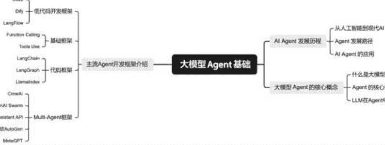
### 1.1 AI Agent发展历程

本节从人工智能起源出发，回顾智能体的发展轨迹。先介绍智能体的定义，说明其如何从规则驱动的系统演化为具备自主决策与任务执行的智能体。再讲解智能体的构建思路，从 API 调用到基于大语言模型的实现。最后通过现实世界的典型应用，展示智能体在现代企业中的价值创造与行业推动作用。

#### 1.1.1 从人工智能到现代智能体

1955年，约翰·麦卡锡等人首次提出人工智能概念，标志着该领域正式起步。1956年达特茅斯会议将 AI 定义为“让机器执行原本需人类智能的任务”。早期研究依赖符号主义与规则推理，通过人工知识库与逻辑规则解决数学推理、棋类等结构化问题。同期图灵提出的图灵测试，成为衡量机器智能的重要标准。

1969至1986年，研究重心转向专家系统。专家系统借助规则库与推理引擎模拟专家决策，被应用于医疗、金融等领域，但受限于人工规则编写，难以处理不确定与模糊信息。

2000年后，计算能力提升与数据积累推动深度学习快速发展。大规模数据与 GPU 等算力资源为深度学习突破提供支撑。

2017年，论文《Attention Is All You Need》提出 Transformer 架构，成为现代大语言模型的基础。Transformer 凭借自注意力机制有效处理长序列数据，成为 NLP 的革命性进展。基于此，OpenAI 推出 GPT 系列，从 GPT-1 到 GPT-3 模型规模与能力持续提升。

2020年，GPT-3 以 1750 亿参数发布，可完成文本生成、翻译、问答等多任务，引发学界与业界关注。2022年底，OpenAI 推出 ChatGPT，将大模型带入大众视野，AI 从科研概念转变为日常可用的工具。

尽管 LLM 在生成与理解上表现突出，仍存在明显局限：
- 缺乏自主决策能力：LLM 输出完全依赖用户提示或上下文，无法主动发起任务或在动态环境中自主决策。
- 缺乏长期记忆与完整任务执行能力：LLM 多处理单步任务，缺乏持久记忆，难以衔接多步骤完成复杂任务。

近两年，随着基础 LLM 性能迭代，AI 逐步走向基于大模型的智能体体系。通过融合强化学习、规划、知识检索、多模态等技术，智能体正发展为能够自主决策、环境适应并执行复杂任务的系统。

#### 1.1.2 智能体演进路径

##### 1. 初期阶段：简单 API 调用与规则驱动系统

AI 早期系统通过编写规则与调用简单 API 执行特定任务，被称为智能体。约 2000 年后，智能体概念逐渐丰富。如 1997 年 IBM“深蓝”击败人类国际象棋世界冠军；2000 年 Cynthia Breazeal 发布可模拟人类表情的机器人 Kismet；2011 年 IBM Watson 在 Jeopardy! 中胜出，同年苹果发布 Siri，成为全球首个流行虚拟助手。

根据感知程度，罗素、诺维格等人将其分为五类：
- 简单反射智能体：仅依据当前感知选择动作，忽略历史信息。如温控空调，根据实时温度开关制冷。
- 基于模型的反射型智能体：在简单反射基础上结合环境模型，追踪状态并做出更合理反应。如带室内导航的扫地机器人，借助内部地图与历史运动经验规避障碍。
- 基于目标的智能体：结合目标信息，通过搜索与规划实现主动性。如导航应用为用户规划最优路线。
- 基于效用的智能体：引入效用函数衡量性能，选择效用最大化动作。如智能路线助手综合时间、路况、收费等指标选路。
- 学习型智能体：具备从经验中学习并优化行为的能力，通常包含学习元素、评估者、性能元素与问题生成器，可在上述各类智能体基础上提升性能。

##### 2. 大语言模型的引入：从 ChatGPT 到初步的智能体

大语言模型的快速发展显著提升了系统的语言理解与生成能力，可处理文本生成、翻译、对话等通用任务，为智能体发展奠定基础。但此时响应仍偏被动，缺乏自主决策与任务执行能力。

##### 3. AutoGPT 的出现：迈向自主执行的智能体

AutoGPT 的开源发布成为重要里程碑。它在 LLM 之上实现多轮推理与任务分解，可从目标设定到任务执行全流程自主运行，被视为实现自主 AI 智能体的关键一步。

##### 4. BabyAGI 的提出：通过自主学习迈向智能体

随后，学习型智能体思想被进一步融合。BabyAGI 模仿人类婴儿的学习与任务执行方式，具备自我学习与任务管理能力，可自动生成任务清单并根据完成情况动态调整优化，为智能体发展提供了新思路。

#### 1.1.3 智能体的应用

近年，智能体应用加速落地，从客服助手、代码生成工具到金融分析助手，成熟案例大量涌现，企业借此实现降本增效与创新。此处聚焦主流领域实践，分析智能体在企业场景中的价值体现。

##### 1. 智能客服领域的智能体

在客户服务场景中，智能体已广泛部署，典型代表为智能客服机器人。借助自然语言处理与语音识别技术，它可模拟人工客服解答用户问题，大幅提升服务效率与满意度，并实现多渠道 7×24 小时在线响应，缓解人工压力。例如阿里云智能对话机器人、百度基于“文心一言”与 UNIT 对话平台的端到端智能客服解决方案。

##### 2. 编程助手与代码生成智能体

在软件开发赛道，AI Agent 已经成为程序员提效的新利器。编程助手能依据自然语言描述或已有上下文，自动补全代码片段、生成函数实现，大幅减轻开发负担。最具代表性的就是 GitHub 与 OpenAI 联合打造的 GitHub Copilot，它能理解多种编程语言的语法与语义，在编码过程中实时给出建议。除此之外，Cursor、CodeGeeX、通义灵码、文心快码等工具也在同类赛道快速成长。

##### 3. 金融分析应用场景
大模型 Agent 在金融服务中的渗透已覆盖客户服务、投研分析、风险控制、市场研报等多个环节。金融垂类大模型开始涌现，BloombergGPT 通过对海量金融数据的二次训练，在金融自然语言处理任务上的表现明显优于通用模型。开源社区方面，AI4Finance 推出的 FinGPT 尝试以低成本微调方式适配金融数据。腾讯则在金融云服务中植入 Agent 技术，推出高精度反欺诈风控引擎、自动化 eKYC 审核，并以数字人形式为银行客户提供交互服务，目前已在全球 20 多个国家服务上万家企业。

##### 4. 企业其他典型应用
在运营与营销端，Agent 可自动撰写营销文案、产品描述、个性化广告素材，加速推广并降低创作成本。制造与供应链领域，Agent 可充当智能调度或质检助手：通过解析物联网传感器数据预测设备维保时机；基于历史订单与库存数据自动优化生产计划，提升供应链运转效率。企业内部知识管理同样是高频场景，企业可部署私有大模型问答系统，让员工与内部知识库对话，快速定位解决方案。

AI Agent 正快速融入企业级应用，成为驱动业务创新与效率提升的核心引擎。行业专属大模型持续涌现，多模态 Agent 带来更佳人机交互，可控性与安全性也在不断加强。

### 1.1 AI Agent 发展脉络
本节从人工智能的诞生讲起，逐步梳理 AI Agent 的演进轨迹。先介绍 Agent 的定义，解析其如何从早期的规则驱动系统发展为具备自主决策与任务执行能力的智能体；再拆解 Agent 的构建路径，从 API 调用到基于大语言模型的实现。最后结合现实案例，展示 AI Agent 在现代企业中如何创造价值、推动行业变革。

#### 1.1.1 从 AI 起源到当代 Agent
1955 年，约翰·麦卡锡等人首次提出人工智能概念，标志该领域正式起步。1956 年达特茅斯会议将 AI 定义为使机器执行通常需人类智慧的任务。早期研究以符号主义和规则推理为主，借助人工编写的知识库与逻辑规则解决数学推理、棋牌等结构化问题。同年阿兰·图灵提出的图灵测试成为衡量机器智能的重要标尺。

1969 至 1986 年，研究重心转向专家系统，其通过规则库与推理引擎模拟专家决策，被广泛应用在医学、金融等领域，但受制于人工规则，难以处理不确定与模糊信息。

2000 年后，算力提升与数据积累推动深度学习快速发展。大数据为模型训练提供燃料，GPU 等硬件加速让算法在多个领域取得突破。

2017 年论文《Attention Is All You Need》提出 Transformer 架构，成为现代大语言模型的基础。自注意力机制显著提升长序列处理能力，成为 NLP 的革命性进展。基于此，OpenAI 发布 GPT 系列，从 GPT-1 到 GPT-3 模型规模与能力持续攀升。

2020 年 GPT-3 正式上线，拥有 1750 亿参数，可完成文本生成、机器翻译、问答等任务。2022 年底，OpenAI 在此基础上推出 ChatGPT，能像真人一样对话，AI 从科研走向大众生活，成为日常工具。

大语言模型虽在生成与理解上表现突出，但仍存在短板：
- 缺乏自主决策能力：输出完全依赖用户提示或上下文，无法主动发起任务或在动态环境中决策。
- 缺乏长期记忆与多步执行能力：多为单任务处理，记忆有限，难以有效串联多个步骤完成复杂任务。

近两年，随着基础 LLM 快速迭代，AI 发展进入基于大模型的 Agent 时代。融合强化学习、规划、知识检索、多模态等技术，AI Agent 正逐步具备自主决策、环境适应与复杂任务执行能力。

#### 1.1.2 Agent 演进路径
##### 1. 规则驱动与简单 API 时代
AI 初期系统依赖手工规则与简单 API 调用执行特定任务，被称作智能体。进入 2000 年前后，Agent 概念日趋丰富。1997 年 IBM 深蓝击败人类象棋世界冠军；2000 年 Cynthia Breazeal 研发首个可模拟人类情感的机器人 Kismet，拥有眼睛、眉毛、耳朵与嘴巴；2011 年 IBM Watson 在《Jeopardy!》中胜出；同年苹果发布 Siri，成为首个大众化虚拟助手。

按感知差异，Russell、Norvig 等人在《Artificial Intelligence: A Modern Approach》中将其划分为五类：
- 简单反射智能体：仅依据当前感知选择动作，忽略历史，如温度超限即启动制冷的空调温控器。
- 基于模型的反射智能体：在简单反射基础上加入状态模型与传感器模型，可在部分不可观测环境中追踪状态，如具备室内导航的扫地机器人依地图与历史轨迹规划绕障路径。
- 基于目标的智能体：结合目标信息，通过搜索与规划实现主动性，如导航应用为用户规划最优路线。
- 基于效用的智能体：引入效用函数度量性能，挑选动作以最大化效用，如智能路线助手综合评估时间、路况、安全、收费等，选择最符合偏好的方案。
- 学习型智能体：可从经验中学习并调整行为，由学习元素、评估者、性能元素、问题生成器组成，可叠加于各类智能体之上提升性能。

##### 2. LLM 引入：ChatGPT 催生雏形 Agent
大语言模型的爆发大幅提升了 AI 的语言理解与生成能力，文本生成、翻译、对话等通用任务得到解决，为 Agent 发展奠定基础。但当时模型响应仍被动，缺乏自主决策与任务执行能力。

##### 3. AutoGPT 登场：迈向全流程自主执行
AutoGPT 的发布是重要里程碑。该开源项目基于 LLM，通过多轮推理与任务分解，实现从目标设定到任务执行的闭环自主运行，被视为实现自主 Agent 的关键一步。

##### 4. BabyAGI 提出：自我学习驱动任务管理
随后学习型智能体的思路被引入。BabyAGI 模仿婴儿学习方式，使 Agent 具备自我学习与任务管理能力，可设定主目标、自动生成任务清单并根据完成情况动态调整，为 Agent 发展提供了新的思路。

#### 1.1.3 AI Agent 应用全景
近年来 AI Agent 从概念走向落地，客服助理、代码生成、金融分析助手等成熟案例大量出现，企业迎来降本增效与创新的机会。本节聚焦主流场景，解析 Agent 如何在企业中创造价值。

##### 1. 智能客服领域
客户服务是 Agent 最早落地的场景，典型形态为智能客服机器人。借助自然语言处理与语音识别技术，可模拟人工客服解答问题，提升效率与满意度，并实现多端多渠道 7×24 小时响应，减轻人工压力。代表案例包括阿里自研的阿里云智能对话机器人，以及百度基于文心一言与 UNIT 对话平台提供的端到端智能客服方案。

##### 2. 编程助手与代码生成
在软件开发中，Agent 为程序员提供全新生产力。编程助手可依自然语言描述或上下文自动补全代码、生成函数实现，降低工作量。GitHub Copilot 能理解多种语言语法语义并实时推荐代码。市场上还有 Cursor、CodeGeeX、通义灵码、文心快码等多款类似产品。

##### 3. 金融分析领域
大模型 Agent 在金融服务中已覆盖客服、投资分析、风险控制、研报等。BloombergGPT 通过金融数据再训练，在金融 NLP 任务上超越通用模型。开源的 FinGPT 以低成本微调方式适配金融数据。腾讯金融云集成 Agent 技术，提供高精度反欺诈风控、自动化 eKYC 审核及数字人服务，已在全球 20 多个国家赋能上万家企业。

##### 4. 其他企业场景
运营营销中 Agent 用于自动生成文案、产品描述与个性化广告素材，加速推广并节约成本。制造与供应链领域，Agent 可基于物联网数据预测设备维护节点，并依据历史订单与库存自动调整生产计划。内部知识管理方面，企业部署私有大模型问答系统，让员工直接与知识库对话，快速获取解决方案。

Agent 正加速渗透各行各业，成为推动业务创新与提效的重要引擎，行业专属大模型与多模态交互体验将持续演进，可控性与安全性也将不断增强。

### 1.2 大模型 Agent 核心概念解析
本节回顾大模型 Agent 的基本定义与核心特征，梳理其在开发过程中的关键组成：Tools、Planning、Action、Memory 四大模块，并阐释它们如何协同完成从任务规划到执行的全流程。同时探讨 LLM 在驱动 Agent 底层功能时的优势，展示其如何增强复杂任务中的自我学习、优化与多模态处理能力。

#### 1.2.1 大模型Agent到底是什么

大模型Agent是以大规模预训练语言模型为底座打造的智能体。业内现在提到的Agent，绝大多数指的就是由大模型驱动的应用形式。相比传统Agent，它在基础模型之上叠加了智能决策层。不仅能根据用户输入生成恰当的回复，还能通过任务拆解、执行、反馈的闭环，独立把复杂事务做完。

它的主要特质可以归纳为四点。

- 对话理解与生成：依托大语言模型，能读懂复杂文本意图，并输出语法通顺、语义连贯的回答。
- 自主决策与执行：不再依赖硬编码规则，而是结合上下文与目标自行拟定方案、做出判断并落到实处。
- 跨场景迁移：模型本身的通用知识让Agent可以从一个领域平移到另一个领域。
- 持续学习与优化：部分方案已具备互动学习能力，通过与用户的长期交互不断提升效率与准确度。

本书后续讨论的Agent，全部指LLM驱动的类型。

#### 1.2.2 Agent由哪些模块构成

搭建Agent时，通常会把它拆成几个协同工作的功能单元。下面介绍开发中最常见的核心模块。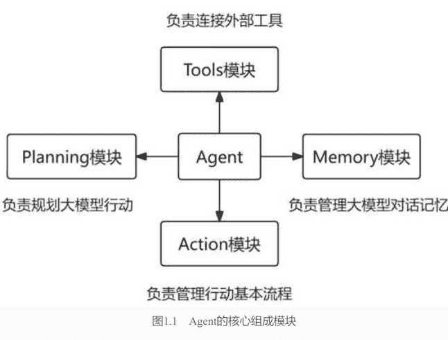

##### 1. Tools模块
Tools模块相当于Agent的外部接口层，负责调用完成目标所需的外部能力。举个例子，用户问“明天北京天气怎么样”，模型本身查不到未来信息，就需要一个天气查询工具来获取实时数据。该模块提供API调用、外部数据库连接、文件读写等能力，让Agent跳出模型内部。

##### 2. Planning模块
自主性是Agent的关键，Planning模块就是负责想清楚怎么做。它会根据任务目标生成执行步骤，通过拆解任务、选择路径、分配资源来制定完整策略，并在环境变化时动态调整计划，保证应对不同情况。

##### 3. Action模块
Action模块是执行层，按Planning制定的指令落地具体操作。可以是系统交互、数据处理、触发硬件设备等。它把策略转化为实际动作。

##### 4. Memory模块
Memory模块相当于记忆库，用来保存历史信息、经验和状态。包括过往对话、决策记录、任务结果等。有了记忆，Agent才能复盘、优化，并在后续任务中表现更高效。它是长期学习和优化的基础。

四者配合才能跑通复杂任务：Tools提供资源，Planning制定策略，Action负责落地，Memory支撑优化。

#### 1.2.3 大语言模型如何赋能Agent

当下多数Agent的核心动力都是大模型，具体在哪些维度产生作用？

##### 1. 提升自然语言理解力
LLM在Agent里最核心的作用是自然语言理解。传统方案多靠规则或简单算法，而LLM基于海量语料训练，能处理复杂句式、隐含含义、歧义和上下文，从而更精准把握用户需求。

##### 2. 支撑多任务跨领域应用
当前主流量化基座模型都是通用型，内置跨领域知识。相比单一任务的传统Agent，LLM驱动的Agent可同时覆盖文本生成、翻译、问答、摘要等多种场景，应用边界大幅扩展。

##### 3. 增强推理与决策
除了理解生成，LLM还能在一定程度上推理决策。结合上下文信息进行合理判断，在信息不完整或不确定的情况下，用已有知识补足缺口，帮助Agent在动态环境中做出更合理的选择。

##### 4. 支持自我学习与优化
LLM不只是静态执行，还能通过环境交互实现自我迭代。借助强化学习和在线学习机制，Agent可以利用历史经验不断调整行为，提升完成质量和效率。

##### 5. 拓展多模态处理能力
LLM已不局限于文本，还能融合图像、视频、音频等模态。在多模态对话中可同时处理文本与语音；在视觉场景中可理解图像视频语义并输出自然语言描述，使Agent能处理更复杂多样化的真实任务。

### 1.2 大模型Agent核心框架速览

本节先厘清大模型Agent的定义与核心特质，再拆解开发时常用的Tools、Planning、Action、Memory四大模块，说明它们如何从规划到执行形成闭环。最后聚焦LLM在底层驱动上的优势，展示它在学习优化和多模态处理方面的价值。

#### 1.2.1 大模型Agent到底是什么

大模型Agent建立在预训练语言模型之上，是行业里当前Agent的常见形态。它在模型基础上加入决策层，既能生成回应，也能自主规划、执行、反馈，完成复杂任务。

核心特质：

- ✅ 自然语言理解和生成，读懂复杂输入并给出连贯回复
- ✅ 任务执行与决策，自主生成方案并落地
- ✅ 跨领域应用能力，通用知识支持场景迁移
- ✅ 自我学习与优化，通过互动不断提升表现

本书研究的Agent均基于LLM。

#### 1.2.2 Agent由哪些模块构成

Agent开发通常拆分为协同工作的模块。

##### 1. Tools模块
提供外部系统接口，使Agent能完成目标所需的外部操作。例如查询明天北京天气时，需要天气查询工具来获取未知信息。支持API调用、数据库连接、文件操作等。

##### 2. Planning模块
负责自主分析并规划步骤。对照目标拆解任务、选择路径、分配资源，制定完整策略，并随环境变化实时调整。

##### 3. Action模块
执行Planning制定的计划，是Agent的执行器。执行具体操作，如外部交互、数据处理、硬件触发等。

##### 4. Memory模块
记忆系统，存储历史信息、经验与状态。保存交互记录、决策日志、执行结果，使Agent可反思优化，是长期学习的基础。

各模块紧密协作推动复杂任务完成。

#### 1.2.3 大语言模型如何赋能Agent

多数Agent依赖大模型驱动，其优势体现在：

##### 1. LLM增强Agent的自然语言理解能力
LLM基于大规模语料，能处理复杂结构、隐含意义、歧义和上下文，帮助Agent准确理解意图。

##### 2. LLM支持多任务和跨领域应用
通用大模型拥有跨领域知识，可应用于文本生成、翻译、问答、总结等多类任务，极大扩展应用范围。

##### 3. LLM增强Agent的推理和决策能力
LLM可根据上下文推理判断，在信息缺失时结合已有经验预测补充，适应动态复杂任务。

##### 4. LLM支持Agent的自我学习和优化
通过强化学习和在线学习，利用过往经验调整行为，提升效率和准确性。

##### 5. LLM提升Agent的多模态处理能力
可融合图像、视频、音频等数据，实现文本与语音交互、视觉语义理解等多模态任务，拓宽实际应用范围。

### 1.3 主流Agent开发框架介绍

#### 1.3.1 低代码开发框架概览

低代码框架无需手写代码，通过可视化拖拽、点击即可搭建功能丰富的Agent系统。它把复杂编程工作简化，让非技术用户也能快速验证业务需求。

##### 1. Coze
字节跳动推出的低代码平台之一，提供直观的可视化界面，用户可通过拖放组件和配置选项创建流程并调用工具。插件商店活跃，常见功能基本都能找到现成插件。

- ✅ 无需编程，可视化搭建完整应用
- ✅ 高效集成，方便接入数据库、API等外部服务
- ✅ 快速原型开发，实时测试加速迭代
- ✅ 社区支持强，教程和案例丰富

##### 2. Dify
由语灵人工智能科技公司开发的低代码框架。相比Coze更强调定制化，适合对灵活性要求高的场景。需要本地安装部署，适合有一定技术背景或企业级用户，支持多语言多区域部署。

- ✅ 功能全面，支持自定义脚本、复杂流程管理、深度API集成
- ✅ 部署需求高，本地安装增加维护成本
- ✅ 灵活性更高，支持多语言扩展

##### 3. LangFlow

Agent框架怎么选？低代码、原生能力、代码级与多Agent全景拆解

LangFlow 是在 LangChain 之上搭建的开源可视化低代码平台，核心是给用户提供灵活的流程搭建和对外连接能力。按业务需求自定义链路，并把 Agent 接入数据库、API、云服务等第三方资源。跟 Dify 一样，它不是纯点选即用，需要一定的技术背景来完成安装和部署。

它最突出的两个使用体验是流程设计的顺滑度，工具库提供了丰富的流程图组件，让任务步骤的编排变得直观，随时调整优化；插件生态比较完善，Agent 能快速对接各类外部系统。低代码在 LLM Agent 建设里起了降门槛的作用，可视化拖拽加模块化组装，只需配置就能拼出复杂能力，开发成本和周期都下来了，模型从技术验证更快推向业务落地，也让 Agent 的驱动力从技术向业务转移。需要辩证看的是，这类方案的上限有限，面对高度复杂、强定制的需求时，灵活性和扩展性不如手写代码。

### 1.3 主流Agent开发框架介绍

#### 1.3.1 低代码开发框架

低代码是不写代码的建模方式，通过网页端的点击拖拽就能搭出功能完整的 Agent 系统。核心价值是把编程工作抽象掉，让没有工程背景的人也能快速成型。

##### 1. Coze
字节跳动推出的热度平台，提供直观的搭建界面，无需懂编程即可创建任务、设计流程、调用工具。插件商店活跃，常用能力基本都能找到现成组件。主要特点是零代码搭建，高效集成各类工具服务，快速出原型验证迭代，同时依托庞大社区和教程降低上手成本。

##### 2. Dify
语灵科技开发的低代码方案，比 Coze 提供更深的定制空间，适合对个性化要求高的场景。与在线平台不同，它需要在本地安装部署，因此更适合有技术背景的团队或企业。支持多语言多地区 API 部署，便于全球化推广。优势在功能全面、可写自定义脚本、管理复杂业务流、深度对接外部 API；代价是部署复杂度与维护成本上升，灵活性更高但门槛也随之提高。

##### 3. LangFlow
基于 LangChain 的开源可视化低代码工具，强调流程设计自由度和集成便捷性。用户可按需设计自定义流程，并轻松连通各类工具服务，与 Dify 类似都需要一定的部署能力。流程设计流畅，提供丰富的图形化工具，直观呈现执行步骤并支持迭代优化；插件支持广泛，可把 Agent 接入数据库、API、云服务等。

低代码让 Agent 构建不再被编程能力限制，可视化加模块化只需配置即可实现复杂功能，显著降低门槛和成本，加快原型验证，让企业和个人更快把大语言模型用起来，推动开发从技术驱动走向业务驱动。当然，它的能力边界明显，在高度复杂的任务面前，灵活性和扩展性不及传统代码方案。

#### 1.3.2 基础框架

基础框架的做法是直接借助大模型原生能力来驱动 Agent，不依赖额外框架和工具。随模型演进，Function Calling 或 Tools Use 成为标配，例如 OpenAI 为 GPT-3.5 引入的 Function Calling 让模型能直连并调用外部工具服务，调用流程可参考图1.2。

这种方式充分利用模型自带能力，开发更轻、效率更高。但受限于模型本身的功能边界，复杂业务、强定制场景下原生能力往往不够用，优化空间有限。

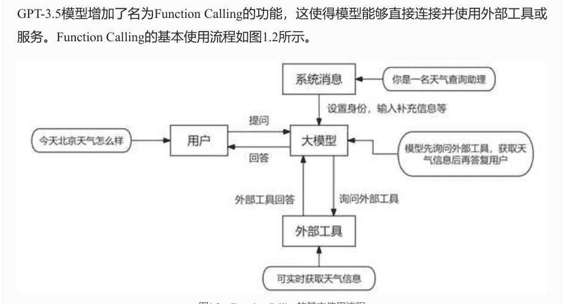

总体上，基础框架降低了复杂度，提升了上手速度，适合快速验证；局限在于定制性和复杂任务处理能力不足。

#### 1.3.3 代码框架

代码框架提供更细粒度的控制与定制，适合需要复杂逻辑和高定制度的场景。通过模块化组件和类，开发者能精细管理 Agent 行为，并在构建中实现更复杂功能。

##### 1. LangChain
起初是语言模型的简化开发工具，随 LLM 生态扩张演变为强大的 Agent 框架。核心优势是提供了大量封装好的类和工具，四项核心模块不用从零手写，通过配置调用即可快速搭建；对外工具集成能力强，支持数据库、API、文件存储等无缝对接；扩展性灵活，可修改现有类或新增模块应对复杂场景。适用于需要快速开发并整合多工具的场景，如自动化客服、内容生成、数据处理等频繁交互任务。

##### 2. LangGraph
在 LangChain 基础上发展，聚焦复杂图结构与多步任务管理，2022 年发布，擅长多任务协同与分配。主要特点是原生支持图状结构，节点代表任务或操作，边表达依赖关系，流程一目了然；支持多 Agent 或多任务并行，通过图结构管理交互；扩展机制灵活，可自定义节点边类型并调整执行顺序。还提供动态任务生成、任务优化、依赖管理等高级能力，在大规模调度与多 Agent 协作上更强。适合跨部门协作、复杂业务流程自动化等需要图形化任务管理的场景。

##### 3. LlamaIndex
原名 GPT Index，2020 年发布的经典开源框架，专攻基于大模型的 Agent 与大规模数据检索，在海量数据处理上表现突出，上手难度相对较高，适合对数据处理和查询优化要求高的开发者。优势是高效的信息检索与查询，支持文本、结构化、多模态数据的灵活存储与组织，具备复杂的查询优化机制，在搜索引擎、知识图谱等检索密集型应用中性能优异。

#### 1.3.4 Multi-Agent框架

当任务复杂度超出单 Agent 能力时，采用多 Agent 分工协作更有效。各 Agent 负责子任务，通过协同完成整体目标，如应用开发中需求分析、编码、测试、优化可由不同 Agent 分别承担。

##### 1. CrewAI
轻量级多 Agent 框架，通过定义任务、角色、目标快速组建协作团队。支持顺序执行、层级结构、异步工作流，适用于自动化写作、客服、项目管理等场景，强调高性能与低延迟。

##### 2. OpenAI Swarm
OpenAI 2024 年发布的轻量级协同框架，简化 Agent 间协调。核心概念是 Agent 与 handoff，Agent 携带指令与工具，handoff 实现任务交接。设计简洁，适合复杂对话流与任务委派学习实践。

##### 3. OpenAI Assistant API
功能强大的闭源工具，可构建处理多任务的 Agent，但不开源，只能通过在线接口调用，内部逻辑不可控，在高度定制场景受限。

##### 4. 微软的AutoGen
微软开源的多 Agent 对话系统，支持工具使用、任务分配与执行。特点是 Agent 协作与动态角色分配，支持多种外部工具与 API 集成，并可定制行为。提供无代码环境 AutoGen Studio，支持可视化搭建与调试，加速原型验证。

##### 5. MetaGPT
开源多 Agent 框架，模拟软件公司内部协作流程。把产品经理、架构师、项目经理、工程师等角色抽象为 Agent，通过标准化操作流程协同，将复杂软件开发拆解为子任务并行处理。

需要说明的是，本书实践以代码层面为主，侧重工程化、可部署、可扩展的 Agent 构建。Coze、Dify 等低代码平台虽能快速搭建，但不在本书操作范围内，有兴趣的读者可前往官网查阅使用指南。

智能体框架全景：从可视化搭建到多代理协作

#### 1.3.1 低代码开发框架
可视化搭建是一种不依赖手写代码的建设路径，通过网页端的拖拽与点击就能把功能完整的智能体系统搭起来。它的价值在于把繁琐的编程工作抽象掉，让没有工程背景的人也能快速落地业务想法。

##### 1. Coze
Coze由字节跳动推出，是目前热度较高的可视化平台。界面直观，无需掌握编程语言或底层技术，就能以图形方式创建任务、编排流程并调用所需工具。插件市场非常活跃，开发中常见的能力大多能找到现成组件。主要特性：
- 零编程构建：拖拽组件并调整参数即可成型。
- 集成效率高：内置常用服务接口，便于接入数据库、API及外部系统来扩展能力。
- 原型迭代快：可迅速搭出原型并在线校验，加速验证与优化。
- 社区资源丰富：用户群体庞大，教程充足，有助于快速上手与排障。

##### 2. Dify
Dify来自语灵人工智能科技，相较Coze在功能深度与定制空间上更进一步，适合对个性化要求较高的场景。产品需要自行安装部署，更偏向有技术背景的开发者或企业客户，API层面支持多语言多区域发布，便于全球化推广。主要特性：
- 功能更厚：支持自定义脚本、更复杂的业务流管控以及对外部 API 的深度对接。
- 部署要求更高：不同于 Coze 的在线服务，Dify 需本地部署，换来更大自由度的同时也抬高了复杂度与运维成本。
- 扩展更开放：允许用多种编程语言做二次开发，适合在可视化基础上做更深度的实现。

##### 3. LangFlow
LangFlow 是在 LangChain 之上构建的开源可视化方案，侧重流程的灵活设计与系统对接。用户按业务需要定制执行流，并能便捷连接各类工具与服务，与 Dify 一样部署需要一定技术积累。主要特性：
- 流程编排顺畅：提供丰富的流程图工具，直观规划执行步骤并随时调整。
- 生态连接广：插件覆盖面大，可把智能体与第三方数据库、API、云服务等快速联通。

整体来看，可视化搭建让构建摆脱编程与工程门槛，通过拖拽和模块配置实现复杂逻辑，显著降低成本并缩短原型验证周期，推动开发重心从技术向业务迁移。当然，客观来看，可视化方式的上限有限，面对高度复杂与高度定制的需求时，自由度与可扩展性仍不及纯代码方案。

#### 1.3.2 基础框架
基础框架直接借助大模型的原生能力来驱动智能体，不依赖额外开发栈。当前主流模型普遍内置 Function Calling 或 Tools Use 等机制。例如 OpenAI 为 GPT-3.5 引入的 Function Calling，让模型可以直接调用外部工具服务。通用调用流程示意如图1.2所示。

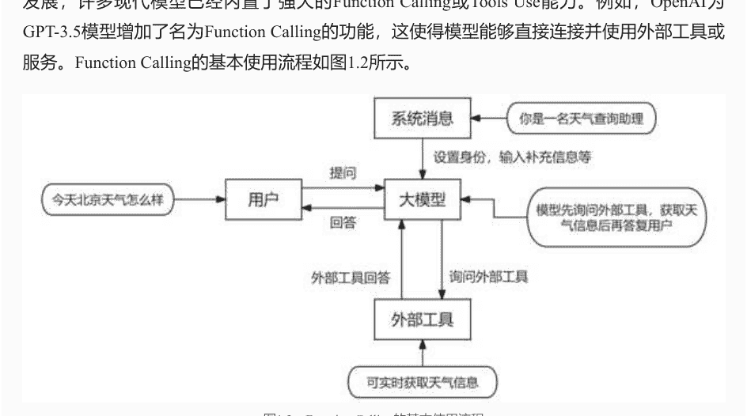

总体来看，这种方式充分利用模型自带能力，降低了搭建复杂度，开发者可以直接调用现成的模型功能来组装智能体，效率与灵活性都得到提升。但表现受模型本身限制，面对复杂业务与深度定制时，原生能力往往难以完全覆盖。

#### 1.3.3 代码框架
代码框架提供更高自由度与可定制性，适合需要复杂逻辑与精细控制的任务。相比可视化或原生方案，它以模块化组件与类为核心，帮助开发者更精准地掌控行为并实现复杂功能。

##### 1. LangChain
LangChain 起初是面向语言模型的简化工具，随 LLM 演进逐步成为成熟的智能体开发体系。主要特性：
- 丰富的类与工具：内置大量封装组件，智能体构建的四大核心模块无需从零编写，配置后即可调用。
- 对外接系统友好：可无缝对接数据库、API、文件存储等，方便获取数据增强执行力。
- 扩展性强：封装之外仍可定制，可修改现有类或新增模块以支撑更复杂场景。

常见于自动化客服、内容生成、数据处理等需要频繁交互与任务规划的业务。

##### 2. LangGraph
LangGraph 在 LangChain 基础上发展，聚焦复杂图结构与多步任务管理，于2022年推出，适合多任务协同与分配。主要特性：
- 图结构支持：把任务与流程组织成图，节点代表操作，边代表依赖，直观管理执行逻辑。
- 多任务协作：支持多个智能体或任务并行，通过图结构管控交互，适用于复杂业务流程自动化、跨部门协作等。
- 扩展机制灵活：可自定义节点与边的类型，按需扩展交互方式，并动态调整图结构以优化顺序与效率。
- 高级能力：提供动态生成、优化、依赖管理等，在大规模调度与多智能体协同中优势明显。

##### 3. LlamaIndex
LlamaIndex 前身为 GPT Index，是2020年发布的经典开源项目，专注于基于大语言模型的智能体构建，在大规模数据处理与信息检索上表现突出，因上手难度较高更适合数据与查询优化需求的团队。主要特性：
- 高效检索：擅长处理与查询海量数据，适用于搜索引擎、知识图谱等。
- 数据结构多样：支持文本、结构化、多模态等多种存储与组织方式，提供高度自定义查询。
- 查询优化：具备复杂查询优化机制，在大数据场景下提供较好的性能与可扩展性。

#### 1.3.4 Multi-Agent框架
当单个智能体难以独立完成复杂任务时，可采用多智能体分工协作。各体聚焦子任务，通过协调达成整体目标，如应用开发可拆分为需求分析、编码、测试、性能优化等角色，由多个智能体分别承担并协同完成。

##### 1. CrewAI
CrewAI 是轻量级多智能体协作框架，通过定义任务、角色与目标快速组建团队。支持顺序、层级、异步工作流，适用于自动化写作、客户支持、项目管理等场景，并强调高性能低延迟。

##### 2. OpenAI Swarm
OpenAI 于2024年发布的 Swarm 是轻量级协同框架，旨在简化智能体间的协调与执行。核心概念为智能体与 handoff，智能体包含指令与工具，handoff 允许任务在智能体间流转。该设计使复杂对话流与任务委派更高效，简洁清晰的代码也利于学习。

##### 3. OpenAI Assistant API
OpenAI 的 Assistant API 是构建多任务智能体的强力工具，但目前为闭源方案。仅能通过在线接口调用模型服务，内部逻辑无法完全掌控，在高度定制化场景下受限明显。

##### 4. 微软的AutoGen
AutoGen 是微软开源的定制化多智能体对话系统框架，支持多个智能体协同工作，适用于工具使用、任务分配与执行等复杂操作。主要特性：
- 协作与分工：支持执行过程中的相互配合与角色动态调整，可定义数据采集、代码生成、数据分析等不同角色。
- 工具集成与扩展：可接入多种外部工具与 API，如数据库查询、数据分析、代码生成等，并按需定制行为与交互。
- 无代码环境：提供 AutoGen Studio，可视化创建与调试多智能体系统，快速出原型验证优化。

##### 5. MetaGPT
MetaGPT 是开源多智能体框架，用于模拟软件公司内部协作流程。通过把产品经理、架构师、项目经理、工程师等角色抽象为智能体，并以标准化操作流程 SOP 进行协同，把复杂软件开发拆解为子任务由各智能体处理。

> 说明
本书实践以代码层面的工程化、可部署、可扩展构建为主。虽然 Coze、Dify 等可视化平台能通过配置快速搭建智能体，但本书不覆盖这些平台的具体操作。对可视化工具感兴趣的读者可访问官网获取详细使用指南。

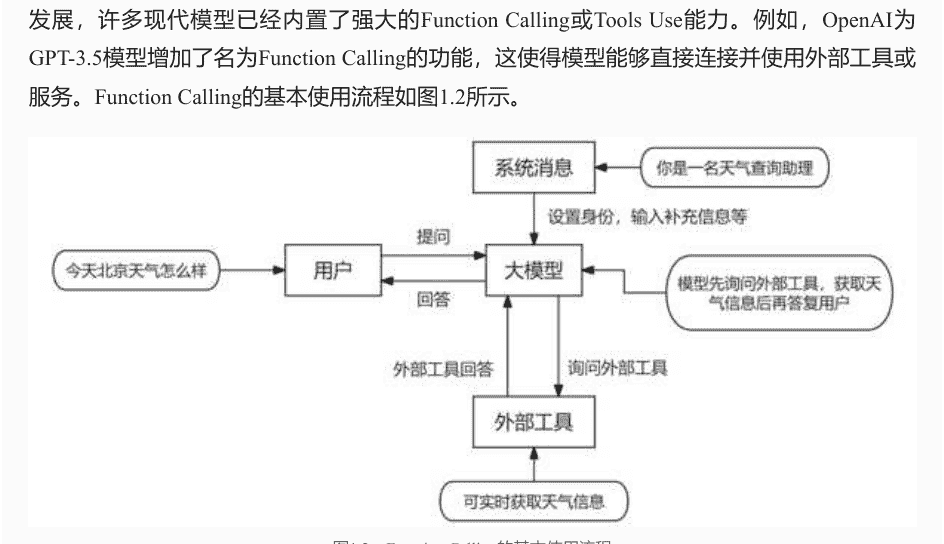

想要在短时间内搭出能对接多种外部工具的智能体，LangChain 是常见选择。自动化客服、内容生产、批量数据处理这类需要智能体频繁跨系统调用、不断拆解规划工作的场景，正好能发挥它的效率优势。

##### 2. LangGraph

LangGraph 可视为 LangChain 的进阶分支，2022 年推出后，把重点放在用图形化方式编排多步骤流程，比较适合多业务并行与分配。

- ✅ 图形化建模是核心特色。任务与操作被提炼为节点，节点间的依赖用边表示，形成直观的可视化执行路径，逻辑关系更好把握。
- ✅ 并行协作能力强。可以让多个智能体或子任务同时推进，由图结构统一调度交互，尤其适合层级深、步骤多的业务自动化与跨部门协同。
- ✅ 扩展方式灵活。节点与边的类型都可自定义，按需扩充执行与交互逻辑，图形结构也能随时调整以优化执行顺序与效率。
- ✅ 高阶功能更丰富。相比前者，新增了动态生成任务、任务优化、依赖管理等手段，在大规模调度与多体协作时支撑更强。

整体来看，LangGraph 更适合对流程可视化、跨部门协作与多体协同有较高要求的场景。

##### 3. LlamaIndex

LlamaIndex 旧名 GPT Index，2020 年面世，是一个经典的开源方案，聚焦于以大语言模型为底座的智能体构建，在海量数据处理与检索方面表现突出。诞生时间早于 LangChain，但上手难度偏高，更适合对数据处理与查询优化有明确诉求的开发者。

- ✅ 检索查询效率突出。擅长为海量数据快速建立索引并检索，适用于搜索引擎、知识图谱等对响应速度敏感的应用。
- ✅ 数据组织形式多样。提供多种结构收纳异构信息，可同时处理文本、结构化与多模态内容，查询方式可高度个性化。
- ✅ 查询优化机制完善。内置更复杂的优化逻辑，能在海量数据中快速匹配，为数据密集型场景提供性能与扩展性的保障。

LlamaIndex 最适合以大数据检索为核心的智能体方案，在需要高效处理与检索海量信息时优势明显。

#### 1.3.4 Multi-Agent框架

Multi-Agent 的思路很直接：当单一智能体难以独立完成复杂目标时，就让多个智能体各司其职、协同推进。每个体负责局部，整体配合达成目标。

例如开发一款 App，需求梳理、代码实现、功能验证、性能改进等环节可以拆给不同智能体协同处理。这种拆分能提升效率与执行精度。

实际项目里，多体系统既可手动编排，也能借助现成框架来加速落地。

##### 1. CrewAI

CrewAI 是一款轻量级的团队协作框架。通过定义任务、角色与目标，开发者能快速组建协作小组。它支持顺序执行、层级化、异步工作流等多种模式，常用于自动写作、客户支持、项目管理等场景。整体偏向高性能与低时延，对响应要求高的应用较为友好。

##### 2. OpenAI Swarm

OpenAI 在 2024 年开源的 Swarm 是一个轻量级多体协同方案，目标是简化体间协调与执行。设计围绕智能体与任务交接两个概念展开，智能体携带指令与工具，交接机制负责把工作转给另一体。这种架构让复杂对话流程与任务委派更顺畅，代码简洁也便于学习参考。

##### 3. OpenAI Assistant API

OpenAI 的 Assistant API 能力很强，可用来搭建处理多种任务的智能体，但属于闭源服务。只能通过在线接口调用，内部逻辑无法完全掌控，在需要深度定制的场景下会受限。

##### 4. 微软的AutoGen

AutoGen 是微软开源的定制化多体对话系统方案，支持工具调用、任务分配与复杂操作。
- ✅ 体间协作：强调多体间的协同与动态角色分配，执行过程中可依据流程与需求调整分工，角色可设为数据采集、代码生成、数据分析等。
- ✅ 工具接入与扩展：可接入多种外部工具与 API，例如数据库查询、数据分析、代码生成，同时允许按需定制智能体的行为与交互方式。
- ✅ 可视化开发环境：配套的 AutoGen Studio 提供图形化构建与调试环境，无需大量编码即可搭建原型、验证与优化多体系统。

##### 5. MetaGPT

MetaGPT 是一款开源的多体框架，用来模拟软件公司内部的协作。它将产品经理、架构师、项目经理、工程师等岗位抽象为智能体，并通过标准化操作流程 SOP 协同，把复杂软件开发任务拆解为多个子任务由不同体分别处理。

> 说明
本书实践侧重代码层面的工程化开发，强调可部署、可扩展的智能体构建。市面上也有 Coze、Dify 等优秀的低代码平台，可通过可视化配置快速搭建智能体，但本书不包含这些平台的具体操作，有兴趣的读者可自行访问官网了解。

### 1.4 附加资源

(1) AutoGPT GitHub开源项目地址：https://github.com/Significant-Gravitas/AutoGPT。
(2) Coze官网地址：https://www.coze.cn/。
(3) Dify官网地址：https://dify.ai/。
(4) LangFlow官网地址：https://www.langflow.org/。
(5) OpenAI Function Calling 官方说明文档：https://platform.openai.com/docs/guides/functioncalling。
(6) LangChain官网地址：https://www.langchain.com/。
(7) LlamaIndex官网地址：https://www.llamaindex.ai/。
(8) LlamaIndex GitHub开源项目地址：https://github.com/run-llama/llama_index。
(9) CrewAI官网地址：https://www.crewai.com/。
(10) CrewAI GitHub开源项目地址：https://github.com/crewAIInc/crewAI。
(11) OpenAI Swarm GitHub开源项目地址：https://github.com/openai/swarm。
(12) OpenAI Assistant API 官方说明文档：https://platform.openai.com/docs/assistants/overview。
(13) 微软AutoGen GitHub开源项目地址：https://github.com/microsoft/autogen。
(14) MetaGPT官网地址：https://deepwisdom.ai/。
(15) MetaGPT GitHub开源项目地址：https://github.com/FoundationAgents/MetaGPT。

## 第2章 大模型基础与部署调用

随着大语言模型技术的持续演进，全球涌现出大量开源与商用模型体系。要做智能体构建与大模型应用，先要厘清模型演进脉络与生态分布，掌握调用方式与部署策略。本章先梳理全球及国内主流模型的发展与开源现状，再讲解在线 API 调用流程，最后介绍主流高性能部署工具。

本章知识架构如下：

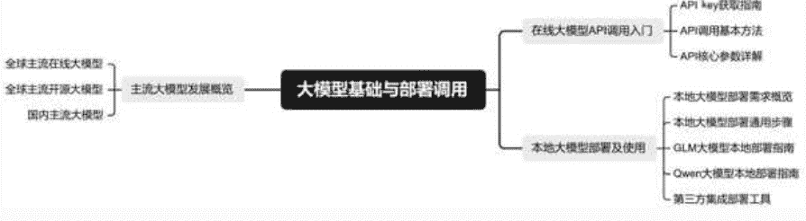

### 2.1 主流大模型发展概览

自 ChatGPT 引爆生成式 AI 热潮以来，大语言模型成为通用人工智能发展的核心驱动。当前大致分为两类：一类是以 OpenAI、Anthropic、Google 为代表的闭源商用模型，通过在线 API 提供强大的通用能力；另一类是以 Meta、DeepSeek、阿里云、智谱等机构推动的开源模型体系，强调透明性与本地部署。本节围绕在线模型与开源模型，梳理全球及国内主流模型的技术演进与生态。

#### 2.1.1 全球主流在线大模型

##### 1. OpenAI系列

OpenAI 成立于 2015 年，自 2022 年 11 月发布 ChatGPT 起成为行业领跑者。ChatGPT 基于 GPT-3.5 与 GPT-4 构建，模型体系从基础语言逐步演进到多模态，覆盖语言、图像、音频、视频等。

1）基础语言模型（GPT 系列）
GPT-3 于 2020 年发布，在多项 NLP 任务中表现突出。GPT-3.5 于 2022 年优化，对话连贯性与准确性提升，并集成进 ChatGPT。2023 年发布的 GPT-4 在自然语言能力上大幅跃升，并引入多模态输入。同年推出的 GPT-4 Turbo 在保持能力的同时提升速度与效率、降低成本。2025 年 4 月发布的 GPT-4.1 在编程、指令遵循、长上下文理解上更强，上下文最长支持 100 万 token。

2）Omni 系列模型（GPT-4o 系列）
为实现更自然的人机交互，OpenAI 推出了成本更低的多模态 Omni 系列。2024 年 5 月发布的 GPT-4o，“o”象征全能，可处理文本、图像等多模态数据，是当前智能体开发的主流选择。同年 7 月推出的轻量版 GPT-4o mini 面向资源受限与低成本场景。

3）推理模型（o 系列）
专注于复杂推理与逻辑能力的 o 系列，2024 年 12 月发布 o1，提升数学与科学问题的推理能力；同年 9 月推出轻量版 o1-mini，适配对响应速度要求高的推理任务。2025 年 4 月发布的 o3 在 o1 基础上进一步增强推理能力并支持图像输入。

4）多模态输出模型
除输入多模态外，输出也在同步推进。2025 年 4 月发布的 GPT-image-1 在 DALL·E 基础上迭代，支持图像生成、编辑与修复。2024 年 12 月发布的 Sora 可将文本转为视频，支持视频生成、动画制作与内容重混，在影视制作领域引发关注。语音生成方面，TTS 从 TTS-1 迭代到 GPT-4o mini TTS，提升了文本到口语的自然度。

5）向量模型（Embedding Models）
用于把文本转为数值向量，便于相似度计算与信息检索，广泛应用于搜索引擎、推荐系统与 RAG 等工程任务。

##### 2. Claude系列

2021 年，部分 OpenAI 研究人员因对 AGI 安全的理解差异离职创办 Anthropic，主张通过“宪法式人工智能”从根本上提升可控性、可解释性与对齐性。Claude 系列以法国启蒙思想家命名。

2023 年 3 月，Claude 1 与 GPT-3.5 几乎同期上线。2023 年 7 月迭代的 Claude 2 在基础 NLP 能力上有所提升并开放网页试用。2024 年 3 月发布的 Claude 3 系列在安全机制增强的同时新增图像输入与工具调用。2025 年 5 月发布的 Claude 4 系列包含 Opus 4 与 Sonnet 4，其中 Opus 4 在复杂逻辑编程任务上表现尤其突出。

##### 3. Gemini系列

Google 在大模型浪潮中加速布局。2023 年 3 月推出基于 LaMDA 的 Bard 作为轻量对话工具，初期反响平淡。2023 年 12 月宣布 Bard 升级为 Gemini 并发布 Gemini 1.0 系列，标志着由 DeepMind 主导的大模型战略全面启动。

### 2.1 主流大模型发展概览
自ChatGPT点燃生成式AI浪潮以来，大语言模型迅速成为通用智能的核心赛道。当前格局大致分两派：一派是以OpenAI、Anthropic、Google为代表的闭源在线服务，以API交付强通用能力；另一派是以Meta、DeepSeek、智谱等为主的开源体系，强调透明、可本地部署与可控。本节围绕在线与开源两条线，梳理全球及国内头部模型的技术演进与生态布局，为后续部署调用提供基础。

#### 2.1.1 全球主流在线大模型
##### 1. OpenAI 系列
OpenAI自2015年成立以来持续引领行业，2022年11月发布的ChatGPT让公众首次体验到大模型对话能力。该产品建立在GPT-3.5和GPT-4之上，整体演进从单一语言走向多模态。

1）基础语言模型（GPT系列）
GPT-3于2020年推出，在多项NLP任务上表现突出。GPT-3.5在2022年迭代，对话连贯性和准确性提升，并被集成进ChatGPT。2023年发布的GPT-4在自然语言能力大幅增强的同时加入多模态输入，支持图像与文本。随后推出的GPT-4 Turbo保持能力不变，速度与成本更优。2025年4月的GPT-4.1在编程、指令遵循和长文本理解上表现更佳，上下文窗口扩展至100万token。

2）Omni系列模型（GPT-4o系列）
为追求更自然交互，OpenAI推出Omni系列。2024年5月发布的GPT-4o，以omnipotent为含义，在文本图像等多模态处理上更强，成为Agent开发的主流选择。2024年7月推出的轻量化版本GPT-4o mini，用于资源受限场景并进一步降本。

3）推理模型（o系列）
聚焦复杂任务推理，OpenAI推出o系列。2024年12月的o1在数学与科学推理上取得突破，2024年9月的o1-mini提供快速响应的轻量推理。2025年4月的o3在o1基础上进一步强化推理，并新增图像输入。

4）多模态输出模型
除输入外，输出侧也在扩展。2025年4月发布的GPT-image-1在DALL·E基础上升级，支持图像生成、编辑与修复。2024年12月推出的Sora可将文本转为视频，适用于动画制作与内容重混。语音生成方面，从TTS-1演进至GPT-4o mini TTS，口语化表达更自然。

5）向量模型（Embedding Models）
向量模型负责将文本映射为数值向量，用于相似度计算和信息检索，广泛应用于搜索引擎、推荐系统及RAG检索增强生成等开发环节。

##### 2. Claude 系列
2021年，多位OpenAI研究者因AGI安全理念分歧创立Anthropic，主张宪法式人工智能，从设计层面提升可控性、可解释性与对齐度。Claude以启蒙思想家Helvétius命名，体现人文导向。

2023年3月，Claude 1与GPT-3.5同期面世，正式进入大模型市场。2023年7月，Claude 2在基础NLP上提升并开放网页试用。2024年3月的Claude 3系列对标GPT-4o与Gemini 1.5，在强化安全机制的同时新增图像输入与工具调用。2025年5月，Claude 4系列发布，包含Claude Opus 4与Claude Sonnet 4，其中Opus 4在复杂逻辑编程任务上表现显著提升。

##### 3. Gemini 系列
Google在2023年3月先以LaMDA推出Bard作为轻量对话工具，初期反响平平。2023年12月，Bard升级为Gemini并发布1.0，标志DeepMind主导的大模型战略启动。

Gemini强调原生多模态训练，自训练起即融合图像、文本、代码等异构数据，在视觉理解与图文混合任务上一致性更强。2024年2月，Gemini 1.5系列发布，包含Pro与Flash两个版本，原生支持多模态输入，并内置函数调用与搜索插件接入，初步具备Agent特征。2024年12月，Gemini 2.0推出，涵盖主力Flash、轻量Flash-Lite及偏重推理编程的Pro Experimental。2025年3月，Gemini 2.5 Pro引入思考模型，能够在生成前进行推理与权衡，输出更具深度。

#### 2.1.2 全球主流开源大模型
##### 1. Meta LLaMA 系列
Meta自2023年起推出的LLaMA是开源生态的奠基者。2023年2月发布LLaMA 1，同年3月权重意外出现在HuggingFace与4chan，虽为泄露，却大幅降低高性能大模型门槛，催生大量社区模型，形成“开源神话”。

2023年7月，LLaMA 2在7B、13B、70B三档上提供完整预训练与指令微调，统一采用Apache 2.0协议并鼓励商用，确立其社区领导地位。2024年4月，LLaMA 3在8B与70B规模上直接对标GPT-4主力任务。2025年4月，LLaMA 4全线采用混合专家MoE架构，支持图文输入，多语言能力提升至12种。

##### 2. Mistral
法国初创公司Mistral AI成立于2023年，以高性能开源模型快速崛起。2023年9月发布的Mistral 7B在多项基准上超越LLaMA 2 13B，展现小体量潜力。2023年12月，引入稀疏专家混合SMoE架构发布Mixtral 8x7B，在数学、代码与多语言任务上超过LLaMA 2-70B与GPT-3.5。

2024年4月，Mixtral 8x22B在前作基础上扩大规模、提升推理。同期发布的Mistral Large面向研究开源，Mistral Small支持商用开源，开放权重与灵活许可吸引全球开发者与研究者参与。

#### 2.1.3 国内主流大模型
国内厂商多采用“开源权重+在线API”双轨策略。相比海外以封闭API为主，ChatGLM、Qwen、Baichuan到DeepSeek均开放权重、训练思路与推理框架，支持本地化与企业私有化部署。

##### 1. DeepSeek 系列
在巨头垄断与高昂API的背景下，DeepSeek以高性能、低成本、易部署著称。公司2023年由量化交易团队创立，持续推出重量级模型，V3与R1在推理、编程等关键任务上追平GPT-4与OpenAI o1，并在部署友好性上形成差异。

1）DeepSeek-V3：性能对标GPT-4，成本压缩至1/20
DeepSeek-V3于2024年12月发布，采用MoE架构，全参数671B，激活参数仅37B，训练总成本约557万美元，约为GPT-4估算成本的1/20左右。模型开源支持本地运行，API接口高度兼容OpenAI调用方式，替换key与base URL即可迁移，降低切换成本。

2）DeepSeek-R1：推理性能对标OpenAI o1
DeepSeek-R1于2025年1月发布，在V3权重基础上做大规模强化学习优化，侧重多轮推理与因果链重构，在数学、逻辑、代码、长文本任务上突出。R1同样以MIT协议开源，支持权重下载本地部署，并提供在线API供调试与原型开发。V3与R1均支持一键Docker部署，推理接口兼容OpenAI格式，已上架Hugging Face与GitHub，提供Python SDK与完整配置。生态兼容vLLM、TGI、AutoAWQ等框架，并有INT4、INT8、GPTQ量化版本，实测INT4可在单张RTX 4090上运行GPT-4级性能，让普通开发者实现本地可用。

DeepSeek系列以“可用、可控、可部署”的定位打破封闭平台垄断，为中小企业与研究团队提供真正的自有GPT级能力。

##### 2. 智谱AI GLM 系列
ChatGPT引爆AI产业后，国内最早一批支持本地部署与在线API的对话模型之一便是ChatGLM，为国产对话AI生态奠基。

1）GLM-6B
在行业追求百亿、千亿参数时，ChatGLM仅用6B参数训练出中英双语对话模型，采用GLM通用语言模型架构并结合低精度量化，可在24G消费级显卡本地运行，大幅降低门槛，成为高校、开发者与教育领域试水的首选，也是国内首个具备完整对话能力且可本地部署的大模型之一。

2）GLM-4-9B

国产开源大模型突围实录：从 DeepSeek 到智谱与通义

2024年12月 DeepSeek 推出 V3，底层采用混合专家机制，在整体表现接近 GPT-4 的前提下，仅有约 37B 参数处于激活状态，显著压低了训练与推理的算力开销。官方披露全量参数规模达到 671B，整轮训练支出约为 557 万美元，约相当于 GPT-4 预估成本的五十分之一。

V3 完全开放权重，可在自有算力环境下独立运行，对注重数据不出域或受网络限制的团队十分友好。同步提供的在线服务在调用规范上与 OpenAI 保持高度一致，开发者只需替换密钥与服务地址，就能把现有的 GPT 工作流切换到 DeepSeek，迁移成本大幅下降。

2) DeepSeek-R1：推理能力对齐 OpenAI o1

R1 在 2025 年 1 月发布，沿用 V3 的结构与权重，并叠加大规模强化学习调优。不同于传统的监督微调，R1 更强调多步推导与因果链重构，在数学、逻辑、代码编写、长文本理解等场景下优势明显。R1 同样采用 MIT 许可，权重可下载本地化运行，也提供线上服务用于调试与原型开发，可按需选择云端调用或私有化部署。

V3 与 R1 系列均支持一键式 Docker 本地化部署，上线即同步到 Hugging Face 与 GitHub，官方配套 Python SDK 与完整配置说明。生态层面适配 vLLM、TGI、AutoAWQ 等高性能推理栈，社区已贡献 INT4、INT8、GPTQ 等多种量化方案，消费级设备即可运行。实测 INT4 量化可在单张 RTX 4090 上流畅响应，让个人开发者首次实现本地运行 GPT-4 级能力。

在全球头部模型中，DeepSeek V3 与 R1 以强能力、易部署、可掌控著称，打破了国外封闭平台的垄断。它们让中小企业、科研团队与个人开发者获得可自主掌控的 GPT 级资源，而非被绑定在平台 API 上，无论是打造新一代 AI 应用还是私有化落地，都具备很强的战略价值。

##### 2. 智谱AI GLM系列

ChatGPT 引爆生成式 AI 后，ChatGLM 成为国内最早一批同时支持开源、本地化与在线 API 的对话型语言模型，填补了早期国产对话 AI 的空白，也为国内生态奠定基础。

1) GLM-6B

当行业普遍聚焦百亿、千亿参数时，ChatGLM 反向操作，以 6B 参数打造中英双语对话模型。模型基于通用语言模型架构并结合低精度量化优化，在单张 24G 消费级显卡上即可本地运行，使用门槛明显降低。凭借完整对话能力与本地化部署，成为高校、开发者、教育等领域试点的首选，也是国内首批可本地部署的大模型之一。

2) GLM-4-9B

2024年5月 GLM-4 系列发布，包含基础版 9B、多轮对话 9B-Chat 以及支持百万上下文的 9B-Chat-1M。该系列首次具备接近 GPT-4 的多模态推理能力，可处理图像与文本输入，并能解析表格、数学公式及图文区域。同时提供在线商用 API，可在 Hugging Face 通过 CLI 工具部署开源版本。

GLM-4-9B 体系全面开源，权重、微调脚本、部署代码与 Docker 镜像同步开放，遵循 MIT 协议，可零门槛商用。2025年4月智谱进一步开源 GLM-4-32B 系列，通用建模能力显著增强，并强化推理优化，推出多项专业版本。其中 Z1-32B 在中文数学、代码、逻辑推导上全面追平 DeepSeek-R1，并进一步降低使用成本。

##### 3. 阿里通义千问（Qwen）系列

通义千问是阿里巴巴集团旗下阿里云推出的大语言模型体系。

2023年4月 Qwen-Plus 首次亮相，8月经阿里云百炼 Model Studio 开放 API。随后9月开源 Qwen-7B、1.8B，11月开源 Qwen-14B，12月推出多模态模型 Qwen-VL-7B，确立“全尺寸、全任务、全开源”路线，成为国内系统性最强的开源模型提供方之一，更新节奏近乎按季度推进。

2024年2月至6月，Qwen2 至 Qwen2.5 系列发布，引入 Base/Instruct/Chat/VL/Omni 全家族结构，开放 0.5B 至 72B 共十余个规模，标志着通义千问迈入多尺寸、全场景、强对话的新阶段，覆盖图文问答与多模态推理等任务。

2024年下半年 Qwen3 系列上线，首次提供“思考模式”与“精简模式”切换，兼顾不同算力下的推理弹性，并持续强化 Omni 架构在视觉、听觉、视频等模态的统一表征能力，向具身智能方向演进，可开源模型数扩展至 30 余种，基本覆盖主流任务。

阿里云 Qwen 全系均可通过 Model Studio 在线 API 访问，支持与 OpenAI 兼容接口或 DashScope SDK 调用。

当前国内模型服务发展迅猛，无论是互联网巨头还是新锐 AI 公司都在持续布局。例如字节跳动的豆包、腾讯混元、月之暗面 Kimi 等均已开放在线 API，支持文本生成、语义理解与多模态处理，具体体验可前往各官网了解。

### 2.1 主流大模型发展概览

ChatGPT 点燃生成式 AI 浪潮后，巨型语言模型成为通用人工智能的核心驱动。当前生态大致分两类：一类是以 OpenAI、Anthropic、Google 为代表的闭源商用模型，通过在线 API 提供服务；另一类以 Meta、DeepSeek、阿里云、智谱等推动的开源体系，强调透明性与本地部署能力。下面围绕在线与开源两类，梳理全球及国内主流模型的技术演进与生态布局。

#### 2.1.1 全球主流在线大模型

##### 1. OpenAI系列

OpenAI 自 2015 年成立以来持续领跑 AI 领域，2022年11月发布的 ChatGPT 引发全球关注。

ChatGPT 基于 GPT-3.5 与 GPT-4 构建，模型体系从基础语言向多模态演进。

- 1) 基础语言模型（GPT系列）
GPT-3 于 2020 年发布，在多项 NLP 任务中表现突出。2022年 GPT-3.5 在对话连贯性与准确性上优化，并集成至 ChatGPT。2023年 GPT-4 发布，推理与创造能力显著提升，并引入多模态输入。同年发布的 GPT-4 Turbo 在保持能力的同时提升速度与效率，降低成本。2025年4月发布的 GPT-4.1 在编程、指令遵循与长上下文理解上表现优异，支持最长 100 万 token。

- 2）Omni系列模型（GPT-4o系列）
为实现更自然交互，OpenAI 推出 Omni 系列。2024年5月发布 GPT-4o，“o”象征全能，具备强多模态处理能力，成为 Agent 开发主流选择。同年7月发布轻量化 GPT-4o mini，适配资源受限场景。

- 3）推理模型（o系列）
聚焦复杂任务推理。2024年12月发布 o1，提升数学与科学问题推理能力；同年9月推出轻量版 o1-mini。2025年4月发布 o3，在 o1 基础上增强推理并支持图像输入。

- 4）多模态输出模型
除输入外，输出也在多模态化。2025年4月发布的 GPT-image-1 迭代自 DALL·E，支持图像生成、编辑与修复。2024年12月发布的 Sora 可将文本生成视频，应用于影视制作。语音生成从 TTS-1 演进至 GPT-4o mini TTS，优化文本到语音的自然度。

- 5）向量模型（Embedding Models）
用于将文本转为数值向量，支撑相似度计算与信息检索，常用于搜索引擎、推荐系统及 RAG 检索增强生成。

##### 2. Claude系列

2021年部分 OpenAI 研究人员因 AGI 安全理念分歧离职创办 Anthropic，提出宪法式人工智能理念，强调可控、可解释与对齐。

Claude 系列以启蒙思想家命名，体现人文主义设计。

2023年3月 Claude 1 与 GPT-3.5 同期亮相，7月迭代 Claude 2 并开放网页试用。2024年3月 Claude 3 系列发布，增强安全机制并新增图像输入与工具调用能力，对标 GPT-4o 与 Gemini 1.5。2025年5月 Claude 4 系列发布，包含 Claude Opus 4 与 Claude Sonnet 4，其中 Opus 4 在复杂逻辑编程任务上表现突出。

##### 3. Gemini系列

Google 在 2023年3月推出基于 LaMDA 的 Bard，初期反响平淡。2023年12月宣布升级为 Gemini 并发布 Gemini 1.0，标志全面转向由 DeepMind 主导的大模型战略。

Gemini 强调原生多模态训练，从训练阶段即融合图像、文本、代码等异构数据，在视觉理解与图文混合任务上一致性更强。2024年2月发布 Gemini 1.5 系列，含 Pro 与 Flash 版本，原生支持多模态输入并集成函数调用与搜索插件，具备初步 Agent 特征。

2024年12月推出 Gemini 2.0，包含主力模型 Flash、轻量 Flash-Lite 及侧重推理编程的 Pro Experimental。2025年3月 Gemini 2.5 Pro 引入“思考模型”概念，生成前进行推理权衡，提供更深度的解答。

#### 2.1.2 全球主流开源大模型

##### 1. Meta LLaMA系列

Meta 自 2023 年起发布 LLaMA 系列，成为开源生态奠基者。2023年2月 LLaMA 1 发布，3月权重意外泄露，反而扩大影响力，降低高性能大模型门槛。

2023年7月 LLaMA 2 发布，含 7B、13B、70B 版本，采用 Apache 2.0 许可并鼓励商业使用。2024年4月 LLaMA 3 发布 8B 与 70B，目标在开放领域对抗 GPT-4。2025年4月 LLaMA 4 系列采用混合专家架构，支持图文输入，多语言覆盖提升至 12 种。

##### 2. Mistral

法国初创 Mistral AI 成立于 2023 年，以高性能开源模型快速崛起。

2023年9月 Mistral 7B 发布，多项基准超越 LLaMA 2 13B。12月发布 Mixtral 8x7B，采用稀疏专家混合架构，在数学、代码生成与多语言任务上超过 LLaMA 2-70B 与 GPT-3.5。2024年4月推出 Mixtral 8x22B 并发布 Mistral Large 与 Mistral Small，开放权重与灵活许可，促进全球开发者参与。

#### 2.1.3 国内主流大模型

国内路径呈现“开源+在线 API”双轨并行。与国外多采用封闭 API 不同，中国厂商从 ChatGLM、Qwen、百川到 DeepSeek，均开放权重、策略与推理框架，构建开源社区并支持本地化与私有化部署。

##### 1. DeepSeek系列

在巨头垄断与高昂 API 的背景下，DeepSeek 以性能强、成本低、易部署著称，成为代表性国产通用大模型新势力。公司成立于 2023 年，由量化交易团队创立，持续推出重量级模型。

- 1) DeepSeek-V3：性能对标 GPT-4，成本压缩至 1/20
2024年12月发布，采用 MoE 架构，在保持 GPT-4 级别性能的同时激活参数仅 37B，降低训练与推理成本。全模型参数 671B，训练成本约 557 万美元，约为 GPT-4 估算的 1/20。模型开源可本地独立运行，对数据安全友好；同时提供在线 API，接口兼容 OpenAI，切换仅需替换 Key 与 Base URL。

- 2) DeepSeek-R1：推理性能对标 OpenAI o1
2025年1月发布，在 V3 基础上以大规模强化学习优化，注重多轮推理与因果链重构，在数学、逻辑、代码、长文本任务上表现突出。采用 MIT 协议开源，支持权重下载本地部署，并提供 API 供调试与线上调用。

V3 与 R1 全系支持一键 Docker 部署，推理接口兼容 OpenAI 格式，上线即发布于 Hugging Face 与 GitHub，官方提供 Python SDK 与完整参数文档。兼容 vLLM、TGI、AutoAWQ 等框架，社区已有 INT4、INT8、GPTQ 量化版本，INT4 版本可在单张 RTX 4090 运行，实现普通开发者本地使用 GPT-4 级模型的可行性。

**国产模型从封闭走向开放的拐点**

当下国内模型阵营里，深度求索推出的V3与R1两条主线，因性能扎实且强调开放可用、自主掌控与自托管能力，对国外长期占据上游的封闭云服务造成实质冲击。科研团队、中小企业和独立开发者不再只能做别人接口的调用方，而是能以同等级的通用基座构建自己的产品。无论是打造下一代智能应用，还是把模型迁到自有服务器运行，深度求索都已成为极具战略分量的国产选项。

##### 2. 智谱AI GLM系列
2022年底ChatGPT引发全球关注后，国内行业进入加速期。ChatGLM正是这一时期国内较早做到开源、本地可跑并同时提供在线服务的对话语言模型，补齐了早期国产对话方向的短板，也为本土生态奠定基础。

- 1) GLM-6B
当时行业普遍追逐上百亿乃至千亿规模的超大模型，ChatGLM选择小规模路线，仅用6B量级就做出中英双语对话效果可圈可点的版本。基于通用语言架构并配合低精度压缩手段，该模型在一张24GB显存的消费级显卡上即可本地启动，大幅降低入门门槛。由此在开源社区迅速走红，成为高校、开发者、教育等场景试用大模型的第一选择，也被视作国内首个具备完整对话能力且可本地部署的代表作之一。

- 2) GLM-4-9B
2024年5月GLM-4正式亮相，包含基础9B、多轮对话的9B-Chat以及支持百万级上下文的9B-Chat-1M。该系列首次达到接近GPT-4的跨模态推理水平，可同时接收图像与文字，并能解析表格、公式、图文区域等内容。产品面向商用提供在线调用，也可在Hugging Face上通过命令行部署开源版本。

GLM-4-9B全量开源，权重之外还配套微调脚本、部署代码与Docker镜像，采用MIT协议，商用门槛极低。2025年4月智谱再放出GLM-4-32B家族，通用建模能力进一步增强，推理优化成为重点，并推出多条专业分支。其中Z1-32B在中文数学、代码与逻辑推理上可与深度求索R1相提并论，同时把使用成本再压一层。

##### 3. 阿里通义千问（Qwen）系列
除初创公司外，互联网巨头也在重押大模型。通义千问是阿里巴巴阿里云推出的大语言模型体系。

2023年4月Qwen-Plus首次登场，8月经阿里云百炼ModelStudio对外开放接口。同年9月开源7B、1.8B小规模版本，11月开源14B，12月推出跨模态的Qwen-VL-7B。此后阿里云明确全尺寸、全任务、全开源的方向，成为国内体系最完整的大模型供给方之一，迭代节奏基本以季度推进，每一代都以成体系形式发布。

2024年2至6月Qwen2到Qwen2.5陆续上线，构建起Base/Instruct/Chat/VL/Omni的全家族结构，开放0.5B到72B十余种规格，标志通义千问进入多尺度、全场景、强对话的新阶段，图文问答与跨模态推理能力同步扩展。

2024年下半年Qwen3发布，首次提供思考模式与精简模式切换，突出不同算力下的推理灵活性，同时强化Omni架构在视觉、听觉、视频等通道的统一表征能力，向具身智能方向推进，可开源的参数模型超过30个，基本覆盖主流任务。

全系列均可通过Model Studio在线接口调用，支持兼容OpenAI的接口或DashScope SDK接入。

国内大模型服务扩张迅速，巨头与新锐都在加码。字节豆包、腾讯混元、月之暗面Kimi等均已开放不同形式的在线服务，覆盖文本生成、语义理解与多模态处理，具体可前往官方站点体验。

## 2）Omni系列模型（GPT-4o系列）
为让交互更自然，OpenAI推出Omni系列，在多模态基础上进一步降低使用成本。2024年5月发布的GPT-4o，o代表omnipotent，体现其对文字、图像等数据的强处理能力，也是Agent开发的主流选择。同年7月发布轻量化GPT-4o mini，面向算力受限场景降本。

## 3）推理模型（o系列）
为提升逻辑与推理，OpenAI推出o系列专项复杂任务。2024年12月发布o1，提升复杂数学与科学问题的推理水平。同年9月推出轻量版o1-mini，适配对响应速度要求高的场景。2025年4月在o1基础上增强推理并加入图像输入，推出o3推理模型。

## 4）多模态输出模型
即便多代产品已支持多模态输入，输出多为文本。OpenAI同步推进多模态输出。2025年4月发布的GPT-image-1在DALL·E基础上演进，图像生成能力显著提升并支持编辑修复。视频方面，2024年12月发布的Sora可通过文本生成视频，支持视频制作、动画与内容重组，在影视制作领域引发关注。语音生成也从TTS-1升级到GPT-4o mini TTS，优化自然语言转口语效果。

## 5）向量模型（Embedding Models）
OpenAI的向量模型把文本转为数值向量，便于相似度计算与信息检索，主要用于搜索引擎、推荐系统及RAG检索增强生成等开发场景。

##### 2. Claude系列
2021年一批OpenAI研究人员因对AGI安全问题的看法分歧离职创立Anthropic，主张不只提升能力，更要从根本设计上让系统更易控制、可解释并贴合人类意图，该理念被称作宪法式人工智能。

由此诞生Claude系列，以法国启蒙思想家命名，寓意设计受人文主义启发。

2023年3月Claude 1与GPT-3.5几乎同期面世，Anthropic首次正式进入大语言模型市场。同年7月迭代Claude 2，基础NLP能力提升并通过网页端开放试用。2024年3月为对标GPT-4o、Gemini 1.5发布Claude 3系列，在强化安全机制的同时新增图像等模态输入与工具调用支持。

2025年5月Claude 4系列发布，包含Claude Opus 4与Claude Sonnet 4。其中Opus 4在编程能力上显著提升，尤其在复杂逻辑编程任务上表现突出。

##### 3. Gemini系列
模型热潮下Google加速布局。2023年3月首推基于LaMDA的智能助手Bard，意图提供轻量对话工具，但初期表现平平。2023年12月宣布Bard升级为Gemini并发布Gemini 1.0系列，标志全面转向由DeepMind主导的模型战略。

Gemini强调原生多模态训练，训练阶段即引入图像、文本、代码等异构数据，使其在视觉理解、图文混合任务中一致性与适应性更强。2024年2月发布Gemini 1.5系列，包含Gemini 1.5 Pro与Gemini 1.5 Flash，原生支持多模态输入并集成内置函数调用与搜索插件接入能力，初步具备Agent特性。

2024年12月推出Gemini 2.0，迈向可独立完成复杂任务的智能系统，含主力Gemini 2.0 Flash、轻量Gemini 2.0 Flash-Lite及专注推理与编程的Gemini 2.0 Pro Experimental。2025年3月Gemini 2.5 Pro引入思考模型概念，能在生成答案前进行推理权衡，提供更深层次的解决方案。

#### 2.1.2 全球主流开源大模型
##### 1. Meta LLaMA系列
Meta自2023年起推出的LLaMA系列是开源生态的奠基者。2023年2月发布LLaMA 1，3月权重被传至Hugging Face与4chan，全球开发者可免费获取，这次意外泄露造就LLaMA的开源神话，也把高性能大语言模型的门槛降到普通研究者可触及范围，催生大量社区模型。

2023年7月推出LLaMA 2，含7B、13B、70B三个版本，官方提供完整预训练与指令微调模型，并以Apache 2.0协议开放，鼓励商业使用与部署，确立其在开源社区的领导地位。

2024年初GPT-4统治力压倒性，Gemini 1.5、Claude 3.0相继登场，社区对开源性能既焦虑又期待。Meta于2024年4月发布LLaMA 3系列的8B与70B模型，目标直指在开放领域正面抗衡GPT-4的主力任务。

2024年末至2025年初，GPT-4o发布让业界意识到单一语言能力不足，全模态将成终极方向。Meta提前布局，于2025年4月公布LLaMA 4系列，所有模型均采用混合专家MoE架构，支持图文输入，多语言支持提升至12种。

##### 2. Mistral
法国初创Mistral AI成立于2023年，以高性能开源语言模型迅速崭露头角，成为欧洲AI领域的重要力量。2023年9月发布的Mistral 7B在多项基准上超越LLaMA 2 13B，展现小体量模型的潜力。同年12月引入稀疏专家混合架构SMoE发布Mixtral 8x7B，在数学、代码生成、多语言任务上表现优异，超过LLaMA 2-70B与GPT-3.5。

2024年4月在Mixtral 8x7B基础上扩大规模、增强推理能力，发布Mixtral 8x22B。同年还发布面向研究开放的Mistral Large与面向商用开放的Mistral Small，开放权重与灵活许可促进全球开发者与研究人员的参与，奠定其在开源领域的地位。

#### 2.1.3 国内主流大模型
全球浪潮中，国内企业呈现开源加在线接口双轨并行的独特路径。相比国外多以封闭接口服务，中国从ChatGLM、Qwen、百川到深度求索，不仅开放接口，还开放权重、训练策略与推理框架，积极构建开源社区，支持本地化部署与企业私有化部署。

##### 1. DeepSeek系列
在大模型被巨头垄断、接口昂贵、平台封闭的时代，深度求索以性能高、成本低、开源易部署迅速崛起，成为最具代表性的国产通用大模型新力量。公司成立于2023年，由量化交易背景团队创建。自2023年起持续推出重量级模型，尤其是V3与R1，不仅在推理、编程等关键任务上追平GPT-4与OpenAI o1，也在部署灵活性与开发友好性上提供独特优势。

- 1) DeepSeek-V3：性能对标GPT-4，成本压缩至1/20
深度求索V3于2024年12月发布，采用MoE架构，在保留GPT-4级别性能的同时把激活参数控制在37B，大幅降低训练与推理成本。官方数据显示全模型参数671B，训练总成本约557万美元，仅为GPT-4估算成本的约1/20。

V3完全开源，支持本地部署，有足够算力即可在自有环境独立运行，对数据安全或环境受限的团队十分友好。开源同时提供在线接口服务，接口高度兼容OpenAI调用方式，开发者只需替换API key与base URL即可切换模型，大幅降低从GPT迁移的成本。

- 2) DeepSeek-R1：推理性能对标OpenAI o1
深度求索R1于2025年1月发布，继承V3结构与权重，并在此基础上进行大规模强化学习优化。与传统SFT不同，R1更注重多轮推理与因果链重构，在数学、逻辑、代码、长文本等任务上表现突出。与V3一样，R1采用MIT开放协议，支持下载权重本地部署，同时提供接口服务供开发调试与线上调用。开发者可在线调试原型，也可在必要场景自行部署。

V3与R1全系列支持一键Docker本地部署，推理接口高度兼容OpenAI格式，上线即同步至Hugging Face与GitHub，官方提供Python SDK与完整参数文档。在开源生态上兼容vLLM、TGI、AutoAWQ等高性能推理框架，社区已推出INT4、INT8、GPTQ等量化版本，可适配普通消费级设备。实测INT4量化版可在单张RTX 4090上完成推理响应，让普通开发者首次真正拥有本地运行GPT-4级模型的可行性。

在全球主流大模型中，深度求索V3与R1不仅能力卓越，更以可用、可控、可部署的特点打破国外模型封闭平台的垄断格局。它们让中小企业、研究团队和开发者真正拥有自己的GPT级模型使用权，而非被平台绑定的接口使用者。无论是构建下一代智能应用，还是在自家服务器部署大模型，深度求索都是极具战略价值的国产优选。

##### 2. 智谱AI GLM系列
2022年末OpenAI发布ChatGPT引爆科技圈后，智能产业被彻底改写。ChatGLM便是在此背景下国内较早成功开源、支持本地部署与在线接口的对话语言模型，不仅填补了早期国产对话智能的空白，也为中国智能生态打下重要基础。

- 1) GLM-6B
在全球聚焦超百亿、千亿参数模型的背景下，ChatGLM反其道而行，仅以6B参数训练出性能优异的中英双语对话模型。该模型采用GLM架构，并通过低精度量化优化，实现单张24G消费级显卡本地运行，显著降低使用门槛。这一特性使其迅速火遍开源社区，成为中国高校、开发者、教育等行业试水大模型应用的首选，也是国内首个具备完整对话能力且可本地部署的大模型之一。

- 2) GLM-4-9B
2024年5月GLM-4正式发布，含基础版-9B、多轮对话-9B-Chat及支持超长上下文的-9B-Chat-1M。该系列首次具备与GPT-4同级的多模态推理能力，可处理图像与文本输入，并支持表格、数学公式、图像文字区域分析。同时提供在线商用接口调用，并支持在Hugging Face平台通过CLI工具部署开源版本。

GLM-4-9B系列全面开源，不仅开放模型权重，还同步提供微调脚本、部署代码、Docker镜像，遵循MIT协议，实现零门槛商用。2025年4月智谱进一步开源GLM-4-32B系列，不仅在通用语言建模能力上更强，也重点强化推理能力优化，并推出多个专业版本，其中Z1-32B在中文场景的数学、代码、逻辑推理能力上全面对标深度求索R1，并进一步降低模型成本。

##### 3. 阿里通义千问（Qwen）系列
除了新兴智能科技公司，互联网科技巨头也纷纷投入大模型领域。通义千问是阿里巴巴集团旗下阿里云推出的大语言模型。

2023年4月通义千问Qwen-Plus首次登场，8月接口服务通过阿里云百炼ModelStudio正式上线，对公众开放使用。同年9月开源Qwen-7B、Qwen-1.8B小参数模型，11月开源Qwen-14B，12月开源跨模态模型Qwen-VL-7B。自此阿里云确立“全尺寸、全任务、全开源”导向，成为国内最具系统性的开源大模型提供方之一。模型更新频率几乎以季度为单位递进，每代产品均以成体系开源形式发布。

2024年2月到6月Qwen2到Qwen2.5系列发布，系统引入“Base/Instruct/Chat/VL/Omni”全模型家族结构，并开放参数规模从0.5B到72B的十余个模型，标志着通义千问正式迈入“多尺寸、全场景、强对话”新阶段，进一步扩展至图文问答、跨模态推理等任务。

2024年下半年Qwen3系列正式发布，首次引入“思考模式”与“精简模式”切换机制，强调在不同算力下的推理灵活性，并持续强化其Omni架构在视觉、听觉、视频等模态中的统一表示能力，向“具身智能体”方向稳步推进，将可开源参数模型数量扩展至超过30种，几乎覆盖所有主流任务场景。

阿里云Qwen全系列模型均可通过其大模型服务平台Model Studio提供的在线接口访问。开发者可以使用与OpenAI兼容的接口或DashScope SDK方式进行调用。

国内大模型服务正进入高速扩张阶段，既有传统互联网巨头也在布局，也有新一代 AI 公司在加速追赶。字节跳动的豆包、腾讯的混元、月之暗面的 Kimi 等产品，都已经把能力以在线 API 的形式对外开放，支持文本生成、语义理解、多模态处理等多种场景，有需要的话可以直接去各家的官网查看文档并体验。

### 2.2 在线大模型API调用入门

在主流服务体系里，绝大多数在线大模型都以 API 接口供外部使用，开发者能够通过代码把模型能力嵌入到自己的应用中。接下来会围绕在线大模型 API 的上手路径展开说明，涵盖密钥的申请方式、标准的调用姿势、关键参数的含义以及不同平台的使用差异，帮助读者快速建立可用的调用链路并灵活切换。

#### 2.2.1 在线大模型API key获取指南

要使用在线大模型，首先需要准备一串用于身份校验的 API key。它本质上是一个访问令牌，用来确认调用者身份、控制配额以及追踪请求来源，是各大平台授权服务的基础。

一般先完成 API 平台的注册登录，进入“密钥管理”或“凭据中心”创建自己的 key，以 OpenAI 平台为例，大多数服务都支持为 key 自定义名称，生成后会得到一段可用的访问字符串，如图2.1 所示。

> 注意
面向普通用户的网页对话产品，比如 ChatGPT、Claude、文心一言等 App，是把模型封装好的交互入口；而 API 开放平台则面向开发者，提供代码级别的底层调用能力，适合做个性化开发、系统集成和 Agent 搭建。

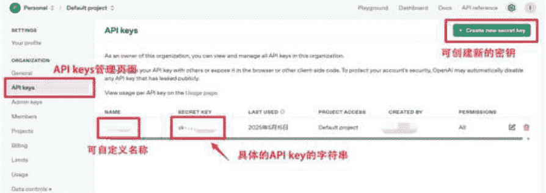

为了降低泄露风险，不建议把 key 直接写死在脚本里，推荐通过环境变量来承载和加载。如图2.2 所示，在系统属性里打开环境变量设置，在系统变量中新建一条，变量名建议用“平台名_API_KEY”的形式便于区分，变量值填入刚生成的 key，保存后即可在程序中使用。

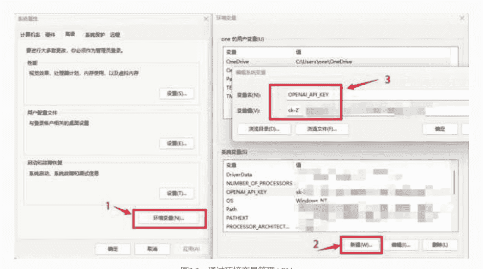

随后在代码中读取该变量即可完成鉴权信息的注入。

```python
import os
api_key = os.getenv("OPENAI_API_KEY")
```

#### 2.2.2 在线大模型API调用基本方法

拿到 key 之后，就可以通过编程调用在线大模型，搭建问答接口、智能体模块或生成任务。不同厂商的实现细节有差异，但对话类任务的调用范式已经相当统一，主流平台都提供与 OpenAI 兼容的 Chat 接口。

一次典型的调用大致包含这几步：

- (1) 配置访问信息：API key、鉴权方式、基础地址 base_url 等。
- (2) 组织请求体：用 messages 字段构建多轮对话上下文。
- (3) 选择模型：按官方文档传入平台支持的模型名称。
- (4) 设定可选参数：temperature、max_tokens、top_p 等。
- (5) 发起请求并解析返回结果。

先执行安装命令部署 OpenAI SDK。

```bash
pip install openai
```

以 OpenAI 官方库为例，示例代码如下。

```python
import openai
import os

openai.api_key = os.getenv("OPENAI_API_KEY")
openai.api_base = "https://api.openai.com/v1"

response = openai.ChatCompletion.create(
    model="gpt-4o",  # 替换为目标平台支持的模型名称
    messages=[
        {"role": "system", "content": "你是一位 AI 助手。"},
        {"role": "user", "content": "请解释什么是 API。"}
    ],
    temperature=0.7,
    max_tokens=200
)

print(response["choices"][0]["message"]["content"])
```

如果要接入兼容 OpenAI 格式的国产平台，如 DashScope、DeepSeek，只需把 API Base URL 和模型名换成对应平台的即可，调用逻辑无需改动。

调用阿里云 Qwen 时，只需要替换地址和模型名，并填入该平台的 key。

```python
openai.api_base = "https://dashscope.aliyuncs.com/compatible-mode/v1"
model = "qwen-plus"
```

调用 DeepSeek 时同样仅需更换地址和模型名并提供对应的 key。

```python
openai.api_base = "https://api.deepseek.com/v1"
model = "deepseek-chat"
```

像智谱 GLM 这样并非原生兼容 OpenAI SDK 的模型，需要使用其官方 SDK。相关示例一般可在官网手册或 GitHub 仓库找到。

以智谱为例，先安装官方 SDK。

```bash
pip install zhipuai
```

安装完成后即可用如下代码调用 GLM-4。

在实际项目里，加载密钥的方式也可以采用另一种写法，直接从环境变量读取后注入客户端。

```python
import os
api_key = os.getenv("OPENAI_API_KEY")
```

依赖安装命令与之前保持一致。

```bash
pip install openai
```

OpenAI 官方库的调用示例与上文等价。

```python
import openai
import os

openai.api_key = os.getenv("OPENAI_API_KEY")
openai.api_base = "https://api.openai.com/v1"

response = openai.ChatCompletion.create(
    model="gpt-4o",  # 替换为目标平台支持的模型名称
    messages=[
        {"role": "system", "content": "你是一位 AI 助手。"},
        {"role": "user", "content": "请解释什么是 API。"}
    ],
    temperature=0.7,
    max_tokens=200
)

print(response["choices"][0]["message"]["content"])
```

对于兼容 OpenAI 格式的国产服务，仍然只需替换 Base URL 和模型名。

阿里云 Qwen 的调用替换项如下。

```python
openai.api_base = "https://dashscope.aliyuncs.com/compatible-mode/v1"
model = "qwen-plus"
```

DeepSeek 的调用替换项如下。

```python
openai.api_base = "https://api.deepseek.com/v1"
model = "deepseek-chat"
```

对于非原生兼容的模型，使用官方 SDK 是更稳妥的方案。

智谱官方 SDK 的安装命令如下。

```bash
pip install zhipuai
```

安装完毕后调用 GLM-4 的示例代码如下。

```python
from zhipuai import ZhipuAI

# 初始化客户端
client = ZhipuAI(api_key="your_api_key")  # 替换为您的 API key

# 调用 GLM-4 模型
response = client.chat.completions.create(
    model="glm-4",
    messages=[
        {"role": "user", "content": "请你作为童话故事大王，写一篇短篇童话故事，主题是要永远保持一颗善良的心。"}
    ],
    top_p=0.7,
    temperature=0.9,
    stream=False,
    max_tokens=2000,
)

# 输出模型回复
print(response.choices[0].message.content)
```

#### 2.2.3 在线大模型API核心参数详解

主流平台的对话接口大多借鉴 OpenAI 的 ChatCompletion 设计，参数结构高度相似，下面围绕通用参数做说明，便于更精准地控制输出效果。

##### 1. model：指定调用的模型名称

同一产品线下往往存在多个版本，需通过 model 参数明确选择，属必填项。各平台支持的名称不同，常见例子包括 OpenAI 的 gpt-3.5-turbo、gpt-4、gpt-4-turbo、gpt-4o；DeepSeek 的 deepseek-chat、deepseek-coder；阿里 DashScope 的 qwen-turbo、qwen-plus、qwen-max；智谱 BigModel 的 glm-4、glm-4v 等。

##### 2. messages：对话历史

messages 是构建上下文的核心参数，类型为字典列表，包含 system、user、assistant 三种角色。system 用于设定身份或行为边界，user 为用户输入，assistant 为模型的历史回复，用于多轮延续。

```python
messages = [
    {"role": "system", "content": "你是一位精通中英文翻译的语言专家。"},
    {"role": "user", "content": "请将这句话翻译成英文：我爱学习。"}
]
```

##### 3. temperature：生成多样性

temperature 用来调节输出的随机程度。OpenAI 系列常见取值 0.0～2.0，DeepSeek、Qwen、GLM 等国内模型通常为 0.0～1.0。数值越低输出越确定，适合问答、代码编写；数值越高越发散，适合创作类任务，但不宜接近上限，否则容易跑偏。

##### 4. max_tokens：回复最大长度限制

max_tokens 限制单次响应的最大 token 数量，即输出上限。

> 注意
token 不是字符，中文一个字符可能对应多个 token。max_tokens 指单次生成长度，而非整段对话的总长度。历史消息的 token 与本次生成的 token 之和不能超过模型上下文窗口，否则请求会失败。当前主流模型普遍支持 128K 级别窗口，但实际可用额度多被历史消息占用。

设置过高会浪费配额，过低则导致截断。常见参考：简单问答 100～300，摘要翻译 200～512，内容创作 800～2000，代码分析 500～1500，具体需结合上下文和成本策略调试。

##### 5. top_p：核采样策略

top_p 取值 0.0～1.0，采用核采样方式控制多样性。模型按概率排序候选 token，累积概率不超过阈值的集合作为采样空间。1.0 代表不剪枝，创意更强但稳定性下降；0.9 仅从前 90% 概率空间采样；0.1 接近贪婪采样，输出更稳定可重复。

> 注意
temperature 与 top_p 同时大幅调整容易导致输出异常，通常二选一或小范围配合。

##### 6. stop：手动指定停止词

stop 用于在模型遇到指定词时提前结束生成，支持字符串或列表。

```python
stop=["<END>", "用户："]
```

该用法在多轮对话、函数调用、角色剧本等场景很常见。

总体来看，虽然各家 API 大多遵循 OpenAI 的 ChatCompletion 结构，但在 SDK、参数名、默认值和多模态字段上仍存在差异，如部分平台把 temperature 和 top_p 合并为 sampling_config，或在多模态调用中加入 image、vision、file_id 等字段。建议始终以对应平台的官方文档或 SDK 手册为准，确保配置正确。

# 上云调用与本地部署大模型实战

想先用云端大模型，首要准备的就是一组用于鉴权的访问凭据。这种凭据本质上是通行令牌，用来确认调用方身份、管控调用额度、追踪请求来源，是绝大多数云服务平台做授权的基础。

一般先在对应平台完成注册登录，进入「密钥管理」或「凭据中心」这类区域新建密钥。以 OpenAI 为例即可操作。大多数服务允许为密钥自定义别名，生成后会得到一段可用于访问的字符串，如图2.1所示。

> 注意
面向普通用户的网页对话产品和面向开发者的 API 服务入口是两回事。前者像 ChatGPT、Claude、文心一言这类封装好的网页或移动端 App，直接对话即可；后者是程序化调用入口，允许开发者通过代码接入底层能力，实现个性化开发、系统集成、智能体搭建等更进阶的需求。

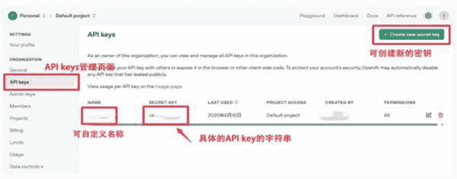

图2.1 OpenAI平台API keys管理页面

出于安全考虑，不建议把密钥直接写进代码，推荐用环境变量来保存并加载。如图2.2所示，打开系统属性中的环境变量设置，在系统变量里新建一条，变量名可自拟，建议采用「平台名_API_KEY」的命名习惯便于区分，变量值填入密钥后保存即可。


图2.2 通过环境变量管理API key

随后在程序里读取该环境变量即可使用。

```
import os
api_key = os.getenv("OPENAI_API_KEY")
```

#### 2.2.2 在线大模型API调用基础流程

拿到凭证后，就可以用程序接入云端模型，搭建专属问答、智能体模块或生成任务流水线。不同厂商实现细节有差异，但主流对话调用已趋于统一，多数平台都提供兼容 OpenAI 风格的对话接口。

一次典型的云端调用通常包含以下环节。

1. 设定连接信息，包含密钥、鉴权方式、服务地址 base_url 等。
2. 组织请求体，主要在 messages 中放入多轮上下文。
3. 确认模型标识，不同平台命名规则不同，需按文档填写。
4. 调整可选超参数，例如 temperature、max_tokens、top_p 等。
5. 发起请求并解析返回内容。

先安装 OpenAI 客户端库，执行如下命令。

```
pip install openai
```

以官方库为例，调用示例如下。

```
import openai
import os

openai.api_key = os.getenv("OPENAI_API_KEY")
openai.api_base = "https://api.openai.com/v1"

response = openai.ChatCompletion.create(
    model="gpt-4o",  # 替换为目标平台支持的模型名称
    messages=[
        {"role": "system", "content": "你是一位 AI 助手。"},
        {"role": "user", "content": "请解释什么是 API。"}
    ],
    temperature=0.7,
    max_tokens=200
)

print(response["choices"][0]["message"]["content"])
```

若要调用兼容 OpenAI 格式的国产服务如 DashScope、DeepSeek，只需把 Base URL 与模型名替换，调用逻辑无需改动。

调用阿里云 Qwen 时，只要修改下面两处并填入对应平台的密钥即可。

```
openai.api_base = "https://dashscope.aliyuncs.com/compatible-mode/v1"
model = "qwen-plus"
```

调用 DeepSeek 时亦只需替换这两项并提供平台密钥。

```
openai.api_base = "https://api.deepseek.com/v1"
model = "deepseek-chat"
```

对于智谱 GLM 这类非原生兼容的国产模型，需使用其官方 SDK。参考实现可查阅官网文档或 GitHub 示例。

以智谱为例，先安装官方 SDK。

```
pip install zhipuai
```

安装完成后即可用如下代码调用 GLM-4。

```
from zhipuai import ZhipuAI

# 初始化客户端
client = ZhipuAI(api_key="your_api_key")  # 替换为您的 API key

# 调用 GLM-4 模型
response = client.chat.completions.create(
    model="glm-4",
    messages=[
        {"role": "user", "content": "请你作为童话故事大王，写一篇短篇童话故事，主题是要永远保持一颗善良的心。"}
    ],
    top_p=0.7,
    temperature=0.9,
    stream=False,
    max_tokens=2000,
)

# 输出模型回复
print(response.choices[0].message.content)
```

#### 2.2.3 在线大模型API核心参数详解

主流平台的对话接口多沿用 OpenAI ChatCompletion 的设计思路，参数结构高度相似。下面对常用参数做梳理，帮助更好地掌控输出效果。

##### 1. model：选择模型

同一系列常包含多个版本，model 参数用于明确具体版本，属必填项。各平台命名各异，常见示例见表2.1。

表2.1 不同平台支持的模型名称

| 平台 | 模型名称示例 |

| :--- | :--- |

| OpenAI | gpt-3.5-turbo、gpt-4、gpt-4-turbo、gpt-4o |

| DeepSeek | deepseek-chat、deepseek-coder |

| 阿里 DashScope | qwen-turbo、qwen-plus、qwen-max |

| 智谱 BigModel | glm-4、glm-4v |

##### 2. messages：对话上下文

messages 为必填项，是构建上下文的核心，格式为字典列表，包含三种角色。

1. system：用于设定 AI 的身份或行为边界。
2. user：用户输入内容。
3. assistant：AI 的过往回复，用于维持多轮上下文。

下面代码展示了一个典型的 messages 列表，包含两条记录，每条都标明 role 与 content。

```
messages = [
    {"role": "system", "content": "你是一位精通中英文翻译的语言专家。"},
    {"role": "user", "content": "请将这句话翻译成英文：我爱学习。"}
]
```

##### 3. temperature：随机性调节

temperature 用来调节输出的随机程度。OpenAI 系列标称范围 0.0～2.0，而国内 DeepSeek、Qwen、GLM 多为 0.0～1.0。

在问答、代码编写等任务里常取接近 0 的数值，让结果更确定保守；在故事创作类任务里倾向取较高值，让文本更灵活生动。一般不会取极端值，高温下容易跑偏出现怪句。

##### 4. max_tokens：单次输出上限

max_tokens 用于限制单次响应的最大生成 token 数，即输出上限。

> **注意**
需明确 token 与字符不同，一个中文字符可能对应多个 token。此外 max_tokens 指单次响应的长度，而非整段对话总量。

不同模型的上下文窗口不同，允许的 max_tokens 范围也有差异。max_tokens 与 messages 历史总 token 数之和不可超过窗口限制，否则会调用失败。主流模型普遍支持 128K 上下文，但实际使用中大部分 token 被历史消息占用。

设得过高会浪费配额，设得过低会导致截断。简单问答或检索约 100～300，摘要或翻译约 200～512，内容创作约 800～2000，代码生成或分析约 500～1500。可结合上下文长度、生成目标与成本多次调试。

##### 5. top_p：核采样

top_p 取值 0.0～1.0，是控制多样性的另一手段。与 temperature 调整单个 token 概率分布不同，top_p 采用累积概率采样，即按候选 token 概率从高到低累加，选择总概率不超过阈值的前若干 token，再在此集合中采样。

top_p = 1.0 表示不做剪枝，采样范围最大，创意强但不稳定；top_p = 0.9 只从累计前 90% 的 token 中采样；top_p = 0.1 近似贪心采样，输出稳定且重复性高。

> **注意**
通常不建议同时大幅调整 temperature 与 top_p，避免过度控制导致输出异常。

##### 6. stop：停止词控制

stop 用于在模型遇到指定词时提前结束生成，支持字符串或字符串列表，示例如下。

```
stop=["<END>", "用户："]
```

该用法在多轮对话、函数调用、角色剧本类任务中较为常见。

虽然主流平台 API 多借鉴 OpenAI ChatCompletion 结构，但在自家 SDK 或 REST API 中，参数名、格式、默认值与支持范围仍可能不同。部分平台把 temperature 和 top_p 合并为 sampling_config，部分平台把 messages 改为 prompt，多模态场景还会增加 image、vision、file_id 等字段。因此使用官方 SDK 时务必查阅对应文档，确保配置正确。

##### 6. stop：手动停止词

stop 用于在模型遇到指定词时提前结束生成，支持字符串或字符串列表，示例如下。

```
stop=["<END>", "用户："]
```

该用法在多轮对话、函数调用、角色剧本类任务中较为常见。

虽然主流平台 API 多借鉴 OpenAI ChatCompletion 结构，但在自家 SDK 或 REST API 中，参数名、格式、默认值与支持范围仍可能不同。部分平台把 temperature 和 top_p 合并为 sampling_config，部分平台把 messages 改为 prompt，多模态场景还会增加 image、vision、file_id 等字段。因此使用官方 SDK 时务必查阅对应文档，确保配置正确。

### 2.3 本地大模型部署及使用

本节围绕本地部署的核心流程，介绍算力资源与环境依赖，涵盖模型下载、推理测试等关键环节，并与主流第三方部署工具做对比，为后续智能体开发提供运行基础。

#### 2.3.1 本地大模型部署需求概览

因数据安全、访问稳定性、成本控制、模型可控性等需求，越来越多的开发者和企业选择将大模型部署在本地或私有云。本地部署能掌控推理过程、降低隐私泄露风险、减少长期接口费用，并提升响应速度与离线可用性。同时部署门槛更高，需在动手前对以下关键需求做好评估。

##### 1. 算力资源

在所有部署条件中，算力尤其是 GPU 是运行大语言模型的决定因素。轻量场景可尝试 CPU 模拟推理，但速度远逊 GPU，对中大型模型基本不可行。

> **说明**
>
> 为何不能只用 CPU？
>
> 大语言模型推理涉及十亿级参数的矩阵计算，多层 Transformer 中包含大量矩阵乘法、归一化、注意力计算等高强度并行任务。GPU 在并行数值计算上优势明显，CPU 更擅长逻辑控制与串行任务。同等条件下 CPU 推理速度可能仅为 GPU 的 1/100 至 1/10。

推理场景下不同参数规模的显存需求如表2.2所示。

**表2.2 不同模型参数规模对应的显存需求**

| 模型规模 | 推理时显存需求（FP16） | 支持的典型GPU（单卡） |

| :--- | :--- | :--- |

| 7B | 14GB～16GB | RTX 3090 / 4090 / A500 |

| 13B | 26GB～30GB | RTX 4090（24GB）基本可运行 |

| 33B | 60GB～80GB | 多卡 A100 或 2×4090 并行 |

采用量化如 INT4、INT8、GPTQ 等技术，可把显存需求减少约 1/4～1/2。以 7B 为例，FP16 需 14GB～16GB，INT4 量化后约 4GB～6GB，可在 RTX3060/4060 甚至笔记本 GPU 上运行。

当前训练或推理多基于 NVIDIA GPU，因其 CUDA+cuDNN+PyTorch 生态成熟。主流型号如表2.3所示。

| 类型 | 常见型号 | 适用说明 |

| :--- | :--- | :--- |

| 数据中心级 | A100, H100, A800, L40S | 高稳定性、高带宽，适合集群部署 |

| 消费级高端 | RTX 3090, 4090, 4080 | 适合个人开发与小模型推理 |

| 云租用平台 GPU | Tesla V100, T4 | 支持量化模型，成本可控 |

若本地无 GPU，可租用 AutoDL、阿里云 PAI、百度飞桨 Studio、Google Colab 等在线 GPU 资源。

##### 2. 操作系统与环境依赖

硬件到位后，还需配置操作系统与软件依赖栈。

1) 操作系统

建议优先使用 Ubuntu，其作为稳定兼容 CUDA 的 Linux 发行版，对 NVIDIA 工具链支持全面。CentOS 和 Windows+WSL2 能够运行部分模型，但不推荐用于生产环境。

2) 软件依赖环境（PyTorch 栈）

系统运行所需依赖及安装说明如表2.4所示。

| 组件 | 推荐版本 | 安装说明 |

| :--- | :--- | :--- |

| Python | ≥ 3.9 | 建议使用 Conda 虚拟环境隔离 |

| PyTorch | ≥ 2.0 | 需安装 GPU 版本（pip/conda 安装） |

| CUDA | 11.8 / 12.1 | 与 PyTorch 安装包版本匹配 |

| cuDNN | 对应 CUDA 版本 | NVIDIA 官网下载安装或驱动自带 |

| Transformers | ≥ 4.35 | Hugging Face 的核心推理库 |

##### 3. 模型格式支持

部署前需确认目标模型是否提供开放权重、支持格式及是否有量化版本。主流格式如表2.5所示。

**表2.5 主流模型格式**

| 格式类型 | 常见后缀 | 说明 | 适用部署框架 |

| :--- | :--- | :--- | :--- |

| 原始 PyTorch 格式 | .bin | Transformers 默认格式，文件较大，占用显存高 | Transformers/vLLM/TGI |

| 安全张量格式 | .safetensors | 安全、加载更快、支持并发加载的张量格式 | Transformers/vLLM/TGI |

| 量化格式-INT4 | .bin, .pt (压缩) | 通常通过 GPTQ/AWQ 等量化工具压缩后发布 | AutoAWQ/GPTQ-for-LLaMA/vLLM |

| 量化格式-GGUF | .gguf | llama.cpp/Ollama 使用的统一格式，支持 CPU/GPU 部署 | llama.cpp/Ollama/KoboldCpp |

选定模型后，需确认是否开源、是否有 Hugging Face 或 GitHub 地址、是否提供 INT4/INT8/GGUF 版本，以及是否有官方或社区推荐的部署脚本或 Docker 镜像。

#### 2.3.2 本地大模型部署通用步骤

本地部署开源大模型：从环境到首推的完整路线

在多数开源大语言项目里，官方或社区会把源码、推理示例和部署脚手架都放到 GitHub，本地复现于是形成了一套相对固定的操作路径。以 Transformers 生态的常规模型为例，通用的落地步骤可归纳如下。

##### 1. 环境初始化与隔离空间搭建
先用 Conda 新建一个独立的 Python 运行空间，让依赖互不干扰且版本可控。

```
conda create -n llm-deploy python=3.10 -y
conda activate llm-deploy
```

-n 参数后填写你习惯的环境名称，创建的同时要指定解释器版本。

随后装入基础库，例如按本机 CUDA 版本挑选 GPU 版的 PyTorch。

```
pip install torch torchvision torchaudio --index-url https://download.pytorch.org/whl/cu118
```

##### 2. 获取项目源码
绝大多数开源项目在 GitHub 上提供了推理示例、权重加载测试、API 服务代码以及一键装包的 requirements.txt。直接执行下方命令即可把仓库拉到本地。

```
git clone https://github.com/deepseek-ai/DeepSeek-LLM.git
```

也可以在网页端下载 zip 压缩包后本地解压。拿到完整代码后，执行下列命令进入目录并一次性安装依赖。

```
cd DeepSeek-LLM
pip install -r requirements.txt
```

> **说明**
>
> 克隆官方仓库并非调用模型的前提。
>
> 对于发布在 Hugging Face 的模型，开发者完全可以通过 Transformers 接口直接加载参数文件完成本地推理，无需必须克隆官方代码。通常我们会拉取仓库，是为了拿到这些增值资源。
>
> - 官方推荐的依赖版本，比如 requirements.txt。
> - 官方提供的测试脚本或推理示例。
> - API 服务的部署方式，例如 FastAPI、Gradio。
> - Docker 镜像与部署指令。
> - 与模型结构强相关的工程化调用逻辑，例如多模态组件、定制 tokenizer。
>
> 如果你已熟悉 Hugging Face 的调用方式并能自行配置依赖，完全可以跳过仓库，仅下载参数文件与 tokenizer 即可完成调用与使用。这种做法更轻量、更灵活，适合有经验的开发者快速接入现有系统。

##### 3. 准备模型参数文件
多数参数文件托管在 Hugging Face 或魔搭 ModelScope，可借助 Transformers 自动拉取，也可手工预下载到本地。

（1）借助 Hugging Face Transformers 自动下载并加载。

```
from transformers import AutoTokenizer, AutoModelForCausalLM

model_id = "deepseek-ai/deepseek-llm-7b-base"
tokenizer = AutoTokenizer.from_pretrained(model_id)
model = AutoModelForCausalLM.from_pretrained(model_id, torch_dtype="auto").cuda()
```

首次加载时会把文件自动缓存到默认目录，通常为 ~/.cache/huggingface，后续加载会直接使用缓存。

（2）使用 ModelScope 官方工具包自动加载。先执行如下命令安装官方包。

```
pip install modelscope
```

运行下方代码即可载入对应模型。

```
from modelscope import AutoTokenizer, AutoModelForCausalLM

model_id = "Qwen/Qwen-7B-Chat"
model = AutoModelForCausalLM.from_pretrained(model_id, revision='v1.0.0')
tokenizer = AutoTokenizer.from_pretrained(model_id, revision='v1.0.0')
```

具体的模型标识可在官网查询，如图2.3所示。


（3）网页手动下载参数并离线使用。在 Hugging Face 与 ModelScope 的模型页面，切到 Files and versions 或模型文件标签，点击右侧下载按钮保存全部文件，如图2.4所示。将文件放到本地目录后，在推理脚本中指定 pretrained_model_name_or_path="./your_model_dir" 即可。


这里可以看到文件后缀为 .safetensors，按表2.5 这是安全张量格式，适配 Transformers、vLLM、TGI 的使用方式。

##### 4. 本地加载验证与初次推理
参数下载完成后，在本地载入模型做一次简易推断，用来确认模型是否成功加载、显存是否充足、生成是否正常、所选框架是否兼容模型格式。

1）标准模型加载与推理测试（FP16）
若模型为 .bin 或 .safetensors 格式的标准参数且具备 GPU，可按如下方式完成加载与推理。

```
from transformers import AutoModelForCausalLM, AutoTokenizer
import torch

# 模型路径：可为 Hugging Face ID 或本地文件夹
model_path = "./checkpoints"  # 或 "deepseek-ai/deepseek-llm-7b-base"

tokenizer = AutoTokenizer.from_pretrained(model_path)
model = AutoModelForCausalLM.from_pretrained(
    model_path,
    torch_dtype=torch.float16,  # 推荐使用半精度加载以节省显存
    device_map="auto"  # 自动将模型映射到可用 GPU
)

prompt = "请简要介绍 Transformer 模型的基本结构。"
inputs = tokenizer(prompt, return_tensors="pt").to(model.device)
outputs = model.generate(**inputs, max_new_tokens=200)
print(tokenizer.decode(outputs[0], skip_special_tokens=True))
```

2）加载量化模型（如 INT4）
若使用经过量化的模型，例如 bitsandbytes 格式的 4bit INT4 模型，可采用以下方式。

```
from transformers import AutoModelForCausalLM, AutoTokenizer, BitsAndBytesConfig

bnb_config = BitsAndBytesConfig(load_in_4bit=True, bnb_4bit_compute_dtype=torch.float16)

tokenizer = AutoTokenizer.from_pretrained(model_path)
model = AutoModelForCausalLM.from_pretrained(
    model_path,
    quantization_config=bnb_config,
    device_map="auto"
)
```

INT4 模型不支持 torch_dtype 参数，需通过 quantization_config 管理精度。

3）官方推理脚本
除自行用 Transformers 库加载推理外，大多数开源模型在 GitHub 项目中也会提供官方推理示例脚本，帮助用户快速验证效果。

#### 2.3.3 GLM 系列本地实操指南
智谱推出的 GLM-4 家族在开源社区反响不错，中文理解与生成能力扎实，且官方提供了完整的本地使用文档，适合在私有环境做推理测试与服务化上线。下面以 GLM-4-9B-Chat 为例，演示从环境准备到本地使用的全流程。

##### 1. 硬件与环境准备
- 显卡建议：1 张 RTX 3090/4090，显存 ≥24GB；若使用 INT4 量化版本，显存需求可降至 6GB~8GB。
- 操作系统：推荐 Linux，如 Ubuntu 20.04 或 Ubuntu 22.04。
- Python 环境：建议用 Conda 创建虚拟环境，Python 不低于 3.9。运行下述命令创建环境。

```
conda create -n glm4 python=3.10 -y
conda activate glm4
```

执行下列命令安装必要的 torch 与 transformers 库。

```
pip install torch torchvision torchaudio --index-url https://download.pytorch.org/whl/cu118
pip install transformers tiktoken
```

安装完成后，可运行下方代码校验是否安装成功。

```
import torch
torch.cuda.is_available()
```

若输出如下内容，则可正常使用。

```
True
```

##### 2. 拉取官方代码仓库
查看 GLM-4 模型的 GitHub 开源目录结构，如图2.5所示。

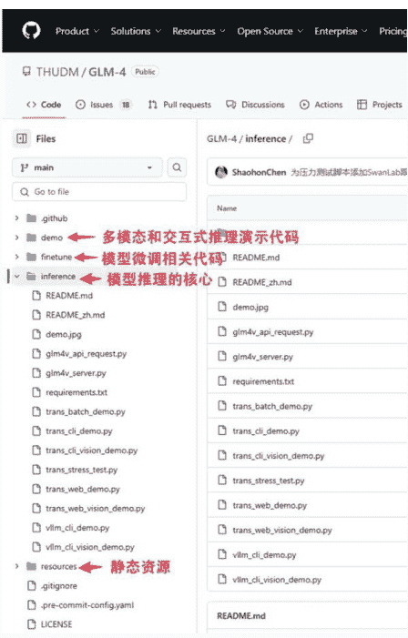

该仓库的 inference 子目录是本地使用与测试的核心，包含丰富的推理入口脚本。运行如下命令克隆仓库并进入目录。

```
git clone https://github.com/THUDM/GLM-4.git
cd GLM-4
```

结合图2.5 的结构可知，依赖清单 requirements.txt 位于 inference 子目录下，执行以下命令进入该目录并安装依赖。

```
cd inference
pip install -r requirements.txt
```

##### 3. 获取 GLM-4 参数
通过 ModelScope 下载模型前需先安装其官方库。

```
pip install modelscope
```

可在网页端查看模型权重详情，如图2.6所示。

### 2.3 本地大模型使用全景
本节围绕本地使用主线，系统梳理算力资源与环境依赖，涵盖模型获取、推理验证等关键环节，并与主流第三方工具做对比，为后续 Agent 开发提供坚实运行基础。

#### 2.3.1 本地使用的核心需求
实际应用中，出于数据安全、访问稳定性、成本控制、模型可控性等多重考量，越来越多的开发者与企业倾向于把大模型放在本地或私有云。本地化使用可掌控推理过程、降低隐私数据泄露风险、减少长期接口费用，同时提升响应速度并支持离线运行。另一方面，本地使用门槛更高、工程复杂度更大，动手前需对以下关键需求做全面评估。

##### 1. 硬件算力
在所有使用条件中，算力资源尤其是 GPU 是决定模型能否成功运行的关键。虽然轻量场景可尝试 CPU 模拟推理，但速度与效率远不及 GPU，对中大型模型基本不可行。因此使用大模型首先必须配备相应规模的 GPU 硬件。

> **说明**
>
> 为何不能只用 CPU？
>
> 大语言模型推理涉及十亿级参数的矩阵运算，Transformer 架构中包含大量矩阵乘法、归一化、注意力计算等高强度并行任务。GPU 在并行数值计算上优势明显，而 CPU 更擅长逻辑控制与串行任务。同样条件下，CPU 推理速度可能仅为 GPU 的 1/100 至 1/10。

在推理场景下不同参数规模对应的显存需求如表2.2所示。

**表2.2 不同模型参数规模对应的显存需求**

| 模型规模 | 推理时显存需求（FP16） | 支持的典型GPU（单卡） |
| :--- | :--- | :--- |
| 7B | 14GB～16GB | RTX 3090 / 4090 / A500 |
| 13B | 26GB～30GB | RTX 4090（24GB）基本可运行 |
| 33B | 60GB～80GB | 多卡 A100 或 2×4090 并行 |

若采用量化技术如 INT4、INT8、GPTQ，推理显存通常可减少 1/4～1/2。以 7B 模型为例，FP16 需要 14GB～16GB，INT4 量化后仅需 4GB～6GB，可在单张 RTX3060/4060 甚至笔记本 GPU 上运行。

当前大模型训练与推理多基于 NVIDIA GPU，因其具备成熟的 CUDA+cuDNN+PyTorch 支持体系。主流型号如表2.3所示。

**表2.3 大模型领域主流GPU型号**

| 类型 | 常见型号 | 适用说明 |
| :--- | :--- | :--- |
| 数据中心级 | A100, H100, A800, L40S | 高稳定性、高带宽，适合集群部署 |
| 消费级高端 | RTX 3090, 4090, 4080 | 适合个人开发与小模型推理 |
| 云租用平台 GPU | Tesla V100, T4 | 支持量化模型，成本可控 |

若本地无 GPU，可租用云平台算力。AutoDL、阿里云 PAI、百度飞桨 Studio、Google Colab 等均提供在线 GPU 租赁。

##### 2. 系统与依赖栈
硬件就绪后，还需配置操作系统与软件依赖栈。以下是使用主流 PyTorch/Hugging Face 风格模型所需的通用环境说明。

1) 操作系统
建议优先使用 Ubuntu，其稳定且兼容 CUDA 的 Linux 发行版，全面支持 NVIDIA 工具链。CentOS 和 Windows 配合 WSL2 也可运行部分模型，但不建议用于正式生产环境，会存在兼容风险。

2) 软件依赖环境（PyTorch 栈）
系统运行所需的软件依赖环境及安装说明如表2.4所示。

**表2.4 软件依赖环境及安装说明**

| 组件 | 推荐版本 | 安装说明 |
| :--- | :--- | :--- |
| Python | ≥ 3.9 | 建议使用 Conda 虚拟环境隔离 |
| PyTorch | ≥ 2.0 | 需安装 GPU 版本（pip/conda 安装） |
| CUDA | 11.8 / 12.1 | 与 PyTorch 安装包版本匹配 |
| cuDNN | 对应 CUDA 版本 | NVIDIA 官网下载安装或驱动自带 |
| Transformers | ≥ 4.35 | Hugging Face 的核心推理库 |

### 2.3.2 GLM-4-9B-Chat 实战部署
图2.6 glm-4-9b-chat模型权重情况

接下来导入 modelscope 库，运行如下代码下载模型权重。

```python
from modelscope import snapshot_download

# 模型下载
model_dir = snapshot_download('ZhipuAI/glm-4-9b-chat')
```

下载完成后，打印 model_dir 即可查看权重在本地的存储路径。

```python
print(model_dir)
```

输出内容如下。

```
'/root/autodl-tmp/glm-4-9b-chat'
```

#### 1. 基于 Transformers 后端推理
（1）在单卡服务器下运行如下代码。

```python
import torch
from modelscope import AutoModelForCausalLM, AutoTokenizer

# 设置设备为 CUDA（GPU），以加速计算
device = "cuda"

# 从预训练模型目录加载分词器，并信任远程代码
tokenizer = AutoTokenizer.from_pretrained(model_dir, trust_remote_code=True)

# 定义用户的输入
query = "你好"

# 使用聊天模板应用分词器，并生成输入张量
inputs = tokenizer.apply_chat_template(
    [{"role": "user", "content": query}],  # 用户角色和输入内容
    add_generation_prompt=True,              # 添加生成提示
    tokenize=True,                           # 执行分词
    return_tensors="pt",                     # 返回 PyTorch 张量
    return_dict=True                         # 返回字典形式
)

# 将输入张量移动到指定设备（CUDA）
inputs = inputs.to(device)

# 从预训练模型目录加载下载到本地的大模型，并信任远程代码
model = AutoModelForCausalLM.from_pretrained(
    model_dir,
    torch_dtype=torch.bfloat16,              # 使用 bfloat16 数据类型以减少内存使用
    trust_remote_code=True                   # 信任远程代码
).to(device).eval()                          # 将模型移动到 CUDA 设备并设置为评估模式

# 定义生成文本的参数
gen_kwargs = {
    "max_length": 2500,                     # 生成文本的最大长度
    "do_sample": True,                      # 是否进行采样
    "top_k": 1                              # 采样时考虑的最高概率的 k 个标记
}

# 在不计算梯度的上下文中生成文本
with torch.no_grad():
    # 生成模型的输出
    outputs = model.generate(**inputs, **gen_kwargs)
    # 截取生成的输出，去除输入的部分
    outputs = outputs[:, inputs['input_ids'].shape[1]:]
    # 解码生成的输出并去除特殊标记
    print(tokenizer.decode(outputs[0], skip_special_tokens=True))
```

输出内容如下。

```
Special tokens have been added in the vocabulary, make sure the associated word embeddings are fine-tuned or trained.
Loading checkpoint shards:  0%|          | 0/10 [00:00<?, ?it/s]
你好👋！很高兴见到你，有什么可以帮助你的吗？
```

（2）调用官方提供的推理入口。如图2.6所示，inference 文件夹内放置了即开即用的对话脚本，执行后即可在命令行与模型交互。

```bash
python trans_cli_demo.py
```

想通过浏览器访问，执行下方指令即可启动 Gradio 在线界面。

```bash
python trans_web_demo.py
```

### 2.3.3 Qwen3 快速本地部署手册

2025年4月29日，阿里通义千问团队推出 Qwen3 系列。旗舰模型 Qwen3-235B-A22B 在代码、数学及综合能力测试中，与 DeepSeek-R1、o1、o3-mini、Grok-3、Gemini-2.5-Pro 等顶级模型抗衡。本次同时放出稠密与 MoE 两种架构，参数规模涵盖 0.6B、1.7B、4B、8B、14B、32B，以及 30B-A3B、235B-A22B。

以下以 Qwen3-14B 为示例，演示从环境准备到本地可用的完整链路。

##### 1. 环境准备与隔离

- 显卡建议：1 张 RTX 3090/4090，显存不低于 24GB。
- 系统建议：Linux 环境，Ubuntu 20.04/22.04 为佳。
- Python：推荐 Conda 新建独立环境，版本 ≥3.9。

执行指令新建环境。

```bash
conda create --n qwen3 python=3.11
conda activate qwen3
```

随后安装深度学习核心依赖。

```bash
pip install torch torchvision torchaudio --index-url https://download.pytorch.org/whl/cu118
pip install transformers tiktoken
```

再执行校验指令确认安装状态。

```python
import torch
torch.cuda.is_available()
```

若输出与下文一致，则环境可用。

```
True
```

##### 2. 拉取代码仓库

GitHub 上的项目结构如图2.7。Qwen3 完全基于 Transformers，仓库未额外提供 requirements.txt，通常沿用 Hugging Face 的依赖，执行如下安装命令即可。

```bash
pip install torch transformers accelerate sentencepiece

# 用于 INT4 模型量化推理
pip install bitsandbytes
```

##### 3. 获取模型权重

使用 ModelScope 下载前，先安装客户端库。

```bash
pip install modelscope
```

可在网页预览权重信息，如图2.8。

导入 modelscope 后执行下载命令，将权重保存在本地。

```bash
cd /root/autodl-tmp/Qwen3
mkdir ./Qwen3-14B
modelscope download --model Qwen/Qwen3-14B --local_dir ./Qwen3-14B
```

##### 4. Jupyter 环境下基于 Transformers 的原生使用流程

(1) 导入依赖模块。

```python
from modelscope import AutoModelForCausalLM, AutoTokenizer
```

(2) 设置模型仓库地址。

```python
model_name = "./Qwen3-14B"
```

(3) 实例化分词器与预训练模型。

```python
tokenizer = AutoTokenizer.from_pretrained(model_name)
model = AutoModelForCausalLM.from_pretrained(
    model_name,
    torch_dtype="auto",  # 指定模型权重数据类型
    device_map="auto"  # 指定模型权重加载设备
)
```

(4) 构造对话消息。

```python
prompt = "给出一个关于大语言模型的简短介绍。"
messages = [
    {"role": "user", "content": prompt}
]
```

(5) 执行词嵌入。

```python
text = tokenizer.apply_chat_template(
    messages,
    tokenize=False,
    add_generation_prompt=True,
    enable_thinking=True  # 是否启用思考模式
)
model_inputs = tokenizer([text], return_tensors="pt").to(model.device)
```

（6）生成模型回复。

```python
# 进行文本补全
generated_ids = model.generate(
    **model_inputs,
    max_new_tokens=32768
)
output_ids = generated_ids[0][len(model_inputs.input_ids[0]):].tolist()

# 结果将首先显示标签中，然后是实际响应
print(tokenizer.decode(output_ids, skip_special_tokens=True))
```

效果如图2.9。思考模式开关由 enable_thinking 控制，置为 False 可关闭。

### 2.3.4 第三方部署工具盘点

除了直接用 Transformers 加载权重，还可选用工程化程度更高的第三方方案。这类工具在加载优化、推理加速、服务化、并发处理上更有优势，适合对性能与可维护性要求高的产品场景。

##### 1. SGLang：面向 GLM 系列的推理服务框架

SGLang 由智谱 AI 发布，开源推理服务框架，针对 GLM 系列如 GLM-4、ChatGLM 深度优化，支持对话模板、多轮历史保留、函数调用、结构化输出。

主要特性：

- 与 GLM 架构高度匹配，支持多轮记忆。
- 支持并发调度与动态上下文构建。
- 提供类 OpenAI 接口。
- 可结合 FastAPI/uvicorn 快速上线服务。

##### 2. LMDeploy：国产模型轻量化部署方案

LMDeploy 由昆仑万维与魔搭社区联合打造，为国产开源大模型提供统一部署路径。支持 INT4/INT8/FP16 多精度，集成一键脚本、服务启动、压测等功能。

主要特性：

- 兼容 Qwen、Baichuan、InternLM 等国产系列。
- 原生支持 INT4 推理，显存占用更低。
- 提供 CLI、Web UI、HTTP API。
- 支持多线程与批量推理。

##### 3. vLLM：高吞吐 OpenAI 兼容引擎

vLLM 来自 UC Berkeley，具备动态批处理、连续批处理、FlashAttention 2 等能力，并完整兼容 OpenAI API。

主要特性：

- 支持 Hugging Face 格式模型如 LLaMA、Qwen、Baichuan。
- 推理吞吐可达数千 token/s。
- 支持流式输出。
- 原生兼容 chat/completions 接口。

##### 4. Ollama：一键本地运行平台

Ollama 面向开发者，提供轻量本地运行方案，支持 GGUF 格式模型如 LLaMA 2/3、Mistral、Qwen、Phi，目标是让本地部署像 Docker 一样便捷。

主要特性：

- 自动下载并注册模型，无需手动管理权重。
- 支持 macOS、Windows、Linux。
- 内置 HTTP API 与 CLI。
- 支持 CPU/GPU 及流式输出。
- 兼容 llama.cpp 生态，支持 GGUF。

上述工具覆盖了主流的本地部署选择，可根据模型结构、硬件与场景挑选。

##### 3. 模型格式概览

部署前需确认模型是否开源、支持格式及是否提供量化版本。主流格式见表2.5。

表2.5 主流模型格式

| 格式类型 | 常见后缀 | 说明 | 适用部署框架 |
| :--- | :--- | :--- | :--- |
| 原始 PyTorch 格式 | .bin | Transformers 默认格式，文件较大，占用显存高 | Transformers/vLLM/TGI |
| 安全张量格式 | .safetensors | 安全、加载更快、支持并发加载的张量格式 | Transformers/vLLM/TGI |
| 量化格式-INT4 | .bin, .pt (压缩) | 通常通过 GPTQ/AWQ 等量化工具压缩后发布 | AutoAWQ/GPTQ-for-LLaMA/vLLM |
| 量化格式-GGUF | .gguf | llama.cpp/Ollama 使用的统一格式，支持 CPU/GPU 部署 | llama.cpp/Ollama/KoboldCpp |

选定模型后，需检查是否开源、是否有 Hugging Face 或 GitHub 地址、是否提供 INT4/INT8/GGUF 版本、是否有官方或社区推荐的脚本或镜像。

#### 2.3.2 通用本地部署流程

多数开源项目在 GitHub 提供完整代码、推理脚本与部署工具链，本地上线可遵循相对固定的路径。基于 Transformers 的主流模型通用步骤如下。

##### 1. 环境搭建与依赖隔离

使用 Conda 创建独立 Python 环境，保证依赖可控。

```
conda create -n llm-deploy python=3.10 -y
conda activate llm-deploy
```

-n 后为自定义环境名，创建时需指定 Python 版本。

随后安装基础依赖，如 PyTorch，需按 CUDA 版本选择 GPU 版。

```
pip install torch torchvision torchaudio --index-url https://download.pytorch.org/whl/cu118
```

##### 2. 获取开源项目

大多数项目在 GitHub 提供示例脚本、加载代码、API 部署代码及 requirements.txt。执行如下命令即可克隆仓库。

```
git clone https://github.com/deepseek-ai/DeepSeek-LLM.git
```

也可网页下载 zip 包本地解压。使用完项目后，进入文件夹一键安装依赖。

```
cd DeepSeek-LLM
pip install -r requirements.txt
```

### 说明

GitHub 仓库并非必须。

托管于 Hugging Face 的模型可直接通过 Transformers 接口加载权重完成本地推理，无需克隆仓库。通常克隆官方仓库是为了获取：

- 推荐依赖版本如 requirements.txt。
- 官方测试脚本或推理示例。
- API 部署方式如 FastAPI、Gradio。
- Docker 镜像与部署指令。
- 与模型结构强相关的工程化逻辑如多模态组件、定制分词器。

若已熟悉 Hugging Face 调用并能自行配置环境，可脱离 GitHub，仅下载权重与分词器即可完成调用与部署，方式更轻量。

##### 3. 模型参数获取

多数权重托管于 Hugging Face 或 ModelScope，可自动加载或手动预下载。

(1) 通过 Hugging Face Transformers 自动下载并加载。

```
from transformers import AutoTokenizer, AutoModelForCausalLM

model_id = "deepseek-ai/deepseek-llm-7b-base"
tokenizer = AutoTokenizer.from_pretrained(model_id)
model = AutoModelForCausalLM.from_pretrained(model_id, torch_dtype="auto").cuda()
```

首次加载会自动下载到本地缓存，通常为 ~/.cache/huggingface，后续直接读取缓存。

(2) 使用 ModelScope 工具包自动加载。先安装工具包。

```
pip install modelscope
```

运行如下代码即可加载对应模型。

```
from modelscope import AutoTokenizer, AutoModelForCausalLM

model_id = "Qwen/Qwen-7B-Chat"
model = AutoModelForCausalLM.from_pretrained(model_id, revision='v1.0.0')
tokenizer = AutoTokenizer.from_pretrained(model_id, revision='v1.0.0')
```

详细命名可参阅官方网站，示意图见图2.3。


（3）通过网页手动获取权重后进行离线使用。打开Hugging Face或ModelScope对应模型页，切换至Files and versions或文件列表标签，点击右侧下载按钮保存全部文件，如图2.4所示。把文件放到本地目录后，在推理脚本中将pretrained_model_name_or_path指向"./your_model_dir"即可。

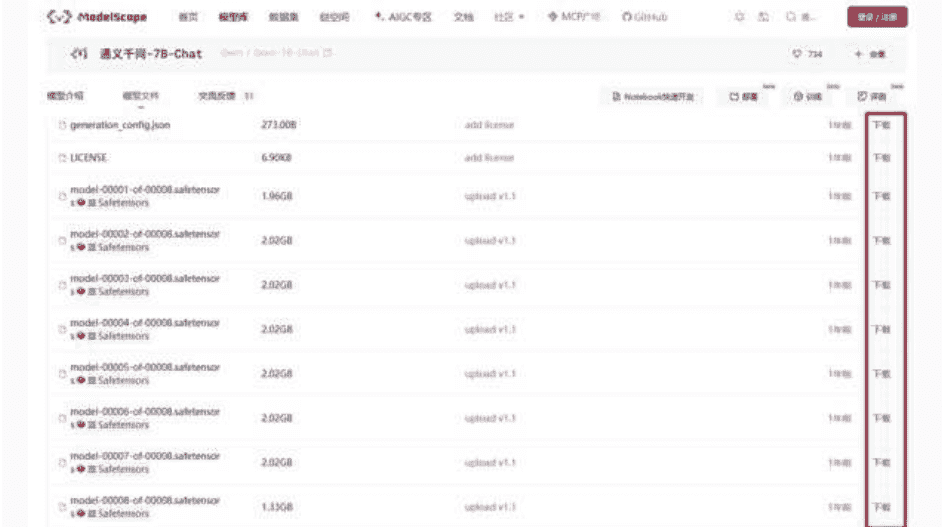

可看到权重文件后缀为.safetensors，根据表2.5，该格式属于安全张量，可被Transformers、vLLM、TGI等方案支持。

##### 4. 加载模型并进行本地推理测试

完成权重获取后，建议在本地先加载并执行一次简易推理，以确认模型能否正常导入、显存是否足够、生成是否正常以及所选框架是否兼容该格式。

1）标准权重FP16加载与推理验证

若使用.bin或.safetensors标准格式且具备GPU环境，可按下方方式完成加载与推理。

```
from transformers import AutoModelForCausalLM, AutoTokenizer
import torch

# 模型路径：可为 Hugging Face ID 或本地文件夹
model_path = "./checkpoints"  # 或 "deepseek-ai/deepseek-llm-7b-base"

tokenizer = AutoTokenizer.from_pretrained(model_path)
model = AutoModelForCausalLM.from_pretrained(
    model_path,
    torch_dtype=torch.float16,  # 推荐使用半精度加载以节省显存
    device_map="auto"  # 自动将模型映射到可用 GPU
)

prompt = "请简要介绍 Transformer 模型的基本结构。"
inputs = tokenizer(prompt, return_tensors="pt").to(model.device)
outputs = model.generate(**inputs, max_new_tokens=200)
print(tokenizer.decode(outputs[0], skip_special_tokens=True))
```

2）量化模型加载示例

若使用已量化的模型，例如bitsandbytes实现的4bit INT4模型，可采用以下方式加载。

```
from transformers import AutoModelForCausalLM, AutoTokenizer, BitsAndBytesConfig

bnb_config = BitsAndBytesConfig(load_in_4bit=True, bnb_4bit_compute_dtype=torch.float16)

tokenizer = AutoTokenizer.from_pretrained(model_path)
model = AutoModelForCausalLM.from_pretrained(
    model_path,
    quantization_config=bnb_config,
    device_map="auto"
)
```

INT4格式不支持torch_dtype参数，精度需通过quantization_config进行管理。

3）官方推理脚本

除自行调用Transformers库外，大多数开源项目在GitHub上会提供官方推理示例脚本，便于快速验证效果。

#### 2.3.3 GLM大模型本地部署指南

智谱推出的GLM-4系列在开源社区反响良好，中文理解与生成能力突出，且官方提供完整的本地部署文档，适合在私有环境中进行推理测试与服务化部署。以GLM-4-9B-Chat为例，下面演示从环境配置到本地部署的完整流程。

##### 1. 配置基础环境，创建虚拟环境

- 显卡建议：1张RTX 3090/4090，显存≥24GB；若采用INT4量化，显存需求可降至6GB~8GB。
- 操作系统：推荐Linux，如Ubuntu 20.04或Ubuntu 22.04。
- Python环境：建议用Conda新建虚拟环境，Python版本不低于3.9。创建虚拟环境的命令如下：

```
conda create -n glm4 python=3.10 -y
conda activate glm4
```

安装PyTorch与transformers的命令如下：

```
pip install torch torchvision torchaudio --index-url https://download.pytorch.org/whl/cu118
pip install transformers tiktoken
```

安装完成后，执行下方代码检查是否安装成功：

```
import torch
torch.cuda.is_available()
```

若输出与下文一致，则可正常使用。

```
True
```

##### 2. 从GitHub克隆开源项目

GLM-4在GitHub上的仓库结构见图2.5。


项目中inference子目录是本地部署与测试的核心，包含丰富的推理入口脚本。克隆仓库并进入目录的命令如下：

```
git clone https://github.com/THUDM/GLM-4.git
cd GLM-4
```

由图2.5可知，requirements.txt位于inference目录下。进入该目录后执行如下命令安装依赖：

```
cd inference
pip install -r requirements.txt
```

##### 3. 下载GLM-4模型权重

使用ModelScope下载前需先安装官方库。

```
!pip install modelscope
```

网页端可查看权重信息，见图2.6。

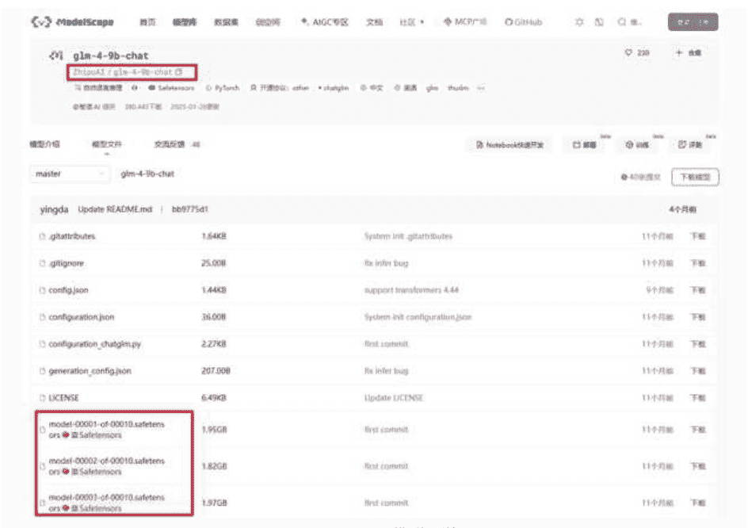

图2.6 glm-4-9b-chat模型权重情况

随后导入modelscope库，执行下面代码下载权重。

```
from modelscope import snapshot_download

#模型下载
model_dir = snapshot_download('ZhipuAI/glm-4-9b-chat')
```

下载完成后打印model_dir即可查看本地存储路径。

```
print (model_dir)
```

输出示例如下。

```
'/root/autodl-tmp/glm-4-9b-chat'
```

##### 4. 使用transformers后端进行推理

（1）单卡服务器下执行下方代码。

```
python
import torch
from modelscope import AutoModelForCausalLM, AutoTokenizer

#设置设备为 CUDA（GPU），以加速计算
device = "cuda"

#从预训练模型目录加载分词器，并信任远程代码
tokenizer = AutoTokenizer.from_pretrained(model_dir, trust_remote_code=True)

#定义用户的输入
query = "你好"

#使用聊天模板应用分词器，并生成输入张量
inputs = tokenizer.apply_chat_template(
    [{"role": "user", "content": query}],  # 用户角色和输入内容
    add_generation_prompt=True,              # 添加生成提示
    tokenize=True,                           # 执行分词
    return_tensors="pt",                     # 返回 PyTorch 张量
    return_dict=True                         # 返回字典形式
)

#将输入张量移动到指定设备（CUDA）
inputs = inputs.to(device)

#从预训练模型目录加载下载到本地的大模型，并信任远程代码
model = AutoModelForCausalLM.from_pretrained(
    model_dir,
    torch_dtype=torch.bfloat16,              # 使用 bfloat16 数据类型以减少内存使用
    trust_remote_code=True                   # 信任远程代码
).to(device).eval()                          # 将模型移动到 CUDA 设备并设置为评估模式

#定义生成文本的参数
gen_kwargs = {
    "max_length": 2500,                     # 生成文本的最大长度
    "do_sample": True,                      # 是否进行采样
    "top_k": 1                              # 采样时考虑的最高概率的 k 个标记
}

#在不计算梯度的上下文中生成文本
with torch.no_grad():
    #生成模型的输出
    outputs = model.generate(**inputs, **gen_kwargs)
    #截取生成的输出，去除输入的部分
    outputs = outputs[:, inputs['input_ids'].shape[1]:]
    #解码生成的输出并去除特殊标记
    print(tokenizer.decode(outputs[0], skip_special_tokens=True))
```

输出示例如下。

```
Special tokens have been added in the vocabulary, make sure the associated word embeddings are fine-tuned or trained.
Loading checkpoint shards:  0%|          | 0/10 [00:00<?, ?it/s]
你好👋！很高兴见到你，有什么可以帮助你的吗？
```

（2）使用官方封装的推理脚本。inference目录下提供可直接用于对话的脚本，执行下方命令可在终端与模型交互。

```
bash
python trans_cli_demo.py
```

执行下方命令可启动Gradio网页界面进行对话。

```
bash
python trans_web_demo.py
```

#### 2.3.4 Qwen大模型本地部署指南

2025年4月29日，阿里开源通义千问Qwen3，其中Qwen3-235B-A22B在代码、数学、通用能力等基准上，与DeepSeek-R1、o1、o3-mini、Grok-3、Gemini-2.5-Pro等顶级模型相比具备较强竞争力。本次同步开源了全尺寸稠密与MoE模型：0.6B、1.7B、4B、8B、14B、32B，以及30B-A3B、235B-A22B。

以下以Qwen3-14B为例，演示从环境配置到本地部署的完整流程。

##### 1. 配置基础环境，创建虚拟环境

- 显卡建议：1张RTX 3090 / 4090，显存≥24GB。
- 操作系统：推荐Linux，如Ubuntu 20.04或Ubuntu 22.04。
- Python环境：建议用Conda创建隔离环境，Python版本不低于3.9。

创建虚拟环境的命令如下：

```
conda create --n qwen3 python=3.11
conda activate qwen3
```

安装PyTorch与transformers库的命令如下：

```
pip install torch torchvision torchaudio --index-url https://download.pytorch.org/whl/cu118
pip install transformers tiktoken
```

执行下方代码确认是否安装成功：

```
import torch
torch.cuda.is_available()
```

若输出与下文一致，则可正常使用。

```
True
```

##### 2. 从GitHub克隆开源项目

Qwen3在GitHub上的项目结构见图2.7。

### 2.3 本地大模型部署及使用

本章围绕本地化部署的核心流程，系统介绍所需算力、环境依赖等要素，涵盖权重获取、推理验证等关键环节，并与主流第三方部署工具对比，为后续Agent开发提供运行基础。

#### 2.3.1 部署前需评估的关键需求

实际应用中，因数据安全、访问稳定、成本控制、模型可控等多方面考虑，越来越多开发者和企业选择将大模型部署在本地或私有云。本地部署可掌控推理过程，降低隐私数据泄露风险，减少长期接口费用，提升响应速度并支持离线运行。但同时也意味着更高的资源门槛和工程复杂度，动手前需对以下关键需求做全面评估。

##### 1. 算力资源

在各种本地部署条件中，计算资源尤其是GPU，是能否成功运行大语言模型的决定性因素。轻量场景可尝试CPU模拟推理，但速度和效率远不如GPU，对中大型模型基本不可行。因此需先具备相应规模的GPU硬件。

> **说明**
>
> 为何不能只依赖CPU？
>
> 大语言模型推理涉及十亿级参数的矩阵运算，Transformer架构中包含大量矩阵乘法、归一化、注意力计算等高强度并行任务。GPU在并行数值计算上优势明显，而CPU更擅长逻辑控制与串行任务。同等条件下，CPU推理速度可能只有GPU的1/100至1/10。

表2.2列出了不同参数规模在推理时的显存需求。

**表2.2 不同模型参数规模对应的显存需求**

| 模型规模 | 推理时显存需求（FP16） | 支持的典型GPU（单卡） |
| :--- | :--- | :--- |
| 7B | 14GB～16GB | RTX 3090 / 4090 / A500 |
| 13B | 26GB～30GB | RTX 4090（24GB）基本可运行 |
| 33B | 60GB～80GB | 多卡 A100 或 2×4090 并行 |

采用量化技术如INT4、INT8、GPTQ等，推理所需显存通常可减少1/4～1/2。以7B模型为例，FP16需14GB～16GB显存，INT4后只需4GB～6GB，可在单张RTX3060/4060甚至笔记本显卡上运行。

当前大模型训练与推理绝大多数基于NVIDIA GPU，得益于成熟的CUDA+cuDNN+PyTorch生态。主流GPU型号如表2.3所示。

| 类型 | 常见型号 | 适用说明 |
| :--- | :--- | :--- |
| 数据中心级 | A100, H100, A800, L40S | 高稳定性、高带宽，适合集群部署 |
| 消费级高端 | RTX 3090, 4090, 4080 | 适合个人开发与小模型推理 |
| 云租用平台 GPU | Tesla V100, T4 | 支持量化模型，成本可控 |

若本地无GPU，可租用云平台算力。AutoDL、阿里云PAI、百度飞桨Studio、Google Colab等均提供在线GPU租赁服务。

##### 2. 系统与软件栈依赖

硬件充足后，还需配置操作系统与软件依赖栈。以下是部署主流PyTorch/Hugging Face风格模型所需的通用环境说明。

1) 操作系统

建议优先使用Ubuntu，其稳定且兼容CUDA，完整支持NVIDIA工具链。虽然CentOS和Windows搭配WSL2也能运行部分模型，但不推荐用于正式生产环境，存在兼容风险。

2) 软件依赖环境（PyTorch栈）

系统运行所需的软件依赖环境及安装说明如表2.4所示。

| 组件 | 推荐版本 | 安装说明 |
| :--- | :--- | :--- |
| Python | ≥ 3.9 | 建议使用 Conda 虚拟环境隔离 |
| PyTorch | ≥ 2.0 | 需安装 GPU 版本（pip/conda 安装） |

本地大模型部署实战攻略

依赖清单概览
| CUDA | 11.8 / 12.1 | 需同 PyTorch 发布包的版本一致 |
| cuDNN | 对应 CUDA 版本 | 可在 NVIDIA 官网获取或随驱动自带 |
| Transformers | ≥ 4.35 | HF 提供的核心推理组件 |

##### 3. 模型格式选型要点
在部署前先确认目标模型是否对外开放权重、支持哪些文件后缀、是否提供量化版本。常用格式汇总如下。

**表2.5 主流模型格式**

| 格式类型 | 常见后缀 | 说明 | 适用部署框架 |
| :--- | :--- | :--- | :--- |
| 原始 PyTorch 格式 | .bin | Transformer 生态默认的文件类型，体积较大，显存消耗也较高 | Transformers, vLLM, TGI |
| 安全张量格式 | .safetensors | 强调安全性，加载速度更快，支持并发读取的张量存储方式 | Transformers, vLLM, TGI |
| 量化格式-INT4 | .bin, .pt (压缩) | 多经 GPTQ、AWQ 等量化工具压缩后发布 | AutoAWQ, GPTQ-for-LLaMA, vLLM |
| 量化格式-GGUF | .gguf | llama.cpp 与 Ollama 共同采用的统一格式，可在 CPU 与 GPU 上运行 | llama.cpp, Ollama, KoboldCpp |

确定模型时要看是否开源、在 HF 或 GitHub 可查、是否提供 INT4/INT8/GGUF 等版本，以及是否有官方或社区推荐的推理脚本或 Docker 镜像文件。

#### 2.3.2 本地大模型通用部署流程
多数开源项目在 GitHub 托管代码、示例推理脚本与部署工具链，形成一套可复用的本地化实践。以 Transformers 为主线的流程如下。

##### 1. 搭建基础环境并创建隔离环境
借助 Conda 新建独立的 Python 环境，实现依赖隔离与版本可控。

```
conda create -n llm-deploy python=3.10 -y
conda activate llm-deploy
```

-n 后填入自定义环境名，创建时要同时指定 Python 版本。

随后按 CUDA 版本选用 GPU 版 PyTorch 安装基础依赖。

```
pip install torch torchvision torchaudio --index-url https://download.pytorch.org/whl/cu118
```

##### 2. clone 开源工程代码
大部分项目在 GitHub 提供推理样例、权重加载代码、API 服务代码及 requirements.txt，直接克隆即可获取。

```
git clone https://github.com/deepseek-ai/DeepSeek-LLM.git
```

亦可网页下载 zip 包解压后使用。拿到工程后，执行下方指令进入目录并批量安装依赖。

```
cd DeepSeek-LLM
pip install -r requirements.txt
```

> 提示
>
> 模型的 GitHub 仓库并非调用的必要条件。
>
> 对于在 HF 上发布的模型，可直接通过 Transformers 接口加载权重完成本地推理，无需克隆官方仓库。通常克隆仓库的目的是获取以下补充资源：
>
> - 推荐的依赖版本，如 requirements.txt。
> - 官方测试脚本或推理样例。
> - API 服务部署方式，如 FastAPI、Gradio。
> - Docker 镜像与部署指令。
> - 与模型结构强相关的工程化调用逻辑，如多模态组件、定制 tokenizer。
>
> 若已熟悉 HF 的调用方式并能自行配置环境，也可以不依赖 GitHub 项目，仅下载权重与 tokenizer 即可完成部署。这种方式更轻量灵活，适合有经验的开发者快速集成到现有系统。

##### 3. 获取模型权重
权重通常托管在 HF 或魔搭 ModelScope，可自动加载也可手动预下。

(1) 借助 HF Transformers 自动下载并加载。

```
from transformers import AutoTokenizer, AutoModelForCausalLM

model_id = "deepseek-ai/deepseek-llm-7b-base"
tokenizer = AutoTokenizer.from_pretrained(model_id)
model = AutoModelForCausalLM.from_pretrained(model_id, torch_dtype="auto").cuda()
```

首次运行时模型会自动缓存到本地，通常为 ~/.cache/huggingface，后续直接读取缓存。

(2) 使用 ModelScope 官方工具包自动加载。先安装工具包。

```
pip install modelscope
```

随后运行加载代码。

```
from modelscope import AutoTokenizer, AutoModelForCausalLM

model_id = "Qwen/Qwen-7B-Chat"
model = AutoModelForCausalLM.from_pretrained(model_id, revision='v1.0.0')
tokenizer = AutoTokenizer.from_pretrained(model_id, revision='v1.0.0')
```

具体模型标识可在官网页面查询，如图2.3所示。

（3）手动从网页下载后离线使用。在 HF 与 ModelScope 模型页切到文件列表页，点击右侧下载保存全部文件，如图2.4所示。保存到本地目录后，在脚本中将 pretrained_model_name_or_path 设为 "./your_model_dir" 即可。

此处权重后缀为 .safetensors，参照表2.5，属于安全张量格式，兼容 Transformers、vLLM、TGI。

Qwen3 基于 Transformers，GitHub 目录里通常不列 requirements.txt，默认沿用 HF 的依赖，一般只需执行：

```
bash
pip install torch transformers accelerate sentencepiece

# 用于 INT4 模型量化推理
pip install bitsandbytes
```

##### 3. Qwen3 权重下载示例
使用 modelscope 下载前先安装库。

```
bash
!pip install modelscope
```

可在网页先查看权重情况，如图2.8所示。

图2.8 Qwen3-14B模型权重情况

导入 modelscope 后运行下载命令。

```
bash
cd /root/autodl-tmp/Qwen3
mkdir ./Qwen3-14B
modelscope download --model Qwen/Qwen3-14B --local_dir ./Qwen3-14B
```

##### 4. Jupyter 下使用原生库调用流程
(1) 导入相关库。

```
python
from modelscope import AutoModelForCausalLM, AutoTokenizer
```

(2) 设置模型下载地址。

```
python
model_name = "./Qwen3-14B"
```

(3) 实例化预训练模型与分词器。

```
python
tokenizer = AutoTokenizer.from_pretrained(model_name)
model = AutoModelForCausalLM.from_pretrained(
    model_name,
    torch_dtype="auto",  # 指定模型权重数据类型
    device_map="auto"  # 指定模型权重加载设备
)
```

(4) 创建消息 message。

```
python
prompt = "给出一个关于大语言模型的简短介绍。"
messages = [
    {"role": "user", "content": prompt}
]
```

(5) 创建词嵌入过程。

```
python
text = tokenizer.apply_chat_template(
    messages,
    tokenize=False,
    add_generation_prompt=True,
    enable_thinking=True  # 是否启用思考模式
)
model_inputs = tokenizer([text], return_tensors="pt").to(model.device)
```

（6）创建模型并给出大模型回复。

```
python
# 进行文本补全
generated_ids = model.generate(
    **model_inputs,
    max_new_tokens=32768
)
output_ids = generated_ids[0][len(model_inputs.input_ids[0]):].tolist()

# 结果将首先显示思考内容标签中，然后是实际响应
print(tokenizer.decode(output_ids, skip_special_tokens=True))
```

输出内容如图2.9所示。

enable_thinking 参数用于开关思考模式，关闭时把 True 改为 False 即可。

#### 2.3.5 常用第三方部署方案
除直接用 Transformers 加载权重外，还可选择工程化程度更高的第三方工具，在加载优化、推理加速、服务化、多模型托管等方面优势明显，适合企业级或产品级场景。

##### 1. SGLang — 面向 GLM 系列的推理服务框架
SGLang 由智谱 AI 开源，专为 GLM 系列模型优化，原生支持对话模板、多轮历史缓存、函数调用、结构化输出等。

核心特点：
- 与 GLM 结构高度适配，支持 multi-turn memory。
- 支持并发调度与动态上下文构建。
- 内置兼容 OpenAI 风格的 API 接口。
- 可结合 fastapi/uvicorn 快速部署服务。

##### 2. LMDeploy — 国产大模型轻量化部署方案
LMDeploy 由昆仑芯与魔搭社区联合开发，为国产开源大模型提供统一简洁的高性能部署方案，支持 INT4/INT8/FP16 等多精度推理，并集成一键脚本、服务启动、QPS 压测等功能。

核心特点：
- 适配 Qwen、Baichuan、InternLM 等众多国产模型。
- 原生支持 INT4 推理，显存占用低。
- 提供 CLI、Web UI、HTTP API。
- 支持多线程调度与批量推理。

##### 3. vLLM — 高吞吐且兼容 OpenAI 的推理引擎
vLLM 由 UC Berkeley 发布的高性能推理引擎，支持动态批量调度、连续批处理、FlashAttention 2，并实现完全兼容 OpenAI API 协议的服务接口。

核心特点：
- 支持 Hugging Face 格式模型如 LLaMA、Qwen、Baichuan。
- 实现高吞吐推理，可达数千 token/s。
- 支持流式输出。
- 原生兼容 chat/completions 接口格式。

##### 4. Ollama — 开发者友好的本地一键部署工具
Ollama 面向开发者，支持下载、管理和运行 GGUF 格式大模型，如 LLaMA 2/3、Mistral、Qwen、Phi 等，目标是让本地部署像用 Docker 一样简单。

核心特点：
- 自动下载、注册模型，无需显式管理权重。
- 支持 Mac/Windows/Linux。
- 内置 HTTP API 与 CLI，调用迅速。
- 支持 CPU 和 GPU，支持流式输出。
- 与 llama.cpp 体系一致，兼容 GGUF 格式。

以上工具覆盖了不同模型结构、硬件资源和应用场景的需求，读者可据此了解特性与使用方式。

##### 4. 本地加载与推理验证
权重下载完成后，在本地加载并做一次简单推理验证，可确认模型是否成功加载、显存是否足够、生成是否正常、框架是否兼容格式。

1）FP16 标准权重加载与测试
若模型为 .bin 或 .safetensors 标准权重且有 GPU，可这样加载推理。

```python
from transformers import AutoModelForCausalLM, AutoTokenizer
import torch

# 模型路径：可为 Hugging Face ID 或本地文件夹
model_path = "./checkpoints"  # 或 "deepseek-ai/deepseek-llm-7b-base"

tokenizer = AutoTokenizer.from_pretrained(model_path)
model = AutoModelForCausalLM.from_pretrained(
    model_path,
    torch_dtype=torch.float16,  # 推荐使用半精度加载以节省显存
    device_map="auto"  # 自动将模型映射到可用 GPU
)

prompt = "请简要介绍 Transformer 模型的基本结构。"
inputs = tokenizer(prompt, return_tensors="pt").to(model.device)
outputs = model.generate(**inputs, max_new_tokens=200)
print(tokenizer.decode(outputs[0], skip_special_tokens=True))
```

2）量化权重加载示例 如 INT4
使用量化模型如 bitsandbytes 格式的 4bit INT4 时，可采用以下方式。

```python
from transformers import AutoModelForCausalLM, AutoTokenizer, BitsAndBytesConfig

bnb_config = BitsAndBytesConfig(load_in_4bit=True, bnb_4bit_compute_dtype=torch.float16)

tokenizer = AutoTokenizer.from_pretrained(model_path)
model = AutoModelForCausalLM.from_pretrained(
    model_path,
    quantization_config=bnb_config,
    device_map="auto"
)
```

INT4 权重不适用 torch_dtype，需借助 quantization_config 指定精度。

3）官方示例脚本
除了自行用 Transformers 加载，多数开源大模型在 GitHub 项目中也会提供官方推理示例，帮助用户快速验证效果。

#### 2.3.3 GLM 系列本地部署示例
智谱 AI 推出的 GLM-4 系列在开源社区表现突出，中文理解生成能力强，且官方提供完整本地部署文档。以 GLM-4-9B-Chat 为例演示从环境到部署的流程。

##### 1. 环境准备与虚拟环境搭建
- 显卡建议：1 张 RTX 3090/4090，显存不少于 24GB；采用 INT4 量化后显存可降至 6~8GB。
- 操作系统：推荐 Linux，如 Ubuntu 20.04 或 Ubuntu 22.04。
- Python 环境：建议用 Conda 建虚拟环境，Python 不低于 3.9。创建命令如下。

```bash
conda create -n glm4 python=3.10 -y
conda activate glm4
```

安装必要的 torch 与 transformers。

```bash
pip install torch torchvision torchaudio --index-url https://download.pytorch.org/whl/cu118
pip install transformers tiktoken
```

安装完成后可运行代码确认是否安装成功。

```python
import torch
torch.cuda.is_available()
```

控制台回显与样例一致时，环境搭建已通过验证。

```
True
```

##### 2. 拉取 GLM-4 开源仓库

先打开 GitHub 上 GLM-4 的仓库，目录概览参见图 2.5。


inference 文件夹收纳了本地验证所用的关键入口与多份启动脚本。克隆完成后进入仓库根目录。

```bash
git clone https://github.com/THUDM/GLM-4.git
cd GLM-4
```

依据图 2.5，requirements.txt 置于 inference 下。切入该目录执行安装指令，完成依赖部署。

```bash
cd inference
pip install -r requirements.txt
```

##### 3. 获取 GLM-4 权重

借助 ModelScope 抓取资源前，先安装官方客户端。

```bash
pip install modelscope
```

权重详情可在网页端查看，详见图 2.6。


图2.6 glm-4-9b-chat模型权重情况

随后引入 modelscope 库，运行下载代码即可拿到参数。

```python
from modelscope import snapshot_download

#模型下载
model_dir = snapshot_download('ZhipuAI/glm-4-9b-chat')
```

下载完毕后打印 model_dir，便能知晓本地保存位置。

```python
print(model_dir)
```

输出样例见下。

```
'/root/autodl-tmp/glm-4-9b-chat'
```

##### 4. 基于 Transformers 的推理实践

（1）单卡环境下运行下方推理代码。

```python
import torch
from modelscope import AutoModelForCausalLM, AutoTokenizer

#设置设备为 CUDA（GPU），以加速计算
device = "cuda"

#从预训练模型目录加载分词器，并信任远程代码
tokenizer = AutoTokenizer.from_pretrained(model_dir, trust_remote_code=True)

#定义用户的输入
query = "你好"

#使用聊天模板应用分词器，并生成输入张量
inputs = tokenizer.apply_chat_template(
    [{"role": "user", "content": query}],  # 用户角色和输入内容
    add_generation_prompt=True,              # 添加生成提示
    tokenize=True,                           # 执行分词
    return_tensors="pt",                     # 返回 PyTorch 张量
    return_dict=True                         # 返回字典形式
)

#将输入张量移动到指定设备（CUDA）
inputs = inputs.to(device)

#从预训练模型目录加载下载到本地的大模型，并信任远程代码
model = AutoModelForCausalLM.from_pretrained(
    model_dir,
    torch_dtype=torch.bfloat16,              # 使用 bfloat16 数据类型以减少内存使用
    trust_remote_code=True                   # 信任远程代码
).to(device).eval()                          # 将模型移动到 CUDA 设备并设置为评估模式

#定义生成文本的参数
gen_kwargs = {
    "max_length": 2500,                     # 生成文本的最大长度
    "do_sample": True,                      # 是否进行采样
    "top_k": 1                              # 采样时考虑的最高概率的 k 个标记
}

#在不计算梯度的上下文中生成文本
with torch.no_grad():
    #生成模型的输出
    outputs = model.generate(**inputs, **gen_kwargs)
    #截取生成的输出，去除输入的部分
    outputs = outputs[:, inputs['input_ids'].shape[1]:]
    #解码生成的输出并去除特殊标记
    print(tokenizer.decode(outputs[0], skip_special_tokens=True))
```

输出样例如下。

```
Special tokens have been added in the vocabulary, make sure the associated word embeddings are fine-tuned or trained.
Loading checkpoint shards:  0%|          | 0/10 [00:00<?, ?it/s]
你好👋！很高兴见到你，有什么可以帮助你的吗？
```

（2）使用官方封装的脚本。inference 目录中已有可直接对话的脚本，参考图 2.6。运行对应指令即可在终端与系统交互。

```bash
python trans_cli_demo.py
```

如需浏览器对话，运行下方命令启动 Gradio 界面。

```bash
python trans_web_demo.py
```

#### 2.3.4 Qwen3 本地部署实操

2025 年 4 月 29 日，阿里通义千问对外公布 Qwen3 开源系列，其中 Qwen3-235B-A22B 在代码、数学、综合能力等基准上，与 DeepSeek-R1、o1、o3-mini、Grok-3、Gemini-2.5-Pro 等领先系统表现相当。本次一并开源了全尺寸密集模型与 MoE 结构：0.6B、1.7B、4B、8B、14B、32B，以及 30B-A3B、235B-A22B。

下面以 Qwen3-14B 为例，展示从环境准备到本地运行的完整路径。

##### 1. 搭建基础环境并新建隔离环境

- GPU 建议：1 张 RTX 3090 / 4090，显存不低于 24GB。
- 系统偏好：优先 Linux，如 Ubuntu 20.04 或 22.04。
- Python：推荐用 Conda 新建隔离环境，Python 版本不低于 3.9。

执行下面命令创建环境。

```bash
conda create --n qwen3 python=3.11
conda activate qwen3
```

执行下面命令部署 PyTorch 与 Transformers。

```bash
pip install torch torchvision torchaudio --index-url https://download.pytorch.org/whl/cu118
pip install transformers tiktoken
```

执行下面命令核查两个库是否就绪。

```python
import torch
torch.cuda.is_available()
```

若输出与下方一致，则表示安装正常。

```
True
```

##### 2. 获取 Qwen3 开源代码

打开 Qwen3 的 GitHub 仓库，目录结构见图 2.7。

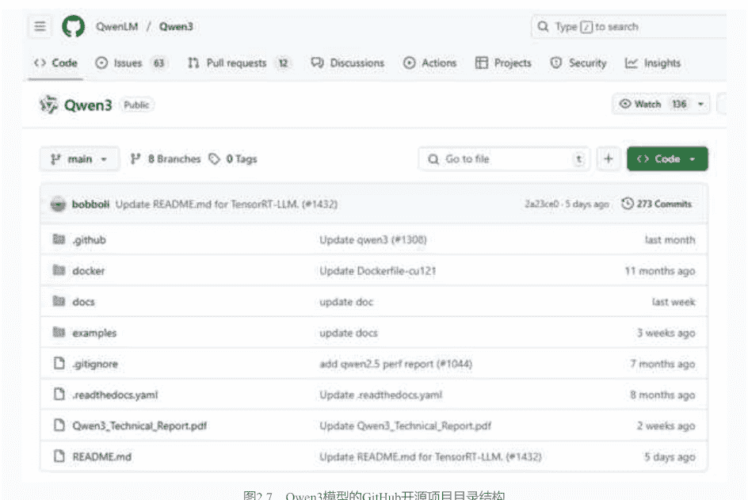

Qwen3 完全基于 Transformers 实现，仓库中未单独列出 requirements.txt，默认沿用 Hugging Face 依赖体系，因此通常只需执行如下安装命令。

```bash
pip install torch transformers accelerate sentencepiece

# 用于 INT4 模型量化推理
pip install bitsandbytes
```

##### 3. 获取 Qwen3 权重

使用 ModelScope 下载前先安装客户端。

```bash
pip install modelscope
```

可在 Web 端先查看权重详情，示意见图 2.8。


图2.8 Qwen3-14B模型权重情况

随后导入 modelscope，运行下载命令即可获取权重。

```bash
cd /root/autodl-tmp/Qwen3
mkdir ./Qwen3-14B
modelscope download --model Qwen/Qwen3-14B --local_dir ./Qwen3-14B
```

##### 4. Jupyter 中使用原生 Transformers 调用流程

(1) 导入依赖库。

```python
from modelscope import AutoModelForCausalLM, AutoTokenizer
```

(2) 指定模型地址。

```python
model_name = "./Qwen3-14B"
```

(3) 初始化预训练模型与分词器。

```python
tokenizer = AutoTokenizer.from_pretrained(model_name)
model = AutoModelForCausalLM.from_pretrained(
    model_name,
    torch_dtype="auto",  # 指定模型权重数据类型
    device_map="auto"  # 指定模型权重加载设备
)
```

(4) 构建对话消息 message。

```python
prompt = "给出一个关于大语言模型的简短介绍。"
messages = [
    {"role": "user", "content": prompt}
]
```

(5) 生成词嵌入。

```python
text = tokenizer.apply_chat_template(
    messages,
    tokenize=False,
    add_generation_prompt=True,
    enable_thinking=True  # 是否启用思考模式
)
model_inputs = tokenizer([text], return_tensors="pt").to(model.device)
```

（6）驱动模型生成回复。

```python
# 进行文本补全
generated_ids = model.generate(
    **model_inputs
)
```

SGLang 的主要特性如下。

- 与 GLM 模型结构高度适配，支持多轮记忆。
- 支持并发调度与动态上下文构建。
- 内置近似 OpenAI 风格的 API 接口。
- 可配合 FastAPI / Uvicorn 实现快速服务化。

##### 2. LMDeploy：国产模型轻量部署方案

LMDeploy 由昆仑芯与魔搭社区联合打造，目标为国产开源大模型提供统一、简洁、高效的推理部署框架。支持 INT4/INT8/FP16 等多种精度，并集成一键式脚本、服务启动、QPS 压测等功能。

LMDeploy 主要特性如下。

- 适配 Qwen、Baichuan、InternLM 等众多国产模型。
- 原生适配 INT4 推理，降低显存需求。
- 提供 CLI、Web UI、HTTP API。
- 支持多线程调度与批量推理。

##### 3. vLLM：高并发、OpenAI 兼容的服务部署利器

vLLM 由 UC Berkeley 发布的高性能推理引擎，支持动态批量调度、连续批处理、FlashAttention 2，并实现了完全对接 OpenAI API 协议的服务接口。

vLLM 主要特性如下。

- 支持 Hugging Face 格式模型，如 LLaMA、Qwen、Baichuan 等。
- 具备高吞吐推理能力，可达数千 token/秒。
- 支持流式输出。
- 原生兼容 chat/completions 接口规范。

##### 4. Ollama：开发者友好的一键本地部署平台

Ollama 是一个面向开发者的轻量部署工具，支持下载、管理和运行 GGUF 格式的大模型，如 LLaMA 2/3、Mistral、Qwen、Phi 等，目标是让本地部署操作便捷度接近 Docker。

Ollama 主要特性如下。

- 自动下载并注册模型，无需手动管理权重。
- 支持 macOS、Windows、Linux。

### 2.3 本地大模型运行与使用

本部分围绕本地运行全流程，系统介绍算力、环境依赖、模型获取与推理验证等关键环节，并对比主流第三方部署工具，为后续 Agent 搭建提供运行基础。

#### 2.3.1 私有化部署需求总览

在实际应用中，因数据安全、服务稳定性、成本控制、模型可控性等多重因素，越来越多开发者和企业倾向于将大模型部署在本地或私有云。本地运行可掌控推理全过程，降低敏感数据泄露风险，减少长期接口费用，提升响应速度并支持离线运行。但与此同时，资源门槛与工程复杂度同步提升，部署前需对以下关键需求进行全面评估。

##### 1. 算力资源

在所有部署条件中，GPU 算力是能否成功运行大语言模型的决定性因素。极轻量场景下可用 CPU 模拟推理，但速度与效率远不及 GPU，对中大型模型基本不可行。因此，部署大模型必须具备相应规模的 GPU 硬件。

> **说明**
>
> 为何不能只用 CPU？
>
> 大语言模型推理涉及十亿级参数的矩阵计算，Transformer 层内包含大量矩阵乘法、归一化、注意力计算等高强度并行任务。GPU 在并行数值计算上优势明显，CPU 更擅长逻辑控制与串行任务。相同条件下，CPU 推理速度可能仅为 GPU 的 1/100 至 1/10。

不同参数规模在推理时的显存需求见表 2.2。

**表2.2 不同模型参数规模对应的显存需求**

| 模型规模 | 推理时显存需求（FP16） | 支持的典型GPU（单卡） |
| :--- | :--- | :--- |
| 7B | 14GB～16GB | RTX 3090 / 4090 / A500 |
| 13B | 26GB～30GB | RTX 4090（24GB）基本可运行 |
| 33B | 60GB～80GB | 多卡 A100 或 2×4090 并行 |

采用量化技术如 INT4、INT8、GPTQ 等，可将显存需求压缩约 1/4～1/2。以 7B 模型为例，FP16 约需 14GB～16GB，INT4 量化后仅需 4GB～6GB，可在 RTX 3060/4060 甚至笔记本 GPU 上运行。

当前主流训练与推理基本依赖 NVIDIA GPU，因其 CUDA + cuDNN + PyTorch 生态成熟。常见型号见表 2.3。

| 类型 | 常见型号 | 适用说明 |
| :--- | :--- | :--- |
| 数据中心级 | A100, H100, A800, L40S | 高稳定性、高带宽，适合集群部署 |
| 消费级高端 | RTX 3090, 4090, 4080 | 适合个人开发与小模型推理 |
| 云租用平台 GPU | Tesla V100, T4 | 支持量化模型，成本可控 |

若本地无 GPU，可租用云端算力。AutoDL、阿里云 PAI、百度飞桨 Studio、Google Colab 等均提供在线 GPU 租赁。

##### 2. 操作系统与环境依赖

硬件到位后，还需搭建操作系统与软件栈。部署 PyTorch/Hugging Face 风格模型通用环境如下。

1) 操作系统

推荐使用 Ubuntu，其对 CUDA 支持完善且稳定。CentOS 或 Windows + WSL2 也能运行部分模型，但不建议用于生产环境，兼容性风险较高。

2) 软件依赖环境（PyTorch 栈）

所需组件及推荐版本见表 2.4。

| 组件 | 推荐版本 | 安装说明 |
| :--- | :--- | :--- |
| Python | ≥ 3.9 | 建议使用 Conda 隔离环境 |
| PyTorch | ≥ 2.0 | 需安装 GPU 版本 |
| CUDA | 11.8 / 12.1 | 与 PyTorch 安装包匹配 |
| cuDNN | 对应 CUDA 版本 | NVIDIA 官方网站或驱动自带 |
| Transformers | ≥ 4.35 | Hugging Face 核心推理库 |

##### 3. 模型格式支持

部署前需确认目标模型是否提供开放权重、支持的格式及是否存在量化版。主流格式汇总见表 2.5。

**表2.5 主流模型格式**

| 格式类型 | 常见后缀 | 说明 | 适用部署框架 |

| :--- | :--- | :--- | :--- |

| 原始 PyTorch 格式 | .bin | Transformers 默认格式，文件较大，占用显存高 | Transformers/vLLM/TGI |

| 安全张量格式 | .safetensors | 安全、加载更快、支持并发加载的张量格式 | Transformers/vLLM/TGI |

| 量化格式-INT4 | .bin, .pt (压缩) | 通常通过 GPTQ/AWQ 等量化工具压缩后发布 | AutoAWQ/GPTQ-for-LLaMA/vLLM |

| 量化格式-GGUF | .gguf | llama.cpp/Ollama 使用的统一格式，支持 CPU/GPU 部署 | llama.cpp/Ollama/KoboldCpp |

选定模型后建议先梳理其来源与可用形态。关键点在于确认模型是否以开源形式发布、在 Hugging Face 或 GitHub 是否可查到对应仓库、是否提供 INT4/INT8/GGUF 等压缩版本、以及官方或社区是否给出配套脚本或容器镜像。

### 2.3 本地部署总体框架
本部分围绕自托管的完整链路，梳理算力、运行环境、模型获取、验证等环节，并与主流第三方工具做对比，为后续 Agent 的工程化提供基础支撑。

#### 2.3.1 部署前的资源评估
实际项目中，因隐私保护、服务连续性、费用控制及对模型行为的可控需求，越来越多团队倾向于把模型放在自有主机或私有云上。自管模式能够掌控推理过程、降低敏感数据外泄风险、减少长期调用成本、提升响应速度并支持离线使用。但门槛更高、工程更复杂，动手前需对以下诉求做系统化评估。

##### 1. 计算资源
在自托管条件里，计算能力尤其是 GPU 决定了模型能否顺利运行。极轻量演示可尝试 CPU 推理，但效率远逊于 GPU，对中大型模型基本不可用。上线前必须准备匹配规模的显卡。

> 说明
>
> 为何不建议仅靠 CPU？
>
> 大规模语言模型的推理涉及亿级参数的矩阵计算，Transformer 内部包含大量矩阵乘法、归一化、注意力等高并发运算。GPU 在并行数值计算上优势明显，CPU 更擅长逻辑控制与串行任务。在同等配置下，CPU 的推理速度可能仅为 GPU 的 1/100 至 1/10。

推理场景下不同参数规模对应的显存需求如表2.2所示。

**表2.2 不同模型参数规模对应的显存需求**

| 模型规模 | 推理时显存需求（FP16） | 支持的典型GPU（单卡） |
| :--- | :--- | :--- |
| 7B | 14GB～16GB | RTX 3090 / 4090 / A500 |
| 13B | 26GB～30GB | RTX 4090（24GB）基本可运行 |
| 33B | 60GB～80GB | 多卡 A100 或 2×4090 并行 |

若采用 INT4、INT8、GPTQ 等量化技术，显存通常可降至原先的 1/4～1/2。以 7B 为例，原生 FP16 需要 14GB～16GB，INT4 后仅需 4GB～6GB，可在单张 RTX3060/4060 甚至笔记本显卡上运行。

当前训练与推理基本都基于 NVIDIA GPU，得益于 CUDA+cuDNN+PyTorch 的成熟生态。主流型号如表2.3所示。

| 类型 | 常见型号 | 适用说明 |
| :--- | :--- | :--- |
| 数据中心级 | A100, H100, A800, L40S | 高稳定性、高带宽，适合集群部署 |
| 消费级高端 | RTX 3090, 4090, 4080 | 适合个人开发与中小模型推理 |
| 云租用平台 GPU | Tesla V100, T4 | 支持量化模型，成本可控 |

若本地无显卡，可租用云平台算力。AutoDL、阿里云 PAI、百度飞桨 Studio、Google Colab 均提供在线 GPU 租赁。

##### 2. 操作系统与软件栈
硬件满足后，还需搭建系统与依赖环境。以下是部署主流 PyTorch/Hugging Face 生态模型所需的通用说明。

1) 操作系统
建议优先选用 Ubuntu，其稳定且兼容 CUDA，是主流 Linux 发行版，能完整支持 NVIDIA 工具链。CentOS 与 Windows+WSL2 虽可运行部分模型，但不推荐用于生产环境，存在兼容风险。

2) 软件依赖环境（PyTorch 栈）
系统运行所需的软件依赖环境及安装说明如表2.4所示。

| 组件 | 推荐版本 | 安装说明 |
| :--- | :--- | :--- |
| Python | ≥ 3.9 | 建议使用 Conda 虚拟环境隔离 |
| PyTorch | ≥ 2.0 | 需安装 GPU 版本（pip/conda 安装） |
| CUDA | 11.8 / 12.1 | 与 PyTorch 安装包版本匹配 |
| cuDNN | 对应 CUDA 版本 | NVIDIA 官网下载安装或驱动自带 |
| Transformers | ≥ 4.35 | Hugging Face 的核心推理库 |

#### 2.3.2 通用部署实施流程
多数开源项目会在 GitHub 公开源码、推理样例与部署工具链，本地化实践因此形成一套可复用的路径。下面以 Transformers 生态的主流模型为基准进行梳理。

##### 1. 搭建隔离环境
借助 Conda 新建独立 Python 运行时，可实现依赖隔离与版本锁定。

```
conda create -n llm-deploy python=3.10 -y
conda activate llm-deploy
```

-n 后填写自定义环境名，同时需指定 Python 版本号。

随后安装核心依赖，以 PyTorch 为例，需按 CUDA 版本选择 GPU 构建。

```
pip install torch torchvision torchaudio --index-url https://download.pytorch.org/whl/cu118
```

##### 2. 拉取项目源码
大部分开源模型在 GitHub 提供示例推理、权重加载、API 服务代码及 requirements.txt。执行如下命令即可克隆。

```
git clone https://github.com/deepseek-ai/DeepSeek-LLM.git
```

也可网页下载 zip 解压后使用。进入项目目录后，一键安装依赖。

```
cd DeepSeek-LLM
pip install -r requirements.txt
```

> 说明
>
> GitHub 仓库并非调用模型的强制前提。
>
> Hugging Face 发布的权重可直接通过 Transformers 接口加载完成推理，无需克隆官方代码。通常拉取仓库是为了获取以下补充资源。
>
> - 推荐的依赖版本如 requirements.txt。
> - 官方测试脚本或推理示例。
> - FastAPI、Gradio 等服务化方案。
> - Docker 镜像与启动指令。
> - 与模型结构强相关的工程化逻辑，如多模态组件、定制 tokenizer。
>
> 若已熟悉 Hugging Face 调用方式并能自行配置环境，可仅下载权重与 tokenizer 完成部署，模式更轻量，适合经验开发者快速集成到已有系统。

##### 3. 获取模型文件
权重多托管于 Hugging Face 或魔搭 ModelScope，可让 Transformers 自动拉取，也可预先手工下载。

(1) Hugging Face Transformers 自动下载并加载。

```
from transformers import AutoTokenizer, AutoModelForCausalLM

model_id = "deepseek-ai/deepseek-llm-7b-base"
tokenizer = AutoTokenizer.from_pretrained(model_id)
model = AutoModelForCausalLM.from_pretrained(model_id, torch_dtype="auto").cuda()
```

首次使用时会把文件缓存至 ~/.cache/huggingface，后续直接读取缓存。

(2) ModelScope 官方工具包自动加载。先安装工具包。

```
pip install modelscope
```

随后即可加载指定模型。

```
from modelscope import AutoTokenizer, AutoModelForCausalLM

model_id = "Qwen/Qwen-7B-Chat"
model = AutoModelForCausalLM.from_pretrained(model_id, revision='v1.0.0')
tokenizer = AutoTokenizer.from_pretrained(model_id, revision='v1.0.0')
```

具体模型标识可在官网查询，如图2.3所示。

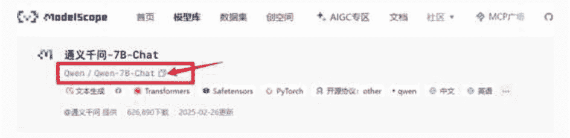

(3) 网页手工下载离线使用。在 Hugging Face 与 ModelScope 的模型页切换至 Files and versions 或文件标签，点右侧下载保存全部文件，如图2.4。本地存放后，在脚本中指定 pretrained_model_name_or_path="./your_model_dir" 即可。

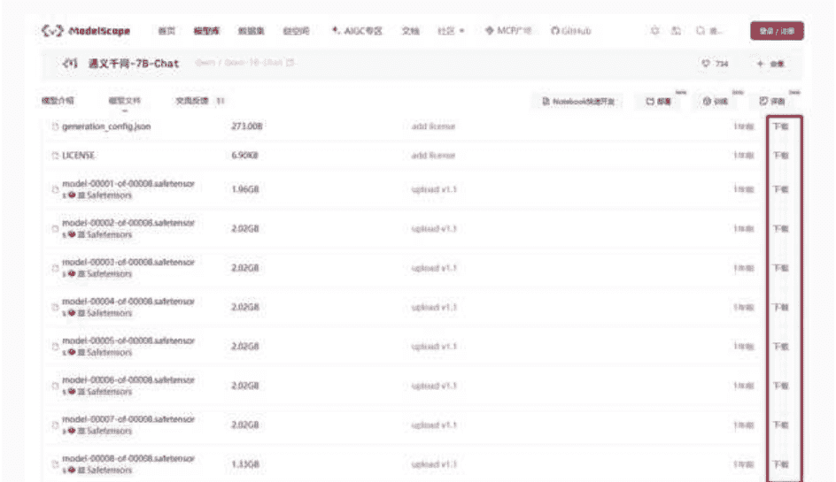

此处权重后缀为 .safetensors，按前表可知属安全张量格式，适配 Transformers、vLLM、TGI 的部署方式。

##### 4. 本地加载与效果验证
权重到位后，先在本地加载并做一次简单推理，验证加载是否成功、显存是否充足、生成是否正常、框架是否兼容格式。

1）标准权重 FP16 验证
模型为 .bin 或 .safetensors 标准权重且具备 GPU 时，可按以下方式加载推理。

```
from transformers import AutoModelForCausalLM, AutoTokenizer
import torch

# 模型路径：可为 Hugging Face ID 或本地文件夹
model_path = "./checkpoints"  # 或 "deepseek-ai/deepseek-llm-7b-base"

tokenizer = AutoTokenizer.from_pretrained(model_path)
model = AutoModelForCausalLM.from_pretrained(
    model_path,
    torch_dtype=torch.float16,  # 推荐使用半精度加载以节省显存
    device_map="auto"  # 自动将模型映射到可用 GPU
)

prompt = "请简要介绍 Transformer 模型的基本结构。"
inputs = tokenizer(prompt, return_tensors="pt").to(model.device)
outputs = model.generate(**inputs, max_new_tokens=200)
print(tokenizer.decode(outputs[0], skip_special_tokens=True))
```

2）量化权重加载
使用 bitsandbytes 4bit INT4 量化模型时，可采用如下方式。

```
from transformers import AutoModelForCausalLM, AutoTokenizer, BitsAndBytesConfig

bnb_config = BitsAndBytesConfig(load_in_4bit=True, bnb_4bit_compute_dtype=torch.float16)

tokenizer = AutoTokenizer.from_pretrained(model_path)
model = AutoModelForCausalLM.from_pretrained(
    model_path,
    quantization_config=bnb_config,
    device_map="auto"
)
```

INT4 模型不支持 torch_dtype，需借助 quantization_config 控制精度。

3）官方推理脚本
除自行调用 Transformers 外，大多数项目在 GitHub 也提供官方示例脚本，便于快速验证效果。

#### 2.3.3 GLM 系列本地实操
智谱 AI 推出的 GLM-4 系列在社区获得较好反馈，中文理解生成能力突出，且官方提供完整的本地部署说明，适合在私有环境进行推理测试与服务化。下面以 GLM-4-9B-Chat 为例演示全流程。

##### 1. 搭建隔离环境
- 显卡建议：1 张 RTX 3090/4090，显存 ≥24GB；选用 INT4 量化后显存需求可降至 6GB~8GB。
- 系统建议：Linux 更稳，如 Ubuntu 20.04 或 22.04。
- Python 环境：建议用 Conda 创建虚拟环境，Python 不低于 3.9。创建命令如下。

```
conda create -n glm4 python=3.10 -y
conda activate glm4
```

安装必要的 torch 与 transformers。

```
pip install torch torchvision torchaudio --index-url https://download.pytorch.org/whl/cu118
pip install transformers tiktoken
```

安装完成后执行如下代码确认。

```
import torch
torch.cuda.is_available()
```

输出如下则可用。

```
True
```

##### 2. 拉取项目源码
查阅 GLM-4 模型的 GitHub 目录结构，如图2.5所示。


inference 子目录包含本地部署与测试的关键入口脚本。克隆仓库并进入目录。

```
git clone https://github.com/THUDM/GLM-4.git
cd GLM-4
```

从图2.5 可见，项目依赖清单 requirements.txt 位于 inference 子目录，进入后安装依赖。

```
cd inference
pip install -r requirements.txt
```

##### 3. 获取 GLM-4 权重
通过 ModelScope 下载需先安装官方库。

```
!pip install modelscope
```

网页端可查看权重情况，如图2.6所示。


图2.6 glm-4-9b-chat 模型权重情况

导入 modelscope 之后运行如下代码下载权重。

```
from modelscope import snapshot_download

#模型下载
model_dir = snapshot_download('ZhipuAI/glm-4-9b-chat')
```

下载后打印 model_dir 可查看本地路径。

```
print (model_dir)
```

输出内容如下。

```
'/root/autodl-tmp/glm-4-9b-chat'
```

##### 4. 使用 transformers 后端进行推理
（1）在单卡服务器下运行如下代码。

#### 2.3.4 Qwen 系列落地演示
2025年4月29日，阿里开源通义千问模型 Qwen3，其中 Qwen3-235B-A22B 在代码、数学、通用能力等基准测试中，与 DeepSeek-R1、o1、o3-mini、Grok-3 和 Gemini-2.5-Pro 等顶级模型相比，竞争力突出。本次同步开源了全尺寸稠密与混合专家模型：0.6B、1.7B、4B、8B、14B、32B，以及 30B-A3B、235B-A22B。

下面以 Qwen3-14B 为例，演示从环境配置到本地部署的完整流程。

##### 1. 配置基础环境，创建虚拟环境

部署前的硬件与软件准备

单卡推理建议选用显存不低于 24GB 的显卡，RTX 3090 或 RTX 4090 是常见选择。操作系统层面推荐 Linux，Ubuntu 20.04 与 22.04 稳定性较好。Python 版本建议 3.9 及以上，通过 Conda 新建独立虚拟环境来隔离依赖与版本。

创建虚拟环境的指令如下：
```
conda create --n qwen3 python=3.11
conda activate qwen3
```

随后安装 PyTorch 与 Transformers 库：
```
pip install torch torchvision torchaudio --index-url https://download.pytorch.org/whl/cu118
pip install transformers tiktoken
```

检查安装是否成功：
```
import torch
torch.cuda.is_available()
```

若返回结果与示例一致，即可进入下一步：
```
True
```

##### 2. 从GitHub克隆开源项目

Qwen3 在 GitHub 上的仓库结构示意如图 2.7。


该模型完全基于 Transformers 构建，项目目录中未提供独立的 requirements.txt，默认继承 Hugging Face 的依赖体系，通常执行一次安装命令即可满足需求：
```
pip install torch transformers accelerate sentencepiece

# 用于 INT4 模型量化推理
pip install bitsandbytes
```

##### 3. 下载Qwen3模型权重

想利用 ModelScope 拉取权重，先完成客户端库的安装：
```
!pip install modelscope
```

可在网页端先浏览权重清单，见图 2.8。
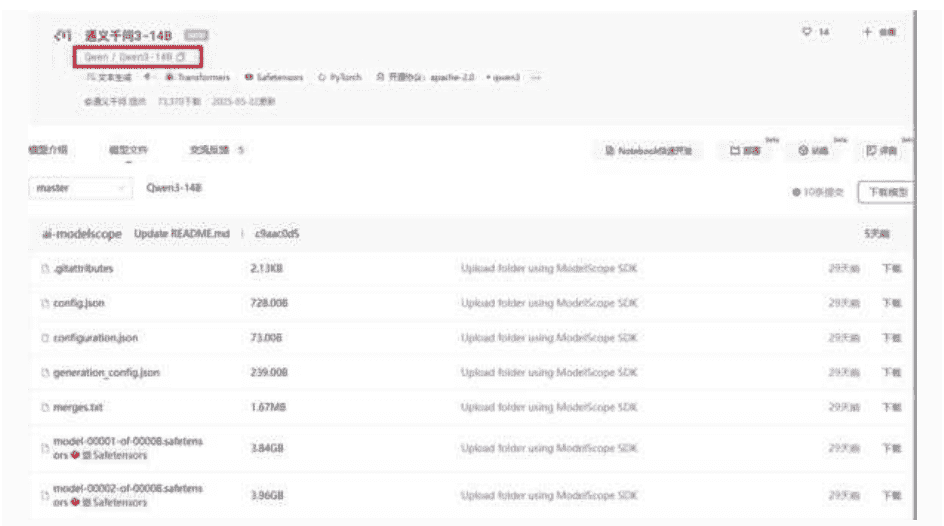

图 2.8 Qwen3-14B 模型权重情况

导入 ModelScope 后，执行下方命令即可完成权重下载：
```
cd /root/autodl-tmp/Qwen3
mkdir ./Qwen3-14B
modelscope download --model Qwen/Qwen3-14B --local_dir ./Qwen3-14B
```

##### 4. 在Jupyter中使用transformer原生库的调用流程

(1) 导入相关库。
```
from modelscope import AutoModelForCausalLM, AutoTokenizer
```

(2) 设置模型下载地址。
```
model_name = "./Qwen3-14B"
```

(3) 实例化预训练模型与分词器。
```
tokenizer = AutoTokenizer.from_pretrained(model_name)
model = AutoModelForCausalLM.from_pretrained(
    model_name,
    torch_dtype="auto",  # 指定模型权重数据类型
    device_map="auto"  # 指定模型权重加载设备
)
```

(4) 创建消息message。
```
prompt = "给出一个关于大语言模型的简短介绍。"
messages = [
    {"role": "user", "content": prompt}
]
```

(5) 创建词嵌入过程。
```
text = tokenizer.apply_chat_template(
    messages,
    tokenize=False,
    add_generation_prompt=True,
    enable_thinking=True  # 是否启用思考模式
)
model_inputs = tokenizer([text], return_tensors="pt").to(model.device)
```

(6) 创建模型并给出大模型回复。
```
# 进行文本补全
generated_ids = model.generate(
    **model_inputs,
    max_new_tokens=32768
)
output_ids = generated_ids[0][len(model_inputs.input_ids[0]):].tolist()

# 结果将首先显示思考内容标签中，然后是实际响应
print(tokenizer.decode(output_ids, skip_special_tokens=True))
```

输出内容如图 2.9 所示。
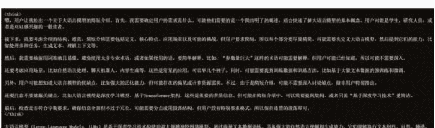

enable_thinking 参数用于控制是否开启思考模式，设为 False 即可关闭。

#### 2.3.5 第三方集成部署工具

除了直接借助 Transformers 等基础库加载权重外，还可以选择工程化程度更高、性能更强的第三方部署方案。这类工具在加载优化、推理加速、服务封装与多模型管理方面表现突出，适用于对性能、可维护性与并发能力要求较高的企业级场景。

##### 1. SGLang：智谱推出的GLM系列专用推理框架

SGLang 由智谱 AI 发布，开源推理与服务框架，专为 GLM 系列模型如 GLM-4、ChatGLM 优化，原生支持对话模板、多轮历史缓存、函数调用、结构化输出等能力。

核心特点如下。

- 对 GLM 架构有深度适配，支持多轮记忆。
- 具备并发调度与动态上下文构建能力。
- 内置类似 OpenAI 的 API 接口。
- 可配合 FastAPI/uvicorn 快速搭建服务。

##### 2. LMDeploy：国产模型轻量部署工具

LMDeploy 由昆仑芯与魔搭社区联合开发，致力于为国产开源大模型提供统一、简洁、高性能的部署方案。支持 INT4/INT8/FP16 等多种精度，并集成一键脚本、服务启动、QPS 压测等功能。

核心特点如下。

- 兼容 Qwen、Baichuan、InternLM 等多个国产模型。
- 原生支持 INT4 推理，降低显存需求。
- 提供 CLI、Web UI、HTTP API 全套接口。
- 支持多线程调度与批量推理。

##### 3. vLLM：高并发、OpenAI兼容的服务部署利器

vLLM 由 UC Berkeley 发布的高性能推理引擎，支持动态批量调度、连续批处理、FlashAttention 2，并提供完全兼容 OpenAI API 协议的服务接口。

核心特点如下。

- 兼容 Hugging Face 格式模型，如 LLaMA、Qwen、Baichuan 等。
- 实现高吞吐推理，可达数千 token/s。
- 支持流式输出。
- 原生兼容 chat/completions 接口格式。

##### 4. Ollama：开发者友好的一键本地部署平台

Ollama 面向开发者提供轻量部署方案，支持下载、管理与运行 GGUF 格式大模型，如 LLaMA 2/3、Mistral、Qwen、Phi，目标是让本地部署像使用 Docker 一样简单。

核心特点如下。

- 模型拉取与注册自动化，无需手动管理权重。
- 支持 macOS / Windows / Linux。
- 内置 HTTP API 与 CLI，便于调用。
- 支持 CPU 与 GPU 运行，支持流式输出。
- 与 llama.cpp 生态一致，兼容 GGUF 格式。

以上工具覆盖了当前主流的本地大模型部署方案，满足不同模型结构、硬件资源与应用场景的需求。本节对它们进行了简要梳理，便于读者了解基本特性与使用方式。

##### 3. 模型格式支持

部署前需确认目标模型是否开放权重、支持的格式类型以及是否有量化版本。几类主流格式如表 2.5 所示。

表2.5 主流模型格式

| 格式类型 | 常见后缀 | 说明 | 适用部署框架 |
| :--- | :--- | :--- | :--- |
| 原始 PyTorch 格式 | .bin | Transformers 原生格式，体积偏大，显存占用较高 | Transformers/vLLM/TGI |
| 安全张量格式 | .safetensors | 安全性更好，加载更快，支持并发读取的张量存储 | Transformers/vLLM/TGI |
| 量化格式-INT4 | .bin, .pt (压缩) | 一般由 GPTQ/AWQ 等量化方案压缩后分发 | AutoAWQ/GPTQ-for-LLaMA/vLLM |
| 量化格式-GGUF | .gguf | llama.cpp/Ollama 共同使用的通用格式，可在 CPU/GPU 上运行 | llama.cpp/Ollama/KoboldCpp |

选定模型后，需确认是否开源、是否提供 Hugging Face 或 GitHub 地址、是否发布 INT4/INT8/GGUF 等版本、是否有官方或社区推荐的部署脚本或 Docker 镜像。

#### 2.3.2 本地大模型部署通用步骤

多数开源大模型项目在 GitHub 上提供完整代码、推理脚本与部署工具链，使得本地部署可遵循一套相对固定的实践路径。基于 Transformers 架构的主流开源模型的通用部署流程如下。

##### 1. 配置基础环境，创建虚拟环境

借助 Conda 新建独立 Python 运行环境，保持依赖可控。
```
conda create -n llm-deploy python=3.10 -y
conda activate llm-deploy
```

命令中 -n 后为自定义环境名称，创建时需同步指定 Python 版本。

安装基础依赖，如 GPU 版 PyTorch：
```
pip install torch torchvision torchaudio --index-url https://download.pytorch.org/whl/cu118
```

##### 2. 从GitHub克隆开源项目

大多数项目在 GitHub 提供示例推理脚本、模型加载与测试代码、API 服务部署相关代码及一键安装依赖的 requirements.txt。运行如下代码即可获取源码：
```
git clone https://github.com/deepseek-ai/DeepSeek-LLM.git
```

也可网页下载 zip 压缩包，本地解压后使用。获取完整项目后，运行如下命令进入目录并一键安装所需依赖：
```
cd DeepSeek-LLM
pip install -r requirements.txt
```

> 说明
克隆官方仓库并非调用的必要步骤。
对于发布在 Hugging Face 上的模型，开发者完全可通过 Transformers 接口加载权重并完成本地推理，无需克隆官方仓库。通常获取官方仓库是为了获得以下附加内容。
- 模型推荐的依赖版本，如 requirements.txt。
- 官方提供的测试脚本或推理样例。
- API 服务部署方式，如 FastAPI、Gradio。
- Docker 容器镜像与部署指令。
- 与模型结构高度耦合的工程化调用逻辑，如多模态组件、定制 tokenizer。
但如果你已熟悉 Hugging Face 的调用方式，并清楚如何配置依赖环境，完全可以脱离官方仓库，仅下载模型权重与 tokenizer 即可完成调用与部署。这种方式更轻量、灵活，适合有经验的开发者快速集成到现有系统。

##### 3. 下载模型权重

多数权重托管于 Hugging Face 或魔搭社区 ModelScope，可通过 Transformers 自动加载，或手动预下载到本地。

（1）通过 Hugging Face Transformers 自动下载并加载。
```
from transformers import AutoTokenizer, AutoModelForCausalLM

model_id = "deepseek-ai/deepseek-llm-7b-base"
tokenizer = AutoTokenizer.from_pretrained(model_id)
model = AutoModelForCausalLM.from_pretrained(model_id, torch_dtype="auto").cuda()
```

首次加载时模型会自动下载到本地缓存目录，通常为 ~/.cache/huggingface，后续加载将自动读取缓存。

（2）借助 ModelScope 官方工具包自动加载。使用前需执行如下命令安装官方工具包。
```
pip install modelscope
```

运行下方代码即可加载对应模型。
```
from modelscope import AutoTokenizer, AutoModelForCausalLM

model_id = "Qwen/Qwen-7B-Chat"
model = AutoModelForCausalLM.from_pretrained(model_id, revision='v1.0.0')
tokenizer = AutoTokenizer.from_pretrained(model_id, revision='v1.0.0')
```

模型的具体名称可在官网查看，如图 2.3 所示。


（3）从网页手动下载权重并离线加载。在 Hugging Face 与 ModelScope 官网模型页面，切换到 Files and versions 或模型文件选项卡，点击右侧的“下载”按钮保存所有文件，如图 2.4 所示。存放到本地目录后，在推理脚本中指定 pretrained_model_name_or_path="./your_model_dir" 即可。


这里可以看到模型权重的后缀为 .safetensors，对照表 2.5 可知，这是安全张量格式，适用于 Transformers、vLLM、TGI 的部署方式。

##### 4. 加载模型并进行本地推理测试

下载权重后，在本地加载模型并做一次简单推理验证。这一步可帮助确认模型是否成功加载、显存是否充足、生成是否正常、所选部署框架是否兼容模型格式。

1）标准模型加载与推理测试（FP16）
如果模型为 .bin 或 .safetensors 格式的标准权重，并具备 GPU 环境，可使用下方方式完成加载与推理。
```
from transformers import AutoModelForCausalLM, AutoTokenizer
import torch

# 模型路径：可为 Hugging Face ID 或本地文件夹
model_path = "./checkpoints"  # 或 "deepseek-ai/deepseek-llm-7b-base"

tokenizer = AutoTokenizer.from_pretrained(model_path)
model = AutoModelForCausalLM.from_pretrained(
    model_path,
    torch_dtype=torch.float16,  # 推荐使用半精度加载以节省显存
    device_map="auto"  # 自动将模型映射到可用 GPU
)

prompt = "请简要介绍 Transformer 模型的基本结构。"
inputs = tokenizer(prompt, return_tensors="pt").to(model.device)
outputs = model.generate(**inputs, max_new_tokens=200)
print(tokenizer.decode(outputs[0], skip_special_tokens=True))
```

2）加载量化模型（如 INT4）
若使用经过量化的模型，如 bitsandbytes 格式的 4bit INT4 模型，则可使用下方方式。
```
from transformers import AutoModelForCausalLM, AutoTokenizer, BitsAndBytesConfig

bnb_config = BitsAndBytesConfig(load_in_4bit=True, bnb_4bit_compute_dtype=torch.float16)

tokenizer = AutoTokenizer.from_pretrained(model_path)
model = AutoModelForCausalLM.from_pretrained(
    model_path,
    quantization_config=bnb_config,
    device_map="auto"
)
```

INT4 模型不支持 torch_dtype 选项，需要借助 quantization_config 来管理精度。

3）官方推理脚本
除自行通过 Transformers 库加载模型进行推理外，多数开源大模型在 GitHub 项目中也会提供官方发布的推理样例脚本，帮助用户快速验证效果。

#### 2.3.3 GLM 大模型本地部署指南

GLM-4-9B 本地实操全流程

智谱发布的 GLM-4 家族在社区里获得较多好评，中文理解与生成能力表现扎实，官方还提供了较为完整的本地部署说明，很适合在私有网络里做推理验证和服务化尝试。下面以 GLM-4-9B-Chat 为例，梳理从机器准备到可用的完整路径。

##### 1. 搭建运行环境与创建独立Python环境
- 硬件建议：建议 1 张 RTX 3090/4090，显存最好 ≥24GB；若选用 INT4 量化版本，显存可压缩到 6GB~8GB。
- 系统建议：以 Linux 为主，Ubuntu 20.04 或 22.04 比较稳定。
- Python：版本需 3.9 及以上，建议用 Conda 构建隔离环境。创建环境的指令如下：
```
conda create -n glm4 python=3.10 -y
conda activate glm4
```

下面指令用于安装 PyTorch 与 Transformers 核心库：
```
pip install torch torchvision torchaudio --index-url https://download.pytorch.org/whl/cu118
pip install transformers tiktoken
```

安装完成后，可用下方代码检查是否生效：
```
import torch
torch.cuda.is_available()
```

若输出与下面一致，说明环境可用：
```
True
```

##### 2. 拉取开源仓库源码
图 2.5 展示了 GLM-4 在 GitHub 上的目录结构。


其中 inference 子目录收纳了主要推理入口与示例脚本，是本地运行的关键。拉取代码并进入项目根目录的命令如下：
```
git clone https://github.com/THUDM/GLM-4.git
cd GLM-4
```

从图 2.5 可看出，依赖清单 requirements.txt 放在 inference 目录下。进入该目录后，执行下方指令安装项目依赖：
```
cd inference
pip install -r requirements.txt
```

##### 3. 获取模型权重文件
通过 ModelScope 下载权重前，需要先安装官方客户端：
```
!pip install modelscope
```

可在网页端查看权重详情，如图 2.6 所示：


图 2.6 glm-4-9b-chat 模型权重情况

导入 modelscope 后，执行下方代码下载权重：
```
from modelscope import snapshot_download

#模型下载
model_dir = snapshot_download('ZhipuAI/glm-4-9b-chat')
```

下载完成后，打印 model_dir 即可确认本地存储路径：
```
print (model_dir)
```

输出如下：
```
'/root/autodl-tmp/glm-4-9b-chat'
```

##### 4. 基于 Transformers 后端进行推理
（1）在单卡服务器上运行下方代码：
```
import torch
from modelscope import AutoModelForCausalLM, AutoTokenizer

#设置设备为 CUDA（GPU），以加速计算
device = "cuda"

#从预训练模型目录加载分词器，并信任远程代码
tokenizer = AutoTokenizer.from_pretrained(model_dir, trust_remote_code=True)

#定义用户的输入
query = "你好"

#使用聊天模板应用分词器，并生成输入张量
inputs = tokenizer.apply_chat_template(
    [{"role": "user", "content": query}],  # 用户角色和输入内容
    add_generation_prompt=True,              # 添加生成提示
    tokenize=True,                           # 执行分词
    return_tensors="pt",                     # 返回 PyTorch 张量
    return_dict=True                         # 返回字典形式
)

#将输入张量移动到指定设备（CUDA）
inputs = inputs.to(device)

#从预训练模型目录加载下载到本地的大模型，并信任远程代码
model = AutoModelForCausalLM.from_pretrained(
    model_dir,
    torch_dtype=torch.bfloat16,              # 使用 bfloat16 数据类型以减少内存使用
    trust_remote_code=True                   # 信任远程代码
).to(device).eval()                          # 将模型移动到 CUDA 设备并设置为评估模式

#定义生成文本的参数
gen_kwargs = {
    "max_length": 2500,                     # 生成文本的最大长度
    "do_sample": True,                      # 是否进行采样
    "top_k": 1                              # 采样时考虑的最高概率的 k 个标记
}

#在不计算梯度的上下文中生成文本
with torch.no_grad():
    #生成模型的输出
    outputs = model.generate(**inputs, **gen_kwargs)
    #截取生成的输出，去除输入的部分
    outputs = outputs[:, inputs['input_ids'].shape[1]:]
    #解码生成的输出并去除特殊标记
    print(tokenizer.decode(outputs[0], skip_special_tokens=True))
```

输出如下：
```
Special tokens have been added in the vocabulary, make sure the associated word embeddings are fine-tuned or trained.
Loading checkpoint shards:  0%|          | 0/10 [00:00<?, ?it/s]
你好👋！很高兴见到你，有什么可以帮助你的吗？
```

（2）使用官方封装的推理脚本。如图 2.6 所示，inference 目录下提供可直接用于推理的脚本。执行下方命令即可在终端与模型对话：
```
python trans_cli_demo.py
```

执行下方命令可启动 Gradio 网页界面进行对话：
```
python trans_web_demo.py
```

#### 2.3.4 Qwen3 本地部署实战指南
2025 年 4 月 29 日，阿里开源通义千问 Qwen3，其中 Qwen3-235B-A22B 在代码、数学、通用能力等基准上，与 DeepSeek-R1、o1、o3-mini、Grok-3、Gemini-2.5-Pro 等顶尖模型相比竞争力很强。本次同步开源了全尺寸稠密与 MoE 模型：0.6B、1.7B、4B、8B、14B、32B，以及 30B-A3B、235B-A22B。

下面以 Qwen3-14B 为例，说明从环境配置到本地可用的完整流程。

##### 1. 基础环境配置与虚拟环境创建
- 硬件建议：1 张 RTX 3090 / 4090，显存 ≥24GB。
- 系统建议：优先 Linux，Ubuntu 20.04 或 22.04。
- Python：建议通过 Conda 创建隔离环境，版本不低于 3.9。

执行下方代码创建环境：
```
conda create --n qwen3 python=3.11
conda activate qwen3
```

执行下方代码安装 PyTorch 与 Transformers：
```
pip install torch torchvision torchaudio --index-url https://download.pytorch.org/whl/cu118
pip install transformers tiktoken
```

执行下方代码检查库是否安装成功：
```
import torch
torch.cuda.is_available()
```

若输出与下方一致，则可正常使用：
```
True
```

##### 2. 拉取 GitHub 开源项目
Qwen3 模型在 GitHub 上的仓库结构如图 2.7 所示。

#### 2.3 本地大模型部署及使用
本节围绕本地部署的核心流程，系统梳理部署所需的算力、环境依赖，涵盖模型下载、推理测试等关键环节，并与主流第三方部署工具做对比，为后续 Agent 开发提供运行基础。

#### 2.3.1 本地大模型部署需求概览
实际应用中，出于数据安全、访问稳定性、成本控制、模型可控性等多重考量，越来越多开发者和企业选择将大模型部署在本地或私有云。本地部署可掌控推理过程，降低隐私数据泄露风险，减少长期接口费用，同时提升响应速度并支持离线运行。相应地，本地部署对资源和工程能力要求更高，部署前需对以下关键需求做全面评估。

##### 1. 算力资源
在所有本地部署条件中，算力资源尤其是 GPU，是能否成功运行大语言模型的决定性因素。虽然轻量场景可尝试 CPU 模拟推理，但速度与效率远低于 GPU，对中大型模型基本不可行。因此部署大模型首先必须具备相应规模的 GPU 硬件。

> **说明**
>
> 为什么不能只用 CPU？
>
> 大语言模型推理涉及十亿级参数的矩阵计算，尤其在多层 Transformer 架构中，存在大量矩阵乘法、归一化、注意力计算等高强度并行任务。GPU 在并行数值计算方面优势明显，而 CPU 更擅长逻辑控制与串行任务。在同等条件下，CPU 推理速度可能仅为 GPU 的 1/100 至 1/10。

推理场景下不同模型参数规模对应的显存需求如表 2.2 所示。

**表2.2 不同模型参数规模对应的显存需求**

| 模型规模 | 推理时显存需求（FP16） | 支持的典型GPU（单卡） |
| :--- | :--- | :--- |
| 7B | 14GB～16GB | RTX 3090 / 4090 / A500 |
| 13B | 26GB～30GB | RTX 4090（24GB）基本可运行 |
| 33B | 60GB～80GB | 多卡 A100 或 2×4090 并行 |

若采用量化技术如 INT4、INT8、GPTQ 等，推理所需显存通常可减少 1/4～1/2。以 7B 模型为例，FP16 推理需 14GB～16GB 显存，INT4 量化后仅需 4GB～6GB，可在单张 RTX3060/4060 甚至笔记本 GPU 上运行。

当前大模型训练或推理绝大多数基于 NVIDIA GPU，因其具备成熟的 CUDA+cuDNN+PyTorch 支持体系。大模型领域的主流 GPU 型号如表 2.3 所示。

| 类型 | 常见型号 | 适用说明 |
| :--- | :--- | :--- |
| 数据中心级 | A100, H100, A800, L40S | 高稳定性、高带宽，适合部署集群 |
| 消费级高端 | RTX 3090, 4090, 4080 | 适合个人开发与小模型推理 |
| 云租用平台 GPU | Tesla V100, T4 | 支持量化模型，成本可控 |

若本地没有 GPU 设备，可租用云平台算力进行实验或开发。AutoDL、阿里云 PAI、百度飞桨 Studio、Google Colab 都提供在线 GPU 租赁服务。

##### 2. 操作系统与环境依赖
在硬件资源充足的前提下，还需配置相应的操作系统与软件依赖栈。以下是部署主流 PyTorch/Hugging Face 风格模型所需的通用环境说明。

1) 操作系统
建议优先使用 Ubuntu 作为本地部署系统，其稳定且兼容 CUDA 的 Linux 发行版，全面支持 NVIDIA 工具链。虽然 CentOS 和 Windows 搭配 WSL2 也可运行部分大模型，但并不推荐在正式生产环境中使用，会存在兼容问题。

2) 软件依赖环境（PyTorch 栈）
系统运行所需的软件依赖环境及安装说明如表 2.4 所示。

| 组件 | 推荐版本 | 安装说明 |
| :--- | :--- | :--- |
| Python | ≥ 3.9 | 建议使用 Conda 虚拟环境隔离 |
| PyTorch | ≥ 2.0 | 需安装 GPU 版本（pip/conda 安装） |
| CUDA | 11.8 / 12.1 | 与 PyTorch 安装包版本匹配 |
| cuDNN | 对应 CUDA 版本 | NVIDIA 官网下载安装或驱动自带 |
| Transformers | ≥ 4.35 | Hugging Face 的核心推理库 |

##### 3. 模型格式支持
选择模型部署前，需确认目标模型是否提供开放权重、支持格式类型以及是否有量化版本。几类主流模型格式如表 2.5 所示。

**表2.5 主流模型格式**

| 格式类型 | 常见后缀 | 说明 | 适用部署框架 |
| :--- | :--- | :--- | :--- |
| 原始 PyTorch 格式 | .bin | Transformers 默认格式，文件较大，占用显存高 | Transformers/vLLM/TGI |
| 安全张量格式 | .safetensors | 安全、加载更快、支持并发加载的张量格式 | Transformers/vLLM/TGI |
| 量化格式-INT4 | .bin, .pt (压缩) | 通常通过 GPTQ/AWQ 等量化工具压缩后发布 | AutoAWQ/GPTQ-for-LLaMA/vLLM |
| 量化格式-GGUF | .gguf | llama.cpp/Ollama 使用的统一格式，支持 CPU/GPU 部署 | llama.cpp/Ollama/KoboldCpp |

选定大模型后，需要确认该模型是否开源，是否提供 Hugging Face 或 GitHub 地址，是否发布 INT4/INT8/GGUF 等格式版本，是否有官方或社区推荐的部署脚本或 Docker 镜像。

#### 2.3.2 本地大模型部署通用步骤
在大多数开源大模型项目中，官方或社区团队往往会在 GitHub 上提供完整的项目代码、推理脚本和部署工具链，使得本地部署过程可以遵循一套相对固定、可复用的实践路径。基于 Transformers 架构的主流开源模型的通用部署流程如下。

##### 1. 配置基础环境，创建虚拟环境
执行如下命令，使用 Conda 创建独立 Python 虚拟环境，确保依赖隔离、版本可控。
```
conda create -n llm-deploy python=3.10 -y
conda activate llm-deploy
```

命令中 -n 后为自定义的虚拟环境名称，在创建虚拟环境时需要同步指定虚拟环境的 Python 版本。

运行如下命令安装基础依赖，如 PyTorch（根据 CUDA 版本选择 GPU 支持版）。
```
pip install torch torchvision torchaudio --index-url https://download.pytorch.org/whl/cu118
```

##### 2. 从 GitHub 克隆开源项目
大多数开源大模型都在 GitHub 上提供示例推理脚本、模型加载与测试代码、API 服务部署相关代码、一键安装依赖的 requirements.txt 文件。运行如下代码即可从 GitHub 克隆对应的开源项目。
```
git clone https://github.com/deepseek-ai/DeepSeek-LLM.git
```

也可以在网页端下载 zip 格式的项目压缩包，在本地解压缩后使用。获取完整项目后，运行如下命令即可进入项目文件夹并一键安装所需依赖。
```
cd DeepSeek-LLM
pip install -r requirements.txt
```

> **说明**
>
> 模型的 GitHub 项目并非模型调用的必要依赖。
>
> 对于 Hugging Face 上发布的模型，开发者可以完全通过 Transformers 接口加载权重并完成本地推理，无须克隆其官方仓库。通常，我们克隆官方 GitHub 项目，是为了获取以下附加内容。
>
> - 模型推荐的依赖版本（如requirements.txt）。
> - 官方提供的测试脚本或推理样例。
> - API 服务部署方式（如 FastAPI、Gradio）。
> - Docker 容器镜像与部署指令。
> - 与模型结构高度耦合的工程化调用逻辑（如多模态组件、定制 tokenizer）。
>
> 但如果你已经熟悉 Hugging Face 的模型调用方式，并清楚如何配置依赖环境，完全可以脱离 GitHub 项目，仅下载模型权重与 tokenizer，即可完成调用与部署。这种方式更轻量、灵活，适合有经验的开发者快速将模型集成到现有系统中。

##### 3. 下载模型权重
多数模型权重托管在 Hugging Face 或魔搭社区（ModelScope），可通过 Transformers 自动加载，或手动预下载到本地。

本地大模型获取与部署实战速览

模型拉取与载入大致可分为三类常用做法

(1) 借助 Hugging Face 的 Transformers 实现自动下载并加载。

```
from transformers import AutoTokenizer, AutoModelForCausalLM

model_id = "deepseek-ai/deepseek-llm-7b-base"
tokenizer = AutoTokenizer.from_pretrained(model_id)
model = AutoModelForCausalLM.from_pretrained(model_id, torch_dtype="auto").cuda()
```

首次调用时，参数会从远端同步到本地缓存，默认路径为 ~/.cache/huggingface，之后再用就直接读取本地缓存。

(2) 使用 ModelScope 官方客户端完成自动化获取。开始前先安装官方包。

```
pip install modelscope
```

安装完毕后执行下方示例即可把指定模型拉下来。

```
from modelscope import AutoTokenizer, AutoModelForCausalLM

model_id = "Qwen/Qwen-7B-Chat"
model = AutoModelForCausalLM.from_pretrained(model_id, revision='v1.0.0')
tokenizer = AutoTokenizer.from_pretrained(model_id, revision='v1.0.0')
```

具体模型标识可在官网模型页查到，如图 2.3 所示。

（3）网页手动下载权重后离线使用。在 Hugging Face 与 ModelScope 的模型主页切换到 Files and versions 或模型文件标签页，点击右侧下载按钮保存全部文件，如图 2.4 所示。把文件放到本地目录后，在推理脚本中把 pretrained_model_name_or_path 指定为 "./your_model_dir" 即可。

这里可以看到参数文件的后缀是 .safetensors，对照表 2.5 可知这是安全张量格式，适用于 Transformers、vLLM、TGI 等部署方式。

### 2.3.3 Qwen3模型本地部署与调用示例

Qwen3 完全基于 Transformers 开源，GitHub 项目目录中未单独列出 requirements.txt，说明沿用 Hugging Face 的依赖体系，通常只需运行下面命令安装。

```
bash
pip install torch transformers accelerate sentencepiece

# 用于 INT4 模型量化推理
pip install bitsandbytes
```

#### 1. 下载Qwen3模型权重

借助 modelscope 获取参数前先安装对应库。

```
bash
!pip install modelscope
```

可在网页端先预览参数清单，如图 2.8 所示。

随后导入 modelscope，运行下面命令完成下载。

```
bash
cd /root/autodl-tmp/Qwen3
mkdir ./Qwen3-14B
modelscope download --model Qwen/Qwen3-14B --local_dir ./Qwen3-14B
```

#### 2. 在Jupyter中使用transformer原生库的调用流程
(1) 导入相关库。

```
python
from modelscope import AutoModelForCausalLM, AutoTokenizer
```

(2) 设置模型下载地址。

```
python
model_name = "./Qwen3-14B"
```

(3) 实例化预训练模型与分词器。

```
python
tokenizer = AutoTokenizer.from_pretrained(model_name)
model = AutoModelForCausalLM.from_pretrained(
    model_name,
    torch_dtype="auto",  # 指定模型权重数据类型
    device_map="auto"  # 指定模型权重加载设备
)
```

(4) 创建消息message。

```
python
prompt = "给出一个关于大语言模型的简短介绍。"
messages = [
    {"role": "user", "content": prompt}
]
```

(5) 创建词嵌入过程。

```
python
text = tokenizer.apply_chat_template(
    messages,
    tokenize=False,
    add_generation_prompt=True,
    enable_thinking=True  # 是否启用思考模式
)
model_inputs = tokenizer([text], return_tensors="pt").to(model.device)
```

（6）创建模型并给出大模型回复。

```
python
# 进行文本补全
generated_ids = model.generate(
    **model_inputs,
    max_new_tokens=32768
)
output_ids = generated_ids[0][len(model_inputs.input_ids[0]):].tolist()

# 结果将首先显示思考内容标签中，然后是实际响应
print(tokenizer.decode(output_ids, skip_special_tokens=True))
```

输出内容如图 2.9 所示。

enable_thinking 用来开关思考模式，默认是开启的，如需关闭把参数从 True 改为 False 即可。

### 2.3.4 第三方集成部署工具

除直接用 Transformers 加载权重外，还可以选用工程化程度更高的第三方方案。这类工具在加载优化、推理加速、服务化、多模型托管等方面更具优势，适合对性能、可维护性、并发能力要求较高的企业级或产品级场景。

##### 1. SGLang：智谱推出的GLM系列专用推理框架

SGLang 由智谱 AI 发布，开源推理与服务框架，专为 GLM 系列模型如 GLM-4、ChatGLM 优化，原生支持对话模板、多轮历史缓存、函数调用、结构化输出等能力。

核心特点如下。

- 与 GLM 架构匹配度高，支持多轮会话记忆
- 并发调度能力强，可动态构建上下文
- 提供接近 OpenAI 风格的 API 接口
- 配合 fastapi/uvicorn 能迅速搭建服务

##### 2. LMDeploy：国产模型轻量部署工具

LMDeploy 由昆仑芯与魔搭社区联合开发，目标为国产开源大模型提供统一、简洁、高性能的部署方案。支持 INT4/INT8/FP16 多精度推理，并集成一键脚本、服务启动、QPS 压测等功能。

核心特点如下。

- 覆盖 Qwen、Baichuan、InternLM 等众多国产模型
- 原生支持 INT4 推理，显存占用更低
- 提供 CLI、Web UI、HTTP API 完整组合
- 支持多线程调度与批量推理

##### 3. vLLM：高并发、OpenAI兼容的服务部署利器

vLLM 由 UC Berkeley 发布的高性能推理引擎，支持动态批量调度、连续批处理、FlashAttention 2，并实现完全兼容 OpenAI API 协议的服务接口。

核心特点如下。

- 兼容 Hugging Face 格式模型如 LLaMA、Qwen、Baichuan 等
- 吞吐量高，可达数千 token/s
- 支持流式输出
- 原生兼容 chat/completions 接口格式

##### 4. Ollama：开发者友好的一键本地部署平台

Ollama 面向开发者，轻量部署工具，支持下载、管理与运行 GGUF 格式的大模型如 LLaMA 2/3、Mistral、Qwen、Phi 等，主张本地部署像用 Docker 一样简单。

核心特点如下。

- 自动下载并注册模型，无需显式管理权重
- 支持 Mac/Windows/Linux
- 内置 HTTP API 与 CLI，调用便捷
- 支持 CPU 与 GPU，支持流式输出
- 与 llama.cpp 生态一致，兼容 GGUF 格式

以上工具代表了当前主流的本地大模型部署方案，覆盖不同模型结构、硬件资源和应用场景需求。本节对它们做了简要梳理，便于了解基本特性和使用方式。

##### 4. 加载模型并进行本地推理测试

下载参数后，需在本地加载并做一次简单推理验证，以确认模型能否成功载入、显存是否充足、生成是否正常、所选框架是否兼容模型格式。

1）标准模型加载与推理测试（FP16）

若模型为 .bin 或 .safetensors 格式的标准参数且具备 GPU 环境，可用如下方式完成加载与推理。

```python
from transformers import AutoModelForCausalLM, AutoTokenizer
import torch

# 模型路径：可为 Hugging Face ID 或本地文件夹
model_path = "./checkpoints"  # 或 "deepseek-ai/deepseek-llm-7b-base"

tokenizer = AutoTokenizer.from_pretrained(model_path)
model = AutoModelForCausalLM.from_pretrained(
    model_path,
    torch_dtype=torch.float16,  # 推荐使用半精度加载以节省显存
    device_map="auto"  # 自动将模型映射到可用 GPU
)

prompt = "请简要介绍 Transformer 模型的基本结构。"
inputs = tokenizer(prompt, return_tensors="pt").to(model.device)
outputs = model.generate(**inputs, max_new_tokens=200)
print(tokenizer.decode(outputs[0], skip_special_tokens=True))
```

2）加载量化模型（如INT4）

若使用经过量化的参数，如 bitsandbytes 格式的 4bit INT4 模型，则可采用以下方式。

```python
from transformers import AutoModelForCausalLM, AutoTokenizer, BitsAndBytesConfig

bnb_config = BitsAndBytesConfig(load_in_4bit=True, bnb_4bit_compute_dtype=torch.float16)

tokenizer = AutoTokenizer.from_pretrained(model_path)
model = AutoModelForCausalLM.from_pretrained(
    model_path,
    quantization_config=bnb_config,
    device_map="auto"
)
```

INT4 模型不支持 torch_dtype 参数，需使用 quantization_config 管理精度。

3）官方推理脚本

除自行用 Transformers 加载外，大多数开源大模型在 GitHub 项目中会提供官方发布的推理样例脚本，帮助用户快速验证效果。

#### 2.3.3 GLM大模型本地部署指南

智谱 AI 推出的 GLM-4 系列在开源社区表现突出，中文理解与生成能力良好，且官方提供完整本地部署文档，适合在私有环境进行推理测试与服务化部署。下面以 GLM-4-9B-Chat 为例，演示从环境配置到本地部署的完整流程。

##### 1. 配置基础环境，创建虚拟环境

- 显卡建议：1 张 RTX 3090/4090，显存 ≥24GB；如使用 INT4 量化版本，显存需求可降至 6GB~8GB。
- 操作系统：推荐 Linux，如 Ubuntu 20.04 或 Ubuntu 22.04。
- Python 环境：建议用 Conda 创建虚拟环境，Python 版本不低于 3.9。运行如下命令创建虚拟环境。

```bash
conda create -n glm4 python=3.10 -y
conda activate glm4
```

运行如下命令安装必要的 torch 和 transformers 库。

```bash
pip install torch torchvision torchaudio --index-url https://download.pytorch.org/whl/cu118
pip install transformers tiktoken
```

安装完成后，可运行如下代码确认是否安装成功。

```python
import torch
torch.cuda.is_available()
```

如果输出如下内容，则可正常使用。

```
True
```

##### 2. 从GitHub克隆开源项目

查看 GLM-4 模型的 GitHub 开源项目目录结构，如图 2.5 所示。


该项目的 inference 子目录是本地部署和测试的关键，包含丰富的推理入口脚本。运行如下命令克隆仓库并进入项目目录。

```bash
git clone https://github.com/THUDM/GLM-4.git
cd GLM-4
```

查看图 2.5 所示的项目结构，可发现项目依赖安装清单 requirements.txt 文件位于 inference 子目录下，运行如下命令进入该子目录并安装项目所需依赖。

```bash
cd inference
pip install -r requirements.txt
```

##### 3. 获取 GLM-4 参数

通过 modelscope 下载模型需预先安装其官方库。

```bash
pip install modelscope
```

可在网页端查看参数清单，如图 2.6 所示。


图 2.6 glm-4-9b-chat 模型权重情况

接下来，导入 modelscope 库，运行如下代码下载模型权重。

```python
from modelscope import snapshot_download

# 模型下载
model_dir = snapshot_download('ZhipuAI/glm-4-9b-chat')
```

下载完成后，打印 model_dir 即可查看模型权重本地存储路径。

```python
print(model_dir)
```

输出内容如下。

```
'/root/autodl-tmp/glm-4-9b-chat'
```

##### 4. 使用transformers后端进行推理

（1）在单卡服务器下运行如下代码。

```python
import torch
from modelscope import AutoModelForCausalLM, AutoTokenizer

# 设置设备为 CUDA（GPU），以加速计算
device = "cuda"

# 从预训练模型目录加载分词器，并信任远程代码
tokenizer = AutoTokenizer.from_pretrained(model_dir, trust_remote_code=True)

# 定义用户的输入
query = "你好"

# 使用聊天模板应用分词器，并生成输入张量
inputs = tokenizer.apply_chat_template(
    [{"role": "user", "content": query}],  # 用户角色和输入内容
    add_generation_prompt=True,              # 添加生成提示
    tokenize=True,                           # 执行分词
    return_tensors="pt",                     # 返回 PyTorch 张量
    return_dict=True                         # 返回字典形式
)

# 将输入张量移动到指定设备（CUDA）
inputs = inputs.to(device)

# 从预训练模型目录加载下载到本地的大模型，并信任远程代码
model = AutoModelForCausalLM.from_pretrained(
    model_dir,
    torch_dtype=torch.bfloat16,              # 使用 bfloat16 数据类型以减少内存使用
    trust_remote_code=True                   # 信任远程代码
).to(device).eval()                          # 将模型移动到 CUDA 设备并设置为评估模式

# 定义生成文本的参数
gen_kwargs = {
    "max_length": 2500,                     # 生成文本的最大长度
    "do_sample": True,                      # 是否进行采样
    "top_k": 1                              # 采样时考虑的最高概率的 k 个标记
}

# 在不计算梯度的上下文中生成文本
with torch.no_grad():
    # 生成模型的输出
    outputs = model.generate(**inputs, **gen_kwargs)
    # 截取生成的输出，去除输入的部分
    outputs = outputs[:, inputs['input_ids'].shape[1]:]
    # 解码生成的输出并去除特殊标记
    print(tokenizer.decode(outputs[0], skip_special_tokens=True))
```

展示结果如下。

```
Special tokens have been added in the vocabulary, make sure the associated word embeddings are fine-tuned or trained.
Loading checkpoint shards:  0%|          | 0/10 [00:00<?, ?it/s]
你好👋！很高兴见到你，有什么可以帮助你的吗？
```

（2）借助官方提供的推理脚本进行交互。如图2.6所示，inference 子目录下存放了可直接使用的推理脚本，执行下面指令即可在终端与大模型对话。

```bash
python trans_cli_demo.py
```

若想通过 Gradio 网页界面与模型交流，运行以下命令即可启动服务。

```bash
python trans_web_demo.py
```

#### 2.3.4 Qwen3 本地部署速览

2025 年 4 月 29 日，阿里巴巴正式发布开源大模型 Qwen3。其中的旗舰模型 Qwen3-235B-A22B 在代码、数学及通用能力评测中，与 DeepSeek-R1、o1、o3-mini、Grok-3、Gemini-2.5-Pro 等顶级模型相比，展现出强劲竞争力。本次一并开源了全尺寸密集型与混合专家型模型，参数规模涵盖 0.6B、1.7B、4B、8B、14B、32B，以及 30B-A3B、235B-A22B。

下面以 Qwen3-14B 为例，完整演示从环境准备到本地运行的流程。

##### 1. 基础环境与虚拟环境搭建

- 建议显卡：单张 RTX 3090 或 4090，显存 ≥24GB。
- 建议系统：Linux 发行版，Ubuntu 20.04 或 22.04 为佳。
- Python 建议：使用 Conda 新建虚拟环境，Python 版本需 ≥3.9。

运行下方代码创建虚拟环境。

```bash
conda create --n qwen3 python=3.11
conda activate qwen3
```

运行下方代码安装 PyTorch 与 Transformers。

```bash
pip install torch torchvision torchaudio --index-url https://download.pytorch.org/whl/cu118
pip install transformers tiktoken
```

运行下方代码验证 PyTorch 与 Transformers 是否安装成功。

```python
import torch
torch.cuda.is_available()
```

若输出结果与预期一致，则可正常使用。

```
True
```

##### 2. 拉取 GitHub 开源仓库

查看 Qwen3 在 GitHub 上的项目，其目录结构如图 2.7 所示。


Qwen3 完全基于 Transformers 构建，仓库中未单独提供 requirements.txt，通常继承 Hugging Face 的依赖体系，一般只需执行如下安装命令即可。

```bash
pip install torch transformers accelerate sentencepiece

# 用于 INT4 模型量化推理
pip install bitsandbytes
```

##### 3. 获取 Qwen3 模型权重

使用 ModelScope 下载权重前，先执行如下命令安装客户端。

```bash
pip install modelscope
```

可在网页上先预览权重信息，如图 2.8 所示。


图2.8 Qwen3-14B 模型权重情况

随后导入 ModelScope，执行如下命令完成权重下载。

```bash
cd /root/autodl-tmp/Qwen3
mkdir ./Qwen3-14B
modelscope download --model Qwen/Qwen3-14B --local_dir ./Qwen3-14B
```

##### 4. 在 Jupyter 中调用 Transformers 原生库

(1) 导入所需库。

```python
from modelscope import AutoModelForCausalLM, AutoTokenizer
```

(2) 指定模型下载路径。

```python
model_name = "./Qwen3-14B"
```

(3) 实例化预训练模型与分词器。

```python
tokenizer = AutoTokenizer.from_pretrained(model_name)
model = AutoModelForCausalLM.from_pretrained(
    model_name,
    torch_dtype="auto",  # 指定模型权重数据类型
    device_map="auto"  # 指定模型权重加载设备
)
```

(4) 构造对话消息 message。

```python
prompt = "给出一个关于大语言模型的简短介绍。"
messages = [
    {"role": "user", "content": prompt}
]
```

(5) 执行词嵌入步骤。

```python
text = tokenizer.apply_chat_template(
    messages,
    tokenize=False,
    add_generation_prompt=True,
    enable_thinking=True  # 是否启用思考模式
)
model_inputs = tokenizer([text], return_tensors="pt").to(model.device)
```

（6）实例化模型并获取大模型回复。

```python
# 进行文本补全
generated_ids = model.generate(
    **model_inputs,
    max_new_tokens=32768
)
output_ids = generated_ids[0][len(model_inputs.input_ids[0]):].tolist()

# 结果将首先显示标签中，然后是实际响应
print(tokenizer.decode(output_ids, skip_special_tokens=True))
```

输出效果如图 2.9 所示。

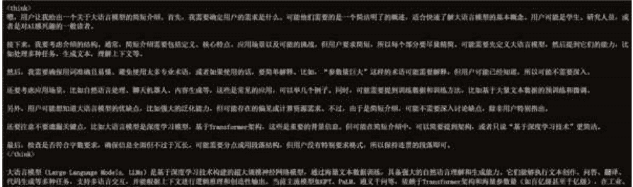

是否开启思考模式由 enable_thinking 参数控制，关闭时将 True 改为 False 即可。

#### 2.3.5 常用第三方部署方案盘点

在本地部署大模型时，除直接使用 Transformers 等基础库加载权重外，还可选用工程化程度更高的第三方工具。这类工具在加载优化、推理加速、服务封装、多模型管理方面优势明显，特别适合对性能、可维护性、并发能力要求较高的企业级或产品级场景。

##### 1. SGLang：智谱推出的 GLM 系列推理框架

SGLang 由智谱 AI 发布，是面向 GLM 系列模型如 GLM-4、ChatGLM 的开源推理与服务框架，原生支持对话模板、多轮历史缓存、函数调用、结构化输出等能力。

SGLang 的核心特点如下。

- 与 GLM 结构高度契合，支持多轮记忆。
- 支持并发调度与动态上下文构建。
- 内置类 OpenAI 的 API 接口。
- 可借助 FastAPI/uvicorn 快速搭建服务。

##### 2. LMDeploy：国产模型轻量部署工具

LMDeploy 由昆仑芯与魔搭社区联合打造，旨在为国产开源大模型提供统一、简洁、高性能的部署方案。支持 INT4/INT8/FP16 多精度推理，并集成一键脚本、服务启动、QPS 压测等功能。

LMDeploy 的核心特点如下。

- 兼容 Qwen、Baichuan、InternLM 等众多国产模型。
- 原生支持 INT4 推理，降低显存占用。
- 提供 CLI、Web UI、HTTP API 全套接口。
- 支持多线程调度与批量推理。

##### 3. vLLM：高并发 OpenAI 兼容服务引擎

vLLM 由 UC Berkeley 发布的高性能推理引擎，具备动态批处理、连续批处理、FlashAttention 2 等特性，并完整兼容 OpenAI API 协议。

vLLM 的核心特点如下。

- 支持 Hugging Face 格式模型如 LLaMA、Qwen、Baichuan 等。
- 推理吞吐可达数千 token/s。
- 支持流式输出。
- 原生兼容 chat/completions 接口。

##### 4. Ollama：一键本地部署平台

Ollama 面向开发者，提供轻量本地部署能力，支持下载、管理、运行 GGUF 格式大模型如 LLaMA 2/3、Mistral、Qwen、Phi 等，目标是让本地部署像使用 Docker 一样简便。

Ollama 的核心特点如下。

- 自动下载并注册模型，无需手动管理权重。
- 支持 macOS、Windows、Linux 系统。

### 2.4 附加资源

- (1) OpenAI 模型文档：https://platform.openai.com/docs/models。
- (2) OpenAI API 平台官网：https://platform.openai.com/。
- (3) OpenAI ChatGPT 应用地址：https://chat.openai.com/。
- (4) Claude 模型介绍页：https://www.anthropic.com/index/claude。
- (5) Claude API 文档站：https://docs.anthropic.com。
- (6) Gemini 模型介绍页：https://deepmind.google/technologies/gemini。
- (7) Gemini API 官网：https://makersuite.google.com/。
- (8) DeepSeek 官方介绍页：https://www.deepseek.com/zh。
- (9) DeepSeek API 开放平台：https://platform.deepseek.com。
- (10) DeepSeek 网页对话应用：https://chat.deepseek.com。
- (11) DeepSeek GitHub 开源项目：https://github.com/deepseek-ai。
- (12) DeepSeek Hugging Face 权重页：https://huggingface.co/deepseek-ai。
- (13) DeepSeek ModelScope 权重页：https://modelscope.cn/organization/deepseek-ai。
- (14) GLM 官方介绍页：https://www.zhipuai.cn。
- (15) GLM API 开放平台：https://bigmodel.cn。
- (16) GLM 网页对话应用：https://chatglm.cn。
- (17) GLM GitHub 开源项目：https://github.com/THUDM。
- (18) GLM Hugging Face 权重页：https://huggingface.co/THUDM。
- (19) GLM ModelScope 权重页：https://modelscope.cn/organization/ZhipuAI。
- (20) Qwen API 平台 DashScope：https://dashscope.aliyun.com。
- (21) Qwen 网页对话入口：https://tongyi.aliyun.com。
- (22) Qwen GitHub 开源项目：https://github.com/QwenLM。
- (23) Qwen Hugging Face 权重页：https://huggingface.co/Qwen。
- (24) Qwen ModelScope 权重页：https://modelscope.cn/organization/Qwen。
- (25) LLaMA 官方介绍页：https://www.llama.com/。
- (26) LLaMA GitHub 开源项目：https://github.com/meta-llama/llama-models。
- (27) LLaMA Hugging Face 权重页：https://huggingface.co/meta-llama。
- (28) Mistral 官方资讯页：https://mistral.ai/news。
- (29) Mistral GitHub 开源项目：https://github.com/mistralai。
- (30) Mistral Hugging Face 权重页：https://huggingface.co/mistralai。

## 第3章 DeepSeek安装部署与API调用流程

本章围绕 DeepSeek 系列大模型的使用实践展开，系统介绍从环境准备到模型部署、从在线 API 接入到本地推理调用的完整流程。以 DeepSeek-V3 和 DeepSeek-R1 为代表，分别梳理模型结构、接口调用方式、参数配置及功能特性，并结合实际案例展示在多种场景下的调用效果与能力边界。同时引入 SGLang、LMDeploy、vLLM、Ollama 等主流推理框架，说明如何将 DeepSeek 模型高效集成至第三方工具中，以满足多样化的部署需求与工程场景。

本章知识架构如下：

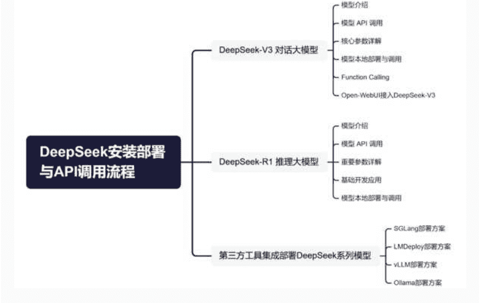

### 3.1 DeepSeek-V3对话大模型

本节聚焦 DeepSeek-V3 的应用实践。首先介绍模型架构与核心能力，随后阐述在线 API 的标准调用方式及参数规范，再深入本地部署的详细步骤，包括环境准备、权重加载、推理验证等关键环节。此外还将演示 Function Calling 外部函数调用，最后结合 Open-WebUI 搭建具备可视化交互的个性化聊天系统。

#### 3.1.1 DeepSeek-V3模型介绍

DeepSeek-V3 深度拆解：高性能低成本的开源新标杆

2024 年 12 月，DeepSeek 团队释出了第三代大语言模型 DeepSeek-V3，一经上线就引发广泛讨论。架构上它采用 MoE 混合专家结构，整体规模达 6710 亿参数，却只在每个 token 上激活约 370 亿参数，在保证能力的同时大幅压低了算力开销。推理效率方面引入了多头潜在注意力 MLA，以加速解码。训练层面使用了无辅助损失的负载均衡方案，并以多 token 预测为目标，进一步强化了模型表现。

在多项公开评测中，DeepSeek-V3 的分数超过了 Qwen2.5-72B 与 Llama-3.1-405B 等开源代表，综合能力与 GPT-4o、Claude-3.5-Sonnet 等闭源顶尖模型处在同一梯队。更关键的是成本，训练费用约 557.6 万美元，仅相当于 GPT-4o 训练成本的约 1/20，为中小团队和开发者打开了低成本使用顶尖模型的大门。模型原生兼容 OpenAI SDK，支持 Function Calling 与 Json Output，习惯 GPT 生态的开发者可直接无缝迁移。

总体来看，DeepSeek-V3 以高性能与低成本并存，展现了中国团队在基础模型研发上的创新力，也为全球 AI 社区提供了新的参考路径。

#### 3.1.2 DeepSeek-V3 API 调用实战
##### 1. 账号注册与密钥获取
先打开 DeepSeek 官网，首页示意如图 3.1 所示。


图3.1 DeepSeek官网主页

点开右上角的“API开放平台”即可进入开放平台，查看使用说明，如图 3.2 所示。

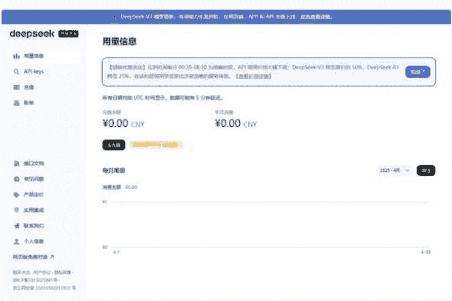

图3.2 DeepSeek开放平台页面

左侧菜单点“接口文档”可查阅调用说明。点左侧 API keys 也能进入密钥创建页，直达地址为 https://platform.deepseek.com/api_keys，该页界面如图 3.3 所示。

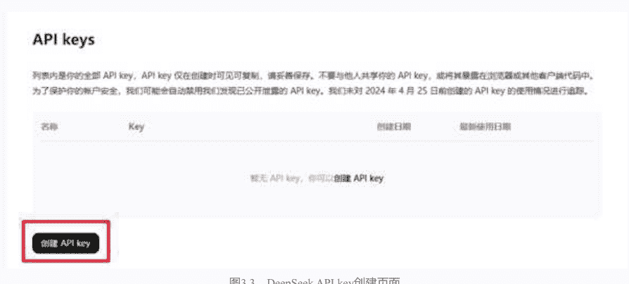

点击图 3.3 中的“创建API key”按钮开始创建，如图 3.4 所示。建议把密钥复制下来存为系统环境变量，避免硬编码到代码里。

##### 2. DeepSeek-V3 模型调用
先安装所需依赖。

```
pip install openai
```

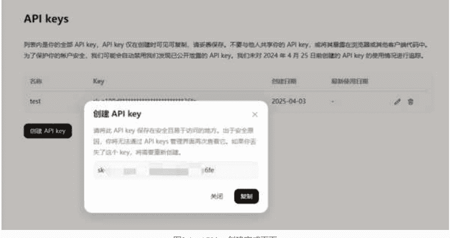

官方说明指出 DeepSeek API 采用与 OpenAI 兼容的格式。

```python
import os
from openai import OpenAI

from IPython.display import display, Code, Markdown
import requests
import json

# <YOUR_DEEPSEEK_API_KEY>替换为复制的 API key 字符串
ds_api_key = '<YOUR_DEEPSEEK_API_KEY>'

#实例化客户端
client = OpenAI(api_key=ds_api_key,
                base_url="https://api.deepseek.com")

#调用 DeepSeek-V3 模型
response = client.chat.completions.create(
    model="deepseek-chat",
    messages=[
        {"role": "user", "content": "你好，好久不见!"}
    ]
)

#输出生成的响应内容
print(response.choices[0].message.content)
#输出完整的响应
print(response)
```

执行后输出如下。

```
你好！好久不见！最近过得怎么样？有什么想聊的吗？
ChatCompletion(id='1fdbc70b-acbf-4c9a-a895-d26bd69ad531',
              choices=[Choice(finish_reason='stop',
                              index=0, logprobs=None,
                              message=ChatCompletionMessage(content='你好！好久不见！最近过得怎么样？有什么想聊的吗？',
                                                            refusal=None,
                                                            role='assistant',
                                                            audio=None,
                                                            function_call=None,
                                                            tool_calls=None))],
              created=1736238514,
              model='deepseek-chat',
              object='chat.completion',
              service_tier=None,
              system_fingerprint='fp_3a5770e1b4',
              usage=CompletionUsage(completion_tokens=14,
                                    prompt_tokens=8,
                                    total_tokens=22,
                                    completion_tokens_details=None,
                                    prompt_tokens_details=None,
                                    prompt_cache_hit_tokens=0,
                                    prompt_cache_miss_tokens=8))
```

使用相同的 SDK 意味着 DeepSeek 的参数体系与 GPT 完全一致。

可查询当前可用的模型列表。

```python
models_list = client.models.list()
print(models_list.data)
```

输出结果如下。

```
[Model(id='deepseek-chat', created=None, object='model', owned_by='deepseek'),
Model(id='deepseek-coder', created=None, object='model', owned_by='deepseek')]
```

其中 “deepseek-chat” 即指向 DeepSeek-V3。它属于聊天补全类模型，官方已将其指向最新版本。

#### 3.1.3 DeepSeek-V3 核心参数详解
##### 1. messages
messages 是 API 调用中必传的字段，用来构成对话上下文，包含用户提问、系统指令与模型回复等。通过 messages 数组，模型能把握对话历史，从而生成更连贯的回答。不同场景下 messages 由 system、user、assistant 三类消息组成，具体说明如下。

1) system message
用于设定系统级指引，由开发者定义对话规则与背景。

- content 必填：消息内容，可为字符串或多模态数组
- role 必填：固定为 system
- name 可选：区分不同系统发送者

示例代码如下：

```python
system_message = {
    "role": "system",
    "content": "你是一位擅长编写 python 代码的助手。"
}
```

2) user message
代表用户的输入，是对话的核心驱动。

- content 必填：文本或图像链接数组，DeepSeek-V2.5 等支持图像输入
- role 必填：固定为 user
- name 可选：为不同用户命名

示例代码如下。

```python
user_message = {
    "role": "user",
    "content": "你好，请介绍下你自己。"
}
```

若同时传入图像与文本，示例如下：

```python
user_message_with_image = {
    "role": "user",
    "content": [
        {"type": "text", "text": "你能帮我介绍下这张图片里面的内容吗？"},
        {"type": "image_url",
         "image_url": {
             "url": "https://ml2022.oss-cn-hangzhou.aliyuncs.com/img/image-20241009205714055.png"}}]
}
```

实务中通常先单独组装用户消息，再传入调用函数。

```python
#创建用户消息
user_message = {
    "role": "user",
    "content": "你好，请介绍下你自己。"
}

#调用 DeepSeek-V3 模型
response = client.chat.completions.create(
    model="deepseek-chat",
    messages=[
        system_message,
        user_message
    ]
)

#输出生成的响应内容
print(response.choices[0].message.content)
```

输出结果如下。

> 你好！我是一位大学教授，专注于多个学科的研究与教学。我的工作主要包括教授本科生和研究生课程，指导学生的研究项目，以及进行学术研究。我致力于通过教育和研究推动知识的边界，并帮助学生发展他们的批判性思维和创新能力。此外，我也参与学术会议和研讨会，与同行交流最新的研究成果和教学方法。如果你有任何学术上的问题或需要指导，我很乐意提供帮助。

##### 2. 其他关键参数
实际推理时，可通过一组参数精细调控模型行为。下面按作用归纳说明，表 3.1 为参数汇总。

表3.1 DeepSeek-V3模型参数汇总表

## 参数名 | 类型 | 必填/可选 | 默认值 | 说明

--- | --- | --- | --- | ---

model | string | 必填 | 无 | 指定模型标识，例如 deepseek-chat 或 deepseek-code
store | boolean 或 null | 可选 | false | 是否保存本次对话结果用于后续微调或评估
metadata | object 或 null | 可选 | null | 自定义标签对象，便于在控制台筛选结果
frequency_penalty | number 或 null | 可选 | 0 | 控制重复频率，取值 -2.0～2.0，正值降低重复
logit_bias | map | 可选 | null | 调节指定 token 出现概率，取值 -100～100
logprobs | boolean 或 null | 可选 | false | 是否返回每个 token 的对数概率
top_logprobs | integer 或 null | 可选 | null | 返回前 N 个高概率 token，需开启 logprobs
max_completion_tokens | integer 或 null | 可选 | null | 限制最大生成 token 数，含文本与推理 token
n | integer 或 null | 可选 | 1 | 单次请求生成的候选回复数量
presence_penalty | number 或 null | 可选 | 0 | 影响主题新颖度，取值 -2.0～2.0，正值鼓励新话题
response_format | object | 可选 | null | 指定输出格式，支持 json_schema 或 json_object
seed | integer 或 null | 可选 | null | 固定随机种子以复现结果
service_tier | string 或 null | 可选 | auto | 指定服务延迟等级，付费用户可用
stop | string/array/null | 可选 | null | 设置停止符，最多 4 个序列
stream | boolean 或 null | 可选 | false | 是否开启流式返回
stream_options | object 或 null | 可选 | null | 流式返回的附加选项，仅 stream 为 true 时生效
temperature | number 或 null | 可选 | 1 | 控制随机性，越高越发散，建议与 top_p 二选一
top_p | number 或 null | 可选 | 1 | 核采样阈值，建议与 temperature 二选一
tools | array | 可选 | null | 可调用工具列表，目前仅支持函数调用
user | string | 可选 | null | 最终用户唯一 ID，用于风控与监控

为便于配置，可将参数按功能划分为四大类。

###### (1) 模型与输出控制。
- model 必填，决定调用哪个模型
- store 控制是否保存对话结果
- metadata 添加自定义标签便于筛选
- max_completion_tokens 与 n 分别限制长度与数量，帮助控制成本

###### (2) 生成行为调节。
- frequency_penalty 与 presence_penalty 调节重复度与新颖性
- logit_bias 精细调节特定 token 概率
- temperature 与 top_p 控制随机性，建议二选一

###### (3) 高级功能。
- logprobs 与 top_logprobs 提供概率信息，便于分析
- stream 开启后可实时返回，适合渐进展示
- tools 允许模型调用外部函数，扩展能力

###### (4) 服务与用户。
- service_tier 指定服务等级，满足高性能需求
- user 用于标识调用方，便于监控与防滥用

#### 3.1.4 DeepSeek-V3 本地部署与调用
##### 1. 开源情况说明
DeepSeek 为开源模型，首先需了解其开源现状。DeepSeek 项目在 GitHub 上的文件结构如图 3.5 所示。

DeepSeek-V3 开源全览与本地部署指南

仓库核心代码的截图见图3.6。

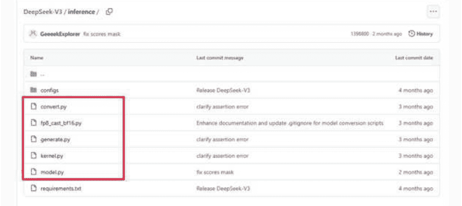

图3.6 DeepSeek项目GitHub开源代码部分

图3.6所列脚本的功能简述如下：

- convert.py：负责检查点格式迁移，把已训练好的 checkpoint，例如 safetensors 格式，转存为适配特定并行度与专家数 n_experts 的版本。
- fp8_cast_bf16.py：把以 FP8 保存的模型权重转写为 BF16 并写入磁盘，同时刷新索引文件并剔除 scale_inv 的引用。
- generate.py：文本生成的示例程序，支持交互式输入和批量生成，基于 Transformer 架构并可分布式执行。
- kernel.py：主要实现量化与矩阵乘法算子，通过 Triton 框架加速，并针对 FP8 精度做了专项优化。Triton 是面向 GPU 高效定制算子的编程框架，兼容 Python 与 PyTorch，用少量代码即可构建高效 GPU 核。
- model.py：定义了 DeepSeek-V3 的整体模型结构。

模型权重已在 Hugging Face 开放，具体信息见图3.7。

##### 3. Model Downloads

| Model | #Total Params | #Activated Params | Context Length | Download |

|---|---|---|---|---|

| DeepSeek-V3-Base | 671B | 37B | 128K | Hugging Face |

| DeepSeek-V3 | 671B | 37B | 128K | Hugging Face |

> Note

The total size of DeepSeek-V3 models on Hugging Face is 685B, which includes 671B of the Main Model weights and 14B of the Multi-Token Prediction (MTP) Module weights.

To ensure optimal performance and flexibility, we have partnered with open-source communities and hardware vendors to provide multiple ways to run the model locally. For step-by-step guidance, check out Section 6: [How to Run Locally](https://github.com/deepseek-ai/DeepSeek-V3/blob/main/README.md#how-to-run-locally).

For developers looking to dive deeper, we recommend exploring [README_WEIGHTS.md](https://github.com/deepseek-ai/DeepSeek-V3/blob/main/README_WEIGHTS.md) for details on the Main Model weights and the Multi-Token Prediction (MTP) Modules. Please note that MTP support is currently under active development within the community, and we welcome your contributions and feedback.

图3.7 DeepSeek项目模型权重相关说明

权重包可在 Hugging Face 主页下载，整体约 650GB，魔搭社区也有镜像。作为权重全开源的模型，官方给出的本地运行方式有：

- (1) DeepSeek-Infer Demo：轻量演示，同时支持 FP8 与 BF16 推理。
- (2) SGLang：完整支持 DeepSeek-V3 在 BF16 和 FP8 模式下运行，多标记预测 MTP 支持即将上线。
- (3) LMDeploy：提供高效的 FP8、BF16 推理，适用于本地与云端部署。
- (4) TensorRT-LLM：当前支持 BF16 推理及 INT4/8 量化，FP8 支持正在推进。
- (5) vLLM：支持 DeepSeek-V3 在 FP8 与 BF16 模式下进行张量并行和流水线并行。
- (6) AMD GPU：借助 SGLang，可在 AMD GPU 上以 BF16、FP8 运行 DeepSeek-V3 模型。
- (7) 华为 Ascend NPU：支持在华为 Ascend 设备上运行 DeepSeek-V3 模型。

框架原生采用 FP8 训练，因此仅发布 FP8 权重，700GB 以上显存即可启动。转成 BF16 半精度需 1400GB 以上，量化到 INT4 约需 450GB 以上。半精度示例约占用 490GB 显存，相当于 7 张 80GB A100，按市场价租赁约 1000 元/天。

### 2. DeepSeek-V3本地部署

(1) 基本环境配置。本次部署使用 Int4 量化版，软硬件组合如下。

服务器硬件配置信息。

- GPU: Nvidia H20 (98G) GPU * 8。
- CPU: AMD EPYC 9K84 96-Core。
- 桥接方式: NVLink。
- 内存: 150G。
- 存储: 2T。

深度学习环境配置信息。

- 操作系统: Ubuntu 22.04。
- PyTorch版本: 2.5.1。
- Python版本: 3.12。
- CUDA版本: 12.4。
- 其余依赖按项目需求确定。

(2) 创建虚拟环境。执行如下命令创建虚拟环境。

```
# 创建一个名为 dv3 的 Conda 虚拟环境，并指定 Python 版本为 3.11
conda create --name dv3 python=3.11

conda init

# 重新加载 shell 配置
source ~/.bashrc

# 激活刚刚创建的 dv3 环境，使其成为当前终端会话的 Python 运行环境
conda activate dv3
```

输出结果如图3.8所示。

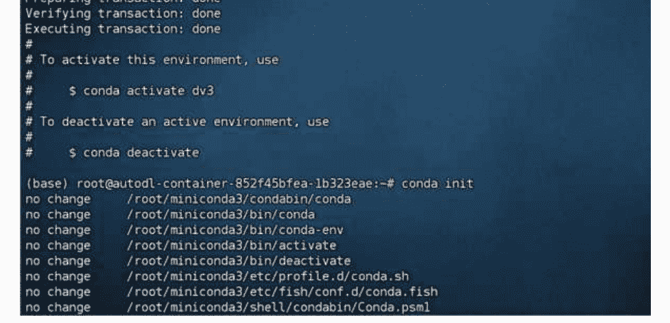

后续代码在 Jupyter Notebook 中运行，事先需完成安装与配置，执行如下命令。

```
conda install jupyterlab
conda install ipykernel
python -m ipykernel install --user --name dv3 --display-name "Python (dv3)"
```

(3) 通过GitHub拉取开源项目。首先登录GitHub主页，拉取所需项目；然后访问DeepSeek-V3主页；最后执行如下命令。

```
git clone https://github.com/deepseek-ai/DeepSeek-V3.git
```

输出结果如图3.9所示。


执行如下命令安装项目相关依赖。

```
cd DeepSeek-V3/inference
pip install -r requirements.txt
```

(4) 下载模型权重。可以在Hugging Face或者魔搭社区下载模型权重，推荐使用魔搭社区下载。

> **说明**

下载前需要提前留出600G左右存储空间，用于保存模型权重。

首先需要安装ModelScope开源模型库，执行如下命令。

```
pip install modelscope
```

输出结果如图3.10所示。


安装完成后，即可通过ModelScope下载模型权重，在下载时指定下载Int4类型的权重。执行如下命令。

```
mkdir ./deepseek
modelscope download --model OPEA/DeepSeek-V3-int4-sym-gptq-inc --local_dir ./deepseek
```

输出结果如图3.11所示。

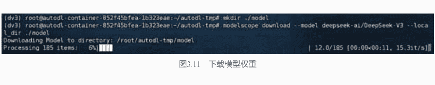

### 3. 在Jupyter Notebook中进行推理调用

在 Jupyter Notebook 中完成推理调用，代码如下。

```python
import torch
from modelscope import AutoTokenizer, AutoModelForCausalLM, GenerationConfig

# 指定模型存储路径（修改为上一步中模型权重下载到的本地路径）
model_name = "./deepseek"

# 加载对应的分词器（Tokenizer）
tokenizer = AutoTokenizer.from_pretrained(model_name)

# 加载 CausalLM（因果语言模型），设置数据类型为 bfloat16，并自动映射到可用设备（如 GPU）
model = AutoModelForCausalLM.from_pretrained(model_name, torch_dtype=torch.bfloat16, device_map="auto")

# 加载生成配置（GenerationConfig），用于调整模型的生成策略
model.generation_config = GenerationConfig.from_pretrained(model_name)
model.generation_config.pad_token_id = model.generation_config.eos_token_id
```

首步完成相关配置，指定模型存储路径后以因果语言模型 CausalLM 方式加载，并设置分词器与生成策略。

相关配置代码运行结果如图3.12所示。

```python
import torch
from modelscope import AutoTokenizer, AutoModelForCausalLM, GenerationConfig

model_name = "./deepseek-v3"

tokenizer = AutoTokenizer.from_pretrained(model_name)
model = AutoModelForCausalLM.from_pretrained(model_name, torch_dtype=torch.float16, device_map="auto")
model.generation_config = GenerationConfig.from_pretrained(model_name)
model.generation_config.pad_token_id = model.generation_config.eos_token_id
```

图3.12 模型配置代码运行结果

配置完成后即可展开对话，按规范格式组织消息列表，用 tokenizer 把文本转为模型可处理的张量，再输入模型生成回复，具体代码如下。

```python
# 构造对话消息列表
messages = [
    {"role": "user", "content": "你好，好久不见，请介绍下你自己！"}
]

# 使用 tokenizer 将对话消息转换为模型可处理的张量格式
input_tensor = tokenizer.apply_chat_template(messages, add_generation_prompt=True, return_tensors="pt")

# 使用模型进行文本生成
outputs = model.generate(input_tensor.to(model.device), max_new_tokens=100)

# 解码模型生成的文本
result = tokenizer.decode(outputs[0][input_tensor.shape[1]:], skip_special_tokens=True)
print(result)
```

运行效果如图3.13所示。

```python
messages = [
    {"role": "user", "content": "你好，好久不见，请介绍下你自己！"}
]

input_tensor = tokenizer.apply_chat_template(messages, add_generation_prompt=True, return_tensors="pt")
outputs = model.generate(input_tensor.to(model.device), max_new_tokens=100)

result = tokenizer.decode(outputs[0][input_tensor.shape[1]:], skip_special_tokens=True)
print(result)

你好！我是一个人工智能助手，名叫DeepSeek Chat，我由中国的DeepSeek团队开发，专门用于帮助用户解答问题和提供信息。我可以回答各种问题，包括但不限于科学、数学、历史、文化等领域的知识。如果你有任何问题，随时可以问我。
```

图3.13 在Jupyter Notebook中进行推理调用的效果图

#### 3.1.5 DeepSeek-V3 Function Calling

##### 1. Function Calling功能简介

Function Calling 是大语言模型迈向通用智能体能力的重要环节，允许模型在生成自然语言的同时，根据用户意图调用预定义函数或工具，实现更具交互性和实用性的任务处理。其基本流程如图3.14所示。

在传统对话系统中，模型往往只能进行语言输出，缺乏对外部环境的真实调用能力。Function Calling 则通过一个结构化接口，通常以 JSON Schema 描述函数，使模型具备

##### 2. 外部工具API

先说明什么是外部工具 API。API 的全称是应用程序接口，例如在 Python 环境中使用 ChatCompletion.create 函数，实际上就是 OpenAI 公司提供的 GPT 系列模型的一个接口，通过该 API，我们可以顺利调用 GPT 模型并实时得到结果。其他很多应用也有各自的 API。

本节示例采用可实时查询天气的 OpenWeather API。通过调用该 API 获取实时天气信息，再借助 Function Calling 调用对应函数，相当于赋予 Chat 模型实时获取天气的能力。此后即可通过 Chat 模型查询天气，或根据天气询问穿衣建议等。从功能上看，接入实时天气的 Chat 模型就是一个简易的天气查询 AI 助手。

为调用 OpenWeather 服务，流程与 OpenAI 类似，需先注册账号并获取 API key。大多数在线服务的 API 都需通过 API key 完成身份验证，OpenWeather 虽开放程度较高、免费额度充足，但验证仍是必要的，防止滥用。获取流程如下：

- (1) 登录 OpenWeather 官网并选择 Sign in→Create an Account 完成注册。可用国内邮箱或 QQ 邮箱注册。OpenWeather 官网页面如图3.15所示，其用户注册页面如图3.16所示。
- (2) 获取 API key：注册完成后，可在用户主页的 API keys 选项卡中查看当前账户的 API key，如图3.17所示。

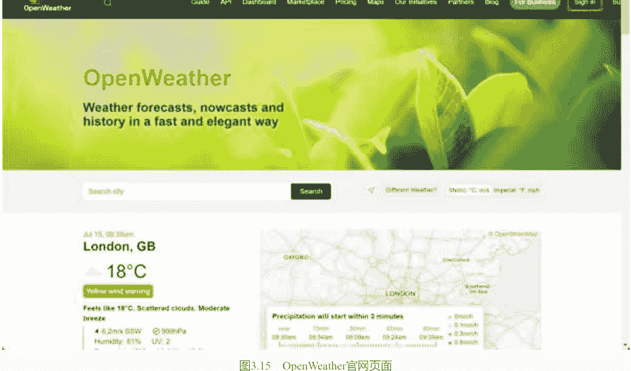

图3.15 OpenWeather官网页面


图3.16 OpenWeather用户注册页面


图3.17 OpenWeather用户主页

通常注册后会获得一个已激活的 API key。与 OpenAI 类似，OpenWeather 的 API key 也可创建多个，如图3.18所示。

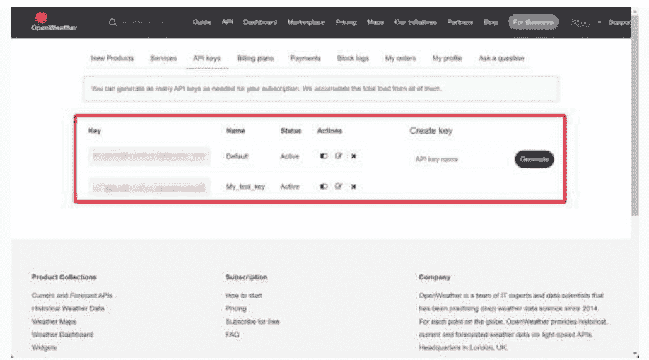

- (3) 与 OpenAI API key 类似，为方便后续调用，可直接把 OpenWeather API key 设为环境变量，变量名为 OPENWEATHER_API_KEY，如图3.19所示。


环境变量设置后，即可创建 OpenWeather API key 变量，代码如下。

```
open_weather_key = os.getenv("OPENWEATHER_API_KEY")
```

##### 3. OpenWeather API 实时天气实战

下面用一个最直观的例子演示怎么调用 OpenWeather 获取当前天气。我们把接口请求封装成一个独立函数，代码如下。

```
def get_weather(loc):
    """
    查询即时天气函数
    :param loc: 必要参数，字符串类型，用于表示查询天气的具体城市名称。
    注意，中国的城市名称需要用其英文名称代替，例如如果需要查询北京市天气，则 loc 参数需要输入'Beijing'；
    :return: OpenWeather API 查询即时天气的结果，具体 URL 请求地址为：https://api.openweathermap.org/data/2.5/weather
    返回结果对象类型为解析之后的 JSON 格式对象，并用字符串形式进行表示，其中包含了全部重要的天气信息
    """
    # Step 1.构建请求
    url = "https://api.openweathermap.org/data/2.5/weather"

    # Step 2.设置查询参数
    params = {
        "q": loc,
        "appid": open_weather_key,        # 输入 API key
        "units": "metric",                # 使用摄氏度而不是华氏度
        "lang":"zh_cn"                    # 输出语言为简体中文
    }

    # Step 3.发送 GET 请求
    response = requests.get(url, params=params)

    # Step 4.解析响应
    data = response.json()
    return json.dumps(data)
```

##### 4. functions 参数说明与配置方式

外部函数和依赖准备好后，最关键的一步是把这些函数的信息递交给 Chat 模型。ChatCompletion.create 里就提供了 functions 参数，和 messages 很像，都是用来向模型传递上下文，区别在于 functions 专门描述模型可以调用的外部能力。两者在形式上也很接近，都是由多个字典组成的列表。messages 里每个字典是一条对话，而 functions 里每个字典代表一个可调用函数。问答时，模型会基于 functions 提供的描述去检索匹配的函数。

functions 参数正是实现 Function Calling 的核心载体。下面拆解一个函数描述字典里必须填什么。

- (1) name：必填，字符串。函数名只能使用 a-z、A-Z、0-9、下划线和英文破折号，长度上限 64。模型靠这个名字在外部函数库里定位具体实现。
- (2) description：选填，字符串。用来说清函数能做什么。虽然不是强制项，却是模型判断函数用途的主要依据。若要让模型在多个候选函数中准确挑选，描述必须写得具体清晰。特殊情况下如果已经明确指定要用的函数，可以不写。
- (3) parameters：必填，按 JSON Schema 规范填写函数的入参定义。JSON Schema 是一种用来校验 JSON 结构是否合规的规范。

以 get_weather 为例，完整描述大致如下。

```
get_weather_function = {
    'name': 'get_weather',
    'description': '查询即时天气函数，根据输入的城市名称，查询对应城市的实时天气',
    'parameters': {
        'type': 'object',
        'properties': {
            'loc': {
                'description': '城市名称，注意，中国的城市名称需要用其英文名称代替，例如如果需要查询北京市天气，则loc参数需要输入"Beijing"',
                'type': 'string'
            }
        },
        'required': ['loc']
    }
}
```

还要准备一个外部函数库，把函数名称和实际对象对应起来。

```
available_functions = {
    "get_weather": get_weather,
}
```

在新版模型的 Function Calling 机制里，还需要再包一层，整理成 tools 对象，并标明这是一个 Function 类型的工具。

```
tools = [
    {
        "type": "function",
        "function": get_weather_function
    }
]
```

##### 5. Function Calling 运行全流程

Function Calling 的本质是让模型在一次对话里走完“理解意图→挑选函数→生成参数→外部执行→拿到结果→据此作答”的闭环。整体分为两步：第一次让模型识别任务并发起调用，第二次把执行结果喂回去让模型生成最终回答。

###### 1) 第一阶段：模型判断意图并决定调用哪个函数

完成基础准备后，我们开始在对话中触发 Function Calling。这里先构造如下的 messages。

```
# 实例化客户端
client = OpenAI(api_key=ds_api_key,
                base_url="https://api.deepseek.com")

messages=[
    {"role": "user", "content": "请帮我查询北京地区今日天气情况"}
]
```

先只给用户问题，不给函数库，测试模型是否能自行查天气。

```
response = client.chat.completions.create(
    model="deepseek-chat",
    messages=messages
)

response.choices[0].message.content
```

返回结果如下。

> “您好，建议您联网获取时效性较强的信息；如果还有其他问题需要帮助，请随时告诉我！”

很明显，没有外部能力的情况下模型无法给出答案。

接下来把函数库信息一起传给模型，这时要额外加两个参数：tools 用来声明当前可用的外部函数集合；tool_choice 用来控制是否触发调用。tool_choice 默认是 auto，模型会根据对话自动决定是否调用。若想强制指定某个函数，可以传入类似 {"name": "my_function"} 的字典，模型就不会自行挑选，而是直接执行 tools 中的 my_function。

下面让模型自动挑选并执行，设置与调用过程如下。

```
response = client.chat.completions.create(
    model="deepseek-chat",
    messages=[
        {"role": "user", "content": "请帮我查询北京地区今日天气情况"}
    ],
    tools=tools,
)
```

查看返回的 response，执行以下代码。

```
response
```

输出结果如下。

```
ChatCompletion(id='ba15fffc-82b6-40f7-91e2-d34b71e8daac', choices=[Choice(finish_reason='tool_calls', index=0, logprobs=None, message=ChatCompletionMessage(content='', refusal=None, role='assistant', audio=None, function_call=None, tool_calls=[ChatCompletionMessageToolCall(id='call_0_87e140df-66ef-44dd-813f-45800e169690', function=Function(arguments='{"loc":"Beijing"}', name='get_weather'), type='function', index=0)]))], created=1736240025, model='deepseek-chat', object='chat.completion', service_tier=None, system_fingerprint='fp_3a5770e1b4', usage=CompletionUsage(completion_tokens=19, prompt_tokens=153, total_tokens=172, completion_tokens_details=None, prompt_tokens_details=None, prompt_cache_hit_tokens=0, prompt_cache_miss_tokens=153))
```

继续执行以下代码。

```
response_message = response.choices[0].message
response_message
```

输出结果如下。

```
ChatCompletionMessage(content='', refusal=None, role='assistant', audio=None, function_call=None, tool_calls=[ChatCompletionMessageToolCall(id='call_0_87e140df-66ef-44dd-813f-45800e169690', function=Function(arguments='{"loc":"Beijing"}', name='get_weather'), type='function', index=0)])
```

可以看到，这次返回的 message 里 content 为空，多出了一个 tool_calls 列表，里面记录了本次函数调用的完整信息。

执行以下代码。

```
response_message.tool_calls
```

输出结果如下。

```
[ChatCompletionMessageToolCall(id='call_0_87e140df-66ef-44dd-813f-45800e169690', function=Function(arguments='{"loc":"Beijing"}', name='get_weather'), type='function', index=0)]
```

对于返回的 CompletionMessageToolCall 对象，id 是本次调用的请求标识，function 包含被调用函数的基础信息，type 表示调用类型，function 代表自定义外部函数。type 还可以是 retrieval 或 web_search，分别对应知识库检索和在线搜索。

在此基础上可以分别取出函数名和参数，保存为 function_name 和 function_args，代码如下：

```
# 完成对话需要调用的函数名称
function_name = response_message.tool_calls[0].function.name

# 具体的函数对象
fuction_to_call = available_functions[function_name]

# 执行该函数所需要的参数
function_args = json.loads(response_message.tool_calls[0].function.arguments)
```

要注意，外部函数的实际计算仍在本地完成，模型不会把代码拉到服务器上执行。因此需要拿模型返回的函数名和参数，在本地执行一遍，然后把执行结果封装成消息追加到 messages，再次调用模型来解读结果并给出用户可读的答案。

### 2）第二阶段：本地执行函数并把结果回传给模型

把 function_args 传入对应的 function_to_call 并计算，代码如下：

```
function_response = fuction_to_call(**function_args)
function_response
```

输出结果如下。

```
json
{"coord": {"lon": 116.3972, "lat": 39.9075}, "weather": [{"id": 804, "main": "Clouds", "description": "\u9634\uff0c\u591a\u4e91", "icon": "04d"}], "base": "stations", "main": {"temp": 4.94, "feels_like": 1.77, "temp_min": 4.94, "temp_max": 4.94, "pressure": 1020, "humidity": 25, "sea_level": 1020, "grnd_level": 1014}, "visibility": 10000, "wind": {"speed": 4.03, "deg": 300, "gust": 9.43}, "clouds": {"all": 85}, "dt": 1736239986, "sys": {"type": 1, "id": 9609, "country": "CN", "sunrise": 1736206561, "sunset": 1736240684}, "timezone": 28800, "id": 1816670, "name": "Beijing", "cod": 200}
```

可以看出模型已经顺利完成了计算。下一步在 messages 中追加两条记录：第一条是模型第一次返回的 assistant 消息，即包含 tool_calls 的那条；第二条是外部函数的执行结果，role 设为 function，name 填函数名。function 消息和 user、system、assistant 消息不同，它必须带 name，且内容来自外部函数的真实输出，需要手动构造。

具体操作如下，先查看最开始的 message。

```
python
messages
```

输出结果如下。

```
python
[{'role': 'user', 'content': '请帮我查询北京地区今日天气情况'}]
```

再查看模型第一次返回的消息。

```
python
response_message.model_dump()
```

输出结果如下。

```
python
{'content': '',
 'refusal': None,
 'role': 'assistant',
 'audio': None,
 'function_call': None,
 'tool_calls': [{'id': 'call_0_87e140df-66ef-44dd-813f-45800e169690',
   'function': {'arguments': '{"loc":"Beijing"}', 'name': 'get_weather'},
   'type': 'function',
   'index': 0}]}
```

把两部分拼接起来，执行以下代码。

```
python
# 追加模型第一次返回的结果消息
messages.append(response_message.model_dump())
messages
```

输出结果如下。

python

[{'role': 'user', 'content': '请帮我查询北京地区今日天气情况'},

 {'content': '',

  'refusal': None,

  'role': 'assistant',

  'audio': None,

  'function_call': None,

  'tool_calls': [{'id': 'call_0_87e140df-66ef-44dd-813f-45800e169690',

    'function': {'arguments': '{"loc":"Beijing"}', 'name': 'get_weather'},

    'type': 'function',

    'index': 0}]}]

```

再执行代码查看外部函数（调用天气查询API）的答复。

function_response

输出结果如下。

```json

{"coord": {"lon": 116.3972, "lat": 39.9075}, "weather": [{"id": 804, "main": "Clouds", "description": "\u9634\uff0c\u591a\u4e91", "icon": "04d"}], "base": "stations", "main": {"temp": 4.94, "feels_like": 1.77, "temp_min": 4.94, "temp_max": 4.94, "pressure": 1020, "humidity": 25, "sea_level": 1020, "grnd_level": 1014}, "visibility": 10000, "wind": {"speed": 4.03, "deg": 300, "gust": 9.43}, "clouds": {"all": 85}, "dt": 1736239986, "sys": {"type": 1, "id": 9609, "country": "CN", "sunrise": 1736206561, "sunset": 1736240684}, "timezone": 28800, "id": 1816670, "name": "Beijing", "cod": 200}

# LLM 工具调用实录

这组材料以一次首都天气咨询为线索，把大语言模型如何识别依赖、触发外部查询、把返回数据写回对话历史再产出通俗解读的全过程拆开来看。先是原始接口返回，随后是对话轮次的演化记录、再次请求片段、可自动判断是否需要外部能力的封装实现、真实调用示例以及最终的自然语言产出，最后附上在本地搭起交互界面的命令序列，方便复现与学习。

整体覆盖了原始数据形态、历史消息变化、二次推理代码、通用编排函数、实际使用样例、模型给出的总结以及运行环境的准备步骤。

```

将这部分消息继续拼接在messages里面，执行以下代码。

```python

# 追加 function 返回消息

messages.append({

    "role": "tool",

    "content": function_response,

    "tool_call_id": response_message.tool_calls[0].id

})

messages

```

输出结果如下。

```python

[{'role': 'user', 'content': '请帮我查询北京地区今日天气情况'},

 {'content': '',

  'refusal': None,

  'role': 'assistant',

  'audio': None,

  'function_call': None,

  'tool_calls': [{'id': 'call_0_87e140df-66ef-44dd-813f-45800e169690',

    'function': {'arguments': '{"loc":"Beijing"}', 'name': 'get_weather'},

    'type': 'function',

    'index': 0}]},

 {'role': 'tool',

  'content': '{"coord": {"lon": 116.3972, "lat": 39.9075}, "weather": [{"id": 804, "main": "Clouds", "description": "\u9634\uff0c\u591a\u4e91", "icon": "04d"}], "base": "stations", "main": {"temp": 4.94, "feels_like": 1.77, "temp_min": 4.94, "temp_max": 4.94, "pressure": 1020, "humidity": 25, "sea_level": 1020, "grnd_level": 1014}, "visibility": 10000, "wind": {"speed": 4.03, "deg": 300, "gust": 9.43}, "clouds": {"all": 85}, "dt": 1736239986, "sys": {"type": 1, "id": 9609, "country": "CN", "sunrise": 1736206561, "sunset": 1736240684}, "timezone": 28800, "id": 1816670, "name": "Beijing", "cod": 200}',

  'tool_call_id': 'call_0_87e140df-66ef-44dd-813f-45800e169690'}]

```

接下来，再次调用Chat模型来围绕messages进行回答。需要注意的是，此时我们不再需要向模型重复提问，只需要简单地将我们已经准备好的messages传入Chat模型即可。

> **注意**

这里的messages拼接了三部分内容：原本的用户提问内容+调用function需要的参数（模型第一阶段返回的内容）+本地具体执行外部函数返回的结果。

执行以下代码。

```python

second_response = client.chat.completions.create(

    model="deepseek-chat",

    messages=messages)

second_response.choices[0].message

```

输出结果如下。

```

ChatCompletionMessage(content='北京地区今日天气情况如下：\n\n- **天气状况**：阴，多云\n- **当前温度**：4.94°C\n- **体感温度**：1.77°C\n- **湿度**：25%\n- **风速**：4.03 米/秒\n- **风向**：300 度（西北风）\n- **能见度**：10000 米\n- **气压**：1020 hPa\n\n请注意保暖，适当增添衣物！', refusal=None, role='assistant', audio=None, function_call=None, tool_calls=None)

```

从上述输出结果能够发现，模型最终做出了准确回答。

##### 6. Function Calling函数封装

通过上面的逐步探索，我们已经了解了Function Calling的实现逻辑。通过下面代码将上面的过程进行封装。

```python

def run_conv(messages,

             api_key,

             tools=None,

             functions_list=None,

             model="deepseek-chat"):

    """

    能够自动执行外部函数调用的 Chat 对话模型

    :param messages: 必要参数，输入到 Chat 模型的 messages 参数对象

    :param api_key: 必要参数，调用模型的 API-KEY

    :param tools: 可选参数，默认为 None，可以设置为包含全部外部函数的列表对象

    :param model: Chat 模型，可选参数，默认模型为 deepseek-chat

    :return: Chat 模型输出结果

    """

    user_messages = messages

    client = OpenAI(api_key=api_key,

                    base_url="https://api.deepseek.com")

    # 如果没有外部函数库，则执行普通的对话任务

    if tools == None:

        response = client.chat.completions.create(

            model=model,

            messages=user_messages

        )

        final_response = response.choices[0].message.content

    # 若存在外部函数库，则需要灵活选取外部函数并进行回答

    else:

        # 创建外部函数库字典

        available_functions = {func.__name__: func for func in functions_list}

        # 创建包含用户问题的 messages

        messages = user_messages

        # first response

        response = client.chat.completions.create(

            model=model,

            messages=user_messages,

            tools=tools,

        )

        response_message = response.choices[0].message

        # 获取函数名

        function_name = response_message.tool_calls[0].function.name

        # 获取函数对象

        fuction_to_call = available_functions[function_name]

        # 获取函数参数

        function_args = json.loads(response_message.tool_calls[0].function.arguments)

        # 将函数参数输入到函数中，获取函数计算结果

        function_response = fuction_to_call(**function_args)

        # messages 中拼接 first response 消息

        user_messages.append(response_message.model_dump())

        # messages 中拼接外部函数输出结果

        user_messages.append(

            {

                "role": "tool",

                "content": function_response,

                "tool_call_id": response_message.tool_calls[0].id

            }

        )

        # 第二次调用模型

        second_response = client.chat.completions.create(

            model=model,

            messages=user_messages)

        # 获取最终结果

        final_response = second_response.choices[0].message.content

    return final_response

```

这里再次执行代码进行对话实验。

```python

messages = [{"role": "user", "content": "请问北京今天天气如何？"}]

run_conv(messages=messages,

         api_key = ds_api_key,

         tools=tools,

         functions_list=[get_weather])

```

输出结果如下。

```

北京今天的天气是多云，气温约为 4.94° C，体感温度约为 1.77° C，湿度为 25%，风速为 4.03 米/秒，风向为 300 度。空气质量良好，能见度为 10000 米。

```

至此，我们完整地使用DeepSeek-V3模型实现了Function Calling，即外部函数工具的调用。

#### 3.1.6 打造专属聊天机器人：Open-WebUI接入DeepSeek-V3

##### 1. Open-WebUI项目介绍

Open-WebUI是一个开源的Web界面，用于管理和交互式使用大语言模型（LLM）。它提供了直观的聊天界面，支持本地和远程模型，通过它可以轻松部署和调用各种开源模型，不需要复杂的命令行操作。

Open-WebUI项目支持接入在线大模型和开源大模型（包括OpenAI、GLM-4、Qwen2.5等），均可以通过其Functions（功能）模块来灵活接入，支持一键导入配置。

在Open-WebUI项目中，Functions通常是指该项目提供的可以执行特定任务或操作的模块或方法。这些功能模块可以帮助用户与大模型进行交互、配置模型参数、获取输出结果等。具体来说，这些Functions包括文本生成、模型参数调节、会话管理功能、API接口、模型选择和管理等实现细节。

##### 2. DeepSeek-V3接入Open-WebUI流程

（1）创建虚拟环境，运行如下命令。

```bash

# 创建一个名为 open-webui 的 Conda 虚拟环境，并指定 Python 版本为 3.11

conda create -n open-webui python=3.11

# 初始化 Conda

conda init

# 重新加载 shell 配置

source ~/.bashrc

# 激活刚刚创建的 open-webui 环境，进入该环境

conda activate open-webui

```

（2）安装Open-WebUI项目，运行如下命令。

```bash

pip install open-webui -i https://pypi.tuna.tsinghua.edu.cn/simple

```

输出结果如图3.20所示。

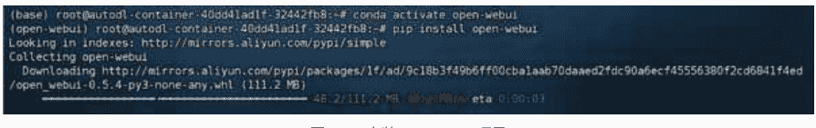

（3）开启服务，运行如下命令，服务将会启动本地的8080端口：http://localhost:8080。

```bash

open-webui serve

想用熟悉的 OpenAI 调用习惯接入 DeepSeek，只需要换掉 base_url 与密钥即可。下面是一组可直接复制运行的最小示例，覆盖基础对话、模型查询、系统指令以及图文混合输入。

先把客户端库装上：
```

##### 3. Open-WebUI前端交互操作

（1）单击图3.21中的“开始使用Open-WebUI”选项。按照操作提示创建管理员账号，用于项目管理（这里的信息均存储在项目本地服务器上）。


以管理员账号进入项目后，将显示如图3.22所示的账号主页信息。

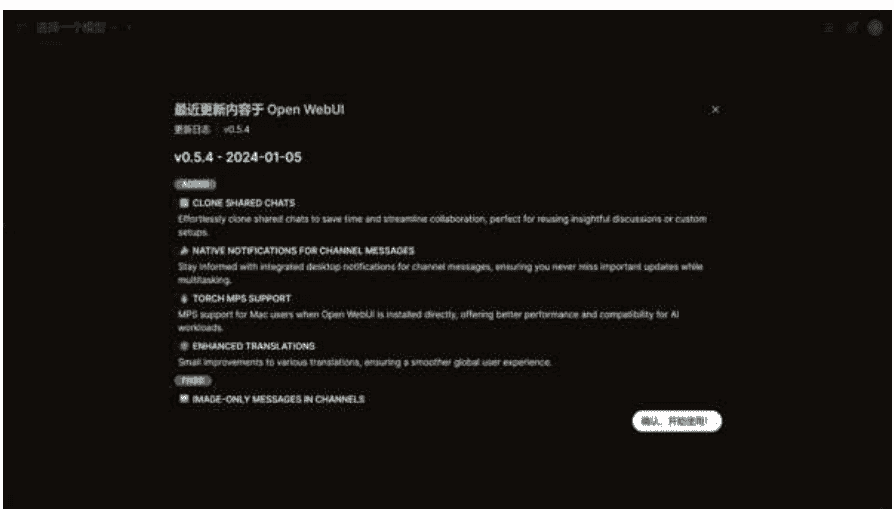

图3.22 Open-WebUI项目进入账号主页

（2）用户根据如图3.23所示的指示进行Open-WebUI项目的用户设置。

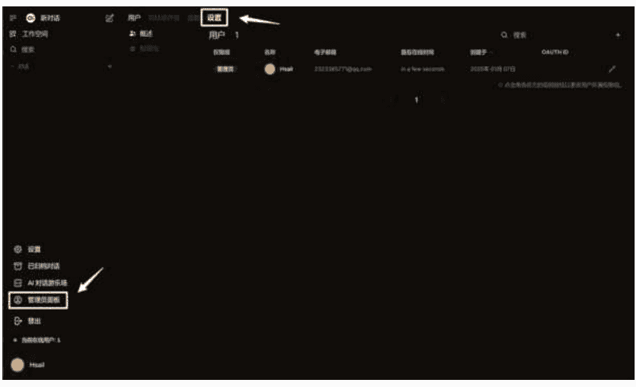

图3.23 Open-WebUI项目的用户设置

（3）在“设置”选项卡中单击“外部连接”，再单击“管理OpenAI API连接”右侧的“+”，进行连接的添加，如图3.24所示。


图3.24 Open-WebUI项目外部连接设置1

输入密钥后可单击图3.25所示按钮进行连接的验证。

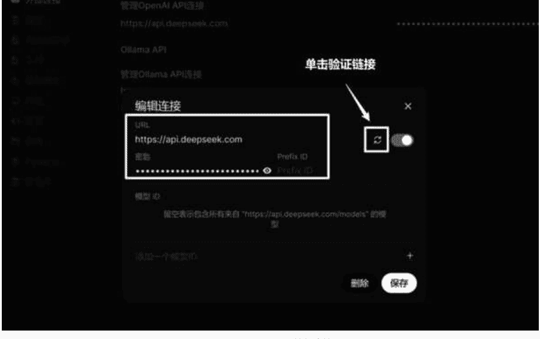

图3.25 Open-WebUI项目外部连接设置2

（4）选择对话模型并进行对话。单击对话页面左上角显示的模型可选择自己需要的模型，如图3.26所示。


选择模型之后就可以在对话框内输入文字同大模型进行对话，对话效果如图3.27所示。


至此，Open-WebUI接入DeepSeek-V3模型的全流程已顺利完成。用户现在可以通过直观的前端交互界面，与本地部署的大模型自由对话，实现高效的智能交互体验。从整体架构来看，Open-WebUI+DeepSeek-V3不仅提供了便捷的模型调用方式，而且构建了一个完整的前后端一体化独立应用，使大语言模型的部署与使用更加直观、高效。

### 3.1 DeepSeek-V3对话大模型

本节将围绕DeepSeek-V3模型的应用实践展开。我们首先介绍模型架构与核心功能特点，接着阐述在线API的标准调用方式及参数使用规范，然后深入本地部署的详细步骤，包括环境准备、模型权重加载、推理测试等关键环节。此外，本节我们还将演示如何通过Function Calling功能调用外部函数，最后将结合Open-WebUI构建具备可视化交互能力的个性化聊天系统。

#### 3.1.1 DeepSeek-V3模型介绍

DeepSeek-V3是由中国人工智能初创企业深度求索于2024年12月发布的第三个版本的大型语言模型，其一经发布就受到了高度关注。在模型架构方面，DeepSeek-V3采用了MoE架构，总参数量达到6710亿，但每个token仅激活370亿参数。这种设计在保证模型性能的同时，显著降低了计算资源的消耗。此外，模型引入了多头潜在注意力（multi-head latent attention, MLA）机制，以提升推理效率。在训练过程中，DeepSeek-V3也采用了无辅助损失的负载均衡策略，并设定了多token预测的训练目标，进一步增强了模型性能。

DeepSeek-V3在多个基准测试中超越了众多其他开源模型，如Qwen2.5-72B和Llama-3.1-405B，性能可媲美闭源模型GPT-4o和Claude-3.5-Sonnet。同时，值得注意的是，DeepSeek-V3的训练成本仅为557.6万美元（约为GPT-4o模型训练成本的1/20），显著低于同类顶尖模型。这一成本效益的实现，为中小企业和开发者提供了新的机遇。最关键的是DeepSeek-V3原生支持OpenAI SDK调用，且支持Function Calling、Json Output等功能，使用GPT模型的开发人员可以无缝切换到DeepSeek模型。

总而言之，DeepSeek-V3作为一款高性能、低成本的大型语言模型，展示了中国在人工智能领域的创新实力，为全球AI社区带来了新的视角和可能性。

#### 3.1.2 DeepSeek-V3模型API调用

##### 1. DeepSeek账号注册与API获取

首先访问DeepSeek官网，其官网主页如图3.1所示。

##### 2. DeepSeek-V3模型调用

使用如下命令安装必要的依赖环境。

```

pip install openai

```

官方手册指出：DeepSeek API使用与OpenAI兼容的API格式。这样你可以直接使用OpenAI SDK来访问DeepSeek API。

```

import os

from openai import OpenAI

from IPython.display import display, Code, Markdown

import requests

import json

# <YOUR_DEEPSEEK_API_KEY>替换为复制的 API key 字符串

ds_api_key = '<YOUR_DEEPSEEK_API_KEY>'

#实例化客户端

client = OpenAI(api_key=ds_api_key,

                base_url="https://api.deepseek.com")

#调用 DeepSeek-V3 模型

response = client.chat.completions.create(

    model="deepseek-chat",

    messages=[

        {"role": "user", "content": "你好，好久不见!"}

    ]

)

#输出生成的响应内容

print(response.choices[0].message.content)

#输出完整的响应

print(response)

这段脚本负责导入依赖、填入个人 key、创建客户端，随后向 deepseek-chat 发起一次简单问候并把文本结果与完整对象都打印出来：

```

输出结果如下。

```

你好！好久不见！最近过得怎么样？有什么想聊的吗？

ChatCompletion(id='1fdbc70b-acbf-4c9a-a895-d26bd69ad531',

              choices=[Choice(finish_reason='stop',

                              index=0, logprobs=None,

system_message = {

                    message=ChatCompletionMessage(content='你好！好久不见！最近过得怎么样？有什么想聊的吗？',

                                                  refusal=None,

                                                  role='assistant',

                                                  audio=None,

                                                  function_call=None,

                                                  tool_calls=None)],

              created=1736238514,

              model='deepseek-chat',

              object='chat.completion',

              service_tier=None,

              system_fingerprint='fp_3a5770e1b4',

              usage=CompletionUsage(completion_tokens=14,

                                    prompt_tokens=8,

                                    total_tokens=22,

                                    completion_tokens_details=None,

                                    prompt_tokens_details=None,

                                    prompt_cache_hit_tokens=0,

                                    prompt_cache_miss_tokens=8))

如果想查看密钥下可用的模型，可以调用列表接口：
```

与OpenAI一样的SDK，表明DeepSeek模型采用和GPT模型完全相同的参数体系。

可以输出DeepSeek目前支持的模型范围。

```

models_list = client.models.list()

print(models_list.data)

典型返回形态类似这样：
```

输出结果如下。

```

[Model(id='deepseek-chat', created=None, object='model', owned_by='deepseek'),
 Model(id='deepseek-coder', created=None, object='model', owned_by='deepseek')]

messages 的组织方式有几种常见写法。先定义一个系统角色，用来限定助手的行为风格：
```

这里的“deepseek-chat”即为DeepSeek-V3模型。因为DeepSeek-V3模型属于聊天补全（chat completion）模型，官方已经对“deepseek-chat”指代的模型进行了升级。

#### 3.1.3 DeepSeek-V3模型核心参数详解

##### 1. messages

messages参数是DeepSeek-V3模型API中必填的参数之一，用于定义聊天上下文，包括用户的输入、系统的指令、助手的回复等。通过messages数组，模型可以理解当前对话的背景，从而生成更加连贯的响应。根据不同的使用场景，messages包含多种类型的消息，例如system message、user message和assistant message。下面是对messages参数及其各个子类型的详细解释。

###### 1) system message

system message用于设置系统消息，通常由开发者设定，以指导模型如何进行对话。这类消息可以定义规则或约束，并提供有关对话的背景信息。

- content（必填）：系统消息的内容，可以是字符串或数组。如果是数组，可能包含多个类型的内容（如文本、图像）。
- role（必填）：此处角色为system，表明这是系统发出的消息。
- name（可选）：提供系统消息发送者的名称，尤其适用于区分多个具有相同角色的参与者。

示例代码如下：

```

system_message = {
    "role": "system",
    "content": "你是一位擅长编写 python 代码的助手。"
}

再准备一个普通用户消息的模板：
```

###### 2) user message

该参数表示用户发给模型的消息，是对话的核心部分之一。它定义了用户的输入内容，模型根据这些内容生成响应。

- content（必填）：用户消息的内容，通常为文本或图像链接的数组。对于支持图像输入的模型，如DeepSeek-V2.5，还可以传递图像。
  - 文本内容：单纯的字符串形式，用户输入的文本。
  - 数组形式的内容：由文本或图像链接组成的数组，可同时传递多张图像或多段文本内容。
- role（必填）：角色为user，表示该消息来自用户。
- name（可选）：可以为用户指定一个名称，用于区分多个具有相同角色的用户。

示例代码如下。

```

user_message = {
    "role": "user",
    "content": "你好，请介绍下你自己。"
}

需要图文一起送入时，可以把文字与 image_url 放在同一个 content 数组中：
```

如果在和大模型的对话消息中同时传递多个类型的内容（如图像和文本），示例代码如下：

```

user_message_with_image = {
    "role": "user",
    "content": [
        {"type": "text", "text": "你能帮我介绍下这张图片里面的内容吗？"},
        {"type": "image_url",
         "image_url": {
             "url": "https://ml2022.oss-cn-hangzhou.aliyuncs.com/img/image-20241009205714055.png"}}
    ]
}

下面是带系统提示的完整调用示例，把系统消息和用户消息一起传入，随后取出生成文本：
```

使用过程中通常单独创建用户消息，再将其作为参数传入模型调用函数中。

```

#创建用户消息

user_message = {
    "role": "user",
    "content": "你好，请介绍下你自己。"
}

#调用 DeepSeek-V3 模型

response = client.chat.completions.create(
    model="deepseek-chat",
    messages=[
        system_message,
        user_message
    ]
)

#输出生成的响应内容

print(response.choices[0].message.content)

整体流程就是安装包、配置 key 与地址、构造 messages、指定模型请求。后续更换模型、调整指令或加入多模态，都可以沿用同一套写法。

# DeepSeek-V3 本地推理速成

想把 DeepSeek-V3 跑在自己的机器上，先用独立的 Python 3.11 环境隔离依赖并接入 Jupyter，再拉取官方推理项目补全依赖包，接着通过 ModelScope 取得量化权重，最后依样加载模型并初始化生成参数即可。下面是完整可复制的操作序列。

```

输出结果如下。

> 你好！我是一位大学教授，专注于多个学科的研究与教学。我的工作主要包括教授本科生和研究生课程，指导学生的研究项目，以及进行学术研究。我致力于通过教育和研究推动知识的边界，并帮助学生发展他们的批判性思维和创新能力。此外，我也参与学术会议和研讨会，与同行交流最新的研究成果和教学方法。如果你有任何学术上的问题或需要指导，我很乐意提供帮助。

##### 2. 其余重要参数

在实际应用DeepSeek-V3进行推理调用时，用户可以通过一系列参数对模型的行为进行精细化控制。下面将详细介绍这些参数的作用，以帮助开发者根据不同场景的需求优化模型性能、管理生成内容，并提升交互体验。模型参数如表3.1所示。

表3.1 DeepSeek-V3模型参数汇总表

| 参数名 | 类型 | 必填/可选 | 默认值 | 说明 |
| :--- | :--- | :--- | :--- | :--- |
| model | string | 必填 | 无 | 指定要使用的模型 ID，例如 deepseek-chat 或 deepseek-code |
| store | boolean 或 null | 可选 | false | 是否存储本次对话的输出，供模型精炼或评估产品使用 |
| metadata | object 或 null | 可选 | null | 开发者自定义的标签和值，用于过滤仪表盘中的补全结果 |
| frequency_penalty | number 或 null | 可选 | 0 | 数值为-2.0～2.0，正值减少重复生成内容的可能性 |
| logit_bias | map | 可选 | null | 调整某些特定 token 出现的可能性，值为-100～100 |
| logprobs | boolean 或 null | 可选 | false | 是否返回生成的每个 token 的对数概率 |
| top_logprobs | integer 或 null | 可选 | null | 指定返回最有可能出现的前几个 token 及其概率，需开启 logprobs |
| max_completion_tokens | integer 或 null | 可选 | null | 指定模型生成的最大 token 数，包括可见文本和推理 token |
| n | integer 或 null | 可选 | 1 | 每个输入生成的对话补全选项数量，值越大，生成的回复越多 |
| presence_penalty | number 或 null | 可选 | 0 | 数值为-2.0～2.0，正值鼓励生成新的主题和内容 |
| response_format | object | 可选 | null | 指定生成结果的格式，可以设置为 json_schema 以确保结构化输出，或设置为 json_object 用于 JSON 格式 |
| seed | integer 或 null | 可选 | null | 保持生成的一致性，重复相同请求将尽量生成相同的结果 |
| service_tier | string 或 null | 可选 | auto | 指定服务延迟等级，适用于付费订阅用户 |
| stop | string/array/null | 可选 | null | 最多指定 4 个序列，API 遇到这些序列时会停止生成进一步的 token |
| stream | boolean 或 null | 可选 | false | 是否启用流式响应，若启用，生成的 token 将逐步返回 |
| stream_options | object 或 null | 可选 | null | 流式响应的选项，仅当 stream 为 true 时设置 |
| temperature | number 或 null | 可选 | 1 | 控制生成输出的随机性，值越高生成的文本越随机。建议调整此值或 top_p，而不是同时调整 |
| top_p | number 或 null | 可选 | 1 | 使用核采样方法，选择最有可能的 token，总概率达到 top_p 百分比。建议与 temperature 二选一 |
| tools | array | 可选 | null | 模型可以调用的工具列表，目前仅支持函数调用 |
| user | string | 可选 | null | 表示最终用户的唯一标识符，用于监控和检测滥用行为 |

为了更高效地配置模型参数，我们可以按照参数的功能和作用，将其划分为以下几大类别。

###### (1) 模型和输出。

- model是必填参数，决定使用哪个模型（如deepseek-chat或deepseek-code）。
- store用于控制是否存储生成的对话结果，便于后续模型训练或评估。
- metadata用于添加开发者自定义的标签，便于在仪表盘中过滤补全结果。
- max_completion_tokens和n控制生成内容的数量和长度，帮助管理生成成本。

###### (2) 生成行为控制。

- frequency_penalty和presence_penalty都用于影响生成结果的内容重复度和新颖性。
- logit_bias是用于调整特定token出现概率的高级控制工具。
- temperature和top_p通过不同的方式控制生成结果的随机性，建议选其一进行调整。

###### (3) 高级功能。

- logprobs和top_logprobs用于返回每个token的概率信息，适合对模型输出进行更细粒度分析。
- stream启用后会实时返回生成的结果，适用于需要逐步展示内容的场景。
- tools允许模型调用外部工具（如函数），适用于扩展模型的功能。

###### (4) 服务和用户。

- service_tier控制服务的延迟和稳定性，适合有高性能要求的付费用户。
- user用于标识最终用户，有助于监控使用行为，防止滥用。

#### 3.1.4 DeepSeek-V3模型本地部署与调用

##### 1. DeepSeek开源情况介绍

DeepSeek是开源大模型，我们首先需要对其开源情况有所了解。DeepSeek项目的GitHub文件情况如图3.5所示。

其中开源代码部分如图3.6所示。

图3.6 DeepSeek项目GitHub开源代码部分

以下是对图3.6中DeepSeek项目开源代码的介绍。

- convert.py: 用于格式转换，将一个已经训练好的模型检查点（checkpoint）文件从一个格式（如safetensors）转换并保存成一个适合特定模型并行度（model parallelism）和专家数（n_experts）的格式。
- fp8_cast_bf16.py: 代码的功能是将存储在FP8格式中的模型权重转换为BF16格式，并保存转换后的权重。它还更新了模型的索引文件，去除了scale_inv的引用。
- generate.py: 一个用于生成文本的示例程序，支持交互式和批量文本生成。它使用一个Transformer模型并进行分布式训练。
- kernel.py: 代码主要涉及量化和矩阵乘法操作，使用了Triton库进行加速，特别是针对FP8精度（浮点8位）进行了优化。Triton是一个专为GPU上的高效自定义操作而设计的编程框架，支持Python和PyTorch，可以通过简洁的代码来实现高效的GPU核心。
- model.py: 定义了DeekSeek-V3模型架构。

目前模型权重已经在Hugging Face上开源了，具体情况如图3.7所示。

##### 3. Model Downloads

| Model | #Total Params | #Activated Params | Context Length | Download |
|---|---|---|---|---|
| DeepSeek-V3-Base | 671B | 37B | 128K | Hugging Face |
| DeepSeek-V3 | 671B | 37B | 128K | Hugging Face |

> Note
The total size of DeepSeek-V3 models on Hugging Face is 685B, which includes 671B of the Main Model weights and 14B of the Multi-Token Prediction (MTP) Module weights.

To ensure optimal performance and flexibility, we have partnered with open-source communities and hardware vendors to provide multiple ways to run the model locally. For step-by-step guidance, check out Section 6: [How to Run Locally](https://github.com/deepseek-ai/DeepSeek-V3/blob/main/README.md#how-to-run-locally).

For developers looking to dive deeper, we recommend exploring [README_WEIGHTS.md](https://github.com/deepseek-ai/DeepSeek-V3/blob/main/README_WEIGHTS.md) for details on the Main Model weights and the Multi-Token Prediction (MTP) Modules. Please note that MTP support is currently under active development within the community, and we welcome your contributions and feedback.

图3.7 DeepSeek项目模型权重相关说明

DeepSeek-V3模型权重可在Hugging Face主页下载，权重总共约650G大小，用户也可在魔搭社区下载。作为权重全开源的模型，官方介绍的本地运行方法有如下几种。

- (1) DeepSeek-Infer Demo：提供了一个简单且轻量的演示，支持FP8和BF16推理。
- (2) SGLang：完全支持DeepSeek-V3模型在BF16和FP8推理模式下运行，且即将支持多标记预测（MTP）。
- (3) LMDeploy：支持高效的FP8和BF16推理，适用于本地和云端部署。
- (4) TensorRT-LLM：目前支持BF16推理和INT4/8量化，FP8支持即将推出。
- (5) vLLM：支持DeepSeek-V3模型在FP8和BF16模式下进行张量并行和流水线并行。
- (6) AMD GPU：通过SGLang，在BF16和FP8模式下支持在AMD GPU上运行DeepSeek-V3模型。
- (7) 华为Ascend NPU：支持在华为Ascend设备上运行DeepSeek-V3模型。

由于DeepSeek的框架原生采用FP8训练，因此仅提供FP8权重，预估仅700GB+显存便可运行。当然也可以转换到BF16，在半精度下，需要1400GB+，而量化到INT4时需要450GB+。以下是半精度下显存占用情况：（占用490G显存，需要7张80G A100，租赁成本约1000元／天）。

## 2. DeepSeek-V3本地部署

(1) 基本环境配置。本次的DeepSeek-V3本地部署将使用模型的Int4量化版运行，基本配置如下。

- ☑ 服务器硬件配置信息。
    - GPU: Nvidia H20 (98G) GPU * 8。
    - CPU: AMD EPYC 9K84 96-Core。
    - 桥接方式: NVLink。
    - 内存: 150G。
    - 存储: 2T。

- ☑ 深度学习环境配置信息。
    - 操作系统: Ubuntu 22.04。
    - PyTorch版本: 2.5.1。
    - Python版本: 3.12。
    - CUDA版本: 12.4。
    - 其他软件包版本根据DeepSeek-V3项目需求确定。

(2) 创建虚拟环境。执行如下命令创建虚拟环境。

```

# 创建一个名为 dv3 的 Conda 虚拟环境，并指定 Python 版本为 3.11

conda create --name dv3 python=3.11

conda init

# 重新加载 shell 配置

source ~/.bashrc

# 激活刚刚创建的 dv3 环境，使其成为当前终端会话的 Python 运行环境

conda activate dv3
```

输出结果如图3.8所示。

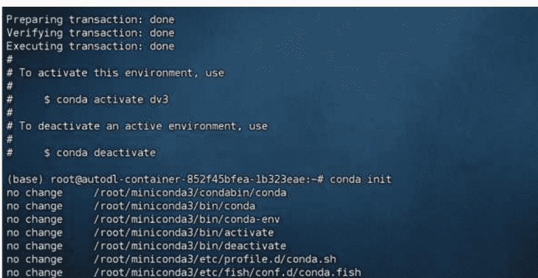

图3.8 创建虚拟环境

代码将在Jupyter Notebook环境中运行，在此之前，需要进行相关的安装和配置，执行如下命令。

```

conda install jupyterlab

conda install ipykernel

python -m ipykernel install --user --name dv3 --display-name "Python (dv3)"
```

(3) 通过GitHub拉取开源项目。首先登录GitHub主页，拉取所需项目；然后访问DeepSeek-V3主页；最后执行如下命令。

```

git clone https://github.com/deepseek-ai/DeepSeek-V3.git
```

输出结果如图3.9所示。

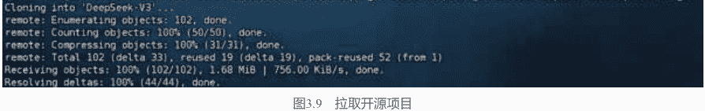

执行如下命令安装项目相关依赖。

```

cd DeepSeek-V3/inference

pip install -r requirements.txt
```

(4) 下载模型权重。可以在Hugging Face或者魔搭社区下载模型权重，推荐使用魔搭社区下载。

> **说明**
下载前需要提前留出600G左右存储空间，用于保存模型权重。

首先需要安装ModelScope开源模型库，执行如下命令。

```

pip install modelscope
```

输出结果如图3.10所示。


安装完成后，即可通过ModelScope下载模型权重，在下载时指定下载Int4类型的权重。执行如下命令。

```

mkdir ./deepseek

modelscope download --model OPEA/DeepSeek-V3-int4-sym-gptq-inc --local_dir ./deepseek
```

输出结果如图3.11所示。


## 3. 在Jupyter Notebook中进行推理调用

在Jupyter Notebook中进行推理调用，具体代码如下。

```python
import torch

from modelscope import AutoTokenizer, AutoModelForCausalLM, GenerationConfig

# 指定模型存储路径（修改为上一步中模型权重下载到的本地路径）

model_name = "./deepseek"

# 加载对应的分词器（Tokenizer）

tokenizer = AutoTokenizer.from_pretrained(model_name)

# 加载 CausalLM（因果语言模型），设置数据类型为 bfloat16，并自动映射到可用设备（如 GPU）

model = AutoModelForCausalLM.from_pretrained(model_name, torch_dtype=torch.bfloat16, device_map="auto")

# 加载生成配置（GenerationConfig），用于调整模型的生成策略

model.generation_config = GenerationConfig.from_pretrained(model_name)

model.generation_config.pad_token_id = model.generation_config.eos_token_id
```

首先需进行一些相关的配置，指定DeepSeek模型存储路径后将其加载为因果语言模型（causal language model，CausalLM），并配置相关的分词器和生成策略。

相关配置代码运行结果如图3.12所示。

```python
import torch

from modelscope import AutoTokenizer, AutoModelForCausalLM, GenerationConfig

model_name = "./deepseek-v3"

tokenizer = AutoTokenizer.from_pretrained(model_name)

model = AutoModelForCausalLM.from_pretrained(model_name, torch_dtype=torch.float16, device_map="auto")

model.generation_config = GenerationConfig.from_pretrained(model_name)

model.generation_config.pad_token_id = model.generation_config.eos_token_id
```

图3.12 模型配置代码运行结果

完成配置后，即可使用配置好的模型进行对话，按照规定格式构造消息列表，使用tokenizer将对话消息文本转换为模型可处理的张量格式，这时就可以输入模型来生成模型的回复，具体代码如下。

```python
# 构造对话消息列表
messages = [

{"role": "user", "content": "你好，好久不见，请介绍下你自己！"}

# 从本地推理到在线工具调用全流程

先用一句闲聊验证离线推理能否跑通，随后接入 DeepSeek 在线接口，对比裸对话与带工具的调用差异，演示模型如何识别天气类意图并主动发起函数请求。

## 离线阶段：消息序列化、生成与解码

把会话转成模型可直接处理的张量格式，触发一次生成，再把输出解码回可读文本。

input_tensor = tokenizer.apply_chat_template(messages, add_generation_prompt=True, return_tensors="pt")

# 使用模型进行文本生成

outputs = model.generate(input_tensor.to(model.device), max_new_tokens=100)

# 解码模型生成的文本

result = tokenizer.decode(outputs[0][input_tensor.shape[1]:], skip_special_tokens=True)

print(result)

```

运行效果如图3.13所示。

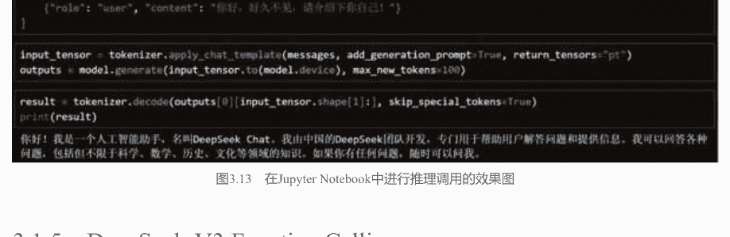

图3.13 在Jupyter Notebook中进行推理调用的效果图

#### 3.1.5 DeepSeek-V3 Function Calling

##### 1. Function Calling功能简介

Function Calling是大语言模型在向通用智能体能力迈进过程中的关键能力之一，允许模型不仅生成自然语言回答，还能根据用户意图调用预定义的函数或工具，以实现更具交互性与实用性的任务处理。其基本过程如图3.14所示。

在传统的对话系统中，模型往往只能进行语言输出，缺乏对外部环境的真实调用能力。Function Calling则通过一个结构化的接口定义（通常以JSON Schema描述函数），使模型具备“理解任务→调用函数→返回结果”的能力，从而完成如天气查询、数据库访问、文档检索、任务派发等实际操作。

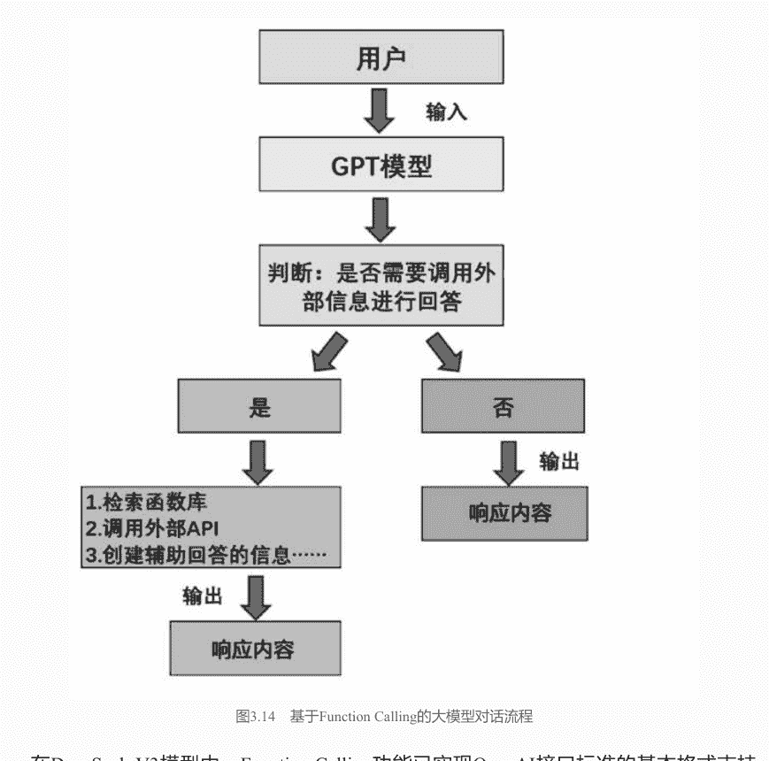

在DeepSeek-V3模型中，Function Calling功能已实现OpenAI接口标准的基本格式支持。开发者可以通过在API请求中添加functions字段，定义可被调用的函数结构，并由模型自动判断是否调用函数，以及调用哪个函数和传递哪些参数。

##### 2. 外部工具API

首先需要简单说明的是，到底什么是外部工具API。API的全称是应用程序接口，例如，目前我们在Python环境中使用了ChatCompletion.create函数，实际上就是OpenAI公司提供的GPT系列模型应用程序的一个接口，通过这个API（create函数或者openai库），我们能够非常顺利地调用GPT模型，并根据输入信息实时输出模型结果。而其他的很多应用程序也有相应的API。

本节示例中使用的是一个可以实时查询天气的API，即OpenWeather API。通过调用OpenWeather API获取实时天气信息，然后利用Function Calling功能调用该函数，这样相当于赋予了Chat模型实时获取天气信息的能力。此后，我们即可通过Chat模型实时查询天气，或根据天气情况询问穿衣建议等。从功能上来说，接入实时天气信息的Chat模型实际上就是一个非常简单的天气查询AI助手。

为了能够调用OpenWeather服务，和OpenAI的API使用过程类似，首先需要先注册OpenWeather账号，并获取OpenWeather API key。这里需要注意的是，对于大多数在线服务的API来说，都需要通过API key来进行身份验证，尽管OpenWeather相对更加开放，有非常多的免费使用次数，但身份验证仍然是必要的，防止API被滥用。OpenWeather API key获取流程如下。

- (1) 登录OpenWeather官网并选择Sign in→Create an Account完成注册。可以使用国内邮箱或者QQ邮箱进行注册。OpenWeather的官网页面如图3.15所示，其用户注册页面如图3.16所示。
- (2) 获取API key：注册完成后，即可在用户主页的API keys选项卡中查看当前账户的API key，如图3.17所示。


图3.15 OpenWeather官网页面


图3.16 OpenWeather用户注册页面


图3.17 OpenWeather用户主页

一般来说，完成注册后，用户通常会获得一个已经激活的API key。与OpenAI类似，OpenWeather的API key也创建多个，如图3.18所示。

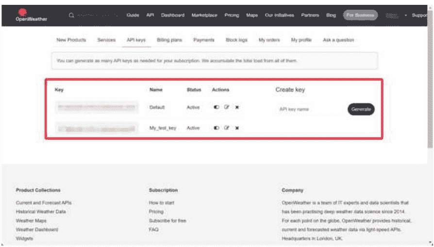

(3) 与OpenAI API key类似，为了方便后续调用，我们也可以直接将OpenWeather API key设置为环境变量，变量名为OPENWEATHER_API_KEY，如图3.19所示。


环境变量设置之后，即可创建OpenWeather API key变量，代码如下。

```python

open_weather_key = os.getenv("OPENWEATHER_API_KEY")

```

##### 3. 利用OpenWeather API获取实时天气信息

接下来，我们通过一个简单的示例来介绍如何使用OpenWeather API获取实时天气信息。我们将把该API的调用过程封装成一个函数。代码如下。

```python

def get_weather(loc):

    """

    查询即时天气函数

    :param loc: 必要参数，字符串类型，用于表示查询天气的具体城市名称。

    注意，中国的城市名称需要用其英文名称代替，例如如果需要查询北京市天气，则 loc 参数需要输入'Beijing'；

    :return: OpenWeather API 查询即时天气的结果，具体 URL 请求地址为：https://api.openweathermap.org/data/2.5/weather

    返回结果对象类型为解析之后的 JSON 格式对象，并用字符串形式进行表示，其中包含了全部重要的天气信息

    """

    # Step 1.构建请求

    url = "https://api.openweathermap.org/data/2.5/weather"

    # Step 2.设置查询参数

    params = {

        "q": loc,

        "appid": open_weather_key,        # 输入 API key

        "units": "metric",                # 使用摄氏度而不是华氏度

        "lang":"zh_cn"                    # 输出语言为简体中文

    }

    # Step 3.发送 GET 请求

    response = requests.get(url, params=params)

    # Step 4.解析响应

    data = response.json()

    return json.dumps(data)

```

##### 4. functions参数解释与定义过程

在完成外部函数及其库的准备工作之后，关键步骤是将外部函数的信息以某种形式传输给Chat模型。此时就需要用到ChatCompletion.create函数的functions参数，类似于messages参数，它用于向模型传输消息，functions参数专门用于提供可调用的外部函数信息。此外，从参数的具体形式来看，functions和messages参数也是非常类似的——都是包含多个字典的list。对于messages来说，每个字典都是一条信息，而对于functions参数来说，每个字典都是一个函数。在大语言模型实际进行问答时，会根据functions参数提供的信息对各函数进行检索。

显而易见，functions参数对于实现Chat模型的Function Calling功能至关重要。接下来，我们详细解释如何编写functions中的字典。总的来说，每个字典都有3个参数（3组键值对），各参数的名称及解释如下。

- (1) name：必选参数，字符串类型，代表函数名称。按照要求，函数名称必须由a-z、A-Z、0-9、下画线和英文破折号组成，最大长度为64。此名称用于模型在外部函数库中识别相应的函数。
- (2) description：可选参数，字符串类型，用于描述函数功能。虽然该参数不是必需的，但它是Chat模型识别函数功能的核心依据。即Chat函数实际上是通过每个函数的description来判断当前函数的实际功能的，若要实现多个备选函数的智能挑选，则需要严谨详细地描述函数功能（在特定情况下，如果已明确指定使用的函数，则无须设置description）。

（3）parameters：必选参数，需遵照JSON Schema格式进行输入的函数参数，JSON Schema是一种特殊的JSON对象，用于验证JSON数据格式是否满足要求。

例如，对于get_weather函数，我们需要创建如下字典来对其进行完整描述。

```

get_weather_function = {

    'name': 'get_weather',

    'description': '查询即时天气函数，根据输入的城市名称，查询对应城市的实时天气',

    'parameters': {

        'type': 'object',

        'properties': {

            'loc': {

                'description': '城市名称，注意，中国的城市名称需要用其英文名称代替，例如如果需要查询北京市天气，则loc参数需要输入"Beijing"',

                'type': 'string'

            }

        },

        'required': ['loc']

    }

}

```

同时还需要封装外部函数库，用于关联外部函数名称和外部函数对象。

```

available_functions = {

    "get_weather": get_weather,

}

```

对于最新模型的Function Calling功能来说，还需要进行更高层次封装，封装为一个tools对象，同时说明当前Function性质。

```

tools = [

    {

        "type": "function",

        "function": get_weather_function

    }

]

## 在线阶段：无工具与有工具的返回对比

创建客户端后先做一次普通问答，再携带工具描述发起请求，观察模型是否产生函数调用。

```

##### 5. Function Calling功能实现

Function Calling的本质，是让语言模型在对话中完成“识别任务→选中函数→给出参数→外部执行→返回结果→基于结果生成答复”的过程。这个过程分为两个阶段：第一次调用模型识别任务并调用函数，第二次调用模型生成最终回答。

### 1）第一阶段：模型识别任务并决定调用哪个函数

在一系列基础准备工作之后，我们将尝试在Chat模型对话中执行Function Calling功能。这里我们创建如下messages。

```

# 实例化客户端

client = OpenAI(api_key=ds_api_key,

                base_url="https://api.deepseek.com")

messages=[

    {"role": "user", "content": "请帮我查询北京地区今日天气情况"}

]

不提供工具时模型直接返回自然语言。

```

首先我们测试只输入这个信息而不输入外部函数库时模型能否知道如何查询天气。

```

response = client.chat.completions.create(

    model="deepseek-chat",

    messages=messages

)

response.choices[0].message.content

提供工具列表后，模型会自行判断是否需要调用。

```

输出结果如下。

> ‘您好，建议您联网获取时效性较强的信息；如果还有其他问题需要帮助，请随时告诉我！’

很明显，模型无法回答。

接下来，将函数库相关信息输入Chat模型，这里需要额外设置两个参数，其一是tools参数，用于声明外部函数库的当前情况，其二是tool_choice参数，该参数用于控制是否执行Function Calling功能，该参数有两种不同的取值，默认取值为auto，表示模型将根据用户实际对话情况，选择性地自动挑选函数执行，若想让模型在本次对话中特定执行tools中的某个函数，则可以通过输入形式如{"name": "my_function"}的字典进行声明，此时模型不会再自动挑选模型，而是在tools中挑选my_function执行。

这里我们尝试让模型自动挑选函数来执行，参数设置方法与执行过程如下。

```

response = client.chat.completions.create(

    model="deepseek-chat",

    messages=[

        {"role": "user", "content": "请帮我查询北京地区今日天气情况"}

    ],

    tools=tools,

)

```

观察此时的response结果，输入以下代码。

```

response

```

输出结果如下。

```

ChatCompletion(id='ba15fffc-82b6-40f7-91e2-d34b71e8daac', choices=[Choice(finish_reason='tool_calls', index=0, logprobs=None, message=ChatCompletionMessage(content='', refusal=None, role='assistant', audio=None, function_call=None, tool_calls=[ChatCompletionMessageToolCall(id='call_0_87e140df-66ef-44dd-813f-45800e169690', function=Function(arguments='{"loc":"Beijing"}', name='get_weather'), type='function', index=0)]))], created=1736240025, model='deepseek-chat', object='chat.completion', service_tier=None, system_fingerprint='fp_3a5770e1b4', usage=CompletionUsage(completion_tokens=19, prompt_tokens=153, total_tokens=172, completion_tokens_details=None, prompt_tokens_details=None, prompt_cache_hit_tokens=0, prompt_cache_miss_tokens=153))

## 解析返回并准备执行函数

从本次响应中取出消息对象，检查 tool_calls 是否存在，再抽取函数名与参数以便后续调用。

```

输入以下代码。

```

response_message = response.choices[0].message

response_message

```

输出结果如下。

```

ChatCompletionMessage(content='', refusal=None, role='assistant', audio=None, function_call=None, tool_calls=[ChatCompletionMessageToolCall(id='call_0_87e140df-66ef-44dd-813f-45800e169690', function=Function(arguments='{"loc":"Beijing"}', name='get_weather'), type='function', index=0)])

```

能够发现，此时返回的message中content为空，新增了一个tool_calls的list，该list就包含了当前调用外部函数的全部信息。

输入以下代码。

```

response_message.tool_calls

```

输出结果如下。

```

[ChatCompletionMessageToolCall(id='call_0_87e140df-66ef-44dd-813f-45800e169690', function=Function(arguments='{"loc":"Beijing"}', name='get_weather'), type='function', index=0)]

```

对于当前CompletionMessageToolCall对象，id为外部函数调用发起请求id，function则表示调用的外部函数的基本信息，而type则代表了当前调用的外部函数的类型，function代表调用自定义的外部函数。除此之外还可以选择retrieval或web_search，分别代表进行在线知识库的知识检索和进行在线搜索。

我们可以在此基础上分别提取调用的外部函数名称信息和参数信息，分别保存为function_name和function_args对象，代码如下：

```

# 完成对话需要调用的函数名称

function_name = response_message.tool_calls[0].function.name

# 具体的函数对象

fuction_to_call = available_functions[function_name]

# 执行该函数所需要的参数

# 北京天气查询：一次完整的工具调用实录

用一个真实的北京天气查询来拆解模型借助外部函数工作的全流程。用户提问后，模型先发出函数调用并解析参数，拿到返回的原始气象数据，再把对话历史补全后二次生成，最终输出可读的自然语言答案。下面按执行顺序完整呈现。

function_args = json.loads(response_message.tool_calls[0].function.arguments)

```

需要注意的是，外部函数的计算过程仍然是在本地执行，即Chat模型不会将代码读取到服务器上后再进行在线计算，因此接下来我们需要根据模型返回的函数和函数参数，在本地完成函数计算，然后再将计算过程和结果保存为message并追加到messages后面，接着第二次调用Chat模型分析函数的计算结果，并最终根据函数计算结果输出用户问题的答案。

### 2）第二阶段：本地执行函数，并将结果反馈给模型

接下来我们将function_args对象传入fuction_to_call中并完成计算，代码如下：

```

function_response = fuction_to_call(**function_args)

function_response

```

输出结果如下。

```

{"coord": {"lon": 116.3972, "lat": 39.9075}, "weather": [{"id": 804, "main": "Clouds", "description": "\u9634\uff0c\u591a\u4e91", "icon": "04d"}], "base": "stations", "main": {"temp": 4.94, "feels_like": 1.77, "temp_min": 4.94, "temp_max": 4.94, "pressure": 1020, "humidity": 25, "sea_level": 1020, "grnd_level": 1014}, "visibility": 10000, "wind": {"speed": 4.03, "deg": 300, "gust": 9.43}, "clouds": {"all": 85}, "dt": 1736239986, "sys": {"type": 1, "id": 9609, "country": "CN", "sunrise": 1736206561, "sunset": 1736240684}, "timezone": 28800, "id": 1816670, "name": "Beijing", "cod": 200}

```

根据上述运行结果能够发现，模型已经顺利完成计算。接下来，我们在messages对象中追加两条消息，第一条消息是第一次模型返回的结果（即调用模型的assistant message），第二条消息则是外部函数的计算结果，该条消息的role为function，且name为函数名称。我们也可以区分function message与user message、system message、assistant message的不同之处。function message必须包含关键词name，且其内容来源于外部函数执行的计算结果，并需要手动输入。具体添加过程如下。

先执行代码查看我们最初的message。

```

messages

```

输出结果如下。

```

[{'role': 'user', 'content': '请帮我查询北京地区今日天气情况'}]

```

查看模型第一次返回的结果消息。

```

response_message.model_dump()

```

输出结果如下。

```

{'content': '',

 'refusal': None,

 'role': 'assistant',

 'audio': None,

 'function_call': None,

 'tool_calls': [{'id': 'call_0_87e140df-66ef-44dd-813f-45800e169690',

   'function': {'arguments': '{"loc":"Beijing"}', 'name': 'get_weather'},

   'type': 'function',

   'index': 0}]}

```

现在将两部分的消息进行拼接，执行以下代码。

```

# 追加模型第一次返回的结果消息

messages.append(response_message.model_dump())

messages

```

输出结果如下。

```

[{'role': 'user', 'content': '请帮我查询北京地区今日天气情况'},

 {'content': '',

  'refusal': None,

  'role': 'assistant',

  'audio': None,

  'function_call': None,

  'tool_calls': [{'id': 'call_0_87e140df-66ef-44dd-813f-45800e169690',

    'function': {'arguments': '{"loc":"Beijing"}', 'name': 'get_weather'},

    'type': 'function',

    'index': 0}]}]

```

再执行代码查看外部函数（调用天气查询API）的答复。

```

function_response

```

输出结果如下。

```

{"coord": {"lon": 116.3972, "lat": 39.9075}, "weather": [{"id": 804, "main": "Clouds", "description": "\u9634\uff0c\u591a\u4e91", "icon": "04d"}], "base": "stations", "main": {"temp": 4.94, "feels_like": 1.77, "temp_min": 4.94, "temp_max": 4.94, "pressure": 1020, "humidity": 25, "sea_level": 1020, "grnd_level": 1014}, "visibility": 10000, "wind": {"speed": 4.03, "deg": 300, "gust": 9.43}, "clouds": {"all": 85}, "dt": 1736239986, "sys": {"type": 1, "id": 9609, "country": "CN", "sunrise": 1736206561, "sunset": 1736240684}, "timezone": 28800, "id": 1816670, "name": "Beijing", "cod": 200}

```

将这部分消息继续拼接在messages里面，执行以下代码。

```

# 追加 function 返回消息

messages.append({

    "role": "tool",

    "content": function_response,

    "tool_call_id": response_message.tool_calls[0].id

})

messages

```

输出结果如下。

```

[{'role': 'user', 'content': '请帮我查询北京地区今日天气情况'},

 {'content': '',

  'refusal': None,

  'role': 'assistant',

  'audio': None,

  'function_call': None,

  'tool_calls': [{'id': 'call_0_87e140df-66ef-44dd-813f-45800e169690',

    'function': {'arguments': '{"loc":"Beijing"}', 'name': 'get_weather'},

    'type': 'function',

    'index': 0}]},

 {'role': 'tool',

  'content': '{"coord": {"lon": 116.3972, "lat": 39.9075}, "weather": [{"id": 804, "main": "Clouds", "description": "\u9634\uff0c\u591a\u4e91", "icon": "04d"}], "base": "stations", "main": {"temp": 4.94, "feels_like": 1.77, "temp_min": 4.94, "temp_max": 4.94, "pressure": 1020, "humidity": 25, "sea_level": 1020, "grnd_level": 1014}, "visibility": 10000, "wind": {"speed": 4.03, "deg": 300, "gust": 9.43}, "clouds": {"all": 85}, "dt": 1736239986, "sys": {"type": 1, "id": 9609, "country": "CN", "sunrise": 1736206561, "sunset": 1736240684}, "timezone": 28800, "id": 1816670, "name": "Beijing", "cod": 200}',

  'tool_call_id': 'call_0_87e140df-66ef-44dd-813f-45800e169690'}]

```

接下来，再次调用Chat模型来围绕messages进行回答。需要注意的是，此时我们不再需要向模型重复提问，只需要简单地将我们已经准备好的messages传入Chat模型即可。

> **注意**

这里的messages拼接了三部分内容：原本的用户提问内容+调用function需要的参数（模型第一阶段返回的内容）+本地具体执行外部函数返回的结果。

执行以下代码。

```python

second_response = client.chat.completions.create(

    model="deepseek-chat",

    messages=messages)

second_response.choices[0].message

```

输出结果如下。

```

ChatCompletionMessage(content='北京地区今日天气情况如下：\n\n- **天气状况**：阴，多云\n- **当前温度**：4.94°C\n- **体感温度**：1.77°C\n- **湿度**：25%\n- **风速**：4.03 米/秒\n- **风向**：300 度（西北风）\n- **能见度**：10000 米\n- **气压**：1020 hPa\n\n请注意保暖，适当增添衣物！', refusal=None, role='assistant', audio=None, function_call=None, tool_calls=None)

```

从上述输出结果能够发现，模型最终做出了准确回答。

##### 6. Function Calling函数封装

通过上面的逐步探索，我们已经了解了Function Calling的实现逻辑。通过下面代码将上面的过程进行封装。

```python

def run_conv(messages,

             api_key,

             tools=None,

             functions_list=None,

             model="deepseek-chat"):

    """

    能够自动执行外部函数调用的 Chat 对话模型

    :param messages: 必要参数，输入到 Chat 模型的 messages 参数对象

    :param api_key: 必要参数，调用模型的 API-KEY

    :param tools: 可选参数，默认为 None，可以设置为包含全部外部函数的列表对象

    :param model: Chat 模型，可选参数，默认模型为 deepseek-chat

    :return: Chat 模型输出结果

    """

    user_messages = messages

    client = OpenAI(api_key=api_key,

                    base_url="https://api.deepseek.com")

    # 如果没有外部函数库，则执行普通的对话任务

    if tools == None:

        response = client.chat.completions.create(

            model=model,

            messages=user_messages

        )

        final_response = response.choices[0].message.content

    # 若存在外部函数库，则需要灵活选取外部函数并进行回答

    else:

        # 创建外部函数库字典

        available_functions = {func.__name__: func for func in functions_list}

        # 创建包含用户问题的 messages

        messages = user_messages

        # first response

        response = client.chat.completions.create(

            model=model,

            messages=user_messages,

            tools=tools,

        )

        response_message = response.choices[0].message

        # 获取函数名

        function_name = response_message.tool_calls[0].function.name

        # 获取函数对象

        fuction_to_call = available_functions[function_name]

        # 获取函数参数

        function_args = json.loads(response_message.tool_calls[0].function.arguments)

        # 将函数参数输入到函数中，获取函数计算结果

        function_response = fuction_to_call(**function_args)

        # messages 中拼接 first response 消息

        user_messages.append(response_message.model_dump())

        # messages 中拼接外部函数输出结果

        user_messages.append(

            {

                "role": "tool",

                "content": function_response,

                "tool_call_id": response_message.tool_calls[0].id

            }

        )

        # 第二次调用模型

        second_response = client.chat.completions.create(

            model=model,

            messages=user_messages)

        # 获取最终结果

        final_response = second_response.choices[0].message.content

    return final_response

```

这里再次执行代码进行对话实验。

```python

messages = [{"role": "user", "content": "请问北京今天天气如何？"}]

run_conv(messages=messages,

         api_key = ds_api_key,

         tools=tools,

         functions_list=[get_weather])

以上片段完整展示了从用户提问、模型触发工具、数据回填到最终生成答案的闭环，可直接作为自媒体讲解工具调用流程的范例参考。

# DeepSeek 本地 WebUI 与 API 协作指南

如果既想要图形化对话界面，又希望用代码驱动 DeepSeek，可以把整体拆成三段：先准备隔离的运行空间，再跑起 WebUI，最后用 Python 接入 API。下面按顺序给出可直接复用的片段。

搭建隔离空间

用 Conda 新开一个 Python 3.11 的独立工作区，用于存放 Open WebUI 的依赖。生成后让 Conda 配置生效，随后切入该空间进行后续操作。

```

输出结果如下。

> 北京今天的天气是多云，气温约为 4.94° C，体感温度约为 1.77° C，湿度为 25%，风速为 4.03 米/秒，风向为 300 度。空气质量良好，能见度为 10000 米。

至此，我们完整地使用DeepSeek-V3模型实现了Function Calling，即外部函数工具的调用。

#### 3.1.6 打造专属聊天机器人：Open-WebUI接入DeepSeek-V3

##### 1. Open-WebUI项目介绍

Open-WebUI是一个开源的Web界面，用于管理和交互式使用大语言模型（LLM）。它提供了直观的聊天界面，支持本地和远程模型，通过它可以轻松部署和调用各种开源模型，不需要复杂的命令行操作。

Open-WebUI项目支持接入在线大模型和开源大模型（包括OpenAI、GLM-4、Qwen2.5等），均可以通过其Functions（功能）模块来灵活接入，支持一键导入配置。

在Open-WebUI项目中，Functions通常是指该项目提供的可以执行特定任务或操作的模块或方法。这些功能模块可以帮助用户与大模型进行交互、配置模型参数、获取输出结果等。具体来说，这些Functions包括文本生成、模型参数调节、会话管理功能、API接口、模型选择和管理等实现细节。

##### 2. DeepSeek-V3接入Open-WebUI流程

(1) 创建虚拟环境，运行如下命令。

```bash

# 创建一个名为 open-webui 的 Conda 虚拟环境，并指定 Python 版本为 3.11

conda create -n open-webui python=3.11

# 初始化 Conda

conda init

# 重新加载 shell 配置

source ~/.bashrc

# 激活刚刚创建的 open-webui 环境，进入该环境

conda activate open-webui

启动可视化界面

进入工作区后，通过清华镜像部署 Open WebUI，部署完毕运行 serve 命令即可在本地提供服务。

```

(2) 安装Open-WebUI项目，运行如下命令。

```bash

pip install open-webui -i https://pypi.tuna.tsinghua.edu.cn/simple

```

输出结果如图3.20所示。


（3）开启服务，运行如下命令，服务将会启动本地的8080端口：http://localhost:8080。

```bash

open-webui serve

Python 端接入示例

先装入兼容 OpenAI 规范的客户端，随后用最小示例演示如何填入密钥、指向 DeepSeek 地址、选用 deepseek-chat 模型并打印结果。

```

### 3．Open-WebUI前端交互操作

（1）单击图3.21中的“开始使用Open-WebUI”选项。按照操作提示创建管理员账号，用于项目管理（这里的信息均存储在项目本地服务器上）。


以管理员账号进入项目后，将显示如图3.22所示的账号主页信息。


图3.22 Open-WebUI项目进入账号主页

（2）用户根据如图3.23所示的指示进行Open-WebUI项目的用户设置。

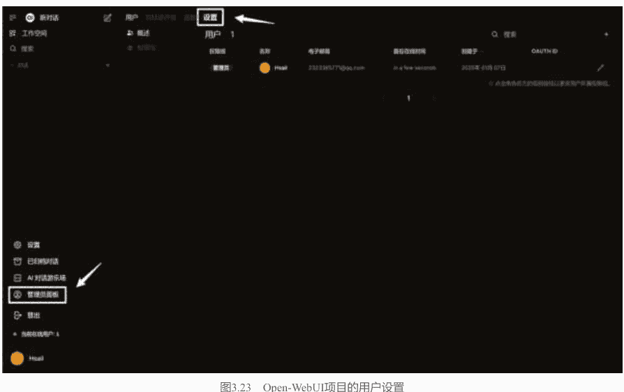

图3.23 Open-WebUI项目的用户设置

（3）在“设置”选项卡中单击“外部连接”，再单击“管理OpenAI API连接”右侧的“+”，进行连接的添加，如图3.24所示。

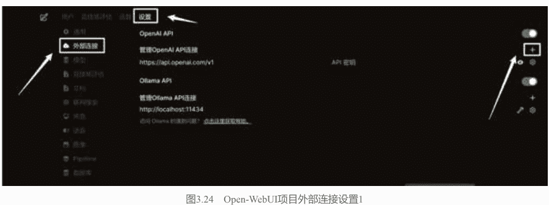

图3.24 Open-WebUI项目外部连接设置1

输入密钥后可单击图3.25所示按钮进行连接的验证。


图3.25 Open-WebUI项目外部连接设置2

（4）选择对话模型并进行对话。单击对话页面左上角显示的模型可选择自己需要的模型，如图3.26所示。


选择模型之后就可以在对话框内输入文字同大模型进行对话，对话效果如图3.27所示。


至此，Open-WebUI接入DeepSeek-V3模型的全流程已顺利完成。用户现在可以通过直观的前端交互界面，与本地部署的大模型自由对话，实现高效的智能交互体验。从整体架构来看，Open-WebUI+DeepSeek-V3不仅提供了便捷的模型调用方式，而且构建了一个完整的前后端一体化独立应用，使大语言模型的部署与使用更加直观、高效。

### 3.1 DeepSeek-V3对话大模型

本节将围绕DeepSeek-V3模型的应用实践展开。我们首先介绍模型架构与核心功能特点，接着阐述在线API的标准调用方式及参数使用规范，然后深入本地部署的详细步骤，包括环境准备、模型权重加载、推理测试等关键环节。此外，本节我们还将演示如何通过Function Calling功能调用外部函数，最后将结合Open-WebUI构建具备可视化交互能力的个性化聊天系统。

#### 3.1.1 DeepSeek-V3模型介绍

DeepSeek-V3是由中国人工智能初创企业深度求索于2024年12月发布的第三个版本的大型语言模型，其一经发布就受到了高度关注。在模型架构方面，DeepSeek-V3采用了MoE架构，总参数量达到6710亿，但每个token仅激活370亿参数。这种设计在保证模型性能的同时，显著降低了计算资源的消耗。此外，模型引入了多头潜在注意力（multi-head latent attention, MLA）机制，以提升推理效率。在训练过程中，DeepSeek-V3也采用了无辅助损失的负载均衡策略，并设定了多token预测的训练目标，进一步增强了模型性能。

DeepSeek-V3在多个基准测试中超越了众多其他开源模型，如Qwen2.5-72B和Llama-3.1-405B，性能可媲美闭源模型GPT-4o和Claude-3.5-Sonnet。同时，值得注意的是，DeepSeek-V3的训练成本仅为557.6万美元（约为GPT-4o模型训练成本的1/20），显著低于同类顶尖模型。这一成本效益的实现，为中小企业和开发者提供了新的机遇。最关键的是DeepSeek-V3原生支持OpenAI SDK调用，且支持Function Calling、Json Output等功能，使用GPT模型的开发人员可以无缝切换到DeepSeek模型。

总而言之，DeepSeek-V3作为一款高性能、低成本的大型语言模型，展示了中国在人工智能领域的创新实力，为全球AI社区带来了新的视角和可能性。

#### 3.1.2 DeepSeek-V3模型API调用

##### 1. DeepSeek账号注册与API获取

首先访问DeepSeek官网，其官网主页如图3.1所示。


图3.1 DeepSeek官网主页

单击图3.1右上角的“API开放平台”，即可进入DeepSeek的开放平台，查看有关API使用的内容，如图3.2所示。


图3.2 DeepSeek开放平台页面

单击图3.2左侧“接口文档”即可查看模型API调用的相关内容。单击左侧API keys即可进入API key的创建页面，也可通过该网址（https://platform.deepseek.com/api_keys）直达该网页，该网页界面如图3.3所示。

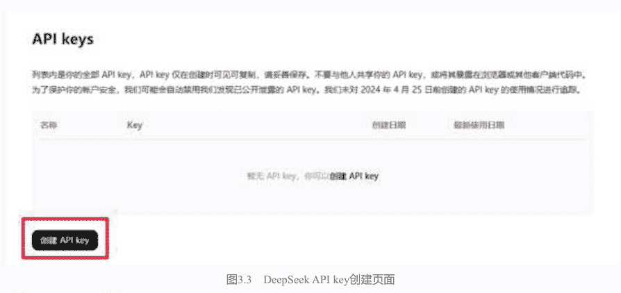

单击图3.3中的“创建API key”按钮即可开始创建API，如图3.4所示。这里建议复制图3.3中的API key并创建为新的系统环境变量，尽量避免直接暴露在代码中。

##### 2. DeepSeek-V3模型调用

使用如下命令安装必要的依赖环境。

```bash

pip install openai

```


官方手册指出：DeepSeek API使用与OpenAI兼容的API格式。这样你可以直接使用OpenAI SDK来访问DeepSeek API。

```python

import os

from openai import OpenAI

from IPython.display import display, Code, Markdown

import requests

import json

# <YOUR_DEEPSEEK_API_KEY>替换为复制的 API key 字符串

ds_api_key = '<YOUR_DEEPSEEK_API_KEY>'

#实例化客户端

client = OpenAI(api_key=ds_api_key,

                base_url="https://api.deepseek.com")

#调用 DeepSeek-V3 模型

response = client.chat.completions.create(

    model="deepseek-chat",

    messages=[

        {"role": "user", "content": "你好，好久不见!"}

    ]

)

#输出生成的响应内容

print(response.choices[0].message.content)

#输出完整的响应

print(response)

一次简易问询返回示例：

```

输出结果如下。

```

你好！好久不见！最近过得怎么样？有什么想聊的吗？

ChatCompletion(id='1fdbc70b-acbf-4c9a-a895-d26bd69ad531',

              choices=[Choice(finish_reason='stop',

                              index=0, logprobs=None,

              system_message = {

                  message=ChatCompletionMessage(content='你好！好久不见！最近过得怎么样？有什么想聊的吗？',

                                               refusal=None,

                                               role='assistant',

                                               audio=None,

                                               function_call=None,

                                               tool_calls=None)],

              created=1736238514,

              model='deepseek-chat',

              object='chat.completion',

              service_tier=None,

              system_fingerprint='fp_3a5770e1b4',

              usage=CompletionUsage(completion_tokens=14,

                                    prompt_tokens=8,

                                    total_tokens=22,

                                    completion_tokens_details=None,

                                    prompt_tokens_details=None,

                                    prompt_cache_hit_tokens=0,

                                    prompt_cache_miss_tokens=8))

进阶写法合集

同一客户端还能枚举可用模型、注入系统角色、构造含图片的多模态消息，常用模式如下：

```

与OpenAI一样的SDK，表明DeepSeek模型采用和GPT模型完全相同的参数体系。

可以输出DeepSeek目前支持的模型范围。

```python

models_list = client.models.list()

print(models_list.data)

```

#### 3.1.3 DeepSeek-V3模型核心参数详解

##### 1. messages

messages参数是DeepSeek-V3模型API中必填的参数之一，用于定义聊天上下文，包括用户的输入、系统的指令、助手的回复等。通过messages数组，模型可以理解当前对话的背景，从而生成更加连贯的响应。根据不同的使用场景，messages包含多种类型的消息，例如system message、user message和assistant message。下面是对messages参数及其各个子类型的详细解释。

1) system message

system message用于设置系统消息，通常由开发者设定，以指导模型如何进行对话。这类消息可以定义规则或约束，并提供有关对话的背景信息。

- :check_box_with_check: content（必填）：系统消息的内容，可以是字符串或数组。如果是数组，可能包含多个类型的内容（如文本、图像）。
- :check_box_with_check: role（必填）：此处角色为system，表明这是系统发出的消息。
- :check_box_with_check: name（可选）：提供系统消息发送者的名称，尤其适用于区分多个具有相同角色的参与者。

示例代码如下：

```

system_message = {

    "role": "system",

    "content": "你是一位擅长编写 python 代码的助手。"

}

```

2) user message

该参数表示用户发给模型的消息，是对话的核心部分之一。它定义了用户的输入内容，模型根据这些内容生成响应。

- :check_box_with_check: content（必填）：用户消息的内容，通常为文本或图像链接的数组。对于支持图像输入的模型，如DeepSeek-V2.5，还可以传递图像。
  - 文本内容：单纯的字符串形式，用户输入的文本。
  - 数组形式的内容：由文本或图像链接组成的数组，可同时传递多张图像或多段文本内容。
- :check_box_with_check: role（必填）：角色为user，表示该消息来自用户。
- :check_box_with_check: name（可选）：可以为用户指定一个名称，用于区分多个具有相同角色的用户。

示例代码如下。

```

user_message = {

    "role": "user",

    "content": "你好，请介绍下你自己。"

}

```

如果在和大模型的对话消息中同时传递多个类型的内容（如图像和文本），示例代码如下：

```

user_message_with_image = {

    "role": "user",

    "content": [

        {"type": "text", "text": "你能帮我介绍下这张图片里面的内容吗？"},

        {"type": "image_url",

         "image_url": {

             "url": "https://ml2022.oss-cn-hangzhou.aliyuncs.com/img/image-20241009205714055.png"}}]

}

加入系统提示的完整调用：

```

使用过程中通常单独创建用户消息，再将其作为参数传入模型调用函数中。

```

#创建用户消息

user_message = {

    "role": "user",

    "content": "你好，请介绍下你自己。"

}

#调用 DeepSeek-V3 模型

response = client.chat.completions.create(

    model="deepseek-chat",

    messages=[

        system_message,

        user_message

    ]

)

#输出生成的响应内容

print(response.choices[0].message.content)

图形界面适合快速体验与手工调试，代码路径则利于自动化与二次封装，配合使用可从尝鲜顺利过渡到生产化落地。

```

输出结果如下。

> 你好！我是一位大学教授，专注于多个学科的研究与教学。我的工作主要包括教授本科生和研究生课程，指导学生的研究项目，以及进行学术研究。我致力于通过教育和研究推动知识的边界，并帮助学生发展他们的批判性思维和创新能力。此外，我也参与学术会议和研讨会，与同行交流最新的研究成果和教学方法。如果你有任何学术上的问题或需要指导，我很乐意提供帮助。

##### 2. 其余重要参数

在实际应用DeepSeek-V3进行推理调用时，用户可以通过一系列参数对模型的行为进行精细化控制。下面将详细介绍这些参数的作用，以帮助开发者根据不同场景的需求优化模型性能、管理生成内容，并提升交互体验。模型参数如表3.1所示。

表3.1 DeepSeek-V3模型参数汇总表

| 参数名 | 类型 | 必填/可选 | 默认值 | 说明 |
| :--- | :--- | :--- | :--- | :--- |
| model | string | 必填 | 无 | 指定要使用的模型 ID，例如 deepseek-chat 或 deepseek-code |
| store | boolean 或 null | 可选 | false | 是否存储本次对话的输出，供模型精炼或评估产品使用 |
| metadata | object 或 null | 可选 | null | 开发者自定义的标签和值，用于过滤仪表盘中的补全结果 |
| frequency_penalty | number 或 null | 可选 | 0 | 数值为-2.0～2.0，正值减少重复生成内容的可能性 |
| logit_bias | map | 可选 | null | 调整某些特定 token 出现的可能性，值为-100～100 |
| logprobs | boolean 或 null | 可选 | false | 是否返回生成的每个 token 的对数概率 |
| top_logprobs | integer 或 null | 可选 | null | 指定返回最有可能出现的前几个 token 及其概率，需开启 logprobs |
| max_completion_tokens | integer 或 null | 可选 | null | 指定模型生成的最大 token 数，包括可见文本和推理 token |
| n | integer 或 null | 可选 | 1 | 每个输入生成的对话补全选项数量，值越大，生成的回复越多 |
| presence_penalty | number 或 null | 可选 | 0 | 数值为-2.0～2.0，正值鼓励生成新的主题和内容 |
| response_format | object | 可选 | null | 指定生成结果的格式，可以设置为 json_schema 以确保结构化输出，或设置为 json_object 用于 JSON 格式 |
| seed | integer 或 null | 可选 | null | 保持生成的一致性，重复相同请求将尽量生成相同的结果 |
| service_tier | string 或 null | 可选 | auto | 指定服务延迟等级，适用于付费订阅用户 |
| stop | string/array/null | 可选 | null | 最多指定 4 个序列，API 遇到这些序列时会停止生成进一步的 token |
| stream | boolean 或 null | 可选 | false | 是否启用流式响应，若启用，生成的 token 将逐步返回 |
| stream_options | object 或 null | 可选 | null | 流式响应的选项，仅当 stream 为 true 时设置 |
| temperature | number 或 null | 可选 | 1 | 控制生成输出的随机性，值越高生成的文本越随机。建议调整此值或 top_p，而不是同时调整 |
| top_p | number 或 null | 可选 | 1 | 使用核采样方法，选择最有可能的 token，总概率达到 top_p 百分比。建议与 temperature 二选一 |
| tools | array | 可选 | null | 模型可以调用的工具列表，目前仅支持函数调用 |
| user | string | 可选 | null | 表示最终用户的唯一标识符，用于监控和检测滥用行为 |

为了更高效地配置模型参数，我们可以按照参数的功能和作用，将其划分为以下几大类别。

###### (1) 模型和输出。

- :check_box_with_check: model是必填参数，决定使用哪个模型（如deepseek-chat或deepseek-code）。
- :check_box_with_check: store用于控制是否存储生成的对话结果，便于后续模型训练或评估。
- :check_box_with_check: metadata用于添加开发者自定义的标签，便于在仪表盘中过滤补全结果。
- :check_box_with_check: max_completion_tokens和n控制生成内容的数量和长度，帮助管理生成成本。

###### (2) 生成行为控制。

- :check_box_with_check: frequency_penalty和presence_penalty都用于影响生成结果的内容重复度和新颖性。
- :check_box_with_check: logit_bias是用于调整特定token出现概率的高级控制工具。
- :check_box_with_check: temperature和top_p通过不同的方式控制生成结果的随机性，建议选其一进行调整。

###### (3) 高级功能。

- :check_box_with_check: logprobs和top_logprobs用于返回每个token的概率信息，适合对模型输出进行更细粒度分析。
- :check_box_with_check: stream启用后会实时返回生成的结果，适用于需要逐步展示内容的场景。
- :check_box_with_check: tools允许模型调用外部工具（如函数），适用于扩展模型的功能。

###### (4) 服务和用户。

- :check_box_with_check: service_tier控制服务的延迟和稳定性，适合有高性能要求的付费用户。
- :check_box_with_check: user用于标识最终用户，有助于监控使用行为，防止滥用。

#### 3.1.4 DeepSeek-V3模型本地部署与调用

##### 1. DeepSeek开源情况介绍

DeepSeek是开源大模型，我们首先需要对其开源情况有所了解。DeepSeek项目的GitHub文件情况如图3.5所示。


其中开源代码部分如图3.6所示。


图3.6 DeepSeek项目GitHub开源代码部分

以下是对图3.6中DeepSeek项目开源代码的介绍。

- :check_box_with_check: convert.py: 用于格式转换，将一个已经训练好的模型检查点（checkpoint）文件从一个格式（如safetensors）转换并保存成一个适合特定模型并行度（model parallelism）和专家数（n_experts）的格式。
- :check_box_with_check: fp8_cast_bf16.py: 代码的功能是将存储在FP8格式中的模型权重转换为BF16格式，并保存转换后的权重。它还更新了模型的索引文件，去除了scale_inv的引用。
- :check_box_with_check: generate.py: 一个用于生成文本的示例程序，支持交互式和批量文本生成。它使用一个Transformer模型并进行分布式训练。
- :check_box_with_check: kernel.py: 代码主要涉及量化和矩阵乘法操作，使用了Triton库进行加速，特别是针对FP8精度（浮点8位）进行了优化。Triton是一个专为GPU上的高效自定义操作而设计的编程框架，支持Python和PyTorch，可以通过简洁的代码来实现高效的GPU核心。
- :check_box_with_check: model.py: 定义了DeepSeek-V3模型架构。

目前模型权重已经在Hugging Face上开源了，具体情况如图3.7所示。

##### 3. Model Downloads

| Model | #Total Params | #Activated Params | Context Length | Download |
|---|---|---|---|---|
| DeepSeek-V3-Base | 671B | 37B | 128K | Hugging Face |
| DeepSeek-V3 | 671B | 37B | 128K | Hugging Face |

> Note
The total size of DeepSeek-V3 models on Hugging Face is 685B, which includes 671B of the Main Model weights and 14B of the Multi-Token Prediction (MTP) Module weights.

To ensure optimal performance and flexibility, we have partnered with open-source communities and hardware vendors to provide multiple ways to run the model locally. For step-by-step guidance, check out Section 6: [How to Run Locally](https://github.com/deepseek-ai/DeepSeek-V3/blob/main/README.md#how-to-run-locally).

For developers looking to dive deeper, we recommend exploring [README_WEIGHTS.md](https://github.com/deepseek-ai/DeepSeek-V3/blob/main/README_WEIGHTS.md) for details on the Main Model weights and the Multi-Token Prediction (MTP) Modules. Please note that MTP support is currently under active development within the community, and we welcome your contributions and feedback.

图3.7 DeepSeek项目模型权重相关说明

DeepSeek-V3模型权重可在Hugging Face主页下载，权重总共约650G大小，用户也可在魔搭社区下载。作为权重全开源的模型，官方介绍的本地运行方法有如下几种。

- (1) DeepSeek-Infer Demo：提供了一个简单且轻量的演示，支持FP8和BF16推理。
- (2) SGLang：完全支持DeepSeek-V3模型在BF16和FP8推理模式下运行，且即将支持多标记预测（MTP）。
- (3) LMDeploy：支持高效的FP8和BF16推理，适用于本地和云端部署。
- (4) TensorRT-LLM：目前支持BF16推理和INT4/8量化，FP8支持即将推出。
- (5) vLLM：支持DeepSeek-V3模型在FP8和BF16模式下进行张量并行和流水线并行。
- (6) AMD GPU：通过SGLang，在BF16和FP8模式下支持在AMD GPU上运行DeepSeek-V3模型。
- (7) 华为Ascend NPU：支持在华为Ascend设备上运行DeepSeek-V3模型。

由于DeepSeek的框架原生采用FP8训练，因此仅提供FP8权重，预估仅700GB+显存便可运行。当然也可以转换到BF16，在半精度下，需要1400GB+，而量化到INT4时需要450GB+。以下是半精度下显存占用情况：（占用490G显存，需要7张80G A100，租赁成本约1000元／天）。

### 2. DeepSeek-V3本地部署

(1) 基本环境配置。本次的DeepSeek-V3本地部署将使用模型的Int4量化版运行，基本配置如下。

- :check_box_with_check: 服务器硬件配置信息。
  - GPU: Nvidia H20 (98G) GPU * 8。
  - CPU: AMD EPYC 9K84 96-Core。
  - 桥接方式: NVLink。
  - 内存: 150G。
  - 存储: 2T。
- :check_box_with_check: 深度学习环境配置信息。
  - 操作系统: Ubuntu 22.04。
  - PyTorch版本: 2.5.1。
  - Python版本: 3.12。
  - CUDA版本: 12.4。
  - 其他软件包版本根据DeepSeek-V3项目需求确定。

(2) 创建虚拟环境。执行如下命令创建虚拟环境。

```

# 新建 dv3 并锁定 Python 3.11

conda create --name dv3 python=3.11

conda init

# 刷新 shell 配置

source ~/.bashrc

# 激活 dv3

conda activate dv3

```

输出结果如图3.8所示。

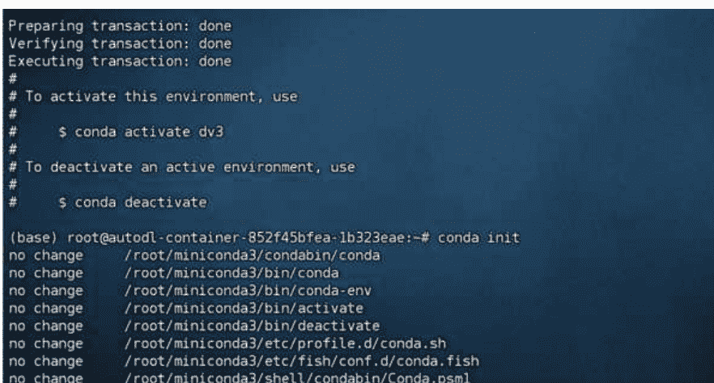

代码将在Jupyter Notebook环境中运行，在此之前，需要进行相关的安装和配置，执行如下命令。

```

conda install jupyterlab

conda install ipykernel

python -m ipykernel install --user --name dv3 --display-name "Python (dv3)"

```

（3）通过GitHub拉取开源项目。首先登录GitHub主页，拉取所需项目；然后访问DeepSeek-V3主页；最后执行如下命令。

```

git clone https://github.com/deepseek-ai/DeepSeek-V3.git

```

输出结果如图3.9所示。


执行如下命令安装项目相关依赖。

```

cd DeepSeek-V3/inference

pip install -r requirements.txt

```

（4）下载模型权重。可以在Hugging Face或者魔搭社区下载模型权重，推荐使用魔搭社区下载。

> **说明**
下载前需要提前留出600G左右存储空间，用于保存模型权重。

首先需要安装ModelScope开源模型库，执行如下命令。

```

pip install modelscope

```

输出结果如图3.10所示。

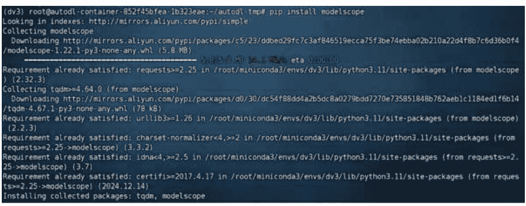

安装完成后，即可通过ModelScope下载模型权重，在下载时指定下载Int4类型的权重。执行如下命令。

```

mkdir ./deepseek

modelscope download --model OPEA/DeepSeek-V3-int4-sym-gptq-inc --local_dir ./deepseek

```

输出结果如图3.11所示。


## 3. 在Jupyter Notebook中进行推理调用

在Jupyter Notebook中进行推理调用，具体代码如下。

```python
import torch

from modelscope import AutoTokenizer, AutoModelForCausalLM, GenerationConfig

# 模型本地根目录，按实际下载位置修改
model_name = "./deepseek"

# 构建分词器实例
tokenizer = AutoTokenizer.from_pretrained(model_name)

# 以 bfloat16 精度实例化因果语言模型，设备自动分配
model = AutoModelForCausalLM.from_pretrained(model_name, torch_dtype=torch.bfloat16, device_map="auto")

# 从权重包读取生成参数
model.generation_config = GenerationConfig.from_pretrained(model_name)

model.generation_config.pad_token_id = model.generation_config.eos_token_id

```

首先需进行一些相关的配置，指定DeepSeek模型存储路径后将其加载为因果语言模型（causal language model，CausalLM），并配置相关的分词器和生成策略。

相关配置代码运行结果如图3.12所示。

```python
import torch

from modelscope import AutoTokenizer, AutoModelForCausalLM, GenerationConfig

# DeepSeek 本地推理与工具调用实操拆解

把 DeepSeek-v3 在本地跑起对话，以及让在线 Chat API学会调用外部天气工具，这两件事拆开来看会更清晰。先看模型加载与本地生成步骤，再看如何把天气查询封装成工具并触发调用。

## 本地端完整对话

本地推理的关键是先准备好权重、分词器和生成参数，然后把聊天记录转成张量送入模型。

### 初始化权重与生成参数
指定本地目录作为模型名，用 AutoTokenizer 与 AutoModelForCausalLM 分别创建分词器和模型。生成配置从模型仓库读取后，将 pad_token_id 指向 eos_token_id，避免生成时出现填充错误。

model_name = "./deepseek-v3"

tokenizer = AutoTokenizer.from_pretrained(model_name)

model = AutoModelForCausalLM.from_pretrained(model_name, torch_dtype=torch.float16, device_map="auto")

model.generation_config = GenerationConfig.from_pretrained(model_name)

model.generation_config.pad_token_id = model.generation_config.eostoken_id

### 完整流程示例含注释
以下片段演示了消息构造、模板转张量、生成以及解码打印的完整链路，注释说明了每一步作用。

```

图3.12 模型配置代码运行结果

完成配置后，即可使用配置好的模型进行对话，按照规定格式构造消息列表，使用tokenizer将对话消息文本转换为模型可处理的张量格式，这时就可以输入模型来生成模型的回复，具体代码如下。

```python

# 构造对话消息列表

messages = [

    {"role": "user", "content": "你好，好久不见，请介绍下你自己！"}

]

# 使用 tokenizer 将对话消息转换为模型可处理的张量格式

input_tensor = tokenizer.apply_chat_template(messages, add_generation_prompt=True, return_tensors="pt")

# 使用模型进行文本生成

outputs = model.generate(input_tensor.to(model.device), max_new_tokens=100)

# 解码模型生成的文本

result = tokenizer.decode(outputs[0][input_tensor.shape[1]:], skip_special_tokens=True)

print(result)

### 精简写法与一次运行结果
去掉注释后日常使用更简洁，效果等价。

```

运行效果如图3.13所示。

```python

messages = [

    {"role": "user", "content": "你好，好久不见，请介绍下你自己！"}

]

input_tensor = tokenizer.apply_chat_template(messages, add_generation_prompt=True, return_tensors="pt")

outputs = model.generate(input_tensor.to(model.device), max_new_tokens=100)

result = tokenizer.decode(outputs[0][input_tensor.shape[1]:], skip_special_tokens=True)

print(result)

你好！我是一个人工智能助手，名叫DeepSeek Chat，我由中国的DeepSeek团队开发，专门用于帮助用户解答问题和提供信息。我可以回答各种问题，包括但不限于科学、数学、历史、文化等领域的知识。如果你有任何问题，随时可以问我。

## 在线 API 的函数调用

验证本地流程后，切换到 DeepSeek Chat 在线接口演示工具调用。思路是先实现可被模型调用的天气查询，再提供机器可读的描述并挂载。

### 天气查询实现与密钥读取
API Key 从环境变量获取，函数内部组装 OpenWeather 请求地址与参数，最后把解析后的 JSON 转为字符串返回。

```

图3.13 在Jupyter Notebook中进行推理调用的效果图

#### 3.1.5 DeepSeek-V3 Function Calling

##### 1. Function Calling功能简介

Function Calling是大语言模型在向通用智能体能力迈进过程中的关键能力之一，允许模型不仅生成自然语言回答，还能根据用户意图调用预定义的函数或工具，以实现更具交互性与实用性的任务处理。其基本过程如图3.14所示。

在传统的对话系统中，模型往往只能进行语言输出，缺乏对外部环境的真实调用能力。Function Calling则通过一个结构化的接口定义（通常以JSON Schema描述函数），使模型具备“理解任务→调用函数→返回结果”的能力，从而完成如天气查询、数据库访问、文档检索、任务派发等实际操作。


在DeepSeek-V3模型中，Function Calling功能已实现OpenAI接口标准的基本格式支持。开发者可以通过在API请求中添加functions字段，定义可被调用的函数结构，并由模型自动判断是否调用函数，以及调用哪个函数和传递哪些参数。

##### 2. 外部工具API

首先需要简单说明的是，到底什么是外部工具API。API的全称是应用程序接口，例如，目前我们在Python环境中使用了ChatCompletion.create函数，实际上就是OpenAI公司提供的GPT系列模型应用程序的一个接口，通过这个API（create函数或者openai库），我们能够非常顺利地调用GPT模型，并根据输入信息实时输出模型结果。而其他的很多应用程序也有相应的API。

本节示例中使用的是一个可以实时查询天气的API，即OpenWeather API。通过调用OpenWeather API获取实时天气信息，然后利用Function Calling功能调用该函数，这样相当于赋予了Chat模型实时获取天气信息的能力。此后，我们即可通过Chat模型实时查询天气，或根据天气情况询问穿衣建议等。从功能上来说，接入实时天气信息的Chat模型实际上就是一个非常简单的天气查询AI助手。

为了能够调用OpenWeather服务，和OpenAI的API使用过程类似，首先需要先注册OpenWeather账号，并获取OpenWeather API key。这里需要注意的是，对于大多数在线服务的API来说，都需要通过API key来进行身份验证，尽管OpenWeather相对更加开放，有非常多的免费使用次数，但身份验证仍然是必要的，防止API被滥用。OpenWeather API key获取流程如下。

- (1) 登录OpenWeather官网并选择Sign in→Create an Account完成注册。可以使用国内邮箱或者QQ邮箱进行注册。OpenWeather的官网页面如图3.15所示，其用户注册页面如图3.16所示。
- (2) 获取API key：注册完成后，即可在用户主页的API keys选项卡中查看当前账户的API key，如图3.17所示。


图3.15 OpenWeather官网页面


图3.16 OpenWeather用户注册页面

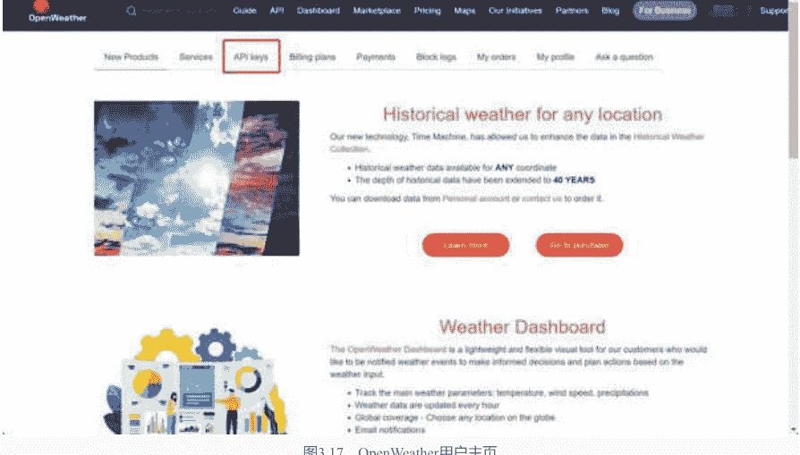

图3.17 OpenWeather用户主页

一般来说，完成注册后，用户通常会获得一个已经激活的API key。与OpenAI类似，OpenWeather的API key也创建多个，如图3.18所示。


- (3) 与OpenAI API key类似，为了方便后续调用，我们也可以直接将OpenWeather API key设置为环境变量，变量名为OPENWEATHER_API_KEY，如图3.19所示。


环境变量设置之后，即可创建OpenWeather API key变量，代码如下。

```python

open_weather_key = os.getenv("OPENWEATHER_API_KEY")

```

##### 3. 利用OpenWeather API获取实时天气信息

接下来，我们通过一个简单的示例来介绍如何使用OpenWeather API获取实时天气信息。我们将把该API的调用过程封装成一个函数。代码如下。

```python

def get_weather(loc):

    """

    查询即时天气函数

    :param loc: 必要参数，字符串类型，用于表示查询天气的具体城市名称。

    注意，中国的城市名称需要用其英文名称代替，例如如果需要查询北京市天气，则 loc 参数需要输入'Beijing'；

    :return: OpenWeather API 查询即时天气的结果，具体 URL 请求地址为：https://api.openweathermap.org/data/2.5/weather

    返回结果对象类型为解析之后的 JSON 格式对象，并用字符串形式进行表示，其中包含了全部重要的天气信息

    """

    # Step 1.构建请求

    url = "https://api.openweathermap.org/data/2.5/weather"

    # Step 2.设置查询参数

    params = {

        "q": loc,

        "appid": open_weather_key,        # 输入 API key

        "units": "metric",                # 使用摄氏度而不是华氏度

        "lang":"zh_cn"                    # 输出语言为简体中文

    }

    # Step 3.发送 GET 请求

    response = requests.get(url, params=params)

    # Step 4.解析响应

    data = response.json()

    return json.dumps(data)

### 工具描述与注册
先用 Schema 描述函数用途与参数规则，再把真实实现映射到名称，最后封装成 tools 列表。

```

##### 4. functions参数解释与定义过程

在完成外部函数及其库的准备工作之后，关键步骤是将外部函数的信息以某种形式传输给Chat模型。此时就需要用到ChatCompletion.create函数的functions参数，类似于messages参数，它用于向模型传输消息，functions参数专门用于提供可调用的外部函数信息。此外，从参数的具体形式来看，functions和messages参数也是非常类似的——都是包含多个字典的list。对于messages来说，每个字典都是一条信息，而对于functions参数来说，每个字典都是一个函数。在大语言模型实际进行问答时，会根据functions参数提供的信息对各函数进行检索。

显而易见，functions参数对于实现Chat模型的Function Calling功能至关重要。接下来，我们详细解释如何编写functions中的字典。总的来说，每个字典都有3个参数（3组键值对），各参数的名称及解释如下。

- (1) name：必选参数，字符串类型，代表函数名称。按照要求，函数名称必须由a-z、A-Z、0-9、下画线和英文破折号组成，最大长度为64。此名称用于模型在外部函数库中识别相应的函数。
- (2) description：可选参数，字符串类型，用于描述函数功能。虽然该参数不是必需的，但它是Chat模型识别函数功能的核心依据。即Chat函数实际上是通过每个函数的description来判断当前函数的实际功能的，若要实现多个备选函数的智能挑选，则需要严谨详细地描述函数功能（在特定情况下，如果已明确指定使用的函数，则无须设置description）。
- (3) parameters：必选参数，需遵照JSON Schema格式进行输入的函数参数，JSON Schema是一种特殊的JSON对象，用于验证JSON数据格式是否满足要求。

例如，对于get_weather函数，我们需要创建如下字典来对其进行完整描述。

```python

get_weather_function = {

    'name': 'get_weather',

    'description': '查询即时天气函数，根据输入的城市名称，查询对应城市的实时天气',

    'parameters': {

        'type': 'object',

        'properties': {

            'loc': {

                'description': '城市名称，注意，中国的城市名称需要用其英文名称代替，例如如果需要查询北京市天气，则loc参数需要输入"Beijing"',

                'type': 'string'

            }

        },

        'required': ['loc']

    }

}

```

同时还需要封装外部函数库，用于关联外部函数名称和外部函数对象。

```python

available_functions = {

    "get_weather": get_weather,

}

```

对于最新模型的Function Calling功能来说，还需要进行更高层次封装，封装为一个tools对象，同时说明当前Function性质。

```python

tools = [

    {

        "type": "function",

        "function": get_weather_function

    }

]

### 未挂载工具的普通对话
使用 OpenAI 兼容 SDK 指向 DeepSeek 接口，先发送一次不带工具的请求，观察模型是否直接作答。

```

##### 5. Function Calling功能实现

Function Calling的本质，是让语言模型在对话中完成“识别任务→选中函数→给出参数→外部执行→返回结果→基于结果生成答复”的过程。这个过程分为两个阶段：第一次调用模型识别任务并调用函数，第二次调用模型生成最终回答。

1) 第一阶段：模型识别任务并决定调用哪个函数

在一系列基础准备工作之后，我们将尝试在Chat模型对话中执行Function Calling功能。这里我们创建如下messages。

```python

# 实例化客户端

client = OpenAI(api_key=ds_api_key,

                base_url="https://api.deepseek.com")

messages=[

    {"role": "user", "content": "请帮我查询北京地区今日天气情况"}

]

```

首先我们测试只输入这个信息而不输入外部函数库时模型能否知道如何查询天气。

```python

response = client.chat.completions.create(

    model="deepseek-chat",

    messages=messages

)

response.choices[0].message.content

### 挂载 tools 后的调用示例
把 tools 传入请求后，模型会判断需要调用 get_weather，返回 finish_reason 为 tool_calls，message.content 为空，参数被解析为 loc=Beijing。

```

输出结果如下。

> ‘您好，建议您联网获取时效性较强的信息；如果还有其他问题需要帮助，请随时告诉我！’

很明显，模型无法回答。

接下来，将函数库相关信息输入Chat模型，这里需要额外设置两个参数，其一是tools参数，用于声明外部函数库的当前情况，其二是tool_choice参数，该参数用于控制是否执行Function Calling功能，该参数有两种不同的取值，默认取值为auto，表示模型将根据用户实际对话情况，选择性地自动挑选函数执行，若想让模型在本次对话中特定执行tools中的某个函数，则可以通过输入形式如{"name": "my_function"}的字典进行声明，此时模型不会再自动挑选模型，而是在tools中挑选my_function执行。

这里我们尝试让模型自动挑选函数来执行，参数设置方法与执行过程如下。

```python

response = client.chat.completions.create(

    model="deepseek-chat",

    messages=[

        {"role": "user", "content": "请帮我查询北京地区今日天气情况"}

    ],

    tools=tools,

)

```

观察此时的response结果，输入以下代码。

```python

response

```

输出结果如下。

```

ChatCompletion(id='ba15fffc-82b6-40f7-91e2-d34b71e8daac', choices=[Choice(finish_reason='tool_calls', index=0, logprobs=None, message=ChatCompletionMessage(content='', refusal=None, role='assistant', audio=None, function_call=None, tool_calls=[ChatCompletionMessageToolCall(id='call_0_87e140df-66ef-44dd-813f-45800e169690', function=Function(arguments='{"loc":"Beijing"}', name='get_weather'), type='function', index=0)]))], created=1736240025, model='deepseek-chat', object='chat.completion', service_tier=None, system_fingerprint='fp_3a5770e1b4', usage=CompletionUsage(completion_tokens=19, prompt_tokens=153, total_tokens=172, completion_tokens_details=None, prompt_tokens_details=None, prompt_cache_hit_tokens=0, prompt_cache_miss_tokens=153))

后续处理可直接取出消息对象。

```

输入以下代码。

```python

response_message = response.choices[0].message

response_message

```

输出结果如下。

```

# 让 AI 实时查天气：两次对话拆解

想让对话系统能查真实数据，关键是搭好“识别需求 → 调用工具 → 返写结果 → 自然回复”的闭路。通过一次北京天气查询的例子，可以清晰看到模型如何先给出调用指令，本地执行拿到原始 JSON，再把这段记录塞回对话上下文，第二次再生成通俗易懂的天气说明。掌握这个节奏，就能把天气、股票、搜索等各类外部能力接入进来。

ChatCompletionMessage(content='', refusal=None, role='assistant', audio=None, function_call=None, tool_calls=[ChatCompletionMessageToolCall(id='call_0_87e140df-66ef-44dd-813f-45800e169690', function=Function(arguments='{"loc":"Beijing"}', name='get_weather'), type='function', index=0)])

```

能够发现，此时返回的message中content为空，新增了一个tool_calls的list，该list就包含了当前调用外部函数的全部信息。

输入以下代码。

```python
response_message.tool_calls
```

输出结果如下。

```
[ChatCompletionMessageToolCall(id='call_0_87e140df-66ef-44dd-813f-45800e169690', function=Function(arguments='{"loc":"Beijing"}', name='get_weather'), type='function', index=0)]
```

对于当前CompletionMessageToolCall对象，id为外部函数调用发起请求id，function则表示调用的外部函数的基本信息，而type则代表了当前调用的外部函数的类型，function代表调用自定义的外部函数。除此之外还可以选择retrieval或web_search，分别代表进行在线知识库的知识检索和进行在线搜索。

我们可以在此基础上分别提取调用的外部函数名称信息和参数信息，分别保存为function_name和function_args对象，代码如下：

```python
# 完成对话需要调用的函数名称
function_name = response_message.tool_calls[0].function.name
# 具体的函数对象
fuction_to_call = available_functions[function_name]
# 执行该函数所需要的参数
function_args = json.loads(response_message.tool_calls[0].function.arguments)
```

需要注意的是，外部函数的计算过程仍然是在本地执行，即Chat模型不会将代码读取到服务器上后再进行在线计算，因此接下来我们需要根据模型返回的函数和函数参数，在本地完成函数计算，然后再将计算过程和结果保存为message并追加到messages后面，接着第二次调用Chat模型分析函数的计算结果，并最终根据函数计算结果输出用户问题的答案。

2）第二阶段：本地执行函数，并将结果反馈给模型

接下来我们将function_args对象传入fuction_to_call中并完成计算，代码如下：

```python
function_response = fuction_to_call(**function_args)
function_response
```

输出结果如下。

```json
{"coord": {"lon": 116.3972, "lat": 39.9075}, "weather": [{"id": 804, "main": "Clouds", "description": "阴，多云", "icon": "04d"}], "base": "stations", "main": {"temp": 4.94, "feels_like": 1.77, "temp_min": 4.94, "temp_max": 4.94, "pressure": 1020, "humidity": 25, "sea_level": 1020, "grnd_level": 1014}, "visibility": 10000, "wind": {"speed": 4.03, "deg": 300, "gust": 9.43}, "clouds": {"all": 85}, "dt": 1736239986, "sys": {"type": 1, "id": 9609, "country": "CN", "sunrise": 1736206561, "sunset": 1736240684}, "timezone": 28800, "id": 1816670, "name": "Beijing", "cod": 200}
```

根据上述运行结果能够发现，模型已经顺利完成计算。接下来，我们在messages对象中追加两条消息，第一条消息是第一次模型返回的结果（即调用模型的assistant message），第二条消息则是外部函数的计算结果，该条消息的role为function，且name为函数名称。我们也可以区分function message与user message、system message、assistant message的不同之处。function message必须包含关键词name，且其内容来源于外部函数执行的计算结果，并需要手动输入。具体添加过程如下。

先执行代码查看我们最初的message。

```python
messages
```

输出结果如下。

```
[{'role': 'user', 'content': '请帮我查询北京地区今日天气情况'}]
```

查看模型第一次返回的结果消息。

```python
response_message.model_dump()
```

输出结果如下。

```
{'content': '',
 'refusal': None,
 'role': 'assistant',
 'audio': None,
 'function_call': None,
 'tool_calls': [{'id': 'call_0_87e140df-66ef-44dd-813f-45800e169690',
   'function': {'arguments': '{"loc":"Beijing"}', 'name': 'get_weather'},
   'type': 'function',
   'index': 0}]}
```

现在将两部分的消息进行拼接，执行以下代码。

```python
# 追加模型第一次返回的结果消息
messages.append(response_message.model_dump())
messages
```

输出结果如下。

```
[{'role': 'user', 'content': '请帮我查询北京地区今日天气情况'},
 {'content': '',
  'refusal': None,
  'role': 'assistant',
  'audio': None,
  'function_call': None,
  'tool_calls': [{'id': 'call_0_87e140df-66ef-44dd-813f-45800e169690',
    'function': {'arguments': '{"loc":"Beijing"}', 'name': 'get_weather'},
    'type': 'function',
    'index': 0}]}]
```

再执行代码查看外部函数（调用天气查询API）的答复。

```python
function_response
```

输出结果如下。

```json
{"coord": {"lon": 116.3972, "lat": 39.9075}, "weather": [{"id": 804, "main": "Clouds", "description": "阴，多云", "icon": "04d"}], "base": "stations", "main": {"temp": 4.94, "feels_like": 1.77, "temp_min": 4.94, "temp_max": 4.94, "pressure": 1020, "humidity": 25, "sea_level": 1020, "grnd_level": 1014}, "visibility": 10000, "wind": {"speed": 4.03, "deg": 300, "gust": 9.43}, "clouds": {"all": 85}, "dt": 1736239986, "sys": {"type": 1, "id": 9609, "country": "CN", "sunrise": 1736206561, "sunset": 1736240684}, "timezone": 28800, "id": 1816670, "name": "Beijing", "cod": 200}
```

将这部分消息继续拼接在messages里面，执行以下代码。

```python
# 追加 function 返回消息
messages.append({
    "role": "tool",
    "content": function_response,
    "tool_call_id": response_message.tool_calls[0].id
})
messages
```

输出结果如下。

```
[{'role': 'user', 'content': '请帮我查询北京地区今日天气情况'},
 {'content': '',
  'refusal': None,
  'role': 'assistant',
  'audio': None,
  'function_call': None,
  'tool_calls': [{'id': 'call_0_87e140df-66ef-44dd-813f-45800e169690',
    'function': {'arguments': '{"loc":"Beijing"}', 'name': 'get_weather'},
    'type': 'function',
    'index': 0}]},
 {'role': 'tool',
  'content': '{"coord": {"lon": 116.3972, "lat": 39.9075}, "weather": [{"id": 804, "main": "Clouds", "description": "阴，多云", "icon": "04d"}], "base": "stations", "main": {"temp": 4.94, "feels_like": 1.77, "temp_min": 4.94, "temp_max": 4.94, "pressure": 1020, "humidity": 25, "sea_level": 1020, "grnd_level": 1014}, "visibility": 10000, "wind": {"speed": 4.03, "deg": 300, "gust": 9.43}, "clouds": {"all": 85}, "dt": 1736239986, "sys": {"type": 1, "id": 9609, "country": "CN", "sunrise": 1736206561, "sunset": 1736240684}, "timezone": 28800, "id": 1816670, "name": "Beijing", "cod": 200}',
  'tool_call_id': 'call_0_87e140df-66ef-44dd-813f-45800e169690'}]
```

接下来，再次调用Chat模型来围绕messages进行回答。需要注意的是，此时我们不再需要向模型重复提问，只需要简单地将我们已经准备好的messages传入Chat模型即可。

> **注意**

这里的messages拼接了三部分内容：原本的用户提问内容+调用function需要的参数（模型第一阶段返回的内容）+本地具体执行外部函数返回的结果。

执行以下代码。

```python
second_response = client.chat.completions.create(
    model="deepseek-chat",
    messages=messages)
second_response.choices[0].message
```

输出结果如下。

```
ChatCompletionMessage(content='北京地区今日天气情况如下：\n\n- **天气状况**：阴，多云\n- **当前温度**：4.94°C\n- **体感温度**：1.77°C\n- **湿度**：25%\n- **风速**：4.03 米/秒\n- **风向**：300 度（西北风）\n- **能见度**：10000 米\n- **气压**：1020 hPa\n\n请注意保暖，适当增添衣物！', refusal=None, role='assistant', audio=None, function_call=None, tool_calls=None)
```

从上述输出结果能够发现，模型最终做出了准确回答。

##### 6. Function Calling函数封装

通过上面的逐步探索，我们已经了解了Function Calling的实现逻辑。通过下面代码将上面的过程进行封装。

```python
def run_conv(messages,
             api_key,
             tools=None,
             functions_list=None,
             model="deepseek-chat"):

    """

    能够自动执行外部函数调用的 Chat 对话模型

    :param messages: 必要参数，输入到 Chat 模型的 messages 参数对象

    :param api_key: 必要参数，调用模型的 API-KEY

    :param tools: 可选参数，默认为 None，可以设置为包含全部外部函数的列表对象

    :param model: Chat 模型，可选参数，默认模型为 deepseek-chat

    :return: Chat 模型输出结果

    """

    user_messages = messages

    client = OpenAI(api_key=api_key,
                    base_url="https://api.deepseek.com")

    # 如果没有外部函数库，则执行普通的对话任务

    if tools == None:

        response = client.chat.completions.create(

            model=model,

            messages=user_messages

        )

        final_response = response.choices[0].message.content

    # 若存在外部函数库，则需要灵活选取外部函数并进行回答

    else:

        # 创建外部函数库字典

        available_functions = {func.__name__: func for func in functions_list}

        # 创建包含用户问题的 messages

        messages = user_messages

        # first response

        response = client.chat.completions.create(

            model=model,

            messages=user_messages,

            tools=tools,

        )

        response_message = response.choices[0].message

        # 获取函数名

        function_name = response_message.tool_calls[0].function.name

        # 获取函数对象

        fuction_to_call = available_functions[function_name]

        # 获取函数参数

        function_args = json.loads(response_message.tool_calls[0].function.arguments)

        # 将函数参数输入到函数中，获取函数计算结果

        function_response = fuction_to_call(**function_args)

        # messages 中拼接 first response 消息

        user_messages.append(response_message.model_dump())

        # messages 中拼接外部函数输出结果

        user_messages.append(

            {

                "role": "tool",

                "content": function_response,

                "tool_call_id": response_message.tool_calls[0].id

            }

        )

        # 第二次调用模型

代码走下来能看出来，首轮输出只在下指令，拿到返回后才把模型那次调用和工具结果一起塞进历史，第二次再让模型把结构化数据转成人话。走完“先执行、后总结”两步，模型就具备了调外部数据源并做解读的能力。

DeepSeek 本地接入与调用速记

想快速把 DeepSeek 跑起来，可以按环境隔离、WebUI 部署、SDK 调用、消息模板四个环节推进，步骤清晰就能一次通关。

二次补问取文本的常用模式是先拿到完整响应对象，再从 choices[0].message.content 抽取内容返回：
        second_response = client.chat.completions.create(

            model=model,

            messages=user_messages)

        # 获取最终结果

        final_response = second_response.choices[0].message.content

    return final_response

函数调用的思路是先组织好用户提问的字典，再交给封装了工具列表的对话函数统一处理：
```

这里再次执行代码进行对话实验。

```python

messages = [{"role": "user", "content": "请问北京今天天气如何？"}]

run_conv(messages=messages,

         api_key=ds_api_key,

         tools=tools,

         functions_list=[get_weather])

本地图形界面建议用 Conda 做环境隔离，避免污染系统 Python：
```

输出结果如下。

> 北京今天的天气是多云，气温约为 4.94° C，体感温度约为 1.77° C，湿度为 25%，风速为 4.03 米/秒，风向为 300 度。空气质量良好，能见度为 10000 米。

至此，我们完整地使用DeepSeek-V3模型实现了Function Calling，即外部函数工具的调用。

#### 3.1.6 打造专属聊天机器人：Open-WebUI接入DeepSeek-V3

##### 1. Open-WebUI项目介绍

Open-WebUI是一个开源的Web界面，用于管理和交互式使用大语言模型（LLM）。它提供了直观的聊天界面，支持本地和远程模型，通过它可以轻松部署和调用各种开源模型，不需要复杂的命令行操作。

Open-WebUI项目支持接入在线大模型和开源大模型（包括OpenAI、GLM-4、Qwen2.5等），均可以通过其Functions（功能）模块来灵活接入，支持一键导入配置。

在Open-WebUI项目中，Functions通常是指该项目提供的可以执行特定任务或操作的模块或方法。这些功能模块可以帮助用户与大模型进行交互、配置模型参数、获取输出结果等。具体来说，这些Functions包括文本生成、模型参数调节、会话管理功能、API接口、模型选择和管理等实现细节。

##### 2. DeepSeek-V3接入Open-WebUI流程

(1) 创建虚拟环境，运行如下命令。

```bash

# 创建一个名为 open-webui 的 Conda 虚拟环境，并指定 Python 版本为 3.11

conda create -n open-webui python=3.11

# 初始化 Conda

conda init

# 重新加载 shell 配置

source ~/.bashrc

# 激活刚刚创建的 open-webui 环境，进入该环境

conda activate open-webui

国内源安装更稳定：
```

(2) 安装Open-WebUI项目，运行如下命令。

```bash

pip install open-webui -i https://pypi.tuna.tsinghua.edu.cn/simple

启动 WebUI 服务：
```

输出结果如图3.20所示。

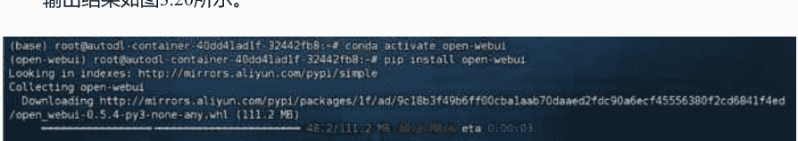

（3）开启服务，运行如下命令，服务将会启动本地的8080端口：http://localhost:8080。

```bash

open-webui serve

SDK 端先安装兼容 OpenAI 的客户端库：
```

### 3．Open-WebUI前端交互操作

（1）单击图3.21中的“开始使用Open-WebUI”选项。按照操作提示创建管理员账号，用于项目管理（这里的信息均存储在项目本地服务器上）。

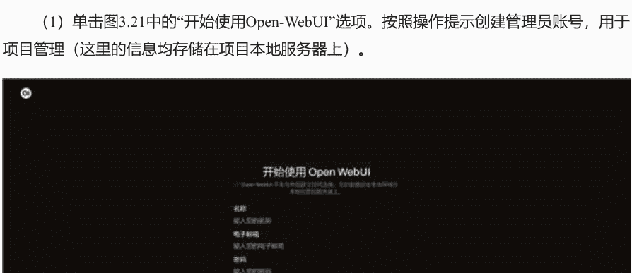

以管理员账号进入项目后，将显示如图3.22所示的账号主页信息。

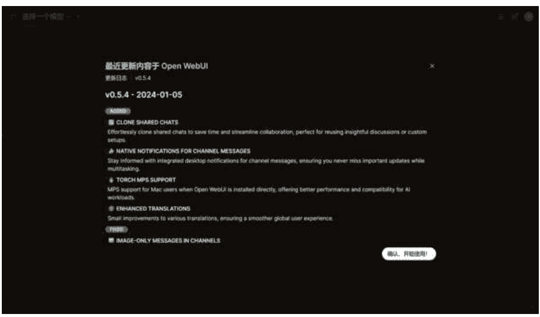

图3.22 Open-WebUI项目进入账号主页

（2）用户根据如图3.23所示的指示进行Open-WebUI项目的用户设置。


图3.23 Open-WebUI项目的用户设置

（3）在“设置”选项卡中单击“外部连接”，再单击“管理OpenAI API连接”右侧的“+”，进行连接的添加，如图3.24所示。


图3.24 Open-WebUI项目外部连接设置1

输入密钥后可单击图3.25所示按钮进行连接的验证。


图3.25 Open-WebUI项目外部连接设置2

（4）选择对话模型并进行对话。单击对话页面左上角显示的模型可选择自己需要的模型，如图3.26所示。


选择模型之后就可以在对话框内输入文字同大模型进行对话，对话效果如图3.27所示。


至此，Open-WebUI接入DeepSeek-V3模型的全流程已顺利完成。用户现在可以通过直观的前端交互界面，与本地部署的大模型自由对话，实现高效的智能交互体验。从整体架构来看，Open-WebUI+DeepSeek-V3不仅提供了便捷的模型调用方式，而且构建了一个完整的前后端一体化独立应用，使大语言模型的部署与使用更加直观、高效。

### 3.1 DeepSeek-V3对话大模型

本节将围绕DeepSeek-V3模型的应用实践展开。我们首先介绍模型架构与核心功能特点，接着阐述在线API的标准调用方式及参数使用规范，然后深入本地部署的详细步骤，包括环境准备、模型权重加载、推理测试等关键环节。此外，本节我们还将演示如何通过Function Calling功能调用外部函数，最后将结合Open-WebUI构建具备可视化交互能力的个性化聊天系统。

#### 3.1.1 DeepSeek-V3模型介绍

DeepSeek-V3是由中国人工智能初创企业深度求索于2024年12月发布的第三个版本的大型语言模型，其一经发布就受到了高度关注。在模型架构方面，DeepSeek-V3采用了MoE架构，总参数量达到6710亿，但每个token仅激活370亿参数。这种设计在保证模型性能的同时，显著降低了计算资源的消耗。此外，模型引入了多头潜在注意力（multi-head latent attention, MLA）机制，以提升推理效率。在训练过程中，DeepSeek-V3也采用了无辅助损失的负载均衡策略，并设定了多token预测的训练目标，进一步增强了模型性能。

DeepSeek-V3在多个基准测试中超越了众多其他开源模型，如Qwen2.5-72B和Llama-3.1-405B，性能可媲美闭源模型GPT-4o和Claude-3.5-Sonnet。同时，值得注意的是，DeepSeek-V3的训练成本仅为557.6万美元（约为GPT-4o模型训练成本的1/20），显著低于同类顶尖模型。这一成本效益的实现，为中小企业和开发者提供了新的机遇。最关键的是DeepSeek-V3原生支持OpenAI SDK调用，且支持Function Calling、Json Output等功能，使用GPT模型的开发人员可以无缝切换到DeepSeek模型。

总而言之，DeepSeek-V3作为一款高性能、低成本的大型语言模型，展示了中国在人工智能领域的创新实力，为全球AI社区带来了新的视角和可能性。

#### 3.1.2 DeepSeek-V3模型API调用

##### 1. DeepSeek账号注册与API获取

首先访问DeepSeek官网，其官网主页如图3.1所示。


图3.1 DeepSeek官网主页

单击图3.1右上角的“API开放平台”，即可进入DeepSeek的开放平台，查看有关API使用的内容，如图3.2所示。


图3.2 DeepSeek开放平台页面

单击图3.2左侧“接口文档”即可查看模型API调用的相关内容。单击左侧API keys即可进入API key的创建页面，也可通过该网址（https://platform.deepseek.com/api_keys）直达该网页，该网页界面如图3.3所示。


单击图3.3中的“创建API key”按钮即可开始创建API，如图3.4所示。这里建议复制图3.3中的API key并创建为新的系统环境变量，尽量避免直接暴露在代码中。

##### 2. DeepSeek-V3模型调用

使用如下命令安装必要的依赖环境。

```bash

pip install openai

最简的聊天调用可以直接复制使用：
```


官方手册指出：DeepSeek API使用与OpenAI兼容的API格式。这样你可以直接使用OpenAI SDK来访问DeepSeek API。

```python

import os

from openai import OpenAI

from IPython.display import display, Code, Markdown

import requests

import json

# <YOUR_DEEPSEEK_API_KEY>替换为复制的 API key 字符串

ds_api_key = '<YOUR_DEEPSEEK_API_KEY>'

#实例化客户端

client = OpenAI(api_key=ds_api_key,

                base_url="https://api.deepseek.com")

#调用 DeepSeek-V3 模型

response = client.chat.completions.create(

    model="deepseek-chat",

    messages=[

        {"role": "user", "content": "你好，好久不见!"}

    ]

)

#输出生成的响应内容

print(response.choices[0].message.content)

#输出完整的响应

print(response)

一次真实返回片段如下：
```

输出结果如下。

```
你好！好久不见！最近过得怎么样？有什么想聊的吗？

ChatCompletion(id='1fdbc70b-acbf-4c9a-a895-d26bd69ad531',

              choices=[Choice(finish_reason='stop',

                              index=0, logprobs=None,

                              message=ChatCompletionMessage(content='你好！好久不见！最近过得怎么样？有什么想聊的吗？',

                                                            refusal=None,

                                                            role='assistant',

                                                            audio=None,

                                                            function_call=None,

                                                            tool_calls=None))],

              created=1736238514,

              model='deepseek-chat',

              object='chat.completion',

              service_tier=None,

              system_fingerprint='fp_3a5770e1b4',

              usage=CompletionUsage(completion_tokens=14,

                                    prompt_tokens=8,

                                    total_tokens=22,

                                    completion_tokens_details=None,

                                    prompt_tokens_details=None,

                                    prompt_cache_hit_tokens=0,

                                    prompt_cache_miss_tokens=8))

查看账户下可用的模型列表：
```

与OpenAI一样的SDK，表明DeepSeek模型采用和GPT模型完全相同的参数体系。

可以输出DeepSeek目前支持的模型范围。

```python

models_list = client.models.list()

print(models_list.data)

返回示例：
```

输出结果如下。

```
[Model(id='deepseek-chat', created=None, object='model', owned_by='deepseek'),
Model(id='deepseek-coder', created=None, object='model', owned_by='deepseek')]

消息模板参考

系统角色设定：
```

这里的“deepseek-chat”即为DeepSeek-V3模型。因为DeepSeek-V3模型属于聊天补全（chat completion）模型，官方已经对“deepseek-chat”指代的模型进行了升级。

#### 3.1.3 DeepSeek-V3模型核心参数详解

##### 1. messages

messages参数是DeepSeek-V3模型API中必填的参数之一，用于定义聊天上下文，包括用户的输入、系统的指令、助手的回复等。通过messages数组，模型可以理解当前对话的背景，从而生成更加连贯的响应。根据不同的使用场景，messages包含多种类型的消息，例如system message、user message和assistant message。下面是对messages参数及其各个子类型的详细解释。

1) system message

system message用于设置系统消息，通常由开发者设定，以指导模型如何进行对话。这类消息可以定义规则或约束，并提供有关对话的背景信息。

- content（必填）：系统消息的内容，可以是字符串或数组。如果是数组，可能包含多个类型的内容（如文本、图像）。
- role（必填）：此处角色为system，表明这是系统发出的消息。
- name（可选）：提供系统消息发送者的名称，尤其适用于区分多个具有相同角色的参与者。

示例代码如下：

```python

system_message = {
    "role": "system",
    "content": "你是一位擅长编写 python 代码的助手。"
}

普通用户消息：
```

2) user message

该参数表示用户发给模型的消息，是对话的核心部分之一。它定义了用户的输入内容，模型根据这些内容生成响应。

- content（必填）：用户消息的内容，通常为文本或图像链接的数组。对于支持图像输入的模型，如DeepSeek-V2.5，还可以传递图像。
  - 文本内容：单纯的字符串形式，用户输入的文本。
  - 数组形式的内容：由文本或图像链接组成的数组，可同时传递多张图像或多段文本内容。
- role（必填）：角色为user，表示该消息来自用户。
- name（可选）：可以为用户指定一个名称，用于区分多个具有相同角色的用户。

示例代码如下。

```python

user_message = {
    "role": "user",
    "content": "你好，请介绍下你自己。"
}

多模态图文消息：
```

如果在和大模型的对话消息中同时传递多个类型的内容（如图像和文本），示例代码如下：

```python

user_message_with_image = {
    "role": "user",
    "content": [
        {"type": "text", "text": "你能帮我介绍下这张图片里面的内容吗？"},
        {"type": "image_url",
         "image_url": {
             "url": "https://ml2022.oss-cn-hangzhou.aliyuncs.com/img/image-20241009205714055.png"}}
    ]
}

基础写法骨架：
```

使用过程中通常单独创建用户消息，再将其作为参数传入模型调用函数中。

```python

#创建用户消息
user_message = {
    "role": "user",

# DeepSeek-V3 本地跑通指南

先在线用官方接口试水，下面是一段最简的调用示范，把系统消息和用户消息一起传给 chat.completions，拿到结果后直接打印。

    "content": "你好，请介绍下你自己。"

}

#调用 DeepSeek-V3 模型

response = client.chat.completions.create(

    model="deepseek-chat",

    messages=[

        system_message,

        user_message

    ]

)

#输出生成的响应内容

print(response.choices[0].message.content)

如果想把模型搬到自有机器离线使用，整体可以拆成建环境、装依赖、拉代码、下权重、加载推理五步来推进。

```

输出结果如下。

> 你好！我是一位大学教授，专注于多个学科的研究与教学。我的工作主要包括教授本科生和研究生课程，指导学生的研究项目，以及进行学术研究。我致力于通过教育和研究推动知识的边界，并帮助学生发展他们的批判性思维和创新能力。此外，我也参与学术会议和研讨会，与同行交流最新的研究成果和教学方法。如果你有任何学术上的问题或需要指导，我很乐意提供帮助。

##### 2. 其余重要参数

在实际应用DeepSeek-V3进行推理调用时，用户可以通过一系列参数对模型的行为进行精细化控制。下面将详细介绍这些参数的作用，以帮助开发者根据不同场景的需求优化模型性能、管理生成内容，并提升交互体验。模型参数如表3.1所示。

表3.1 DeepSeek-V3模型参数汇总表

#### 3.1.4 DeepSeek-V3模型本地部署与调用

##### 1. DeepSeek开源情况介绍

DeepSeek是开源大模型，我们首先需要对其开源情况有所了解。DeepSeek项目的GitHub文件情况如图3.5所示。

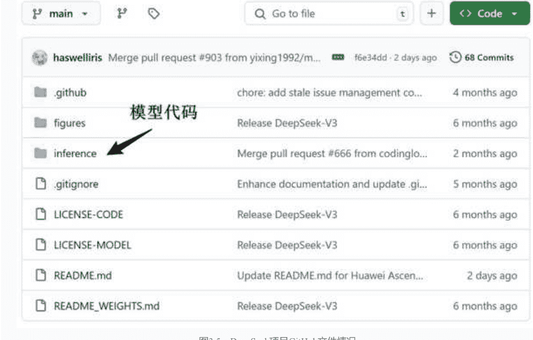

其中开源代码部分如图3.6所示。


图3.6 DeepSeek项目GitHub开源代码部分

以下是对图3.6中DeepSeek项目开源代码的介绍。

- convert.py: 用于格式转换，将一个已经训练好的模型检查点（checkpoint）文件从一个格式（如safetensors）转换并保存成一个适合特定模型并行度（model parallelism）和专家数（n_experts）的格式。
- fp8_cast_bf16.py: 代码的功能是将存储在FP8格式中的模型权重转换为BF16格式，并保存转换后的权重。它还更新了模型的索引文件，去除了scale_inv的引用。
- generate.py: 一个用于生成文本的示例程序，支持交互式和批量文本生成。它使用一个Transformer模型并进行分布式训练。
- kernel.py: 代码主要涉及量化和矩阵乘法操作，使用了Triton库进行加速，特别是针对FP8精度（浮点8位）进行了优化。Triton是一个专为GPU上的高效自定义操作而设计的编程框架，支持Python和PyTorch，可以通过简洁的代码来实现高效的GPU核心。
- model.py: 定义了DeekSeek-V3模型架构。

目前模型权重已经在Hugging Face上开源了，具体情况如图3.7所示。

##### 2. Model Downloads

| Model | #Total Params | #Activated Params | Context Length | Download |
|---|---|---|---|---|
| DeepSeek-V3-Base | 671B | 37B | 128K | Hugging Face |
| DeepSeek-V3 | 671B | 37B | 128K | Hugging Face |

> Note
The total size of DeepSeek-V3 models on Hugging Face is 685B, which includes 671B of the Main Model weights and 14B of the Multi-Token Prediction (MTP) Module weights.

To ensure optimal performance and flexibility, we have partnered with open-source communities and hardware vendors to provide multiple ways to run the model locally. For step-by-step guidance, check out Section 6: [How to Run Locally](https://github.com/deepseek-ai/DeepSeek-V3/blob/main/README.md#how-to-run-locally).

For developers looking to dive deeper, we recommend exploring [README_WEIGHTS.md](https://github.com/deepseek-ai/DeepSeek-V3/blob/main/README_WEIGHTS.md) for details on the Main Model weights and the Multi-Token Prediction (MTP) Modules. Please note that MTP support is currently under active development within the community, and we welcome your contributions and feedback.


DeepSeek-V3模型权重可在Hugging Face主页下载，权重总共约650G大小，用户也可在魔搭社区下载。作为权重全开源的模型，官方介绍的本地运行方法有如下几种。

(1) DeepSeek-Infer Demo：提供了一个简单且轻量的演示，支持FP8和BF16推理。
(2) SGLang：完全支持DeepSeek-V3模型在BF16和FP8推理模式下运行，且即将支持多标记预测（MTP）。
(3) LMDeploy：支持高效的FP8和BF16推理，适用于本地和云端部署。
(4) TensorRT-LLM：目前支持BF16推理和INT4/8量化，FP8支持即将推出。
(5) vLLM：支持DeepSeek-V3模型在FP8和BF16模式下进行张量并行和流水线并行。
(6) AMD GPU：通过SGLang，在BF16和FP8模式下支持在AMD GPU上运行DeepSeek-V3模型。
(7) 华为Ascend NPU：支持在华为Ascend设备上运行DeepSeek-V3模型。

由于DeepSeek的框架原生采用FP8训练，因此仅提供FP8权重，预估仅700GB+显存便可运行。当然也可以转换到BF16，在半精度下，需要1400GB+，而量化到INT4时需要450GB+。以下是半精度下显存占用情况：（占用490G显存，需要7张80G A100，租赁成本约1000元／天）。

### 2. DeepSeek-V3本地部署

(1) 基本环境配置。本次的DeepSeek-V3本地部署将使用模型的Int4量化版运行，基本配置如下。

服务器硬件配置信息。

- GPU: Nvidia H20 (98G) GPU * 8。
- CPU: AMD EPYC 9K84 96-Core。
- 桥接方式: NVLink。
- 内存: 150G。
- 存储: 2T。

深度学习环境配置信息。

- 操作系统: Ubuntu 22.04。
- PyTorch版本: 2.5.1。
- Python版本: 3.12。
- CUDA版本: 12.4。
- 其他软件包版本根据DeepSeek-V3项目需求确定。

(2) 创建虚拟环境。执行如下命令创建虚拟环境。

```

环境就绪后先把 JupyterLab 与 IPython 内核装上，并把内核注册到 dv3，方便后续在 Notebook 里调试。

```

输出结果如图3.8所示。

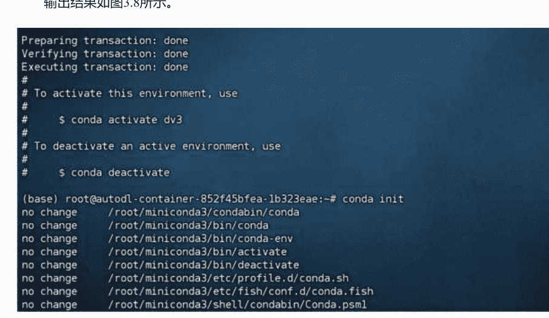

图3.8 创建虚拟环境

代码将在Jupyter Notebook环境中运行，在此之前，需要进行相关的安装和配置，执行如下命令。

```

推理仓库从 GitHub 直接克隆即可。

```

(3) 通过GitHub拉取开源项目。首先登录GitHub主页，拉取所需项目；然后访问DeepSeek-V3主页；最后执行如下命令。

```

进入 inference 目录安装项目所需的 Python 依赖。

```

输出结果如图3.9所示。

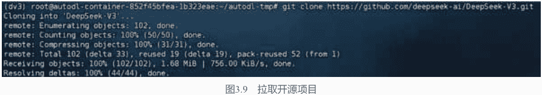

执行如下命令安装项目相关依赖。

```

再安装 ModelScope，负责模型拉取与加载。

```

(4) 下载模型权重。可以在Hugging Face或者魔搭社区下载模型权重，推荐使用魔搭社区下载。

> **说明**
下载前需要提前留出600G左右存储空间，用于保存模型权重。

首先需要安装ModelScope开源模型库，执行如下命令。

```

先在本地建一个 deepseek 目录，用 ModelScope 把量化版权重 OPEA/DeepSeek-V3-int4-sym-gptq-inc 抓到该目录。

```

输出结果如图3.10所示。


安装完成后，即可通过ModelScope下载模型权重，在下载时指定下载Int4类型的权重。执行如下命令。

```

落地推理的第一种写法针对 int4 量化权重，模型路径指向 ./deepseek，采用 bfloat16 并自动映射到可用设备，同时把生成配置的 pad 与 eos id 统一。

```

输出结果如图3.11所示。


### 3. 在Jupyter Notebook中进行推理调用

在Jupyter Notebook中进行推理调用，具体代码如下。

```

换成完整精度版本时，把路径改为 ./deepseek-v3，数据类型切到 float16，其余加载流程保持一致。

```

首先需进行一些相关的配置，指定DeepSeek模型存储路径后将其加载为因果语言模型（causal language model，CausalLM），并配置相关的分词器和生成策略。

相关配置代码运行结果如图3.12所示。

```

对话生成先组织一条用户消息，通过分词器的对话模板转为模型可读的输入张量，限制最大生成长度为 100 个 token，生成后切片解码并输出。

```

图3.12 模型配置代码运行结果

完成配置后，即可使用配置好的模型进行对话，按照规定格式构造消息列表，使用tokenizer将对话消息文本转换为模型可处理的张量格式，这时就可以输入模型来生成模型的回复，具体代码如下。

```

同样的逻辑也可以写成更简洁的无注释版本，直接跑即可。

```

运行效果如图3.13所示。

```

运行后模型会用中文进行自我介绍，说明是由中国 DeepSeek 团队开发的通用助手，能够覆盖科学、数学、历史、文化等多个领域的问答，并提示用户随时提问。

# DeepSeek 接入天气 API 的工具调用演示

想让模型给出真实的实时天气，而不是基于训练数据的猜测，就需要把外部查询挂到模型上。下面以 OpenWeather 为例，演示如何让 DeepSeek 通过工具调用获取北京天气。

先从环境变量读取 OpenWeather 的 Key，后续函数会直接使用。
```

图3.13 在Jupyter Notebook中进行推理调用的效果图

#### 3.1.5 DeepSeek-V3 Function Calling

##### 1. Function Calling功能简介

Function Calling是大语言模型在向通用智能体能力迈进过程中的关键能力之一，允许模型不仅生成自然语言回答，还能根据用户意图调用预定义的函数或工具，以实现更具交互性与实用性的任务处理。其基本过程如图3.14所示。

在传统的对话系统中，模型往往只能进行语言输出，缺乏对外部环境的真实调用能力。Function Calling则通过一个结构化的接口定义（通常以JSON Schema描述函数），使模型具备“理解任务→调用函数→返回结果”的能力，从而完成如天气查询、数据库访问、文档检索、任务派发等实际操作。

在DeepSeek-V3模型中，Function Calling功能已实现OpenAI接口标准的基本格式支持。开发者可以通过在API请求中添加functions字段，定义可被调用的函数结构，并由模型自动判断是否调用函数，以及调用哪个函数和传递哪些参数。

##### 2. 外部工具API

首先需要简单说明的是，到底什么是外部工具API。API的全称是应用程序接口，例如，目前我们在Python环境中使用了ChatCompletion.create函数，实际上就是OpenAI公司提供的GPT系列模型应用程序的一个接口，通过这个API（create函数或者openai库），我们能够非常顺利地调用GPT模型，并根据输入信息实时输出模型结果。而其他的很多应用程序也有相应的API。

本节示例中使用的是一个可以实时查询天气的API，即OpenWeather API。通过调用OpenWeather API获取实时天气信息，然后利用Function Calling功能调用该函数，这样相当于赋予了Chat模型实时获取天气信息的能力。此后，我们即可通过Chat模型实时查询天气，或根据天气情况询问穿衣建议等。从功能上来说，接入实时天气信息的Chat模型实际上就是一个非常简单的天气查询AI助手。

为了能够调用OpenWeather服务，和OpenAI的API使用过程类似，首先需要先注册OpenWeather账号，并获取OpenWeather API key。这里需要注意的是，对于大多数在线服务的API来说，都需要通过API key来进行身份验证，尽管OpenWeather相对更加开放，有非常多的免费使用次数，但身份验证仍然是必要的，防止API被滥用。OpenWeather API key获取流程如下。

(1) 登录OpenWeather官网并选择Sign in→Create an Account完成注册。可以使用国内邮箱或者QQ邮箱进行注册。OpenWeather的官网页面如图3.15所示，其用户注册页面如图3.16所示。

(2) 获取API key：注册完成后，即可在用户主页的API keys选项卡中查看当前账户的API key，如图3.17所示。

图3.15 OpenWeather官网页面

图3.16 OpenWeather用户注册页面

图3.17 OpenWeather用户主页

一般来说，完成注册后，用户通常会获得一个已经激活的API key。与OpenAI类似，OpenWeather的API key也创建多个，如图3.18所示。

（3）与OpenAI API key类似，为了方便后续调用，我们也可以直接将OpenWeather API key设置为环境变量，变量名为OPENWEATHER_API_KEY，如图3.19所示。

环境变量设置之后，即可创建OpenWeather API key变量，代码如下。

```

下面定义查询函数，接收城市名，国内城市需用英文，内部会组装 OpenWeather 接口请求，单位设为摄氏度、语言设为简体中文，最后返回 JSON 字符串。
```

##### 3. 利用OpenWeather API获取实时天气信息

接下来，我们通过一个简单的示例来介绍如何使用OpenWeather API获取实时天气信息。我们将把该API的调用过程封装成一个函数。代码如下。

```

将函数能力转化为模型可识别的工具描述，并把参数含义写清楚，尤其是中国城市要用英文名。
```

##### 4. functions参数解释与定义过程

在完成外部函数及其库的准备工作之后，关键步骤是将外部函数的信息以某种形式传输给Chat模型。此时就需要用到ChatCompletion.create函数的functions参数，类似于messages参数，它用于向模型传输消息，functions参数专门用于提供可调用的外部函数信息。此外，从参数的具体形式来看，functions和messages参数也是非常类似的——都是包含多个字典的list。对于messages来说，每个字典都是一条信息，而对于functions参数来说，每个字典都是一个函数。在大语言模型实际进行问答时，会根据functions参数提供的信息对各函数进行检索。

显而易见，functions参数对于实现Chat模型的Function Calling功能至关重要。接下来，我们详细解释如何编写functions中的字典。总的来说，每个字典都有3个参数（3组键值对），各参数的名称及解释如下。

(1) name: 必选参数，字符串类型，代表函数名称。按照要求，函数名称必须由a-z、A-Z、0-9、下画线和英文破折号组成，最大长度为64。此名称用于模型在外部函数库中识别相应的函数。

(2) description: 可选参数，字符串类型，用于描述函数功能。虽然该参数不是必需的，但它是Chat模型识别函数功能的核心依据。即Chat函数实际上是通过每个函数的description来判断当前函数的实际功能的，若要实现多个备选函数的智能挑选，则需要严谨详细地描述函数功能（在特定情况下，如果已明确指定使用的函数，则无须设置description）。

（3）parameters：必选参数，需遵照JSON Schema格式进行输入的函数参数，JSON Schema是一种特殊的JSON对象，用于验证JSON数据格式是否满足要求。

例如，对于get_weather函数，我们需要创建如下字典来对其进行完整描述。

```

把真实实现放进映射表，方便后续按名称检索并执行。
```

同时还需要封装外部函数库，用于关联外部函数名称和外部函数对象。

```

整理成模型侧的 tools 列表格式。
```

对于最新模型的Function Calling功能来说，还需要进行更高层次封装，封装为一个tools对象，同时说明当前Function性质。

```

创建 DeepSeek 客户端，并准备一条关于北京今日天气的提问。
```

##### 5. Function Calling功能实现

Function Calling的本质，是让语言模型在对话中完成“识别任务→选中函数→给出参数→外部执行→返回结果→基于结果生成答复”的过程。这个过程分为两个阶段：第一次调用模型识别任务并调用函数，第二次调用模型生成最终回答。

1）第一阶段：模型识别任务并决定调用哪个函数

在一系列基础准备工作之后，我们将尝试在Chat模型对话中执行Function Calling功能。这里我们创建如下messages。

```

先不传入 tools 执行一次，观察默认问答的表现。
```

首先我们测试只输入这个信息而不输入外部函数库时模型能否知道如何查询天气。

```

再次请求时带上 tools，模型会判断是否需要调用外部函数。
```

输出结果如下。

> ‘您好，建议您联网获取时效性较强的信息；如果还有其他问题需要帮助，请随时告诉我！’

很明显，模型无法回答。

接下来，将函数库相关信息输入Chat模型，这里需要额外设置两个参数，其一是tools参数，用于声明外部函数库的当前情况，其二是tool_choice参数，该参数用于控制是否执行Function Calling功能，该参数有两种不同的取值，默认取值为auto，表示模型将根据用户实际对话情况，选择性地自动挑选函数执行，若想让模型在本次对话中特定执行tools中的某个函数，则可以通过输入形式如{"name": "my_function"}的字典进行声明，此时模型不会再自动挑选模型，而是在tools中挑选my_function执行。

这里我们尝试让模型自动挑选函数来执行，参数设置方法与执行过程如下。

```

打印完整响应。
```

观察此时的response结果，输入以下代码。

```

此时返回不再是纯文本，而是包含 tool_calls 的结构，模型选择了 get_weather 并带上 loc 参数。
```

输出结果如下。

```

取出本次响应的消息对象。
```

输入以下代码。

```

该消息内容为空，调用信息保存在 tool_calls 字段里。
```

输出结果如下。

```

获取工具调用列表。
```

能够发现，此时返回的message中content为空，新增了一个tool_calls的list，该list就包含了当前调用外部函数的全部信息。

输入以下代码。

```

列表里可以看到目标函数和传入参数。
```

输出结果如下。

```

解析出函数名、定位到实际实现、把参数从 JSON 解析出来。
```

对于当前CompletionMessageToolCall对象，id为外部函数调用发起请求id，function则表示调用的外部函数的基本信息，而type则代表了当前调用的外部函数的类型，function代表调用自定义的外部函数。除此之外还可以选择retrieval或web_search，分别代表进行在线知识库的知识检索和进行在线搜索。

我们可以在此基础上分别提取调用的外部函数名称信息和参数信息，分别保存为function_name和function_args对象，代码如下：

```

调用真实函数并得到天气的 JSON 字符串结果。
```

需要注意的是，外部函数的计算过程仍然是在本地执行，即Chat模型不会将代码读取到服务器上后再进行在线计算，因此接下来我们需要根据模型返回的函数和函数参数，在本地完成函数计算，然后再将计算过程和结果保存为message并追加到messages后面，接着第二次调用Chat模型分析函数的计算结果，并最终根据函数计算结果输出用户问题的答案。

2）第二阶段：本地执行函数，并将结果反馈给模型

接下来我们将function_args对象传入fuction_to_call中并完成计算，代码如下：

```

```

输出结果如下。

```

# DeepSeek 工具调用与本地部署实操

以一次真实的北京天气查询串起完整流程：先拿到可信的实况数据，再封装可复用的对话闭环，最后在本地 WebUI 跑通交互。

{"coord": {"lon": 116.3972, "lat": 39.9075}, "weather": [{"id": 804, "main": "Clouds", "description": "阴，多云", "icon": "04d"}], "base": "stations", "main": {"temp": 4.94, "feels_like": 1.77, "temp_min": 4.94, "temp_max": 4.94, "pressure": 1020, "humidity": 25, "sea_level": 1020, "grnd_level": 1014}, "visibility": 10000, "wind": {"speed": 4.03, "deg": 300, "gust": 9.43}, "clouds": {"all": 85}, "dt": 1736239986, "sys": {"type": 1, "id": 9609, "country": "CN", "sunrise": 1736206561, "sunset": 1736240684}, "timezone": 28800, "id": 1816670, "name": "Beijing", "cod": 200}

这段返回包含了经纬度、天气主体、体感温度、气压湿度、能见度、风速阵风以及日出日落时间，可作为模型生成的基础事实。

```

根据上述运行结果能够发现，模型已经顺利完成计算。接下来，我们在messages对象中追加两条消息，第一条消息是第一次模型返回的结果（即调用模型的assistant message），第二条消息则是外部函数的计算结果，该条消息的role为function，且name为函数名称。我们也可以区分function message与user message、system message、assistant message的不同之处。function message必须包含关键词name，且其内容来源于外部函数执行的计算结果，并需要手动输入。具体添加过程如下。

先执行代码查看我们最初的message。

```

messages
messages 用来保存多轮对话的上下文，是整个交互的载体。

```

输出结果如下。

```

[{'role': 'user', 'content': '请帮我查询北京地区今日天气情况'}]
这是用户发起查询的初始输入，用来触发工具调用。

```

查看模型第一次返回的结果消息。

```

response_message.model_dump()
模型第一次应答尚未产出自然语言，而是返回工具调用的意图。

```

输出结果如下。

```

{'content': '',

 'refusal': None,

 'role': 'assistant',

 'audio': None,

 'function_call': None,

 'tool_calls': [{'id': 'call_0_87e140df-66ef-44dd-813f-45800e169690',

   'function': {'arguments': '{"loc":"Beijing"}', 'name': 'get_weather'},

   'type': 'function',

   'index': 0}]}
结构里明确了要调用 get_weather 并带上北京作为参数。

```

现在将两部分的消息进行拼接，执行以下代码。

```

# 追加模型第一次返回的结果消息

messages.append(response_message.model_dump())

messages
把这次工具意图写入历史，为下一步回填结果做准备。

```

输出结果如下。

##### 6. Function Calling函数封装

通过上面的逐步探索，我们已经了解了Function Calling的实现逻辑。通过下面代码将上面的过程进行封装。

```python

def run_conv(messages,
             api_key,
             tools=None,
             functions_list=None,
             model="deepseek-chat"):

    """

    能够自动执行外部函数调用的 Chat 对话模型

    :param messages: 必要参数，输入到 Chat 模型的 messages 参数对象

    :param api_key: 必要参数，调用模型的 API-KEY

    :param tools: 可选参数，默认为 None，可以设置为包含全部外部函数的列表对象

    :param model: Chat 模型，可选参数，默认模型为 deepseek-chat

    :return: Chat 模型输出结果

    """

    user_messages = messages

    client = OpenAI(api_key=api_key,

                    base_url="https://api.deepseek.com")

    # 如果没有外部函数库，则执行普通的对话任务

    if tools == None:

        response = client.chat.completions.create(

            model=model,

            messages=user_messages

        )

        final_response = response.choices[0].message.content

    # 若存在外部函数库，则需要灵活选取外部函数并进行回答

    else:

        # 创建外部函数库字典

        available_functions = {func.__name__: func for func in functions_list}

        # 创建包含用户问题的 messages

        messages = user_messages

        # first response

        response = client.chat.completions.create(

            model=model,

            messages=user_messages,

            tools=tools,

        )

        response_message = response.choices[0].message

        # 获取函数名

        function_name = response_message.tool_calls[0].function.name

        # 获取函数对象

        fuction_to_call = available_functions[function_name]

        # 获取函数参数

        function_args = json.loads(response_message.tool_calls[0].function.arguments)

        # 将函数参数输入到函数中，获取函数计算结果

        function_response = fuction_to_call(**function_args)

        # messages 中拼接 first response 消息

        user_messages.append(response_message.model_dump())

        # messages 中拼接外部函数输出结果

        user_messages.append(

            {

                "role": "tool",

                "content": function_response,

                "tool_call_id": response_message.tool_calls[0].id

            }

        )

        # 第二次调用模型

        second_response = client.chat.completions.create(

            model=model,

            messages=user_messages)

        # 获取最终结果

        final_response = second_response.choices[0].message.content

    return final_response
该封装统一处理有无工具两种情况，完成函数选择、参数解析、结果回填和二次生成。

```

这里再次执行代码进行对话实验。

```python

messages = [{"role": "user", "content": "请问北京今天天气如何？"}]

run_conv(messages=messages,
         api_key = ds_api_key,
         tools=tools,
         functions_list=[get_weather])
示例调用展示如何传入问题、API Key、工具列表和函数列表完成闭环。

```

输出结果如下。

> 北京今天的天气是多云，气温约为 4.94° C，体感温度约为 1.77° C，湿度为 25%，风速为 4.03 米/秒，风向为 300 度。空气质量良好，能见度为 10000 米。

至此，我们完整地使用DeepSeek-V3模型实现了Function Calling，即外部函数工具的调用。

#### 3.1.6 打造专属聊天机器人：Open-WebUI接入DeepSeek-V3

##### 1. Open-WebUI项目介绍

Open-WebUI是一个开源的Web界面，用于管理和交互式使用大语言模型（LLM）。它提供了直观的聊天界面，支持本地和远程模型，通过它可以轻松部署和调用各种开源模型，不需要复杂的命令行操作。

Open-WebUI项目支持接入在线大模型和开源大模型（包括OpenAI、GLM-4、Qwen2.5等），均可以通过其Functions（功能）模块来灵活接入，支持一键导入配置。

在Open-WebUI项目中，Functions通常是指该项目提供的可以执行特定任务或操作的模块或方法。这些功能模块可以帮助用户与大模型进行交互、配置模型参数、获取输出结果等。具体来说，这些Functions包括文本生成、模型参数调节、会话管理功能、API接口、模型选择和管理等实现细节。

##### 2. DeepSeek-V3接入Open-WebUI流程

(1) 创建虚拟环境，运行如下命令。

```bash

# 创建一个名为 open-webui 的 Conda 虚拟环境，并指定 Python 版本为 3.11

conda create -n open-webui python=3.11

# 初始化 Conda

conda init

# 重新加载 shell 配置

source ~/.bashrc

# 激活刚刚创建的 open-webui 环境，进入该环境

conda activate open-webui
先用 Conda 建立干净的 Python 3.11 环境。

```

(2) 安装Open-WebUI项目，运行如下命令。

```bash

pip install open-webui -i https://pypi.tuna.tsinghua.edu.cn/simple
通过清华源安装 Open WebUI 加速部署。

```

输出结果如图3.20所示。


（3）开启服务，运行如下命令，服务将会启动本地的8080端口：http://localhost:8080。

```bash

open-webui serve
启动服务后即可在本地浏览器访问交互界面。

```

##### 3. Open-WebUI前端交互操作

（1）单击图3.21中的“开始使用Open-WebUI”选项。按照操作提示创建管理员账号，用于项目管理（这里的信息均存储在项目本地服务器上）。


以管理员账号进入项目后，将显示如图3.22所示的账号主页信息。


（2）用户根据如图3.23所示的指示进行Open-WebUI项目的用户设置。

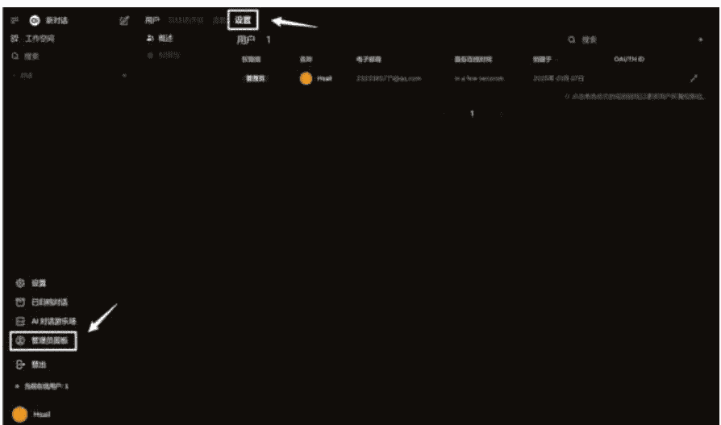

（3）在“设置”选项卡中单击“外部连接”，再单击“管理OpenAI API连接”右侧的“+”，进行连接的添加，如图3.24所示。


输入密钥后可单击图3.25所示按钮进行连接的验证。

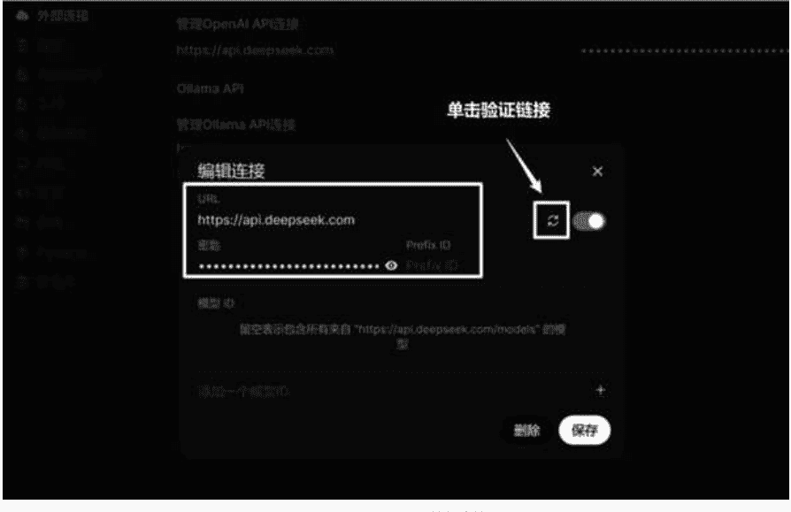

（4）选择对话模型并进行对话。单击对话页面左上角显示的模型可选择自己需要的模型，如图3.26所示。


选择模型之后就可以在对话框内输入文字同大模型进行对话，对话效果如图3.27所示。


至此，Open-WebUI接入DeepSeek-V3模型的全流程已顺利完成。用户现在可以通过直观的前端交互界面，与本地部署的大模型自由对话，实现高效的智能交互体验。从整体架构来看，Open-WebUI+DeepSeek-V3不仅提供了便捷的模型调用方式，而且构建了一个完整的前后端一体化独立应用，使大语言模型的部署与使用更加直观、高效。

### 3.1 DeepSeek-V3对话大模型

本节将围绕DeepSeek-V3模型的应用实践展开。我们首先介绍模型架构与核心功能特点，接着阐述在线API的标准调用方式及参数使用规范，然后深入本地部署的详细步骤，包括环境准备、模型权重加载、推理测试等关键环节。此外，本节我们还将演示如何通过Function Calling功能调用外部函数，最后将结合Open-WebUI构建具备可视化交互能力的个性化聊天系统。

#### 3.1.1 DeepSeek-V3模型介绍

DeepSeek-V3是由中国人工智能初创企业深度求索于2024年12月发布的第三个版本的大型语言模型，其一经发布就受到了高度关注。在模型架构方面，DeepSeek-V3采用了MoE架构，总参数量达到6710亿，但每个token仅激活370亿参数。这种设计在保证模型性能的同时，显著降低了计算资源的消耗。此外，模型引入了多头潜在注意力（multi-head latent attention, MLA）机制，以提升推理效率。在训练过程中，DeepSeek-V3也采用了无辅助损失的负载均衡策略，并设定了多token预测的训练目标，进一步增强了模型性能。

DeepSeek-V3在多个基准测试中超越了众多其他开源模型，如Qwen2.5-72B和Llama-3.1-405B，性能可媲美闭源模型GPT-4o和Claude-3.5-Sonnet。同时，值得注意的是，DeepSeek-V3的训练成本仅为557.6万美元（约为GPT-4o模型训练成本的1/20），显著低于同类顶尖模型。这一成本效益的实现，为中小企业和开发者提供了新的机遇。最关键的是DeepSeek-V3原生支持OpenAI SDK调用，且支持Function Calling、Json Output等功能，使用GPT模型的开发人员可以无缝切换到DeepSeek模型。

总而言之，DeepSeek-V3作为一款高性能、低成本的大型语言模型，展示了中国在人工智能领域的创新实力，为全球AI社区带来了新的视角和可能性。

#### 3.1.2 DeepSeek-V3模型API调用

##### 1. DeepSeek账号注册与API获取

首先访问DeepSeek官网，其官网主页如图3.1所示。

##### 2. DeepSeek-V3模型调用

使用如下命令安装必要的依赖环境。

```

pip install openai
脚本直接调用 DeepSeek 前先安装兼容的 OpenAI SDK。

```

官方手册指出：DeepSeek API使用与OpenAI兼容的API格式。这样你可以直接使用OpenAI SDK来访问DeepSeek API。

```

import os

from openai import OpenAI

from IPython.display import display, Code, Markdown

import requests

import json

# <YOUR_DEEPSEEK_API_KEY>替换为复制的 API key 字符串

ds_api_key = '<YOUR_DEEPSEEK_API_KEY>'

#实例化客户端

client = OpenAI(api_key=ds_api_key,

                base_url="https://api.deepseek.com")

#调用 DeepSeek-V3 模型

response = client.chat.completions.create(

    model="deepseek-chat",

    messages=[

        {"role": "user", "content": "你好，好久不见!"}

    ]

)

#输出生成的响应内容

print(response.choices[0].message.content)

#输出完整的响应

print(response)
最小可用示例，演示 SDK 初始化、模型调用与结果打印。

```

输出结果如下。

```

你好！好久不见！最近过得怎么样？有什么想聊的吗？

ChatCompletion(id='1fdbc70b-acbf-4c9a-a895-d26bd69ad531',

              choices=[Choice(finish_reason='stop',

上手 DeepSeek 接口其实就是在看懂返回结构、确认可用模型、组装对话消息这三步。下面把一次真实的调用拆开来看，帮助你快速复制到自己的项目里。

先看一次完整的返回长什么样。请求成功后会得到包含 choices、模型名、创建时间以及 token 消耗的完整对象，其中 system_message 里会带上助手的回复文本，usage 会给出 prompt_tokens、completion_tokens 和 total_tokens 的统计信息。

                              index=0, logprobs=None,

              system_message = {

                  message=ChatCompletionMessage(content='你好！好久不见！最近过得怎么样？有什么想聊的吗？',

                                               refusal=None,

                                               role='assistant',

                                               audio=None,

                                               function_call=None,

                                               tool_calls=None)],

              created=1736238514,

              model='deepseek-chat',

              object='chat.completion',

              service_tier=None,

              system_fingerprint='fp_3a5770e1b4',

              usage=CompletionUsage(completion_tokens=14,

                                    prompt_tokens=8,

                                    total_tokens=22,

                                    completion_tokens_details=None,

                                    prompt_tokens_details=None,

                                    prompt_cache_hit_tokens=0,

                                    prompt_cache_miss_tokens=8))
```

与OpenAI一样的SDK，表明DeepSeek模型采用和GPT模型完全相同的参数体系。

可以输出DeepSeek目前支持的模型范围。

```
想知道当前账号能用哪些模型，直接列一下就行。下面这段会把模型清单打印出来，方便确认名称是否正确。
models_list = client.models.list()

print(models_list.data)
```

输出结果如下。

```
实际返回的模型列表通常包含两个主力模型，分别是用于通用对话的 deepseek-chat 和面向代码的 deepseek-coder，object 均为 model，owned_by 都是 deepseek。
[Model(id='deepseek-chat', created=None, object='model', owned_by='deepseek'),
 Model(id='deepseek-coder', created=None, object='model', owned_by='deepseek')]
```

这里的“deepseek-chat”即为DeepSeek-V3模型。因为DeepSeek-V3模型属于聊天补全（chat completion）模型，官方已经对“deepseek-chat”指代的模型进行了升级。

#### 3.1.3 DeepSeek-V3模型核心参数详解

##### 1. messages

messages参数是DeepSeek-V3模型API中必填的参数之一，用于定义聊天上下文，包括用户的输入、系统的指令、助手的回复等。通过messages数组，模型可以理解当前对话的背景，从而生成更加连贯的响应。根据不同的使用场景，messages包含多种类型的消息，例如system message、user message和assistant message。下面是对messages参数及其各个子类型的详细解释。

1) system message

system message用于设置系统消息，通常由开发者设定，以指导模型如何进行对话。这类消息可以定义规则或约束，并提供有关对话的背景信息。

- :check_box_with_check: content（必填）：系统消息的内容，可以是字符串或数组。如果是数组，可能包含多个类型的内容（如文本、图像）。
- :check_box_with_check: role（必填）：此处角色为system，表明这是系统发出的消息。
- :check_box_with_check: name（可选）：提供系统消息发送者的名称，尤其适用于区分多个具有相同角色的参与者。

示例代码如下：

```
对话的开头一般先定系统角色，用来约束助手的行为风格。下面的例子把系统提示写成让助手擅长编写 Python 代码。
system_message = {

    "role": "system",

    "content": "你是一位擅长编写 python 代码的助手。"

}
```

2) user message

该参数表示用户发给模型的消息，是对话的核心部分之一。它定义了用户的输入内容，模型根据这些内容生成响应。

- :check_box_with_check: content（必填）：用户消息的内容，通常为文本或图像链接的数组。对于支持图像输入的模型，如DeepSeek-V2.5，还可以传递图像。
  - 文本内容：单纯的字符串形式，用户输入的文本。
  - 数组形式的内容：由文本或图像链接组成的数组，可同时传递多张图像或多段文本内容。
- :check_box_with_check: role (必填)：角色为user，表示该消息来自用户。
- :check_box_with_check: name (可选)：可以为用户指定一个名称，用于区分多个具有相同角色的用户。

示例代码如下。

```
用户端的普通文本消息结构很简洁，只需要 role 标为 user，content 放具体提问即可。
user_message = {

    "role": "user",

    "content": "你好，请介绍下你自己。"

}
```

如果在和大模型的对话消息中同时传递多个类型的内容（如图像和文本），示例代码如下：

```
如果要做多模态输入，content 可以换成列表，依次放文本块和图片块。图片块使用 image_url 字段，url 指向公开可访问的图片地址，就能让模型同时理解文字和图像。
user_message_with_image = {

    "role": "user",

    "content": [

        {"type": "text", "text": "你能帮我介绍下这张图片里面的内容吗？"},

        {"type": "image_url",

         "image_url": {

             "url": "https://ml2022.oss-cn-hangzhou.aliyuncs.com/img/image-20241009205714055.png"}}

    ]

}
```

使用过程中通常单独创建用户消息，再将其作为参数传入模型调用函数中。

```
把上面准备好的系统消息和用户消息拼到 messages 里，指定 deepseek-chat 作为模型发起一次聊天补全，最后从 response.choices[0].message.content 取出生成的文本输出。
#创建用户消息
user_message = {

    "role": "user",

    "content": "你好，请介绍下你自己。"

}
#调用 DeepSeek-V3 模型
response = client.chat.completions.create(

    model="deepseek-chat",

    messages=[

        system_message,

        user_message

    ]

)
#输出生成的响应内容
print(response.choices[0].message.content)

```

输出结果如下。

> 你好！我是一位大学教授，专注于多个学科的研究与教学。我的工作主要包括教授本科生和研究生课程，指导学生的研究项目，以及进行学术研究。我致力于通过教育和研究推动知识的边界，并帮助学生发展他们的批判性思维和创新能力。此外，我也参与学术会议和研讨会，与同行交流最新的研究成果和教学方法。如果你有任何学术上的问题或需要指导，我很乐意提供帮助。

##### 2. 其余重要参数

在实际应用DeepSeek-V3进行推理调用时，用户可以通过一系列参数对模型的行为进行精细化控制。下面将详细介绍这些参数的作用，以帮助开发者根据不同场景的需求优化模型性能、管理生成内容，并提升交互体验。模型参数如表3.1所示。

表3.1 DeepSeek-V3模型参数汇总表

| 参数名 | 类型 | 必填/可选 | 默认值 | 说明 |
| :--- | :--- | :--- | :--- | :--- |
| model | string | 必填 | 无 | 指定要使用的模型 ID，例如 deepseek-chat 或 deepseek-code |
| store | boolean 或 null | 可选 | false | 是否存储本次对话的输出，供模型精炼或评估产品使用 |
| metadata | object 或 null | 可选 | null | 开发者自定义的标签和值，用于过滤仪表盘中的补全结果 |
| frequency_penalty | number 或 null | 可选 | 0 | 数值为-2.0～2.0，正值减少重复生成内容的可能性 |
| logit_bias | map | 可选 | null | 调整某些特定 token 出现的可能性，值为-100～100 |
| logprobs | boolean 或 null | 可选 | false | 是否返回生成的每个 token 的对数概率 |
| top_logprobs | integer 或 null | 可选 | null | 指定返回最有可能出现的前几个 token 及其概率，需开启 logprobs |
| max_completion_tokens | integer 或 null | 可选 | null | 指定模型生成的最大 token 数，包括可见文本和推理 token |
| n | integer 或 null | 可选 | 1 | 每个输入生成的对话补全选项数量，值越大，生成的回复越多 |
| presence_penalty | number 或 null | 可选 | 0 | 数值为-2.0～2.0，正值鼓励生成新的主题和内容 |
| response_format | object | 可选 | null | 指定生成结果的格式，可以设置为 json_schema 以确保结构化输出，或设置为 json_object 用于 JSON 格式 |
| seed | integer 或 null | 可选 | null | 保持生成的一致性，重复相同请求将尽量生成相同的结果 |
| service_tier | string 或 null | 可选 | auto | 指定服务延迟等级，适用于付费订阅用户 |
| stop | string/array/null | 可选 | null | 最多指定 4 个序列，API 遇到这些序列时会停止生成进一步的 token |
| stream | boolean 或 null | 可选 | false | 是否启用流式响应，若启用，生成的 token 将逐步返回 |
| stream_options | object 或 null | 可选 | null | 流式响应的选项，仅当 stream 为 true 时设置 |
| temperature | number 或 null | 可选 | 1 | 控制生成输出的随机性，值越高生成的文本越随机。建议调整此值或 top_p，而不是同时调整 |
| top_p | number 或 null | 可选 | 1 | 使用核采样方法，选择最有可能的 token，总概率达到 top_p 百分比。建议与 temperature 二选一 |
| tools | array | 可选 | null | 模型可以调用的工具列表，目前仅支持函数调用 |
| user | string | 可选 | null | 表示最终用户的唯一标识符，用于监控和检测滥用行为 |

为了更高效地配置模型参数，我们可以按照参数的功能和作用，将其划分为以下几大类别。

###### (1) 模型和输出。

- :check_box_with_check: model是必填参数，决定使用哪个模型（如deepseek-chat或deepseek-code）。
- :check_box_with_check: store用于控制是否存储生成的对话结果，便于后续模型训练或评估。
- :check_box_with_check: metadata用于添加开发者自定义的标签，便于在仪表盘中过滤补全结果。
- :check_box_with_check: max_completion_tokens和n控制生成内容的数量和长度，帮助管理生成成本。

###### (2) 生成行为控制。

- :check_box_with_check: frequency_penalty和presence_penalty都用于影响生成结果的内容重复度和新颖性。
- :check_box_with_check: logit_bias是用于调整特定token出现概率的高级控制工具。
- :check_box_with_check: temperature和top_p通过不同的方式控制生成结果的随机性，建议选其一进行调整。

###### (3) 高级功能。

- :check_box_with_check: logprobs和top_logprobs用于返回每个token的概率信息，适合对模型输出进行更细粒度分析。
- :check_box_with_check: stream启用后会实时返回生成的结果，适用于需要逐步展示内容的场景。
- :check_box_with_check: tools允许模型调用外部工具（如函数），适用于扩展模型的功能。

###### (4) 服务和用户。

- :check_box_with_check: service_tier控制服务的延迟和稳定性，适合有高性能要求的付费用户。
- :check_box_with_check: user用于标识最终用户，有助于监控使用行为，防止滥用。

#### 3.1.4 DeepSeek-V3模型本地部署与调用

##### 1. DeepSeek开源情况介绍

DeepSeek是开源大模型，我们首先需要对其开源情况有所了解。DeepSeek项目的GitHub文件情况如图3.5所示。

其中开源代码部分如图3.6所示。

图3.6 DeepSeek项目GitHub开源代码部分

以下是对图3.6中DeepSeek项目开源代码的介绍。

- :check_box_with_check: convert.py: 用于格式转换，将一个已经训练好的模型检查点（checkpoint）文件从一个格式（如safetensors）转换并保存成一个适合特定模型并行度（model parallelism）和专家数（n_experts）的格式。
- :check_box_with_check: fp8_cast_bf16.py: 代码的功能是将存储在FP8格式中的模型权重转换为BF16格式，并保存转换后的权重。它还更新了模型的索引文件，去除了scale_inv的引用。
- :check_box_with_check: generate.py: 一个用于生成文本的示例程序，支持交互式和批量文本生成。它使用一个Transformer模型并进行分布式训练。
- :check_box_with_check: kernel.py: 代码主要涉及量化和矩阵乘法操作，使用了Triton库进行加速，特别是针对FP8精度（浮点8位）进行了优化。Triton是一个专为GPU上的高效自定义操作而设计的编程框架，支持Python和PyTorch，可以通过简洁的代码来实现高效的GPU核心。
- :check_box_with_check: model.py: 定义了DeekSeek-V3模型架构。

目前模型权重已经在Hugging Face上开源了，具体情况如图3.7所示。

##### 3. Model Downloads

| Model | #Total Params | #Activated Params | Context Length | Download |
|---|---|---|---|---|
| DeepSeek-V3-Base | 671B | 37B | 128K | 🤗 Hugging Face |
| DeepSeek-V3 | 671B | 37B | 128K | 🤗 Hugging Face |

> Note
The total size of DeepSeek-V3 models on Hugging Face is 685B, which includes 671B of the Main Model weights and 14B of the Multi-Token Prediction (MTP) Module weights.

To ensure optimal performance and flexibility, we have partnered with open-source communities and hardware vendors to provide multiple ways to run the model locally. For step-by-step guidance, check out Section 6: [How to Run Locally](https://github.com/deepseek-ai/DeepSeek-V3/blob/main/README.md#how-to-run-locally).

For developers looking to dive deeper, we recommend exploring [README_WEIGHTS.md](https://github.com/deepseek-ai/DeepSeek-V3/blob/main/README_WEIGHTS.md) for details on the Main Model weights and the Multi-Token Prediction (MTP) Modules. Please note that MTP support is currently under active development within the community, and we welcome your contributions and feedback.

图3.7 DeepSeek项目模型权重相关说明

DeepSeek-V3模型权重可在Hugging Face主页下载，权重总共约650G大小，用户也可在魔搭社区下载。作为权重全开源的模型，官方介绍的本地运行方法有如下几种。

- (1) DeepSeek-Infer Demo：提供了一个简单且轻量的演示，支持FP8和BF16推理。
- (2) SGLang：完全支持DeepSeek-V3模型在BF16和FP8推理模式下运行，且即将支持多标记预测（MTP）。
- (3) LMDeploy：支持高效的FP8和BF16推理，适用于本地和云端部署。
- (4) TensorRT-LLM：目前支持BF16推理和INT4/8量化，FP8支持即将推出。
- (5) vLLM：支持DeepSeek-V3模型在FP8和BF16模式下进行张量并行和流水线并行。
- (6) AMD GPU：通过SGLang，在BF16和FP8模式下支持在AMD GPU上运行DeepSeek-V3模型。
- (7) 华为Ascend NPU：支持在华为Ascend设备上运行DeepSeek-V3模型。

由于DeepSeek的框架原生采用FP8训练，因此仅提供FP8权重，预估仅700GB+显存便可运行。当然也可以转换到BF16，在半精度下，需要1400GB+，而量化到INT4时需要450GB+。以下是半精度下显存占用情况：（占用490G显存，需要7张80G A100，租赁成本约1000元／天）。

## 2. DeepSeek-V3本地部署

(1) 基本环境配置。本次的DeepSeek-V3本地部署将使用模型的Int4量化版运行，基本配置如下。

- ☑ 服务器硬件配置信息。
    - GPU: Nvidia H20 (98G) GPU * 8。
    - CPU: AMD EPYC 9K84 96-Core。
    - 桥接方式: NVLink。
    - 内存: 150G。
    - 存储: 2T。

- ☑ 深度学习环境配置信息。
    - 操作系统: Ubuntu 22.04。
    - PyTorch版本: 2.5.1。
    - Python版本: 3.12。
    - CUDA版本: 12.4。
    - 其他软件包版本根据DeepSeek-V3项目需求确定。

(2) 创建虚拟环境。执行如下命令创建虚拟环境。

```

# 新建 dv3 虚拟环境，Python 锁定 3.11

conda create --name dv3 python=3.11

conda init

# 刷新 shell 配置以生效

source ~/.bashrc

# 激活 dv3 供当前终端使用

conda activate dv3

```

输出结果如图3.8所示。


图3.8 创建虚拟环境

代码将在Jupyter Notebook环境中运行，在此之前，需要进行相关的安装和配置，执行如下命令。

```

conda install jupyterlab

conda install ipykernel

python -m ipykernel install --user --name dv3 --display-name "Python (dv3)"

```

(3) 通过GitHub拉取开源项目。首先登录GitHub主页，拉取所需项目；然后访问DeepSeek-V3主页；最后执行如下命令。

```

git clone https://github.com/deepseek-ai/DeepSeek-V3.git

```

输出结果如图3.9所示。


执行如下命令安装项目相关依赖。

```

cd DeepSeek-V3/inference

pip install -r requirements.txt

```

(4) 下载模型权重。可以在Hugging Face或者魔搭社区下载模型权重，推荐使用魔搭社区下载。

> **说明**
下载前需要提前留出600G左右存储空间，用于保存模型权重。

首先需要安装ModelScope开源模型库，执行如下命令。

```

pip install modelscope

```

输出结果如图3.10所示。


安装完成后，即可通过ModelScope下载模型权重，在下载时指定下载Int4类型的权重。执行如下命令。

```

mkdir ./deepseek

modelscope download --model OPEA/DeepSeek-V3-int4-sym-gptq-inc --local_dir ./deepseek

```

输出结果如图3.11所示。


## 3. 在Jupyter Notebook中进行推理调用

在Jupyter Notebook中进行推理调用，具体代码如下。

```python

import torch

from modelscope import AutoTokenizer, AutoModelForCausalLM, GenerationConfig

# 模型基目录，请按实际下载位置替换

model_name = "./deepseek"

# 初始化 Tokenizer 用于文本编码

tokenizer = AutoTokenizer.from_pretrained(model_name)

# 实例化因果语言模型，采用 bfloat16 并自动调度至可用计算资源

model = AutoModelForCausalLM.from_pretrained(model_name, torch_dtype=torch.bfloat16, device_map="auto")

# 加载生成配置并将 pad_token_id 设为 eos_token_id

model.generation_config = GenerationConfig.from_pretrained(model_name)

model.generation_config.pad_token_id = model.generation_config.eos_token_id

```

首先需进行一些相关的配置，指定DeepSeek模型存储路径后将其加载为因果语言模型（causal language model，CausalLM），并配置相关的分词器和生成策略。

相关配置代码运行结果如图3.12所示。

```python

import torch

from modelscope import AutoTokenizer, AutoModelForCausalLM, GenerationConfig

model_name = "./deepseek-v3"

tokenizer = AutoTokenizer.from_pretrained(model_name)

本地问答到工具调用全流程

下面先用本地模型跑通最简对话，确认加载、模板化、生成与解码的通路；随后基于 OpenWeather 封装一个天气查询函数，通过函数描述和工具列表接入 DeepSeek 在线接口，展示模型如何把中文天气请求自动解析为带参数的函数调用。

model = AutoModelForCausalLM.from_pretrained(model_name, torch_dtype=torch.float16, device_map="auto")

model.generation_config = GenerationConfig.from_pretrained(model_name)

model.generation_config.pad_token_id = model.generation_config.eos_token_id

```

图3.12 模型配置代码运行结果

完成配置后，即可使用配置好的模型进行对话，按照规定格式构造消息列表，使用tokenizer将对话消息文本转换为模型可处理的张量格式，这时就可以输入模型来生成模型的回复，具体代码如下。

```python

# 构造对话消息列表

messages = [

    {"role": "user", "content": "你好，好久不见，请介绍下你自己！"}

]

# 使用 tokenizer 将对话消息转换为模型可处理的张量格式

input_tensor = tokenizer.apply_chat_template(messages, add_generation_prompt=True, return_tensors="pt")

# 使用模型进行文本生成

outputs = model.generate(input_tensor.to(model.device), max_new_tokens=100)

# 解码模型生成的文本

result = tokenizer.decode(outputs[0][input_tensor.shape[1]:], skip_special_tokens=True)

print(result)

```

运行效果如图3.13所示。


图3.13 在Jupyter Notebook中进行推理调用的效果图

#### 3.1.5 DeepSeek-V3 Function Calling

##### 1. Function Calling功能简介

Function Calling是大语言模型在向通用智能体能力迈进过程中的关键能力之一，允许模型不仅生成自然语言回答，还能根据用户意图调用预定义的函数或工具，以实现更具交互性与实用性的任务处理。其基本过程如图3.14所示。

在传统的对话系统中，模型往往只能进行语言输出，缺乏对外部环境的真实调用能力。Function Calling则通过一个结构化的接口定义（通常以JSON Schema描述函数），使模型具备“理解任务→调用函数→返回结果”的能力，从而完成如天气查询、数据库访问、文档检索、任务派发等实际操作。


在DeepSeek-V3模型中，Function Calling功能已实现OpenAI接口标准的基本格式支持。开发者可以通过在API请求中添加functions字段，定义可被调用的函数结构，并由模型自动判断是否调用函数，以及调用哪个函数和传递哪些参数。

##### 2. 外部工具API

首先需要简单说明的是，到底什么是外部工具API。API的全称是应用程序接口，例如，目前我们在Python环境中使用了ChatCompletion.create函数，实际上就是OpenAI公司提供的GPT系列模型应用程序的一个接口，通过这个API（create函数或者openai库），我们能够非常顺利地调用GPT模型，并根据输入信息实时输出模型结果。而其他的很多应用程序也有相应的API。

本节示例中使用的是一个可以实时查询天气的API，即OpenWeather API。通过调用OpenWeather API获取实时天气信息，然后利用Function Calling功能调用该函数，这样相当于赋予了Chat模型实时获取天气信息的能力。此后，我们即可通过Chat模型实时查询天气，或根据天气情况询问穿衣建议等。从功能上来说，接入实时天气信息的Chat模型实际上就是一个非常简单的天气查询AI助手。

为了能够调用OpenWeather服务，和OpenAI的API使用过程类似，首先需要先注册OpenWeather账号，并获取OpenWeather API key。这里需要注意的是，对于大多数在线服务的API来说，都需要通过API key来进行身份验证，尽管OpenWeather相对更加开放，有非常多的免费使用次数，但身份验证仍然是必要的，防止API被滥用。OpenWeather API key获取流程如下。

- (1) 登录OpenWeather官网并选择Sign in→Create an Account完成注册。可以使用国内邮箱或者QQ邮箱进行注册。OpenWeather的官网页面如图3.15所示，其用户注册页面如图3.16所示。
- (2) 获取API key：注册完成后，即可在用户主页的API keys选项卡中查看当前账户的API key，如图3.17所示。


图3.15 OpenWeather官网页面


图3.16 OpenWeather用户注册页面


图3.17 OpenWeather用户主页

一般来说，完成注册后，用户通常会获得一个已经激活的API key。与OpenAI类似，OpenWeather的API key也创建多个，如图3.18所示。


(3) 与OpenAI API key类似，为了方便后续调用，我们也可以直接将OpenWeather API key设置为环境变量，变量名为OPENWEATHER_API_KEY，如图3.19所示。


环境变量设置之后，即可创建OpenWeather API key变量，代码如下。

```python

open_weather_key = os.getenv("OPENWEATHER_API_KEY")

```

##### 3. 利用OpenWeather API获取实时天气信息

接下来，我们通过一个简单的示例来介绍如何使用OpenWeather API获取实时天气信息。我们将把该API的调用过程封装成一个函数。代码如下。

```python

def get_weather(loc):

    """

    查询即时天气函数

    :param loc: 必要参数，字符串类型，用于表示查询天气的具体城市名称。

    注意，中国的城市名称需要用其英文名称代替，例如如果需要查询北京市天气，则 loc 参数需要输入'Beijing'；

    :return: OpenWeather API 查询即时天气的结果，具体 URL 请求地址为：https://api.openweathermap.org/data/2.5/weather

    返回结果对象类型为解析之后的 JSON 格式对象，并用字符串形式进行表示，其中包含了全部重要的天气信息

    """

    # Step 1.构建请求

    url = "https://api.openweathermap.org/data/2.5/weather"

    # Step 2.设置查询参数

    params = {

        "q": loc,

        "appid": open_weather_key,        # 输入 API key

        "units": "metric",                # 使用摄氏度而不是华氏度

        "lang":"zh_cn"                   # 输出语言为简体中文

    }

    # Step 3.发送 GET 请求

    response = requests.get(url, params=params)

    # Step 4.解析响应

    data = response.json()

    return json.dumps(data)

```

##### 4. functions参数解释与定义过程

在完成外部函数及其库的准备工作之后，关键步骤是将外部函数的信息以某种形式传输给Chat模型。此时就需要用到ChatCompletion.create函数的functions参数，类似于messages参数，它用于向模型传输消息，functions参数专门用于提供可调用的外部函数信息。此外，从参数的具体形式来看，functions和messages参数也是非常类似的——都是包含多个字典的list。对于messages来说，每个字典都是一条信息，而对于functions参数来说，每个字典都是一个函数。在大语言模型实际进行问答时，会根据functions参数提供的信息对各函数进行检索。

显而易见，functions参数对于实现Chat模型的Function Calling功能至关重要。接下来，我们详细解释如何编写functions中的字典。总的来说，每个字典都有3个参数（3组键值对），各参数的名称及解释如下。

- (1) name: 必选参数，字符串类型，代表函数名称。按照要求，函数名称必须由a-z、A-Z、0-9、下画线和英文破折号组成，最大长度为64。此名称用于模型在外部函数库中识别相应的函数。
- (2) description: 可选参数，字符串类型，用于描述函数功能。虽然该参数不是必需的，但它是Chat模型识别函数功能的核心依据。即Chat函数实际上是通过每个函数的description来判断当前函数的实际功能的，若要实现多个备选函数的智能挑选，则需要严谨详细地描述函数功能（在特定情况下，如果已明确指定使用的函数，则无须设置description）。

(3) parameters：必选参数，需遵照JSON Schema格式进行输入的函数参数，JSON Schema是一种特殊的JSON对象，用于验证JSON数据格式是否满足要求。

例如，对于get_weather函数，我们需要创建如下字典来对其进行完整描述。

```python

get_weather_function = {

    'name': 'get_weather',

    'description': '查询即时天气函数，根据输入的城市名称，查询对应城市的实时天气',

    'parameters': {

        'type': 'object',

        'properties': {

            'loc': {

                'description': '城市名称，注意，中国的城市名称需要用其英文名称代替，例如如果需要查询北京市天气，则loc参数需要输入"Beijing"',

                'type': 'string'

            }

        },

        'required': ['loc']

    }

}

```

同时还需要封装外部函数库，用于关联外部函数名称和外部函数对象。

```python

available_functions = {

    "get_weather": get_weather,

}

```

对于最新模型的Function Calling功能来说，还需要进行更高层次封装，封装为一个tools对象，同时说明当前Function性质。

```python

tools = [

    {

        "type": "function",

        "function": get_weather_function

    }

]

```

##### 5. Function Calling功能实现

Function Calling的本质，是让语言模型在对话中完成“识别任务→选中函数→给出参数→外部执行→返回结果→基于结果生成答复”的过程。这个过程分为两个阶段：第一次调用模型识别任务并调用函数，第二次调用模型生成最终回答。

###### 1) 第一阶段：模型识别任务并决定调用哪个函数

在一系列基础准备工作之后，我们将尝试在Chat模型对话中执行Function Calling功能。这里我们创建如下messages。

```python

# 实例化客户端

client = OpenAI(api_key=ds_api_key,

                base_url="https://api.deepseek.com")

messages=[

    {"role": "user", "content": "请帮我查询北京地区今日天气情况"}

]

```

首先我们测试只输入这个信息而不输入外部函数库时模型能否知道如何查询天气。

```python

response = client.chat.completions.create(

    model="deepseek-chat",

    messages=messages

)

response.choices[0].message.content

```

输出结果如下。

> ‘您好，建议您联网获取时效性较强的信息；如果还有其他问题需要帮助，请随时告诉我！’

很明显，模型无法回答。

接下来，将函数库相关信息输入Chat模型，这里需要额外设置两个参数，其一是tools参数，用于声明外部函数库的当前情况，其二是tool_choice参数，该参数用于控制是否执行Function Calling功能，该参数有两种不同的取值，默认取值为auto，表示模型将根据用户实际对话情况，选择性地自动挑选函数执行，若想让模型在本次对话中特定执行tools中的某个函数，则可以通过输入形式如{"name": "my_function"}的字典进行声明，此时模型不会再自动挑选模型，而是在tools中挑选my_function执行。

这里我们尝试让模型自动挑选函数来执行，参数设置方法与执行过程如下。

```python

response = client.chat.completions.create(

    model="deepseek-chat",

    messages=[

        {"role": "user", "content": "请帮我查询北京地区今日天气情况"}

    ],

    tools=tools,

)

```

观察此时的response结果，输入以下代码。

```python

response

```

输出结果如下。

```
ChatCompletion(id='ba15fffc-82b6-40f7-91e2-d34b71e8daac', choices=[Choice(finish_reason='tool_calls', index=0, logprobs=None, message=ChatCompletionMessage(content='', refusal=None, role='assistant', audio=None, function_call=None, tool_calls=[ChatCompletionMessageToolCall(id='call_0_87e140df-66ef-44dd-813f-45800e169690', function=Function(arguments='{"loc":"Beijing"}', name='get_weather'), type='function', index=0)]))], created=1736240025, model='deepseek-chat', object='chat.completion', service_tier=None, system_fingerprint='fp_3a5770e1b4', usage=CompletionUsage(completion_tokens=19, prompt_tokens=153, total_tokens=172, completion_tokens_details=None, prompt_tokens_details=None, prompt_cache_hit_tokens=0, prompt_cache_miss_tokens=153))
```

输入以下代码。

```python

response_message = response.choices[0].message

response_message

```

输出结果如下。

```
ChatCompletionMessage(content='', refusal=None, role='assistant', audio=None, function_call=None, tool_calls=[ChatCompletionMessageToolCall(id='call_0_87e140df-66ef-44dd-813f-45800e169690', function=Function(arguments='{"loc":"Beijing"}', name='get_weather'), type='function', index=0)])
```

能够发现，此时返回的message中content为空，新增了一个tool_calls的list，该list就包含了当前调用外部函数的全部信息。

输入以下代码。

```python

response_message.tool_calls

```

输出结果如下。

```

[ChatCompletionMessageToolCall(id='call_0_87e140df-66ef-44dd-813f-45800e169690', function=Function(arguments='{"loc":"Beijing"}', name='get_weather'), type='function', index=0)]

# 查北京天气：模型工具调用实战拆解

用“查北京今天天气”这种日常查询来演示带外部能力的对话。整体可以拆成：发起请求、判断要不要调用、拿到原始气象返回、整理成人类可读的结果。

```

对于当前CompletionMessageToolCall对象，id为外部函数调用发起请求id，function则表示调用的外部函数的基本信息，而type则代表了当前调用的外部函数的类型，function代表调用自定义的外部函数。除此之外还可以选择retrieval或web_search，分别代表进行在线知识库的知识检索和进行在线搜索。

我们可以在此基础上分别提取调用的外部函数名称信息和参数信息，分别保存为function_name和function_args对象，代码如下：

```python

# 完成对话需要调用的函数名称

function_name = response_message.tool_calls[0].function.name

# 具体的函数对象

fuction_to_call = available_functions[function_name]

# 执行该函数所需要的参数

function_args = json.loads(response_message.tool_calls[0].function.arguments)

首轮返回被拆解后，先拿到模型期望的工具标识、对应的可执行实现，以及解析出的输入值。此时城市参数被设定为 Beijing，实现了从自然语言到接口参数的映射。

```

需要注意的是，外部函数的计算过程仍然是在本地执行，即Chat模型不会将代码读取到服务器上后再进行在线计算，因此接下来我们需要根据模型返回的函数和函数参数，在本地完成函数计算，然后再将计算过程和结果保存为message并追加到messages后面，接着第二次调用Chat模型分析函数的计算结果，并最终根据函数计算结果输出用户问题的答案。

###### 2) 第二阶段：本地执行函数，并将结果反馈给模型

接下来我们将function_args对象传入fuction_to_call中并完成计算，代码如下：

```python

function_response = fuction_to_call(**function_args)

function_response

随后把解析好的输入传入对应实现，立刻得到一次实时的气象回传。

```

输出结果如下。

```json

{"coord": {"lon": 116.3972, "lat": 39.9075}, "weather": [{"id": 804, "main": "Clouds", "description": "阴，多云", "icon": "04d"}], "base": "stations", "main": {"temp": 4.94, "feels_like": 1.77, "temp_min": 4.94, "temp_max": 4.94, "pressure": 1020, "humidity": 25, "sea_level": 1020, "grnd_level": 1014}, "visibility": 10000, "wind": {"speed": 4.03, "deg": 300, "gust": 9.43}, "clouds": {"all": 85}, "dt": 1736239986, "sys": {"type": 1, "id": 9609, "country": "CN", "sunrise": 1736206561, "sunset": 1736240684}, "timezone": 28800, "id": 1816670, "name": "Beijing", "cod": 200}

这份结构化数据包含了经纬度、天气现象、温度与体感、湿度、风力、能见度、气压等关键项，为后续归纳提供素材。

```

根据上述运行结果能够发现，模型已经顺利完成计算。接下来，我们在messages对象中追加两条消息，第一条消息是第一次模型返回的结果（即调用模型的assistant message），第二条消息则是外部函数的计算结果，该条消息的role为function，且name为函数名称。我们也可以区分function message与user message、system message、assistant message的不同之处。function message必须包含关键词name，且其内容来源于外部函数执行的计算结果，并需要手动输入。具体添加过程如下。

先执行代码查看我们最初的message。

```python

messages

在发起首轮请求前，对话历史里只有用户的原始请求。

```

输出结果如下。

```python

[{'role': 'user', 'content': '请帮我查询北京地区今日天气情况'}]

这就是最开始的记录。

```

查看模型第一次返回的结果消息。

```python

response_message.model_dump()

```

输出结果如下。

```python

{'content': '',

 'refusal': None,

 'role': 'assistant',

 'audio': None,

 'function_call': None,

 'tool_calls': [{'id': 'call_0_87e140df-66ef-44dd-813f-45800e169690',

   'function': {'arguments': '{"loc":"Beijing"}', 'name': 'get_weather'},

   'type': 'function',

   'index': 0}]

}

序列化后的首轮结果显示内容为空但附带了工具调用请求，说明模型选择先借助外部能力而不是直接作答。

```

现在将两部分的消息进行拼接，执行以下代码。

```python

# 追加模型第一次返回的结果消息

messages.append(response_message.model_dump())

messages

把这轮调用意图写入历史，上下文中便出现了工具调用的动作。

```

输出结果如下。

```python

[{'role': 'user', 'content': '请帮我查询北京地区今日天气情况'},

 {'content': '',

  'refusal': None,

  'role': 'assistant',

  'audio': None,

  'function_call': None,

  'tool_calls': [{'id': 'call_0_87e140df-66ef-44dd-813f-45800e169690',

    'function': {'arguments': '{"loc":"Beijing"}', 'name': 'get_weather'},

    'type': 'function',

    'index': 0}]}]

```

再执行代码查看外部函数（调用天气查询API）的答复。

```python

function_response

接下来准备把工具的执行结果写入对话流。

```

输出结果如下。

```json

{"coord": {"lon": 116.3972, "lat": 39.9075}, "weather": [{"id": 804, "main": "Clouds", "description": "阴，多云", "icon": "04d"}], "base": "stations", "main": {"temp": 4.94, "feels_like": 1.77, "temp_min": 4.94, "temp_max": 4.94, "pressure": 1020, "humidity": 25, "sea_level": 1020, "grnd_level": 1014}, "visibility": 10000, "wind": {"speed": 4.03, "deg": 300, "gust": 9.43}, "clouds": {"all": 85}, "dt": 1736239986, "sys": {"type": 1, "id": 9609, "country": "CN", "sunrise": 1736206561, "sunset": 1736240684}, "timezone": 28800, "id": 1816670, "name": "Beijing", "cod": 200}

```

将这部分消息继续拼接在messages里面，执行以下代码。

```python

# 追加 function 返回消息

messages.append({

    "role": "tool",

    "content": function_response,

    "tool_call_id": response_message.tool_calls[0].id

})

messages

此刻历史已包含用户请求、调用意图以及真实的气象数据，形成完整闭环。

```

输出结果如下。

```python

[{'role': 'user', 'content': '请帮我查询北京地区今日天气情况'},

 {'content': '',

  'role': 'assistant',

  'audio': None,

  'function_call': None,

  'tool_calls': [{'id': 'call_0_87e140df-66ef-44dd-813f-45800e169690',

    'function': {'arguments': '{"loc":"Beijing"}', 'name': 'get_weather'},

    'type': 'function',

    'index': 0}]},

 {'role': 'tool',

  'content': '{"coord": {"lon": 116.3972, "lat": 39.9075}, "weather": [{"id": 804, "main": "Clouds", "description": "阴，多云", "icon": "04d"}], "base": "stations", "main": {"temp": 4.94, "feels_like": 1.77, "temp_min": 4.94, "temp_max": 4.94, "pressure": 1020, "humidity": 25, "sea_level": 1020, "grnd_level": 1014}, "visibility": 10000, "wind": {"speed": 4.03, "deg": 300, "gust": 9.43}, "clouds": {"all": 85}, "dt": 1736239986, "sys": {"type": 1, "id": 9609, "country": "CN", "sunrise": 1736206561, "sunset": 1736240684}, "timezone": 28800, "id": 1816670, "name": "Beijing", "cod": 200}',

  'tool_call_id': 'call_0_87e140df-66ef-44dd-813f-45800e169690'}]

```

接下来，再次调用Chat模型来围绕messages进行回答。需要注意的是，此时我们不再需要向模型重复提问，只需要简单地将我们已经准备好的messages传入Chat模型即可。

> **注意**

这里的messages拼接了三部分内容：原本的用户提问内容+调用function需要的参数（模型第一阶段返回的内容）+本地具体执行外部函数返回的结果。

执行以下代码。

```python

second_response = client.chat.completions.create(

    model="deepseek-chat",

    messages=messages)

second_response.choices[0].message

带着完整上下文再次请求模型，这次无需再调用工具，直接基于已有数据生成最终表述。

```

输出结果如下。

```

ChatCompletionMessage(content='北京地区今日天气情况如下：\n\n- **天气状况**：阴，多云\n- **当前温度**：4.94°C\n- **体感温度**：1.77°C\n- **湿度**：25%\n- **风速**：4.03 米/秒\n- **风向**：300 度（西北风）\n- **能见度**：10000 米\n- **气压**：1020 hPa\n\n请注意保暖，适当增添衣物！', refusal=None, role='assistant', audio=None, function_call=None, tool_calls=None)

最终答案把阴天多云、约 4.9°C 气温、体感约 1.8°C、湿度 25%、风速约 4 米/秒、西北风、能见度 10 公里、气压 1020 hPa 等要点整理出来，并给出保暖提醒，信息完整且易读。

```

从上述输出结果能够发现，模型最终做出了准确回答。

##### 6. Function Calling函数封装

通过上面的逐步探索，我们已经了解了Function Calling的实现逻辑。通过下面代码将上面的过程进行封装。

```python

def run_conv(messages,
             api_key,
             tools=None,
             functions_list=None,
             model="deepseek-chat"):
    """

    能够自动执行外部函数调用的 Chat 对话模型

    :param messages: 必要参数，输入到 Chat 模型的 messages 参数对象

    :param api_key: 必要参数，调用模型的 API-KEY

    :param tools: 可选参数，默认为 None，可以设置为包含全部外部函数的列表对象

    :param model: Chat 模型，可选参数，默认模型为 deepseek-chat

    :return: Chat 模型输出结果

    """

    user_messages = messages

    client = OpenAI(api_key=api_key,
                    base_url="https://api.deepseek.com")

    # 如果没有外部函数库，则执行普通的对话任务

    if tools == None:
        response = client.chat.completions.create(
            model=model,
            messages=user_messages
        )
        final_response = response.choices[0].message.content
    # 若存在外部函数库，则需要灵活选取外部函数并进行回答
    else:
        # 创建外部函数库字典
        available_functions = {func.__name__: func for func in functions_list}
        # 创建包含用户问题的 messages
        messages = user_messages
        # first response
        response = client.chat.completions.create(
            model=model,
            messages=user_messages,
            tools=tools,
        )
        response_message = response.choices[0].message
        # 获取函数名
        function_name = response_message.tool_calls[0].function.name
        # 获取函数对象
        fuction_to_call = available_functions[function_name]
        # 获取函数参数
        function_args = json.loads(response_message.tool_calls[0].function.arguments)
        # 将函数参数输入到函数中，获取函数计算结果
        function_response = fuction_to_call(**function_args)
        # messages 中拼接 first response 消息
        user_messages.append(response_message.model_dump())
        # messages 中拼接外部函数输出结果
        user_messages.append(
            {
                "role": "tool",
                "content": function_response,
                "tool_call_id": response_message.tool_calls[0].id
            }
        )
        # 第二次调用模型
        second_response = client.chat.completions.create(
            model=model,
            messages=user_messages)
        # 获取最终结果
        final_response = second_response.choices[0].message.content
    return final_response

run_conv 把整套流程封装起来：无工具时直接对话，有工具时先让模型挑选并调用，拿到结果后回填再生成最终答案。

```

这里再次执行代码进行对话实验。

```python

messages = [{"role": "user", "content": "请问北京今天天气如何？"}]

run_conv(messages=messages,
         api_key = ds_api_key,
         tools=tools,

functions_list=[get_weather])

# 本地 WebUI 直连 DeepSeek 速通手册

在自己的机器上跑可视化对话界面并直接请求 DeepSeek，下面是一条可直接复用的路径。

## 环境隔离
先划分一个独立的 conda 工作区，指定 Python 3.11，随后让 conda 完成自身配置并进入该空间。
```

输出结果如下。

> 北京今天的天气是多云，气温约为 4.94° C，体感温度约为 1.77° C，湿度为 25%，风速为 4.03 米/秒，风向为 300 度。空气质量良好，能见度为 10000 米。

至此，我们完整地使用DeepSeek-V3模型实现了Function Calling，即外部函数工具的调用。

#### 3.1.6 打造专属聊天机器人：Open-WebUI接入DeepSeek-V3

##### 1. Open-WebUI项目介绍

Open-WebUI是一个开源的Web界面，用于管理和交互式使用大语言模型（LLM）。它提供了直观的聊天界面，支持本地和远程模型，通过它可以轻松部署和调用各种开源模型，不需要复杂的命令行操作。

Open-WebUI项目支持接入在线大模型和开源大模型（包括OpenAI、GLM-4、Qwen2.5等），均可以通过其Functions（功能）模块来灵活接入，支持一键导入配置。

在Open-WebUI项目中，Functions通常是指该项目提供的可以执行特定任务或操作的模块或方法。这些功能模块可以帮助用户与大模型进行交互、配置模型参数、获取输出结果等。具体来说，这些Functions包括文本生成、模型参数调节、会话管理功能、API接口、模型选择和管理等实现细节。

##### 2. DeepSeek-V3接入Open-WebUI流程

(1) 创建虚拟环境，运行如下命令。

```bash

# 创建一个名为 open-webui 的 Conda 虚拟环境，并指定 Python 版本为 3.11

conda create -n open-webui python=3.11

# 初始化 Conda

conda init

# 重新加载 shell 配置

source ~/.bashrc

# 激活刚刚创建的 open-webui 环境，进入该环境

conda activate open-webui

## 安装界面
在当前空间里借助国内镜像把 WebUI 拉取下来。
```

(2) 安装Open-WebUI项目，运行如下命令。

```bash

pip install open-webui -i https://pypi.tuna.tsinghua.edu.cn/simple

## 启动服务
运行 serve 命令即可在本地启动可视化服务。
```

输出结果如图3.20所示。


（3）开启服务，运行如下命令，服务将会启动本地的8080端口：http://localhost:8080。

```bash

open-webui serve

## 连接模型
先安装与 OpenAI 兼容的 SDK，随后用简短脚本搭建客户端、对准 DeepSeek 地址并发出第一条问候。
```

### 3．Open-WebUI前端交互操作

（1）单击图3.21中的“开始使用Open-WebUI”选项。按照操作提示创建管理员账号，用于项目管理（这里的信息均存储在项目本地服务器上）。


以管理员账号进入项目后，将显示如图3.22所示的账号主页信息。


图3.22 Open-WebUI项目进入账号主页

（2）用户根据如图3.23所示的指示进行Open-WebUI项目的用户设置。


图3.23 Open-WebUI项目的用户设置

（3）在“设置”选项卡中单击“外部连接”，再单击“管理OpenAI API连接”右侧的“+”，进行连接的添加，如图3.24所示。


图3.24 Open-WebUI项目外部连接设置1

输入密钥 后可单击图3.25所示按钮进行连接的验证。


图3.25 Open-WebUI项目外部连接设置2

（4）选择对话模型并进行对话。单击对话页面左上角显示的模型可选择自己需要的模型，如图3.26所示。


选择模型之后就可以在对话框内输入文字同大模型进行对话，对话效果如图3.27所示。


至此，Open-WebUI接入DeepSeek-V3模型的全流程已顺利完成。用户现在可以通过直观的前端交互界面，与本地部署的大模型自由对话，实现高效的智能交互体验。从整体架构来看，Open-WebUI+DeepSeek-V3不仅提供了便捷的模型调用方式，而且构建了一个完整的前后端一体化独立应用，使大语言模型的部署与使用更加直观、高效。

### 3.1 DeepSeek-V3对话大模型

本节将围绕DeepSeek-V3模型的应用实践展开。我们首先介绍模型架构与核心功能特点，接着阐述在线API的标准调用方式及参数使用规范，然后深入本地部署的详细步骤，包括环境准备、模型权重加载、推理测试等关键环节。此外，本节我们还将演示如何通过Function Calling功能调用外部函数，最后将结合Open-WebUI构建具备可视化交互能力的个性化聊天系统。

#### 3.1.1 DeepSeek-V3模型介绍

DeepSeek-V3是由中国人工智能初创企业深度求索于2024年12月发布的第三个版本的大型语言模型，其一经发布就受到了高度关注。在模型架构方面，DeepSeek-V3采用了MoE架构，总参数量达到6710亿，但每个token仅激活370亿参数。这种设计在保证模型性能的同时，显著降低了计算资源的消耗。此外，模型引入了多头潜在注意力（multi-head latent attention, MLA）机制，以提升推理效率。在训练过程中，DeepSeek-V3也采用了无辅助损失的负载均衡策略，并设定了多token预测的训练目标，进一步增强了模型性能。

DeepSeek-V3在多个基准测试中超越了众多其他开源模型，如Qwen2.5-72B和Llama-3.1-405B，性能可媲美闭源模型GPT-4o和Claude-3.5-Sonnet。同时，值得注意的是，DeepSeek-V3的训练成本仅为557.6万美元（约为GPT-4o模型训练成本的1/20），显著低于同类顶尖模型。这一成本效益的实现，为中小企业和开发者提供了新的机遇。最关键的是DeepSeek-V3原生支持OpenAI SDK调用，且支持Function Calling、Json Output等功能，使用GPT模型的开发人员可以无缝切换到DeepSeek模型。

总而言之，DeepSeek-V3作为一款高性能、低成本的大型语言模型，展示了中国在人工智能领域的创新实力，为全球AI社区带来了新的视角和可能性。

#### 3.1.2 DeepSeek-V3模型API调用

##### 1. DeepSeek账号注册与API获取

首先访问DeepSeek官网，其官网主页如图3.1所示。


图3.1 DeepSeek官网主页

单击图3.1右上角的“API开放平台”，即可进入DeepSeek的开放平台，查看有关API使用的内容，如图3.2所示。


图3.2 DeepSeek开放平台页面

单击图3.2左侧“接口文档”即可查看模型API调用的相关内容。单击左侧API keys即可进入API key的创建页面，也可通过该网址（https://platform.deepseek.com/api_keys）直达该网页，

该网页界面如图3.3所示。


单击图3.3中的“创建API key”按钮即可开始创建API，如图3.4所示。这里建议复制图3.3中的API key并创建为新的系统环境变量，尽量避免直接暴露在代码中。

##### 2. DeepSeek-V3模型调用

使用如下命令安装必要的依赖环境。

```bash

pip install openai

示例脚本如下，执行后会先打印回复文本，再打印完整返回对象。
```


官方手册指出：DeepSeek API使用与OpenAI兼容的API格式。这样你可以直接使用OpenAI SDK来访问DeepSeek API。

```python

import os

from openai import OpenAI

from IPython.display import display, Code, Markdown

import requests

import json

# <YOUR_DEEPSEEK_API_KEY>替换为复制的 API key 字符串

ds_api_key = '<YOUR_DEEPSEEK_API_KEY>'

#实例化客户端

client = OpenAI(api_key=ds_api_key,

                base_url="https://api.deepseek.com")

#调用 DeepSeek-V3 模型

response = client.chat.completions.create(

    model="deepseek-chat",

    messages=[

        {"role": "user", "content": "你好，好久不见!"}

    ]

)

#输出生成的响应内容

print(response.choices[0].message.content)

#输出完整的响应

print(response)

实际返回示例：
```

输出结果如下。

```

你好！好久不见！最近过得怎么样？有什么想聊的吗？

ChatCompletion(id='1fdbc70b-acbf-4c9a-a895-d26bd69ad531',

              choices=[Choice(finish_reason='stop',

                              index=0, logprobs=None,

              system_message = {

                  message=ChatCompletionMessage(content='你好！好久不见！最近过得怎么样？有什么想聊的吗？',

                                               refusal=None,

                                               role='assistant',

                                               audio=None,

                                               function_call=None,

                                               tool_calls=None)],

              created=1736238514,

              model='deepseek-chat',

              object='chat.completion',

              service_tier=None,

              system_fingerprint='fp_3a5770e1b4',

              usage=CompletionUsage(completion_tokens=14,

                                    prompt_tokens=8,

                                    total_tokens=22,

                                    completion_tokens_details=None,

                                    prompt_tokens_details=None,

                                    prompt_cache_hit_tokens=0,

                                    prompt_cache_miss_tokens=8))

## 模型查询
借助 models.list 枚举账号下可用的模型。
```

与OpenAI一样的SDK，表明DeepSeek模型采用和GPT模型完全相同的参数体系。

可以输出DeepSeek目前支持的模型范围。

```python

models_list = client.models.list()

print(models_list.data)

返回样例：
```

输出结果如下。

```

[Model(id='deepseek-chat', created=None, object='model', owned_by='deepseek'),

 Model(id='deepseek-coder', created=None, object='model', owned_by='deepseek')]

## 消息结构示例
系统角色示例，用于设定行为取向。
```

这里的“deepseek-chat”即为DeepSeek-V3模型。因为DeepSeek-V3模型属于聊天补全（chat completion）模型，官方已经对“deepseek-chat”指代的模型进行了升级。

#### 3.1.3 DeepSeek-V3模型核心参数详解

##### 1. messages

messages参数是DeepSeek-V3模型API中必填的参数之一，用于定义聊天上下文，包括用户的输入、系统的指令、助手的回复等。通过messages数组，模型可以理解当前对话的背景，从而生成更加连贯的响应。根据不同的使用场景，messages包含多种类型的消息，例如system message、user message和assistant message。下面是对messages参数及其各个子类型的详细解释。

1) system message

system message用于设置系统消息，通常由开发者设定，以指导模型如何进行对话。这类消息可以定义规则或约束，并提供有关对话的背景信息。

- :check_box_with_check: content（必填）：系统消息的内容，可以是字符串或数组。如果是数组，可能包含多个类型的内容（如文本、图像）。
- :check_box_with_check: role（必填）：此处角色为system，表明这是系统发出的消息。
- :check_box_with_check: name（可选）：提供系统消息发送者的名称，尤其适用于区分多个具有相同角色的参与者。

示例代码如下：

```

system_message = {

    "role": "system",

    "content": "你是一位擅长编写 python 代码的助手。"

}

普通对话示例。
```

2) user message

该参数表示用户发给模型的消息，是对话的核心部分之一。它定义了用户的输入内容，模型根据这些内容生成响应。

- :check_box_with_check: content（必填）：用户消息的内容，通常为文本或图像链接的数组。对于支持图像输入的模型，如DeepSeek-V2.5，还可以传递图像。
  - 文本内容：单纯的字符串形式，用户输入的文本。
  - 数组形式的内容：由文本或图像链接组成的数组，可同时传递多张图像或多段文本内容。
- :check_box_with_check: role（必填）：角色为user，表示该消息来自用户。
- :check_box_with_check: name（可选）：可以为用户指定一个名称，用于区分多个具有相同角色的用户。

示例代码如下。

```

user_message = {

    "role": "user",

    "content": "你好，请介绍下你自己。"

}

图文混合示例，文本与图片 URL 一起放入 content 数组。
```

如果在和大模型的对话消息中同时传递多个类型的内容（如图像和文本），示例代码如下：

```

user_message_with_image = {

    "role": "user",

    "content": [

        {"type": "text", "text": "你能帮我介绍下这张图片里面的内容吗？"},

        {"type": "image_url",

         "image_url": {

             "url": "https://ml2022.oss-cn-hangzhou.aliyuncs.com/img/image-20241009205714055.png"}}

    ]

}

## 带系统提示的完整调用
把系统指令与用户问题一起传入，再打印生成的文本。
```

使用过程中通常单独创建用户消息，再将其作为参数传入模型调用函数中。

```

#创建用户消息

user_message = {

    "role": "user",

    "content": "你好，请介绍下你自己。"

}

#调用 DeepSeek-V3 模型

response = client.chat.completions.create(

    model="deepseek-chat",

    messages=[

        system_message,

        user_message

    ]

)

#输出生成的响应内容

print(response.choices[0].message.content)

```

输出结果如下。

> 你好！我是一位大学教授，专注于多个学科的研究与教学。我的工作主要包括教授本科生和研究生课程，指导学生的研究项目，以及进行学术研究。我致力于通过教育和研究推动知识的边界，并帮助学生发展他们的批判性思维和创新能力。此外，我也参与学术会议和研讨会，与同行交流最新的研究成果和教学方法。如果你有任何学术上的问题或需要指导，我很乐意提供帮助。

##### 2. 其余重要参数

在实际应用DeepSeek-V3进行推理调用时，用户可以通过一系列参数对模型的行为进行精细化控制。下面将详细介绍这些参数的作用，以帮助开发者根据不同场景的需求优化模型性能、管理生成内容，并提升交互体验。模型参数如表3.1所示。

表3.1 DeepSeek-V3模型参数汇总表

| 参数名 | 类型 | 必填/可选 | 默认值 | 说明 |
| :--- | :--- | :--- | :--- | :--- |
| model | string | 必填 | 无 | 指定要使用的模型 ID，例如 deepseek-chat 或 deepseek-code |
| store | boolean 或 null | 可选 | false | 是否存储本次对话的输出，供模型精炼或评估产品使用 |
| metadata | object 或 null | 可选 | null | 开发者自定义的标签和值，用于过滤仪表盘中的补全结果 |
| frequency_penalty | number 或 null | 可选 | 0 | 数值为-2.0～2.0，正值减少重复生成内容的可能性 |
| logit_bias | map | 可选 | null | 调整某些特定 token 出现的可能性，值为-100～100 |
| logprobs | boolean 或 null | 可选 | false | 是否返回生成的每个 token 的对数概率 |
| top_logprobs | integer 或 null | 可选 | null | 指定返回最有可能出现的前几个 token 及其概率，需开启 logprobs |
| max_completion_tokens | integer 或 null | 可选 | null | 指定模型生成的最大 token 数，包括可见文本和推理 token |
| n | integer 或 null | 可选 | 1 | 每个输入生成的对话补全选项数量，值越大，生成的回复越多 |
| presence_penalty | number 或 null | 可选 | 0 | 数值为-2.0～2.0，正值鼓励生成新的主题和内容 |
| response_format | object | 可选 | null | 指定生成结果的格式，可以设置为 json_schema 以确保结构化输出，或设置为 json_object 用于 JSON 格式 |
| seed | integer 或 null | 可选 | null | 保持生成的一致性，重复相同请求将尽量生成相同的结果 |
| service_tier | string 或 null | 可选 | auto | 指定服务延迟等级，适用于付费订阅用户 |
| stop | string/array/null | 可选 | null | 最多指定 4 个序列，API 遇到这些序列时会停止生成进一步的 token |
| stream | boolean 或 null | 可选 | false | 是否启用流式响应，若启用，生成的 token 将逐步返回 |
| stream_options | object 或 null | 可选 | null | 流式响应的选项，仅当 stream 为 true 时设置 |
| temperature | number 或 null | 可选 | 1 | 控制生成输出的随机性，值越高生成的文本越随机。建议调整此值或 top_p，而不是同时调整 |
| top_p | number 或 null | 可选 | 1 | 使用核采样方法，选择最有可能的 token，总概率达到 top_p 百分比。建议与 temperature 二选一 |
| tools | array | 可选 | null | 模型可以调用的工具列表，目前仅支持函数调用 |
| user | string | 可选 | null | 表示最终用户的唯一标识符，用于监控和检测滥用行为 |

为了更高效地配置模型参数，我们可以按照参数的功能和作用，将其划分为以下几大类别。

###### (1) 模型和输出。

- :check_box_with_check: model是必填参数，决定使用哪个模型（如deepseek-chat或deepseek-code）。
- :check_box_with_check: store用于控制是否存储生成的对话结果，便于后续模型训练或评估。
- :check_box_with_check: metadata用于添加开发者自定义的标签，便于在仪表盘中过滤补全结果。
- :check_box_with_check: max_completion_tokens和n控制生成内容的数量和长度，帮助管理生成成本。

###### (2) 生成行为控制。

- :check_box_with_check: frequency_penalty和presence_penalty都用于影响生成结果的内容重复度和新颖性。
- :check_box_with_check: logit_bias是用于调整特定token出现概率的高级控制工具。
- :check_box_with_check: temperature和top_p通过不同的方式控制生成结果的随机性，建议选其一进行调整。

###### (3) 高级功能。

- :check_box_with_check: logprobs和top_logprobs用于返回每个token的概率信息，适合对模型输出进行更细粒度分析。
- :check_box_with_check: stream启用后会实时返回生成的结果，适用于需要逐步展示内容的场景。
- :check_box_with_check: tools允许模型调用外部工具（如函数），适用于扩展模型的功能。

###### (4) 服务和用户。

- :check_box_with_check: service_tier控制服务的延迟和稳定性，适合有高性能要求的付费用户。
- :check_box_with_check: user用于标识最终用户，有助于监控使用行为，防止滥用。

#### 3.1.4 DeepSeek-V3模型本地部署与调用

##### 1. DeepSeek开源情况介绍

DeepSeek是开源大模型，我们首先需要对其开源情况有所了解。DeepSeek项目的GitHub文件情况如图3.5所示。


其中开源代码部分如图3.6所示。


图3.6 DeepSeek项目GitHub开源代码部分

以下是对图3.6中DeepSeek项目开源代码的介绍。

- :check_box_with_check: convert.py: 用于格式转换，将一个已经训练好的模型检查点（checkpoint）文件从一个格式（如safetensors）转换并保存成一个适合特定模型并行度（model parallelism）和专家数（n_experts）的格式。
- :check_box_with_check: fp8_cast_bf16.py: 代码的功能是将存储在FP8格式中的模型权重转换为BF16格式，并保存转换后的权重。它还更新了模型的索引文件，去除了scale_inv的引用。
- :check_box_with_check: generate.py: 一个用于生成文本的示例程序，支持交互式和批量文本生成。它使用一个Transformer模型并进行分布式训练。
- :check_box_with_check: kernel.py: 代码主要涉及量化和矩阵乘法操作，使用了Triton库进行加速，特别是针对FP8精度（浮点8位）进行了优化。Triton是一个专为GPU上的高效自定义操作而设计的编程框架，支持Python和PyTorch，可以通过简洁的代码来实现高效的GPU核心。
- :check_box_with_check: model.py: 定义了DeekSeek-V3模型架构。

目前模型权重已经在Hugging Face上开源了，具体情况如图3.7所示。

##### 3. Model Downloads

| Model | #Total Params | #Activated Params | Context Length | Download |
|---|---|---|---|---|
| DeepSeek-V3-Base | 671B | 37B | 128K | Hugging Face |
| DeepSeek-V3 | 671B | 37B | 128K | Hugging Face |

> Note
The total size of DeepSeek-V3 models on Hugging Face is 685B, which includes 671B of the Main Model weights and 14B of the Multi-Token Prediction (MTP) Module weights.

To ensure optimal performance and flexibility, we have partnered with open-source communities and hardware vendors to provide multiple ways to run the model locally. For step-by-step guidance, check out Section 6: [How to Run Locally](https://github.com/deepseek-ai/DeepSeek-V3/blob/main/README.md#how-to-run-locally).

For developers looking to dive deeper, we recommend exploring [README_WEIGHTS.md](https://github.com/deepseek-ai/DeepSeek-V3/blob/main/README_WEIGHTS.md) for details on the Main Model weights and the Multi-Token Prediction (MTP) Modules. Please note that MTP support is currently under active development within the community, and we welcome your contributions and feedback.


DeepSeek-V3模型权重可在Hugging Face主页下载，权重总共约650G大小，用户也可在魔搭社区下载。作为权重全开源的模型，官方介绍的本地运行方法有如下几种。

- (1) DeepSeek-Infer Demo：提供了一个简单且轻量的演示，支持FP8和BF16推理。
- (2) SGLang：完全支持DeepSeek-V3模型在BF16和FP8推理模式下运行，且即将支持多标记预测（MTP）。
- (3) LMDeploy：支持高效的FP8和BF16推理，适用于本地和云端部署。
- (4) TensorRT-LLM：目前支持BF16推理和INT4/8量化，FP8支持即将推出。
- (5) vLLM：支持DeepSeek-V3模型在FP8和BF16模式下进行张量并行和流水线并行。
- (6) AMD GPU：通过SGLang，在BF16和FP8模式下支持在AMD GPU上运行DeepSeek-V3模型。
- (7) 华为Ascend NPU：支持在华为Ascend设备上运行DeepSeek-V3模型。

由于DeepSeek的框架原生采用FP8训练，因此仅提供FP8权重，预估仅700GB+显存便可运行。当然也可以转换到BF16，在半精度下，需要1400GB+，而量化到INT4时需要450GB+。以下是半精度下显存占用情况：（占用490G显存，需要7张80G A100，租赁成本约1000元／天）。

### 2. DeepSeek-V3本地部署

(1) 基本环境配置。本次的DeepSeek-V3本地部署将使用模型的Int4量化版运行，基本配置如下。

- :check_box_with_check: 服务器硬件配置信息。
  - GPU: Nvidia H20 (98G) GPU * 8。
  - CPU: AMD EPYC 9K84 96-Core。
  - 桥接方式: NVLink。
  - 内存: 150G。
  - 存储: 2T。
- :check_box_with_check: 深度学习环境配置信息。
  - 操作系统: Ubuntu 22.04。
  - PyTorch版本: 2.5.1。
  - Python版本: 3.12。
  - CUDA版本: 12.4。
  - 其他软件包版本根据DeepSeek-V3项目需求确定。

(2) 创建虚拟环境。执行如下命令创建虚拟环境。

```

# 搭建 dv3 环境

conda create --name dv3 python=3.11

conda init

# 重新载入 shell 变量

source ~/.bashrc

# 切换至 dv3 作为当前会话环境

conda activate dv3

```

输出结果如图3.8所示。


代码将在Jupyter Notebook环境中运行，在此之前，需要进行相关的安装和配置，执行如下命令。

```

conda install jupyterlab

conda install ipykernel

python -m ipykernel install --user --name dv3 --display-name "Python (dv3)"

```

（3）通过GitHub拉取开源项目。首先登录GitHub主页，拉取所需项目；然后访问DeepSeek-V3主页；最后执行如下命令。

```

git clone https://github.com/deepseek-ai/DeepSeek-V3.git

```

输出结果如图3.9所示。


执行如下命令安装项目相关依赖。

```

cd DeepSeek-V3/inference

pip install -r requirements.txt

```

（4）下载模型权重。可以在Hugging Face或者魔搭社区下载模型权重，推荐使用魔搭社区下载。

> **说明**
下载前需要提前留出600G左右存储空间，用于保存模型权重。

首先需要安装ModelScope开源模型库，执行如下命令。

```

pip install modelscope

```

输出结果如图3.10所示。


安装完成后，即可通过ModelScope下载模型权重，在下载时指定下载Int4类型的权重。执行如下命令。

```

bash

mkdir ./deepseek

modelscope download --model OPEA/DeepSeek-V3-int4-sym-gptq-inc --local_dir ./deepseek

```

输出结果如图3.11所示。


## 3. 在Jupyter Notebook中进行推理调用

在Jupyter Notebook中进行推理调用，具体代码如下。

```

python

import torch

from modelscope import AutoTokenizer, AutoModelForCausalLM, GenerationConfig

# 模型路径，按实际下载位置修改

model_name = "./deepseek"

# 初始化 Tokenizer

tokenizer = AutoTokenizer.from_pretrained(model_name)

# 以 bfloat16 加载自回归模型，自动选择可用硬件

model = AutoModelForCausalLM.from_pretrained(model_name, torch_dtype=torch.bfloat16, device_map="auto")

# 载入生成参数文件以控制输出

model.generation_config = GenerationConfig.from_pretrained(model_name)

model.generation_config.pad_token_id = model.generation_config.eos_token_id

```

首先需进行一些相关的配置，指定DeepSeek模型存储路径后将其加载为因果语言模型（causal language model，CausalLM），并配置相关的分词器和生成策略。

相关配置代码运行结果如图3.12所示。

```

python

import torch

本地 DeepSeek-V3 实战：让模型会调用天气查询

想让大模型不只是闲聊，而是能去外部取数，关键是把本地推理跑通，再教会它怎么调用工具。下面以查询北京天气为例子，把整套流程拆开讲清楚。

先把模型、分词器和生成配置准备好。通过 ModelScope 的加载接口读取本地目录下的 DeepSeek-V3，选用 fp16 精度并让框架自动分配设备。生成配置直接复用模型自带的参数，只需要把 pad token 指向 eos token，避免生成时出现多余填充。

from modelscope import AutoTokenizer, AutoModelForCausalLM, GenerationConfig

model_name = "./deepseek-v3"

tokenizer = AutoTokenizer.from_pretrained(model_name)

model = AutoModelForCausalLM.from_pretrained(model_name, torch_dtype=torch.float16, device_map="auto")

model.generation_config = GenerationConfig.from_pretrained(model_name)

model.generation_config.pad_token_id = model.generation_config.eos_token_id

对话消息按 role-content 结构组装，再用 chat template 变成模型能识别的张量，打开生成提示并限制新 token 数。解码时只取模型新生成的部分，去掉特殊符号即可得到回复。

```

图3.12 模型配置代码运行结果

完成配置后，即可使用配置好的模型进行对话，按照规定格式构造消息列表，使用tokenizer将对话消息文本转换为模型可处理的张量格式，这时就可以输入模型来生成模型的回复，具体代码如下。

```

python

# 构造对话消息列表

messages = [

    {"role": "user", "content": "你好，好久不见，请介绍下你自己！"}

]

# 使用 tokenizer 将对话消息转换为模型可处理的张量格式

input_tensor = tokenizer.apply_chat_template(messages, add_generation_prompt=True, return_tensors="pt")

# 使用模型进行文本生成

outputs = model.generate(input_tensor.to(model.device), max_new_tokens=100)

# 解码模型生成的文本

result = tokenizer.decode(outputs[0][input_tensor.shape[1]:], skip_special_tokens=True)

print(result)

接下来准备一个能联网查天气的工具。API 密钥放在环境变量里更安全，调用 OpenWeather 的 weather 接口，参数带上城市、密钥、单位 metric 与中文语言。国内城市记得用英文写法，比如北京写 Beijing。

```

运行效果如图3.13所示。


图3.13 在Jupyter Notebook中进行推理调用的效果图

#### 3.1.5 DeepSeek-V3 Function Calling

##### 1. Function Calling功能简介

Function Calling是大语言模型在向通用智能体能力迈进过程中的关键能力之一，允许模型不仅生成自然语言回答，还能根据用户意图调用预定义的函数或工具，以实现更具交互性与实用性的任务处理。其基本过程如图3.14所示。

在传统的对话系统中，模型往往只能进行语言输出，缺乏对外部环境的真实调用能力。Function Calling则通过一个结构化的接口定义（通常以JSON Schema描述函数），使模型具备“理解任务→调用函数→返回结果”的能力，从而完成如天气查询、数据库访问、文档检索、任务派发等实际操作。


在DeepSeek-V3模型中，Function Calling功能已实现OpenAI接口标准的基本格式支持。开发者可以通过在API请求中添加functions字段，定义可被调用的函数结构，并由模型自动判断是否调用函数，以及调用哪个函数和传递哪些参数。

##### 2. 外部工具API

首先需要简单说明的是，到底什么是外部工具API。API的全称是应用程序接口，例如，目前我们在Python环境中使用了ChatCompletion.create函数，实际上就是OpenAI公司提供的GPT系列模型应用程序的一个接口，通过这个API（create函数或者openai库），我们能够非常顺利地调用GPT模型，并根据输入信息实时输出模型结果。而其他的很多应用程序也有相应的API。

本节示例中使用的是一个可以实时查询天气的API，即OpenWeather API。通过调用OpenWeather API获取实时天气信息，然后利用Function Calling功能调用该函数，这样相当于赋予了Chat模型实时获取天气信息的能力。此后，我们即可通过Chat模型实时查询天气，或根据天气情况询问穿衣建议等。从功能上来说，接入实时天气信息的Chat模型实际上就是一个非常简单的天气查询AI助手。

为了能够调用OpenWeather服务，和OpenAI的API使用过程类似，首先需要先注册OpenWeather账号，并获取OpenWeather API key。这里需要注意的是，对于大多数在线服务的API来说，都需要通过API key来进行身份验证，尽管OpenWeather相对更加开放，有非常多的免费使用次数，但身份验证仍然是必要的，防止API被滥用。OpenWeather API key获取流程如下。

- (1) 登录OpenWeather官网并选择Sign in→Create an Account完成注册。可以使用国内邮箱或者QQ邮箱进行注册。OpenWeather的官网页面如图3.15所示，其用户注册页面如图3.16所示。
- (2) 获取API key：注册完成后，即可在用户主页的API keys选项卡中查看当前账户的API key，如图3.17所示。


图3.15 OpenWeather官网页面


图3.16 OpenWeather用户注册页面


图3.17 OpenWeather用户主页

一般来说，完成注册后，用户通常会获得一个已经激活的API key。与OpenAI类似，OpenWeather的API key也创建多个，如图3.18所示。


- (3) 与OpenAI API key类似，为了方便后续调用，我们也可以直接将OpenWeather API key设置为环境变量，变量名为OPENWEATHER_API_KEY，如图3.19所示。


环境变量设置之后，即可创建OpenWeather API key变量，代码如下。

```

open_weather_key = os.getenv("OPENWEATHER_API_KEY")

```

##### 3. 利用OpenWeather API获取实时天气信息

接下来，我们通过一个简单的示例来介绍如何使用OpenWeather API获取实时天气信息。我们将把该API的调用过程封装成一个函数。代码如下。

```

def get_weather(loc):

    """

    查询即时天气函数

    :param loc: 必要参数，字符串类型，用于表示查询天气的具体城市名称。

    注意，中国的城市名称需要用其英文名称代替，例如如果需要查询北京市天气，则 loc 参数需要输入'Beijing'；

    :return: OpenWeather API 查询即时天气的结果，具体 URL 请求地址为：https://api.openweathermap.org/data/2.5/weather

    返回结果对象类型为解析之后的 JSON 格式对象，并用字符串形式进行表示，其中包含了全部重要的天气信息

    """

    # Step 1.构建请求

    url = "https://api.openweathermap.org/data/2.5/weather"

    # Step 2.设置查询参数

    params = {

        "q": loc,

        "appid": open_weather_key,        # 输入 API key

        "units": "metric",                # 使用摄氏度而不是华氏度

        "lang":"zh_cn"                    # 输出语言为简体中文

    }

    # Step 3.发送 GET 请求

    response = requests.get(url, params=params)

    # Step 4.解析响应

    data = response.json()

    return json.dumps(data)

让模型认识这个能力，需要一份规范的函数描述。名称定义为 get_weather，说明是按城市名获取实时天气，参数 loc 为必填字符串，并再次提醒中文城市要用英文。

```

##### 4. functions参数解释与定义过程

在完成外部函数及其库的准备工作之后，关键步骤是将外部函数的信息以某种形式传输给Chat模型。此时就需要用到ChatCompletion.create函数的functions参数，类似于messages参数，它用于向模型传输消息，functions参数专门用于提供可调用的外部函数信息。此外，从参数的具体形式来看，functions和messages参数也是非常类似的——都是包含多个字典的list。对于messages来说，每个字典都是一条信息，而对于functions参数来说，每个字典都是一个函数。在大语言模型实际进行问答时，会根据functions参数提供的信息对各函数进行检索。

显而易见，functions参数对于实现Chat模型的Function Calling功能至关重要。接下来，我们详细解释如何编写functions中的字典。总的来说，每个字典都有3个参数（3组键值对），各参数的名称及解释如下。

- (1) name：必选参数，字符串类型，代表函数名称。按照要求，函数名称必须由a-z、A-Z、0-9、下画线和英文破折号组成，最大长度为64。此名称用于模型在外部函数库中识别相应的函数。
- (2) description：可选参数，字符串类型，用于描述函数功能。虽然该参数不是必需的，但它是Chat模型识别函数功能的核心依据。即Chat函数实际上是通过每个函数的description来判断当前函数的实际功能的，若要实现多个备选函数的智能挑选，则需要严谨详细地描述函数功能（在特定情况下，如果已明确指定使用的函数，则无须设置description）。
- (3) parameters：必选参数，需遵照JSON Schema格式进行输入的函数参数，JSON Schema是一种特殊的JSON对象，用于验证JSON数据格式是否满足要求。

例如，对于get_weather函数，我们需要创建如下字典来对其进行完整描述。

```

get_weather_function = {

    'name': 'get_weather',

    'description': '查询即时天气函数，根据输入的城市名称，查询对应城市的实时天气',

    'parameters': {

        'type': 'object',

        'properties': {

            'loc': {

                'description': '城市名称，注意，中国的城市名称需要用其英文名称代替，例如如果需要查询北京市天气，则loc参数需要输入"Beijing"',

                'type': 'string'

            }

        },

        'required': ['loc']

    }

}

把函数实现和描述对应起来，并按照工具规范组装成列表，方便模型调用。

```

同时还需要封装外部函数库，用于关联外部函数名称和外部函数对象。

```

available_functions = {

    "get_weather": get_weather,

}

```

对于最新模型的Function Calling功能来说，还需要进行更高层次封装，封装为一个tools对象，同时说明当前Function性质。

```

tools = [

    {

        "type": "function",

        "function": get_weather_function

    }

]

远程验证时使用兼容 OpenAI 的 SDK，填入 DeepSeek 的密钥和地址。先不带工具发一次请求，再加上 tools 看模型是否会触发调用。

```

##### 5. Function Calling功能实现

Function Calling的本质，是让语言模型在对话中完成“识别任务→选中函数→给出参数→外部执行→返回结果→基于结果生成答复”的过程。这个过程分为两个阶段：第一次调用模型识别任务并调用函数，第二次调用模型生成最终回答。

1）第一阶段：模型识别任务并决定调用哪个函数

在一系列基础准备工作之后，我们将尝试在Chat模型对话中执行Function Calling功能。这里我们创建如下messages。

```

# 实例化客户端

client = OpenAI(api_key=ds_api_key,

                base_url="https://api.deepseek.com")

messages=[

    {"role": "user", "content": "请帮我查询北京地区今日天气情况"}

]

不启用工具时，模型只能基于语言知识作答。

```

首先我们测试只输入这个信息而不输入外部函数库时模型能否知道如何查询天气。

```

response = client.chat.completions.create(

    model="deepseek-chat",

    messages=messages

)

response.choices[0].message.content

加上 tools 后，模型判断需要外部数据，就会返回函数调用请求而不是直接文字。

```

输出结果如下。

> ‘您好，建议您联网获取时效性较强的信息；如果还有其他问题需要帮助，请随时告诉我！’

很明显，模型无法回答。

接下来，将函数库相关信息输入Chat模型，这里需要额外设置两个参数，其一是tools参数，用于声明外部函数库的当前情况，其二是tool_choice参数，该参数用于控制是否执行Function Calling功能，该参数有两种不同的取值，默认取值为auto，表示模型将根据用户实际对话情况，选择性地自动挑选函数执行，若想让模型在本次对话中特定执行tools中的某个函数，则可以通过输入形式如{"name": "my_function"}的字典进行声明，此时模型不会再自动挑选模型，而是在tools中挑选my_function执行。

这里我们尝试让模型自动挑选函数来执行，参数设置方法与执行过程如下。

```

response = client.chat.completions.create(

    model="deepseek-chat",

    messages=[

        {"role": "user", "content": "请帮我查询北京地区今日天气情况"}

    ],

    tools=tools,

)

```

观察此时的response结果，输入以下代码。

```

response

```

输出结果如下。

```

ChatCompletion(id='ba15fffc-82b6-40f7-91e2-d34b71e8daac', choices=[Choice(finish_reason='tool_calls', index=0, logprobs=None, message=ChatCompletionMessage(content='', refusal=None, role='assistant', audio=None, function_call=None, tool_calls=[ChatCompletionMessageToolCall(id='call_0_87e140df-66ef-44dd-813f-45800e169690', function=Function(arguments='{"loc":"Beijing"}', name='get_weather'), type='function', index=0)]))], created=1736240025, model='deepseek-chat', object='chat.completion', service_tier=None, system_fingerprint='fp_3a5770e1b4', usage=CompletionUsage(completion_tokens=19, prompt_tokens=153, total_tokens=172, completion_tokens_details=None, prompt_tokens_details=None, prompt_cache_hit_tokens=0, prompt_cache_miss_tokens=153))

从返回的消息体可以看到模型选择了 get_weather，并把城市参数自动换成了 Beijing。

```

输入以下代码。

```python

response_message = response.choices[0].message

response_message

```

输出结果如下。

```

ChatCompletionMessage(content='', refusal=None, role='assistant', audio=None, function_call=None, tool_calls=[ChatCompletionMessageToolCall(id='call_0_87e140df-66ef-44dd-813f-45800e169690', function=Function(arguments='{"loc":"Beijing"}', name='get_weather'), type='function', index=0)])

```

能够发现，此时返回的message中content为空，新增了一个tool_calls的list，该list就包含了当前调用外部函数的全部信息。

输入以下代码。

```python

response_message.tool_calls

```

输出结果如下。

```

函数调用实现实时天气查询

给模型加上调用外部函数的权限，核心在于把一次函数调用编排进完整的对话轮次。下面以查询北京气象为例，演示如何识别用户意图、产出调用指令、真正执行函数获取数据、把结果写回对话上下文、再由模型合成用户可读的回复。文末提供的通用封装写法能直接迁移到其他需要实时信息的场景。

[ChatCompletionMessageToolCall(id='call_0_87e140df-66ef-44dd-813f-45800e169690', function=Function(arguments='{"loc":"Beijing"}', name='get_weather'), type='function', index=0)]

```

对于当前CompletionMessageToolCall对象，id为外部函数调用发起请求id，function则表示调用的外部函数的基本信息，而type则代表了当前调用的外部函数的类型，function代表调用自定义的外部函数。除此之外还可以选择retrieval或web_search，分别代表进行在线知识库的知识检索和进行在线搜索。

我们可以在此基础上分别提取调用的外部函数名称信息和参数信息，分别保存为function_name和function_args对象，代码如下：

```python

# 完成对话需要调用的函数名称

function_name = response_message.tool_calls[0].function.name

# 具体的函数对象

fuction_to_call = available_functions[function_name]

# 执行该函数所需要的参数

function_args = json.loads(response_message.tool_calls[0].function.arguments)

```

需要注意的是，外部函数的计算过程仍然是在本地执行，即Chat模型不会将代码读取到服务器上后再进行在线计算，因此接下来我们需要根据模型返回的函数和函数参数，在本地完成函数计算，然后再将计算过程和结果保存为message并追加到messages后面，接着第二次调用Chat模型分析函数的计算结果，并最终根据函数计算结果输出用户问题的答案。

2）第二阶段：本地执行函数，并将结果反馈给模型

接下来我们将function_args对象传入fuction_to_call中并完成计算，代码如下：

```python

function_response = fuction_to_call(**function_args)

function_response

```

输出结果如下。

```

{"coord": {"lon": 116.3972, "lat": 39.9075}, "weather": [{"id": 804, "main": "Clouds", "description": "阴，多云", "icon": "04d"}], "base": "stations", "main": {"temp": 4.94, "feels_like": 1.77, "temp_min": 4.94, "temp_max": 4.94, "pressure": 1020, "humidity": 25, "sea_level": 1020, "grnd_level": 1014}, "visibility": 10000, "wind": {"speed": 4.03, "deg": 300, "gust": 9.43}, "clouds": {"all": 85}, "dt": 1736239986, "sys": {"type": 1, "id": 9609, "country": "CN", "sunrise": 1736206561, "sunset": 1736240684}, "timezone": 28800, "id": 1816670, "name": "Beijing", "cod": 200}

```

根据上述运行结果能够发现，模型已经顺利完成计算。接下来，我们在messages对象中追加两条消息，第一条消息是第一次模型返回的结果（即调用模型的assistant message），第二条消息则是外部函数的计算结果，该条消息的role为function，且name为函数名称。我们也可以区分function message与user message、system message、assistant message的不同之处。function message必须包含关键词name，且其内容来源于外部函数执行的计算结果，并需要手动输入。具体添加过程如下。

先执行代码查看我们最初的message。

```python

messages

```

输出结果如下。

```

[{'role': 'user', 'content': '请帮我查询北京地区今日天气情况'}]

```

查看模型第一次返回的结果消息。

```python

response_message.model_dump()

```

输出结果如下。

```

{'content': '',
 'refusal': None,
 'role': 'assistant',
 'audio': None,
 'function_call': None,
 'tool_calls': [{'id': 'call_0_87e140df-66ef-44dd-813f-45800e169690',
   'function': {'arguments': '{"loc":"Beijing"}', 'name': 'get_weather'},
   'type': 'function',
   'index': 0}]}

```

现在将两部分的消息进行拼接，执行以下代码。

```python

# 追加模型第一次返回的结果消息

messages.append(response_message.model_dump())

messages

```

输出结果如下。

```

[{'role': 'user', 'content': '请帮我查询北京地区今日天气情况'},
 {'content': '',
  'refusal': None,
  'role': 'assistant',
  'audio': None,
  'function_call': None,
  'tool_calls': [{'id': 'call_0_87e140df-66ef-44dd-813f-45800e169690',
    'function': {'arguments': '{"loc":"Beijing"}', 'name': 'get_weather'},
    'type': 'function',
    'index': 0}]}]

```

再执行代码查看外部函数（调用天气查询API）的答复。

```python

function_response

```

输出结果如下。

```

{'coord': {'lon': 116.3972, 'lat': 39.9075}, 'weather': [{"id": 804, "main": "Clouds", "description": "阴，多云", "icon": "04d"}], "base": "stations", "main": {"temp": 4.94, "feels_like": 1.77, "temp_min": 4.94, "temp_max": 4.94, "pressure": 1020, "humidity": 25, "sea_level": 1020, "grnd_level": 1014}, "visibility": 10000, "wind": {"speed": 4.03, "deg": 300, "gust": 9.43}, "clouds": {"all": 85}, "dt": 1736239986, "sys": {"type": 1, "id": 9609, "country": "CN", "sunrise": 1736206561, "sunset": 1736240684}, "timezone": 28800, "id": 1816670, "name": "Beijing", "cod": 200}

```

将这部分消息继续拼接在messages里面，执行以下代码。

```python

# 追加 function 返回消息

messages.append({

    "role": "tool",

    "content": function_response,

    "tool_call_id": response_message.tool_calls[0].id

})

messages

```

输出结果如下。

```

[{'role': 'user', 'content': '请帮我查询北京地区今日天气情况'},
 {'content': '',
  'refusal': None,
  'role': 'assistant',
  'audio': None,
  'function_call': None,
  'tool_calls': [{'id': 'call_0_87e140df-66ef-44dd-813f-45800e169690',
    'function': {'arguments': '{"loc":"Beijing"}', 'name': 'get_weather'},
    'type': 'function',
    'index': 0}]},
 {'role': 'tool',
  'content': '{"coord": {"lon": 116.3972, "lat": 39.9075}, "weather": [{"id": 804, "main": "Clouds", "description": "阴，多云", "icon": "04d"}], "base": "stations", "main": {"temp": 4.94, "feels_like": 1.77, "temp_min": 4.94, "temp_max": 4.94, "pressure": 1020, "humidity": 25, "sea_level": 1020, "grnd_level": 1014}, "visibility": 10000, "wind": {"speed": 4.03, "deg": 300, "gust": 9.43}, "clouds": {"all": 85}, "dt": 1736239986, "sys": {"type": 1, "id": 9609, "country": "CN", "sunrise": 1736206561, "sunset": 1736240684}, "timezone": 28800, "id": 1816670, "name": "Beijing", "cod": 200}',
  'tool_call_id': 'call_0_87e140df-66ef-44dd-813f-45800e169690'}]

```

接下来，再次调用Chat模型来围绕messages进行回答。需要注意的是，此时我们不再需要向模型重复提问，只需要简单地将我们已经准备好的messages传入Chat模型即可。

> **注意**

这里的messages拼接了三部分内容：原本的用户提问内容+调用function需要的参数（模型第一阶段返回的内容）+本地具体执行外部函数返回的结果。

执行以下代码。

```python

second_response = client.chat.completions.create(

    model="deepseek-chat",

    messages=messages)

second_response.choices[0].message

```

输出结果如下。

```

ChatCompletionMessage(content='北京地区今日天气情况如下：\n\n- **天气状况**：阴，多云\n- **当前温度**：4.94°C\n- **体感温度**：1.77°C\n- **湿度**：25%\n- **风速**：4.03 米/秒\n- **风向**：300 度（西北风）\n- **能见度**：10000 米\n- **气压**：1020 hPa\n\n请注意保暖，适当增添衣物！', refusal=None, role='assistant', audio=None, function_call=None, tool_calls=None)

```

从上述输出结果能够发现，模型最终做出了准确回答。

##### 6. Function Calling函数封装

通过上面的逐步探索，我们已经了解了Function Calling的实现逻辑。通过下面代码将上面的过程进行封装。

```python

def run_conv(messages,
             api_key,
             tools=None,
             functions_list=None,
             model="deepseek-chat"):

    """

    能够自动执行外部函数调用的 Chat 对话模型
    :param messages: 必要参数，输入到 Chat 模型的 messages 参数对象
    :param api_key: 必要参数，调用模型的 API-KEY
    :param tools: 可选参数，默认为 None，可以设置为包含全部外部函数的列表对象
    :param model: Chat 模型，可选参数，默认模型为 deepseek-chat
    :return: Chat 模型输出结果
    """

    user_messages = messages

    client = OpenAI(api_key=api_key,
                    base_url="https://api.deepseek.com")

    # 如果没有外部函数库，则执行普通的对话任务
    if tools == None:
        response = client.chat.completions.create(
            model=model,
            messages=user_messages
        )
        final_response = response.choices[0].message.content

    # 若存在外部函数库，则需要灵活选取外部函数并进行回答
    else:
        # 创建外部函数库字典
        available_functions = {func.__name__: func for func in functions_list}

        # 创建包含用户问题的 messages
        messages = user_messages

        # first response
        response = client.chat.completions.create(
            model=model,
            messages=user_messages,
            tools=tools,
        )

        response_message = response.choices[0].message

        # 获取函数名
        function_name = response_message.tool_calls[0].function.name

        # 获取函数对象
        fuction_to_call = available_functions[function_name]

        # 获取函数参数
        function_args = json.loads(response_message.tool_calls[0].function.arguments)

        # 将函数参数输入到函数中，获取函数计算结果
        function_response = fuction_to_call(**function_args)

        # messages 中拼接 first response 消息
        user_messages.append(response_message.model_dump())

        # messages 中拼接外部函数输出结果
        user_messages.append(
            {
                "role": "tool",
                "content": function_response,
                "tool_call_id": response_message.tool_calls[0].id
            }
        )

        # 第二次调用模型
        second_response = client.chat.completions.create(
            model=model,
            messages=user_messages)

        # 获取最终结果
        final_response = second_response.choices[0].message.content

    return final_response

```

这里再次执行代码进行对话实验。

```python

messages = [{"role": "user", "content": "请问北京今天天气如何？"}]

run_conv(messages=messages,
         api_key=ds_api_key,
         tools=tools,
         functions_list=[get_weather])

整个过程走的是推理→真实执行→再推理的完整链路。用户问北京当天气象后，模型先决定调用 get_weather 并带城市参数获取数据，返回的原始 JSON 显示当天阴转多云，气温约4.94摄氏度、体感约1.77摄氏度、相对湿度25%、风速约4.03米每秒、风向300度西北风、能见度10000米、气压1020百帕等信息，随后模型把这些指标整理成条目并给出保暖提示。将上述逻辑收进 run_conv 后，其他实时数据类需求也能快速复用。

在本地把可视化前端和 DeepSeek 的推理能力连起来，可以按 环境 → 安装 → 启动 → SDK 调用 的顺序推进。下面这套片段可以直接复制使用，保留了所有必要的参数和示例输出。

先搭建一个独立的 Python 运行空间，完成环境新建、Conda 初始化、配置刷新并切入。
```

输出结果如下。

> 北京今天的天气是多云，气温约为 4.94° C，体感温度约为 1.77° C，湿度为 25%，风速为 4.03 米/秒，风向为 300 度。空气质量良好，能见度为 10000 米。

至此，我们完整地使用DeepSeek-V3模型实现了Function Calling，即外部函数工具的调用。

#### 3.1.6 打造专属聊天机器人：Open-WebUI接入DeepSeek-V3

##### 1. Open-WebUI项目介绍

Open-WebUI是一个开源的Web界面，用于管理和交互式使用大语言模型（LLM）。它提供了直观的聊天界面，支持本地和远程模型，通过它可以轻松部署和调用各种开源模型，不需要复杂的命令行操作。

Open-WebUI项目支持接入在线大模型和开源大模型（包括OpenAI、GLM-4、Qwen2.5等），均可以通过其Functions（功能）模块来灵活接入，支持一键导入配置。

在Open-WebUI项目中，Functions通常是指该项目提供的可以执行特定任务或操作的模块或方法。这些功能模块可以帮助用户与大模型进行交互、配置模型参数、获取输出结果等。具体来说，这些Functions包括文本生成、模型参数调节、会话管理功能、API接口、模型选择和管理等实现细节。

##### 2. DeepSeek-V3接入Open-WebUI流程

(1) 创建虚拟环境，运行如下命令。

```bash

# 创建一个名为 open-webui 的 Conda 虚拟环境，并指定 Python 版本为 3.11

conda create -n open-webui python=3.11

# 初始化 Conda

conda init

# 重新加载 shell 配置

source ~/.bashrc

# 激活刚刚创建的 open-webui 环境，进入该环境

conda activate open-webui

进入环境后，用国内镜像源把 WebUI 项目装好，加快下载。
```

(2) 安装Open-WebUI项目，运行如下命令。

```bash

pip install open-webui -i https://pypi.tuna.tsinghua.edu.cn/simple

安装完毕直接启动服务，浏览器就能打开本地界面。
```

输出结果如图3.20所示。


(3) 开启服务，运行如下命令，服务将会启动本地的8080端口：http://localhost:8080。

```bash

open-webui serve

接下来让 Python 脚本能够以 OpenAI 兼容方式访问 DeepSeek，先装客户端库。
```

##### 3. Open-WebUI前端交互操作

(1) 单击图3.21中的“开始使用Open-WebUI”选项。按照操作提示创建管理员账号，用于项目管理（这里的信息均存储在项目本地服务器上）。


以管理员账号进入项目后，将显示如图3.22所示的账号主页信息。


图3.22 Open-WebUI项目进入账号主页

(2) 用户根据如图3.23所示的指示进行Open-WebUI项目的用户设置。


图3.23 Open-WebUI项目的用户设置

(3) 在“设置”选项卡中单击“外部连接”，再单击“管理OpenAI API连接”右侧的“+”，进行连接的添加，如图3.24所示。


图3.24 Open-WebUI项目外部连接设置1

输入密钥后可单击图3.25所示按钮进行连接的验证。


图3.25 Open-WebUI项目外部连接设置2

(4) 选择对话模型并进行对话。单击对话页面左上角显示的模型可选择自己需要的模型，如图3.26所示。


图3.26 Open-WebUI项目选择对话模型

选择模型之后就可以在对话框内输入文字同大模型进行对话，对话效果如图3.27所示。


图3.27 Open-WebUI项目网页对话效果展示

至此，Open-WebUI接入DeepSeek-V3模型的全流程已顺利完成。用户现在可以通过直观的前端交互界面，与本地部署的大模型自由对话，实现高效的智能交互体验。从整体架构来看，Open-WebUI+DeepSeek-V3不仅提供了便捷的模型调用方式，而且构建了一个完整的前后端一体化独立应用，使大语言模型的部署与使用更加直观、高效。

### 3.1 DeepSeek-V3对话大模型

本节将围绕DeepSeek-V3模型的应用实践展开。我们首先介绍模型架构与核心功能特点，接着阐述在线API的标准调用方式及参数使用规范，然后深入本地部署的详细步骤，包括环境准备、模型权重加载、推理测试等关键环节。此外，本节我们还将演示如何通过Function Calling功能调用外部函数，最后将结合Open-WebUI构建具备可视化交互能力的个性化聊天系统。

#### 3.1.1 DeepSeek-V3模型介绍

DeepSeek-V3是由中国人工智能初创企业深度求索于2024年12月发布的第三个版本的大型语言模型，其一经发布就受到了高度关注。在模型架构方面，DeepSeek-V3采用了MoE架构，总参数量达到6710亿，但每个token仅激活370亿参数。这种设计在保证模型性能的同时，显著降低了计算资源的消耗。此外，模型引入了多头潜在注意力（multi-head latent attention, MLA）机制，以提升推理效率。在训练过程中，DeepSeek-V3也采用了无辅助损失的负载均衡策略，并设定了多token预测的训练目标，进一步增强了模型性能。

DeepSeek-V3在多个基准测试中超越了众多其他开源模型，如Qwen2.5-72B和Llama-3.1-405B，性能可媲美闭源模型GPT-4o和Claude-3.5-Sonnet。同时，值得注意的是，DeepSeek-V3的训练成本仅为557.6万美元（约为GPT-4o模型训练成本的1/20），显著低于同类顶尖模型。这一成本效益的实现，为中小企业和开发者提供了新的机遇。最关键的是DeepSeek-V3原生支持OpenAI SDK调用，且支持Function Calling、Json Output等功能，使用GPT模型的开发人员可以无缝切换到DeepSeek模型。

总而言之，DeepSeek-V3作为一款高性能、低成本的大型语言模型，展示了中国在人工智能领域的创新实力，为全球AI社区带来了新的视角和可能性。

#### 3.1.2 DeepSeek-V3模型API调用

##### 1. DeepSeek账号注册与API获取

首先访问DeepSeek官网，其官网主页如图3.1所示。


图3.1 DeepSeek官网主页

单击图3.1右上角的“API开放平台”，即可进入DeepSeek的开放平台，查看有关API使用的内容，如图3.2所示。


图3.2 DeepSeek开放平台页面

单击图3.2左侧“接口文档”即可查看模型API调用的相关内容。单击左侧API keys即可进入API key的创建页面，也可通过该网址（https://platform.deepseek.com/api_keys）直达该网页，该网页界面如图3.3所示。


单击图3.3中的“创建API key”按钮即可开始创建API，如图3.4所示。这里建议复制图3.3中的API key并创建为新的系统环境变量，尽量避免直接暴露在代码中。

##### 2. DeepSeek-V3模型调用

使用如下命令安装必要的依赖环境。

```bash

pip install openai

下面是一段可直接运行的最小演示，填充自己的 API Key 后即可发起对话。
```


官方手册指出：DeepSeek API使用与OpenAI兼容的API格式。这样你可以直接使用OpenAI SDK来访问DeepSeek API。

```python

import os

from openai import OpenAI

from IPython.display import display, Code, Markdown

import requests

import json

# <YOUR_DEEPSEEK_API_KEY>替换为复制的 API key 字符串

ds_api_key = '<YOUR_DEEPSEEK_API_KEY>'

#实例化客户端

client = OpenAI(api_key=ds_api_key,
                base_url="https://api.deepseek.com")

#调用 DeepSeek-V3 模型

response = client.chat.completions.create(
    model="deepseek-chat",
    messages=[
        {"role": "user", "content": "你好，好久不见!"}
    ]
)

#输出生成的响应内容

print(response.choices[0].message.content)

#输出完整的响应

print(response)

第一次问候的返回片段大致如下。
```

输出结果如下。

```

你好！好久不见！最近过得怎么样？有什么想聊的吗？

ChatCompletion(id='1fdbc70b-acbf-4c9a-a895-d26bd69ad531',
              choices=[Choice(finish_reason='stop',
                              index=0, logprobs=None,
                              message=ChatCompletionMessage(content='你好！好久不见！最近过得怎么样？有什么想聊的吗？',
                                                            refusal=None,
                                                            role='assistant',
                                                            audio=None,
                                                            function_call=None,
                                                            tool_calls=None))],
              created=1736238514,
              model='deepseek-chat',
              object='chat.completion',
              service_tier=None,
              system_fingerprint='fp_3a5770e1b4',
              usage=CompletionUsage(completion_tokens=14,
                                    prompt_tokens=8,
                                    total_tokens=22,
                                    completion_tokens_details=None,
                                    prompt_tokens_details=None,
                                    prompt_cache_hit_tokens=0,
                                    prompt_cache_miss_tokens=8))

如果需要确认当前账号可用的模型，可以调用列表接口。
```

与OpenAI一样的SDK，表明DeepSeek模型采用和GPT模型完全相同的参数体系。

可以输出DeepSeek目前支持的模型范围。

```python

models_list = client.models.list()

print(models_list.data)

常见返回样例。
```

输出结果如下。

```

[Model(id='deepseek-chat', created=None, object='model', owned_by='deepseek'),
 Model(id='deepseek-coder', created=None, object='model', owned_by='deepseek')]

消息构造示例。系统角色设定。
```

这里的“deepseek-chat”即为DeepSeek-V3模型。因为DeepSeek-V3模型属于聊天补全（chat completion）模型，官方已经对“deepseek-chat”指代的模型进行了升级。

#### 3.1.3 DeepSeek-V3模型核心参数详解

##### 1. messages

messages参数是DeepSeek-V3模型API中必填的参数之一，用于定义聊天上下文，包括用户的输入、系统的指令、助手的回复等。通过messages数组，模型可以理解当前对话的背景，从而生成更加连贯的响应。根据不同的使用场景，messages包含多种类型的消息，例如system message、user message和assistant message。下面是对messages参数及其各个子类型的详细解释。

1) system message

system message用于设置系统消息，通常由开发者设定，以指导模型如何进行对话。这类消息可以定义规则或约束，并提供有关对话的背景信息。

- content（必填）：系统消息的内容，可以是字符串或数组。如果是数组，可能包含多个类型的内容（如文本、图像）。
- role（必填）：此处角色为system，表明这是系统发出的消息。
- name（可选）：提供系统消息发送者的名称，尤其适用于区分多个具有相同角色的参与者。

示例代码如下：

```python

system_message = {
    "role": "system",
    "content": "你是一位擅长编写 python 代码的助手。"
}

普通用户文本提问。
```

2) user message

该参数表示用户发给模型的消息，是对话的核心部分之一。它定义了用户的输入内容，模型根据这些内容生成响应。

- content（必填）：用户消息的内容，通常为文本或图像链接的数组。对于支持图像输入的模型，如DeepSeek-V2.5，还可以传递图像。
  - 文本内容：单纯的字符串形式，用户输入的文本。
  - 数组形式的内容：由文本或图像链接组成的数组，可同时传递多张图像或多段文本内容。
- role（必填）：角色为user，表示该消息来自用户。
- name（可选）：可以为用户指定一个名称，用于区分多个具有相同角色的用户。

示例代码如下。

```python

user_message = {
    "role": "user",
    "content": "你好，请介绍下你自己。"
}

带图片的多模态提问。
```

如果在和大模型的对话消息中同时传递多个类型的内容（如图像和文本），示例代码如下：

```python

user_message_with_image = {
    "role": "user",
    "content": [
        {"type": "text", "text": "你能帮我介绍下这张图片里面的内容吗？"},
        {"type": "image_url",
         "image_url": {
             "url": "https://ml2022.oss-cn-hangzhou.aliyuncs.com/img/image-20241009205714055.png"}}
    ]
}

将系统提示与用户提问一起提交的完整写法。
```

使用过程中通常单独创建用户消息，再将其作为参数传入模型调用函数中。

```python

#创建用户消息
user_message = {
    "role": "user",
    "content": "你好，请介绍下你自己。"
}

#调用 DeepSeek-V3 模型
response = client.chat.completions.create(
    model="deepseek-chat",
    messages=[
        system_message,
        user_message
    ]
)

#输出生成的响应内容
print(response.choices[0].message.content)

按上述顺序完成环境准备、服务启动和 SDK 调用，就可以在本地同时验证界面交互和程序化请求。

```

输出结果如下。

> 你好！我是一位大学教授，专注于多个学科的研究与教学。我的工作主要包括教授本科生和研究生课程，指导学生的研究项目，以及进行学术研究。我致力于通过教育和研究推动知识的边界，并帮助学生发展他们的批判性思维和创新能力。此外，我也参与学术会议和研讨会，与同行交流最新的研究成果和教学方法。如果你有任何学术上的问题或需要指导，我很乐意提供帮助。

##### 2. 其余重要参数

在实际应用DeepSeek-V3进行推理调用时，用户可以通过一系列参数对模型的行为进行精细化控制。下面将详细介绍这些参数的作用，以帮助开发者根据不同场景的需求优化模型性能、管理生成内容，并提升交互体验。模型参数如表3.1所示。

表3.1 DeepSeek-V3模型参数汇总表

## 参数名 | 类型 | 必填/可选 | 默认值 | 说明
--- | --- | --- | --- | ---
model | string | 必填 | 无 | 指定要使用的模型 ID，例如 deepseek-chat 或 deepseek-code
store | boolean 或 null | 可选 | false | 是否存储本次对话的输出，供模型精炼或评估产品使用
metadata | object 或 null | 可选 | null | 开发者自定义的标签和值，用于过滤仪表盘中的补全结果
frequency_penalty | number 或 null | 可选 | 0 | 数值为-2.0～2.0，正值减少重复生成内容的可能性
logit_bias | map | 可选 | null | 调整某些特定 token 出现的可能性，值为-100～100
logprobs | boolean 或 null | 可选 | false | 是否返回生成的每个 token 的对数概率
top_logprobs | integer 或 null | 可选 | null | 指定返回最有可能出现的前几个 token 及其概率，需开启 logprobs
max_completion_tokens | integer 或 null | 可选 | null | 指定模型生成的最大 token 数，包括可见文本和推理 token
n | integer 或 null | 可选 | 1 | 每个输入生成的对话补全选项数量，值越大，生成的回复越多
presence_penalty | number 或 null | 可选 | 0 | 数值为-2.0～2.0，正值鼓励生成新的主题和内容
response_format | object | 可选 | null | 指定生成结果的格式，可以设置为 json_schema 以确保结构化输出，或设置为 json_object 用于 JSON 格式
seed | integer 或 null | 可选 | null | 保持生成的一致性，重复相同请求将尽量生成相同的结果
service_tier | string 或 null | 可选 | auto | 指定服务延迟等级，适用于付费订阅用户
stop | string/array/null | 可选 | null | 最多指定 4 个序列，API 遇到这些序列时会停止生成进一步的 token
stream | boolean 或 null | 可选 | false | 是否启用流式响应，若启用，生成的 token 将逐步返回
stream_options | object 或 null | 可选 | null | 流式响应的选项，仅当 stream 为 true 时设置
temperature | number 或 null | 可选 | 1 | 控制生成输出的随机性，值越高生成的文本越随机。建议调整此值或 top_p，而不是同时调整
top_p | number 或 null | 可选 | 1 | 使用核采样方法，选择最有可能的 token，总概率达到 top_p 百分比。建议与 temperature 二选一
tools | array | 可选 | null | 模型可以调用的工具列表，目前仅支持函数调用
user | string | 可选 | null | 表示最终用户的唯一标识符，用于监控和检测滥用行为

为了更高效地配置模型参数，我们可以按照参数的功能和作用，将其划分为以下几大类别。

###### (1) 模型和输出。

- model是必填参数，决定使用哪个模型（如deepseek-chat或deepseek-code）。
- store用于控制是否存储生成的对话结果，便于后续模型训练或评估。
- metadata用于添加开发者自定义的标签，便于在仪表盘中过滤补全结果。
- max_completion_tokens和n控制生成内容的数量和长度，帮助管理生成成本。

###### (2) 生成行为控制。

- frequency_penalty和presence_penalty都用于影响生成结果的内容重复度和新颖性。
- logit_bias是用于调整特定token出现概率的高级控制工具。
- temperature和top_p通过不同的方式控制生成结果的随机性，建议选其一进行调整。

###### (3) 高级功能。

- logprobs和top_logprobs用于返回每个token的概率信息，适合对模型输出进行更细粒度分析。
- stream启用后会实时返回生成的结果，适用于需要逐步展示内容的场景。
- tools允许模型调用外部工具（如函数），适用于扩展模型的功能。

###### (4) 服务和用户。

- service_tier控制服务的延迟和稳定性，适合有高性能要求的付费用户。
- user用于标识最终用户，有助于监控使用行为，防止滥用。

#### 3.1.4 DeepSeek-V3模型本地部署与调用

##### 1. DeepSeek开源情况介绍

DeepSeek是开源大模型，我们首先需要对其开源情况有所了解。DeepSeek项目的GitHub文件情况如图3.5所示。


其中开源代码部分如图3.6所示。


图3.6 DeepSeek项目GitHub开源代码部分

以下是对图3.6中DeepSeek项目开源代码的介绍。

- convert.py: 用于格式转换，将一个已经训练好的模型检查点（checkpoint）文件从一个格式（如safetensors）转换并保存成一个适合特定模型并行度（model parallelism）和专家数（n_experts）的格式。
- fp8_cast_bf16.py: 代码的功能是将存储在FP8格式中的模型权重转换为BF16格式，并保存转换后的权重。它还更新了模型的索引文件，去除了scale_inv的引用。
- generate.py: 一个用于生成文本的示例程序，支持交互式和批量文本生成。它使用一个Transformer模型并进行分布式训练。
- kernel.py: 代码主要涉及量化和矩阵乘法操作，使用了Triton库进行加速，特别是针对FP8精度（浮点8位）进行了优化。Triton是一个专为GPU上的高效自定义操作而设计的编程框架，支持Python和PyTorch，可以通过简洁的代码来实现高效的GPU核心。
- model.py: 定义了DeepSeek-V3模型架构。

目前模型权重已经在Hugging Face上开源了，具体情况如图3.7所示。

##### 3. Model Downloads

| Model | #Total Params | #Activated Params | Context Length | Download |
|---|---|---|---|---|
| DeepSeek-V3-Base | 671B | 37B | 128K | Hugging Face |
| DeepSeek-V3 | 671B | 37B | 128K | Hugging Face |

> Note
The total size of DeepSeek-V3 models on Hugging Face is 685B, which includes 671B of the Main Model weights and 14B of the Multi-Token Prediction (MTP) Module weights.

To ensure optimal performance and flexibility, we have partnered with open-source communities and hardware vendors to provide multiple ways to run the model locally. For step-by-step guidance, check out Section 6: [How to Run Locally](https://github.com/deepseek-ai/DeepSeek-V3/blob/main/How_to_Run_Locally.md).

For developers looking to dive deeper, we recommend exploring [README_WEIGHTS.md](https://github.com/deepseek-ai/DeepSeek-V3/blob/main/README_WEIGHTS.md) for details on the Main Model weights and the Multi-Token Prediction (MTP) Modules. Please note that MTP support is currently under active development within the community, and we welcome your contributions and feedback.

图3.7 DeepSeek项目模型权重相关说明

DeepSeek-V3模型权重可在Hugging Face主页下载，权重总共约650G大小，用户也可在魔搭社区下载。作为权重全开源的模型，官方介绍的本地运行方法有如下几种。

- (1) DeepSeek-Infer Demo：提供了一个简单且轻量的演示，支持FP8和BF16推理。
- (2) SGLang：完全支持DeepSeek-V3模型在BF16和FP8推理模式下运行，且即将支持多标记预测（MTP）。
- (3) LMDeploy：支持高效的FP8和BF16推理，适用于本地和云端部署。
- (4) TensorRT-LLM：目前支持BF16推理和INT4/8量化，FP8支持即将推出。
- (5) vLLM：支持DeepSeek-V3模型在FP8和BF16模式下进行张量并行和流水线并行。
- (6) AMD GPU：通过SGLang，在BF16和FP8模式下支持在AMD GPU上运行DeepSeek-V3模型。
- (7) 华为Ascend NPU：支持在华为Ascend设备上运行DeepSeek-V3模型。

由于DeepSeek的框架原生采用FP8训练，因此仅提供FP8权重，预估仅700GB+显存便可运行。当然也可以转换到BF16，在半精度下，需要1400GB+，而量化到INT4时需要450GB+。以下是半精度下显存占用情况：（占用490G显存，需要7张80G A100，租赁成本约1000元／天）。

### 2. DeepSeek-V3本地部署

(1) 基本环境配置。本次的DeepSeek-V3本地部署将使用模型的Int4量化版运行，基本配置如下。

- 服务器硬件配置信息。
  - GPU: Nvidia H20 (98G) GPU * 8。
  - CPU: AMD EPYC 9K84 96-Core。
  - 桥接方式: NVLink。
  - 内存: 150G。
  - 存储: 2T。
- 深度学习环境配置信息。
  - 操作系统: Ubuntu 22.04。
  - PyTorch版本: 2.5.1。
  - Python版本: 3.12。
  - CUDA版本: 12.4。
  - 其他软件包版本根据DeepSeek-V3项目需求确定。

(2) 创建虚拟环境。执行如下命令创建虚拟环境。

```

# 快速搭建 dv3 并锁定 Python 3.11

conda create --name dv3 python=3.11

conda init

# 让 Shell 配置立即生效

source ~/.bashrc

# 切换到刚建好的 dv3 作为当前 Python 运行环境

conda activate dv3

```

输出结果如图3.8所示。


图3.8 创建虚拟环境

代码将在Jupyter Notebook环境中运行，在此之前，需要进行相关的安装和配置，执行如下命令。

```

conda install jupyterlab

conda install ipykernel

python -m ipykernel install --user --name dv3 --display-name "Python (dv3)"

```

(3) 通过GitHub拉取开源项目。首先登录GitHub主页，拉取所需项目；然后访问DeepSeek-V3主页；最后执行如下命令。

```

git clone https://github.com/deepseek-ai/DeepSeek-V3.git

```

输出结果如图3.9所示。


执行如下命令安装项目相关依赖。

```

cd DeepSeek-V3/inference

pip install -r requirements.txt

```

(4) 下载模型权重。可以在Hugging Face或者魔搭社区下载模型权重，推荐使用魔搭社区下载。

> **说明**
下载前需要提前留出600G左右存储空间，用于保存模型权重。

首先需要安装ModelScope开源模型库，执行如下命令。

```

pip install modelscope

```

输出结果如图3.10所示。


安装完成后，即可通过ModelScope下载模型权重，在下载时指定下载Int4类型的权重。执行如下命令。

```
bash

mkdir ./deepseek

modelscope download --model OPEA/DeepSeek-V3-int4-sym-gptq-inc --local_dir ./deepseek

```

输出结果如图3.11所示。


### 3. 在Jupyter Notebook中进行推理调用

在Jupyter Notebook中进行推理调用，具体代码如下。

```python

import torch

from modelscope import AutoTokenizer, AutoModelForCausalLM, GenerationConfig

# 填写本地模型目录，按实际下载位置修改

model_name = "./deepseek"

# 初始化分词器对象

tokenizer = AutoTokenizer.from_pretrained(model_name)

# 用 bfloat16 精度加载因果语言模型并自动分配到可用硬件

model = AutoModelForCausalLM.from_pretrained(model_name, torch_dtype=torch.bfloat16, device_map="auto")

# 从预训练权重读取生成配置以控制输出

model.generation_config = GenerationConfig.from_pretrained(model_name)

model.generation_config.pad_token_id = model.generation_config.eos_token_id

```

首先需进行一些相关的配置，指定DeepSeek模型存储路径后将其加载为因果语言模型（causal language model，CausalLM），并配置相关的分词器和生成策略。

相关配置代码运行结果如图3.12所示。

```python

import torch

from modelscope import AutoTokenizer, AutoModelForCausalLM, GenerationConfig

model_name = "./deepseek-v3"

tokenizer = AutoTokenizer.from_pretrained(model_name)

model = AutoModelForCausalLM.from_pretrained(model_name, torch_dtype=torch.float16, device_map="auto")

model.generation_config = GenerationConfig.from_pretrained(model_name)

model.generation_config.pad_token_id = model.generation_config.eos_token_id

```

图3.12 模型配置代码运行结果

完成配置后，即可使用配置好的模型进行对话，按照规定格式构造消息列表，使用tokenizer将对话消息文本转换为模型可处理的张量格式，这时就可以输入模型来生成模型的回复，具体代码如下。

```python

# 准备对话消息容器

messages = [

{"role": "user", "content": "你好，好久不见，请介绍下你自己！"}

# 本地推理 + 工具调用实战
先用纯本地模型把对话跑通，再挂上天气查询工具让模型自己决定是否调用函数。整体就是把消息变成张量、让模型生成、把结果解码回来，后面直接进入函数执行闭环。

# 消息转张量准备
input_tensor = tokenizer.apply_chat_template(messages, add_generation_prompt=True, return_tensors="pt")

# 启动模型生成
outputs = model.generate(input_tensor.to(model.device), max_new_tokens=100)

# 解码生成结果
result = tokenizer.decode(outputs[0][input_tensor.shape[1]:], skip_special_tokens=True)

print(result)

```

运行效果如图3.13所示。


图3.13 在Jupyter Notebook中进行推理调用的效果图

#### 3.1.5 DeepSeek-V3 Function Calling

##### 1. Function Calling功能简介

Function Calling是大语言模型在向通用智能体能力迈进过程中的关键能力之一，允许模型不仅生成自然语言回答，还能根据用户意图调用预定义的函数或工具，以实现更具交互性与实用性的任务处理。其基本过程如图3.14所示。

在传统的对话系统中，模型往往只能进行语言输出，缺乏对外部环境的真实调用能力。Function Calling则通过一个结构化的接口定义（通常以JSON Schema描述函数），使模型具备“理解任务→调用函数→返回结果”的能力，从而完成如天气查询、数据库访问、文档检索、任务派发等实际操作。

在DeepSeek-V3模型中，Function Calling功能已实现OpenAI接口标准的基本格式支持。开发者可以通过在API请求中添加functions字段，定义可被调用的函数结构，并由模型自动判断是否调用函数，以及调用哪个函数和传递哪些参数。

##### 2. 外部工具API

首先需要简单说明的是，到底什么是外部工具API。API的全称是应用程序接口，例如，目前我们在Python环境中使用了ChatCompletion.create函数，实际上就是OpenAI公司提供的GPT系列模型应用程序的一个接口，通过这个API（create函数或者openai库），我们能够非常顺利地调用GPT模型，并根据输入信息实时输出模型结果。而其他的很多应用程序也有相应的API。

本节示例中使用的是一个可以实时查询天气的API，即OpenWeather API。通过调用OpenWeather API获取实时天气信息，然后利用Function Calling功能调用该函数，这样相当于赋予了Chat模型实时获取天气信息的能力。此后，我们即可通过Chat模型实时查询天气，或根据天气情况询问穿衣建议等。从功能上来说，接入实时天气信息的Chat模型实际上就是一个非常简单的天气查询AI助手。

为了能够调用OpenWeather服务，和OpenAI的API使用过程类似，首先需要先注册OpenWeather账号，并获取OpenWeather API key。这里需要注意的是，对于大多数在线服务的API来说，都需要通过API key来进行身份验证，尽管OpenWeather相对更加开放，有非常多的免费使用次数，但身份验证仍然是必要的，防止API被滥用。OpenWeather API key获取流程如下。

- (1) 登录OpenWeather官网并选择Sign in→Create an Account完成注册。可以使用国内邮箱或者QQ邮箱进行注册。OpenWeather的官网页面如图3.15所示，其用户注册页面如图3.16所示。
- (2) 获取API key：注册完成后，即可在用户主页的API keys选项卡中查看当前账户的API key，如图3.17所示。

图3.15 OpenWeather官网页面

图3.16 OpenWeather用户注册页面

图3.17 OpenWeather用户主页

一般来说，完成注册后，用户通常会获得一个已经激活的API key。与OpenAI类似，OpenWeather的API key也创建多个，如图3.18所示。

- (3) 与OpenAI API key类似，为了方便后续调用，我们也可以直接将OpenWeather API key设置为环境变量，变量名为OPENWEATHER_API_KEY，如图3.19所示。

环境变量设置之后，即可创建OpenWeather API key变量，代码如下。

```
open_weather_key = os.getenv("OPENWEATHER_API_KEY")
```

##### 3. 利用OpenWeather API获取实时天气信息

接下来，我们通过一个简单的示例来介绍如何使用OpenWeather API获取实时天气信息。我们将把该API的调用过程封装成一个函数。代码如下。

```
def get_weather(loc):
    """
    查询即时天气函数
    :param loc: 必要参数，字符串类型，用于表示查询天气的具体城市名称。
    注意，中国的城市名称需要用其英文名称代替，例如如果需要查询北京市天气，则 loc 参数需要输入'Beijing'；
    :return: OpenWeather API 查询即时天气的结果，具体 URL 请求地址为：https://api.openweathermap.org/data/2.5/weather
    返回结果对象类型为解析之后的 JSON 格式对象，并用字符串形式进行表示，其中包含了全部重要的天气信息
    """
    # Step 1.构建请求
    url = "https://api.openweathermap.org/data/2.5/weather"
    # Step 2.设置查询参数
    params = {
        "q": loc,
        "appid": open_weather_key,        # 输入 API key
        "units": "metric",                # 使用摄氏度而不是华氏度
        "lang":"zh_cn"                    # 输出语言为简体中文
    }
    # Step 3.发送 GET 请求
    response = requests.get(url, params=params)
    # Step 4.解析响应
    data = response.json()
    return json.dumps(data)
```

##### 4. functions参数解释与定义过程

在完成外部函数及其库的准备工作之后，关键步骤是将外部函数的信息以某种形式传输给Chat模型。此时就需要用到ChatCompletion.create函数的functions参数，类似于messages参数，它用于向模型传输消息，functions参数专门用于提供可调用的外部函数信息。此外，从参数的具体形式来看，functions和messages参数也是非常类似的——都是包含多个字典的list。对于messages来说，每个字典都是一条信息，而对于functions参数来说，每个字典都是一个函数。在大语言模型实际进行问答时，会根据functions参数提供的信息对各函数进行检索。

显而易见，functions参数对于实现Chat模型的Function Calling功能至关重要。接下来，我们详细解释如何编写functions中的字典。总的来说，每个字典都有3个参数（3组键值对），各参数的名称及解释如下。

- (1) name：必选参数，字符串类型，代表函数名称。按照要求，函数名称必须由a-z、A-Z、0-9、下画线和英文破折号组成，最大长度为64。此名称用于模型在外部函数库中识别相应的函数。
- (2) description：可选参数，字符串类型，用于描述函数功能。虽然该参数不是必需的，但它是Chat模型识别函数功能的核心依据。即Chat函数实际上是通过每个函数的description来判断当前函数的实际功能的，若要实现多个备选函数的智能挑选，则需要严谨详细地描述函数功能（在特定情况下，如果已明确指定使用的函数，则无须设置description）。
- (3) parameters：必选参数，需遵照JSON Schema格式进行输入的函数参数，JSON Schema是一种特殊的JSON对象，用于验证JSON数据格式是否满足要求。

例如，对于get_weather函数，我们需要创建如下字典来对其进行完整描述。

```
get_weather_function = {
    'name': 'get_weather',
    'description': '查询即时天气函数，根据输入的城市名称，查询对应城市的实时天气',
    'parameters': {
        'type': 'object',
        'properties': {
            'loc': {
                'description': '城市名称，注意，中国的城市名称需要用其英文名称代替，例如如果需要查询北京市天气，则loc参数需要输入"Beijing"',
                'type': 'string'
            }
        },
        'required': ['loc']
    }
}
```

同时还需要封装外部函数库，用于关联外部函数名称和外部函数对象。

```
available_functions = {
    "get_weather": get_weather,
}
```

对于最新模型的Function Calling功能来说，还需要进行更高层次封装，封装为一个tools对象，同时说明当前Function性质。

```
tools = [
    {
        "type": "function",
        "function": get_weather_function
    }
]
```

##### 5. Function Calling功能实现

Function Calling的本质，是让语言模型在对话中完成“识别任务→选中函数→给出参数→外部执行→返回结果→基于结果生成答复”的过程。这个过程分为两个阶段：第一次调用模型识别任务并调用函数，第二次调用模型生成最终回答。

### 1）第一阶段：模型识别任务并决定调用哪个函数

在一系列基础准备工作之后，我们将尝试在Chat模型对话中执行Function Calling功能。这里我们创建如下messages。

```
# 创建客户端与初始提问
client = OpenAI(api_key=ds_api_key,
                base_url="https://api.deepseek.com")
messages=[
    {"role": "user", "content": "请帮我查询北京地区今日天气情况"}
]
```

首先我们测试只输入这个信息而不输入外部函数库时模型能否知道如何查询天气。

```
response = client.chat.completions.create(
    model="deepseek-chat",
    messages=messages
)
response.choices[0].message.content
```

输出结果如下。

> ‘您好，建议您联网获取时效性较强的信息；如果还有其他问题需要帮助，请随时告诉我！’

很明显，模型无法回答。

接下来，将函数库相关信息输入Chat模型，这里需要额外设置两个参数，其一是tools参数，用于声明外部函数库的当前情况，其二是tool_choice参数，该参数用于控制是否执行Function Calling功能，该参数有两种不同的取值，默认取值为auto，表示模型将根据用户实际对话情况，选择性地自动挑选函数执行，若想让模型在本次对话中特定执行tools中的某个函数，则可以通过输入形式如{"name": "my_function"}的字典进行声明，此时模型不会再自动挑选模型，而是在tools中挑选my_function执行。

这里我们尝试让模型自动挑选函数来执行，参数设置方法与执行过程如下。

```
response = client.chat.completions.create(
    model="deepseek-chat",
    messages=[
        {"role": "user", "content": "请帮我查询北京地区今日天气情况"}
    ],
    tools=tools,
)
```

观察此时的response结果，输入以下代码。

```
response
```

输出结果如下。

```
ChatCompletion(id='ba15ffc-82b6-40f7-91e2-d34b71e8daac', choices=[Choice(finish_reason='tool_calls', index=0, logprobs=None, message=ChatCompletionMessage(content='', refusal=None, role='assistant', audio=None, function_call=None, tool_calls=[ChatCompletionMessageToolCall(id='call_0_87e140df-66ef-44dd-813f-45800e169690', function=Function(arguments='{"loc":"Beijing"}', name='get_weather'), type='function', index=0)]))], created=1736240025, model='deepseek-chat', object='chat.completion', service_tier=None, system_fingerprint='fp_3a5770e1b4', usage=CompletionUsage(completion_tokens=19, prompt_tokens=153, total_tokens=172, completion_tokens_details=None, prompt_tokens_details=None, prompt_cache_hit_tokens=0, prompt_cache_miss_tokens=153))
```

输入以下代码。

```
response_message = response.choices[0].message
response_message
```

输出结果如下。

```
ChatCompletionMessage(content='', refusal=None, role='assistant', audio=None, function_call=None, tool_calls=[ChatCompletionMessageToolCall(id='call_0_87e140df-66ef-44dd-813f-45800e169690', function=Function(arguments='{"loc":"Beijing"}', name='get_weather'), type='function', index=0)])
```

能够发现，此时返回的message中content为空，新增了一个tool_calls的list，该list就包含了当前调用外部函数的全部信息。

输入以下代码。

```
response_message.tool_calls
```

输出结果如下。

```
[ChatCompletionMessageToolCall(id='call_0_87e140df-66ef-44dd-813f-45800e169690', function=Function(arguments='{"loc":"Beijing"}', name='get_weather'), type='function', index=0)]
```

对于当前CompletionMessageToolCall对象，id为外部函数调用发起请求id，function则表示调用的外部函数的基本信息，而type则代表了当前调用的外部函数的类型，function代表调用自定义的外部函数。除此之外还可以选择retrieval或web_search，分别代表进行在线知识库的知识检索和进行在线搜索。

我们可以在此基础上分别提取调用的外部函数名称信息和参数信息，分别保存为function_name和function_args对象，代码如下：

```
# 取出模型想调用的函数名
function_name = response_message.tool_calls[0].function.name
# 拿到对应的可执行函数
fuction_to_call = available_functions[function_name]
# 解析函数调用参数
function_args = json.loads(response_message.tool_calls[0].function.arguments)

```

需要注意的是，外部函数的计算过程仍然是在本地执行，即Chat模型不会将代码读取到服务器上后再进行在线计算，因此接下来我们需要根据模型返回的函数和函数参数，在本地完成函数计算，然后再将计算过程和结果保存为message并追加到messages后面，接着第二次调用Chat模型分析函数的计算结果，并最终根据函数计算结果输出用户问题的答案。

### 2）第二阶段：本地执行函数，并将结果反馈给模型

接下来我们将function_args对象传入fuction_to_call中并完成计算，代码如下：

```

function_response = fuction_to_call(**function_args)

function_response

```

输出结果如下。

```

{"coord": {"lon": 116.3972, "lat": 39.9075}, "weather": [{"id": 804, "main": "Clouds", "description": "阴，多云", "icon": "04d"}], "base": "stations", "main": {"temp": 4.94, "feels_like": 1.77, "temp_min": 4.94, "temp_max": 4.94, "pressure": 1020, "humidity": 25, "sea_level": 1020, "grnd_level": 1014}, "visibility": 10000, "wind": {"speed": 4.03, "deg": 300, "gust": 9.43}, "clouds": {"all": 85}, "dt": 1736239986, "sys": {"type": 1, "id": 9609, "country": "CN", "sunrise": 1736206561, "sunset": 1736240684}, "timezone": 28800, "id": 1816670, "name": "Beijing", "cod": 200}

```

根据上述运行结果能够发现，模型已经顺利完成计算。接下来，我们在messages对象中追加两条消息，第一条消息是第一次模型返回的结果（即调用模型的assistant message），第二条消息则是外部函数的计算结果，该条消息的role为function，且name为函数名称。我们也可以区分function message与user message、system message、assistant message的不同之处。function message必须包含关键词name，且其内容来源于外部函数执行的计算结果，并需要手动输入。具体添加过程如下。

先执行代码查看我们最初的message。

```

messages

```

输出结果如下。

```

[{'role': 'user', 'content': '请帮我查询北京地区今日天气情况'}]

```

查看模型第一次返回的结果消息。

```

response_message.model_dump()

```

输出结果如下。

```

{'content': '',

 'refusal': None,

 'role': 'assistant',

 'audio': None,

 'function_call': None,

 'tool_calls': [{'id': 'call_0_87e140df-66ef-44dd-813f-45800e169690',

   'function': {'arguments': '{"loc":"Beijing"}', 'name': 'get_weather'},

   'type': 'function',

   'index': 0}]}

```

现在将两部分的消息进行拼接，执行以下代码。

```

# 追加模型第一次返回的结果消息

messages.append(response_message.model_dump())

messages

```

输出结果如下。

python
[{'role': 'user', 'content': '请帮我查询北京地区今日天气情况'},
 {'content': '',
  'refusal': None,
  'role': 'assistant',
  'audio': None,
  'function_call': None,
  'tool_calls': [{'id': 'call_0_87e140df-66ef-44dd-813f-45800e169690',
    'function': {'arguments': '{"loc":"Beijing"}', 'name': 'get_weather'},
    'type': 'function',
    'index': 0}]}]
```

先运行脚本获取天气查询接口的返回。

function_response

返回内容如下。

```json
{"coord": {"lon": 116.3972, "lat": 39.9075}, "weather": [{"id": 804, "main": "Clouds", "description": "\u9634\uff0c\u591a\u4e91", "icon": "04d"}], "base": "stations", "main": {"temp": 4.94, "feels_like": 1.77, "temp_min": 4.94, "temp_max": 4.94, "pressure": 1020, "humidity": 25, "sea_level": 1020, "grnd_level": 1014}, "visibility": 10000, "wind": {"speed": 4.03, "deg": 300, "gust": 9.43}, "clouds": {"all": 85}, "dt": 1736239986, "sys": {"type": 1, "id": 9609, "country": "CN", "sunrise": 1736206561, "sunset": 1736240684}, "timezone": 28800, "id": 1816670, "name": "Beijing", "cod": 200}
```

把刚才拿到的接口响应追加到对话历史中，然后执行下一步。

```python
# 追加 function 返回消息
messages.append({
    "role": "tool",
    "content": function_response,
    "tool_call_id": response_message.tool_calls[0].id
})
messages
```

执行后的展示如下。

```python
[{'role': 'user', 'content': '请帮我查询北京地区今日天气情况'},
 {'content': '',
  'refusal': None,
  'role': 'assistant',
  'audio': None,
  'function_call': None,
  'tool_calls': [{'id': 'call_0_87e140df-66ef-44dd-813f-45800e169690',
    'function': {'arguments': '{"loc":"Beijing"}', 'name': 'get_weather'},
    'type': 'function',
    'index': 0}]},
 {'role': 'tool',
  'content': '{"coord": {"lon": 116.3972, "lat": 39.9075}, "weather": [{"id": 804, "main": "Clouds", "description": "\u9634\uff0c\u591a\u4e91", "icon": "04d"}], "base": "stations", "main": {"temp": 4.94, "feels_like": 1.77, "temp_min": 4.94, "temp_max": 4.94, "pressure": 1020, "humidity": 25, "sea_level": 1020, "grnd_level": 1014}, "visibility": 10000, "wind": {"speed": 4.03, "deg": 300, "gust": 9.43}, "clouds": {"all": 85}, "dt": 1736239986, "sys": {"type": 1, "id": 9609, "country": "CN", "sunrise": 1736206561, "sunset": 1736240684}, "timezone": 28800, "id": 1816670, "name": "Beijing", "cod": 200}',
  'tool_call_id': 'call_0_87e140df-66ef-44dd-813f-45800e169690'}]
```

现在用已经整理好的对话记录再次触发大模型，让它基于已有上下文生成最终回复，不必重新输入问题。

> **注意**

完整的对话记录由三段组成：用户的原始提问、模型第一次输出的工具调用指令、以及工具实际返回的数据。

请执行下面这段代码。

```python
second_response = client.chat.completions.create(
    model="deepseek-chat",
    messages=messages)
second_response.choices[0].message
```

运行结果如下。

```
ChatCompletionMessage(content='北京地区今日天气情况如下：\n\n- **天气状况**：阴，多云\n- **当前温度**：4.94°C\n- **体感温度**：1.77°C\n- **湿度**：25%\n- **风速**：4.03 米/秒\n- **风向**：300 度（西北风）\n- **能见度**：10000 米\n- **气压**：1020 hPa\n\n请注意保暖，适当增添衣物！', refusal=None, role='assistant', audio=None, function_call=None, tool_calls=None)
```

可以看出模型基于工具数据给出了正确解读。

##### 6. Function Calling函数封装

前面的拆解已经让工具调用的整体流程清晰起来，下面把分散的步骤收敛成一段可复用的实现。

```python
def run_conv(messages,
             api_key,
             tools=None,
             functions_list=None,
             model="deepseek-chat"):
    """
    能够自动执行外部函数调用的 Chat 对话模型
    :param messages: 必要参数，输入到 Chat 模型的 messages 参数对象
    :param api_key: 必要参数，调用模型的 API-KEY
    :param tools: 可选参数，默认为 None，可以设置为包含全部外部函数的列表对象
    :param model: Chat 模型，可选参数，默认模型为 deepseek-chat
    :return: Chat 模型输出结果
    """
    user_messages = messages

    client = OpenAI(api_key=api_key,
                    base_url="https://api.deepseek.com")

    # 如果没有外部函数库，则执行普通的对话任务
    if tools == None:
        response = client.chat.completions.create(
            model=model,
            messages=user_messages
        )
        final_response = response.choices[0].message.content

    # 若存在外部函数库，则需要灵活选取外部函数并进行回答
    else:
        # 创建外部函数库字典
        available_functions = {func.__name__: func for func in functions_list}

        # 创建包含用户问题的 messages
        messages = user_messages

        # first response
        response = client.chat.completions.create(
            model=model,
            messages=user_messages,
            tools=tools,
        )
        response_message = response.choices[0].message

        # 获取函数名
        function_name = response_message.tool_calls[0].function.name
        # 获取函数对象
        fuction_to_call = available_functions[function_name]
        # 获取函数参数
        function_args = json.loads(response_message.tool_calls[0].function.arguments)

        # 将函数参数输入到函数中，获取函数计算结果
        function_response = fuction_to_call(**function_args)

        # messages 中拼接 first response 消息
        user_messages.append(response_message.model_dump())

        # messages 中拼接外部函数输出结果
        user_messages.append(
            {
                "role": "tool",
                "content": function_response,
                "tool_call_id": response_message.tool_calls[0].id
            }
        )

        # 第二次调用模型
        second_response = client.chat.completions.create(
            model=model,
            messages=user_messages)

        # 获取最终结果
        final_response = second_response.choices[0].message.content

    return final_response
```

接下来用封装后的代码做一次完整对话测试。

```python
messages = [{"role": "user", "content": "请问北京今天天气如何？"}]
run_conv(messages=messages,
         api_key = ds_api_key,
         tools=tools,
         functions_list=[get_weather])
```

测试输出如下。

> 北京今天的天气是多云，气温约为 4.94° C，体感温度约为 1.77° C，湿度为 25%，风速为 4.03 米/秒，风向为 300 度。空气质量良好，能见度为 10000 米。

到这里，借助 DeepSeek-V3 完成一次从提问到调用外部工具再到生成答案的闭环已经跑通。

#### 3.1.6 打造专属聊天机器人：Open-WebUI接入DeepSeek-V3

##### 1. Open-WebUI项目介绍

Open-WebUI 是一款面向大语言模型的开源网页客户端，兼顾本地部署和远程服务。它提供可视化的对话窗口，让用户无需敲命令就能快速启动、接入并使用各类开源模型。

平台兼容多种在线或开源模型，例如 OpenAI、GLM-4、Qwen2.5 等，均可通过内置的 Functions 模块扩展能力，并支持配置文件的快速导入。

在该系统里，Functions 指的是用于完成特定操作的扩展组件。它们承担模型交互、参数调整、对话历史维护、结果获取等职责，覆盖文本生成、参数微调、会话管理、接口调用以及模型切换等常见场景。

##### 2. DeepSeek-V3接入Open-WebUI流程

(1) 新建一个隔离的虚拟环境并启动相关命令。

```bash
# 创建一个名为 open-webui 的 Conda 虚拟环境，并指定 Python 版本为 3.11
conda create -n open-webui python=3.11

# 初始化 Conda
conda init

# 重新加载 shell 配置
source ~/.bashrc

# 激活刚刚创建的 open-webui 环境，进入该环境
conda activate open-webui
```

(2) 部署 Open-WebUI 项目，请按下面指令执行安装。

```bash
pip install open-webui -i https://pypi.tuna.tsinghua.edu.cn/simple
```

执行完成后呈现的效果可参考图3.20。


（3）启动服务，运行对应命令后，本地 8080 端口会被打开，访问地址为 http://localhost:8080。

```bash
open-webui serve
```

### 3．Open-WebUI 前端操作实务

（1）依据图3.21点击“开始使用Open-WebUI”。按提示新建管理员账户，用于对项目进行统一管理，全部信息留存在本地服务器侧。


以管理员身份进入后，首页面会显示如图3.22的账号主页。


图3.22 Open-WebUI项目进入账号主页

（2）参照图3.23完成 Open-WebUI 的个人配置。


图3.23 Open-WebUI项目的用户设置

（3）进入“设置”标签，选择“外部连接”，再点“管理OpenAI API连接”旁的“+”号添加新的连接，如图3.24。


图3.24 Open-WebUI项目外部连接设置1

填入密钥后，可使用图3.25中的按钮校验连接是否正常。


图3.25 Open-WebUI项目外部连接设置2

（4）挑选对话模型并展开交流。点击对话页左上角的模型名称即可切换所需模型，如图3.26。


模型确定后，即可在对话框输入文字与大模型交互，其交互展示见图3.27。


至此，Open-WebUI 接入 DeepSeek-V3 的完整流程已结束。用户可借助直观的前端界面与本地部署的大模型自由沟通，实现高效的智能交互。从整体架构看，Open-WebUI + DeepSeek-V3 既提供便捷的调用方式，也形成一套完整的前后端一体化独立方案，让大语言模型的部署与使用更直观、更高效。

### 3.2 DeepSeek-R1 推理大模型

本节聚焦 DeepSeek-R1，系统介绍其能力特点、API 调用方式、参数配置以及典型应用场景。作为一款以推理为核心的大规模语言模型，DeepSeek-R1 除了具备强大的文本生成与理解能力，还支持 Function Calling，可在复杂任务中联动外部工具。此外，本章还将说明该模型在不同环境下的本地化部署方法，以及如何结合主流推理框架与工具进行优化，以扩展其应用范围。

#### 3.2.1 DeepSeek-R1 模型总览

DeepSeek-R1 由 DeepSeek 于2025年1月发布，旨在提升大语言模型的推理水平。测试结果表明，其在数学、代码、自然语言推理等任务上的表现能够与 OpenAI o1 正式版相媲美。

在发布 R1-Zero 与 R1 两个约 660B 参数版本的同时，团队利用 R1 的输出蒸馏出 6 个轻量模型开源，32B 与 70B 版本在多项指标上达到 OpenAI o1-mini 的水平。

另外，article 元素也可以用来表示插件，它的作用是使插件看似内嵌在页面中。

需要指出的是，DeepSeek-R1 与 DeepSeek-V3 共享完全相同的网络架构，仅在训练流程和数据上存在差异。具体而言，R1 以 V3 base 为起点，先进行有监督微调，随后进行强化学习训练；相对地，R1-Zero 省略了有监督微调阶段，直接在 V3 base 上进行强化学习得到。

因此在 R1 的项目仓库中未见独立的权重文件、推理脚本或本地部署说明，因为这些内容已全部收录在 DeepSeek-V3 项目中，详见 3.1 节。

当前权重已在 Hugging Face 公开，详情见图3.28。

##### 3. Model Downloads

##### DeepSeek-R1 Models

| Model | #Total Params | #Activated Params | Context Length | Download |

|---|---|---|---|---|

| DeepSeek-R1-Zero | 671B | 37B | 128K | HuggingFace |

| DeepSeek-R1 | 671B | 37B | 128K | HuggingFace |

DeepSeek-R1-Zero & DeepSeek-R1 are trained based on DeepSeek-V3-Base. For more details regarding the model architecture, please refer to DeepSeek-V3 repository.

图3.28 DeepSeek-R1模型权重

权重可在 Hugging Face 发布页获取，整体大小约 650G。也可通过魔搭社区下载。页面中还列出蒸馏模型的获取位置，如图3.29。

##### DeepSeek-R1-Distill Models

| Model | Base Model | Download |

|---|---|---|

| DeepSeek-R1-Distill-Qwen-1.5B | Qwen2.5-Math-1.5B | HuggingFace |

| DeepSeek-R1-Distill-Qwen-7B | Qwen2.5-Math-7B | HuggingFace |

| DeepSeek-R1-Distill-Llama-8B | Llama-3.1-8B | HuggingFace |

| DeepSeek-R1-Distill-Qwen-14B | Qwen2.5-14B | HuggingFace |

| DeepSeek-R1-Distill-Qwen-32B | Qwen2.5-32B | HuggingFace |

| DeepSeek-R1-Distill-Llama-70B | Llama-3.3-70B-Instruct | HuggingFace |

DeepSeek-R1-Distill models are fine-tuned based on open-source models, using samples generated by DeepSeek-R1. We slightly change their configs and tokenizers. Please use our setting to run these models.

图3.29 DeepSeek-R1蒸馏模型下载地址

#### 3.2.2 DeepSeek-R1模型API调用

为便于使用者调用，官方提供在线 API，无需自建环境即可进行推理。下面介绍运用 Python 调用 R1 在线接口的流程，涵盖密钥配置、请求参数与实际调用步骤。

##### 1. DeepSeek账号注册与API获取

API Key 的申请方式已在 3.1 节详述，同一密钥可用于多种模型调用，通常建议为不同项目分别创建。

##### 2. DeepSeek-R1模型调用

先行安装所需依赖。

```
pip install openai
```

官方文档说明 DeepSeek API 与 OpenAI 接口保持兼容，同样可借助 OpenAI SDK 进行访问。

```
import os
from openai import OpenAI

# <YOUR_DEEPSEEK_API_KEY>替换为复制的 API key 字符串
ds_api_key = '<YOUR_DEEPSEEK_API_KEY>'

# 实例化客户端
client = OpenAI(api_key=ds_api_key,
                base_url="https://api.deepseek.com")

# 调用 DeepSeek-V3 模型
response = client.chat.completions.create(
    model="deepseek-reasoner",
    messages=[
        {"role": "user", "content": "请问，9.8 和 9.11 哪个更大？"}
    ]
)

# 输出生成的响应内容
print(response.choices[0].message.content)

# 输出思考链
print(response.choices[0].message.reasoning_content)
```

运行后的结果如下。

```
"在比较数值大小时，9.8 和 9.11 需要统一小数位数来逐位对比：\n\n- **9.8** 可以写作 **9.80**\n- **9.11** 保持原格式 **9.11**\n\n**比较步骤：**\n\n1. **整数部分**：均为 9，相等。\n2. **十分位**（小数点后第一位）：9.80 的 **8** > 9.11 的 **1**。\n\n此时已能判定大小，无须继续比较后续位数。\n\n**结论**：\n\n**9.8 > 9.11**\n\n注意：如果是版本号（如软件版本），可能遵循不同规则（如 '9.11' 表示第 9 版第 11 次更新，大于 '9.8'），但纯数学比较时，**9.8 更大**。"

"嗯，用户问的是 9.8 和 9.11 哪个更大。这看起来像是一个小数比较的问题，但可能有一些细节需要注意。首先，我应该明确这两个数的位数。9.8 和 9.11，表面上看起来，可能会有人直接比较小数点后的数字，比如 8 和 11，然后觉得 11 更大，所以 9.11 更大。不过其实这可能是个误区，因为小数的比较需要逐位来看。\n\n首先，我要确认这两个数的整数部分是否相同。是的，都是 9，所以接下来比较小数部分。对于 9.8，可以写成 9.80，这样小数部分有两位，和 9.11 对齐。这样的话，小数部分分别是 80 和 11。这时候比较的话，80 显然比 11 大，所以 9.80（即 9.8）大于 9.11。可能用户会混淆小数点的位数，比如误以为 9.11 的小数点后两位比 9.8 的一位大，但其实需要补齐位数再比较。\n\n或者，用户可能是在不同的上下文中使用这些数字，比如版本号，这时候 9.11 可能代表的是第九版的第 11 次更新，而 9.8 则是第九版的第 8 次，那么在这种情况下，9.11 确实更大。但通常数字比较中，还是按照数值大小来判断。因此需要确认用户的意图，但根据问题本身，可能更偏向数值比较。\n\n所以，正确的做法是将两个数的小数位数统一，比较每一位的数字，得出 9.8 更大的结论。不过要确保用户没有特殊的上下文，比如软件版本或其他非数值比较的情况。如果没有特别说明，数学上 9.8 确实大于 9.11。"
```

DeepSeek-R1 以推理能力为核心，在线版本对外开放 API。上述示例调用 deepseek-reasoner 模型，可获取包含思考过程的文本回复。与普通对话模型不同，R1 会返回 reasoning_content 字段，用以展示生成最终答案前的推理逻辑。

表3.2 模型相关情况对比

| 模型名称 | 功能定位 | 是否支持推理链 | 适用场景 |

| :--- | :--- | :--- | :--- |

| deepseek-chat | 通用对话/任务型助手（当前为 DeepSeek-V3） | 否 | 日常问答、任务执行 |

| deepseek-reasoner | 推理能力增强版（DeepSeek-R1） | 支持 | 数学、逻辑、复杂判断、考试题 |

| deepseek-code | 编程优化版 | 否 | 代码生成、解释、调试 |

#### 3.2.3 DeepSeek-R1模型参数详解

通过 API 调用 R1 时，可灵活设定参数以控制生成长度、风格多样性及逻辑严谨度。chat.completions.create（）接口的关键参数已说明，R1 与 V3 共用。

另外，R1 在参数解读与推理机制上存在若干特有特性与限制，实际调用时请注意以下要点。

##### 1. max_tokens参数

- （1）max_tokens 用于限定最终回答部分，即 content 字段的最大长度。默认 4096 token，约 3000 汉字，上限为 8192 token。
- （2）该限制不包含思维链内容 reasoning_content。复杂任务中，思维链可达 32K token，因此总输出可能远超 max_tokens。官方计划未来推出 reasoning_effort 参数以调节推理深度与长度。

##### 2. reasoning_content字段

- （1）R1 除返回常规答案 content 外，还会额外提供 reasoning_content，与 content 平级。
- （2）该字段记录模型推导结论的思考路径，适用于解释型任务、教学、评估等场景。

##### 3. 功能支持情况

- （1）目前支持标准对话补全及对话前缀续写 Beta，适用于基于已有内容续写完整对话。
- （2）暂不支持 Function Calling、JSON 输出、FIM 补全 Beta，相关参数无效。

##### 4. 不生效的参数

temperature、top_p、presence_penalty、frequency_penalty、logprobs、top_logprobs 在调用 deepseek-reasoner 时将被忽略，为兼容 OpenAI 标准，设置后不会报错，仅被静默丢弃。

#### 3.2.4 DeepSeek-R1基础开发应用

##### 1. DeepSeek-R1思维链执行过程

思维链 reasoning_content 是模型在任务执行期间自动产生的推理轨迹，以自然语言描述问题处理的逻辑展开与中间判断，并与 content 一并返回。其演化规律如图3.30。


R1 的思维链在多轮对话中呈现明显阶段性变化。

- (1) 首轮多为独立推理，基于初始提问进行自洽完整的思考。
- (2) 进入第二轮，模型开始递进式推理，可引用前文问答并自然衔接。
- （3）第三轮及以后转为综合推理，整合多轮信息与多变量，输出逻辑清晰的推理链。随着对话推进，R1 展现出单轮分析能力与上下文记忆、逻辑递进、归纳整合能力，具备类人的思维连续性与对话一致性，可胜任复杂交互。

##### 2. 借助DeepSeek-R1编写完整开发项目

了解功能与推理机制后，接下来将通过 Prompt 工程，利用 R1 的逻辑推理与任务理解能力，根据需求生成可用的项目代码。

这一过程体现了大模型从“问答助手”向“智能开发助理”的跃迁，也展示了 R1 在理解复杂语境、拆解开发目标、自动完成代码生成任务中的价值。通过精心设计的 Prompt，可将自然语言需求转化为高质量代码，实现需求驱动开发。

具体代码如下。

```
prompt = """
我想构建一个 Python 应用程序，它能够接收用户的问题，并在数据库中查找与之对应的答案。
如果有接近匹配的答案，它就检索出匹配的答案。
如果没有，它就请求用户提供答案，并将问题/答案对存储在数据库中。
为我规划所需的目录结构，然后完整地返回每个文件。只需在代码的开始和结束时提供你的推理，而不用贯穿整个代码。
"""

response = client.chat.completions.create(
    model="deepseek-reasoner",
    messages=[
        {
            "role": "user",
            "content": [
                {
                    "type": "text",
                    "text": prompt
                }
            ]
        }
    ]
)
```
接下来把运行结果转为 Markdown 格式展示，具体实现代码如下。

```
print (display (Markdown (response.choices[0].message.content) ) )
```
下面展示执行后的输出效果。
以下是 Python 应用的目录结构规划与完整源文件清单：

```
qa_app/
├── config/
│   ├── __init__.py
│   └── config.py
├── database/
│   ├── __init__.py
│   └── db_connector.py
├── daos/
│   ├── __init__.py
│   └── qa_dao.py
├── services/
│   ├── __init__.py
│   └── qa_service.py
└── main.py
```

```
config/config.py
DB_PATH = 'qa_database.db'
```

```
database/db_connector.py
import sqlite3
from config.config import DB_PATH

def get_db_connection():
    conn = sqlite3.connect(DB_PATH)
    conn.row_factory = sqlite3.Row
    return conn

def init_db():
    with get_db_connection() as conn:
        conn.execute("""
            CREATE TABLE IF NOT EXISTS qa_pairs (
                id INTEGER PRIMARY KEY AUTOINCREMENT,
                question TEXT NOT NULL UNIQUE,
                answer TEXT NOT NULL,
                match_count INTEGER DEFAULT 0,
                created_at DATETIME DEFAULT CURRENT_TIMESTAMP
            )
        """)
        conn.commit()
```

```
daos/qa_dao.py
from database.db_connector import get_db_connection

class QaDao:
    @staticmethod
    def find_question(question):
        with get_db_connection() as conn:
            cursor = conn.execute("""
                SELECT * FROM qa_pairs
                WHERE question LIKE ?
                ORDER BY match_count DESC
                LIMIT 1
            """, ('%' + question + '%',))
            return cursor.fetchone()

    @staticmethod
    def insert_qa_pair(question, answer):
        with get_db_connection() as conn:
            cursor = conn.execute("""
                INSERT INTO qa_pairs (question, answer)
                VALUES (?, ?)
            """, (question, answer))
            conn.commit()
            return cursor.lastrowid

    @staticmethod
    def increment_match_count(qa_id):
        with get_db_connection() as conn:
            conn.execute("""
                UPDATE qa_pairs
                SET match_count = match_count + 1
                WHERE id = ?
            """, (qa_id,))
            conn.commit()
```

```
services/qa_service.py
from daos.qa_dao import QaDao

class QaService:
    @staticmethod
    def get_answer(question):
        qa_pair = QaDao.find_question(question)
        if qa_pair:
            QaDao.increment_match_count(qa_pair['id'])
            return qa_pair['answer']
        return None

    @staticmethod
    def save_new_qa(question, answer):
        return QaDao.insert_qa_pair(question, answer)
```

```
main.py
from database.db_connector import init_db
from services.qa_service import QaService

def main():
    init_db()
    print("QA System - Type 'exit' to quit")
    while True:
        question = input("\nYour question: ").strip()
        if question.lower() == 'exit':
            break
        if not question:
            continue
        answer = QaService.get_answer(question)
        if answer:
            print(f"Answer: {answer}")
        else:
```

### 3.2 DeepSeek-R1推理模型全景
本小节围绕 DeepSeek-R1 展开，系统梳理其主要能力、在线调用方式、参数配置思路以及典型应用场景。R1 定位为超大规模推理型大模型，除强大的文本生成与理解之外，还原生支持函数调用，可与外部工具链联动处理复杂任务。后续还将介绍在不同运行环境下完成本地化部署的方法，以及结合主流推理框架进行性能优化的思路，以进一步拓宽使用边界。

#### 3.2.1 DeepSeek-R1核心概览
DeepSeek 于 2025 年 1 月对外发布 R1，目标是强化大型语言模型的推理表现。实测结果显示，在数学求解、代码撰写、自然语言推理等领域，其水准可与 OpenAI 的 o1 正式版相媲美。

同步开源的包括 671B 级别的 R1 与 R1-Zero 两大版本，同时借助 R1 的输出对六个轻量模型进行了蒸馏，面向社区开放。其中 32B 与 70B 两个蒸馏版在多项评测上接近 OpenAI o1-mini 的表现。

另外，article 标签也能作为插件容器，让插件呈现出页面原生嵌套的效果。

需要留意的是，R1 在架构层面与 DeepSeek-V3 保持一致，差异集中在训练流程与数据构成。具体来讲，R1 以 V3 Base 为起点，先进行有监督微调，再执行强化学习；R1-Zero 则跳过有监督微调阶段，直接在 V3 Base 上开展强化学习训练。

因此，R1 的项目仓库并未单独提供权重、推理脚本或本地部署说明，这些内容已整合在 DeepSeek-V3 项目中，详见 3.1 节。

目前权重已在 Hugging Face 开源，分布情况见图 3.28 所示。

##### 3. Model Downloads

##### DeepSeek-R1 Models

| Model | #Total Params | #Activated Params | Context Length | Download |
|---|---|---|---|---|
| DeepSeek-R1-Zero | 671B | 37B | 128K | HuggingFace |
| DeepSeek-R1 | 671B | 37B | 128K | HuggingFace |

DeepSeek-R1-Zero & DeepSeek-R1 are trained based on DeepSeek-V3-Base. For more details regarding the model architecture, please refer to DeepSeek-V3 repository.

图3.28 DeepSeek-R1模型权重

权重可在 Hugging Face 主页下载，总大小约 650GB，也支持在魔搭社区获取。页面同样列出了蒸馏模型的下载入口，见图 3.29 所示。

##### DeepSeek-R1-Distill Models

| Model | Base Model | Download |
|---|---|---|
| DeepSeek-R1-Distill-Qwen-1.5B | Qwen2.5-Math-1.5B | HuggingFace |
| DeepSeek-R1-Distill-Qwen-7B | Qwen2.5-Math-7B | HuggingFace |
| DeepSeek-R1-Distill-Llama-8B | Llama-3.1-8B | HuggingFace |
| DeepSeek-R1-Distill-Qwen-14B | Qwen2.5-14B | HuggingFace |
| DeepSeek-R1-Distill-Qwen-32B | Qwen2.5-32B | HuggingFace |
| DeepSeek-R1-Distill-Llama-70B | Llama-3.3-70B-Instruct | HuggingFace |

DeepSeek-R1-Distill models are fine-tuned based on open-source models, using samples generated by DeepSeek-R1. We slightly change their configs and tokenizers. Please use our setting to run these models.

图3.29 DeepSeek-R1蒸馏模型下载地址

#### 3.2.2 DeepSeek-R1在线接口实践
官方提供云端 API 服务，无需自行部署即可发起推理请求。下面以 Python 为例，说明密钥准备、请求参数设置与完整调用步骤。

##### 1. 开户与API密钥获取
密钥申请流程已在 3.1 节介绍过，一个密钥通常可复用于多个模型，实际操作中建议按项目分别创建。

##### 2. 调用DeepSeek-R1的实操流程
先执行下方命令安装所需依赖：

```python
new_answer = input("No answer found. Please provide the answer: ").strip()
if new_answer:
    QaService.save_new_qa(question, new_answer)
    print("New QA pair added!")
else:
    print("Answer cannot be empty. QA pair not saved.")

if __name__ == "__main__":
    main()
```
推理过程：

1. 采用分层设计，将数据存取、业务服务与展示层职责解耦
2. 选用 SQLite 这类轻量嵌入式存储，加速原型验证
3. 借助 LIKE 运算符实现基础模糊检索
4. 以 match_count 记录答案使用频次，用于排序
5. 提供建库脚本并加入唯一约束以维护数据一致性

代码结束后的改进建议：

1. 可引入更精准的模糊匹配方案，例如 Levenshtein 距离计算
2. 可迁移为 Web 服务形态，例如基于 Flask 或 Django 构建
3. 可加入用户反馈回路，持续改进匹配效果
4. 可补充后台管理页面，便于维护问答对
5. 可集成 NLP 模块，提升问答的理解精度

在以需求为导向的编程任务里，R1 展现出很强的结构化拆解与落地方案能力。它精准理解问答系统的核心逻辑，并参照现代软件工程的分层思想，自动生成了涵盖 config、database、daos、services 以及 main.py 的完整目录结构，体现出关注点分离与可维护性优先的设计思路。

具体实现上，选用轻量级 SQLite 并结合 match_count 完成热度排序，通过 LIKE 完成问题模糊检索。数据访问层与业务服务层的接口定义清晰、语义合规，同时内置了事务控制与异常处理，代码可直接用于原型验证。

尤其值得注意的是，模型在推理末尾主动提供了后续优化方向，涉及算法层面引入更智能的模糊匹配、架构层面向 Web 框架迁移、交互层面加入反馈机制、能力层面引入自然语言处理等，显示出对真实开发流程与产品迭代逻辑的深刻把握。

##### 3. 用DeepSeek-R1生成贪吃蛇游戏
本小节利用 R1 的代码生成与逻辑构建优势，在用户仅用自然语言描述玩法规则与运行预期时，自动产出可运行的贪吃蛇小游戏。模型能够自主规划游戏结构、挑选合适的图形库、定义核心交互逻辑，并输出完整 Python 脚本。通过此案例可直观感受其对事件驱动编程、状态管理、实时渲染的理解，以及在图形交互类任务中的实用价值。

具体代码如下。

```python
prompt = """
实现一个使用 HTML + JS + CSS 的贪吃蛇游戏。
整个代码应该写在一个单一的 HTML 块中，嵌入 JS 和 CSS。不要使用任何远程资源。
打开 HTML 后，用户需要按空格键开始/重新开始游戏，蛇在开始时会随机朝一个方向移动，并使用 "wasd" 键来控制
蛇的方向。
让游戏界面美观，并使游戏区域较大。
"""

response1 = client.chat.completions.create(
    model="deepseek-reasoner",
    messages=[
        {
            "role": "user",
            "content": [
                {
                    "type": "text",
                    "text": prompt
                }
            ]
        }
    ]
)

print(display(Markdown(response1.choices[0].message.content)))
```
由于输出篇幅较长，此处不详细展示。读者可在随书附带的电子资料中查阅完整内容，或运行上述代码自行获取对应结果。

##### 4. 以DeepSeek-R1驱动复杂机器学习建模
本部分以自然语言 Prompt 描述一个具备明确业务目标的机器学习任务，借助 R1 自动生成数据清洗流程、特征工程方案、集成学习建模及模型融合策略。通过该过程，读者可切身体会到该模型在任务理解、建模思路组织、算法选型与自动化实现方面的强劲能力，进而认识到大模型在复杂数据科学场景中的实际潜力与应用价值。

具体代码如下。

```python
prompt = """
我需要完成一个机器学习建模任务，需要使用 Python 来读取本地的 telco.csv 文件，
并完整进行数据探索、数据清洗、特征衍生、特征筛选、集成学习算法建模、模型融合等操作，
请你帮我完成这个建模任务。
"""

response2 = client.chat.completions.create(
    model="o1-mini",
    messages=[
        {
            "role": "user",
            "content": [
                {
                    "type": "text",
                    "text": prompt
                }
            ],
        }
    ]
)

print(display(Markdown(response2.choices[0].message.content)))
```

输出内容比较长，这里不再展开全部。读者可以查看随书电子资料中的完整结果，也可以直接运行代码自行获取。

#### 3.2.5 DeepSeek-R1 本地部署与推理全攻略

R1 的落地方式跟 V3 几乎一样，底层结构、转换工具链以及推理程序都高度复用。虽然 V3 的部署流程前面已经讲过，但为了让读者在实际使用 R1 时少走弯路，这里还是按一次完整的 R1 本地化部署与推理调用流程来梳理。

##### 1. DeepSeek-R1 本地部署

(1) 基础环境准备。本次实测采用的是 Int4 量化版的 R1。

硬件配置如下。

- GPU: Nvidia H20 98GB * 8
- CPU: AMD EPYC 9K84 96 核
- 互联: NVLink
- 内存: 150G
- 硬盘: 2T

软件环境如下。

- 系统: Ubuntu 22.04
- PyTorch: 2.5.1
- Python: 3.12
- CUDA: 12.4
- 其余依赖按 DeepSeek-V3 项目要求安装

（2）创建虚拟环境。用下面指令新建一个隔离环境。

```bash
# 创建一个名为 dv3 的 Conda 虚拟环境，并指定 Python 版本为 3.11
conda create --name dv3 python=3.11

conda init

# 重新加载 shell 配置
source ~/.bashrc

# 激活刚刚创建的 dv3 环境，使其成为当前终端会话的 Python 运行环境
conda activate dv3
```

图3.31 展示了创建过程。


示例代码在 Jupyter Notebook 中执行，提前完成安装配置后运行：

```bash
conda install jupyterlab
conda install ipykernel
python -m ipykernel install --user --name dv3 --display-name "Python (dv3)"
```

图3.32 为运行后的效果。


（3）从 GitHub 获取开源代码。打开 DeepSeek-V3 的项目主页，执行：

```bash
git clone https://github.com/deepseek-ai/DeepSeek-V3.git
```

图3.33 为拉取结果。


> **注意**
> 这里下载的是 DeepSeek-V3 的源码，之后再用 R1 的权重来调用。因为推理脚本和本地部署相关的实现并未收录在 R1 的仓库里。

接着安装项目依赖：

```bash
cd DeepSeek-V3/inference
pip install -r requirements.txt
```

（4）获取模型权重。权重可以在 Hugging Face 或者魔搭社区下载，如图3.34 所示。


图3.34 DeepSeek-R1 在魔搭社区的页面

> **说明**
> 下载前建议预留约 600GB 空间存放权重。

先安装 ModelScope 模型库：

```bash
pip install modelscope
```

图3.35 显示了安装过程。


图3.35 安装 ModelScope 开源模型库

安装完成后通过 ModelScope 拉取权重：

```bash
mkdir ./deepseek

modelscope download --model deepseek-ai/DeepSeek-R1 --local_dir ./deepseek
```

##### 2. DeepSeek-R1 模型推理

R1 是一个体量很大、结构复杂的 MoE 大模型。Hugging Face 上发布的权重默认是训练或单卡调试用的通用格式。要在本地进行高效推理，尤其是多卡或多机场景，就必须做两步关键处理。

（1）格式转换。用 convert.py 把 Hugging Face 格式的 R1 权重转成官方推理框架能识别的专用格式。这不只是文件名改一下，还包括：

- 将专家模块的权重结构化保存
- 兼容张量并行等推理加速机制
- 去掉冗余权重，提升加载速度

执行指令：

```bash
cd DeepSeek-V3/inference
python convert.py --hf-ckpt-path /path/to/DeepSeek-R1 --save-path /path/to/DeepSeek-R1-Demo --n-experts 256 --model-parallel 16
```

参数含义：

- python convert.py：启动转换脚本，完成 HF 到目标格式的转换
- --hf-ckpt-path /path/to/DeepSeek-R1：HF 格式检查点的路径
- --save-path /path/to/DeepSeek-R1-Demo：转换后模型保存的位置
- --n-experts 256：模型专家数量，这里设为 256
- --model-parallel 16：模型并行度，表示分到 16 张 GPU 上运行

（2）分布式推理部署。R1 参数规模在几百亿到上千亿级别，单张卡装不下，需要多卡甚至多机协同。因此推理时要用 torchrun 启动多进程。

执行指令：

```bash
torchrun --nnodes 2 --nproc-per-node 8 --node-rank $RANK --master-addr $ADDR generate.py --ckpt-path /path/to/DeepSeek-R1-Demo --config configs/config_671B.json --interactive --temperature 0.7 --max-new-tokens 200
```

参数说明：

- torchrun：分布式推理启动器，支持跨节点多进程
- --nnodes 2：集群节点数，这里用 2 台机器
- --nproc-per-node 8：每个节点启动的进程数，对应 GPU 数
- --node-rank $RANK：当前节点编号，$RANK 为环境变量
- --master-addr $ADDR：主节点地址，$ADDR 为 IP 或主机名
- generate.py：文本生成脚本
- --ckpt-path /path/to/DeepSeek-R1-Demo：转换后模型的检查点路径
- --config configs/config_671B.json：模型配置文件，包含架构与超参
- --interactive：开启交互模式，可实时输入并获响应
- --temperature 0.7：采样温度，控制随机性
- --max-new-tokens 200：单次最多生成 200 个新 token

pip install openai

官方文档提到 DeepSeek API 与 OpenAI 保持兼容，这里同样使用 OpenAI SDK 来调用。

```python
import os
from openai import OpenAI

# <YOUR_DEEPSEEK_API_KEY>替换为复制的 API key 字符串
ds_api_key = '<YOUR_DEEPSEEK_API_KEY>'

# 实例化客户端
client = OpenAI(api_key=ds_api_key,
                base_url="https://api.deepseek.com")

# 调用 DeepSeek-V3 模型
response = client.chat.completions.create(
    model="deepseek-reasoner",
    messages=[
        {"role": "user", "content": "请问，9.8 和 9.11 哪个更大？"}
    ]
)

# 输出生成的响应内容
print(response.choices[0].message.content)

# 输出思考链
print(response.choices[0].message.reasoning_content)
```

运行输出如下：

```
"在比较数值大小时，9.8 和 9.11 需要统一小数位数来逐位对比：\n\n- **9.8** 可以写作 **9.80**\n- **9.11** 保持原格式 **9.11**\n\n**比较步骤：**\n\n1. **整数部分**：均为 9，相等。\n2. **十分位**（小数点后第一位）：9.80 的 **8** > 9.11 的 **1**。\n\n此时已能判定大小，无须继续比较后续位数。\n\n**结论**：\n\n**9.8 > 9.11**\n\n注意：如果是版本号（如软件版本），可能遵循不同规则（如 '9.11' 表示第 9 版第 11 次更新，大于 '9.8'），但纯数学比较时，**9.8 更大**。"

"嗯，用户问的是 9.8 和 9.11 哪个更大。这看起来像是一个小数比较的问题，但可能有一些细节需要注意。首先，我应该明确这两个数的位数。9.8 和 9.11，表面上看起来，可能有人会直接比较小数点后的数字，比如 8 和 11，然后觉得 11 更大，所以 9.11 更大。不过其实这可能是个误区，因为小数的比较需要逐位来看。\n\n首先，我要确认这两个数的整数部分是否相同。是的，都是 9，所以接下来比较小数部分。对于 9.8，可以写成 9.80，这样小数部分有两位，和 9.11 对齐。这样的话，小数部分分别是 80 和 11。这时候比较的话，80 显然比 11 大，所以 9.80（即 9.8）大于 9.11。可能用户会混淆小数点的位数，比如误以为 9.11 的小数点后两位比 9.8 的一位大，但其实需要补齐位数再比较。\n\n或者，用户可能是在不同的上下文中使用这些数字，比如版本号，这时候 9.11 可能代表的是第九版的第 11 次更新，而 9.8 则是第九版的第 8 次，那么在这种情况下，9.11 确实更大。但通常数字比较中，还是按照数值大小来判断。因此需要确认用户的意图，但根据问题本身，可能更偏向数值比较。\n\n所以，正确的做法是将两个数的小数位数统一，比较每一位的数字，得出 9.8 更大的结论。不过要确保用户没有特殊的上下文，比如软件版本或其他非数值比较的情况。如果没有特别说明，数学上 9.8 确实大于 9.11。"
```

R1 的核心定位是推理能力，在线版提供了 API。上述实验调用的是 deepseek-reasoner，可拿到带“思考过程”的回复。和常规对话模型不同，R1 会额外返回 reasoning_content 字段，用来展示生成最终答案前的推理链路。

模型对比见表3.2。

表3.2 模型相关情况对比

| 模型名称 | 功能定位 | 是否支持推理链 | 适用场景 |
| :--- | :--- | :--- | :--- |
| deepseek-chat | 通用对话/任务型助手（当前为 DeepSeek-V3） | 否 | 日常问答、任务执行 |
| deepseek-reasoner | 推理能力增强版（DeepSeek-R1） | 支持 | 数学、逻辑、复杂判断、考试题 |
| deepseek-code | 编程优化版 | 否 | 代码生成、解释、调试 |

#### 3.2.3 DeepSeek-R1 参数详解与使用限制

通过 API 调用 R1 时，可以调节一系列参数来影响生成长度、风格多样性和逻辑严谨度。chat.completions.create 接口的核心参数与 V3 相同。

R1 在参数解析和推理机制上有些独特之处和边界，需要特别注意。

##### 1. max_tokens 参数

（1）max_tokens 控制最终回答即 content 字段的最大长度。默认值 4096 token，约 3000 汉字，上限 8192 token。

（2）该上限不包含思维链 reasoning_content。复杂任务里，思维链可能长达 32K token，所以实际总输出很容易超出 max_tokens 的设定。官方计划未来上线 reasoning_effort 参数来调节推理深度与长度。

##### 2. reasoning_content 字段

（1）R1 的显著特征是除了常规回答 content，还会返回同级的推理过程字段 reasoning_content。

（2）该字段记录模型推导到结论的思路，适合解释型任务、教学演示和效果评估。

##### 3. 功能支持情况

（1）目前已支持标准 Chat Completion 对话补全，以及 Beta 版的对话前缀续写，适合在已有内容基础上补全对话。

（2）Function Calling、JSON 格式输出、FIM 填空补全 Beta 等功能暂未开放，相关参数设置无效。

##### 4. 不生效的参数

temperature、top_p、presence_penalty、frequency_penalty、logprobs、top_logprobs 在调用 deepseek-reasoner 时不会生效。为保持与 OpenAI 接口的兼容性，设置它们不会报错，只是被静默忽略。

#### 3.2.4 DeepSeek-R1 基础开发实践

##### 1. DeepSeek-R1 思维链执行过程

reasoning_content 是 R1 在完成任务时自动生成的推理轨迹。用自然语言模拟模型处理问题的逻辑展开、步骤推演和中间判断，并与 content 同时返回。其演化规律如图3.30 所示。


在多轮对话中，R1 的思维链呈现明显的阶段性。

（1）首轮通常是独立推理，模型基于用户初始提问进行自洽、完整的思考。

（2）进入第二轮后，模型转为递进式推理，会引用前文问答并自然衔接，体现较好的承接能力。

轮次越深，推理越完整

当交互进入第三轮甚至更长的连环回合，R1 的表现会从碎片化的即时回应转向系统化的整体推演。它会把此前各轮的要点、涉及的多个参数统一汇总，形成条理清晰、步骤有序的分析路径。随着对话持续，模型在保持单次解析敏锐度的同时，也能较好地保留对话历史、让推导逐步加深并把分散线索整合成完整结论，呈现出类人的连贯思考与稳定的协调性。正因如此，它既能处理即时提问，也能支撑需要多次往返的精细协作。

##### 2. 让 R1 从需求描述直出可运行项目

厘清 R1 的功能特性和推演方式后，下一步重点看提示工程如何发挥作用。借助模型强大的逻辑推演与任务理解能力，可以直接基于业务描述产出可直接运行的项目代码。

这一迁移体现了大模型从对话式问答工具向智能开发伙伴的角色变化，也揭示了 R1 在解读复杂语境、拆解开发目标、自动完成编码任务上的真实价值。通过精细设计的提示词，能把自然语言需求准确转化为高质量实现，真正做到需求驱动开发。

具体代码如下。
```python
prompt = """
我想构建一个 Python 应用程序，它能够接收用户的问题，并在数据库中查找与之对应的答案。
如果有接近匹配的答案，它就检索出匹配的答案。
如果没有，它就请求用户提供答案，并将问题/答案对存储在数据库中。
为我规划所需的目录结构，然后完整地返回每个文件。只需在代码的开始和结束时提供你的推理，而不用贯穿整个代码。
"""

response = client.chat.completions.create(
    model="deepseek-reasoner",
    messages=[
        {
            "role": "user",
            "content": [
                {
                    "type": "text",
                    "text": prompt
                }
            ]
        }
    ]
)
```
下面将运行结果转为 Markdown 格式呈现，具体代码如下。
```python
print(display(Markdown(response.choices[0].message.content)))
```
输出示例如下。
模型规划的 Python 应用骨架与完整文件内容如下：
```
qa_app/
├── config/
│   ├── __init__.py
│   └── config.py
├── database/
│   ├── __init__.py
│   └── db_connector.py
├── daos/
│   ├── __init__.py
│   └── qa_dao.py
├── services/
│   ├── __init__.py
│   └── qa_service.py
└── main.py
```
```python
# config/config.py
DB_PATH = 'qa_database.db'
```
```python
# database/db_connector.py
import sqlite3
from config.config import DB_PATH

def get_db_connection():
    conn = sqlite3.connect(DB_PATH)
    conn.row_factory = sqlite3.Row
    return conn

def init_db():
    with get_db_connection() as conn:
        conn.execute("""
            CREATE TABLE IF NOT EXISTS qa_pairs (
                id INTEGER PRIMARY KEY AUTOINCREMENT,
                question TEXT NOT NULL UNIQUE,
                answer TEXT NOT NULL,
                match_count INTEGER DEFAULT 0,
                created_at DATETIME DEFAULT CURRENT_TIMESTAMP
            )
        """)
        conn.commit()
```
```python
# daos/qa_dao.py
from database.db_connector import get_db_connection

class QaDao:
    @staticmethod
    def find_question(question):
        with get_db_connection() as conn:
            cursor = conn.execute("""
                SELECT * FROM qa_pairs
                WHERE question LIKE ?
                ORDER BY match_count DESC
                LIMIT 1
            """, ('%' + question + '%',))
            return cursor.fetchone()

    @staticmethod
    def insert_qa_pair(question, answer):
        with get_db_connection() as conn:
            cursor = conn.execute("""
                INSERT INTO qa_pairs (question, answer)
                VALUES (?, ?)
            """, (question, answer))
            conn.commit()
            return cursor.lastrowid

    @staticmethod
    def increment_match_count(qa_id):
        with get_db_connection() as conn:
            conn.execute("""
                UPDATE qa_pairs
                SET match_count = match_count + 1
                WHERE id = ?
            """, (qa_id,))
            conn.commit()
```
```python
# services/qa_service.py
from daos.qa_dao import QaDao

class QaService:
    @staticmethod
    def get_answer(question):
        qa_pair = QaDao.find_question(question)
        if qa_pair:
            QaDao.increment_match_count(qa_pair['id'])
            return qa_pair['answer']
        return None

    @staticmethod
    def save_new_qa(question, answer):
        return QaDao.insert_qa_pair(question, answer)
```
```python
# main.py
from database.db_connector import init_db
from services.qa_service import QaService

def main():
    init_db()
    print("QA System - Type 'exit' to quit")
    while True:
        question = input("\nYour question: ").strip()
        if question.lower() == 'exit':
            break
        if not question:
            continue
        answer = QaService.get_answer(question)
        if answer:
            print(f"Answer: {answer}")
        else:
            new_answer = input("No answer found. Please provide the answer: ").strip()
            if new_answer:
                QaService.save_new_qa(question, new_answer)
                print("New QA pair added!")
            else:
                print("Answer cannot be empty. QA pair not saved.")

if __name__ == "__main__":
    main()
```
推理脉络：
1. 采用层次化结构把数据访问、业务处理、表现层拆开，实现职责分离
2. 选择 SQLite 作为嵌入式存储，便于快速搭建原型
3. 借助 LIKE 运算符实现基础的模糊匹配逻辑
4. 用命中次数字段记录常用答案的使用频次，以此决定优先级
5. 提供数据库初始化脚本并加入唯一性约束，保障数据完整

代码产出后的优化建议：
1. 可引入更智能的模糊匹配方案，例如编辑距离
2. 可升级为 Web 版本，基于主流 Python Web 框架实现
3. 可加入答案反馈机制，不断优化匹配效果
4. 可补充管理后台，方便维护问答对
5. 可接入自然语言理解组件，提升问答的准确度

在需求驱动的代码生成环节，R1 展现出很强的结构化理解与落地能力。它准确把握了问答系统的核心逻辑，并按照现代软件工程的层次思想，自动规划出 config、database、daos、services 和 main.py 等完整模块目录，体现出职责分离、可维护优先的设计思路。

从实现来看，模型选用了轻量的 SQLite，并结合命中次数实现了热度排序的基础逻辑，通过 LIKE 完成了问句的模糊匹配。在数据访问层与服务层中，接口定义清晰语义合理，并包含常规的事务处理与异常规避，整体可以直接运行用于原型验证。

更值得注意的是，推理结束时模型主动给出了面向未来的改进方向，涵盖算法优化如引入编辑距离、架构升级如迁移到 Web 框架、交互增强如加入反馈机制，以及能力提升如引入 NLP 组件，显示出对真实开发流程和产品迭代路径的深刻理解。

##### 3. 用自然语言指令让 R1 生成贪吃蛇

本部分展示 R1 在代码生成和逻辑构建上的实战能力，自动完成一款完整的贪吃蛇小游戏。用户只需用自然语言描述玩法规则和期望的运行方式，模型就能自行规划游戏结构、挑选合适的图形界面库、定义核心控制逻辑，并输出可直接运行的 Python 脚本。通过这个案例可以直观感受模型对事件驱动编程、游戏状态管理、实时渲染逻辑的把握，以及在图形交互类任务中的实用价值和开发辅助效果。

具体代码如下。

##### 4. 用自然语言 Prompt 驱动复杂机器学习建模

这一部分通过自然语言 Prompt 描述一个有明确业务目标的机器学习任务，让 R1 自动生成数据处理流程、特征工程方案、集成学习建模以及模型融合策略。通过这个过程可以切身体会到模型在任务理解、建模思路组织、算法挑选和自动化实现方面的强劲表现，进一步认识大模型在复杂数据科学任务中的潜力与落地价值。

具体代码如下。
```python
prompt = """
实现一个使用 HTML + JS + CSS 的贪吃蛇游戏。
整个代码应该写在一个单一的 HTML 块中，嵌入 JS 和 CSS。不要使用任何远程资源。
打开 HTML 后，用户需要按空格键开始/重新开始游戏，蛇在开始时会随机朝一个方向移动，并使用 "wasd" 键来控制
蛇的方向。
让游戏界面美观，并使游戏区域较大。
"""

response1 = client.chat.completions.create(
    model="deepseek-reasoner",
    messages=[
        {
            "role": "user",
            "content": [
                {
                    "type": "text",
                    "text": prompt
                }
            ]
        }
    ]
)

print(display(Markdown(response1.choices[0].message.content)))
```
由于内容篇幅较长，这里不再完整展开。读者可在随书电子资料中查看完整输出，也可自行运行上述代码获取结果。
```python
prompt = """
我需要完成一个机器学习建模任务，需要使用 Python 来读取本地的 telco.csv 文件，
并完整进行数据探索、数据清洗、特征衍生、特征筛选、集成学习算法建模、模型融合等操作，
请你帮我完成这个建模任务。
"""

response2 = client.chat.completions.create(
    model="o1-mini",
    messages=[
        {
            "role": "user",
            "content": [
                {
                    "type": "text",
                    "text": prompt
                }
            ],
        }
    ]
)

print(display(Markdown(response2.choices[0].message.content)))
```
由于内容篇幅较长，这里不再完整展开。读者可在随书电子资料中查看完整输出，也可自行运行上述代码获取结果。

#### 3.2.5 R1 本地部署与调用全流程

需要说明的是，R1 的部署方式与 DeepSeek-V3 基本一致，整体架构、转换工具和推理脚本几乎完全通用。尽管前面已介绍过 V3 的部署过程，本文仍会针对 R1 的使用场景做一次完整的梳理，帮助读者快速完成本地化部署和推理调用。

##### 1. 本地部署实操步骤
(1) 硬件与软件环境准备。本次本地部署采用模型的 Int4 量化版本运行。

服务器硬件配置如下。
- GPU: Nvidia H20 (98G) GPU * 8
- CPU: AMD EPYC 9K84 96-Core
- 桥接方式: NVLink
- 内存: 150G
- 存储: 2T

深度学习环境配置如下。
- 操作系统: Ubuntu 22.04
- PyTorch版本: 2.5.1
- Python版本: 3.12
- CUDA版本：12.4
- 其他软件包版本按 DeepSeek-V3 项目需求确定

(2) 搭建虚拟环境。执行如下命令创建虚拟环境。
```bash
# 创建一个名为 dv3 的 Conda 虚拟环境，并指定 Python 版本为 3.11
conda create --name dv3 python=3.11

conda init

# 重新加载 shell 配置
source ~/.bashrc

# 激活刚刚创建的 dv3 环境，使其成为当前终端会话的 Python 运行环境
conda activate dv3
```
输出结果如图3.31所示。

示例代码在 Jupyter Notebook 中运行，使用前需完成相关安装和配置，执行如下命令。
```bash
conda install jupyterlab
conda install ipykernel
python -m ipykernel install --user --name dv3 --display-name "Python (dv3)"
```
输出结果如图3.32所示。


（3）从 GitHub 拉取开源代码。访问 DeepSeek-V3 主页，执行如下命令。
```bash
git clone https://github.com/deepseek-ai/DeepSeek-V3.git
```
输出结果如图3.33所示。

> **注意**
>
> 这里需要先下载 DeepSeek-V3 的项目源码，再用 DeepSeek-R1 的权重进行调用。

> R1 项目中并未收录推理脚本与本地部署相关的材料。

先通过下面指令完成依赖环境的搭建。
```bash
cd DeepSeek-V3/inference
pip install -r requirements.txt
```

（4）下载模型权重。可以在 Hugging Face 或者魔搭社区获取模型权重，如图3.34所示。


图3.34 DeepSeek-R1魔搭社区的主页

> **说明**
>
> 下载前需提前预留约600G的存储空间，用于保存模型权重。

首先需要安装 ModelScope 开源模型库，执行如下命令。

```bash
pip install modelscope
```

输出结果如图3.35所示。


图3.35 安装ModelScope开源模型库

安装完成后即可通过 ModelScope 下载模型权重，执行如下命令。

```bash
mkdir ./deepseek

modelscope download --model deepseek-ai/DeepSeek-R1 --local_dir ./deepseek
```

##### 2. DeepSeek-R1模型推理

DeepSeek-R1 属于体量巨大、架构繁复的 MoE 体系。Hugging Face 上发布的权重默认面向训练或单卡调试，采用通用格式。若要在本地达成高效推断，尤其是在多卡或多节点环境下进行实规模调用，就需要完成下面两项关键操作。

（1）模型格式转换。借助 convert.py 脚本把 Hugging Face 格式的 DeepSeek-R1 权重，转换为适配官方推理框架例如 DeepSeek 自研 MoE 推理引擎所需的专用格式。该转换不仅是改名，还涉及：

- 将专家模块 experts 的权重结构化保存。
- 支持张量并行 tensor parallelism 等推断优化机制。
- 精简冗余权重，提升加载效率。

执行如下命令。

```bash
cd DeepSeek-V3/inference
python convert.py --hf-ckpt-path /path/to/DeepSeek-R1 --save-path /path/to/DeepSeek-R1-Demo --n-experts 256 --model-parallel 16
```

各参数说明如下。

- python convert.py：运行转换脚本，完成从 Hugging Face 格式到目标格式的迁移。
- --hf-ckpt-path /path/to/DeepSeek-R1：指定源检查点路径，即原始文件所在位置，示例为 /path/to/DeepSeek-R1。
- --save-path /path/to/DeepSeek-R1-Demo：指定转换后权重保存的目录。
- --n-experts 256：设定专家数量，与 MoE 分布式相关，此处为256个专家。
- --model-parallel 16：设定模型并行度，通常表示将模型分摊到16张 GPU 上运行。

（2）分布式推理部署。DeepSeek-R1 参数规模达到数百亿甚至上千亿，单张 GPU 难以承载全部权重，必须依赖多 GPU 甚至多机协同。因此推理阶段需使用 torchrun 启动多进程来完成。

执行如下命令。

```bash
torchrun --nnodes 2 --nproc-per-node 8 --node-rank $RANK --master-addr $ADDR generate.py --ckpt-path /path/to/DeepSeek-R1-Demo --config configs/config_671B.json --interactive --temperature 0.7 --max-new-tokens 200
```

各参数含义如下。

- torchrun：分布式启动器，支持跨节点调度多个进程。
- --nnodes 2：集群节点数，本例使用2台机器。
- --nproc-per-node 8：每个节点启动的进程数，本例每个节点8个进程以充分利用 GPU。
- --node-rank $RANK：当前节点在集群中的编号，$RANK 为环境变量。
- --master-addr $ADDR：主节点地址，用于协调其他节点，$ADDR 为 IP 或主机名。
- generate.py：文本生成脚本，负责推理生成。
- --ckpt-path /path/to/DeepSeek-R1-Demo：指定已转换后的 DeepSeek-R1 检查点路径。
- --config configs/config_671B.json：指定模型配置文件，包含架构与超参数。
- --interactive：开启交互模式，可在命令行实时输入并获得回复。
- --temperature 0.7：生成温度，控制随机性，0.7 为适中程度。
- --max-new-tokens 200：限制单次生成新 token 的上限。

### 3.2 DeepSeek-R1推理大模型

本节聚焦 DeepSeek-R1，介绍其核心能力、API 调用方式、参数配置及典型应用场景。作为一款强推理模型，R1 不仅在文本生成与理解上表现突出，还支持 Function Calling，能够在复杂任务中联动外部工具。此外还会介绍不同环境下的本地部署思路，以及结合主流推理框架与工具进行性能优化的方法。

#### 3.2.1 DeepSeek-R1模型介绍

DeepSeek-R1 由 DeepSeek 于2025年1月发布，旨在提升大语言模型的推理能力。评测显示其在数学、代码、自然语言推理等任务上的表现可与 OpenAI o1 正式版媲美。

同期开源 DeepSeek-R1-Zero 与 DeepSeek-R1 两个671B 级模型的同时，团队基于 R1 输出蒸馏出6个轻量模型，其中32B 与70B 版本在多项指标上对标 OpenAI o1-mini。

另外，article 元素也可以用来表示插件，它的作用是使插件看似内嵌在页面中。

需要留意的是，DeepSeek-R1 采用了与 DeepSeek-V3 完全相同的架构，仅训练流程与数据不同。具体而言，R1 是在 DeepSeek-V3 base 上先进行有监督微调，再进行强化学习训练得到；而 R1-Zero 省略了有监督微调步骤，直接从 DeepSeek-V3 base 经强化学习训练获得。

因此在 R1 项目中看不到模型权重、推理脚本以及本地部署方法等关键信息，因这些内容已收录于 DeepSeek-V3 项目中，具体可查看3.1节。

目前模型权重已在 Hugging Face 上开源，具体情况如图3.28所示。

##### 3. Model Downloads

##### DeepSeek-R1 Models

| Model | #Total Params | #Activated Params | Context Length | Download |
|---|---|---|---|---|

| DeepSeek-R1-Zero | 671B | 37B | 128K | HuggingFace |
| DeepSeek-R1 | 671B | 37B | 128K | HuggingFace |

DeepSeek-R1-Zero & DeepSeek-R1 are trained based on DeepSeek-V3-Base. For more details regarding the model architecture, please refer to DeepSeek-V3 repository.

图3.28 DeepSeek-R1模型权重

DeepSeek-R1 模型权重可在 Hugging Face 主页下载，权重总量约650G。也可通过魔搭社区获取。同时页面中包含蒸馏模型的下载地址，如图3.29所示。

##### DeepSeek-R1-Distill Models

| Model | Base Model | Download |
|---|---|---|

| DeepSeek-R1-Distill-Qwen-1.5B | Qwen2.5-Math-1.5B | HuggingFace |
| DeepSeek-R1-Distill-Qwen-7B | Qwen2.5-Math-7B | HuggingFace |
| DeepSeek-R1-Distill-Llama-8B | Llama-3.1-8B | HuggingFace |
| DeepSeek-R1-Distill-Qwen-14B | Qwen2.5-14B | HuggingFace |
| DeepSeek-R1-Distill-Qwen-32B | Qwen2.5-32B | HuggingFace |
| DeepSeek-R1-Distill-Llama-70B | Llama-3.3-70B-Instruct | HuggingFace |

DeepSeek-R1-Distill models are fine-tuned based on open-source models, using samples generated by DeepSeek-R1. We slightly change their configs and tokenizers. Please use our setting to run these models.

图3.29 DeepSeek-R1蒸馏模型下载地址

#### 3.2.2 DeepSeek-R1模型API调用

为便于使用，DeepSeek 官方提供在线 API 服务，无需本地部署即可调用大模型进行推理。本节介绍如何通过 Python 调用 DeepSeek-R1 在线 API，涵盖密钥配置、请求参数与调用流程。

##### 1. DeepSeek账号注册与API获取

DeepSeek 的 API key 获取流程在3.1节已详细介绍，不同模型调用可使用同一 API key，通常会在不同项目中创建不同的 API key。

##### 2. DeepSeek-R1模型调用

使用如下命令安装必要的依赖环境。

#### 3.2.3 DeepSeek-R1模型参数详解

通过 API 调用 DeepSeek-R1 模型时，可灵活设置一系列参数来控制文本生成的内容长度、风格多样性、逻辑严谨性等输出特征。`chat.completions.create()` 接口的关键参数已作详细说明，DeepSeek-R1 与 DeepSeek-V3 均使用该接口。

此外，DeepSeek-R1 在参数解析与推理机制上具有部分特有特性与功能限制，实际调用时应特别注意如下内容。

##### 1. max_tokens参数

（1）`max_tokens` 用于控制最终回答部分即 `content` 字段的最大长度。默认值为4096 token，约3000汉字，最大支持8192 token。

（2）该限制不包含思维链内容 `reasoning_content` 字段。在复杂任务场景中，思维链部分可长达32K token，因此总输出长度可能远大于 `max_tokens` 设置值。官方预期将上线参数 `reasoning_effort`，用于控制 `reasoning_content` 的推理深度与长度。

##### 2. reasoning_content字段

（1）DeepSeek-R1 的独特之处在于：除普通回答 `content` 外，还会返回模型的推理过程字段 `reasoning_content`，与 `content` 平级。

（2）该字段记录了模型是如何思考并得出最终结论的，适用于解释性任务、教学、评估等场景。

##### 3. 功能支持情况

（1）已支持的功能包括对话补全标准 Chat Completion 和对话前缀续写 Beta，适用于接续已有内容生成完整对话的场景。

（2）暂不支持 Function Calling、JSON 格式输出、FIM Fill-in-the-Middle 补全 Beta 的功能。这些功能目前未开放，设置相关字段将无效。

##### 4. 不生效的参数

参数 `temperature`、`top_p`、`presence_penalty`、`frequency_penalty`、`logprobs`、`top_logprobs` 在调用 `deepseek-reasoner` 模型时不生效，但为保持与现有 OpenAI 接口标准兼容，设置它们不会报错，仅被静默忽略。

#### 3.2.4 DeepSeek-R1基础开发应用

##### 1. DeepSeek-R1思维链执行过程

思维链 `reasoning_content` 是 DeepSeek-R1 模型在完成任务时自动生成的推理轨迹。它以自然语言方式，模拟模型在处理问题过程中的逻辑推导、步骤展开与中间判断，并与 `content` 一并返回。其演化规律如图3.30所示。


图3.30 思维链的执行演化规律

在多轮对话中，R1 的思维链呈现清晰的阶段性演进。

（1）首轮对话多为独立推理，模型基于用户的初始提问进行结构完整、逻辑自治的思考。

（2）进入第二轮时，模型开始递进式推理，能够引用前文问答对并自然衔接，展现出良好的承接性。

（3）第三轮及以后，模型转为综合性推理，整合多轮信息与多个变量，输出逻辑排序清晰的推理链条。随着对话深入，DeepSeek-R1 不仅展现强大的单轮分析能力，更体现出上下文记忆保持、逻辑递进与归纳整合能力，具备类人类的思维连续性与对话一致性。这使其不仅适用于一次性问答，还能胜任复杂交互场景。

##### 2. 借助DeepSeek-R1编写完整开发项目

在了解模型功能与推理机制后，接下来聚焦于如何通过 Prompt 工程方式，借助 R1 强大的逻辑推理与任务理解能力，围绕项目需求直接生成可用代码。

该过程体现了大模型从问答助手到智能开发助理的跃迁，展示了 DeepSeek-R1 在理解复杂语境、拆解开发目标、自动完成代码生成任务中的实际价值。通过精心设计的 Prompt，可将自然语言需求精准转化为高质量代码，实现以需求驱动开发。

具体代码如下。

```python
prompt = """
我想构建一个 Python 应用程序，它能够接收用户的问题，并在数据库中查找与之对应的答案。
如果有接近匹配的答案，它就检索出匹配的答案。
如果没有，它就请求用户提供答案，并将问题/答案对存储在数据库中。
为我规划所需的目录结构，然后完整地返回每个文件。只需在代码的开始和结束时提供你的推理，而不用贯穿整个代码。
"""

response = client.chat.completions.create(
    model="deepseek-reasoner",
    messages=[
        {
            "role": "user",
            "content": [
                {
                    "type": "text",
                    "text": prompt
                }
            ]
        }
    ]
)
```

这里将运行结果转换为 Markdown 形式输出，具体代码如下。

```python
print(display(Markdown(response.choices[0].message.content)))
```

输出结果如下。

以下是为您规划的 Python 应用程序结构和完整代码文件：

```
qa_app/
├── config/
│   ├── __init__.py
│   └── config.py
├── database/
│   ├── __init__.py
│   └── db_connector.py
├── daos/
│   ├── __init__.py
│   └── qa_dao.py
├── services/
│   ├── __init__.py
│   └── qa_service.py
└── main.py
```

```python
# config/config.py
DB_PATH = 'qa_database.db'
```

```python
# database/db_connector.py
import sqlite3
from config.config import DB_PATH

def get_db_connection():
    conn = sqlite3.connect(DB_PATH)
    conn.row_factory = sqlite3.Row
    return conn

def init_db():
    with get_db_connection() as conn:
        conn.execute("""
            CREATE TABLE IF NOT EXISTS qa_pairs (
                id INTEGER PRIMARY KEY AUTOINCREMENT,
                question TEXT NOT NULL UNIQUE,
                answer TEXT NOT NULL,
                match_count INTEGER DEFAULT 0,
                created_at DATETIME DEFAULT CURRENT_TIMESTAMP
            )
        """)
        conn.commit()
```

```python
# daos/qa_dao.py
from database.db_connector import get_db_connection

class QaDao:
    @staticmethod
    def find_question(question):
        with get_db_connection() as conn:
            cursor = conn.execute("""
                SELECT * FROM qa_pairs
                WHERE question LIKE ?
                ORDER BY match_count DESC
                LIMIT 1
            """, ('%' + question + '%',))
            return cursor.fetchone()

    @staticmethod
    def insert_qa_pair(question, answer):
        with get_db_connection() as conn:
            cursor = conn.execute("""
                INSERT INTO qa_pairs (question, answer)
                VALUES (?, ?)
            """, (question, answer))
            conn.commit()
            return cursor.lastrowid

    @staticmethod
    def increment_match_count(qa_id):
        with get_db_connection() as conn:
            conn.execute("""
                UPDATE qa_pairs
                SET match_count = match_count + 1
                WHERE id = ?
            """, (qa_id,))
            conn.commit()
```

```python
# services/qa_service.py
from daos.qa_dao import QaDao

class QaService:
    @staticmethod
    def get_answer(question):
        qa_pair = QaDao.find_question(question)
        if qa_pair:
            QaDao.increment_match_count(qa_pair['id'])
            return qa_pair['answer']
        return None

    @staticmethod
    def save_new_qa(question, answer):
        return QaDao.insert_qa_pair(question, answer)
```

```python
# main.py
from database.db_connector import init_db
from services.qa_service import QaService

def main():
    init_db()
    print("QA System - Type 'exit' to quit")
    while True:
        question = input("\nYour question: ").strip()
        if question.lower() == 'exit':
            break
        if not question:
            continue
        answer = QaService.get_answer(question)
        if answer:
            print(f"Answer: {answer}")
        else:
            new_answer = input("No answer found. Please provide the answer: ").strip()
            if new_answer:
                QaService.save_new_qa(question, new_answer)
                print("New QA pair added!")
            else:
                print("Answer cannot be empty. QA pair not saved.")

if __name__ == "__main__":
    main()
```

推理过程：

1. 按分层式架构划分数据访问、业务服务、展示三层，实现职责拆分。
2. 选用 SQLite 这种轻量内置数据库，便于快速验证原型。
3. 依托 LIKE 运算符完成基础的模糊检索。
4. 用 match_count 计数器记录答案被命中次数，作为热度排序依据。
5. 提供建表初始化脚本并加上唯一约束，保障数据一致性。

代码结束后的改进建议：

1. 可引入更高级的近似匹配方案，例如 Levenshtein 距离。
2. 可做 Web 化迁移，基于 Flask 或 Django 搭建在线版本。
3. 可加入用户反馈回路，持续优化匹配效果。
4. 可补充后台管理面板，方便对 QA 条目做增删改查。
5. 可接入 NLP 模块，提升问答的理解准确度。

在以需求驱动的代码生成实践里，DeepSeek-R1 展现出很强的结构化理解和落地能力。它不仅精准理解了问答系统的核心逻辑，还遵循当代软件工程的分层设计理念，自动产出 config、database、daos、services、main.py 等组成的完整目录，体现了职责分离、易维护优先的思路。

从实现细节看，模型挑选了轻量 SQLite，并结合 match_count 实现了基础热度排序，通过 LIKE 完成了问句的初级模糊检索。DAO 层与 Service 层接口定义清晰、语义合理，同时涵盖了常规事务处理与异常规避，代码可直接运行用于原型验证。

更突出的是，推理链末尾主动给出了面向迭代的优化方向，涵盖算法层面引入 Levenshtein 距离、架构层面升级到 Web 框架、交互层面增加反馈回路、能力层面接入 NLP 组件，显示出对真实开发流程和产品演进路径的把握。

##### 3. 借助DeepSeek-R1编写贪吃蛇小游戏

本小节利用 DeepSeek-R1 的代码生成与逻辑构建能力，基于自然语言描述的玩法规则与运行预期，自动产出一款可直接运行的贪吃蛇游戏。模型自行规划游戏结构、挑选合适的图形界面库、定义核心控制与状态管理，并输出完整 Python 脚本。通过该案例可以直观感受到模型在事件驱动编程、状态管理、实时渲染方面的理解深度，以及在图形交互类任务中的实用价值。

具体代码如下。

##### 4. 借助DeepSeek-R1进行复杂机器学习建模

本部分用自然语言 Prompt 描述一个具备明确业务目标的机器学习任务，让 DeepSeek-R1 自动完成数据处理、特征工程、集成学习建模与模型融合的全流程。读者可借此体会模型在任务理解、建模思路组织、算法选型与自动化实现上的综合能力，进而认识大模型在复杂数据科学工作中的潜力与实践意义。

具体代码如下。

```python
prompt = """
我需要完成一个机器学习建模任务，需要使用 Python 来读取本地的 telco.csv 文件，
并完整进行数据探索、数据清洗、特征衍生、特征筛选、集成学习算法建模、模型融合等操作，
请你帮我完成这个建模任务。
"""

response2 = client.chat.completions.create(
    model="o1-mini",
    messages=[
        {
            "role": "user",
            "content": [
                {
                    "type": "text",
                    "text": prompt
                }
            ]
        }
    ]
)

print(display(Markdown(response2.choices[0].message.content)))
```

篇幅所限，这里不再展开完整输出。完整结果可在随书电子资料查阅，或自行运行代码获取。

#### 3.2.5 DeepSeek-R1模型本地部署与调用

需要说明的是，DeepSeek-R1 的部署方式与 DeepSeek-V3 基本一致，整体框架、转换工具与推理脚本高度通用。鉴于前文已介绍过 V3 的流程，本节仍会对 R1 的本地化部署与推理调用做一次系统梳理，帮助读者快速完成本地部署。

##### 1. DeepSeek-R1本地部署

(1) 基本环境配置。本次本地部署采用 Int4 量化版。

服务器硬件清单如下。

- GPU: Nvidia H20 98G * 8
- CPU: AMD EPYC 9K84 96-Core
- 互联方式: NVLink
- 内存: 150G
- 存储: 2T

运行环境清单如下。

- 操作系统: Ubuntu 22.04
- PyTorch 版本: 2.5.1
- Python 版本: 3.12
- CUDA 版本: 12.4
- 其余依赖按 DeepSeek-V3 项目要求设定。

（2）创建虚拟环境。创建环境的指令如下。

```bash
# 创建一个名为 dv3 的 Conda 虚拟环境，并指定 Python 版本为 3.11
conda create --name dv3 python=3.11

conda init

# 重新加载 shell 配置
source ~/.bashrc

# 激活刚刚创建的 dv3 环境，使其成为当前终端会话的 Python 运行环境
conda activate dv3
```

运行后效果见图3.31。


演示代码运行于 Jupyter Notebook，先完成依赖安装，指令如下。

```bash
conda install jupyterlab
conda install ipykernel
python -m ipykernel install --user --name dv3 --display-name "Python (dv3)"
```

如图3.32展示的输出。


（3）登录GitHub主页拉取开源项目。前往 DeepSeek-V3 仓库，运行以下指令。

```bash
git clone https://github.com/deepseek-ai/DeepSeek-V3.git
```

图3.33呈现了输出。


> **注意**

此处先下载 DeepSeek-V3 的项目源码，再用 DeepSeek-R1 的权重进行调用。因为推理脚本与本地部署相关内容并未包含在 R1 仓库中。

安装项目依赖的指令如下。

```bash
cd DeepSeek-V3/inference
pip install -r requirements.txt
```

（4）下载模型权重。权重可在 Hugging Face 或魔搭社区获取，如图3.34所示。


图3.34 DeepSeek-R1魔搭社区的主页

> **说明**

下载前请预留约 600G 存储空间用于存放权重。

首先安装 ModelScope 开源模型库，指令如下。

```bash
pip install modelscope
```

如图3.35的安装输出。


图3.35 安装ModelScope开源模型库

安装完成后即可通过 ModelScope 获取模型权重，指令如下。

```bash
mkdir ./deepseek

modelscope download --model deepseek-ai/DeepSeek-R1 --local_dir ./deepseek
```

##### 2. DeepSeek-R1模型推理

DeepSeek-R1 体量庞大、结构复杂，Hugging Face 上发布的权重多为训练或单卡调试格式。若要在本地高效推理，尤其是多卡或多节点场景，就需要完成格式转换与分布式部署两步。

（1）模型格式转换。借助 convert.py 脚本将 Hugging Face 格式的权重转换为适配官方 MoE 推理引擎的格式。该过程不仅是文件重命名，还包括专家模块权重结构化保存、张量并行等推理优化支持，以及冗余权重精简。

指令如下。

```bash
cd DeepSeek-V3/inference
python convert.py --hf-ckpt-path /path/to/DeepSeek-R1 --save-path /path/to/DeepSeek-R1-Demo --n-experts 256 --model-parallel 16
```

参数说明如下。

- python convert.py：运行转换脚本，完成 Hugging Face 格式到目标推理格式的转换。
- --hf-ckpt-path /path/to/DeepSeek-R1：指定源权重检查点路径。
- --save-path /path/to/DeepSeek-R1-Demo：指定转换后权重保存位置。
- --n-experts 256：指定 MoE 模型中专家数量。
- --model-parallel 16：指定模型并行度，即分布到 16 张 GPU 上运行。

（2）分布式推理部署。DeepSeek-R1 参数规模达数百亿至千亿级别，单卡无法承载，需多卡甚至多机并行。推理时使用 torchrun 启动多进程。

指令如下。

```bash
torchrun --nnodes 2 --nproc-per-node 8 --node-rank $RANK --master-addr $ADDR generate.py --ckpt-path /path/to/DeepSeek-R1-Demo --config configs/config_671B.json --interactive --temperature 0.7 --max-new-tokens 200
```

参数说明如下。

- torchrun：用于分布式推理的启动命令，支持跨节点多进程。
- --nnodes 2：指定集群节点数，本例使用两台机器。

--nproc-per-node 8：设置每个计算节点上并行起来的进程数，取8通常是为了让单节点内的多张GPU都被充分占用。
--node-rank $RANK：用于区分集群中不同节点的序号，$RANK 来自环境变量，表示本节点的编号。
--master-addr $ADDR：指定集群主节点的网络地址，主节点负责统一协调，其它节点向它汇报。$ADDR 一般为IP地址或主机名。
generate.py：文本生成任务的启动脚本，内部会加载模型完成推理并输出文本。
--ckpt-path /path/to/DeepSeek-R1-Demo：指向已完成格式转换的DeepSeek-R1模型权重目录，该路径即转换阶段的保存位置。
--config configs/config_671B.json：指定模型配置文件，里面定义了网络结构与超参数等信息，此处使用的是671B的配置。
--interactive：开启交互式对话模式，开启后可在命令行即时输入并获得模型反馈。
--temperature 0.7：控制生成结果的随机性，数值越大越发散，越小越保守，0.7属于适中偏创造的取值。
--max-new-tokens 200：限制单次生成所新增的词元上限，最多生成200个新词元。

### 3.2 DeepSeek-R1推理模型深度剖析
本节围绕DeepSeek-R1展开，介绍其核心能力、在线调用方式、参数设置及典型应用场景。该模型在强文本生成与理解能力之外，还具备Function Calling，可与外部工具联动。随后也会说明不同环境下的本地部署思路，以及结合主流推理框架进行的性能优化，以扩展其使用边界。

#### 3.2.1 模型背景与结构说明
DeepSeek于2025年1月发布R1，目标是强化大语言模型的推理水平。评测表明，在数学、编程、自然语言推理等任务上，其表现可与OpenAI o1正式版相近。

同期开源了DeepSeek-R1-Zero与DeepSeek-R1两个约671B参数的模型，并基于R1的输出蒸馏出6个小尺寸模型对外开放，其中32B与70B版本在多个指标上接近OpenAI o1-mini的效果。

另外，article元素也可以用来表示插件，使其呈现为页面内嵌的形式。

R1与DeepSeek-V3采用完全相同的架构，差别在于训练流程与数据。R1是在V3 base上先进行有监督微调，再进行强化学习训练；同期发布的R1-Zero省去监督微调，直接在V3 base上进行强化学习。

因此R1项目仓库中并未单独列出权重、推理脚本或本地部署说明，这些内容已包含在DeepSeek-V3项目中，可参考3.1节的介绍。

当前权重已在Hugging Face上开源，详情如图3.28所示。

##### 3. Model Downloads

##### DeepSeek-R1 Models

| Model | #Total Params | #Activated Params | Context Length | Download |
|---|---|---|---|---|
| DeepSeek-R1-Zero | 671B | 37B | 128K | HuggingFace |
| DeepSeek-R1 | 671B | 37B | 128K | HuggingFace |

DeepSeek-R1-Zero & DeepSeek-R1 are trained based on DeepSeek-V3-Base. For more details regarding the model architecture, please refer to DeepSeek-V3 repository.

图3.28 DeepSeek-R1模型权重

R1权重可在Hugging Face主页下载，整体约650G，也可在魔搭社区获取。页面同时列出蒸馏模型的下载入口，如图3.29所示。

##### DeepSeek-R1-Distill Models

| Model | Base Model | Download |
|---|---|---|
| DeepSeek-R1-Distill-Qwen-1.5B | Qwen2.5-Math-1.5B | HuggingFace |
| DeepSeek-R1-Distill-Qwen-7B | Qwen2.5-Math-7B | HuggingFace |
| DeepSeek-R1-Distill-Llama-8B | Llama-3.1-8B | HuggingFace |
| DeepSeek-R1-Distill-Qwen-14B | Qwen2.5-14B | HuggingFace |
| DeepSeek-R1-Distill-Qwen-32B | Qwen2.5-32B | HuggingFace |
| DeepSeek-R1-Distill-Llama-70B | Llama-3.3-70B-Instruct | HuggingFace |

DeepSeek-R1-Distill models are fine-tuned based on open-source models, using samples generated by DeepSeek-R1. We slightly change their configs and tokenizers. Please use our setting to run these models.

图3.29 DeepSeek-R1蒸馏模型下载地址

#### 3.2.2 在线API使用概览
为方便使用，DeepSeek官方提供在线API服务，无需本地部署即可调用R1进行推理。本节介绍如何通过Python调用在线接口，包括密钥配置、请求参数与调用流程。

##### 1. DeepSeek账号注册与API获取
API Key的申请流程在3.1节已有说明，不同模型通常共用同一Key，建议按项目分别创建。

##### 2. DeepSeek-R1模型调用
使用如下命令安装所需依赖环境。

#### 3.2.3 参数与能力边界说明
通过API调用R1时，可调整多项参数以控制输出长度、风格多样性与逻辑严谨性。chat.completions.create（）接口的核心参数在前文已说明，R1与V3共用同一接口。

同时R1在参数解析与推理机制上存在部分特有规则，调用时需注意：

##### 1. max_tokens参数
- （1）max_tokens仅限制最终答案部分，即content字段的最大长度。默认4096 token，约3000汉字，上限8192 token。
- （2）该限制不包含思维链reasoning_content。在复杂任务中，reasoning_content可达32K token，因此总输出可能远超max_tokens设定。官方后续计划推出reasoning_effort参数以调节推理深度与长度。

##### 2. reasoning_content字段
- （1）R1的特点是除content外还会返回reasoning_content，二者同级。
- （2）该字段记录模型推导结论前的思考过程，适用于解释、教学与评估场景。

##### 3. 功能支持情况
- （1）目前已开放标准对话补全Chat Completion，以及对话前缀续写Beta，支持在已有内容基础上续写。
- （2）Function Calling、JSON格式输出、FIM补全Beta暂未开放，相关字段设置无效。

##### 4. 不生效的参数
temperature、top_p、presence_penalty、frequency_penalty、logprobs、top_logprobs在调用deepseek-reasoner模型时会被静默忽略，但为保持与OpenAI接口兼容，设置后不会报错。

#### 3.2.4 从思维链到工程实践
##### 1. DeepSeek-R1思维链演化过程
思维链reasoning_content是R1完成任务时自动生成的推理轨迹，以自然语言呈现模型处理问题的逻辑展开与中间判断，并与最终答案content一同返回。其演化规律如图3.30所示。


DeepSeek-R1的思维链在多轮对话中呈现出清晰的阶段性演化规律。

- （1）第一轮对话通常体现为独立推理，模型基于用户的初始提问进行结构完整、逻辑自治的思考。
- （2）进入第二轮时，模型开始进行递进式推理，能够引用前文内容（前文的问答对）并进行自然衔接，展现出良好的承接性。
- （3）到第三轮及更复杂的轮次，模型则逐步发展为综合性推理，整合多轮信息与多个变量，输出具有清晰逻辑排序的推理链条。随着对话的深入，DeepSeek-R1不仅展现了强大的单轮分析能力，更体现出对上下文的记忆保持、逻辑递进与归纳整合能力，具备类人类的“思维连续性”与“对话一致性”。这使得它不仅适用于一次性问答，还能胜任复杂交互场景。

##### 2. 借助DeepSeek-R1构建完整开发项目
在了解R1的功能与推理机制后，下一步是利用Prompt工程，借助其强大的逻辑推理与任务理解能力，直接基于需求生成可用代码。

这一转变体现了大模型从“问答助手”向“智能开发助理”的跃迁，也展示了R1在理解复杂语境、拆解开发目标、自动生成代码方面的实践价值。通过精细设计的Prompt，可将自然语言需求准确转化为高质量代码，实现需求驱动开发。

具体代码如下。

```python
prompt = """
我想构建一个 Python 应用程序，它能够接收用户的问题，并在数据库中查找与之对应的答案。
如果有接近匹配的答案，它就检索出匹配的答案。
如果没有，它就请求用户提供答案，并将问题/答案对存储在数据库中。
为我规划所需的目录结构，然后完整地返回每个文件。只需在代码的开始和结束时提供你的推理，而不用贯穿整个代码。
"""

response = client.chat.completions.create(
    model="deepseek-reasoner",
    messages=[
        {
            "role": "user",
            "content": [
                {
                    "type": "text",
                    "text": prompt
                }
            ]
        }
    ]
)
```
这里将运行结果转换为Markdown形式输出，具体代码如下。

```python
print(display(Markdown(response.choices[0].message.content)))
```
输出结果如下。

以下是为您规划的 Python 应用程序结构和完整代码文件：

```
qa_app/
├── config/
│   ├── __init__.py
│   └── config.py
├── database/
│   ├── __init__.py
│   └── db_connector.py
├── daos/
│   ├── __init__.py
│   └── qa_dao.py
├── services/
│   ├── __init__.py
│   └── qa_service.py
└── main.py
```

```python
# config/config.py
DB_PATH = 'qa_database.db'
```

```python
# database/db_connector.py
import sqlite3
from config.config import DB_PATH

def get_db_connection():
    conn = sqlite3.connect(DB_PATH)
    conn.row_factory = sqlite3.Row
    return conn

def init_db():
    with get_db_connection() as conn:
        conn.execute("""
            CREATE TABLE IF NOT EXISTS qa_pairs (
                id INTEGER PRIMARY KEY AUTOINCREMENT,
                question TEXT NOT NULL UNIQUE,
                answer TEXT NOT NULL,
                match_count INTEGER DEFAULT 0,
                created_at DATETIME DEFAULT CURRENT_TIMESTAMP
            )
        """)
        conn.commit()
```

```python
# daos/qa_dao.py
from database.db_connector import get_db_connection

class QaDao:
    @staticmethod
    def find_question(question):
        with get_db_connection() as conn:
            cursor = conn.execute("""
                SELECT * FROM qa_pairs
                WHERE question LIKE ?
                ORDER BY match_count DESC
                LIMIT 1
            """, ('%' + question + '%',))
            return cursor.fetchone()

    @staticmethod
    def insert_qa_pair(question, answer):
        with get_db_connection() as conn:
            cursor = conn.execute("""
                INSERT INTO qa_pairs (question, answer)
                VALUES (?, ?)
            """, (question, answer))
            conn.commit()
            return cursor.lastrowid

    @staticmethod
    def increment_match_count(qa_id):
        with get_db_connection() as conn:
            conn.execute("""
                UPDATE qa_pairs
                SET match_count = match_count + 1
                WHERE id = ?
            """, (qa_id,))
            conn.commit()
```

```python
# services/qa_service.py
from daos.qa_dao import QaDao

class QaService:
    @staticmethod
    def get_answer(question):
        qa_pair = QaDao.find_question(question)
        if qa_pair:
            QaDao.increment_match_count(qa_pair['id'])
            return qa_pair['answer']
        return None

    @staticmethod
    def save_new_qa(question, answer):
        return QaDao.insert_qa_pair(question, answer)
```

```python
# main.py
from database.db_connector import init_db
from services.qa_service import QaService

def main():
    init_db()
    print("QA System - Type 'exit' to quit")
    while True:
        question = input("\nYour question: ").strip()
        if question.lower() == 'exit':
            break
        if not question:
            continue
        answer = QaService.get_answer(question)
        if answer:
            print(f"Answer: {answer}")
        else:
            new_answer = input("No answer found. Please provide the answer: ").strip()
            if new_answer:
                QaService.save_new_qa(question, new_answer)
                print("New QA pair added!")
            else:
                print("Answer cannot be empty. QA pair not saved.")

if __name__ == "__main__":
    main()
```

推理脉络：

1. 按数据层、逻辑层、展示层划分三层体系，实现职责清晰分离。
2. 选用 SQLite 作为嵌入式存储，便于快速搭建原型。
3. 借助 LIKE 运算符完成基础模糊检索。
4. 用 match_count 计数记录高频答案，辅助优先级排序。
5. 随带数据库初始化脚本并加入唯一性约束，保证数据完整。

代码交付后的优化思路：

1. 可引入更精细的模糊匹配方案，例如 Levenshtein 编辑距离。
2. 可升级为 Web 服务形态，如基于 Flask 或 Django 构建。
3. 可构建答案反馈闭环，持续改进匹配效果。
4. 可补充管理后台，方便人工维护问答条目。
5. 可融合自然语言处理模块，提升问答理解准确度。

在需求驱动的自动编程场景里，DeepSeek-R1 展现出清晰的结构化解析与工程落地能力。它准确把握问答类的功能要点，并依据现代软件工程分层思想，自动生成 config、database、daos、services、main.py 等完整模块骨架，充分体现关注点分离、可维护性优先的设计取向。

在实现层面，模型采用轻量 SQLite 存储，结合 match_count 完成热度排序，并借助 LIKE 实现问题的模糊检索。数据访问层与业务服务层的接口表达清晰，内置了常规事务控制与异常规避手段，整体可直接用于原型验证。

更值得注意的是，推理末尾模型主动给出了面向演进的建议，涵盖算法层面引入编辑距离、架构层面向 Web 框架迁移、交互层面加入反馈机制、能力层面引入 NLP 组件等维度，展现出对真实开发流程与产品迭代的把握。

##### 3. 借助DeepSeek-R1编写贪吃蛇小游戏
本部分演示如何利用 DeepSeek-R1 的代码生成与逻辑组织能力，自动产出完整的贪吃蛇游戏。用户仅需用自然语言描述玩法规则与运行期望，模型即可自行规划程序结构、挑选图形界面库、定义核心交互逻辑，并输出可直接运行的脚本。通过此案例可以直观体会模型在事件驱动、状态维护、实时绘制等环节的理解深度，以及在图形交互任务中的实用价值。

具体代码如下。

实现一个使用 HTML + JS + CSS 的贪吃蛇游戏。

整个代码应该写在一个单一的 HTML 块中，嵌入 JS 和 CSS。不要使用任何远程资源。

打开 HTML 后，用户需要按空格键开始/重新开始游戏，蛇在开始时会随机朝一个方向移动，并使用 "wasd" 键来控制蛇的方向。

让游戏界面美观，并使游戏区域较大。

```python
prompt = """
实现一个使用 HTML + JS + CSS 的贪吃蛇游戏。
整个代码应该写在一个单一的 HTML 块中，嵌入 JS 和 CSS。不要使用任何远程资源。
打开 HTML 后，用户需要按空格键开始/重新开始游戏，蛇在开始时会随机朝一个方向移动，并使用 "wasd" 键来控制
蛇的方向。
让游戏界面美观，并使游戏区域较大。
"""

response1 = client.chat.completions.create(
    model="deepseek-reasoner",
    messages=[
        {
            "role": "user",
            "content": [
                {
                    "type": "text",
                    "text": prompt
                }
            ]
        }
    ]
)

print(display(Markdown(response1.choices[0].message.content)))
```
由于输出内容较长，此处不详细展示。读者可在随书附带的电子资料中查看完整输出结果，或运行上述代码自行获取对应内容。

##### 4. 借助DeepSeek-R1进行复杂机器学习建模
本章以自然语言 Prompt 阐述一项具备明确业务目标的机器学习任务，借助 DeepSeek-R1 自动完成数据清洗流程、特征构造、集成学习建模与模型融合。通过此过程能够体会模型在任务理解、建模方案组织、算法选型与自动化实现方面的强项，进一步认识大模型在复杂数据科学场景中的应用潜力与实践价值。

具体代码如下。

```python
prompt = """
我需要完成一个机器学习建模任务，需要使用 Python 来读取本地的 telco.csv 文件，
并完整进行数据探索、数据清洗、特征衍生、特征筛选、集成学习算法建模、模型融合等操作，
请你帮我完成这个建模任务。
"""

response2 = client.chat.completions.create(
    model="o1-mini",
    messages=[
        {
            "role": "user",
            "content": [
                {
                    "type": "text",
                    "text": prompt
                }
            ],
        }
    ]
)

print(display(Markdown(response2.choices[0].message.content)))
```
由于输出内容较长，此处不详细展示。读者可在随书附带的电子资料中查看完整输出结果，或运行上述代码自行获取对应内容。

#### 3.2.5 DeepSeek-R1本地部署与调用
需要强调的是，DeepSeek-R1 的部署路径与 DeepSeek-V3 基本一致，整体框架、转换工具与推理脚本几乎通用。因此即便前面已介绍过 V3 的部署步骤，本文仍针对 R1 的使用场景做一次完整梳理，帮助读者迅速完成本地化部署与推理调用。

##### 1. DeepSeek-R1本地部署
(1) 基本环境配置。本次本地化运行选用 Int4 量化版本。

服务器硬件配置如下。

- GPU: Nvidia H20 (98G) GPU * 8。
- CPU: AMD EPYC 9K84 96-Core。
- 桥接方式: NVLink。
- 内存: 150G。
- 存储: 2T。

深度学习环境配置如下。

- 操作系统: Ubuntu 22.04。
- PyTorch版本: 2.5.1。
- Python版本: 3.12。
- CUDA版本：12.4。
- 其他软件包版本根据 DeepSeek-V3 项目需求确定。

（2）创建虚拟环境。执行如下命令创建虚拟环境。

```bash
# 创建一个名为 dv3 的 Conda 虚拟环境，并指定 Python 版本为 3.11
conda create --name dv3 python=3.11

conda init

# 重新加载 shell 配置
source ~/.bashrc

# 激活刚刚创建的 dv3 环境，使其成为当前终端会话的 Python 运行环境
conda activate dv3
```

输出结果如图3.31所示。


示例代码在Jupyter Notebook中运行，此前需进行相关的安装和配置，执行如下命令。

```bash
conda install jupyterlab
conda install ipykernel
python -m ipykernel install --user --name dv3 --display-name "Python (dv3)"
```

输出结果如图3.32所示。


（3）登录GitHub主页拉取开源项目。访问DeepSeek-V3主页，执行如下命令。

```bash
git clone https://github.com/deepseek-ai/DeepSeek-V3.git
```

输出结果如图3.33所示。


> **注意**

这里需要下载 DeepSeek-V3 的项目源码，然后使用 DeepSeek-R1 的权重进行调用。因为推理脚本、本地部署相关的内容不包含在 R1 项目中。

执行如下命令安装项目相关依赖。

```bash
cd DeepSeek-V3/inference
pip install -r requirements.txt
```

（4）下载模型权重。可以在 Hugging Face 或者魔搭社区下载模型权重，如图3.34所示。


图3.34 DeepSeek-R1魔搭社区的主页

> **说明**

下载前需提前留出600G左右存储空间，用于保存模型权重。

首先需要安装 ModelScope 开源模型库，执行如下命令。

```bash
pip install modelscope
```

输出结果如图3.35所示。


图3.35 安装ModelScope开源模型库

安装完成后即可通过 ModelScope 下载模型权重，执行如下命令。

```bash
mkdir ./deepseek

modelscope download --model deepseek-ai/DeepSeek-R1 --local_dir ./deepseek
```

##### 2. DeepSeek-R1推理
由于 DeepSeek-R1 体量巨大、结构复杂，MoE 架构在 Hugging Face 上发布的权重默认面向训练或单卡调试。若要在本地实现高效推理，特别是在多卡或多节点环境下进行真实规模调用，需要完成以下两项关键操作。

（1）模型格式转换。使用 convert.py 脚本将 Hugging Face 格式的 DeepSeek-R1 权重，转换为适配官方推理框架所需的专用格式。转换过程不只是文件重命名，还包括：

- 将专家模块权重结构化保存。
- 支持张量并行等推理加速机制。
- 精简冗余参数，提升加载效率。

执行如下命令。

```bash
cd DeepSeek-V3/inference
python convert.py --hf-ckpt-path /path/to/DeepSeek-R1 --save-path /path/to/DeepSeek-R1-Demo --n-experts 256 --model-parallel 16
```

各个参数的含义如下。

- python convert.py：运行 convert.py 脚本，完成格式转换
- --hf-ckpt-path /path/to/DeepSeek-R1：指定 Hugging Face 格式检查点路径
- --save-path /path/to/DeepSeek-R1-Demo：指定转换后权重保存路径
- --n-experts 256：指定专家数量，设为 256
- --model-parallel 16：指定模型并行度，通常指分布到 16 张 GPU 上运行

（2）分布式推理部署。DeepSeek-R1 参数规模达数百亿甚至上千亿，单张 GPU 难以承载全部权重，必须借助多 GPU 甚至多机器并行。因此推理阶段需使用 torchrun 启动多进程。

执行如下命令。

```bash
torchrun --nnodes 2 --nproc-per-node 8 --node-rank $RANK --master-addr $ADDR generate.py --ckpt-path /path/to/DeepSeek-R1-Demo --config configs/config_671B.json --interactive --temperature 0.7 --max-new-tokens 200
```

各个参数的含义如下。

- torchrun：用于分布式训练或推理的命令，支持跨多节点运行
- --nnodes 2：指定集群节点数，此例为 2 台机器
- --nproc-per-node 8：每个节点运行的进程数，每个节点启动 8 个进程
- --node-rank $RANK：当前节点在集群中的排名，$RANK 为环境变量
- --master-addr $ADDR：指定主节点地址，$ADDR 为主节点 IP 或主机名
- generate.py：运行文本生成任务的脚本
- --ckpt-path /path/to/DeepSeek-R1-Demo：指定转换后检查点路径
- --config configs/config_671B.json：指定模型配置文件，包含架构与超参数
- --interactive：启用交互模式，可在命令行输入并实时获得响应
- --temperature 0.7：生成温度，影响输出随机性
- --max-new-tokens 200：限制生成的最大新 token 数量

### 3.2 DeepSeek-R1推理大模型
本节聚焦 DeepSeek-R1，介绍其核心能力、API 调用方式、参数配置与典型应用。作为一款强大的大规模推理系统，DeepSeek-R1 不仅具备优秀的文本生成与理解能力，还支持 Function Calling，能够在复杂任务中与外部工具无缝协同。此外，本章还将探讨不同环境下的本地化部署方法，以及如何结合主流推理框架与工具进行优化，以提升推理效率，扩展应用边界。

#### 3.2.1 DeepSeek-R1介绍
DeepSeek-R1 是 DeepSeek 于 2025 年 1 月发布的推理型大模型，目标是增强大型语言模型的推理能力。经评测，其在数学、代码、自然语言推理等任务上的表现可与 OpenAI o1 正式版相媲美。

DeepSeek 同步开源了 DeepSeek-R1-Zero 与 DeepSeek-R1 两个 660B 版本，并通过 DeepSeek-R1 的输出蒸馏出 6 个小规模模型供社区使用，其中 32B 与 70B 版本在多项指标上达到了对标 OpenAI o1-mini 的水平。

另外，article 元素也可以用来表示插件，它的作用是使插件看似内嵌在页面中。

需要注意的是，DeepSeek-R1 与 DeepSeek-V3 采用完全相同的架构，仅训练流程与数据不同。具体而言，DeepSeek-R1 先在 DeepSeek-V3 base 上进行有监督微调，再进行强化学习训练得到；而同期开源的 DeepSeek-R1-Zero 省略了有监督微调步骤，直接从 DeepSeek-V3 base 经过强化学习训练获得。

DeepSeek-R1 获取、调用与实践要点

在 DeepSeek-R1 的仓库里并不会单独列出模型文件、推理脚本或本地部署指引，这些材料已并入 DeepSeek-V3 项目统一维护，具体情况可参考 3.1 节的介绍。

目前官方已把权重推送至 Hugging Face 平台，展示见图 3.28。

##### 3. Model Downloads
##### DeepSeek-R1 Models

| Model | #Total Params | #Activated Params | Context Length | Download |
|---|---|---|---|---|
| DeepSeek-R1-Zero | 671B | 37B | 128K | HuggingFace |
| DeepSeek-R1 | 671B | 37B | 128K | HuggingFace |

DeepSeek-R1-Zero & DeepSeek-R1 are trained based on DeepSeek-V3-Base. For more details regarding the model architecture, please refer to [DeepSeek-V3](https://github.com/deepseek-ai/DeepSeek-V3) repository.

图3.28 DeepSeek-R1模型权重

R1 系列的权重能够从 Hugging Face 页面直接获取，整体占用约 650GB 左右。魔搭平台也提供镜像源。同一页面还汇总了蒸馏系列的获取入口，见图 3.29。

##### DeepSeek-R1-Distill Models

| Model | Base Model | Download |
|---|---|---|
| DeepSeek-R1-Distill-Qwen-1.5B | Qwen2.5-Math-1.5B | HuggingFace |
| DeepSeek-R1-Distill-Qwen-7B | Qwen2.5-Math-7B | HuggingFace |
| DeepSeek-R1-Distill-Llama-8B | Llama-3.1-8B | HuggingFace |
| DeepSeek-R1-Distill-Qwen-14B | Qwen2.5-14B | HuggingFace |
| DeepSeek-R1-Distill-Qwen-32B | Qwen2.5-32B | HuggingFace |
| DeepSeek-R1-Distill-Llama-70B | Llama-3.3-70B-Instruct | HuggingFace |

DeepSeek-R1-Distill models are fine-tuned based on open-source models, using samples generated by DeepSeek-R1. We slightly change their configs and tokenizers. Please use our setting to run these models.

图3.29 DeepSeek-R1蒸馏模型下载地址

#### 3.2.2 DeepSeek-R1模型API调用

为降低使用门槛，DeepSeek 官方提供了免部署的在线接口，可直接调用大模型完成推理。本节说明如何用 Python 接入 R1 的在线服务，覆盖密钥准备、参数设定与请求流程。

##### 1. DeepSeek账号注册与API获取

密钥申请的步骤在 3.1 节已有完整说明，同一把 API Key 可复用在多个模型上，一般建议按项目单独创建。

##### 2. DeepSeek-R1模型调用

先完成依赖环境的安装。

#### 3.2.3 DeepSeek-R1模型参数详解

R1 与 V3 共用 chat.completions.create 接口，调用时可调节输出长度、风格变化和逻辑严密度等特征。该接口的核心参数已作说明。

R1 在参数解析和推理逻辑上存在一些独有行为，实际使用时需留意以下要点。

##### 1. max_tokens参数
- 该参数仅作用于最终答案区域 content，默认值 4096 token，约合 3000 中文字符，上限为 8192。
- 此上限不计入推理链 reasoning_content。在复杂任务下，推理链可达 32K token，整体返回体量会远超 max_tokens 的设定。后续版本预计引入 reasoning_effort 以调节推理深度与规模。

##### 2. reasoning_content字段
- 除常规答案 content 外，R1 会同步返回同级的 reasoning_content，即内部思考过程。
- 该字段记录了推导思路与结论形成轨迹，适用于需要解释、教学演示或结果评估的场景。

##### 3. 功能支持情况
- 已开放的功能包含标准对话补全以及对话前缀续写 Beta，适合在已有内容基础上补全完整对话。
- Function Calling、JSON 格式输出、FIM 补全 Beta 暂未开放，相关字段设置无效。

##### 4. 不生效的参数
调用 deepseek-reasoner 时，temperature、top_p、presence_penalty、frequency_penalty、logprobs、top_logprobs 会被静默忽略。为保持与 OpenAI 接口的兼容性，设置这些参数不会报错。

#### 3.2.4 DeepSeek-R1基础开发应用

##### 1. DeepSeek-R1思维链执行过程

reasoning_content 是 R1 处理任务时自动生成的推理轨迹，以自然语言呈现问题拆解、逐步推导与中间判断，并与最终答案一同返回。其演进规律见图 3.30。


在多轮对话中，R1 的推理轨迹呈现出清晰的分阶段特征。

- 首轮对话多为独立推理，基于初始提问展开结构完整、逻辑自洽的思考。
- 进入第二轮，模型开始递进式推理，能引用前文问答并自然衔接，承接性明显增强。
- 第三轮及以后则演化为综合性推理，整合多轮信息与多个变量，输出逻辑排序清晰的推理链。随着轮次深入，模型不仅保持单轮分析能力，还展现出上下文记忆、逻辑递进与归纳整合能力，具有类人的思维连续性与对话一致性，可胜任复杂交互场景。

##### 2. 借助DeepSeek-R1编写完整开发项目

熟悉功能与推理机制后，可借助 Prompt 工程，让 R1 依托其逻辑推理与任务理解能力，按需求生成可用的代码。

这一过程体现了大模型从问答助手向智能开发伙伴的转变，也展示了其在理解复杂语境、拆解开发目标、自动化编码方面的价值。借助精心设计的 Prompt，可将自然语言需求转化为高质量实现，实现需求驱动开发。

具体代码如下。

```python
prompt = """
我想构建一个 Python 应用程序，它能够接收用户的问题，并在数据库中查找与之对应的答案。
如果有接近匹配的答案，它就检索出匹配的答案。
如果没有，它就请求用户提供答案，并将问题/答案对存储在数据库中。
为我规划所需的目录结构，然后完整地返回每个文件。只需在代码的开始和结束时提供你的推理，而不用贯穿整个代码。
"""

response = client.chat.completions.create(
    model="deepseek-reasoner",
    messages=[
        {
            "role": "user",
            "content": [
                {
                    "type": "text",
                    "text": prompt
                }
            ]
        }
    ]
)
```

这里将运行结果转换为Markdown形式输出，具体代码如下。

```python
print(display(Markdown(response.choices[0].message.content)))
```

输出结果如下。

以下是为您规划的 Python 应用程序结构和完整代码文件：

```
qa_app/
├── config/
│   ├── __init__.py
│   └── config.py
├── database/
│   ├── __init__.py
│   └── db_connector.py
├── daos/
│   ├── __init__.py
│   └── qa_dao.py
├── services/
│   ├── __init__.py
│   └── qa_service.py
└── main.py
```

```python
# config/config.py
DB_PATH = 'qa_database.db'
```

```python
# database/db_connector.py
import sqlite3
from config.config import DB_PATH

def get_db_connection():
    conn = sqlite3.connect(DB_PATH)
    conn.row_factory = sqlite3.Row
    return conn

def init_db():
    with get_db_connection() as conn:
        conn.execute("""
            CREATE TABLE IF NOT EXISTS qa_pairs (
                id INTEGER PRIMARY KEY AUTOINCREMENT,
                question TEXT NOT NULL UNIQUE,
                answer TEXT NOT NULL,
                match_count INTEGER DEFAULT 0,
                created_at DATETIME DEFAULT CURRENT_TIMESTAMP
            )
        """)
        conn.commit()
```

```python
# daos/qa_dao.py
from database.db_connector import get_db_connection

class QaDao:
    @staticmethod
    def find_question(question):
        with get_db_connection() as conn:
            cursor = conn.execute("""
                SELECT * FROM qa_pairs
                WHERE question LIKE ?
                ORDER BY match_count DESC
                LIMIT 1
            """, ('%' + question + '%',))
            return cursor.fetchone()

    @staticmethod
    def insert_qa_pair(question, answer):
        with get_db_connection() as conn:
            cursor = conn.execute("""
                INSERT INTO qa_pairs (question, answer)
                VALUES (?, ?)
            """, (question, answer))
            conn.commit()
            return cursor.lastrowid

    @staticmethod
    def increment_match_count(qa_id):
        with get_db_connection() as conn:
            conn.execute("""
                UPDATE qa_pairs
                SET match_count = match_count + 1
                WHERE id = ?
            """, (qa_id,))
            conn.commit()
```

```python
# services/qa_service.py
from daos.qa_dao import QaDao

class QaService:
    @staticmethod
    def get_answer(question):
        qa_pair = QaDao.find_question(question)
        if qa_pair:
            QaDao.increment_match_count(qa_pair['id'])
            return qa_pair['answer']
        return None

    @staticmethod
    def save_new_qa(question, answer):
        return QaDao.insert_qa_pair(question, answer)
```

```python
# main.py
from database.db_connector import init_db
from services.qa_service import QaService

def main():
    init_db()
    print("QA System - Type 'exit' to quit")
    while True:
        question = input("\nYour question: ").strip()
        if question.lower() == 'exit':
            break
        if not question:
            continue
        answer = QaService.get_answer(question)
        if answer:
            print(f"Answer: {answer}")
        else:
            new_answer = input("No answer found. Please provide the answer: ").strip()
            if new_answer:
                QaService.save_new_qa(question, new_answer)
                print("New QA pair added!")
            else:
                print("Answer cannot be empty. QA pair not saved.")

if __name__ == "__main__":
    main()
```

推理过程：

1. 使用分层架构设计（数据访问层、服务层、表示层）实现关注点分离

2. 采用 SQLite 作为嵌入式数据库，便于快速原型开发

3. 通过 LIKE 操作符实现简单的模糊匹配逻辑

4. 使用 match_count 字段跟踪常用答案的优先级

5. 包含数据库初始化脚本和唯一性约束以保证数据完整性

代码结束后的改进建议：

1. 可添加更智能的模糊匹配算法（如 Levenshtein 距离）

2. 可扩展为 Web 应用版本（如使用 Flask/Django 框架）

3. 可增加答案反馈机制以优化匹配质量

4. 可添加管理员界面以管理 QA 对

5. 可增加自然语言处理组件以提升问答准确性

在需求驱动的代码生成场景中，R1 展现出结构化理解与落地实现能力。它准确把握问答系统的核心逻辑，并按现代软件工程分层思想，自动规划出 config、database、daos、services 与 main.py 等完整模块目录，体现出关注点分离、可维护优先的设计理念。

审视代码实现，模型采用 SQLite 轻量存储，以 match_count 字段完成基础热度排序，并借助 LIKE 实现问句模糊匹配。DAO 层与 Service 层的接口设计清晰、语义明确，均包含标准事务处理与异常兜底，可直接用于原型验证。

更突出的是，推理过程末尾模型主动给出改进建议：从算法看可引入编辑距离提升匹配精度；从架构看可迁移至 Web 框架支撑在线服务；从交互看可加入反馈机制提升可用性；从能力看可接入 NLP 组件增强语义理解，体现出对工程落地与产品迭代的清晰认知。

##### 3. R1 生成贪吃蛇游戏实战
本小节演示 R1 在代码生成与逻辑规划方面的能力。仅用自然语言描述玩法规则与运行预期，模型即可自主规划整体结构、挑选合适的图形界面库、定义核心操控逻辑，并输出可直接运行的 Python 脚本。通过此例能直观感受模型对事件驱动编程、游戏状态管理、实时渲染的把握，以及在图形交互类任务中的实用价值。

代码示例见下。

##### 4. R1 完成端到端机器学习建模
本部分以自然语言 Prompt 描述一个带有明确业务目标的机器学习任务，由 R1 自动完成数据处理、特征工程、集成学习建模与模型融合的全流程。读者可切身体会模型在任务理解、建模思路组织、算法选型与自动化实现方面的表现，进而认识大模型在复杂数据科学场景中的潜力。

代码示例见下。

```python
prompt = """
我需要完成一个机器学习建模任务，需要使用 Python 来读取本地的 telco.csv 文件，
并完整进行数据探索、数据清洗、特征衍生、特征筛选、集成学习算法建模、模型融合等操作，
请你帮我完成这个建模任务。
"""

response2 = client.chat.completions.create(
    model="o1-mini",
    messages=[
        {
            "role": "user",
            "content": [
                {
                    "type": "text",
                    "text": prompt
                }
            ],
        }
    ]
)

print(display(Markdown(response2.choices[0].message.content)))
```

篇幅所限，完整输出未在此展示。详情可查阅随书电子资料，或自行运行上述脚本获取结果。

#### 3.2.5 R1 本地部署与推理全流程
需说明，R1 的部署方式与 V3 高度一致，整体框架、转换工具与推理脚本几乎通用。尽管 V3 的流程前文已介绍，本节仍针对 R1 的落地场景做一次系统梳理，便于快速完成本地化部署与推理调用。

##### 1. R1 本地部署
（1）基础环境准备。本次采用 Int4 量化版本运行。

- 服务器硬件配置如下。

    - GPU: Nvidia H20 (98G) GPU * 8。
    - CPU: AMD EPYC 9K84 96-Core。
    - 桥接方式: NVLink。
    - 内存: 150G。
    - 存储: 2T。

- 深度学习环境配置如下。

    - 操作系统: Ubuntu 22.04。
    - PyTorch版本: 2.5.1。
    - Python版本: 3.12。
    - CUDA版本：12.4。
    - 其他软件包版本依据 DeepSeek-V3 项目需求确定。

（2）创建虚拟环境。按下面指令新建虚拟环境。

```bash
# 创建一个名为 dv3 的 Conda 虚拟环境，并指定 Python 版本为 3.11
conda create --name dv3 python=3.11

conda init

# 重新加载 shell 配置
source ~/.bashrc

# 激活刚刚创建的 dv3 环境，使其成为当前终端会话的 Python 运行环境
conda activate dv3
```

运行结果参考图3.31。


示例代码在 Jupyter Notebook 中执行，事先需完成相关安装配置，运行以下指令。

```bash
conda install jupyterlab
conda install ipykernel
python -m ipykernel install --user --name dv3 --display-name "Python (dv3)"
```

效果见图3.32。


（3）从 GitHub 拉取开源仓库。访问 DeepSeek-V3 主页，执行下列命令。

```bash
git clone https://github.com/deepseek-ai/DeepSeek-V3.git
```

输出见图3.33。


> **注意**
>
> 这里需先下载 DeepSeek-V3 的项目源码，再以 R1 权重进行调用。因为推理脚本与本地部署相关内容并未收录在 R1 项目中。

随后执行指令安装项目依赖。

```bash
cd DeepSeek-V3/inference
pip install -r requirements.txt
```

（4）获取模型权重。权重可在 Hugging Face 或魔搭社区下载，示例如图3.34 所示。


图3.34 DeepSeek-R1魔搭社区的主页

> **说明**
>
> 下载前建议预留约600GB 空间存放模型权重。

先安装 ModelScope 开源模型库，运行如下指令。

```bash
pip install modelscope
```

安装效果见图3.35。


图3.35 安装ModelScope开源模型库

安装完成后，可通过 ModelScope 拉取权重，执行以下命令。

```bash
mkdir ./deepseek

modelscope download --model deepseek-ai/DeepSeek-R1 --local_dir ./deepseek
```

##### 2. R1 推理执行
R1 属于参数规模大、结构复杂的 MoE 模型，Hugging Face 上发布的权重默认用于训练或单卡调试。若要在本地高效推理，尤其在多卡或多节点环境下，需完成两步准备。

（1）模型格式转换。借助 convert.py 脚本将 Hugging Face 格式的 R1 权重转换为适配官方推理框架的格式。转换不仅是重命名，还涉及：

- 将专家模块权重结构化保存。
- 支持张量并行等推理优化机制。
- 精简冗余权重，提升加载效率。

运行以下命令。

```bash
cd DeepSeek-V3/inference
python convert.py --hf-ckpt-path /path/to/DeepSeek-R1 --save-path /path/to/DeepSeek-R1-Demo --n-experts 256 --model-parallel 16
```

各参数含义如下。

- `python convert.py`：启动转换脚本，完成 HF 格式到目标格式的转换。
- `--hf-ckpt-path /path/to/DeepSeek-R1`：指定 HF 格式检查点路径，即模型文件位置。
- `--save-path /path/to/DeepSeek-R1-Demo`：指定转换后权重保存路径。
- `--n-experts 256`：指定专家数量，与 MoE 结构相关。
- `--model-parallel 16`：指定模型并行度，通常表示分布到16张 GPU 上。

（2）分布式推理部署。R1 参数规模达数百亿至千亿，单卡难以承载，需多卡甚至多机协同。推理阶段使用 torchrun 启动多进程。

运行以下命令。

```bash
torchrun --nnodes 2 --nproc-per-node 8 --node-rank $RANK --master-addr $ADDR generate.py --ckpt-path /path/to/DeepSeek-R1-Demo --config configs/config_671B.json --interactive --temperature 0.7 --max-new-tokens 200
```

各参数含义如下。

- `torchrun`：分布式推理启动命令，支持跨节点运行。
- `--nnodes 2`：集群节点数，此处使用两台机器。
- `--nproc-per-node 8`：每个节点进程数，通常对应 GPU 数量。
- `--node-rank $RANK`：当前节点在集群中的编号。
- `--master-addr $ADDR`：主节点地址，用于协调工作。
- `generate.py`：文本生成脚本，负责推理。
- `--ckpt-path /path/to/DeepSeek-R1-Demo`：指定转换后的检查点路径。
- `--config configs/config_671B.json`：指定模型配置文件，包含架构与超参数。
- `--interactive`：开启交互模式，可实时输入并获得响应。
- `--temperature 0.7`：生成温度，影响输出随机性。
- `--max-new-tokens 200`：限制最大生成新 token 数。

### 3.2 DeepSeek-R1 推理大模型详解
本节围绕 R1 展开，介绍其核心能力、API 调用方式、参数配置及典型应用。作为强大的推理型大模型，R1 具备出色的文本生成与理解能力，并支持 Function Calling，可与外部工具无缝集成。同时介绍不同环境下的本地部署方法，以及结合主流推理框架优化的实践，以提升性能并拓展应用边界。

#### 3.2.1 R1 模型概览
DeepSeek-R1 由 DeepSeek 于2025年1月发布，目标是提升大语言模型的推理能力。测试显示其在数学、代码、自然语言推理等任务上可与 OpenAI o1 正式版媲美。

官方同时开源 DeepSeek-R1-Zero 与 DeepSeek-R1 两个 671B 模型，并基于 R1 输出蒸馏出 6 个小模型，其中 32B 与 70B 在多项能力上对标 OpenAI o1-mini。

另外，article元素也可以用来表示插件，它的作用是使插件看似内嵌在页面中。

需要注意，R1 采用与 DeepSeek-V3 完全相同的架构，仅训练流程与数据不同。具体而言，R1 在 V3 base 上先进行有监督微调，再进行强化学习训练；R1-Zero 则直接从 V3 base 进行强化学习训练，省略了有监督微调。

因此 R1 项目中未单独提供权重、推理脚本及本地部署方法，这些内容已包含在 DeepSeek-V3 项目中，可参考 3.1 节。

目前权重已在 Hugging Face 开源，具体情况如图3.28 所示。

##### 3. Model Downloads

##### DeepSeek-R1 Models

| Model | #Total Params | #Activated Params | Context Length | Download |
|---|---|---|---|---|
| DeepSeek-R1-Zero | 671B | 37B | 128K | HuggingFace |
| DeepSeek-R1 | 671B | 37B | 128K | HuggingFace |

DeepSeek-R1-Zero & DeepSeek-R1 are trained based on DeepSeek-V3-Base. For more details regarding the model architecture, please refer to [DeepSeek-V3](https://github.com/deepseek-ai/DeepSeek-V3) repository.

图3.28 DeepSeek-R1模型权重

模型权重可在 Hugging Face 主页下载，总大小约650GB，也支持在魔搭社区获取。同时页面包含蒸馏模型的下载入口，如图3.29 所示。

##### DeepSeek-R1-Distill Models

| Model | Base Model | Download |
|---|---|---|
| DeepSeek-R1-Distill-Qwen-1.5B | Qwen2.5-Math-1.5B | HuggingFace |
| DeepSeek-R1-Distill-Qwen-7B | Qwen2.5-Math-7B | HuggingFace |
| DeepSeek-R1-Distill-Llama-8B | Llama-3.1-8B | HuggingFace |
| DeepSeek-R1-Distill-Qwen-14B | Qwen2.5-14B | HuggingFace |
| DeepSeek-R1-Distill-Qwen-32B | Qwen2.5-32B | HuggingFace |
| DeepSeek-R1-Distill-Llama-70B | Llama-3.3-70B-Instruct | HuggingFace |

DeepSeek-R1-Distill models are fine-tuned based on open-source models, using samples generated by DeepSeek-R1. We slightly change their configs and tokenizers. Please use our setting to run these models.

图3.29 DeepSeek-R1蒸馏模型下载地址

#### 3.2.2 R1 API 调用指南
为便于使用，DeepSeek 官方提供在线 API 服务，无需本地部署即可调用推理。本节介绍如何通过 Python 调用 R1 在线 API，包括密钥配置、请求参数与调用流程。

##### 1. 账号注册与密钥获取
DeepSeek 的 API key 获取流程在 3.1 节已详细介绍，不同模型可共用同一 key，通常在不同项目中创建不同 key。

##### 2. R1 模型调用
运行以下指令安装必要依赖。

#### 3.2.3 R1 参数详解
通过 API 调用时，可灵活设置参数控制输出长度、风格多样性与逻辑严谨性。chat.completions.create（）接口的关键参数已作说明，R1 与 DeepSeek-V3 共用该接口。

此外，R1 在参数解析与推理机制上存在部分特有特性与限制，实际调用时需注意。

##### 1. max_tokens参数

### DeepSeek-R1 参数控制与推理机制速览

- （1）max_tokens 仅对最终回答的 content 部分生效。默认是 4096 个 token，约相当于 3000 汉字，上限可提到 8192 token。
- （2）该上限不计 reasoning_content。复杂任务下推理字段可达 32K token，所以整体输出体量往往会远超 max_tokens 的设定。官方计划后续上线 reasoning_effort 参数，用来调节推理的深度和长度。

##### 2. reasoning_content字段
- DeepSeek-R1 除常规答案 content 外，还会额外返回与 content 同级的 reasoning_content。
- 该字段以自然语言记录模型如何思考并得出结论，适合解释性任务、教学演示和模型评测场景。

##### 3. 功能支持情况
- 已开放标准对话补全，以及 Beta 版的对话前缀续写，前者用于常规问答，后者便于在已有片段上接续生成完整对话。
- Function Calling、JSON 格式输出、FIM 补全 Beta 暂未支持，相关字段设置无效。

##### 4. 不生效的参数
调用 deepseek-reasoner 模型时，temperature、top_p、presence_penalty、frequency_penalty、logprobs、top_logprobs 均被静默忽略。为兼容 OpenAI 接口规范，设置不会报错。

#### 3.2.4 DeepSeek-R1基础开发应用

##### 1. DeepSeek-R1思维链执行过程
reasoning_content 是模型在完成任务时自动生成的推理轨迹，以自然语言呈现逻辑推导、步骤展开和中间判断，并与 content 一并返回。演化规律见图 3.30。

多轮对话中思维链呈现清晰的阶段性演化。
- 第一轮通常为独立推理，模型基于初始提问做结构完整、逻辑自洽的思考。
- 第二轮转为递进推理，会引用前文问答对并自然衔接，承接性明显增强。
- 第三轮及以后形成综合推理，整合多轮信息与多变量，输出逻辑排序清晰的推理链。轮次加深后，R1 不仅单轮分析强，还体现出上下文记忆、逻辑递进和归纳整合，具备类人的思维连续性和对话一致性，兼顾单次问答和复杂交互。

##### 2. 借助DeepSeek-R1编写完整开发项目
在掌握模型功能和推理机制后，下面介绍如何通过 Prompt 工程借助 R1 的逻辑推理和任务理解能力，按项目需求直接生成可用代码。该过程体现大模型从问答助手到智能开发助理的转变，也展示其在理解复杂语境、拆解开发目标、自动完成代码生成方面的实际价值。借助精心设计的 Prompt，可实现自然语言需求向高质量代码的精准映射，达成需求驱动开发。

具体代码如下。
```python
prompt = """
我想构建一个 Python 应用程序，它能够接收用户的问题，并在数据库中查找与之对应的答案。
如果有接近匹配的答案，它就检索出匹配的答案。
如果没有，它就请求用户提供答案，并将问题/答案对存储在数据库中。
为我规划所需的目录结构，然后完整地返回每个文件。只需在代码的开始和结束时提供你的推理，而不用贯穿整个代码。
"""

response = client.chat.completions.create(
    model="deepseek-reasoner",
    messages=[
        {
            "role": "user",
            "content": [
                {
                    "type": "text",
                    "text": prompt
                }
            ]
        }
    ]
)
```
这里将运行结果转换为 Markdown 形式输出，具体代码如下。
```python
print(display(Markdown(response.choices[0].message.content)))
```
输出结果如下。
以下是为您规划的 Python 应用程序结构和完整代码文件：
```
qa_app/
├── config/
│   ├── __init__.py
│   └── config.py
├── database/
│   ├── __init__.py
│   └── db_connector.py
├── daos/
│   ├── __init__.py
│   └── qa_dao.py
├── services/
│   ├── __init__.py
│   └── qa_service.py
└── main.py
```
```python
# config/config.py
DB_PATH = 'qa_database.db'
```
```python
# database/db_connector.py
import sqlite3
from config.config import DB_PATH

def get_db_connection():
    conn = sqlite3.connect(DB_PATH)
    conn.row_factory = sqlite3.Row
    return conn

def init_db():
    with get_db_connection() as conn:
        conn.execute("""
            CREATE TABLE IF NOT EXISTS qa_pairs (
                id INTEGER PRIMARY KEY AUTOINCREMENT,
                question TEXT NOT NULL UNIQUE,
                answer TEXT NOT NULL,
                match_count INTEGER DEFAULT 0,
                created_at DATETIME DEFAULT CURRENT_TIMESTAMP
            )
        """)
        conn.commit()
```
```python
# daos/qa_dao.py
from database.db_connector import get_db_connection

class QaDao:
    @staticmethod
    def find_question(question):
        with get_db_connection() as conn:
            cursor = conn.execute("""
                SELECT * FROM qa_pairs
                WHERE question LIKE ?
                ORDER BY match_count DESC
                LIMIT 1
            """, ('%' + question + '%',))
            return cursor.fetchone()

    @staticmethod
    def insert_qa_pair(question, answer):
        with get_db_connection() as conn:
            cursor = conn.execute("""
                INSERT INTO qa_pairs (question, answer)
                VALUES (?, ?)
            """, (question, answer))
            conn.commit()
            return cursor.lastrowid

    @staticmethod
    def increment_match_count(qa_id):
        with get_db_connection() as conn:
            conn.execute("""
                UPDATE qa_pairs
                SET match_count = match_count + 1
                WHERE id = ?
            """, (qa_id,))
            conn.commit()
```
```python
# services/qa_service.py
from daos.qa_dao import QaDao

class QaService:
    @staticmethod
    def get_answer(question):
        qa_pair = QaDao.find_question(question)
        if qa_pair:
            QaDao.increment_match_count(qa_pair['id'])
            return qa_pair['answer']
        return None

    @staticmethod
    def save_new_qa(question, answer):
        return QaDao.insert_qa_pair(question, answer)
```
```python
# main.py
from database.db_connector import init_db
from services.qa_service import QaService

def main():
    init_db()
    print("QA System - Type 'exit' to quit")
    while True:
        question = input("\nYour question: ").strip()
        if question.lower() == 'exit':
            break
        if not question:
            continue
        answer = QaService.get_answer(question)
        if answer:
            print(f"Answer: {answer}")
        else:
            new_answer = input("No answer found. Please provide the answer: ").strip()
            if new_answer:
                QaService.save_new_qa(question, new_answer)
                print("New QA pair added!")
            else:
                print("Answer cannot be empty. QA pair not saved.")

if __name__ == "__main__":
    main()
```
推理过程：
1. 使用分层架构设计（数据访问层、服务层、表示层）实现关注点分离
2. 采用 SQLite 作为嵌入式数据库，便于快速原型开发
3. 通过 LIKE 操作符实现简单的模糊匹配逻辑
4. 使用 match_count 字段跟踪常用答案的优先级
5. 包含数据库初始化脚本和唯一性约束以保证数据完整性

代码结束后的改进建议：
1. 可添加更智能的模糊匹配算法（如 Levenshtein 距离）
2. 可扩展为 Web 应用版本（如使用 Flask/Django 框架）
3. 可增加答案反馈机制以优化匹配质量
4. 可添加管理员界面以管理 QA 对
5. 可增加自然语言处理组件以提升问答准确性

在需求驱动的代码生成中，DeepSeek-R1 展现出高度结构化理解与实现能力。不仅准确把握问答系统的功能逻辑，还遵循现代软件工程分层思想，自动规划出 config、database、daos、services 和 main.py 的完整模块结构，体现关注点分离与可维护性优先的设计理念。

具体实现上，模型选用轻量 SQLite，结合 match_count 实现基础热度排序，并通过 LIKE 完成问句模糊匹配。数据访问层 DAO 与服务层 Service 的接口清晰语义合理，且包含常规事务管理与异常规避逻辑，代码可直接运行用于原型验证。

更值得肯定的是，推理链末尾自动给出面向未来的改进建议，涵盖算法优化、架构升级、交互增强和 NLP 能力提升，体现出对真实开发流程与产品迭代路径的深刻理解。

##### 3. 借助DeepSeek-R1编写贪吃蛇小游戏
本节借助 R1 的代码生成与逻辑构建能力，自动生成完整贪吃蛇小游戏。用户仅用自然语言描述玩法规则和预期运行方式，模型即可自动规划游戏结构、选择合适的图形界面库、定义核心控制逻辑并生成可直接运行的 Python 脚本。可直观感受模型对事件驱动编程、游戏状态管理、实时渲染逻辑的理解力，以及在图形交互类任务中的实用价值。

具体代码如下。
prompt = """

实现一个使用 HTML + JS + CSS 的贪吃蛇游戏。

整个代码应该写在一个单一的 HTML 块中，嵌入 JS 和 CSS。不要使用任何远程资源。

打开 HTML 后，用户需要按空格键开始/重新开始游戏，蛇在开始时会随机朝一个方向移动，并使用 "wasd" 键来控制

蛇的方向。

让游戏界面美观，并使游戏区域较大。

"""

response1 = client.chat.completions.create(

    model="deepseek-reasoner",

    messages=[

        {

            "role": "user",

            "content": [

                {

                    "type": "text",

                    "text": prompt

                }

            ],

        }

    ]

)

print(display(Markdown(response1.choices[0].message.content)))

输出内容较长，此处不详细展示。读者可在随书附带电子资料中查看完整输出结果，或运行上述代码自行获取对应内容。

##### 4. 借助DeepSeek-R1进行复杂机器学习建模
本部分通过自然语言 Prompt 描述具备特定业务目标的机器学习任务，借助 R1 自动生成数据处理流程、特征工程、集成学习建模与模型融合。读者可切身体会模型在任务理解、建模逻辑组织、算法选型与自动化实现方面的能力，进一步理解大模型在复杂数据科学任务中的应用潜力。

具体代码如下。
prompt = """

我需要完成一个机器学习建模任务，需要使用 Python 来读取本地的 telco.csv 文件，

并完整进行数据探索、数据清洗、特征衍生、特征筛选、集成学习算法建模、模型融合等操作，

请你帮我完成这个建模任务。

"""

response2 = client.chat.completions.create(

    model="o1-mini",

    messages=[

        {

            "role": "user",

            "content": [

                {

                    "type": "text",

                    "text": prompt

                }

            ]

        }

    ]

)

print(display(Markdown(response2.choices[0].message.content)))

输出内容较长，此处不详细展示。读者可在随书附带电子资料中查看完整输出结果，或运行上述代码自行获取对应内容。

#### 3.2.5 DeepSeek-R1模型本地部署与调用

### 本地部署 DeepSeek-R1 与推理实战指南

先说明一个前提，R1 的落地方式与 V3 基本同构，底层架构、转换脚本和推理入口几乎可直接复用。V3 的搭建思路前面已有介绍，这次把焦点放在 R1 的实际使用上，从环境准备到本地启动再到推理调用，做一次完整梳理，帮助读者快速把模型跑在本地并完成调用。

##### 1. R1 本地化部署流程

(1) 环境准备。本次验证采用 Int4 量化版的 R1 进行本地运行。

服务器硬件配置如下。

- GPU: Nvidia H20 98G × 8
- CPU: AMD EPYC 9K84 96 核
- 互联方式: NVLink
- 内存: 150G
- 存储: 2T

深度学习环境如下。

- 操作系统: Ubuntu 22.04
- PyTorch 版本: 2.5.1
- Python 版本: 3.12
- CUDA 版本: 12.4
- 其余依赖按 DeepSeek-V3 项目需求确定

（2）创建隔离环境。按下面指令新建虚拟环境。

```
# 创建一个名为 dv3 的 Conda 虚拟环境，并指定 Python 版本为 3.11
conda create --name dv3 python=3.11

conda init

# 重新加载 shell 配置
source ~/.bashrc

# 激活刚刚创建的 dv3 环境，使其成为当前终端会话的 Python 运行环境
conda activate dv3
```

运行后界面见图3.31。


示例代码计划在 Jupyter Notebook 中执行，事先要完成相关安装与配置，下面指令即可。

```
conda install jupyterlab
conda install ipykernel
python -m ipykernel install --user --name dv3 --display-name "Python (dv3)"
```

效果展示在图3.32。


（3）从 GitHub 拉取开源项目。打开 DeepSeek-V3 主页，下面指令可拉取。

```
git clone https://github.com/deepseek-ai/DeepSeek-V3.git
```

拉取结果见图3.33。


> **注意**

此处先获取 DeepSeek-V3 的源码，随后挂载 DeepSeek-R1 的权重来调用。因为推理脚本与本地部署相关内容并未收录在 R1 仓库中。

下面指令安装项目依赖。

```
cd DeepSeek-V3/inference
pip install -r requirements.txt
```

（4）获取模型权重。权重可在 Hugging Face 或魔搭社区获取，如图3.34 所示。


图3.34 DeepSeek-R1 魔搭社区主页

> **说明**

下载前建议预留约 600G 存储空间来存放权重。

先安装 ModelScope 开源模型库，下面指令即可。

```
pip install modelscope
```

安装输出见图3.35。


图3.35 安装 ModelScope 开源模型库

安装完成后即可通过 ModelScope 拉取权重，下面指令操作。

```
mkdir ./deepseek

modelscope download --model deepseek-ai/DeepSeek-R1 --local_dir ./deepseek
```

##### 2. R1 推理实践

DeepSeek-R1 体量庞大、结构复杂的 MoE 模型，Hugging Face 上发布的权重默认面向训练或单卡调试。若要在本地实现高效推理，尤其在多卡或多节点环境下进行真实规模调用，需要完成两个关键环节。

（1）权重格式转换。借助 convert.py 脚本把 Hugging Face 格式的 R1 权重，转为适配官方推理框架如 DeepSeek MoE 推理引擎所需的专用格式。转换过程包含：

- 对专家模块 experts 的权重进行结构化保存
- 引入张量并行 tensor parallelism 等推理优化机制
- 精简冗余权重，提升加载效率

下面指令执行转换。

```
cd DeepSeek-V3/inference
python convert.py --hf-ckpt-path /path/to/DeepSeek-R1 --save-path /path/to/DeepSeek-R1-Demo --n-experts 256 --model-parallel 16
```

各参数作用如下。

- python convert.py：启动转换脚本，把 Hugging Face 格式权重转为推理专用格式
- --hf-ckpt-path /path/to/DeepSeek-R1：填入 Hugging Face 格式检查点所在目录，示例为 /path/to/DeepSeek-R1
- --save-path /path/to/DeepSeek-R1-Demo：填入转换后权重保存目录
- --n-experts 256：设定模型中专家数量，与 MoE 分布式相关，256 表示使用 256 个专家
- --model-parallel 16：设定模型并行度，通常表示把模型分布到 16 张 GPU 上进行推理

（2）多卡分布式推理。R1 参数规模达数百亿至千亿级别，单张 GPU 无法承载全部权重，必须多卡甚至多机协同。因此推理阶段需用 torchrun 启动多进程。

下面指令即可。

```
torchrun --nnodes 2 --nproc-per-node 8 --node-rank $RANK --master-addr $ADDR generate.py --ckpt-path /path/to/DeepSeek-R1-Demo --config configs/config_671B.json --interactive --temperature 0.7 --max-new-tokens 200
```

各参数含义如下。

- torchrun：分布式启动器，支持跨节点运行多个进程
- --nnodes 2：设定集群节点数，示例中使用两台机器
- --nproc-per-node 8: 每个节点启动的进程数，示例中每个节点 8 个进程以充分利用多 GPU
- --node-rank $RANK: 当前节点在集群中的序号，$RANK 为环境变量表示节点编号
- --master-addr $ADDR: 设定主节点地址，主节点负责调度，$ADDR 为环境变量表示主节点 IP 或主机名
- generate.py: 执行文本生成任务的脚本，用于模型推理生成文本
- --ckpt-path /path/to/DeepSeek-R1-Demo: 填入转换后 R1 模型的检查点路径，即上一步保存的位置
- --config configs/config_671B.json: 填入模型配置文件，包含架构和超参数等信息，示例为 configs/config_671B.json
- --interactive: 开启交互模式，可在命令行输入内容并实时获得模型响应
- --temperature 0.7: 生成温度，控制输出随机性，数值越高越随机，0.7 为适度随机
- --max-new-tokens 200: 限制本次生成的最大新 token 数量，最多生成 200 个新词元

### 3.3 第三方框架集成 DeepSeek 系列

在原生部署与 API 调用讲解完成后，本节进一步拓展部署维度，介绍如何借助当前主流的大模型推理框架，对 DeepSeek 系列模型进行高性能、可扩展的第三方集成部署。

相比传统单机部署，这些方案具备更优的吞吐和更强的多机支持能力，广泛应用于企业级生产场景。结合 SGLang、LMDeploy、vLLM、Ollama 等框架，可显著提升 DeepSeek 模型在实际调用中的响应效率、部署灵活性和交互体验。

#### 3.3.1 SGLang 集成方式

SGLang 当前支持 MLA 优化、DP Attention、FP8 W8A8、FP8 KV 缓存和 Torch Compile，在开源框架中延迟和吞吐表现领先。SGLang v0.4.1 已完全支持在 NVIDIA 和 AMD GPU 上运行 DeepSeek-V3，是一个通用且稳健的选择。SGLang 还支持多节点张量并行，可在多台互联机器上运行模型。目前多标记预测 MTP 仍在开发中，可在优化计划中跟踪进展。

(1) 安装 SGLang，下面指令即可。

```
pip install "sglang[all]>=0.4.1.post5" --find-links https://flashinfer.ai/whl/cu124/torch2.4/flashinfer
```

(2) 调用具体模型。

调用 DeepSeek-V3，下面指令。

```
python3 -m sglang.launch_server --model deepseek-ai/DeepSeek-V3 --tp 8 --trust-remote-code
```

调用 DeepSeek-R1，下面指令。

```
python3 -m sglang.launch_server --model deepseek-ai/DeepSeek-R1 --tp 8 --trust-remote-code
```

可按需选择模型，执行后服务将在 30000 端口启动。随后即可使用 OpenAI API 规范调用 DeepSeek 模型。具体代码如下。

```
import openai

# 创建 OpenAI 客户端
client = openai.Client(
    base_url="http://127.0.0.1:30000/v1", api_key="EMPTY")

# 调用 Chat Completion 接口，生成对话回复
response = client.chat.completions.create(
    model="default",           # 指定要使用的模型（本地服务中的默认模型）
    messages=[                  # 定义对话历史
        {"role": "system", "content": "You are a helpful AI assistant"},
        {"role": "user", "content": "List 3 countries and their capitals."},
    ],
    temperature=0,              # 设置生成的随机性，0 表示尽可能确定性的输出
    max_tokens=64,              # 限制生成的最大 token 数，避免输出过长
)
print(response)
```

#### 3.3.2 LMDeploy 使用方法

LMDeploy 是一个面向大语言模型的高性能推理与服务框架，现已支持 DeepSeek-V3。它提供离线流水线处理和在线部署能力，能与基于 PyTorch 的工作流无缝集成。使用 LMDeploy 调用 DeepSeek 模型的流程如下。

(1) 安装 LMDeploy，下面指令即可。

```
# 克隆项目的 GitHub 仓库
git clone -b support-dsv3 https://github.com/InternLM/lmdeploy.git

# 进入克隆后的 lmdeploy 目录
cd lmdeploy

# 以“可编辑模式”安装 LMDeploy，使得本地代码的修改可以立即生效
pip install -e .
```

(2) 单任务推理，编写 Python 脚本执行，以 DeepSeek-V3 为例，具体代码如下。

```
from lmdeploy import pipeline, PytorchEngineConfig

if __name__ == "__main__":
    # 初始化推理管道 pipeline，指定 DeepSeek-V3-FP8 模型，并配置 PyTorch 推理引擎
    # "deepseek-ai/DeepSeek-V3-FP8"：指定要使用的模型
    # PytorchEngineConfig(tp=8)：配置 PyTorch 推理引擎，启用 8-way 张量并行（TP），适用于多 GPU 计算
    pipe = pipeline("deepseek-ai/DeepSeek-V3-FP8", backend_config=PytorchEngineConfig(tp=8))

    # 构造多个用户消息的输入列表，每个元素代表一个独立的对话请求
    messages_list = [
        [{"role": "user", "content": "Who are you?"}],  # 询问 AI 自我介绍
        [{"role": "user", "content": "Translate the following content into Chinese directly: "
          "DeepSeek-V3 adopts innovative architectures to guarantee "
          "economical training and efficient inference."}],  # 直接翻译文本
        [{"role": "user", "content": "Write a piece of quicksort code in C++."}],  # 让 AI 生成 C++ 版本的快速排序代码
    ]

    # 运行推理管道，批量处理多个对话请求，并获取模型生成的输出
    output = pipe(messages_list)

    print(output)
```

（3）在线服务调用。调用 DeepSeek-V3 模型，运行下面指令。

```
lmdeploy serve api_server deepseek-ai/DeepSeek-V3-FP8 --tp 8 --backend pytorch
```

调用 DeepSeek-R1 模型，运行下面指令。

```
lmdeploy serve api_server deepseek-ai/DeepSeek-R1-FP8 --tp 8 --backend pytorch
```

任选其一运行后，即可在 23333 端口调用对应模型。具体代码如下。

```
from openai import OpenAI

# 创建 OpenAI 客户端
client = OpenAI(
    api_key='YOUR_API_KEY',
    base_url=http://0.0.0.0:23333/v1  # 指定本地运行的 OpenAI 兼容 API 服务器地址
)

# 获取可用的模型列表，并选择第一个模型的 ID 作为默认使用模型
model_name = client.models.list().data[0].id

# 发送 Chat Completion 请求
response = client.chat.completions.create(
    model=model_name,  # 指定使用的模型
    messages=[
        {"role": "user", "content": "Write a piece of quicksort code in C++."}  # 用户请求生成 C++ 代码
    ],
    temperature=0.8,  # 控制生成的随机性，值越高，生成内容越多样化
    top_p=0.8  # 使用核采样，控制生成 token 的概率范围
)

print(response)
```

#### 3.3.3 vLLM 集成方案

SGLang 在开源推理领域竞争力很强，集成了 MLA 加速、DP Attention、FP8 W8A8 量化、FP8 KV Cache 以及 Torch Compile 等一整套优化手段，延迟与吞吐表现都处于第一梯队。特别值得一提的是 v0.4.1 已实现对 DeepSeek-V3 在 NVIDIA 与 AMD 双平台的完整运行，兼容性与稳定性都很可靠。框架还提供多机张量并行能力，可把模型部署到联网的多台机器协同处理。多 Token 预测 MTP 功能目前仍在迭代，最新进度可以关注官方优化路线。

（1）准备环境，运行下面指令。
```
pip install "sglang[all]>=0.4.1.post5" --find-links https://flashinfer.ai/whl/cu124/torch2.4/flashinfer
```

（2）接入具体模型。
- 想跑 DeepSeek-V3，执行：
```
python3 -m sglang.launch_server --model deepseek-ai/DeepSeek-V3 --tp 8 --trust-remote-code
```
- 若选用 DeepSeek-R1，执行：
```
python3 -m sglang.launch_server --model deepseek-ai/DeepSeek-R1 --tp 8 --trust-remote-code
```

模型可自行挑选，启动后服务默认监听 30000 端口，随后即可按 OpenAI 兼容的接口格式发起请求。示例代码如下。
```python
import openai

# 创建 OpenAI 客户端
client = openai.Client(
    base_url="http://127.0.0.1:30000/v1", api_key="EMPTY")

# 调用 Chat Completion 接口，生成对话回复
response = client.chat.completions.create(
    model="default",           # 指定要使用的模型（本地服务中的默认模型）
    messages=[                 # 定义对话历史
        {"role": "system", "content": "You are a helpful AI assistant"},
        {"role": "user", "content": "List 3 countries and their capitals."},
    ],
    temperature=0,             # 设置生成的随机性，0 表示尽可能确定性的输出
    max_tokens=64,             # 限制生成的最大 token 数，避免输出过长
)
print(response)
```

#### 3.3.2 LMDeploy部署方案
LMDeploy 面向大语言模型的推理与服务，兼具灵活性与高性能，已适配 DeepSeek-V3。它同时支持离线批处理和在线服务部署，与 PyTorch 工作流天然互通。具体使用流程如下。

（1）部署 LMDeploy，执行下面命令。
```bash
# 克隆项目的 GitHub 仓库
git clone -b support-dsv3 https://github.com/InternLM/lmdeploy.git

# 进入克隆后的 lmdeploy 目录
cd lmdeploy

# 以“可编辑模式”安装 LMDeploy，使得本地代码的修改可以立即生效
pip install -e .
```

（2）单任务推理，编写 Python 脚本运行，以 DeepSeek-V3 为例，代码如下。
```python
from lmdeploy import pipeline, PytorchEngineConfig

if __name__ == "__main__":
    # 初始化推理管道 pipeline，指定 DeepSeek-V3-FP8 模型，并配置 PyTorch 推理引擎
    # "deepseek-ai/DeepSeek-V3-FP8": 指定要使用的模型
    # PytorchEngineConfig(tp=8): 配置 PyTorch 推理引擎，启用 8-way 张量并行（TP），适用于多 GPU 计算
    pipe = pipeline("deepseek-ai/DeepSeek-V3-FP8", backend_config=PytorchEngineConfig(tp=8))

    # 构造多个用户消息的输入列表，每个元素代表一个独立的对话请求
    messages_list = [
        [{"role": "user", "content": "Who are you?"}],  # 询问 AI 自我介绍
        [{"role": "user", "content": "Translate the following content into Chinese directly: "
          "DeepSeek-V3 adopts innovative architectures to guarantee "
          "economical training and efficient inference."}],  # 直接翻译文本
        [{"role": "user", "content": "Write a piece of quicksort code in C++."}],  # 让 AI 生成 C++ 版本的快速排序代码
    ]

    # 运行推理管道，批量处理多个对话请求，并获取模型生成的输出
    output = pipe(messages_list)

    print(output)
```

（3）在线服务调用。启动 DeepSeek-V3 服务，运行：
```
lmdeploy serve api_server deepseek-ai/DeepSeek-V3-FP8 --tp 8 --backend pytorch
```

启动 DeepSeek-R1 服务，运行：
```
lmdeploy serve api_server deepseek-ai/DeepSeek-R1-FP8 --tp 8 --backend pytorch
```

任选其一执行后，服务将在 23333 端口提供访问能力。调用示例如下。
```python
from openai import OpenAI

# 创建 OpenAI 客户端
client = OpenAI(
    api_key='YOUR_API_KEY',
    base_url='http://0.0.0.0:23333/v1'  # 指定本地运行的 OpenAI 兼容 API 服务器地址
)

# 获取可用的模型列表，并选择第一个模型的 ID 作为默认使用模型
model_name = client.models.list().data[0].id

# 发送 Chat Completion 请求
response = client.chat.completions.create(
    model=model_name,  # 指定使用的模型
    messages=[
        {"role": "user", "content": "Write a piece of quicksort code in C++."}  # 用户请求生成 C++ 代码
    ],
    temperature=0.8,  # 控制生成的随机性，值越高，生成内容越多样化
    top_p=0.8  # 使用核采样，控制生成 token 的概率范围
)

print(response)
```

#### 3.3.3 vLLM部署方案
vLLM v0.6.6 已在 NVIDIA 与 AMD GPU 上支持 DeepSeek-V3 的 FP8 与 BF16 推理。除常规能力外，还提供管道并行，可把模型分布到多台联网机器上运行。部署步骤如下。

（1）安装 vLLM，先执行：
```
pip install vllm
```

（2）调用 DeepSeek-V3。目前已在模型支持列表中收录，可在 vLLM 官网查看对应关键字，如图3.36所示。


随后即可用代码接入，示例如下。
```python
from vllm import LLM

# 初始化 LLM（大语言模型）实例
# - model="deepseek-ai/DeepSeek-V3" 指定使用 DeepSeek-V3 作为推理模型
# - task="generate" 指定任务类型为文本生成（仅适用于生成式模型）
llm = LLM(model="deepseek-ai/DeepSeek-V3", task="generate")

# 运行推理
output = llm.generate("Hello, my name is")

print(output)
```

（3）调用 DeepSeek-R1。vLLM 同样支持该模型接入，具体代码如下。
```python
from vllm import LLM

# For generative models (task=generate) only
llm = LLM(model="deepseek-ai/DeepSeek-R1", task="generate")  # 这里需要手动修改 R1 模型权重保存路径
output = llm.generate("Hello, my name is")
print(output)
```

#### 3.3.4 Ollama部署方案
Ollama 已可直接调用 DeepSeek-R1，且内置了半精度版本以及其他蒸馏模型的 Q4_K_M 量化版本，支持 ollama run 一键拉取并启动。Q4_K_M 量化下各模型的显存需求见图3.37。


图3.37 Q4_K_M 量化下各模型的显存需求

（1）部署 Ollama，输入：
```
curl -fsSL https://ollama.com/install.sh | sh
```
运行结果见图3.38。

图3.38 Ollama 安装界面

安装完毕后，可直接用 ollama run 拉取权重运行，也可先手动下载 1.5B 模型的 GGUF 文件，再注册服务后使用。

唤起服务可执行：
```
ollama start
```
运行结果见图3.39。

图3.39 Ollama 服务启动

（2）用 ollama run 自动拉取权重。实际调用时只需输入：
```
ollama run deepseek-r1:1.5b
```
运行结果见图3.40。

图3.40 模型权重下载

当前为 1.5B 蒸馏版本，完整精度 DeepSeek-R1 暂不支持。半精度版本可通过下方命令获取并运行。
```
ollama run deepseek-r1:671b
```
下载完成后即可直接对话，对话效果见图3.41。

图3.41 Ollama 部署的 DeepSeek-R1 对话展示

（3）手动下载 GGUF 权重并运行。除 ollama run 外，还可调用手动获取的自定义模型，需为 GGUF 格式，可在魔搭社区获取。

Ollama 实际调用的是 Q4_K_M 量化版本，下面以该量化 GGUF 为例说明流程。

（1）下载 GGUF 格式权重，执行：
```bash
mkdir DeepSeek-R1-1.5B-GGUF

modelscope download --model unsloth/DeepSeek-R1-Distill-Qwen-1.5B-GGUF DeepSeek-R1-Distill-Qwen-1.5B-Q4_K_M.gguf --local_dir ./DeepSeek-R1-1.5B-GGUF
```
运行结果见图3.42。

图3.42 GGUF 权重下载

（2）注册模型。需新建一个 ModelFile 文件用于注册，如图3.43所示。

在 ModelFile 中写入自定义 GGUF 权重地址，内容如下。
```
FROM ./DeepSeek-R1-1.5B-GGUF/DeepSeek-R1-Distill-Qwen-1.5B-Q4_K_M.gguf
```
运行结果如图3.44。


（3）把模型加入 Ollama 本地列表，执行：
```
ollama create DeepSeek-R1-1.5B -f ModelFile
```
执行下面命令检查是否注册成功。
```
ollama list
```
输出见图3.45，注册成功后即可使用。


（4）执行下面命令启动 DeepSeek-R1。
```
ollama run DeepSeek-R1-1.5B
```
运行结果见图3.46，此时可在终端与模型对话。

图3.46 启动 DeepSeek-R1

### 3.3 第三方工具集成部署DeepSeek系列模型
在掌握 DeepSeek 系列原生部署与 API 调用方式后，本节进一步从工程实践角度切入，介绍如何借助主流的大模型推理框架完成高性能、可扩展的第三方集成部署。

相比传统单机方案，这些工具在吞吐量与多机协同上优势明显，已广泛应用于企业级与生产场景。通过 SGLang、LMDeploy、vLLM、Ollama 等框架集成，能明显提升 DeepSeek 模型在实际调用中的响应速度、部署灵活性与交互体验。

#### 3.3.1 SGLang部署方案
SGLang 支持 MLA 优化、DP Attention、FP8 W8A8、FP8 KV Cache 与 Torch Compile，在开源框架中延迟与吞吐表现领先。v0.4.1 完全兼容 NVIDIA 与 AMD GPU 运行 DeepSeek-V3，是一个通用性强且稳健的选择。框架还支持多节点张量并行，可在多个联网机器上运行模型。多标记预测 MTP 正在开发中，进展可在优化计划中追踪。

(1) 安装 SGLang，执行：
```
pip install "sglang[all]>=0.4.1.post5" --find-links https://flashinfer.ai/whl/cu124/torch2.4/flashinfer
```

(2) 接入具体模型。
- 调用 DeepSeek-V3，执行：
```
python3 -m sglang.launch_server --model deepseek-ai/DeepSeek-V3 --tp 8 --trust-remote-code
```
- 调用 DeepSeek-R1，执行：
```
python3 -m sglang.launch_server --model deepseek-ai/DeepSeek-R1 --tp 8 --trust-remote-code
```

按需选择模型，执行后服务将在 30000 端口启动。随后即可使用 OpenAI 兼容的 API 规范调用 DeepSeek 模型。具体代码如下。

```python
import openai

# 创建 OpenAI 客户端
client = openai.Client(
    base_url="http://127.0.0.1:30000/v1", api_key="EMPTY")

# 调用 Chat Completion 接口，生成对话回复
response = client.chat.completions.create(
    model="default",           # 指定要使用的模型（本地服务中的默认模型）
    messages=[                  # 定义对话历史
        {"role": "system", "content": "You are a helpful AI assistant"},
        {"role": "user", "content": "List 3 countries and their capitals."},
    ],
    temperature=0,              # 设置生成的随机性，0 表示尽可能确定性的输出
    max_tokens=64,              # 限制生成的最大 token 数，避免输出过长
)
print(response)
```

#### 3.3.2 LMDeploy 推理部署

LMDeploy 定位为大语言模型的灵活高性能推理与服务框架，已完成对 DeepSeek-V3 的适配。它同时提供离线流水线处理和在线服务能力，能与 PyTorch 生态的开发流程无缝衔接。下面是调用 DeepSeek 模型的典型流程。

(1) 部署环境准备，先安装 LMDeploy，运行命令。
```bash
# 克隆项目的 GitHub 仓库
git clone -b support-dsv3 https://github.com/InternLM/lmdeploy.git

# 进入克隆后的 lmdeploy 目录
cd lmdeploy

# 以“可编辑模式”安装 LMDeploy，使得本地代码的修改可以立即生效
pip install -e .
```

(2) 单卡推理测试，编写 Python 脚本进行单任务验证，以 DeepSeek-V3 为例，参考代码如下。
```python
from lmdeploy import pipeline, PytorchEngineConfig

if __name__ == "__main__":
    # 初始化推理管道 pipeline，指定 DeepSeek-V3-FP8 模型，并配置 PyTorch 推理引擎
    # "deepseek-ai/DeepSeek-V3-FP8"：指定要使用的模型
    # PytorchEngineConfig(tp=8)：配置 PyTorch 推理引擎，启用 8-way 张量并行（TP），适用于多 GPU 计算
    pipe = pipeline("deepseek-ai/DeepSeek-V3-FP8", backend_config=PytorchEngineConfig(tp=8))

    # 构造多个用户消息的输入列表，每个元素代表一个独立的对话请求
    messages_list = [
        [{"role": "user", "content": "Who are you?"}],  # 询问 AI 自我介绍
        [{"role": "user", "content": "Translate the following content into Chinese directly: "
          "DeepSeek-V3 adopts innovative architectures to guarantee "
          "economical training and efficient inference."}],  # 直接翻译文本
        [{"role": "user", "content": "Write a piece of quicksort code in C++."}],  # 让 AI 生成 C++ 版本的快速排序代码
    ]

    # 运行推理管道，批量处理多个对话请求，并获取模型生成的输出
    output = pipe(messages_list)

    print(output)
```

(3) 在线服务启动。启动 DeepSeek-V3 服务的命令为：
```
lmdeploy serve api_server deepseek-ai/DeepSeek-V3-FP8 --tp 8 --backend pytorch
```

启动 DeepSeek-R1 服务的命令为：
```
lmdeploy serve api_server deepseek-ai/DeepSeek-R1-FP8 --tp 8 --backend pytorch
```

任选其一执行后，服务会监听 23333 端口，即可通过该端口访问对应的 DeepSeek 模型。示例请求代码如下：
```python
from openai import OpenAI

# 创建 OpenAI 客户端
client = OpenAI(
    api_key='YOUR_API_KEY',
    base_url='http://0.0.0.0:23333/v1'  # 指定本地运行的 OpenAI 兼容 API 服务器地址
)

# 获取可用的模型列表，并选择第一个模型的 ID 作为默认使用模型
model_name = client.models.list().data[0].id

# 发送 Chat Completion 请求
response = client.chat.completions.create(
    model=model_name,  # 指定使用的模型
    messages=[
        {"role": "user", "content": "Write a piece of quicksort code in C++."}  # 用户请求生成 C++ 代码
    ],
    temperature=0.8,  # 控制生成的随机性，值越高，生成内容越多样化
    top_p=0.8  # 使用核采样，控制生成 token 的概率范围
)

print(response)
```

#### 3.3.3 vLLM 快速部署

vLLM 0.6.6 版本在 NVIDIA 与 AMD GPU 上均支持 DeepSeek-V3 的 FP8 和 BF16 推理。除基础功能外，还提供流水线并行，可把模型分片到多台互联机器上运行。部署 DeepSeek 系列模型的流程如下。

(1) 环境搭建，先安装 vLLM，执行命令：
```
pip install vllm
```

(2) 调用 DeepSeek-V3。当前版本已收录 DeepSeek-V3，可在 vLLM 官网的模型支持列表中查到对应关键字，如图 3.36 所示。
随后用代码调用，具体示例如下：
```python
from vllm import LLM

# 初始化 LLM（大语言模型）实例
# - model="deepseek-ai/DeepSeek-V3" 指定使用 DeepSeek-V3 作为推理模型
# - task="generate" 指定任务类型为文本生成（仅适用于生成式模型）
llm = LLM(model="deepseek-ai/DeepSeek-V3", task="generate")

# 运行推理
output = llm.generate("Hello, my name is")

print(output)
```

(3) 调用 DeepSeek-R1。vLLM 同样支持 DeepSeek-R1 的调用，示例代码如下：
```python
from vllm import LLM

# For generative models (task=generate) only
llm = LLM(model="deepseek-ai/DeepSeek-R1", task="generate")  # 这里需要手动修改 R1 模型权重保存路径
output = llm.generate("Hello, my name is")
print(output)
```

#### 3.3.4 Ollama 一键运行

DeepSeek-R1 已被 Ollama 官方支持，并且 Ollama 内置了半精度的 DeepSeek-R1 以及多款蒸馏模型的 Q4_K_M 量化版本，支持通过 ollama run 一键拉取与运行。各模型在 Q4_K_M 量化下的显存需求可参考图 3.37。

(1) 安装 Ollama，执行命令：
```
curl -fsSL https://ollama.com/install.sh | sh
```

安装完成后终端输出如图 3.38。
安装完毕后可直接使用 ollama run 自动下载权重运行，也可先手动下载 1.5B 模型的 GGUF 文件，再注册服务后使用。

启动 Ollama 服务，执行：
```
ollama start
```

输出如图 3.39。

(2) 自动下载权重运行。实际使用时只需输入以下命令即可：
```
ollama run deepseek-r1:1.5b
```

执行结果如图 3.40。这里默认运行的是 1.5B 蒸馏版。目前 Ollama 暂不支持全精度 DeepSeek-R1 的直接运行。若需半精度版本，可用以下命令拉取：
```
ollama run deepseek-r1:671b
```

等待下载完成即可对话，对话效果如图 3.41。

(3) 手动载入 GGUF 权重。除了 ollama run，Ollama 也允许加载自定义 GGUF 模型，权重可在魔搭社区获取。Ollama 使用的即为 Q4_K_M 量化版本。下面以该量化版本为例说明操作流程。

① 下载 GGUF 权重，执行：
```bash
mkdir DeepSeek-R1-1.5B-GGUF

modelscope download --model unsloth/DeepSeek-R1-Distill-Qwen-1.5B-GGUF DeepSeek-R1-Distill-Qwen-1.5B-Q4_K_M.gguf --local_dir ./DeepSeek-R1-1.5B-GGUF
```

输出如图 3.42。

② 注册模型。需新建一个 ModelFile 文件用于注册，如图 3.43 所示。
在文件中写入自定义 GGUF 权重路径，内容如下：
```
FROM ./DeepSeek-R1-1.5B-GGUF/DeepSeek-R1-Distill-Qwen-1.5B-Q4_K_M.gguf
```

运行后得到如图 3.44 的结果。

③ 将模型加入本地列表，执行：
```
ollama create DeepSeek-R1-1.5B -f ModelFile
```

检查是否注册成功：
```
ollama list
```

输出如图 3.45，成功后即可使用。

④ 启动 DeepSeek-R1，执行：
```
ollama run DeepSeek-R1-1.5B
```

运行结果如图 3.46，此时可在终端与大模型交互。
运行结果如图 3.46，此时可在终端与大模型交互。


图3.46 启动DeepSeek-R1

### 3.3 第三方框架集成部署 DeepSeek 系列

在掌握 DeepSeek 系列的原生部署与 API 调用后，本节进一步介绍借助主流推理框架实现高性能、可扩展的第三方集成部署。相较单机部署，这些框架在吞吐、多机协作、生产稳定性等方面更有优势。结合 SGLang、LMDeploy、vLLM、Ollama 等工具，能显著提升 DeepSeek 模型的响应速度、部署灵活性与交互体验。

#### 3.3.1 SGLang 高性能部署

SGLang 现已支持 MLA 优化、DP Attention、FP8 W8A8、FP8 KV 缓存以及 Torch Compile，在开源方案中延迟与吞吐表现领先。注意 SGLang v0.4.1 已完全支持在 NVIDIA 与 AMD GPU 上运行 DeepSeek-V3，是一个通用且稳健的选择。框架还支持多节点张量并行，可在多机环境下运行模型。目前多标记预测 MTP 功能仍在开发中，可关注优化计划获取进展。

(1) 安装 SGLang，执行命令：
```
pip install "sglang[all]>=0.4.1.post5" --find-links https://flashinfer.ai/whl/cu124/torch2.4/flashinfer
```

(2) 启动模型服务。
- 启动 DeepSeek-V3，执行：
```
python3 -m sglang.launch_server --model deepseek-ai/DeepSeek-V3 --tp 8 --trust-remote-code
```
- 启动 DeepSeek-R1，执行：
```
python3 -m sglang.launch_server --model deepseek-ai/DeepSeek-R1 --tp 8 --trust-remote-code
```

任选其一后，服务将在 30000 端口启动。随后可按 OpenAI API 规范进行调用，示例代码如下：
```python
import openai

# 创建 OpenAI 客户端
client = openai.Client(
    base_url="http://127.0.0.1:30000/v1", api_key="EMPTY")

# 调用 Chat Completion 接口，生成对话回复
response = client.chat.completions.create(
    model="default",              # 指定要使用的模型（本地服务中的默认模型）
    messages=[                    # 定义对话历史
        {"role": "system", "content": "You are a helpful AI assistant"},
        {"role": "user", "content": "List 3 countries and their capitals."},
    ],
    temperature=0,                # 设置生成的随机性，0 表示尽可能确定性的输出
    max_tokens=64,                # 限制生成的最大 token 数，避免输出过长
)
print(response)
```

#### 3.3.2 LMDeploy 再次实践

LMDeploy 是一个面向大语言模型的灵活高效推理与服务框架，现已支持 DeepSeek-V3。它提供离线流水线处理与在线部署能力，可与 PyTorch 工作流无缝集成。调用 DeepSeek 模型的流程如下。

(1) 安装 LMDeploy，执行命令：
```bash
# 克隆项目的 GitHub 仓库
git clone -b support-dsv3 https://github.com/InternLM/lmdeploy.git

# 进入克隆后的 lmdeploy 目录
cd lmdeploy

# 以“可编辑模式”安装 LMDeploy，使得本地代码的修改可以立即生效
pip install -e .
```

(2) 单任务推理，编写 Python 脚本执行，以 DeepSeek-V3 模型为例，具体代码如下。

```python
from lmdeploy import pipeline, PytorchEngineConfig

if __name__ == "__main__":
    # 初始化推理管道 pipeline，指定 DeepSeek-V3-FP8 模型，并配置 PyTorch 推理引擎
    # "deepseek-ai/DeepSeek-V3-FP8"：指定要使用的模型
    # PytorchEngineConfig(tp=8)：配置 PyTorch 推理引擎，启用 8-way 张量并行（TP），适用于多 GPU 计算
    pipe = pipeline("deepseek-ai/DeepSeek-V3-FP8", backend_config=PytorchEngineConfig(tp=8))

    # 构造多个用户消息的输入列表，每个元素代表一个独立的对话请求
    messages_list = [
        [{"role": "user", "content": "Who are you?"}],  # 询问 AI 自我介绍
        [{"role": "user", "content": "Translate the following content into Chinese directly: "
          "DeepSeek-V3 adopts innovative architectures to guarantee "
          "economical training and efficient inference."}],  # 直接翻译文本
        [{"role": "user", "content": "Write a piece of quicksort code in C++."}],  # 让 AI 生成 C++ 版本的快速排序代码
    ]

    # 运行推理管道，批量处理多个对话请求，并获取模型生成的输出
    output = pipe(messages_list)

    print(output)
```

(三) 线上服务。若想启动 DeepSeek-V3，可参照下方的指令。

```bash
lmdeploy serve api_server deepseek-ai/DeepSeek-V3-FP8 --tp 8 --backend pytorch
```

选用 DeepSeek-R1 时对应的启动指令为。

```bash
lmdeploy serve api_server deepseek-ai/DeepSeek-R1-FP8 --tp 8 --backend pytorch
```

任选其一跑通后，服务会监听 23333 端口，可通过示例程序访问对应模型。参考实现置于下方。

```python
from openai import OpenAI

# 创建 OpenAI 客户端
client = OpenAI(
    api_key='YOUR_API_KEY',
    base_url='http://0.0.0.0:23333/v1'  # 指定本地运行的 OpenAI 兼容 API 服务器地址
)

# 获取可用的模型列表，并选择第一个模型的 ID 作为默认使用模型
model_name = client.models.list().data[0].id

# 发送 Chat Completion 请求
response = client.chat.completions.create(
    model=model_name,  # 指定使用的模型
    messages=[
        {"role": "user", "content": "Write a piece of quicksort code in C++."}  # 用户请求生成 C++ 代码
    ],
    temperature=0.8,  # 控制生成的随机性，值越高，生成内容越多样化
    top_p=0.8  # 使用核采样，控制生成 token 的概率范围
)

print(response)
```

#### 3.3.3 vLLM部署方案

vLLM 0.6.6 已在 NVIDIA 与 AMD 显卡上提供 FP8、BF16 精度下运行 DeepSeek-V3 的能力，并额外提供管道并行，支持把模型分片到多台联网主机上协同推理。整体部署要点如下。

(1) 环境准备。vLLM 的获取命令见下：

```bash
pip install vllm
```

(2) 接入 DeepSeek-V3。当前 vLLM 官方仓库已收录该模型，可在项目主页的兼容清单中核对关键词，如图3.36。


确认关键词后即可编写调用脚本，示例片段见下：

```python
from vllm import LLM

# 初始化 LLM（大语言模型）实例
# - model="deepseek-ai/DeepSeek-V3" 指定使用 DeepSeek-V3 作为推理模型
# - task="generate" 指定任务类型为文本生成（仅适用于生成式模型）
llm = LLM(model="deepseek-ai/DeepSeek-V3", task="generate")

# 运行推理
output = llm.generate("Hello, my name is")

print(output)
```

(3) 接入 DeepSeek-R1。vLLM 同样提供对 R1 的调用支持，示例片段见下：

```python
from vllm import LLM

# For generative models (task=generate) only
llm = LLM(model="deepseek-ai/DeepSeek-R1", task="generate")  # 这里需要手动修改 R1 模型权重保存路径
output = llm.generate("Hello, my name is")
print(output)
```

#### 3.3.4 Ollama部署方案

Ollama 已原生兼容 DeepSeek-R1，并内置了半精度 R1 以及多款蒸馏模型的 Q4_K_M 量化版本，均可通过 ollama run 一键拉取运行。各模型在 Q4_K_M 量化下的显存占用见图3.37。


图3.37 模型在Q4_K_M量化情况下运行所需的显存

(1) 部署 Ollama。相关获取指令见下：

```bash
curl -fsSL https://ollama.com/install.sh | sh
```

安装过程的输出如图3.38。


图3.38 安装Ollama

部署完成后可直接用 ollama run 自动获取权重并启动，也可自行下载 1.5B 模型的 GGUF 文件后注册服务再使用。

启动服务可用 ollama start，指令见下：

```bash
ollama start
```

启动日志参考图3.39。


图3.39 启动Ollama服务

(2) 自动拉取权重。实际使用时运行下方命令行即可：

```bash
ollama run deepseek-r1:1.5b
```

下载过程的输出见图3.40。


图3.40 下载模型权重

当前运行的是 1.5B 蒸馏版。Ollama 暂不提供全精度 DeepSeek-R1 的运行环境。若需半精度版本，可使用下方指令拉取并运行。

```bash
ollama run deepseek-r1:671b
```

等待下载完成即可对话，效果示例见图3.41。


(3) 手动导入 GGUF。除了 ollama run，Ollama 也支持加载用户自行下载的自定义模型，格式需为 GGUF，可在魔搭社区获取。

实际加载的是 Q4_K_M 量化版，下文以该版本为例说明操作。

(1) 获取权重。下载指令见下：

```bash
mkdir DeepSeek-R1-1.5B-GGUF

modelscope download --model unsloth/DeepSeek-R1-Distill-Qwen-1.5B-GGUF DeepSeek-R1-Distill-Qwen-1.5B-Q4_K_M.gguf --local_dir ./DeepSeek-R1-1.5B-GGUF
```

执行结果参考图3.42。


(2) 注册模型。需新建一个 ModelFile 文件用于注册，如图3.43。


在 ModelFile 中写入自定义 GGUF 权重的地址，内容如下。

```
FROM ./DeepSeek-R1-1.5B-GGUF/DeepSeek-R1-Distill-Qwen-1.5B-Q4_K_M.gguf
```

运行后得到图3.44 的结果。


(3) 将模型加入本地列表，执行下面命令。

```bash
ollama create DeepSeek-R1-1.5B -f ModelFile
```

输入如下命令，查看模型是否注册成功。

```bash
ollama list
```

如图3.45 所示，注册成功后即可使用。


(4) 输入如下命令启动 DeepSeek-R1。

```bash
ollama run DeepSeek-R1-1.5B
```

运行结果如图3.46 所示，此时可在终端与大模型进行对话。


图3.46 启动DeepSeek-R1

import openai

# 创建 OpenAI 客户端

client = openai.Client(

    base_url="http://127.0.0.1:30000/v1", api_key="EMPTY")

# 调用 Chat Completion 接口，生成对话回复

response = client.chat.completions.create(

    model="default",           # 指定要使用的模型（本地服务中的默认模型）

    messages=[                  # 定义对话历史

        {"role": "system", "content": "You are a helpful AI assistant"},

        {"role": "user", "content": "List 3 countries and their capitals."},

    ],

    temperature=0,              # 设置生成的随机性，0 表示尽可能确定性的输出

    max_tokens=64,              # 限制生成的最大 token 数，避免输出过长

)

print(response)

#### 3.3.2 LMDeploy部署方案

LMDeploy 是一个面向大语言模型的轻量高性能推理与服务框架，现已支持 DeepSeek-V3，提供离线批处理与在线服务能力，并可与 PyTorch 工作流无缝衔接。调用流程如下。

(1) 部署 LMDeploy，运行下方命令。

```
# 克隆项目的 GitHub 仓库
git clone -b support-dsv3 https://github.com/InternLM/lmdeploy.git

# 进入克隆后的 lmdeploy 目录
cd lmdeploy

# 以“可编辑模式”安装 LMDeploy，使得本地代码的修改可以立即生效
pip install -e .
```

(2) 单任务推理。编写 Python 脚本运行，以 DeepSeek-V3 为例，代码如下。

```python
from lmdeploy import pipeline, PytorchEngineConfig

if __name__ == "__main__":
    # 初始化推理管道 pipeline，指定 DeepSeek-V3-FP8 模型，并配置 PyTorch 推理引擎
    # "deepseek-ai/DeepSeek-V3-FP8"：指定要使用的模型
    # PytorchEngineConfig(tp=8)：配置 PyTorch 推理引擎，启用 8-way 张量并行（TP），适用于多 GPU 计算
    pipe = pipeline("deepseek-ai/DeepSeek-V3-FP8", backend_config=PytorchEngineConfig(tp=8))

    # 构造多个用户消息的输入列表，每个元素代表一个独立的对话请求
    messages_list = [
        [{"role": "user", "content": "Who are you?"}],  # 询问 AI 自我介绍
        [{"role": "user", "content": "Translate the following content into Chinese directly: "
          "DeepSeek-V3 adopts innovative architectures to guarantee "
          "economical training and efficient inference."}],  # 直接翻译文本
        [{"role": "user", "content": "Write a piece of quicksort code in C++."}],  # 让 AI 生成 C++ 版本的快速排序代码
    ]

    # 运行推理管道，批量处理多个对话请求，并获取模型生成的输出
    output = pipe(messages_list)

    print(output)
```

（3）在线服务调用。启动 DeepSeek-V3 服务请执行下方命令。

```
lmdeploy serve api_server deepseek-ai/DeepSeek-V3-FP8 --tp 8 --backend pytorch
```

启动 DeepSeek-R1 服务请执行下方命令。

```
lmdeploy serve api_server deepseek-ai/DeepSeek-R1-FP8 --tp 8 --backend pytorch
```

按需执行其中一条，即可在 23333 端口访问对应模型，调用示例见下。

```python
from openai import OpenAI

# 创建 OpenAI 客户端
client = OpenAI(
    api_key='YOUR_API_KEY',
    base_url='http://0.0.0.0:23333/v1'  # 指定本地运行的 OpenAI 兼容 API 服务器地址
)

# 获取可用的模型列表，并选择第一个模型的 ID 作为默认使用模型
model_name = client.models.list().data[0].id

# 发送 Chat Completion 请求
response = client.chat.completions.create(
    model=model_name,  # 指定使用的模型
    messages=[
        {"role": "user", "content": "Write a piece of quicksort code in C++."}  # 用户请求生成 C++ 代码
    ],
    temperature=0.8,  # 控制生成的随机性，值越高，生成内容越多样化
    top_p=0.8  # 使用核采样，控制生成 token 的概率范围
)

print(response)
```

#### 3.3.3 vLLM部署方案

vLLM 0.6.6 在 NVIDIA 与 AMD GPU 上均可使用 FP8 和 BF16 运行 DeepSeek-V3 推理，并提供管道并行以支持多机部署。部署步骤如下。

（1）环境准备，先执行下方命令。

```
pip install vllm
```

（2）接入 DeepSeek-V3。vLLM 已官方支持该模型，可在项目主页的兼容清单中查阅关键字，如图3.36。


随后即可通过代码进行调用，示例见下。

```python
from vllm import LLM

# 初始化 LLM（大语言模型）实例
# - model="deepseek-ai/DeepSeek-V3" 指定使用 DeepSeek-V3 作为推理模型
# - task="generate" 指定任务类型为文本生成（仅适用于生成式模型）
llm = LLM(model="deepseek-ai/DeepSeek-V3", task="generate")

# 运行推理
output = llm.generate("Hello, my name is")

print(output)
```

（3）通过 vLLM 调起 DeepSeek-R1。vLLM 已对 DeepSeek-R1 提供支持，具体调用代码如下。

```python
from vllm import LLM

# For generative models (task=generate) only
llm = LLM(model="deepseek-ai/DeepSeek-R1", task="generate")  # 这里需要手动修改 R1 模型权重保存路径
output = llm.generate("Hello, my name is")
print(output)
```

#### 3.3.4 Ollama 部署方案

Ollama 近期已加入对 DeepSeek-R1 的原生调用支持，整体体验较为流畅。官方模型库中包含 DeepSeek-R1 的半精度正式版，以及若干蒸馏模型的 Q4_K_M 量化版，均可使用单一的 ollama run 指令完成下载与启动。不同模型在 Q4_K_M 量化下的显存占用情况见图 3.37。


图3.37 模型在Q4_K_M量化情况下运行所需的显存

（1）先以命令行方式完成 Ollama 的安装。

```
curl -fsSL https://ollama.com/install.sh | sh
```

安装完成后终端呈现的反馈参考图 3.38。


图3.38 安装Ollama

安装就绪后，既可直接用 ollama run 自动获取权重并运行，也可先在魔搭社区手动下载 1.5B 模型的 GGUF 文件，再注册服务后调用。

启动 Ollama 服务可执行 ollama start，具体命令如下。

```
ollama start
```

执行后的输出参考图 3.39。


图3.39 启动Ollama服务

（2）利用 ollama run 自动拉取权重。实际使用时只需运行下方命令行。

```
ollama run deepseek-r1:1.5b
```

运行结果参考图 3.40。


图3.40 下载模型权重

当前运行的是 1.5B 蒸馏版本。Ollama 暂不支持全精度 DeepSeek-R1 本地运行，若想使用半精度版本，可通过下方命令下载并启动。

```
ollama run deepseek-r1:671b
```

下载完成后即可直接对话，对话界面如图 3.41。


图3.41 Ollama部署的DeepSeek-R1模型的对话展示

（3）手动导入 GGUF 权重运行。除 ollama run 外，Ollama 还支持加载用户自行准备的自定义模型，要求文件为 GGUF 格式，可在魔搭社区获取。

Ollama 实际调用的是 Q4_K_M 量化版本，为保持一致，下面仍以 Q4_K_M 的 GGUF 权重为例说明操作流程。

（1）获取 GGUF 格式权重，执行如下命令。

```
mkdir DeepSeek-R1-1.5B-GGUF

modelscope download --model unsloth/DeepSeek-R1-Distill-Qwen-1.5B-GGUF DeepSeek-R1-Distill-Qwen-1.5B-Q4_K_M.gguf --local_dir ./DeepSeek-R1-1.5B-GGUF
```

执行后效果如图 3.42。


图3.42 下载GGUF格式权重

（2）完成模型注册。需新建一个 ModelFile 文件以供 Ollama 识别，示例如图 3.43。


随后在 ModelFile 中写入自定义 GGUF 权重的路径，写入内容如下。

```
FROM ./DeepSeek-R1-1.5B-GGUF/DeepSeek-R1-Distill-Qwen-1.5B-Q4_K_M.gguf
```

运行后得到如图 3.44 的结果。


（3）将模型加入 Ollama 本地清单，执行如下命令。

```
ollama create DeepSeek-R1-1.5B -f ModelFile
```

再执行下方命令核验注册是否成功。

```
ollama list
```

输出如图 3.45，确认成功后即可使用。


（4）执行下方命令启动 DeepSeek-R1。

```
ollama run DeepSeek-R1-1.5B
```

运行结果如图 3.46，此时可在终端与大模型进行交互。


图3.46 启动DeepSeek-R1

### 3.4 附加资源

1. DeepSeek-R1 论文链接：https://github.com/deepseek-ai/DeepSeek-R1/blob/main/DeepSeek_R1.pdf。

2. DeepSeek开源大模型的GitHub官网：https://github.com/deepseek-ai/DeepSeek-V3。

3. DeepSeek项目模型权重的说明文档：https://github.com/deepseek-ai/DeepSeek-V3/blob/main/README_WEIGHTS.md。

4. DeepSeek-V3 模型权重在 Hugging Face 的下载网址：https://huggingface.co/deepseekai/DeepSeek-V3，在魔搭社区的下载网址：https://www.modelscope.cn/models/deepseek-ai/DeepSeek-V3。

5. OpenWeather官网：https://openweathermap.org/。

6. Open-WebUI项目的GitHub网址：https://github.com/open-webui/open-webui。

7. Open-WebUI项目中Functions功能官方详细介绍网址：https://openwebui.com/functions。

8. DeepSeek-R1模型权重在Hugging Face的下载网址：https://huggingface.co/deepseek-ai/DeepSeek-R1。

9. DeepSeek-R1 魔搭社区的官网：https://www.modelscope.cn/models/deepseek-ai/DeepSeek-R1。

10. SGLang项目主页：https://github.com/sgl-project/sglang。

11. LMDeploy项目主页：https://github.com/InternLM/lmdeploy。

12. vLLM项目主页：https://github.com/vllm-project/vllm。

13. vLLM 支持的 DeepSeek-V3 模型调用列表：https://docs.vllm.ai/en/latest/models/supported_models.html。

14. DeepSeek-R1-Distill-Qwen-1.5B模型不同量化版本的GGUF模型（魔搭社区）网址：https://modelscope.cn/search?search=DeepSeek-R1-Distill-Qwen-1.5B-GGUF。

15. DeepSeek-R1 GitHub项目地址：https://github.com/deepseek-ai/DeepSeek-R1。

## 第4章 本地知识库驱动的 RAG 构建

本章围绕以本地知识库为核心的 RAG 技术体系展开，涵盖向量化、文本切分、向量库搭建、检索与生成全流程。同时介绍如何借助 GraphRAG 工具链构建面向复杂推理的图谱增强问答系统，为企业知识库、搜索引擎等场景的落地提供技术支撑。

本章结构概览如下：


### 4.1 RAG 技术概览

本节聚焦 RAG 的原理、关键模块与工程落地方法。RAG 是一种融合信息检索与大模型生成的智能问答范式，能够提升答案的准确性与丰富度，并有效缓解幻觉问题，适用于知识库问答、企业智能助手等场景。

本节以本地化 RAG 搭建为主线，依次拆解文本向量化、文档加载与切分、向量数据库构建、检索策略设计以及大模型问答调用等环节。同时引入主流 API 模型作为生成组件，帮助读者理解 RAG 与大模型的协同方式。

#### 4.1.1 RAG 核心概念

大语言模型在生成时容易出现幻觉或事实偏差，主要表现有：

- 信息误导：生成内容可能基于错误或过时的知识。
- 知识滞后：难以获取最新尤其是专业领域的实时信息。
- 推理不足：在复杂推理任务上难以给出高效准确的结论。

RAG 通过先从知识库检索与问题相关的信息，再基于检索结果生成回答，从而显著提升输出的准确性和相关性，加快知识更新并增强结果可追溯性，使其在真实应用中更可信。

#### 4.1.2 RAG 五大核心模块

实现 RAG 需要以下 5 个核心模块。

1. 向量化环节：把文档片段映射为向量表示，为后续检索做准备。
2. 文档加载与切分环节：负责读取原始文档并切分为易处理的片段。
3. 数据库环节：存储文档片段及其对应的向量。
4. 检索环节：根据用户查询召回相关的文档片段。
5. 生成环节：调用语言模型基于检索信息合成回答。

RAG 系统的整体结构如图4.1 所示。

## 4.1 RAG 工作流示意

由图 4.1 可归纳出 RAG 的基本流程。

- 索引：把文档库切分为较短的 chunk，通过编码器构建向量索引，使文档库具备可搜索的向量形态。
- 检索：根据用户 Query 计算与文档片段的相似度，返回相关文档及得分。常用方法包括 BM25、KNN/ANN 等。
- 提示：把检索到的文档与系统 Prompt 融合，构成完整的提示模板，为生成提供上下文。
- 推理：利用大语言模型基于完整提示进行推理并生成答案，后续可进行后处理优化输出质量。

上述模块共同组成了简易 RAG 的核心架构，各环节依次承接，确保从检索到生成的全链路顺畅运行。

在掌握核心模块后，接下来将从零开始在 Jupyter Notebook 环境中搭建一个小型 RAG 系统，便于边运行边观察，逐步熟悉完整流程。

在正式搭建前，需要完成基础准备：导入后续实验所需的关键包、配置 API key 与客户端、初始化环境变量等。

以下代码块为实验前的通用初始化内容，请在开始前运行。

```python
import os
from openai import OpenAI
import matplotlib.pyplot as plt
import numpy as np
from typing import Dict, List, Optional, Tuple, Union

import PyPDF2
import markdown
import html2text
import json
from tqdm import tqdm
import tiktoken
import re
from bs4 import BeautifulSoup
from IPython.display import display, Code, Markdown

# 设置 OpenAI API key 与 Base URL
api_key = 'your-openai-api-key'

# 实例化 OpenAI 客户端
client = OpenAI(api_key=api_key,
                base_url="https://ai.devtool.tech/proxy/v1")

# 设置环境变量（供部分包或工具读取）
os.environ["OPENAI_API_KEY"] = 'your-openai-api-key'
os.environ["OPENAI_BASE_URL"] = "https://ai.devtool.tech/proxy/v1"
```

#### 4.1.3 文本向量化实操

在 NLP 与机器学习中，Embedding 是把文本转为数值向量的常用手段。通过向量可以衡量文本间相似度，进而应用于搜索、分类、推荐等场景。OpenAI 推出的第三代 Embedding 模型在性能、成本和多语言能力上均有提升。以下介绍该系列模型及调用方式。

##### 1. 第三代 Embedding 模型概览

Embedding 本质上是将文本字符串映射为浮点数列表形式的向量。通过向量距离判断文本相关性，距离越近相关性越高。

典型应用场景包括：

- 搜索：按相关性排序结果。
- 聚类分析：依据相似度分组文档。
- 个性化推荐：基于内容相关性推荐信息。
- 异常检测：识别相关性偏低的异常文本。
- 多样性评估：分析文本集合的相似分布。
- 分类任务：依据文本与标签的相似度归类。

OpenAI 的 text-embedding-3-small 与 text-embedding-3-large 模型性能更强且多语言支持更好，分别输出 1536 维和 3072 维向量。用户还可通过设定维度参数在保持语义的前提下优化存储与计算开销。

##### 2. 获取 Embedding 向量方式

获取文本 Embedding 向量，可将文本发送至 OpenAI 的 Embedding API 端点并指定模型，如 text-embedding-3-small。返回结果包含 Embedding 向量及相关元数据。

本节采用 OpenAI 的 text-embedding-3-small 模型，通过 Embedding 接口对示例文本进行向量化，并观察返回结构与维度。

以下代码演示基础的向量化调用流程。

```python
# 调用 embedding API 获取文本的向量表示
response = client.embeddings.create(
    input="测试文本",  # 输入文本
    model="text-embedding-3-small"  # 选择 Embedding 模型
)
# 打印返回的 embedding 向量
print(response.data[0].embedding)
```

输出为浮点数矩阵。打印向量矩阵的维度，代码如下。

```python
len(response.data[0].embedding)
```

输出结果如下。

```
1536
```

返回的 Embedding 向量可直接用于多种场景，例如存入向量数据库后进行文本相似度检索。默认情况下，text-embedding-3-small 生成 1536 维向量，text-embedding-3-large 生成 3072 维向量。

##### 3. 相似度度量方式

文本向量化后，需要量化不同文本间的相似程度。RAG 中常用的度量包括余弦相似度与欧氏距离。

其中，余弦相似度被广泛用于文本向量相似度判断，因其关注向量方向而非幅值，尤其适合归一化后的文本向量语义比较。

余弦相似度的计算流程如下。

设有两个向量：

$$\boldsymbol{a} = [a_1, a_2, a_3, \cdots]$$

$$\boldsymbol{b} = [b_1, b_2, b_3, \cdots]$$

它们的余弦相似度定义为：

$$\text{余弦相似度}(\boldsymbol{a}, \boldsymbol{b}) = \frac{\boldsymbol{a} \cdot \boldsymbol{b}}{|\boldsymbol{a}| |\boldsymbol{b}|}$$

点积的表达式如下：

$$\boldsymbol{a} \cdot \boldsymbol{b} = a_1 b_1 + a_2 b_2 + \dots + a_n b_n$$

向量模长的计算公式为：

$$|\boldsymbol{a}| = \sqrt{a_1^2 + a_2^2 + \dots + a_n^2}$$

$$|\boldsymbol{b}| = \sqrt{b_1^2 + b_2^2 + \dots + b_n^2}$$

余弦相似度的数值落在 -1 到 1 区间，越靠近 1 说明两个向量的语义越接近，越靠近 0 则说明关联性很弱。

下面给出一个用来算两个向量余弦相似度的实现，代码如下。

```python
def cosine_sim(vector1: List[float], vector2: List[float]) -> float:
    """
    计算两个向量之间的余弦相似度
    """
    dot_product = np.dot(vector1, vector2)
    magnitude = np.linalg.norm(vector1) * np.linalg.norm(vector2)
    if not magnitude:
        return 0
    return dot_product / magnitude
```

接下来准备了三条中文短句，先借助上一步的 Embedding 模型把它们转成向量，代码如下。

```python
text1 = "我喜欢吃苹果"
text2 = "苹果是我最喜欢吃的水果"
text3 = "我喜欢用苹果手机"

vector1 = client.embeddings.create(
    input=text1,
    model="text-embedding-3-large"
).data[0].embedding

vector2 = client.embeddings.create(
    input=text2,
    model="text-embedding-3-large"
).data[0].embedding

vector3 = client.embeddings.create(
    input=text3,
    model="text-embedding-3-large"
).data[0].embedding
```

随后对这三个向量进行两两相似度计算，代码如下。

```python
cosine_sim(vector1, vector2)
```

输出结果如下。

```
np.float64(0.7661800739633343)
```

text1 与 text2 的相似度大约是 0.7661，偏高。模型捕捉到了“吃苹果”这一语义的核心重合，虽然表达方式不一样，但都指向对苹果水果的偏爱，所以语义贴合度很强。

```python
cosine_sim(vector1, vector3)
```

输出结果如下。

```
np.float64(0.7224817543294454)
```

text1 与 text3 的相似度约为 0.7225，比上一组稍低。两句都出现了“我喜欢”和“苹果”，但在 text3 里“苹果”指代的是手机品牌，语义场景发生了转移，因此相似度随之下降。

```python
cosine_sim(vector2, vector3)
```

输出结果如下。

```
np.float64(0.6315437708887437)
```

text2 与 text3 的相似度最低，约 0.6315，这与直觉一致：text2 聚焦于水果，text3 偏向电子产品，虽然共同使用了“苹果”这个词，上下文含义却完全不同。

##### 4. 构建Embedding基类

为了让系统更好扩展、方便接入不同模型，我们先抽象出一个 Embedding 基类，统一负责文本到向量的转换，并内置两个向量余弦相似度的计算。这样后续更换向量化模型时，只需重写向量生成方法，相似度逻辑无需重复编写。

```python
class BaseEmbeddings:
    """
    向量化的基类，用于将文本转换为向量表示。不同的子类可以实现不同的向量获取方法。
    """
    def __init__(self, path: str, is_api: bool) -> None:
        """
        初始化基类。

        参数:
        path (str) - 如果是本地模型，path 表示模型路径；如果是 API 模式，path 可以为空
        is_api (bool) - 表示是否使用 API 调用，如果为 True 表示通过 API 获取 Embedding
        """
        self.path = path
        self.is_api = is_api

    def get_embedding(self, text: str, model: str) -> List[float]:
        """
        抽象方法，用于获取文本的向量表示，具体实现需要在子类中定义。

        参数:
        text (str) - 需要转换为向量的文本
        model (str) - 所使用的模型名称

        返回:
        list[float] - 文本的向量表示
        """
        raise NotImplementedError

    @classmethod
    def cosine_similarity(cls, vector1: List[float], vector2: List[float]) -> float:
        """
        计算两个向量之间的余弦相似度，用于衡量它们的相似程度。

        参数:
        vector1 (list[float]) - 第一个向量
        vector2 (list[float]) - 第二个向量

        返回:
        float - 余弦相似度值，范围从 -1 到 1，越接近 1 表示向量越相似
        """
        dot_product = np.dot(vector1, vector2)  # 向量点积
        magnitude = np.linalg.norm(vector1) * np.linalg.norm(vector2)  # 向量的模
        if not magnitude:
            return 0
        return dot_product / magnitude  # 计算余弦相似度
```

在该基类之上，可以派生出具体的实现。比如调用 OpenAI API 生成向量，只需要重写 get_embedding 方法即可。

```python
class OpenAIEmbedding(BaseEmbeddings):
    """
    使用 OpenAI 的 Embedding API 来获取文本向量的类，继承自 BaseEmbeddings。
    """
    def __init__(self, path: str = "", is_api: bool = True) -> None:
        """
        初始化类，设置 OpenAI API 客户端，如果使用的是 API 调用。

        参数：
        path (str) - 本地模型的路径，使用 API 时可以为空
        is_api (bool) - 是否通过 API 获取 Embedding，默认为 True
        """
        super().__init__(path, is_api)
        if self.is_api:
            # 初始化 OpenAI API 客户端
            from openai import OpenAI
            self.client = OpenAI()
            self.client.api_key = os.getenv("OPENAI_API_KEY")  # 从环境变量中获取 API 密钥
            self.client.base_url = os.getenv("OPENAI_BASE_URL")  # 从环境变量中获取 API 基础 URL

    def get_embedding(self, text: str, model: str = "text-embedding-3-large") -> List[float]:
        """
        使用 OpenAI 的 Embedding API 获取文本的向量表示。

        参数：
        text (str) - 需要转化为向量的文本
        model (str) - 使用的 Embedding 模型名称，默认为 'text-embedding-3-large'

        返回：
        list[float] - 文本的向量表示
        """
        if self.is_api:
            # 去掉文本中的换行符，保证输入格式规范
            text = text.replace("\n", " ")
            # 调用 OpenAI API 获取文本的向量表示
            return self.client.embeddings.create(input=[text], model=model).data[0].embedding
        else:
            raise NotImplementedError  # 如果不是 API 模式，这里未实现本地模型的处理
```

这种分层设计让向量化方案可以灵活替换或扩充，而整体框架保持不变。

基类的使用示例如下。

```python
# 初始化 Embedding 模型
embedding_model = OpenAIEmbedding()
# 输入需要获取向量表示的文本
text = "这是一个示例文本，用于演示 OpenAI Embedding 的使用。"

# 获取文本的向量表示
embedding_vector = embedding_model.get_embedding(text, model="text-embedding-3-large")

print("文本的向量表示为：", embedding_vector)
vector1 = embedding_model.get_embedding(text1)
vector2 = embedding_model.get_embedding(text2)
similarity = BaseEmbeddings.cosine_similarity(vector1, vector2)
print(f"两段文本的余弦相似度为: {similarity}")
```

输出结果如下。

```
两段文本的余弦相似度为: 0.7661800739633343
```

#### 4.1.4 文档加载与切分模块创建

通常一份完整文档，比如 PDF 报告或长文，篇幅很大。直接整体向量化会超出模型 token 上限，还会稀释语义，导致检索精度下降。因此需要把文档拆成多个小片段，每个片段简短且具备相对独立的语义，从而提升 RAG 系统的召回率和问答准确性。

##### 1. 文档格式处理函数

实际使用中，用户上传的知识库来源多样，有 PDF、Markdown、TXT 等。为了兼容性与灵活性，必须先做一个文档加载模块，能自动识别文件类型并解析。

下面展示多格式文档处理函数的基本实现。

```python
def read_file_content(cls, file_path: str):
    # 根据文件扩展名选择读取方法
    if file_path.endswith('.pdf'):
        return cls.read_pdf(file_path)
    elif file_path.endswith('.md'):
        return cls.read_markdown(file_path)
    elif file_path.endswith('.txt'):
        return cls.read_text(file_path)
    else:
        raise ValueError("Unsupported file type")
```

该函数会根据文件后缀调用对应的解析方法，如 read_pdf、read_markdown、read_text 等，把不同格式的内容抽取出纯文本，供后续切分和向量化使用。

##### 2. 文档切分函数

文本提取完成后，还要做合理切分。目标是得到长度适中、语义完整的片段。我们采用按 token 数切分，并设置重叠窗口来保持上下文连贯，避免边界截断关键信息。

为保证片段不超模型限制又保留上下文，我们设计了一个基于 token 长度的简易切分函数。

```python
def get_chunk(cls, text: str, max_token_len: int = 600, cover_content: int = 150):
    chunk_text = []
    curr_len = 0
    curr_chunk = ""
    lines = text.split('\n')  # 以换行符为单位切分文本

    for line in lines:
        line = line.replace(' ', '')
        line_len = len(enc.encode(line))  # 计算当前行的 token 长度
        if line_len > max_token_len:
            print('warning line_len = ', line_len)
        if curr_len + line_len <= max_token_len:
            curr_chunk += line + '\n'
            curr_len += line_len + 1
        else:
            chunk_text.append(curr_chunk)
            curr_chunk = curr_chunk[-cover_content:] + line
            curr_len = line_len + cover_content

    if curr_chunk:
        chunk_text.append(curr_chunk)

    return chunk_text
```

函数以换行为单位逐行处理，利用 tiktoken 精确统计每行的 token 数量。在累加构建片段的过程中，一旦接近设定的上限，例如 600 token，就保存当前片段，并保留末尾约 150 token 作为上下文窗口拼接至下一段，以增强段落间的语义连贯性。

在实际工程中，文档预处理涉及多格式解析、目录遍历、token 编码统一等多个环节。为此我们将这些操作封装为 ReadFiles 类。该类具备以下能力：

- 支持 .txt、.md、.pdf 等常见文本格式的读取。
- 自动遍历指定目录下符合条件的文件。
- 对每份文档做 token 级别的智能切分，并提供上下文重叠。
- 可自定义每段最大 token 长度与重叠比例，在精度与性能间权衡。

借助这个封装，用户只需给出一个目录路径，就能一键拿到全部已切分好的文档片段，极大简化了 RAG 系统中的文档预处理流程。

完整类的代码如下。

```python
class ReadFiles:
    """
    读取文件的类，用于从指定路径读取支持的文件类型（如 .txt、.md、.pdf）并进行内容分割。
    """

    def __init__(self, path: str) -> None:
        """
        初始化函数，设定要读取的文件路径，并获取该路径下所有符合要求的文件。
        :param path: 文件夹路径
        """
        self._path = path
        self.file_list = self.get_files()  # 获取文件列表

    def get_files(self):
        """
        遍历指定文件夹，获取支持的文件类型（txt, md, pdf）列表。
        :return: 文件路径列表
        """
        file_list = []
        for filepath, dirnames, filenames in os.walk(self._path):
            # os.walk 函数将递归遍历指定文件夹
            for filename in filenames:
                # 根据文件后缀筛选支持的文件类型
                if filename.endswith(".md"):
                    file_list.append(os.path.join(filepath, filename))
                elif filename.endswith(".txt"):
                    file_list.append(os.path.join(filepath, filename))
                elif filename.endswith(".pdf"):
                    file_list.append(os.path.join(filepath, filename))
        return file_list

    def get_content(self, max_token_len: int = 600, cover_content: int = 150):
        """
        读取文件内容并进行分割，将长文本切分为多个块。
        :param max_token_len: 每个文档片段的最大 token 长度
        :param cover_content: 在每个片段之间重叠的 token 长度
        :return: 切分后的文档片段列表
        """
        docs = []
        for file in self.file_list:
            content = self.read_file_content(file)  # 读取文件内容
            # 分割文档为多个小块
            chunk_content = self.get_chunk(content, max_token_len=max_token_len, cover_content=cover_content)
            docs.extend(chunk_content)
        return docs

    @classmethod
    def get_chunk(cls, text: str, max_token_len: int = 600, cover_content: int = 150):
        """
        将文档内容按最大 token 长度进行切分。
        :param text: 文档内容
        :param max_token_len: 每个片段的最大 token 长度
        :param cover_content: 重叠的内容长度
        :return: 切分后的文档片段列表
        """
        chunk_text = []
        curr_len = 0
        curr_chunk = ""
        token_len = max_token_len - cover_content
        lines = text.splitlines()  # 以换行符分割文本为行

        for line in lines:
            line = line.replace(' ', '')  # 去除空格
            line_len = len(enc.encode(line))  # 计算当前行的 token 长度
            if line_len > max_token_len:
                # 如果单行长度超过限制，将其分割为多个片段
                num_chunks = (line_len + token_len - 1) // token_len
                for i in range(num_chunks):
                    start = i * token_len
                    end = start + token_len
                    # 防止跨单词分割
                    while not line[start:end].rstrip().isspace():
                        start += 1
                        end += 1
                        if start >= line_len:
                            break
                    curr_chunk = curr_chunk[-cover_content:] + line[start:end]
                    chunk_text.append(curr_chunk)
                start = (num_chunks - 1) * token_len
                curr_chunk = curr_chunk[-cover_content:] + line[start:end]
                chunk_text.append(curr_chunk)
            elif curr_len + line_len <= token_len:
                # 当前片段长度未超过限制时，继续累加
                curr_chunk += line + '\n'
                curr_len += line_len + 1
            else:
                chunk_text.append(curr_chunk)  # 保存当前片段
                curr_chunk = curr_chunk[-cover_content:] + line
                curr_len = line_len + cover_content

        if curr_chunk:
            chunk_text.append(curr_chunk)

        return chunk_text

    @classmethod
    def read_file_content(cls, file_path: str):
        """
        读取文件内容，根据文件类型选择不同的读取方式。
        :param file_path: 文件路径
        :return: 文件内容
        """
        if file_path.endswith('.pdf'):
            return cls.read_pdf(file_path)
        elif file_path.endswith('.md'):
            return cls.read_markdown(file_path)
        elif file_path.endswith('.txt'):
            return cls.read_text(file_path)
        else:
            raise ValueError("Unsupported file type")

    @classmethod
    def read_pdf(cls, file_path: str):
        """
        读取 PDF 文件内容。
        :param file_path: PDF 文件路径
        :return: PDF 文件中的文本内容
        """
        with open(file_path, 'rb') as file:
            reader = PyPDF2.PdfReader(file)
            text = ""
            for page_num in range(len(reader.pages)):
                text += reader.pages[page_num].extract_text()
            return text

    @classmethod
    def read_markdown(cls, file_path: str):
        """
        读取 Markdown 文件内容，并将其转换为纯文本。
        :param file_path: Markdown 文件路径
        :return: 纯文本内容
        """
        with open(file_path, 'r', encoding='utf-8') as file:
            md_text = file.read()
            html_text = markdown.markdown(md_text)
            # 使用 BeautifulSoup 从 HTML 中提取纯文本
            soup = BeautifulSoup(html_text, 'html.parser')
            plain_text = soup.get_text()
            # 使用正则表达式移除网址链接
            text = re.sub(r'http\S+', '', plain_text)
            return text

    @classmethod
    def read_text(cls, file_path: str):
        """
        读取普通文本文件内容。
        :param file_path: 文本文件路径
        :return: 文件内容
        """
        with open(file_path, 'r', encoding='utf-8') as file:
            return file.read()
```
RAG 在落地时，除了要吃下常见的.txt、.md、.pdf 等通用文本，还经常会碰到已经结构化存储的知识素材，比如 JSON 语料或知识库条目。为了解决这类场景，我们专门做了一个辅助类 Documents，它的作用是从本地读取预先分类、结构清晰的 JSON 文件，相关代码如下。

```python
class Documents:
    """
    文档类，用于读取已分好类的 JSON 格式文档。
    """
    def __init__(self, path: str = "") -> None:
        self.path = path

    def get_content(self):
        """
        读取 JSON 格式的文档内容。
        :return: JSON 文档的内容
        """
        with open(self.path, mode='r', encoding='utf-8') as f:
            content = json.load(f)
        return content
```
文档读取的基础类搭好之后，调用链路可以很简洁：从本地目录加载文档、提取正文再自动切块。下面给出一个完整的调用示例来说明流程。

```python
# 初始化 ReadFiles 类，指定文件目录路径
file_reader = ReadFiles(path="./data")

# 获取目录下所有支持的文件类型
file_list = file_reader.get_files()
print("支持的文件列表：", file_list)
```
运行后的展示结果如下。

支持的文件列表：['./data/虚拟环境配置方法.md']

借助前面封装的函数类对文档执行分块处理。

```python
# 读取文件内容并分块
document_chunks = file_reader.get_content(max_token_len=600, cover_content=150)
print("分块后的文档内容：", document_chunks)
```
运行后的展示结果如下。

在 Windows 上使用 Anaconda 和 JupyterLab 配置 Python 虚拟环境

本篇教程将演示如何在 Windows 环境下借助 Anaconda 新建一个 Python 虚拟环境，并在其中安装指定版本的 Python 与 OpenAI 依赖，同时把该环境注册为 JupyterLab 的一个 Kernel，以便不同项目间快速切换开发环境。

## 准备工作

先确认 Windows 已安装 Anaconda，JupyterLab 也需要就位。若尚未安装，可通过 Anaconda Navigator 或 conda 命令行工具完成部署。

## 创建虚拟环境

### 打开 Anaconda Prompt

在开始菜单中定位并启动 Anaconda Prompt。

### 创建新的虚拟环境

执行下面命令新建一个名为 openenv 的环境，并指定 Python 3.8：

```bash
conda create -n openenv python=3.8
```

### 激活虚拟环境

环境创建完成后，用以下命令进入该环境：

```bash
conda activate openenv
```

## 安装所需库

在激活的环境内部安装指定版本的 OpenAI 依赖。

### 安装 OpenAI 0.28.1

进入激活环境后，通过命令安装 OpenAI 0.28 以及其他配套库。需要注意的是，目前安装 OpenAI 0.28 需要提前配置代理，代理的设置方式如下：

```bash
# 以下 'YOUR_PROXY_PORT' 需要自己代理的端口号
set HTTP_PROXY=
set HTTPS_PROXY=
```

配置完成后，再执行下面的安装步骤：

```bash
pip install openai==0.28.1
pip install matplotlib seaborn tiktoken pymysql google-api-python-client google_auth_oauthlib bs4 pydrive cryptography
```

## 配置 Jupyter Kernel

想要在 JupyterLab 中使用这个新环境，需要把它登记为一个 Kernel。

### 安装 IPython Kernel

在当前虚拟环境中安装 IPythonkernel：

```bash
ipkernel install
```

### 添加环境到 Jupyter 的 Kernel 列表

将该虚拟环境注册到 Jupyter 的 Kernel 列表里：

```bash
python -m ipykernel install --user --name openenv --display-name "openenv"
```

## 使用 JupyterLab

### 启动 JupyterLab

JupyterLab 可以在任意位置启动：

```bash
jupyterlab
```

### 在 JupyterLab 中选择虚拟环境的 Kernel

新建一个 notebook 后，点击右上角的 Kernel 菜单，选择 “Python(myenv)” 即可。此时 notebook 的执行环境就是刚才创建的虚拟环境。

## 结束工作

工作结束后记得退出虚拟环境：

```bash
conda deactivate
```

#### 4.1.5 词向量数据库与向量检索模块

接下来要做的就是词向量数据库与向量检索模块，这部分是 RAG 模型的核心。向量数据库负责保存文档片段及其对应的向量表示，检索模块则依据用户输入的查询问题在库中查找相关片段。拥有这两块功能后，RAG 即可对输入查询快速定位最相关的文档片段。

构建向量数据库时，关键能力包括：

- (1) 持久化存储（persist）：把数据库落盘到本地，方便下次直接载入使用。
- (2) 加载数据库（load_vector）：从本地文件恢复已存储的向量与文档。

- (3) 向量表示构建 get_vector：把文档内容转化为向量表达并持久留存。
- (4) 相似检索 query：以用户的提问为线索，从已建的向量集合里定位相关片段。

在以上两项功能之上，下面搭建一个轻量的 VectorStore，先给出基础类的骨架，让它能完成文档切分、嵌入存储、本地读写与相似度检索的闭环。

```python
class VectorStore:
    def __init__(self, document: List[str] = None) -> None:
        """
        初始化向量存储类，存储文档和对应的向量表示。
        :param document: 文档列表，默认为空。
        """
        if document is None:
            document = []
        self.document = document  # 存储文档内容
        self.vectors = []  # 存储文档的向量表示

    def get_vector(self, EmbeddingModel: BaseEmbeddings) -> List[List[float]]:
        """
        使用传入的 EmbeddingModel 将文档向量化。
        :param EmbeddingModel: 传入的用于生成向量的模型（需继承 BaseEmbeddings 类）。
        :return: 返回文档对应的向量列表。
        """
        # 遍历所有文档，获取每个文档的向量表示
        self.vectors = [EmbeddingModel.get_embedding(doc) for doc in self.document]
        return self.vectors

    def persist(self, path: str = 'storage'):
        """
        将文档和对应的向量表示持久化到本地目录中，以便后续加载使用。
        :param path: 存储路径，默认为 'storage'。
        """
        if not os.path.exists(path):
            os.makedirs(path)  # 如果路径不存在，创建路径
        # 保存向量为 numpy 文件
        np.save(os.path.join(path, 'vectors.npy'), self.vectors)
        # 将文档内容存储到文本文件中
        with open(os.path.join(path, 'documents.txt'), 'w') as f:
            for doc in self.document:
                f.write(f"{doc}\n")

    def load_vector(self, path: str = 'storage'):
        """
        从本地加载之前保存的文档和向量数据。
        :param path: 存储路径，默认为 'storage'。
        """
        # 加载保存的向量数据
        self.vectors = np.load(os.path.join(path, 'vectors.npy')).tolist()
        # 加载文档内容
        with open(os.path.join(path, 'documents.txt'), 'r') as f:
            self.document = [line.strip() for line in f.readlines()]

    def get_similarity(self, vector1: List[float], vector2: List[float]) -> float:
        """
        计算两个向量的余弦相似度。
        :param vector1: 第一个向量。
        :param vector2: 第二个向量。
        :return: 返回两个向量的余弦相似度，范围从 -1 到 1。
        """
        dot_product = np.dot(vector1, vector2)
        magnitude = np.linalg.norm(vector1) * np.linalg.norm(vector2)
        if not magnitude:
            return 0
        return dot_product / magnitude

    def query(self, query: str, EmbeddingModel: BaseEmbeddings, k: int = 1) -> List[str]:
        """
        根据用户的查询文本，检索最相关的文档片段。
        :param query: 用户的查询文本。
        :param EmbeddingModel: 用于将查询向量化的嵌入模型。
        :param k: 返回最相似的文档数量，默认为 1。
        :return: 返回最相似的文档列表。
        """
        # 将查询文本向量化
        query_vector = EmbeddingModel.get_embedding(query)
        # 计算查询向量与每个文档向量的相似度
        similarities = [self.get_similarity(query_vector, vector) for vector in self.vectors]
        # 获取相似度最高的 k 个文档索引
        top_k_indices = np.argsort(similarities)[-k:][::-1]
        # 返回对应的文档内容
        return [self.document[idx] for idx in top_k_indices]
```

实现落地的核心入口如下。

- (1) get_vector：接受一个 EmbeddingModel，把所有文档全部映射为向量，并把结果写入 self.vectors。
- (2) persist：把文档片段及其对应的向量一并写进本地文件系统，完成持久化。
- (3) load_vector：从本地文件系统读取已保存的片段与向量，以便后续使用。
- (4) get_similarity：计算两组向量之间的余弦相似度，用来衡量查询向量与文档向量的接近程度。
- (5) query：接收用户输入，先做嵌入转换，再在库里检索最相关的片段并返回。

假设 documents 已经准备好，并且借助 OpenAI 的 Embedding API 进行嵌入，下面是一个简化运行示例。

```python
# 初始化文档列表
documents = [
    "机器学习是人工智能的一个分支。",
    "深度学习是一种特殊的机器学习方法。",
    "监督学习是一种训练模型的方式。",
    "强化学习通过奖励和惩罚进行学习。",
    "无监督学习不依赖标签数据。",
]
# 创建向量数据库
vector_store = VectorStore(document=documents)

# 使用 OpenAI Embedding 模型对文档进行向量化
embedding_model = OpenAIEmbedding()

# 获取文档向量并存储
vector_store.get_vector(embedding_model)

# 持久化存储到本地
vector_store.persist('storage')
# 模拟用户查询
query = "什么是深度学习？"
result = vector_store.query(query, embedding_model)

print("检索结果：", result)
```

输出如下：

检索结果：['深度学习是一种特殊的机器学习方法。']

#### 4.1.6 大模型问答模块的搭建

向量库与检索部分完成后，下一步是问答部分，用检索到的上下文让大模型生成回答。为提升可扩展性，先抽象出基类 BaseModel，再以 GPT-4o 为例演示接入方式。

##### 1. 问答模块的基类

先给出 BaseModel 基类，主要包含 chat 与 load_model 两个接口。chat 负责接收用户输入并产生回答；load_model 在使用本地模型时负责加载权重，若使用 API 模型如 OpenAI，可不实现。

```python
class BaseModel:
    """
    基础模型类，作为所有模型的基类。
    包含一些通用的接口，如加载模型、生成回答等。
    """
    def __init__(self, path: str = "") -> None:
        self.path = path  # 用于存储模型文件的路径，默认为空。

    def chat(self, prompt: str, history: List[dict], content: str) -> str:
        """
        使用模型生成回答的抽象方法。
        :param prompt: 用户的提问内容
        :param history: 之前的对话历史（字典列表）
        :param content: 提供的上下文内容
        :return: 模型生成的答案
        """
        pass  # 具体的实现由子类提供

    def load_model(self):
        """
        加载模型的方法，通常用于本地模型。
        """
        pass  # 如果是 API 模型，可能不需要实现
```

##### 2. 以 GPT-4o 进行对话

在基类确定后，可针对具体模型做继承扩展。以 OpenAI 提供的 GPT-4o 为例，构建可用的问答类 GPT4oChat，通过接口完成回答生成。

GPT4oChat 继承 BaseModel 并对 chat 进行覆盖，完整实现了调用 GPT-4o 的流程。做法是将用户问题与向量库检索到的相关上下文拼接成完整提示，发送给 GPT-4o 处理，最终返回自然语言答案。

##### 3. 提示词模板

为便于维护与复用，可用字典保存不同模型的提示模板。这里为 GPT-4o 定义了一份模板。

```python
PROMPT_TEMPLATE = dict(
    GPT4o_PROMPT_TEMPLATE="""
    下面有一个或许与这个问题相关的参考段落，若你觉得参考段落能和问题相关，则先总结参考段落的内容。
    若你觉得参考段落和问题无关，则使用你自己的原始知识来回答用户的问题，并且总是使用中文来进行回答。
    问题: {question}
    可参考的上下文:
    ...
    {context}
    ...
    有用的回答:"""
)
```

#### 4.1.7 RAG Demo 完整演示

下面展示一个端到端的 RAG 示例，结合前面搭建的检索与大模型模块，演示实际问答流程。

(1) 读取并切分文档。

```python
# 加载并切分文档
docs = ReadFiles('./data').get_content(max_token_len=600, cover_content=150)
vector = VectorStore(docs)
```

(2) 借助 OpenAI Embedding 模型做嵌入。

```python
# 使用 OpenAI Embedding 模型进行向量化
embedding = OpenAIEmbedding()
vector.get_vector(EmbeddingModel=embedding)
```

(3) 把向量与文档写入本地。

```python
# 将向量和文档保存到本地
vector.persist(path='storage')
```

(4) 用户提出问题。

```python
# 用户提出问题
question = '如何选择 Jupyter 的 Kernel？'
```

(5) 在库中检索最相关的片段。

```python
# 在数据库中检索最相关的文档片段
content = vector.query(question, EmbeddingModel=embedding, k=1)[0]
content
```

输出如下。

```
'b：\n\nbash\njupyterlab\n\n 在 JupyterLab 中选择虚拟环境的 Kernel\n 打开一个新的 Notebook，然后在右上角的 Kernel 选项中选择 “Python(myenv)” Kernel。现在，你的 Notebook 将在你的虚拟环境中运行。\n\n 结束工作\n 完成工作后，记得退出虚拟环境：\nbashconda deactivate\n'
```

(6) 用 GPT4oChat 生成答案。

```python
# 使用 GPT4oChat 模型生成答案
chat = GPT4oChat(api_key = os.getenv("OPENAI_API_KEY"))  # 传入 OpenAI API 密钥
print(chat.chat(question, [], content))
```

输出如下。

参考段落主要说明了在 JupyterLab 中如何指定特定的 Python 虚拟环境作为 Kernel。新建 Notebook 后，在右上角的 Kernel 菜单里选择对应的环境，例如 “Python(myenv)”，Notebook 就会在该环境中运行。结束工作后按需退出虚拟环境。

关于“如何选择 Jupyter 的 Kernel”，可归纳为：

1. 启动 Jupyter Notebook 或 JupyterLab。
2. 新建一个 Notebook。
3. 在界面右上角找到 Kernel 选项。
4. 从下拉列表中挑选目标 Kernel，例如对应的虚拟环境。
5. 工作结束后记得退出虚拟环境。

按此流程即可让 Notebook 在指定环境中运行。

以上六步构成了 RAG 的基础技术流程。为了便于复用，可以把它们封装成一个函数。

```python
def run_mini_rag(question: str, knowledge_base_path: str, k: int = 1) -> str:
    """
    运行一个简化版的 RAG 项目。

    :param question: 用户提出的问题
    :param knowledge_base_path: 知识库的路径，包含文档的文件夹路径
    :param api_key: OpenAI API 密钥，用于调用 GPT-4o 模型
    :param k: 返回与问题最相关的 k 个文档片段，默认为 1
    :return: 返回 GPT-4o 模型生成的回答
    """
    api_key = os.getenv("OPENAI_API_KEY")
    # 1. 加载并切分文档
    docs = ReadFiles(knowledge_base_path).get_content(max_token_len=600, cover_content=150)
    vector = VectorStore(docs)

    # 2. 使用 OpenAI Embedding 模型进行向量化
    embedding = OpenAIEmbedding()
    vector.get_vector(EmbeddingModel=embedding)

    # 3. 将向量和文档保存到本地（可选）
    vector.persist(path='storage')

    # 4. 在数据库中检索最相关的文档片段
    content = vector.query(question, EmbeddingModel=embedding, k=k)[0]

    # 5. 使用 GPT-4o 生成答案
    chat = GPT4oChat(api_key=api_key)
    answer = chat.chat(question, [], content)

    return answer
```

调用时只需传入用户的问题与知识库路径即可。

```python
question = '请问我应该如何在安装 OpenAI 库的时候设置代理呢？'
knowledge_base_path = './data'

answer = run_mini_rag(question, knowledge_base_path)
```

也可以把返回内容转为 Markdown 格式输出。

```python
display(Markdown(answer))
```

输出内容如下。

在网络受限的虚拟环境中获取 OpenAI 相关依赖时，先行配置上游代理是成功安装的前提。以下说明在命令行里设定 HTTP/HTTPS 代理，再通过 pip 安装指定版本 OpenAI 以及按需补充其它包的整体思路。

在需要借助代理的场景下，操作大致如下：

1. 打开终端或命令行窗口。
2. 配置 HTTP 与 HTTPS 上游代理，执行：
set HTTP_PROXY=http://YOUR_PROXY_IP:YOUR_PROXY_PORT
set HTTPS_PROXY=https://YOUR_PROXY_IP:YOUR_PROXY_PORT
3. 将 YOUR_PROXY_IP 和 YOUR_PROXY_PORT 换成实际可用的代理地址与端口号。
4. 执行安装命令：
pip install openai==0.28.1
5. 根据需求，用类似的 pip 指令追加其它关联库。

完成上述设置后，就可以在代理环境中顺利完成 OpenAI 包的安装。

[1] 图片来源：Zhang等人在2024年发表的 Evaluation of Retrieval-Augmented Generation: A Survey，arXiv:2405.07437。

### 4.1 检索增强生成的整体图景
本部分聚焦检索增强生成，介绍其工作机理、关键构成与工程落地思路。作为把信息检索与生成式大模型结合的问答范式，该方案能够提升回答的准确度与信息丰富度，同时有效抑制大模型出现的幻觉现象，适用于知识库问答、企业智能助手等场景。

后续以搭建本地化系统为主线，依次拆解语义编码、文档读取与分块、向量库构建、检索策略设计以及模型调用等核心环节，并引入主流 API 模型作为答案生成部件，帮助读者理解框架与大型语言模型的对接方式。

#### 4.1.1 检索增强生成是什么
大语言模型在生成时容易产生偏差，主要体现为：

- 事实偏差：输出可能基于错误或过时的知识。
- 知识滞后：难以触达最新信息，特别是在专业领域。
- 推理能力不足：面对复杂推理任务时效率与准确性欠佳。

为缓解上述问题，检索增强生成被提出。它先从知识库检索与问题相关的信息，再基于检索结果生成回复，从而显著提升输出的准确性与相关性。该方式还能加快知识更新并增强可追溯性，使方案在实际应用中更可信。

#### 4.1.2 核心部件拆解
实现该方案需要以下五个关键部件。

1. 编码部件：把文档片段映射为数值向量，便于后续检索。
2. 文档读取与分块部件：负责读取原始材料并切分为易处理的片段。
3. 储存部件：保存文档片段及其对应的向量表示。
4. 检索部件：依据用户查询召回相关片段。
5. 生成部件：调用语言模型基于检索信息生成回答。

系统结构如图 4.1 所示。

![图4.1 RAG系统的结构 [1]](img/eaa5ebe072517544fe811a2cd9763273_611_0.png)

由图 4.1 可总结出搭建流程。

- 索引：先把文档库拆分为较短的 chunk，再用编码器构建向量索引，使文档库以可检索的向量形式存在。
- 检索：根据用户 Query 计算与片段的相似度，返回相关文档并附得分。常用 BM25、KNN/ANN 等方法评估相关性。
- 提示：把检索到的文档与系统 Prompt 融合，组装成完整提示模板，为生成提供上下文。
- 推理：使用大语言模型基于完整提示进行推理，生成答案并做后处理以优化质量。

上述部件共同构成简易检索增强生成的核心架构，各自在检索到生成的不同阶段发挥作用，保证查询处理的连贯性。

明确核心部件后，后续章节将手把手搭建小型系统。实验全部在 Jupyter Notebook 中进行，便于边运行边观察。

开始前需完成基础准备，包括导入实验所需关键包、配置 API key 与客户端、初始化环境变量等。

以下代码段为实验前的通用初始化内容，请先运行。

```python
import os
from openai import OpenAI
import matplotlib.pyplot as plt
import numpy as np
from typing import Dict, List, Optional, Tuple, Union

import PyPDF2
import markdown
import html2text
import json
from tqdm import tqdm
import tiktoken
import re
from bs4 import BeautifulSoup
from IPython.display import display, Code, Markdown

# 设置 OpenAI API key 与 Base URL
api_key = 'your-openai-api-key'

# 实例化 OpenAI 客户端
client = OpenAI(api_key=api_key,
                base_url="https://ai.devtool.tech/proxy/v1")

# 设置环境变量（供部分包或工具读取）
os.environ["OPENAI_API_KEY"] = 'your-openai-api-key'
os.environ["OPENAI_BASE_URL"] = "https://ai.devtool.tech/proxy/v1"
```

#### 4.1.3 嵌入模块搭建
在自然语言处理与机器学习中，Embedding 是把文本转为数值向量的常用手段。通过向量可以度量文本间的相似性，并应用于搜索、分类、推荐等任务。OpenAI 已发布第三代 Embedding 模型，在性能、成本与多语言支持上均有提升。下面介绍该系列特点与调用方式。

##### 1. 新一代嵌入模型的特性
Embedding 是把文本字符串表示为浮点数列表的技术，通过比较向量间的距离判断相关性，距离越近相关性越高。

常见应用包括：

- 搜索：按相关性排序结果。
- 聚类分析：依据相似度分组。
- 个性化推荐：基于相关内容推荐信息。
- 异常检测：找出相关性低的异常文本。
- 多样性评估：分析文本集合相似度分布。
- 分类任务：按文本与标签相似度归类。

OpenAI 的 text-embedding-3-small 与 text-embedding-3-large 性能更好，支持更多语言，分别输出 1536 维和 3072 维向量。用户可通过设置维度参数在保持语义的前提下优化存储与计算开销。

##### 2. 获取嵌入向量的方式
要获得文本的 Embedding 向量，可将文本发送至 OpenAI 的 Embedding API 端点，并指定模型如 text-embedding-3-small，响应会返回向量及元数据。

下面以 text-embedding-3-small 为例，调用接口对示例文本进行向量化，并观察返回结构与维度。

基础向量化调用示例如下。

```python
# 调用 embedding API 获取文本的向量表示
response = client.embeddings.create(
    input="测试文本",  # 输入文本
    model="text-embedding-3-small"  # 选择 Embedding 模型
)
# 打印返回的 embedding 向量
print(response.data[0].embedding)
```

输出为浮点数矩阵。打印其维度，代码如下。

```python
len(response.data[0].embedding)
```

输出结果如下。

```
1536
```

返回的 Embedding 向量可直接用于多种场景，如存入向量数据库或做文本相似度搜索。默认 text-embedding-3-small 生成长度为 1536，text-embedding-3-large 为 3072。

##### 3. 向量相似度计算
文本向量化后，需要衡量不同文本的相似程度。RAG 中常用余弦相似度与欧氏距离，其中余弦相似度因关注方向而非幅值，更适合归一化后的文本向量语义比较。

设有两个向量：

$$\boldsymbol{a} = [a_1, a_2, a_3, \cdots]$$

$$\boldsymbol{b} = [b_1, b_2, b_3, \cdots]$$

它们的余弦相似度定义为：

$$\text{余弦相似度}(\boldsymbol{a}, \boldsymbol{b}) = \frac{\boldsymbol{a} \cdot \boldsymbol{b}}{|\boldsymbol{a}| |\boldsymbol{b}|}$$

其中点积为：

$$\boldsymbol{a} \cdot \boldsymbol{b} = a_1 b_1 + a_2 b_2 + \dots + a_n b_n$$

向量模长为：

$$|\boldsymbol{a}| = \sqrt{a_1^2 + a_2^2 + \dots + a_n^2}$$

$$|\boldsymbol{b}| = \sqrt{b_1^2 + b_2^2 + \dots + b_n^2}$$

余弦相似度范围在 [-1, 1] 之间，越接近 1 表示越相似，接近 0 表示无关。

下面定义计算两个向量余弦相似度的函数，代码如下。

```python
def cosine_sim(vector1: List[float], vector2: List[float]) -> float:
    """
    计算两个向量之间的余弦相似度
    """
    dot_product = np.dot(vector1, vector2)
    magnitude = np.linalg.norm(vector1) * np.linalg.norm(vector2)
    if not magnitude:
        return 0
    return dot_product / magnitude
```

准备三条中文句子，先用上述 Embedding 模型转为向量，代码如下。

```python
text1 = "我喜欢吃苹果"
text2 = "苹果是我最喜欢吃的水果"
text3 = "我喜欢用苹果手机"

vector1 = client.embeddings.create(
    input=text1,
    model="text-embedding-3-large"
).data[0].embedding

vector2 = client.embeddings.create(
    input=text2,
    model="text-embedding-3-large"
).data[0].embedding

vector3 = client.embeddings.create(
    input=text3,
    model="text-embedding-3-large"
).data[0].embedding
```

随后两两计算余弦相似度，代码如下。

```python
cosine_sim(vector1, vector2)
```

输出结果如下。

```
np.float64(0.7661800739633343)
```

text1 与 text2 的相似度约为 0.7661，说明模型捕捉到“吃苹果”这一语义的重合。句式虽不同，但都表达了对苹果这种水果的喜爱，语义相似度较高。

```python
cosine_sim(vector1, vector3)
```

输出结果如下。

```
np.float64(0.7224817543294454)
```

text1 与 text3 的相似度约 0.7225，略低。虽然都包含“我喜欢”和“苹果”，但 text3 中的苹果指手机品牌，语义场景发生转移，因此相似度下降。

```python
cosine_sim(vector2, vector3)
```

输出结果如下。

```
np.float64(0.6315437708887437)
```

text2 与 text3 的相似度最低，约 0.6315。这与语义判断一致：text2 聚焦水果，text3 偏向电子产品，虽共享关键词“苹果”，但上下文含义完全不同。

##### 4. 构建 Embedding 基类
为提升扩展性并支持灵活更换模型，设计一个 Embedding 基类来统一获取文本向量并集成余弦相似度计算。未来更换向量化模型时只需继承基类重写向量生成方法，无需重复实现相似度逻辑。

```python
class BaseEmbeddings:
    """
    向量化的基类，用于将文本转换为向量表示。不同的子类可以实现不同的向量获取方法。
    """
    def __init__(self, path: str, is_api: bool) -> None:
        """
        初始化基类。

        参数:
        path (str) - 如果是本地模型，path 表示模型路径；如果是 API 模式，path 可以为空
        is_api (bool) - 表示是否使用 API 调用，如果为 True 表示通过 API 获取 Embedding
        """
        self.path = path
        self.is_api = is_api

    def get_embedding(self, text: str, model: str) -> List[float]:
        """
        抽象方法，用于获取文本的向量表示，具体实现需要在子类中定义。

        参数:
        text (str) - 需要转换为向量的文本
        model (str) - 所使用的模型名称

        返回:
        list[float] - 文本的向量表示
        """
        raise NotImplementedError

    @classmethod
    def cosine_similarity(cls, vector1: List[float], vector2: List[float]) -> float:
        """
        计算两个向量之间的余弦相似度，用于衡量它们的相似程度。

        参数:
        vector1 (list[float]) - 第一个向量
        vector2 (list[float]) - 第二个向量

        返回:
        float - 余弦相似度值，范围从 -1 到 1，越接近 1 表示向量越相似
        """
        dot_product = np.dot(vector1, vector2)  # 向量点积
        magnitude = np.linalg.norm(vector1) * np.linalg.norm(vector2)  # 向量的模
        if not magnitude:
            return 0
        return dot_product / magnitude  # 计算余弦相似度
```

在该基类基础上，可通过继承实现具体模型。例如使用 OpenAI API 生成向量，只需重写 get_embedding 方法即可。

```python
class OpenAIEmbedding(BaseEmbeddings):
    """
    使用 OpenAI 的 Embedding API 来获取文本向量的类，继承自 BaseEmbeddings。
    """
    def __init__(self, path: str = "", is_api: bool = True) -> None:
        """
        初始化类，设置 OpenAI API 客户端，如果使用的是 API 调用。

        参数：
        path (str) - 本地模型的路径，使用 API 时可以为空
        is_api (bool) - 是否通过 API 获取 Embedding，默认为 True
        """
        super().__init__(path, is_api)
        if self.is_api:
            # 初始化 OpenAI API 客户端
            from openai import OpenAI
            self.client = OpenAI()
            self.client.api_key = os.getenv("OPENAI_API_KEY")  # 从环境变量中获取 API 密钥
            self.client.base_url = os.getenv("OPENAI_BASE_URL")  # 从环境变量中获取 API 基础 URL

    def get_embedding(self, text: str, model: str = "text-embedding-3-large") -> List[float]:
        """
        使用 OpenAI 的 Embedding API 获取文本的向量表示。

        参数：
        text (str) - 需要转化为向量的文本
        model (str) - 使用的 Embedding 模型名称，默认为 'text-embedding-3-large'

        返回：
        list[float] - 文本的向量表示
        """
        if self.is_api:
            # 去掉文本中的换行符，保证输入格式规范
            text = text.replace("\n", " ")
            # 调用 OpenAI API 获取文本的向量表示
            return self.client.embeddings.create(input=[text], model=model).data[0].embedding
        else:
            raise NotImplementedError  # 如果不是 API 模式，这里未实现本地模型的处理
```

这种分层方式让向量化模型的改动与替换都能在底层完成，上层逻辑保持稳定。

Embedding 基类的调用演示见下文。
```python
# 初始化 Embedding 模型
embedding_model = OpenAIEmbedding()
# 输入需要获取向量表示的文本
text = "这是一个示例文本，用于演示 OpenAI Embedding 的使用。"

# 获取文本的向量表示
embedding_vector = embedding_model.get_embedding(text, model="text-embedding-3-large")

print("文本的向量表示为：", embedding_vector)
vector1 = embedding_model.get_embedding(text1)
vector2 = embedding_model.get_embedding(text2)
similarity = BaseEmbeddings.cosine_similarity(vector1, vector2)
print(f"两段文本的余弦相似度为: {similarity}")
```

执行后的展示如下。
```
两段文本的余弦相似度为: 0.7661800739633343
```

#### 4.1.4 文档加载与分块模块设计

在实际场景里，一份完整的材料，比如 PDF 报告或篇幅很长的文章，整体规模往往很大。若直接整体做向量，很容易触及模型 token 上限，同时语义也会被稀释，从而拉低检索表现。更合理的做法是把整份材料拆成若干短小且语义自洽的块，让 RAG 在召回与问答两端都更稳定。

##### 1. 多格式读取函数

落地时，知识库文件来源多样，常见就有 PDF、Markdown、TXT 等。为了兼顾通用性与扩展性，第一步要搭一个加载器，依据后缀自动选择解析逻辑。

下面这段实现演示了多格式处理器的雏形。
```python
def read_file_content(cls, file_path: str):
    # 根据文件扩展名选择读取方法
    if file_path.endswith('.pdf'):
        return cls.read_pdf(file_path)
    elif file_path.endswith('.md'):
        return cls.read_markdown(file_path)
    elif file_path.endswith('.txt'):
        return cls.read_text(file_path)
    else:
        raise ValueError("Unsupported file type")
```

该实现会按后缀路由到 read_pdf、read_markdown、read_text 等具体读取器，把各类来源统一抽成可读文本，为后续分段和嵌入做准备。

##### 2. 文本分块函数

拿到可读内容后，下一步是做分块。目标是产出篇幅合适且意思完整的段落。我们以 token 计数为依据进行切分，并预留一定重叠区域来衔接前后文，避免分界处丢弃关键信息。

为了让每块既不突破大模型上限，又能保留足够的衔接信息，这里提供一个基于 token 长度的轻量分块实现。
```python
def get_chunk(cls, text: str, max_token_len: int = 600, cover_content: int = 150):
    chunk_text = []
    curr_len = 0
    curr_chunk = ""
    lines = text.split('\n')  # 以换行符为单位切分文本

    for line in lines:
        line = line.replace(' ', '')
        line_len = len(enc.encode(line))  # 计算当前行的 token 长度
        if line_len > max_token_len:
            print('warning line_len = ', line_len)
        if curr_len + line_len <= max_token_len:
            curr_chunk += line + '\n'
            curr_len += line_len + 1
        else:
            chunk_text.append(curr_chunk)
            curr_chunk = curr_chunk[-cover_content:] + line
            curr_len = line_len + cover_content

    if curr_chunk:
        chunk_text.append(curr_chunk)

    return chunk_text
```

实现思路是按行遍历，借助 tiktoken 精确统计每行的 token 占用。累加形成当前块时，一旦接近设定的上限例如 600，就会先固化该块，并把尾部约 150 个 token 留作重叠区带入下一块，以此维持段落间的连贯感。

真实项目里的前处理涉及格式解析、文件夹扫描、分块、编码器统一等多个环节。为此把这些流程收敛到 ReadFiles 类中，实现一站式处理。该类主要提供：

- 能打开 .txt、.md、.pdf 等常见文本格式
- 可自动扫描指定文件夹内的目标文件
- 按 token 做智能分块，并自带重叠区以维持语义衔接
- 支持自定义单块上限与重叠长度，在效果与效率间权衡

借助该封装，只需给出目录位置，就能一次性拿到全部已分块的材料，显著降低 RAG 前加工的实现成本。

下面给出该类的完整代码。
```python
class ReadFiles:
    """
    读取文件的类，用于从指定路径读取支持的文件类型（如 .txt、.md、.pdf）并进行内容分割。
    """

    def __init__(self, path: str) -> None:
        """
        初始化函数，设定要读取的文件路径，并获取该路径下所有符合要求的文件。
        :param path: 文件夹路径
        """
        self._path = path
        self.file_list = self.get_files()  # 获取文件列表

    def get_files(self):
        """
        遍历指定文件夹，获取支持的文件类型（txt, md, pdf）列表。
        :return: 文件路径列表
        """
        file_list = []
        for filepath, dirnames, filenames in os.walk(self._path):
            # os.walk 函数将递归遍历指定文件夹
            for filename in filenames:
                # 根据文件后缀筛选支持的文件类型
                if filename.endswith(".md"):
                    file_list.append(os.path.join(filepath, filename))
                elif filename.endswith(".txt"):
                    file_list.append(os.path.join(filepath, filename))
                elif filename.endswith(".pdf"):
                    file_list.append(os.path.join(filepath, filename))
        return file_list
```
def get_content(self, max_token_len: int = 600, cover_content: int = 150):

    """

    读取文件内容并进行分割，将长文本切分为多个块。

    :param max_token_len: 每个文档片段的最大 token 长度

    :param cover_content: 在每个片段之间重叠的 token 长度

    :return: 切分后的文档片段列表

    """

    docs = []

    for file in self.file_list:

        content = self.read_file_content(file)  # 读取文件内容

        # 分割文档为多个小块

        chunk_content = self.get_chunk(content, max_token_len=max_token_len, cover_content=cover_content)

        docs.extend(chunk_content)

    return docs

@classmethod

def get_chunk(cls, text: str, max_token_len: int = 600, cover_content: int = 150):

    """

    将文档内容按最大 token 长度进行切分。

    :param text: 文档内容

    :param max_token_len: 每个片段的最大 token 长度

    :param cover_content: 重叠的内容长度

    :return: 切分后的文档片段列表

    """

    chunk_text = []

    curr_len = 0

    curr_chunk = ""

    token_len = max_token_len - cover_content

    lines = text.splitlines()  # 以换行符分割文本为行

    for line in lines:

        line = line.replace(' ', '')  # 去除空格

        line_len = len(enc.encode(line))  # 计算当前行的 token 长度

        if line_len > max_token_len:

            # 如果单行长度超过限制，将其分割为多个片段

            num_chunks = (line_len + token_len - 1) // token_len

            for i in range(num_chunks):

                start = i * token_len

                end = start + token_len

                # 防止跨单词分割

                while not line[start:end].rstrip().isspace():

                    start += 1

                    end += 1

                    if start >= line_len:

                        break

                curr_chunk = curr_chunk[-cover_content:] + line[start:end]

                chunk_text.append(curr_chunk)

            start = (num_chunks - 1) * token_len

            curr_chunk = curr_chunk[-cover_content:] + line[start:end]

            chunk_text.append(curr_chunk)

        elif curr_len + line_len <= token_len:

            # 当前片段长度未超过限制时，继续累加

            curr_chunk += line + '\n'

            curr_len += line_len + 1

        else:

            chunk_text.append(curr_chunk)  # 保存当前片段

            curr_chunk = curr_chunk[-cover_content:] + line

            curr_len = line_len + cover_content

    if curr_chunk:

        chunk_text.append(curr_chunk)

    return chunk_text

@classmethod

def read_file_content(cls, file_path: str):

    """

    读取文件内容，根据文件类型选择不同的读取方式。

    :param file_path: 文件路径

    :return: 文件内容

    """

    if file_path.endswith('.pdf'):

        return cls.read_pdf(file_path)

    elif file_path.endswith('.md'):

        return cls.read_markdown(file_path)

    elif file_path.endswith('.txt'):

        return cls.read_text(file_path)

    else:

        raise ValueError("Unsupported file type")

@classmethod

def read_pdf(cls, file_path: str):

    """

    读取 PDF 文件内容。

    :param file_path: PDF 文件路径

# RAG文档读取与分块实战拆解

构建检索增强系统的第一步，是把各种来源的资料统一读进来并切成可用的片段。先从最常见的通用格式说起。

PDF 的解析是逐页抽取。借助 PyPDF2 的 PdfReader 打开文件后，循环遍历每一页的 extract_text 方法，把所有页面的文字拼接成一个完整字符串返回。

Markdown 的处理要多一步清洗。先用 markdown 库把源码转成 HTML，再用 BeautifulSoup 解析出纯文本，最后通过正则把包含 http 的链接全部剔除，得到干净的正文。

普通文本文件最直接，指定 utf-8 编码一次性读取，返回文件内容即可。

除了 .txt .md .pdf 这类通用格式，RAG 在实际场景里还常要接入已经结构化的知识库，比如预分类好的 JSON 语料。针对这种情况额外准备了一个 Documents 辅助类。它在初始化时接受本地路径，调用 get_content 时直接 json.load 读取文件并返回内容。

读类准备好后，就可以组合成一条完整的读取-切分流水线。以 ReadFiles 为例，实例化时传入目录路径，例如 "./data"。调用 get_files 能列出目录下所有被支持的类型，示例中返回了 ['./data/虚拟环境配置方法.md']。

切分环节通过 get_content 完成，传入 max_token_len 和 cover_content 两个参数控制块大小和重叠。示例采用 600 个 token 的上限配合 150 的覆盖长度。分块后得到的 document_chunks 里，第一块就包含了《在 Windows 上使用 Anaconda 和 JupyterLab 配置 Python 虚拟环境》的正文。内容覆盖准备工作、创建 openenv 虚拟环境并指定 Python 3.8、激活环境、设置代理后安装 openai==0.28.1 及相关依赖、安装 ipykernel 并执行 python -m ipykernel install 将环境注册为 Jupyter Kernel、启动 jupyter lab 并选择对应 Kernel、使用完后 conda deactivate 退出等完整操作。

单独查看 document_chunks[0]，依然能看到同样的教程片段，从环境搭建到 Kernel 配置的说明保持完整。

#### 4.1.5 向量库与检索模块搭建

读取和分块之后，RAG 的核心竞争力在于向量化存储与检索。要让系统能根据用户提问快速找到最相关的片段，需要先建好词向量数据库，再实现检索能力。数据库负责保存文档片段及其向量表示，检索模块则依据 query 在库中匹配最相关的片段。

实现这样一个向量仓库，至少要具备四项能力：

- 持久化存储 persist，把构建好的数据库落地到本地以便复用
- 加载数据库 load_vector，从本地文件恢复向量和文档
- 获取向量表示 get_vector，把新文档片段转为向量并写入
- 检索 query，根据输入问题在库中召回相关片段

#### 4.1.5 向量数据库模块编写

基于上述能力可以先搭建一个基础的 VectorStore 框架。该类提供存储、加载、向量化、检索的完整骨架，支持把分好的文本块转为向量入库、从本地恢复已有的向量库，并在收到查询时返回最相关的文档片段，为后续的生成环节提供精准上下文。

```python
class VectorStore:
    def __init__(self, document: List[str] = None) -> None:
        """
        初始化向量存储类，存储文档和对应的向量表示。
        :param document: 文档列表，默认为空。
        """
        if document is None:
            document = []
        self.document = document  # 存储文档内容
        self.vectors = []  # 存储文档的向量表示

    def get_vector(self, EmbeddingModel: BaseEmbeddings) -> List[List[float]]:
        """
        使用传入的 EmbeddingModel 将文档向量化。
        :param EmbeddingModel: 传入的用于生成向量的模型（需继承 BaseEmbeddings 类）。
        :return: 返回文档对应的向量列表。
        """
        # 遍历所有文档，获取每个文档的向量表示
        self.vectors = [EmbeddingModel.get_embedding(doc) for doc in self.document]
        return self.vectors

    def persist(self, path: str = 'storage'):
        """
        将文档和对应的向量表示持久化到本地目录中，以便后续加载使用。
        :param path: 存储路径，默认为 'storage'。
        """
        if not os.path.exists(path):
            os.makedirs(path)  # 如果路径不存在，创建路径
        # 保存向量为 numpy 文件
        np.save(os.path.join(path, 'vectors.npy'), self.vectors)
        # 将文档内容存储到文本文件中
        with open(os.path.join(path, 'documents.txt'), 'w') as f:
            for doc in self.document:
                f.write(f"{doc}\n")

    def load_vector(self, path: str = 'storage'):
        """
        从本地加载之前保存的文档和向量数据。
        :param path: 存储路径，默认为 'storage'。
        """
        # 加载保存的向量数据
        self.vectors = np.load(os.path.join(path, 'vectors.npy')).tolist()
        # 加载文档内容
        with open(os.path.join(path, 'documents.txt'), 'r') as f:
            self.document = [line.strip() for line in f.readlines()]

    def get_similarity(self, vector1: List[float], vector2: List[float]) -> float:
        """
        计算两个向量的余弦相似度。
        :param vector1: 第一个向量。
        :param vector2: 第二个向量。
        :return: 返回两个向量的余弦相似度，范围从 -1 到 1。
        """
        dot_product = np.dot(vector1, vector2)
        magnitude = np.linalg.norm(vector1) * np.linalg.norm(vector2)
        if not magnitude:
            return 0
        return dot_product / magnitude

    def query(self, query: str, EmbeddingModel: BaseEmbeddings, k: int = 1) -> List[str]:
        """
        根据用户的查询文本，检索最相关的文档片段。
        :param query: 用户的查询文本。
        :param EmbeddingModel: 用于将查询向量化的嵌入模型。
        :param k: 返回最相似的文档数量，默认为 1。
        :return: 返回最相似的文档列表。
        """
        # 将查询文本向量化
        query_vector = EmbeddingModel.get_embedding(query)
        # 计算查询向量与每个文档向量的相似度
        similarities = [self.get_similarity(query_vector, vector) for vector in self.vectors]
        # 获取相似度最高的 k 个文档索引
        top_k_indices = np.argsort(similarities)[-k:][::-1]
        # 返回对应的文档内容
        return [self.document[idx] for idx in top_k_indices]
```

核心接口的职责可以归纳为以下五点。

- 1. get_vector：接收外部传入的 EmbeddingModel，对全部文档进行向量编码，结果写入 self.vectors。
- 2. persist：将文档片段及其对应的向量写入本地文件系统，实现持久化。
- 3. load_vector：从本地读取已保存的片段与向量，为后续检索提供数据。
- 4. get_similarity：基于余弦相似度衡量两个向量的接近程度，用于评估查询与文档的匹配度。
- 5. query：对用户输入进行向量化后，在已建库中搜索最相关的片段并返回。

假设 documents 中已准备好待处理的片段，并选用 OpenAI 的 Embedding API 做编码，下面给出一组简化运行示例。

```python
# 初始化文档列表
documents = [
    "机器学习是人工智能的一个分支。",
    "深度学习是一种特殊的机器学习方法。",
    "监督学习是一种训练模型的方式。",
    "强化学习通过奖励和惩罚进行学习。",
    "无监督学习不依赖标签数据。",
]
# 创建向量数据库
vector_store = VectorStore(document=documents)

# 使用 OpenAI Embedding 模型对文档进行向量化
embedding_model = OpenAIEmbedding()

# 获取文档向量并存储
vector_store.get_vector(embedding_model)

# 持久化存储到本地
vector_store.persist('storage')
# 模拟用户查询
query = "什么是深度学习？"
result = vector_store.query(query, embedding_model)

print("检索结果：", result)
```

输出结果如下：

```
检索结果：['深度学习是一种特殊的机器学习方法。']
```

#### 4.1.6 大模型问答模块搭建

向量库和检索组件已经就位，接下来要做的就是问答层，让模型依据检索到的上下文生成回答。为了保持可扩展性，先抽象出一个 BaseModel 基类，再以 GPT-4o 为例演示具体落地方式。

##### 1. 基类 BaseModel 设计

先定义 BaseModel，核心提供两个接口：chat 与 load_model。chat 负责接收用户提问并产出答案；load_model 用于本地部署时加载模型权重，而调用 OpenAI 这类 API 服务时该方法可以留空。

```python
class BaseModel:
    """
    基础模型类，作为所有模型的基类。
    包含一些通用的接口，如加载模型、生成回答等。
    """
    def __init__(self, path: str = "") -> None:
        self.path = path  # 用于存储模型文件的路径，默认为空。

    def chat(self, prompt: str, history: List[dict], content: str) -> str:
        """
        使用模型生成回答的抽象方法。
        :param prompt: 用户的提问内容
        :param history: 之前的对话历史（字典列表）
        :param content: 提供的上下文内容
        :return: 模型生成的答案
        """
        pass  # 具体的实现由子类提供

    def load_model(self):
        """
        加载模型的方法，通常用于本地模型。
        """
        pass  # 如果是 API 模型，可能不需要实现
```

##### 2. 基于 GPT-4o 的具体实现

在基类确定后，通过继承进行定制。GPT4oChat 继承自 BaseModel 并重写 chat 方法，完整实现对 GPT-4o API 的调用逻辑。实际流程是把用户问题与向量库检索到的相关上下文拼接成完整 prompt，发给 GPT-4o 处理后返回自然语言结果。

```python
class GPT4oChat(BaseModel):
    """
    基于 GPT-4o 模型的对话类，继承自 BaseModel。
    主要用于通过 OpenAI API 来生成对话回答。
    """

    def __init__(self, api_key: str, base_url: str = "https://ai.devtool.tech/proxy/v1") -> None:
        """
        初始化 GPT-4o 模型。
        :param api_key: OpenAI API 的密钥
        :param base_url: 用于访问 OpenAI API 的基础 URL，默认为代理 URL
        """
        super().__init__()
        self.client = OpenAI(api_key=api_key, base_url=base_url)  # 初始化 OpenAI 客户端

    def chat(self, prompt: str, history: List = [], content: str = "") -> str:
        """
        使用 GPT-4o 生成回答。
        :param prompt: 用户的提示词
        :param history: 之前的对话历史（可选）
        :param content: 可参考的上下文信息（可选）
        :return: 生成的回答
        """
        # 构建包含问题和上下文的完整提示词
        full_prompt = PROMPT_TEMPLATE['GPT4o_PROMPT_TEMPLATE'].format(question=prompt, context=content)

        # 调用 GPT-4o 模型进行推理
        response = self.client.chat.completions.create(
            model="gpt-4o-mini",  # 使用 GPT-4o 小型模型
            messages=[
                {"role": "user", "content": full_prompt}
            ]
        )

        # 返回模型生成的第一个回答
        return response.choices[0].message.content
```

##### 3. 提示词模板管理

为了让提示词便于维护复用，可以用字典集中存放不同模型的模板配置。此处为 GPT-4o 单独定义了一套模板。

```python
PROMPT_TEMPLATE = dict(
    GPT4o_PROMPT_TEMPLATE="""
    下面有一个或许与这个问题相关的参考段落，若你觉得参考段落能和问题相关，则先总结参考段落的内容。
    若你觉得参考段落和问题无关，则使用你自己的原始知识来回答用户的问题，并且总是使用中文来进行回答。
    问题: {question}
    可参考的上下文:
    ...
    {context}
    ...
    有用的回答:"""
)
```

#### 4.1.7 RAG 完整演示流程

下面通过一个端到端的 RAG Demo，把前面搭建的检索与大模型模块串联起来，看看在真实场景中如何回答问题。

(1) 文档加载与分片处理。

```python
# 加载并切分文档
docs = ReadFiles('./data').get_content(max_token_len=600, cover_content=150)
vector = VectorStore(docs)
```

(2) 调用 OpenAI Embedding 进行向量转换。

```python
# 使用 OpenAI Embedding 模型进行向量化
embedding = OpenAIEmbedding()
vector.get_vector(EmbeddingModel=embedding)
```

(3) 持久化向量与原文到本地。

```python
# 将向量和文档保存到本地
vector.persist(path='storage')
```

(4) 接收用户提问。

```python
# 用户提出问题
question = '如何选择 Jupyter 的 Kernel？'
```

(5) 向量库中查找最相关片段。

```python
# 在数据库中检索最相关的文档片段
content = vector.query(question, EmbeddingModel=embedding, k=1)[0]
content
```

输出结果如下。

```
'b：\n\nbash\njupyterlab\n\n 在 JupyterLab 中选择虚拟环境的 Kernel\n 打开一个新的 Notebook，然后在右上角的 Kernel 选项中选择 “Python(myenv)” Kernel。现在，你的 Notebook 将在你的虚拟环境中运行。\n\n 结束工作\n 完成工作后，记得退出虚拟环境：\nbashconda deactivate\n'
```

(6) 调用 GPT4oChat 生成最终答案。

```python
# 使用 GPT4oChat 模型生成答案
chat = GPT4oChat(api_key = os.getenv("OPENAI_API_KEY"))  # 传入 OpenAI API 密钥
print(chat.chat(question, [], content))
```

输出结果如下。

```
参考段落主要讲述了如何在 JupyterLab 中选择特定的 Python 虚拟环境作为 Kernel。用户需要打开一个新的 Notebook，然后在右上角的 Kernel 选项中选择相应的虚拟环境（如 “Python(myenv)”）。这样，Notebook 就会在所选的虚拟环境中运行。此外，段落还提到完成工作后应该如何退出虚拟环境。

针对问题 “如何选择 Jupyter 的 Kernel”，可以总结为以下步骤：

1. 打开 Jupyter Notebook 或 JupyterLab。
2. 创建一个新的 Notebook。
3. 在右上角找到 Kernel 选项。
4. 从下拉菜单中选择想要使用的 Kernel，例如选择对应的虚拟环境。
5. 如果需要，完成工作后记得退出虚拟环境。

遵循这些步骤，你就可以成功选择所需的 Kernel 来运行你的 Notebook 了。
```

这六步构成了 RAG 的标准技术链路。后续可以把它们封装成一个统一函数，直接调用即可完成从提问到答复的全流程。

```python
def run_mini_rag(question: str, knowledge_base_path: str, k: int = 1) -> str:
    """
    运行一个简化版的 RAG 项目。

    :param question: 用户提出的问题
    :param knowledge_base_path: 知识库的路径，包含文档的文件夹路径
    :param api_key: OpenAI API 密钥，用于调用 GPT-4o 模型
    :param k: 返回与问题最相关的 k 个文档片段，默认为 1
    :return: 返回 GPT-4o 模型生成的回答
    """
    api_key = os.getenv("OPENAI_API_KEY")
    # 1. 加载并切分文档
    docs = ReadFiles(knowledge_base_path).get_content(max_token_len=600, cover_content=150)
    vector = VectorStore(docs)

    # 2. 使用 OpenAI Embedding 模型进行向量化
    embedding = OpenAIEmbedding()
    vector.get_vector(EmbeddingModel=embedding)

    # 3. 将向量和文档保存到本地（可选）
    vector.persist(path='storage')

    # 4. 在数据库中检索最相关的文档片段
    content = vector.query(question, EmbeddingModel=embedding, k=k)[0]

    # 5. 使用 GPT-4o 生成答案
    chat = GPT4oChat(api_key=api_key)
    answer = chat.chat(question, [], content)

    return answer
```

实际调用时，仅需给出用户的问题原文和对应的知识库链接即可。

```python
question = '请问我应该如何在安装 OpenAI 库的时候设置代理呢？'
knowledge_base_path = './data'

answer = run_mini_rag(question, knowledge_base_path)
```

回复结果完全可以按 Markdown 格式呈现。

```python
display (Markdown (answer) )
```

下面就是输出示例。

```
参考段落的内容主要介绍了在虚拟环境中安装 OpenAI 库及其他相关库时，如何设置代理。具体步骤包括在命令行中设置 HTTP 和 HTTPS 代理，然后使用 pip 命令安装 OpenAI 库的指定版本和其他需要的库。
为了在安装 OpenAI 库的时候设置代理，可以按照以下步骤操作：
1. 打开终端或命令行界面。
2. 设置 HTTP 和 HTTPS 代理。使用以下命令：
set HTTP_PROXY=http://YOUR_PROXY_IP:YOUR_PROXY_PORT
set HTTPS_PROXY=https://YOUR_PROXY_IP:YOUR_PROXY_PORT
3. 请将 YOUR_PROXY_IP 和 YOUR_PROXY_PORT 替换为你所使用的代理地址和端口号。
4. 然后执行安装 OpenAI 库的命令：
pip install openai==0.28.1
5. 根据需要，你还可以安装其他相关库，使用类似命令进行安装。
通过这些步骤，你就可以在设置了代理的情况下成功安装 OpenAI 库。
```

### 4.1 RAG 技术体系概览

本章将围绕 RAG 技术展开，拆解它的工作原理、核心组件和落地思路。RAG 兼顾检索与生成，是一种新型智能问答范式，能够让答案更准确、信息更丰富，同时显著削弱大模型的幻觉倾向，特别适合企业知识库问答、智能助手等场景。

接下来以搭建本地化 RAG 系统为线索，依次拆解文本向量化、文档读取与分块、向量库搭建、检索策略设计、以及大模型调用问答等环节。过程中还会引入主流 API 模型作为生成端，演示 RAG 框架与大模型的对接方式。

#### 4.1.1 RAG简介

大语言模型在生成时容易出现偏差或失真，主要体现在三方面:

- 误导性信息：生成内容可能源自错误或陈旧的知识。
- 知识滞后：无法触达实时信息，在专业领域尤为明显。
- 推理受限：面对复杂推理需求时，准确性和效率都难以保证。

为此 RAG 出现了。它先从知识库中检索与问题相关的资料，再以检索结果为依据生成答案，从而大幅提升输出的准确度和相关性。这种方式也加快了知识更新速度，并让结果具备可追溯性，使其在真实业务中更可靠、更实用。

#### 4.1.2 RAG系统的核心组成模块

搭建 RAG 需要五个关键部件：

1）向量化模块：将文本块映射为向量，供检索使用。
2）文档加载与切分模块：读取原始文档并切成合适大小的片段。
3）数据库模块：保存文本片段及对应的向量。
4）检索模块：根据用户查询找出最相关的片段。
5）生成模块：基于检索结果调用语言模型产出答案。

RAG系统的结构如图4.1所示。


图4.1 RAG系统的结构 [1]

从图4.1可归纳出 RAG 的基本工作流。

- 索引化：把文档库拆分为较小的 chunk，通过编码器生成向量索引，让整套库变成可检索的向量形态。
- 检索：接收用户 Query 后，计算与各片段的相似度，返回相关文档及得分，常用 BM25、KNN/ANN 等方式筛选。
- 提示构造：将检索到的内容与系统 Prompt 融合，形成完整的输入模板，为生成提供上下文。
- 推理：LLM 基于完整提示进行推理并输出答案，后续会做后处理以提升质量与准确性。

这几部分共同组成简易 RAG 的核心骨架，各自在检索到生成的不同环节发挥作用，保证查询处理有序推进。

了解完核心模块后，后续章节将手把手带你用 Jupyter Notebook 从零搭建一个小型 RAG 系统，边运行边观察，逐步掌握完整流程。

动手前先完成基础准备：导入实验依赖包、配置 API key 与客户端、初始化环境变量等。

以下代码块为实验前的通用初始化内容，请在开始实验前运行。

```python
import os
from openai import OpenAI
import matplotlib.pyplot as plt
import numpy as np
from typing import Dict, List, Optional, Tuple, Union

import PyPDF2
import markdown
import html2text
import json
from tqdm import tqdm
import tiktoken
import re
from bs4 import BeautifulSoup
from IPython.display import display, Code, Markdown

# 设置 OpenAI API key 与 Base URL
api_key = 'your-openai-api-key'

# 实例化 OpenAI 客户端
client = OpenAI(api_key=api_key,
                base_url="https://ai.devtool.tech/proxy/v1")

# 设置环境变量（供部分包或工具读取）
os.environ["OPENAI_API_KEY"] = 'your-openai-api-key'
os.environ["OPENAI_BASE_URL"] = "https://ai.devtool.tech/proxy/v1"
```

#### 4.1.3 文本向量化模块创建

在 NLP 与机器学习里，Embedding 是把文本转为数值向量的通用手段。转换后模型就能衡量文本相似度，并用于搜索、分类、推荐等多种任务。OpenAI 发布的第三代 Embedding 模型性能更强、成本更低，多语言效果也更出色。下面介绍新一代模型的特点与调用方式。

##### 1. OpenAI第三代Embedding模型简介

Embedding 其实就是把一段文字映射为浮点数构成的向量，通过向量间距离来判断相关性。距离越近，相关性越高；反之则越低。

常见的Embedding应用场景描述如下。

- 搜索排序：按相关度排列结果
- 聚类分析：基于相似度分组文档
- 个性化推荐：依据内容关联推荐项目
- 异常检测：找出与其他文本关联度低的样本
- 多样性评估：分析语料集中相似度分布
- 文本分类：按与标签的相似度归类

OpenAI 推出的 text-embedding-3-small 与 text-embedding-3-large 性能更优且多语言支持更广。前者输出 1536 维向量，后者输出 3072 维向量。用户还能通过维度参数调节，在保持语义的前提下兼顾存储与计算效率。

##### 2. OpenAI Embedding模型获取方法

要拿到 Embedding 向量，只需把文本发送到 OpenAI 的 Embedding API，并指定模型如 text-embedding-3-small。返回结果会包含向量本身以及少量元数据。

这里采用 text-embedding-3-small 调用 Embedding 接口对示例文本做向量化，看看返回的结构与维度是怎样的。

以下代码展示了一个基础的向量化调用流程。

```python
# 调用 embedding API 获取文本的向量表示
response = client.embeddings.create(
    input="测试文本",  # 输入文本
    model="text-embedding-3-small"  # 选择 Embedding 模型
)
# 打印返回的 embedding 向量
print(response.data[0].embedding)
```

输出是一个由浮点数组成的矩阵。打印其维度的方法如下。

```python
len(response.data[0].embedding)
```

输出结果如下。

```
1536
```

得到向量后即可用于多种场景，比如存入向量数据库或做相似度搜索。默认情况下 text-embedding-3-small 输出 1536 维，text-embedding-3-large 输出 3072 维。

##### 3. 向量相似度计算

文本向量化后，需要衡量相似度。RAG 中常用余弦相似度和欧氏距离两种度量方式。

其中余弦相似度更常用，它衡量的是向量方向而非长度，对语义相似度的判断更稳定，尤其适用于归一化后的文本向量。

余弦相似度计算流程如下。

设有两个向量：

$$\boldsymbol{a} = [a_1, a_2, a_3, \cdots]$$

$$\boldsymbol{b} = [b_1, b_2, b_3, \cdots]$$

它们的余弦相似度定义为：

$$\text{余弦相似度}(\boldsymbol{a}, \boldsymbol{b}) = \frac{\boldsymbol{a} \cdot \boldsymbol{b}}{|\boldsymbol{a}| |\boldsymbol{b}|}$$

其中点积 (dot product) 为：

$$\boldsymbol{a} \cdot \boldsymbol{b} = a_1 b_1 + a_2 b_2 + \dots + a_n b_n$$

向量的模（长度）为：

$$|\boldsymbol{a}| = \sqrt{a_1^2 + a_2^2 + \dots + a_n^2}$$

$$|\boldsymbol{b}| = \sqrt{b_1^2 + b_2^2 + \dots + b_n^2}$$

余弦相似度取值在 -1 到 1 之间，越接近 1 代表越相似，接近 0 则表示基本无关。

下面给出计算两个向量余弦相似度的函数实现。

```python
def cosine_sim(vector1: List[float], vector2: List[float]) -> float:
    """
    计算两个向量之间的余弦相似度
    """
    dot_product = np.dot(vector1, vector2)
    magnitude = np.linalg.norm(vector1) * np.linalg.norm(vector2)
    if not magnitude:
        return 0
    return dot_product / magnitude
```

下面准备三句中文，先用之前的 Embedding 模型转为向量。

```python
text1 = "我喜欢吃苹果"
text2 = "苹果是我最喜欢吃的水果"
text3 = "我喜欢用苹果手机"

vector1 = client.embeddings.create(
    input=text1,
    model="text-embedding-3-large"
).data[0].embedding

vector2 = client.embeddings.create(
    input=text2,
    model="text-embedding-3-large"
).data[0].embedding

vector3 = client.embeddings.create(
    input=text3,
    model="text-embedding-3-large"
).data[0].embedding
```

随后两两计算余弦相似度。

```python
cosine_sim(vector1, vector2)
```

输出结果如下。

```
np.float64(0.7661800739633343)
```

text1 与 text2 相似度约 0.7661，说明模型捕捉到“吃苹果”层面的高度语义重合。句式不同，但都表达了对苹果水果的偏好，故相似度较高。

```python
cosine_sim(vector1, vector3)
```

输出结果如下。

```
np.float64(0.7224817543294454)
```

text1 与 text3 相似度约 0.7225，略低。虽然都出现“我喜欢”和“苹果”，但 text3 中的苹果指手机品牌，语义场景已转移，相似度随之下降。

```python
cosine_sim(vector2, vector3)
```

输出结果如下。

```
np.float64(0.6315437708887437)
```

text2 与 text3 相似度最低，约 0.6315，这符合预期：前者围绕水果，后者指向电子产品。虽共用关键词“苹果”，上下文含义截然不同。

##### 4. 构建Embedding基类

为了提升扩展性并方便切换模型，我们先设计一个 Embedding 基类，统一文本向量化接口并内置余弦相似度计算。未来更换模型时，只需继承基类重写向量生成方法，相似度逻辑无需重复实现。

```python
class BaseEmbeddings:
    """
    向量化的基类，用于将文本转换为向量表示。不同的子类可以实现不同的向量获取方法。
    """
    def __init__(self, path: str, is_api: bool) -> None:
        """
        初始化基类。

        参数：
        path (str) - 如果是本地模型，path 表示模型路径；如果是 API 模式，path 可以为空
        is_api (bool) - 表示是否使用 API 调用，如果为 True 表示通过 API 获取 Embedding
        """
        self.path = path
        self.is_api = is_api

    def get_embedding(self, text: str, model: str) -> List[float]:
        """
        抽象方法，用于获取文本的向量表示，具体实现需要在子类中定义。

        参数：
        text (str) - 需要转换为向量的文本
        model (str) - 所使用的模型名称

        返回：
        list[float] - 文本的向量表示
        """
        raise NotImplementedError

    @classmethod
    def cosine_similarity(cls, vector1: List[float], vector2: List[float]) -> float:
        """
        计算两个向量之间的余弦相似度，用于衡量它们的相似程度。

        参数：
        vector1 (list[float]) - 第一个向量
        vector2 (list[float]) - 第二个向量

        返回：
        float - 余弦相似度值，范围从 -1 到 1，越接近 1 表示向量越相似
        """
        dot_product = np.dot(vector1, vector2)  # 向量点积
        magnitude = np.linalg.norm(vector1) * np.linalg.norm(vector2)  # 向量的模
        if not magnitude:
            return 0
        return dot_product / magnitude  # 计算余弦相似度
```

在该基类之上，通过继承就能快速落地具体实现。比如想用 OpenAI API 来得到文本向量，只需要改写 get_embedding 方法就行了。

```python
class OpenAIEmbedding(BaseEmbeddings):
    """
    使用 OpenAI 的 Embedding API 来获取文本向量的类，继承自 BaseEmbeddings。
    """
    def __init__(self, path: str = "", is_api: bool = True) -> None:
        """
        初始化类，设置 OpenAI API 客户端，如果使用的是 API 调用。

        参数：
        path (str) - 本地模型的路径，使用 API 时可以为空
        is_api (bool) - 是否通过 API 获取 Embedding，默认为 True
        """
        super().__init__(path, is_api)
        if self.is_api:
            # 初始化 OpenAI API 客户端
            from openai import OpenAI
            self.client = OpenAI()
            self.client.api_key = os.getenv("OPENAI_API_KEY")  # 从环境变量中获取 API 密钥
            self.client.base_url = os.getenv("OPENAI_BASE_URL")  # 从环境变量中获取 API 基础 URL

    def get_embedding(self, text: str, model: str = "text-embedding-3-large") -> List[float]:
        """
        使用 OpenAI 的 Embedding API 获取文本的向量表示。

        参数：
        text (str) - 需要转化为向量的文本
        model (str) - 使用的 Embedding 模型名称，默认为 'text-embedding-3-large'

        返回：
        list[float] - 文本的向量表示
        """
        if self.is_api:
            # 去掉文本中的换行符，保证输入格式规范
            text = text.replace("\n", " ")
            # 调用 OpenAI API 获取文本的向量表示
            return self.client.embeddings.create(input=[text], model=model).data[0].embedding
        else:
            raise NotImplementedError  # 如果不是 API 模式，这里未实现本地模型的处理
```

正是这种分层设计，让向量化模型的切换与扩展变得很顺滑，核心框架完全不用动。

Embedding 基类的使用示例在下面展示。

```python
# 初始化 Embedding 模型
embedding_model = OpenAIEmbedding()
# 输入需要获取向量表示的文本
text = "这是一个示例文本，用于演示 OpenAI Embedding 的使用。"

# 获取文本的向量表示
embedding_vector = embedding_model.get_embedding(text, model="text-embedding-3-large")

print("文本的向量表示为：", embedding_vector)
vector1 = embedding_model.get_embedding(text1)
vector2 = embedding_model.get_embedding(text2)
similarity = BaseEmbeddings.cosine_similarity(vector1, vector2)
print(f"两段文本的余弦相似度为: {similarity}")
```

运行后的结果如下。

```
两段文本的余弦相似度为: 0.7661800739633343
```

#### 4.1.4 文档加载与分块模块搭建

一般来说，一份完整的材料，比如 PDF 报告或篇幅很长的文章，直接整体做向量会撞上模型的 token 上限，还会让语义变得模糊，进而拉低检索精度。所以要把文档拆成若干较小的块，每块保持简洁且语义自洽，这样 RAG 的召回和问答效果才会更好。

##### 1. 多格式文档解析函数

实际使用时，用户提供的资料格式五花八门，常见就有 PDF、Markdown、TXT。为了兼容性更好，需要先搭一个文档加载模块，自动识别文件类型并解析。

下面的代码展示了一个多格式文档处理函数的基本实现。

```python
def read_file_content(cls, file_path: str):
    # 根据文件扩展名选择读取方法
    if file_path.endswith('.pdf'):
        return cls.read_pdf(file_path)
    elif file_path.endswith('.md'):
        return cls.read_markdown(file_path)
    elif file_path.endswith('.txt'):
        return cls.read_text(file_path)
    else:
        raise ValueError("Unsupported file type")
```

该函数会根据后缀选择对应的解析逻辑，比如 `read_pdf`、`read_markdown`、`read_text`，保证能把各类文档抽取出纯净文本，供后续分块和向量化使用。

##### 2. 文本分块函数

文本抽取完之后，还得做合理分块。目标是得到长度适中、语义完整的片段。我们按 token 数来切，同时设置重叠窗口来维系上下文，防止信息在边界被切断。

为让每段既不超大模型的 token 限制，又能保留上下文，我们设计了一个基于 token 长度的简易分块函数。

```python
def get_chunk(cls, text: str, max_token_len: int = 600, cover_content: int = 150):
    chunk_text = []
    curr_len = 0
    curr_chunk = ""
    lines = text.split('\n')  # 以换行符为单位切分文本

    for line in lines:
        line = line.replace(' ', '')
        line_len = len(enc.encode(line))  # 计算当前行的 token 长度
        if line_len > max_token_len:
            print('warning line_len = ', line_len)
        if curr_len + line_len <= max_token_len:
            curr_chunk += line + '\n'
            curr_len += line_len + 1
        else:
            chunk_text.append(curr_chunk)
            curr_chunk = curr_chunk[-cover_content:] + line
            curr_len = line_len + cover_content

    if curr_chunk:
        chunk_text.append(curr_chunk)

    return chunk_text
```

函数以换行作为切分基准，先把原文逐行处理，再用 tiktoken 准确定位每行的 token 数量。累加构建片段时，一旦接近设定的上限，比如 600 token，就保存当前片段，并把尾部约 150 token 作为重叠窗口带到下一段，保证段落衔接更自然。

实际预处理涉及多格式解析、目录遍历、切分、编码器统一等多个环节。为此我们把这些流程封装成一个完整的文档读取类 `ReadFiles`。这个类具备以下能力。

- 可读取 .txt、.md、.pdf 等常见文本格式
- 能自动遍历指定目录，批量找到目标文件
- 按 token 级别智能分块，并带上下文重叠，保持语义连贯
- 支持自定义每段最大 token 数与重叠比例，在精度和效率间平衡

有了这个封装，用户只要给出一个目录路径，就能一次性拿到所有已分块的文档内容，极大降低了 RAG 系统中文档预处理的工程成本。

完整类的代码如下。

```python
class ReadFiles:
    """
    读取文件的类，用于从指定路径读取支持的文件类型（如 .txt、.md、.pdf）并进行内容分割。
    """

    def __init__(self, path: str) -> None:
        """
        初始化函数，设定要读取的文件路径，并获取该路径下所有符合要求的文件。
        :param path: 文件夹路径
        """
        self._path = path
        self.file_list = self.get_files()  # 获取文件列表

    def get_files(self):
        """
        遍历指定文件夹，获取支持的文件类型（txt, md, pdf）列表。
        :return: 文件路径列表
        """
        file_list = []
        for filepath, dirnames, filenames in os.walk(self._path):
            # os.walk 函数将递归遍历指定文件夹
            for filename in filenames:
                # 根据文件后缀筛选支持的文件类型
                if filename.endswith(".md"):
                    file_list.append(os.path.join(filepath, filename))
                elif filename.endswith(".txt"):
                    file_list.append(os.path.join(filepath, filename))
                elif filename.endswith(".pdf"):
                    file_list.append(os.path.join(filepath, filename))
        return file_list

    def get_content(self, max_token_len: int = 600, cover_content: int = 150):
        """
        读取文件内容并进行分割，将长文本切分为多个块。
        :param max_token_len: 每个文档片段的最大 token 长度
        :param cover_content: 在每个片段之间重叠的 token 长度
        :return: 切分后的文档片段列表
        """
        docs = []
        for file in self.file_list:
            content = self.read_file_content(file)  # 读取文件内容
            # 分割文档为多个小块
            chunk_content = self.get_chunk(content, max_token_len=max_token_len, cover_content=cover_content)
            docs.extend(chunk_content)
        return docs

    @classmethod
    def get_chunk(cls, text: str, max_token_len: int = 600, cover_content: int = 150):
        """
        将文档内容按最大 token 长度进行切分。
        :param text: 文档内容
        :param max_token_len: 每个片段的最大 token 长度
        :param cover_content: 重叠的内容长度
        :return: 切分后的文档片段列表
        """
        chunk_text = []
        curr_len = 0
        curr_chunk = ""
        token_len = max_token_len - cover_content
        lines = text.splitlines()  # 以换行符分割文本为行

        for line in lines:
            line = line.replace(' ', '')  # 去除空格
            line_len = len(enc.encode(line))  # 计算当前行的 token 长度
            if line_len > max_token_len:
                # 如果单行长度超过限制，将其分割为多个片段
                num_chunks = (line_len + token_len - 1) // token_len
                for i in range(num_chunks):
                    start = i * token_len
                    end = start + token_len
                    # 防止跨单词分割
                    while not line[start:end].rstrip().isspace():
                        start += 1
                        end += 1
                        if start >= line_len:
                            break
                    curr_chunk = curr_chunk[-cover_content:] + line[start:end]
                    chunk_text.append(curr_chunk)
                start = (num_chunks - 1) * token_len
                curr_chunk = curr_chunk[-cover_content:] + line[start:end]
                chunk_text.append(curr_chunk)
            elif curr_len + line_len <= token_len:
                # 当前片段长度未超过限制时，继续累加
                curr_chunk += line + '\n'
                curr_len += line_len + 1
            else:
                chunk_text.append(curr_chunk)  # 保存当前片段
                curr_chunk = curr_chunk[-cover_content:] + line
                curr_len = line_len + cover_content

        if curr_chunk:
            chunk_text.append(curr_chunk)

        return chunk_text

    @classmethod
    def read_file_content(cls, file_path: str):
        """
        读取文件内容，根据文件类型选择不同的读取方式。
        :param file_path: 文件路径
        :return: 文件内容
        """
        if file_path.endswith('.pdf'):
            return cls.read_pdf(file_path)
        elif file_path.endswith('.md'):
            return cls.read_markdown(file_path)
        elif file_path.endswith('.txt'):
            return cls.read_text(file_path)
        else:
            raise ValueError("Unsupported file type")

    @classmethod
    def read_pdf(cls, file_path: str):
        """
        读取 PDF 文件内容。
        :param file_path: PDF 文件路径
        :return: PDF 文件中的文本内容
        """
        with open(file_path, 'rb') as file:
            reader = PyPDF2.PdfReader(file)
            text = ""
            for page_num in range(len(reader.pages)):
                text += reader.pages[page_num].extract_text()
            return text

    @classmethod
    def read_markdown(cls, file_path: str):
        """
        读取 Markdown 文件内容，并将其转换为纯文本。
        :param file_path: Markdown 文件路径
        :return: 纯文本内容
        """
        with open(file_path, 'r', encoding='utf-8') as file:
            md_text = file.read()
            html_text = markdown.markdown(md_text)
            # 使用 BeautifulSoup 从 HTML 中提取纯文本
            soup = BeautifulSoup(html_text, 'html.parser')
            plain_text = soup.get_text()
            # 使用正则表达式移除网址链接
            text = re.sub(r'http\S+', '', plain_text)
            return text

    @classmethod
    def read_text(cls, file_path: str):
        """
        读取普通文本文件内容。
        :param file_path: 文本文件路径
        :return: 文件内容
        """
        with open(file_path, 'r', encoding='utf-8') as file:
            return file.read()
```

在 RAG 方案里，除了常见的 .txt、.md、.pdf 之类无结构文本的抽取与分块，实际业务里还会碰到已经结构化保存的知识源，比如 JSON 形式的语料或知识库记录。针对这种需求，我们额外封装了一个 `Documents` 助手类，专门负责本地加载事先归类好、结构明确的 JSON 文件，具体实现见下方代码。

```python
class Documents:
    """
    文档类，用于读取已分好类的 JSON 格式文档。
    """
    def __init__(self, path: str = "") -> None:
        self.path = path

    def get_content(self):
        """
        读取 JSON 格式的文档内容。
        :return: JSON 文档的内容
        """
        with open(self.path, mode='r', encoding='utf-8') as f:
            content = json.load(f)
        return content
```

当基础的文档读取类搭好之后，只需一套简洁的调用流程，就能完成从本地文件夹批量读取、内容提取再到自动切块的整套操作。下面给出一个可直接复用的完整示例。

```python
# 初始化 ReadFiles 类，指定文件目录路径
file_reader = ReadFiles(path="./data")

# 获取目录下所有支持的文件类型
file_list = file_reader.get_files()
print("支持的文件列表：", file_list)
```

运行结果如下所示。

支持的文件列表：['./data/虚拟环境配置方法.md']

接下来调用前述的函数类对该文档进行分片处理。

```python
# 读取文件内容并分块
document_chunks = file_reader.get_content(max_token_len=600, cover_content=150)
print("分块后的文档内容：", document_chunks)
```

输出内容如下。

## Windows 环境下 Anaconda 与 JupyterLab 虚拟环境配置指南
本篇将演示在 Windows 上借助 Anaconda 新建一个 Python 虚拟环境，并在其中指定 Python 版本及安装 OpenAI 库，同时把该环境注册为 JupyterLab 的 Kernel，方便多项目间快速切换运行环境。

### 前置准备
确认 Windows 已完成 Anaconda 的安装，同时保证 JupyterLab 可用。若还未装好，可通过 Anaconda Navigator 图形界面或 conda 命令行来完成部署。

### 创建虚拟环境
#### 启动 Anaconda Prompt
从开始菜单定位并打开 Anaconda Prompt。

#### 新建虚拟环境
执行下面指令新建一个名为 openenv 的环境，并指定 Python 3.8 作为基础解释器：

```bash
conda create -n openenv python=3.8
```

#### 激活环境
环境创建完成后，用下方命令将其激活：

```bash
conda activate openenv
```

### 依赖安装
#### 部署 OpenAI 0.28.1
在当前激活的环境里安装指定版本的 OpenAI 依赖。需要注意的是，当前版本安装时通常需要先配置网络代理，设置方式如下：

```bash
# 以下 YOUR_PROXY_PORT 需要自己代理的端口号
set HTTP_PROXY=
set HTTPS_PROXY=
```

设置完成后，再运行下面的安装命令：

```bash
pip install openai==0.28.1
pip install matplotlib seaborn tiktoken pymysql google-api-python-client google_auth_oauthlib bs4 pydrive cryptography
```

### Jupyter Kernel 配置
要让 JupyterLab 识别并调用新环境，需要把它注册成一个独立的 Kernel。

#### 安装 IPython 内核
在激活的环境中执行以下命令安装 IPython kernel：

```bash
pip install ipykernel
```

#### 注册到 Jupyter
把该虚拟环境加入 Jupyter 的 Kernel 列表：

```bash
python -m ipykernel install --user --name openenv --display-name "openenv"
```

### 使用 JupyterLab
#### 启动 JupyterLab
在任意目录下启动 JupyterLab：

```bash
jupyter lab
```

#### 切换 Kernel
新建一个 Notebook 后，点击右上角的 Kernel 下拉菜单，选择 “Python (openenv)” 。此时 Notebook 的运行环境即为刚才配置的虚拟环境。

### 收尾操作
工作完成后，别忘了退出当前虚拟环境：

```bash
conda deactivate
```

#### 4.1.5 向量库与检索模块搭建
接下来要做的就是搭建词向量数据库和向量检索组件，这是 RAG 架构的核心环节。向量库负责保存文档分块以及对应的向量编码，检索组件则依据用户输入的查询在库中找出最相关的片段。借助这两部分，RAG 即可对任意输入快速定位相关内容。

构建向量库主要依赖两项能力：
- (1) 持久化存储（persist）：把数据库落地到本地磁盘，方便后续直接载入使用。
- (2) 加载数据库（load_vector）：从本地文件恢复已保存的向量与文档数据。

(3) 向量编码 get_vector：将原始文本转成向量并写入存储。
(4) 相似检索 query：依据用户的提问，从库中找出最相关的片段。

基于这两项能力，我们先搭一个最小可用的 VectorStore。先给出一个基础骨架，让它能完成分段、编码、落盘、加载与检索的闭环。

```python
class VectorStore:
    def __init__(self, document: List[str] = None) -> None:
        """
        初始化向量存储类，存储文档和对应的向量表示。
        :param document: 文档列表，默认为空。
        """
        if document is None:
            document = []
        self.document = document  # 存储文档内容
        self.vectors = []  # 存储文档的向量表示

    def get_vector(self, EmbeddingModel: BaseEmbeddings) -> List[List[float]]:
        """
        使用传入的 EmbeddingModel 将文档向量化。
        :param EmbeddingModel: 传入的用于生成向量的模型（需继承 BaseEmbeddings 类）。
        :return: 返回文档对应的向量列表。
        """
        # 遍历所有文档，获取每个文档的向量表示
        self.vectors = [EmbeddingModel.get_embedding(doc) for doc in self.document]
        return self.vectors

    def persist(self, path: str = 'storage'):
        """
        将文档和对应的向量表示持久化到本地目录中，以便后续加载使用。
        :param path: 存储路径，默认为 'storage'。
        """
        if not os.path.exists(path):
            os.makedirs(path)  # 如果路径不存在，创建路径
        # 保存向量为 numpy 文件
        np.save(os.path.join(path, 'vectors.npy'), self.vectors)
        # 将文档内容存储到文本文件中
        with open(os.path.join(path, 'documents.txt'), 'w') as f:
            for doc in self.document:
                f.write(f"{doc}\n")

    def load_vector(self, path: str = 'storage'):
        """
        从本地加载之前保存的文档和向量数据。
        :param path: 存储路径，默认为 'storage'。
        """
        # 加载保存的向量数据
        self.vectors = np.load(os.path.join(path, 'vectors.npy')).tolist()
        # 加载文档内容
        with open(os.path.join(path, 'documents.txt'), 'r') as f:
            self.document = [line.strip() for line in f.readlines()]

    def get_similarity(self, vector1: List[float], vector2: List[float]) -> float:
        """
        计算两个向量的余弦相似度。
        :param vector1: 第一个向量。
        :param vector2: 第二个向量。
        :return: 返回两个向量的余弦相似度，范围从 -1 到 1。
        """
        dot_product = np.dot(vector1, vector2)
        magnitude = np.linalg.norm(vector1) * np.linalg.norm(vector2)
        if not magnitude:
            return 0
        return dot_product / magnitude

    def query(self, query: str, EmbeddingModel: BaseEmbeddings, k: int = 1) -> List[str]:
        """
        根据用户的查询文本，检索最相关的文档片段。
        :param query: 用户的查询文本。
        :param EmbeddingModel: 用于将查询向量化的嵌入模型。
        :param k: 返回最相似的文档数量，默认为 1。
        :return: 返回最相似的文档列表。
        """
        # 将查询文本向量化
        query_vector = EmbeddingModel.get_embedding(query)
        # 计算查询向量与每个文档向量的相似度
        similarities = [self.get_similarity(query_vector, vector) for vector in self.vectors]
        # 获取相似度最高的 k 个文档索引
        top_k_indices = np.argsort(similarities)[-k:][::-1]
        # 返回对应的文档内容
        return [self.document[idx] for idx in top_k_indices]
```

实现里最关键的几个接口可以归纳为：

- get_vector：传入 EmbeddingModel 后遍历全部素材做编码，结果放到 self.vectors。
- persist：把文本片段和对应的向量写进本地磁盘，实现持久留存。
- load_vector：从磁盘把之前保存的片段和向量读回来，供后续调用。
- get_similarity：用余弦距离衡量两个向量的接近程度，用来比较问题向量和文档向量。
- query：接受用户提问，先编码再在本地库里找最匹配的片段返回。

假设 documents 已准备好，采用 OpenAI 的 Embedding API 做编码，下面是精简演示。

```python
# 初始化文档列表
documents = [
    "机器学习是人工智能的一个分支。",
    "深度学习是一种特殊的机器学习方法。",
    "监督学习是一种训练模型的方式。",
    "强化学习通过奖励和惩罚进行学习。",
    "无监督学习不依赖标签数据。",
]
# 创建向量数据库
vector_store = VectorStore(document=documents)

# 使用 OpenAI Embedding 模型对文档进行向量化
embedding_model = OpenAIEmbedding()

# 获取文档向量并存储
vector_store.get_vector(embedding_model)

# 持久化存储到本地
vector_store.persist('storage')
# 模拟用户查询
query = "什么是深度学习？"
result = vector_store.query(query, embedding_model)

print("检索结果：", result)
```

运行后的结果：

检索结果：['深度学习是一种特殊的机器学习方法。']

#### 4.1.6 LLM 问答层搭建

向量存储与检索已经就位，下一步是让系统能够基于检索到的上下文给出回答。为了保持可扩展，先抽象出 BaseModel 基础类，再以 GPT-4o 为例演示接入方式。

##### 1. 问答基类设计

先定义 BaseModel，核心提供 chat 与 load_model 两个入口。chat 负责接收用户问题并返回答案；load_model 在本地部署时负责模型加载，对接 API 比如 OpenAI 时可以留空。

```python
class BaseModel:
    """
    基础模型类，作为所有模型的基类。
    包含一些通用的接口，如加载模型、生成回答等。
    """
    def __init__(self, path: str = "") -> None:
        self.path = path  # 用于存储模型文件的路径，默认为空。

    def chat(self, prompt: str, history: List[dict], content: str) -> str:
        """
        使用模型生成回答的抽象方法。
        :param prompt: 用户的提问内容
        :param history: 之前的对话历史（字典列表）
        :param content: 提供的上下文内容
        :return: 模型生成的答案
        """
        pass  # 具体的实现由子类提供

    def load_model(self):
        """
        加载模型的方法，通常用于本地模型。
        """
        pass  # 如果是 API 模型，可能不需要实现
```

##### 2. 基于 GPT-4o 的对话实现

基类确定后，可以为具体模型派生子类。这里以 OpenAI 的 GPT-4o 为例实现 GPT4oChat，用于通过 API 生成回复。

GPT4oChat 派生自 BaseModel 并覆盖 chat，完整实现了调用 GPT-4o 的流程：把用户问题与检索库返回的相关上下文拼接成提示，送给模型处理，最后输出自然语言答案。

##### 3. Prompt 模板管理

为了便于维护不同模型的提示词，使用字典集中管理模板。下面为 GPT-4o 配置了一份模板。

```python
PROMPT_TEMPLATE = dict(
    GPT4o_PROMPT_TEMPLATE="""
    下面有一个或许与这个问题相关的参考段落，若你觉得参考段落能和问题相关，则先总结参考段落的内容。
    若你觉得参考段落和问题无关，则使用你自己的原始知识来回答用户的问题，并且总是使用中文来进行回答。
    问题: {question}
    可参考的上下文:
    ...
    {context}
    ...
    有用的回答:"""
)
```

#### 4.1.7 RAG 全流程演示

下面把前面搭建的检索与生成串起来，演示一遍完整的 RAG 使用路径。

(1) 读取并切分原始文档。

```python
# 加载并切分文档
docs = ReadFiles('./data').get_content(max_token_len=600, cover_content=150)
vector = VectorStore(docs)
```

(2) 调用 OpenAI Embedding 做编码。

```python
# 使用 OpenAI Embedding 模型进行向量化
embedding = OpenAIEmbedding()
vector.get_vector(EmbeddingModel=embedding)
```

(3) 把向量与原文写入本地。

```python
# 将向量和文档保存到本地
vector.persist(path='storage')
```

(4) 接收用户提问。

```python
# 用户提出问题
question = '如何选择 Jupyter 的 Kernel？'
```

(5) 在本地库中找出最相关的片段。

```python
# 在数据库中检索最相关的文档片段
content = vector.query(question, EmbeddingModel=embedding, k=1)[0]
content
```

输出如下。

```
'b：\n\nbash\njupyterlab\n\n 在 JupyterLab 中选择虚拟环境的 Kernel\n 打开一个新的 Notebook，然后在右上角的 Kernel 选项中选择 “Python(myenv)” Kernel。现在，你的 Notebook 将在你的虚拟环境中运行。\n\n 结束工作\n 完成工作后，记得退出虚拟环境：\nbashconda deactivate\n'
```

(6) 用 GPT4oChat 生成最终答案。

```python
# 使用 GPT4oChat 模型生成答案
chat = GPT4oChat(api_key = os.getenv("OPENAI_API_KEY"))  # 传入 OpenAI API 密钥
print(chat.chat(question, [], content))
```

输出如下。

参考说明主要讲了在 JupyterLab 里如何指定 Python 虚拟环境作为运行内核。打开新 Notebook 后，点开界面右上方的 Kernel 菜单，选择目标环境比如 Python(myenv)，Notebook 就会在这个环境里执行，结束后按需退出该环境。

关于“怎样切换 Jupyter 的运行内核”，可以总结为：

1. 启动 JupyterLab 或 Notebook 服务。
2. 新建一个 Notebook 文件。
3. 在页面右上方找到 Kernel 下拉菜单。
4. 从列表里挑选想要的环境，例如对应的虚拟环境。
5. 完成任务后记得退出虚拟环境。

按此操作即可让 Notebook 在指定环境中运行。

上面 6 步构成了 RAG 的核心技术链。为了复用方便，我们可以把它们封装成一个函数。

```python
def run_mini_rag(question: str, knowledge_base_path: str, k: int = 1) -> str:
    """
    运行一个简化版的 RAG 项目。

    :param question: 用户提出的问题
    :param knowledge_base_path: 知识库的路径，包含文档的文件夹路径
    :param api_key: OpenAI API 密钥，用于调用 GPT-4o 模型
    :param k: 返回与问题最相关的 k 个文档片段，默认为 1
    :return: 返回 GPT-4o 模型生成的回答
    """
    api_key = os.getenv("OPENAI_API_KEY")
    # 1. 加载并切分文档
    docs = ReadFiles(knowledge_base_path).get_content(max_token_len=600, cover_content=150)
    vector = VectorStore(docs)

    # 2. 使用 OpenAI Embedding 模型进行向量化
    embedding = OpenAIEmbedding()
    vector.get_vector(EmbeddingModel=embedding)

    # 3. 将向量和文档保存到本地（可选）
    vector.persist(path='storage')

    # 4. 在数据库中检索最相关的文档片段
    content = vector.query(question, EmbeddingModel=embedding, k=k)[0]

    # 5. 使用 GPT-4o 生成答案
    chat = GPT4oChat(api_key=api_key)
    answer = chat.chat(question, [], content)

    return answer
```

调用时只需提供用户问题和知识库路径。

```python
question = '请问我应该如何在安装 OpenAI 库的时候设置代理呢？'
knowledge_base_path = './data'

answer = run_mini_rag(question, knowledge_base_path)
```

还可以把返回结果渲染成 Markdown 输出。

```python
display(Markdown(answer))
```

输出内容如下。

在虚拟环境里通过代理把 OpenAI 相关的 Python 包装好，关键就是先把网络代理写进环境变量，再用 pip 去拉取指定版本的库。下面是一套可直接复用的操作思路。

要让安装过程走代理，可以按下面顺序处理：

1. 打开本地的终端或命令行窗口，进入准备好的虚拟环境。
2. 先声明 HTTP 与 HTTPS 的代理地址。Windows 环境下常用 set 命令：
set HTTP_PROXY=http://YOUR_PROXY_IP:YOUR_PROXY_PORT
set HTTPS_PROXY=https://YOUR_PROXY_IP:YOUR_PROXY_PORT
3. 把 YOUR_PROXY_IP 和 YOUR_PROXY_PORT 换成你实际可用的代理 IP 与端口。
4. 代理生效后执行 OpenAI 库的安装：
pip install openai==0.28.1
5. 如果还需要其它依赖，沿用同样的 pip install 语法继续安装即可。

完成以上设置后，就能在代理网络下顺利把 OpenAI 库装好。

[1] 图片来源：Zhang等人在2024年发表的 Evaluation of Retrieval-Augmented Generation: A Survey，arXiv:2405.07437。

### 4.1 RAG技术体系介绍

本小节聚焦 RAG 技术全貌，会先讲清楚它的运行原理、组成要素以及工程落地的思路。RAG 是一种把信息检索与大模型生成结合起来的问答范式，既能提升答案的准确度和知识覆盖面，也能有效遏制大模型的幻觉问题，常见于知识库问答、企业智能助手等场景。

接下来会以搭建本地化 RAG 系统为线索，依次拆解文本向量化、文档读取与分块、向量库构建、检索策略设计以及大模型调用等核心环节。同时会引入主流 API 模型担任答案生成角色，帮助理解 RAG 框架与大模型的衔接方式。

#### 4.1.1 RAG简介

大语言模型在生成文本时容易出现不靠谱的情况，主要体现在：

- 信息偏差：输出可能基于错误或过时的素材。
- 知识滞后：无法自行获取最新尤其是专业领域的信息。
- 推理不足：在复杂推理任务上效率和准确性不够。

RAG 的出现正是为了解决这些痛点。它先从知识库中检索与问题相关的片段，再以这些片段为依据生成回答。这样做不仅加快了知识更新，也让结果具备可追溯性，应用起来更可信、更实用。

#### 4.1.2 RAG系统的核心组成模块

搭建一个可用的 RAG 系统通常需要 5 个核心部件。

1. 向量化模块：把文档片段转成向量表示，为检索做准备。
2. 文档加载与切分模块：读取原始文档并切分为便于处理的片段。
3. 数据库模块：保存文档片段及其对应的向量。
4. 检索模块：根据用户查询找出相关的文档片段。
5. 生成模块：调用语言模型基于检索结果生成回答。

RAG 系统的整体结构如图 4.1 所示。


图4.1 RAG系统的结构 [1]

从图 4.1 可以归纳出构建 RAG 的基本流程。

- 索引：把文档库切成较短的 chunk，通过编码器建立向量索引，让文档以可搜索的向量形式存在。
- 检索：以用户问题为 Query，计算与文档片段的相似度返回相关内容及得分，常用方法有 BM25、KNN/ANN 等。
- 提示：把检索到的文档与系统 Prompt 拼接，组装成完整的提示模板，供生成阶段使用。
- 推理：大语言模型基于完整提示进行推理输出答案，之后再做后处理提升质量。

这几个部件共同构成简易 RAG 的核心架构，从检索到生成形成闭环。

在弄清核心模块后，后续章节会手把手带大家在 Jupyter Notebook 中从零搭建一个小型 RAG 系统，便于边跑边看。

正式动手前需要做基础准备：导入后续实验要用到的关键包、配置 API key 与客户端、初始化环境变量等。

下面的代码块是实验前的通用初始化，请先执行。

```python
import os
from openai import OpenAI
import matplotlib.pyplot as plt
import numpy as np
from typing import Dict, List, Optional, Tuple, Union

import PyPDF2
import markdown
import html2text
import json
from tqdm import tqdm
import tiktoken
import re
from bs4 import BeautifulSoup
from IPython.display import display, Code, Markdown

# 设置 OpenAI API key 与 Base URL
api_key = 'your-openai-api-key'

# 实例化 OpenAI 客户端
client = OpenAI(api_key=api_key,
                base_url="https://ai.devtool.tech/proxy/v1")

# 设置环境变量（供部分包或工具读取）
os.environ["OPENAI_API_KEY"] = 'your-openai-api-key'
os.environ["OPENAI_BASE_URL"] = "https://ai.devtool.tech/proxy/v1"
```

#### 4.1.3 文本向量化模块创建

在 NLP 与机器学习里，Embedding 是把文本映射为数值向量的常用手段。通过向量模型可以衡量文本间的相似性，进而用于搜索、分类、推荐等任务。OpenAI 已发布第三代 Embedding 模型，性能更高、成本更低，多语言能力也有提升。下面介绍其要点与调用方式。

##### 1. OpenAI第三代Embedding模型简介

Embedding 技术把一段文本字符串表示为浮点数构成的向量，通过向量距离判断相关性，距离越近相关性越高。

常见应用包括：

- 搜索：按相关性对结果排序。
- 聚类分析：按相似度分组文档。
- 个性化推荐：基于相关内容推荐项目。
- 异常检测：找出与整体相关性低的文本。
- 多样性评估：分析文本集合相似度的分布。
- 分类任务：依据与标签的相似度归类。

OpenAI 的 text-embedding-3-small 与 text-embedding-3-large 具备更强性能并支持多语言，分别输出 1536 维和 3072 维向量。用户还能通过维度参数在保证语义的前提下优化存储与计算。

##### 2. OpenAI Embedding模型获取方法

要获得文本向量，只需把文本发送到 OpenAI 的 Embedding API 接口并指定模型，例如 text-embedding-3-small，返回结果包含向量及元数据。

下面以 text-embedding-3-small 为例，对一段示例文本做向量化，并观察返回结构与维度。

基础调用流程如下。

```python
# 调用 embedding API 获取文本的向量表示
response = client.embeddings.create(
    input="测试文本",  # 输入文本
    model="text-embedding-3-small"  # 选择 Embedding 模型
)
# 打印返回的 embedding 向量
print(response.data[0].embedding)
```

输出是一个由浮点数组成的矩阵。查看其维度：

```python
len(response.data[0].embedding)
```

输出结果如下。

```
1536
```

得到的 Embedding 向量可直接用于向量库存储、文本相似度搜索等场景。默认情况下 text-embedding-3-small 为 1536 维，text-embedding-3-large 为 3072 维。

##### 3. 向量相似度计算

文本向量化后需要衡量彼此相似度。RAG 中常用余弦相似度和欧氏距离，其中余弦相似度更关注方向，适合归一化后的文本向量。

计算步骤如下。设有两个向量：

$$\boldsymbol{a} = [a_1, a_2, a_3, \cdots]$$

$$\boldsymbol{b} = [b_1, b_2, b_3, \cdots]$$

余弦相似度定义为：

$$\text{余弦相似度}(\boldsymbol{a}, \boldsymbol{b}) = \frac{\boldsymbol{a} \cdot \boldsymbol{b}}{|\boldsymbol{a}| |\boldsymbol{b}|}$$

其中点积为：

$$\boldsymbol{a} \cdot \boldsymbol{b} = a_1 b_1 + a_2 b_2 + \dots + a_n b_n$$

向量模长为：

$$|\boldsymbol{a}| = \sqrt{a_1^2 + a_2^2 + \dots + a_n^2}$$

$$|\boldsymbol{b}| = \sqrt{b_1^2 + b_2^2 + \dots + b_n^2}$$

余弦相似度取值范围 [-1,1]，越接近 1 越相似，接近 0 则无关。

下面定义一个计算余弦相似度的函数：

```python
def cosine_sim(vector1: List[float], vector2: List[float]) -> float:
    """
    计算两个向量之间的余弦相似度
    """
    dot_product = np.dot(vector1, vector2)
    magnitude = np.linalg.norm(vector1) * np.linalg.norm(vector2)
    if not magnitude:
        return 0
    return dot_product / magnitude
```

准备三条中文句子，先用上述 Embedding 模型转为向量：

```python
text1 = "我喜欢吃苹果"
text2 = "苹果是我最喜欢吃的水果"
text3 = "我喜欢用苹果手机"

vector1 = client.embeddings.create(
    input=text1,
    model="text-embedding-3-large"
).data[0].embedding

vector2 = client.embeddings.create(
    input=text2,
    model="text-embedding-3-large"
).data[0].embedding

vector3 = client.embeddings.create(
    input=text3,
    model="text-embedding-3-large"
).data[0].embedding
```

然后两两计算余弦相似度：

```python
cosine_sim(vector1, vector2)
```

输出结果如下。

```
np.float64(0.7661800739633343)
```

text1 与 text2 的相似度约 0.7661，说明模型捕捉到“吃苹果”这一语义的重合，句式不同但偏好一致。

```python
cosine_sim(vector1, vector3)
```

输出结果如下。

```
np.float64(0.7224817543294454)
```

text1 与 text3 的相似度约 0.7225，略低。虽然都出现“我喜欢”和“苹果”，但 text3 中“苹果”指手机品牌，语义场景偏移导致相似度下降。

```python
cosine_sim(vector2, vector3)
```

输出结果如下。

```
np.float64(0.6315437708887437)
```

text2 与 text3 的相似度最低约 0.6315，符合预期：text2 聚焦水果，text3 聚焦电子产品，共享关键词但上下文含义不同。

##### 4. 构建Embedding基类

为提升扩展性并方便更换模型，可先设计一个 Embedding 基类，统一提供文本向量获取接口并内置余弦相似度计算。这样更换向量化模型时只需重写生成方法，无需重复实现相似度逻辑。

```python
class BaseEmbeddings:
    """
    向量化的基类，用于将文本转换为向量表示。不同的子类可以实现不同的向量获取方法。
    """
    def __init__(self, path: str, is_api: bool) -> None:
        """
        初始化基类。

        参数：
        path (str) - 如果是本地模型，path 表示模型路径；如果是 API 模式，path 可以为空
        is_api (bool) - 表示是否使用 API 调用，如果为 True 表示通过 API 获取 Embedding
        """
        self.path = path
        self.is_api = is_api

    def get_embedding(self, text: str, model: str) -> List[float]:
        """
        抽象方法，用于获取文本的向量表示，具体实现需要在子类中定义。

        参数：
        text (str) - 需要转换为向量的文本
        model (str) - 所使用的模型名称

        返回：
        list[float] - 文本的向量表示
        """
        raise NotImplementedError

    @classmethod
    def cosine_similarity(cls, vector1: List[float], vector2: List[float]) -> float:
        """
        计算两个向量之间的余弦相似度，用于衡量它们的相似程度。

        参数：
        vector1 (list[float]) - 第一个向量
        vector2 (list[float]) - 第二个向量

        返回：
        float - 余弦相似度值，范围从 -1 到 1，越接近 1 表示向量越相似
        """
        dot_product = np.dot(vector1, vector2)  # 向量点积
        magnitude = np.linalg.norm(vector1) * np.linalg.norm(vector2)  # 向量的模
        if not magnitude:
            return 0
        return dot_product / magnitude  # 计算余弦相似度
```

在该基类之上，可以继承实现具体模型，例如调用 OpenAI API 生成向量，只需重写 get_embedding 方法即可。

```python
class OpenAIEmbedding(BaseEmbeddings):
    """
    使用 OpenAI 的 Embedding API 来获取文本向量的类，继承自 BaseEmbeddings。
    """
    def __init__(self, path: str = "", is_api: bool = True) -> None:
        """
        初始化类，设置 OpenAI API 客户端，如果使用的是 API 调用。

        参数：
        path (str) - 本地模型的路径，使用 API 时可以为空
        is_api (bool) - 是否通过 API 获取 Embedding，默认为 True
        """
        super().__init__(path, is_api)
        if self.is_api:
            # 初始化 OpenAI API 客户端
            from openai import OpenAI
            self.client = OpenAI()
            self.client.api_key = os.getenv("OPENAI_API_KEY")  # 从环境变量中获取 API 密钥
            self.client.base_url = os.getenv("OPENAI_BASE_URL")  # 从环境变量中获取 API 基础 URL

    def get_embedding(self, text: str, model: str = "text-embedding-3-large") -> List[float]:
        """
        使用 OpenAI 的 Embedding API 获取文本的向量表示。

        参数：
        text (str) - 需要转化为向量的文本
        model (str) - 使用的 Embedding 模型名称，默认为 'text-embedding-3-large'

        返回：
        list[float] - 文本的向量表示
        """
        if self.is_api:
            # 去掉文本中的换行符，保证输入格式规范
            text = text.replace("\n", " ")
            # 调用 OpenAI API 获取文本的向量表示
            return self.client.embeddings.create(input=[text], model=model).data[0].embedding
        else:
            raise NotImplementedError  # 如果不是 API 模式，这里未实现本地模型的处理
```

这种分层设计让嵌入模型可以独立迭代，上层流程保持不变。

下面给出 Embedding 基类的调用示例。
```python
# 初始化 Embedding 模型
embedding_model = OpenAIEmbedding()
# 输入需要获取向量表示的文本
text = "这是一个示例文本，用于演示 OpenAI Embedding 的使用。"

# 获取文本的向量表示
embedding_vector = embedding_model.get_embedding(text, model="text-embedding-3-large")

print("文本的向量表示为：", embedding_vector)
vector1 = embedding_model.get_embedding(text1)
vector2 = embedding_model.get_embedding(text2)
similarity = BaseEmbeddings.cosine_similarity(vector1, vector2)
print(f"两段文本的余弦相似度为: {similarity}")
```

运行后得到的结果如下。
```
两段文本的余弦相似度为: 0.7661800739633343
```

#### 4.1.4 文档预处理与分块方案

一份完整的 PDF 报告或长文直接送入模型，很容易超出词元上限，同时会稀释主题信息，导致检索效果下降。把整份材料拆成若干小段，每段既精简又保留相对独立的含义，才能提升检索增强系统的召回率和问答质量。

##### 1. 多格式读取函数

实际使用中，知识库文件可能是 PDF、Markdown 或 TXT。想兼顾兼容性，最好先做一个能自动识别后缀并解析的读取层。以下示例展示了多格式处理的思路。
```python
def read_file_content(cls, file_path: str):
    # 根据文件扩展名选择读取方法
    if file_path.endswith('.pdf'):
        return cls.read_pdf(file_path)
    elif file_path.endswith('.md'):
        return cls.read_markdown(file_path)
    elif file_path.endswith('.txt'):
        return cls.read_text(file_path)
    else:
        raise ValueError("Unsupported file type")
```

该函数会根据后缀调度不同的解析器，比如 read_pdf、read_markdown、read_text，用来抽取出各类文档的纯文本，为后续分块和嵌入做准备。

##### 2. 文本分块函数

文本提取完后，还需要做合理的切分。目标是得到长度合适、含义完整的片段。我们按词元数切分，并加入重叠窗口来保持前后文连贯，避免关键信息在边界处丢失。为兼顾模型限制与语义连续性，设计了一个基于词元长度的简易分块方法。
```python
def get_chunk(cls, text: str, max_token_len: int = 600, cover_content: int = 150):
    chunk_text = []
    curr_len = 0
    curr_chunk = ""
    lines = text.split('\n')  # 以换行符为单位切分文本

    for line in lines:
        line = line.replace(' ', '')
        line_len = len(enc.encode(line))  # 计算当前行的 token 长度
        if line_len > max_token_len:
            print('warning line_len = ', line_len)
        if curr_len + line_len <= max_token_len:
            curr_chunk += line + '\n'
            curr_len += line_len + 1
        else:
            chunk_text.append(curr_chunk)
            curr_chunk = curr_chunk[-cover_content:] + line
            curr_len = line_len + cover_content

    if curr_chunk:
        chunk_text.append(curr_chunk)

    return chunk_text
```

实现上按行拆分原文，用 tiktoken 统计每行的词元数。累积构建片段时，一旦接近设定的上限，例如 600，当前片段就会被存下，同时保留尾部约 150 个词元作为重叠区，与下一段拼接，以此增强段落间的连贯性。

在工程化场景里，文本准备包含格式解析、目录扫描、分块、编码器统一等多个环节。为此把这些步骤模块化，封装成 ReadFiles 类。该类具备以下功能：

- 支持 .txt、.md、.pdf 等主流文本格式的读取
- 能扫描指定文件夹内符合条件的全部文件
- 为每份材料做基于词元的智能切分，并保留重叠以维持连贯
- 允许自定义片段上限与重叠比例，在准确率和效率间权衡

使用该封装后，只需传入一个目录路径，就能一次性拿到所有已分块的文本，显著降低在检索增强系统中做文本准备的开发成本。

完整实现如下：
```python
class ReadFiles:
    """
    读取文件的类，用于从指定路径读取支持的文件类型（如 .txt、.md、.pdf）并进行内容分割。
    """

    def __init__(self, path: str) -> None:
        """
        初始化函数，设定要读取的文件路径，并获取该路径下所有符合要求的文件。
        :param path: 文件夹路径
        """
        self._path = path
        self.file_list = self.get_files()  # 获取文件列表

    def get_files(self):
        """
        遍历指定文件夹，获取支持的文件类型（txt, md, pdf）列表。
        :return: 文件路径列表
        """
        file_list = []
        for filepath, dirnames, filenames in os.walk(self._path):
            # os.walk 函数将递归遍历指定文件夹
            for filename in filenames:
                # 根据文件后缀筛选支持的文件类型
                if filename.endswith(".md"):
                    file_list.append(os.path.join(filepath, filename))
                elif filename.endswith(".txt"):
                    file_list.append(os.path.join(filepath, filename))
                elif filename.endswith(".pdf"):
                    file_list.append(os.path.join(filepath, filename))
        return file_list
```
def get_content(self, max_token_len: int = 600, cover_content: int = 150):

    """

    读取文件内容并进行分割，将长文本切分为多个块。

    :param max_token_len: 每个文档片段的最大 token 长度

    :param cover_content: 在每个片段之间重叠的 token 长度

    :return: 切分后的文档片段列表

    """

    docs = []

    for file in self.file_list:

        content = self.read_file_content(file)  # 读取文件内容

        # 分割文档为多个小块

        chunk_content = self.get_chunk(content, max_token_len=max_token_len, cover_content=cover_content)

        docs.extend(chunk_content)

    return docs

@classmethod
def get_chunk(cls, text: str, max_token_len: int = 600, cover_content: int = 150):

    """

    将文档内容按最大 token 长度进行切分。

    :param text: 文档内容

    :param max_token_len: 每个片段的最大 token 长度

    :param cover_content: 重叠的内容长度

    :return: 切分后的文档片段列表

    """

    chunk_text = []

    curr_len = 0

    curr_chunk = ""

    token_len = max_token_len - cover_content

    lines = text.splitlines()  # 以换行符分割文本为行

    for line in lines:

        line = line.replace(' ', '')  # 去除空格

        line_len = len(enc.encode(line))  # 计算当前行的 token 长度

        if line_len > max_token_len:

            # 如果单行长度超过限制，将其分割为多个片段

            num_chunks = (line_len + token_len - 1) // token_len

            for i in range(num_chunks):

                start = i * token_len

                end = start + token_len

                # 防止跨单词分割

                while not line[start:end].rstrip().isspace():

                    start += 1

                    end += 1

                    if start >= line_len:

                        break

                curr_chunk = curr_chunk[-cover_content:] + line[start:end]

                chunk_text.append(curr_chunk)

            start = (num_chunks - 1) * token_len

            curr_chunk = curr_chunk[-cover_content:] + line[start:end]

            chunk_text.append(curr_chunk)

        elif curr_len + line_len <= token_len:

            # 当前片段长度未超过限制时，继续累加

            curr_chunk += line + '\n'

            curr_len += line_len + 1

        else:

            chunk_text.append(curr_chunk)  # 保存当前片段

            curr_chunk = curr_chunk[-cover_content:] + line

            curr_len = line_len + cover_content

    if curr_chunk:

        chunk_text.append(curr_chunk)

    return chunk_text

@classmethod
def read_file_content(cls, file_path: str):

    """

    读取文件内容，根据文件类型选择不同的读取方式。

    :param file_path: 文件路径

    :return: 文件内容

    """

    if file_path.endswith('.pdf'):

        return cls.read_pdf(file_path)

    elif file_path.endswith('.md'):

        return cls.read_markdown(file_path)

    elif file_path.endswith('.txt'):

        return cls.read_text(file_path)

    else:

        raise ValueError("Unsupported file type")

@classmethod
def read_pdf(cls, file_path: str):

    """

    读取 PDF 文件内容。

    :param file_path: PDF 文件路径

RAG文件读写与向量检索核心模块拆解

构建一个能真正落地的RAG，离不开两件事：把各种格式的知识读出来、切成可用片段，以及把片段变成向量并快速检索。下面把读取层和检索层的实现思路拆开讲清楚。

文件读取层先把三种常见格式统一成纯文本。

PDF 读取通过 PyPDF2 打开文件，用 PdfReader 逐页遍历，调用 extract_text 把每页内容拼接成完整字符串返回。

Markdown 读取先用 utf-8 打开文件，再用 markdown 库转成 HTML，接着用 BeautifulSoup 解析出纯文本，最后用正则 re.sub 把文档里出现的 http 开头的链接全部剔除。

普通文本读取最直接，utf-8 打开后直接返回文件内容。

通用格式之外，RAG 还要处理结构化存储的知识，比如预分类的 JSON 语料。为此额外封装了一个 Documents 助手，初始化时传入本地路径，调用 get_content 时用 json.load 读取文件并返回内容。

读取类搭好后，就可以做一次从目录到分块的完整调用。

先实例化 ReadFiles，指定数据目录 ./data，然后用 get_files 拿到目录下所有支持的类型，示例里返回了 ['./data/虚拟环境配置方法.md']。

接着调用 get_content，传入 max_token_len=600 和 cover_content=150 等参数完成自动切分，得到 document_chunks。示例分块里是一份 Windows 下用 Anaconda 和 JupyterLab 配置 Python 虚拟环境的教程，内容包含准备 Anaconda 与 JupyterLab、打开 Anaconda Prompt、执行 conda create -n openenv python=3.8 创建环境、conda activate openenv 激活、因网络限制先设置 HTTP_PROXY 与 HTTPS_PROXY 再 pip install openai==0.28.1 以及 matplotlib、seaborn、tiktoken、pymysql、google-api-python-client、google_auth_oauthlib、bs4、pydrive、cryptography 等依赖、pip install ipykernel 后执行 python -m ipykernel install --user --name openenv --display-name "openenv" 注册 Kernel、启动 jupyter lab 并在 Notebook 中切换到 Python (openenv)、工作结束时 conda deactivate 退出环境等步骤。

可以单独取出第一块 document_chunks[0] 查看，内容与上面的分块示例一致，完整保留了教程的原文信息。

#### 4.1.5 向量库与检索能力构建
接下来要做的是向量化存储和检索，这是 RAG 的核心。向量库负责保存文档片段和对应的向量表示，检索模块则根据用户 query 在库中找最相关的片段。实现时围绕四个基础能力展开：持久化存储 persist，让库可以落盘下次直接加载；加载数据库 load_vector，从本地恢复已有的向量与文档；向量化 get_vector，把文档片段转成向量并写入；检索 query，基于查询向量返回相关片段。

在这些能力之上封装一个简单的 VectorStore，提供统一的框架：把切好的片段向量化存储、加载本地已有库、并完成相似度检索，为后续问答提供召回基础。

```python
class VectorStore:
    def __init__(self, document: List[str] = None) -> None:
        """
        初始化向量存储类，存储文档和对应的向量表示。
        :param document: 文档列表，默认为空。
        """
        if document is None:
            document = []
        self.document = document  # 存储文档内容
        self.vectors = []  # 存储文档的向量表示

    def get_vector(self, EmbeddingModel: BaseEmbeddings) -> List[List[float]]:
        """
        使用传入的 EmbeddingModel 将文档向量化。
        :param EmbeddingModel: 传入的用于生成向量的模型（需继承 BaseEmbeddings 类）。
        :return: 返回文档对应的向量列表。
        """
        # 遍历所有文档，获取每个文档的向量表示
        self.vectors = [EmbeddingModel.get_embedding(doc) for doc in self.document]
        return self.vectors

    def persist(self, path: str = 'storage'):
        """
        将文档和对应的向量表示持久化到本地目录中，以便后续加载使用。
        :param path: 存储路径，默认为 'storage'。
        """
        if not os.path.exists(path):
            os.makedirs(path)  # 如果路径不存在，创建路径
        # 保存向量为 numpy 文件
        np.save(os.path.join(path, 'vectors.npy'), self.vectors)
        # 将文档内容存储到文本文件中
        with open(os.path.join(path, 'documents.txt'), 'w') as f:
            for doc in self.document:
                f.write(f"{doc}\n")

    def load_vector(self, path: str = 'storage'):
        """
        从本地加载之前保存的文档和向量数据。
        :param path: 存储路径，默认为 'storage'。
        """
        # 加载保存的向量数据
        self.vectors = np.load(os.path.join(path, 'vectors.npy')).tolist()
        # 加载文档内容
        with open(os.path.join(path, 'documents.txt'), 'r') as f:
            self.document = [line.strip() for line in f.readlines()]

    def get_similarity(self, vector1: List[float], vector2: List[float]) -> float:
        """
        计算两个向量的余弦相似度。
        :param vector1: 第一个向量。
        :param vector2: 第二个向量。
        :return: 返回两个向量的余弦相似度，范围从 -1 到 1。
        """
        dot_product = np.dot(vector1, vector2)
        magnitude = np.linalg.norm(vector1) * np.linalg.norm(vector2)
        if not magnitude:
            return 0
        return dot_product / magnitude

    def query(self, query: str, EmbeddingModel: BaseEmbeddings, k: int = 1) -> List[str]:
        """
        根据用户的查询文本，检索最相关的文档片段。
        :param query: 用户的查询文本。
        :param EmbeddingModel: 用于将查询向量化的嵌入模型。
        :param k: 返回最相似的文档数量，默认为 1。
        :return: 返回最相似的文档列表。
        """
        # 将查询文本向量化
        query_vector = EmbeddingModel.get_embedding(query)
        # 计算查询向量与每个文档向量的相似度
        similarities = [self.get_similarity(query_vector, vector) for vector in self.vectors]
        # 获取相似度最高的 k 个文档索引
        top_k_indices = np.argsort(similarities)[-k:][::-1]
        # 返回对应的文档内容
        return [self.document[idx] for idx in top_k_indices]
```

下面这段实现的关键逻辑由五部分组成。

- （1）get_vector 方法：借助外部传入的 EmbeddingModel 把文档集全部转成向量，并把结果写入 self.vectors。
- （2）persist 方法：把切分好的文档片段与对应的向量表示一并写入本地文件系统，实现持久化保存。
- （3）load_vector 方法：从本地文件系统读取之前保存的文档片段和向量，为后续检索提供数据。
- （4）get_similarity 方法：基于余弦相似度计算两个向量的接近程度，用来衡量查询与文档向量的匹配度。
- （5）query 方法：接收用户输入的提问，先完成向量化，再在向量库中查找最相关的片段并返回。

假设 documents 中已经准备好待处理的片段，并且采用 OpenAI 的 Embedding API 完成向量化，下面就是一个简化的运行示例。

```python
# 初始化文档列表
documents = [
    "机器学习是人工智能的一个分支。",
    "深度学习是一种特殊的机器学习方法。",
    "监督学习是一种训练模型的方式。",
    "强化学习通过奖励和惩罚进行学习。",
    "无监督学习不依赖标签数据。",
]
# 创建向量数据库
vector_store = VectorStore(document=documents)

# 使用 OpenAI Embedding 模型对文档进行向量化
embedding_model = OpenAIEmbedding()

# 获取文档向量并存储
vector_store.get_vector(embedding_model)

# 持久化存储到本地
vector_store.persist('storage')
# 模拟用户查询
query = "什么是深度学习？"
result = vector_store.query(query, embedding_model)

print("检索结果：", result)
```

输出结果如下：

检索结果：['深度学习是一种特殊的机器学习方法。']

#### 4.1.6 大模型问答模块搭建
向量库和检索组件完成后，下一步是加入大模型问答能力，用检索到的上下文为用户问题生成回答。为了兼顾通用性和扩展性，先抽象出一个基类 BaseModel，再以 GPT-4o 为例展示具体实现。

##### 1. 问答基类的设计
首先定义 BaseModel 基类，核心包含 chat 与 load_model 两个接口。chat 负责接收用户输入并产出回答；load_model 在使用本地模型时负责加载模型，调用 API 模型如 OpenAI 时可不实现。

```python
class BaseModel:
    """
    基础模型类，作为所有模型的基类。
    包含一些通用的接口，如加载模型、生成回答等。
    """
    def __init__(self, path: str = "") -> None:
        self.path = path  # 用于存储模型文件的路径，默认为空。

    def chat(self, prompt: str, history: List[dict], content: str) -> str:
        """
        使用模型生成回答的抽象方法。
        :param prompt: 用户的提问内容
        :param history: 之前的对话历史（字典列表）
        :param content: 提供的上下文内容
        :return: 模型生成的答案
        """
        pass  # 具体的实现由子类提供

    def load_model(self):
        """
        加载模型的方法，通常用于本地模型。
        """
        pass  # 如果是 API 模型，可能不需要实现
```

##### 2. 基于 GPT-4o 的对话实现
在基类确定后，可针对具体模型进行扩展。以 OpenAI 的 GPT-4o 为例实现 GPT4oChat 问答模块。

GPT4oChat 继承 BaseModel 并重写 chat 方法，完成通过 API 调用 GPT-4o 的完整流程。做法是将用户提问与向量库检索到的相关上下文拼装成完整提示词，发送给 GPT-4o 处理，最后返回模型生成的自然语言答案。

```python
class GPT4oChat(BaseModel):
    """
    基于 GPT-4o 模型的对话类，继承自 BaseModel。
    主要用于通过 OpenAI API 来生成对话回答。
    """

    def __init__(self, api_key: str, base_url: str = "https://ai.devtool.tech/proxy/v1") -> None:
        """
        初始化 GPT-4o 模型。
        :param api_key: OpenAI API 的密钥
        :param base_url: 用于访问 OpenAI API 的基础 URL，默认为代理 URL
        """
        super().__init__()
        self.client = OpenAI(api_key=api_key, base_url=base_url)  # 初始化 OpenAI 客户端

    def chat(self, prompt: str, history: List = [], content: str = "") -> str:
        """
        使用 GPT-4o 生成回答。
        :param prompt: 用户的提示词
        :param history: 之前的对话历史（可选）
        :param content: 可参考的上下文信息（可选）
        :return: 生成的回答
        """
        # 构建包含问题和上下文的完整提示词
        full_prompt = PROMPT_TEMPLATE['GPT4o_PROMPT_TEMPLATE'].format(question=prompt, context=content)

        # 调用 GPT-4o 模型进行推理
        response = self.client.chat.completions.create(
            model="gpt-4o-mini",  # 使用 GPT-4o 小型模型
            messages=[
                {"role": "user", "content": full_prompt}
            ]
        )

        # 返回模型生成的第一个回答
        return response.choices[0].message.content
```

##### 3. 提示词模板管理
为了让提示词更易维护和复用，可用字典集中保存不同模型的模板。这里为 GPT-4o 配置了一份专用模板。

```python
PROMPT_TEMPLATE = dict(
    GPT4o_PROMPT_TEMPLATE="""
    下面有一个或许与这个问题相关的参考段落，若你觉得参考段落能和问题相关，则先总结参考段落的内容。
    若你觉得参考段落和问题无关，则使用你自己的原始知识来回答用户的问题，并且总是使用中文来进行回答。
    问题: {question}
    可参考的上下文:
    ...
    {context}
    ...
    有用的回答:"""
)
```

#### 4.1.7 RAG Demo完整流程演示
下面演示一个端到端的 RAG 示例，结合前面搭建的检索与大模型模块展示实际问答过程。

(1) 加载并切分文档。

```python
# 加载并切分文档
docs = ReadFiles('./data').get_content(max_token_len=600, cover_content=150)
vector = VectorStore(docs)
```

(2) 使用 OpenAI Embedding 模型进行向量化。

```python
# 使用 OpenAI Embedding 模型进行向量化
embedding = OpenAIEmbedding()
vector.get_vector(EmbeddingModel=embedding)
```

(3) 将向量与文档保存到本地。

```python
# 将向量和文档保存到本地
vector.persist(path='storage')
```

(4) 用户提出问题。

```python
# 用户提出问题
question = '如何选择 Jupyter 的 Kernel？'
```

(5) 在数据库中检索最相关的文档片段。

```python
# 在数据库中检索最相关的文档片段
content = vector.query(question, EmbeddingModel=embedding, k=1)[0]
content
```

输出结果如下。

```
'b：\n\nbash\njupyterlab\n\n 在 JupyterLab 中选择虚拟环境的 Kernel\n 打开一个新的 Notebook，然后在右上角的 Kernel 选项中选择 “Python(myenv)” Kernel。现在，你的 Notebook 将在你的虚拟环境中运行。\n\n 结束工作\n 完成工作后，记得退出虚拟环境：\nbashconda deactivate\n'
```

(6) 使用 GPT4oChat 模型生成答案。

```python
# 使用 GPT4oChat 模型生成答案
chat = GPT4oChat(api_key = os.getenv("OPENAI_API_KEY"))  # 传入 OpenAI API 密钥
print(chat.chat(question, [], content))
```

输出结果如下。

相关说明主要在讲 JupyterLab 中如何指定某个 Python 虚拟环境作为 Kernel。操作思路是新建一个 Notebook，然后在界面右上角的 Kernel 选项里挑选目标环境，例如 Python(myenv)。选定后，Notebook 的运行环境就切换到该虚拟环境。文中还提到工作结束后需要退出虚拟环境。

关于“如何选择 Jupyter 的 Kernel”，可以归纳为以下步骤：

1. 启动 Jupyter Notebook 或 JupyterLab。
2. 新建一个 Notebook。
3. 在右上角找到 Kernel 菜单。
4. 从下拉列表中选择想要使用的 Kernel，比如对应的虚拟环境。
5. 完成后记得退出虚拟环境。

按此流程即可成功指定 Kernel 来运行 Notebook。

这六步构成了 RAG 的基本技术链路，后续可以将它们封装成一个函数，方便直接调用复用。

```python
def run_mini_rag(question: str, knowledge_base_path: str, k: int = 1) -> str:
    """
    运行一个简化版的 RAG 项目。

    :param question: 用户提出的问题
    :param knowledge_base_path: 知识库的路径，包含文档的文件夹路径
    :param api_key: OpenAI API 密钥，用于调用 GPT-4o 模型
    :param k: 返回与问题最相关的 k 个文档片段，默认为 1
    :return: 返回 GPT-4o 模型生成的回答
    """
    api_key = os.getenv("OPENAI_API_KEY")
    # 1. 加载并切分文档
    docs = ReadFiles(knowledge_base_path).get_content(max_token_len=600, cover_content=150)
    vector = VectorStore(docs)

    # 2. 使用 OpenAI Embedding 模型进行向量化
    embedding = OpenAIEmbedding()
    vector.get_vector(EmbeddingModel=embedding)

    # 3. 将向量和文档保存到本地（可选）
    vector.persist(path='storage')

    # 4. 在数据库中检索最相关的文档片段
    content = vector.query(question, EmbeddingModel=embedding, k=k)[0]

    # 5. 使用 GPT-4o 生成答案
    chat = GPT4oChat(api_key=api_key)
    answer = chat.chat(question, [], content)

    return answer
```

调用时只要传进去用户的问题和知识库地址即可。

```python
question = '请问我应该如何在安装 OpenAI 库的时候设置代理呢？'
knowledge_base_path = './data'

answer = run_mini_rag(question, knowledge_base_path)
```

生成的回复可以直接以 Markdown 格式呈现。

```python
display (Markdown (answer) )
```

下面是具体的输出范例。

参考段落主要说明了在虚拟环境里安装 OpenAI 及其配套库时，如何借助代理进行配置。整体流程是先在命令行里配置 HTTP 与 HTTPS 代理，再用 pip 安装指定版本的 OpenAI 库和其他依赖。

想在安装 OpenAI 库时走代理，可以按下面顺序操作：

1. 启动终端或命令行窗口。
2. 配置 HTTP、HTTPS 代理。执行：
set HTTP_PROXY=http://YOUR_PROXY_IP:YOUR_PROXY_PORT

set HTTPS_PROXY=https://YOUR_PROXY_IP:YOUR_PROXY_PORT
3. 把 YOUR_PROXY_IP 和 YOUR_PROXY_PORT 换成你自己的代理 IP 和端口。
4. 随后运行安装命令：
pip install openai==0.28.1
5. 如需其他相关库，用类似的 pip 命令继续安装。

完成以上步骤，就能在代理环境下顺利装好 OpenAI 库。

### 4.1 RAG技术总览

本部分聚焦 RAG 技术架构，梳理其工作原理、关键构成和工程落地方案。RAG 结合信息检索与大模型生成，既能提升问答的准确性与信息丰富度，又能有效缓解大模型的幻觉问题，常见于知识库问答、企业智能助手等场景。

接下来围绕本地化 RAG 系统搭建展开，逐步拆解文本向量化、文档加载切分、向量库构建、检索策略设计及大模型调用等环节。同时会引入主流 API 模型作为生成组件，帮助理解 RAG 框架与大模型的对接方式。

#### 4.1.1 RAG 的来龙去脉

大模型在生成文本时容易出现幻觉或偏差，主要表现为：

- 信息偏差：生成内容可能基于错误或过期的资料。
- 知识滞后：无法获取最新或专业领域的新信息。
- 推理不足：在复杂推理任务上效果不佳。

RAG 的出现正是为了解决这些痛点。它先从知识库检索与问题相关的资料，再基于检索结果生成答案，从而显著提高输出的准确性和相关性，也加快了知识更新速度并增强了结果的可追溯性，让应用更可靠。

#### 4.1.2 RAG 的五大核心模块

实现 RAG 需要以下五个模块：

1. 向量化模块：把文档片段转成向量表示，为后续检索做准备。
2. 文档加载与切分模块：读取原始文档并切分为便于处理的片段。
3. 数据库模块：保存文档片段及其向量。
4. 检索模块：依据用户查询找出相关片段。
5. 生成模块：调用语言模型基于检索信息生成回答。

RAG 系统结构见图 4.1。


图4.1 RAG系统的结构 [1]

从图 4.1 可以总结出 RAG 的通用流程。

- 索引：先把文档库切成较短的 chunk，再用编码器生成向量索引，让文档变成可搜索的向量格式。
- 检索：根据用户 Query 计算与文档片段的相似度，返回最相关的文档并附带得分，常用 BM25、KNN/ANN 等方法。
- 提示：把检索结果和系统 Prompt 结合，组装成完整的提示模板，为生成提供上下文。
- 推理：大语言模型基于完整提示进行推理并生成答案，之后做后处理优化质量。

这四个环节共同构成简易 RAG 的核心架构，确保从检索到生成的流程顺畅。

在了解核心模块后，后续章节将手把手搭建一个小型 RAG 系统，全部在 Jupyter Notebook 中进行，便于边跑边观察。

正式动手前需要完成基础准备：导入实验所需依赖、配置 API Key 和客户端、初始化环境变量等。

下面代码块为实验前的通用初始化，请先执行。

```python
import os
from openai import OpenAI
import matplotlib.pyplot as plt
import numpy as np
from typing import Dict, List, Optional, Tuple, Union

import PyPDF2
import markdown
import html2text
import json
from tqdm import tqdm
import tiktoken
import re
from bs4 import BeautifulSoup
from IPython.display import display, Code, Markdown

# 设置 OpenAI API key 与 Base URL
api_key = 'your-openai-api-key'

# 实例化 OpenAI 客户端
client = OpenAI(api_key=api_key,
                base_url="https://ai.devtool.tech/proxy/v1")

# 设置环境变量（供部分包或工具读取）
os.environ["OPENAI_API_KEY"] = 'your-openai-api-key'
os.environ["OPENAI_BASE_URL"] = "https://ai.devtool.tech/proxy/v1"
```

#### 4.1.3 搭建文本向量化模块

在 NLP 和机器学习里，Embedding 是把文本映射为数值向量的常见手段。通过向量可以衡量文本相似度，广泛用于搜索、分类、推荐等。OpenAI 推出的第三代 Embedding 模型性能更强、成本更低，多语言效果也更好。下面介绍其特点和调用方式。

##### 1. OpenAI 第三代 Embedding 概览

Embedding 本质上是把文本串转成浮点数向量，通过向量距离判断语义相关性，距离越近越相关。

典型应用包括：

- 搜索：按相关性排序结果。
- 聚类：依据相似度分组文档。
- 个性化推荐：基于内容关联推荐。
- 异常检测：找出相关性低的异常文本。
- 多样性评估：分析文本集合的相似分布。
- 分类：按与标签的相似度归类。

text-embedding-3-small 和 text-embedding-3-large 分别输出 1536 维和 3072 维向量，同时支持按需设定维度，在保证语义的前提下优化存储与计算。

##### 2. 如何调用 Embedding API

要获取文本向量，只需把文本发往 OpenAI 的 Embedding API 端点并指定模型，例如 text-embedding-3-small，返回结果包含向量和相关元数据。

下面以 text-embedding-3-small 为例，对一段示例文本进行向量化，并观察返回结构与维度。

基础调用流程示例如下：

```python
# 调用 embedding API 获取文本的向量表示
response = client.embeddings.create(
    input="测试文本",  # 输入文本
    model="text-embedding-3-small"  # 选择 Embedding 模型
)
# 打印返回的 embedding 向量
print(response.data[0].embedding)
```

输出是一个由浮点数构成的矩阵。查看维度的方法如下：

```python
len(response.data[0].embedding)
```

执行结果如下：

```
1536
```

得到的 Embedding 可直接用于向量数据库存储、相似度搜索等场景。默认情况下，text-embedding-3-small 的向量长度为 1536，text-embedding-3-large 为 3072。

##### 3. 向量相似度计算方法

文本向量化后，需要量化两文本的相似程度。RAG 中常用余弦相似度和欧氏距离，其中余弦相似度更关注向量方向，适合归一化后的文本向量。

余弦相似度计算步骤如下。

设两个向量：

$$\boldsymbol{a} = [a_1, a_2, a_3, \cdots]$$

$$\boldsymbol{b} = [b_1, b_2, b_3, \cdots]$$

余弦相似度定义为：

$$\text{余弦相似度}(\boldsymbol{a}, \boldsymbol{b}) = \frac{\boldsymbol{a} \cdot \boldsymbol{b}}{|\boldsymbol{a}| |\boldsymbol{b}|}$$

其中点积为：

$$\boldsymbol{a} \cdot \boldsymbol{b} = a_1 b_1 + a_2 b_2 + \dots + a_n b_n$$

向量模长为：

$$|\boldsymbol{a}| = \sqrt{a_1^2 + a_2^2 + \dots + a_n^2}$$

$$|\boldsymbol{b}| = \sqrt{b_1^2 + b_2^2 + \dots + b_n^2}$$

余弦相似度取值范围 -1 到 1，越接近 1 越相似，接近 0 则无关。

下面定义一个计算两个向量余弦相似度的函数，代码如下。

```python
def cosine_sim(vector1: List[float], vector2: List[float]) -> float:
    """
    计算两个向量之间的余弦相似度
    """
    dot_product = np.dot(vector1, vector2)
    magnitude = np.linalg.norm(vector1) * np.linalg.norm(vector2)
    if not magnitude:
        return 0
    return dot_product / magnitude
```

准备三条中文句子，先用 Embedding 模型转为向量：

```python
text1 = "我喜欢吃苹果"
text2 = "苹果是我最喜欢吃的水果"
text3 = "我喜欢用苹果手机"

vector1 = client.embeddings.create(
    input=text1,
    model="text-embedding-3-large"
).data[0].embedding

vector2 = client.embeddings.create(
    input=text2,
    model="text-embedding-3-large"
).data[0].embedding

vector3 = client.embeddings.create(
    input=text3,
    model="text-embedding-3-large"
).data[0].embedding
```

再两两计算余弦相似度：

```python
cosine_sim(vector1, vector2)
```

输出如下：

```
np.float64(0.7661800739633343)
```

text1 与 text2 相似度约 0.7661，说明模型捕捉到“吃苹果”这一语义的重合，句式不同但偏好相同。

```python
cosine_sim(vector1, vector3)
```

输出如下：

```
np.float64(0.7224817543294454)
```

text1 与 text3 相似度约 0.7225，略低。虽然都含“我喜欢”“苹果”，但 text3 中苹果指手机品牌，语义场景偏移。

```python
cosine_sim(vector2, vector3)
```

输出如下：

```
np.float64(0.6315437708887437)
```

text2 与 text3 相似度最低约 0.6315，符合预期：text2 聚焦水果，text3 聚焦电子产品，关键词相同但含义不同。

##### 4. 设计 Embedding 基类

为提升扩展性，设计一个 Embedding 基类统一获取文本向量并集成余弦相似度计算。后续更换模型时只需继承基类重写向量生成方法，相似度逻辑无需重复实现。

```python
class BaseEmbeddings:
    """
    向量化的基类，用于将文本转换为向量表示。不同的子类可以实现不同的向量获取方法。
    """
    def __init__(self, path: str, is_api: bool) -> None:
        """
        初始化基类。

        参数:
        path (str) - 如果是本地模型，path 表示模型路径；如果是 API 模式，path 可以为空
        is_api (bool) - 表示是否使用 API 调用，如果为 True 表示通过 API 获取 Embedding
        """
        self.path = path
        self.is_api = is_api

    def get_embedding(self, text: str, model: str) -> List[float]:
        """
        抽象方法，用于获取文本的向量表示，具体实现需要在子类中定义。

        参数:
        text (str) - 需要转换为向量的文本
        model (str) - 所使用的模型名称

        返回:
        list[float] - 文本的向量表示
        """
        raise NotImplementedError

    @classmethod
    def cosine_similarity(cls, vector1: List[float], vector2: List[float]) -> float:
        """
        计算两个向量之间的余弦相似度，用于衡量它们的相似程度。

        参数:
        vector1 (list[float]) - 第一个向量
        vector2 (list[float]) - 第二个向量

        返回:
        float - 余弦相似度值，范围从 -1 到 1，越接近 1 表示向量越相似
        """
        dot_product = np.dot(vector1, vector2)  # 向量点积
        magnitude = np.linalg.norm(vector1) * np.linalg.norm(vector2)  # 向量的模
        if not magnitude:
            return 0
        return dot_product / magnitude  # 计算余弦相似度
```

基于这个基类，具体模型可以通过继承来落地。比如想用 OpenAI API 生成文本向量，只需要覆盖 get_embedding 方法即可。

```python
class OpenAIEmbedding(BaseEmbeddings):
    """
    使用 OpenAI 的 Embedding API 来获取文本向量的类，继承自 BaseEmbeddings。
    """
    def __init__(self, path: str = "", is_api: bool = True) -> None:
        """
        初始化类，设置 OpenAI API 客户端，如果使用的是 API 调用。

        参数：
        path (str) - 本地模型的路径，使用 API 时可以为空
        is_api (bool) - 是否通过 API 获取 Embedding，默认为 True
        """
        super().__init__(path, is_api)
        if self.is_api:
            # 初始化 OpenAI API 客户端
            from openai import OpenAI
            self.client = OpenAI()
            self.client.api_key = os.getenv("OPENAI_API_KEY")  # 从环境变量中获取 API 密钥
            self.client.base_url = os.getenv("OPENAI_BASE_URL")  # 从环境变量中获取 API 基础 URL

    def get_embedding(self, text: str, model: str = "text-embedding-3-large") -> List[float]:
        """
        使用 OpenAI 的 Embedding API 获取文本的向量表示。

        参数：
        text (str) - 需要转化为向量的文本
        model (str) - 使用的 Embedding 模型名称，默认为 'text-embedding-3-large'

        返回：
        list[float] - 文本的向量表示
        """
        if self.is_api:
            # 去掉文本中的换行符，保证输入格式规范
            text = text.replace("\n", " ")
            # 调用 OpenAI API 获取文本的向量表示
            return self.client.embeddings.create(input=[text], model=model).data[0].embedding
        else:
            raise NotImplementedError  # 如果不是 API 模式，这里未实现本地模型的处理
```

这种分层方式让向量化模型的替换或扩展变得很轻，不用动整体框架。

Embedding 基类的调用示例在下面。

```python
# 初始化 Embedding 模型
embedding_model = OpenAIEmbedding()
# 输入需要获取向量表示的文本
text = "这是一个示例文本，用于演示 OpenAI Embedding 的使用。"

# 获取文本的向量表示
embedding_vector = embedding_model.get_embedding(text, model="text-embedding-3-large")

print("文本的向量表示为：", embedding_vector)
vector1 = embedding_model.get_embedding(text1)
vector2 = embedding_model.get_embedding(text2)
similarity = BaseEmbeddings.cosine_similarity(vector1, vector2)
print(f"两段文本的余弦相似度为: {similarity}")
```

运行后的结果如下。

```
两段文本的余弦相似度为: 0.7661800739633343
```

#### 4.1.4 文档加载与切片方案

在实际里，一份完整的文档比如 PDF 报告或长篇文章体量都很大，直接整体做向量化很容易超出模型的 token 上限，还会稀释语义，导致检索精度下降。于是需要把长文档拆成多个小片段，每个片段简短且保留独立的语义单元，这样 RAG 的召回率和问答准确率都会明显提升。

##### 1. 多格式文档解析

落地时用户上传的知识文档格式各不相同，常见就有 PDF、Markdown、TXT。为了兼顾兼容性和灵活性，首先要建一个文档加载层，能自动识别文件类型并解析。

下面是一段多格式处理函数的基础实现。

```python
def read_file_content(cls, file_path: str):
    # 根据文件扩展名选择读取方法
    if file_path.endswith('.pdf'):
        return cls.read_pdf(file_path)
    elif file_path.endswith('.md'):
        return cls.read_markdown(file_path)
    elif file_path.endswith('.txt'):
        return cls.read_text(file_path)
    else:
        raise ValueError("Unsupported file type")
```

函数会根据文件后缀内部调用不同的解析逻辑，如 read_pdf、read_markdown、read_text 等，把各类文档都提炼成纯净的文本，留给后续切分和向量化使用。

##### 2. 文本分段策略

提取完文本后，还要做合理切分。目标是得到长度适中、语义相对完整的片段。我们采用按 token 数量切分，并预设重叠窗口，以保持上下文连贯，避免关键信息在分块边界被截断。

为了让每个片段不超模型上限又尽量保留上下文，这里提供一个基于 token 长度控制的简易切分函数。

```python
def get_chunk(cls, text: str, max_token_len: int = 600, cover_content: int = 150):
    chunk_text = []
    curr_len = 0
    curr_chunk = ""
    lines = text.split('\n')  # 以换行符为单位切分文本

    for line in lines:
        line = line.replace(' ', '')
        line_len = len(enc.encode(line))  # 计算当前行的 token 长度
        if line_len > max_token_len:
            print('warning line_len = ', line_len)
        if curr_len + line_len <= max_token_len:
            curr_chunk += line + '\n'
            curr_len += line_len + 1
        else:
            chunk_text.append(curr_chunk)
            curr_chunk = curr_chunk[-cover_content:] + line
            curr_len = line_len + cover_content

    if curr_chunk:
        chunk_text.append(curr_chunk)

    return chunk_text
```

实现上先以换行为单位把原文拆成多行，用 tiktoken 编码器精确算出每行的 token 数。累加构造片段的过程中，一旦即将超过设定的上限，比如 600，就把当前片段保存下来，并保留末尾约 150 token 作为衔接窗口带到下一段，从而增强段落间的语义连贯性。

在工程实践中，文档预处理涵盖格式解析、目录遍历、token 编码统一、切分等多个环节。为此我们把这些操作模块化封装成一个 `ReadFiles` 类，具备以下能力。

- 支持读取 .txt、.md、.pdf 等常见文本格式
- 自动遍历指定目录下所有符合条件的文件
- 在 token 层面做智能切分，并提供上下文重叠机制，提升语义连贯性
- 可灵活设定每段最大 token 长度与重叠比例，在精度和性能之间权衡

有了该封装，用户只需指定一个目录路径，就能一键拿到全部已分好块的文档内容，大大简化了 RAG 系统中文档预处理的工程实现。

完整类的实现代码如下。

```python
class ReadFiles:
    """
    读取文件的类，用于从指定路径读取支持的文件类型（如 .txt、.md、.pdf）并进行内容分割。
    """

    def __init__(self, path: str) -> None:
        """
        初始化函数，设定要读取的文件路径，并获取该路径下所有符合要求的文件。
        :param path: 文件夹路径
        """
        self._path = path
        self.file_list = self.get_files()  # 获取文件列表

    def get_files(self):
        """
        遍历指定文件夹，获取支持的文件类型（txt, md, pdf）列表。
        :return: 文件路径列表
        """
        file_list = []
        for filepath, dirnames, filenames in os.walk(self._path):
            # os.walk 函数将递归遍历指定文件夹
            for filename in filenames:
                # 根据文件后缀筛选支持的文件类型
                if filename.endswith(".md"):
                    file_list.append(os.path.join(filepath, filename))
                elif filename.endswith(".txt"):
                    file_list.append(os.path.join(filepath, filename))
                elif filename.endswith(".pdf"):
                    file_list.append(os.path.join(filepath, filename))
        return file_list

    def get_content(self, max_token_len: int = 600, cover_content: int = 150):
        """
        读取文件内容并进行分割，将长文本切分为多个块。
        :param max_token_len: 每个文档片段的最大 token 长度
        :param cover_content: 在每个片段之间重叠的 token 长度
        :return: 切分后的文档片段列表
        """
        docs = []
        for file in self.file_list:
            content = self.read_file_content(file)  # 读取文件内容
            # 分割文档为多个小块
            chunk_content = self.get_chunk(content, max_token_len=max_token_len, cover_content=cover_content)
            docs.extend(chunk_content)
        return docs

    @classmethod
    def get_chunk(cls, text: str, max_token_len: int = 600, cover_content: int = 150):
        """
        将文档内容按最大 token 长度进行切分。
        :param text: 文档内容
        :param max_token_len: 每个片段的最大 token 长度
        :param cover_content: 重叠的内容长度
        :return: 切分后的文档片段列表
        """
        chunk_text = []
        curr_len = 0
        curr_chunk = ""
        token_len = max_token_len - cover_content
        lines = text.splitlines()  # 以换行符分割文本为行

        for line in lines:
            line = line.replace(' ', '')  # 去除空格
            line_len = len(enc.encode(line))  # 计算当前行的 token 长度
            if line_len > max_token_len:
                # 如果单行长度超过限制，将其分割为多个片段
                num_chunks = (line_len + token_len - 1) // token_len
                for i in range(num_chunks):
                    start = i * token_len
                    end = start + token_len
                    # 防止跨单词分割
                    while not line[start:end].rstrip().isspace():
                        start += 1
                        end += 1
                        if start >= line_len:
                            break
                    curr_chunk = curr_chunk[-cover_content:] + line[start:end]
                    chunk_text.append(curr_chunk)
                start = (num_chunks - 1) * token_len
                curr_chunk = curr_chunk[-cover_content:] + line[start:end]
                chunk_text.append(curr_chunk)
            elif curr_len + line_len <= token_len:
                # 当前片段长度未超过限制时，继续累加
                curr_chunk += line + '\n'
                curr_len += line_len + 1
            else:
                chunk_text.append(curr_chunk)  # 保存当前片段
                curr_chunk = curr_chunk[-cover_content:] + line
                curr_len = line_len + cover_content

        if curr_chunk:
            chunk_text.append(curr_chunk)

        return chunk_text

    @classmethod
    def read_file_content(cls, file_path: str):
        """
        读取文件内容，根据文件类型选择不同的读取方式。
        :param file_path: 文件路径
        :return: 文件内容
        """
        if file_path.endswith('.pdf'):
            return cls.read_pdf(file_path)
        elif file_path.endswith('.md'):
            return cls.read_markdown(file_path)
        elif file_path.endswith('.txt'):
            return cls.read_text(file_path)
        else:
            raise ValueError("Unsupported file type")

    @classmethod
    def read_pdf(cls, file_path: str):
        """
        读取 PDF 文件内容。
        :param file_path: PDF 文件路径
        :return: PDF 文件中的文本内容
        """
        with open(file_path, 'rb') as file:
            reader = PyPDF2.PdfReader(file)
            text = ""
            for page_num in range(len(reader.pages)):
                text += reader.pages[page_num].extract_text()
            return text

    @classmethod
    def read_markdown(cls, file_path: str):
        """
        读取 Markdown 文件内容，并将其转换为纯文本。
        :param file_path: Markdown 文件路径
        :return: 纯文本内容
        """
        with open(file_path, 'r', encoding='utf-8') as file:
            md_text = file.read()
            html_text = markdown.markdown(md_text)
            # 使用 BeautifulSoup 从 HTML 中提取纯文本
            soup = BeautifulSoup(html_text, 'html.parser')
            plain_text = soup.get_text()
            # 使用正则表达式移除网址链接
            text = re.sub(r'http\S+', '', plain_text)
            return text

    @classmethod
    def read_text(cls, file_path: str):
        """
        读取普通文本文件内容。
        :param file_path: 文本文件路径
        :return: 文件内容
        """
        with open(file_path, 'r', encoding='utf-8') as file:
            return file.read()
```

在 RAG 体系中，除了对 txt、md、pdf 等通用文本格式进行读取与分块，某些业务场景下还需要处理已经结构化保存的知识资料，例如 JSON 格式的语料集或知识库条目。基于此需求，我们设计了一个名为 Documents 的辅助类，专门用来读取本地已预分类、结构清晰的 JSON 文件，代码展示如下。

```python
class Documents:
    """
    文档类，用于读取已分好类的 JSON 格式文档。
    """
    def __init__(self, path: str = "") -> None:
        self.path = path

    def get_content(self):
        """
        读取 JSON 格式的文档内容。
        :return: JSON 文档的内容
        """
        with open(self.path, mode='r', encoding='utf-8') as f:
            content = json.load(f)
        return content
```

当基础的文档读取类搭建完毕后，就可以通过一套简洁的调用流程，从本地目录加载文档、抽取正文并完成自动切分。下面给出一个完整的操作示例。

```python
# 初始化 ReadFiles 类，指定文件目录路径
file_reader = ReadFiles(path="./data")

# 获取目录下所有支持的文件类型
file_list = file_reader.get_files()
print("支持的文件列表：", file_list)
```

运行后的输出结果为：

支持的文件列表：['./data/虚拟环境配置方法.md']

接下来利用上述函数类对文档进行分块处理。

```python
# 读取文件内容并分块
document_chunks = file_reader.get_content(max_token_len=600, cover_content=150)
print("分块后的文档内容：", document_chunks)
```

输出结果如下。

在 Windows 环境下借助 Anaconda 与 JupyterLab 搭建 Python 虚拟环境

本篇教程将演示如何在 Windows 系统里用 Anaconda 新建一个 Python 虚拟环境，并在此环境中安装指定版本的 Python 与 OpenAI 库，同时把该环境注册为 JupyterLab 的一个 Kernel，方便在不同项目间灵活切换开发环境。

## 环境准备

请确认 Windows 电脑已安装 Anaconda，且已部署 JupyterLab。如尚未安装，可通过 Anaconda Navigator 或者 conda 命令行完成安装。

## 新建虚拟环境

### 启动 Anaconda Prompt

在开始菜单中找到 Anaconda Prompt 并打开。

### 创建环境

执行下面命令新建一个名为 openenv 的虚拟环境，并指定 Python 3.8：

```bash
conda create -n openenv python=3.8
```

### 激活环境

环境创建完成后，用以下命令进入该环境：

```bash
conda activate openenv
```

## 安装依赖库

在激活的环境中安装指定版本的 OpenAI 库。

### 安装 OpenAI 0.28.1

进入激活环境后，可使用命令安装 OpenAI 0.28 及其他所需库。需要注意的是，当前安装 OpenAI 0.28 版本需要先配置代理，代理配置方式如下：

```bash
# 以下 'YOUR_PROXY_PORT' 需要自己代理的端口号
set HTTP_PROXY=
set HTTPS_PROXY=
```

配置完成后，再执行安装命令：

```bash
pip install openai==0.28.1
pip install matplotlib seaborn tiktoken pymysql google-api-python-client google_auth_oauthlib bs4 pydrive cryptography
```

## 配置 Jupyter Kernel

若要在 JupyterLab 中使用新建的虚拟环境，需要将其注册为新的 Kernel。

### 安装 IPython Kernel

在当前虚拟环境中安装 IPython kernel：

```bash
ipkernel install
```

### 将环境加入 Jupyter Kernel 列表

把该虚拟环境注册到 Jupyter 的 Kernel 列表中：

```bash
python -m ipykernel install --user --name openenv --display-name "openenv"
```

## 使用 JupyterLab

### 启动 JupyterLab

可在任意位置启动 JupyterLab：

```bash
jupyterlab
```

### 选择对应 Kernel

新建一个 notebook 后，点击右上角的 Kernel 选项，选择 “Python (openenv)” 。此时 notebook 将基于你的虚拟环境运行。

## 收尾工作

操作结束时，记得退出虚拟环境：

```bash
conda deactivate
```

#### 4.1.5 向量数据库与检索模块构建

接下来我们要继续搭建词向量数据库和向量检索模块，这属于 RAG 模型的核心组件。向量数据库负责保存文档切片及其对应的向量表达，检索模块则依据用户输入的问题在库中查找相关片段。通过这套机制，RAG 能够快速为查询文本匹配到最相关的文档片段。

构建该向量数据库需要以下核心能力。

- (1) 持久化存储（persist）：把数据库写入本地，方便后续加载复用。

- (2) 加载数据库（load_vector）：从本地文件读取已保存的向量与文档内容。

# 快速上手 RAG：向量库到问答全流程

在检索增强生成里，最基本的两个能力是把文本变成向量并把它存起来，以及根据用户提问去库里找最相关的片段。前者对应 get_vector，后者对应 query。围绕这两点，我们先搭一个简化的 VectorStore，先把文档切块变向量、本地持久化、再检索。

```python
class VectorStore:
    def __init__(self, document: List[str] = None) -> None:
        """
        初始化向量存储类，存储文档和对应的向量表示。
        :param document: 文档列表，默认为空。
        """
        if document is None:
            document = []
        self.document = document  # 存储文档内容
        self.vectors = []  # 存储文档的向量表示

    def get_vector(self, EmbeddingModel: BaseEmbeddings) -> List[List[float]]:
        """
        使用传入的 EmbeddingModel 将文档向量化。
        :param EmbeddingModel: 传入的用于生成向量的模型（需继承 BaseEmbeddings 类）。
        :return: 返回文档对应的向量列表。
        """
        # 遍历所有文档，获取每个文档的向量表示
        self.vectors = [EmbeddingModel.get_embedding(doc) for doc in self.document]
        return self.vectors

    def persist(self, path: str = 'storage'):
        """
        将文档和对应的向量表示持久化到本地目录中，以便后续加载使用。
        :param path: 存储路径，默认为 'storage'。
        """
        if not os.path.exists(path):
            os.makedirs(path)  # 如果路径不存在，创建路径
        # 保存向量为 numpy 文件
        np.save(os.path.join(path, 'vectors.npy'), self.vectors)
        # 将文档内容存储到文本文件中
        with open(os.path.join(path, 'documents.txt'), 'w') as f:
            for doc in self.document:
                f.write(f"{doc}\n")

    def load_vector(self, path: str = 'storage'):
        """
        从本地加载之前保存的文档和向量数据。
        :param path: 存储路径，默认为 'storage'。
        """
        # 加载保存的向量数据
        self.vectors = np.load(os.path.join(path, 'vectors.npy')).tolist()
        # 加载文档内容
        with open(os.path.join(path, 'documents.txt'), 'r') as f:
            self.document = [line.strip() for line in f.readlines()]

    def get_similarity(self, vector1: List[float], vector2: List[float]) -> float:
        """
        计算两个向量的余弦相似度。
        :param vector1: 第一个向量。
        :param vector2: 第二个向量。
        :return: 返回两个向量的余弦相似度，范围从 -1 到 1。
        """
        dot_product = np.dot(vector1, vector2)
        magnitude = np.linalg.norm(vector1) * np.linalg.norm(vector2)
        if not magnitude:
            return 0
        return dot_product / magnitude

    def query(self, query: str, EmbeddingModel: BaseEmbeddings, k: int = 1) -> List[str]:
        """
        根据用户的查询文本，检索最相关的文档片段。
        :param query: 用户的查询文本。
        :param EmbeddingModel: 用于将查询向量化的嵌入模型。
        :param k: 返回最相似的文档数量，默认为 1。
        :return: 返回最相似的文档列表。
        """
        # 将查询文本向量化
        query_vector = EmbeddingModel.get_embedding(query)
        # 计算查询向量与每个文档向量的相似度
        similarities = [self.get_similarity(query_vector, vector) for vector in self.vectors]
        # 获取相似度最高的 k 个文档索引
        top_k_indices = np.argsort(similarities)[-k:][::-1]
        # 返回对应的文档内容
        return [self.document[idx] for idx in top_k_indices]
```

实现上，这个类集中了几个核心接口。

- get_vector：借助传入的 EmbeddingModel 把整批文档一次性向量化，结果保存在 self.vectors 里。
- persist：把文档片段和对应的向量写入本地文件，方便后续复用。
- load_vector：从本地读取之前保存的片段和向量，供检索使用。
- get_similarity：基于余弦相似度衡量两个向量之间的接近程度，用于判断查询和文档的匹配度。
- query：接收用户的自然语言问题，先向量化，再在本地库里找出最相近的片段返回。

假设 documents 已经准备好，并调用 OpenAI 的 Embedding API 做向量化，下面是一个极简的运行示例。

```python
# 初始化文档列表
documents = [
    "机器学习是人工智能的一个分支。",
    "深度学习是一种特殊的机器学习方法。",
    "监督学习是一种训练模型的方式。",
    "强化学习通过奖励和惩罚进行学习。",
    "无监督学习不依赖标签数据。",
]
# 创建向量数据库
vector_store = VectorStore(document=documents)

# 使用 OpenAI Embedding 模型对文档进行向量化
embedding_model = OpenAIEmbedding()

# 获取文档向量并存储
vector_store.get_vector(embedding_model)

# 持久化存储到本地
vector_store.persist('storage')
# 模拟用户查询
query = "什么是深度学习？"
result = vector_store.query(query, embedding_model)

print("检索结果：", result)
```

运行后的结果如下所示：

```
检索结果：['深度学习是一种特殊的机器学习方法。']
```

#### 4.1.6 大模型问答模块编写

向量数据库和检索模块搭好后，下一步就是问答模块，它负责把检索到的上下文交给大模型生成最终回答。为了让扩展更方便，先抽象一个基类 BaseModel，再以 GPT-4o 为例落地。

##### 1. 大模型模块的基类

基类 BaseModel 只定义两件事：chat 负责接受用户输入并产出回答，load_model 负责模型加载。本地部署时需要实现 load_model，走 API 的模型比如 OpenAI 则可以留空。

```python
class BaseModel:
    """
    基础模型类，作为所有模型的基类。
    包含一些通用的接口，如加载模型、生成回答等。
    """
    def __init__(self, path: str = "") -> None:
        self.path = path  # 用于存储模型文件的路径，默认为空。

    def chat(self, prompt: str, history: List[dict], content: str) -> str:
        """
        使用模型生成回答的抽象方法。
        :param prompt: 用户的提问内容
        :param history: 之前的对话历史（字典列表）
        :param content: 提供的上下文内容
        :return: 模型生成的答案
        """
        pass  # 具体的实现由子类提供

    def load_model(self):
        """
        加载模型的方法，通常用于本地模型。
        """
        pass  # 如果是 API 模型，可能不需要实现
```

##### 2. 借助GPT-4o模型进行对话

有了基类后，就可以针对具体模型做子类。以 OpenAI 的 GPT-4o 为例，构造 GPT4oChat 实现可用的问答。类继承 BaseModel 并重写 chat，把用户问题和向量库检索到的相关上下文拼成完整提示词，发送给 GPT-4o 处理，最后返回自然语言答案。

##### 3. 提示模板

为了便于维护和复用提示词，用字典保存不同模型的模板。这里为 GPT-4o 单独定义了一份模板。

```python
PROMPT_TEMPLATE = dict(
    GPT4o_PROMPT_TEMPLATE="""
    下面有一个或许与这个问题相关的参考段落，若你觉得参考段落能和问题相关，则先总结参考段落的内容。
    若你觉得参考段落和问题无关，则使用你自己的原始知识来回答用户的问题，并且总是使用中文来进行回答。
    问题: {question}
    可参考的上下文:
    ...
    {context}
    ...
    有用的回答:"""
)
```

#### 4.1.7 RAG Demo完整流程演示

下面把前面做的检索和大模型串起来，演示一个完整的 RAG 使用闭环。

(1) 加载并切分文档。
```python
# 加载并切分文档
docs = ReadFiles('./data').get_content(max_token_len=600, cover_content=150)
vector = VectorStore(docs)
```

(2) 使用OpenAI Embedding模型进行向量化。
```python
# 使用 OpenAI Embedding 模型进行向量化
embedding = OpenAIEmbedding()
vector.get_vector(EmbeddingModel=embedding)
```

(3) 将向量和文档保存到本地。
```python
# 将向量和文档保存到本地
vector.persist(path='storage')
```

(4) 用户提出问题。
```python
# 用户提出问题
question = '如何选择 Jupyter 的 Kernel？'
```

(5) 在数据库中检索最相关的文档片段。
```python
# 在数据库中检索最相关的文档片段
content = vector.query(question, EmbeddingModel=embedding, k=1)[0]
content
```

输出结果如下。

```
'b：\n\nbash\njupyterlab\n\n 在 JupyterLab 中选择虚拟环境的 Kernel\n 打开一个新的 Notebook，然后在右上角的 Kernel 选项中选择 “Python(myenv)” Kernel。现在，你的 Notebook 将在你的虚拟环境中运行。\n\n 结束工作\n 完成工作后，记得退出虚拟环境：\nbashconda deactivate\n'
```

(6) 使用GPT4oChat模型生成答案。
```python
# 使用 GPT4oChat 模型生成答案
chat = GPT4oChat(api_key = os.getenv("OPENAI_API_KEY"))  # 传入 OpenAI API 密钥
print(chat.chat(question, [], content))
```

输出结果如下。

顺带说明一下在 JupyterLab 里切换 Kernel 的做法。需要时打开新 Notebook，在右上角 Kernel 下拉里挑选对应的 Python 虚拟环境，例如 Python(myenv)，Notebook 就会在该环境下执行。工作结束后记得退出虚拟环境。

关于“如何选择 Jupyter 的 Kernel”，可以归纳为：
1. 启动 Jupyter Notebook 或 JupyterLab。
2. 新建一个 Notebook。
3. 在界面右上角找到 Kernel 选项。
4. 从菜单里选择目标 Kernel，通常是对应的虚拟环境。
5. 完成后按需退出虚拟环境。

按以上操作即可让 Notebook 运行在期望的环境中。

上面 1 到 6 步就是 RAG 的基础技术链路。为了方便复用，可以把它们封装成一个函数。

```python
def run_mini_rag(question: str, knowledge_base_path: str, k: int = 1) -> str:
    """
    运行一个简化版的 RAG 项目。

    :param question: 用户提出的问题
    :param knowledge_base_path: 知识库的路径，包含文档的文件夹路径
    :param api_key: OpenAI API 密钥，用于调用 GPT-4o 模型
    :param k: 返回与问题最相关的 k 个文档片段，默认为 1
    :return: 返回 GPT-4o 模型生成的回答
    """
    api_key = os.getenv("OPENAI_API_KEY")
    # 1. 加载并切分文档
    docs = ReadFiles(knowledge_base_path).get_content(max_token_len=600, cover_content=150)
    vector = VectorStore(docs)

    # 2. 使用 OpenAI Embedding 模型进行向量化
    embedding = OpenAIEmbedding()
    vector.get_vector(EmbeddingModel=embedding)

    # 3. 将向量和文档保存到本地（可选）
    vector.persist(path='storage')

    # 4. 在数据库中检索最相关的文档片段
    content = vector.query(question, EmbeddingModel=embedding, k=k)[0]

    # 5. 使用 GPT-4o 生成答案
    chat = GPT4oChat(api_key=api_key)
    answer = chat.chat(question, [], content)

    return answer
```

调用时只需要传入用户的问题和知识库路径即可。

```python
question = '请问我应该如何在安装 OpenAI 库的时候设置代理呢？'
knowledge_base_path = './data'

answer = run_mini_rag(question, knowledge_base_path)
```

如果希望结果更易读，还能把模型返回的内容转成 Markdown 格式输出。

```python
display(Markdown(answer))
```

输出内容如下。

代理环境下安装 OpenAI 依赖的简易流程

先说清楚本段要解决的问题：当网络需要经过代理中转时，如何在本地虚拟环境里把 OpenAI 及其配套包装上。整体思路是先在终端里把代理变量写好，再执行 pip 安装指定版本的库即可。

具体操作顺序如下：

1. 启动终端或命令行窗口。
2. 写入 HTTP 与 HTTPS 的代理地址。执行：

set HTTP_PROXY=http://YOUR_PROXY_IP:YOUR_PROXY_PORT

set HTTPS_PROXY=https://YOUR_PROXY_IP:YOUR_PROXY_PORT

3. 把 YOUR_PROXY_IP 和 YOUR_PROXY_PORT 换成你自己的代理服务器 IP 与端口。
4. 执行库的安装命令：

pip install openai==0.28.1

5. 如需额外依赖，可用同样的 pip 语法继续安装。

完成以上配置后，就能在走代理的网络环境里把 OpenAI 库装好。

[1] 图片来源：Zhang等人在2024年发表的 Evaluation of Retrieval-Augmented Generation: A Survey，arXiv:2405.07437。

### 4.1 RAG技术体系介绍

本小节把 RAG 的整体架构摊开讲，涵盖运作原理、主要构成与工程落地思路。RAG 把检索与生成结合起来工作，既能让回答更准、知识面更宽，也能明显削弱大模型出现幻觉的概率，常被用在知识库问答、企业数字助理等场景。

我们以搭建本地 RAG 系统为线索，依次拆解文本向量化、文档读取与分块、向量库搭建、检索策略以及大模型调用等环节。还会引入主流 API 模型作为生成端，帮助理解 RAG 框架怎样与大模型高效协同。

#### 4.1.1 RAG简介

大语言模型在生成时容易出现偏差，主要体现在：

- 信息误导：输出可能基于错误或过时的资料。
- 知识滞后：无法触达最新信息，在专业领域尤为明显。
- 推理不足：面对复杂推理任务，效率与准确性偏低。

RAG 正是为了应对这些痛点而被提出。它先从知识库里检索与问题相关的素材，再据此生成答案，从而大幅提升输出的相关性与可信度。该方式加速了知识更新，也让结果可溯源，在落地时更可靠。

#### 4.1.2 RAG系统的核心组成模块

搭建 RAG 需要以下 5 个关键部件。

1. 向量化部件：把文档片段映射成向量，为检索做准备。
2. 文档读取与切分部件：负责读取原文并切成易处理的片段。
3. 数据存储部件：保存片段原文及其向量。
4. 检索部件：根据用户提问召回相关片段。
5. 生成部件：调用语言模型基于检索结果给出回答。

RAG系统的结构如图4.1所示。


图4.1 RAG系统的结构 [1]

从图4.1可以归纳出一个 RAG 的基本工作链。

- 索引：先把文档库切成较短的 chunk，再用编码器建向量索引，让文档库可以被向量检索。
- 检索：根据用户 Query 计算与片段的相似度，返回相关文档并附带得分。常用方案有 BM25、KNN/ANN 等。
- 提示：把检索到的文档与系统 Prompt 融合，拼成完整的提示模板，为生成提供上下文。
- 推理：大语言模型基于完整提示进行推理并输出答案，后处理再做质量优化。

这些部件共同构成简易 RAG 的骨架，各自负责从检索到生成的全流程。

弄清核心构成后，后续章节将在 Jupyter Notebook 里从零搭建一个小型 RAG 系统，便于边跑边看、逐步掌握流程。

正式动手前要做基础准备：导入后续实验要用到的关键包、配置 API key 与客户端、初始化环境变量等。

以下代码块为实验前的通用初始化内容，请在开始实验前运行。

```python
import os
from openai import OpenAI
import matplotlib.pyplot as plt
import numpy as np
from typing import Dict, List, Optional, Tuple, Union

import PyPDF2
import markdown
import html2text
import json
from tqdm import tqdm
import tiktoken
import re
from bs4 import BeautifulSoup
from IPython.display import display, Code, Markdown

# 设置 OpenAI API key 与 Base URL
api_key = 'your-openai-api-key'

# 实例化 OpenAI 客户端
client = OpenAI(api_key=api_key,
                base_url="https://ai.devtool.tech/proxy/v1")

# 设置环境变量（供部分包或工具读取）
os.environ["OPENAI_API_KEY"] = 'your-openai-api-key'
os.environ["OPENAI_BASE_URL"] = "https://ai.devtool.tech/proxy/v1"
```

#### 4.1.3 文本向量化模块创建

在 NLP 与机器学习里，Embedding 是把文本转成数值向量的常见手段。向量化后可以衡量文本间相似性，进而用于搜索、分类、推荐等任务。OpenAI 近期发布的第三代 Embedding 模型在性能、成本与多语言支持上都有提升，下面介绍其特点与调用方式。

##### 1. OpenAI第三代Embedding模型简介

Embedding 的本质是把一段文字变成浮点数列表的向量，通过向量间的距离判断相关性，距离越近相关性越高。

常见用途包括：

- 搜索：按相关性对结果排序。
- 聚类分析：依据相似性对文档分组。
- 个性化推荐：基于相关内容推荐项目。
- 异常检测：找出相关性偏低的异常文本。
- 多样性评估：分析文本集合的相似分布。
- 分类任务：按与标签的相似度归类。

OpenAI 推出的 text-embedding-3-small 与 text-embedding-3-large 性能更强、语言覆盖更广，默认分别输出 1536 维和 3072 维向量。也可通过维度参数在不损失语义的前提下降低存储与计算开销。

##### 2. OpenAI Embedding模型获取方法

要获得文本的 Embedding 向量，只需把文本发到 OpenAI 的 Embedding API 端点并指定模型，例如 text-embedding-3-small，返回结果包含向量及元数据。

下面以 text-embedding-3-small 为例，对一段示例文本做向量化，并观察返回结构与维度。

以下代码展示基础的向量化调用流程。

```python
# 调用 embedding API 获取文本的向量表示
response = client.embeddings.create(
    input="测试文本",  # 输入文本
    model="text-embedding-3-small"  # 选择 Embedding 模型
)
# 打印返回的 embedding 向量
print(response.data[0].embedding)
```

输出是一个浮点数矩阵。打印其维度，代码如下。

```python
len(response.data[0].embedding)
```

输出结果如下。

```
1536
```

得到的结果可直接存入向量数据库或用于文本相似度搜索。默认情况下 text-embedding-3-small 的输出长度为 1536，text-embedding-3-large 为 3072。

##### 3. 向量相似度计算

文本向量化后，需要一种度量不同文本相似程度的方法。RAG 中常用余弦相似度与欧氏距离，其中余弦相似度侧重方向，适合归一化后的语义比较。

余弦相似度计算如下。

设有两个向量：

$$\boldsymbol{a} = [a_1, a_2, a_3, \cdots]$$

$$\boldsymbol{b} = [b_1, b_2, b_3, \cdots]$$

它们的余弦相似度定义为：

$$\text{余弦相似度}(\boldsymbol{a}, \boldsymbol{b}) = \frac{\boldsymbol{a} \cdot \boldsymbol{b}}{|\boldsymbol{a}| |\boldsymbol{b}|}$$

其中点积为：

$$\boldsymbol{a} \cdot \boldsymbol{b} = a_1 b_1 + a_2 b_2 + \dots + a_n b_n$$

向量的模为：

$$|\boldsymbol{a}| = \sqrt{a_1^2 + a_2^2 + \dots + a_n^2}$$

$$|\boldsymbol{b}| = \sqrt{b_1^2 + b_2^2 + \dots + b_n^2}$$

余弦相似度的取值范围为 [-1, 1]，越接近 1 表示越相似，越接近 0 表示无关。

下面定义一个计算两向量余弦相似度的函数，代码如下。

```python
def cosine_sim(vector1: List[float], vector2: List[float]) -> float:
    """
    计算两个向量之间的余弦相似度
    """
    dot_product = np.dot(vector1, vector2)
    magnitude = np.linalg.norm(vector1) * np.linalg.norm(vector2)
    if not magnitude:
        return 0
    return dot_product / magnitude
```

准备三条中文句子，先用上一步的 Embedding 模型转为向量，代码如下。

```python
text1 = "我喜欢吃苹果"
text2 = "苹果是我最喜欢吃的水果"
text3 = "我喜欢用苹果手机"

vector1 = client.embeddings.create(
    input=text1,
    model="text-embedding-3-large"
).data[0].embedding

vector2 = client.embeddings.create(
    input=text2,
    model="text-embedding-3-large"
).data[0].embedding

vector3 = client.embeddings.create(
    input=text3,
    model="text-embedding-3-large"
).data[0].embedding
```

随后两两计算余弦相似度，代码如下。

```python
cosine_sim(vector1, vector2)
```

输出结果如下。

```
np.float64(0.7661800739633343)
```

text1 与 text2 的相似度约为 0.7661，模型捕捉到两者在“吃苹果”这一语义上的高度重合。表达形式不同，但都指向对苹果水果的偏好，因此语义相似度较高。

```python
cosine_sim(vector1, vector3)
```

输出结果如下。

```
np.float64(0.7224817543294454)
```

text1 与 text3 的相似度约为 0.7225，略低。虽然都含有“我喜欢”和“苹果”，但 text3 中“苹果”指手机品牌，语义场景发生了转移，故相似度下降。

```python
cosine_sim(vector2, vector3)
```

输出结果如下。

```
np.float64(0.6315437708887437)
```

text2 与 text3 的相似度最低，约为 0.6315，这与语义判断一致：text2 聚焦水果，text3 偏向电子产品，虽共享关键词“苹果”，上下文含义差异明显。

##### 4. 构建Embedding基类

为提升扩展性并兼容不同模型，设计一个 Embedding 基类，统一提供文本向量化接口并内置余弦相似度计算。更换向量化模型时只需继承基类并重写向量生成方法，无需重复实现相似度逻辑。

```python
class BaseEmbeddings:
    """
    向量化的基类，用于将文本转换为向量表示。不同的子类可以实现不同的向量获取方法。
    """
    def __init__(self, path: str, is_api: bool) -> None:
        """
        初始化基类。

        参数:
        path (str) - 如果是本地模型，path 表示模型路径；如果是 API 模式，path 可以为空
        is_api (bool) - 表示是否使用 API 调用，如果为 True 表示通过 API 获取 Embedding
        """
        self.path = path
        self.is_api = is_api

    def get_embedding(self, text: str, model: str) -> List[float]:
        """
        抽象方法，用于获取文本的向量表示，具体实现需要在子类中定义。

        参数:
        text (str) - 需要转换为向量的文本
        model (str) - 所使用的模型名称

        返回:
        list[float] - 文本的向量表示
        """
        raise NotImplementedError

    @classmethod
    def cosine_similarity(cls, vector1: List[float], vector2: List[float]) -> float:
        """
        计算两个向量之间的余弦相似度，用于衡量它们的相似程度。

        参数:
        vector1 (list[float]) - 第一个向量
        vector2 (list[float]) - 第二个向量

        返回:
        float - 余弦相似度值，范围从 -1 到 1，越接近 1 表示向量越相似
        """
        dot_product = np.dot(vector1, vector2)  # 向量点积
        magnitude = np.linalg.norm(vector1) * np.linalg.norm(vector2)  # 向量的模
        if not magnitude:
            return 0
        return dot_product / magnitude  # 计算余弦相似度
```

在此基类的基础上，可以适配具体模型。例如调用 OpenAI API 生成文本向量，只需重写 get_embedding 方法即可。

```python
class OpenAIEmbedding(BaseEmbeddings):
    """
    使用 OpenAI 的 Embedding API 来获取文本向量的类，继承自 BaseEmbeddings。
    """
    def __init__(self, path: str = "", is_api: bool = True) -> None:
        """
        初始化类，设置 OpenAI API 客户端，如果使用的是 API 调用。

        参数：
        path (str) - 本地模型的路径，使用 API 时可以为空
        is_api (bool) - 是否通过 API 获取 Embedding，默认为 True
        """
        super().__init__(path, is_api)
        if self.is_api:
            # 初始化 OpenAI API 客户端
            from openai import OpenAI
            self.client = OpenAI()
            self.client.api_key = os.getenv("OPENAI_API_KEY")  # 从环境变量中获取 API 密钥
            self.client.base_url = os.getenv("OPENAI_BASE_URL")  # 从环境变量中获取 API 基础 URL

    def get_embedding(self, text: str, model: str = "text-embedding-3-large") -> List[float]:
        """
        使用 OpenAI 的 Embedding API 获取文本的向量表示。

        参数：
        text (str) - 需要转化为向量的文本
        model (str) - 使用的 Embedding 模型名称，默认为 'text-embedding-3-large'

        返回：
        list[float] - 文本的向量表示
        """
        if self.is_api:
            # 去掉文本中的换行符，保证输入格式规范
            text = text.replace("\n", " ")
            # 调用 OpenAI API 获取文本的向量表示
            return self.client.embeddings.create(input=[text], model=model).data[0].embedding
        else:
            raise NotImplementedError  # 如果不是 API 模式，这里未实现本地模型的处理
```

采用这种分层思路，向量化组件可以自由替换或扩充，而框架层面保持稳定。

Embedding 基类怎样用，下面给出示例。
```python
# 初始化 Embedding 模型
embedding_model = OpenAIEmbedding()
# 输入需要获取向量表示的文本
text = "这是一个示例文本，用于演示 OpenAI Embedding 的使用。"

# 获取文本的向量表示
embedding_vector = embedding_model.get_embedding(text, model="text-embedding-3-large")

print("文本的向量表示为：", embedding_vector)
vector1 = embedding_model.get_embedding(text1)
vector2 = embedding_model.get_embedding(text2)
similarity = BaseEmbeddings.cosine_similarity(vector1, vector2)
print(f"两段文本的余弦相似度为: {similarity}")
```

执行后得到如下输出。
```
两段文本的余弦相似度为: 0.7661800739633343
```

#### 4.1.4 文档导入与分块设计

单篇资料若体量过大，例如完整的 PDF 报告或长篇文章，直接整体送入嵌入模型很容易触达输入上限，同时整体表意被稀释，导致检索命中率与问答准确度受损。更稳妥的做法是先把整份材料拆成若干小块，每块尺寸可控且自带完整意思，这样 RAG 的召回能力与回答质量才能得到保障。

##### 1. 通用解析
实际业务里，知识来源的文件类型往往混杂，PDF、Markdown、纯文本都是常客。为了兼容更广的来源，需要先搭一个统一的读取层，能自动识别后缀并完成解析。以下代码呈现了多格式处理的雏形。
```python
def read_file_content(cls, file_path: str):
    # 根据文件扩展名选择读取方法
    if file_path.endswith('.pdf'):
        return cls.read_pdf(file_path)
    elif file_path.endswith('.md'):
        return cls.read_markdown(file_path)
    elif file_path.endswith('.txt'):
        return cls.read_text(file_path)
    else:
        raise ValueError("Unsupported file type")
```
该实现会根据文件名后缀分派到对应的解析器，比如 read_pdf、read_markdown、read_text，把一切来源都化为纯文本，方便后续分块和嵌入。

##### 2. Token 级分块
文本拿到手之后，下一步是合理切块。目标是产出尺寸合适且意义自足的片段。我们选用基于 token 计数的方式，同时设置一定的重叠区来维持前后文衔接，防止关键信息卡在切口处丢失。为了平衡模型限制与信息完整性，这里给出一个简易的 token 控制型切分方案。
```python
def get_chunk(cls, text: str, max_token_len: int = 600, cover_content: int = 150):
    chunk_text = []
    curr_len = 0
    curr_chunk = ""
    lines = text.split('\n')  # 以换行符为单位切分文本

    for line in lines:
        line = line.replace(' ', '')
        line_len = len(enc.encode(line))  # 计算当前行的 token 长度
        if line_len > max_token_len:
            print('warning line_len = ', line_len)
        if curr_len + line_len <= max_token_len:
            curr_chunk += line + '\n'
            curr_len += line_len + 1
        else:
            chunk_text.append(curr_chunk)
            curr_chunk = curr_chunk[-cover_content:] + line
            curr_len = line_len + cover_content

    if curr_chunk:
        chunk_text.append(curr_chunk)

    return chunk_text
```
整体思路是按行读取，用 tiktoken 精确统计每行的 token 消耗。在累积形成当前块的过程中，一旦逼近预设上限，例如 600，就先把当前块固化，再把尾部约 150 个 token 留作衔接，带入下一块，从而保证段落之间的意义连通。

在真实工程里，资料预处理涵盖格式解析、目录遍历、分块、编码器统一等多个环节。为此我们把它们封装进 ReadFiles。它的功能包括：

- 能够读取 .txt、.md、.pdf 等主流文本文件
- 自动扫描指定文件夹内所有符合条件的文件
- 对每份材料做 token 级别的智能切分，并内置前后文重叠
- 允许自定义每块的最大 token 上限与重叠比例，在效果与效率间取舍

有了该封装后，只需传入一个目录路径，就能一次性导出所有已切分的材料，大幅降低 RAG 系统前期准备的工程负担。

完整类的实现如下。
```python
class ReadFiles:
    """
    读取文件的类，用于从指定路径读取支持的文件类型（如 .txt、.md、.pdf）并进行内容分割。
    """

    def __init__(self, path: str) -> None:
        """
        初始化函数，设定要读取的文件路径，并获取该路径下所有符合要求的文件。
        :param path: 文件夹路径
        """
        self._path = path
        self.file_list = self.get_files()  # 获取文件列表

    def get_files(self):
        """
        遍历指定文件夹，获取支持的文件类型（txt, md, pdf）列表。
        :return: 文件路径列表
        """
        file_list = []
        for filepath, dirnames, filenames in os.walk(self._path):
            # os.walk 函数将递归遍历指定文件夹
            for filename in filenames:
                # 根据文件后缀筛选支持的文件类型
                if filename.endswith(".md"):
                    file_list.append(os.path.join(filepath, filename))
                elif filename.endswith(".txt"):
                    file_list.append(os.path.join(filepath, filename))
                elif filename.endswith(".pdf"):
                    file_list.append(os.path.join(filepath, filename))
        return file_list
```
def get_content(self, max_token_len: int = 600, cover_content: int = 150):

    """

    读取文件内容并进行分割，将长文本切分为多个块。

    :param max_token_len: 每个文档片段的最大 token 长度

    :param cover_content: 在每个片段之间重叠的 token 长度

    :return: 切分后的文档片段列表

    """

    docs = []

    for file in self.file_list:

        content = self.read_file_content(file)  # 读取文件内容

        # 分割文档为多个小块

        chunk_content = self.get_chunk(content, max_token_len=max_token_len, cover_content=cover_content)

        docs.extend(chunk_content)

    return docs

@classmethod

def get_chunk(cls, text: str, max_token_len: int = 600, cover_content: int = 150):

    """

    将文档内容按最大 token 长度进行切分。

    :param text: 文档内容

    :param max_token_len: 每个片段的最大 token 长度

    :param cover_content: 重叠的内容长度

    :return: 切分后的文档片段列表

    """

    chunk_text = []

    curr_len = 0

    curr_chunk = ""

    token_len = max_token_len - cover_content

    lines = text.splitlines()  # 以换行符分割文本为行

    for line in lines:

        line = line.replace(' ', '')  # 去除空格

        line_len = len(enc.encode(line))  # 计算当前行的 token 长度

        if line_len > max_token_len:

            # 如果单行长度超过限制，将其分割为多个片段

            num_chunks = (line_len + token_len - 1) // token_len

            for i in range(num_chunks):

                start = i * token_len

                end = start + token_len

                # 防止跨单词分割

                while not line[start:end].rstrip().isspace():

                    start += 1

                    end += 1

                    if start >= line_len:

                        break

                curr_chunk = curr_chunk[-cover_content:] + line[start:end]

                chunk_text.append(curr_chunk)

            start = (num_chunks - 1) * token_len

            curr_chunk = curr_chunk[-cover_content:] + line[start:end]

            chunk_text.append(curr_chunk)

        elif curr_len + line_len <= token_len:

            # 当前片段长度未超过限制时，继续累加

            curr_chunk += line + '\n'

            curr_len += line_len + 1

        else:

            chunk_text.append(curr_chunk)  # 保存当前片段

            curr_chunk = curr_chunk[-cover_content:] + line

            curr_len = line_len + cover_content

    if curr_chunk:

        chunk_text.append(curr_chunk)

    return chunk_text

@classmethod

def read_file_content(cls, file_path: str):

    """

    读取文件内容，根据文件类型选择不同的读取方式。

    :param file_path: 文件路径

    :return: 文件内容

    """

    if file_path.endswith('.pdf'):

        return cls.read_pdf(file_path)

    elif file_path.endswith('.md'):

        return cls.read_markdown(file_path)

    elif file_path.endswith('.txt'):

        return cls.read_text(file_path)

    else:

        raise ValueError("Unsupported file type")

@classmethod

def read_pdf(cls, file_path: str):

    """

    读取 PDF 文件内容。

    :param file_path: PDF 文件路径

RAG 实践拆解：把本地资料接入到生成式问答

要让检索增强生成稳定运行，首先要解决资料读取与切分的问题。本次方案覆盖 PDF、Markdown、纯文本等常见载体，并补充了 JSON 结构化知识的读取能力。

PDF 的读取以二进制流打开文件，通过 PyPDF2.PdfReader 逐页抽取文字后拼接返回。

    :return: PDF 文件中的文本内容

    """

    with open(file_path, 'rb') as file:

        reader = PyPDF2.PdfReader(file)

        text = ""

        for page_num in range(len(reader.pages)):

            text += reader.pages[page_num].extract_text()

        return text

@classmethod

def read_markdown(cls, file_path: str):

    """

    读取 Markdown 文件内容，并将其转换为纯文本。

    :param file_path: Markdown 文件路径

    :return: 纯文本内容

    """

    with open(file_path, 'r', encoding='utf-8') as file:

        md_text = file.read()

        html_text = markdown.markdown(md_text)

        # 使用 BeautifulSoup 从 HTML 中提取纯文本

        soup = BeautifulSoup(html_text, 'html.parser')

        plain_text = soup.get_text()

        # 使用正则表达式移除网址链接

        text = re.sub(r'http\S+', '', plain_text)

        return text

Markdown 先用 utf-8 读取，再经 markdown 转成 HTML 后借助 BeautifulSoup 提纯文本，最后用正则剔除 http 开头的链接。

@classmethod

def read_text(cls, file_path: str):

    """

    读取普通文本文件内容。

    :param file_path: 文本文件路径

    :return: 文件内容

    """

    with open(file_path, 'r', encoding='utf-8') as file:

        return file.read()

普通文本的读取最为直接，打开后即返回全部内容。

除了通用格式，RAG 场景下常会遇到已预分类的 JSON 语料。为此设计 Documents 辅助类，专门从本地加载结构清晰的 JSON 文件。

class Documents:

    """

    文档类，用于读取已分好类的 JSON 格式文档。

    """

    def __init__(self, path: str = "") -> None:

        self.path = path

    def get_content(self):

        """

        读取 JSON 格式的文档内容。

        :return: JSON 文档的内容

        """

        with open(self.path, mode='r', encoding='utf-8') as f:

            content = json.load(f)

        return content

读取组件就绪后，可通过统一流程完成目录扫描、内容抽取与自动切分。下面以 ./data 为例。

# 初始化 ReadFiles 类，指定文件目录路径

file_reader = ReadFiles(path="./data")

# 获取目录下所有支持的文件类型

file_list = file_reader.get_files()

print("支持的文件列表：", file_list)

输出内容如下。

支持的文件列表：['./data/虚拟环境配置方法.md']

随后调用分块接口，示例参数 max_token_len=600、cover_content=150。

# 读取文件内容并分块

document_chunks = file_reader.get_content(max_token_len=600, cover_content=150)

print("分块后的文档内容：", document_chunks)

输出内容如下。

分块后的文档内容：["在 Windows 上使用 Anaconda 和 JupyterLab 配置 Python 虚拟环境\n在本教程中，我们将介绍如何在 Windows 操作系统上，使用 Anaconda 创建一个 Python 虚拟环境，并在该环境中安装特定版本的 Python 和 OpenAI 库。我们还将展示如何将该环境配置为 JupyterLab 的一个 Kernel，以便在不同项目间切换不同的开发环境。\n准备工作\n确保你的 Windows 系统中已经安装了 Anaconda。此外，你还需要安装 JupyterLab。如果尚未安装，可以通过 Anaconda Navigator 或使用 conda 命令行工具进行安装。\n创建虚拟环境\n\n\n打开 Anaconda Prompt\n从开始菜单中找到并启动 Anaconda Prompt。\n\n\n创建新的虚拟环境\n使用以下命令创建一个名为 openenv 的新虚拟环境，其中安装了 Python3.8：\n\n\nbash\nconda create -n openenv python=3.8\n\n\n激活虚拟环境\n创建虚拟环境后，使用以下命令激活它：\n\n\nbash\nconda activate openenv\n\n\n安装所需库\n在虚拟环境中，安装特定版本的 OpenAI 库。\n\n\n安装 OpenAI0.28.1\n在激活的虚拟环境中，使用以下命令安装 OpenAI0.28，以及其他需要安装的库。这里需要注意的是，目前安装 OpenAI0.28 版本的库需要提前设置代理，代理设置方法如下：\n\n\nbash\n# 以下 'YOUR_PROXY_PORT' 需要自己代理的端口号\nset HTTP_PROXY=\nset HTTPS_PROXY=\n\n\n'虚拟环境中，使用以下命令安装 OpenAI0.28，以及其他需要安装的库。这里需要注意的是，目前安装 OpenAI0.28 版本的库需要提前设置代理，代理设置方法如下：\n\n\nbash\n# 以下 'YOUR_PROXY_PORT' 需要自己代理的端口号\nset HTTP_PROXY=\nset HTTPS_PROXY=\n\n\n然后再执行以下安装过程：\nbash\npip install openai==0.28.1\npip install matplotlib seaborn tiktoken pymysql google-api-python-client google_auth_oauthlib bs4 pydrive cryptography\n\n\n配置 JupyterKernel\n为了在 JupyterLab 中使用新的虚拟环境，你需要将其添加为一个新的 Kernel。\n\n\n安装 IPythonKernel\n在虚拟环境中安装 IPythonkernel：\n\n\nbash\npip install ipykernel\n\n\n添加环境到 Jupyter 的 Kernel 列表\n将这个虚拟环境添加到 Jupyter 的 Kernel 列表中：\n\n\nbash\npython -m ipykernel install --user --name openenv --display-name \"openenv\"\n\n\n使用 JupyterLab\n\n\n启动 JupyterLab\n你可以在任何地方启动 JupyterLab：\n\n\nbash\njupyter lab\n\n\n在 JupyterLab 中选择虚拟环境的 Kernel\n打开一个新的 notebook，然后在右上角的 Kernel 选项中选择 \"Python(myenv)\" Kernel。现在，你的 notebook 将在你的虚拟环境中运行。\n\n\n结束工作\n完成工作后，记得退出虚拟环境：\n\n\nbash\njupyter lab\n\n\n在 JupyterLab 中选择虚拟环境的 Kernel\n打开一个新的 notebook，然后在右上角的 Kernel 选项中选择 \"Python(myenv)\" Kernel。现在，你的 notebook 将在你的虚拟环境中运行。\n\n\n结束工作\n完成工作后，记得退出虚拟环境：\n\nbash\nconda deactivate\n"]

可单独查看某一块，例如 document_chunks[0]，该块完整保留了从准备到创建、激活、依赖安装、Kernel 配置再到 JupyterLab 使用的步骤说明。

document_chunks[0]

输出内容如下。

"在 Windows 上使用 Anaconda 和 JupyterLab 配置 Python 虚拟环境\n在本教程中，我们将介绍如何在 Windows 操作系统上，使用 Anaconda 创建一个 Python 虚拟环境，并在该环境中安装特定版本的 Python 和 OpenAI 库。我们还将展示如何将该环境配置为 JupyterLab 的一个 Kernel，以便在不同项目间切换不同的开发环境。\n准备工作\n确保你的 Windows 系统中已经安装了 Anaconda。此外，你还需要安装 JupyterLab。如果尚未安装，可以通过 Anaconda Navigator 或使用 conda 命令行工具进行安装。\n创建虚拟环境\n\n\n打开 Anaconda Prompt\n从开始菜单中找到并启动 Anaconda Prompt。\n\n\n创建新的虚拟环境\n使用以下命令创建一个名为 openenv 的新虚拟环境，其中安装了 Python3.8：\n\n\nbash\nconda create -n openenv python=3.8\n\n\n激活虚拟环境\n创建虚拟环境后，使用以下命令激活它：\n\n\nbash\nconda activate openenv\n\n\n安装所需库\n在虚拟环境中，安装特定版本的 OpenAI 库。\n\n\n安装 OpenAI0.28.1\n在激活的虚拟环境中，使用以下命令安装 OpenAI0.28，以及其他需要安装的库。这里需要注意的是，目前安装 OpenAI0.28 版本的库需要提前设置代理，代理设置方法如下：\n\n\nbash\n# 以下 'YOUR_PROXY_PORT' 需要自己代理的端口号\nset HTTP_PROXY=\nset HTTPS_PROXY=\n\n\n'虚拟环境中，使用以下命令安装 OpenAI0.28，以及其他需要安装的库。这里需要注意的是，目前安装 OpenAI0.28 版本的库需要提前设置代理，代理设置方法如下：\n\n\nbash\n# 以下 'YOUR_PROXY_PORT' 需要自己代理的端口号\nset HTTP_PROXY=\nset HTTPS_PROXY=\n\n\n然后再执行以下安装过程：\nbash\npip install openai==0.28.1\npip install matplotlib seaborn tiktoken pymysql google-api-python-client google_auth_oauthlib bs4 pydrive cryptography\n\n\n配置 JupyterKernel\n为了在 JupyterLab 中使用新的虚拟环境，你需要将其添加为一个新的 Kernel。\n\n\n安装 IPythonKernel\n在虚拟环境中安装 IPythonkernel：\n\n\nbash\npip install ipykernel\n\n\n添加环境到 Jupyter 的 Kernel 列表\n将这个虚拟环境添加到 Jupyter 的 Kernel 列表中：\n\n\nbash\npython -m ipykernel install --user --name openenv --display-name \"openenv\"\n\n\n使用 JupyterLab\n\n\n启动 JupyterLab\n你可以在任何地方启动 JupyterLab：\n\n\nbash\njupyter lab\n\n\n在 JupyterLab 中选择虚拟环境的 Kernel\n打开一个新的 notebook，然后在右上角的 Kernel 选项中选择 \"Python(myenv)\" Kernel。现在，你的 notebook 将在你的虚拟环境中运行。\n\n\n结束工作\n完成工作后，记得退出虚拟环境：\n\n\nbash\njupyter lab\n\n\n在 JupyterLab 中选择虚拟环境的 Kernel\n打开一个新的 notebook，然后在右上角的 Kernel 选项中选择 \"Python(myenv)\" Kernel。现在，你的 notebook 将在你的虚拟环境中运行。\n\n\n结束工作\n完成工作后，记得退出虚拟环境：\n\nbash\nconda deactivate\n"

#### 4.1.5 词向量数据库与向量检索模块

进入 RAG 核心，向量库负责保存文档片段及其向量表示，检索模块则依据用户 query 找到最相关的片段。为保证可复用，需提供两项能力：
- 持久化存储 persist，将向量库落地到本地以便后续加载；
- 加载数据库 load_vector，从本地恢复已有的向量与文档。

#### 4.1.6 大模型问答模块编写

检索环节完成之后，需要让大模型基于检索结果生成答案。先抽象基类 BaseModel，统一提供 chat 与 load_model 两个接口：chat 处理用户输入并返回答案，load_model 用于本地模型的加载，API 模型可不实现。

##### 1. 大模型模块的基类

首先编写一个基类BaseModel，该基类主要包含两个方法：chat和load_model。其中，chat负责处理用户的输入并生成回答。如果使用本地模型，load_model负责加载模型。如果使用API模型（如OpenAI），可以不用实现该方法。

```python
class BaseModel:
    """
    基础模型类，作为所有模型的基类。
    包含一些通用的接口，如加载模型、生成回答等。
    """
    def __init__(self, path: str = "") -> None:
        self.path = path  # 用于存储模型文件的路径，默认为空。

    def chat(self, prompt: str, history: List[dict], content: str) -> str:
        """
        使用模型生成回答的抽象方法。
        :param prompt: 用户的提问内容
        :param history: 之前的对话历史（字典列表）
        :param content: 提供的上下文内容
        :return: 模型生成的答案
        """
        pass  # 具体的实现由子类提供

    def load_model(self):
        """
        加载模型的方法，通常用于本地模型。
        """
        pass  # 如果是 API 模型，可能不需要实现
```

##### 2. 借助GPT-4o模型进行对话

在基类之上做具体扩展。以 OpenAI 提供的 GPT-4o 为例，实现 GPT4oChat。子类继承 BaseModel 并重写 chat 方法，将用户提问与向量库检索到的上下文拼接为完整 prompt，调用 GPT-4o API 处理后返回自然语言答案，形成检索增强问答闭环。

```python
class GPT4oChat(BaseModel):
    """
    基于 GPT-4o 模型的对话类，继承自 BaseModel。
    主要用于通过 OpenAI API 来生成对话回答。
    """

    def __init__(self, api_key: str, base_url: str = "https://ai.devtool.tech/proxy/v1") -> None:
        """
        初始化 GPT-4o 模型。
        :param api_key: OpenAI API 的密钥
        :param base_url: 用于访问 OpenAI API 的基础 URL，默认为代理 URL
        """
        super().__init__()
        self.client = OpenAI(api_key=api_key, base_url=base_url)  # 初始化 OpenAI 客户端

    def chat(self, prompt: str, history: List = [], content: str = "") -> str:
        """
        使用 GPT-4o 生成回答。
        :param prompt: 用户的提示词
        :param history: 之前的对话历史（可选）
        :param content: 可参考的上下文信息（可选）
        :return: 生成的回答
        """
        # 构建包含问题和上下文的完整提示词
        full_prompt = PROMPT_TEMPLATE['GPT4o_PROMPT_TEMPLATE'].format(question=prompt, context=content)

        # 调用 GPT-4o 模型进行推理
        response = self.client.chat.completions.create(
            model="gpt-4o-mini",  # 使用 GPT-4o 小型模型
            messages=[
                {"role": "user", "content": full_prompt}
            ]
        )

        # 返回模型生成的第一个回答
        return response.choices[0].message.content
```

##### 3. 模板集中管理方案

想让提示词更好维护、更易复用，一个常见做法是借助字典统一收纳各模型的模板。本节就以 GPT-4o 为例，演示如何定义一份专属模板。

```python
PROMPT_TEMPLATE = dict(
    GPT4o_PROMPT_TEMPLATE="""
    下面有一个或许与这个问题相关的参考段落，若你觉得参考段落能和问题相关，则先总结参考段落的内容。
    若你觉得参考段落和问题无关，则使用你自己的原始知识来回答用户的问题，并且总是使用中文来进行回答。
    问题: {question}
    可参考的上下文:
    ...
    {context}
    ...
    有用的回答:"""
)
```

#### 4.1.7 一次跑通 RAG 全流程

接下来进入实战环节，把前面搭建好的检索与大模型组件串起来，完整演示 RAG 在真实场景下如何响应用户提问。

(1) 加载并切分文档。
```python
# 加载并切分文档
docs = ReadFiles('./data').get_content(max_token_len=600, cover_content=150)
vector = VectorStore(docs)
```
(2) 使用 OpenAI Embedding 模型进行向量化。
```python
# 使用 OpenAI Embedding 模型进行向量化
embedding = OpenAIEmbedding()
vector.get_vector(EmbeddingModel=embedding)
```
(3) 将向量和文档保存到本地。
```python
# 将向量和文档保存到本地
vector.persist(path='storage')
```
(4) 用户提出问题。
```python
# 用户提出问题
question = '如何选择 Jupyter 的 Kernel？'
```
(5) 在数据库中检索最相关的文档片段。
```python
# 在数据库中检索最相关的文档片段
content = vector.query(question, EmbeddingModel=embedding, k=1)[0]
content
```
输出结果如下。
```
'b：\n\nbash\njupyterlab\n\n 在 JupyterLab 中选择虚拟环境的 Kernel\n 打开一个新的 Notebook，然后在右上角的 Kernel 选项中选择 "Python(myenv)" Kernel。现在，你的 Notebook 将在你的虚拟环境中运行。\n\n 结束工作\n 完成工作后，记得退出虚拟环境：\nbashconda deactivate\n'
```
(6) 使用 GPT4oChat 模型生成答案。
```python
# 使用 GPT4oChat 模型生成答案
chat = GPT4oChat(api_key = os.getenv("OPENAI_API_KEY"))  # 传入 OpenAI API 密钥
print(chat.chat(question, [], content))
```
输出结果如下。

这里顺带补充一个实操小贴士：JupyterLab 里切换 Python 运行环境的具体做法。新建 Notebook 后，点开右上角的 Kernel 下拉，挑选目标虚拟环境，比如 Python(myenv)，当前本子就会基于该环境执行。做完后记得正常退出虚拟环境，避免占用资源。

关于 “Jupyter 怎么切 Kernel” 的疑问，可以归纳成以下操作路径：

1. 启动 Jupyter Notebook 或 JupyterLab 界面。
2. 新建一个空白 Notebook。
3. 找到界面右上角的 Kernel 菜单。
4. 在下拉列表里选中目标 Kernel，通常对应某个虚拟环境。
5. 用完后及时退出所用的虚拟环境。

按照以上顺序操作，就能让 Notebook 在你指定的环境里正常运行。

上面列出的六个动作，本质上就是 RAG 的基础工作链。后面我们会把它们收进一个函数，方便一键调用。
```python
def run_mini_rag(question: str, knowledge_base_path: str, k: int = 1) -> str:
    """
    运行一个简化版的 RAG 项目。

    :param question: 用户提出的问题
    :param knowledge_base_path: 知识库的路径，包含文档的文件夹路径
    :param api_key: OpenAI API 密钥，用于调用 GPT-4o 模型
    :param k: 返回与问题最相关的 k 个文档片段，默认为 1
    :return: 返回 GPT-4o 模型生成的回答
    """
    api_key = os.getenv("OPENAI_API_KEY")
    # 1. 加载并切分文档
    docs = ReadFiles(knowledge_base_path).get_content(max_token_len=600, cover_content=150)
    vector = VectorStore(docs)

    # 2. 使用 OpenAI Embedding 模型进行向量化
    embedding = OpenAIEmbedding()
    vector.get_vector(EmbeddingModel=embedding)

    # 3. 将向量和文档保存到本地（可选）
    vector.persist(path='storage')

    # 4. 在数据库中检索最相关的文档片段
    content = vector.query(question, EmbeddingModel=embedding, k=k)[0]

    # 5. 使用 GPT-4o 生成答案
    chat = GPT4oChat(api_key=api_key)
    answer = chat.chat(question, [], content)

    return answer
```

调用时只需给出用户的提问内容和知识库路径。
```python
question = '请问我应该如何在安装 OpenAI 库的时候设置代理呢？'
knowledge_base_path = './data'

answer = run_mini_rag(question, knowledge_base_path)
```

生成的回答也可以统一渲染成 Markdown 格式输出，更易阅读。
```python
display(Markdown(answer))
```

输出内容如下。

下面再说明一个常见环境问题：在虚拟环境里通过代理安装 OpenAI 及依赖时的配置思路。核心就是先在命令行里配置好 HTTP/HTTPS 代理，再执行 pip 安装指定版本的库。

若需在代理环境下安装 OpenAI 库，可按下面顺序进行：

1. 打开终端或命令窗口。
2. 先设置代理，命令示例如下：
set HTTP_PROXY=http://YOUR_PROXY_IP:YOUR_PROXY_PORT
set HTTPS_PROXY=https://YOUR_PROXY_IP:YOUR_PROXY_PORT
3. 把 YOUR_PROXY_IP 与 YOUR_PROXY_PORT 换成你自己的代理服务器地址和端口。
4. 随后执行安装命令：
pip install openai==0.28.1
5. 如需其它依赖，用同样的 pip 语法即可安装。

完成以上配置，就能在代理网络下顺利安装好 OpenAI 库。

### 4.1 RAG 技术全景与工程实践

本章聚焦 RAG 的整体架构，拆解其运行原理、核心组件以及落地方法。RAG 把信息检索和大模型生成结合起来，能显著提高问答的准确度与信息量，同时缓解幻觉现象，常见于企业知识库问答、智能助手等场景。

以本地化 RAG 系统搭建为线索，依次讲解文本向量化、文档读取与分块、向量库构建、检索策略设计、大模型调用等关键环节，并引入主流 API 模型作为生成端，帮助读者掌握 RAG 与大模型的衔接方式。

#### 4.1.1 为什么需要 RAG

大语言模型在生成内容时容易出现失真，主要有以下表现：

- 信息偏差：生成结果可能源于错误或过时的知识。
- 知识滞后：难以获取最新尤其是专业领域的动态。
- 推理受限：面对复杂推理时，效率和准确性不足。

为此 RAG 应运而生。它的思路是先从知识库里检索与问题相关的素材，再据此生成答案，从而大幅提升输出的准确性和相关度。该方式还能加快知识更新、增强结果可追溯性，使方案更可靠。

#### 4.1.2 RAG 的五大核心部件

要搭起一个可用的 RAG 系统，通常包含五大模块：

（1）向量化：把文档片段转成向量，为检索做准备。
（2）文档处理：读取原始文档并切分为便于处理的块。
（3）存储：保存文档块及对应的向量。
（4）检索：根据用户问题召回相关文档块。
（5）生成：调用大模型基于检索结果生成答案。

RAG 架构示意如图 4.1 所示。

图4.1 RAG系统的结构 [1]

从图4.1可梳理出搭建 RAG 的基本脉络。

- 建索引：先把文档库切成较短的 chunk，再用编码器构建向量索引，使其具备可检索形态。
- 检索：基于用户 Query 计算与各片段的相似度，返回相关文档及分数。常用方法包括 BM25、KNN/ANN 等。
- 构造提示：将检索结果与系统 Prompt 融合，形成完整提示，为生成提供上下文。
- 推理生成：LLM 基于完整提示进行推理并生成答案，后续会做后处理以优化质量。

以上几部分共同组成了简易 RAG 的核心骨架，各自在不同环节发挥作用，保证从检索到生成的全流程顺畅。

弄清核心组成后，后续章节会手把手在 Jupyter Notebook 环境里搭建一个小型 RAG 系统，边跑边看，逐步掌握流程。

在动手前，先完成基础准备：导入实验所需包、配置 API Key 与客户端、初始化环境变量。

以下为实验前的通用初始化代码，请先运行。
```python
import os
from openai import OpenAI
import matplotlib.pyplot as plt
import numpy as np
from typing import Dict, List, Optional, Tuple, Union

import PyPDF2
import markdown
import html2text
import json
from tqdm import tqdm
import tiktoken
import re
from bs4 import BeautifulSoup
from IPython.display import display, Code, Markdown

# 设置 OpenAI API key 与 Base URL
api_key = 'your-openai-api-key'

# 实例化 OpenAI 客户端
client = OpenAI(api_key=api_key,
                base_url="https://ai.devtool.tech/proxy/v1")

# 设置环境变量（供部分包或工具读取）
os.environ["OPENAI_API_KEY"] = 'your-openai-api-key'
os.environ["OPENAI_BASE_URL"] = "https://ai.devtool.tech/proxy/v1"
```

#### 4.1.3 文本向量化模块实操

在 NLP 与机器学习里，Embedding 是把文本映射为数值向量的常用技术，可用于衡量相似性并支撑搜索、分类、推荐等任务。OpenAI 最新发布的第三代 Embedding 在性能、成本和多语言能力上都有明显提升，下面介绍其特点及调用方式。

##### 1. 第三代 Embedding 的核心特点

Embedding 本质上是把一段文字转成浮点数列表构成的向量，通过比较向量距离来判断两段文字的相关度，距离越近相关性越高。

常见应用包括：

- 搜索排序：按相关度对结果排序。
- 聚类分析：按相似度对文档分组。
- 个性化推荐：基于内容相关性推荐信息。
- 异常检测：找出与整体相关性偏低的文本。
- 多样性评估：分析文本集合的相似分布。
- 分类：按与标签的相似度归类。

OpenAI 提供的 text-embedding-3-small 与 text-embedding-3-large 支持更多语言，分别输出 1536 维和 3072 维向量。用户还能通过维度参数在保持语义的前提下优化存储与计算开销。

##### 2. 调用 Embedding 接口的步骤

要获取 Embedding 向量，只需把文本发给 OpenAI 的 Embedding API 端点并指定模型，例如 text-embedding-3-small，返回结果会包含向量及相关元数据。

下面以 text-embedding-3-small 为例，对一段示例文本做向量化，并查看返回的结构与维度。

基础向量化调用示例如下：
```python
# 调用 embedding API 获取文本的向量表示
response = client.embeddings.create(
    input="测试文本",  # 输入文本
    model="text-embedding-3-small"  # 选择 Embedding 模型
)
# 打印返回的 embedding 向量
print(response.data[0].embedding)
```
输出是一个浮点矩阵，下面打印其维度，代码如下：
```python
len(response.data[0].embedding)
```
输出结果如下。

```
1536
```

Embedding 向量产出后就能直接进入使用环节，比如写入向量库做检索、做文本相似度匹配等。默认配置下，text-embedding-3-small 的输出维度是 1536，text-embedding-3-large 的输出维度是 3072。

##### 3. 向量相似度计算

文本变成向量以后，如何判断两段文本靠不靠拢，就要用到相似度度量。在 RAG 实践里，最常用的就是余弦相似度和欧氏距离。

其中余弦相似度在文本向量场景里更常见，因为它只看向量指向的方向而不是长度，对归一化后的语义向量特别友好。

余弦相似度的计算思路如下。

设有两个向量：

$$\boldsymbol{a} = [a_1, a_2, a_3, \cdots]$$

$$\boldsymbol{b} = [b_1, b_2, b_3, \cdots]$$

它们的余弦相似度定义为：

$$\text{余弦相似度}(\boldsymbol{a}, \boldsymbol{b}) = \frac{\boldsymbol{a} \cdot \boldsymbol{b}}{|\boldsymbol{a}| |\boldsymbol{b}|}$$

其中点积 为：

$$\boldsymbol{a} \cdot \boldsymbol{b} = a_1 b_1 + a_2 b_2 + \dots + a_n b_n$$

向量的模 为：

$$|\boldsymbol{a}| = \sqrt{a_1^2 + a_2^2 + \dots + a_n^2}$$

$$|\boldsymbol{b}| = \sqrt{b_1^2 + b_2^2 + \dots + b_n^2}$$

取值区间是 [-1, 1]，越接近 1 代表语义越一致，越接近 0 代表几乎无关。

下面给出一个计算两个向量余弦相似度的函数示例，代码如下。

```python
def cosine_sim(vector1: List[float], vector2: List[float]) -> float:
    """
    计算两个向量之间的余弦相似度
    """
    dot_product = np.dot(vector1, vector2)
    magnitude = np.linalg.norm(vector1) * np.linalg.norm(vector2)
    if not magnitude:
        return 0
    return dot_product / magnitude
```

接下来准备三句中文作为测试样本，先调用上一步的 Embedding 模型得到对应的向量，代码如下。

```python
text1 = "我喜欢吃苹果"
text2 = "苹果是我最喜欢吃的水果"
text3 = "我喜欢用苹果手机"

vector1 = client.embeddings.create(
    input=text1,
    model="text-embedding-3-large"
).data[0].embedding

vector2 = client.embeddings.create(
    input=text2,
    model="text-embedding-3-large"
).data[0].embedding

vector3 = client.embeddings.create(
    input=text3,
    model="text-embedding-3-large"
).data[0].embedding
```

随后对这三个向量两两求余弦相似度，代码如下。

```python
cosine_sim(vector1, vector2)
```

输出结果如下。

```
np.float64(0.7661800739633343)
```

text1 与 text2 的相似度约为 0.7661，数值偏高。模型捕捉到两者都围绕“吃苹果”这一水果偏好展开，表达方式不同但语义高度重合。

```python
cosine_sim(vector1, vector3)
```

输出结果如下。

```
np.float64(0.7224817543294454)
```

text1 与 text3 的相似度约为 0.7225，比上一组略低。两句都出现了“我喜欢”和“苹果”，但 text3 中的苹果指代的是手机品牌，语义场景发生了偏移，所以相似度下降。

```python
cosine_sim(vector2, vector3)
```

输出结果如下。

```
np.float64(0.6315437708887437)
```

text2 与 text3 的相似度最低，约 0.6315。这与直觉一致：text2 聚焦水果，text3 聚焦电子产品，虽然关键词相同，上下文含义差异明显。

##### 4. 构建Embedding基类

为了让系统更好扩展、方便切换模型，可以先抽象一个 Embedding 基类，统一负责把文本转成向量，并内置余弦相似度计算。这样更换底层模型时，只需重写向量生成部分，相似度逻辑不用重复造轮子。

```python
class BaseEmbeddings:
    """
    向量化的基类，用于将文本转换为向量表示。不同的子类可以实现不同的向量获取方法。
    """
    def __init__(self, path: str, is_api: bool) -> None:
        """
        初始化基类。

        参数:
        path (str) - 如果是本地模型，path 表示模型路径；如果是 API 模式，path 可以为空
        is_api (bool) - 表示是否使用 API 调用，如果为 True 表示通过 API 获取 Embedding
        """
        self.path = path
        self.is_api = is_api

    def get_embedding(self, text: str, model: str) -> List[float]:
        """
        抽象方法，用于获取文本的向量表示，具体实现需要在子类中定义。

        参数:
        text (str) - 需要转换为向量的文本
        model (str) - 所使用的模型名称

        返回:
        list[float] - 文本的向量表示
        """
        raise NotImplementedError

    @classmethod
    def cosine_similarity(cls, vector1: List[float], vector2: List[float]) -> float:
        """
        计算两个向量之间的余弦相似度，用于衡量它们的相似程度。

        参数:
        vector1 (list[float]) - 第一个向量
        vector2 (list[float]) - 第二个向量

        返回:
        float - 余弦相似度值，范围从 -1 到 1，越接近 1 表示向量越相似
        """
        dot_product = np.dot(vector1, vector2)  # 向量点积
        magnitude = np.linalg.norm(vector1) * np.linalg.norm(vector2)  # 向量的模
        if not magnitude:
            return 0
        return dot_product / magnitude  # 计算余弦相似度
```

基于该基类，可以派生出具体实现。比如接入 OpenAI API 生成向量，只要重写 get_embedding 方法即可。

```python
class OpenAIEmbedding(BaseEmbeddings):
    """
    使用 OpenAI 的 Embedding API 来获取文本向量的类，继承自 BaseEmbeddings。
    """
    def __init__(self, path: str = "", is_api: bool = True) -> None:
        """
        初始化类，设置 OpenAI API 客户端，如果使用的是 API 调用。

        参数：
        path (str) - 本地模型的路径，使用 API 时可以为空
        is_api (bool) - 是否通过 API 获取 Embedding，默认为 True
        """
        super().__init__(path, is_api)
        if self.is_api:
            # 初始化 OpenAI API 客户端
            from openai import OpenAI
            self.client = OpenAI()
            self.client.api_key = os.getenv("OPENAI_API_KEY")  # 从环境变量中获取 API 密钥
            self.client.base_url = os.getenv("OPENAI_BASE_URL")  # 从环境变量中获取 API 基础 URL

    def get_embedding(self, text: str, model: str = "text-embedding-3-large") -> List[float]:
        """
        使用 OpenAI 的 Embedding API 获取文本的向量表示。

        参数：
        text (str) - 需要转化为向量的文本
        model (str) - 使用的 Embedding 模型名称，默认为 'text-embedding-3-large'

        返回：
        list[float] - 文本的向量表示
        """
        if self.is_api:
            # 去掉文本中的换行符，保证输入格式规范
            text = text.replace("\n", " ")
            # 调用 OpenAI API 获取文本的向量表示
            return self.client.embeddings.create(input=[text], model=model).data[0].embedding
        else:
            raise NotImplementedError  # 如果不是 API 模式，这里未实现本地模型的处理
```

这种分层设计能让向量化模型的替换或扩充变得很轻，不影响上层流程。

基类的调用示范如下。

```python
# 初始化 Embedding 模型
embedding_model = OpenAIEmbedding()
# 输入需要获取向量表示的文本
text = "这是一个示例文本，用于演示 OpenAI Embedding 的使用。"

# 获取文本的向量表示
embedding_vector = embedding_model.get_embedding(text, model="text-embedding-3-large")

print("文本的向量表示为：", embedding_vector)
vector1 = embedding_model.get_embedding(text1)
vector2 = embedding_model.get_embedding(text2)
similarity = BaseEmbeddings.cosine_similarity(vector1, vector2)
print(f"两段文本的余弦相似度为: {similarity}")
```

输出结果如下。

```
两段文本的余弦相似度为: 0.7661800739633343
```

#### 4.1.4 文档加载与切分模块创建

一份完整的文档往往很长，直接整体向量化会超出 token 上限，还会稀释语义，导致检索效果变差。因此需要先把它拆成若干小片段，每个片段短小且语义自洽，才能提升 RAG 的召回率和问答准确度。

##### 1. 文档格式处理函数

实际使用中，知识库里会出现 PDF、Markdown、TXT 等多种格式。为了兼容性，需要先做一个文档加载模块，自动识别类型并解析。

下面是一个支持多格式的读取函数示例。

```python
def read_file_content(cls, file_path: str):
    # 根据文件扩展名选择读取方法
    if file_path.endswith('.pdf'):
        return cls.read_pdf(file_path)
    elif file_path.endswith('.md'):
        return cls.read_markdown(file_path)
    elif file_path.endswith('.txt'):
        return cls.read_text(file_path)
    else:
        raise ValueError("Unsupported file type")
```

该函数会根据文件后缀选择对应的解析器，如 `read_pdf`、`read_markdown`、`read_text` 等，抽取出纯文本，供给后续切分和向量化使用。

##### 2. 文档切分函数

拿到原文后，还要做合理切分。目标是产出 token 数适中、语义完整的片段。我们采用按 token 计数切分并配合重叠窗口的方式，避免信息在边界被截断。

为了兼顾模型限制和语义连续性，设计了一个基于 token 长度的切分函数。

```python
def get_chunk(cls, text: str, max_token_len: int = 600, cover_content: int = 150):
    chunk_text = []
    curr_len = 0
    curr_chunk = ""
    lines = text.split('\n')  # 以换行符为单位切分文本

    for line in lines:
        line = line.replace(' ', '')
        line_len = len(enc.encode(line))  # 计算当前行的 token 长度
        if line_len > max_token_len:
            print('warning line_len = ', line_len)
        if curr_len + line_len <= max_token_len:
            curr_chunk += line + '\n'
            curr_len += line_len + 1
        else:
            chunk_text.append(curr_chunk)
            curr_chunk = curr_chunk[-cover_content:] + line
            curr_len = line_len + cover_content

    if curr_chunk:
        chunk_text.append(curr_chunk)

    return chunk_text
```

函数按换行分行，利用 tiktoken 精确统计 token 数量。累加构建片段时，一旦接近设定的上限，例如 600 token，就会保存当前片段，并保留尾部约 150 token 作为窗口，与下一段拼接，保证上下文连贯。

在工程里，文档预处理还涉及多格式解析、目录遍历、编码器统一等步骤。为此把这些能力封装进 `ReadFiles` 类，实现：

- 读取 .txt、.md、.pdf 等常见文本文件。
- 自动遍历指定目录下符合条件的文件。
- 对每份文档做 token 级别的智能切分，并带上下文重叠。
- 支持自定义每段最大 token 长度与重叠比例，平衡精度与效率。

使用时只需指定目录，即可批量获得切分好的文档片段，大幅降低 RAG 系统中文档预处理的工程成本。

完整类的代码如下。

```python
class ReadFiles:
    """
    读取文件的类，用于从指定路径读取支持的文件类型（如 .txt、.md、.pdf）并进行内容分割。
    """

    def __init__(self, path: str) -> None:
        """
        初始化函数，设定要读取的文件路径，并获取该路径下所有符合要求的文件。
        :param path: 文件夹路径
        """
        self._path = path
        self.file_list = self.get_files()  # 获取文件列表

    def get_files(self):
        """
        遍历指定文件夹，获取支持的文件类型（txt, md, pdf）列表。
        :return: 文件路径列表
        """
        file_list = []
        for filepath, dirnames, filenames in os.walk(self._path):
            # os.walk 函数将递归遍历指定文件夹
            for filename in filenames:
                # 根据文件后缀筛选支持的文件类型
                if filename.endswith(".md"):
                    file_list.append(os.path.join(filepath, filename))
                elif filename.endswith(".txt"):
                    file_list.append(os.path.join(filepath, filename))
                elif filename.endswith(".pdf"):
                    file_list.append(os.path.join(filepath, filename))
        return file_list

    def get_content(self, max_token_len: int = 600, cover_content: int = 150):
        """
        读取文件内容并进行分割，将长文本切分为多个块。
        :param max_token_len: 每个文档片段的最大 token 长度
        :param cover_content: 在每个片段之间重叠的 token 长度
        :return: 切分后的文档片段列表
        """
        docs = []
        for file in self.file_list:
            content = self.read_file_content(file)  # 读取文件内容
            # 分割文档为多个小块
            chunk_content = self.get_chunk(content, max_token_len=max_token_len, cover_content=cover_content)
            docs.extend(chunk_content)
        return docs

    @classmethod
    def get_chunk(cls, text: str, max_token_len: int = 600, cover_content: int = 150):
        """
        将文档内容按最大 token 长度进行切分。
        :param text: 文档内容
        :param max_token_len: 每个片段的最大 token 长度
        :param cover_content: 重叠的内容长度
        :return: 切分后的文档片段列表
        """
        chunk_text = []
        curr_len = 0
        curr_chunk = ""
        token_len = max_token_len - cover_content
        lines = text.splitlines()  # 以换行符分割文本为行

        for line in lines:
            line = line.replace(' ', '')  # 去除空格
            line_len = len(enc.encode(line))  # 计算当前行的 token 长度
            if line_len > max_token_len:
                # 如果单行长度超过限制，将其分割为多个片段
                num_chunks = (line_len + token_len - 1) // token_len
                for i in range(num_chunks):
                    start = i * token_len
                    end = start + token_len
                    # 防止跨单词分割
                    while not line[start:end].rstrip().isspace():
                        start += 1
                        end += 1
                        if start >= line_len:
                            break
                    curr_chunk = curr_chunk[-cover_content:] + line[start:end]
                    chunk_text.append(curr_chunk)
                start = (num_chunks - 1) * token_len
                curr_chunk = curr_chunk[-cover_content:] + line[start:end]
                chunk_text.append(curr_chunk)
            elif curr_len + line_len <= token_len:
                # 当前片段长度未超过限制时，继续累加
                curr_chunk += line + '\n'
                curr_len += line_len + 1
            else:
                chunk_text.append(curr_chunk)  # 保存当前片段
                curr_chunk = curr_chunk[-cover_content:] + line
                curr_len = line_len + cover_content

        if curr_chunk:
            chunk_text.append(curr_chunk)

        return chunk_text

    @classmethod
    def read_file_content(cls, file_path: str):
        """
        读取文件内容，根据文件类型选择不同的读取方式。
        :param file_path: 文件路径
        :return: 文件内容
        """
        if file_path.endswith('.pdf'):
            return cls.read_pdf(file_path)
        elif file_path.endswith('.md'):
            return cls.read_markdown(file_path)
        elif file_path.endswith('.txt'):
            return cls.read_text(file_path)
        else:
            raise ValueError("Unsupported file type")

    @classmethod
    def read_pdf(cls, file_path: str):
        """
        读取 PDF 文件内容。
        :param file_path: PDF 文件路径
        :return: PDF 文件中的文本内容
        """
        with open(file_path, 'rb') as file:
            reader = PyPDF2.PdfReader(file)
            text = ""
            for page_num in range(len(reader.pages)):
                text += reader.pages[page_num].extract_text()
            return text

    @classmethod
    def read_markdown(cls, file_path: str):
        """
        读取 Markdown 文件内容，并将其转换为纯文本。
        :param file_path: Markdown 文件路径
        :return: 纯文本内容
        """
        with open(file_path, 'r', encoding='utf-8') as file:
            md_text = file.read()
            html_text = markdown.markdown(md_text)
            # 使用 BeautifulSoup 从 HTML 中提取纯文本
            soup = BeautifulSoup(html_text, 'html.parser')
            plain_text = soup.get_text()
            # 使用正则表达式移除网址链接
            text = re.sub(r'http\S+', '', plain_text)
            return text

    @classmethod
    def read_text(cls, file_path: str):
        """
        读取普通文本文件内容。
        :param file_path: 文本文件路径
        :return: 文件内容
        """
        with open(file_path, 'r', encoding='utf-8') as file:
            return file.read()
```

除了常见的 .txt、.md、.pdf 等非结构化文本的解析与切分，RAG 在实际应用里还会遇到已经整理好的结构化知识源，比如 JSON 形式的语料或知识库条目。针对这一类场景，我们专门实现了一个辅助类 Documents，其职责是从本地加载已归类、结构清晰的 JSON 文件，具体实现如下。

```python
class Documents:
    """
    文档类，用于读取已分好类的 JSON 格式文档。
    """
    def __init__(self, path: str = "") -> None:
        self.path = path

    def get_content(self):
        """
        读取 JSON 格式的文档内容。
        :return: JSON 文档的内容
        """
        with open(self.path, mode='r', encoding='utf-8') as f:
            content = json.load(f)
        return content
```

当基础的文档读取类搭建完毕后，就可以通过一套简洁的调用链路完成本地目录的文档读取、内容抽取以及自动分块。下面给出一个可直接运行的完整示例。

```python
# 初始化 ReadFiles 类，指定文件目录路径
file_reader = ReadFiles(path="./data")

# 获取目录下所有支持的文件类型
file_list = file_reader.get_files()
print("支持的文件列表：", file_list)
```

输出内容如下。

支持的文件列表：['./data/虚拟环境配置方法.md']

使用上面的函数类对文档进行分块。

```python
# 读取文件内容并分块
document_chunks = file_reader.get_content(max_token_len=600, cover_content=150)
print("分块后的文档内容：", document_chunks)
```

输出内容如下。

Windows 环境下基于 Anaconda 与 JupyterLab 的 Python 虚拟环境搭建指南

本篇将演示在 Windows 系统中借助 Anaconda 新建 Python 虚拟环境，并在其中部署指定版本的 Python 与 OpenAI 库，同时把该环境注册为 JupyterLab 的 Kernel，以便多项目间灵活切换开发环境。

## 准备工作

请先确认 Windows 已安装 Anaconda，并且 JupyterLab 也已就位。若尚未安装，可通过 Anaconda Navigator 图形界面或 conda 命令行完成部署。

## 创建虚拟环境

### 打开 Anaconda Prompt

通过开始菜单定位并启动 Anaconda Prompt。

### 创建新的虚拟环境

执行下面命令新建一个名为 openenv 的环境，并指定 Python 3.8：

```bash
conda create -n openenv python=3.8
```

### 激活虚拟环境

环境创建完成后，使用如下命令将其激活：

```bash
conda activate openenv
```

## 安装所需库

在激活的环境内部，完成指定版本的 OpenAI 库安装。

### 安装 OpenAI 0.28.1

进入已激活环境后，可用命令安装 OpenAI 0.28 及其他依赖。注意，当前安装 OpenAI 0.28 需要先配置代理，具体设置方式如下：

```bash
# 以下 'YOUR_PROXY_PORT' 需要自己代理的端口号
set HTTP_PROXY=
set HTTPS_PROXY=
```

设置完成后，再执行安装步骤：

```bash
pip install openai==0.28.1
pip install matplotlib seaborn tiktoken pymysql google-api-python-client google_auth_oauthlib bs4 pydrive cryptography
```

## 配置 Jupyter Kernel

若想在 JupyterLab 中调用该虚拟环境，需要将其注册为新的 Kernel。

### 安装 IPython Kernel

首先在当前虚拟环境中安装 IPython Kernel：

```bash
pip install ipykernel
```

### 添加环境到 Jupyter 的 Kernel 列表

随后把该环境加入 Jupyter 的 Kernel 列表：

```bash
python -m ipykernel install --user --name openenv --display-name "openenv"
```

## 使用 JupyterLab

### 启动 JupyterLab

JupyterLab 可在任意位置启动：

```bash
jupyterlab
```

### 在 JupyterLab 中选择虚拟环境的 Kernel

新建一个 notebook 后，点击右上角的 Kernel 选择菜单，切换到 "Python(myenv)"。此时 notebook 的执行环境即为我们创建的虚拟环境。

## 结束工作

任务完成后，记得退出当前虚拟环境：

```bash
conda deactivate
```

#### 4.1.5 词向量数据库与向量检索模块

接下来我们着手搭建词向量数据库与向量检索模块，这是 RAG 体系中的关键组件。向量数据库负责保存文档片段及其向量表征，检索模块则依据用户输入的查询在库中找出最相关的片段。借助这两个部分，RAG 即可快速定位与查询意图一致的文档内容。

构建该向量数据库时，需要实现以下核心能力。

- (1) 持久化存储（persist）：把数据库持久化到本地磁盘，方便后续复用与加载。

- (2) 加载数据库（load_vector）：从本地文件恢复已保存的向量与文档数据。

(3) 向量生成 get_vector：将文本片段转成向量形式并完成存储。
(4) 查询检索 query：根据用户输入的 query，从向量库中找出相关的文档片段。

在此基础上搭建一个简化的 VectorStore 类。先给出基础框架，借助该类实现文本向量化、本地库加载与检索等核心能力。

```python
class VectorStore:
    def __init__(self, document: List[str] = None) -> None:
        """
        初始化向量存储类，存储文档和对应的向量表示。
        :param document: 文档列表，默认为空。
        """
        if document is None:
            document = []
        self.document = document  # 存储文档内容
        self.vectors = []  # 存储文档的向量表示

    def get_vector(self, EmbeddingModel: BaseEmbeddings) -> List[List[float]]:
        """
        使用传入的 EmbeddingModel 将文档向量化。
        :param EmbeddingModel: 传入的用于生成向量的模型（需继承 BaseEmbeddings 类）。
        :return: 返回文档对应的向量列表。
        """
        # 遍历所有文档，获取每个文档的向量表示
        self.vectors = [EmbeddingModel.get_embedding(doc) for doc in self.document]
        return self.vectors

    def persist(self, path: str = 'storage'):
        """
        将文档和对应的向量表示持久化到本地目录中，以便后续加载使用。
        :param path: 存储路径，默认为 'storage'。
        """
        if not os.path.exists(path):
            os.makedirs(path)  # 如果路径不存在，创建路径
        # 保存向量为 numpy 文件
        np.save(os.path.join(path, 'vectors.npy'), self.vectors)
        # 将文档内容存储到文本文件中
        with open(os.path.join(path, 'documents.txt'), 'w') as f:
            for doc in self.document:
                f.write(f"{doc}\n")

    def load_vector(self, path: str = 'storage'):
        """
        从本地加载之前保存的文档和向量数据。
        :param path: 存储路径，默认为 'storage'。
        """
        # 加载保存的向量数据
        self.vectors = np.load(os.path.join(path, 'vectors.npy')).tolist()
        # 加载文档内容
        with open(os.path.join(path, 'documents.txt'), 'r') as f:
            self.document = [line.strip() for line in f.readlines()]

    def get_similarity(self, vector1: List[float], vector2: List[float]) -> float:
        """
        计算两个向量的余弦相似度。
        :param vector1: 第一个向量。
        :param vector2: 第二个向量。
        :return: 返回两个向量的余弦相似度，范围从 -1 到 1。
        """
        dot_product = np.dot(vector1, vector2)
        magnitude = np.linalg.norm(vector1) * np.linalg.norm(vector2)
        if not magnitude:
            return 0
        return dot_product / magnitude

    def query(self, query: str, EmbeddingModel: BaseEmbeddings, k: int = 1) -> List[str]:
        """
        根据用户的查询文本，检索最相关的文档片段。
        :param query: 用户的查询文本。
        :param EmbeddingModel: 用于将查询向量化的嵌入模型。
        :param k: 返回最相似的文档数量，默认为 1。
        :return: 返回最相似的文档列表。
        """
        # 将查询文本向量化
        query_vector = EmbeddingModel.get_embedding(query)
        # 计算查询向量与每个文档向量的相似度
        similarities = [self.get_similarity(query_vector, vector) for vector in self.vectors]
        # 获取相似度最高的 k 个文档索引
        top_k_indices = np.argsort(similarities)[-k:][::-1]
        # 返回对应的文档内容
        return [self.document[idx] for idx in top_k_indices]
```

以上实现的核心接口如下。

- （1）get_vector：接收外部传入的 EmbeddingModel，对全部文档进行编码，把得到的向量写入 self.vectors。
- （2）persist：将文档片段及对应的向量写入本地文件系统，实现持久化保存。
- （3）load_vector：从本地文件系统读取已保存的片段与向量，为后续检索提供数据。
- （4）get_similarity：基于余弦相似度衡量两个向量的接近程度，用于判断查询与文档的匹配度。
- （5）query：对用户问题进行向量化后在库中查找最相关片段，并返回最佳匹配内容。

假设 documents 中已准备好一批文本块，并选用 OpenAI 的 Embedding API 完成向量化，下面给出一个精简的运行示例。

```python
# 初始化文档列表
documents = [
    "机器学习是人工智能的一个分支。",
    "深度学习是一种特殊的机器学习方法。",
    "监督学习是一种训练模型的方式。",
    "强化学习通过奖励和惩罚进行学习。",
    "无监督学习不依赖标签数据。",
]
# 创建向量数据库
vector_store = VectorStore(document=documents)

# 使用 OpenAI Embedding 模型对文档进行向量化
embedding_model = OpenAIEmbedding()

# 获取文档向量并存储
vector_store.get_vector(embedding_model)

# 持久化存储到本地
vector_store.persist('storage')
# 模拟用户查询
query = "什么是深度学习？"
result = vector_store.query(query, embedding_model)

print("检索结果：", result)
```

输出结果如下：

检索结果：['深度学习是一种特殊的机器学习方法。']

#### 4.1.6 问答模块的搭建
向量检索层已经就位，接下来加入大模型问答层，让系统能够依据检索到的上下文生成自然回答。为了兼顾简洁与扩展，先抽象出 BaseModel 基类，再以 GPT-4o 为具体案例演示落地方式。

##### 1. 基类 BaseModel 设计
先实现 BaseModel 基类，内部提供 chat 与 load_model 两个接口。chat 负责接收用户输入并产出回答；load_model 用于本地模型的加载，调用 OpenAI 这类 API 服务时可不实现该方法。

```python
class BaseModel:
    """
    基础模型类，作为所有模型的基类。
    包含一些通用的接口，如加载模型、生成回答等。
    """
    def __init__(self, path: str = "") -> None:
        self.path = path  # 用于存储模型文件的路径，默认为空。

    def chat(self, prompt: str, history: List[dict], content: str) -> str:
        """
        使用模型生成回答的抽象方法。
        :param prompt: 用户的提问内容
        :param history: 之前的对话历史（字典列表）
        :param content: 提供的上下文内容
        :return: 模型生成的答案
        """
        pass  # 具体的实现由子类提供

    def load_model(self):
        """
        加载模型的方法，通常用于本地模型。
        """
        pass  # 如果是 API 模型，可能不需要实现
```

##### 2. 基于 GPT-4o 的对话实现
在基类确定后，对具体模型做子类扩展。以 OpenAI 的 GPT-4o 为例，构建可直接使用的问答类 GPT4oChat，完成 API 调用全流程。

GPT4oChat 继承 BaseModel 并重写 chat 方法，把用户问题与向量库检索到的上下文拼接成完整 prompt 发送给 GPT-4o，拿到模型生成的自然语言结果后返回。

```python
class GPT4oChat(BaseModel):
    """
    基于 GPT-4o 模型的对话类，继承自 BaseModel。
    主要用于通过 OpenAI API 来生成对话回答。
    """

    def __init__(self, api_key: str, base_url: str = "https://ai.devtool.tech/proxy/v1") -> None:
        """
        初始化 GPT-4o 模型。
        :param api_key: OpenAI API 的密钥
        :param base_url: 用于访问 OpenAI API 的基础 URL，默认为代理 URL
        """
        super().__init__()
        self.client = OpenAI(api_key=api_key, base_url=base_url)  # 初始化 OpenAI 客户端

    def chat(self, prompt: str, history: List = [], content: str = "") -> str:
        """
        使用 GPT-4o 生成回答。
        :param prompt: 用户的提示词
        :param history: 之前的对话历史（可选）
        :param content: 可参考的上下文信息（可选）
        :return: 生成的回答
        """
        # 构建包含问题和上下文的完整提示词
        full_prompt = PROMPT_TEMPLATE['GPT4o_PROMPT_TEMPLATE'].format(question=prompt, context=content)

        # 调用 GPT-4o 模型进行推理
        response = self.client.chat.completions.create(
            model="gpt-4o-mini",  # 使用 GPT-4o 小型模型
            messages=[
                {"role": "user", "content": full_prompt}
            ]
        )

        # 返回模型生成的第一个回答
        return response.choices[0].message.content
```

##### 3. 提示词模板
为便于维护与复用，可用字典集中管理各模型的提示模板。此处为 GPT-4o 单独定义了一套模板。

```python
PROMPT_TEMPLATE = dict(
    GPT4o_PROMPT_TEMPLATE="""
    下面有一个或许与这个问题相关的参考段落，若你觉得参考段落能和问题相关，则先总结参考段落的内容。
    若你觉得参考段落和问题无关，则使用你自己的原始知识来回答用户的问题，并且总是使用中文来进行回答。
    问题: {question}
    可参考的上下文:
    ...
    {context}
    ...
    有用的回答:"""
)
```

#### 4.1.7 完整 RAG 演示流程
下面结合前面搭建的检索与大模型模块，演示一次端到端的 RAG 使用过程，展示其在实际场景中的问答闭环。

(1) 读取文档并切分。
```python
# 加载并切分文档
docs = ReadFiles('./data').get_content(max_token_len=600, cover_content=150)
vector = VectorStore(docs)
```

(2) 调用 OpenAI Embedding 模型完成向量化。
```python
# 使用 OpenAI Embedding 模型进行向量化
embedding = OpenAIEmbedding()
vector.get_vector(EmbeddingModel=embedding)
```

(3) 把向量与原文一并写入本地。
```python
# 将向量和文档保存到本地
vector.persist(path='storage')
```

(4) 用户输入问题。
```python
# 用户提出问题
question = '如何选择 Jupyter 的 Kernel？'
```

(5) 在本地库中检索最相关的片段。
```python
# 在数据库中检索最相关的文档片段
content = vector.query(question, EmbeddingModel=embedding, k=1)[0]
content
```

输出结果如下。
```
'b：\n\nbash\njupyterlab\n\n 在 JupyterLab 中选择虚拟环境的 Kernel\n 打开一个新的 Notebook，然后在右上角的 Kernel 选项中选择 “Python(myenv)” Kernel。现在，你的 Notebook 将在你的虚拟环境中运行。\n\n 结束工作\n 完成工作后，记得退出虚拟环境：\nbashconda deactivate\n'
```

(6) 用 GPT4oChat 生成最终答案。
```python
# 使用 GPT4oChat 模型生成答案
chat = GPT4oChat(api_key = os.getenv("OPENAI_API_KEY"))  # 传入 OpenAI API 密钥
print(chat.chat(question, [], content))
```

输出结果如下。

补充说明部分主要讲了在 JupyterLab 中如何为 Notebook 指定 Python 虚拟环境作为 Kernel。做法是新建一个 Notebook 后，在界面右上角的 Kernel 列表里挑选目标环境，例如 “Python(myenv)”，Notebook 就会在该环境中执行。文中还提到工作结束后应退出虚拟环境。

关于“如何选择 Jupyter 的 Kernel”，可归纳为：

1. 启动 Jupyter Notebook 或 JupyterLab。
2. 新建一个 Notebook。
3. 在右上角定位 Kernel 选项。
4. 从下拉菜单中选中所需 Kernel，通常对应某个虚拟环境。
5. 必要时在结束工作后退出虚拟环境。

按此操作即可让 Notebook 在指定环境下运行。

上述六步构成了 RAG 的基础技术链路。后续可将这六步封装成一个函数，方便直接调用复用。

```python
def run_mini_rag(question: str, knowledge_base_path: str, k: int = 1) -> str:
    """
    运行一个简化版的 RAG 项目。

    :param question: 用户提出的问题
    :param knowledge_base_path: 知识库的路径，包含文档的文件夹路径
    :param api_key: OpenAI API 密钥，用于调用 GPT-4o 模型
    :param k: 返回与问题最相关的 k 个文档片段，默认为 1
    :return: 返回 GPT-4o 模型生成的回答
    """
    api_key = os.getenv("OPENAI_API_KEY")
    # 1. 加载并切分文档
    docs = ReadFiles(knowledge_base_path).get_content(max_token_len=600, cover_content=150)
    vector = VectorStore(docs)

    # 2. 使用 OpenAI Embedding 模型进行向量化
    embedding = OpenAIEmbedding()
    vector.get_vector(EmbeddingModel=embedding)

    # 3. 将向量和文档保存到本地（可选）
    vector.persist(path='storage')

    # 4. 在数据库中检索最相关的文档片段
    content = vector.query(question, EmbeddingModel=embedding, k=k)[0]

    # 5. 使用 GPT-4o 生成答案
    chat = GPT4oChat(api_key=api_key)
    answer = chat.chat(question, [], content)

    return answer
```

运行阶段只需给出用户问题和知识库链接。

```python
question = '请问我应该如何在安装 OpenAI 库的时候设置代理呢？'
knowledge_base_path = './data'

answer = run_mini_rag(question, knowledge_base_path)
```

返回结果能够以 Markdown 样式输出。

```python
display (Markdown (answer) )
```

下面是输出示例。

参考段落主要讲了在虚拟环境里安装 OpenAI 套件及相关依赖时如何配置代理。整体做法是先在终端里设置 HTTP 与 HTTPS 的代理环境变量，再用 pip 安装指定版本的 OpenAI 包和其他必要组件。

若需要在安装 OpenAI 套件时走代理，可按如下操作：

1. 启动终端或命令行窗口。
2. 配置 HTTP 和 HTTPS 代理环境变量，执行：
set HTTP_PROXY=http://YOUR_PROXY_IP:YOUR_PROXY_PORT
set HTTPS_PROXY=https://YOUR_PROXY_IP:YOUR_PROXY_PORT
3. 把 YOUR_PROXY_IP 和 YOUR_PROXY_PORT 换成实际可用的代理服务器地址和端口。
4. 随后执行安装命令：
pip install openai==0.28.1
5. 视需要，可用类似方式安装其他相关包。

按此流程，即可在代理环境下完成 OpenAI 套件的安装。

[1] 图片来源：Zhang等人在2024年发表的 Evaluation of Retrieval-Augmented Generation: A Survey，arXiv:2405.07437。

### 4.1 RAG 框架全景解析

本小节聚焦检索增强生成整体架构，梳理运行原理、关键构成与工程落地思路。作为把信息检索与大模型生成结合的问答范式，该方案既能提升答案准确度与信息丰富度，也能有效缓解大模型幻觉，适用于企业知识问答、智能助手等场景。

本小节以搭建本地化 RAG 为主线，逐步拆解文本转向量、文档读取与分块、向量库构建、检索策略设计以及大模型问答调用等核心环节。同时引入主流 API 模型作为生成部件，帮助读者理解检索增强框架与大模型的对接方式。

#### 4.1.1 RAG 概览

大语言模型在生成文本时容易出现幻觉或不准确输出，主要问题有：

- 信息偏差：生成内容可能基于错误或过时信息。
- 知识滞后：模型难以获取最新资讯，尤其在专业领域。
- 推理不足：面对复杂推理任务时，输出效率与准确度不够。

为应对上述问题，RAG 被提出。RAG 先从知识库检索与问题相关的材料，再基于检索结果生成回答，从而大幅提升输出准确性和相关性。该方法加速了知识更新，也增强了结果可追溯性，使其在实际应用中更可靠。

#### 4.1.2 核心模块构成

实现 RAG 需要以下五个模块。

1. 向量化模块：把文档片段转为向量表示，为后续检索提供基础。
2. 文档加载与切分模块：负责读取原始文档并切分为便于处理的片段。
3. 储存模块：保存文档片段及其对应的向量表示。
4. 检索模块：依据用户查询召回相关文档片段。
5. 生成模块：调用语言模型，结合检索结果生成回答。

整体架构如图4.1所示。


图4.1 RAG系统的结构 [1]

由图4.1可总结出构建检索增强系统的基本流程。

- 索引：先把文档库切分为较短的 chunk，并用编码器构建向量索引，使文档库具备可搜索的向量形态，便于高效检索。
- 检索：根据用户 Query 计算与文档片段的相似度，返回相关文档并附带得分。常用方法包括 BM25、KNN/ANN 等。
- 提示：把检索到的文档与系统 Prompt 结合，形成完整的提示模板，为生成阶段提供必要的上下文。
- 推理：使用 LLM 基于完整提示进行推理，生成答案并做后处理优化质量。

上述模块共同构成简易 RAG 的核心架构，确保从检索到生成全流程有序进行。

在掌握核心模块后，后续章节将手把手带你从零搭建一个小型检索增强系统。实验全部在 Jupyter Notebook 中进行，便于边运行边观察，逐步掌握完整流程。

在正式搭建前，需完成基础准备，包括导入后续实验所需的关键包、配置 API key 与客户端、初始化环境变量等。

以下代码块为实验前的通用初始化内容，请在开始实验前运行。

```python
import os
from openai import OpenAI
import matplotlib.pyplot as plt
import numpy as np
from typing import Dict, List, Optional, Tuple, Union

import PyPDF2
import markdown
import html2text
import json
from tqdm import tqdm
import tiktoken
import re
from bs4 import BeautifulSoup
from IPython.display import display, Code, Markdown

# 设置 OpenAI API key 与 Base URL
api_key = 'your-openai-api-key'

# 实例化 OpenAI 客户端
client = OpenAI(api_key=api_key,
                base_url="https://ai.devtool.tech/proxy/v1")

# 设置环境变量（供部分包或工具读取）
os.environ["OPENAI_API_KEY"] = 'your-openai-api-key'
os.environ["OPENAI_BASE_URL"] = "https://ai.devtool.tech/proxy/v1"
```

#### 4.1.3 向量嵌入模块实操

在 NLP 与机器学习领域，Embedding 是把文本转为数值向量的常用手段。通过向量表示，模型可以衡量文本间的相似度，并应用于搜索、分类、推荐等场景。OpenAI 的第三代 Embedding 模型在性能、成本和多语言支持上都有明显提升。下面详细介绍该系列模型及其调用方式。

##### 1. 第三代 Embedding 模型概览

Embedding 技术把文本字符串映射为浮点数列表形式的向量，通过向量距离衡量文本相关性。距离越近，表示语义越相近。

典型应用包括：

- 搜索：按相关性排序结果。
- 聚类分析：依据相似度对文档分组。
- 个性化推荐：基于内容相关性推荐信息。
- 异常检测：找出与整体相关性较低的文本。
- 多样性评估：分析文本集合的相似度分布。
- 分类任务：按文本与标签的相似度归类。

OpenAI 推出的 text-embedding-3-small 与 text-embedding-3-large 在性能上更优，并支持更多语言，分别输出 1536 维和 3072 维向量。用户还可通过设定维度参数，在保持语义的前提下优化存储与计算开销。

##### 2. 调用方式与示例

要获取文本的 Embedding 向量，只需把文本发送到 OpenAI 的 Embedding API 端点并指定模型，如 text-embedding-3-small，响应会返回向量及相关元数据。

下面以 OpenAI 的 text-embedding-3-small 为例，调用 Embedding 接口对一段示例文本进行向量化，并观察返回结构与维度。

下面示例展示基础调用流程。

```python
# 调用 embedding API 获取文本的向量表示
response = client.embeddings.create(
    input="测试文本",  # 输入文本
    model="text-embedding-3-small"  # 选择 Embedding 模型
)
# 打印返回的 embedding 向量
print(response.data[0].embedding)
```

得到的结果是一个由浮点数组成的矩阵。可通过下面代码打印其维度。

```python
len(response.data[0].embedding)
```

运行后输出如下。

```
1536
```

得到的 Embedding 向量可直接用于多种场景，例如写入向量数据库或进行文本相似度检索。默认情况下，text-embedding-3-small 生成 1536 维向量，text-embedding-3-large 生成 3072 维向量。

##### 3. 相似度度量方法

文本转向量后，需要衡量不同文本间的相似程度。检索增强系统中常用余弦相似性和欧氏距离，其中余弦相似性因关注向量方向而更适合衡量语义相似性，尤其在向量归一化后效果更好。

余弦相似性计算步骤如下。

设有两个向量：

$$\boldsymbol{a} = [a_1, a_2, a_3, \cdots]$$

$$\boldsymbol{b} = [b_1, b_2, b_3, \cdots]$$

它们的余弦相似性定义为：

$$\text{余弦相似度}(\boldsymbol{a}, \boldsymbol{b}) = \frac{\boldsymbol{a} \cdot \boldsymbol{b}}{|\boldsymbol{a}| |\boldsymbol{b}|}$$

其中点积为：

$$\boldsymbol{a} \cdot \boldsymbol{b} = a_1 b_1 + a_2 b_2 + \dots + a_n b_n$$

向量模长为：

$$|\boldsymbol{a}| = \sqrt{a_1^2 + a_2^2 + \dots + a_n^2}$$

$$|\boldsymbol{b}| = \sqrt{b_1^2 + b_2^2 + \dots + b_n^2}$$

余弦相似性的取值区间为 -1 到 1，数值越接近 1 表示越相似，接近 0 表示无关。

下面给出计算两向量余弦相似性的函数实现，代码如下。

```python
def cosine_sim(vector1: List[float], vector2: List[float]) -> float:
    """
    计算两个向量之间的余弦相似度
    """
    dot_product = np.dot(vector1, vector2)
    magnitude = np.linalg.norm(vector1) * np.linalg.norm(vector2)
    if not magnitude:
        return 0
    return dot_product / magnitude
```

接下来准备三条中文句子，先用前述 Embedding 模型转为对应的向量，代码如下。

##### 4. 可复用的 Embedding 基类

为了提升系统可扩展性并支持灵活切换模型，可先设计一个 Embedding 基类，统一提供文本向量化接口并内置两向量余弦相似性的计算。这样更换向量化模型时只需继承基类并重写生成方法，无需重复实现相似性逻辑。

```python
class BaseEmbeddings:
    """
    向量化的基类，用于将文本转换为向量表示。不同的子类可以实现不同的向量获取方法。
    """
    def __init__(self, path: str, is_api: bool) -> None:
        """
        初始化基类。

        参数:
        path (str) - 如果是本地模型，path 表示模型路径；如果是 API 模式，path 可以为空
        is_api (bool) - 表示是否使用 API 调用，如果为 True 表示通过 API 获取 Embedding
        """
        self.path = path
        self.is_api = is_api

    def get_embedding(self, text: str, model: str) -> List[float]:
        """
        抽象方法，用于获取文本的向量表示，具体实现需要在子类中定义。

        参数:
        text (str) - 需要转换为向量的文本
        model (str) - 所使用的模型名称

        返回:
        list[float] - 文本的向量表示
        """
        raise NotImplementedError

    @classmethod
    def cosine_similarity(cls, vector1: List[float], vector2: List[float]) -> float:
        """
        计算两个向量之间的余弦相似度，用于衡量它们的相似程度。

        参数:
        vector1 (list[float]) - 第一个向量
        vector2 (list[float]) - 第二个向量

        返回:
        float - 余弦相似度值，范围从 -1 到 1，越接近 1 表示向量越相似
        """
        dot_product = np.dot(vector1, vector2)  # 向量点积
        magnitude = np.linalg.norm(vector1) * np.linalg.norm(vector2)  # 向量的模
        if not magnitude:
            return 0
        return dot_product / magnitude  # 计算余弦相似度
```

基于该基类，可通过继承实现具体模型。例如使用 OpenAI API 生成向量，只需重写 get_embedding 方法即可。

```python
class OpenAIEmbedding(BaseEmbeddings):
    """
    使用 OpenAI 的 Embedding API 来获取文本向量的类，继承自 BaseEmbeddings。
    """
    def __init__(self, path: str = "", is_api: bool = True) -> None:
        """
        初始化类，设置 OpenAI API 客户端，如果使用的是 API 调用。

        参数：
        path (str) - 本地模型的路径，使用 API 时可以为空
        is_api (bool) - 是否通过 API 获取 Embedding，默认为 True
        """
        super().__init__(path, is_api)
        if self.is_api:
            # 初始化 OpenAI API 客户端
            from openai import OpenAI
            self.client = OpenAI()
            self.client.api_key = os.getenv("OPENAI_API_KEY")  # 从环境变量中获取 API 密钥
            self.client.base_url = os.getenv("OPENAI_BASE_URL")  # 从环境变量中获取 API 基础 URL

    def get_embedding(self, text: str, model: str = "text-embedding-3-large") -> List[float]:
        """
        使用 OpenAI 的 Embedding API 获取文本的向量表示。

        参数：
        text (str) - 需要转化为向量的文本
        model (str) - 使用的 Embedding 模型名称，默认为 'text-embedding-3-large'

        返回：
        list[float] - 文本的向量表示
        """
        if self.is_api:
            # 去掉文本中的换行符，保证输入格式规范
            text = text.replace("\n", " ")
            # 调用 OpenAI API 获取文本的向量表示
            return self.client.embeddings.create(input=[text], model=model).data[0].embedding
        else:
            raise NotImplementedError  # 如果不是 API 模式，这里未实现本地模型的处理
```

这种分层思路让向量模型的切换或扩容不需要改动整体架构。

下面给出 Embedding 基类的使用示例。
```python
# 初始化 Embedding 模型
embedding_model = OpenAIEmbedding()
# 输入需要获取向量表示的文本
text = "这是一个示例文本，用于演示 OpenAI Embedding 的使用。"

# 获取文本的向量表示
embedding_vector = embedding_model.get_embedding(text, model="text-embedding-3-large")

print("文本的向量表示为：", embedding_vector)
vector1 = embedding_model.get_embedding(text1)
vector2 = embedding_model.get_embedding(text2)
similarity = BaseEmbeddings.cosine_similarity(vector1, vector2)
print(f"两段文本的余弦相似度为: {similarity}")
```

输出结果如下。

两段文本的余弦相似度为: 0.7661800739633343

#### 4.1.4 文档加载与分块模块搭建

现实中一份完整的资料，比如 PDF 报告或长篇稿件，体量往往很大。若直接整篇送入向量化，极易超过模型 token 上限，同时语义会被摊薄，检索效果也会受损。更稳妥的做法是把长文档拆成若干小片段，每块独立完整、重点突出，这样 RAG 的召回率和问答准确度会明显提升。

##### 1. 多格式解析函数

实际业务里用户上传的知识库可能以 PDF、Markdown、TXT 等多种形态出现。为了兼容性强、维护成本低，需要先搭一个文档加载层，自动识别文件类型并完成解析。

下面是一段多格式文档处理函数的基础实现。
```python
def read_file_content(cls, file_path: str):
    # 根据文件扩展名选择读取方法
    if file_path.endswith('.pdf'):
        return cls.read_pdf(file_path)
    elif file_path.endswith('.md'):
        return cls.read_markdown(file_path)
    elif file_path.endswith('.txt'):
        return cls.read_text(file_path)
    else:
        raise ValueError("Unsupported file type")
```

该函数会依据文件后缀选择对应的读取方式，如 read_pdf、read_markdown、read_text 等，最终把不同来源的内容统一抽取成纯文本，为后续切分和向量化做准备。

##### 2. 文本分块函数

文本提取完成后，下一步就是合理切分。目标是得到长度适中、语义连贯的块。我们采用 token 数量作为切分依据，并引入重叠窗口来保持上下文不丢失。

为兼顾模型上限与信息连续性，这里设计了一个基于 token 长度控制的切分函数。
```python
def get_chunk(cls, text: str, max_token_len: int = 600, cover_content: int = 150):
    chunk_text = []
    curr_len = 0
    curr_chunk = ""
    lines = text.split('\n')  # 以换行符为单位切分文本

    for line in lines:
        line = line.replace(' ', '')
        line_len = len(enc.encode(line))  # 计算当前行的 token 长度
        if line_len > max_token_len:
            print('warning line_len = ', line_len)
        if curr_len + line_len <= max_token_len:
            curr_chunk += line + '\n'
            curr_len += line_len + 1
        else:
            chunk_text.append(curr_chunk)
            curr_chunk = curr_chunk[-cover_content:] + line
            curr_len = line_len + cover_content

    if curr_chunk:
        chunk_text.append(curr_chunk)

    return chunk_text
```

函数以换行作为切分基准，先用 tiktoken 编码器精算每行的 token 消耗。累加构建当前块时，一旦接近设定的上限，比如 600 token，就保存该块，同时截取末尾约 150 token 作为前后重叠的上下文窗口，拼接到下一块，保障段落间的语义衔接。

在真实场景里，预处理涉及格式解析、目录遍历、切分策略、编码器统一等多个环节。为此我们把这些步骤封装进 ReadFiles 类。该类具备：

- 兼容 .txt、.md、.pdf 等常用文本格式的读取能力。
- 自动扫描指定文件夹下所有符合条件的文件。
- 按 token 级别智能切分文档，并内置重叠机制以维持连贯性。
- 支持自定义每段最大 token 数与重叠比例，在效果和效率间灵活权衡。

有了这个封装，只需要传入一个目录路径，就能批量拿到切分好的文档块，大幅降低 RAG 系统中文档预处理的工程负担。

完整类的代码如下。
```python
class ReadFiles:
    """
    读取文件的类，用于从指定路径读取支持的文件类型（如 .txt、.md、.pdf）并进行内容分割。
    """

    def __init__(self, path: str) -> None:
        """
        初始化函数，设定要读取的文件路径，并获取该路径下所有符合要求的文件。
        :param path: 文件夹路径
        """
        self._path = path
        self.file_list = self.get_files()  # 获取文件列表

    def get_files(self):
        """
        遍历指定文件夹，获取支持的文件类型（txt, md, pdf）列表。
        :return: 文件路径列表
        """
        file_list = []
        for filepath, dirnames, filenames in os.walk(self._path):
            # os.walk 函数将递归遍历指定文件夹
            for filename in filenames:
                # 根据文件后缀筛选支持的文件类型
                if filename.endswith(".md"):
                    file_list.append(os.path.join(filepath, filename))
                elif filename.endswith(".txt"):
                    file_list.append(os.path.join(filepath, filename))
                elif filename.endswith(".pdf"):
                    file_list.append(os.path.join(filepath, filename))
        return file_list

    def get_content(self, max_token_len: int = 600, cover_content: int = 150):
        """
        读取文件内容并进行分割，将长文本切分为多个块。
        :param max_token_len: 每个文档片段的最大 token 长度
        :param cover_content: 在每个片段之间重叠的 token 长度
        :return: 切分后的文档片段列表
        """
        docs = []
        for file in self.file_list:
            content = self.read_file_content(file)  # 读取文件内容
            # 分割文档为多个小块
            chunk_content = self.get_chunk(content, max_token_len=max_token_len, cover_content=cover_content)
            docs.extend(chunk_content)
        return docs

    @classmethod
    def get_chunk(cls, text: str, max_token_len: int = 600, cover_content: int = 150):
        """
        将文档内容按最大 token 长度进行切分。
        :param text: 文档内容
        :param max_token_len: 每个片段的最大 token 长度
        :param cover_content: 重叠的内容长度
        :return: 切分后的文档片段列表
        """
        chunk_text = []
        curr_len = 0
        curr_chunk = ""
        token_len = max_token_len - cover_content
        lines = text.splitlines()  # 以换行符分割文本为行

        for line in lines:
            line = line.replace(' ', '')  # 去除空格
            line_len = len(enc.encode(line))  # 计算当前行的 token 长度
            if line_len > max_token_len:
                # 如果单行长度超过限制，将其分割为多个片段
                num_chunks = (line_len + token_len - 1) // token_len
                for i in range(num_chunks):
                    start = i * token_len
                    end = start + token_len
                    # 防止跨单词分割
                    while not line[start:end].rstrip().isspace():
                        start += 1
                        end += 1
                        if start >= line_len:
                            break
                    curr_chunk = curr_chunk[-cover_content:] + line[start:end]
                    chunk_text.append(curr_chunk)
                start = (num_chunks - 1) * token_len
                curr_chunk = curr_chunk[-cover_content:] + line[start:end]
                chunk_text.append(curr_chunk)
            elif curr_len + line_len <= token_len:
                # 当前片段长度未超过限制时，继续累加
                curr_chunk += line + '\n'
                curr_len += line_len + 1
            else:
                chunk_text.append(curr_chunk)  # 保存当前片段
                curr_chunk = curr_chunk[-cover_content:] + line
                curr_len = line_len + cover_content
```

除了常规文本，RAG 在部分场景还需要处理已结构化存储的知识，比如本地的 JSON 语料或知识库条目。为此我们额外设计了 Documents 辅助类，用于读取预分类清晰的 JSON 文件，代码如下。

```python
class Documents:
    """
    文档类，用于读取已分好类的 JSON 格式文档。
    """
    def __init__(self, path: str = "") -> None:
        self.path = path

    def get_content(self):
        """
        读取 JSON 格式的文档内容。
        :return: JSON 文档的内容
        """
        with open(self.path, mode='r', encoding='utf-8') as f:
            content = json.load(f)
        return content
```

基础文档读取类搭建完毕后，就能串联起读取本地文档、抽取正文并自动拆分的完整链路。下面给出一次端到端的调用示范。

```python
# 初始化 ReadFiles 类，指定文件目录路径
file_reader = ReadFiles(path="./data")

# 获取目录下所有支持的文件类型
file_list = file_reader.get_files()
print("支持的文件列表：", file_list)
```

执行后返回的信息如下。
支持的文件列表：['./data/虚拟环境配置方法.md']
随后可调用前文介绍的类对该文档进行分块处理。

```python
# 读取文件内容并分块
document_chunks = file_reader.get_content(max_token_len=600, cover_content=150)
print("分块后的文档内容：", document_chunks)
```

切分结果展示如下。
分块后的文档内容：["在 Windows 上使用 Anaconda 和 JupyterLab 配置 Python 虚拟环境\n在本教程中，我们将介绍如何在 Windows 操作系统上，使用 Anaconda 创建一个 Python 虚拟环境，并在该环境中安装特定版本的 Python 和 OpenAI 库。我们还将展示如何将该环境配置为 JupyterLab 的一个 Kernel，以便在不同项目间切换不同的开发环境。\n准备工作\n确保你的 Windows 系统中已经安装了 Anaconda。此外，你还需要安装 JupyterLab。如果尚未安装，可以通过 Anaconda Navigator 或使用 conda 命令行工具进行安装。\n创建虚拟环境\n\n\n打开 Anaconda Prompt\n从开始菜单中找到并启动 Anaconda Prompt。\n\n\n创建新的虚拟环境\n使用以下命令创建一个名为 openenv 的新虚拟环境，其中安装了 Python3.8：\n\n\nbash\nconda create -n openenv python=3.8\n\n\n激活虚拟环境\n创建虚拟环境后，使用以下命令激活它：\n\n\nbash\nconda activate openenv\n\n\n安装所需库\n在虚拟环境中，安装特定版本的 OpenAI 库。\n\n\n安装 OpenAI0.28.1\n在激活的虚拟环境中，使用以下命令安装 OpenAI0.28，以及其他需要安装的库。这里需要注意的是，目前安装 OpenAI0.28 版本的库需要提前设置代理，代理设置方法如下：\n\n\nbash\n# 以下 'YOUR_PROXY_PORT' 需要自己代理的端口号\nset HTTP_PROXY=\nset HTTPS_PROXY=\n\n\n'虚拟环境中，使用以下命令安装 OpenAI0.28，以及其他需要安装的库。这里需要注意的是，目前安装 OpenAI0.28 版本的库需要提前设置代理，代理设置方法如下：\n\n\nbash\n# 以下 'YOUR_PROXY_PORT' 需要自己代理的端口号\nset HTTP_PROXY=\nset HTTPS_PROXY=\n\n\n然后再执行以下安装过程：\nbash\npip install openai==0.28.1\npip install matplotlib seaborn tiktoken pymysql google-api-python-client google_auth_oauthlib bs4 pydrive cryptography\n\n\n配置 JupyterKernel\n为了在 JupyterLab 中使用新的虚拟环境，你需要将其添加为一个新的 Kernel。\n\n\n安装 IPythonKernel\n在虚拟环境中安装 IPythonkernel：\n\n\nbash\nipkernel install\n\n\n添加环境到 Jupyter 的 Kernel 列表\n将这个虚拟环境添加到 Jupyter 的 Kernel 列表中：\n\n\nbash\npython -m ipykernel install --user --name openenv --display-name \"openenv\"\n\n\n使用 JupyterLab\n\n\n启动 JupyterLab\n你可以在任何地方启动 JupyterLab：\n\n\nbash\njupyterlab\n\n\n在 JupyterLab 中选择虚拟环境的 Kernel\n打开一个新的 notebook，然后在右上角的 Kernel 选项中选择 \"Python(myenv)\" Kernel。现在，你的 notebook 将在你的虚拟环境中运行。\n\n\n结束工作\n完成工作后，记得退出虚拟环境：\n\n\nbash\njupyterlab\n\n\n在 JupyterLab 中选择虚拟环境的 Kernel\n打开一个新的 notebook，然后在右上角的 Kernel 选项中选择 \"Python(myenv)\" Kernel。现在，你的 notebook 将在你的虚拟环境中运行。\n\n\n结束工作\n完成工作后，记得退出虚拟环境：\n\nbash\nconda deactivate\n"]
可以单独查看任一分块的具体内容。

```python
document_chunks[0]
```

单条片段预览：

```
"在 Windows 上使用 Anaconda 和 JupyterLab 配置 Python 虚拟环境\n在本教程中，我们将介绍如何在 Windows 操作系统上，使用 Anaconda 创建一个 Python 虚拟环境，并在该环境中安装特定版本的 Python 和 OpenAI 库。我们还将展示如何将该环境配置为 JupyterLab 的一个 Kernel，以便在不同项目间切换不同的开发环境。\n准备工作\n确保你的 Windows 系统中已经安装了 Anaconda。此外，你还需要安装 JupyterLab。如果尚未安装，可以通过 Anaconda Navigator 或使用 conda 命令行工具进行安装。\n创建虚拟环境\n\n\n打开 Anaconda Prompt\n从开始菜单中找到并启动 Anaconda Prompt。\n\n\n创建新的虚拟环境\n使用以下命令创建一个名为 openenv 的新虚拟环境，其中安装了 Python3.8：\n\n\nbash\nconda create -n openenv python=3.8\n\n\n激活虚拟环境\n创建虚拟环境后，使用以下命令激活它：\n\n\nbash\nconda activate openenv\n\n\n安装所需库\n在虚拟环境中，安装特定版本的 OpenAI 库。\n\n\n安装 OpenAI0.28.1\n在激活的虚拟环境中，使用以下命令安装 OpenAI0.28，以及其他需要安装的库。这里需要注意的是，目前安装 OpenAI0.28 版本的库需要提前设置代理，代理设置方法如下：\n\n\nbash\n# 以下 'YOUR_PROXY_PORT' 需要自己代理的端口号\nset HTTP_PROXY=\nset HTTPS_PROXY=\n\n\n'虚拟环境中，使用以下命令安装 OpenAI0.28，以及其他需要安装的库。这里需要注意的是，目前安装 OpenAI0.28 版本的库需要提前设置代理，代理设置方法如下：\n\n\nbash\n# 以下 'YOUR_PROXY_PORT' 需要自己代理的端口号\nset HTTP_PROXY=\nset HTTPS_PROXY=\n\n\n然后再执行以下安装过程：\nbash\npip install openai==0.28.1\npip install matplotlib seaborn tiktoken pymysql google-api-python-client google_auth_oauthlib bs4 pydrive cryptography\n\n\n配置 JupyterKernel\n为了在 JupyterLab 中使用新的虚拟环境，你需要将其添加为一个新的 Kernel。\n\n\n安装 IPythonKernel\n在虚拟环境中安装 IPythonkernel：\n\n\nbash\nipkernel install\n\n\n添加环境到 Jupyter 的 Kernel 列表\n将这个虚拟环境添加到 Jupyter 的 Kernel 列表中：\n\n\nbash\npython -m ipykernel install --user --name openenv --display-name \"openenv\"\n\n\n使用 JupyterLab\n\n\n启动 JupyterLab\n你可以在任何地方启动 JupyterLab：\n\n\nbash\njupyterlab\n\n\n在 JupyterLab 中选择虚拟环境的 Kernel\n打开一个新的 notebook，然后在右上角的 Kernel 选项中选择 \"Python(myenv)\" Kernel。现在，你的 notebook 将在你的虚拟环境中运行。\n\n\n结束工作\n完成工作后，记得退出虚拟环境：\n\n\nbash\njupyterlab\n\n\n在 JupyterLab 中选择虚拟环境的 Kernel\n打开一个新的 notebook，然后在右上角的 Kernel 选项中选择 \"Python(myenv)\" Kernel。现在，你的 notebook 将在你的虚拟环境中运行。\n\n\n结束工作\n完成工作后，记得退出虚拟环境：\n\nbash\nconda deactivate\n"
```

#### 4.1.5 向量存储与检索构建

接下来要实现的，是 RAG 体系里的核心组件：词向量库及检索层。向量库负责保存文本片段的向量编码，检索层则依据用户的问题在库中找出最相关的片段。二者配合后，系统能够对任意查询快速定位到有用的上下文。

构建这样一个库，至少要满足以下能力。
- (1) 持久化存储（persist）：把数据写入本地磁盘，便于后续恢复使用。
- (2) 加载数据库（load_vector）：从本地文件读取已保存的向量与原文。
- (3) 向量化（get_vector）：借助嵌入模型为片段生成向量并保存。
- (4) 相似检索（query）：根据输入问题在库中匹配最相似的片段。

基于以上需求，先实现一个简易的 VectorStore 类，提供这些功能的骨架。通过该类可以完成片段的向量化、本地库的加载以及相似度查询。

```python
class VectorStore:
    def __init__(self, document: List[str] = None) -> None:
        """
        初始化向量存储类，存储文档和对应的向量表示。
        :param document: 文档列表，默认为空。
        """
        if document is None:
            document = []
        self.document = document  # 存储文档内容
        self.vectors = []  # 存储文档的向量表示

    def get_vector(self, EmbeddingModel: BaseEmbeddings) -> List[List[float]]:
        """
        使用传入的 EmbeddingModel 将文档向量化。
        :param EmbeddingModel: 传入的用于生成向量的模型（需继承 BaseEmbeddings 类）。
        :return: 返回文档对应的向量列表。
        """
        # 遍历所有文档，获取每个文档的向量表示
        self.vectors = [EmbeddingModel.get_embedding(doc) for doc in self.document]
        return self.vectors

    def persist(self, path: str = 'storage'):
        """
        将文档和对应的向量表示持久化到本地目录中，以便后续加载使用。
        :param path: 存储路径，默认为 'storage'。
        """
        if not os.path.exists(path):
            os.makedirs(path)  # 如果路径不存在，创建路径
        # 保存向量为 numpy 文件
        np.save(os.path.join(path, 'vectors.npy'), self.vectors)
        # 将文档内容存储到文本文件中
        with open(os.path.join(path, 'documents.txt'), 'w') as f:
            for doc in self.document:
                f.write(f"{doc}\n")

    def load_vector(self, path: str = 'storage'):
        """
        从本地加载之前保存的文档和向量数据。
        :param path: 存储路径，默认为 'storage'。
        """
        # 加载保存的向量数据
        self.vectors = np.load(os.path.join(path, 'vectors.npy')).tolist()
        # 加载文档内容
        with open(os.path.join(path, 'documents.txt'), 'r') as f:
            self.document = [line.strip() for line in f.readlines()]

    def get_similarity(self, vector1: List[float], vector2: List[float]) -> float:
        """
        计算两个向量的余弦相似度。
        :param vector1: 第一个向量。
        :param vector2: 第二个向量。
        :return: 返回两个向量的余弦相似度，范围从 -1 到 1。
        """
        dot_product = np.dot(vector1, vector2)
        magnitude = np.linalg.norm(vector1) * np.linalg.norm(vector2)
        if not magnitude:
            return 0
        return dot_product / magnitude

    def query(self, query: str, EmbeddingModel: BaseEmbeddings, k: int = 1) -> List[str]:
        """
        根据用户的查询文本，检索最相关的文档片段。
        :param query: 用户的查询文本。
        :param EmbeddingModel: 用于将查询向量化的嵌入模型。
        :param k: 返回最相似的文档数量，默认为 1。
        :return: 返回最相似的文档列表。
        """
        # 将查询文本向量化
        query_vector = EmbeddingModel.get_embedding(query)
        # 计算查询向量与每个文档向量的相似度
        similarities = [self.get_similarity(query_vector, vector) for vector in self.vectors]
        # 获取相似度最高的 k 个文档索引
        top_k_indices = np.argsort(similarities)[-k:][::-1]
        # 返回对应的文档内容
        return [self.document[idx] for idx in top_k_indices]
```

核心方法说明如下。
（1）get_vector 方法：传入 EmbeddingModel，对全部文档做嵌入，并把结果写入 self.vectors。
（2）persist 方法：将文本片段及其向量写入磁盘，实现持久保存。
（3）load_vector 方法：从磁盘读取先前保存的文本与向量，恢复到内存供后续查询。
（4）get_similarity 方法：基于余弦相似度衡量两个向量的接近程度，用来评估查询与文档的匹配情况。

（5）query 机制：把用户提交的问题先转成向量表示，再在本地向量集合里寻找最相似的文本块，最后把最佳匹配返回。

假设 documents 中已存放若干文本块，并已通过 OpenAI 的 Embedding 接口完成向量映射。下面给出一个简化的运行示例。

```python
# 初始化文档列表
documents = [
    "机器学习是人工智能的一个分支。",
    "深度学习是一种特殊的机器学习方法。",
    "监督学习是一种训练模型的方式。",
    "强化学习通过奖励和惩罚进行学习。",
    "无监督学习不依赖标签数据。",
]
# 创建向量数据库
vector_store = VectorStore(document=documents)

# 使用 OpenAI Embedding 模型对文档进行向量化
embedding_model = OpenAIEmbedding()

# 获取文档向量并存储
vector_store.get_vector(embedding_model)

# 持久化存储到本地
vector_store.persist('storage')
# 模拟用户查询
query = "什么是深度学习？"
result = vector_store.query(query, embedding_model)

print("检索结果：", result)
```

执行后的展示如下：

```
检索结果：['深度学习是一种特殊的机器学习方法。']
```

#### 4.1.6 问答模块的搭建思路

向量检索层已经就位，下一步要让生成式模型能够基于检索结果给出回复。为兼顾简洁与可扩展性，先抽象出一个 BaseModel 基类，再以 GPT-4o 为例演示接入方式。

##### 1. 基类设计

首先实现 BaseModel，其中主要提供 chat 与 load_model 两个接口。chat 负责接收外部提问并产出回结；load_model 在本地部署时用于载入权重。对于仅使用 API 的方案，比如 OpenAI，无需实现加载部分。

```python
class BaseModel:
    """
    基础模型类，作为所有模型的基类。
    包含一些通用的接口，如加载模型、生成回答等。
    """
    def __init__(self, path: str = "") -> None:
        self.path = path  # 用于存储模型文件的路径，默认为空。

    def chat(self, prompt: str, history: List[dict], content: str) -> str:
        """
        使用模型生成回答的抽象方法。
        :param prompt: 用户的提问内容
        :param history: 之前的对话历史（字典列表）
        :param content: 提供的上下文内容
        :return: 模型生成的答案
        """
        pass  # 具体的实现由子类提供

    def load_model(self):
        """
        加载模型的方法，通常用于本地模型。
        """
        pass  # 如果是 API 模型，可能不需要实现
```

##### 2. 以 GPT-4o 为例实现对话

抽象基类确定后，可针对具体引擎派生子类。下面以 OpenAI 推出的 GPT-4o 为例，构造可直接调用的 GPT4oChat。

该类继承 BaseModel 并重写 chat，实现了完整的 API 调用链路。做法是将用户原问与从向量库中取到的相关语义块拼装成提示，送入 GPT-4o 处理，最后返回自然语言形式的答案。

```python
class GPT4oChat(BaseModel):
    """
    基于 GPT-4o 模型的对话类，继承自 BaseModel。
    主要用于通过 OpenAI API 来生成对话回答。
    """

    def __init__(self, api_key: str, base_url: str = "https://ai.devtool.tech/proxy/v1") -> None:
        """
        初始化 GPT-4o 模型。
        :param api_key: OpenAI API 的密钥
        :param base_url: 用于访问 OpenAI API 的基础 URL，默认为代理 URL
        """
        super().__init__()
        self.client = OpenAI(api_key=api_key, base_url=base_url)  # 初始化 OpenAI 客户端

    def chat(self, prompt: str, history: List = [], content: str = "") -> str:
        """
        使用 GPT-4o 生成回答。
        :param prompt: 用户的提示词
        :param history: 之前的对话历史（可选）
        :param content: 可参考的上下文信息（可选）
        :return: 生成的回答
        """
        # 构建包含问题和上下文的完整提示词
        full_prompt = PROMPT_TEMPLATE['GPT4o_PROMPT_TEMPLATE'].format(question=prompt, context=content)

        # 调用 GPT-4o 模型进行推理
        response = self.client.chat.completions.create(
            model="gpt-4o-mini",  # 使用 GPT-4o 小型模型
            messages=[
                {"role": "user", "content": full_prompt}
            ]
        )

        # 返回模型生成的第一个回答
        return response.choices[0].message.content
```

##### 3. 提示词的管理

为便于维护与复用，可用字典集中存放不同引擎的模板。下面为 GPT-4o 指定了一个示例模板。

```python
PROMPT_TEMPLATE = dict(
    GPT4o_PROMPT_TEMPLATE="""
    下面有一个或许与这个问题相关的参考段落，若你觉得参考段落能和问题相关，则先总结参考段落的内容。
    若你觉得参考段落和问题无关，则使用你自己的原始知识来回答用户的问题，并且总是使用中文来进行回答。
    问题: {question}
    可参考的上下文:
    ...
    {context}
    ...
    有用的回答:"""
)
```

#### 4.1.7 端到端 RAG 演示

下面把前面的检索层与生成层串联起来，展示一个完整的问题求解闭环。

（1）加载并切分文档。

```python
# 加载并切分文档
docs = ReadFiles('./data').get_content(max_token_len=600, cover_content=150)
vector = VectorStore(docs)
```

（2）使用 OpenAI 的 Embedding 服务做向量转换。

```python
# 使用 OpenAI Embedding 模型进行向量化
embedding = OpenAIEmbedding()
vector.get_vector(EmbeddingModel=embedding)
```

（3）将向量和文档保存到本地。

```python
# 将向量和文档保存到本地
vector.persist(path='storage')
```

（4）用户提出问题。

```python
# 用户提出问题
question = '如何选择 Jupyter 的 Kernel？'
```

（5）在数据库中检索最相关的文档片段。

```python
# 在数据库中检索最相关的文档片段
content = vector.query(question, EmbeddingModel=embedding, k=1)[0]
content
```

返回结果如下。

```
'b：\n\nbash\njupyterlab\n\n 在 JupyterLab 中选择虚拟环境的 Kernel\n 打开一个新的 Notebook，然后在右上角的 Kernel 选项中选择 "Python(myenv)" Kernel。现在，你的 Notebook 将在你的虚拟环境中运行。\n\n 结束工作\n 完成工作后，记得退出虚拟环境：\nbashconda deactivate\n'
```

（6）使用 GPT4oChat 生成答案。

```python
# 使用 GPT4oChat 模型生成答案
chat = GPT4oChat(api_key = os.getenv("OPENAI_API_KEY")) # 传入 OpenAI API 密钥
print(chat.chat(question, [], content))
```

返回结果如下。

```
参考段落主要讲述了如何在 JupyterLab 中选择特定的 Python 虚拟环境作为 Kernel。用户需要打开一个新的 Notebook，然后在右上角的 Kernel 选项中选择相应的虚拟环境（如 "Python(myenv)"）。这样，Notebook 就会在所选的虚拟环境中运行。此外，段落还提到完成工作后应该如何退出虚拟环境。

针对问题 "如何选择 Jupyter 的 Kernel"，可以总结为以下步骤：

1. 打开 Jupyter Notebook 或 JupyterLab。
2. 创建一个新的 Notebook。
3. 在右上角找到 Kernel 选项。
4. 从下拉菜单中选择想要使用的 Kernel，例如选择对应的虚拟环境。
5. 如果需要，完成工作后记得退出虚拟环境。

遵循这些步骤，你就可以成功选择所需的 Kernel 来运行你的 Notebook 了。
```

以上六步构成了 RAG 的核心链路。若想复用，可把它们封装成一个统一入口。

```python
def run_mini_rag(question: str, knowledge_base_path: str, k: int = 1) -> str:
    """
    运行一个简化版的 RAG 项目。

    :param question: 用户提出的问题
    :param knowledge_base_path: 知识库的路径，包含文档的文件夹路径
    :param api_key: OpenAI API 密钥，用于调用 GPT-4o 模型
    :param k: 返回与问题最相关的 k 个文档片段，默认为 1
    :return: 返回 GPT-4o 模型生成的回答
    """
    api_key = os.getenv("OPENAI_API_KEY")
    # 1. 加载并切分文档
    docs = ReadFiles(knowledge_base_path).get_content(max_token_len=600, cover_content=150)
    vector = VectorStore(docs)

    # 2. 使用 OpenAI Embedding 模型进行向量化
    embedding = OpenAIEmbedding()
    vector.get_vector(EmbeddingModel=embedding)

    # 3. 将向量和文档保存到本地（可选）
    vector.persist(path='storage')

    # 4. 在数据库中检索最相关的文档片段
    content = vector.query(question, EmbeddingModel=embedding, k=k)[0]

    # 5. 使用 GPT-4o 生成答案
    chat = GPT4oChat(api_key=api_key)
    answer = chat.chat(question, [], content)

    return answer
```

调用时仅需提供提问内容和知识库路径。

```python
question = '请问我应该如何在安装 OpenAI 库的时候设置代理呢？'
knowledge_base_path = './data'

answer = run_mini_rag(question, knowledge_base_path)
```

如需更友好的呈现，可把结果渲染为 Markdown 格式。

```python
display (Markdown (answer) )
```

展示效果如下。

```
参考段落的内容主要介绍了在虚拟环境中安装 OpenAI 库及其他相关库时，如何设置代理。具体步骤包括在命令行中设置 HTTP 和 HTTPS 代理，然后使用 pip 命令安装 OpenAI 库的指定版本和其他需要的库。
为了在安装 OpenAI 库的时候设置代理，可以按照以下步骤操作：
1. 打开终端或命令行界面。
2. 设置 HTTP 和 HTTPS 代理。使用以下命令：
set HTTP_PROXY=http://YOUR_PROXY_IP:YOUR_PROXY_PORT
set HTTPS_PROXY=https://YOUR_PROXY_IP:YOUR_PROXY_PORT
3. 请将 YOUR_PROXY_IP 和 YOUR_PROXY_PORT 替换为你所使用的代理地址和端口号。
4. 然后执行安装 OpenAI 库的命令：
pip install openai==0.28.1
5. 根据需要，你还可以安装其他相关库，使用类似命令进行安装。
通过这些步骤，你就可以在设置了代理的情况下成功安装 OpenAI 库。
```

[1] 图片来源：Zhang 等人在 2024 年发表的 Evaluation of Retrieval-Augmented Generation: A Survey，arXiv:2405.07437。

### 4.2 GraphRAG 总览

与传统 RAG 采用“相似度检索+拼接文本”的做法不同，GraphRAG 引入图谱构建、实体关系建模以及社区摘要等手段，使语境表达更结构化、关联更紧密、可控性更强。面对海量资料、复杂提问和多步推理场景时，其在多跳推断和答案准确性上具备明显优势。

拆解 GraphRAG 的背景、核心步骤与索引机制，有助于理解其面向企业级落地的设计思路和工程化路径，为后续部署和定制扩展提供参考。

#### 4.2.1 传统 RAG 的流程与局限

随着生成式模型在企业产品中的普及，如何把模型能力与自有数据结合成为关键痛点。自有数据包括内部文档、研究资料、业务记录、邮件往来等，规模大、结构杂、知识点分散。LLM 的上下文窗口有限，无法一次性装载全部资料，必须借助高效检索从私有知识中抽取与问题相关的核心信息。

为此诞生 RAG。RAG 由 Facebook AI 于 2020 年提出，融合检索与生成式语言模型。流程分两步：

- 检索环节：基于提问，从已建向量库中找出最相关的知识块。
- 生成环节：将检索块与原问题一起输入 LLM，产出最终答案。

传统 RAG，即原生 RAG，主要依赖向量相似度完成检索。在结构简单、目标明确的场景下，能提升响应准确率与稳定性。流程图见图4.2。


图4.2 传统 RAG 技术实现流程

但需求提升后，局限也显现：

（1）难以整合多段信息。问题需要跨文档联动推理时，缺少全局视角，易遗漏关键关联。
（2）推理能力不足。面对需逻辑链推导新结论的提问，更偏向表面匹配，难以完成深度推理。
（3）对复杂结构和长文本不友好。对结构复杂的长文档或文档集合，需要整体理解与语义归纳时，向量切片易丢失语境，难以建模全局。

#### 4.2.2 GraphRAG 提出的动机

为弥补传统 RAG 在复杂结构处理和逻辑推理方面的不足，社区开始探索更结构化、图谱化的表示方式。GraphRAG 是其中代表性方案。

核心思路是在原始资料基础上，通过图谱构建让 LLM 自动抽取概念、实体及关系，形成结构化语义网络，从而增强文档间关联与推理能力。实际使用时，GraphRAG 先把语料转为知识图谱，再结合图学习方法，对查询做增强提示与推理路径规划，使输出更精准、逻辑更连贯。

图谱联想补齐向量检索盲区：GraphRAG 的思路与落地框架

先通过图4.3俯瞰图增强检索和纯向量检索的差异。

### 4.2 GraphRAG项目介绍

传统检索生成基本是先用向量匹配把相关段落挑出来再拼成答案。GraphRAG 在这条路上叠加了 Knowledge Graph 构建、实体关系建模以及社区级摘要生成，让上下文表达更结构化、关联更清晰、可控性更高。面对海量资料、复杂提问和高难度推理场景，多跳推理与答案准确性明显改善。拆解其技术来源、核心流程与索引机制，有助于把握企业级落地的设计思路与工程路径，为后续实战与个性化扩展提供认知框架。

#### 4.2.1 传统RAG技术实现流程与技术瓶颈

大模型走向企业应用后，如何把模型能力与内部私有数据有效结合是关键。私域数据包括内部文档、研究资料、业务记录、邮件往来等，体量大、结构杂、知识点分散。受限于上下文容量，模型无法一次性载入全部信息，必须借助检索从知识库中精准抽取所需内容。

为此出现了 RAG。RAG 由 Facebook AI 于2020年提出，是检索与生成式语言模型融合的混合范式。基本流程分为两步：
- 检索环节：依据用户提问，从已构建的向量库中挑选最相关的知识片段。
- 生成环节：将检索到的片段与问题一并输入大语言模型，产出最终答案。

基线 RAG 也称 Native RAG，检索主要依赖向量近似性。在结构简单、问答目标明确的场景下，能显著提升响应准确性与稳定性。传统 RAG 技术实现流程如图4.2所示。


随着应用需求提升，基线方案的局限愈发明显，主要体现在：

1. 多片段串联困难。问题需要多份文档片段逻辑联动时，基线方案缺乏全局视野，容易丢失关键联系。
2. 推理能力偏弱。面对“基于已有数据推导新结论”这类需要逻辑链条的任务，基线方案更像表面匹配，很难完成真正的推理。
3. 难以应对复杂结构或长文档。对结构复杂的长文档或文档集进行整体理解与语义归纳时，向量切片容易丢失上下文，难以建模全局。

#### 4.2.2 GraphRAG技术方案的提出背景

为弥补基线方案在复杂数据结构处理与逻辑推理上的短板，社区开始探索更结构化、图谱化的知识表达方式。GraphRAG 正是当前检索生成发展的一个新方向。

核心思路是在原始文档上引入图谱构建机制，通过大语言模型自动抽取概念、实体及其关系，形成结构化语义图，从而强化文档间的上下文关联与推理能力。实践中，GraphRAG 先把语料库转为 Knowledge Graph，再结合图机器学习对用户查询做增强式提示构建与推理路径规划，使生成结果更精确、逻辑更连贯。

这里先看 GraphRAG 与基线 RAG 的对比，见图4.3。

依赖语义块检索的方案，最大的痛点是拿不到全局信息。比如问题分散在不同语义块时，块检索式方案很容易遗漏全貌。关键词匹配的局限在于，用户问“哪些动物吃食物？”，传统做法可能只命中“Dog eats Food”或“Cat eats Food”其一，难以一次性汇总全部相关信息。

图结构能够在线建立实体间的关联，从而更全面地获取全局信息。检索时可以直接从图谱中拿到与问题相关的一切信息。图结构信息关联的示例如图4.4所示。


图4.3 GraphRAG和传统RAG的区别


图4.4 图结构中信息关联示例

GraphRAG是一种技术范式，目标是把 Knowledge Graph 与大语言模型结合以增强检索与生成能力。在此范式下衍生出众多开源项目、框架或工具，主流项目如下表。

表4.1 主流GraphRAG项目表

| 项目名称 | 描述 |
| :--- | :--- |
| Microsoft GraphRAG | 将 Knowledge Graph 和 RAG 结合的数据工作流和转换工具，可提供数据处理、检索问答能力 |
| LightRAG | 轻量级 RAG 框架，支持图增强文本索引与增量更新算法，比 Microsoft GraphRAG 更适合个人使用，成本更低 |
| Fast-GraphRAG | 低延迟的 GraphRAG 实现，支持动态数据生成与增量更新，成本约为 Microsoft GraphRAG 的 1/6 |
| RAGFlow | 基于深度文档理解构建的开源 RAG 引擎 |
| kotaemon | 集成 GraphRAG 及混合检索等方法的本地知识库问答项目 |

目前 Microsoft GraphRAG 是使用最广的 GraphRAG 项目，虽常被诟病构建成本高，但在数据处理、检索问答上表现优秀，且基于其流程构建的数据迁移性好。可直接接入 LangChain 构建知识库问答系统，或接入图数据库做逻辑分离的混合检索。本书以 Microsoft GraphRAG 为核心框架，详细介绍其构建流程、数据处理、检索问答及外部工具集成实战。

#### 4.2.3 GraphRAG项目介绍及核心特点

Microsoft GraphRAG 项目 https://github.com/microsoft/graphrag 在迭代中数据处理、检索问答能力持续提升，配置方式也有较大变化。

基线方案在查询时难以在不同信息片段间建立关联，或难以对大规模数据集做整体理解。GraphRAG 通过以下方式解决：

1. 更好地连接信息点。可处理需要从多个数据点合成新见解的任务。
2. 更全面的理解能力。对大型数据集做整体理解更擅长，能更好地处理复杂抽象问题。

借助微软开源的 GraphRAG，可实现：

1. 基线方案使用向量相似度检索，GraphRAG 引入 Knowledge Graph 捕捉实体、关系及其他元数据，实现基于图的检索。
2. 使用 Leiden 技术做层次聚类，组织实体及其关系，提供更丰富的上下文以应对复杂查询。
3. 支持多种搜索模式。
    - 全局搜索：借助社区总结进行全局性推理。
    - 局部搜索：通过扩展相关实体的邻居和关联概念进行具体实体推理。
    - DRIFT 搜索：结合局部搜索和社区信息，提供更准确相关的答案。
4. 图机器学习：集成图机器学习技术提升查询响应质量，并从结构化和非结构化数据中提供深度洞察。
5. Prompt 调优：提供调优工具，帮助根据特定数据和需求调整查询提示，提高结果质量。

#### 4.2.4 GraphRAG整体流程介绍

与基线方案一样，GraphRAG 包含两个主要阶段：Indexing 索引与 Query 查询。完整流程如图4.5所示。


##### 1. GraphRAG Indexing阶段

索引阶段是检索生成体系的核心。相比基线方案仅用向量相似度构建索引，GraphRAG 引入 Knowledge Graph 构建、实体关系建模与社区结构识别等图语义增强手段，大幅提升复杂问题语境下的推理与检索效果。

图4.6展示了 GraphRAG 构建索引的完整流程。索引阶段主要负责对原始语料做结构化加工和图谱构建，包含 6 个步骤。


图4.6 GraphRAG构建索引的完整流程

###### 1) 文档预处理与分块

流程起点是对原始文档统一加载，按设定的最大 token 长度分块。这一步与 Baseline RAG 类似，目的是把长文本切成语义完整的小片段，便于后续分析与图谱构建。

1. 文本分块通常采用带重叠的滑动窗口，避免切分处丢失重要信息。
2. 每个生成的文本块 TextUnit 都记录来源文档与编号，形成基础文本单元表。

###### 2) 图谱抽取

在每个文本单元基础上进一步提取图结构。该阶段进行图谱提取，包含实体关系提取与图谱总结。每个文本块被转为图节点，通过关系提取建立图边，描述文本单元间相互关系。同时进行观点提取，识别文本中的核心信息与观点。

###### 3) 图谱增强

构建初步图结构后进行增强，使用图聚类与图嵌入技术优化图结构。采用 Leiden 分层社区检测算法发现图中的社区，并利用 Node2Vec 对图进行嵌入。增强后的图结构为后续分析和推理提供更丰富的语义信息。

###### 4）社区总结生成

图结构增强后，对每个社区进行总结。生成社区报告，汇总每个社区的核心内容、主题、实体、关系以及相关文档片段。社区报告再做总结与嵌入，形成社区表以便后续使用。

###### 5）文档处理

将文档与增强后的图结构结合，生成文档粒度的嵌入表示，系统更好地理解文档间关联，并汇总为文档结构表，支持更高层次的文档间信息组织与查询。

###### 6）网络可视化流程

最后提供可视化工具帮助用户直观理解图结构与实体关系。通过 UMAP 降维并可视化文档与实体，用户能更轻松理解知识图谱及其推理路径。

##### 2. GraphRAG Query阶段

查询阶段围绕用户问题展开，借助已构建的图谱与结构化表示完成更精确的响应生成，流程如下。

###### 1）User Query（用户查询）

接收用户输入的自然语言问题。

###### 2）Select Community Level（选择社区层级）

根据问题内容定位适配的社区或语义层级，确定检索范围。

###### 3）Retrieve Community Summaries（检索社区信息）

从已构建的社区结构中检索出与当前问题语义最匹配的社区摘要，作为上下文支撑。

用户可通过不同搜索模式查询：

- 全局搜索：了解整个语料库整体概况时，利用社区摘要快速推理，适用于大范围问题。
- 局部搜索：问题聚焦特定实体时，向该实体的邻居扩展搜索，获得更详细精准答案。
- DRIFT 搜索：在局部搜索基础上引入社区上下文，提供更深入推理与连接。

###### 4）Generate Partial Responses（生成部分回复）

将检索到的信息组织归纳，形成多个部分回复或语义片段。

###### 5）Combine Response（合并回复）

对多个部分回复归纳总结，构建完整回复。

###### 6）Final Answer（最终回答）

输出最终问答结果，供用户查看或用于下游任务。

相比基线 RAG 的“向量相似度+文本拼接”方式，GraphRAG 通过 Knowledge Graph 构建、实体关系建模与社区摘要生成等机制，显著增强上下文表达的结构化、语义关联性和可控性。在大规模文档、复杂查询和高难度推理任务中，展现更强的多跳推理能力和问答精度保障。


图4.2 传统RAG技术实现流程


图4.3 GraphRAG和传统RAG的区别


图4.4 图结构中信息关联示例

### GraphRAG：从向量拼贴到图谱推理

在实战里，经典检索增强生成常常把证据困在各自的语义块里，跨文档的证据链拉不起来，对海量资料的整体把握也薄弱。GraphRAG 正是为补齐关联推理与宏观理解这两个缺口而设计的思路。

它带来的质变主要在两点：
（1）多源整合更强，能把分散在不同信息单元的内容融合起来形成新洞见
（2）全局理解更稳，对大体量语料的抽象概括与复杂抽象问题的应对明显更可靠

基于微软开源的 GraphRAG，可以快速获得以下几类能力。

（1）检索范式从向量相似转向图结构。传统做法主要靠向量找相似，GraphRAG 用实体关系网络记录对象、关联与元信息，让检索依托图结构完成。
（2）借助 Leiden 做分层聚类，把对象和关系组织成社群，为复杂提问提供更丰富的上下文。
（3）提供多种检索策略
- 全局检索：基于社群摘要实现全库级别的推理
- 局部检索：围绕目标对象向外扩展邻居和关联概念做精细推理
- DRIFT 检索：在局部扩展基础上融合社群情境，使答案更准更相关
（4）图机器学习加持，提升问答质量，从结构化与非结构化数据中挖掘深层洞察
（5）提示词调优工具，支持按数据和需求微调查询提示

#### 4.2.4 GraphRAG整体流程介绍

GraphRAG 与传统 RAG 一样，整体分为建索引与做查询两部分。完整流程如图4.5所示。


##### 1. GraphRAG Indexing阶段

GraphRAG 的索引环节是整个体系的核心。对比传统 RAG 仅靠向量相似度建库，GraphRAG 加入了知识图谱构建、实体关系建模与社群结构识别等图语义增强手段，在复杂语境下的推理与检索效果得到明显提升。

图4.6展示了构建索引的完整过程。索引环节的核心是把原始语料结构化并生成网络，主要包含6个环节。


图4.6 GraphRAG构建索引的完整流程

###### 1) 文档预处理与分块

流程起点是统一加载原始文档，按设定的最大 token 长度切块。这一步与基线 RAG 类似，目的是把长文本拆成语义完整的小片段，供后续网络构建使用。

（1）分块常采用带重叠的滑动窗口，避免切分处丢失关键信息
（2）每个生成的文本单元 TextUnit 都会记录来源文档与编号，形成基础的文本单元表

###### 2) 图谱抽取

在文本单元层面进一步抽取网络结构。该阶段会做网络提取与网络总结，把每块文本转为图节点，通过关系抽取建立边来描述单元间联系，同时进行观点抽取，识别核心信息与观点。

###### 3) 图谱增强

初步网络结构完成后进行增强。系统使用图聚类与图嵌入来优化结构，具体采用 Leiden 分层社群检测找出图中的社群，并用 Node2Vec 对图做嵌入。增强后的图能为后续分析提供更丰富的语义。

###### 4）社区总结生成

增强后会对每个社群做总结，产出社群报告，涵盖核心内容、主题、对象、关联及相关文档片段。报告帮助理清文档间关系，报告本身也经总结与嵌入，生成社群表供后续调用。

###### 5）文档处理

把文档与增强图结合，生成文档粒度的嵌入表示，理解文档间关联并汇总成文档结构表，支撑更高层的组织与查询。

###### 6）网络可视化流程

最后提供可视化工具，直观呈现网络结构与对象关系。通过 UMAP 降维并可视化文档与对象，使用户更容易理解知识网络的推理路径。

##### 2. GraphRAG Query阶段

查询围绕用户问题展开，依托已建网络与结构化表示生成更精准的回答，步骤如下。

###### 1）User Query 用户提问

接收自然语言问题输入。

###### 2）Select Community Level 选择社群层级

根据问题内容定位合适的社群或语义层级，确定检索范围。

###### 3）Retrieve Community Summaries 检索社群信息

从已建社群结构中取出与问题语义最匹配的社群摘要作为情境。

查询可选择不同模式：
- 全局检索：想了解语料库整体概况时，利用社群摘要快速推理，适合大范围主题理解
- 局部检索：聚焦特定对象时，向该对象的邻居及相关概念扩展，获得更细致答案
- DRIFT 检索：在局部检索基础上加入社群情境，实现更深入的推理与连接

###### 4）Generate Partial Responses 生成部分回复

对检索信息进行组织归纳，形成多个部分回复或语义片段。

###### 5）Combine Response 合并回复

把多个部分回复汇总，形成完整回复。

###### 6）Final Answer 最终回答

输出最终问答结果，供查看或下游任务使用。

### 4.2 GraphRAG项目介绍

对比经典 RAG 的“向量相似度加文本拼接”做法，GraphRAG 通过概念网络构建、对象关联建模与社群摘要生成，让情境表达更结构化、关联更语义化、可控性更强。在大规模文档、复杂查询与高难度推理场景下，多跳推理能力与问答精度都有明显保障。

拆解技术背景、核心流程与索引机制，有助于系统掌握其面向企业级应用的设计思路与工程路径，为实战部署与个性化扩展提供认知框架。

#### 4.2.1 传统RAG技术实现流程与技术瓶颈

大模型产品化过程中，核心难题是如何把模型能力与私有数据结合。企业内部文档、研究资料、业务记录等私域数据体量大、结构复杂、知识点分散。受情境窗口限制，模型无法一次性加载全部数据，必须精准筛选问题所需信息。

RAG 由 Facebook AI 于2020年提出，融合检索与生成。基本流程为：
- 检索阶段：基于用户问题，从向量库中取出最相关知识片段
- 生成阶段：把检索片段与问题一起输入大语言模型生成答案

经典 RAG，即基线 RAG，检索主要依赖向量相似度。在结构简单、问答目标明确的场景效果不错，能提升准确性与稳定性。传统 RAG 实现流程如图4.2所示。


图4.2 传统 RAG 技术实现流程

随着需求提升，经典 RAG 的局限逐渐暴露：
（1）难以串联多片段信息。问题需要多文档逻辑联动时，缺乏全局视角，容易遗漏关键联系
（2）推理能力不足。面对需要逻辑链条推断新结论的任务，更倾向表层匹配，难以完成真正推理
（3）难处理复杂结构或长文档。对结构复杂的大文档或文档集，必要时做整体理解与语义总结，向量切片机制易丢失语境，难以建模全局信息

#### 4.2.2 GraphRAG技术方案的提出背景

为弥补经典 RAG 在复杂结构处理与逻辑推理上的短板，社区开始探索更结构化、网络化的知识表示。GraphRAG 提供了新的发展方向。

核心思想是：在文档基础上引入概念网络构建机制，用大语言模型自动抽取概念、对象及其关联，构建结构化语义网络，从而增强文档间情境关联与推理能力。应用时先把语料库转为概念网络，再结合图机器学习做增强提示构建与推理路径规划，使结果更精确、逻辑更连贯。

先看两者区别，如图4.3所示。

基于语义块检索的 RAG，最大的问题是难以获得全局信息。例如问题分散在不同语义块时，块检索很难覆盖全局。关键词匹配也有局限，比如问“哪些动物吃食物”，传统方法可能只返回“Dog eats Food”或“Cat eats Food”其一，无法同时汇总所有相关信息。

网络结构能把对象间关联显式建立，从而更全面地检索全局信息。检索时可从网络中获取与问题相关的全部信息。网络信息关联示例如图4.4所示。


图4.3 GraphRAG 和传统 RAG 的区别


图4.4 图结构中信息关联示例

GraphRAG 是一种技术范式，目标是把概念网络与大语言模型结合以增强检索与生成。围绕该范式衍生出众多开源项目与工具，主流项目如表4.1所示。

### 表4.1 主流 GraphRAG 项目表

| 项目名称 | 描述 |
| --- | --- |
| Microsoft GraphRAG | 将知识图谱和 RAG 结合的数据工作流和转换工具，可以提供数据处理、检索问答能力 |
| LightRAG | 一个轻量级的 RAG 框架，支持图增强文本索引、增量更新算法等，比 Microsoft GraphRAG 更适合个人使用，成本相对较低 |
| Fast-GraphRAG | 更低延迟的 GraphRAG 实现，动态数据生成和增量更新等，成本约为 Microsoft GraphRAG 的 1/6 |
| RAGFlow | 基于深度文档理解构建的开源 RAG 引擎 |
| kotaemon | 集成 GraphRAG 及混合检索等方法的具备本地知识库问答的项目 |

目前 Microsoft GraphRAG 是使用最广的项目，虽然常被诟病构建成本高，但在数据处理与检索问答能力上表现优秀，且其产出数据迁移性好，可接入 LangChain 构建知识库问答，或接入图数据库做混合检索。因此本书以 Microsoft GraphRAG 为核心，详细介绍其构建流程、数据处理、问答及外部工具集成实战。

#### 4.2.3 GraphRAG项目介绍及核心特点

Microsoft GraphRAG 项目 https://github.com/microsoft/graphrag 在版本迭代中数据处理、检索问答能力持续提升，配置方式也有较大变化。

经典 RAG 在查询时难以建立片段间关联，也难以对大规模数据集做整体理解。GraphRAG 通过以下方式解决。

（1）连接信息点更强：可处理需要多数据点合成新见解的任务
（2）理解更全面：对大型数据集的整体把握更强，复杂抽象问题处理更好

借助微软开源项目，可快速实现：
（1）从向量相似检索转向图检索，用概念网络捕捉对象、关联及元数据
（2）用 Leiden 方法做层次聚类，组织对象与关联，提供更丰富的情境
（3）支持多种搜索模式：全局搜索利用社群总结做全局推理；局部搜索围绕对象邻居做精细推理；DRIFT 搜索融合局部与社群信息，答案更准确
（4）集成图机器学习，提升响应质量，提供结构化与非结构化数据的深度洞察
（5）提供提示词调优工具，按特定数据与需求调整查询提示，提升结果质量

#### 4.2.4 GraphRAG整体流程介绍

与经典 RAG 一致，GraphRAG 实现涉及索引与查询两大环节。完整流程如图4.5所示。


##### 1. GraphRAG Indexing阶段

索引是 RAG 体系的核心。对比经典 RAG 只靠向量相似度建库，GraphRAG 引入概念网络构建、对象关联建模与社群结构识别等图语义增强手段，大幅提升复杂问题语境下的推理与检索效果。

图4.6展示了构建索引的完整流程。索引阶段负责对原始语料结构化加工与网络构建，主要包括6步。


图4.6 GraphRAG构建索引的完整流程

###### 1) 文档预处理与分块

起点是统一加载原始文档，按最大 token 长度分块。这一步与基线 RAG 类似，目的是把长文本切成小而语义完整的片段，便于后续分析与网络构建。

（1）文本分块通常采用重叠窗口策略，避免重要信息在切分处丢失
（2）每个文本块 TextUnit 记录来源文档与编号，形成基础文本单元表

###### 2) 图谱抽取

在文本单元上提取图结构。进行网络提取与网络总结，把文本块转为图节点，通过关系抽取建立边描述单元间关系，还包含观点抽取，识别核心信息与观点。

###### 3) 图谱增强

初步图建好后进行增强，使用图聚类与图嵌入优化结构。具体采用 Leiden 分层社群检测找社群，用 Node2Vec 做图嵌入。增强图为后续分析与推理提供更丰富语义。

###### 4）社区总结生成

图增强后对每个社群做总结，生成社群报告，涵盖核心内容、主题、对象、关联及相关文档片段。报告帮助理清文档关系，报告本身经总结与嵌入形成社群表供后续使用。

###### 5）文档处理

结合文档与增强图生成文档粒度嵌入表示，更好理解文档间关联并汇总成文档结构表，支持更高层次组织与查询。

###### 6）网络可视化流程

最后提供可视化工具，帮助直观理解图结构与对象关系。通过 UMAP 降维可视化文档与对象，用户更易把握知识网络及其推理路径。

##### 2. GraphRAG Query阶段

查询阶段围绕用户问题展开，借助已建网络与结构化表示完成更精确响应，流程如下。

###### 1）User Query 用户提问

接收用户自然语言问题。

###### 2）Select Community Level 选择社群层级

依据问题内容定位适配社群或语义层级，确定检索范围。

###### 3）Retrieve Community Summaries 检索社群信息

从社群结构中检索语义最匹配的社群摘要作为情境支撑。

查询支持不同模式：
- 全局搜索：了解语料库整体概况时，用社群摘要快速推理，适合大范围主题理解
- 局部搜索：聚焦特定对象时，向其邻居及关联概念扩展，获得更详细精准答案
- DRIFT 搜索：在局部搜索基础上引入社群情境，提供更深入推理与连接

###### 4）Generate Partial Responses 生成部分回复

组织归纳检索信息，形成多个部分回复或语义片段。

###### 5）Combine Response 合并回复

对多部分回复归纳总结，构建完整回复。

###### 6）Final Answer 最终回答

输出最终问答结果，供用户查看或下游任务使用。

### 4.3 GraphRAG安装部署与调用

本节将从工程实现角度，详细讲解项目部署安装、索引构建、问答调用及可视化应用全流程操作，并通过完整代码示例演示本地与全局问答实现，帮助开发者掌握 GraphRAG 在真实业务场景中的落地能力。

本节额外引入了知识图谱可视化手段，以更直观的方式呈现实体与关系网络的语义构成。学习完本部分后，既能实现 GraphRAG 在本地的完整部署与调试，也能把此技术方案灵活运用到大规模私有知识问答系统的搭建中。

#### 4.3.1 GraphRAG 安装与项目创建

##### 1. Python 环境安装及版本要求

微软官方的 GraphRAG 开源仓库内置了一套 CLI，通过终端下发指令即可完成构建和检索。本次实践借助 Anaconda 管理隔离环境，Conda 在创建环境时支持指定解释器版本，官方兼容范围为 3.10 到 3.12。先按需新建指定版本的虚拟环境：

```
conda create -name graphrag python=3.11 -y
```

name 用来定义环境名称，python=3.11 则固定解释器为 3.11。环境创建完成后切入其中：

```
conda activate graphrag
```

##### 2. 安装 Microsoft GraphRAG 的 CLI 工具

进入隔离环境后即可安装 CLI 客户端，执行：

```
pip install graphrag
```

执行结束后可参考图4.7 的输出。

##### 3. 验证 Microsoft GraphRAG 的 CLI 工具是否安装成功

安装完成后先做可用性校验，执行：

```
pip show graphrag
```

##### 4. Microsoft GraphRAG 的 CLI 工具的基本使用方法

CLI 自带帮助信息，可通过以下指令查看：

```
graphrag --help
```

返回示例见图4.9。

```
(graphrag) root@4U:~# graphrag --help
Usage: graphrag [OPTIONS] COMMAND [ARGS]...

GraphRAG: A graph-based retrieval-augmented generation (RAG) system.

Options:
  --install-completion  Install completion for the current shell.
  --show-completion     Show completion for the current shell, to copy it or customize the installation.
  --help                Show this message and exit.

Commands:
  init          Generate a default configuration file.
  index         Build a knowledge graph index.
  update        Update an existing knowledge graph index.
  prompt-tune   Generate custom graphrag prompts with your own data (i.e. auto templating).
  query         Query a knowledge graph index.
```

图4.9 CLI命令参数

`graphrag --help` 的返回面向构建与检索两大功能，具体包含：

- init：生成 GraphRAG 的配置文件。
- index：执行索引构建，即 Indexing。
- query：执行检索，即 Querying。
- update：对已有索引进行增量更新。

##### 5. 创建检索项目文件夹并上传数据集

先创建项目目录：

```
mkdir -p ./openl/input
```

创建成功后的界面如图4.10 所示。


随后将数据集文件放入该目录，如图4.11 所示。


##### 6. 初始化 GraphRAG 项目文件

GraphRAG 的初始化本质是生成一套默认配置，后续索引流程据此运行。第一步执行：

```
graphrag init --root ./openl
```

其中 `--root` 用于指定配置文件保存位置，`./` 表示当前目录。

执行后会得到两份配置文件与一个目录，如图4.12，说明如下：

- settings.yaml：主配置文件，覆盖从索引构建到检索的各项设定。
- .env：环境变量文件，主要保存 API_KEY 等敏感信息，并在 settings.yaml 中引用。
- prompts/：提示词目录，收纳 GraphRAG 默认使用的提示。


打开 .env 填写 OpenAI API-KEY，填写效果如图4.13 所示。


若需更换模型或代理地址，可编辑 settings.yaml 中的 model 与 api_base。修改后建议进行一次简单对话测试，确认大模型可正常调用并响应。

#### 4.3.2 GraphRAG 索引过程执行

完成 .env 与 settings.yaml 的配置并准备好数据后，即可启动索引构建，CLI 指令为：

```
graphrag index --root ./openl
```

执行期间可观察到流程逐步推进，如图4.14 所示，最终会出现 All workflows completed successfully 的提示。


构建完成后会在根目录下生成 cache、logs、output 三个目录，分别存放缓存、日志与输出文件，如图4.15 所示。


output 目录下会产生多个 xxx.parquet 文件，它们即为 GraphRAG 的索引。Parquet 文件保存了知识图谱的核心组成部分，如实体、关系、社区信息及文本单元，共同构成完整图谱。如图4.16 所示。


索引阶段的主要输出内容如表4.2 所示。

表4.2 索引阶段的主要输出内容

| 表名 | 文件名 | 内容 | 包含信息 |

| :--- | :--- | :--- | :--- |

| 实体表 (Nodes Table) | create_final_nodes.parquet | 知识图谱中的实体节点（如人、地点、组织） | 实体的名称（如 "John Doe"）、实体的类别（如 "PERSON"、"ORGANIZATION"、"LOCATION"）、社区相关的信息（如实体所属的社区）、实体的度数 (degree) |

| 关系表 (Relationships Table) | create_final_relationships.parquet | 知识图谱中实体之间的关系（即图谱的边） | 两个实体之间的关系描述（例如 "works for"、"lives in"）、关系的强度（数值化，用于衡量关系的显著性或重要性） |

| 实体嵌入表 (Entity Embedding Table) | create_final_entities.parquet | 实体的语义嵌入，用于表示实体的语义信息 | 支持语义搜索（通过嵌入计算实体之间的相似度） |

| 社区报告表 (Community Reports Table) | create_final_community_reports.parquet | 社区的摘要信息 | 支持全局搜索（通过社区信息回答关于数据集整体的问题） |

| 文本单元表 (Text Units Table) | create_final_text_units.parquet | 被切分的原始文本单元 (TextUnit) | 将知识图谱和原始文本结合，为 LLM 提供上下文支持 |

| 社区表 (Community Table) | create_final_communities.parquet | 每个社区基本情况 | 社区成员列表、社区内实体的关系、社区特征等 |

| 文件表 (Documents Table) | create_final_documents.parquet | 用于记录所有参与知识图谱构建的文件情况 | 文件 ID、文件标题、文本内容等 |

> **说明**
>
> 为什么用Parquet格式保存知识图谱？
>
> (1) 高效存储。
>
> * 知识图谱中的数据通常是结构化的，包含大量的实体、关系、嵌入等。
> * Parquet的列式存储能够显著减少磁盘占用，同时提高读取效率。
>
> (2) 快速读取。
>
> * 查询阶段需要快速加载实体、关系、嵌入等数据到内存中。
> * Parquet支持按需加载所需的列，避免了不必要的数据读取。
>
> (3) 兼容性好。
>
> * Parquet是一个开放的标准，广泛支持各种数据处理工具（如Pandas、Spark、Hadoop）。
> * GraphRAG可以在Python中使用Pandas或其他工具轻松读取这些文件。

#### 4.3.3 查看知识图谱相关表格

借助 Pandas 可以加载并浏览各项关键表格。以下给出核心内容与示例代码。

##### 1. 文件表

文件表记录了原始文档的基础信息以及对应的文本单元 id，是构建图谱的起点。运行如下代码：

```
documents_df = pd.read_parquet("./openl/output/create_final_documents.parquet")
documents_df.head()
```

输出结果如图4.17 所示。

##### 2. 文本单元表

文本单元表展示切分后的文本片段，每条记录通常对应一个语义独立的知识单元，包含文本内容、长度、所属文档，以及关联实体与关系。运行如下代码：

```
text_unit_df = pd.read_parquet("./openl/output/create_final_text_units.parquet")
text_unit_df.head()
```

| | id | human_readable_id | title | text | text_unit_ids |

|---|---|---|---|---|---|

| 0 | c546fa97b72c8b72b7efb0c1ac45cb1d | 1 | D3、C4.5决策树的建模流程.txt | Lesson 8.3 ID3、C4.5决策树的建模流程 \nID3和C4.5作为的经典决策树算... | [0653a697b64dd8c029503ffc22af9ec3, b1fce21a45f... |

图4.17 文件表查看结果

输出结果如图4.18 所示。

| | id | human_readable_id | text | n_tokens | document_ids | entity_ids | relationship_ids |

|---|---|---|---|---|---|---|---|

| 0 | 0653a697b64dd8c029503ffc22af9ec3 | 1 | Lesson 8.3 ID3、C4.5决策树的建模流程\nID3和C4.5作为的经典决策树算... | 1200 | [c546fa97b72c8b72b7efb0c1ac45cb1d] | [22113170e6c742ba940314e15c401dc1, 23e8813975c... | [813887b9c3f54445832a00a8d1b47264, 16f36977566... |

| 1 | b1fce21a45f01c5ef14bafc9fe3bab1d | 2 | 8961919\n然后即可算出按照如此规则进行数据集划分，最终能够减少的不纯度数值：\n# ... | 1200 | [c546fa97b72c8b72b7efb0c1ac45cb1d] | None | None |

图4.18 文本单元表查看结果

##### 3. 实体嵌入表

实体嵌入表记录了从文本抽取的实体及其描述、类型与向量，是构建图谱节点的基础。运行如下代码：

```
entity_embedding_df = pd.read_parquet("./openl/output/create_final_entities.parquet")
entity_embedding_df.head()
```

输出结果如图4.19 所示。

##### 4. 实体表

实体表反映了实体在图谱结构中的网络属性，如社区归属、节点度，便于后续展示与聚类。运行如下代码：

```
entity_embedding_df = pd.read_parquet("./openl/output/create_final_entities.parquet")
entity_embedding_df.head()
```

输出结果如图4.20 所示。

| | id | human_readable_id | title | type | description | text_unit_ids |

|---|---|---|---|---|---|---|

| 0 | 22113170e6c742ba940314e15c401dc1 | 0 | ID3 | EVENT | ID3 is a classic decision tree algorithm used ... | [0653a697b64dd8c029503ffc22af9ec3, 08530861b09 ...] |

| 1 | 23e8813975cc43d7921375da3c781c3c | 1 | C4.5 | EVENT | C4.5 is an improved version of the ID3 decisio... | [0653a697b64dd8c029503ffc22af9ec3, 08530861b09 ...] |

图4.19 实体嵌入表查看结果

| | id | human_readable_id | title | community | level | degree | x | y |

|---|---|---|---|---|---|---|---|---|

| 0 | 22113170e6c742ba940314e15c401dc1 | 0 | ID3 | 0 | 0 | 7 | 0 | 0 |

| 1 | 23e8813975cc43d7921375da3c781c3c | 1 | C4.5 | 0 | 0 | 4 | 0 | 0 |

图4.20 实体表查看结果

##### 5. 关系表

关系表定义了实体间的语义连接，例如“ID3 是 C4.5 的前身”，每条边记录起点、终点、关系描述及关联文本单元。运行如下代码：

```
relationships_df = pd.read_parquet("./openl/output/create_final_relationships.parquet")
relationships_df.head()
```

输出结果如图4.21 所示。

##### 6. 社区表

社区表由社区检测算法得到，社区内的实体与关系形成高内聚的知识集群，可作为查询阶段的重要组织单元。运行如下代码：

```python
community_df = pd.read_parquet("./openl/output/create_final_communities.parquet")
community_df.head()
```

输出结果如图4.22 所示。

| id | human_readable_id | community | level | title | entity_ids | relationship_ids | text_unit_ids | period | size |

|---|---|---|---|---|---|---|---|---|---|

| 17bfead0-7ccc-438a-922b-5c06deea39ea | 0 | 0 | 0 | Community 0 | [221113170e6c742ba940314e15c401dc1, 23e8813975c...] | [813887b9c3f54445832a00a8d1b47264, 16f36977566...] | [0653a697b64dd8c029503ffc22af9ec3, 08530861b090...] | 2024-11-28 | 11 |

| 8eb758a5-95a9-4e42-93e2-5ac1adff8a42 | 1 | 1 | 1 | Community 1 | [221113170e6c742ba940314e15c401dc1, 3c4aa4fad05...] | [813887b9c3f54445832a00a8d1b47264, 16f36977566...] | [0653a697b64dd8c029503ffc22af9ec3, 08530861b090...] | 2024-11-28 | 7 |

图4.22 社区表查询快照

##### 7. 社区报告一览
这一张表里，每一行都浓缩了一个社区的语义画像：主題归纳、要点摘要、关键发现、评分分值，以及对应的结构化 JSON。GraphRAG 在生成回答时，最常拿它来当作依据。下面这段直接拉取报告。

```python
community_report_df = pd.read_parquet("./openl/output/create_final_community_reports.parquet")
community_report_df.head()
```

跑完的效果参考图4.23。


从呈现结果里能提炼出两点。

1）社区0
- 主题定为 “ID3 Algorithm and Related Technologies”。
- 整体围绕 ID3 算法及其周边技术展开。
- 文本里反复强调该算法的价值，以及它对机器学习研究的推动。
- 该簇包含 7 个成员。

2）社区1
- 主题定为 “C4.5 and Related Decision Tree Algorithms”。
- 核心聚焦 C4.5 及相关决策树方法。
- 规模比社区0 更小，只有 4 个成员。
- 评级达到 7.5，属于影响度较高的群体。

#### 4.3.4 GraphRAG 问答环节实操

索引搭建完毕并核对好结构化产物后，就进入 GraphRAG 的第二阶段，也就是问答 Query。这一阶段会把图谱、社区报告、节点向量等中间产物，和大语言模型结合，为用户问题拼出高质量的回答。

##### 1. 引进核心组件
先把 GraphRAG 官方提供的核心组件全部引入，大致可归为四类：索引数据的读取、向量库的接入、大模型的调用、本地检索与问答。下面直接上导入代码。

```python
import os
import pandas as pd
import tiktoken

from graphrag.query.context_builder.entity_extraction import EntityVectorStoreKey
from graphrag.query.indexer_adapters import (
    read_indexer_covariates,
    read_indexer_entities,
    read_indexer_relationships,
    read_indexer_reports,
    read_indexer_text_units,
)
from graphrag.query.input.loaders.dfs import (
    store_entity_semantic_embeddings,
)
from graphrag.query.llm.oai.chat_openai import ChatOpenAI
from graphrag.query.llm.oai.embedding import OpenAIEmbedding
from graphrag.query.llm.oai.typing import OpenaiApiType
from graphrag.query.question_gen.local_gen import LocalQuestionGen
from graphrag.query.structured_search.local_search.mixed_context import (
    LocalSearchMixedContext,
)
from graphrag.query.structured_search.local_search.search import LocalSearch
from graphrag.vector_stores.lancedb import LanceDBVectorStore
```

各部分承担的职责简述如下。

1）索引器相关
索引数据读取器 read_indexer_*：从之前生成的 .parquet 文件里把图谱相关的数据读出来，涵盖节点、边、社区报告、文本单元等。
节点语义嵌入处理器 store_entity_semantic_embeddings：把节点的描述文本转成向量并写进向量库。

2）LLM 相关
模型调用接口 ChatOpenAI、OpenAIEmbedding：负责和大模型交互，完成问答以及嵌入生成。

3）本地检索相关
本地检索模块 LocalSearch、LocalSearchMixedContext：依托图邻接结构与节点嵌入，实现精细化的本地化问答。

4）向量存储相关
向量库接口 LanceDBVectorStore：管理语义向量的持久化与快速检索。

##### 2. 设定路径与表名
随后指定索引文件的存放位置和表名，并把节点与其嵌入一并载入。下面执行。

```python
INPUT_DIR = "./openl/output"
LANCEDB_URI = f"{INPUT_DIR}/lancedb"

COMMUNITY_REPORT_TABLE = "create_final_community_reports"
ENTITY_TABLE = "create_final_nodes"
ENTITY_EMBEDDING_TABLE = "create_final_entities"
RELATIONSHIP_TABLE = "create_final_relationships"
TEXT_UNIT_TABLE = "create_final_text_units"
COMMUNITY_LEVEL = 2
```

输入目录与路径怎么定：

（1）INPUT_DIR：索引器产出文件的根目录，本例为 ./openl/output。
（2）LANCEDB_URI：LanceDB 向量库的目录。GraphRAG 会把节点嵌入存在这里，方便后续检索。

表名各自含义：

（1）COMMUNITY_REPORT_TABLE：社区报告的表名，报告是基于图谱为每个社区生成的摘要。
（2）ENTITY_TABLE：节点表，即图谱中的节点，代表人、地点或组织等对象。
（3）ENTITY_EMBEDDING_TABLE：节点嵌入表，向量表达节点的语义，用于算相似度。
（4）RELATIONSHIP_TABLE：关系表，即图谱中的边，描述两个节点之间的互动或连接。
（5）TEXT_UNIT_TABLE：文本单元表，原始文档被切分后的小片段。
（6）COMMUNITY_LEVEL：加载的社区层级，表示图谱聚类的粒度，这里选用层次结构第 2 层。

##### 3. 读取节点、边与报告
（1）先把节点数据读入并保存其描述的嵌入，下面执行。

```python
entity_df = pd.read_parquet(f"{INPUT_DIR}/{ENTITY_TABLE}.parquet")
entity_embedding_df = pd.read_parquet(f"{INPUT_DIR}/{ENTITY_EMBEDDING_TABLE}.parquet")

entities = read_indexer_entities(entity_df, entity_embedding_df, COMMUNITY_LEVEL)

description_embedding_store = LanceDBVectorStore(
    collection_name="default-entity-description",
)
description_embedding_store.connect(db_uri=LANCEDB_URI)
entity_description_embeddings = store_entity_semantic_embeddings(
    entities=entities, vectorstore=description_embedding_store
)

print(f"Entity count: {len(entity_df)}")
```

打印结果：

Entity count: 22

想看具体内容可以执行：

```python
entity_df.head()
```

（2）再把关系数据读入，下面加载图谱中的边。

```python
relationship_df = pd.read_parquet(f"{INPUT_DIR}/{RELATIONSHIP_TABLE}.parquet")
relationships = read_indexer_relationships(relationship_df)

print(f"Relationship count: {len(relationship_df)}")
```

打印结果：

Relationship count: 10

查看明细可执行：

```python
relationship_df.head()
```

得到的结果见图4.24。

| | id | human_readable_id | source | target | description | weight | combined_degree | text_unit_ids |
|---|---|---|---|---|---|---|---|---|
| 0 | 813887b9c3f54445832a00a8d1b47264 | 0 | ID3 | C4.5 | C4.5 is an improved version of the ID3 algorit... | 16.0 | 11 | [0653a697b64dd8c029503ffc22af9ec3, 08530861b09

随后初始化嵌入生成器 OpenAIEmbedding，用来为文本生成向量。参数含义如下。

- api_key：访问 OpenAI 嵌入 API 的密钥。
- api_base：API 基础地址，可填反向代理。
- api_type：API 类型，需与 LLM 保持一致。
- model：嵌入模型名称，例如 text-embedding-ada-002。
- deployment_name：模型部署名。
- max_retries：最大重试次数。

##### 5. 搭建本地检索并提问
接下来组建本地搜索引擎 LocalSearch，用来做基于知识图谱的问答。GraphRAG 的本地检索依赖上下文构建器，把各种数据组织成语义丰富、结构完整的查询背景。

（1）先创建 LocalSearch 的上下文构建器。

```python
context_builder = LocalSearchMixedContext(
    community_reports=reports,
    text_units=text_units,
    entities=entities,
    relationships=relationships,
    covariates=None,
    entity_text_embeddings=description_embedding_store,
    embedding_vectorstore_key=EntityVectorStoreKey.ID,
    text_embedder=text_embedder,
    token_encoder=token_encoder,
)
```

各参数作用：

- community_reports：传入前面加载的社区报告 reports，用来补充社区层级的背景。
- text_units：传入已加载的文本单元，提供原始文档的小片段。
- entities：传入图谱中的节点，提供节点详情与属性。
- relationships：传入图谱中的关系，用来刻画节点间的互动与连接。
- covariates：传入协变量，若索引阶段未启用则置 None，用来提供附加的声明式元数据。
- entity_text_embeddings：传入节点嵌入的存储对象 description_embedding_store，把节点文本嵌入存于向量库。
- embedding_vectorstore_key：嵌入向量存储的键类型，按 ID 存储用 EntityVectorStoreKey.ID，按标题存储用 EntityVectorStoreKey.TITLE。
- text_embedder：传入嵌入生成器对象 text_embedder，用来生成问题或文本的语义向量。
- token_encoder：传入分词器，确保生成的背景不会超出 LLM 的窗口限制。

上下文构建器是本地检索的核心，它会把加载的数据整合成结构化背景：
- 融合社区报告，提供更高层次的主题背景，便于回答宏观问题；
- 整合文本单元，用原始文档片段构建直接的回答依据；
- 集成节点与关系，为节点相关问题提供细致的语义信息；
- 借助嵌入与分词器，保证背景语义准确且符合模型窗口限制。

（2）再配置本地搜索引擎的参数组，控制不同信息源在最终背景中的占比与优先级。

```python
local_context_params = {
    "text_unit_prop": 0.5,
    "community_prop": 0.1,
    "conversation_history_max_turns": 5,
    "conversation_history_user_turns_only": True,
    "top_k_mapped_entities": 10,
    "top_k_relationships": 10,
    "include_entity_rank": True,
    "include_relationship_weight": True,
    "include_community_rank": True,
    "return_candidate_context": True,
    "embedding_vectorstore_key": EntityVectorStoreKey.ID,
    "max_tokens": 12_000,
}

llm_params = {
    "max_tokens": 2_000,
    "temperature": 0.0,
}
```

参数说明：

- text_unit_prop：背景窗口中分配给文本单元的比例，默认 50%。
- community_prop：背景窗口中分配给社区报告的比例，默认 10%。
- conversation_history_max_turns：背景中保留的最大对话轮数，默认 5 轮。
- conversation_history_user_turns_only：为 True 时只保留用户提问，忽略模型回复。
- top_k_mapped_entities：从向量库检索的相关节点数，默认 10 个。
- top_k_relationships：能进入背景窗口的最大关系数，默认 10 个。
- include_entity_rank：是否在背景中带上节点排名，默认按节点度数。
- include_relationship_weight：是否在背景中带上关系权重。
- include_community_rank：是否在背景中带上社区排名。
- return_candidate_context：为 True 时会返回候选节点、关系与协变量的数据帧集合，并用 in_context 标记是否被纳入窗口。
- embedding_vectorstore_key：向量存储的键类型，若标识符为标题则设为 EntityVectorStoreKey.TITLE。
- max_tokens：背景窗口允许的最大 token 数，示例写 12 000，需按所用 LLM 的限制调整，例如 GPT-4 支持 8192 或 32 768。

（3）最后执行代码创建本地搜索引擎 LocalSearch。

```python
search_engine = LocalSearch(
    llm=llm,
    context_builder=context_builder,
    token_encoder=token_encoder,
    llm_params=llm_params,
    context_builder_params=local_context_params,
    response_type="multiple paragraphs",
)
```

下面这组配置项的作用如下。

- llm：已准备好的大模型实例，这里是 ChatOpenAI，用来生成最终答案。
- context_builder：上一步创建的本地检索上下文构建器 LocalSearchMixedContext，负责拼装语义丰富的检索上下文。
- token_encoder：分词编码器，用来统计上下文和答案的 token 数量，防止超出模型上限。
- llm_params：模型生成时的超参，包含回答长度和温度等。
- context_builder_params：上下文构建器的调节项，决定不同类型数据在上下文中的比例与数量上限。
- response_type：规定返回格式，当前设为 multiple paragraphs，即多段落文本。可按需改为 single paragraph 或 prioritized list 等。

（4）启动图谱问答。我们可以通过 search_engine.asearch() 方法发起真实查询，它是异步接口，在 Jupyter 里用 await 即可调用。执行代码如下。

```python
result = await search_engine.asearch("请帮我介绍下 ID3 决策树算法")
display(Markdown(result.response))
```

输出结果如下。

ID3 即 Iterative Dichotomiser 3，是一种经典的分类用决策树，由 Ross Quinlan 于 1986 年提出，核心是基于信息增益来生长树，长期活跃在数据挖掘和知识发现领域。以下是 ID3 的要点梳理。

**整体思路**

ID3 的做法是不断挑出信息增益最高的特征来切分样本，从而长出决策树。信息增益本质上衡量该特征对分类结果的区分能力，算法通过递归挑选与切分，最终得到完整的树结构。

**信息增益的计算逻辑**

特征选择依据就是信息增益，其根基是信息论里的熵。熵反映样本的不纯度和不确定性。具体流程：

1. 先算当前样本集的熵，熵越大不确定性越高。
2. 再算在该特征条件下的条件熵。
3. 信息增益 = 样本集熵 - 条件熵，取增益最大的特征作为节点分裂依据。

**构建流程**

1. 初始化：从根节点出发，求出当前样本的熵。
2. 选特征：为每个候选特征算信息增益，挑最大值分裂。
3. 切分数据：按所选特征把数据划成若干子集。
4. 递归建子树：对每个子集重复以上过程，直至满足停止条件，如样本全属同一类别或已无可用特征。
5. 完成树：所有节点都停止后形成最终决策树。

**优势与局限**

优点：
- 原理清晰，实现起来比较直接。
- 生成的树可读性强，便于解释。

缺点：
- 对噪声敏感，容易产生过拟合。
- 只支持离散特征，连续特征必须先离散化。
- 没有缺失值处理机制。

**典型用途**

ID3 适合对可解释性要求高的分类场景，例如信用评估、医疗诊断等。受噪声和过拟合制约，实际使用常配合剪枝或改用进阶版本如 C4.5。

总体来看，ID3 虽有局限，但凭简洁和可解释的特质，依然是机器学习里的经典分类方法，在不少领域保持实用价值。

##### 6. 搭建全局搜索引擎并进行问答

LocalSearch 主要围绕具体实体做语义推理。实际使用中用户常会问更泛化的問題，比如“这些文档讲的核心是什么”“数据集的主线主题”“有哪些算法值得留意”，这类问题需要对整个知识图谱做整体判断。

GraphRAG 为此提供了 GlobalSearch 模块，它借助社区、报告、实体等抽象层压缩语义，构建全局上下文，再由大模型完成自然语言问答。

（1）导入图谱基础数据。首先从 .parquet 文件读取构建全局上下文所需的结构数据，执行如下代码。

```python
from graphrag.query.indexer_adapters import (
    read_indexer_communities,
    read_indexer_entities,
    read_indexer_reports,
)
from graphrag.query.llm.oai.chat_openai import ChatOpenAI
from graphrag.query.llm.oai.typing import OpenaiApiType
from graphrag.query.structured_search.global_search.community_context import (
    GlobalCommunityContext,
)
from graphrag.query.structured_search.global_search.search import GlobalSearch
```

执行如下代码读取社区、实体、社区报告。

```python
COMMUNITY_TABLE = "create_final_communities"
COMMUNITY_REPORT_TABLE = "create_final_community_reports"
ENTITY_TABLE = "create_final_nodes"
ENTITY_EMBEDDING_TABLE = "create_final_entities"
community_df = pd.read_parquet(f"{INPUT_DIR}/{COMMUNITY_TABLE}.parquet")
entity_df = pd.read_parquet(f"{INPUT_DIR}/{ENTITY_TABLE}.parquet")
report_df = pd.read_parquet(f"{INPUT_DIR}/{COMMUNITY_REPORT_TABLE}.parquet")
entity_embedding_df = pd.read_parquet(f"{INPUT_DIR}/{ENTITY_EMBEDDING_TABLE}.parquet")

communities = read_indexer_communities(community_df, entity_df, report_df)
reports = read_indexer_reports(report_df, entity_df, COMMUNITY_LEVEL)
entities = read_indexer_entities(entity_df, entity_embedding_df, COMMUNITY_LEVEL)
```

（2）创建 Global Search 模式的上下文构建器。执行如下代码。

```python
context_builder = GlobalCommunityContext(
    community_reports=reports,
    communities=communities,
    entities=entities,
    token_encoder=token_encoder,
)
```

代码要点说明：

- GlobalCommunityContext 专为全局搜索设计，会从社区报告、实体、社区信息等多源数据里抽取相关内容，拼装大范围的查询上下文。
- community_reports=reports：传入从文件读取的 reports，即 COMMUNITY_REPORT_TABLE 的数据。这些报告包含各社区的主题、摘要、影响力与发现，是全局概览的重要来源。
- communities=communities：包含社区的结构与描述。社区可视为主题或相关实体集合，全局搜索时用于分组与排序，例如按重要性或相关度排序。
- entities=entities：来自 ENTITY_TABLE 的实体数据，如人物、地点、事件等，用于扩展全局查询的覆盖面。若不想让社区权重影响实体排名，可把 entities 设为 None。
- token_encoder=token_encoder：文本编码工具，将自然语言转为模型可用的 token 序列。此前使用 tiktoken.get_encoding("cl100k_base") 获取，用来控制输入长度。

（3）配置全局搜索参数。执行如下代码设定上下文构建策略。

```python
context_builder_params = {
    "use_community_summary": False,
    "shuffle_data": True,
    "include_community_rank": True,
    "min_community_rank": 0,
    "community_rank_name": "rank",
    "include_community_weight": True,
    "community_weight_name": "occurrence weight",
    "normalize_community_weight": True,
    "max_tokens": 12_000,
    "context_name": "Reports",
}

map_llm_params = {
    "max_tokens": 1000,
    "temperature": 0.0,
    "response_format": {"type": "json_object"},
}

reduce_llm_params = {
    "max_tokens": 2000,
    "temperature": 0.0,
}
```

执行如下代码设定映射阶段与归约阶段的 LLM 参数。

```python
map_llm_params = {
    "max_tokens": 1000,
    "temperature": 0.0,
    "response_format": {"type": "json_object"},
}

reduce_llm_params = {
    "max_tokens": 2000,
    "temperature": 0.0,
}
```

（4）构建全局搜索引擎。执行如下代码。

```python
search_engine = GlobalSearch(
    llm=llm,
    context_builder=context_builder,
    token_encoder=token_encoder,
    max_data_tokens=12_000,
    map_llm_params=map_llm_params,
    reduce_llm_params=reduce_llm_params,
    allow_general_knowledge=False,
    json_mode=True,
    context_builder_params=context_builder_params,
    concurrent_coroutines=32,
    response_type="multiple paragraphs",
)
```

该步骤用前面准备好的上下文构建器、语言模型及其他参数实例化全局搜索引擎，参数含义如下。

- ✅ llm：已配置好的 ChatOpenAI 模型，全局搜索用它来生成答案。
- ✅ context_builder：负责依据社区报告与社区信息拼装查询上下文的构建器，即前述的 GlobalCommunityContext。
- ✅ token_encoder：文本编码器，通常为模型专属 tokenizer。
- ✅ max_data_tokens：上下文可用的最大数据 token 数，根据模型上限设置，例如模型支持 8K 时可设 5000 留余量。
- ✅ map_llm_params 和 reduce_llm_params：映射与归约两阶段的 LLM 参数，影响 max_tokens、temperature 等生成行为。
- ✅ allow_general_knowledge：是否允许模型引入通用知识，默认 False 以避免幻觉。
- ✅ json_mode：是否以结构化 JSON 输出，True 时返回 JSON，False 时返回自由文本。
- ✅ context_builder_params：传给上下文构建器的细化配置，如是否使用社区摘要、是否加入社区排名等。
- ✅ concurrent_coroutines：并发协程数，支持同时处理多个查询，例如设为 32 可并发 32 个请求。
- ✅ response_type：回答的类型与格式描述，这里为 multiple paragraphs，表示输出多段落的长文报告。

（5）执行全局搜索问答。运行如下代码，系统会自动在社区报告中筛选与“ID3”相关的内容，结合图谱实体做结构化抽取与重写，最终生成自然语言回答。

```python
result = await search_engine.asearch("请帮我介绍下 ID3 决策树算法")
display(Markdown(result.response))
```

输出结果如下。

**ID3 决策树算法概览**

ID3 属于基础的决策树方法，常用于分类任务。其关键做法是对连续变量如年龄、收入进行离散化以降低数据不纯度，这是建模的核心步骤 [Data: Reports (1)]，有助于提升准确率与效率。

**与其它算法的对比**

ID3 经常与 CART 相比。两者目标都是降低不纯度，但分割策略不同。这样的对比有助于理解它们在不同数据科学场景下的取舍 [Data: Reports (1)]。

**计算支撑**

在 ID3 中，Numpy 被用来计算信息熵，是决策树建模的重要数值基础，这凸显了 Numpy 在支撑复杂计算时的作用 [Data: Reports (1)]。

**实现兼容性**

ID3 无法直接通过 Python 主流库 Sklearn 实现。这种不兼容意味着依赖 Sklearn 的用户需要另寻实现或做适配 [Data: Reports (1)]。

**模块化思路**

ML_basic_function 模块可能提供了 ID3 建模中使用的基础机器学习函数，其存在体现了模块化实现思路，便于代码复用与调整 [Data: Reports (1)]。

（6）查看全局搜索引用的社区报告。可运行如下代码查看模型在问答中用到的社区摘要。

```python
result.context_data["reports"]
```

返回结果包含社区 id、title、rank、content、occurrence weight 等字段。

运行如下代码，查看实际生成时使用的完整上下文。

```python
print(result.context_text[0])
```

输出结果如下。

```
'id|title|occurrence weight|content|rank\n2|C4.5 and Related Decision Tree Algorithms|1.0|"# C4.5 and Related Decision Tree Algorithms\n\nThe community centers around the C4.5 decision tree algorithm, which is an advanced version of the ID3 algorithm. It is closely related to the CART algorithm and utilizes Information Value and Gain Ratio for improved data handling and decision-making processes. These relationships highlight C4.5's significance in the field of data science and its impact on decision tree methodologies.\n\n## C4.5 as an advanced decision tree algorithm\n\nC4.5 is an improved version of the ID3 decision tree algorithm, notable for its ability to handle both discrete and continuous variables. It optimizes impurity reduction and uses information entropy for evaluation, making it a robust and versatile tool. The inclusion of pruning techniques enhances model generalization, setting it apart from its predecessor, ID3 [Data: Entities (1)].\n\n## Relationship between C4.5 and CART\n\nC4.5 shares a method with the CART algorithm for handling continuous variables by finding midpoints as split points. This shared methodology underscores the interconnectedness of decision tree algorithms and highlights the collaborative nature of advancements in this field [Data: Relationships (7)].\n\n## Use of Information Value in C4.5\n\nC4.5 utilizes Information Value to adjust Information Gain, which aids in the selection of optimal split rules. This adjustment is crucial for enhancing the accuracy and efficiency of the decision-making process within the algorithm [Data: Relationships (8)].\n\n## Gain Ratio's role in C4.5\n\nThe Gain Ratio is a metric used in C4.5 that adjusts Information Gain using Information Value to guide the selection of split rules. This metric is essential for improving the algorithm's ability to divide data sets effectively, thereby enhancing its overall performance [Data: Entities (9); Relationships (9)]."'
```
另外，本次对话的大模型调用次数和 Token 消耗也能一并查到。
```python
print(
    f"LLM calls: {result.llm_calls}. Prompt tokens: {result.prompt_tokens}. Output tokens: {result.output_tokens}."
)
```
下面给出输出示例。
```
LLM calls: 2. Prompt tokens: 2844. Output tokens: 882.
```
#### 4.3.5 GraphRAG知识图谱的可视化实践

想弄清 GraphRAG 的运行逻辑、关系网络的分布形态以及实体落在哪些社区，可视化图谱结构是核心手段。本节演示如何在 Jupyter Notebook 里借助 yfiles-jupyter-graphs，把 GraphRAG 构建的知识图谱做成可交互的视图。

##### 1. 认识yfiles-jupyter-graphs并完成安装

yfiles-jupyter-graphs 是面向 Jupyter Notebook 的交互式图形绘制 Python 扩展，专门用来展示和分析图数据。它基于 yFiles 这套专业的图绘制引擎，支持生成、布局和呈现各类复杂图结构。借助它，开发者和数据分析师可以在 Notebook 中直接创建、探索和可视化网络图、知识图谱、社交网络等。

先用下面这条命令把库装上。
```bash
pip install yfiles_jupyter_graphs
```
装好之后，在 Jupyter 里用下面代码导入库。
```python
from yfiles_jupyter_graphs import GraphWidget
```
##### 2. 把实体和关系转成yfiles-jupyter-graphs能读的字典

GraphWidget 要渲染，先得把 GraphRAG 输出的实体 Entity 和关系 Relationship 转成标准的节点-边格式。下面是节点转换的函数定义。
```python
def convert_entities_to_dicts(df):
    """Convert the entities dataframe to a list of dicts for yfiles-jupyter-graphs."""
    nodes_dict = {}
    for _, row in df.iterrows():
        # Create a dictionary for each row and collect unique nodes
        node_id = row["title"]
        if node_id not in nodes_dict:
            nodes_dict[node_id] = {
                "id": node_id,
                "properties": row.to_dict(),
            }
    return list(nodes_dict.values())
```
该函数把 GraphRAG 的实体 DataFrame 整理成 yfiles-jupyter-graphs 可用的字典。每个实体会被映射成一个字典，携带自身属性。具体流程如下：

1. 用 df.iterrows() 逐行遍历实体表，每行对应一个实体。
2. 以 row["title"] 作为节点标识 node_id，通常就是实体名称或标题。
3. 以 node_id 为键，把整行属性 row.to_dict() 存入 nodes_dict。
4. 最后返回所有节点的字典列表。

下面是边的转换函数定义。
```python
def convert_relationships_to_dicts(df):
    """Convert the relationships dataframe to a list of dicts for yfiles-jupyter-graphs."""
    relationships = []
    for _, row in df.iterrows():
        # Create a dictionary for each row
        relationships.append({
            "start": row["source"],
            "end": row["target"],
            "properties": row.to_dict(),
        })
    return relationships
```
该函数把关系 DataFrame 转成 yfiles-jupyter-graphs 兼容的字典列表。

具体流程如下：

1. 用 df.iterrows() 逐行遍历关系表，每行代表一条关系。
2. 对每一行构造一个字典存入 relationships，包含：
    - ✅ start：关系的起点，对应 source 列
    - ✅ end：关系的终点，对应 target 列
    - ✅ properties：整行转成的字典，用来保存额外属性
3. 返回包含所有关系字典的列表。

先运行下面代码查看本地的实体-关系数据。
```python
relationship_df.head()
```
| | id | human_readable_id | source | target | description | weight | combined_degree | text_unit_ids |

|---|---|---|---|---|---|---|---|---|

| 0 | 813887b9c3f54445832a00a8d1b47264 | 0 | ID3 | C4.5 | C4.5 is an improved version of the ID3 algorit... | 16.0 | 11 | [0653a697b64dd8c029503ffc22af9ec3, 08530861b09...] |

| 1 | 16f369775666497b8ece38456683313e | 1 | ID3 | CART TREE | ID3 and CART Tree both aim to reduce dataset i... | 7.0 | 8 | [0653a697b64dd8c029503ffc22af9ec3] |

图4.27 实体-关系数据（部分）

对第一行数据用上面的函数处理，代码如下。
```python
convert_relationships_to_dicts(relationship_df)[0]
```
##### 3. 创建GraphWidget图形组件

用下面代码实例化组件。
```python
from yfiles_jupyter_graphs import GraphWidget

w = GraphWidget()
w.directed = True                # 设置为有向图
w.nodes = convert_entities_to_dicts(entity_df)  # 加载节点
w.edges = convert_relationships_to_dicts(relationship_df)  # 加载边
w.node_label_mapping = "title"    # 显示实体名称
```
为了让不同社区的节点颜色区分开、重要程度高的节点更大，可以这样配置。

```python
# 社区到颜色的映射
def community_to_color(community):
    """Map a community to a color."""
    colors = [
        "crimson",
        "darkorange",
        "indigo",
        "cornflowerblue",
        "cyan",
        "teal",
        "green",
    ]
    try:
        return colors[int(community) % len(colors)] if community is not None else "lightgray"
    except (ValueError, TypeError):
        # 如果 community 不是整数或其他错误，返回默认颜色
        return "lightgray"
```
`community_to_color` 函数负责把社区编号映射成颜色。先准备一组颜色列表 colors，再按社区编号取对应颜色；编号不是整数或为 None 时统一返回 lightgray。这样同社区的节点会呈现一致配色。

下面代码用于拿到一条边源节点所属的社区。
```python
def edge_to_source_community(edge):
    """Get the community of the source node of an edge."""
    source_node = next(
        (entry for entry in w.nodes if entry["properties"]["title"] == edge["start"]),
        None,
    )
    source_node_community = source_node["properties"]["community"]
    return source_node_community if source_node_community is not None else None
```
执行逻辑如下：

- (1) 在节点列表 w.nodes 中查找 start ID 匹配的节点
- (2) 读取该源节点的 community 属性
- (3) 若节点缺少社区信息返回 None，否则返回社区编号

下面代码可统一设置边的颜色、节点大小和边的粗细。
```python
w.node_color_mapping = lambda node: community_to_color(
    node["properties"].get("community", None)  # 使用 .get 方法获取属性，避免 KeyError
)
w.edge_color_mapping = lambda edge: community_to_color(edge_to_source_community(edge))

w.node_scale_factor_mapping = lambda node: 0.5 + node["properties"].get("size", 1) * 1.5 / 20

w.edge_thickness_factor_mapping = "weight"
```
采用圆形布局 circular_layout，能让图谱更紧凑、更好观察。
```python
w.circular_layout()
display(w)
```
运行后，Jupyter Notebook 中会生成可交互的图谱，如图4.28所示。

在图4.28里，鼠标悬停即可查看实体或边的详细信息；支持缩放、拖拽和路径选中；边的粗细反映关系强度；节点颜色表示所属社区，节点大小体现重要性或连接度。

### 4.3 GraphRAG部署与调用全流程

从工程落地的角度，本节详细讲解 GraphRAG 项目的部署安装、索引构建、问答调用以及可视化应用的完整链路。并通过完整代码示例演示本地问答和全局问答的实现，帮助开发者掌握在真实业务场景中的应用能力。

同时引入知识图谱可视化工具，辅助理解实体与关系网络的语义结构。学完本节，读者既能完成 GraphRAG 的本地部署调试，也能在构建大规模私有知识问答系统时灵活使用该方案。

#### 4.3.1 GraphRAG安装与项目初始化

##### 1. Python环境要求及版本

微软开源的 GraphRAG 仓库提供了一个 CLI 工具，通过终端命令就能完成构建与检索。本节实验使用 Anaconda 管理虚拟环境。Conda 在创建环境时可指定 Python 版本，官方推荐 3.10 至 3.12。接下来创建指定版本的虚拟环境，执行如下命令。

# GraphRAG 命令行快速入门

```bash
conda create -name graphrag python=3.11 -y
```
创建虚拟环境时 `name` 用来命名环境，`python=3.11` 用来锁定解释器版本。环境创建完毕后先激活进入，再按顺序执行后续指令。

```bash
conda activate graphrag
```
##### 2. 部署 GraphRAG 命令行客户端
虚拟环境激活后即可开始安装 GraphRAG 的命令行客户端，具体的安装指令如下。

```bash
pip install graphrag
```
执行后的界面可参考图4.7。

##### 3. 确认命令行客户端是否可用
安装完成后建议先进行一次可用性校验，运行对应的检查命令。

```bash
pip show graphrag
```

```
(graphrag) root@4U:~# pip install graphrag
Looking in indexes: https://pypi.tuna.tsinghua.edu.cn/simple
Collecting graphrag
  Downloading https://pypi.tuna.tsinghua.edu.cn/packages/f7/31/638fa7a1069bbabffedb85c3fe810eea8dc1851829fb4b6d/graphrag-2.0.0-py3-none-any.whl (361 kB)
Collecting aiofiles<25.0.0,>=24.1.0 (from graphrag)
  Downloading https://pypi.tuna.tsinghua.edu.cn/packages/a5/45/30bb92d442636f570cb5651bc661f891a5dc3a4c3667db0/aiofiles-24.1.0-py3-none-any.whl (15 kB)
Collecting azure-cosmos<5.0.0,>=4.9.0 (from graphrag)
  Downloading https://pypi.tuna.tsinghua.edu.cn/packages/61/dc/380f843744535497acd0b85aacb5938c8d6e897a858cd95/azure_cosmos-4.9.0-py3-none-any.whl (303 kB)
Collecting azure-identity<2.0.0,>=1.19.0 (from graphrag)
  Downloading https://pypi.tuna.tsinghua.edu.cn/packages/de/aa/819513c1dbef990af690bb5eefb5edb7302528f50ce1994/azure_identity-1.20.0-py3-none-any.whl (188 kB)
Collecting azure-search-documents<12.0.0,>=11.5.2 (from graphrag)
  Downloading https://pypi.tuna.tsinghua.edu.cn/packages/e0/1b/2cbc9de289ec025bac468d0e7140ecd043486f9fda70f7d/azure_search_documents-11.5.2-py3-none-any.whl (298 kB)
```
图4.7 安装CLI工具

运行后即可判断是否生效，示例见图4.8，当前客户端版本号为 2.0.0。

```
(graphrag) root@4U:~# pip show graphrag
Name: graphrag
Version: 2.0.0
Summary: GraphRAG: A graph-based retrieval-augmented generation (RAG) system.
Home-page: 
Author: Alonso Guevara Fernández
Author-email: alonsog@microsoft.com
License: MIT
Location: /root/anaconda3/envs/graphrag/lib/python3.11/site-packages
Requires: aiofiles, azure-cosmos, azure-identity, azure-search-documents, azure-storage-blob, devtools, environs, fnllm, future, graspologic, json-repair, lancedb, networkx, nltk, numpy, openai, pandas, pyarrow, pydantic, python-dotenv, pyyaml, rich, spacy, textblob, tiktoken, tqdm, typer, typing-extensions, umap-learn
Required-by: 
(graphrag) root@4U:~#
```
图4.8 验证CLI工具安装

##### 4. 命令行客户端常用操作概览
作为命令行程序，其可用选项可通过统一入口查询。

```bash
graphrag --help
```
输出结果示意图4.9。

```
(graphrag) root@4U:~# graphrag --help
Usage: graphrag [OPTIONS] COMMAND [ARGS]...

GraphRAG: A graph-based retrieval-augmented generation (RAG) system.

Options:
  --install-completion   Install completion for the current shell.
  --show-completion      Show completion for the current shell, to copy it or customize the installation.
  --help                 Show this message and exit.

Commands:
  init         Generate a default configuration file.
  index        Build a knowledge graph index.
  update       Update an existing knowledge graph index.
  prompt-tune  Generate custom graphrag prompts with your own data (i.e. auto templating).
  query        Query a knowledge graph index.
```
图4.9 CLI命令参数

执行 `graphrag --help` 会列出围绕构建与检索的核心指令，主要包括：

- ✅ init: 生成 GraphRAG 的初始配置文件。
- ✅ index: 执行索引构建，即 Indexing 流程。
- ✅ query: 执行知识检索，即 Querying 流程。
- ✅ update: 对已有索引进行增量更新。

##### 5. 新建项目目录并放入数据
先用一条指令新建一个工作根目录作为项目区。

```bash
mkdir -p ./openl/input
```
目录创建成功后的结构如图4.10。


随后把待处理的数据集文件移入该目录，示意图4.11。


##### 6. 初始化项目配置文件
GraphRAG 初始化的本质是产出一套默认配置，后续可在其基础上调整。因此第一步是运行 `graphrag init` 来创建默认配置文件，指令如下。

```bash
graphrag init --root ./openl
```
其中 `--root` 用来指定配置文件存放的位置，`./` 代表当前目录。

执行后会在当前目录生成两份配置文件和一个目录，结构如图4.12，具体说明如下：

- ✅ settings.yaml: 核心配置文件，涵盖从索引构建到检索的全流程参数。
- ✅ .env: 环境变量文件，主要保存 API_KEY 等敏感信息，并在 settings.yaml 中被引用。
- ✅ prompts/: 提示词目录，内置 GraphRAG 默认使用的提示模板。


打开 `.env` 填入 OpenAI 的 API-KEY，填写示例见图4.13。


如需更换模型或切换代理地址，可编辑 setting.yaml 修改 model 与 api_base。修改后建议先进行一次简易对话测试，确保大模型能正常调用并返回结果。

#### 4.3.2 GraphRAG索引过程执行
`.env` 与 `settings.yaml` 已配置完成且数据就位后，即可启动索引构建，通过 CLI 执行如下指令。

```bash
graphrag index --root ./openl
```
运行期间可看到构建流程逐步推进，如图4.14所示，最终会显示 All workflows completed successfully 的完成提示。


图4.14 GraphRAG的索引构建

完成后项目目录下会出现 cache、logs、output 三个目录，分别存放构建过程中的缓存、日志和最终产物，如图4.15。


图4.15 构建索引结束后的文件夹效果

output 目录内包含多个 xxx.parquet 文件，这正是 GraphRAG 的索引集合。Parquet 格式保存了知识图谱的核心要素，包括实体、关系、社区和文本单元，共同构成完整图谱。如图4.16。

索引阶段的主要输出内容如表4.2所示。

表4.2 索引阶段的主要输出内容

| 表名 | 文件名 | 内容 | 包含信息 |

| :--- | :--- | :--- | :--- |

| 实体表 (Nodes Table) | create_final_nodes.parquet | 知识图谱中的实体节点（如人、地点、组织） | 实体的名称（如 "John Doe"）、实体的类别（如 "PERSON"、"ORGANIZATION"、"LOCATION"）、社区相关的信息（如实体所属的社区）、实体的度数（degree） |

| 关系表 (Relationships Table) | create_final_relationships.parquet | 知识图谱中实体之间的关系（即图谱的边） | 两个实体之间的关系描述（例如 "works for"、"lives in"）、关系的强度（数值化，用于衡量关系的显著性或重要性） |

| 实体嵌入表 (Entity Embedding Table) | create_final_entities.parquet | 实体的语义嵌入，用于表示实体的语义信息 | 支持语义搜索（通过嵌入计算实体之间的相似度） |

| 社区报告表 (Community Reports Table) | create_final_community_reports.parquet | 社区的摘要信息 | 支持全局搜索（通过社区信息回答关于数据集整体的问题） |

| 文本单元表 (Text Units Table) | create_final_text_units.parquet | 被切分的原始文本单元（TextUnit） | 将知识图谱和原始文本结合，为 LLM 提供上下文支持 |

| 社区表 (Community Table) | create_final_Communities.parquet | 每个社区基本情况 | 社区成员列表、社区内实体的关系、社区特征等 |

| 文件表 (Documents Table) | create_final_documents.parquet | 用于记录所有参与知识图谱构建的文件情况 | 文件 ID、文件标题、文本内容等 |

> **说明**

为什么选择 Parquet 保存知识图谱？

(1) 存储效率高。
* 图谱数据结构化，包含大量实体、关系、向量等。
* Parquet 的列式布局能压缩体积并提升读取效率。

(2) 读取迅速。
* 查询时需把实体、关系、向量等快速载入内存。
* Parquet 支持按需加载指定列，避免不必要的读取。

(3) 生态兼容。
* Parquet 为开放标准，被 Pandas、Spark、Hadoop 等广泛支持。
* GraphRAG 在 Python 中可借助 Pandas 等工具轻松读取。

#### 4.3.3 查看知识图谱相关表格
借助 Pandas 可以加载并浏览这些关键表。以下为各表说明与示例代码。

##### 1. 文件表
文件表记录了原始文档的基础信息及对应的文本单元 ID，是图谱构建的起点。运行如下代码。

```
documents_df = pd.read_parquet("./openl/output/create_final_documents.parquet")
documents_df.head()
```
输出结果如图4.17所示。

##### 2. 文本单元表
文本单元表展示被切分的文本片段，每条记录通常对应一个语义独立的知识单元，包含文本内容、长度、所属文档以及关联的实体和关系。运行如下代码。

```
text_unit_df = pd.read_parquet("./openl/output/create_final_text_units.parquet")
text_unit_df.head()
```

| | id | human_readable_id | title | text | text_unit_ids |

|---|---|---|---|---|---|

| 0 | c546fa97b72c8b72b7efb0c1ac45cb1d | 1 | D3、C4.5决策树的建模流程.txt | Lesson 8.3 ID3、C4.5决策树的建模流程 \nID3和C4.5作为的经典决策树算... | [0653a697b64dd8c029503ffc22af9ec3, b1fce21a45f...] |

图4.17 文件表查看结果

输出结果如图4.18所示。

| | id | human_readable_id | text | n_tokens | document_ids | entity_ids | relationship_ids |

|---|---|---|---|---|---|---|---|

| 0 | 0653a697b64dd8c029503ffc22af9ec3 | 1 | Lesson 8.3 ID3、C4.5决策树的建模流程\nID3和C4.5作为的经典决策树算... | 1200 | [c546fa97b72c8b72b7efb0c1ac45cb1d] | [22113170e6c742ba940314e15c401dc1, 23e8813975c...] | [813887b9c3f54445832a00a8d1b47264, 16f36977566...] |

| 1 | b1fce21a45f01c5ef14bafc9fe3bab1d | 2 | 8961919\n然后即可算出按照如此规则进行数据集划分，最终能够减少的不纯度数值：\n# ... | 1200 | [c546fa97b72c8b72b7efb0c1ac45cb1d] | None | None |

图4.18 文本单元表查看结果

##### 3. 实体嵌入表
实体嵌入表保存了从文本中抽取的实体及其描述、类型和向量表示，是构建图谱节点的基础。运行如下代码。

```
entity_embedding_df = pd.read_parquet("./openl/output/create_final_entities.parquet")
entity_embedding_df.head()
```
输出结果如图4.19所示。

##### 4. 实体表
实体表以图结构形式呈现网络属性，如社区归属和节点度，支持后续可视化与聚类。运行如下代码。

```
entity_embedding_df = pd.read_parquet("./openl/output/create_final_entities.parquet")
entity_embedding_df.head()
```
输出结果如图4.20所示。

| | id | human_readable_id | title | type | description | text_unit_ids |

GraphRAG 构建与问答全流程拆解

|---|---|---|---|---|---|---|

| 0 | 22113170e6c742ba940314e15c401dc1 | 0 | ID3 | EVENT | ID3 is a classic decision tree algorithm used ... | [0653a697b64dd8c029503ffc22af9ec3, 08530861b09 ... |

| 1 | 23e8813975cc43d7921375da3c781c3c | 1 | C4.5 | EVENT | C4.5 is an improved version of the ID3 decisio... | [0653a697b64dd8c029503ffc22af9ec3, 08530861b09 ... |

图4.19 实体嵌入表查看结果

| | id | human_readable_id | title | community | level | degree | x | y |

|---|---|---|---|---|---|---|---|---|

| 0 | 22113170e6c742ba940314e15c401dc1 | 0 | ID3 | 0 | 0 | 7 | 0 | 0 |

| 1 | 23e8813975cc43d7921375da3c781c3c | 1 | C4.5 | 0 | 0 | 4 | 0 | 0 |

图4.20 实体表查看结果

##### 5. 关系表
该表保存知识图谱中实体之间的语义连结，例如把 ID3 记为 C4.5 的前身。每一行记录起点、终点、关系说明以及对应的文本单元引用。执行片段。

```
relationships_df = pd.read_parquet("./openl/output/create_final_relationships.parquet")
relationships_df.head()
```

呈现结果见图4.21。

| id | human_readable_id | source | target | description | weight | combined_degree | text_unit_ids |

|---|---|---|---|---|---|---|---|

| 0 | 813887b9c3f54445832a00a8d1b47264 | 0 | ID3 | C4.5 | C4.5 is an improved version of the ID3 algorit... | 16.0 | 11 | [0653a697b64dd8c029503ffc22af9ec3, 08530861b09...] |

| 1 | 16f369775666497b8ece38456683313e | 1 | ID3 | CART TREE | ID3 and CART Tree both aim to reduce dataset i... | 7.0 | 8 | [0653a697b64dd8c029503ffc22af9ec3] |

图4.21 关系表查看结果

##### 6. 社区表
借助图聚类把网络划分成语义紧密的分组，组内节点与边构成高内聚的知识块，并在检索阶段充当组织单元。执行片段。

```
community_df = pd.read_parquet("./openl/output/create_final_communities.parquet")
community_df.head()
```

输出展示如图4.22。

| id | human_readable_id | community | level | title | entity_ids | relationship_ids | text_unit_ids | period | size |

|---|---|---|---|---|---|---|---|---|---|

| 0 | 17bfead0-7ccc-438a-922b-5c06deea39ea | 0 | 0 | Community 0 | [221113170e6c742ba940314e15c401dc1, 23e8813975c...] | [813887b9c3f54445832a00a8d1b47264, 16f36977566...] | [0653a697b64dd8c029503ffc22af9ec3, 08530861b090...] | 2024-11-28 | 11 |

| 1 | 8eb758a5-95a9-4e42-93e2-5ac1adff8a42 | 1 | 1 | Community 1 | [221113170e6c742ba940314e15c401dc1, 3c4aa4fad05...] | [813887b9c3f54445832a00a8d1b47264, 16f36977566...] | [0653a697b64dd8c029503ffc22af9ec3, 08530861b090...] | 2024-11-28 | 7 |

图4.22 社区表查看结果

##### 7. 社区报告表
本表为每个社区生成语义小结，包含主题、摘要、洞察、评分及结构化 JSON，是 GraphRAG 生成回复时的核心参考。执行片段。

```
community_report_df = pd.read_parquet("./openl/output/create_final_community_reports.parquet")
community_report_df.head()
```

可得到图4.23。

从输出可归纳：

1）社区0
- 主题为 “ID3 Algorithm and Related Technologies”。
- 聚焦 ID3 算法及其周边技术，强调其重要性与对机器学习领域的影响。
- 规模为 7。

2）社区1
- 主题为 “C4.5 and Related Decision Tree Algorithms”。
- 围绕 C4.5 及相关决策树方法展开。
- 规模为 4，相对更小，评分 7.5，影响力较高。

#### 4.3.4 GraphRAG问答流程实现
索引阶段完成后进入查询阶段。该阶段综合图谱、社区报告、实体向量等产物，借助大模型为用户问题产出高质量答案。

##### 1. 导入核心模块与关系组
查询首先引入 GraphRAG 提供的核心组件，可归为四类：索引载入、向量存储、模型调用、本地检索与问答。引入脚本如下。

```
import os
import pandas as pd
import tiktoken

from graphrag.query.context_builder.entity_extraction import EntityVectorStoreKey
from graphrag.query.indexer_adapters import (
    read_indexer_covariates,
    read_indexer_entities,
    read_indexer_relationships,
    read_indexer_reports,
    read_indexer_text_units,
)
from graphrag.query.input.loaders.dfs import (
    store_entity_semantic_embeddings,
)
from graphrag.query.llm.oai.chat_openai import ChatOpenAI
from graphrag.query.llm.oai.embedding import OpenAIEmbedding
from graphrag.query.llm.oai.typing import OpenaiApiType
from graphrag.query.question_gen.local_gen import LocalQuestionGen
from graphrag.query.structured_search.local_search.mixed_context import (
    LocalSearchMixedContext,
)
from graphrag.query.structured_search.local_search.search import LocalSearch
from graphrag.vector_stores.lancedb import LanceDBVectorStore
```

各组件作用概述如下。

1）与索引相关
索引数据加载器 read_indexer_*：从构建期生成的 .parquet 文件读取实体、关系、社区报告、文本单元等图谱数据。
实体语义嵌入处理器 store_entity_semantic_embeddings：将实体描述向量化后写入向量库。

2）与 LLM 相关
语言模型调用接口 ChatOpenAI、OpenAIEmbedding：负责问答交互与嵌入生成。

3）与本地检索相关
本地搜索模块 LocalSearch、LocalSearchMixedContext：基于邻接结构与实体向量实现局部问答。

4）与向量存储相关
向量数据库接口 LanceDBVectorStore：管理语义向量的持久化与检索。

##### 2. 配置路径
随后指定索引目录与表名，并载入实体及其向量表示。配置脚本如下。

```
INPUT_DIR = "./openl/output"
LANCEDB_URI = f"{INPUT_DIR}/lancedb"

COMMUNITY_REPORT_TABLE = "create_final_community_reports"
ENTITY_TABLE = "create_final_nodes"
ENTITY_EMBEDDING_TABLE = "create_final_entities"
RELATIONSHIP_TABLE = "create_final_relationships"
TEXT_UNIT_TABLE = "create_final_text_units"
COMMUNITY_LEVEL = 2
```

输入目录与路径说明：
（1）INPUT_DIR：索引器输出目录，本例为 ./openl/output。
（2）LANCEDB_URI：LanceDB 向量库目录，用于保存实体向量以便检索。

表名说明：
（1）COMMUNITY_REPORT_TABLE：社区报告表。
（2）ENTITY_TABLE：实体表，即图谱节点。
（3）ENTITY_EMBEDDING_TABLE：实体向量表。
（4）RELATIONSHIP_TABLE：关系表，即图谱边。
（5）TEXT_UNIT_TABLE：文本单元表，原始文本切分块。
（6）COMMUNITY_LEVEL：加载的社区层级，本例为第 2 层。

##### 3. 加载实体、关系与社区报告表数据
（1）读取实体信息并写入其语义向量表示，请执行以下片段。

##### 4. 设置模型参数
（1）GraphRAG v0.5 的常见提示。若使用 OpenAI 的 text-embedding-3-small，可能因维度识别错误而失败，需手动修改 lancedb.py 中的维度设置。
- text-embedding-3-small：N=1536
- text-embedding-3-large：N=3072

脚本位置如图4.25。


图4.25 脚本文件位置

打开后修改内容如图4.26。


图4.26 修改脚本文件

（2）大模型参数配置。完成 API 配置后执行以下片段实例化模型。

```python
api_key = "YOUR_API_KEY"
llm_model = "gpt-4o"
embedding_model = "text-embedding-3-small"
```

执行以下脚本初始化大语言模型。

```python
llm = ChatOpenAI(
    api_key=api_key,
    model=llm_model,
    api_base="https://ai.devtool.tech/proxy/v1",
    api_type=OpenaiApiType.OpenAI,
    max_retries=20,
)
```

Chat 模型 ChatOpenAI 用于与 OpenAI 或 Azure OpenAI 的对话模型交互。参数说明如下。
- api_key：访问密钥
- model：模型名称，如 gpt-4o
- api_base：API 基础路径，可填代理地址
- api_type：API 类型，可为 OpenaiApiType.OpenAI 或 OpenaiApiType.AzureOpenAI
- max_retries：最大重试次数

执行以下脚本初始化分词器。

```python
token_encoder = tiktoken.get_encoding("cl100k_base")
```

文本分词器 tiktoken，参数说明如下。
- cl100k_base：适用于 GPT 系列的编码方式
- 用于计算 token 数量，避免超出上下文窗口

执行以下脚本初始化嵌入生成器。

```python
text_embedder = OpenAIEmbedding(
    api_key=api_key,
    api_base="https://ai.devtool.tech/proxy/v1",
    api_type=OpenaiApiType.OpenAI,
    model=embedding_model,
    deployment_name=embedding_model,
    max_retries=20,
)
```

嵌入生成器 OpenAIEmbedding 参数说明如下。
- api_key：嵌入 API 密钥
- api_base：API 基础路径
- api_type：API 类型，与 LLM 保持一致
- model：嵌入模型名，如 text-embedding-ada-002
- deployment_name：部署名称
- max_retries：最大重试次数

##### 5. 构建本地搜索引擎并进行问答
构建本地搜索引擎 LocalSearch 以实现基于图谱的问答。GraphRAG 的本地搜索依赖背景构建器组织结构化查询背景。

（1）执行以下脚本创建 LocalSearch 背景构建器。

```python
context_builder = LocalSearchMixedContext(
    community_reports=reports,
    text_units=text_units,
    entities=entities,
    relationships=relationships,
    covariates=None,
    entity_text_embeddings=description_embedding_store,
    embedding_vectorstore_key=EntityVectorStoreKey.ID,
    text_embedder=text_embedder,
    token_encoder=token_encoder,
)
```

参数说明如下。
- community_reports：已加载的社区报告，提供社区级背景
- text_units：已加载的文本单元，提供原始文档片段
- entities：图谱实体，提供节点详情与属性
- relationships：图谱关系，描述实体间连接
- covariates：协变量，若索引阶段未启用则设为 None，用于补充元数据，缺省时搜索仍可正常运行

GraphRAG 本地检索与全局检索搭建实战

在 GraphRAG 的本地检索里，前置准备围绕实体向量与各类工具对象展开。
entity_text_embeddings 负责把实体的描述性文本向量写入 description_embedding_store，向量库落地后即可借助语义检索快速定位到关联实体。embedding_vectorstore_key 用来决定向量库的索引键形式，按实体 ID 组织就选 EntityVectorStoreKey.ID，按标题组织就选 EntityVectorStoreKey.TITLE。text_embedder 的任务是为问题或原文生成语义向量，与库中实体向量做相似度匹配。token_encoder 充当分词计数器，用来估算拼接后的输入长度，防止超出大模型的窗口限制，也帮助在组装查询时合理分配空间。

混合式 Context Builder 是本地检索的核心合成器，它把多源载荷整合成结构化的检索载体，主要完成四件事：借助社区报告为主题类提问提供更高层面的背景；拼接文本单元，直接引用原始文档片段作为直接证据；融合知识图谱中的实体与关系，为实体相关提问提供细化语义；依托嵌入与分词工具保证语义准确的同时符合模型长度约束。

（2）创建本地搜索引擎的参数集合。下面这段代码用于设定本地引擎在最终输入中各来源的权重、范围与优先级。

```python
local_context_params = {
    "text_unit_prop": 0.5,
    "community_prop": 0.1,
    "conversation_history_max_turns": 5,
    "conversation_history_user_turns_only": True,
    "top_k_mapped_entities": 10,
    "top_k_relationships": 10,
    "include_entity_rank": True,
    "include_relationship_weight": True,
    "include_community_rank": True,
    "return_candidate_context": True,
    "embedding_vectorstore_key": EntityVectorStoreKey.ID,
    "max_tokens": 12_000,
}

llm_params = {
    "max_tokens": 2_000,
    "temperature": 0.0,
}
```

各配置项的作用概览如下。

text_unit_prop 控制原始文档文本在输入窗口中的占比，默认值 50%。community_prop 控制社区报告的占比，默认值 10%，为回答提供社区层面的宏观背景。conversation_history_max_turns 限定参与合成的历史轮次上限，默认 5 轮。conversation_history_user_turns_only 打开后仅保留用户提问，模型回复被丢弃。top_k_mapped_entities 从向量库中召回的关联实体数量，默认 10 个。top_k_relationships 允许进入输入的关系上限，默认 10 条。include_entity_rank 决定是否带入实体的排名信息，默认按节点度数排序。include_relationship_weight 决定是否带入关系权重，用来体现关系的重要性。include_community_rank 决定是否带入社区排名。return_candidate_context 打开后会返回一个数据框集合，汇总所有候选实体、关系与协变量记录，并用 in_context 字段标记是否被采纳。embedding_vectorstore_key 再次确认向量存储的键类型，标题作为标识时设为 EntityVectorStoreKey.TITLE。max_tokens 设定输入窗口的 token 上限，示例为 12 000，需按所用模型调整，例如 GPT-4 的 8192 或 32 768。

（3）用代码创建 LocalSearch 引擎。

```python
search_engine = LocalSearch(
    llm=llm,
    context_builder=context_builder,
    token_encoder=token_encoder,
    llm_params=llm_params,
    context_builder_params=local_context_params,
    response_type="multiple paragraphs",
)
```

这里涉及的参数解释如下。

llm 接入已初始化的大模型对象，例如 ChatOpenAI，用来生成最终答案。context_builder 使用上一节构建的 LocalSearchMixedContext，负责产出语义丰富的检索载体。token_encoder 仍是分词计数器，用来统计载体与生成答案的 token 数，确保不超限。llm_params 指定模型生成时的超参，如输出 token 数与温度。context_builder_params 承载合成器的配置，决定各类数据的比例与数量上限。response_type 指定输出样式，此处为 multiple paragraphs，即多段落文本，也可改为 single paragraph 或 prioritized list。

（4）基于图谱的问答调用。现在可用 search_engine.asearch() 进行实际查询，该方法为异步调用，可配合 Jupyter 中的 await 使用。示例见下方代码。

```python
result = await search_engine.asearch("请帮我介绍下 ID3 决策树算法")
display(Markdown(result.response))
```

ID3 决策树算法精讲

ID3，即 Iterative Dichotomiser 3，是一种用于分类的机器学习方法，由 Ross Quinlan 于 1986 年提出。它基于信息增益构建决策树，广泛用于数据挖掘与知识发现。

## 算法总览

ID3 的核心思路是每次挑选信息增益最大的特征来划分数据，从而逐步长出树形结构。信息增益用于衡量特征对分类结果的影响程度，算法通过递归挑选特征并划分子集，最终得到完整决策树。

## 信息增益

信息增益是特征选择的依据，源自信息论中的熵。熵反映数据集合的纯度与不确定性。计算分为三步：先算集合整体的熵，熵越大不确定性越高；再算在给定特征条件下的条件熵；最后用整体熵减去条件熵得到增益。选择增益最大的特征作为当前节点的分裂依据。

## 执行步骤

从根节点出发，计算当前子集的熵。计算每个特征的信息增益，挑出最大值进行分裂。依据所选特征把数据切分为若干子集。对每个子集递归重复上述过程，直到满足停止条件，例如全部样本同类或已无可用特征。所有节点都停止后得到完整的决策树。

## 优劣点

优点是思路清晰、实现简单，可解释性强。缺点是对噪声敏感易过拟合，只能处理离散特征，连续特征需先离散化，且不支持缺失值处理。

## 典型用途

ID3 适合对可解释性要求高的分类任务，如信用评估、医疗诊断等。实际使用中常结合剪枝或改进版 C4.5 来缓解过拟合与噪声问题。

##### 6. 构建全局搜索引擎并进行问答

本地检索围绕具体实体做语义推理，而真实场景里用户也会提出更抽象泛化的问题，例如文档在谈论什么、数据集的核心主题是什么、有哪些算法值得关注等。这类问题需要对整张知识图谱做综合判断。GraphRAG 的全局检索模块正是为此设计，通过社区、报告、实体等抽象层构建浓缩的全局载体，再由大模型完成自然语言问答。

（1）导入图谱相关数据。首先从 .parquet 文件中加载构建 GraphRAG 全局载体所需的基础结构，见下段代码。

```python
from graphrag.query.indexer_adapters import (
    read_indexer_communities,
    read_indexer_entities,
    read_indexer_reports,
)
from graphrag.query.llm.oai.chat_openai import ChatOpenAI
from graphrag.query.llm.oai.typing import OpenaiApiType
from graphrag.query.structured_search.global_search.community_context import (
    GlobalCommunityContext,
)
from graphrag.query.structured_search.global_search.search import GlobalSearch
```

读取社区、实体、社区报告数据的代码如下。

```python
COMMUNITY_TABLE = "create_final_communities"
COMMUNITY_REPORT_TABLE = "create_final_community_reports"
ENTITY_TABLE = "create_final_nodes"
ENTITY_EMBEDDING_TABLE = "create_final_entities"
community_df = pd.read_parquet(f"{INPUT_DIR}/{COMMUNITY_TABLE}.parquet")
entity_df = pd.read_parquet(f"{INPUT_DIR}/{ENTITY_TABLE}.parquet")
report_df = pd.read_parquet(f"{INPUT_DIR}/{COMMUNITY_REPORT_TABLE}.parquet")
entity_embedding_df = pd.read_parquet(f"{INPUT_DIR}/{ENTITY_EMBEDDING_TABLE}.parquet")

communities = read_indexer_communities(community_df, entity_df, report_df)
reports = read_indexer_reports(report_df, entity_df, COMMUNITY_LEVEL)
entities = read_indexer_entities(entity_df, entity_embedding_df, COMMUNITY_LEVEL)
```

（2）创建 Global Search 模式的上下文构建器。

```python
context_builder = GlobalCommunityContext(
    community_reports=reports,
    communities=communities,
    entities=entities,
    token_encoder=token_encoder,
)
```

代码含义说明如下。

GlobalCommunityContext 是面向全局检索的合成器，负责从社区报告、实体、社区信息等多源数据中抽取相关内容，拼装出覆盖面更广的查询载体。community_reports=reports 传入的是从文件中读取的 COMMUNITY_REPORT_TABLE 数据，包含各社区的主题、摘要、影响力、发现等信息，为全局检索提供高层概览。communities=communities 提供社区的结构与属性，图谱中社区可视为主题或相关实体群，用于分组与排序，例如按重要性或相关性排序。entities=entities 来自 ENTITY_TABLE 的实体数据，如人物、地点、事件等，用于扩展全局查询的覆盖范围。若不希望社区权重影响实体排名，可把 entities 设为 None。token_encoder 用于文本编码，把文本转为模型可用的 token 序列，此处通常通过 tiktoken.get_encoding("cl100k_base") 获取。

（3）配置全局检索参数。下方代码用于设定合成策略。

```python
context_builder_params = {
    "use_community_summary": False,
    "shuffle_data": True,
    "include_community_rank": True,
    "min_community_rank": 0,
    "community_rank_name": "rank",
    "include_community_weight": True,
    "community_weight_name": "occurrence weight",
    "normalize_community_weight": True,
    "max_tokens": 12_000,
    "context_name": "Reports",
}

map_llm_params = {
    "max_tokens": 1000,
    "temperature": 0.0,
    "response_format": {"type": "json_object"},
}

reduce_llm_params = {
    "max_tokens": 2000,
    "temperature": 0.0,
}
```

下方代码用于设定映射阶段与归约阶段的大模型参数。

```python
map_llm_params = {
    "max_tokens": 1000,
    "temperature": 0.0,
    "response_format": {"type": "json_object"},
}

reduce_llm_params = {
    "max_tokens": 2000,
    "temperature": 0.0,
}
```

（4）构建全局搜索引擎。

```python
search_engine = GlobalSearch(
    llm=llm,
    context_builder=context_builder,
    token_encoder=token_encoder,
    max_data_tokens=12_000,
    map_llm_params=map_llm_params,
    reduce_llm_params=reduce_llm_params,
    allow_general_knowledge=False,
    json_mode=True,
    context_builder_params=context_builder_params,
    concurrent_coroutines=32,
    response_type="multiple paragraphs",
)
```

这里用前面配置的合成器、语言模型及其他相关参数组装全局搜索引擎。各参数说明如下。

llm 传入已配置好的语言模型，即之前定义的 ChatOpenAI，全局引擎用它来生成回答。context_builder 为之前讨论的 GlobalCommunityContext，基于社区报告、社区等信息构建查询载体。token_encoder 是文本编码工具，通常为模型专用的 tokenizer。

max_data_tokens：决定一次可喂给模型的数据上限，直接影响上下文窗口能容纳多少内容。取值要参考所用模型的上限，比如模型支持8K，可以设为5000左右留余量。它限定了全局搜索时上下文窗口里最多使用的token数。

map_llm_params 与 reduce_llm_params：分别给映射阶段和归约阶段传入LLM的配置，前文已拆解过这两个参数。它们会改变LLM在不同阶段的生成行为，例如 max_tokens、temperature 等。

allow_general_knowledge：开关是否允许模型在回答里混入通用常识。打开为True时，模型会尝试把外部知识融合进查询结果，对需要宽泛背景的任务有帮助，但也容易产生幻觉，因此默认关闭为False更稳妥。

json_mode：控制返回格式。打开为True时输出结构化JSON；关闭为False时返回自由文本。处理结构化数据时JSON更友好。

context_builder_params：传给上下文构建器的配置，用于细化查询上下文的组装方式，比如是否启用社区摘要、是否加入社区排序等，具体细节在前面的代码解析里已有说明。

concurrent_coroutines：并发协程数。全局搜索引擎可并行处理多个查询，需要同时响应多个请求时把数值调大，例如设为32就代表最多32个查询并行执行。

response_type：描述模型应生成的响应类型与格式，是自由文本的说明。示例中的 “multiple paragraphs” 意味着输出多段落的长文，适合报告或详细说明类任务。

（5）运行全局搜索问答。执行下面代码即可自动筛选社区报告中与“ID3”相关的片段，结合图谱实体做结构化抽取与重写，最终产出自然语言答案。

```python
result = await search_engine.asearch("请帮我介绍下 ID3 决策树算法")
display(Markdown(result.response))
```

输出结果如下。

**ID3 算法要点**
ID3 属于常用的基础决策树方法，主要用于分类。其核心思路是把连续变量例如年龄、收入做离散化处理，以此降低数据集的不纯度，这一步在决策树建模中至关重要 [Data: Reports (1)]。做法有助于提升模型精度与运行效率。

**与 CART 的差别**
ID3 经常拿来和 CART 树做对比。两者目标都是降低不纯度，但在数据分割策略上走法不同。这种对照对理解各自在不同数据科学场景下的优劣很有参考价值 [Data: Reports (1)]。

**数值计算依赖**
在 ID3 流程里，Numpy 承担关键的科学计算工作，用来算信息熵，而信息熵正是决策树建模的核心构成。这凸显了 Numpy 对 ID3 所需复杂数值运算的支持作用 [Data: Reports (1)]。

**实现上的局限**
值得注意的是，ID3 不能直接套用 Python 生态里常见的 Sklearn 库来实现。这种不兼容意味着依赖 Sklearn 的使用者需要另寻实现或做适配调整 [Data: Reports (1)]。

**模块化思路**
ML_basic_function 模块很可能收纳了 ID3 建模过程中会用到的基础机器学习函数。它的存在体现了模块化开发思路，有利于代码复用与灵活调整 [Data: Reports (1)]。

（6）查看全局搜索所调用的社区报告。可运行下面代码查看模型在问答时引用的社区摘要。

```python
result.context_data["reports"]
```

返回结果里包含社区 id、标题、排名、内容、出现权重等字段。

执行下面代码查看模型生成时实际使用的完整上下文。

```python
print (result.context_text[0])
```

输出结果如下。

```
'id|title|occurrence weight|content|rank\n2|C4.5 and Related Decision Tree Algorithms|1.0|"# C4.5 and Related Decision Tree Algorithms\n\nThe community centers around the C4.5 decision tree algorithm, which is an advanced version of the ID3 algorithm. It is closely related to the CART algorithm and utilizes Information Value and Gain Ratio for improved data handling and decision-making processes. These relationships highlight C4.5\'s significance in the field of data science and its impact on decision tree methodologies.\n\n## C4.5 as an advanced decision tree algorithm\n\nC4.5 is an improved version of the ID3 decision tree algorithm, notable for its ability to handle both discrete and continuous variables. It optimizes impurity reduction and uses information entropy for evaluation, making it a robust and versatile tool. The inclusion of pruning techniques enhances model generalization, setting it apart from its predecessor, ID3 [Data: Entities (1)].\n\n## Relationship between C4.5 and CART\n\nC4.5 shares a method with the CART algorithm for handling continuous variables by finding midpoints as split points. This shared methodology underscores the interconnectedness of decision tree algorithms and highlights the collaborative nature of advancements in this field [Data: Relationships (7)].\n\n## Use of Information Value in C4.5\n\nC4.5 utilizes Information Value to adjust Information Gain, which aids in the selection of optimal split rules. This adjustment is crucial for enhancing the accuracy and efficiency of the decision-making process within the algorithm [Data: Relationships (8)].\n\n## Gain Ratio\'s role in C4.5\n\nThe Gain Ratio is a metric used in C4.5 that adjusts Information Gain using Information Value to guide the selection of split rules. This metric is essential for improving the algorithm\'s ability to divide data sets effectively, thereby enhancing its overall performance [Data: Entities (9); Relationships (9)]."|2'
```

此外还能统计本次问答中大模型的调用次数与 token 消耗。

```python
print(
    f"LLM calls: {result.llm_calls}. Prompt tokens: {result.prompt_tokens}. Output tokens: {result.output_tokens}."
)
```

输出结果如下。

```
LLM calls: 2. Prompt tokens: 2844. Output tokens: 882.
```

#### 4.3.5 GraphRAG中知识图谱可视化方法
可视化图谱结构有助于理解 GraphRAG 的运行机制、关系网络的分布以及实体所属社区。本节介绍如何借助 yfiles-jupyter-graphs，在 Jupyter Notebook 里对 GraphRAG 构建的知识图谱进行交互式展示。

##### 1. yfiles-jupyter-graphs简介与安装
yfiles-jupyter-graphs 是一款运行在 Jupyter Notebook 中的交互式图形可视化 Python 库，专为图形数据的展示、交互和分析而设计。它基于 yFiles 这一强大的图形绘制引擎，能够生成、布局并呈现各类复杂图结构。借助该库，开发者和数据科学家可以在 Notebook 中便捷地创建、分析并可视化网络图、知识图谱、社交网络等。

下面命令用于安装 yfiles-jupyter-graphs。

```
pip install yfiles_jupyter_graphs
```

安装完毕后，用下面代码在 Jupyter 环境中导入库。

```
from yfiles_jupyter_graphs import GraphWidget
```

##### 2. 读取实体与关系并转化为yfiles_jupyter_graphs可读取的字典格式
要让 GraphWidget 渲染，首先需要把 GraphRAG 输出的实体 Entity 和关系 Relationship 转成标准的节点-边结构。下面定义节点转换函数。

```
def convert_entities_to_dicts(df):
    """Convert the entities dataframe to a list of dicts for yfiles-jupyter-graphs."""
    nodes_dict = {}
    for _, row in df.iterrows():
        # Create a dictionary for each row and collect unique nodes
        node_id = row["title"]
        if node_id not in nodes_dict:
            nodes_dict[node_id] = {
                "id": node_id,
                "properties": row.to_dict(),
            }
    return list(nodes_dict.values())
```

该函数把 GraphRAG 的实体 DataFrame 转为字典列表，便于 yfiles-jupyter-graphs 渲染。每个实体如人、组织、地点等都会被转成包含属性的字典。具体流程如下。

- (1) df.iterrows()：逐行遍历实体 DataFrame，每行对应一个实体。
- (2) node_id = row["title"]：假设实体的唯一标识保存在 title 列，用它作为节点 id。
- (3) nodes_dict[node_id]：以 title 作为键，将该实体的全部属性通过 row.to_dict() 保存进 nodes_dict。
- (4) return list(nodes_dict.values())：返回所有节点的字典列表。

下面定义边的转换函数。

```
def convert_relationships_to_dicts(df):
    """Convert the relationships dataframe to a list of dicts for yfiles-jupyter-graphs."""
    relationships = []
    for _, row in df.iterrows():
        # Create a dictionary for each row
        relationships.append({
            "start": row["source"],
            "end": row["target"],
            "properties": row.to_dict(),
        })
    return relationships
```

该函数把 GraphRAG 的关系 DataFrame 转为 yfiles-jupyter-graphs 可用的字典列表。

具体步骤如下。

- 1. df.iterrows()：逐行遍历关系 DataFrame，每行代表一条关系。
- 2. relationships.append(...)：对每一行生成包含关系信息的字典，每个关系包含：start 起始实体对应 source 列、end 结束实体对应 target 列、properties 整行的属性字典。
- 3. return relationships：返回所有关系字典组成的列表。

运行下面代码查看本地的实体-关系数据。

```
relationship_df.head()
```

输出内容如图4.27所示。

| | id | human_readable_id | source | target | description | weight | combined_degree | text_unit_ids |
|---|---|---|---|---|---|---|---|---|
| 0 | 813887b9c3f54445832a00a8d1b47264 | 0 | ID3 | C4.5 | C4.5 is an improved version of the ID3 algorit... | 16.0 | 11 | [0653a697b64dd8c029503ffc22af9ec3, 08530861b09...] |
| 1 | 16f369775666497b8ece38456683313e | 1 | ID3 | CART TREE | ID3 and CART Tree both aim to reduce dataset i... | 7.0 | 8 | [0653a697b64dd8c029503ffc22af9ec3] |

图4.27 实体-关系数据（部分）

对第一条记录使用上述函数转换，代码如下。

```
convert_relationships_to_dicts(relationship_df)[0]
```

输出内容如下。

```
{'start': 'ID3',
 'end': 'C4.5',
 'properties': {'id': '813887b9c3f54445832a00a8d1b47264',
                'human_readable_id': 0,
                'source': 'ID3',
                'target': 'C4.5',
                'description': 'C4.5 is an improved version of the ID3 algorithm, designed to address some of the limitations found in ID3.',
                'weight': 16.0,
                'combined_degree': 11,
                'text_unit_ids': array(['0653a697b64dd8c029503ffc22af9ec3',
                                       '08530861b09098077a0ebcd53ab3ae62'], dtype=object)}}
```

##### 3. 创建GraphWidget图形组件
执行如下代码创建组件。

```
from yfiles_jupyter_graphs import GraphWidget

w = GraphWidget()
w.directed = True                # 设置为有向图
w.nodes = convert_entities_to_dicts(entity_df)  # 加载节点
w.edges = convert_relationships_to_dicts(relationship_df)  # 加载边
w.node_label_mapping = "title"    # 显示实体名称
```

目标是依据元素的社群归属分配配色，同时按重要程度调整点径。下面给出实现思路。

```
# 社区到颜色的映射
def community_to_color(community):
    """Map a community to a color."""
    colors = [
        "crimson",
        "darkorange",
        "indigo",
        "cornflowerblue",
        "cyan",
        "teal",
        "green",
    ]
    try:
        return colors[int(community) % len(colors)] if community is not None else "lightgray"
    except (ValueError, TypeError):
        # 如果 community 不是整数或其他错误，返回默认颜色
        return "lightgray"
```
这里定义了 community_to_color，用来把社群编号映射到预设配色表 colors。编号落在列表范围内则取对应色，若输入不是整数或为 None，则统一回退到 lightgray 作为默认色。这样同一社群的点会保持一致的视觉色调。

下面这段展示了如何从一条连线回溯起点的社群归属。

```
def edge_to_source_community(edge):
    """Get the community of the source node of an edge."""
    source_node = next(
        (entry for entry in w.nodes if entry["properties"]["title"] == edge["start"]),
        None,
    )
    source_node_community = source_node["properties"]["community"]
    return source_node_community if source_node_community is not None else None
```
流程可拆成三步：
- 1. 在 w.nodes 集合中定位与连线起点 ID 相同的记录。
- 2. 读取该记录的 community 属性，得到社群编号。
- 3. 若属性缺失则返回 None，否则返回对应的编号。

随后即可统一设定连线的色调、点的尺度以及连线的粗细。

```
w.node_color_mapping = lambda node: community_to_color(
    node["properties"].get("community", None)  # 使用 .get 方法获取属性，避免 KeyError
)
w.edge_color_mapping = lambda edge: community_to_color(edge_to_source_community(edge))

w.node_scale_factor_mapping = lambda node: 0.5 + node["properties"].get("size", 1) * 1.5 / 20

w.edge_thickness_factor_mapping = "weight"
```
选用 circular_layout 进行环形排布，能让整体结构更紧凑、更易阅读。

```
w.circular_layout()
display(w)
```
执行后，Jupyter Notebook 会呈现一个可交互的图示，效果见图 4.28。


图4.28 交互式图示

图 4.28 的视图支持悬停查看实体或连线的细节，也支持缩放、拖拽以及路径高亮；连线粗细对应关系强弱，点颜色对应社群归属，点大小对应重要性或连接度。

### 4.3 GraphRAG 部署与调用全流程

本章从工程落地的视角，系统梳理 GraphRAG 的部署、索引构建、问答调用到可视化应用的完整链路，并通过完整示例演示本地问答与全局问答的实现，帮助开发者在真实业务场景中快速落地。

同时引入知识图谱可视化手段，帮助理解实体与关系网络的语义结构。阅读完本节后，读者既能完成本地部署与调试，也能在构建大规模私有知识问答系统时灵活运用该方案。

#### 4.3.1 环境搭建与项目初始化

##### 1. Python 运行环境与版本建议

微软开源仓库提供了一个命令行程序，终端输入指令即可完成构建与检索。本次实验借助 Anaconda 管理独立运行环境，Conda 在创建环境时可指定 Python 版本。官方推荐 3.10 至 3.12 区间。接下来新建指定版本的运行环境，运行下面指令。

```
conda create -name graphrag python=3.11 -y
```

name 参数用于命名环境，python=3.11 指定解释器版本。环境创建完成后，需要激活它，运行下面指令。

```
conda activate graphrag
```

##### 2. 部署 Microsoft GraphRAG 命令行程序

激活环境后即可引入 Microsoft GraphRAG 的命令行程序，运行以下指令。

```
pip install graphrag
```

输出效果见图 4.7。

##### 3. 验证命令行程序是否生效

部署完成后，需要确认是否生效。运行以下指令。

```
pip show graphrag
```

```
(graphrag) root@4U:~# pip install graphrag
Looking in indexes: https://pypi.tuna.tsinghua.edu.cn/simple
Collecting graphrag
  Downloading https://pypi.tuna.tsinghua.edu.cn/packages/f7/31/638fa7a1069bbabffedb85c3fe810eea8dc1851829fb4b6d/graphrag-2.0.0-py3-none-any.whl (361 kB)
Collecting aiofiles<25.0.0,>=24.1.0 (from graphrag)
  Downloading https://pypi.tuna.tsinghua.edu.cn/packages/a5/45/30bb92d442636f570cb5651bc661f891a5dc3a4c3667db0/aiofiles-24.1.0-py3-none-any.whl (15 kB)
Collecting azure-cosmos<5.0.0,>=4.9.0 (from graphrag)
  Downloading https://pypi.tuna.tsinghua.edu.cn/packages/61/dc/380f843744535497acd0b85aacb5938c8d6e897a858cd95/azure_cosmos-4.9.0-py3-none-any.whl (303 kB)
Collecting azure-identity<2.0.0,>=1.19.0 (from graphrag)
  Downloading https://pypi.tuna.tsinghua.edu.cn/packages/de/aa/819513c1dbef990af690bb5eefb5edb7302528f50ce1994/azure_identity-1.20.0-py3-none-any.whl (188 kB)
Collecting azure-search-documents<12.0.0,>=11.5.2 (from graphrag)
  Downloading https://pypi.tuna.tsinghua.edu.cn/packages/e0/1b/2cbc9de289ec025bac468d0e7140ecd043486f9fda70f7d/azure_search_documents-11.5.2-py3-none-any.whl (298 kB)
```

图4.7 命令行程序部署

输出见图 4.8，可见命令行程序版本为 2.0.0。

```
(graphrag) root@4U:~# pip show graphrag
Name: graphrag
Version: 2.0.0
Summary: GraphRAG: A graph-based retrieval-augmented generation (RAG) system.
Home-page: 
Author: Alonso Guevara Fernández
Author-email: alonsog@microsoft.com
License: MIT
Location: /root/anaconda3/envs/graphrag/lib/python3.11/site-packages
Requires: aiofiles, azure-cosmos, azure-identity, azure-search-documents, azure-storage-blob, devtools, environs, fnllm, future, graspologic, json-repair, lancedb, networkx, nltk, numpy, openai, pandas, pyarrow, pydantic, python-dotenv, pyyaml, rich, spacy, textblob, tiktoken, tqdm, typer, typing-extensions, umap-learn
Required-by:
(graphrag) root@4U:~#
```

图4.8 安装校验结果

##### 4. 命令行程序的基础用法

作为命令行程序，相关指令参数可通过下面指令查看。

```
graphrag --help
```

输出见图 4.9。

```
(graphrag) root@4U:~# graphrag --help
Usage: graphrag [OPTIONS] COMMAND [ARGS]...

GraphRAG: A graph-based retrieval-augmented generation (RAG) system.

Options:
  --install-completion   Install completion for the current shell.
  --show-completion      Show completion for the current shell, to copy it or customize the installation.
  --help                 Show this message and exit.

Commands:
  init         Generate a default configuration file.
  index        Build a knowledge graph index.
  update       Update an existing knowledge graph index.
  prompt-tune  Generate custom graphrag prompts with your own data (i.e. auto templating).
  query        Query a knowledge graph index.
```

图4.9 命令行参数列表

通过 `graphrag --help` 返回的参数信息主要面向构建与检索，具体说明如下。

- ✅ init: 初始化 GraphRAG 配置文件。
- ✅ index: 构建 GraphRAG 索引，即 Indexing 过程。
- ✅ query: 检索 GraphRAG 的查询，即 Querying 过程。
- ✅ update: 更新 GraphRAG 的索引，即增量更新。

##### 5. 新建检索项目目录并放入数据

首先运行下面指令新建项目目录。

```
mkdir -p ./openl/input
```

创建完成后见图 4.10。


随后把数据集文件放入该目录，见图 4.11。


## 6. 初始化 GraphRAG 项目文件

所谓 GraphRAG 初始化，本质是生成一份默认配置文件，后续可据此控制索引流程。因此第一步是运行 `graphrag init` 生成默认配置，运行下面指令。

```
graphrag init --root ./openl
```

其中，`--root` 参数用于指定配置文件保存路径，`./` 表示当前目录。

执行后会生成两份配置文件和一个文件夹，见图 4.12，具体如下。

- ✅ settings.yaml: 主配置文件，包含 GraphRAG 从索引构建到检索的设定。
- ✅ .env: 环境变量文件，主要存放 API_KEY 等敏感信息，被 settings.yaml 引用。
- ✅ prompts/: 提示词文件夹，包含 GraphRAG 使用的默认提示。


打开 `.env` 文件，填写 OpenAI API-KEY，效果见图 4.13。


如需更换模型或代理地址，可打开 `settings.yaml` 文件，修改 `model` 和 `api_base` 参数。修改默认配置后，建议进行一次基础对话测试，以确保大语言模型能够正常运行并正确响应。

## 4.3.2 GraphRAG 索引过程执行

完成 `.env` 与 `settings.yaml` 的配置并准备好数据文件后，即可开始构建索引。通过 CLI 运行下面指令。

```
graphrag index --root ./openl
```

执行期间会看到索引构建流程逐步运行，见图 4.14，最终会显示 `All workflows completed successfully` 的提示。


构建结束后会生成 `cache`、`logs`、`output` 三个目录，分别用于存放构建过程中产生的缓存、日志和输出文件，见图 4.15。


其中，`output` 目录下会产生多个 `xxx.parquet` 文件，这些即为 GraphRAG 的索引文件。Parquet 格式保存了知识图谱的核心要素，例如实体、关系、社群信息及文本单元，共同构成完整图谱。见图 4.16。


索引阶段的主要输出内容如表 4.2 所示。

表 4.2 索引阶段的主要输出内容

| 表名 | 文件名 | 内容 | 包含信息 |

| :--- | :--- | :--- | :--- |

| 实体表 (Nodes Table) | create_final_nodes.parquet | 知识图谱中的实体节点（如人、地点、组织） | 实体的名称（如 "John Doe"）、实体的类别（如 "PERSON"、"ORGANIZATION"、"LOCATION"）、社群相关的信息（如实体所属的社群）、实体的度数 (degree) |

GraphRAG 索引结构与查询实战拆解

GraphRAG 在索引阶段完成后会产出六类 Parquet 表，分别承载图谱的连边、节点语义向量、文本切片、社区汇总等信息。

| 关系表 | create_final_relationships.parquet | 记录图谱中实体间的连边 | 包含关系类型如 works for、lives in 以及量化关系的重要性 |
| 实体嵌入表 | create_final_entities.parquet | 保存实体的语义向量表示 | 用于语义检索，计算实体间的相似度 |
| 社区报告表 | create_final_community_reports.parquet | 各社区的概要信息 | 支撑全局问答，用社区信息回答整体问题 |
| 文本单元表 | create_final_text_units.parquet | 原始文本切分后的单元 | 把图谱和原文关联起来，为 LLM 提供背景资料 |
| 社区表 | create_final_communities.parquet | 社区的结构信息 | 成员清单、内部关系、社区特征等 |
| 文件表 | create_final_documents.parquet | 建图所用文档清单 | 文件 ID、标题、正文等 |

> 说明
为何选用 Parquet 保存知识图谱

1) 存储效率高
图谱数据量大且结构化，包含实体、边、嵌入等。Parquet 的列式存取方式可压缩体积并加快读写。
2) 读取更快
查询时需要把实体、边、向量快速读入内存。Parquet 支持按列按需加载，避免读取无关数据。
3) 生态兼容好
Parquet 是开放标准，被 Pandas、Spark、Hadoop 等广泛使用。GraphRAG 在 Python 中可直接用 Pandas 打开。

#### 4.3.3 图谱相关表一览

借助 Pandas 加载即可查看上述关键文件。以下为各表要点和示例代码。

##### 1. 文件表
文件表保存原始文档的元信息及关联的文本单元 ID，是后续建图的入口。执行下面代码。
```
documents_df = pd.read_parquet("./openl/output/create_final_documents.parquet")
documents_df.head()
```

运行后效果见图 4.17 所示。

##### 2. 文本单元表
文本单元表展示切分后的文本片段，每条记录通常是一个语义自洽的单元，包含内容、长度、所属文档及关联实体和关系。执行下面代码。
```
text_unit_df = pd.read_parquet("./openl/output/create_final_text_units.parquet")
text_unit_df.head()
```

运行后效果见图 4.18 所示。

##### 3. 实体嵌入表
实体嵌入表记录从文本抽取的实体及其描述、类型和向量，是节点构建的基础。执行下面代码。
```
entity_embedding_df = pd.read_parquet("./openl/output/create_final_entities.parquet")
entity_embedding_df.head()
```

运行后效果见图 4.19 所示。

##### 4. 实体表
实体表给出图谱节点的可视化坐标和网络属性，如社区归属、度数，用于展示和聚类。执行下面代码。
```
entity_embedding_df = pd.read_parquet("./openl/output/create_final_entities.parquet")
entity_embedding_df.head()
```

运行后效果见图 4.20 所示。

##### 5. 关系表
关系表定义实体间的语义关联，例如 ID3 是 C4.5 的前身，每条边记录起点、终点、描述、权重及关联文本单元。执行下面代码。
```
relationships_df = pd.read_parquet("./openl/output/create_final_relationships.parquet")
relationships_df.head()
```

运行后效果见图 4.21 所示。

##### 6. 社区表
社区表基于社区检测算法生成，语义相近的实体和关系聚成高内聚的知识块，可作为查询的组织单元。执行下面代码。
```
community_df = pd.read_parquet("./openl/output/create_final_communities.parquet")
community_df.head()
```

运行后效果见图 4.22 所示。

##### 7. 社区报告表
社区报告表每条记录都是一个社区的语义纪要，包含主题、摘要、发现、评分及结构化 JSON，是 GraphRAG 生成回答的重要依据。执行下面代码。
```
community_report_df = pd.read_parquet("./openl/output/create_final_community_reports.parquet")
community_report_df.head()
```

运行后效果见图 4.23 所示。


从结果可归纳如下。

1）社区 0
- 主题为 “ID3 Algorithm and Related Technologies”。
- 聚焦 ID3 算法及其相关技术。
- 提及该算法的重要性及对机器学习领域的影响。
- 社区规模为 7。

2）社区 1
- 主题为 “C4.5 and Related Decision Tree Algorithms”。
- 聚焦 C4.5 及相关决策树算法。
- 规模小于社区 0，为 4。
- 排名评分为 7.5，影响度较高。

#### 4.3.4 GraphRAG 问答流程搭建

索引构建和预览完成后，进入 GraphRAG 第二阶段——查询。目标是基于图谱、社区报告、实体向量等产物，结合大语言模型给出高质量回答。

##### 1. 载入主要组件

首先载入 GraphRAG 提供的组件，大致可分为四类：加载索引数据、向量存储、语言模型调用、本地搜索和问答。执行下面代码。
import os
import pandas as pd
import tiktoken
from graphrag.query.context_builder.entity_extraction import EntityVectorStoreKey
from graphrag.query.indexer_adapters import (
    read_indexer_covariates,
    read_indexer_entities,
    read_indexer_relationships,
    read_indexer_reports,
    read_indexer_text_units,
)
from graphrag.query.input.loaders.dfs import (
    store_entity_semantic_embeddings,
)
from graphrag.query.llm.oai.chat_openai import ChatOpenAI
from graphrag.query.llm.oai.embedding import OpenAIEmbedding
from graphrag.query.llm.oai.typing import OpenaiApiType
from graphrag.query.question_gen.local_gen import LocalQuestionGen
from graphrag.query.structured_search.local_search.mixed_context import (
    LocalSearchMixedContext,
)
from graphrag.query.structured_search.local_search.search import LocalSearch
from graphrag.vector_stores.lancedb import LanceDBVectorStore

各组件作用如下。

###### 1）与索引器相关的组件
索引数据加载器 read_indexer_*：从构建阶段生成的 .parquet 文件读取图谱数据，包含实体、关系、社区报告、文本单元等。
实体嵌入处理器 store_entity_semantic_embeddings：将实体语义描述向量化并写入向量库。

###### 2）与 LLM 相关的组件
语言模型调用接口 ChatOpenAI、OpenAIEmbedding：用于问答交互和嵌入生成。

###### 3）与本地搜索相关的组件
本地搜索模块 LocalSearch、LocalSearchMixedContext：基于图谱邻接和实体嵌入实现局部化问答。

###### 4）与向量存储相关的组件
向量数据库接口 LanceDBVectorStore：管理语义向量的持久化存储和高效检索。

##### 2. 配置路径

随后指定索引文件路径和表名，并加载实体信息及其嵌入表示，执行下面代码。
```python
INPUT_DIR = "./openl/output"
LANCEDB_URI = f"{INPUT_DIR}/lancedb"

COMMUNITY_REPORT_TABLE = "create_final_community_reports"
ENTITY_TABLE = "create_final_nodes"
ENTITY_EMBEDDING_TABLE = "create_final_entities"
RELATIONSHIP_TABLE = "create_final_relationships"
TEXT_UNIT_TABLE = "create_final_text_units"
COMMUNITY_LEVEL = 2
```

路径和文件名说明如下。

- INPUT_DIR：索引器输出目录，本例为 ./openl/output。
- LANCEDB_URI：向量存储 LanceDB 的目录路径，实体嵌入向量常存于此以便检索。

表名说明如下。

- COMMUNITY_REPORT_TABLE：保存社区报告的文件名，基于图谱生成的社区摘要。
- ENTITY_TABLE：保存实体节点的文件名，代表图谱中的节点如人、地、组织。
- ENTITY_EMBEDDING_TABLE：保存实体嵌入向量的文件名，用于计算实体间相似度。

- （4）RELATIONSHIP_TABLE：Parquet 文件名，用来保存图谱中的关系边，刻画两个实体间的互动或关联。
- （5）TEXT_UNIT_TABLE：Parquet 文件名，对应原始文档切分后得到的小片段。
- （6）COMMUNITY_LEVEL：决定导入的社群层级，该层级体现图谱聚类的细化程度，本例采用层次结构第 2 层。

##### 3. 导入实体、关系与社群报表

（1）先导入实体表并为描述生成向量嵌入，执行下方代码片段。
```python
entity_df = pd.read_parquet(f"{INPUT_DIR}/{ENTITY_TABLE}.parquet")
entity_embedding_df = pd.read_parquet(f"{INPUT_DIR}/{ENTITY_EMBEDDING_TABLE}.parquet")

entities = read_indexer_entities(entity_df, entity_embedding_df, COMMUNITY_LEVEL)

description_embedding_store = LanceDBVectorStore(
    collection_name="default-entity-description",
)
description_embedding_store.connect(db_uri=LANCEDB_URI)
entity_description_embeddings = store_entity_semantic_embeddings(
    entities=entities, vectorstore=description_embedding_store
)

print(f"Entity count: {len(entity_df)}")
```

返回结果：
Entity count: 22

预览明细可执行：
```python
entity_df.head()
```

（2）随后导入关系表以加载图谱边，执行：
```python
relationship_df = pd.read_parquet(f"{INPUT_DIR}/{RELATIONSHIP_TABLE}.parquet")
relationships = read_indexer_relationships(relationship_df)

print(f"Relationship count: {len(relationship_df)}")
```

返回：
Relationship count: 10

查看详情执行：
```python
relationship_df.head()
```

示意图见图4.24

| | id | human_readable_id | source | target | description | weight | combined_degree | text_unit_ids |
|---|---|---|---|---|---|---|---|---|
| 0 | 813887b9c3f54445832a00a8d1b47264 | 0 | ID3 | C4.5 | C4.5 is an improved version of the ID3 algorit... | 16.0 | 11 | [0653a697b64dd8c029503ffc22af9ec3, 08530861b09...] |
| 1 | 16f369775666497b8ece38456683313e | 1 | ID3 | CART TREE | ID3 and CART Tree both aim to reduce dataset i... | 7.0 | 8 | [0653a697b64dd8c029503ffc22af9ec3] |

图4.24 运行结果

效果显示系统已捕捉到多组实体间的语义连接，例如：

- ✅ ID3→C4.5：C4.5 是 ID3 的改进版。
- ✅ ID3→CART TREE：共同目标是数据划分。

（3）接着导入社群报告表，执行：
```python
report_df = pd.read_parquet(f"{INPUT_DIR}/{COMMUNITY_REPORT_TABLE}.parquet")
reports = read_indexer_reports(report_df, entity_df, COMMUNITY_LEVEL)

print(f"Report records: {len(report_df)}")
report_df.head()
```

输出：
Report records: 3

查看明细可执行：
```python
report_df.head()
```

（4）最后导入已切分的文本块，执行：
```python
text_unit_df = pd.read_parquet(f"{INPUT_DIR}/{TEXT_UNIT_TABLE}.parquet")
text_units = read_indexer_text_units(text_unit_df)

print(f"Text unit records: {len(text_unit_df)}")
text_unit_df.head()

print(f"Report records: {len(report_df)}")
```

输出：
Text unit records: 4

##### 4. 模型参数配置

（1）GraphRAG v0.5 的常见坑。若选用 OpenAI 的 text-embedding-3-small，容易因维度识别错误而报错，需手动修改 lancedb.py 里的维度配置。

- ✅ text-embedding-3-small：设 N=1536。
- ✅ text-embedding-3-large：设 N=3072。

脚本所在详见图4.25。


图4.25 脚本所在处

打开后编辑位置详见图4.26。


图4.26 编辑脚本

（2）大模型与嵌入生成器的配置。为调用 LLM 与嵌入生成器，先完成 API 配置再实例化相关类，执行：
```python
api_key = "YOUR_API_KEY"
llm_model = "gpt-4o"
embedding_model = "text-embedding-3-small"
```

初始化大语言模型，执行：
```python
llm = ChatOpenAI(
    api_key=api_key,
    model=llm_model,
    api_base="https://ai.devtool.tech/proxy/v1",
    api_type=OpenaiApiType.OpenAI,
    max_retries=20,
)
```

此处实例化 ChatOpenAI，用于对接 OpenAI 或 Azure OpenAI 的对话模型，如 GPT 系列。各参数含义如下：

- ✅ api_key：访问 OpenAI 或 Azure OpenAI 的密钥。
- ✅ model：指定 LLM 名称，例如 gpt-4o。
- ✅ api_base：API 基础路径，可填反向代理地址。
- ✅ api_type：API 类型，可选 OpenaiApiType.OpenAI 或 OpenaiApiType.AzureOpenAI。
- ✅ max_retries：最大重试次数，应对网络或服务中断。

初始化分词器，执行：
```python
token_encoder = tiktoken.get_encoding("cl100k_base")
```

使用 tiktoken 对输入文本做分词。各参数含义如下：

- ✅ cl100k_base：适用于 GPT 系列如 gpt-3.5-turbo、gpt-4o 的编码方式。
- ✅ 用来统计 token 数，保证不超过模型窗口限制。

初始化嵌入生成器，执行：
```python
text_embedder = OpenAIEmbedding(
    api_key=api_key,
    api_base="https://ai.devtool.tech/proxy/v1",
    api_type=OpenaiApiType.OpenAI,
    model=embedding_model,
    deployment_name=embedding_model,
    max_retries=20,
)
```

实例化 OpenAIEmbedding 生成文本向量。各参数含义如下：

- ✅ api_key：访问 OpenAI 嵌入 API 的密钥。
- ✅ api_base：API 基础路径，可填反向代理。
- ✅ api_type：API 类型，与 LLM 保持一致。
- ✅ model：嵌入模型名，如 text-embedding-ada-002。
- ✅ deployment_name：模型部署名称。
- ✅ max_retries：最大重试次数。

##### 5. 本地检索引擎搭建与问答

接下来搭建 LocalSearch 用于基于图谱的问答。本地检索的核心是语境构建器，负责组织语义丰富且结构完整的查询语境。

（1）创建 LocalSearch 的语境构建器，执行：
```python
context_builder = LocalSearchMixedContext(
    community_reports=reports,
    text_units=text_units,
    entities=entities,
    relationships=relationships,
    covariates=None,
    entity_text_embeddings=description_embedding_store,
    embedding_vectorstore_key=EntityVectorStoreKey.ID,
    text_embedder=text_embedder,
    token_encoder=token_encoder,
)
```

各参数作用如下。

- ✅ community_reports：之前导入的社群报告数据，用于补充社群层面的背景。
- ✅ text_units：已导入的文本块，提供原始文档片段作细节支撑。
- ✅ entities：图谱中的实体，提供属性详情。
- ✅ relationships：图谱中的关系，描述实体间的连接与互动。
- ✅ covariates：协变量，若索引阶段未启用则设为 None，可提供额外声明性元数据。
- ✅ entity_text_embeddings：实体描述嵌入的存储对象，用于向量检索。
- ✅ embedding_vectorstore_key：向量存储键类型，按 ID 存用 EntityVectorStoreKey.ID，按标题存则用 TITLE。
- ✅ text_embedder：嵌入生成器对象，用于为问题生成语义向量。
- ✅ token_encoder：分词器，确保生成的语境不会超出 LLM 的窗口限制。

语境构建器的工作方式如下：

- ✅ 融入社群报告，给出更高层的背景，有助回答主题类问题。
- ✅ 融合文本块，用原始片段构建直接语境。
- ✅ 集成图谱的实体与关系，为实体相关问题提供细粒度语义信息。
- ✅ 借助嵌入与分词器，保证语义准确且符合窗口限制。

（2）设定本地检索的参数组，执行如下代码控制各信息源在最终语境中的权重与优先级。
```python
local_context_params = {
    "text_unit_prop": 0.5,
    "community_prop": 0.1,
    "conversation_history_max_turns": 5,
    "conversation_history_user_turns_only": True,
    "top_k_mapped_entities": 10,
    "top_k_relationships": 10,
    "include_entity_rank": True,
    "include_relationship_weight": True,
    "include_community_rank": True,
    "return_candidate_context": True,
    "embedding_vectorstore_key": EntityVectorStoreKey.ID,
    "max_tokens": 12_000,
}

llm_params = {
    "max_tokens": 2_000,
    "temperature": 0.0,
}
```

参数说明如下。

- ✅ text_unit_prop：检索窗口中分配给文本块的比例，默认 50%，调节原始文本权重。
- ✅ community_prop：检索窗口中分配给社群报告的比例，默认 10%，提供更高层社群背景。

##### 6. 全局检索引擎搭建与问答

LocalSearch 围绕具体实体做语义推理，实际使用中常出现更泛化的问题，比如“文档讲了什么”“数据集的核心主题”“有哪些值得关注的算法”。这类问题需要对整张图的全貌进行综合判断。

为此 GraphRAG 提供了 GlobalSearch 模块，通过社群、报告、实体等抽象层构建浓缩的全局语境，结合大模型完成自然问答。

（1）导入图谱基础结构。首先从 .parquet 文件读取构建全局语境所需的基础数据，执行：
```python
from graphrag.query.indexer_adapters import (
    read_indexer_communities,
    read_indexer_entities,
    read_indexer_reports,
)
from graphrag.query.llm.oai.chat_openai import ChatOpenAI
from graphrag.query.llm.oai.typing import OpenaiApiType
from graphrag.query.structured_search.global_search.community_context import (
    GlobalCommunityContext,
)
from graphrag.query.structured_search.global_search.search import GlobalSearch
```

执行代码读取社群、实体、社群报告数据。

```python
COMMUNITY_TABLE = "create_final_communities"
COMMUNITY_REPORT_TABLE = "create_final_community_reports"
ENTITY_TABLE = "create_final_nodes"
ENTITY_EMBEDDING_TABLE = "create_final_entities"
community_df = pd.read_parquet(f"{INPUT_DIR}/{COMMUNITY_TABLE}.parquet")
entity_df = pd.read_parquet(f"{INPUT_DIR}/{ENTITY_TABLE}.parquet")
report_df = pd.read_parquet(f"{INPUT_DIR}/{COMMUNITY_REPORT_TABLE}.parquet")
entity_embedding_df = pd.read_parquet(f"{INPUT_DIR}/{ENTITY_EMBEDDING_TABLE}.parquet")

communities = read_indexer_communities(community_df, entity_df, report_df)
reports = read_indexer_reports(report_df, entity_df, COMMUNITY_LEVEL)
entities = read_indexer_entities(entity_df, entity_embedding_df, COMMUNITY_LEVEL)
```

（2）搭建 Global Search 模式的上下文构建器 context_builder，代码如下。
```python
context_builder = GlobalCommunityContext(
    community_reports=reports,
    communities=communities,
    entities=entities,
    token_encoder=token_encoder,
)
```

对这段代码做通俗拆解。

- :check_box_with_check: GlobalCommunityContext 是专为全局搜索设计的上下文构建器。它会从社区报告、实体信息、社区概况等多种来源抓取相关资料，拼装成覆盖面更广的查询上下文。
- :check_box_with_check: community_reports=reports：传入的是从文件读取的 reports，也就是 COMMUNITY_REPORT_TABLE 的内容。这些报告记录了各社区的主题、摘要、影响力、发现等高层信息，在全局搜索里用来形成全量数据的宏观概览。
- :check_box_with_check: communities=communities：这部分承载了社区的组织结构与属性。在图谱里一个社区往往对应某个主题、领域或联系紧密的实体集合，搜索时主要用于聚类和排序，比如按社区重要性或与问题的相关度来排列。
- :check_box_with_check: entities=entities：来自前序索引阶段的实体表 ENTITY_TABLE，包含人物、地点、事件等具体对象。它们能把全局搜索的边界进一步打开，提供更具体的名词和概念作为上下文。若不想让社区权重参与实体排名，可把该参数设为 None。
- :check_box_with_check: token_encoder=token_encoder：负责把自然语言转成模型可用的 token 序列。前面已用 tiktoken.get_encoding("cl100k_base") 初始化，它的作用就是把文本切分成限定数量的 token 供模型消费。

（3）设定全局搜索的基础参数。先执行下面的代码来配置上下文构建策略。
```python
context_builder_params = {
    "use_community_summary": False,
    "shuffle_data": True,
    "include_community_rank": True,
    "min_community_rank": 0,
    "community_rank_name": "rank",
    "include_community_weight": True,
    "community_weight_name": "occurrence weight",
    "normalize_community_weight": True,
    "max_tokens": 12_000,
    "context_name": "Reports",
}

map_llm_params = {
    "max_tokens": 1000,
    "temperature": 0.0,
    "response_format": {"type": "json_object"},
}

reduce_llm_params = {
    "max_tokens": 2000,
    "temperature": 0.0,
}
```

再执行下面的代码，为映射阶段和归约阶段分别配置 LLM 参数。
```python
map_llm_params = {
    "max_tokens": 1000,
    "temperature": 0.0,
    "response_format": {"type": "json_object"},
}

reduce_llm_params = {
    "max_tokens": 2000,
    "temperature": 0.0,
}
```

（4）组装全局搜索引擎。执行如下代码完成引擎实例化。
```python
search_engine = GlobalSearch(
    llm=llm,
    context_builder=context_builder,
    token_encoder=token_encoder,
    max_data_tokens=12_000,
    map_llm_params=map_llm_params,
    reduce_llm_params=reduce_llm_params,
    allow_general_knowledge=False,
    json_mode=True,
    context_builder_params=context_builder_params,
    concurrent_coroutines=32,
    response_type="multiple paragraphs",
)
```

该步骤基于前面准备好的上下文构建器、语言模型以及其它配置来创建全局搜索实例。各参数含义如下。

- :check_box_with_check: llm：已配置好的大语言模型，这里是 ChatOpenAI。全局搜索引擎调用它来生成最终回答。
- :check_box_with_check: context_builder：即前文提到的 GlobalCommunityContext，依据社区报告、社区结构等信息为查询构建上下文。
- :check_box_with_check: token_encoder：文本编码工具，通常对应模型专用的 tokenizer。
- :check_box_with_check: max_data_tokens：允许进入模型的数据 token 上限，用来控制上下文窗口大小。可按模型的最大 token 限制来设，例如模型上限 8K 时可设 5000 左右留余量，决定全局搜索时实际使用的最大 token 量。
- :check_box_with_check: map_llm_params 和 reduce_llm_params：分别对应映射与归约两阶段的 LLM 配置，影响生成时的 max_tokens、temperature 等行为。
- :check_box_with_check: allow_general_knowledge：是否允许模型引入通用知识。打开后可补充背景，但容易产生幻觉，默认关闭以保证 grounded。
- :check_box_with_check: json_mode：是否以结构化 JSON 返回。开启则输出 JSON，关闭则为自由文本，结构化处理场景建议开启。
- :check_box_with_check: context_builder_params：传给上下文构建器的细化选项，比如是否使用社区简要摘要、是否带入社区排序等，细节前面已分析。
- :check_box_with_check: concurrent_coroutines：并发协程数。引擎支持并发处理多条查询，需要同时承载多个请求时调大，例如 32 表示最多 32 条并行。
- :check_box_with_check: response_type：描述期望的返回形式。这里用 "multiple paragraphs" 表示输出多段落的长文，适合报告式说明。

（5）执行全局搜索问答。运行以下代码，系统会自动从社区报告中抽取与“ID3”相关的片段，结合图谱实体做结构化抽取与改写，最后产出自然语言答案。
```python
result = await search_engine.asearch("请帮我介绍下 ID3 决策树算法")
display(Markdown(result.response))
```

输出结果如下。

**ID3 决策树算法简介**

ID3 是一种经典的决策树分类算法，核心思路是通过对连续变量如年龄、收入进行离散化来降低数据集不纯度，这是决策树建模的关键手段 [Data: Reports (1)]。该做法有助于提升准确率与效率。

**与其他算法的对比**

ID3 常被拿来与 CART 树做比较。两者目标都是降低不纯度，但在切分数据的策略上存在差异，理解这种区别对不同应用场景的选择很有帮助 [Data: Reports (1)]。

**计算依赖**

在 ID3 流程中，Numpy 承担了信息熵等数值计算的重任，体现了其在决策树所需复杂运算中的支撑作用 [Data: Reports (1)]。

**实现限制**

ID3 并不能直接套用 Scikit-learn 实现，使用该库的用户需要另寻实现或做适配 [Data: Reports (1)]。

**模块化思路**

ML_basic_function 模块很可能封装了 ID3 流程里常用的基础机器学习函数，体现了模块化、可复用的工程思路 [Data: Reports (1)]。

（6）查看全局搜索调用的社区报告。可运行下面代码查看模型在本次问答中引用的社区摘要。
```
result.context_data["reports"]
```

返回字段包含社区 id、标题、排名、内容、出现权重等信息。

再运行下面代码查看本次问答实际使用的完整上下文。
```
print(result.context_text[0])
```

输出结果如下。
```
'id|title|occurrence weight|content|rank\n2|C4.5 and Related Decision Tree Algorithms|1.0|"# C4.5 and Related Decision Tree Algorithms\n\nThe community centers around the C4.5 decision tree algorithm, which is an advanced version of the ID3 algorithm. It is closely related to the CART algorithm and utilizes Information Value and Gain Ratio for improved data handling and decision-making processes. These relationships highlight C4.5\'s significance in the field of data science and its impact on decision tree methodologies.\n\n## C4.5 as an advanced decision tree algorithm\n\nC4.5 is an improved version of the ID3 decision tree algorithm, notable for its ability to handle both discrete and continuous variables. It optimizes impurity reduction and uses information entropy for evaluation, making it a robust and versatile tool. The inclusion of pruning techniques enhances model generalization, setting it apart from its predecessor, ID3 [Data: Entities (1)].\n\n## Relationship between C4.5 and CART\n\nC4.5 shares a method with the CART algorithm for handling continuous variables by finding midpoints as split points. This shared methodology underscores the interconnectedness of decision tree algorithms and highlights the collaborative nature of advancements in this field [Data: Relationships (7)].\n\n## Use of Information Value in C4.5\n\nC4.5 utilizes Information Value to adjust Information Gain, which aids in the selection of optimal split rules. This adjustment is crucial for enhancing the accuracy and efficiency of the decision-making process within the algorithm [Data: Relationships (8)].\n\n## Gain Ratio\'s role in C4.5\n\nThe Gain Ratio is a metric used in C4.5 that adjusts Information Gain using Information Value to guide the selection of split rules. This metric is essential for improving the algorithm\'s ability to divide data sets effectively, thereby enhancing its overall performance [Data: Entities (9); Relationships (9)]."'
```

另外还能统计本次问答的大模型调用次数与 token 消耗。
```
print(
    f"LLM calls: {result.llm_calls}. Prompt tokens: {result.prompt_tokens}. Output tokens: {result.output_tokens}."
)
```

输出结果如下。
```
LLM calls: 2. Prompt tokens: 2844. Output tokens: 882.
```

#### 4.3.5 GraphRAG 知识图谱可视化实践
图谱结构的可视化是理解 GraphRAG 工作机理、关系网络分布以及实体社区归属的重要窗口。本节介绍如何借助 yfiles-jupyter-graphs 在 Jupyter Notebook 中对 GraphRAG 生成的知识图谱进行交互式呈现。

##### 1. yfiles-jupyter-graphs 概览与部署

Jupyter 交互图谱实战：yFiles 可视化 + GraphRAG 部署

yfiles-jupyter-graphs 是面向 Jupyter Notebook 的交互式图形可视化 Python 包，专门用来呈现、交互和分析图结构数据。它底层依托 yFiles 这一专业绘图引擎，能够完成复杂图数据的生成、布局与展示。借助它，开发者和数据分析师可以在 Notebook 里直接搭建、探索和呈现网络图、知识图谱、社交关系等各类图数据。

先通过命令把库装到环境里。

```
pip install yfiles_jupyter_graphs
```

装好之后在 Jupyter 中导入即可。

```
from yfiles_jupyter_graphs import GraphWidget
```

##### 2. 将实体关系转为 yfiles-jupyter-graphs 可读的字典

要让 GraphWidget 完成渲染，必须把 GraphRAG 输出的实体 Entity 与关系 Relationship 整理成标准的节点-边格式。下面是节点转换的实现。

```
def convert_entities_to_dicts(df):
    """Convert the entities dataframe to a list of dicts for yfiles-jupyter-graphs."""
    nodes_dict = {}
    for _, row in df.iterrows():
        # Create a dictionary for each row and collect unique nodes
        node_id = row["title"]
        if node_id not in nodes_dict:
            nodes_dict[node_id] = {
                "id": node_id,
                "properties": row.to_dict(),
            }
    return list(nodes_dict.values())
```

这段代码把 GraphRAG 的实体表 df 变成字典列表，便于 yfiles-jupyter-graphs 绘图。每个实体会被映射成一个字典并保留全部属性，具体逻辑如下。

1. `df.iterrows()` 逐行扫描实体 DataFrame，每一行对应一个实体。
2. `node_id = row["title"]` 用 title 列作为节点的唯一标识。
3. `nodes_dict[node_id]` 以 title 为键，将整行属性 `row.to_dict()` 存入。
4. `return list(nodes_dict.values())` 最终返回节点字典的列表。

关系转换函数如下。

```
def convert_relationships_to_dicts(df):
    """Convert the relationships dataframe to a list of dicts for yfiles-jupyter-graphs."""
    relationships = []
    for _, row in df.iterrows():
        # Create a dictionary for each row
        relationships.append({
            "start": row["source"],
            "end": row["target"],
            "properties": row.to_dict(),
        })
    return relationships
```

该函数把 GraphRAG 的关系表 df 整理为 yfiles-jupyter-graphs 能识别的字典列表。

具体流程：

1. `df.iterrows()` 逐行遍历关系表。
2. `relationships.append(...)` 为每一行生成一个关系字典，包含：
   - `start` 起始实体，对应 source 列；
   - `end` 终止实体，对应 target 列；
   - `properties` 整行的属性字典，用作附加信息。
3. `return relationships` 返回所有关系字典的列表。

先跑一段代码查看本地的实体关系样本。

```
relationship_df.head()
```

输出示例如图 4.27。

| | id | human_readable_id | source | target | description | weight | combined_degree | text_unit_ids |
|---|---|---|---|---|---|---|---|---|
| 0 | 813887b9c3f54445832a00a8d1b47264 | 0 | ID3 | C4.5 | C4.5 is an improved version of the ID3 algorit... | 16.0 | 11 | [0653a697b64dd8c029503ffc22af9ec3, 08530861b09...] |
| 1 | 16f369775666497b8ece38456683313e | 1 | ID3 | CART TREE | ID3 and CART Tree both aim to reduce dataset i... | 7.0 | 8 | [0653a697b64dd8c029503ffc22af9ec3] |

图4.27 实体-关系数据（部分）

用前面定义的函数对第一条记录做转换，代码如下。

```
convert_relationships_to_dicts(relationship_df)[0]
```

转换后的结果如下。

```
{'start': 'ID3',
 'end': 'C4.5',
 'properties': {'id': '813887b9c3f54445832a00a8d1b47264',
                'human_readable_id': 0,
                'source': 'ID3',
                'target': 'C4.5',
                'description': 'C4.5 is an improved version of the ID3 algorithm, designed to address some of the limitations found in ID3.',
                'weight': 16.0,
                'combined_degree': 11,
                'text_unit_ids': array(['0653a697b64dd8c029503ffc22af9ec3',
                                       '08530861b09098077a0ebcd53ab3ae62'], dtype=object)}}
```

##### 3. 搭建 GraphWidget 组件并美化

执行下面的代码创建可视化组件。

```
from yfiles_jupyter_graphs import GraphWidget

w = GraphWidget()
w.directed = True  # 设置为有向图
w.nodes = convert_entities_to_dicts(entity_df)  # 加载节点
w.edges = convert_relationships_to_dicts(relationship_df)  # 加载边
w.node_label_mapping = "title"  # 显示实体名称
```

我们希望节点按所属社区上色，按重要程度调大小，可以这样实现。

```
# 社区到颜色的映射
def community_to_color(community):
    """Map a community to a color."""
    colors = [
        "crimson",
        "darkorange",
        "indigo",
        "cornflowerblue",
        "cyan",
        "teal",
        "green",
    ]
    try:
        return colors[int(community) % len(colors)] if community is not None else "lightgray"
    except (ValueError, TypeError):
        # 如果 community 不是整数或其他错误，返回默认颜色
        return "lightgray"
```

`community_to_color` 先准备一个颜色序列，再把社区编号映射到对应颜色。编号非整数或为 `None` 时统一返回 `lightgray`，保证每个社区的节点颜色一致。

获取一条边的源节点社区信息：

```
def edge_to_source_community(edge):
    """Get the community of the source node of an edge."""
    source_node = next(
        (entry for entry in w.nodes if entry["properties"]["title"] == edge["start"]),
        None,
    )
    source_node_community = source_node["properties"]["community"]
    return source_node_community if source_node_community is not None else None
```

执行步骤：

1. 在 `w.nodes` 中查找 `start` ID 相同的节点。
2. 读取该源节点的 `community` 属性。
3. 缺失时返回 `None`，否则返回社区编号。

再对边色、节点尺寸、边粗细进行统一设置。

```
w.node_color_mapping = lambda node: community_to_color(
    node["properties"].get("community", None)  # 使用 .get 方法获取属性，避免 KeyError
)
w.edge_color_mapping = lambda edge: community_to_color(edge_to_source_community(edge))

w.node_scale_factor_mapping = lambda node: 0.5 + node["properties"].get("size", 1) * 1.5 / 20

w.edge_thickness_factor_mapping = "weight"
```

采用 `circular_layout` 圆形布局，能让图谱更紧凑、更易观察。

```
w.circular_layout()
display(w)
```

运行后即可在 Notebook 中得到交互式图谱，如图 4.28。


图4.28 交互式图谱

在该视图里，鼠标悬停可查看实体或边的详细属性；支持缩放、拖拽和路径选中；边的粗细反映关系强度；节点颜色表示所属社区，节点大小体现重要性或连接度。

### 4.3 GraphRAG 安装部署与调用

本节从工程落地角度，完整讲解 GraphRAG 的部署、索引构建、问答调用及可视化应用，包含本地与全局问答的代码演示，帮助开发者在真实业务场景中掌握该方案。同时引入知识图谱可视化工具辅助理解实体关系网络的语义结构，完成从本地部署调试到大规模私有知识问答系统的应用。

#### 4.3.1 GraphRAG 安装与项目创建

##### 1. Python 环境与版本要求

微软开源的 GraphRAG 仓库自带 CLI 工具，通过终端命令即可完成构建与检索。本次实验使用 Anaconda 管理虚拟环境。Conda 在建环境时可指定 Python 版本，官方推荐 3.10 至 3.12。创建指定版本的虚拟环境：

```
conda create -name graphrag python=3.11 -y
```

`name` 用于命名环境，`python=3.11` 指定解释器版本。创建完成后进入环境：

```
conda activate graphrag
```

##### 2. 安装 Microsoft GraphRAG CLI

进入虚拟环境后安装 CLI 工具：

```
pip install graphrag
```

执行结果如图 4.7 所示。

##### 3. 验证 CLI 是否安装成功

安装完成后校验工具是否可用：

```
pip show graphrag
```

```
(graphrag) root@4U:~# pip install graphrag
Looking in indexes: https://pypi.tuna.tsinghua.edu.cn/simple
Collecting graphrag
  Downloading https://pypi.tuna.tsinghua.edu.cn/packages/f7/31/638fa7a1069bbabffedb85c3fe810eea8dc1851829fb4b6d/graphrag-2.0.0-py3-none-any.whl (361 kB)
Collecting aiofiles<25.0.0,>=24.1.0 (from graphrag)
  Downloading https://pypi.tuna.tsinghua.edu.cn/packages/a5/45/30bb92d442636f570cb5651bc661f891a5dc3a4c3667db0/aiofiles-24.1.0-py3-none-any.whl (15 kB)
Collecting azure-cosmos<5.0.0,>=4.9.0 (from graphrag)
  Downloading https://pypi.tuna.tsinghua.edu.cn/packages/61/dc/380f843744535497acd0b85aacb5938c8d6e897a858cd95/azure_cosmos-4.9.0-py3-none-any.whl (303 kB)
Collecting azure-identity<2.0.0,>=1.19.0 (from graphrag)
  Downloading https://pypi.tuna.tsinghua.edu.cn/packages/de/aa/819513c1dbef990af690bb5eefb5edb7302528f50ce1994/azure_identity-1.20.0-py3-none-any.whl (188 kB)
Collecting azure-search-documents<12.0.0,>=11.5.2 (from graphrag)
  Downloading https://pypi.tuna.tsinghua.edu.cn/packages/e0/1b/2cbc9de289ec025bac468d0e7140ecd043486f9fda70f7d/azure_search_documents-11.5.2-py3-none-any.whl (298 kB)
```

图4.7 安装CLI工具

输出如图 4.8，可见安装的 Microsoft GraphRAG CLI 版本为 2.0.0。

```
(graphrag) root@4U:~# pip show graphrag
Name: graphrag
Version: 2.0.0
Summary: GraphRAG: A graph-based retrieval-augmented generation (RAG) system.
Home-page: 
Author: Alonso Guevara Fernández
Author-email: alonsog@microsoft.com
License: MIT
Location: /root/anaconda3/envs/graphrag/lib/python3.11/site-packages
Requires: aiofiles, azure-cosmos, azure-identity, azure-search-documents, azure-storage-blob, devtools, environs, fnllm, future, graspologic, json-repair, lancedb, networkx, nltk, numpy, openai, pandas, pyarrow, pydantic, python-dotenv, pyyaml, rich, spacy, textblob, tiktoken, tqdm, typer, typing-extensions, umap-learn
Required-by:
(graphrag) root@4U:~#
```

图4.8 CLI 安装确认

##### 4. GraphRAG 命令行工具使用要点
作为命令行程序，参数说明可以通过帮助指令获取。
```
graphrag --help
```
返回结果见图4.9。
```
(graphrag) root@4U:~# graphrag --help
Usage: graphrag [OPTIONS] COMMAND [ARGS]...

GraphRAG: A graph-based retrieval-augmented generation (RAG) system.

Options:
  --install-completion   Install completion for the current shell.
  --show-completion      Show completion for the current shell, to copy it or customize the installation.
  --help                 Show this message and exit.

Commands:
  init         Generate a default configuration file.
  index        Build a knowledge graph index.
  update       Update an existing knowledge graph index.
  prompt-tune  Generate custom graphrag prompts with your own data (i.e. auto templating).
  query        Query a knowledge graph index.
```
图4.9 命令行参数总览
执行 graphrag --help 后返回的选项主要围绕构建与检索展开，对应关系如下：
- init：创建 GraphRAG 默认配置文件。
- index：启动索引构建，即 Indexing。
- query：执行检索查询，即 Querying。
- update：对已有索引进行增量更新。

##### 5. 搭建项目目录并放入数据
第一步先用命令新建本地项目文件夹。
```
mkdir -p ./openl/input
```
目录生成后的样子如图4.10。

随后将准备好的数据集文件拷贝进该文件夹，布局如图4.11。


##### 6. 生成初始项目配置
GraphRAG 的初始化本质是产出一套默认配置，后续可在此基础上调整。第一步运行 graphrag init 即可生成配置框架，示例命令如下：
```
graphrag init --root ./openl
```
其中 --root 用于指定配置文件的存放路径，./ 表示当前目录。
执行后会在目标位置产生两个配置文件和一个提示词文件夹，整体如图4.12，说明如下：
- settings.yaml：主配置文件，涵盖从索引构建到检索的各项设置。
- .env：环境变量文件，用于保存 OpenAI API_KEY 等敏感信息，并在 settings.yaml 中引用。
- prompts/：默认提示词存放目录。

打开 .env 并填写 OpenAI 的 API-KEY，填写示例如图4.13。

若要更换模型或切换代理地址，可编辑 settings.yaml 中的 model 与 api_base。修改后建议做一次简单对话测试，确认大模型能正常响应。

#### 4.3.2 GraphRAG 索引构建实操
.env 与 settings.yaml 配置完成且数据就绪后，即可开始构建索引，通过 CLI 执行如下命令：
```
graphrag index --root ./openl
```
执行过程中可以看到流水线逐步推进，如图4.14，最后会提示 All workflows completed successfully。

图4.14 索引构建流程
构建结束后会在工作目录下出现 cache、logs、output 三个文件夹，分别存放中间缓存、运行日志和最终结果，如图4.15。

图4.15 索引完成后目录结构
output 目录内会生成多个 xxx.parquet 文件，这就是 GraphRAG 的索引产物。Parquet 格式包含了图谱的核心要素，如实体、关系、社区和文本单元，共同构成完整知识图谱。如图4.16。

本次索引的主要输出汇总于表4.2。

表4.2 索引阶段的主要输出内容

| 表名 | 文件名 | 内容 | 包含信息 |
| :--- | :--- | :--- | :--- |
| 实体表 (Nodes Table) | create_final_nodes.parquet | 知识图谱中的实体节点（如人、地点、组织） | 实体的名称（如 "John Doe"）、实体的类别（如 "PERSON"、"ORGANIZATION"、"LOCATION"）、社区相关的信息（如实体所属的社区）、实体的度数（degree） |
| 关系表 (Relationships Table) | create_final_relationships.parquet | 知识图谱中实体之间的关系（即图谱的边） | 两个实体之间的关系描述（例如 "works for"、"lives in"）、关系的强度（数值化，用于衡量关系的显著性或重要性） |
| 实体嵌入表 (Entity Embedding Table) | create_final_entities.parquet | 实体的语义嵌入，用于表示实体的语义信息 | 支持语义搜索（通过嵌入计算实体之间的相似度） |
| 社区报告表 (Community Reports Table) | create_final_community_reports.parquet | 社区的摘要信息 | 支持全局搜索（通过社区信息回答关于数据集整体的问题） |
| 文本单元表 (Text Units Table) | create_final_text_units.parquet | 被切分的原始文本单元（TextUnit） | 将知识图谱和原始文本结合，为 LLM 提供上下文支持 |
| 社区表 (Community Table) | create_final_Communities.parquet | 每个社区基本情况 | 社区成员列表、社区内实体的关系、社区特征等 |
| 文件表 (Documents Table) | create_final_documents.parquet | 用于记录所有参与知识图谱构建的文件情况 | 文件 ID、文件标题、文本内容等 |

> **说明**
> 为何选用 Parquet 保存图谱？
> (1) 存储高效。
> - 图谱数据多为结构化，包含大量实体、关系和向量。
> - Parquet 的列式存储可大幅压缩磁盘占用并提升读写效率。
> (2) 读取迅速。
> - 查询时需把实体、关系、向量快速载入内存。
> - Parquet 支持按需加载列，避免无效 I/O。
> (3) 生态友好。
> - Parquet 为开放标准，被 Pandas、Spark、Hadoop 等广泛支持。
> - GraphRAG 可直接用 Pandas 等工具读取。

#### 4.3.3 预览图谱数据表
借助 Pandas 即可加载并浏览上述关键表，下面给出核心说明与示例代码。

##### 1. 文件表
该表记录原始文档的元数据及其对应的文本单元 ID，是图谱构建的起点。运行如下代码。
```
documents_df = pd.read_parquet("./openl/output/create_final_documents.parquet")
documents_df.head()
```
输出示意如图4.17。

##### 2. 文本单元表
该表展示切分后的语义片段，每条记录对应一个独立知识单元，包含文本内容、令牌数、归属文档及关联实体与关系。运行如下代码。
```
text_unit_df = pd.read_parquet("./openl/output/create_final_text_units.parquet")
text_unit_df.head()
```

|  | id | human_readable_id | title | text | text_unit_ids |
|---|---|---|---|---|---|
| 0 | c546fa97b72c8b72b7efb0c1ac45cb1d | 1 | D3、C4.5决策树的建模流程.txt | Lesson 8.3 ID3、C4.5决策树的建模流程 \nID3和C4.5作为的经典决策树算... | [0653a697b64dd8c029503ffc22af9ec3, b1fce21a45f... ] |

图4.17 文件表查看结果
输出示意如图4.18。

|  | id | human_readable_id | text | n_tokens | document_ids | entity_ids | relationship_ids |
|---|---|---|---|---|---|---|---|
| 0 | 0653a697b64dd8c029503ffc22af9ec3 | 1 | Lesson 8.3 ID3、C4.5决策树的建模流程\nID3和C4.5作为的经典决策树算... | 1200 | [c546fa97b72c8b72b7efb0c1ac45cb1d] | [22113170e6c742ba940314e15c401dc1, 23e8813975c... ] | [813887b9c3f54445832a00a8d1b47264, 16f36977566... ] |
| 1 | b1fce21a45f01c5ef14bafc9fe3bab1d | 2 | 8961919\n然后即可算出按照如此规则进行数据集划分，最终能够减少的不纯度数值：\n# ... | 1200 | [c546fa97b72c8b72b7efb0c1ac45cb1d] | None | None |

图4.18 文本单元表查看结果

##### 3. 实体嵌入表
该表保存从文本中抽取的实体及其描述、类型与向量，是节点构建的基础。运行如下代码。
```
entity_embedding_df = pd.read_parquet("./openl/output/create_final_entities.parquet")
entity_embedding_df.head()
```
输出示意如图4.19。

##### 4. 实体表
该表呈现实体在图谱中的网络属性，如社区归属与度数，支持可视化与聚类分析。运行如下代码。
```
entity_embedding_df = pd.read_parquet("./openl/output/create_final_entities.parquet")
entity_embedding_df.head()
```
输出示意如图4.20。

##### 5. 关系表
该表定义实体间的语义关联，例如“ID3是C4.5的前身”，记录源点、目标、描述、权重及关联文本单元。运行如下代码。
```python
relationships_df = pd.read_parquet("./openl/output/create_final_relationships.parquet")
relationships_df.head()
```
输出示意如图4.21。

|  | id | human_readable_id | source | target | description | weight | combined_degree | text_unit_ids |
|---|---|---|---|---|---|---|---|---|
| 0 | 813887b9c3f54445832a00a8d1b47264 | 0 | ID3 | C4.5 | C4.5 is an improved version of the ID3 algorit... | 16.0 | 11 | [0653a697b64dd8c029503ffc22af9ec3, 08530861b09... ] |
| 1 | 16f369775666497b8ece38456683313e | 1 | ID3 | CART TREE | ID3 and CART Tree both aim to reduce dataset i... | 7.0 | 8 | [0653a697b64dd8c029503ffc22af9ec3] |

图4.21 关系表查看结果

##### 6. 社区表
该表通过社区检测得到语义聚类，高内聚的知识簇可作为查询时的组织单元。运行如下代码。
```python
community_df = pd.read_parquet("./openl/output/create_final_communities.parquet")
community_df.head()
```
输出示意如图4.22。

|  | id | human_readable_id | community | level | title | entity_ids | relationship_ids | text_unit_ids | period | size |
|---|---|---|---|---|---|---|---|---|---|---|
| 0 | 17bfead0-7ccc-438a-922b-5c06deea39ea | 0 | 0 | 0 | Community 0 | [221113170e6c742ba940314e15c401dc1, 23e8813975c... ] | [813887b9c3f54445832a00a8d1b47264, 16f36977566... ] | [0653a697b64dd8c029503ffc22af9ec3, 08530861b090... ] | 2024-11-28 | 11 |
| 1 | 8eb758a5-95a9-4e42-93e2-5ac1adff8a42 | 1 | 1 | 1 | Community 1 | [221113170e6c742ba940314e15c401dc1, 3c4aa4fad05... ] | [813887b9c3f54445832a00a8d1b47264, 16f36977566... ] | [0653a697b64dd8c029503ffc22af9ec3, 08530861b090... ] | 2024-11-28 | 7 |

图4.22 社区表查看结果

##### 7. 社区报告表
每条记录都是一个社区的语义总结，包含主题、摘要、发现、评分及结构化 JSON，是查询生成答案的核心依据。运行如下代码。

图谱社区速览与 GraphRAG 问答实操

```python
community_report_df = pd.read_parquet("./openl/output/create_final_community_reports.parquet")
community_report_df.head()
```
图4.23 展示了本轮运行的可视化结果。


从可视化呈现中可以归纳出以下两点。

1）社区0
- 聚焦主题为 “ID3 Algorithm and Related Technologies”。
- 讨论范围集中在 ID3 算法及其相关技术。
- 文中突出了该算法的重要性，以及它对机器学习领域的推动。
- 该簇共包含 7 个节点。

2）社区1
- 聚焦主题为 “C4.5 and Related Decision Tree Algorithms”。
- 核心围绕 C4.5 以及相关决策树算法展开。
- 规模上比社区0更小，仅有 4 个节点。
- 评分达到 7.5，影响力处于偏高区间。

#### 4.3.4 GraphRAG问答流程实现
知识图谱索引构建完成并核对结构化文件后，我们进入 GraphRAG 的第二阶段——查询问答。这一阶段依托图谱、社区报告、实体向量等索引产物，结合大语言模型为用户问题生成高质量回复。

##### 1. 载入核心组件与关联模块
首要工作是引入 GraphRAG 提供的核心组件。这些组件大体可划为四类：索引数据读取、向量存储、语言模型接入、本地检索与问答。执行以下代码。

```python
import os
import pandas as pd
import tiktoken

from graphrag.query.context_builder.entity_extraction import EntityVectorStoreKey
from graphrag.query.indexer_adapters import (
    read_indexer_covariates,
    read_indexer_entities,
    read_indexer_relationships,
    read_indexer_reports,
    read_indexer_text_units,
)
from graphrag.query.input.loaders.dfs import (
    store_entity_semantic_embeddings,
)
from graphrag.query.llm.oai.chat_openai import ChatOpenAI
from graphrag.query.llm.oai.embedding import OpenAIEmbedding
from graphrag.query.llm.oai.typing import OpenaiApiType
from graphrag.query.question_gen.local_gen import LocalQuestionGen
from graphrag.query.structured_search.local_search.mixed_context import (
    LocalSearchMixedContext,
)
from graphrag.query.structured_search.local_search.search import LocalSearch
from graphrag.vector_stores.lancedb import LanceDBVectorStore
```
各组件的具体作用说明如下。

1）索引器相关模块
索引数据读取器 read_indexer_*：从先前生成的 .parquet 文件读取图谱相关数据，涵盖实体、关系、社区报告、文本单元等。
实体语义向量化工具 store_entity_semantic_embeddings：将实体的语义描述向量化后写入向量数据库。

2）大模型相关模块
模型调用接口 ChatOpenAI、OpenAIEmbedding：用于与大模型交互，完成问答与嵌入生成。

3）本地检索相关模块
本地检索组件 LocalSearch、LocalSearchMixedContext：基于图谱邻接结构与实体嵌入实现局部化问答。

4）向量存储相关模块
向量库接口 LanceDBVectorStore：负责语义向量的持久化管理与高效检索。

##### 2. 路径与表名配置
接下来指定索引文件位置与表名，并载入实体信息及其向量表示，运行以下代码。

```python
INPUT_DIR = "./openl/output"
LANCEDB_URI = f"{INPUT_DIR}/lancedb"

COMMUNITY_REPORT_TABLE = "create_final_community_reports"
ENTITY_TABLE = "create_final_nodes"
ENTITY_EMBEDDING_TABLE = "create_final_entities"
RELATIONSHIP_TABLE = "create_final_relationships"
TEXT_UNIT_TABLE = "create_final_text_units"
COMMUNITY_LEVEL = 2
```
输入目录与路径说明。

（1）INPUT_DIR：索引器输出文件的存放位置，本例为 ./openl/output。
（2）LANCEDB_URI：LanceDB 向量库的存储目录，在 GraphRAG 中实体嵌入通常保存在此，便于后续检索。

数据表文件名说明。

（1）COMMUNITY_REPORT_TABLE：保存各社区摘要的文件名。
（2）ENTITY_TABLE：存储实体信息的文件名，即图谱中的节点，代表人、地点或组织等。
（3）ENTITY_EMBEDDING_TABLE：保存实体嵌入向量，用于计算实体间相似度。
（4）RELATIONSHIP_TABLE：存储实体间关系的文件名，即图谱中的边。
（5）TEXT_UNIT_TABLE：保存文本单元的文件名，即原始文本切分后的小块。
（6）COMMUNITY_LEVEL：指定加载的社区层级，本例为层次结构中的第2层。

##### 3. 读取实体关系与社区报告
（1）读取实体数据并保存其描述的嵌入，执行以下代码。

```python
entity_df = pd.read_parquet(f"{INPUT_DIR}/{ENTITY_TABLE}.parquet")
entity_embedding_df = pd.read_parquet(f"{INPUT_DIR}/{ENTITY_EMBEDDING_TABLE}.parquet")

entities = read_indexer_entities(entity_df, entity_embedding_df, COMMUNITY_LEVEL)

description_embedding_store = LanceDBVectorStore(
    collection_name="default-entity-description",
)
description_embedding_store.connect(db_uri=LANCEDB_URI)
entity_description_embeddings = store_entity_semantic_embeddings(
    entities=entities, vectorstore=description_embedding_store
)

print(f"Entity count: {len(entity_df)}")
```
输出如下。

Entity count: 22

可执行以下代码查看明细。

```python
entity_df.head()
```

（2）读取关系数据，加载图谱中的边。

```python
relationship_df = pd.read_parquet(f"{INPUT_DIR}/{RELATIONSHIP_TABLE}.parquet")
relationships = read_indexer_relationships(relationship_df)

print(f"Relationship count: {len(relationship_df)}")
```
输出如下。

Relationship count: 10

可执行以下代码查看明细。

```python
relationship_df.head()
```
结果展示在图4.24。

| | id | human_readable_id | source | target | description | weight | combined_degree | text_unit_ids |
|---|---|---|---|---|---|---|---|---|
| 0 | 813887b9c3f54445832a00a8d1b47264 | 0 | ID3 | C4.5 | C4.5 is an improved version of the ID3 algorit... | 16.0 | 11 | [0653a697b64dd8c029503ffc22af9ec3, 08530861b09...] |
| 1 | 16f369775666497b8ece38456683313e | 1 | ID3 | CART TREE | ID3 and CART Tree both aim to reduce dataset i... | 7.0 | 8 | [0653a697b64dd8c029503ffc22af9ec3] |

图4.24 运行结果

示例说明系统已识别出多个实体间的语义关联。例如：
- ID3→C4.5：C4.5 是 ID3 的改进版本。
- ID3→CART TREE：两者共同目标是数据划分。

（3）执行以下代码读取社区报告表。

```python
report_df = pd.read_parquet(f"{INPUT_DIR}/{COMMUNITY_REPORT_TABLE}.parquet")
reports = read_indexer_reports(report_df, entity_df, COMMUNITY_LEVEL)

print(f"Report records: {len(report_df)}")
report_df.head()
```
输出如下。

Report records: 3

可执行以下代码查看数据情况。

```python
report_df.head()
```

（4）最后执行以下代码，加载切分后的文本单元。

```python
text_unit_df = pd.read_parquet(f"{INPUT_DIR}/{TEXT_UNIT_TABLE}.parquet")
text_units = read_indexer_text_units(text_unit_df)

print(f"Text unit records: {len(text_unit_df)}")
text_unit_df.head()

print(f"Report records: {len(report_df)}")
```
输出如下。

Text unit records: 4

##### 4. 模型参数准备
（1）GraphRAG v0.5 版本常见问题提示。在 GraphRAG v0.5 中，若使用 OpenAI 的 text-embedding-3-small 模型，可能因维度识别错误导致运行失败，需手动修改 lancedb.py 中的维度配置。
- text-embedding-3-small：设 N=1536。
- text-embedding-3-large：设 N=3072。
该脚本文件如图4.25所示。


## 4. LLM 与嵌入生成器配置
为调用 LLM 与嵌入生成器，需先完成 API 配置，再实例化模型类。

```python
api_key = "YOUR_API_KEY"
llm_model = "gpt-4o"
embedding_model = "text-embedding-3-small"
```
执行以下代码，初始化大语言模型。

```python
llm = ChatOpenAI(
    api_key=api_key,
    model=llm_model,
    api_base="https://ai.devtool.tech/proxy/v1",
    api_type=OpenaiApiType.OpenAI,
    max_retries=20,
)
```
初始化 Chat 模型 ChatOpenAI，用于与 OpenAI 或 Azure OpenAI 的对话模型如 GPT 系列交互。参数说明如下。
- `api_key`：访问 OpenAI 或 Azure OpenAI 的密钥。
- `model`：指定大模型名称，如 gpt-4o。
- `api_base`：API 基础路径，可填写反向代理地址。
- `api_type`：API 类型，可为 OpenaiApiType.OpenAI 或 OpenaiApiType.AzureOpenAI。
- `max_retries`：最大重试次数，用于应对网络或服务中断。

执行以下代码初始化分词器。

```python
token_encoder = tiktoken.get_encoding("cl100k_base")
```
文本分词器 tiktoken，对输入文本进行分词或 token 化。参数说明如下。
- `cl100k_base`：一种 token 编码方式，适用于 GPT 系列模型如 gpt-3.5-turbo 和 gpt-4o。
- 用来计算输入文本的 token 数量，确保不超过模型上下文窗口限制。

执行以下代码初始化嵌入生成器。

```python
text_embedder = OpenAIEmbedding(
    api_key=api_key,
    api_base="https://ai.devtool.tech/proxy/v1",
    api_type=OpenaiApiType.OpenAI,
    model=embedding_model,
    deployment_name=embedding_model,
    max_retries=20,
)
```
初始化嵌入生成器 OpenAIEmbedding，用于生成文本嵌入向量。参数说明如下。
- `api_key`：访问 OpenAI 嵌入 API 的密钥。
- `api_base`：API 基础路径，可填写反向代理地址。
- `api_type`：API 类型，与 LLM 保持一致。
- `model`：指定嵌入模型名称，如 text-embedding-ada-002。
- `deployment_name`：模型部署名称。
- `max_retries`：最大重试次数。

##### 5. 搭建本地搜索引擎并实战问答
接下来构建本地搜索引擎 LocalSearch，用于基于知识图谱的问答。GraphRAG 中本地搜索依赖上下文构建器来组织语义丰富、结构完备的查询上下文。

（1）执行以下代码创建 LocalSearch 上下文构建器。

```python
context_builder = LocalSearchMixedContext(
    community_reports=reports,
    text_units=text_units,
    entities=entities,
    relationships=relationships,
    covariates=None,
    entity_text_embeddings=description_embedding_store,
    embedding_vectorstore_key=EntityVectorStoreKey.ID,
    text_embedder=text_embedder,
    token_encoder=token_encoder,
)
```
相关参数说明如下。
- `community_reports`：传入之前加载的社区报告数据 reports，用于补充社区层级背景信息，在本地搜索中提供更多上下文。
- `text_units`：传入已加载的文本单元数据 text_units，提供来自原始文档的小块文本，用于回答具体问题或补充答案的上下文。
- `entities`：传入知识图谱中的实体 entities，提供实体的详细信息和属性，帮助本地搜索定位特定实体。
- `relationships`：传入知识图谱中的关系 relationships，用于描述实体之间的交互和连接，有助于构建更复杂的答案。
- `covariates`：传入协变量 covariates，如果索引阶段未启用协变量，设置为 None。用于提供附加声明性元数据或上下文信息。如果协变量未启用，仍可正常运行本地搜索，但答案可能少一些附加的语义信息。
- `entity_text_embeddings`：传入实体嵌入的存储对象 description_embedding_store。将实体的文本嵌入存储在向量数据库中。用于通过语义搜索快速找到相关实体。

GraphRAG 本地与全局检索全流程配置解析

基础能力设定
- `embedding_vectorstore_key` 用来指定向量库的索引键形式。若实体以唯一标识存储则选用 EntityVectorStoreKey.ID，若以标题作为标识则选用 EntityVectorStoreKey.TITLE。
- `text_embedder` 是负责把文本或问题转成语义向量的生成器，生成的向量可与库中实体向量做相似度比对。
- `token_encoder` 承担分词计数工作，保证拼接后的上下文不会超出大模型的输入上限，并在组装时做合理的空间分配。

在本地检索里，上下文构建器是核心枢纽，职责在于把分散的原始信息整合成结构化的提示。具体体现在：
- 融合社区报告，为偏主题性的提问补充分层背景；
- 抽取文本单元，从源文档中截取关键片段作为直接证据；
- 引入图谱中的实体与关系，为实体相关问题提供细粒度的语义支撑；
- 借助嵌入模型与分词器，使生成的提示既语义准确又符合模型长度限制。

（2）本地搜索引擎参数组
下面代码用于定义本地搜索引擎的各项可调参数，决定不同来源在最终提示中的权重与优先级。

```python
local_context_params = {
    "text_unit_prop": 0.5,
    "community_prop": 0.1,
    "conversation_history_max_turns": 5,
    "conversation_history_user_turns_only": True,
    "top_k_mapped_entities": 10,
    "top_k_relationships": 10,
    "include_entity_rank": True,
    "include_relationship_weight": True,
    "include_community_rank": True,
    "return_candidate_context": True,
    "embedding_vectorstore_key": EntityVectorStoreKey.ID,
    "max_tokens": 12_000,
}

llm_params = {
    "max_tokens": 2_000,
    "temperature": 0.0,
}
```

关键参数的作用如下。
- `text_unit_prop` 控制文本单元在提示窗口中的占比，默认占一半。
- `community_prop` 控制社区报告在提示中的占比，默认一成，用于提供高层社区视角。
- `conversation_history_max_turns` 设定提示中最多保留的对话轮数，默认值是五轮。
- `conversation_history_user_turns_only` 开启后仅保留用户提问，模型回复会被舍弃。
- `top_k_mapped_entities` 从嵌入向量库召回的实体数目，默认十个。
- `top_k_relationships` 允许进入提示的关系条数上限，默认十条。
- `include_entity_rank` 是否在提示中展示实体排序，默认依据节点度数。
- `include_relationship_weight` 是否展示关系的权重，以体现重要程度。
- `include_community_rank` 是否展示社区的排序信息。
- `return_candidate_context` 打开后会返回包含全部候选实体、关系与协变量的数据框集合，其中 in_context 列标记是否被纳入窗口。
- `embedding_vectorstore_key` 再次确认向量存储的键类型，若以标题为标识则设为 EntityVectorStoreKey.TITLE。
- `max_tokens` 提示窗口的 token 上限，默认值一万二千个，需按目标模型调整，例如 GPT-4 可支持八千或三万二千。

（3）实例化本地搜索引擎 LocalSearch
```python
search_engine = LocalSearch(
    llm=llm,
    context_builder=context_builder,
    token_encoder=token_encoder,
    llm_params=llm_params,
    context_builder_params=local_context_params,
    response_type="multiple paragraphs",
)
```

各参数说明：
- `llm` 已初始化的大语言模型实例，例如 ChatOpenAI，用于生成最终答案。
- `context_builder` 上一步创建的 LocalSearchMixedContext，负责产出语义丰富的提示。
- `token_encoder` 用于计算提示与生成结果的 token 数量，避免超限。
- `llm_params` 大模型的生成配置，包含输出长度与温度等。
- `context_builder_params` 上下文构建器的配置，控制各类型数据的比例与数量上限。
- `response_type` 指定输出格式，此处为 multiple paragraphs，即多段落文本，也可改为 single paragraph 或 prioritized list 等。

（4）图谱问答执行
现在可以通过 `search_engine.asearch()` 进行实际查询，该方法为异步调用，在 Jupyter 中配合 await 使用。示例代码如下。

```python
result = await search_engine.asearch("请帮我介绍下 ID3 决策树算法")
display(Markdown(result.response))
```

运行后得到的结果示例：

ID3 即 Iterative Dichotomiser 3，于 1986 年由 Ross Quinlan 提出，是一种基于信息增益的决策树分类方法，在数据挖掘与知识发现中应用广泛。简要介绍如下。

### 算法总览
ID3 的基本思路是反复挑选信息增益最高的特征进行划分，逐步生长决策树。信息增益用于衡量特征对分类结果的区分能力，算法通过递归选择与分裂完成建树。

### 信息增益
选择特征的标准源自信息论中的熵。
1. 先计算整体数据集的熵，熵值越大不确定性越高。
2. 再计算在给定特征条件下的条件熵。
3. 信息增益等于整体熵减去条件熵，增益最大的特征被选为当前节点的分裂依据。

### 步骤
1. 起始于根节点，计算当前子集的熵。
2. 对每个候选特征计算信息增益，选取最大值进行分裂。
3. 按所选特征把数据划分为若干子集。
4. 对每个子集递归执行上述过程，直至满足停止条件，例如全部同类或无可用特征。
5. 所有节点满足停止条件后形成完整决策树。

### 优缺点
优点：
- 结构清晰，实现简便；
- 生成的树可读性强，便于解释。
缺点：
- 对噪声敏感，易过拟合；
- 仅支持离散特征，连续特征需先离散化；
- 不处理缺失值。

### 适用场景
ID3 适合对可解释性要求高的分类任务，如信用评估、医疗诊断等。实际使用常结合剪枝或改用改进版如 C4.5。

总的来说，ID3 是机器学习中的经典分类模型，虽有局限，但因其简洁与可解释性仍被广泛使用。

6. 全局搜索引擎搭建与问答实践

本地检索聚焦于具体实体展开语义推断，而用户在实际使用中常提出更宏观的问题，例如“这些文档在讲什么”、“数据集的核心主题是什么”、“有哪些算法值得关注”。这类问题需要对整个知识图谱做整体判断。

GraphRAG 提供的 GlobalSearch 模块通过社区、报告、实体等抽象层构建浓缩的全局上下文，再结合大语言模型完成自然语言问答。

（1）加载知识图谱基础数据
首先从 .parquet 文件读取构建全局上下文所需的基础结构。

```python
from graphrag.query.indexer_adapters import (
    read_indexer_communities,
    read_indexer_entities,
    read_indexer_reports,
)
from graphrag.query.llm.oai.chat_openai import ChatOpenAI
from graphrag.query.llm.oai.typing import OpenaiApiType
from graphrag.query.structured_search.global_search.community_context import (
    GlobalCommunityContext,
)
from graphrag.query.structured_search.global_search.search import GlobalSearch
```

随后读取社区、实体、社区报告。

```python
COMMUNITY_TABLE = "create_final_communities"
COMMUNITY_REPORT_TABLE = "create_final_community_reports"
ENTITY_TABLE = "create_final_nodes"
ENTITY_EMBEDDING_TABLE = "create_final_entities"
community_df = pd.read_parquet(f"{INPUT_DIR}/{COMMUNITY_TABLE}.parquet")
entity_df = pd.read_parquet(f"{INPUT_DIR}/{ENTITY_TABLE}.parquet")
report_df = pd.read_parquet(f"{INPUT_DIR}/{COMMUNITY_REPORT_TABLE}.parquet")
entity_embedding_df = pd.read_parquet(f"{INPUT_DIR}/{ENTITY_EMBEDDING_TABLE}.parquet")

communities = read_indexer_communities(community_df, entity_df, report_df)
reports = read_indexer_reports(report_df, entity_df, COMMUNITY_LEVEL)
entities = read_indexer_entities(entity_df, entity_embedding_df, COMMUNITY_LEVEL)
```

（2）创建 Global Search 模式的上下文构建器
```python
context_builder = GlobalCommunityContext(
    community_reports=reports,
    communities=communities,
    entities=entities,
    token_encoder=token_encoder,
)
```

解读如下：
- `GlobalCommunityContext` 是面向全局搜索的上下文构建器，负责从社区报告、实体、社区信息等多元来源抽取相关内容，拼装覆盖面广的查询上下文。
- `community_reports=reports` 传入从文件读取的 reports，即 COMMUNITY_REPORT_TABLE，包含各社区的主题、摘要、影响力、发现等信息，用于形成数据集的高层概览。
- `communities=communities` 提供社区的结构与元信息，图谱中社区可视为主题或相关实体集合，用于分组与排序。
- `entities=entities` 来自 ENTITY_TABLE 的实体数据，如人物、地点、事件等，可扩展全局检索范围。若不想让社区权重影响实体排序，可将此参数设为 None。
- `token_encoder=token_encoder` 负责文本编码，把文本转为模型可用的 token 序列。此前使用 tiktoken.get_encoding("cl100k_base") 获取，用于控制长度。

（3）配置全局检索参数
下面配置上下文构建策略。

```python
context_builder_params = {
    "use_community_summary": False,
    "shuffle_data": True,
    "include_community_rank": True,
    "min_community_rank": 0,
    "community_rank_name": "rank",
    "include_community_weight": True,
    "community_weight_name": "occurrence weight",
    "normalize_community_weight": True,
    "max_tokens": 12_000,
    "context_name": "Reports",
}

map_llm_params = {
    "max_tokens": 1000,
    "temperature": 0.0,
    "response_format": {"type": "json_object"},
}

reduce_llm_params = {
    "max_tokens": 2000,
    "temperature": 0.0,
}
```

下面设置映射阶段与归约阶段的 LLM 参数。

```python
map_llm_params = {
    "max_tokens": 1000,
    "temperature": 0.0,
    "response_format": {"type": "json_object"},
}

reduce_llm_params = {
    "max_tokens": 2000,
    "temperature": 0.0,
}
```

（4）组装全局搜索引擎
```python
search_engine = GlobalSearch(
    llm=llm,
    context_builder=context_builder,
    token_encoder=token_encoder,
    max_data_tokens=12_000,
    map_llm_params=map_llm_params,
    reduce_llm_params=reduce_llm_params,
    allow_general_knowledge=False,
    json_mode=True,
    context_builder_params=context_builder_params,
    concurrent_coroutines=32,
    response_type="multiple paragraphs",
)
```

该步骤利用前面配置的上下文构建器、语言模型及其他相关参数创建全局搜索引擎。参数说明：
- **llm**：已配置好的语言模型，如先前定义的 ChatOpenAI，用于生成回答。
- **context_builder**：上下文构建器，此前讨论的 GlobalCommunityContext，依据社区报告与社区信息构建查询上下文。
- **token_encoder**：文本编码工具，通常为模型专用的 tokenizer。

- **max_data_tokens**：用于限定模型可处理的上下文总量。取值建议参照目标模型的最大 token 上限，例如模型为 8K 时可设为 5000 左右留出缓冲。该数值直接决定全局检索时能塞进上下文窗口的数据 token 上限。
- **map_llm_params** 与 **reduce_llm_params**：分别向映射阶段和归约阶段的 LLM 传入配置，前文已拆解过这两组参数。它们会左右模型在不同阶段的生成行为，比如 max_tokens、temperature 等细节。
- **allow_general_knowledge**：开关是否让模型在回答中混入通用外部知识。打开后模型会尝试把常识补进查询结果，适合需要宽泛背景的任务，但也容易引入幻觉，所以默认关闭为 False。
- **json_mode**：控制返回样式。设为 True 时输出结构化 JSON，设为 False 时给出自然的自由文本。若下游要做结构化处理，通常选用 JSON。
- **context_builder_params**：传给上下文构建器的额外配置，用于细化查询上下文的组装方式，比如是否启用社区摘要、是否加入社区排序等，具体细节前文代码分析中已说明。
- **concurrent_coroutines**：并发协程上限。全局搜索引擎支持并行处理多路查询，提升并发量可同时承接更多请求，例如设为 32 表示最多 32 个查询并行运行。
- **response_type**：描述模型应生成的响应形态与格式，采用自由文本说明。这里的 “multiple paragraphs” 即要求输出多段落、适合长篇解释或报告的文本。

（5）全局检索问答实操
运行下面示例代码，系统会自动从社区报告中抽取与“ID3”相关的片段，结合图谱实体做结构化抽取与重写，最终产出自然语言回答。

```python
result = await search_engine.asearch("请帮我介绍下 ID3 决策树算法")
display(Markdown(result.response))
```

输出结果如下。

**ID3 算法核心介绍**
ID3 属于经典的决策树方法，常用于分类场景。其关键在于对连续变量如年龄、收入进行离散化处理，以降低数据集的不纯度，这一操作是决策树建模的重要环节 [Data: Reports (1)]。该策略有助于提升模型精度与效率。

**与 CART 等算法的对比**
ID3 经常拿来与 CART 树做对照。两者目标都是减少不纯度，但在分割策略上存在差异。对比有助于在不同数据科学任务中权衡各自优劣 [Data: Reports (1)]。

**数值计算依赖**
在 ID3 流程里，Numpy 是核心的科学计算库，负责信息熵的计算。由此可见 Numpy 对支撑决策树所需的复杂数值运算的重要性 [Data: Reports (1)]。

**Sklearn 兼容性说明**
ID3 无法直接基于 Python 主流机器学习库 Sklearn 实现。这种不兼容意味着依赖 Sklearn 的用户需要寻找替代实现或做适配调整 [Data: Reports (1)]。

**模块化设计思路**
ML_basic_function 模块很可能收纳了 ID3 建模过程中常用的基础机器学习函数。其存在体现了模块化思路，便于代码复用与灵活改造 [Data: Reports (1)]。

（6）查看本次检索引用的社区报告
可执行以下代码查看问答过程中被引用的社区摘要。

```python
result.context_data["reports"]
```

返回结果包含社区 id、标题、排名、内容摘要、出现权重等字段。

运行下面代码可查看模型生成时使用的完整上下文。

```python
print(result.context_text[0])
```

输出结果如下。

```
'id|title|occurrence weight|content|rank\n2|C4.5 and Related Decision Tree Algorithms|1.0|"# C4.5 and Related Decision Tree Algorithms\n\nThe community centers around the C4.5 decision tree algorithm, which is an advanced version of the ID3 algorithm. It is closely related to the CART algorithm and utilizes Information Value and Gain Ratio for improved data handling and decision-making processes. These relationships highlight C4.5\'s significance in the field of data science and its impact on decision tree methodologies.\n\n## C4.5 as an advanced decision tree algorithm\n\nC4.5 is an improved version of the ID3 decision tree algorithm, notable for its ability to handle both discrete and continuous variables. It optimizes impurity reduction and uses information entropy for evaluation, making it a robust and versatile tool. The inclusion of pruning techniques enhances model generalization, setting it apart from its predecessor, ID3 [Data: Entities (1)].\n\n## Relationship between C4.5 and CART\n\nC4.5 shares a method with the CART algorithm for handling continuous variables by finding midpoints as split points. This shared methodology underscores the interconnectedness of decision tree algorithms and highlights the collaborative nature of advancements in this field [Data: Relationships (7)].\n\n## Use of Information Value in C4.5\n\nC4.5 utilizes Information Value to adjust Information Gain, which aids in the selection of optimal split rules. This adjustment is crucial for enhancing the accuracy and efficiency of the decision-making process within the algorithm [Data: Relationships (8)].\n\n## Gain Ratio\'s role in C4.5\n\nThe Gain Ratio is a metric used in C4.5 that adjusts Information Gain using Information Value to guide the selection of split rules. This metric is essential for improving the algorithm\'s ability to divide data sets effectively, thereby enhancing its overall performance [Data: Entities (9); Relationships (9)]."|'
```

此外还能统计本次问答中大模型的调用次数与 token 消耗。

```python
print(
    f"LLM calls: {result.llm_calls}. Prompt tokens: {result.prompt_tokens}. Output tokens: {result.output_tokens}."
)
```

输出结果如下。

```
LLM calls: 2. Prompt tokens: 2844. Output tokens: 882.
```

#### 4.3.5 GraphRAG 知识图谱可视化
可视化图谱结构有助于理解 GraphRAG 的运行机制、关系网络分布以及实体社区归属。本节介绍借助 yfiles-jupyter-graphs 在 Jupyter Notebook 中对 GraphRAG 知识图谱进行交互式展示的方法。

##### 1. yfiles-jupyter-graphs 简介与部署
yfiles-jupyter-graphs 是专为 Jupyter Notebook 设计的交互式图形可视化 Python 库，用于图形数据的展示、交互与分析。它基于功能强大的 yFiles 绘图引擎，可生成、布局并呈现复杂网络结构，方便在 Notebook 中创建和分析网络图、知识图谱、社交网络等。

执行如下命令安装该库。

```bash
pip install yfiles_jupyter_graphs
```

安装完成后，在 Jupyter 环境中导入库。

```python
from yfiles_jupyter_graphs import GraphWidget
```

##### 2. 实体关系转 yfiles 可读格式
使用 GraphWidget 渲染前，需把 GraphRAG 输出的实体 Entity 与关系 Relationship 转成标准的节点-边结构。先定义节点转换函数。

```python
def convert_entities_to_dicts(df):
    """Convert the entities dataframe to a list of dicts for yfiles-jupyter-graphs."""
    nodes_dict = {}
    for _, row in df.iterrows():
        # Create a dictionary for each row and collect unique nodes
        node_id = row["title"]
        if node_id not in nodes_dict:
            nodes_dict[node_id] = {
                "id": node_id,
                "properties": row.to_dict(),
            }
    return list(nodes_dict.values())
```

该函数把实体 DataFrame 转为 yfiles-jupyter-graphs 可用的字典格式，每个实体被映射为包含属性的字典。主要流程如下。

1. `df.iterrows()`：逐行遍历实体 DataFrame，每行代表一个实体记录。
2. `node_id = row["title"]`：以 title 列作为节点唯一标识。
3. `nodes_dict[node_id]`：用 title 作为键，将整行属性通过 `row.to_dict()` 存入字典。
4. `return list(nodes_dict.values())`：返回所有节点字典组成的列表。

再定义边转换函数。

```python
def convert_relationships_to_dicts(df):
    """Convert the relationships dataframe to a list of dicts for yfiles-jupyter-graphs."""
    relationships = []
    for _, row in df.iterrows():
        # Create a dictionary for each row
        relationships.append({
            "start": row["source"],
            "end": row["target"],
            "properties": row.to_dict(),
        })
    return relationships
```

该函数把关系 DataFrame 转为 yfiles 格式的关系字典列表。

1. `df.iterrows()`：逐行遍历关系 DataFrame，每行代表一条关系。
2. `relationships.append(...)`：对每行构造包含起始实体、结束实体及属性的字典。字段包括 **start** 取自 source、**end** 取自 target、**properties** 为整行转成的字典。
3. `return relationships`：返回所有关系字典的列表。

运行下面代码查看本地的实体-关系数据。

```python
relationship_df.head()
```

输出内容如图4.27所示。

| | id | human_readable_id | source | target | description | weight | combined_degree | text_unit_ids |
|---|---|---|---|---|---|---|---|---|
| 0 | 813887b9c3f54445832a00a8d1b47264 | 0 | ID3 | C4.5 | C4.5 is an improved version of the ID3 algorit... | 16.0 | 11 | [0653a697b64dd8c029503ffc22af9ec3, 08530861b09...] |
| 1 | 16f369775666497b8ece38456683313e | 1 | ID3 | CART TREE | ID3 and CART Tree both aim to reduce dataset i... | 7.0 | 8 | [0653a697b64dd8c029503ffc22af9ec3] |

图4.27 实体-关系数据（部分）

对首条数据使用上述函数转换，代码如下。

```python
convert_relationships_to_dicts(relationship_df)[0]
```

##### 3. 构建 GraphWidget 组件
执行如下代码创建可视化组件。

```python
from yfiles_jupyter_graphs import GraphWidget

w = GraphWidget()
w.directed = True                # 设置为有向图
w.nodes = convert_entities_to_dicts(entity_df)  # 加载节点
w.edges = convert_relationships_to_dicts(relationship_df)  # 加载边
w.node_label_mapping = "title"    # 显示实体名称
```

可按实体所属社区为节点着色，并依据节点重要程度调节大小，实现更直观的图谱展示。

```python
# 社区到颜色的映射
def community_to_color(community):
    """Map a community to a color."""
    colors = [
        "crimson",
        "darkorange",
        "indigo",
        "cornflowerblue",
        "cyan",
        "teal",
        "green",
    ]
    try:
        return colors[int(community) % len(colors)] if community is not None else "lightgray"
    except (ValueError, TypeError):
        # 如果 community 不是整数或其他错误，返回默认颜色
        return "lightgray"
```
先来看一个把社区编号转成可视化颜色的工具函数 community_to_color。它内部维护了一组预设配色 colors，随后依据传入的社区序号去列表中取值做对应。如果传入的值不是整数，或者社区信息本身是 None，函数都会兜底返回 lightgray，保证不会出错。于是每个节点就能依据归属的社区被赋予统一且区分的颜色。

要拿到一条边的起点节点所属的社区，可以这样取：
```python
def edge_to_source_community(edge):
    """Get the community of the source node of an edge."""
    source_node = next(
        (entry for entry in w.nodes if entry["properties"]["title"] == edge["start"]),
        None,
    )
    source_node_community = source_node["properties"]["community"]
    return source_node_community if source_node_community is not None else None
```
具体流程是这样的。
1. 在 w.nodes 节点列表中按边的 start 标识去匹配对应的源节点。
2. 取到该源节点后读取它的 community 属性，那就是社区编号。
3. 若节点上没有社区字段则返回 None，有值时就返回对应的编号。

在可视化阶段，还可以通过代码统一设定边的颜色、节点大小以及边的粗细等样式参数。
```python
w.node_color_mapping = lambda node: community_to_color(
    node["properties"].get("community", None)  # 使用 .get 方法获取属性，避免 KeyError
)
w.edge_color_mapping = lambda edge: community_to_color(edge_to_source_community(edge))

w.node_scale_factor_mapping = lambda node: 0.5 + node["properties"].get("size", 1) * 1.5 / 20

w.edge_thickness_factor_mapping = "weight"
```
为了让整体结构更紧凑、更易读，这里采用了圆形布局 circular_layout 来排列图谱。
```python
w.circular_layout()
display(w)
```
运行后，就能在 Jupyter Notebook 里得到一个可交互的图谱，效果见图4.28。

图4.28 中，鼠标悬停即可查看实体或边的详细属性；图支持缩放、拖拽以及路径选中等交互。边的粗细反映关系强弱，节点的颜色标识其所属社区，节点大小则体现重要性或连接度。

### 4.3 全流程上手：GraphRAG部署、索引与调用
本节从工程落地视角，完整拆解 GraphRAG 的安装部署、索引构建、问答调用以及可视化应用。结合本地与全局问答的完整示例，帮助开发者快速掌握在真实业务中应用 GraphRAG 的方法。同时引入知识图谱可视化工具，辅助理解实体与关系网络的语义结构。学完后既能完成本地部署调试，也能在构建大规模私有知识问答系统时灵活复用。

#### 4.3.1 环境搭建与项目初始化

##### 1. Python环境与版本准备
微软开源的 GraphRAG 提供了 CLI 工具，通过终端命令即可完成构建与检索。本次实验使用 Anaconda 管理虚拟环境，Conda 能在创建时指定 Python 版本。官方推荐 Python 3.10 到 3.12 之间，接下来按需创建环境。
```bash
conda create -name graphrag python=3.11 -y
```
参数 name 用来命名虚拟环境，python=3.11 则锁定 Python 版本。环境创建完成后，需要激活进入。
```bash
conda activate graphrag
```

##### 2. 安装 Microsoft GraphRAG CLI
进入虚拟环境后执行安装命令即可部署 CLI。
```bash
pip install graphrag
```
安装过程的输出示意如图4.7 所示。

##### 3. 验证 CLI 是否安装成功
安装完后用命令检查版本是否生效。
```bash
pip show graphrag
```
```
(graphrag) root@4U:~# pip install graphrag
Looking in indexes: https://pypi.tuna.tsinghua.edu.cn/simple
Collecting graphrag
  Downloading https://pypi.tuna.tsinghua.edu.cn/packages/f7/31/638fa7a1069bbabffedb85c3fe810eea8dc1851829fb4b6d/graphrag-2.0.0-py3-none-any.whl (361 kB)
Collecting aiofiles<25.0.0,>=24.1.0 (from graphrag)
  Downloading https://pypi.tuna.tsinghua.edu.cn/packages/a5/45/30bb92d442636f570cb5651bc661f891a5dc3a4c3667db0/aiofiles-24.1.0-py3-none-any.whl (15 kB)
Collecting azure-cosmos<5.0.0,>=4.9.0 (from graphrag)
  Downloading https://pypi.tuna.tsinghua.edu.cn/packages/61/dc/380f843744535497acd0b85aacb5938c8d6e897a858cd95/azure_cosmos-4.9.0-py3-none-any.whl (303 kB)
Collecting azure-identity<2.0.0,>=1.19.0 (from graphrag)
  Downloading https://pypi.tuna.tsinghua.edu.cn/packages/de/aa/819513c1dbef990af690bb5eefb5edb7302528f50ce1994/azure_identity-1.20.0-py3-none-any.whl (188 kB)
Collecting azure-search-documents<12.0.0,>=11.5.2 (from graphrag)
  Downloading https://pypi.tuna.tsinghua.edu.cn/packages/e0/1b/2cbc9de289ec025bac468d0e7140ecd043486f9fda70f7d/azure_search_documents-11.5.2-py3-none-any.whl (298 kB)
```
图4.7 安装 CLI 工具
可以看到安装的 Microsoft GraphRAG CLI 版本为 2.0.0。
```
(graphrag) root@4U:~# pip show graphrag
Name: graphrag
Version: 2.0.0
Summary: GraphRAG: A graph-based retrieval-augmented generation (RAG) system.
Home-page: 
Author: Alonso Guevara Fernández
Author-email: alonsog@microsoft.com
License: MIT
Location: /root/anaconda3/envs/graphrag/lib/python3.11/site-packages
Requires: aiofiles, azure-cosmos, azure-identity, azure-search-documents, azure-storage-blob, devtools, environs, fnllm, future, graspologic, json-repair, lancedb, networkx, nltk, numpy, openai, pandas, pyarrow, pydantic, python-dotenv, pyyaml, rich, spacy, textblob, tiktoken, tqdm, typer, typing-extensions, umap-learn
Required-by: 
(graphrag) root@4U:~#
```
图4.8 验证 CLI 安装

##### 4. CLI 基础用法速览
CLI 的可用命令可以通过 help 查看。
```bash
graphrag --help
```
输出示意如图4.9 所示。
```
(graphrag) root@4U:~# graphrag --help
Usage: graphrag [OPTIONS] COMMAND [ARGS]...

GraphRAG: A graph-based retrieval-augmented generation (RAG) system.

Options:
  --install-completion   Install completion for the current shell.
  --show-completion      Show completion for the current shell, to copy it or customize the installation.
  --help                 Show this message and exit.

Commands:
  init         Generate a default configuration file.
  index        Build a knowledge graph index.
  update       Update an existing knowledge graph index.
  prompt-tune  Generate custom graphrag prompts with your own data (i.e. auto templating).
  query        Query a knowledge graph index.
```
图4.9 CLI 命令参数
graphrag --help 返回的核心功能包括：
- init：初始化 GraphRAG 配置文件
- index：构建索引，即 Indexing 阶段
- query：执行检索，即 Querying 阶段
- update：增量更新索引

##### 5. 新建检索项目文件夹并放置数据
先创建项目目录。
```bash
mkdir -p ./openl/input
```
创建后效果如图4.10 所示。

随后把数据集文件放到该目录下，如图4.11 所示。


##### 6. 初始化项目配置文件
GraphRAG 的初始化本质是生成一套默认配置，后续再在此基础上调整。第一步执行 graphrag init 来生成配置。
```bash
graphrag init --root ./openl
```
--root 指定配置文件保存路径，./ 表示当前目录。
执行后会生成两个配置文件和一个文件夹，如图4.12 所示，分别是：
- settings.yaml：主配置，涵盖从索引到检索的各项设定
- .env：环境变量文件，用于存放 API_KEY 等敏感信息，并在 settings.yaml 中引用
- prompts/：提示词目录，存放 GraphRAG 默认使用的提示

打开 .env 填写 OpenAI API-KEY，填写示例见图4.13。

若需切换模型或代理地址，可打开 settings.yaml 修改 model 与 api_base。改动后建议做一次基础对话测试，确保大模型能正常响应。

#### 4.3.2 索引构建执行
完成 .env 与 settings.yaml 的配置并准备好数据后，即可开始构建索引。借助 CLI 执行如下命令。
```bash
graphrag index --root ./openl
```
执行过程中会看到索引工作流逐步运行，如图4.14 所示，最终出现 All workflows completed successfully 的提示。

图4.14 GraphRAG 索引构建
构建结束后会生成 cache、logs、output 三个目录，分别存放缓存、日志和输出文件，如图4.15 所示。

图4.15 构建索引后的目录结构
output 目录下会出现多个 xxx.parquet 文件，它们就是 GraphRAG 的索引文件。Parquet 格式保存了知识图谱的核心要素，例如实体、关系、社区信息以及文本单元，共同构成完整图谱，如图4.16 所示。

索引阶段的主要产出如下表4.2 所示。

表4.2 索引阶段的主要输出内容

| 表名 | 文件名 | 内容 | 包含信息 |
| :--- | :--- | :--- | :--- |
| 实体表 (Nodes Table) | create_final_nodes.parquet | 知识图谱中的实体节点，如人、地点、组织 | 实体名称、实体类别如 PERSON/ORGANIZATION/LOCATION、所属社区信息、度数 degree |
| 关系表 (Relationships Table) | create_final_relationships.parquet | 实体间的关联，即图谱边 | 关系描述如 works for、lives in，关系的强度数值 |
| 实体嵌入表 (Entity Embedding Table) | create_final_entities.parquet | 实体的语义向量表示 | 支持语义搜索，通过向量计算实体相似度 |
| 社区报告表 (Community Reports Table) | create_final_community_reports.parquet | 社区层面的摘要信息 | 支持全局搜索，通过社区信息回答数据集整体问题 |

GraphRAG 实战拆解：索引构建与问答运行全流程

| 文本单元表 (Text Units Table) | create_final_text_units.parquet | 被切分的原始文本单元 (TextUnit) | 将知识图谱和原始文本结合，为 LLM 提供上下文支持 |
| 社区表 (Community Table) | create_final_communities.parquet | 每个社区基本情况 | 社区成员列表、社区内实体的关系、社区特征等 |
| 文件表 (Documents Table) | create_final_documents.parquet | 用于记录所有参与知识图谱构建的文件情况 | 文件 ID、文件标题、文本内容等 |

> **说明**
> 为什么把知识图谱存成 Parquet？

(1) 存储更省心
- 图谱数据本质上是结构化集合，包含大量实体、关系和向量。
- Parquet 的列式压缩能明显压缩磁盘占用，并且提升读取速度。

(2) 读取更敏捷
- 问答阶段需要把实体、关系、嵌入等快速载入内存。
- Parquet 支持按列拉取，只取必要字段，避免全表扫描。

(3) 生态更友好
- Parquet 是开放格式，Pandas、Spark、Hadoop 等都能直接消费。
- GraphRAG 在 Python 中借助 Pandas 即可打开这些文件。

#### 4.3.3 知识图谱核心表实操预览

借助 Pandas 即可把关键 parquet 表载入并浏览，下面按表说明要点与示例代码。

##### 1. 文件表

文件表相当于建图入口，记录每份源文档的基础信息以及它拆分出的文本单元 id。执行下面代码：

```
documents_df = pd.read_parquet("./openl/output/create_final_documents.parquet")
documents_df.head()
```

执行后呈现如图 4.17。

##### 2. 文本单元表

该表列出切分后的文本片段，每行大多对应一个语义自洽的知识块，包含原文、token 数、归属文档，以及关联的实体与关系。执行：

```
text_unit_df = pd.read_parquet("./openl/output/create_final_text_units.parquet")
text_unit_df.head()
```

|  | id | human_readable_id | title | text | text_unit_ids |
|---|---|---|---|---|---|
| 0 | c546fa97b72c8b72b7efb0c1ac45cb1d | 1 | D3、C4.5决策树的建模流程.txt | Lesson 8.3 ID3、C4.5决策树的建模流程\nID3和C4.5作为的经典决策树算... | [0653a697b64dd8c029503ffc22af9ec3, b1fce21a45f... |

图4.17 文件表查看结果

输出参考图 4.18。

|  | id | human_readable_id | text | n_tokens | document_ids | entity_ids | relationship_ids |
|---|---|---|---|---|---|---|---|
| 0 | 0653a697b64dd8c029503ffc22af9ec3 | 1 | Lesson 8.3 ID3、C4.5决策树的建模流程\nID3和C4.5作为的经典决策树算... | 1200 | [c546fa97b72c8b72b7efb0c1ac45cb1d] | [22113170e6c742ba940314e15c401dc1, 23e8813975c... | [813887b9c3f54445832a00a8d1b47264, 16f36977566... |
| 1 | b1fce21a45f01c5ef14bafc9fe3bab1d | 2 | 8961919\n然后即可算出按照如此规则进行数据集划分，最终能够减少的不纯度数值：\n# ... | 1200 | [c546fa97b72c8b72b7efb0c1ac45cb1d] | None | None |

图4.18 文本单元表查看结果

##### 3. 实体嵌入表

此表收纳从原文抽取的实体如算法、变量等，并保存其描述、类型和向量，是节点构建的基础。执行：

```
entity_embedding_df = pd.read_parquet("./openl/output/create_final_entities.parquet")
entity_embedding_df.head()
```

得到图 4.19。

##### 4. 实体表

实体表给出节点在图中的坐标与网络属性，例如所属社区、度数，便于后续可视化与聚类。执行：

```
entity_embedding_df = pd.read_parquet("./openl/output/create_final_entities.parquet")
entity_embedding_df.head()
```

得到图 4.20。

|  | id | human_readable_id | title | type | description | text_unit_ids |
|---|---|---|---|---|---|---|
| 0 | 22113170e6c742ba940314e15c401dc1 | 0 | ID3 | EVENT | ID3 is a classic decision tree algorithm used ... | [0653a697b64dd8c029503ffc22af9ec3, 08530861b09 ... |
| 1 | 23e8813975cc43d7921375da3c781c3c | 1 | C4.5 | EVENT | C4.5 is an improved version of the ID3 decisio... | [0653a697b64dd8c029503ffc22af9ec3, 08530861b09 ... |

图4.19 实体嵌入表查看结果

|  | id | human_readable_id | title | community | level | degree | x | y |
|---|---|---|---|---|---|---|---|---|
| 0 | 22113170e6c742ba940314e15c401dc1 | 0 | ID3 | 0 | 0 | 7 | 0 | 0 |
| 1 | 23e8813975cc43d7921375da3c781c3c | 1 | C4.5 | 0 | 0 | 4 | 0 | 0 |

图4.20 实体表查看结果

##### 5. 关系表

关系表定义实体间的语义边，例如“ID3 是 C4.5 的前身”，每条边记录起点、终点、描述与来源文本单元。执行：

```
relationships_df = pd.read_parquet("./openl/output/create_final_relationships.parquet")
relationships_df.head()
```

结果见图 4.21。

| id | human_readable_id | source | target | description | weight | combined_degree | text_unit_ids |
|---|---|---|---|---|---|---|---|
| 0 | 813887b9c3f54445832a00a8d1b47264 | 0 | ID3 | C4.5 | C4.5 is an improved version of the ID3 algorit... | 16.0 | 11 | [0653a697b64dd8c029503ffc22af9ec3, 08530861b09...] |
| 1 | 16f369775666497b8ece38456683313e | 1 | ID3 | CART TREE | ID3 and CART Tree both aim to reduce dataset i... | 7.0 | 8 | [0653a697b64dd8c029503ffc22af9ec3] |

图4.21 关系表查看结果

##### 6. 社区表

经社区检测算法聚类得到的语义社区，内部实体与关系高度凝聚，可作为查询组织的单元。执行：

```
community_df = pd.read_parquet("./openl/output/create_final_communities.parquet")
community_df.head()
```

结果见图 4.22。

| id | human_readable_id | community | level | title | entity_ids | relationship_ids | text_unit_ids | period | size |
|---|---|---|---|---|---|---|---|---|---|
| 0 | 17bfead0-7ccc-438a-922b-5c06deea39ea | 0 | 0 | Community 0 | [221113170e6c742ba940314e15c401dc1, 23e8813975c...] | [813887b9c3f54445832a00a8d1b47264, 16f36977566...] | [0653a697b64dd8c029503ffc22af9ec3, 08530861b090...] | 2024-11-28 | 11 |
| 1 | 8eb758a5-95a9-4e42-93e2-5ac1adff8a42 | 1 | 1 | Community 1 | [221113170e6c742ba940314e15c401dc1, 3c4aa4fad05...] | [813887b9c3f54445832a00a8d1b47264, 16f36977566...] | [0653a697b64dd8c029503ffc22af9ec3, 08530861b090...] | 2024-11-28 | 7 |

图4.22 社区表查看结果

##### 7. 社区报告表

每条记录即为一个社区的语义总结，包含主题、摘要、发现、评分及结构化 JSON，是 GraphRAG 生成回答的核心依据。执行：

```
community_report_df = pd.read_parquet("./openl/output/create_final_community_reports.parquet")
community_report_df.head()
```

结果如图 4.23，可归纳为：

1）社区 0
- 主题为“ID3 Algorithm and Related Technologies”。
- 聚焦 ID3 算法及其相关技术，强调其重要性与对机器学习的影响。
- 规模为 7。

2）社区 1
- 主题为“C4.5 and Related Decision Tree Algorithms”。
- 聚焦 C4.5 及相关决策树算法。
- 规模小于社区 0，约 4。
- 评分为 7.5，影响力较高。

#### 4.3.4 GraphRAG 问答流程实现

索引搭建并预览完毕后，进入第二阶段——查询。目标是融合图谱、社区报告、实体嵌入等产物，让大模型给出高质量答案。

##### 1. 导入核心模块与关系组

先导入 GraphRAG 提供的核心模块，整体可分为四类：索引数据载入、向量存储、语言模型调用、本地检索与问答。运行：

```
import os
import pandas as pd
import tiktoken

from graphrag.query.context_builder.entity_extraction import EntityVectorStoreKey
from graphrag.query.indexer_adapters import (
    read_indexer_covariates,
    read_indexer_entities,
    read_indexer_relationships,
    read_indexer_reports,
    read_indexer_text_units,
)
from graphrag.query.input.loaders.dfs import (
    store_entity_semantic_embeddings,
)
from graphrag.query.llm.oai.chat_openai import ChatOpenAI
from graphrag.query.llm.oai.embedding import OpenAIEmbedding
from graphrag.query.llm.oai.typing import OpenaiApiType
from graphrag.query.question_gen.local_gen import LocalQuestionGen
from graphrag.query.structured_search.local_search.mixed_context import (
    LocalSearchMixedContext,
)
from graphrag.query.structured_search.local_search.search import LocalSearch
from graphrag.vector_stores.lancedb import LanceDBVectorStore
```

功能概览如下。

1）索引相关
索引数据读取器 read_indexer_*：从构建阶段生成的 .parquet 文件读取实体、关系、社区报告、文本单元。
实体语义嵌入处理器 store_entity_semantic_embeddings：将实体描述向量化后写入向量库。

2）LLM 相关
语言模型调用接口 ChatOpenAI、OpenAIEmbedding：用于问答交互与嵌入生成。

3）本地搜索相关
本地搜索模块 LocalSearch、LocalSearchMixedContext：基于图邻接与实体嵌入实现本地化问答。

4）向量存储相关
向量数据库接口 LanceDBVectorStore：负责语义向量的持久化与快速检索。

##### 2. 配置路径

指定索引目录与表名，并载入实体及其嵌入。运行：

```
INPUT_DIR = "./openl/output"
LANCEDB_URI = f"{INPUT_DIR}/lancedb"

COMMUNITY_REPORT_TABLE = "create_final_community_reports"
ENTITY_TABLE = "create_final_nodes"
ENTITY_EMBEDDING_TABLE = "create_final_entities"
RELATIONSHIP_TABLE = "create_final_relationships"
TEXT_UNIT_TABLE = "create_final_text_units"
COMMUNITY_LEVEL = 2
```

路径说明：
（1）INPUT_DIR：索引器输出目录，本例为 ./openl/output。
（2）LANCEDB_URI：LanceDB 数据库存放路径，实体嵌入存于此以便检索。

表名说明：
（1）COMMUNITY_REPORT_TABLE：社区报告表。
（2）ENTITY_TABLE：实体表，即图谱节点。
（3）ENTITY_EMBEDDING_TABLE：实体嵌入表。
（4）RELATIONSHIP_TABLE：关系表，即图谱边。
（5）TEXT_UNIT_TABLE：文本单元表。
（6）COMMUNITY_LEVEL：加载的社区层级，表示聚类粒度，本例为第 2 层。

##### 3. 加载实体、关系与社区报告表数据

读取实体数据并保存实体描述的嵌入，请运行对应代码。

##### 4. 设置模型参数

GraphRAG v0.5 常见问题提示。若使用 OpenAI 的 text-embedding-3-small，可能因维度识别错误导致失败，需手动修改 lancedb.py 中的维度设置。

- text-embedding-3-small：设 N=1536
- text-embedding-3-large：设 N=3072

脚本位置如图 4.25。


图4.25 脚本文件位置

打开后修改内容如图 4.26 所示。


脚本改造预览

（2）大模型与嵌入组件的接入配置。为让 LLM 与向量生成模块正常工作，先完成 API 接入，随后通过代码完成对象实例化。

```python
api_key = "YOUR_API_KEY"
llm_model = "gpt-4o"
embedding_model = "text-embedding-3-small"
```

下面代码用于创建大语言模型实例。

```python
llm = ChatOpenAI(
    api_key=api_key,
    model=llm_model,
    api_base="https://ai.devtool.tech/proxy/v1",
    api_type=OpenaiApiType.OpenAI,
    max_retries=20,
)
```

此处实例化 ChatOpenAI，对接 OpenAI 或 Azure OpenAI 的对话模型，典型为 GPT 系列。相关字段含义如下。

- api_key：调用 OpenAI 或 Azure OpenAI 时的身份凭证。
- model：目标模型标识，例如 gpt-4o。
- api_base：服务基地址，支持填写代理或自托管地址。
- api_type：服务类型枚举，OpenAI 直连用 OpenaiApiType.OpenAI，Azure 用 OpenaiApiType.AzureOpenAI。
- max_retries：网络或服务抖动时的重试上限。

分词器初始化代码如下。

```python
token_encoder = tiktoken.get_encoding("cl100k_base")
```

采用 tiktoken 作为文本分词器，完成 token 化。说明如下。

- cl100k_base：适用于 GPT-3.5-Turbo 与 GPT-4o 系列的编码表。
- 主要用于统计输入 token 数量，避免超出模型窗口。

嵌入生成器初始化代码如下。

```python
text_embedder = OpenAIEmbedding(
    api_key=api_key,
    api_base="https://ai.devtool.tech/proxy/v1",
    api_type=OpenaiApiType.OpenAI,
    model=embedding_model,
    deployment_name=embedding_model,
    max_retries=20,
)
```

使用 OpenAIEmbedding 生成文本向量，参数解释如下。

- api_key：访问 OpenAI 嵌入 API 的凭证。
- api_base：嵌入服务的基地址，可配置代理。
- api_type：与大模型保持一致的服务类型。
- model：嵌入模型名称，如 text-embedding-ada-002。
- deployment_name：Azure 部署时的名称。
- max_retries：请求失败时的最大重试次数。

##### 5. 本地检索构建与问答实操

接下来搭建面向知识图谱的 LocalSearch。GraphRAG 中本地检索的灵魂是上下文构建器，它把离散数据组织成语义完整、结构清晰的查询材料。

（1）创建 LocalSearch 上下文构建器。

```python
context_builder = LocalSearchMixedContext(
    community_reports=reports,
    text_units=text_units,
    entities=entities,
    relationships=relationships,
    covariates=None,
    entity_text_embeddings=description_embedding_store,
    embedding_vectorstore_key=EntityVectorStoreKey.ID,
    text_embedder=text_embedder,
    token_encoder=token_encoder,
)
```

字段作用如下。

- community_reports：已加载的社区报告，用于补充社区层面的背景。
- text_units：已加载的文本单元，提供原始文档的小段落作为依据。
- entities：图谱中的实体集合，供给实体属性与细节。
- relationships：实体间的关联关系，辅助形成复合答案。
- covariates：协变量，若索引时未启用则填 None，可增加声明式元信息，缺失时检索仍可执行但信息会减弱。
- entity_text_embeddings：实体描述的向量存储对象 description_embedding_store，支持语义检索。
- embedding_vectorstore_key：向量库键策略，ID 存储用 EntityVectorStoreKey.ID，标题存储用 EntityVectorStoreKey.TITLE。
- text_embedder：嵌入生成器实例，用于为问题或文本生成语义向量。
- token_encoder：分词器实例，防止生成的上下文超出 LLM 窗口并合理分配空间。

该构建器的功能体现为：借助社区报告提供高层背景以应对主题类提问；融合文本单元引入原文片段；集成实体关系提供细粒度语义；配合嵌入与分词保证语义准确且合规。

（2）配置本地搜索引擎参数组。执行如下代码设定权重、范围与优先级。

```python
local_context_params = {
    "text_unit_prop": 0.5,
    "community_prop": 0.1,
    "conversation_history_max_turns": 5,
    "conversation_history_user_turns_only": True,
    "top_k_mapped_entities": 10,
    "top_k_relationships": 10,
    "include_entity_rank": True,
    "include_relationship_weight": True,
    "include_community_rank": True,
    "return_candidate_context": True,
    "embedding_vectorstore_key": EntityVectorStoreKey.ID,
    "max_tokens": 12_000,
}

llm_params = {
    "max_tokens": 2_000,
    "temperature": 0.0,
}
```

各参数含义。

- text_unit_prop：上下文中文本单元占比，默认 50%，决定原文权重。
- community_prop：社区报告占比，默认 10%，提供宏观背景。
- conversation_history_max_turns：保留的对话轮数上限，默认 5。
- conversation_history_user_turns_only：为 True 时仅保留用户提问，忽略模型回复。
- top_k_mapped_entities：从向量库召回的实体数，默认 10。
- top_k_relationships：纳入上下文的关系数上限，默认 10。
- include_entity_rank：是否加入实体排名，默认按度数。
- include_relationship_weight：是否加入关系权重以体现重要性。
- include_community_rank：是否加入社区排名。
- return_candidate_context：为 True 时返回候选实体、关系与协变量的数据集，并以 in_context 标记是否被选用。
- embedding_vectorstore_key：向量库键类型，标题为标识时需设为 EntityVectorStoreKey.TITLE。
- max_tokens：上下文最大 token 数，示例 12 000，需按所用模型的限制调整，如 GPT-4 为 8192 或 32 768。

（3）创建本地搜索引擎 LocalSearch。

```python
search_engine = LocalSearch(
    llm=llm,
    context_builder=context_builder,
    token_encoder=token_encoder,
    llm_params=llm_params,
    context_builder_params=local_context_params,
    response_type="multiple paragraphs",
)
```

参数解释。

- llm：已创建的 ChatOpenAI 实例，负责生成最终回答。
- context_builder：上一步得到的 LocalSearchMixedContext，负责产出语义上下文。
- token_encoder：分词器，用于估算上下文与回答的 token 消耗。
- llm_params：生成时的控制参数，如输出长度与温度。
- context_builder_params：上下文构建器的比例与数量限制配置。
- response_type：回答形式，当前选 multiple paragraphs，即多段落文本，亦可改为 single paragraph 或 prioritized list。

（4）执行图谱问答。可调用 search_engine.asearch() 进行异步查询，结合 Jupyter 的 await 使用。代码如下。

```python
result = await search_engine.asearch("请帮我介绍下 ID3 决策树算法")
display(Markdown(result.response))
```

ID3 即 Iterative Dichotomiser 3，由 Ross Quinlan 于 1986 年提出，是一种基于信息增益的决策树分类方法，在数据挖掘与知识发现中常见。

## 方法总览
ID3 通过反复挑选信息增益最大的属性对数据进行划分，递归生成决策树。信息增益衡量属性对分类结果的贡献，算法不断选择最优分裂点直至形成完整树。

## 信息增益原理
信息增益建立在信息论熵之上。熵反映数据集的混乱程度。计算时先求整体熵，再求属性条件下的条件熵，二者之差即为增益。增益最大的属性作为节点分裂依据。

## 构建步骤
1. 起始：从根节点出发，计算当前子集的熵。
2. 选择属性：计算各属性的信息增益，取最大值进行分裂。
3. 划分数据：按所选属性将样本分为若干子集。
4. 递归建树：对每个子集重复上述过程，直到全部同类或无可用属性。
5. 输出：所有节点满足停止条件后得到决策树。

## 优缺点
优点：思路清晰易实现，可解释性强。
缺点：对噪声敏感易过拟合；仅处理离散属性，连续属性需离散化；不处理缺失值。

## 典型应用
适用于对可解释性要求高的分类任务，如信用评估、医疗诊断等。实践中常配合剪枝或改用 C4.5 等改进版提升鲁棒性。总体而言，ID3 因简洁与可读性仍是经典方法。

##### 6. 全局检索构建与问答实操

本地检索聚焦实体推理，而实际提问常更抽象，如文档讲了什么、数据集核心主题、值得关注的算法等，需要对全图进行综合判断。

GraphRAG 的 GlobalSearch 通过社区、报告、实体等抽象层压缩全局语义，再结合大模型完成自然问答。

（1）导入图谱基础结构。先从 .parquet 文件读取构建全局上下文所需数据，执行如下代码。

```python
from graphrag.query.indexer_adapters import (
    read_indexer_communities,
    read_indexer_entities,
    read_indexer_reports,
)
from graphrag.query.llm.oai.chat_openai import ChatOpenAI
from graphrag.query.llm.oai.typing import OpenaiApiType
from graphrag.query.structured_search.global_search.community_context import (
    GlobalCommunityContext,
)
from graphrag.query.structured_search.global_search.search import GlobalSearch
```

读取社区、实体与社区报告的代码如下。

```python
COMMUNITY_TABLE = "create_final_communities"
COMMUNITY_REPORT_TABLE = "create_final_community_reports"
ENTITY_TABLE = "create_final_nodes"
ENTITY_EMBEDDING_TABLE = "create_final_entities"
community_df = pd.read_parquet(f"{INPUT_DIR}/{COMMUNITY_TABLE}.parquet")
entity_df = pd.read_parquet(f"{INPUT_DIR}/{ENTITY_TABLE}.parquet")
report_df = pd.read_parquet(f"{INPUT_DIR}/{COMMUNITY_REPORT_TABLE}.parquet")
entity_embedding_df = pd.read_parquet(f"{INPUT_DIR}/{ENTITY_EMBEDDING_TABLE}.parquet")

communities = read_indexer_communities(community_df, entity_df, report_df)
reports = read_indexer_reports(report_df, entity_df, COMMUNITY_LEVEL)
entities = read_indexer_entities(entity_df, entity_embedding_df, COMMUNITY_LEVEL)
```

（2）创建 Global Search 模式的上下文构建器。

```python
context_builder = GlobalCommunityContext(
    community_reports=reports,
    communities=communities,
    entities=entities,
    token_encoder=token_encoder,
)
```

对代码进行说明。

# GraphRAG 实战拆解：从全域检索到交互式图谱

GlobalCommunityContext 是面向 Global Search 场景的 Context Builder，工作逻辑是把社群纪要、实体条目、社群档案等多个来源的相关片段抽取出来，拼成一张覆盖面足够宽的检索背景图，供后续查询使用。

- community_reports=reports：传入的是从本地文件读取的 COMMUNITY_REPORT_TABLE 里的报告集。每一则记录里都收纳了某个社群的主线议题、精简摘要、影响分值、核心发现等高层信息，在全域检索时主要用来快速形成整体概览。
- communities=communities：保存了社群在图谱里的组织方式与属性。在网络视角下，一个社群往往对应一个主题、一个领域或一组高相关实体，全域检索时常拿它来做分组与排序，比如依据社群重要性或与问题匹配度来排列。
- entities=entities：来自前序索引环节的实体表数据，来源是 ENTITY_TABLE。人名、地名、事件名等具体实体可以把检索边界进一步打开，提供名词、对象与概念层面的补充背景。若不想让社群权重干扰实体排名，可把该参数设为 None。
- token_encoder=token_encoder：文本转码工具，把自然语言切成模型可接受的 token 序列。此前实现里用 tiktoken.get_encoding("cl100k_base") 来完成分词，方便控制输入长度。

（3）设定全域检索的上下文策略。运行下面这段来配置如何组装背景。

```python
context_builder_params = {
    "use_community_summary": False,
    "shuffle_data": True,
    "include_community_rank": True,
    "min_community_rank": 0,
    "community_rank_name": "rank",
    "include_community_weight": True,
    "community_weight_name": "occurrence weight",
    "normalize_community_weight": True,
    "max_tokens": 12_000,
    "context_name": "Reports",
}

map_llm_params = {
    "max_tokens": 1000,
    "temperature": 0.0,
    "response_format": {"type": "json_object"},
}

reduce_llm_params = {
    "max_tokens": 2000,
    "temperature": 0.0,
}
```

接下来设置映射阶段与归约阶段的 LLM 用法。

```python
map_llm_params = {
    "max_tokens": 1000,
    "temperature": 0.0,
    "response_format": {"type": "json_object"},
}

reduce_llm_params = {
    "max_tokens": 2000,
    "temperature": 0.0,
}
```

（4）用前面准备好的组件实例化全域检索器。

```python
search_engine = GlobalSearch(
    llm=llm,
    context_builder=context_builder,
    token_encoder=token_encoder,
    max_data_tokens=12_000,
    map_llm_params=map_llm_params,
    reduce_llm_params=reduce_llm_params,
    allow_general_knowledge=False,
    json_mode=True,
    context_builder_params=context_builder_params,
    concurrent_coroutines=32,
    response_type="multiple paragraphs",
)
```

这一步创建的检索器依赖前面搭好的 Context Builder、语言模型以及其他配置。具体含义如下。

- llm：已调好的大模型，例如 ChatOpenAI，用来生成最终回复。
- context_builder：上文提到的 GlobalCommunityContext，根据社群纪要和社群信息来组织查询背景。
- token_encoder：文本编码器，一般是模型专属的分词器。
- max_data_tokens：背景里允许的最大数据 token 量，需结合模型上限留出余量，比如模型 8K 时可设在 5000 左右，用来限制全域检索的窗口规模。
- map_llm_params 和 reduce_llm_params：分别对应映射与归约两阶段的 LLM 配置，会影响生成时的 max_tokens、temperature 等行为。
- allow_general_knowledge：是否允许模型在回答里引入外部通用知识。打开可能带来幻觉，默认关闭为 False。
- json_mode：是否以结构化 JSON 返输出。开启则输出规范化结构，关闭则为自由文本。
- context_builder_params：传给 Context Builder 的细化开关，例如是否使用社群简要摘要、是否加入社群排序等。
- concurrent_coroutines：并发协程数量，支持同时处理多个查询，例如 32 表示最多并行 32 个请求。
- response_type：描述返回内容的格式与类型，这里设为 "multiple paragraphs"，即多段落的长文本说明，适合报告式输出。

（5）跑一次全域问答。执行下面代码，会自动从社群纪要里筛选与“ID3”相关的片段，并结合图谱实体做结构化抽取与改写，最后生成自然语言答案。

```python
result = await search_engine.asearch("请帮我介绍下 ID3 决策树算法")
display(Markdown(result.response))
```

运行后得到的结果。

**ID3 决策树算法概述**

ID3 属于基础的决策树分类方法，核心做法是对连续变量如年龄、收入进行离散化处理，以降低数据集不纯度，这一操作是决策树建模的关键 [Data: Reports (1)]。离散化有助于提升模型精度与效率。

**与 CART 的差异**

ID3 经常拿来对照 CART 树。两者目标都是减少不纯度，但在划分数据的策略上不同，理解这种差异有助于判断在不同数据科学场景下的优劣 [Data: Reports (1)]。

**计算依赖**

ID3 的信息熵计算高度依赖 Numpy 这类科学计算库，体现了数值计算在决策树建模中的支撑作用 [Data: Reports (1)]。

**实现限制**

ID3 无法直接基于主流机器学习库 Sklearn 实现，这种不兼容意味着依赖 Sklearn 的用户需要寻找替代实现或做适配调整 [Data: Reports (1)]。

**模块化设计**

ML_basic_function 模块可能提供了 ID3 建模过程中常用的基础机器学习函数，体现了模块化、可复用的实现思路 [Data: Reports (1)]。

（6）查看本次检索调用到的社群纪要。可运行下面代码查看模型在问答中引用的社群摘要。

```python
result.context_data["reports"]
```

返回里包含社群 id、title、rank、content、occurrence weight 等字段。

再运行下面代码，可以看见本次生成实际使用的完整背景。

```python
print (result.context_text[0])
```

输出如下。

```
'id|title|occurrence weight|content|rank\n2|C4.5 and Related Decision Tree Algorithms|1.0|"# C4.5 and Related Decision Tree Algorithms\n\nThe community centers around the C4.5 decision tree algorithm, which is an advanced version of the ID3 algorithm. It is closely related to the CART algorithm and utilizes Information Value and Gain Ratio for improved data handling and decision-making processes. These relationships highlight C4.5\'s significance in the field of data science and its impact on decision tree methodologies.\n\n## C4.5 as an advanced decision tree algorithm\n\nC4.5 is an improved version of the ID3 decision tree algorithm, notable for its ability to handle both discrete and continuous variables. It optimizes impurity reduction and uses information entropy for evaluation, making it a robust and versatile tool. The inclusion of pruning techniques enhances model generalization, setting it apart from its predecessor, ID3 [Data: Entities (1)].\n\n## Relationship between C4.5 and CART\n\nC4.5 shares a method with the CART algorithm for handling continuous variables by finding midpoints as split points. This shared methodology underscores the interconnectedness of decision tree algorithms and highlights the collaborative nature of advancements in this field [Data: Relationships (7)].\n\n## Use of Information Value in C4.5\n\nC4.5 utilizes Information Value to adjust Information Gain, which aids in the selection of optimal split rules. This adjustment is crucial for enhancing the accuracy and efficiency of the decision-making process within the algorithm [Data: Relationships (8)].\n\n## Gain Ratio\'s role in C4.5\n\nThe Gain Ratio is a metric used in C4.5 that adjusts Information Gain using Information Value to guide the selection of split rules. This metric is essential for improving the algorithm\'s ability to divide data sets effectively, thereby enhancing its overall performance [Data: Entities (9); Relationships (9)]."|'
```

另外还能拿到本次问答里大模型的调用次数与 token 消耗统计。

```python
print(
    f"LLM calls: {result.llm_calls}. Prompt tokens: {result.prompt_tokens}. Output tokens: {result.output_tokens}."
)
```

输出如下。

```
LLM calls: 2. Prompt tokens: 2844. Output tokens: 882.
```

#### 4.3.5 GraphRAG 知识图谱的可视化做法

图结构的可视化有助于理解 GraphRAG 的运行机制、关系网络的分布以及实体归属的社群。本节介绍如何借助 yfiles-jupyter-graphs 在 Jupyter Notebook 里对 GraphRAG 构建的知识图谱做交互式展示。

##### 1. yfiles-jupyter-graphs 的作用与安装

yfiles-jupyter-graphs 是一个专为 Jupyter Notebook 设计的交互式图可视化 Python 库，擅长网络图、知识图谱、社交网络等图形数据的展示与分析。底层基于 yFiles 引擎，支持生成、布局和呈现复杂的图结构，让数据工作者能在 Notebook 中便捷地操作图数据。

运行下面命令安装该库。

```
pip install yfiles_jupyter_graphs
```

安装完成后，在 Jupyter 环境里导入它。

```
from yfiles_jupyter_graphs import GraphWidget
```

##### 2. 把实体与关系转成 yfiles_jupyter_graphs 可读的字典格式

使用 GraphWidget 渲染前，需要把 GraphRAG 输出的实体与关系转成标准的节点-边结构。下面是节点转换函数。

```
def convert_entities_to_dicts(df):
    """Convert the entities dataframe to a list of dicts for yfiles-jupyter-graphs."""
    nodes_dict = {}
    for _, row in df.iterrows():
        # Create a dictionary for each row and collect unique nodes
        node_id = row["title"]
        if node_id not in nodes_dict:
            nodes_dict[node_id] = {
                "id": node_id,
                "properties": row.to_dict(),
            }
    return list(nodes_dict.values())
```

该函数把 GraphRAG 的实体 DataFrame 转为字典结构，便于 yfiles-jupyter-graphs 渲染。每个实体映射为一个包含属性的字典。具体流程为：

1. `df.iterrows()`：逐行遍历实体 DataFrame，每行对应一个实体。
2. `node_id = row["title"]`：以 title 列作为节点的唯一标识。
3. `nodes_dict[node_id]`：以 title 为键，将整行属性通过 `row.to_dict()` 保存到节点字典中。

4. 节点列表一键导出
`return list(nodes_dict.values())` 把 nodes_dict 中保存的节点字典全部取出组成列表返回。随后给出边的转换实现。

```
def convert_relationships_to_dicts(df):
    """Convert the relationships dataframe to a list of dicts for yfiles-jupyter-graphs."""
    relationships = []
    for _, row in df.iterrows():
        # Create a dictionary for each row
        relationships.append({
            "start": row["source"],
            "end": row["target"],
            "properties": row.to_dict(),
        })
    return relationships
```

该实现负责将 GraphRAG 导出关系表 df 整理成 yfiles-jupyter-graphs 可直接使用的字典序列。

处理过程分为三步。

1. `df.iterrows()`：按行遍历关系表 DataFrame，每行代表一条关系。
2. `relationships.append(...)`：针对当前行构建一条关系字典，包含：
    - `start`：关系的起点实体，对应 source 列；
    - `end`：关系的终点实体，对应 target 列；
    - `properties`：把整行转为字典以保存附加属性。
3. `return relationships`：把所有关系字典组成的列表返回。

下面代码用于读取本地的实体关系表。

```
relationship_df.head()
```

执行后呈现的表格见图4.27。

| | id | human_readable_id | source | target | description | weight | combined_degree | text_unit_ids |

|---|---|---|---|---|---|---|---|---|

| 0 | 813887b9c3f54445832a00a8d1b47264 | 0 | ID3 | C4.5 | C4.5 is an improved version of the ID3 algorit... | 16.0 | 11 | [0653a697b64dd8c029503ffc22af9ec3, 08530861b09...] |

| 1 | 16f369775666497b8ece38456683313e | 1 | ID3 | CART TREE | ID3 and CART Tree both aim to reduce dataset i... | 7.0 | 8 | [0653a697b64dd8c029503ffc22af9ec3] |

图4.27 实体-关系数据（部分）

对第一条记录使用前述函数进行转换，代码如下。

```
convert_relationships_to_dicts(relationship_df)[0]
```

输出内容如下。

```
{'start': 'ID3',
 'end': 'C4.5',
 'properties': {'id': '813887b9c3f54445832a00a8d1b47264',
                'human_readable_id': 0,
                'source': 'ID3',
                'target': 'C4.5',
                'description': 'C4.5 is an improved version of the ID3 algorithm, designed to address some of the limitations found in ID3.',
                'weight': 16.0,
                'combined_degree': 11,
                'text_unit_ids': array(['0653a697b64dd8c029503ffc22af9ec3',
                                       '08530861b09098077a0ebcd53ab3ae62'], dtype=object)}}
```

##### 3. 创建 GraphWidget 图形组件
创建组件的代码如下。

```
from yfiles_jupyter_graphs import GraphWidget

w = GraphWidget()
w.directed = True  # 设置为有向图
w.nodes = convert_entities_to_dicts(entity_df)  # 加载节点
w.edges = convert_relationships_to_dicts(relationship_df)  # 加载边
w.node_label_mapping = "title"  # 显示实体名称
```

若希望按社区为节点着色，并依据重要程度调节节点大小，可按此方式实现。

```
# 社区到颜色的映射
def community_to_color(community):
    """Map a community to a color."""
    colors = [
        "crimson",
        "darkorange",
        "indigo",
        "cornflowerblue",
        "cyan",
        "teal",
        "green",
    ]
    try:
        return colors[int(community) % len(colors)] if community is not None else "lightgray"
    except (ValueError, TypeError):
        # 如果 community 不是整数或其他错误，返回默认颜色
        return "lightgray"
```

代码中定义了 `community_to_color`，用于把社区编号映射为颜色。先准备一组配色列表，再按编号取色。若编号不是整数或为 None，则返回默认色 `lightgray`。这样同社区的节点会保持统一配色。

下面代码展示如何获取一条边的源节点所属社区。

```
def edge_to_source_community(edge):
    """Get the community of the source node of an edge."""
    source_node = next(
        (entry for entry in w.nodes if entry["properties"]["title"] == edge["start"]),
        None,
    )
    source_node_community = source_node["properties"]["community"]
    return source_node_community if source_node_community is not None else None
```

实现要点如下。

1. 在节点列表 `w.nodes` 中查找与边的 `start` ID 相同的节点。
2. 读取该源节点的 `community` 属性，即所属社区编号。
3. 若节点缺少社区信息则返回 `None`，否则返回编号。

要统一设置边色、节点大小与边宽，可使用以下代码。

```
w.node_color_mapping = lambda node: community_to_color(
    node["properties"].get("community", None)  # 使用 .get 方法获取属性，避免 KeyError
)
w.edge_color_mapping = lambda edge: community_to_color(edge_to_source_community(edge))

w.node_scale_factor_mapping = lambda node: 0.5 + node["properties"].get("size", 1) * 1.5 / 20

w.edge_thickness_factor_mapping = "weight"
```

选用圆形布局 `circular_layout` 能让图谱更紧凑，便于观察。

```
w.circular_layout()
display(w)
```

执行后可在 Jupyter Notebook 中得到交互式图谱，见图4.28。


图4.28 中，鼠标悬停可查看实体或边的详细信息；支持缩放、拖拽以及路径选中；边的粗细反映关系强度；节点颜色代表所属社区，节点大小体现重要性或连接度。

### 4.3 GraphRAG 安装部署与调用
本节从工程实践角度完整梳理 GraphRAG 项目的部署、索引构建、问答调用与可视化应用全流程。并通过本地与全局问答的示例，演示在真实业务场景下调用 GraphRAG 的方式。同时引入知识图谱可视化工具，帮助理解实体关系网络的语义结构。掌握后即可完成本地部署调试，并在大规模私有知识问答系统里灵活应用该方案。

#### 4.3.1 GraphRAG 安装与项目创建

##### 1. Python 环境安装及版本要求
微软开源的 GraphRAG 仓库自带一个 CLI 工具，可通过终端命令实现构建与检索。本节借助 Anaconda 搭建虚拟环境，Conda 在创建时可指定 Python 版本。官方建议使用 3.10～3.12。创建指定版本的虚拟环境，运行以下命令。

```
conda create -name graphrag python=3.11 -y
```

`name` 用于命名虚拟环境，`python=3.11` 用于指定 Python 版本。创建完成后进入环境，运行：

```
conda activate graphrag
```

##### 2. 安装 Microsoft GraphRAG 的 CLI 工具
进入虚拟环境后安装 CLI 工具，运行：

```
pip install graphrag
```

输出结果如图4.7 所示。

##### 3. 验证 Microsoft GraphRAG 的 CLI 工具是否安装成功
安装完成后进行验证，运行：

```
pip show graphrag
```


输出结果如图4.8 所示。可看到安装的 CLI 版本为 2.0.0。


##### 4. Microsoft GraphRAG 的 CLI 工具的基本使用方法
作为命令行工具，参数可通过以下命令查看。

```
bash
graphrag --help
```

输出结果如图4.9 所示。


通过 `graphrag --help` 返回的参数信息，主要面向 GraphRAG 的构建和检索功能，具体说明如下。

- `init`：初始化 GraphRAG 的配置文件。
- `index`：构建 GraphRAG 索引，即 Indexing 过程。
- `query`：检索 GraphRAG 的查询，即 Querying 过程。
- `update`：更新 GraphRAG 的索引，即增量更新。

##### 5. 创建检索项目文件夹并上传数据集
首先执行如下命令创建项目的文件夹。

```
mkdir -p ./openl/input
```

创建完成后如图4.10 所示。


然后把数据集文件放在这个文件夹内，如图4.11 所示。


##### 6. 初始化 GraphRAG 项目文件
GraphRAG 初始化的本质是生成默认配置文件，后续可据此控制索引流程。因此构建索引的第一步是执行 `graphrag init` 生成默认配置，运行：

```
graphrag init --root ./openl
```

其中 `--root` 参数用于指定生成的配置文件的存储路径，`./` 表示当前目录。

执行后会生成两个配置文件及一个文件夹，如图4.12 所示，分别如下。

- `settings.yaml`：主配置文件，包含 GraphRAG 从索引构建到检索的设置。
- `.env`：环境变量文件，主要存储 API_KEY 等敏感信息，被 `settings.yaml` 引用。
- `prompts/`：提示词文件夹，包含 GraphRAG 使用的默认提示。


打开 `.env` 文件填写 OpenAI API-KEY，填写效果如图4.13 所示。


如需修改模型或切换至不同代理地址，可打开 `setting.yaml` 文件，修改 `model` 和 `api_base` 参数。修改默认配置后，建议进行一次基础对话测试，以确保大语言模型能够正常运行并正确响应。

#### 4.3.2 GraphRAG 索引过程执行
完成 `.env` 与 `settings.yaml` 配置并准备好数据文件后，接下来执行索引构建。运行：

```
graphrag index --root ./openl
```

执行后会看到 GraphRAG 的索引构建流程开始执行，如图4.14 所示，最终出现 `All workflows completed successfully` 的提示。

#### 4.3.3 查看知识图谱相关表格
借助 Pandas 可加载并查看关键表格文件。以下为核心内容与示例。

##### 1. 文件表
文件表记录原始文档的基本信息及其对应的文本单元 `text_unit_ids`，是构建知识图谱的起点。运行如下代码。

```python
documents_df = pd.read_parquet("./openl/output/create_final_documents.parquet")
documents_df.head()
```

输出结果如图4.17 所示。

##### 2. 文本单元表
文本单元表展示被切分的文本片段，每条记录通常对应一个语义独立的知识单元，包含文本内容、长度、所属文档，以及关联的实体和关系。运行如下代码。

```python
text_unit_df = pd.read_parquet("./openl/output/create_final_text_units.parquet")
text_unit_df.head()
```

| id | human_readable_id | title | text | text_unit_ids |

|---|---|---|---|---|

| c546fa97b72c8b72b7efb0c1ac45cb1d | 1 | D3、C4.5决策树的建模流程.txt | Lesson 8.3 ID3、C4.5决策树的建模流程 \nID3和C4.5作为的经典决策树算... | [0653a697b64dd8c029503ffc22af9ec3, b1fce21a45f...] |

图4.17 文件表查看结果

输出结果如图4.18 所示。

| | id | human_readable_id | text | n_tokens | document_ids | entity_ids | relationship_ids |

|---|---|---|---|---|---|---|---|

| 0 | 0653a697b64dd8c029503ffc22af9ec3 | 1 | Lesson 8.3 ID3、C4.5决策树的建模流程\nID3和C4.5作为的经典决策树算... | 1200 | [c546fa97b72c8b72b7efb0c1ac45cb1d] | [22113170e6c742ba940314e15c401dc1, 23e8813975c...] | [813887b9c3f54445832a00a8d1b47264, 16f36977566...] |

# GraphRAG 从索引构建到问答的实战拆解

| 1 | b1fce21a45f01c5ef14bafc9fe3bab1d | 2 | 8961919\n然后即可算出按照如此规则进行数据集划分，最终能够减少的不纯度数值：\n# ... | 1200 | [c546fa97b72c8b72b7efb0c1ac45cb1d] | None | None |

图4.18 文本单元表查看结果

##### 3. 实体嵌入表
该表汇总了从原文抽取出的概念要素，例如算法名称、变量符号等，并保留其说明文字、类别标签与向量编码，为知识网络的节点生成提供素材。下一步执行对应脚本。

```python
entity_embedding_df = pd.read_parquet("./openl/output/create_final_entities.parquet")
entity_embedding_df.head()
```

执行后呈现的画面见图4.19。

##### 4. 实体表
本表集中呈现节点在网络中的展示位置与拓扑特征，包含社群归属、层级、度数及坐标，为后续可视化与聚类奠定基础。随后执行脚本。

```python
entity_embedding_df = pd.read_parquet("./openl/output/create_final_entities.parquet")
entity_embedding_df.head()
```

效果可对照图4.20。

| | id | human_readable_id | title | type | description | text_unit_ids |

|---|---|---|---|---|---|---|

| 0 | 22113170e6c742ba940314e15c401dc1 | 0 | ID3 | EVENT | ID3 is a classic decision tree algorithm used ... | [0653a697b64dd8c029503ffc22af9ec3, 08530861b09 ... |

| 1 | 23e8813975cc43d7921375da3c781c3c | 1 | C4.5 | EVENT | C4.5 is an improved version of the ID3 decisio... | [0653a697b64dd8c029503ffc22af9ec3, 08530861b09 ... |

图4.19 实体嵌入表查看结果

| | id | human_readable_id | title | community | level | degree | x | y |

|---|---|---|---|---|---|---|---|---|

| 0 | 22113170e6c742ba940314e15c401dc1 | 0 | ID3 | 0 | 0 | 7 | 0 | 0 |

| 1 | 23e8813975cc43d7921375da3c781c3c | 1 | C4.5 | 0 | 0 | 4 | 0 | 0 |

图4.20 实体表查看结果

##### 5. 关系表
该表记录图谱内部节点间的语义连线，例如“ID3 是 C4.5 的前身”。每条边保存起点、终点、关系说明、权重、综合度以及关联的文本单元。下面执行脚本。

```python
relationships_df = pd.read_parquet("./openl/output/create_final_relationships.parquet")
relationships_df.head()
```

结果可参考图4.21。

| id | human_readable_id | source | target | description | weight | combined_degree | text_unit_ids |

|---|---|---|---|---|---|---|---|

| 0 | 813887b9c3f54445832a00a8d1b47264 | 0 | ID3 | C4.5 | C4.5 is an improved version of the ID3 algorit... | 16.0 | 11 | [0653a697b64dd8c029503ffc22af9ec3, 08530861b09...] |

| 1 | 16f369775666497b8ece38456683313e | 1 | ID3 | CART TREE | ID3 and CART Tree both aim to reduce dataset i... | 7.0 | 8 | [0653a697b64dd8c029503ffc22af9ec3] |

图4.21 关系表查看结果

##### 6. 社区表
借助社群发现算法把语义相近的节点与边聚合成高凝聚的知识块，作为检索时的组织单元。下面执行脚本。

```python
community_df = pd.read_parquet("./openl/output/create_final_communities.parquet")
community_df.head()
```

展示见图4.22。

| id | human_readable_id | community | level | title | entity_ids | relationship_ids | text_unit_ids | period | size |

|---|---|---|---|---|---|---|---|---|---|

| 0 | 17bfead0-7ccc-438a-922b-5c06deea39ea | 0 | 0 | Community 0 | [221113170e6c742ba940314e15c401dc1, 23e8813975c...] | [813887b9c3f54445832a00a8d1b47264, 16f36977566...] | [0653a697b64dd8c029503ffc22af9ec3, 08530861b090...] | 2024-11-28 | 11 |

| 1 | 8eb758a5-95a9-4e42-93e2-5ac1adff8a42 | 1 | 1 | Community 1 | [221113170e6c742ba940314e15c401dc1, 3c4aa4fad05...] | [813887b9c3f54445832a00a8d1b47264, 16f36977566...] | [0653a697b64dd8c029503ffc22af9ec3, 08530861b090...] | 2024-11-28 | 7 |

图4.22 社区表查看结果

##### 7. 社区报告表
本表为每个社群生成语义归纳，包含主题、概要、洞察、评分及结构化 JSON，是 GraphRAG 生成回答时的重要依据。下面执行脚本。

```python
community_report_df = pd.read_parquet("./openl/output/create_final_community_reports.parquet")
community_report_df.head()
```

展示见图4.23。

综合来看可提炼以下要点。

1）社区0
- 主题为“ID3 Algorithm and Related Technologies”。
- 聚焦 ID3 算法及其相关技术。
- 提到该算法的重要性及其对机器学习领域的影响。
- 规模为 7。

2）社区1
- 主题为“C4.5 and Related Decision Tree Algorithms”。
- 聚焦 C4.5 及关联的决策树方法。
- 相比社区0更小，规模为 4。
- 排名得分 7.5，影响力较强。

#### 4.3.4 GraphRAG问答流程实现
索引搭建完成后并检视结构化文件后，进入 GraphRAG 的第二阶段——问答。本阶段依托图谱、社区报告、实体向量等中间产物，利用大模型产出高质量问答。

##### 1. 导入核心模块与关系组
起步先引入 GraphRAG 自带的核心组件，大致可分为四类：索引数据读取、向量存储、模型调用、本地检索与问答。下面执行脚本。

```python
import os
import pandas as pd
import tiktoken

from graphrag.query.context_builder.entity_extraction import EntityVectorStoreKey
from graphrag.query.indexer_adapters import (
    read_indexer_covariates,
    read_indexer_entities,
    read_indexer_relationships,
    read_indexer_reports,
    read_indexer_text_units,
)
from graphrag.query.input.loaders.dfs import (
    store_entity_semantic_embeddings,
)
from graphrag.query.llm.oai.chat_openai import ChatOpenAI
from graphrag.query.llm.oai.embedding import OpenAIEmbedding
from graphrag.query.llm.oai.typing import OpenaiApiType
from graphrag.query.question_gen.local_gen import LocalQuestionGen
from graphrag.query.structured_search.local_search.mixed_context import (
    LocalSearchMixedContext,
)
from graphrag.query.structured_search.local_search.search import LocalSearch
from graphrag.vector_stores.lancedb import LanceDBVectorStore
```

各组件职责如下。

1）与索引器相关
索引数据加载器 read_indexer_*：从构建阶段生成的 .parquet 文件读取图谱相关数据，包含实体、关系、社区报告、文本单元等。
实体语义嵌入处理器 store_entity_semantic_embeddings：将实体描述向量化后写入向量库。

2）与 LLM 相关
语言模型调用接口 ChatOpenAI、OpenAIEmbedding：负责问答交互与嵌入生成。

3）与本地检索相关
本地检索模块 LocalSearch、LocalSearchMixedContext：基于邻接结构与实体向量实现局部问答。

4）与向量存储相关
向量库接口 LanceDBVectorStore：管理语义向量的持久化与高效检索。

##### 2. 配置路径
随后指定索引文件路径与表名，并载入实体信息及其向量表示，下面执行脚本。

```python
INPUT_DIR = "./openl/output"
LANCEDB_URI = f"{INPUT_DIR}/lancedb"

COMMUNITY_REPORT_TABLE = "create_final_community_reports"
ENTITY_TABLE = "create_final_nodes"
ENTITY_EMBEDDING_TABLE = "create_final_entities"
RELATIONSHIP_TABLE = "create_final_relationships"
TEXT_UNIT_TABLE = "create_final_text_units"
COMMUNITY_LEVEL = 2
```

路径说明如下。
（1）INPUT_DIR：索引器输出文件的存放目录，本例为 ./openl/output。
（2）LANCEDB_URI：LanceDB 向量库的目录路径，实体嵌入通常存于此以便检索。

表名说明如下。
（1）COMMUNITY_REPORT_TABLE：社区报告文件。
（2）ENTITY_TABLE：实体文件，即图谱节点。
（3）ENTITY_EMBEDDING_TABLE：实体嵌入向量文件。
（4）RELATIONSHIP_TABLE：关系文件，即图谱边。
（5）TEXT_UNIT_TABLE：文本单元文件。
（6）COMMUNITY_LEVEL：加载的社区层级，本例为第 2 层。

##### 3. 加载实体、关系与社区报告表数据
（1）读取实体数据并写入实体描述的向量，下面执行脚本。

##### 4. 设置模型参数
（1）GraphRAG v0.5 常见问题提示。若使用 OpenAI 的 text-embedding-3-small，可能因维度识别错误导致运行失败，需手动修改 lancedb.py 中的维度设置。
- text-embedding-3-small：设 N=1536。
- text-embedding-3-large：设 N=3072。
脚本位置如图4.25所示。


图4.25 脚本文件位置

打开后修改内容如图4.26所示。


图4.26 修改脚本文件

（2）大型语言模型相关参数配置。完成 API 设置后下面执行脚本实例化模型类。

```
api_key = "YOUR_API_KEY"
llm_model = "gpt-4o"
embedding_model = "text-embedding-3-small"
```

下面执行脚本初始化对话模型。

```
llm = ChatOpenAI(
    api_key=api_key,
    model=llm_model,
    api_base="https://ai.devtool.tech/proxy/v1",
    api_type=OpenaiApiType.OpenAI,
    max_retries=20,
)
```

ChatOpenAI 用于与 OpenAI 或 Azure OpenAI 的对话模型交互。参数含义如下。
- api_key：访问鉴权信息。
- model：指定模型名称，如 gpt-4o。
- api_base：服务基础地址，可填写代理地址。
- api_type：服务类型，可选 OpenaiApiType.OpenAI 或 OpenaiApiType.AzureOpenAI。
- max_retries：最大重试次数。

下面执行脚本初始化分词器。

```
token_encoder = tiktoken.get_encoding("cl100k_base")
```

tiktoken 对输入文本进行 token 化。参数含义如下。
- cl100k_base：适用于 GPT 系列模型的编码方式。
- 用于估算 token 数量，避免超出模型上下文窗口。

下面执行脚本初始化嵌入生成器。

```
text_embedder = OpenAIEmbedding(
    api_key=api_key,
    api_base="https://ai.devtool.tech/proxy/v1",
    api_type=OpenaiApiType.OpenAI,
    model=embedding_model,
    deployment_name=embedding_model,
    max_retries=20,
)
```

OpenAIEmbedding 用于生成文本向量。参数含义如下。
- api_key：嵌入 API 鉴权。
- api_base：服务基础地址。
- api_type：服务类型，与 LLM 保持一致。
- model：嵌入模型名称，如 text-embedding-ada-002。
- deployment_name：部署名称。
- max_retries：重试上限。

##### 5. 构建本地搜索引擎并进行问答
接下来构建 LocalSearch 用于基于图谱的问答。GraphRAG 的本地检索依赖查询背景构建器来组织语义丰富且结构完整的查询上下文。

（1）下面执行脚本创建 LocalSearch 查询背景构建器。

GraphRAG 本地检索与全局搜索的实战拆解

```
context_builder = LocalSearchMixedContext(
    community_reports=reports,
    text_units=text_units,
    entities=entities,
    relationships=relationships,
    covariates=None,
    entity_text_embeddings=description_embedding_store,
    embedding_vectorstore_key=EntityVectorStoreKey.ID,
    text_embedder=text_embedder,
    token_encoder=token_encoder,
)
```

本地检索在拼装语境时依赖的输入项与其作用如下。

- community_reports：把已载入的社区报告 reports 导入进来，用来为检索补充社区层面的宏观视角。
- text_units：把已载入的 text_units 导入进来，提供来自源文档的细粒度片段，直接支撑对具体问题的事实回答。
- entities：把知识图谱中的 entities 导入进来，给出实体的属性与详情，帮助检索精准定位目标节点。
- relationships：把知识图谱中的 relationships 导入进来，刻画实体间的交互与连接，为构建复杂答案提供结构线索。
- covariates：把协变量 covariates 导入进来，若索引阶段未开启则置为 None，用以增添声明式元数据；即便未启用，本地检索仍可运行，只是语义信息会减少。
- entity_text_embeddings：把实体文本嵌入的存储对象 description_embedding_store 导入进来，将实体描述向量化后存入向量库，便于语义相似检索快速命中相关实体。
- embedding_vectorstore_key：设定嵌入向量库的键策略，向量库按 ID 存储时使用 EntityVectorStoreKey.ID，按标题存储时使用 EntityVectorStoreKey.TITLE。
- text_embedder：传入嵌入生成器 text_embedder，负责把文本或问题转为语义向量，以实现与存储实体嵌入的相似度比对。
- token_encoder：传入分词器 token_encoder，用来估算语境长度，防止超出模型窗口上限，并在组装查询时合理分配空间。

语境构建器是本地检索的发动机，负责把上述数据整合成结构化语境：

- 借助社区报告提供更高层级的背景，支撑主题类问题的回答。
- 融合文本单元，把原始文档片段引入，形成问题指向的即时语境。
- 集成图谱实体与关系，为实体相关检索提供细致的语义信息。
- 依托嵌入与分词器，保证语义准确的同时符合大模型窗口限制。

（2）创建本地搜索引擎参数组。执行如下代码，设定本地搜索引擎的各类参数，用以控制不同信息源在最终语境中的权重、范围与优先级。

```
local_context_params = {
    "text_unit_prop": 0.5,
    "community_prop": 0.1,
    "conversation_history_max_turns": 5,
    "conversation_history_user_turns_only": True,
    "top_k_mapped_entities": 10,
    "top_k_relationships": 10,
    "include_entity_rank": True,
    "include_relationship_weight": True,
    "include_community_rank": True,
    "return_candidate_context": True,
    "embedding_vectorstore_key": EntityVectorStoreKey.ID,
    "max_tokens": 12_000,
}

llm_params = {
    "max_tokens": 2_000,
    "temperature": 0.0,
}
```

参数含义说明如下。

- text_unit_prop：语境窗口中留给文本单元的比例，默认 50%，控制原始文档在语境中的比重。
- community_prop：语境窗口中留给社区报告的比例，默认 10%，为回答提供社区层面的宏观背景。
- conversation_history_max_turns：语境中保留的最大对话轮数，默认 5 轮，决定是否纳入历史对话及保留长度。
- conversation_history_user_turns_only：为 True 时仅保留用户提问，丢弃模型回复。
- top_k_mapped_entities：从嵌入向量库检索的相关实体数量，默认 10 个。
- top_k_relationships：允许进入语境窗口的最大关系数，默认 10 条。
- include_entity_rank：是否在语境中带入实体的排名，默认按节点度数。
- include_relationship_weight：是否在语境中带入关系权重，用以体现关系的重要性。
- include_community_rank：是否带入社区排名信息。
- return_candidate_context：为 True 时返回包含所有候选实体、关系与协变量记录的数据帧集合，并以 in_context 标记是否进入窗口。
- embedding_vectorstore_key：嵌入向量库的键类型，若标识符为实体标题而非 ID，则设为 EntityVectorStoreKey.TITLE。
- max_tokens：语境窗口允许的最大 token 数，默认 12 000，需按所用模型的限制调整，如 GPT-4 的 8192 或 32768。

（3）执行如下代码创建本地搜索引擎 LocalSearch。

```
search_engine = LocalSearch(
    llm=llm,
    context_builder=context_builder,
    token_encoder=token_encoder,
    llm_params=llm_params,
    context_builder_params=local_context_params,
    response_type="multiple paragraphs",
)
```

相关参数说明如下。

- llm：已初始化的大模型对象 ChatOpenAI，用来生成最终答案。
- context_builder：上一步创建的上下文构建器 LocalSearchMixedContext，负责产出语义丰富的语境。
- token_encoder：分词器，用来计算语境与生成答案的 token 消耗，确保不超出模型限制。
- llm_params：大模型生成参数，包含输出 token 数与温度等。
- context_builder_params：上下文构建器的配置，控制各类数据的比例与数量上限。
- response_type：指定答案格式，此处为 multiple paragraphs，表示以多段文字呈现；也可按需改为 single paragraph 或 prioritized list 等。

（4）执行基于图谱的问答任务。可用 search_engine.asearch（）方法进行实际查询，该方法为异步调用，可结合 Jupyter 环境中的 await 关键字使用。执行如下代码。

```
result = await search_engine.asearch("请帮我介绍下 ID3 决策树算法")
display(Markdown(result.response))
```

ID3，即 Iterative Dichotomiser 3，是一种经典的分类决策树方法，由 Ross Quinlan 于 1986 年提出，基于信息增益构建树结构，广泛用于数据挖掘与知识发现。

## 算法概述

ID3 的核心是递归挑选信息增益最大的特征来划分数据，从而生长决策树。信息增益衡量特征对分类结果的区分能力，算法按最优特征不断分裂，最终形成完整树。

## 信息增益

信息增益是特征选择的依据，源自信息论中的熵。

1. 先算整体数据集的熵，熵越大不确定性越高。
2. 再算在给定特征下的条件熵，即特征已知时数据集的不确定性。
3. 信息增益等于整体熵减去条件熵。

选择增益最大的特征作为当前节点的分裂依据。

## 算法步骤

1. 初始化：从根节点出发，计算当前子集的熵。
2. 选择特征：为每个候选特征计算信息增益，择优分裂。
3. 分裂数据：依据所选特征把数据划分为若干子集。
4. 递归建子树：对每个子集重复上述过程，直至满足停止条件，如全部同类或无可用特征。
5. 生成决策树：所有节点满足停止条件后，形成完整树。

## 优缺点

优点：
- 思路清晰，实现简单。
- 生成的树可解释性强，便于理解决策逻辑。

缺点：
- 对噪声敏感，容易过拟合。
- 仅支持离散特征，连续特征需先离散化。
- 不处理缺失值。

## 应用场景

ID3 适合对可解释性要求高的分类任务，例如信用评估、医疗诊断等。受噪声与过拟合影响，实际使用常配合剪枝或改用改进版如 C4.5。总体而言，ID3 以简洁与可读性著称，在机器学习史上占有重要地位。

##### 6. 构建全局搜索引擎并进行问答

本地搜索聚焦具体实体推理，而用户常问更宏观的问题，如文档总体讲了什么、数据核心主题是什么、有哪些值得关注的算法。这类问题需要对整张知识图谱做综合判断。

GraphRAG 的全局搜索模块 GlobalSearch 通过社区、报告、实体等抽象层级，生成语义浓缩的全局语境，再结合大模型完成自然语言问答。

（1）导入知识图谱相关内容。首先从 .parquet 文件加载构建全局语境所需的基础结构数据，执行如下代码。

```python
from graphrag.query.indexer_adapters import (
    read_indexer_communities,
    read_indexer_entities,
    read_indexer_reports,
)
from graphrag.query.llm.oai.chat_openai import ChatOpenAI
from graphrag.query.llm.oai.typing import OpenaiApiType
from graphrag.query.structured_search.global_search.community_context import (
    GlobalCommunityContext,
)
from graphrag.query.structured_search.global_search.search import GlobalSearch
```

执行如下代码读取社区、实体、社区报告数据。

```python
COMMUNITY_TABLE = "create_final_communities"
COMMUNITY_REPORT_TABLE = "create_final_community_reports"
ENTITY_TABLE = "create_final_nodes"
ENTITY_EMBEDDING_TABLE = "create_final_entities"
community_df = pd.read_parquet(f"{INPUT_DIR}/{COMMUNITY_TABLE}.parquet")
entity_df = pd.read_parquet(f"{INPUT_DIR}/{ENTITY_TABLE}.parquet")
report_df = pd.read_parquet(f"{INPUT_DIR}/{COMMUNITY_REPORT_TABLE}.parquet")
entity_embedding_df = pd.read_parquet(f"{INPUT_DIR}/{ENTITY_EMBEDDING_TABLE}.parquet")

communities = read_indexer_communities(community_df, entity_df, report_df)
reports = read_indexer_reports(report_df, entity_df, COMMUNITY_LEVEL)
entities = read_indexer_entities(entity_df, entity_embedding_df, COMMUNITY_LEVEL)
```

（2）执行如下代码创建 Global Search 模式的上下文构建器 context_builder。

```python
context_builder = GlobalCommunityContext(
    community_reports=reports,
    communities=communities,
    entities=entities,
    token_encoder=token_encoder,
)
```

要点说明如下。

- GlobalCommunityContext 是为全局搜索准备的上下文构建器，负责从社区报告、实体、社区信息等多源数据中抽取相关内容，拼装出覆盖面广的查询语境。
- community_reports=reports：传入从文件中读取的 reports 数据，即 COMMUNITY_REPORT_TABLE。报告包含各社区的主题、摘要、影响力、发现等，为全局搜索提供高层次概览。
- communities=communities：包含社区结构与元信息，图谱中社区往往代表主题或高度相关的实体群，用于全局检索时的分组与排序。
- entities=entities：来自索引阶段的实体数据，即 ENTITY_TABLE 中的人物、地点、事件等，可扩展全局搜索的覆盖范围。若不想让社区权重影响实体排名，可把 entities 设为 None。
- token_encoder=token_encoder：文本编码工具，把文本转为模型可用的 token 序列。此处常用 tiktoken.get_encoding("cl100k_base")，用于控制输入长度。

（3）配置全局搜索参数。执行如下代码，配置上下文构建策略。

```python
context_builder_params = {
    "use_community_summary": False,
    "shuffle_data": True,
    "include_community_rank": True,
    "min_community_rank": 0,
    "community_rank_name": "rank",
    "include_community_weight": True,
    "community_weight_name": "occurrence weight",
    "normalize_community_weight": True,
    "max_tokens": 12_000,
    "context_name": "Reports",
}

map_llm_params = {
    "max_tokens": 1000,
    "temperature": 0.0,
    "response_format": {"type": "json_object"},
}

reduce_llm_params = {
    "max_tokens": 2000,
    "temperature": 0.0,
}
```

执行如下代码，设置映射阶段与归约阶段的大模型参数。

```python
map_llm_params = {
    "max_tokens": 1000,
    "temperature": 0.0,
    "response_format": {"type": "json_object"},
}

reduce_llm_params = {
    "max_tokens": 2000,
    "temperature": 0.0,
}
```

（4）执行如下代码构建全局搜索引擎。

```python
search_engine = GlobalSearch(
    llm=llm,
    context_builder=context_builder,
    token_encoder=token_encoder,
    max_data_tokens=12_000,
    map_llm_params=map_llm_params,
    reduce_llm_params=reduce_llm_params,
    allow_general_knowledge=False,
    json_mode=True,
    context_builder_params=context_builder_params,
    concurrent_coroutines=32,
    response_type="multiple paragraphs",
)
```

这一部分搭建的是一个全局检索问答系统，底座是前面已准备好的上下文构建器、语言模型以及若干配套参数。下面把这些关键配置逐项说明。

- llm：传入的是一份已完成配置的大模型实例，例如之前创建的 ChatOpenAI。全局检索在生成最终回答时会调用它。
- context_builder：负责组装查询上下文的组件，先前提到过 GlobalCommunityContext，它会基于社区报告、社区信息等材料来构建上下文。
- token_encoder：文本编码工具，通常对应模型专用的 tokenizer。
- max_data_tokens：一次检索最多能放进上下文的数据 token 上限。需要结合模型的总 token 限制来设定，比如模型上限 8K 时可以设 5000 左右留出余量，决定了搜索时能使用的最大窗口。
- map_llm_params 和 reduce_llm_params：分别对应映射阶段和归约阶段的大模型参数，会影响两阶段的生成策略，例如 max_tokens、temperature 等。
- allow_general_knowledge：是否允许模型在答案中引入外部通用知识。打开后模型会尝试融合背景知识，适合需要宽泛背景的任务，但也容易产生幻觉，所以默认关闭。
- json_mode：控制输出形态。开启时模型返回结构化 JSON，关闭时返回自由文本，适合需要规范数据处理的场景。
- context_builder_params：传给上下文构建器的细化选项，用于调节上下文的构建方式，比如是否使用社区摘要、是否加入社区排序等。
- concurrent_coroutines：并发协程数量，决定同时处理查询的上限，例如设为 32 就最多并行处理 32 个请求。
- response_type：用自然语言描述期望的返回形式，比如 multiple paragraphs 表示返回多段落的长文本，适合报告类说明。

（5）执行一次全局搜索问答。运行下面的代码，就能自动从社区报告里筛选出与“ID3”相关的片段，结合图谱实体做结构化抽取与改写，最终给出自然语言的回答。

```python
result = await search_engine.asearch("请帮我介绍下 ID3 决策树算法")
display(Markdown(result.response))
```

输出如下。

**ID3算法的核心作用**

ID3 是决策树家族中较早的经典方法，主要用于分类问题。它的核心思路是对年龄、收入这类连续变量进行离散化，以此降低数据集的不纯度，这一处理在决策树建模中至关重要，能同时提升准确率与效率 [Data: Reports (1)]。

**与CART的差异对比**

ID3 经常被拿来与 CART 树做比较。两者目标都是减少不纯度，但在如何划分数据上做法不同。对比两者有助于理解它们在不同数据科学任务中的优劣取舍 [Data: Reports (1)]。

**数值计算的依赖**

在 ID3 的实现里，Numpy 作为科学计算包承担了信息熵的计算工作，这是决策树建模的关键环节，也体现了 Numpy 在支撑复杂数值运算中的作用 [Data: Reports (1)]。

**Sklearn兼容问题**

需要注意的是，ID3 并不能直接用 Python 主流机器学习库 Sklearn 来实现。这种不兼容意味着依赖 Sklearn 的用户需要另找实现或做适配调整 [Data: Reports (1)]。

**模块化设计思路**

ML_basic_function 模块很可能收纳了 ID3 建模过程中用到的基础机器学习函数。它的存在反映出一种模块化思路，便于代码复用与灵活调整 [Data: Reports (1)]。

（6）查看本次全局搜索引用的社区报告。可以通过下面代码查看模型在问答中参考的社区摘要。

```python
result.context_data["reports"]
```

返回结果包含社区 id、标题、排名、内容、正交权重等字段。

再执行下面代码，就能看到模型实际使用过的完整上下文。

```python
print (result.context_text[0])
```

输出如下。

```
'id|title|occurrence weight|content|rank\n2|C4.5 and Related Decision Tree Algorithms|1.0|"# C4.5 and Related Decision Tree Algorithms\n\nThe community centers around the C4.5 decision tree algorithm, which is an advanced version of the ID3 algorithm. It is closely related to the CART algorithm and utilizes Information Value and Gain Ratio for improved data handling and decision-making processes. These relationships highlight C4.5\'s significance in the field of data science and its impact on decision tree methodologies.\n\n## C4.5 as an advanced decision tree algorithm\n\nC4.5 is an improved version of the ID3 decision tree algorithm, notable for its ability to handle both discrete and continuous variables. It optimizes impurity reduction and uses information entropy for evaluation, making it a robust and versatile tool. The inclusion of pruning techniques enhances model generalization, setting it apart from its predecessor, ID3 [Data: Entities (1)].\n\n## Relationship between C4.5 and CART\n\nC4.5 shares a method with the CART algorithm for handling continuous variables by finding midpoints as split points. This shared methodology underscores the interconnectedness of decision tree algorithms and highlights the collaborative nature of advancements in this field [Data: Relationships (7)].\n\n## Use of Information Value in C4.5\n\nC4.5 utilizes Information Value to adjust Information Gain, which aids in the selection of optimal split rules. This adjustment is crucial for enhancing the accuracy and efficiency of the decision-making process within the algorithm [Data: Relationships (8)].\n\n## Gain Ratio\'s role in C4.5\n\nThe Gain Ratio is a metric used in C4.5 that adjusts Information Gain using Information Value to guide the selection of split rules. This metric is essential for improving the algorithm\'s ability to divide data sets effectively, thereby enhancing its overall performance [Data: Entities (9); Relationships (9)]."'
```

另外还能统计本次问答里大模型的调用次数与 token 消耗情况。

```python
print(
    f"LLM calls: {result.llm_calls}. Prompt tokens: {result.prompt_tokens}. Output tokens: {result.output_tokens}."
)
```

输出如下。

```
LLM calls: 2. Prompt tokens: 2844. Output tokens: 882.
```

#### 4.3.5 GraphRAG知识图谱的交互式可视化

可视化图谱结构有助于理解 GraphRAG 的运行机制、关系网络的分布以及实体所属的社区。本节介绍如何借助 yfiles-jupyter-graphs，在 Jupyter Notebook 中对 GraphRAG 构建的知识图谱做交互式展示。

##### 1. yfiles-jupyter-graphs简介与安装

yfiles-jupyter-graphs 是一个面向 Jupyter Notebook 的交互式图形可视化 Python 库，专为图形数据的展示、交互与分析而设计。它基于 yFiles 这一强大的图形绘制引擎，可生成、排版并呈现各类复杂图结构。借助它，开发者和数据科学家能在 Notebook 中便捷地创建、分析与可视化网络图、知识图谱、社交网络等。

按如下命令安装该库。

```
pip install yfiles_jupyter_graphs
```

安装完成后，用下面代码在 Jupyter 环境中导入。

```
from yfiles_jupyter_graphs import GraphWidget
```

##### 2. 读取实体与关系并转化为yfiles_jupyter_graphs可读取的字典格式

要使用 GraphWidget 渲染，首先需要把 GraphRAG 输出的实体与关系转为标准的节点-边结构。下面给出节点转换函数。

```
def convert_entities_to_dicts(df):
    """Convert the entities dataframe to a list of dicts for yfiles-jupyter-graphs."""
    nodes_dict = {}
    for _, row in df.iterrows():
        # Create a dictionary for each row and collect unique nodes
        node_id = row["title"]
        if node_id not in nodes_dict:
            nodes_dict[node_id] = {
                "id": node_id,
                "properties": row.to_dict(),
            }
    return list(nodes_dict.values())
```

该函数把 GraphRAG 的实体 DataFrame 转为 yfiles-jupyter-graphs 能识别的字典列表，每个实体变成包含属性的字典。具体流程：

- (1) df.iterrows()：逐行遍历实体 DataFrame，每行对应一个实体。
- (2) node_id = row["title"]：假设实体的唯一标识保存在 title 列，用它作为节点 id。
- (3) nodes_dict[node_id]：以 title 为键，将整行属性通过 row.to_dict() 保存。
- (4) return list(nodes_dict.values())：返回所有节点的字典列表。

下面是边的转换函数。

```
def convert_relationships_to_dicts(df):
    """Convert the relationships dataframe to a list of dicts for yfiles-jupyter-graphs."""
    relationships = []
    for _, row in df.iterrows():
        # Create a dictionary for each row
        relationships.append({
            "start": row["source"],
            "end": row["target"],
            "properties": row.to_dict(),
        })
    return relationships
```

该函数把关系 DataFrame 转换为 yfiles-jupyter-graphs 兼容的字典列表。

具体流程：

- (1) df.iterrows()：逐行遍历关系数据，每行代表一条关系。
- (2) relationships.append(...)：为每行构造一个字典，包含 start 起始实体 source、end 结束实体 target，以及 properties 存放整行附加属性。
- (3) return relationships：返回所有关系的列表。

运行如下代码查看本地的实体-关系数据。

```
relationship_df.head()
```

输出内容如图4.27所示。

|  | id | human_readable_id | source | target | description | weight | combined_degree | text_unit_ids |
|---|---|---|---|---|---|---|---|---|
| 0 | 813887b9c3f54445832a00a8d1b47264 | 0 | ID3 | C4.5 | C4.5 is an improved version of the ID3 algorit... | 16.0 | 11 | [0653a697b64dd8c029503ffc22af9ec3, 08530861b09...] |
| 1 | 16f369775666497b8ece38456683313e | 1 | ID3 | CART TREE | ID3 and CART Tree both aim to reduce dataset i... | 7.0 | 8 | [0653a697b64dd8c029503ffc22af9ec3] |

图4.27 实体-关系数据（部分）

对第一条记录使用上面定义的函数进行转换，代码如下。

```
convert_relationships_to_dicts(relationship_df)[0]
```

输出如下。

```
{'start': 'ID3',
 'end': 'C4.5',
 'properties': {'id': '813887b9c3f54445832a00a8d1b47264',
                'human_readable_id': 0,
                'source': 'ID3',
                'target': 'C4.5',
                'description': 'C4.5 is an improved version of the ID3 algorithm, designed to address some of the limitations found in ID3.',
                'weight': 16.0,
                'combined_degree': 11,
                'text_unit_ids': array(['0653a697b64dd8c029503ffc22af9ec3',
                                       '08530861b09098077a0ebcd53ab3ae62'], dtype=object)}}
```

##### 3. GraphWidget组件搭建

按下面片段生成该可视化部件。
```
from yfiles_jupyter_graphs import GraphWidget

w = GraphWidget()
w.directed = True  # 设置为有向图
w.nodes = convert_entities_to_dicts(entity_df)  # 加载节点
w.edges = convert_relationships_to_dicts(relationship_df)  # 加载边
w.node_label_mapping = "title"  # 显示实体名称
```

设想是让归属不同社群的节点呈现差异化配色，同时依据重要性调节尺寸，下文给出实现思路。
```
# 社区到颜色的映射
def community_to_color(community):
    """Map a community to a color."""
    colors = [
        "crimson",
        "darkorange",
        "indigo",
        "cornflowerblue",
        "cyan",
        "teal",
        "green",
    ]
    try:
        return colors[int(community) % len(colors)] if community is not None else "lightgray"
    except (ValueError, TypeError):
        # 如果 community 不是整数或其他错误，返回默认颜色
        return "lightgray"
```

该片段实现了一个community_to_color函数，职责是把社群编号转为具体颜色。内部先声明colors色板，再按编号取对应色；若编号非整数或类型错误，则回退到lightgray；编号为None时同样返回lightgray。这样同社群节点即可保持统一配色。

若要查询一条连线起点节点的社群归属，可参考下方代码。
```
def edge_to_source_community(edge):
    """Get the community of the source node of an edge."""
    source_node = next(
        (entry for entry in w.nodes if entry["properties"]["title"] == edge["start"]),
        None,
    )
    source_node_community = source_node["properties"]["community"]
    return source_node_community if source_node_community is not None else None
```

操作分三步。
- (1) 在w.nodes中定位ID与连线start一致的节点对象。
- (2) 读取该起点的community属性，得到其社群信息。
- (3) 缺少社群信息时返回None，否则输出社群编号。

下一段代码可统一调整连线颜色、节点尺寸以及连线粗细等视觉参数。
```
w.node_color_mapping = lambda node: community_to_color(
    node["properties"].get("community", None)  # 使用 .get 方法获取属性，避免 KeyError
)
w.edge_color_mapping = lambda edge: community_to_color(edge_to_source_community(edge))

w.node_scale_factor_mapping = lambda node: 0.5 + node["properties"].get("size", 1) * 1.5 / 20

w.edge_thickness_factor_mapping = "weight"
```

采用circular_layout环形布局能让拓扑更紧凑，便于观察。
```
w.circular_layout()
display(w)
```

运行后，Jupyter Notebook里会呈现可交互的网络图，对应图4.28。


图4.28支持悬停查看实体或关系的详细信息，也支持缩放、拖拽与路径高亮；连线粗细映射关系强度；节点色彩对应所属社群，尺寸则反映重要性或连通度。

## 第5章 本地化RAG实战

本章围绕RAG在工程中的落地展开，聚焦本地部署与知识库问答流程。我们将详解如何借助微软GraphRAG配合不同大模型完成企业级知识管理与智能问答，帮助读者掌握从环境准备、模型部署到实际调用的完整链路。

本章整体框架如下：


### 5.1 GraphRAG结合Ollama的本地部署实战

本小节围绕GraphRAG与Ollama在离线环境下的部署展开，说明如何构建具备图谱索引与多轮对话能力的私有RAG系统。本小节以Qwen2.5-7B-Instruct负责生成回答、nomic-embed-text负责语义向量计算为例，完成与GraphRAG的底层集成。

跟完本节实践，你将学会把本地大模型接入GraphRAG系统，在确保数据可控的前提下实现高效结构化检索问答，为企业级落地提供可复用的参考路径。

#### 5.1.1 基础环境准备

##### 1. 新建虚拟环境
为避免依赖冲突，建议用Conda新建一个隔离环境，运行下面指令。
```
conda create --name graphrag-ollama python=3.10
conda init
source ~/.bashrc
conda activate graphrag-ollama
```

为在Notebook里更顺畅地调试，先装上JupyterLab及对应内核，运行下面指令。
```
conda install jupyterlab
conda install ipykernel
python -m ipykernel install --user --name graphrag-ollama --display-name "Python (graphrag-ollama)"
```

##### 2. 安装魔搭SDK
本实验需要借助魔搭社区的ModelScope SDK来完成模型加载等操作，运行下面指令安装。
```
pip install modelscope
```

##### 3. 安装并配置Ollama
本实验把Ollama作为本地大语言模型的推理服务，使用下面指令进行安装。
```
curl -fsSL https://ollama.com/install.sh | sh
```

结果见图5.1所示。


接着运行下面代码安装Ollama的Python客户端。
```
pip install ollama
```

安装完毕后，通过以下命令启动服务。
```
ollama start
```

结果见图5.2所示。


##### 4. 准备模型存储目录
为统一管理依赖与模型文件，建议提前建立一个模型目录用于后续下载与缓存，运行下面代码。
```
cd ~/auto-tmp
mkdir models
```

创建效果见图5.3所示。


#### 5.1.2 模型文件获取

本小节将完成Embedding模型与大语言模型Qwen2.5-7B的获取并配置到本地，二者分别承担文本向量化与问答生成任务。

##### 1. 获取Embedding模型
GraphRAG首要环节是把文本转成高质量向量，推荐使用nomic-embed-text-v1.5，可从魔搭社区获取GGUF文件直接调用。下载指令如下。
```
modelscope download --model Embedding-GGUF/nomic-embed-text-v1.5-GGUF nomic-embed-text-v1.5.f16.gguf --local_dir /root/autodl-tmp/models
```

结果见图5.4所示。


下载完成后可在对应目录下看到模型文件，如图5.5所示。


##### 2. 获取大语言模型
本次选用指令微调版Qwen2.5-7B-Instruct，同样从魔搭社区下载GGUF格式文件。运行以下指令完成下载。
```
modelscope download --model Qwen/Qwen2.5-7B-Instruct-GGUF qwen2.5-7b-instruct-q4_0.gguf --local_dir /root/autodl-tmp/models
```

结果见图5.6所示。


下载完毕后，可在/root/autodl-tmp/models目录下查看，如图5.7所示。


#### 5.1.3 通过Ollama调用本地大模型
模型文件就绪后，下一步是将其接入Ollama。

##### 1. 注册本地Embedding模型
Ollama允许通过自定义配置文件把GGUF模型注册为可用模型。

（1）创建Embedding模型配置文件。进入模型目录，新建一个名为EmbeddingModelFile的文件，运行下面命令。
```
cd /root/autodl-tmp/models
touch EmbeddingModelFile
```

在该文件中写入模型名称，运行下面代码。
```
FROM ./nomic-embed-text-v1.5.f16.gguf
```

(2) 将模型加入Ollama。运行下面指令把模型添加到本地列表中。
```
ollama create nomic-embed-text -f EmbeddingModelFile
```

输出效果见图5.8所示。


(3) 确认加载状态。运行下面指令查看本地模型列表，核对nomic-embed-text是否已成功注册。
```
ollama list
```

输出效果见图5.9所示。


(4) 测试Embedding调用。通过Ollama提供的RESTful接口验证是否能生成向量结果，运行下面代码。
```
import requests

url = 'http://localhost:11434/api/embeddings'  # 设置 API URL

# 设置请求体数据
data = {
    "model": "nomic-embed-text",
    "prompt": "你好，好久不见！"
}

response = requests.post(url, json=data)  # 发送 POST 请求并获取响应

if response.status_code == 200:
    print("Response:", response.json())
else:
    print(f"Request failed with status code {response.status_code}")  # 打印响应内容
```

结果为向量矩阵，再运行下面代码查看向量维度。
```
len(response.json()['embedding'])  # 输出 768
```

得到维度为768的Embedding向量，同时Ollama控制台会实时显示调用记录，如图5.10所示。


##### 2. 注册本地Qwen2.5-7B模型
（1）创建Chat模型配置文件。在模型目录下新建ChatModelFile文件，如图5.11所示。


在ChatModelFile中写入下面内容。
```
FROM ./qwen2.5-7b-instruct-q4_k_m.gguf
```

（2）把模型注册到Ollama。运行下面指令将其加入模型列表。
```
ollama create qwen2.5-7b-instruct -f ChatModelFile
```

结果见图5.12所示。


（3）检查注册情况。运行下面指令确认是否已加入列表。
```
ollama list
```

输出效果见图5.13所示。


图5.13 模型列表

（4）测试对话模型效果。接下来即可用Chat模型进行测试，运行下面代码。
```
import requests

# 设置 API URL
url = 'http://localhost:11434/api/chat'

# 设置请求体数据
data = {
    "model": "qwen2.5-7b-instruct",
    "messages": [
        {"role": "user",
         "content": "你好，好久不见！"}
    ],
    "stream": False
}

# 发送 POST 请求并获取响应
response = requests.post(url, json=data)

# 打印响应内容
if response.status_code == 200:
    print("Response:", response.json())  # 如果返回的是 JSON 格式的响应
else:
    print(f"Request failed with status code {response.status_code}")
```

输出内容如下。
```
Response: {'model': 'qwen2.5-7b-instruct', 'created_at': '2024-11-29T09:03:25.209042552Z', 'message': {'role': 'assistant', 'content': '很高兴见到你。你好！我也很高兴见到你。最近怎么样？'}, 'done_reason': 'stop', 'done': True, 'total_duration': 203578629, 'load_duration': 39258147, 'prompt_eval_count': 5, 'prompt_eval_duration': 18000000, 'eval_count': 16, 'eval_duration': 145000000}
```

#### 5.1.4 构建GraphRAG检索项目

##### 1. 快速安装GraphRAG

基础环境和本地大模型部署完毕之后，就可以借助 pip 快速装上微软开源的 GraphRAG 框架，具体的安装命令见下。

```
pip install graphrag
```

##### 2. 新建检索项目目录
为了让每个检索任务的数据与配置文件互不干扰，建议采用独立目录管理。以本例为例，用 ml-ollama 作为项目名创建文件夹，并在内部准备好 input 目录用于存放待索引素材，相关创建命令如下。

```
cd /root/autodl-tmp/graphrag-ollama
mkdir -p ./ml-ollama/input
```

目录创建后的实际呈现效果可参考图5.14。


##### 3. 导入待索引数据
把需要构建知识索引的原始文件，比如 .txt、.md、.pdf 等，全部放到 input 目录下。这里先上传一份 txt 文本文档作为示例，上传前的文件示意见图5.15，上传完成后的目录状态见图5.16。


##### 4. 一键初始化项目结构
GraphRAG 自带 CLI，可迅速生成标准的项目骨架。执行初始化命令即可。

```
graphrag init --root /root/autodl-tmp/graphrag-ollama/ml-ollama
```

执行后，项目根目录下会自动出现 .env、settings.yaml 以及 project 等必要文件和子目录。

##### 5. 调整项目配置参数
（1）编辑 .env 文件。把 GRAPHRAG_API_KEY 的取值改为 ollama，用来声明本项目通过 Ollama 调用本地大模型服务，修改示例如下。

```
GRAPHRAG_API_KEY=ollama
```

（2）编辑 settings.yaml 文件。该文件是整套项目的核心配置，需要分别指定 LLM 与 Embedding 的模型名称及接口地址，Ollama 默认监听在 11434 端口。

大语言模型的相关配置代码如下。

```
model: qwen2.5-7b-instruct
api_base: http://localhost:11434/v1
```

配置完成后的界面效果见图5.17。


图5.17 大语言模型配置效果

Embedding 模型的配置代码如下。

```
model: nomic-embed-text
api_base: http://localhost:11434/api
```

设置完毕后的呈现效果见图5.18。

```
26  embeddings:
27    async_mode: threaded # or asyncio
28    vector_store:
29      type: lancedb
30      db_uri: 'output/lancedb'
31      container_name: default
32      overwrite: true
33    llm:
34      api_key: ollama
35      type: openai embedding # or azure openai embedding
36      model: nomic-embed-text
37      api_base: http://localhost:11434/api
38      # api_version: 2024-02-15-preview
39      # audience: "https://cognitiveservices.azure.com/.default"
40      # organization: <organization_id>
41      # deployment_name: <azure_model_deployment_name>
42
```

图5.18 Embedding模型配置效果

#### 5.1.5 为 Ollama 适配 GraphRAG 源码
当前 GraphRAG 默认对接 OpenAI 接口，若要使用本地 Ollama 作为 Embedding 与 Chat 后端，需要手动修改几处源码。源码典型路径为 /root/miniconda3/envs/graphrag-ollama/lib/python3.10/site-packages/graphrag，即 pip 安装后的站点包目录。主要涉及下面三个模块。

##### 1. 调整 llm/openai/openai_embeddings_llm.py
该文件定义了 Embedding 的调用方式，改写为通过 Ollama.Embeddings 完成本地向量化。具体修改代码如下。

```
"""The EmbeddingsLLM class."""

from typing_extensions import Unpack

from graphrag.llm.base import BaseLLM
from graphrag.llm.types import (
    EmbeddingInput,
    EmbeddingOutput,
    LLMInput,
)

from .openai_configuration import OpenAIConfiguration
from .types import OpenAIClientTypes

import ollama

class OpenAIEmbeddingsLLM(BaseLLM[EmbeddingInput, EmbeddingOutput]):
    """A text-embedding generator LLM."""

    _client: OpenAIClientTypes
    _configuration: OpenAIConfiguration

    def __init__(self, client: OpenAIClientTypes, configuration: OpenAIConfiguration):
        self.client = client
        self.configuration = configuration

    async def _execute_llm(
        self, input: EmbeddingInput, **kwargs: Unpack[LLMInput]
    ) -> EmbeddingOutput | None:
        args = {
            "model": self.configuration.model,
            **(kwargs.get("model_parameters") or {}),
        }

        embedding_list = []
        for inp in input:
            embedding = ollama.embeddings(model='nomic-embed-text', prompt=inp)
            embedding_list.append(embedding["embedding"])
        return embedding_list
```

##### 2. 修改 query/llm/oai/embedding.py
此文件控制检索流程中 Embedding 的使用逻辑。需要把原先基于 OpenAI 的异步调用改为调用本地 Ollama.Embeddings 接口，同时去掉与 OpenAI 重试机制相关的依赖。

核心改动集中在 OpenAIEmbedding 类的同步嵌入方法 embed 以及辅助函数 _embed_with_retry，具体代码如下。

```
def embed(self, text: str, **kwargs: Any) -> list[float]:
    """
    Embed text using OpenAI Embedding's sync function.

    For text longer than max_tokens, chunk texts into max_tokens, embed each chunk, then combine using
    weighted average.
    Please refer to: https://github.com/openai/openai-cookbook/blob/main/examples/Embedding_long_inputs.ipynb
    """
    token_chunks = chunk_text(
        text=text, token_encoder=self.token_encoder, max_tokens=self.max_tokens
    )
    chunk_embeddings = []
    chunk_lens = []
    for chunk in token_chunks:
        try:
            # embedding, chunk_len = self._embed_with_retry(chunk, **kwargs)
            embedding = ollama.embeddings(model='nomic-embed-text', prompt=chunk)['embedding']
            chunk_len = len(chunk)
            chunk_embeddings.append(embedding)
            chunk_lens.append(chunk_len)
        # TODO: catch a more specific exception
        except Exception as e:  # noqa BLE001
            self._reporter.error(
                message="Error embedding chunk",
                details={self.__class__.__name__: str(e)},
            )
            continue
    # chunk_embeddings = np.average(chunk_embeddings, axis=0, weights=chunk_lens)
    # chunk_embeddings = chunk_embeddings / np.linalg.norm(chunk_embeddings)
    # return chunk_embeddings.tolist()
    return chunk_embeddings

def _embed_with_retry(
    _self, text: str | tuple, **kwargs: Any
) -> tuple[list[float], int]:
    try:
        retryer = Retrying(
            stop=stop_after_attempt(_self.max_retries),
            wait=wait_exponential_jitter(max=10),
            reraise=True,
            retry=retry_if_exception_type(_self.retry_error_types),
        )
        for attempt in retryer:
            with attempt:
                embedding = (
                    _self.sync_client.embeddings.create(  # type: ignore
                        input=text,
                        model=_self.model,
                        **kwargs,  # type: ignore
                    )
                    .data[0]
                    .embedding
                    or []
                )
                return (embedding, len(text))
    except RetryError as e:
        self._reporter.error(
            message="Error at embed_with_retry()",
            details={self.__class__.__name__: str(e)},
        )
        return ([], 0)
    else:
        # TODO: why not just throw in this case?
        return ([], 0)
```

##### 3. 修改 /query/llm/text_utils.py
为了更好地处理长文本分块，对 chunk_text 函数做了精简改动，使其能够按最大 token 数把字符串拆分为多段并以迭代器返回，供后续流程使用。修改后的代码如下。

#### 5.1.6 将 Ollama 接入微软 GraphRAG
完成模型配置、项目初始化与源码改造后，GraphRAG 已完全切换为本地运行模式，结合 Ollama 提供的本地大模型与嵌入模型即可正式开展检索增强生成任务。下面介绍两个关键流程：构建本地向量索引与执行本地问答。

##### 1. 构建本地向量索引
运行下方命令即可对 input 目录下的数据进行语义嵌入并生成图谱。

```
graphrag index --root /root/autodl-tmp/graphrag-ollama/ml-ollama
```

执行期间会自动完成以下步骤：
- 读取 input 目录中的全部文本内容；
- 调用 nomic-embed-text 模型生成语义向量；
- 构建实体间的语义关系图谱；
- 将结果写入 output 目录，产出 .parquet 图谱文件与向量数据库。

运行时的控制台效果见图5.19。


在执行过程中，Ollama 对话界面也能看到模型被调用的实时情况，见图5.20。


> **注意**
>
> 若所用模型性能不足，索引阶段可能会出现 “Graph has no nodes” 的警告。建议在构建图谱时选用性能较强的模型，对话阶段的模型要求则相对宽松。

##### 2. 执行本地问答流程
本实验中 GraphRAG 支持两种发起本地问答的方式：命令行调用与 Python SDK 编程调用。

（1）命令行调用。执行如下命令。

```
!graphrag query --root /root/autodl-tmp/graphrag-ollama/ml-ollama --method local --query "请帮我介绍下ID3算法"
```

输出内容如下。

ID3决策树与GraphRAG本地问答实操拆解

```
INFO: Vector Store Args: {
    "type": "lancedb",
    "db_uri": "/root/autodl-tmp/graphrag-ollama/ml-ollama/output/lancedb",
    "container_name": "==== REDACTED ====",
    "overwrite": true
}
creating llm client with {'api_key': 'REDACTED,len=6', 'type': 'openai_chat', 'model': 'qwen2.5-7b-instruct', 'max_tokens': 4000, 'temperature': 0.0, 'top_p': 1.0, 'n': 1, 'request_timeout': 180.0, 'api_base': 'http://localhost:11434/v1', 'api_version': None, 'organization': None, 'proxy': None, 'audience': None, 'deployment_name': None, 'model_supports_json': True, 'tokens_per_minute': 0, 'requests_per_minute': 0, 'max_retries': 10, 'max_retry_wait': 10.0, 'sleep_on_rate_limit_recommendation': True, 'concurrent_requests': 25}
creating embedding llm client with {'api_key': 'REDACTED,len=6', 'type': 'openai_embedding', 'model': 'nomic-embed-text', 'max_tokens': 4000, 'temperature': 0, 'top_p': 1, 'n': 1, 'request_timeout': 180.0, 'api_base': 'http://localhost:11434/api', 'api_version': None, 'organization': None, 'proxy': None, 'audience': None, 'deployment_name': None, 'model_supports_json': None, 'tokens_per_minute': 0, 'requests_per_minute': 0, 'max_retries': 10, 'max_retry_wait': 10.0, 'sleep_on_rate_limit_recommendation': True, 'concurrent_requests': 25}
```

本地检索返回：

没问题！Iterative Dichotomizer 3，简称 ID3，是 Ross Quinlan 于1986年推出的经典决策树学习方法，主要解决分类问题，也为后来的 C4.5 与 C5.0 奠定了基础。

#### 核心概念
- **决策树**：形似树状的分类模型，内部节点用于依据某个属性进行判断，各条分支对应判断结果，叶节点最终给出类别标签。
- **信息熵**：衡量样本集合混乱程度的指标。熵值越低，说明样本分布越集中，不确定性越小。
- **信息增益**：一个属性在划分数据后带来的熵值下降幅度，用来衡量该属性的分裂价值。

#### 构建流程
1. **挑选根节点**：
   在所有可用特征中，选出信息增益最大的特征作为树的根。

2. **递归生成子树**：
   依据当前节点属性的不同取值生成分支，对子集分别计算熵与增益，再挑选增益最高的特征继续分裂。

3. **终止条件**：
   当子集全部属于同一类别时生成叶节点；若特征已耗尽，则以该子集中多数类作为叶节点结果。

#### 优势
- 理论清晰：基于信息论，思路直观，上手与实现都比较容易。
- 效率不错：每次都挑增益最大的属性来分，建树速度较快。

#### 局限
- **易过拟合**：噪声大或特征过多时，容易长出过于复杂的树。
- **连续值麻烦**：连续型特征必须先离散化，处理不当会引入误差。
- **偏好多值属性**：取值越多的属性增益往往越高，容易被优先选中，导致选择偏差。

#### 小结
ID3 用信息熵和信息增益来指导特征选择，是决策树领域的代表性方法。虽有上述短板，但其简洁高效的特点仍具参考价值。C4.5、C5.0 正是在此基础上做了改进，提升了泛化能力。对机器学习感兴趣的话，理解这套原理很有帮助。

Python SDK 调用的另外一种方式。除了命令行，GraphRAG 也支持用 SDK 做更灵活的图谱接入与问答。下面是常用流程。

① 按下面代码引入所需依赖。

```python
import os
import pandas as pd
import tiktoken

from graphrag.query.context_builder.entity_extraction import EntityVectorStoreKey
from graphrag.query.indexer_adapters import (
    read_indexer_covariates,
    read_indexer_entities,
    read_indexer_relationships,
    read_indexer_reports,
    read_indexer_text_units,
)
from graphrag.query.input.loaders.dfs import (
    store_entity_semantic_embeddings,
)
from graphrag.query.llm.oai.chat_openai import ChatOpenAI
from graphrag.query.llm.oai.embedding import OpenAIEmbedding
from graphrag.query.llm.oai.typing import OpenaiApiType
from graphrag.query.question_gen.local_gen import LocalQuestionGen
from graphrag.query.structured_search.local_search.mixed_context import (
    LocalSearchMixedContext,
)
from graphrag.query.structured_search.local_search.search import LocalSearch
from graphrag.vector_stores.lancedb import LanceDBVectorStore
```

② 按下面代码载入知识图谱文件。

```python
INPUT_DIR = "/root/autodl-tmp/graphrag-ollama/mi-ollama/output"
LANCEDB_URI = f"{INPUT_DIR}/lancedb"

COMMUNITY_REPORT_TABLE = "create_final_community_reports"
ENTITY_TABLE = "create_final_nodes"
ENTITY_EMBEDDING_TABLE = "create_final_entities"
RELATIONSHIP_TABLE = "create_final_relationships"
TEXT_UNIT_TABLE = "create_final_text_units"
COMMUNITY_LEVEL = 2

entity_df = pd.read_parquet(f"{INPUT_DIR}/{ENTITY_TABLE}.parquet")
entity_embedding_df = pd.read_parquet(f"{INPUT_DIR}/{ENTITY_EMBEDDING_TABLE}.parquet")

entities = read_indexer_entities(entity_df, entity_embedding_df, COMMUNITY_LEVEL)

description_embedding_store = LanceDBVectorStore(
    collection_name="default-entity-description",
)
description_embedding_store.connect(db_uri=LANCEDB_URI)
entity_description_embeddings = store_entity_semantic_embeddings(
    entities=entities, vectorstore=description_embedding_store
)

print(f"Entity count: {len(entity_df)}")
```

执行后会得到如下输出。

```
Entity count: 10
```

这一步载入的是实体及其向量。载入完成后会生成实体向量库 LanceDB。实体文件保存了图谱中每个节点的 id、标题、社区标签等基础信息；向量文件则保存了每个实体的语义向量。接下来载入关系数据。

```python
relationship_df = pd.read_parquet(f"{INPUT_DIR}/{RELATIONSHIP_TABLE}.parquet")
relationships = read_indexer_relationships(relationship_df)

print(f"Relationship count: {len(relationship_df)}")
```

关系数据记录了实体间的关联，例如 ID3 与 C4.5 为改进关系，ID3 与 AGE 为依赖关系等。每条记录包含 source、target、description、weight 等字段。运行后会打印图谱中的关系总数。

```
Relationship count: 11
```

随后载入社区报告数据。

```python
report_df = pd.read_parquet(f"{INPUT_DIR}/{COMMUNITY_REPORT_TABLE}.parquet")
reports = read_indexer_reports(report_df, entity_df, COMMUNITY_LEVEL)

print(f"Report records: {len(report_df)}")
```

社区报告是对一个主题实体簇的概括性描述，比如“ID3决策树算法社区”“C4.5 与 sklearn 集成社区”等，是后续构建上下文的关键。运行后会输出报告数量。

```
Report records: 2
```

再载入文本单元数据。

```python
text_unit_df = pd.read_parquet(f"{INPUT_DIR}/{TEXT_UNIT_TABLE}.parquet")
text_units = read_indexer_text_units(text_unit_df)

print(f"Text unit records: {len(text_unit_df)}")
```

文本单元是 GraphRAG 里最细粒度的语义片段，运行后会输出单元总数。

```
Text unit records: 4
```

③ 初始化模型与编码器。下面的代码把本地 Ollama 部署的 Qwen2.5 和 nomic-embed-text 作为运行所需的语言模型与向量编码器。

```python
llm = ChatOpenAI(
    api_key='ollama',
    model='qwen2.5-7b-instruct',
    api_base="http://localhost:11434/v1",
    api_type=OpenaiApiType.OpenAI,
    max_retries=20,
)

token_encoder = tiktoken.get_encoding("cl100k_base")

text_embedder = OpenAIEmbedding(
    api_key='ollama',
    api_base="http://localhost:11434/api",
    api_type=OpenaiApiType.OpenAI,
    model='nomic-embed-text',
    max_retries=20,
)
```

④ 组装上下文环境。利用第②步加载的实体、关系、报告和文本单元，创建一个上下文构建器。

```python
context_builder = LocalSearchMixedContext(
    community_reports=reports,
    text_units=text_units,
    entities=entities,
    relationships=relationships,
    covariates=None,
    entity_text_embeddings=description_embedding_store,
    embedding_vectorstore_key=EntityVectorStoreKey.ID,
    text_embedder=text_embedder,
    token_encoder=token_encoder,
)
```

该组件会把用户问题转成向量，在 LanceDB 中检索相关实体、关系与文本，拼装成结构化语义输入。

⑤ 配置问答参数。为了控制生成行为，可以设定 LLM 参数与检索参数。

```python
local_context_params = {
    "text_unit_prop": 0.5,
    "community_prop": 0.1,
    "conversation_history_max_turns": 5,
    "conversation_history_user_turns_only": True,
    "top_k_mapped_entities": 10,
    "top_k_relationships": 10,
    "include_entity_rank": True,
    "include_relationship_weight": True,
    "include_community_rank": True,
    "return_candidate_context": True,
    "embedding_vectorstore_key": EntityVectorStoreKey.ID,
    "max_tokens": 12_000,
}

llm_params = {
    "max_tokens": 2_000,
    "temperature": 0.0,
}
```

⑥ 创建搜索引擎并执行问答。组件准备好后，可实例化 GraphRAG 的本地问答引擎 LocalSearch。

```python
search_engine = LocalSearch(
    llm=llm,
    context_builder=context_builder,
    token_encoder=token_encoder,
    llm_params=llm_params,
    context_builder_params=local_context_params,
    response_type="multiple paragraphs",
)
```

之后就能直接提问并得到结构化答案。

```python
result = await search_engine.asearch("请帮我介绍下 ID3 决策树算法")
from IPython.display import Markdown, display
display(Markdown(result.response))
```

输出示例：

可以的！**ID3**，也就是 Iterative Dichotomiser 3，属于经典的分类树算法，主要用于构建决策树。由 **Ross Quinlan** 在1986年提出，是最早采用信息增益做特征挑选的方法之一。

**核心概念**

- **决策树**：树形模型，内部节点做属性测试，分支对应测试结果，叶节点给出类别或数值。
- **信息熵**：衡量数据不确定性的指标，二分类的计算式为：

[

H(S) = -\sum_{i=1}^{n} p_i \log_2(p_i)

]

其中 $p_i$ 为第 $i$ 类的概率。
- **信息增益**：特征对分类能力的量化，计算式为：

[

IG(S, A) = H(S) - H(S|A)

]

# ID3 算法要点拆解

其中 \(H(S)\) 代表未划分前整体样本的熵，\(H(S|A)\) 代表在属性 A 条件下各子集的平均熵。

**构建流程**

1. 确定最佳切分属性：遍历所有可用特征计算其熵增益，选取增益最高的特征作为当前节点的分裂依据。
2. 递归生成子树：依据所选特征把样本拆分为多个子集，对每个子集重复执行构建过程。
3. 停止规则：
   - 当节点内所有样本标签相同，节点即转为叶节点。
   - 当已没有可用的特征继续分裂，节点亦转为叶节点。

**明显优点**

- 理解门槛低：熵增益的计算逻辑直接，学习成本低。
- 运行效率高：相较于 C4.5 等更复杂的改进算法，ID3 的执行速度更快。

**主要短板**

- 偏好多取值属性：熵增益容易青睐分裂分支多的特征，增加了过拟合的可能。
- 仅支持离散数据：无法直接处理连续数值，连续变量必须先进行离散化。

**示例演示**

假设有一批数据包含属性 A1、A2、A3 与目标列 Class，按下面步骤搭建分类树：

```python
from collections import Counter
```

```python
def entropy(data):
    labels = [row[-1] for row in data]
    counts = Counter(labels)
    ent = 0.0
    for lbl in counts:
        prob_of_lbl = counts[lbl] / float(len(labels))
        ent -= prob_of_lbl * np.log2(prob_of_lbl)
    return ent

def information_gain(data, feature):
    total_entropy = entropy(data)
    vals, counts = np.unique([row[feature] for row in data], return_counts=True)
    weighted_avg_entropy = sum([(counts[i] / float(len(data))) * entropy([row for row in data if row[feature] == vals[i]]) for i in range(len(vals))])
    return total_entropy - weighted_avg_entropy

def id3(data, features):
    labels = [row[-1] for row in data]
    most_common_label = Counter(labels).most_common(1)[0][0]

    # 如果所有样本属于同一类别，返回该类别的节点
    if len(set(labels)) == 1:
        return most_common_label

    # 如果没有特征可以用于划分，返回多数类的节点
    if not features:
        return most_common_label

    best_feature = max(features, key=lambda f: information_gain(data, f))
    tree = {best_feature: {}}

    for val in np.unique([row[best_feature] for row in data]):
        sub_data = [row for row in data if row[best_feature] == val]
        remaining_features = list(features)
        remaining_features.remove(best_feature)

        subtree = id3(sub_data, remaining_features)
        tree[best_feature][val] = subtree

    return tree
```

该案例完整呈现了 ID3 的树构建过程。实际工程中可在此基础上做优化以应对更复杂的数据集。希望内容对你有用，欢迎继续交流。

也可通过提问来验证，运行下面代码。

```python
result = await search_engine.asearch("ID3 和 C4.5 之间是什么关系")
display(Markdown(result.response))
```

输出如下。

ID3 即 Iterative Dichotomiser 3，C4.5 则是其改进系的代表，两者同属分类树模型。具体关联如下：

1. 起源：ID3 由 J. Ross Quinlan 于 1979 年提出，是早期分类树方案之一。
2. 演进：
   - ID3 是 C4.5 的直接前身。
   - C4.5 由同一作者于 1993 年发布，是对 ID3 的扩展。
3. 核心差异：
   - 缺失值：C4.5 能容忍数据缺失，原始 ID3 不支持。
   - 剪枝：C4.5 加入了预剪枝与后剪枝以降低过拟合，ID3 仅有简易剪枝。
   - 选择标准：C4.5 使用增益率，ID3 仅用熵增益。
4. 流程对比：
   - ID3：基于熵与熵增益递归划分样本生成树。
   - C4.5：在 ID3 基础上加入缺失值处理、剪枝与增益率等优化。
小结：C4.5 在继承 ID3 思想的基础上做了多项增强，功能更强、适应性更好，在实践中通常被视为更成熟的分类器。

希望以上说明有帮助，有问题随时提问。

### 5.1 GraphRAG 与 Ollama 本地部署实战

本节介绍在完全离线环境下搭建 GraphRAG 与 Ollama 本地系统的实践。以 Qwen2.5-7B-Instruct 负责问答生成、nomic-embed-text 负责语义向量计算为例，完成与 GraphRAG 的底层对接。

实战结束后，你将能够把本地大模型接入 GraphRAG，在保证隐私可控的前提下实现结构化检索问答，为企业落地提供可复制的参考路径。

#### 5.1.1 基础环境搭建

##### 1. 构建隔离环境
为避免依赖冲突，建议用 Conda 新建独立环境，执行命令。
```bash
conda create --name graphrag-ollama python=3.10
conda init
source ~/.bashrc
conda activate graphrag-ollama
```

安装 JupyterLab 及内核支持，便于后续在 Notebook 中调试，执行命令。
```bash
conda install jupyterlab
conda install ipykernel
python -m ipykernel install --user --name graphrag-ollama --display-name "Python (graphrag-ollama)"
```

##### 2. 安装魔搭 SDK
本实验借助 ModelScope SDK 加载模型，执行命令。
```bash
pip install modelscope
```

##### 3. 安装与配置 Ollama
本实验以 Ollama 作为本地大语言模型推理引擎，按以下命令安装。
```bash
curl -fsSL https://ollama.com/install.sh | sh
```

输出见图5.1。


安装 Ollama 的 Python SDK。
```bash
pip install ollama
```

安装完成后启动服务。
```bash
ollama start
```

输出见图5.2。


##### 4. 准备模型目录
为统一管理依赖与模型文件，建议提前创建专用目录用于下载与缓存，执行代码。
```bash
cd ~/auto-tmp
mkdir models
```

创建效果见图5.3。


#### 5.1.2 模型文件下载

本节完成 Embedding 模型与大模型 Qwen2.5-7B 的下载与本地配置，分别用于 GraphRAG 的向量化与问答生成。

##### 1. Embedding 模型下载
GraphRAG 首要步骤是将文本转为高质量向量，推荐 nomic-embed-text-v1.5，可从魔搭社区获取 GGUF 文件直接调用。执行命令下载。
```bash
modelscope download --model Embedding-GGUF/nomic-embed-text-v1.5-GGUF nomic-embed-text-v1.5.f16.gguf --local_dir /root/autodl-tmp/models
```

输出见图5.4。


下载完成后可在对应目录查看文件，见图5.5。


##### 2. 大模型下载
本实验选用指令微调版 Qwen2.5-7B-Instruct，同样推荐下载 GGUF 版本。执行命令完成下载。
```bash
modelscope download --model Qwen/Qwen2.5-7B-Instruct-GGUF qwen2.5-7b-instruct-q4_0.gguf --local_dir /root/autodl-tmp/models
```

输出见图5.6。


下载完成后可在 /root/autodl-tmp/models 目录查看，见图5.7。


#### 5.1.3 通过 Ollama 调用本地大模型

模型文件准备完毕后，下一步将其接入 Ollama。

##### 1. 注册本地 Embedding 模型
Ollama 支持用自定义配置文件把 GGUF 模型注册为可用模型。

（1）创建 Embedding 配置文件。进入模型目录，新建 EmbeddingModelFile，执行命令。
```bash
cd /root/autodl-tmp/models
touch EmbeddingModelFile
```

在文件中写入模型名，执行代码。
```
FROM ./nomic-embed-text-v1.5.f16.gguf
```

(2) 将模型加入 Ollama。执行命令把模型注册到本地列表。
```bash
ollama create nomic-embed-text -f EmbeddingModelFile
```

输出效果见图5.8。


(3) 确认加载成功。执行命令查看本地模型列表，确认 nomic-embed-text 是否已注册。
```bash
ollama list
```

输出效果见图5.9。


(4) 测试 Embedding 调用。通过 Ollama 提供的 RESTful 接口验证是否能生成向量，执行代码。
```python
import requests

url = 'http://localhost:11434/api/embeddings'  # 设置 API URL

# 设置请求体数据
data = {
    "model": "nomic-embed-text",
    "prompt": "你好，好久不见！"
}

response = requests.post(url, json=data)  # 发送 POST 请求并获取响应

if response.status_code == 200:
    print("Response:", response.json())
else:
    print(f"Request failed with status code {response.status_code}")  # 打印响应内容
```

输出为向量矩阵，执行代码查看向量长度。
```python
len(response.json()['embedding'])  # 输出 768
```

得到 768 维的 Embedding 向量，同时 Ollama 控制台会实时显示调用记录，见图5.10。


##### 2. 注册本地 Qwen2.5-7B 模型

（1）创建 Chat 配置文件。在模型目录下新建 ChatModelFile，见图5.11。


在文件中写入如下内容。
```
FROM ./qwen2.5-7b-instruct-q4_k_m.gguf
```

（2）将模型加入 Ollama。执行命令把本地模型纳入列表。
```bash
ollama create qwen2.5-7b-instruct -f ChatModelFile
```

输出见图5.12。


（3）检查注册结果。执行命令确认是否已加入模型列表。
```bash
ollama list
```

输出效果见图5.13。


图5.13 模型列表

（4）测试对话效果。执行代码测试 Chat 模型。
```python
import requests

# 设置 API URL
url = 'http://localhost:11434/api/chat'

# 设置请求体数据
data = {
    "model": "qwen2.5-7b-instruct",
    "messages": [
        {"role": "user",
         "content": "你好，好久不见！"}
    ],
    "stream": False
}

# 发送 POST 请求并获取响应
response = requests.post(url, json=data)

# 打印响应内容
if response.status_code == 200:
    print("Response:", response.json())  # 如果返回的是 JSON 格式的响应
else:
    print(f"Request failed with status code {response.status_code}")
```

输出如下。
```
Response: {'model': 'qwen2.5-7b-instruct', 'created_at': '2024-11-29T09:03:25.209042552Z', 'message': {'role': 'assistant', 'content': '很高兴见到你。你好！我也很高兴见到你。最近怎么样？'}, 'done_reason': 'stop', 'done': True, 'total_duration': 203578629, 'load_duration': 39258147, 'prompt_eval_count': 5, 'prompt_eval_duration': 18000000, 'eval_count': 16, 'eval_duration': 145000000}
```

#### 5.1.4 构建 GraphRAG 检索项目

##### 1. 快速安装 GraphRAG
完成基础环境与模型配置后，可通过 pip 安装微软开源的 GraphRAG 框架，执行命令。
```bash
pip install graphrag
```

##### 2. 创建检索项目文件夹

为了让不同检索项目的数据和配置互不干扰，最稳妥的做法是给每个项目单独建一个工作目录。本次演示以 ml-ollama 作为项目名，新建文件夹并在内部准备好 input 目录，放入待建索引的资料后执行如下命令。

```
cd /root/autodl-tmp/graphrag-ollama
mkdir -p ./ml-ollama/input
```

目录搭建完成后的样子如图5.14所示。


##### 3. 上传数据集

把后续要做知识抽取的原始文件，比如 .txt、.md、.pdf 等，都放到 input 目录下即可。示例里先上传一份 txt 文本文档作为语料，如图5.15所示，上传完成后整体目录结构如图5.16所示。


##### 4. 初始化项目文件

GraphRAG 自带 CLI，可以一键生成项目骨架。执行初始化指令：

```
graphrag init --root /root/autodl-tmp/graphrag-ollama/ml-ollama
```

运行后，项目根目录下会自动出现 .env、settings.yaml 以及 project 等必要文件和子文件夹。

##### 5. 修改项目配置

（1）修改 .env 文件。在 .env 中把 GRAPHRAG_API_KEY 的值设为 ollama，用来告诉项目本次要走 Ollama 本地大模型通道，具体写法如下。

```
GRAPHRAG_API_KEY=ollama
```

（2）修改 settings.yaml 文件。该文件是整个项目的核心配置，需要分别填好 LLM 与 Embedding 两类模型的名字和接口地址，Ollama 服务默认监听 11434 端口。

大语言模型的配置片段如下。

```
model: qwen2.5-7b-instruct
api_base: http://localhost:11434/v1
```

配置生效后的界面如图5.17所示。


图5.17 大语言模型配置效果

嵌入模型的配置片段如下。

```
model: nomic-embed-text
api_base: http://localhost:11434/api
```

配置完成后效果如图5.18所示。


图5.18 Embedding模型配置效果

#### 5.1.5 修改GraphRAG源码以适配Ollama

目前 GraphRAG 默认走 OpenAI 接口，若想用本地 Ollama 作为 Embedding 与 Chat 后端，需要手工改动少量源码。源码一般位于：/root/miniconda3/envs/graphrag-ollama/lib/python3.10/site-packages/graphrag，即 pip 安装包的路径。下面三个模块是重点。

##### 1. 修改llm/openai/openai_embeddings_llm.py文件

该文件负责 Embedding 的调用逻辑，把它改成通过 Ollama.Embeddings 完成本地向量化，具体改动如下。

```
"""The EmbeddingsLLM class."""

from typing_extensions import Unpack

from graphrag.llm.base import BaseLLM
from graphrag.llm.types import (
    EmbeddingInput,
    EmbeddingOutput,
    LLMInput,
)

from .openai_configuration import OpenAIConfiguration
from .types import OpenAIClientTypes

import ollama

class OpenAIEmbeddingsLLM(BaseLLM[EmbeddingInput, EmbeddingOutput]):
    """A text-embedding generator LLM."""

    _client: OpenAIClientTypes
    _configuration: OpenAIConfiguration

    def __init__(self, client: OpenAIClientTypes, configuration: OpenAIConfiguration):
        self.client = client
        self.configuration = configuration

    async def _execute_llm(
        self, input: EmbeddingInput, **kwargs: Unpack[LLMInput]
    ) -> EmbeddingOutput | None:
        args = {
            "model": self.configuration.model,
            **(kwargs.get("model_parameters") or {}),
        }

        embedding_list = []
        for inp in input:
            embedding = ollama.embeddings(model='nomic-embed-text', prompt=inp)
            embedding_list.append(embedding["embedding"])
        return embedding_list
```

##### 2. 修改query/llm/oai/embedding.py文件

此文件决定检索流程中 Embedding 的使用方式。把原来基于 OpenAI 的异步调用替换为本地 Ollama.Embeddings 接口，同时去掉与 OpenAI 重试机制相关的依赖。

关键改动集中在 OpenAIEmbedding 类的同步嵌入方法 embed 以及辅助函数 _embed_with_retry。

```
python
def embed(self, text: str, **kwargs: Any) -> list[float]:
    """
    Embed text using OpenAI Embedding's sync function.

    For text longer than max_tokens, chunk texts into max_tokens, embed each chunk, then combine using
    weighted average.
    Please refer to: https://github.com/openai/openai-cookbook/blob/main/examples/Embedding_long_inputs.ipynb
    """
    token_chunks = chunk_text(
        text=text, token_encoder=self.token_encoder, max_tokens=self.max_tokens
    )
    chunk_embeddings = []
    chunk_lens = []
    for chunk in token_chunks:
        try:
            # embedding, chunk_len = self._embed_with_retry(chunk, **kwargs)
            embedding = ollama.embeddings(model='nomic-embed-text', prompt=chunk)['embedding']
            chunk_len = len(chunk)
            chunk_embeddings.append(embedding)
            chunk_lens.append(chunk_len)
        # TODO: catch a more specific exception
        except Exception as e:  # noqa BLE001
            self._reporter.error(
                message="Error embedding chunk",
                details={self.__class__.__name__: str(e)},
            )
            continue
    # chunk_embeddings = np.average(chunk_embeddings, axis=0, weights=chunk_lens)
    # chunk_embeddings = chunk_embeddings / np.linalg.norm(chunk_embeddings)
    # return chunk_embeddings.tolist()
    return chunk_embeddings

def _embed_with_retry(
    _self, text: str | tuple, **kwargs: Any
) -> tuple[list[float], int]:
    try:
        retryer = Retrying(
            stop=stop_after_attempt(_self.max_retries),
            wait=wait_exponential_jitter(max=10),
            reraise=True,
            retry=retry_if_exception_type(_self.retry_error_types),
        )
        for attempt in retryer:
            with attempt:
                embedding = (
                    _self.sync_client.embeddings.create(  # type: ignore
                        input=text,
                        model=_self.model,
                        **kwargs,  # type: ignore
                    )
                    .data[0]
                    .embedding
                    or []
                )
                return (embedding, len(text))
    except RetryError as e:
        self._reporter.error(
            message="Error at embed_with_retry()",
            details={self.__class__.__name__: str(e)},
        )
        return ([], 0)
    else:
        # TODO: why not just throw in this case?
        return ([], 0)
```

##### 3. 修改/query/llm/text_utils.py文件

为了让长文本分块更轻量，对 chunk_text 函数做了简化，使其能按最大 token 数把字符串切成多段并返回迭代器，改动后的代码如下。

```
"""Text Utilities for LLM."""

from collections.abc import Iterator
from itertools import islice

import tiktoken

def num_tokens(text: str, token_encoder: tiktoken.Encoding | None = None) -> int:
    """Return the number of tokens in the given text."""
    if token_encoder is None:
        token_encoder = tiktoken.get_encoding("cl100k_base")
    return len(token_encoder.encode(text))  # type: ignore

def batched(iterable: Iterator, n: int):
    """
    Batch data into tuples of length n. The last batch may be shorter.

    Taken from Python's cookbook: https://docs.python.org/3/library/itertools.html#itertools.batched
    """
    # batched('ABCDEFG', 3) --> ABC DEF G
    if n < 1:
        value_error = "n must be at least one"
        raise ValueError(value_error)
    it = iter(iterable)
    while batch := tuple(islice(it, n)):
        yield batch

def chunk_text(
    text: str, max_tokens: int, token_encoder: tiktoken.Encoding | None = None
):
    """Chunk text by token length."""
    if token_encoder is None:
        token_encoder = tiktoken.get_encoding("cl100k_base")
    tokens = token_encoder.encode(text)  # type: ignore
    tokens = token_encoder.decode(tokens)

    chunk_iterator = batched(iter(tokens), max_tokens)
    yield from (token_encoder.decode(list(chunk)) for chunk in chunk_iterator)
    #yield from chunk_iterator
```

#### 5.1.6 将Ollama接入微软GraphRAG

完成配置、初始化和源码改造后，GraphRAG 已完全切到本地运行模式，可借助 Ollama 的本地大模型与嵌入模型正式开展检索增强生成。接下来主要有两大步骤：构建本地向量索引与执行本地问答。

##### 1. 构建本地向量索引

运行下面命令即可对已上传的语料做语义向量化并生成图谱。

```
graphrag index --root /root/autodl-tmp/graphrag-ollama/ml-ollama
```

执行期间会自动完成：

- [x] 读取 input 目录下的全部文本内容。
- [x] 调用 nomic-embed-text 模型生成语义向量。
- [x] 构建实体间的语义关系图谱。
- [x] 将结果写入 output 目录，产出 .parquet 图谱文件与向量数据库。

运行截图如图5.19所示。


执行时 Ollama 对话页面也能同步看到模型被调用的过程，如图5.20所示。


> **注意**
>
> 若所用模型能力偏弱，索引阶段可能会出现“Graph has no nodes”的提示。建议建图时选用性能更强的模型，问答对话阶段对模型要求相对宽松。

##### 2. 执行本地问答流程

本实验中 GraphRAG 支持两种本地问答方式：命令行调用和 Python SDK 编程调用。

（1）命令行调用。执行如下命令。

```
!graphrag query --root /root/autodl-tmp/graphrag-ollama/ml-ollama --method local --query "请帮我介绍下ID3算法"
```

输出内容如下。

```
INFO: Vector Store Args: {
    "type": "lancedb",
    "db_uri": "/root/autodl-tmp/graphrag-ollama/ml-ollama/output/lancedb",
    "container_name": "==== REDACTED ====",
    "overwrite": true
}
creating llm client with {'api_key': 'REDACTED,len=6', 'type': 'openai_chat', 'model': 'qwen2.5-7b-instruct', 'max_tokens': 4000, 'temperature': 0.0, 'top_p': 1.0, 'n': 1, 'request_timeout': 180.0, 'api_base': 'http://localhost:11434/v1', 'api_version': None, 'organization': None, 'proxy': None, 'audience': None, 'deployment_name': None, 'model_supports_json': True, 'tokens_per_minute': 0, 'requests_per_minute': 0, 'max_retries': 10, 'max_retry_wait': 10.0, 'sleep_on_rate_limit_recommendation': True, 'concurrent_requests': 25}
creating embedding llm client with {'api_key': 'REDACTED,len=6', 'type': 'openai_embedding', 'model': 'nomic-embed-text', 'max_tokens': 4000, 'temperature': 0, 'top_p': 1, 'n': 1, 'request_timeout': 180.0, 'api_base': 'http://localhost:11434/api', 'api_version': None, 'organization': None, 'proxy': None, 'audience': None, 'deployment_name': None, 'model_supports_json': None, 'tokens_per_minute': 0, 'requests_per_minute': 0, 'max_retries': 10, 'max_retry_wait': 10.0, 'sleep_on_rate_limit_recommendation': True, 'concurrent_requests': 25}
```

ID3 树模型原理速览与 GraphRAG 本地问答实践

可以的！Iterative Dichotomizer 3，简称 ID3，是上世纪八十年代 Ross Quinlan 提出的一套用于构建树形分类器的经典方法。它聚焦于分类任务，也为后来的 C4.5 与 C5.0 奠定了基础。

### 核心概念

- **树形分类器**：层级化的结构，内部节点依据某个属性进行判断，分支对应判断结果，叶节点给出类别标签。
- **熵值 Entropy**：衡量样本集合不纯度的指标，数值越小表示分布越集中，分类越明确。
- **增益值 Information Gain**：把一个属性用来拆分数据后，整体熵值下降的幅度，反映该属性的区分能力。

### 构建流程

1. **确定根节点**：
   - 在所有候选特征里挑选使整体熵下降最明显的那个作为起始节点。
2. **递归扩展子树**：
   - 依据当前属性的不同取值生成多个分支，并把样本划分到对应子集。
   - 计算每个子集的熵以及该属性带来的熵降幅度。
   - 选择熵降幅度最大的属性继续分裂。
3. **停止规则**：
   - 当分支下所有样本属于同一类别时，生成叶节点并结束。
   - 当可用特征耗尽时，生成叶节点并以多数类别作为输出。

### 优势
- **直观易懂**：基于信息理论的思路，逻辑清晰，上手成本低。
- **构建较快**：优先使用熵降最明显的特征，能够迅速形成树结构。

### 局限
- **易过拟合**：数据噪声大或特征太多时，树会长得过于繁复，泛化效果变差。
- **连续变量处理**：连续型特征需要先离散化，可能引入偏差。
- **偏好取值多的特征**：取值越多的属性越容易获得较高的增益，可能被过度青睐。

### 小结
ID3 凭借熵与增益来指导特征挑选，成为树形分类领域的基石。尽管存在过拟合、离散化与偏向多值特征等短板，其简洁高效的特性仍具实用价值。C4.5 与 C5.0 正是在此基础上做了改进，提升了泛化效果。对机器学习感兴趣的话，掌握这套思路很有帮助。

(2) Python SDK 使用方式。除了命令行，GraphRAG 也支持通过 SDK 实现更灵活的知识图谱接入与问答。具体步骤如下。

①引入依赖。执行下面代码把所需库加载进来。
```python
import os
import pandas as pd
import tiktoken

from graphrag.query.context_builder.entity_extraction import EntityVectorStoreKey
from graphrag.query.indexer_adapters import (
    read_indexer_covariates,
    read_indexer_entities,
    read_indexer_relationships,
    read_indexer_reports,
    read_indexer_text_units,
)
from graphrag.query.input.loaders.dfs import (
    store_entity_semantic_embeddings,
)
from graphrag.query.llm.oai.chat_openai import ChatOpenAI
from graphrag.query.llm.oai.embedding import OpenAIEmbedding
from graphrag.query.llm.oai.typing import OpenaiApiType
from graphrag.query.question_gen.local_gen import LocalQuestionGen
from graphrag.query.structured_search.local_search.mixed_context import (
    LocalSearchMixedContext,
)
from graphrag.query.structured_search.local_search.search import LocalSearch
from graphrag.vector_stores.lancedb import LanceDBVectorStore
```

②载入图谱文件。执行下面代码读取知识图谱。
```python
INPUT_DIR = "/root/autodl-tmp/graphrag-ollama/mi-ollama/output"
LANCEDB_URI = f"{INPUT_DIR}/lancedb"

COMMUNITY_REPORT_TABLE = "create_final_community_reports"
ENTITY_TABLE = "create_final_nodes"
ENTITY_EMBEDDING_TABLE = "create_final_entities"
RELATIONSHIP_TABLE = "create_final_relationships"
TEXT_UNIT_TABLE = "create_final_text_units"
COMMUNITY_LEVEL = 2

entity_df = pd.read_parquet(f"{INPUT_DIR}/{ENTITY_TABLE}.parquet")
entity_embedding_df = pd.read_parquet(f"{INPUT_DIR}/{ENTITY_EMBEDDING_TABLE}.parquet")

entities = read_indexer_entities(entity_df, entity_embedding_df, COMMUNITY_LEVEL)

description_embedding_store = LanceDBVectorStore(
    collection_name="default-entity-description",
)
description_embedding_store.connect(db_uri=LANCEDB_URI)
entity_description_embeddings = store_entity_semantic_embeddings(
    entities=entities, vectorstore=description_embedding_store
)

print(f"Entity count: {len(entity_df)}")
```

输出内容如下。
```
Entity count: 10
```

这段代码主要加载实体及其向量表示，执行后会得到一个基于 LanceDB 的实体向量库。实体文件保存了图谱中每个节点的元信息，如 id、title、社群标签等；向量文件则存放每个实体的语义向量。接下来用下面代码读取关系数据。
```python
relationship_df = pd.read_parquet(f"{INPUT_DIR}/{RELATIONSHIP_TABLE}.parquet")
relationships = read_indexer_relationships(relationship_df)

print(f"Relationship count: {len(relationship_df)}")
```

关系数据描述实体间的关联，例如 ID3 与 C4.5 为改进关系，ID3 与 AGE 为依赖关系等。每条记录包含 source、target、description、weight 等字段。运行后会打印图谱中关系的总数。
```
Relationship count: 11
```

随后执行下面代码加载社区报告。
```python
report_df = pd.read_parquet(f"{INPUT_DIR}/{COMMUNITY_REPORT_TABLE}.parquet")
reports = read_indexer_reports(report_df, entity_df, COMMUNITY_LEVEL)

print(f"Report records: {len(report_df)}")
```

社区报告是对某个主题实体集合的概括性描述，比如“ID3 树模型算法社区”“C4.5 与 sklearn 集成社区”之类，是后续构建上下文的关键材料。运行后会输出报告数量。
```
Report records: 2
```

再执行下面代码加载文本单元。
```python
text_unit_df = pd.read_parquet(f"{INPUT_DIR}/{TEXT_UNIT_TABLE}.parquet")
text_units = read_indexer_text_units(text_unit_df)

print(f"Text unit records: {len(text_unit_df)}")
```

文本单元是 GraphRAG 里最细粒度的语义片段，运行后会输出单元总数。
```
Text unit records: 4
```

③创建模型与编码器。执行下面代码，将本地 Ollama 部署的 Qwen2.5 与 nomic-embed-text 作为运行所需的两个核心模型。
```python
llm = ChatOpenAI(
    api_key='ollama',
    model='qwen2.5-7b-instruct',
    api_base="http://localhost:11434/v1",
    api_type=OpenaiApiType.OpenAI,
    max_retries=20,
)

token_encoder = tiktoken.get_encoding("cl100k_base")

text_embedder = OpenAIEmbedding(
    api_key='ollama',
    api_base="http://localhost:11434/api",
    api_type=OpenaiApiType.OpenAI,
    model='nomic-embed-text',
    max_retries=20,
)
```

④搭建上下文环境。利用②中载入的实体、关系、报告和文本单元，构造上下文构建器，执行下面代码。
```python
context_builder = LocalSearchMixedContext(
    community_reports=reports,
    text_units=text_units,
    entities=entities,
    relationships=relationships,
    covariates=None,
    entity_text_embeddings=description_embedding_store,
    embedding_vectorstore_key=EntityVectorStoreKey.ID,
    text_embedder=text_embedder,
    token_encoder=token_encoder,
)
```

该组件会把用户问题转为向量，在 LanceDB 中检索相关的实体、关系和文本，并组合成结构化语义输入。

⑤设定问答参数。为控制生成行为，可设置 LLM 参数与检索参数，执行下面代码。
```python
local_context_params = {
    "text_unit_prop": 0.5,
    "community_prop": 0.1,
    "conversation_history_max_turns": 5,
    "conversation_history_user_turns_only": True,
    "top_k_mapped_entities": 10,
    "top_k_relationships": 10,
    "include_entity_rank": True,
    "include_relationship_weight": True,
    "include_community_rank": True,
    "return_candidate_context": True,
    "embedding_vectorstore_key": EntityVectorStoreKey.ID,
    "max_tokens": 12_000,
}

llm_params = {
    "max_tokens": 2_000,
    "temperature": 0.0,
}
```

⑥创建检索引擎并执行问答。全部就绪后，可创建 GraphRAG 的本地问答引擎 LocalSearch，执行下面代码。
```python
search_engine = LocalSearch(
    llm=llm,
    context_builder=context_builder,
    token_encoder=token_encoder,
    llm_params=llm_params,
    context_builder_params=local_context_params,
    response_type="multiple paragraphs",
)
```

之后即可向模型提问并获得结构化答案。
```python
result = await search_engine.asearch("请帮我介绍下 ID3 决策树算法")
from IPython.display import Markdown, display
display(Markdown(result.response))
```

输出内容如下。

没问题！**ID3** 即 Iterative Dichotomiser 3，是一种用于构建树形分类器的经典方法，由 **Ross Quinlan** 于 1986 年提出，是较早采用增益作为特征挑选标准的方案之一。

**核心概念**
- **树形分类器**：内部节点对属性做测试，分支对应测试结果，叶节点给出类别或数值。
- **熵值 Entropy**：衡量数据不确定性的度量。二分类场景下的计算式为：
  H(S) = -∑ p_i log₂(p_i)
  其中 p_i 为第 i 类的概率。
- **增益值 Information Gain**：衡量特征对数据分类能力的指标，计算式为：
  IG(S, A) = H(S) - H(S|A)

公式里 \(H(S)\) 代表整体样本集合的熵值，\(H(S|A)\) 则是在特征 \(A\) 给定条件下的条件熵。

**流程概览**
1. 筛选最优分裂属性：遍历所有候选特征计算其信息增益，挑选增益最大的作为当前节点划分依据。
2. 递归生成子树：依据选定属性把数据集切分为多个子集，对每个子集重复建树操作。
3. 停止条件：
   - 节点下所有样本类别一致时，该节点变为叶节点。
   - 可供划分的特征耗尽时，该节点也变为叶节点。

**优势**
- 思路直观：信息增益的计算方式清晰，易于理解。
- 效率较高：相较于 C4.5 等更复杂的方案，ID3 的计算开销更小。

**局限**
- 易偏好取值数目多的属性：信息增益倾向选择分裂选项较多的特征，可能诱发过拟合。
- 不兼容连续变量：原生 ID3 只处理离散属性，连续型数据需先离散化。

**示例演示**
假设有一个包含三个输入特征 A1、A2、A3 以及目标变量 Class 的数据集，可按下面步骤演示树构建过程：

```python
from collections import Counter
```

```python
def entropy(data):
    labels = [row[-1] for row in data]
    counts = Counter(labels)
    ent = 0.0
    for lbl in counts:
        prob_of_lbl = counts[lbl] / float(len(labels))
        ent -= prob_of_lbl * np.log2(prob_of_lbl)
    return ent

def information_gain(data, feature):
    total_entropy = entropy(data)
    vals, counts = np.unique([row[feature] for row in data], return_counts=True)
    weighted_avg_entropy = sum([(counts[i] / float(len(data))) * entropy([row for row in data if row[feature] == vals[i]]) for i in range(len(vals))])
    return total_entropy - weighted_avg_entropy

def id3(data, features):
    labels = [row[-1] for row in data]
    most_common_label = Counter(labels).most_common(1)[0][0]

    # 如果所有样本属于同一类别，返回该类别的节点
    if len(set(labels)) == 1:
        return most_common_label

    # 如果没有特征可以用于划分，返回多数类的节点
    if not features:
        return most_common_label

    best_feature = max(features, key=lambda f: information_gain(data, f))
    tree = {best_feature: {}}

    for val in np.unique([row[best_feature] for row in data]):
        sub_data = [row for row in data if row[best_feature] == val]
        remaining_features = list(features)
        remaining_features.remove(best_feature)

        subtree = id3(sub_data, remaining_features)
        tree[best_feature][val] = subtree

    return tree
```

此演示说明了 ID3 逐步生成决策树的思路。实际落地时常需对算法进行优化以应对更复杂的数据。欢迎继续提问交流。

若想自测，可直接执行下方代码：

```python
result = await search_engine.asearch("ID3 和 C4.5 之间是什么关系")
display(Markdown(result.response))
```

输出内容如下。

ID3 与 C4.5 是关联紧密的决策树分类器，均由 Quinlan 提出。

1. 起源背景：ID3 由 J. Ross Quinlan 于 1979 年提出，是早期决策树方法之一。
2. 演进脉络：
   - ID3 是 C4.5 的前身。
   - 1993 年 Quinlan 在此基础上发布 C4.5，对原方法做了系统增强。
3. 主要差别：
   - 缺失值：C4.5 能处理数据缺失，原始 ID3 不支持。
   - 剪枝：C4.5 引入了预剪枝与后剪枝来降低过拟合风险，ID3 剪枝能力有限。
   - 选择准则：C4.5 使用增益率，ID3 仅使用信息增益。
4. 流程对比：
   - ID3 基于信息熵与信息增益递归划分样本生成树。
   - C4.5 在此基础上叠加了缺失值处理、剪枝以及增益率等改进。

总体而言 C4.5 是在 ID3 核心思想上扩展的版本，继承了其框架并加入大量实用优化，在实践中通常被视为更强更灵活的分类器。

### 5.1 本地化部署 GraphRAG 与 Ollama 实战
本节介绍在无外网环境下搭建具备图谱检索与多轮问答能力的本地 RAG 系统。以 Qwen2.5-7B-Instruct 负责生成、nomic-embed-text 负责向量计算，并完成与 GraphRAG 的集成。

完成本节后，你将学会把本地大模型接入 GraphRAG，在保障隐私可控的前提下实现结构化检索问答，为企业落地提供可复制路径。

#### 5.1.1 环境初始化
##### 1. 隔离环境创建
为避免依赖冲突，建议用 Conda 新建独立环境，执行如下命令。

```
conda create --name graphrag-ollama python=3.10
conda init
source ~/.bashrc
conda activate graphrag-ollama
```

安装 JupyterLab 与内核支持，便于后续在 Notebook 中调试，执行如下命令。

```
conda install jupyterlab
conda install ipykernel
python -m ipykernel install --user --name graphrag-ollama --display-name "Python (graphrag-ollama)"
```

##### 2. 安装魔搭 SDK
实验中借助 ModelScope SDK 完成模型加载等操作，执行如下命令。

```
pip install modelscope
```

##### 3. Ollama 安装与配置
本实验以 Ollama 作为本地大模型的推理引擎，执行如下命令进行安装。

```
curl -fsSL https://ollama.com/install.sh | sh
```

结果见图5.1。


运行如下代码安装 Ollama 的 Python SDK。

```
pip install ollama
```

安装完成后，使用如下命令启动服务。

```
ollama start
```

结果见图5.2。


##### 4. 模型目录准备
为统一管理依赖与模型文件，建议提前创建模型目录用于下载与缓存，执行如下代码。

```
cd ~/auto-tmp
mkdir models
```

图5.3 展示了目录创建效果。


#### 5.1.2 模型文件下载
本节完成 Embedding 模型与大语言模型 Qwen2.5-7B 的下载与本地配置，分别用于 GraphRAG 的文本向量化与问答生成。

##### 1. Embedding 模型下载
GraphRAG 首要步骤是把文本转成高质量向量，推荐使用 nomic-embed-text-v1.5，可从魔搭社区下载 GGUF 文件直接调用。执行如下命令下载。

```
modelscope download --model Embedding-GGUF/nomic-embed-text-v1.5-GGUF nomic-embed-text-v1.5.f16.gguf --local_dir /root/autodl-tmp/models
```

图5.4 显示下载过程。


下载完毕后可在对应目录查看模型文件，见图5.5。


##### 2. 大语言模型下载
本实验选用指令微调版 Qwen2.5-7B-Instruct，同样推荐下载 GGUF 格式。执行以下命令完成下载。

```
modelscope download --model Qwen/Qwen2.5-7B-Instruct-GGUF qwen2.5-7b-instruct-q4_0.gguf --local_dir /root/autodl-tmp/models
```

图5.6 为下载输出。


下载完成后可在 /root/autodl-tmp/models 目录中查看，见图5.7。


#### 5.1.3 通过 Ollama 调用本地大模型
模型文件下载完成后，下一步是将其接入 Ollama。

##### 1. 注册本地 Embedding 模型
Ollama 支持通过自定义配置文件把 GGUF 模型注册为可用模型。

（1）创建 Embedding 模型配置文件。进入模型目录，创建名为 EmbeddingModelFile 的文件，执行如下命令。

```
cd /root/autodl-tmp/models
touch EmbeddingModelFile
```

在该文件中写入模型名，执行如下代码。

```
FROM ./nomic-embed-text-v1.5.f16.gguf
```

(2) 将模型加入 Ollama。执行以下命令把模型添加到本地列表。

```
ollama create nomic-embed-text -f EmbeddingModelFile
```

图5.8 为输出样例。


(3) 确认加载成功。执行以下命令查看本地模型列表，确认 nomic-embed-text 是否已注册。

```
ollama list
```

图5.9 显示列表。


(4) 测试 Embedding 调用。通过 Ollama 提供的 RESTful 接口验证是否能生成向量，执行如下代码。

```
import requests

url = 'http://localhost:11434/api/embeddings'  # 设置 API URL

# 设置请求体数据
data = {
    "model": "nomic-embed-text",
    "prompt": "你好，好久不见！"
}

response = requests.post(url, json=data)  # 发送 POST 请求并获取响应

if response.status_code == 200:
    print("Response:", response.json())
else:
    print(f"Request failed with status code {response.status_code}")  # 打印响应内容
```

输出为向量矩阵，再运行如下代码查看向量长度。

```
len(response.json()['embedding'])  # 输出 768
```

得到维度为 768 的 Embedding 向量，同时 Ollama 控制台会实时记录调用，见图5.10。


##### 2. 注册本地 Qwen2.5-7B 模型
（1）创建 Chat 模型配置文件。在模型目录下创建 ChatModelFile 文件，见图5.11。


在文件中写入如下内容。

```
FROM ./qwen2.5-7b-instruct-q4_k_m.gguf
```

（2）将模型注册到 Ollama。运行如下命令把本地模型加入列表。

```
ollama create qwen2.5-7b-instruct -f ChatModelFile
```

图5.12 为输出内容。


（3）检查注册状态。运行如下命令确认是否已加入列表。

```
ollama list
```

图5.13 显示模型列表。


图5.13 模型列表

（4）测试对话效果。执行如下代码即可测试 Chat 模型。

```
import requests

# 设置 API URL
url = 'http://localhost:11434/api/chat'

# 设置请求体数据
data = {
    "model": "qwen2.5-7b-instruct",
    "messages": [
        {"role": "user",
         "content": "你好，好久不见！"}
    ],
    "stream": False
}

# 发送 POST 请求并获取响应
response = requests.post(url, json=data)

# 打印响应内容
if response.status_code == 200:
    print("Response:", response.json())  # 如果返回的是 JSON 格式的响应
else:
    print(f"Request failed with status code {response.status_code}")
```

输出内容如下。

```
Response: {'model': 'qwen2.5-7b-instruct', 'created_at': '2024-11-29T09:03:25.209042552Z', 'message': {'role': 'assistant', 'content': '很高兴见到你。你好！我也很高兴见到你。最近怎么样？'}, 'done_reason': 'stop', 'done': True, 'total_duration': 203578629, 'load_duration': 39258147, 'prompt_eval_count': 5, 'prompt_eval_duration': 18000000, 'eval_count': 16, 'eval_duration': 145000000}
```

#### 5.1.4 GraphRAG 检索项目构建
##### 1. 快速安装 GraphRAG
完成基础环境与模型配置后，可通过 pip 安装微软开源的 GraphRAG 框架，执行如下命令。

```
pip install graphrag
```

##### 2. 创建检索项目目录
为便于管理每个检索项目的数据与配置，建议为每个项目创建独立目录。以 ml-ollama 为项目名创建文件夹，准备好 input 目录并上传待索引的数据集，执行如下代码。

```
cd /root/autodl-tmp/graphrag-ollama
mkdir -p ./ml-ollama/input
```

图5.14 展示了目录新建完成后的界面。


##### 3. 上传数据集

把待处理的语料，比如 .txt、.md、.pdf 这类文件，放到输入文件夹里，就能作为后续构建知识索引的原始材料。演示过程先上传一份 txt 文本，参考图5.15，上传完成后文件夹的形态如图5.16。


##### 4. 初始化项目文件

GraphRAG 提供了 CLI 工具，可以快速生成标准的工程结构。执行下面的命令即可完成初始化。

```
graphrag init --root /root/autodl-tmp/graphrag-ollama/ml-ollama
```

执行后，工作目录下会多出 .env、settings.yaml 以及 project 子文件夹等必需的成分。

##### 5. 修改项目配置
（1）修改 .env 文件。打开 .env，将 GRAPHRAG_API_KEY 的取值改成 ollama，用来指示本项目通过 Ollama 调用本地大模型，具体写法如下。

```
GRAPHRAG_API_KEY=ollama
```

（2）修改 settings.yaml 文件。settings.yaml 作为整个项目的核心配置文件。不同用途的模型——LLM 与 Embedding——都需要填写模型名称和 API 路径，这里 Ollama 默认占用 11434 端口。

大语言模型的配置示例如下。

```
model: qwen2.5-7b-instruct
api_base: http://localhost:11434/v1
```

配置完成后呈现的效果见图5.17。


图5.17 大语言模型配置效果

Embedding 模型的配置示例如下。

```
model: nomic-embed-text
api_base: http://localhost:11434/api
```

配置完成后呈现的效果见图5.18。


图5.18 Embedding模型配置效果

#### 5.1.5 修改GraphRAG源码以适配Ollama

当前版本 GraphRAG 默认接入 OpenAI API，若想使用本地 Ollama 作为 Embedding 与对话后端，需要手动调整部分源码。源码通常位于 /root/miniconda3/envs/graphrag-ollama/lib/python3.10/site-packages/graphrag，即本机 pip 安装的库路径。下面三个模块是重点修改对象。

##### 1. 修改llm/openai/openai_embeddings_llm.py文件

该文件定义了 Embedding 模型的调用方式。将其改为借助 Ollama.Embeddings 实现本地向量化，具体改动如下。

```
"""The EmbeddingsLLM class."""

from typing_extensions import Unpack

from graphrag.llm.base import BaseLLM
from graphrag.llm.types import (
    EmbeddingInput,
    EmbeddingOutput,
    LLMInput,
)

from .openai_configuration import OpenAIConfiguration
from .types import OpenAIClientTypes

import ollama

class OpenAIEmbeddingsLLM(BaseLLM[EmbeddingInput, EmbeddingOutput]):
    """A text-embedding generator LLM."""

    _client: OpenAIClientTypes
    _configuration: OpenAIConfiguration

    def __init__(self, client: OpenAIClientTypes, configuration: OpenAIConfiguration):
        self.client = client
        self.configuration = configuration

    async def _execute_llm(
        self, input: EmbeddingInput, **kwargs: Unpack[LLMInput]
    ) -> EmbeddingOutput | None:
        args = {
            "model": self.configuration.model,
            **(kwargs.get("model_parameters") or {}),
        }

        embedding_list = []
        for inp in input:
            embedding = ollama.embeddings(model='nomic-embed-text', prompt=inp)
            embedding_list.append(embedding["embedding"])
        return embedding_list
```

##### 2. 修改query/llm/oai/embedding.py文件

该文件掌控检索流程中 Embedding 的使用。需要把基于 OpenAI 的异步调用方式改为调用本地 Ollama.Embeddings 接口，并移除重试机制中 OpenAI 专属的依赖。

核心修改集中在 OpenAIEmbedding 类的同步嵌入方法 embed 与辅助函数 _embed_with_retry。

##### 3. 修改/query/llm/text_utils.py文件

为适配长文本分块逻辑，对 chunk_text 函数做了轻量化处理，使其能把字符串按最大 token 数切分为多段并以迭代器形式返回。修改后的实现如下。

```python
"""Text Utilities for LLM."""

from collections.abc import Iterator
from itertools import islice

import tiktoken

def num_tokens(text: str, token_encoder: tiktoken.Encoding | None = None) -> int:
    """Return the number of tokens in the given text."""
    if token_encoder is None:
        token_encoder = tiktoken.get_encoding("cl100k_base")
    return len(token_encoder.encode(text))  # type: ignore

def batched(iterable: Iterator, n: int):
    """
    Batch data into tuples of length n. The last batch may be shorter.

    Taken from Python's cookbook: https://docs.python.org/3/library/itertools.html#itertools.batched
    """
    # batched('ABCDEFG', 3) --> ABC DEF G
    if n < 1:
        value_error = "n must be at least one"
        raise ValueError(value_error)
    it = iter(iterable)
    while batch := tuple(islice(it, n)):
        yield batch

def chunk_text(
    text: str, max_tokens: int, token_encoder: tiktoken.Encoding | None = None
):
    """Chunk text by token length."""
    if token_encoder is None:
        token_encoder = tiktoken.get_encoding("cl100k_base")
    tokens = token_encoder.encode(text)  # type: ignore
    tokens = token_encoder.decode(tokens)

    chunk_iterator = batched(iter(tokens), max_tokens)
    yield from (token_encoder.decode(list(chunk)) for chunk in chunk_iterator)
    #yield from chunk_iterator
```

#### 5.1.6 将Ollama接入微软GraphRAG

完成模型配置、项目初始化与源码改造后，GraphRAG 已完全切换至本地运行模式，结合 Ollama 支持的本地大模型与嵌入模型，接下来可以正式启动检索增强生成任务。本节介绍两大关键流程：构建本地向量索引与执行本地问答。

##### 1. 构建本地向量索引

运行以下命令，即可对已上传的数据集进行语义嵌入与图谱生成。

```
graphrag index --root /root/autodl-tmp/graphrag-ollama/ml-ollama
```

执行期间会自动完成：

- [x] 读取输入文件夹下全部文本内容。
- [x] 使用 nomic-embed-text 模型生成语义向量。
- [x] 构建实体间的语义关系图谱。
- [x] 输出至输出文件夹，生成 .parquet 图谱文件与向量数据库。

运行时的界面如图5.19 所示。


在执行过程中，Ollama 对话页面也能看到模型的调用过程，如图5.20 所示。


> **注意**
>
> 若模型性能较弱，索引文本时可能出现“Graph has no nodes”警告。建议在构建图谱时选用高性能模型，对话阶段对此要求不高。

##### 2. 执行本地问答流程

本实验中 GraphRAG 提供两种方式发起本地问答请求：命令行调用与 Python SDK 编程调用。

（1）命令行调用。执行如下命令。

```
!graphrag query --root /root/autodl-tmp/graphrag-ollama/ml-ollama --method local --query "请帮我介绍下ID3算法"
```

输出内容如下。

```
INFO: Vector Store Args: {
    "type": "lancedb",
    "db_uri": "/root/autodl-tmp/graphrag-ollama/ml-ollama/output/lancedb",
    "container_name": "==== REDACTED ====",
    "overwrite": true
}
creating llm client with {'api_key': 'REDACTED,len=6', 'type': 'openai_chat', 'model': 'qwen2.5-7b-instruct', 'max_tokens': 4000, 'temperature': 0.0, 'top_p': 1.0, 'n': 1, 'request_timeout': 180.0, 'api_base': 'http://localhost:11434/v1', 'api_version': None, 'organization': None, 'proxy': None, 'audience': None, 'deployment_name': None, 'model_supports_json': True, 'tokens_per_minute': 0, 'requests_per_minute': 0, 'max_retries': 10, 'max_retry_wait': 10.0, 'sleep_on_rate_limit_recommendation': True, 'concurrent_requests': 25}
creating embedding llm client with {'api_key': 'REDACTED,len=6', 'type': 'openai_embedding', 'model': 'nomic-embed-text', 'max_tokens': 4000, 'temperature': 0, 'top_p': 1, 'n': 1, 'request_timeout': 180.0, 'api_base': 'http://localhost:11434/api', 'api_version': None, 'organization': None, 'proxy': None, 'audience': None, 'deployment_name': None, 'model_supports_json': None, 'tokens_per_minute': 0, 'requests_per_minute': 0, 'max_retries': 10, 'max_retry_wait': 10.0, 'sleep_on_rate_limit_recommendation': True, 'concurrent_requests': 25}
```

SUCCESS: Local Search Response:

当然可以！ID3（Iterative Dichotomizer 3）是一种经典的决策树学习算法，由 Ross Quinlan 在 1986 年提出。它主要用于分类问题，并且是后续更复杂的 C4.5 和 C5.0 算法的基础。

### 基本概念

- **决策树**：一种树形结构，每个内部节点表示一个属性上的测试，每个分支代表一个测试结果，每个叶节点代表一个类别。

- **信息熵（Entropy）**：衡量数据集的不确定性或混乱程度。对于分类问题，信息熵越小，说明数据集中的样本分布越均匀，分类效果越好。

- **信息增益（Information Gain）**：表示通过某个属性划分数据集后，数据集的信息熵减少的程度。

### 算法步骤

1. **选择根节点**：

   - 从所有可用的特征中选择一个能够最大化信息增益的特征作为决策树的根节点。

2. **递归构建子树**：

   - 对于每个可能的属性值，创建一个新的分支，并将数据集按照该属性值进行划分。

   - 计算每个子数据集的信息熵，并计算当前属性的信息增益。

   - 选择信息增益最大的属性作为当前节点的分裂标准。

3. **停止条件**：

   - 当所有样本属于同一类别时，创建一个叶节点并结束该分支。

   - 如果没有更多的特征可以使用（即所有特征都已用完），则创建一个叶节点并将当前子数据集中的多数类作为分类结果。

### 优点

- 简单易懂：算法基于信息论的基本原理，易于理解和实现。

- 计算效率高：通过选择具有最大信息增益的属性进行划分，可以快速构建决策树模型。

### 缺点

- **过拟合**：当数据集中的噪声较大或特征过多时，ID3 容易产生过于复杂的决策树，导致过拟合问题。

- **处理连续值**：对于连续型变量，需要先将其离散化，这可能会引入额外的误差。

- **偏向于多分类属性**：如果某个属性有较多的取值，则该属性的信息增益会相对较高，从而可能导致决策树偏向于选择这种属性。

### 总结

ID3 算法是构建决策树的一种经典方法，它通过信息熵和信息增益来指导特征的选择。尽管存在一些局限性，但其简单性和高效性使其在许多实际应用中仍然具有很高的价值。随着后续版本 C4.5 和 C5.0 的发展，解决了部分问题并提高了模型的泛化能力。如果你对机器学习感兴趣，了解这些算法的基本原理是非常有帮助的。希望这个介绍对你有所帮助！如果有任何其他问题或需要进一步解释，请随时告诉我。

（2）Python SDK 调用模式。除了命令行方式，GraphRAG 还支持通过 SDK 实现更灵活的图谱接入与问题解答流程。具体步骤如下。

①执行如下代码导入相关依赖。

本地 GraphRAG 搭建与问答实操指南

```python
import os
import pandas as pd
import tiktoken

from graphrag.query.context_builder.entity_extraction import EntityVectorStoreKey
from graphrag.query.indexer_adapters import (
    read_indexer_covariates,
    read_indexer_entities,
    read_indexer_relationships,
    read_indexer_reports,
    read_indexer_text_units,
)
from graphrag.query.input.loaders.dfs import (
    store_entity_semantic_embeddings,
)
from graphrag.query.llm.oai.chat_openai import ChatOpenAI
from graphrag.query.llm.oai.embedding import OpenAIEmbedding
from graphrag.query.llm.oai.typing import OpenaiApiType
from graphrag.query.question_gen.local_gen import LocalQuestionGen
from graphrag.query.structured_search.local_search.mixed_context import (
    LocalSearchMixedContext,
)
from graphrag.query.structured_search.local_search.search import LocalSearch
from graphrag.vector_stores.lancedb import LanceDBVectorStore
```

② 先运行下面代码把知识图谱的基础文件导入。

```python
INPUT_DIR = "/root/autodl-tmp/graphrag-ollama/mi-ollama/output"
LANCEDB_URI = f"{INPUT_DIR}/lancedb"

COMMUNITY_REPORT_TABLE = "create_final_community_reports"
ENTITY_TABLE = "create_final_nodes"
ENTITY_EMBEDDING_TABLE = "create_final_entities"
RELATIONSHIP_TABLE = "create_final_relationships"
TEXT_UNIT_TABLE = "create_final_text_units"
COMMUNITY_LEVEL = 2

entity_df = pd.read_parquet(f"{INPUT_DIR}/{ENTITY_TABLE}.parquet")
entity_embedding_df = pd.read_parquet(f"{INPUT_DIR}/{ENTITY_EMBEDDING_TABLE}.parquet")

entities = read_indexer_entities(entity_df, entity_embedding_df, COMMUNITY_LEVEL)

description_embedding_store = LanceDBVectorStore(
    collection_name="default-entity-description",
)
description_embedding_store.connect(db_uri=LANCEDB_URI)
entity_description_embeddings = store_entity_semantic_embeddings(
    entities=entities, vectorstore=description_embedding_store
)

print(f"Entity count: {len(entity_df)}")
```

执行后的输出示例：

```
Entity count: 10
```

这段代码实际导入的是实体及对应的嵌入向量，完成后会基于 LanceDB 建立实体向量库。实体表保存了图谱节点的基础字段，例如 id、title、community 分群标签等；嵌入表则保存了每个实体的语义向量。随后运行下面代码导入关系数据。

```python
relationship_df = pd.read_parquet(f"{INPUT_DIR}/{RELATIONSHIP_TABLE}.parquet")
relationships = read_indexer_relationships(relationship_df)

print(f"Relationship count: {len(relationship_df)}")
```

关系表记录了节点之间的关联，比如 ID3 对 C4.5 是改进关系，ID3 对 AGE 是依赖关系等。每条记录包含 source、target、description、weight 等信息。执行完毕后会打印关系总数。

Relationship count: 11

接着运行代码载入社区报告。

```python
report_df = pd.read_parquet(f"{INPUT_DIR}/{COMMUNITY_REPORT_TABLE}.parquet")
reports = read_indexer_reports(report_df, entity_df, COMMUNITY_LEVEL)

print(f"Report records: {len(report_df)}")
```

社区报告是对一个主题簇的概括性总结，例如“ID3决策树算法社区”“C4.5与sklearn集成社区”等，在后续上下文构建中起核心作用。运行后会输出报告条数。

Report records: 2

再运行代码加载文本单元数据。

```python
text_unit_df = pd.read_parquet(f"{INPUT_DIR}/{TEXT_UNIT_TABLE}.parquet")
text_units = read_indexer_text_units(text_unit_df)

print(f"Text unit records: {len(text_unit_df)}")
```

文本单元是 GraphRAG 中最细粒度的语义片段。执行后会显示单元总数。

Text unit records: 4

③ 初始化模型与编码器。执行下方代码，将本地 Ollama 上部署的 Qwen2.5 和 nomic-embed-text 作为 GraphRAG 的两大核心模型。

```python
llm = ChatOpenAI(
    api_key='ollama',
    model='qwen2.5-7b-instruct',
    api_base="http://localhost:11434/v1",
    api_type=OpenaiApiType.OpenAI,
    max_retries=20,
)

token_encoder = tiktoken.get_encoding("cl100k_base")

text_embedder = OpenAIEmbedding(
    api_key='ollama',
    api_base="http://localhost:11434/api",
    api_type=OpenaiApiType.OpenAI,
    model='nomic-embed-text',
    max_retries=20,
)
```

④ 组建上下文环境。基于第②步导入的实体、关系、报告和文本单元，创建上下文构建器，运行如下代码。

```python
context_builder = LocalSearchMixedContext(
    community_reports=reports,
    text_units=text_units,
    entities=entities,
    relationships=relationships,
    covariates=None,
    entity_text_embeddings=description_embedding_store,
    embedding_vectorstore_key=EntityVectorStoreKey.ID,
    text_embedder=text_embedder,
    token_encoder=token_encoder,
)
```

该组件会把用户问题转为向量，并在 LanceDB 中检索匹配的实体、关系和文本片段，从而生成结构化的语义输入。

⑤ 配置问答参数。为控制模型表现，可对 LLM 生成参数和上下文检索参数进行设置，运行如下代码。

```python
local_context_params = {
    "text_unit_prop": 0.5,
    "community_prop": 0.1,
    "conversation_history_max_turns": 5,
    "conversation_history_user_turns_only": True,
    "top_k_mapped_entities": 10,
    "top_k_relationships": 10,
    "include_entity_rank": True,
    "include_relationship_weight": True,
    "include_community_rank": True,
    "return_candidate_context": True,
    "embedding_vectorstore_key": EntityVectorStoreKey.ID,
    "max_tokens": 12_000,
}

llm_params = {
    "max_tokens": 2_000,
    "temperature": 0.0,
}
```

⑥ 创建搜索引擎并启动问答。所有模块就绪后，可实例化 GraphRAG 的本地问答引擎 LocalSearch，执行如下代码。

```python
search_engine = LocalSearch(
    llm=llm,
    context_builder=context_builder,
    token_encoder=token_encoder,
    llm_params=llm_params,
    context_builder_params=local_context_params,
    response_type="multiple paragraphs",
)
```

此时即可直接向引擎提问，得到结构化答案。

```python
result = await search_engine.asearch("请帮我介绍下 ID3 决策树算法")
from IPython.display import Markdown, display
display(Markdown(result.response))
```

输出内容如下。

当然可以！**ID3**，全称 Iterative Dichotomiser 3，是一种经典的分类与回归树 CART 算法，主要用于构建决策树。它由 **Ross Quinlan** 于1986年提出，是最早采用信息增益进行特征选择的算法之一。

**核心概念**

- **决策树**：树形模型，内部节点对应属性测试，分支对应测试结果，叶节点对应类别或数值。

- **信息熵 Entropy**：衡量数据不确定性的指标。针对二分类，计算式为：

  \[

  H(S) = -\sum_{i=1}^{n} p_i \log_2(p_i)

  \]

  其中 \(p_i\) 代表第 \(i\) 类的概率。

- **信息增益 Information Gain**：衡量特征对分类能力的指标，计算式为：

  \[

  IG(S, A) = H(S) - H(S|A)

  \]

  \(H(S)\) 为原始熵，\(H(S|A)\) 为特征 \(A\) 条件下的熵。

**构建步骤**

1. 选择最优分裂属性：计算各特征的信息增益，挑选增益最大的特征作为当前节点分裂依据。

2. 递归建子树：按所选特征把数据划分，再对每个子集递归构造子树。

3. 停止条件：

   - 样本全部属于同一类别时，该节点变为叶节点。
   - 可用特征耗尽时，该节点也变为叶节点。

**优点**

- 直观易懂：信息增益计算简单明了。
- 速度较快：相较于更复杂的 C4.5 等算法，ID3 计算效率更高。

**缺点**

- 易偏向取值多的特征：信息增益倾向于选择分裂选项多的特征，容易导致过拟合。
- 不支持连续值：只能处理离散数据，连续型数据需先离散化。

**示例说明**

假设数据集包含三个属性 A1、A2、A3 和目标变量 Class，可按以下流程构建树：

```python
from collections import Counter
```

```python
def entropy(data):
    labels = [row[-1] for row in data]
    counts = Counter(labels)
    ent = 0.0
    for lbl in counts:
        prob_of_lbl = counts[lbl] / float(len(labels))
        ent -= prob_of_lbl * np.log2(prob_of_lbl)
    return ent

def information_gain(data, feature):
    total_entropy = entropy(data)
    vals, counts = np.unique([row[feature] for row in data], return_counts=True)
    weighted_avg_entropy = sum([(counts[i] / float(len(data))) * entropy([row for row in data if row[feature] == vals[i]]) for i in range(len(vals))])
    return total_entropy - weighted_avg_entropy

def id3(data, features):
    labels = [row[-1] for row in data]
    most_common_label = Counter(labels).most_common(1)[0][0]

    # 如果所有样本属于同一类别，返回该类别的节点
    if len(set(labels)) == 1:
        return most_common_label

    # 如果没有特征可以用于划分，返回多数类的节点
    if not features:
        return most_common_label

    best_feature = max(features, key=lambda f: information_gain(data, f))
    tree = {best_feature: {}}

    for val in np.unique([row[best_feature] for row in data]):
        sub_data = [row for row in data if row[best_feature] == val]
        remaining_features = list(features)
        remaining_features.remove(best_feature)

        subtree = id3(sub_data, remaining_features)
        tree[best_feature][val] = subtree

    return tree
```

以上演示了 ID3 的基本构建过程。实际应用中常会对算法进行改进以应对更复杂数据。希望对你有帮助，有其他问题欢迎继续提问。

也可以用相似问题进行测试，执行如下代码。

```python
result = await search_engine.asearch("ID3 和 C4.5 之间是什么关系")
display(Markdown(result.response))
```

输出内容如下。

ID3 和 C4.5 是两套密切相关的决策树分类算法。

1. 起源：ID3 由 J. Ross Quinlan 于 1979 年提出，是早期决策树算法之一。

2. 演进：

   - ID3 是 C4.5 的前身。
   - C4.5 是在 ID3 基础上改进的版本，由 J. Ross Quinlan 于 1993 年发布。

3. 主要差异：

   - 缺失值处理：C4.5 能处理数据中的缺失值，原始 ID3 不支持。
   - 剪枝策略：C4.5 引入了预剪枝和后剪枝来降低过拟合风险，ID3 仅有简单剪枝。
   - 选择标准：C4.5 使用增益比率，ID3 仅使用信息增益。

4. 算法流程：

- ID3：以信息熵与信息增益作为决策依据，通过递归拆分训练集逐步生成树状分类模型。
- C4.5：在前述思路之上补足了缺失值填补、剪枝优化以及增益率选择等改进点。

总体判断，C4.5 可视作 ID3 的进阶迭代形态。 它继承了前者的核心原理与技术路线，并在此基础上引入了较多实用机制与性能提升。 两者属于同一算法族的相继版本。 在工程实践中，C4.5 多被视作更稳健、适配性更强的树模型分类器。

以上梳理希望对理解有所帮助，欢迎继续交流。

### 5.1 私有化 GraphRAG 与 Ollama 实战部署

本小节围绕在离线场景下搭建 GraphRAG 与 Ollama 协同工作的私有检索系统展开，说明如何脱离外网构建具备图谱索引与多轮对话能力的本地 RAG 方案。 案例中以 Qwen2.5-7B-Instruct 承担生成式问答，nomic-embed-text 承担语义向量化，两者均完成与 GraphRAG 的底层对接。

完成本节演练后，你即可将本地大模型接入 GraphRAG，在数据可控的前提下实现高性能结构化检索问答，为企业级落地提供可复用的参考路径。

#### 5.1.1 基础环境搭建

##### 1. 创建虚拟环境

为避免依赖冲突，建议用 Conda 新建隔离运行环境，运行以下指令。

```bash
conda create --name graphrag-ollama python=3.10
conda init
source ~/.bashrc
conda activate graphrag-ollama
```

部署 JupyterLab 与内核支持，便于后续在交互式笔记本中调试，运行如下指令。

```bash
conda install jupyterlab
conda install ipykernel
python -m ipykernel install --user --name graphrag-ollama --display-name "Python (graphrag-ollama)"
```

##### 2. 安装魔搭社区SDK

本次实验借助 ModelScope SDK 完成模型拉取与加载，运行如下指令。

```bash
pip install modelscope
```

##### 3. 安装与配置Ollama

本方案以 Ollama 作本地大语言模型的推理引擎，先运行安装指令。

```bash
curl -fsSL https://ollama.com/install.sh | sh
```

执行结果呈现于图5.1。


随后安装 Ollama 的 Python 客户端。

```bash
pip install ollama
```

安装完成后启动服务。

```bash
ollama start
```

启动日志呈现于图5.2。


##### 4. 创建模型存放文件夹

为统一管理依赖与模型文件，建议预先新建模型目录以便后续缓存，运行如下代码。

```bash
cd ~/auto-tmp
mkdir models
```

目录创建后的结构见图5.3。


#### 5.1.2 下载模型文件

本小节完成 Embedding 模型与大语言模型 Qwen2.5-7B 的本地获取与配置，分别用于向量化与问答生成。

##### 1. 下载Embedding模型

GraphRAG 的首要环节是将文本转成高质量向量，这里推荐 nomic-embed-text-v1.5，可从魔搭社区获取 GGUF 格式文件直接调用。下载指令如下。

```bash
modelscope download --model Embedding-GGUF/nomic-embed-text-v1.5-GGUF nomic-embed-text-v1.5.f16.gguf --local_dir /root/autodl-tmp/models
```

执行情形见图5.4。


获取完成后可在对应目录查看模型文件，见图5.5。


##### 2. 下载大语言模型

本例选用指令微调版 Qwen2.5-7B-Instruct，同样从魔搭社区下载 GGUF 格式。运行以下指令完成获取。

```
modelscope download --model Qwen/Qwen2.5-7B-Instruct-GGUF qwen2.5-7b-instruct-q4_0.gguf --local_dir /root/autodl-tmp/models
```

输出情形见图5.6。


获取结束后可在 /root/autodl-tmp/models 目录下查看，见图5.7。


#### 5.1.3 借助Ollama调用本地大模型

模型文件准备完毕后，需将其注册到 Ollama 中使用。

##### 1. 注册本地Embedding模型

Ollama 支持通过自定义配置文件将 GGUF 模型注册为可用本地模型。

（1）创建 Embedding 模型配置文件。进入模型目录，新建名为 EmbeddingModelFile 的文件，运行如下指令。

```
cd /root/autodl-tmp/models
touch EmbeddingModelFile
```

在新建文件中写入模型名称信息，运行如下代码。

```
FROM ./nomic-embed-text-v1.5.f16.gguf
```

（2）将模型加入 Ollama。运行以下指令完成注册。

```
ollama create nomic-embed-text -f EmbeddingModelFile
```

效果呈现于图5.8。


（3）确认加载状态。运行以下指令查看本地模型列表，核对 nomic-embed-text 是否已注册。

```
ollama list
```

输出呈现于图5.9。


（4）测试 Embedding 调用。通过 Ollama 提供的 RESTful 接口验证能否生成向量，运行如下代码。

```
import requests

url = 'http://localhost:11434/api/embeddings'  # 设置 API URL

# 设置请求体数据
data = {
    "model": "nomic-embed-text",
    "prompt": "你好，好久不见！"
}

response = requests.post(url, json=data)  # 发送 POST 请求并获取响应

if response.status_code == 200:
    print("Response:", response.json())
else:
    print(f"Request failed with status code {response.status_code}")  # 打印响应内容
```

输出为向量矩阵，再运行如下代码检查向量长度。

```
len(response.json()['embedding'])  # 输出 768
```

可获得维度为 768 的 Embedding 向量，同时 Ollama 控制台会实时显示调用记录，见图5.10。


##### 2. 注册本地Qwen2.5-7B模型

（1）创建 Chat 模型配置文件。在模型目录下新建 ChatModelFile 文件，见图5.11。


在文件中写入配置内容。

```
FROM ./qwen2.5-7b-instruct-q4_k_m.gguf
```

（2）将模型注册到 Ollama。运行如下指令加入模型列表。

```
ollama create qwen2.5-7b-instruct -f ChatModelFile
```

输出呈现于图5.12。


（3）核验注册状态。运行如下指令查看是否已加入。

```
ollama list
```

结果呈现于图5.13。


图5.13 模型列表

（4）测试对话效果。接下来测试 Chat 模型的使用，运行如下代码。

```
import requests

# 设置 API URL
url = 'http://localhost:11434/api/chat'

# 设置请求体数据
data = {
    "model": "qwen2.5-7b-instruct",
    "messages": [
        {"role": "user",
         "content": "你好，好久不见！"}
    ],
    "stream": False
}

# 发送 POST 请求并获取响应
response = requests.post(url, json=data)

# 打印响应内容
if response.status_code == 200:
    print("Response:", response.json())  # 如果返回的是 JSON 格式的响应
else:
    print(f"Request failed with status code {response.status_code}")
```

输出内容如下。

```
Response: {'model': 'qwen2.5-7b-instruct', 'created_at': '2024-11-29T09:03:25.209042552Z', 'message': {'role': 'assistant', 'content': '很高兴见到你。 你好！我也很高兴见到你。最近怎么样？'}, 'done_reason': 'stop', 'done': True, 'total_duration': 203578629, 'load_duration': 39258147, 'prompt_eval_count': 5, 'prompt_eval_duration': 18000000, 'eval_count': 16, 'eval_duration': 145000000}
```

#### 5.1.4 构建GraphRAG检索项目

##### 1. 快速安装GraphRAG

基础环境就绪后，可通过 pip 安装微软开源的 GraphRAG 框架，运行如下指令。

```
pip install graphrag
```

##### 2. 创建检索项目文件夹

为便于管理数据与配置，为每个检索项目建立独立目录。本示例以 ml-ollama 为名新建文件夹，并准备好 input 目录用于存放待索引数据，运行如下代码。

```
cd /root/autodl-tmp/graphrag-ollama
mkdir -p ./ml-ollama/input
```

目录创建效果见图5.14。


##### 3. 上传数据集

将 .txt、.md、.pdf 等语料上传至 input 目录，作为构建知识索引的原始来源。例如上传一个 txt 文本，见图5.15，上传后目录情形见图5.16。


##### 4. 初始化项目文件

GraphRAG 提供 CLI 工具快速生成项目骨架。运行如下指令完成初始化。

```
graphrag init --root /root/autodl-tmp/graphrag-ollama/ml-ollama
```

该指令会在项目目录下生成 .env、settings.yaml、project 等必要文件与子目录。

##### 5. 修改项目配置

（1）修改.env文件。在 .env 中把 GRAPHRAG_API_KEY 设为 ollama，以指示项目通过 Ollama 调用本地大模型，具体代码如下。

```
GRAPHRAG_API_KEY=ollama
```

（2）修改setting.yaml文件。settings.yaml 是项目核心配置，需分别设定 LLM 与 Embedding 的模型名及 API 路径，Ollama 默认监听 11434 端口。

大语言模型配置如下。

```
model: qwen2.5-7b-instruct
api_base: http://localhost:11434/v1
```

配置后效果见图5.17。


Embedding 模型配置如下。

```
model: nomic-embed-text
api_base: http://localhost:11434/api
```

配置完成效果见图5.18。


#### 5.1.5 修改GraphRAG源码以适配Ollama

当前 GraphRAG 默认接入 OpenAI API，需手动调整部分源码以支持本地 Ollama 作为 Embedding 与 Chat 后端。源码路径通常为：/root/miniconda3/envs/graphrag-ollama/lib/python3.10/site-packages/graphrag，即 pip 安装目录。以下三个模块为主要修改对象。

##### 1. 修改llm/openai/openai_embeddings_llm.py文件

该文件定义了 Embedding 的调用方式，将其改为通过 Ollama.Embeddings 实现本地向量化。具体修改为如下代码。

```
"""The EmbeddingsLLM class."""

from typing_extensions import Unpack

from graphrag.llm.base import BaseLLM
from graphrag.llm.types import (
    EmbeddingInput,
    EmbeddingOutput,
    LLMInput,
)

from .openai_configuration import OpenAIConfiguration
from .types import OpenAIClientTypes

import ollama

class OpenAIEmbeddingsLLM(BaseLLM[EmbeddingInput, EmbeddingOutput]):
    """A text-embedding generator LLM."""

    _client: OpenAIClientTypes
    _configuration: OpenAIConfiguration

    def __init__(self, client: OpenAIClientTypes, configuration: OpenAIConfiguration):
        self.client = client
        self.configuration = configuration

    async def _execute_llm(
        self, input: EmbeddingInput, **kwargs: Unpack[LLMInput]
    ) -> EmbeddingOutput | None:
        args = {
            "model": self.configuration.model,
            **(kwargs.get("model_parameters") or {}),
        }

        embedding_list = []
        for inp in input:
            embedding = ollama.embeddings(model='nomic-embed-text', prompt=inp)
            embedding_list.append(embedding["embedding"])
        return embedding_list
```

##### 2. 替换Embedding为Ollama本地调用

该文件掌控检索环节的向量化过程。原方案使用 OpenAI 的异步接口，现在需要改写为调用 Ollama.Embeddings 的本地接口，同时清理掉与 OpenAI 重试机制相关的专有依赖。

关键改动集中在 OpenAIEmbedding 类的同步 embed 方法以及辅助函数 _embed_with_retry 上，具体代码如下。

```
def embed(self, text: str, **kwargs: Any) -> list[float]:
    """
    Embed text using OpenAI Embedding's sync function.

    For text longer than max_tokens, chunk texts into max_tokens, embed each chunk, then combine using
    weighted average.
    Please refer to: https://github.com/openai/openai-cookbook/blob/main/examples/Embedding_long_inputs.ipynb
    """
    token_chunks = chunk_text(
        text=text, token_encoder=self.token_encoder, max_tokens=self.max_tokens
    )
    chunk_embeddings = []
    chunk_lens = []
    for chunk in token_chunks:
        try:
            # embedding, chunk_len = self._embed_with_retry(chunk, **kwargs)
            embedding = ollama.embeddings(model='nomic-embed-text', prompt=chunk)['embedding']
            chunk_len = len(chunk)
            chunk_embeddings.append(embedding)
            chunk_lens.append(chunk_len)
        # TODO: catch a more specific exception
        except Exception as e:  # noqa BLE001
            self._reporter.error(
                message="Error embedding chunk",
                details={self.__class__.__name__: str(e)},
            )
            continue
    # chunk_embeddings = np.average(chunk_embeddings, axis=0, weights=chunk_lens)
    # chunk_embeddings = chunk_embeddings / np.linalg.norm(chunk_embeddings)
    # return chunk_embeddings.tolist()
    return chunk_embeddings

def _embed_with_retry(
    self, text: str | tuple, **kwargs: Any
) -> tuple[list[float], int]:
    try:
        retryer = Retrying(
            stop=stop_after_attempt(self.max_retries),
            wait=wait_exponential_jitter(max=10),
            reraise=True,
            retry=retry_if_exception_type(self.retry_error_types),
        )
        for attempt in retryer:
            with attempt:
                embedding = (
                    self.sync_client.embeddings.create(  # type: ignore
                        input=text,
                        model=self.model,
                        **kwargs,  # type: ignore
                    )
                    .data[0]
                    .embedding
                    or []
                )
                return (embedding, len(text))
    except RetryError as e:
        self._reporter.error(
            message="Error at embed_with_retry()",
            details={self.__class__.__name__: str(e)},
        )
        return ([], 0)
    else:
        # TODO: why not just throw in this case?
        return ([], 0)
```

##### 3. 轻量化文本分块函数以适配长文本

为了配合长文本的切分需求，chunk_text 函数做了精简升级，新增按最大 token 数把字符串拆成多段的功能，并以迭代器形式返回以便后续消费。修改后的实现如下。

#### 5.1.6 Ollama驱动GraphRAG实现本地推理

完成模型配置、仓库初始化与必要的源码改造后，GraphRAG 已完全切换为本地运行模式，可借助 Ollama 提供的本地大模型与嵌入模型开展检索增强生成。下面介绍两大核心流程：本地向量索引的构建与本地问答的执行。

##### 1. 构建本地向量索引

执行下方指令即可对已上传的数据集进行语义向量化与图谱抽取。

```
graphrag index --root /root/autodl-tmp/graphrag-ollama/ml-ollama
```

执行期间会自动完成以下操作：

- 读取 input 目录下的全部文本内容。
- 使用 nomic-embed-text 模型生成语义向量。
- 构建实体之间的语义关系图谱。
- 把结果写入 output 目录，生成 .parquet 图谱文件与向量数据库。

运行界面效果见图5.19。


在索引过程中，Ollama 对话面板也能实时看到模型的调用情况，如图5.20所示。


> **注意**
>
> 如果所用模型性能偏弱，构建索引时可能出现“Graph has no nodes”警告。建议图谱构建阶段选用算力更强的模型，对话阶段对模型的要求则相对宽松。

##### 2. 执行本地问答流程

本实验提供两种本地提问方式：命令行调用与 Python SDK 编程调用。

（1）命令行调用。运行以下命令即可发起本地检索问答。

```
!graphrag query --root /root/autodl-tmp/graphrag-ollama/ml-ollama --method local --query "请帮我介绍下ID3算法"
```

输出结果示例：

```
INFO: Vector Store Args: {
    "type": "lancedb",
    "db_uri": "/root/autodl-tmp/graphrag-ollama/ml-ollama/output/lancedb",
    "container_name": "==== REDACTED ====",
    "overwrite": true
}
creating llm client with {'api_key': 'REDACTED,len=6', 'type': 'openai_chat', 'model': 'qwen2.5-7b-instruct', 'max_tokens': 4000, 'temperature': 0.0, 'top_p': 1.0, 'n': 1, 'request_timeout': 180.0, 'api_base': 'http://localhost:11434/v1', 'api_version': None, 'organization': None, 'proxy': None, 'audience': None, 'deployment_name': None, 'model_supports_json': True, 'tokens_per_minute': 0, 'requests_per_minute': 0, 'max_retries': 10, 'max_retry_wait': 10.0, 'sleep_on_rate_limit_recommendation': True, 'concurrent_requests': 25}
creating embedding llm client with {'api_key': 'REDACTED,len=6', 'type': 'openai_embedding', 'model': 'nomic-embed-text', 'max_tokens': 4000, 'temperature': 0, 'top_p': 1, 'n': 1, 'request_timeout': 180.0, 'api_base': 'http://localhost:11434/api', 'api_version': None, 'organization': None, 'proxy': None, 'audience': None, 'deployment_name': None, 'model_supports_json': None, 'tokens_per_minute': 0, 'requests_per_minute': 0, 'max_retries': 10, 'max_retry_wait': 10.0, 'sleep_on_rate_limit_recommendation': True, 'concurrent_requests': 25}
```
SUCCESS: Local Search Response:

没问题！ID3 即 Iterative Dichotomizer 3，是 Ross Quinlan 于 1986 年提出的经典决策树学习方法，主要解决分类问题，也是 C4.5 与 C5.0 等后续算法的基础。

#### 核心概念

- **决策树**：采用树形结构，内部节点表示对属性的测试，分支对应测试结果，叶节点对应最终类别。
- **信息熵**：用于度量数据集的不确定性或混乱程度，熵值越小说明样本分布越集中。
- **信息增益**：指通过某个属性对数据进行划分后，信息熵降低的幅度。

#### 构建流程

1. **确定根节点**：
   - 在所有可用特征中挑选信息增益最大的特征作为树的根。

2. **递归生成子树**：
   - 按属性的每个取值生成分支，并据此划分数据集。
   - 计算子集的信息熵与当前属性的信息增益。
   - 选择增益最大的属性作为该节点的分裂依据。

3. **终止条件**：
   - 当子集中所有样本类别一致时，以叶节点结束分支。
   - 当可用特征耗尽时，用子集中多数类创建叶节点作为结果。

#### 优点

- 理论基础清晰，基于信息论，易于理解与实现。
- 通过优先选择高增益属性，建模速度较快。

#### 缺点

- **易过拟合**：数据噪声大或特征过多时容易生成过于复杂的树。
- **连续值处理受限**：连续变量需先离散化，可能引入误差。
- **偏好取值多的属性**：取值数量多的属性往往获得更高增益，导致选择偏差。

#### 小结

ID3 通过信息熵与信息增益指导特征选择，是决策树领域的经典范式。尽管存在上述局限，其简洁高效的特性使其在实践中仍具价值，后续的 C4.5 和 C5.0 在此基础上改进了泛化能力。了解其原理对入门机器学习很有帮助，希望以上说明能提供参考，有其他疑问欢迎继续提问。

（2）Python SDK 调用模式。除命令行外，GraphRAG 也支持通过 SDK 实现更灵活的图谱接入与问答。具体步骤如下。

①执行如下代码导入相关依赖。

```python
import os
import pandas as pd
import tiktoken

from graphrag.query.context_builder.entity_extraction import EntityVectorStoreKey
from graphrag.query.indexer_adapters import (
    read_indexer_covariates,
    read_indexer_entities,
    read_indexer_relationships,
    read_indexer_reports,
    read_indexer_text_units,
)
from graphrag.query.input.loaders.dfs import (
    store_entity_semantic_embeddings,
)
from graphrag.query.llm.oai.chat_openai import ChatOpenAI
from graphrag.query.llm.oai.embedding import OpenAIEmbedding
from graphrag.query.llm.oai.typing import OpenaiApiType
from graphrag.query.question_gen.local_gen import LocalQuestionGen
from graphrag.query.structured_search.local_search.mixed_context import (
    LocalSearchMixedContext,
)
from graphrag.query.structured_search.local_search.search import LocalSearch
from graphrag.vector_stores.lancedb import LanceDBVectorStore
```

GraphRAG本地部署实战：从图谱加载到ID3问答

② 先导入知识图谱文件
```python
INPUT_DIR = "/root/autodl-tmp/graphrag-ollama/mi-ollama/output"
LANCEDB_URI = f"{INPUT_DIR}/lancedb"

COMMUNITY_REPORT_TABLE = "create_final_community_reports"
ENTITY_TABLE = "create_final_nodes"
ENTITY_EMBEDDING_TABLE = "create_final_entities"
RELATIONSHIP_TABLE = "create_final_relationships"
TEXT_UNIT_TABLE = "create_final_text_units"
COMMUNITY_LEVEL = 2

entity_df = pd.read_parquet(f"{INPUT_DIR}/{ENTITY_TABLE}.parquet")
entity_embedding_df = pd.read_parquet(f"{INPUT_DIR}/{ENTITY_EMBEDDING_TABLE}.parquet")

entities = read_indexer_entities(entity_df, entity_embedding_df, COMMUNITY_LEVEL)

description_embedding_store = LanceDBVectorStore(
    collection_name="default-entity-description",
)
description_embedding_store.connect(db_uri=LANCEDB_URI)
entity_description_embeddings = store_entity_semantic_embeddings(
    entities=entities, vectorstore=description_embedding_store
)

print(f"Entity count: {len(entity_df)}")
```

运行后会看到如下结果：
```
Entity count: 10
```

这一步实际装载的是实体数据以及对应的向量表示，装载完成后会自动在LanceDB中建立实体向量库。实体文件保存了图谱里每个节点的元信息，比如id、title以及community聚类标签；嵌入文件则存放了每个实体的语义向量。接下来执行加载关系数据的代码。
```python
relationship_df = pd.read_parquet(f"{INPUT_DIR}/{RELATIONSHIP_TABLE}.parquet")
relationships = read_indexer_relationships(relationship_df)

print(f"Relationship count: {len(relationship_df)}")
```

关系文件记录了实体间的关联，比如ID3对C4.5是改进关系，ID3与AGE是依赖关系等。每条记录都包含source、target、description、weight等字段。执行完毕会返回图谱中关系的总数。
```
Relationship count: 11
```

加载社区报告数据
```python
report_df = pd.read_parquet(f"{INPUT_DIR}/{COMMUNITY_REPORT_TABLE}.parquet")
reports = read_indexer_reports(report_df, entity_df, COMMUNITY_LEVEL)

print(f"Report records: {len(report_df)}")
```

社区报告是对一个主题实体簇的概括性描述，例如“ID3决策树算法社区”“C4.5与sklearn集成社区”之类，是后续构建上下文的关键素材。运行后会输出报告条数。
```
Report records: 2
```

加载文本单元数据
```python
text_unit_df = pd.read_parquet(f"{INPUT_DIR}/{TEXT_UNIT_TABLE}.parquet")
text_units = read_indexer_text_units(text_unit_df)

print(f"Text unit records: {len(text_unit_df)}")
```

文本单元是GraphRAG里最细粒度的语义片段。执行后会得到文本单元的数量统计。
```
Text unit records: 4
```

③ 创建模型与向量编码器
执行代码，将部署在本地Ollama上的Qwen2.5与nomic-embed-text作为GraphRAG运行的两个核心模型。
```python
llm = ChatOpenAI(
    api_key='ollama',
    model='qwen2.5-7b-instruct',
    api_base="http://localhost:11434/v1",
    api_type=OpenaiApiType.OpenAI,
    max_retries=20,
)

token_encoder = tiktoken.get_encoding("cl100k_base")

text_embedder = OpenAIEmbedding(
    api_key='ollama',
    api_base="http://localhost:11434/api",
    api_type=OpenaiApiType.OpenAI,
    model='nomic-embed-text',
    max_retries=20,
)
```

④ 构建上下文环境
基于②中得到的实体、关系、报告和文本单元，初始化一个上下文构建器。
```python
context_builder = LocalSearchMixedContext(
    community_reports=reports,
    text_units=text_units,
    entities=entities,
    relationships=relationships,
    covariates=None,
    entity_text_embeddings=description_embedding_store,
    embedding_vectorstore_key=EntityVectorStoreKey.ID,
    text_embedder=text_embedder,
    token_encoder=token_encoder,
)
```

该模块会把用户的自然语言问题转成向量，并在LanceDB里检索相关的实体、关系和文本片段，最后整合成结构化的语义输入。
⑤ 设置问答参数
为了控制生成行为，可以对LLM的生成参数和上下文检索参数进行设定。
```python
local_context_params = {
    "text_unit_prop": 0.5,
    "community_prop": 0.1,
    "conversation_history_max_turns": 5,
    "conversation_history_user_turns_only": True,
    "top_k_mapped_entities": 10,
    "top_k_relationships": 10,
    "include_entity_rank": True,
    "include_relationship_weight": True,
    "include_community_rank": True,
    "return_candidate_context": True,
    "embedding_vectorstore_key": EntityVectorStoreKey.ID,
    "max_tokens": 12_000,
}

llm_params = {
    "max_tokens": 2_000,
    "temperature": 0.0,
}
```

⑥ 创建搜索引擎并执行问答
组件全部就绪后，实例化GraphRAG的本地问答引擎LocalSearch。
```python
search_engine = LocalSearch(
    llm=llm,
    context_builder=context_builder,
    token_encoder=token_encoder,
    llm_params=llm_params,
    context_builder_params=local_context_params,
    response_type="multiple paragraphs",
)
```

之后即可直接向引擎提问，获得结构化回复。
```python
result = await search_engine.asearch("请帮我介绍下 ID3 决策树算法")
from IPython.display import Markdown, display
display(Markdown(result.response))
```

输出内容如下。

可以的！**ID3** 全称 Iterative Dichotomiser 3，是决策树领域的经典方法，可用于分类和回归任务。由 **Ross Quinlan** 于1986年提出，是最早以信息增益为特征挑选标准的算法之一。

**核心概念**

- **决策树**：树形模型，内部节点做属性测试，分支对应测试结果，叶节点给出类别或数值。

- **信息熵 Entropy**：反映数据集不确定性的指标。过二分类的计算式为：

[
H(S) = -\sum_{i=1}^{n} p_i \log_2(p_i)
]

其中 \(p_i\) 为第 \(i\) 类的概率。

- **信息增益 Information Gain**：衡量特征对分类能力的指标。计算式为：

[
IG(S, A) = H(S) - H(S|A)
]

\(H(S)\) 为原数据集熵，\(H(S|A)\) 为特征 \(A\) 条件下的熵。

**工作流程**

1. 选定最佳分裂属性：计算各特征的信息增益，挑选增益最大的作为当前节点的划分依据。
2. 递归建子树：按所选特征把数据切分为子集，分别继续构建子树。
3. 停止规则：
   - 所有样本同属一类时，该节点变为叶节点。
   - 可用特征耗尽时，该节点也变为叶节点。

**优势**

- 直观易懂：信息增益计算简单，解释性强。
- 速度较快：相较于C4.5等更复杂的方案，ID3的计算开销更小。

**局限**

- 易偏向取值多的特征：信息增益倾向于选择分裂选项多的属性，容易产生过拟合。
- 不支持连续值：ID3仅处理离散数据，连续特征需先离散化。

**构建示例**

设有一个含三个属性 A1、A2、A3 和目标变量 Class 的数据集，可按上述流程逐步生成决策树：
```python
from collections import Counter
```
```python
def entropy(data):
    labels = [row[-1] for row in data]
    counts = Counter(labels)
    ent = 0.0
    for lbl in counts:
        prob_of_lbl = counts[lbl] / float(len(labels))
        ent -= prob_of_lbl * np.log2(prob_of_lbl)
    return ent

def information_gain(data, feature):
    total_entropy = entropy(data)
    vals, counts = np.unique([row[feature] for row in data], return_counts=True)
    weighted_avg_entropy = sum([(counts[i] / float(len(data))) * entropy([row for row in data if row[feature] == vals[i]]) for i in range(len(vals))])
    return total_entropy - weighted_avg_entropy

def id3(data, features):
    labels = [row[-1] for row in data]
    most_common_label = Counter(labels).most_common(1)[0][0]

    # 如果所有样本属于同一类别，返回该类别的节点
    if len(set(labels)) == 1:
        return most_common_label

    # 如果没有特征可以用于划分，返回多数类的节点
    if not features:
        return most_common_label

    best_feature = max(features, key=lambda f: information_gain(data, f))
    tree = {best_feature: {}}

    for val in np.unique([row[best_feature] for row in data]):
        sub_data = [row for row in data if row[best_feature] == val]
        remaining_features = list(features)
        remaining_features.remove(best_feature)

        subtree = id3(sub_data, remaining_features)
        tree[best_feature][val] = subtree

    return tree
```

示例说明了ID3构建决策树的思路，实际使用时可进一步改进以应对更复杂的数据。

也可以用相关问题进行验证，执行如下代码。
```python
result = await search_engine.asearch("ID3 和 C4.5 之间是什么关系")
display(Markdown(result.response))
```

输出内容如下。

ID3 与 C4.5 都是决策树分类器，关系非常紧密，具体有：

1. 起源：ID3 由 J. Ross Quinlan 于 1979 年提出，是早期决策树算法之一。
2. 演进：
   - ID3 是 C4.5 的前身。
   - C4.5 在 1993 年发布，是对 ID3 的改进版。
3. 主要差异：
   - 缺失值处理：C4.5 能处理缺失值，原版 ID3 不行。
   - 剪枝策略：C4.5 加入了预剪枝和后剪枝，降低过拟合风险；ID3 剪枝能力有限。
   - 选择标准：C4.5 使用增益比率，ID3 只用信息增益。
4. 算法流程：

- ID3：依据信息熵与信息增益的度量构建决策树，核心思路是不断递归地把样本集拆分为更小的子集，从而长出树形结构。
- C4.5：在 ID3 的基础上补足了缺失值处理、剪枝机制，并改用增益率进行特征选择。

总体看，C4.5 是 ID3 的进阶与扩展。两者同源，C4.5 保留了前者的基本逻辑，并在其上叠加了诸多实用改进，可视作同一算法家族的两个演进阶段。实践中，C4.5 通常被认为更为稳健、适应性更强的分类模型。

以上梳理希望对你有帮助，欢迎继续提问。

### 5.1 GraphRAG 结合 Ollama 的离线实战

本小节聚焦离线条件下 GraphRAG 与 Ollama 的联动部署，演示如何在无外网环境下搭建具备图谱检索与多轮对话能力的本地 RAG 方案。这里选用 Qwen2.5-7B-Instruct 负责生成回答，nomic-embed-text 负责向量编码，并与 GraphRAG 完成底层对接。

完成本节练习后，你可以把自托管大模型接入 GraphRAG，在数据可控与隐私安全的前提下实现结构化、高效的检索式问答，并获得可供企业复用的部署范式。

#### 5.1.1 基础环境搭建

##### 1. 准备隔离环境
为避免依赖冲突，建议借助 Conda 新建一个独立环境，运行指令：
```bash
conda create --name graphrag-ollama python=3.10
conda init
source ~/.bashrc
conda activate graphrag-ollama
```
部署 JupyterLab 与内核支持，方便在 Notebook 中调试，运行指令：
```bash
conda install jupyterlab
conda install ipykernel
python -m ipykernel install --user --name graphrag-ollama --display-name "Python (graphrag-ollama)"
```

##### 2. 引入 ModelScope SDK
本实验需要魔搭社区的 ModelScope SDK 来完成模型拉取，运行指令：
```bash
pip install modelscope
```

##### 3. 部署 Ollama 推理引擎
本实验以 Ollama 作为本地 LLM 的推理服务，先运行安装指令：
```bash
curl -fsSL https://ollama.com/install.sh | sh
```
输出内容如图5.1所示。

随后安装 Ollama 的 Python 客户端，运行代码：
```bash
pip install ollama
```
安装完成后，启动本地服务：
```bash
ollama start
```
输出内容如图5.2所示。


##### 4. 新建模型缓存目录
为统一管理模型文件，建议提前建好专用目录用于下载与缓存，执行代码：
```bash
cd ~/auto-tmp
mkdir models
```
创建结果如图5.3所示。


#### 5.1.2 下载模型文件
本小节完成向量模型与大语言模型的获取与本地化配置，分别对应 GraphRAG 中的编码与生成环节。

##### 1. 获取 Embedding 模型
GraphRAG 的第一步是将文本转为向量，推荐 nomic-embed-text-v1.5，可在魔搭社区下载 GGUF 格式直接调用。运行指令：
```bash
modelscope download --model Embedding-GGUF/nomic-embed-text-v1.5-GGUF nomic-embed-text-v1.5.f16.gguf --local_dir /root/autodl-tmp/models
```
输出内容如图5.4所示。

下载完毕后可在对应目录查看文件，如图5.5所示。


##### 2. 获取大语言模型
本实验采用指令微调版 Qwen2.5-7B-Instruct，同样建议从魔搭社区获取 GGUF 版本。运行指令：
```bash
modelscope download --model Qwen/Qwen2.5-7B-Instruct-GGUF qwen2.5-7b-instruct-q4_0.gguf --local_dir /root/autodl-tmp/models
```
输出内容如图5.6所示。

完成后可在 /root/autodl-tmp/models 目录下查看，如图5.7所示。


#### 5.1.3 借助 Ollama 调用本地大模型
模型文件就绪后，下一步是将其注册到 Ollama 中使用。

##### 1. 注册本地 Embedding 模型
Ollama 支持通过自定义模型文件把 GGUF 模型注册为本地可用模型。

（1）编写 Embedding 模型配置文件。进入模型目录，新建文件 EmbeddingModelFile，运行指令：
```bash
cd /root/autodl-tmp/models
touch EmbeddingModelFile
```
在文件中写入模型名称，运行代码：
```
FROM ./nomic-embed-text-v1.5.f16.gguf
```

(2) 把模型加入 Ollama。运行指令：
```bash
ollama create nomic-embed-text -f EmbeddingModelFile
```
输出效果如图5.8所示。


(3) 验证注册是否成功。运行指令查看本地模型清单，确认 nomic-embed-text 是否已出现：
```bash
ollama list
```
输出效果如图5.9所示。


(4) 试跑 Embedding 调用。通过 Ollama 提供的 REST 接口检查是否能返回向量，运行代码：
```python
import requests

url = 'http://localhost:11434/api/embeddings'  # 设置 API URL

# 设置请求体数据
data = {
    "model": "nomic-embed-text",
    "prompt": "你好，好久不见！"
}

response = requests.post(url, json=data)  # 发送 POST 请求并获取响应

if response.status_code == 200:
    print("Response:", response.json())
else:
    print(f"Request failed with status code {response.status_code}")  # 打印响应内容
```
输出为向量矩阵，再运行代码查看维度：
```python
len(response.json()['embedding'])  # 输出 768
```
可得到 768 维的 Embedding 向量，同时 Ollama 控制台会实时记录调用，如图5.10所示。


##### 2. 注册本地 Qwen2.5-7B 模型

（1）编写 Chat 模型配置文件。在模型目录下新建 ChatModelFile 文件，如图5.11所示。

在文件中写入内容：
```
FROM ./qwen2.5-7b-instruct-q4_k_m.gguf
```

（2）把模型注册到 Ollama。运行指令：
```bash
ollama create qwen2.5-7b-instruct -f ChatModelFile
```
输出内容如图5.12所示。


（3）检查是否加入成功。运行指令：
```bash
ollama list
```
输出效果如图5.13所示。

图5.13 模型列表

（4）测试对话效果。接下来可测试 Chat 模型，运行代码：
```python
import requests

# 设置 API URL
url = 'http://localhost:11434/api/chat'

# 设置请求体数据
data = {
    "model": "qwen2.5-7b-instruct",
    "messages": [
        {"role": "user",
         "content": "你好，好久不见！"}
    ],
    "stream": False
}

# 发送 POST 请求并获取响应
response = requests.post(url, json=data)

# 打印响应内容
if response.status_code == 200:
    print("Response:", response.json())  # 如果返回的是 JSON 格式的响应
else:
    print(f"Request failed with status code {response.status_code}")
```
输出内容如下。
```
Response: {'model': 'qwen2.5-7b-instruct', 'created_at': '2024-11-29T09:03:25.209042552Z', 'message': {'role': 'assistant', 'content': '很高兴见到你。你好！我也很高兴见到你。最近怎么样？'}, 'done_reason': 'stop', 'done': True, 'total_duration': 203578629, 'load_duration': 39258147, 'prompt_eval_count': 5, 'prompt_eval_duration': 18000000, 'eval_count': 16, 'eval_duration': 145000000}
```

#### 5.1.4 构建 GraphRAG 检索项目

##### 1. 安装 GraphRAG 框架
环境与模型就绪后，可通过 pip 安装微软开源的 GraphRAG，运行指令：
```bash
pip install graphrag
```

##### 2. 新建项目目录
为便于管理数据与配置，建议每个检索项目独立存放。以 ml-ollama 为例创建文件夹并准备 input 目录，运行代码：
```
cd /root/autodl-tmp/graphrag-ollama
mkdir -p ./ml-ollama/input
```
文件夹创建效果如图5.14所示。


##### 3. 导入语料
把 .txt、.md、.pdf 等文件上传至 input 目录，作为构建知识索引的原始材料。上传一个 txt 文档作为示例，上传后的目录效果如图5.16所示。


##### 4. 初始化结构
GraphRAG 提供 CLI 工具可快速生成项目骨架。运行指令：
```
graphrag init --root /root/autodl-tmp/graphrag-ollama/ml-ollama
```
该命令会在项目目录下生成 .env、settings.yaml、project 等必要文件与子目录。

##### 5. 修改项目配置
（1）编辑 .env 文件。在 .env 中把 GRAPHRAG_API_KEY 设为 ollama，用以指示项目通过 Ollama 调用本地大模型服务，具体代码：
```
GRAPHRAG_API_KEY=ollama
```

（2）编辑 settings.yaml 文件。settings.yaml 为项目核心配置，需分别设定 LLM 与 Embedding 的模型名及 API 地址，Ollama 默认端口为 11434。

配置大语言模型代码：
```
model: qwen2.5-7b-instruct
api_base: http://localhost:11434/v1
```
配置完成效果如图5.17所示。

图5.17 大语言模型配置效果

配置 Embedding 模型代码：
```
model: nomic-embed-text
api_base: http://localhost:11434/api
```
配置完成效果如图5.18所示。

图5.18 Embedding 模型配置效果

#### 5.1.5 修改 GraphRAG 源码以适配 Ollama
GraphRAG 默认对接 OpenAI API，需手动调整部分源码以支持本地 Ollama 作为 Embedding 与 Chat 后端。源码通常位于 /root/miniconda3/envs/graphrag-ollama/lib/python3.10/site-packages/graphrag，即 pip 安装路径。以下三个模块为主改动对象。

##### 1. 调整 embeddings 调用文件
该文件定义了 Embedding 模型的调用方式。改动为通过 Ollama.Embeddings 实现本地向量化，具体修改代码。

## GraphRAG Ollama 本地化改造

```python
"""The EmbeddingsLLM class."""

from typing_extensions import Unpack

from graphrag.llm.base import BaseLLM
from graphrag.llm.types import (
    EmbeddingInput,
    EmbeddingOutput,
    LLMInput,
)

from .openai_configuration import OpenAIConfiguration
from .types import OpenAIClientTypes

import ollama

class OpenAIEmbeddingsLLM(BaseLLM[EmbeddingInput, EmbeddingOutput]):
    """A text-embedding generator LLM."""

    _client: OpenAIClientTypes
    _configuration: OpenAIConfiguration

    def __init__(self, client: OpenAIClientTypes, configuration: OpenAIConfiguration):
        self.client = client
        self.configuration = configuration

    async def _execute_llm(
        self, input: EmbeddingInput, **kwargs: Unpack[LLMInput]
    ) -> EmbeddingOutput | None:
        args = {
            "model": self.configuration.model,
            **(kwargs.get("model_parameters") or {}),
        }

        embedding_list = []
        for inp in input:
            embedding = ollama.embeddings(model='nomic-embed-text', prompt=inp)
            embedding_list.append(embedding["embedding"])
        return embedding_list
```

##### 2. embedding.py 切换至 Ollama 本地嵌入
该模块负责检索阶段的向量化调用。改造思路是放弃原有的 OpenAI 异步接口，改用 Ollama 提供的本地 Embeddings 服务，并一并清理掉 OpenAI 专属的重试依赖。
核心改动集中在 OpenAIEmbedding 的同步 embed 接口及其配套的 _embed_with_retry 辅助逻辑，调整后代码如下。
```python
def embed(self, text: str, **kwargs: Any) -> list[float]:
    """
    Embed text using OpenAI Embedding's sync function.

    For text longer than max_tokens, chunk texts into max_tokens, embed each chunk, then combine using
    weighted average.
    Please refer to: https://github.com/openai/openai-cookbook/blob/main/examples/Embedding_long_inputs.ipynb
    """
    token_chunks = chunk_text(
        text=text, token_encoder=self.token_encoder, max_tokens=self.max_tokens
    )
    chunk_embeddings = []
    chunk_lens = []
    for chunk in token_chunks:
        try:
            # embedding, chunk_len = self._embed_with_retry(chunk, **kwargs)
            embedding = ollama.embeddings(model='nomic-embed-text', prompt=chunk)['embedding']
            chunk_len = len(chunk)
            chunk_embeddings.append(embedding)
            chunk_lens.append(chunk_len)
        # TODO: catch a more specific exception
        except Exception as e:  # noqa BLE001
            self._reporter.error(
                message="Error embedding chunk",
                details={self.__class__.__name__: str(e)},
            )
            continue
    # chunk_embeddings = np.average(chunk_embeddings, axis=0, weights=chunk_lens)
    # chunk_embeddings = chunk_embeddings / np.linalg.norm(chunk_embeddings)
    # return chunk_embeddings.tolist()
    return chunk_embeddings

def _embed_with_retry(
    _self, text: str | tuple, **kwargs: Any
) -> tuple[list[float], int]:
    try:
        retryer = Retrying(
            stop=stop_after_attempt(_self.max_retries),
            wait=wait_exponential_jitter(max=10),
            reraise=True,
            retry=retry_if_exception_type(_self.retry_error_types),
        )
        for attempt in retryer:
            with attempt:
                embedding = (
                    _self.sync_client.embeddings.create(  # type: ignore
                        input=text,
                        model=_self.model,
                        **kwargs,  # type: ignore
                    )
                    .data[0]
                    .embedding
                    or []
                )
                return (embedding, len(text))
    except RetryError as e:
        self._reporter.error(
            message="Error at embed_with_retry()",
            details={self.__class__.__name__: str(e)},
        )
        return ([], 0)
    else:
        # TODO: why not just throw in this case?
        return ([], 0)
```

##### 3. text_utils.py 的 chunk_text 精简
为了兼容超长文本的切分需求，对 chunk_text 做了轻量化改写，使其能够依据最大 token 上限把一段字符串拆分为多段，并以迭代器形式逐段供给下游使用。更新后的实现如下。
```python
"""Text Utilities for LLM."""

from collections.abc import Iterator
from itertools import islice

import tiktoken

def num_tokens(text: str, token_encoder: tiktoken.Encoding | None = None) -> int:
    """Return the number of tokens in the given text."""
    if token_encoder is None:
        token_encoder = tiktoken.get_encoding("cl100k_base")
    return len(token_encoder.encode(text))  # type: ignore

def batched(iterable: Iterator, n: int):
    """
    Batch data into tuples of length n. The last batch may be shorter.

    Taken from Python's cookbook: https://docs.python.org/3/library/itertools.html#itertools.batched
    """
    # batched('ABCDEFG', 3) --> ABC DEF G
    if n < 1:
        value_error = "n must be at least one"
        raise ValueError(value_error)
    it = iter(iterable)
    while batch := tuple(islice(it, n)):
        yield batch

def chunk_text(
    text: str, max_tokens: int, token_encoder: tiktoken.Encoding | None = None
):
    """Chunk text by token length."""
    if token_encoder is None:
        token_encoder = tiktoken.get_encoding("cl100k_base")
    tokens = token_encoder.encode(text)  # type: ignore
    tokens = token_encoder.decode(tokens)

    chunk_iterator = batched(iter(tokens), max_tokens)
    yield from (token_encoder.decode(list(chunk)) for chunk in chunk_iterator)
    #yield from chunk_iterator
```

#### 5.1.6 Ollama 接入后 GraphRAG 离线运行
模型设定、仓库初始化与源码改写完成后，GraphRAG 已可全程离线运行。依托 Ollama 提供的本地大语言模型与嵌入模型，即可开展检索增强生成任务。本节围绕两大环节展开：本地索引构建与本地问答执行。
##### 1. 本地向量索引与图谱生成
一条指令就能完成已导入语料的语义编码与知识图谱构建。
```
graphrag index --root /root/autodl-tmp/graphrag-ollama/ml-ollama
```

执行期间会自动按顺序完成：
- [x] 载入 input 文件夹内的全部文档。
- [x] 借助 nomic-embed-text 生成语义向量表示。
- [x] 构建实体间的语义关联图。
- [x] 把 .parquet 图谱文件与向量库写入 output 文件夹。

运行画面参考图5.19。


在该阶段，Ollama 的对话面板也能同步展示模型的调用轨迹，详见图5.20。


> **注意**
>
> 若所选模型算力不足，图谱构建时可能出现 “Graph has no nodes” 的提示。建议在索引阶段选用性能更强的模型，而对话环节对算力的要求相对宽松。

##### 2. 本地问答的两种触发方式
本实验提供两种发起问答的入口：命令行直接调用与 Python SDK 编程调用。
（1）命令行触发。运行以下指令。
```
!graphrag query --root /root/autodl-tmp/graphrag-ollama/ml-ollama --method local --query "请帮我介绍下ID3算法"
```

返回结果示例如下。
```
INFO: Vector Store Args: {
    "type": "lancedb",
    "db_uri": "/root/autodl-tmp/graphrag-ollama/ml-ollama/output/lancedb",
    "container_name": "==== REDACTED ====",
    "overwrite": true
}
creating llm client with {'api_key': 'REDACTED,len=6', 'type': 'openai_chat', 'model': 'qwen2.5-7b-instruct', 'max_tokens': 4000, 'temperature': 0.0, 'top_p': 1.0, 'n': 1, 'request_timeout': 180.0, 'api_base': 'http://localhost:11434/v1', 'api_version': None, 'organization': None, 'proxy': None, 'audience': None, 'deployment_name': None, 'model_supports_json': True, 'tokens_per_minute': 0, 'requests_per_minute': 0, 'max_retries': 10, 'max_retry_wait': 10.0, 'sleep_on_rate_limit_recommendation': True, 'concurrent_requests': 25}
creating embedding llm client with {'api_key': 'REDACTED,len=6', 'type': 'openai_embedding', 'model': 'nomic-embed-text', 'max_tokens': 4000, 'temperature': 0, 'top_p': 1, 'n': 1, 'request_timeout': 180.0, 'api_base': 'http://localhost:11434/api', 'api_version': None, 'organization': None, 'proxy': None, 'audience': None, 'deployment_name': None, 'model_supports_json': None, 'tokens_per_minute': 0, 'requests_per_minute': 0, 'max_retries': 10, 'max_retry_wait': 10.0, 'sleep_on_rate_limit_recommendation': True, 'concurrent_requests': 25}
```

SUCCESS: Local Search Response:

当然可以！ID3（Iterative Dichotomizer 3）是一种经典的决策树学习算法，由 Ross Quinlan 在 1986 年提出。它主要用于分类问题，并且是后续更复杂的 C4.5 和 C5.0 算法的基础。

### 基本概念

- **决策树**：一种树形结构，每个内部节点表示一个属性上的测试，每个分支代表一个测试结果，每个叶节点代表一个类别。

- **信息熵（Entropy）**：衡量数据集的不确定性或混乱程度。对于分类问题，信息熵越小，说明数据集中的样本分布越均匀，分类效果越好。

- **信息增益（Information Gain）**：表示通过某个属性划分数据集后，数据集的信息熵减少的程度。

### 算法步骤

1. **选择根节点**：

   - 从所有可用的特征中选择一个能够最大化信息增益的特征作为决策树的根节点。

2. **递归构建子树**：

   - 对于每个可能的属性值，创建一个新的分支，并将数据集按照该属性值进行划分。

   - 计算每个子数据集的信息熵，并计算当前属性的信息增益。

   - 选择信息增益最大的属性作为当前节点的分裂标准。

ID3 工作原理拆解与 GraphRAG SDK 实践

3. **终止规则**
- 当某个分支下所有训练样本的标签完全一致时，直接生成叶子并停止该分支的继续生长。
- 当已用完所有可用的划分属性，无法继续分裂时，生成叶子并以当前子集占据比例最高的类别作为输出。

### 长处
- **直观易学**：模型建立在熵与增益等信息论概念之上，思路清晰，实现门槛低。
- **建模效率高**：每次按最大增益属性进行分裂，整体构建速度较快。

### 局限
- **易过拟合**：数据噪声大或特征维度高时，容易长出过于繁复的判定树，泛化受损。
- **连续属性受限**：连续型变量必须先离散化，预处理会引入额外误差。
- **偏好多值特征**：取值选项越多的属性越容易获得高增益，导致选择偏差。

### 小结
ID3 是判定树家族的经典起点，凭借熵和增益指导特征挑选，在简洁与速度上表现突出。尽管存在过拟合、连续值处理和多值偏好等短板，后续的 C4.5 与 C5.0 在此基础上做了改进，泛化能力更强。学习这类算法的基础思想，对理解机器学习很有帮助。

（2）基于 SDK 的调用方式。除了 CLI 形式，GraphRAG 也提供 SDK 路径，使得图谱接入与问答流程更灵活。核心流程如下。

① 先导入必要的依赖包。
```python
import os
import pandas as pd
import tiktoken

from graphrag.query.context_builder.entity_extraction import EntityVectorStoreKey
from graphrag.query.indexer_adapters import (
    read_indexer_covariates,
    read_indexer_entities,
    read_indexer_relationships,
    read_indexer_reports,
    read_indexer_text_units,
)
from graphrag.query.input.loaders.dfs import (
    store_entity_semantic_embeddings,
)
from graphrag.query.llm.oai.chat_openai import ChatOpenAI
from graphrag.query.llm.oai.embedding import OpenAIEmbedding
from graphrag.query.llm.oai.typing import OpenaiApiType
from graphrag.query.question_gen.local_gen import LocalQuestionGen
from graphrag.query.structured_search.local_search.mixed_context import (
    LocalSearchMixedContext,
)
from graphrag.query.structured_search.local_search.search import LocalSearch
from graphrag.vector_stores.lancedb import LanceDBVectorStore
```

② 载入知识图谱文件。
```python
INPUT_DIR = "/root/autodl-tmp/graphrag-ollama/mi-ollama/output"
LANCEDB_URI = f"{INPUT_DIR}/lancedb"

COMMUNITY_REPORT_TABLE = "create_final_community_reports"
ENTITY_TABLE = "create_final_nodes"
ENTITY_EMBEDDING_TABLE = "create_final_entities"
RELATIONSHIP_TABLE = "create_final_relationships"
TEXT_UNIT_TABLE = "create_final_text_units"
COMMUNITY_LEVEL = 2

entity_df = pd.read_parquet(f"{INPUT_DIR}/{ENTITY_TABLE}.parquet")
entity_embedding_df = pd.read_parquet(f"{INPUT_DIR}/{ENTITY_EMBEDDING_TABLE}.parquet")

entities = read_indexer_entities(entity_df, entity_embedding_df, COMMUNITY_LEVEL)

description_embedding_store = LanceDBVectorStore(
    collection_name="default-entity-description",
)
description_embedding_store.connect(db_uri=LANCEDB_URI)
entity_description_embeddings = store_entity_semantic_embeddings(
    entities=entities, vectorstore=description_embedding_store
)

print(f"Entity count: {len(entity_df)}")
```

输出内容如下。
```
Entity count: 10
```

该段实际加载实体及其向量表示，完成后会创建实体向量库 LanceDB。实体文件保存了每个节点的基础信息，包括 id、title、community 分组标签等；向量文件则保存对应实体的语义向量。随后运行以下代码载入关系数据。
```python
relationship_df = pd.read_parquet(f"{INPUT_DIR}/{RELATIONSHIP_TABLE}.parquet")
relationships = read_indexer_relationships(relationship_df)

print(f"Relationship count: {len(relationship_df)}")
```

关系数据刻画实体间的关联，例如 ID3 与 C4.5 为改进关系，ID3 与 AGE 为依赖关系等。每条记录包含 source、target、description、weight 等字段。执行后会输出图谱中的关系总数。
```
Relationship count: 11
```

运行如下代码载入社区报告数据。
```python
report_df = pd.read_parquet(f"{INPUT_DIR}/{COMMUNITY_REPORT_TABLE}.parquet")
reports = read_indexer_reports(report_df, entity_df, COMMUNITY_LEVEL)

print(f"Report records: {len(report_df)}")
```

社区报告是对某个主题实体集合的概括性描述，如“ID3 判定树算法社区”“C4.5 与 sklearn 集成社区”等，是后续构建上下文的关键素材。执行后会输出报告条数。
```
Report records: 2
```

运行如下代码载入文本单元数据。
```python
text_unit_df = pd.read_parquet(f"{INPUT_DIR}/{TEXT_UNIT_TABLE}.parquet")
text_units = read_indexer_text_units(text_unit_df)

print(f"Text unit records: {len(text_unit_df)}")
```

文本单元是 GraphRAG 中最细粒度的语义片段，执行后会输出单元数量。
```
Text unit records: 4
```

③ 创建模型与编码器。执行如下代码，将本地 Ollama 部署的 Qwen2.5 与 nomic-embed-text 模型作为 GraphRAG 运行的两个核心对象。
```python
llm = ChatOpenAI(
    api_key='ollama',
    model='qwen2.5-7b-instruct',
    api_base="http://localhost:11434/v1",
    api_type=OpenaiApiType.OpenAI,
    max_retries=20,
)

token_encoder = tiktoken.get_encoding("cl100k_base")

text_embedder = OpenAIEmbedding(
    api_key='ollama',
    api_base="http://localhost:11434/api",
    api_type=OpenaiApiType.OpenAI,
    model='nomic-embed-text',
    max_retries=20,
)
```

④ 构建上下文环境。利用② 中已载入的实体、关系、报告与文本单元，构建上下文构建器，执行如下代码。
```python
context_builder = LocalSearchMixedContext(
    community_reports=reports,
    text_units=text_units,
    entities=entities,
    relationships=relationships,
    covariates=None,
    entity_text_embeddings=description_embedding_store,
    embedding_vectorstore_key=EntityVectorStoreKey.ID,
    text_embedder=text_embedder,
    token_encoder=token_encoder,
)
```

该组件负责把用户问题转为向量，并在 LanceDB 中检索相关实体、关系与文本，得到结构化语义输入。

⑤ 设置问答参数。为控制模型行为，可设定 LLM 生成参数与检索参数，执行如下代码。
```python
local_context_params = {
    "text_unit_prop": 0.5,
    "community_prop": 0.1,
    "conversation_history_max_turns": 5,
    "conversation_history_user_turns_only": True,
    "top_k_mapped_entities": 10,
    "top_k_relationships": 10,
    "include_entity_rank": True,
    "include_relationship_weight": True,
    "include_community_rank": True,
    "return_candidate_context": True,
    "embedding_vectorstore_key": EntityVectorStoreKey.ID,
    "max_tokens": 12_000,
}

llm_params = {
    "max_tokens": 2_000,
    "temperature": 0.0,
}
```

⑥ 创建搜索引擎并执行问答。组件就绪后，可创建 GraphRAG 的本地问答引擎 LocalSearch，执行如下代码。
```python
search_engine = LocalSearch(
    llm=llm,
    context_builder=context_builder,
    token_encoder=token_encoder,
    llm_params=llm_params,
    context_builder_params=local_context_params,
    response_type="multiple paragraphs",
)
```

随后即可向模型提问并返回结构化答案。
```python
result = await search_engine.asearch("请帮我介绍下 ID3 决策树算法")
from IPython.display import Markdown, display
display(Markdown(result.response))
```

输出内容如下。

当然可以！**ID3** 即 Iterative Dichotomiser 3，是一种经典的分类与回归树方法，主要用于构建判定树。它由 **Ross Quinlan** 于 1986 年提出，是最早采用增益作为特征选择标准的方案之一。

**基本概念**

- **判定树**：树形结构，内部节点对应属性测试，分支对应测试结果，叶子给出类别或数值。
- **信息熵 Entropy**：度量数据集不确定性的指标。对于二分类问题，计算式为：
  \[
  H(S) = -\sum_{i=1}^{n} p_i \log_2(p_i)
  \]
  其中 \(p_i\) 为第 \(i\) 类的概率。
- **信息增益 Information Gain**：度量特征对数据分类能力的指标，计算式为：
  \[
  IG(S, A) = H(S) - H(S|A)
  \]
  其中 \(H(S)\) 为原始集的熵，\(H(S|A)\) 为在特征 \(A\) 条件下的熵。

**算法流程**

1. 挑选最优分裂属性：计算各特征的增益，选择增益最大的特征作为当前节点的分裂依据。
2. 生成子树：按所选特征将数据划分为若干子集，对每个子集递归构建判定树。
3. 终止规则：
   - 所有样本标签相同时，该节点成为叶子。
   - 无可用特征继续分裂时，该节点同样成为叶子。

**长处**

- 理解成本低：增益计算直观，易于掌握。
- 速度较快：相比更复杂的方案如 C4.5，ID3 的计算开销更小。

**局限**

- 倾向多值特征：增益容易偏向分裂选项多的特征，可能诱发过拟合。
- 不支持连续数据：仅能处理离散数据，连续数据需先离散化。

**实现示例**

假设有一个包含三个属性 A1、A2、A3 与目标变量 Class 的数据集。可按上述步骤逐步构建判定树：

```python
from collections import Counter
import numpy as np

def entropy(data):
    labels = [row[-1] for row in data]
    counts = Counter(labels)
    ent = 0.0
    for lbl in counts:
        prob_of_lbl = counts[lbl] / float(len(labels))
        ent -= prob_of_lbl * np.log2(prob_of_lbl)
    return ent

def information_gain(data, feature):
    total_entropy = entropy(data)
    vals, counts = np.unique([row[feature] for row in data], return_counts=True)
    weighted_avg_entropy = sum([(counts[i] / float(len(data))) * entropy([row for row in data if row[feature] == vals[i]]) for i in range(len(vals))])
    return total_entropy - weighted_avg_entropy

def id3(data, features):
    labels = [row[-1] for row in data]
    most_common_label = Counter(labels).most_common(1)[0][0]

    # 如果所有样本属于同一类别，返回该类别的节点
    if len(set(labels)) == 1:
        return most_common_label

    # 如果没有特征可以用于划分，返回多数类的节点
    if not features:
        return most_common_label

    best_feature = max(features, key=lambda f: information_gain(data, f))
    tree = {best_feature: {}}

    for val in np.unique([row[best_feature] for row in data]):
        sub_data = [row for row in data if row[best_feature] == val]
        remaining_features = list(features)
        remaining_features.remove(best_feature)

        subtree = id3(sub_data, remaining_features)
        tree[best_feature][val] = subtree

    return tree
```

这个案例用 ID3 演示了决策树是怎么长出来的。放到真实业务里，这个方法还能继续打磨、做扩展，去应对更复杂的样本分布。上面这些内容希望对你有点用，有啥疑问或者想要更细的说明，随时说。

想用实际问题检验一下理解的话，可以跑下面这段。

```python
result = await search_engine.asearch("ID3 和 C4.5 之间是什么关系")
display(Markdown(result.response))
```

输出内容如下。

迭代二分器 3，即 ID3，以及它的改进版 C4.5，都归到决策树分类这一大类里。两者血脉相近，但实现细节有差异。

1. 诞生背景：ID3 是 J. Ross Quinlan 在 1979 年提出的老牌决策树方案之一。
2. 演进脉络：
   - C4.5 正是基于 ID3 发展而来。
   - 这一改进版由 Quinlan 在 1993 年正式推出。
3. 关键差异：
   - 缺值处理：C4.5 能容忍样本中的空值，原版 ID3 不具备此能力。
   - 剪枝手段：C4.5 引入了预剪枝与后剪枝来抑制过拟合，ID3 的剪枝比较粗糙。
   - 选特征标准：C4.5 改用增益比，ID3 只用信息增益。
4. 运行机制：
   - ID3：依托熵与增益递归拆分数据，逐步生成子树。
   - C4.5：在递归划分的基础上叠加了缺值处理、剪枝和增益比等优化。

总体看，C4.5 是在 ID3 思想上做了多项升级，保留了核心路线并加入了不少新能力。两者可视作同一技术线的不同阶段，实践中 C4.5 通常被认为更强更灵活。

这份说明希望能帮到你，后续还有问题欢迎继续交流。

### 5.1 GraphRAG 结合 Ollama 的离线部署实战

本节围绕 GraphRAG 与 Ollama 的完全本地化落地展开，讲解如何在断网环境下搭建具备图谱索引与多轮问答能力的私有 RAG。示范选用 Qwen2.5-7B-Instruct 负责生成，nomic-embed-text 负责语义向量，并完成与 GraphRAG 的底层对接。

跟完本节实操，你能学会把本地大语言模型接入 GraphRAG，在保证数据可控的前提下实现高性能的结构化检索问答，为企业级部署提供可复用的参考路径。

#### 5.1.1 基础环境搭建
##### 1. 创建虚拟环境
为避免依赖冲突，推荐用 Conda 新建一个干净的虚拟环境，下面命令即可。
```
conda create --name graphrag-ollama python=3.10
conda init
source ~/.bashrc
conda activate graphrag-ollama
```
为了在 Notebook 里更方便调试，先装上 JupyterLab 及其内核，运行下面指令。
```
conda install jupyterlab
conda install ipykernel
python -m ipykernel install --user --name graphrag-ollama --display-name "Python (graphrag-ollama)"
```
##### 2. 安装魔搭社区SDK
本练习要用到魔搭社区的 ModelScope SDK 来拉取模型，安装命令如下。
```
pip install modelscope
```
##### 3. 安装与配置Ollama
推理部分依赖 Ollama 作为本地 LLM 引擎，安装方式如下。
```
curl -fsSL https://ollama.com/install.sh | sh
```
运行结果参考图5.1。

接下来装 Ollama 的 Python SDK，代码如下。
```
pip install ollama
```
装好后启动服务，指令如下。
```
ollama start
```
启动日志示意见图5.2。

##### 4. 创建模型存放文件夹
统一存放模型更清爽，提前建一个目录做缓存，用下面代码。
```
cd ~/auto-tmp
mkdir models
```
目录创建后效果见图5.3。

#### 5.1.2 下载模型文件
本节完成两个核心模型的获取与本地配置，向量模型负责文本编码，语言模型负责问答生成。
##### 1. 下载Embedding模型
GraphRAG 先把文本变成向量，这里选用 nomic-embed-text-v1.5，魔搭社区提供 GGUF 格式可直接用。下载命令如下。
```
modelscope download --model Embedding-GGUF/nomic-embed-text-v1.5-GGUF nomic-embed-text-v1.5.f16.gguf --local_dir /root/autodl-tmp/models
```
执行结果如图所示5.4。

完成下载后可在目标目录看到文件，参考图5.5。

##### 2. 下载大语言模型
对话模型选用 Qwen2.5-7B-Instruct 的指令微调版，同样从魔搭拿 GGUF。下载指令如下。
```
modelscope download --model Qwen/Qwen2.5-7B-Instruct-GGUF qwen2.5-7b-instruct-q4_0.gguf --local_dir /root/autodl-tmp/models
```
输出示意图5.6。

下载结束可在 /root/autodl-tmp/models 下找到，见图5.7。

#### 5.1.3 借助Ollama调用本地大模型
模型文件准备好后，下一步是把它们接入 Ollama。
##### 1. 注册本地Embedding模型
Ollama 支持用自定义配置文件把 GGUF 注册成本地可用模型。
（1）新建 Embedding 配置。进入模型目录，新建一个叫 EmbeddingModelFile 的文件，命令如下。
```
cd /root/autodl-tmp/models
touch EmbeddingModelFile
```
在该文件中填入模型标识，代码如下。
```
FROM ./nomic-embed-text-v1.5.f16.gguf
```
（2）注册到 Ollama。执行下面命令把模型加入本地列表。
```
ollama create nomic-embed-text -f EmbeddingModelFile
```
效果参考图5.8。

（3）检查是否载入。列出本地模型，确认 nomic-embed-text 是否出现。
```
ollama list
```
结果见图5.9。

（4）调用验证。通过 Ollama 的 REST 接口请求一次向量生成，代码如下。
```
import requests

url = 'http://localhost:11434/api/embeddings'  # 设置 API URL

# 设置请求体数据
data = {
    "model": "nomic-embed-text",
    "prompt": "你好，好久不见！"
}

response = requests.post(url, json=data)  # 发送 POST 请求并获取响应

if response.status_code == 200:
    print("Response:", response.json())
else:
    print(f"Request failed with status code {response.status_code}")  # 打印响应内容
```
返回的是向量矩阵，再跑下面代码看维度。
```
len(response.json()['embedding'])  # 输出 768
```
得到 768 维向量，Ollama 控制台也会实时记录此次调用，见图5.10。

##### 2. 注册本地Qwen2.5-7B模型
（1）新建 Chat 配置。在模型目录下建一个 ChatModelFile，示例如图5.11。

文件内容如下。
```
FROM ./qwen2.5-7b-instruct-q4_k_m.gguf
```
（2）加入 Ollama。运行下面命令完成注册。
```
ollama create qwen2.5-7b-instruct -f ChatModelFile
```
输出参考图5.12。

（3）确认注册。执行下面命令查看列表。
```
ollama list
```
结果见图5.13。

图5.13 模型列表
（4）对话测试。接下来用 Chat 模型跑一次对话，代码如下。
```
import requests

# 设置 API URL
url = 'http://localhost:11434/api/chat'

# 设置请求体数据
data = {
    "model": "qwen2.5-7b-instruct",
    "messages": [
        {"role": "user",
         "content": "你好，好久不见！"}
    ],
    "stream": False
}

# 发送 POST 请求并获取响应
response = requests.post(url, json=data)

# 打印响应内容
if response.status_code == 200:
    print("Response:", response.json())  # 如果返回的是 JSON 格式的响应
else:
    print(f"Request failed with status code {response.status_code}")
```
返回内容如下。
```
Response: {'model': 'qwen2.5-7b-instruct', 'created_at': '2024-11-29T09:03:25.209042552Z', 'message': {'role': 'assistant', 'content': '很高兴见到你。你好！我也很高兴见到你。最近怎么样？'}, 'done_reason': 'stop', 'done': True, 'total_duration': 203578629, 'load_duration': 39258147, 'prompt_eval_count': 5, 'prompt_eval_duration': 18000000, 'eval_count': 16, 'eval_duration': 145000000}
```
#### 5.1.4 构建GraphRAG检索项目
##### 1. 快速安装GraphRAG
环境和模型准备好后，用 pip 安装微软开源的 GraphRAG 框架，命令如下。
```
pip install graphrag
```
##### 2. 创建检索项目文件夹
每个检索任务单独建目录更清晰。本例项目名为 ml-ollama，创建文件夹并准备 input 目录，代码如下。
```
cd /root/autodl-tmp/graphrag-ollama
mkdir -p ./ml-ollama/input
```
目录结构见图5.14。

##### 3. 上传数据集
把 .txt、.md、.pdf 等资料丢到 input 目录，就能作为后续索引的语料。这里上传一个 txt 文本，示例如图5.15，上传后目录如图5.16。


##### 4. 初始化项目文件
GraphRAG 自带 CLI，可快速生成项目骨架。初始化指令如下。

# Ollama 本地化 GraphRAG 实践指南

```
graphrag init --root /root/autodl-tmp/graphrag-ollama/ml-ollama
```
触发初始化指令后，工作区根目录会一次性产出 .env 环境文件、settings.yaml 主配置以及 project 目录树等基础资源。

##### 5. 配置文件调整

（1）.env 变量设定。打开 .env，把 GRAPHRAG_API_KEY 写入 ollama，用以声明本项目经由 Ollama 中转到本地大模型，示例代码如下。

```
GRAPHRAG_API_KEY=ollama
```

（2）settings.yaml 核心参数。settings.yaml 负责整套系统的行为，LLM 与 Embedding 两类组件都需要填写模型名称和服务地址，Ollama 默认占用 11434 端口。

大语言模型片段如下。

```
model: qwen2.5-7b-instruct
api_base: http://localhost:11434/v1
```

配置完成后呈现效果如图5.17所示。


图5.17 大语言模型配置效果

Embedding 模型片段如下。

```
model: nomic-embed-text
api_base: http://localhost:11434/api
```

配置完成后呈现效果如图5.18所示。

```
26  embeddings:
27    async_mode: threaded # or asyncio
28    vector_store:
29      type: lancedb
30      db_uri: 'output/lancedb'
31      container_name: default
32      overwrite: true
33    llm:
34      api_key: ollama
35      type: openai embedding # or azure openai embedding
36      model: nomic-embed-text
37      api_base: http://localhost:11434/api
38      # api_version: 2024-02-15-preview
39      # audience: "https://cognitiveservices.azure.com/.default"
40      # organization: <organization_id>
41      # deployment_name: <azure_model_deployment_name>
42
```

图5.18 Embedding模型配置效果

#### 5.1.5 适配 Ollama 的源码改造

出厂版 GraphRAG 默认接入 OpenAI API，若要改用本地 Ollama 作为向量与对话后端，需要手动改动部分源码。源码通常位于：/root/miniconda3/envs/graphrag-ollama/lib/python3.10/site-packages/graphrag，即 pip 安装后的站点包路径。主要动三个模块。

##### 1. llm/openai/openai_embeddings_llm.py 替换
该文件定义了 Embedding 的调用方式。改写为基于 Ollama.Embeddings 实现本地向量化，修改后代码如下。

```
"""The EmbeddingsLLM class."""

from typing_extensions import Unpack

from graphrag.llm.base import BaseLLM
from graphrag.llm.types import (
    EmbeddingInput,
    EmbeddingOutput,
    LLMInput,
)

from .openai_configuration import OpenAIConfiguration
from .types import OpenAIClientTypes

import ollama

class OpenAIEmbeddingsLLM(BaseLLM[EmbeddingInput, EmbeddingOutput]):
    """A text-embedding generator LLM."""

    _client: OpenAIClientTypes
    _configuration: OpenAIConfiguration

    def __init__(self, client: OpenAIClientTypes, configuration: OpenAIConfiguration):
        self.client = client
        self.configuration = configuration

    async def _execute_llm(
        self, input: EmbeddingInput, **kwargs: Unpack[LLMInput]
    ) -> EmbeddingOutput | None:
        args = {
            "model": self.configuration.model,
            **(kwargs.get("model_parameters") or {}),
        }

        embedding_list = []
        for inp in input:
            embedding = ollama.embeddings(model='nomic-embed-text', prompt=inp)
            embedding_list.append(embedding["embedding"])
        return embedding_list
```

##### 2. query/llm/oai/embedding.py 调整
该文件控制检索流程中 Embedding 的使用。需要把原先基于 OpenAI 的异步调用改为本地 Ollama.Embeddings 接口，并移除 OpenAI 特有的重试依赖。

核心改动集中在 OpenAIEmbedding 类的同步嵌入方法 embed 与辅助函数 _embed_with_retry。

##### 3. /query/llm/text_utils.py 轻量化
为适配长文本分块，对 chunk_text 函数做简化，使其能按最大 token 数把字符串切分为多段并返回迭代器，供后续调用。具体改造后代码如下。

```python
"""Text Utilities for LLM."""

from collections.abc import Iterator
from itertools import islice

import tiktoken

def num_tokens(text: str, token_encoder: tiktoken.Encoding | None = None) -> int:
    """Return the number of tokens in the given text."""
    if token_encoder is None:
        token_encoder = tiktoken.get_encoding("cl100k_base")
    return len(token_encoder.encode(text))  # type: ignore

def batched(iterable: Iterator, n: int):
    """
    Batch data into tuples of length n. The last batch may be shorter.

    Taken from Python's cookbook: https://docs.python.org/3/library/itertools.html#itertools.batched
    """
    # batched('ABCDEFG', 3) --> ABC DEF G
    if n < 1:
        value_error = "n must be at least one"
        raise ValueError(value_error)
    it = iter(iterable)
    while batch := tuple(islice(it, n)):
        yield batch

def chunk_text(
    text: str, max_tokens: int, token_encoder: tiktoken.Encoding | None = None
):
    """Chunk text by token length."""
    if token_encoder is None:
        token_encoder = tiktoken.get_encoding("cl100k_base")
    tokens = token_encoder.encode(text)  # type: ignore
    tokens = token_encoder.decode(tokens)

    chunk_iterator = batched(iter(tokens), max_tokens)
    yield from (token_encoder.decode(list(chunk)) for chunk in chunk_iterator)
    #yield from chunk_iterator
```

#### 5.1.6 完成 Ollama 接入与实战

完成模型设定、工程初始化与源码改造后，GraphRAG 已切换为纯本地运行模式，结合 Ollama 提供的本地大模型与嵌入模型即可正式启动检索增强生成。本节介绍两个关键环节：索引构建与本地问答。

##### 1. 本地向量索引构建
执行下方命令即可对已上传的数据集进行语义编码与图谱生成。

```
graphrag index --root /root/autodl-tmp/graphrag-ollama/ml-ollama
```

执行期间会依次完成：

- [x] 读取 input 文件夹下全部文本内容。
- [x] 调用 nomic-embed-text 生成语义向量。
- [x] 构建实体之间语义关系图谱。
- [x] 写入 output 文件夹，产出 .parquet 图谱文件与向量数据库。

运行截图如图5.19所示。


执行过程中，Ollama 对话界面也能看到模型的实时调用，如图5.20所示。


> **注意**
若所用模型性能不足，索引文本时可能出现“Graph has no nodes”警告。建议图谱构建阶段选用高性能模型，对话阶段要求相对宽松。

##### 2. 本地问答执行
本实验中 GraphRAG 提供两种本地问答方式：命令行调用与 Python SDK 编程调用。

（1）命令行调用。执行如下命令。

```
!graphrag query --root /root/autodl-tmp/graphrag-ollama/ml-ollama --method local --query "请帮我介绍下ID3算法"
```

输出示例如下。

```
INFO: Vector Store Args: {
    "type": "lancedb",
    "db_uri": "/root/autodl-tmp/graphrag-ollama/ml-ollama/output/lancedb",
    "container_name": "==== REDACTED ====",
    "overwrite": true
}
creating llm client with {'api_key': 'REDACTED,len=6', 'type': 'openai_chat', 'model': 'qwen2.5-7b-instruct', 'max_tokens': 4000, 'temperature': 0.0, 'top_p': 1.0, 'n': 1, 'request_timeout': 180.0, 'api_base': 'http://localhost:11434/v1', 'api_version': None, 'organization': None, 'proxy': None, 'audience': None, 'deployment_name': None, 'model_supports_json': True, 'tokens_per_minute': 0, 'requests_per_minute': 0, 'max_retries': 10, 'max_retry_wait': 10.0, 'sleep_on_rate_limit_recommendation': True, 'concurrent_requests': 25}
creating embedding llm client with {'api_key': 'REDACTED,len=6', 'type': 'openai_embedding', 'model': 'nomic-embed-text', 'max_tokens': 4000, 'temperature': 0, 'top_p': 1, 'n': 1, 'request_timeout': 180.0, 'api_base': 'http://localhost:11434/api', 'api_version': None, 'organization': None, 'proxy': None, 'audience': None, 'deployment_name': None, 'model_supports_json': None, 'tokens_per_minute': 0, 'requests_per_minute': 0, 'max_retries': 10, 'max_retry_wait': 10.0, 'sleep_on_rate_limit_recommendation': True, 'concurrent_requests': 25}
```

SUCCESS: Local Search Response:

当然可以！ID3 也就是 Iterative Dichotomizer 3，由 Ross Quinlan 在 1986 年提出，是一种经典的决策树学习方法，主要用于分类任务，后续的 C4.5 和 C5.0 正是在此基础上演进。

### 核心概念

- **决策树**：呈现为树状的模型，内部节点根据属性做判断，分支对应判断结果，叶节点给出类别。
- **信息熵**：度量数据集的不确定性或混乱程度，分类问题中熵越小样本越集中，分类越清晰。
- **信息增益**：某个属性划分数据集后，整体不确定性降低的幅度。

### 流程概览

1. **选定根节点**：
   - 从可用特征中挑出信息增益最大的作为树的根。

2. **递归构建子树**：
   - 按属性取值生成分支，并据此划分数据。
   - 计算各子集的熵并评估当前属性的增益。
   - 以增益最大属性作为当前节点分裂依据。

3. **终止条件**：
   - 当子集样本全部同类时生成叶节点并结束该分支。
   - 若可用特征耗尽，则生成叶节点并以子集多数类作为结果。

### 优点

- 理解门槛低：基于信息论，容易实现。
- 构建效率高：优先选择高增益属性，可快速成型。

### 缺点

- **易过拟合**：噪声大或特征过多时模型可能过于复杂，泛化不足。
- **连续值处理受限**：连续变量需先离散化，可能引入误差。
- **偏向多取值属性**：取值越多的属性容易获得更高增益，导致选择偏差。

### 小结

ID3 通过熵与增益指导特征选择，是决策树构建的经典思路。尽管存在局限，其简洁高效在很多场景仍具价值。后续 C4.5、C5.0 在此基础上提升了泛化能力。感兴趣机器学习的朋友掌握这些原理会很有帮助。

（2）Python SDK 调用模式。除命令行外，GraphRAG 也支持通过 SDK 实现更灵活的图谱接入与问题解答。具体步骤如下。

①执行如下代码导入相关依赖。

```python
import os
import pandas as pd
import tiktoken

from graphrag.query.context_builder.entity_extraction import EntityVectorStoreKey
from graphrag.query.indexer_adapters import (
    read_indexer_covariates,
    read_indexer_entities,
    read_indexer_relationships,
    read_indexer_reports,
    read_indexer_text_units,
)
from graphrag.query.input.loaders.dfs import (
    store_entity_semantic_embeddings,
)
from graphrag.query.llm.oai.chat_openai import ChatOpenAI
from graphrag.query.llm.oai.embedding import OpenAIEmbedding
from graphrag.query.llm.oai.typing import OpenaiApiType
from graphrag.query.question_gen.local_gen import LocalQuestionGen
from graphrag.query.structured_search.local_search.mixed_context import (
    LocalSearchMixedContext,
)
from graphrag.query.structured_search.local_search.search import LocalSearch
from graphrag.vector_stores.lancedb import LanceDBVectorStore
```

② 先执行代码把知识图谱文件读入系统。

```python
INPUT_DIR = "/root/autodl-tmp/graphrag-ollama/mi-ollama/output"
LANCEDB_URI = f"{INPUT_DIR}/lancedb"

COMMUNITY_REPORT_TABLE = "create_final_community_reports"
ENTITY_TABLE = "create_final_nodes"
ENTITY_EMBEDDING_TABLE = "create_final_entities"
RELATIONSHIP_TABLE = "create_final_relationships"
TEXT_UNIT_TABLE = "create_final_text_units"
COMMUNITY_LEVEL = 2

entity_df = pd.read_parquet(f"{INPUT_DIR}/{ENTITY_TABLE}.parquet")
entity_embedding_df = pd.read_parquet(f"{INPUT_DIR}/{ENTITY_EMBEDDING_TABLE}.parquet")

entities = read_indexer_entities(entity_df, entity_embedding_df, COMMUNITY_LEVEL)

description_embedding_store = LanceDBVectorStore(
    collection_name="default-entity-description",
)
description_embedding_store.connect(db_uri=LANCEDB_URI)
entity_description_embeddings = store_entity_semantic_embeddings(
    entities=entities, vectorstore=description_embedding_store
)

print(f"Entity count: {len(entity_df)}")
```

运行后会呈现下面这样的输出。

```
Entity count: 10
```

这段操作本质上是把实体表和对应的嵌入向量一起载入，载入完成后会自动在 LanceDB 中建立起实体向量库。实体文件里保存的是图谱中每个节点的基础元数据，比如编号、名称、社区分群标签等；嵌入文件则存放每个实体的语义向量表示。接下来执行代码导入图谱的关系数据。

```python
relationship_df = pd.read_parquet(f"{INPUT_DIR}/{RELATIONSHIP_TABLE}.parquet")
relationships = read_indexer_relationships(relationship_df)

print(f"Relationship count: {len(relationship_df)}")
```

关系表记录了实体间的连接方式，例如 ID3 与 C4.5 属于改进关系，ID3 与 AGE 属于依赖关系之类。每条记录都包含源节点、目标节点、关系说明、权重等字段。执行完毕后会输出图谱中关系条目的总数。

```
Relationship count: 11
```

运行如下代码加载社区报告数据。

```python
report_df = pd.read_parquet(f"{INPUT_DIR}/{COMMUNITY_REPORT_TABLE}.parquet")
reports = read_indexer_reports(report_df, entity_df, COMMUNITY_LEVEL)

print(f"Report records: {len(report_df)}")
```

社区报告是对某个主题实体簇的概括性描述，比如“ID3 决策树算法社区”“C4.5 与 sklearn 集成社区”等，是后续构建上下文的核心素材。代码运行完成后会输出报告的条数。

```
Report records: 2
```

运行如下代码加载文本单元数据。

```python
text_unit_df = pd.read_parquet(f"{INPUT_DIR}/{TEXT_UNIT_TABLE}.parquet")
text_units = read_indexer_text_units(text_unit_df)

print(f"Text unit records: {len(text_unit_df)}")
```

在 GraphRAG 体系里，文本单元是最细粒度的语义片段。代码执行完后会返回文本单元的数量。

```
Text unit records: 4
```

③ 初始化模型与编码器。执行下面代码，把本地 Ollama 部署的 Qwen2.5 作为大语言模型，nomic-embed-text 作为向量编码器，二者共同作为 GraphRAG 运行的两大核心依赖。

```python
llm = ChatOpenAI(
    api_key='ollama',
    model='qwen2.5-7b-instruct',
    api_base="http://localhost:11434/v1",
    api_type=OpenaiApiType.OpenAI,
    max_retries=20,
)

token_encoder = tiktoken.get_encoding("cl100k_base")

text_embedder = OpenAIEmbedding(
    api_key='ollama',
    api_base="http://localhost:11434/api",
    api_type=OpenaiApiType.OpenAI,
    model='nomic-embed-text',
    max_retries=20,
)
```

④ 组装上下文构建器。借助第②步加载好的实体、关系、社区报告和文本单元，实例化一个上下文构造器，执行如下代码。

```python
context_builder = LocalSearchMixedContext(
    community_reports=reports,
    text_units=text_units,
    entities=entities,
    relationships=relationships,
    covariates=None,
    entity_text_embeddings=description_embedding_store,
    embedding_vectorstore_key=EntityVectorStoreKey.ID,
    text_embedder=text_embedder,
    token_encoder=token_encoder,
)
```

该模块会先把用户提问转成向量 embedding，再到 LanceDB 中检索相关的实体、关系和文本片段，最后拼装成结构化的语义输入供下游使用。

⑤ 调整问答参数。为了让模型输出和检索行为更可控，可以对 LLM 的生成参数以及上下文召回参数进行设置，执行如下代码。

```python
local_context_params = {
    "text_unit_prop": 0.5,
    "community_prop": 0.1,
    "conversation_history_max_turns": 5,
    "conversation_history_user_turns_only": True,
    "top_k_mapped_entities": 10,
    "top_k_relationships": 10,
    "include_entity_rank": True,
    "include_relationship_weight": True,
    "include_community_rank": True,
    "return_candidate_context": True,
    "embedding_vectorstore_key": EntityVectorStoreKey.ID,
    "max_tokens": 12_000,
}

llm_params = {
    "max_tokens": 2_000,
    "temperature": 0.0,
}
```

⑥ 搭建本地搜索引擎并开始问答。以上模块全部就绪后，可创建 GraphRAG 的本地问答引擎 LocalSearch，执行如下代码。

```python
search_engine = LocalSearch(
    llm=llm,
    context_builder=context_builder,
    token_encoder=token_encoder,
    llm_params=llm_params,
    context_builder_params=local_context_params,
    response_type="multiple paragraphs",
)
```

初始化完成后就可以直接向引擎提问，得到结构化答案。

```python
result = await search_engine.asearch("请帮我介绍下 ID3 决策树算法")
from IPython.display import Markdown, display
display(Markdown(result.response))
```

输出如下：

当然可以！ID3，即 Iterative Dichotomiser 3，是一款经典的决策树学习方法，主要用于构建分类与回归树。它由 Ross Quinlan 在 1986 年提出，是最早采用信息增益来挑选特征的算法之一。

核心概念

- 决策树：一种树状模型，内部节点对应属性测试，分支对应测试结果，叶节点对应类别或数值。

- 信息熵：用于度量数据集不确定性的指标。二分类情形下计算式为：

\H(S) = -\sum_{i=1}^{n} p_i \log_2(p_i)

其中 \(p_i\) 表示第 \(i\) 类的比例。

- 信息增益：衡量特征对分类能力贡献的指标，计算式为：

\IG(S, A) = H(S) - H(S|A)

\(H(S)\) 为原始熵，\(H(S|A)\) 为特征 A 条件下的期望熵。

算法流程

1. 挑选最优分裂属性：对每个候选特征计算信息增益，选择增益最大的作为当前节点的分裂标准。

2. 递归建子树：依据所选特征把数据切分为若干子集，对每个子集继续递归构建子树。

3. 停止条件：

- 当子集样本全属于同一类别时，该节点转为叶节点。

- 当已无可用特征继续分裂时，该节点也转为叶节点。

优点

- 直观易懂：信息增益的计算逻辑清晰，上手快。

- 效率较高：相较于更复杂的 C4.5，ID3 的计算开销更小。

缺点

- 易偏向取值较多的特征：信息增益倾向于选择分裂选项多的特征，容易导致过拟合。

- 不支持连续值：原生 ID3 只能处理离散属性，连续属性需先离散化。

实现示例

假设有一个包含三个属性 A1、A2、A3 和目标变量 Class 的数据集。按 ID3 的思路，可以逐步选择信息增益最大的属性进行分裂，最终得到决策树。

```python
from collections import Counter
import numpy as np

def entropy(data):
    labels = [row[-1] for row in data]
    counts = Counter(labels)
    ent = 0.0
    for lbl in counts:
        prob_of_lbl = counts[lbl] / float(len(labels))
        ent -= prob_of_lbl * np.log2(prob_of_lbl)
    return ent

def information_gain(data, feature):
    total_entropy = entropy(data)
    vals, counts = np.unique([row[feature] for row in data], return_counts=True)
    weighted_avg_entropy = sum([(counts[i] / float(len(data))) * entropy([row for row in data if row[feature] == vals[i]]) for i in range(len(vals))])
    return total_entropy - weighted_avg_entropy

def id3(data, features):
    labels = [row[-1] for row in data]
    most_common_label = Counter(labels).most_common(1)[0][0]

    # 如果所有样本属于同一类别，返回该类别的节点
    if len(set(labels)) == 1:
        return most_common_label

    # 如果没有特征可以用于划分，返回多数类的节点
    if not features:
        return most_common_label

    best_feature = max(features, key=lambda f: information_gain(data, f))
    tree = {best_feature: {}}

    for val in np.unique([row[best_feature] for row in data]):
        sub_data = [row for row in data if row[best_feature] == val]
        remaining_features = list(features)
        remaining_features.remove(best_feature)

        subtree = id3(sub_data, remaining_features)
        tree[best_feature][val] = subtree

    return tree
```

以上演示了 ID3 构建决策树的基本过程。实际使用时可以加入剪枝、预处理等优化，以应对更复杂的数据。

如果想进一步验证，可以针对相关问题进行测试，执行如下代码。

```python
result = await search_engine.asearch("ID3 和 C4.5 之间是什么关系")
display(Markdown(result.response))
```

输出如下：

ID3 与 C4.5 属于同一家族的决策树分类器，关系非常密切。

1. 起源：ID3 是 J. Ross Quinlan 在 1979 年提出的早期决策树算法。

2. 进化：

- ID3 是 C4.5 的前身。

- C4.5 是在 1993 年由 Quinlan 发布对 ID3 的改进版。

3. 主要差异：

- 缺失值处理：C4.5 能处理数据中的缺失值，原始 ID3 不支持。

- 剪枝策略：C4.5 引入了预剪枝与后剪枝来降低过拟合风险，ID3 仅有基础剪枝。

- 特征选择标准：C4.5 使用增益率，ID3 只用信息增益。

4. 算法流程：

ID3：以信息熵和信息增益为驱动搭建决策树，做法是递归地把训练集不断拆分，形成树状分类结构。
C4.5：在 ID3 的架构上做了系统性增强，加入了缺失值容错、剪枝机制，并且把分裂标准从信息增益换成了增益率。

总体而言，C4.5 是对 ID3 的继承与扩展，既保留了熵增益的核心理念，又叠加了诸多工程化补丁。两者属于同一技术脉络的不同迭代，在工程落地中 C4.5 更常被视作稳定且灵活的选择。

希望以上梳理对你有帮助，有问题继续交流。

### 5.1 离线环境搭建 GraphRAG 并联 Ollama 实操
本块聚焦于在断网条件下完成 GraphRAG 与 Ollama 的本地化集成，演示如何打造具备图谱索引与多轮对话能力的私有检索系统。本次以 Qwen2.5-7B-Instruct 负责推理生成，nomic-embed-text 负责向量编码，两者都接入 GraphRAG 底座。

学完本节，你可以把本地大模型嵌入 GraphRAG，在保证数据可控的前提下实现结构化检索问答，为企业内部部署提供可复用的路径。

#### 5.1.1 前期环境准备
##### 1. 新建隔离环境
为避免依赖冲突，建议用 Conda 新建一个独立工作区，运行以下指令。
```bash
conda create --name graphrag-ollama python=3.10
conda init
source ~/.bashrc
conda activate graphrag-ollama
```
随后安装 JupyterLab 与内核，便于在 Notebook 中调试，运行以下指令。
```bash
conda install jupyterlab
conda install ipykernel
python -m ipykernel install --user --name graphrag-ollama --display-name "Python (graphrag-ollama)"
```
##### 2. 安装 ModelScope 工具包
本实验需要借助魔搭社区 SDK 来拉取模型，执行以下指令。
```bash
pip install modelscope
```
##### 3. 部署并配置 Ollama
本节选用 Ollama 作为本地推理引擎，按如下指令进行安装。
```bash
curl -fsSL https://ollama.com/install.sh | sh
```
输出内容如图5.1所示。

再安装 Ollama 的 Python 客户端。
```bash
pip install ollama
```
安装完成后，用如下指令启动服务。
```bash
ollama start
```
输出内容如图5.2所示。

##### 4. 准备模型缓存目录
为便于统一管理权重，建议先建一个专门的文件夹用于下载与缓存，执行如下代码。
```bash
cd ~/auto-tmp
mkdir models
```
目录创建结果如图5.3所示。


#### 5.1.2 模型文件获取
本小节完成 Embedding 与大模型的本地获取与配置，前者用于文本向量化，后者用于问答生成。
##### 1. 获取 Embedding 权重
GraphRAG 的第一步是把文本转为高质量向量，推荐 nomic-embed-text-v1.5，可从魔搭社区下载 GGUF 文件直接使用。用以下指令下载。
```bash
modelscope download --model Embedding-GGUF/nomic-embed-text-v1.5-GGUF nomic-embed-text-v1.5.f16.gguf --local_dir /root/autodl-tmp/models
```
输出内容如图5.4所示。

下载完毕后可在对应目录看到权重文件，如图5.5所示。

##### 2. 获取大语言模型
本次选用指令微调版 Qwen2.5-7B-Instruct，同样建议从魔搭社区获取 GGUF 版本。运行以下指令完成下载。
```
modelscope download --model Qwen/Qwen2.5-7B-Instruct-GGUF qwen2.5-7b-instruct-q4_0.gguf --local_dir /root/autodl-tmp/models
```
输出内容如图5.6所示。

下载完成后，可在 /root/autodl-tmp/models 目录下查看，如图5.7所示。


#### 5.1.3 通过 Ollama 调用本地模型
模型就绪后，下一步是将其注册到 Ollama。
##### 1. 注册 Embedding 模型
Ollama 支持通过自定义配置文件把 GGUF 权重挂载为本地可用模型。
（1）创建 Embedding 配置文件。进入权重所在目录，新建名为 EmbeddingModelFile 的文件，执行如下指令。
```
cd /root/autodl-tmp/models
touch EmbeddingModelFile
```
在该文件中写入模型标识，执行如下代码。
```
FROM ./nomic-embed-text-v1.5.f16.gguf
```
（2）把模型加入 Ollama。执行以下指令写入本地列表。
```
ollama create nomic-embed-text -f EmbeddingModelFile
```
输出效果如图5.8所示。

（3）校验加载状态。执行以下指令查看本地模型列表，确认 nomic-embed-text 是否已注册。
```
ollama list
```
输出效果如图5.9所示。

（4）测试 Embedding 调用。通过 Ollama 提供的 RESTful 接口验证是否能产出向量，执行如下代码。
```
import requests

url = 'http://localhost:11434/api/embeddings'  # 设置 API URL

# 设置请求体数据
data = {
    "model": "nomic-embed-text",
    "prompt": "你好，好久不见！"
}

response = requests.post(url, json=data)  # 发送 POST 请求并获取响应

if response.status_code == 200:
    print("Response:", response.json())
else:
    print(f"Request failed with status code {response.status_code}")  # 打印响应内容
```
输出为向量矩阵，再执行如下代码查看向量长度。
```
len(response.json()['embedding'])  # 输出 768
```
可得到维度为 768 的 Embedding 向量，同时 Ollama 控制台会实时显示调用记录，如图5.10所示。

##### 2. 注册 Qwen2.5-7B 模型
（1）创建 Chat 配置文件。在模型目录下新建 ChatModelFile 文件，如图5.11所示。

在文件中写入如下内容。
```
FROM ./qwen2.5-7b-instruct-q4_k_m.gguf
```
（2）把模型加入 Ollama。运行如下指令把本地模型写入列表。
```
ollama create qwen2.5-7b-instruct -f ChatModelFile
```
输出内容如图5.12所示。

（3）确认注册结果。运行如下指令核查是否已进入模型列表。
```
ollama list
```
输出效果如图5.13所示。

图5.13 模型列表
（4）测试对话效果。接下来即可测试 Chat 模型，执行如下代码。
```
import requests

# 设置 API URL
url = 'http://localhost:11434/api/chat'

# 设置请求体数据
data = {
    "model": "qwen2.5-7b-instruct",
    "messages": [
        {"role": "user",
         "content": "你好，好久不见！"}
    ],
    "stream": False
}

# 发送 POST 请求并获取响应
response = requests.post(url, json=data)

# 打印响应内容
if response.status_code == 200:
    print("Response:", response.json())  # 如果返回的是 JSON 格式的响应
else:
    print(f"Request failed with status code {response.status_code}")
```
输出内容如下。
```
Response: {'model': 'qwen2.5-7b-instruct', 'created_at': '2024-11-29T09:03:25.209042552Z', 'message': {'role': 'assistant', 'content': '很高兴见到你。你好！我也很高兴见到你。最近怎么样？'}, 'done_reason': 'stop', 'done': True, 'total_duration': 203578629, 'load_duration': 39258147, 'prompt_eval_count': 5, 'prompt_eval_duration': 18000000, 'eval_count': 16, 'eval_duration': 145000000}
```

#### 5.1.4 搭建 GraphRAG 检索项目
##### 1. 快速部署 GraphRAG
完成环境与模型配置后，可通过 pip 安装微软开源的 GraphRAG 框架，执行如下指令。
```
pip install graphrag
```
##### 2. 创建项目目录
为便于管理数据与配置，建议为每个检索项目准备独立目录。本示例以 ml-ollama 为名创建文件夹，并准备好 input 目录存放待索引材料，执行如下代码。
```
cd /root/autodl-tmp/graphrag-ollama
mkdir -p ./ml-ollama/input
```
目录创建效果如图5.14所示。

##### 3. 导入语料
把数据文件如 .txt、.md、.pdf 等上传至 input 目录，作为构建知识索引的原始素材。上传一个 txt 文档作为示例，如图5.15所示，上传后目录效果如图5.16所示。


##### 4. 初始化项目结构
GraphRAG 提供 CLI 工具可快速生成项目骨架。运行如下指令完成初始化。
```
graphrag init --root /root/autodl-tmp/graphrag-ollama/ml-ollama
```
该指令将在项目目录下生成 .env、settings.yaml、project 子目录等必要文件。
##### 5. 调整项目配置
（1）修改 .env 文件。在 .env 中把 GRAPHRAG_API_KEY 设为 ollama，以指示项目通过 Ollama 接入本地服务，具体代码如下。
```
GRAPHRAG_API_KEY=ollama
```
（2）修改 settings.yaml 文件。settings.yaml 为项目核心配置，需分别配置 LLM 与 Embedding 的模型名称及 API 路径，此处 Ollama 默认端口为 11434。
配置大语言模型的代码如下。
```
model: qwen2.5-7b-instruct
api_base: http://localhost:11434/v1
```
配置完成的效果如图5.17所示。

图5.17 大语言模型配置效果
配置 Embedding 的代码如下。
```
model:nomic-embed-text
api_base: http://localhost:11434/api
```
配置完成的效果如图5.18所示。

图5.18 Embedding 模型配置效果

#### 5.1.5 修改 GraphRAG 源码以适配 Ollama
当前 GraphRAG 默认接入 OpenAI API，需手动调整部分源码以支持本地 Ollama 作为 Embedding 与 Chat 的后端。源码路径一般为：/root/miniconda3/envs/graphrag-ollama/lib/python3.10/site-packages/graphrag，即 pip 安装库目录。以下三个模块为主要修改对象。
##### 1. 修改 llm/openai/openai_embeddings_llm.py 文件
该文件定义了 Embedding 模型的调用方式。将其中实现改为通过 Ollama.Embeddings 实现本地向量化。具体修改为如下代码。

```
"""The EmbeddingsLLM class."""

from typing_extensions import Unpack

from graphrag.llm.base import BaseLLM
from graphrag.llm.types import (
    EmbeddingInput,
    EmbeddingOutput,
    LLMInput,
)

from .openai_configuration import OpenAIConfiguration
from .types import OpenAIClientTypes

import ollama

class OpenAIEmbeddingsLLM(BaseLLM[EmbeddingInput, EmbeddingOutput]):
    """A text-embedding generator LLM."""

    _client: OpenAIClientTypes
    _configuration: OpenAIConfiguration

    def __init__(self, client: OpenAIClientTypes, configuration: OpenAIConfiguration):
        self.client = client
        self.configuration = configuration

    async def _execute_llm(
        self, input: EmbeddingInput, **kwargs: Unpack[LLMInput]
    ) -> EmbeddingOutput | None:
        args = {
            "model": self.configuration.model,
            **(kwargs.get("model_parameters") or {}),
        }

        embedding_list = []
        for inp in input:
            embedding = ollama.embeddings(model='nomic-embed-text', prompt=inp)
            embedding_list.append(embedding["embedding"])
        return embedding_list
```

##### 2. 改造 query/llm/oai/embedding.py 文件

该模块掌控检索链路中的向量化环节。原本依赖 OpenAI 的异步调用，现在改为直连 Ollama 本地的 Embeddings 接口，同时剔除与 OpenAI 绑定的重试依赖。

核心改动落在 OpenAIEmbedding 类的同步 embed 方法，以及配套的 _embed_with_retry 辅助函数上。

```
python
def embed(self, text: str, **kwargs: Any) -> list[float]:
    """
    Embed text using OpenAI Embedding's sync function.

    For text longer than max_tokens, chunk texts into max_tokens, embed each chunk, then combine using
    weighted average.
    Please refer to: https://github.com/openai/openai-cookbook/blob/main/examples/Embedding_long_inputs.ipynb
    """
    token_chunks = chunk_text(
        text=text, token_encoder=self.token_encoder, max_tokens=self.max_tokens
    )
    chunk_embeddings = []
    chunk_lens = []
    for chunk in token_chunks:
        try:
            # embedding, chunk_len = self._embed_with_retry(chunk, **kwargs)
            embedding = ollama.embeddings(model='nomic-embed-text', prompt=chunk)['embedding']
            chunk_len = len(chunk)
            chunk_embeddings.append(embedding)
            chunk_lens.append(chunk_len)
        # TODO: catch a more specific exception
        except Exception as e:  # noqa BLE001
            self._reporter.error(
                message="Error embedding chunk",
                details={self.__class__.__name__: str(e)},
            )
            continue
    # chunk_embeddings = np.average(chunk_embeddings, axis=0, weights=chunk_lens)
    # chunk_embeddings = chunk_embeddings / np.linalg.norm(chunk_embeddings)
    # return chunk_embeddings.tolist()
    return chunk_embeddings

def _embed_with_retry(
    self, text: str | tuple, **kwargs: Any
) -> tuple[list[float], int]:
    try:
        retryer = Retrying(
            stop=stop_after_attempt(self.max_retries),
            wait=wait_exponential_jitter(max=10),
            reraise=True,
            retry=retry_if_exception_type(self.retry_error_types),
        )
        for attempt in retryer:
            with attempt:
                embedding = (
                    self.sync_client.embeddings.create(  # type: ignore
                        input=text,
                        model=self.model,
                        **kwargs,  # type: ignore
                    )
                    .data[0]
                    .embedding
                    or []
                )
                return (embedding, len(text))
    except RetryError as e:
        self._reporter.error(
            message="Error at embed_with_retry()",
            details={self.__class__.__name__: str(e)},
        )
        return ([], 0)
    else:
        # TODO: why not just throw in this case?
        return ([], 0)
```

##### 3. 调整 /query/llm/text_utils.py 文件

为适配长文本分块，我们对 chunk_text 做了轻量化重写，使其能够依据最大 token 上限把一段字符串拆分为多段，并以迭代器形式返回供后续流程消费。修改后的实现如下。

#### 5.1.6 用 Ollama 驱动微软 GraphRAG

模型配置、项目初始化和源码改造完成后，GraphRAG 已全面切换为本地运行态。结合 Ollama 提供的本地大模型与 Embedding 模型，即可开启检索增强生成任务。下面重点介绍两大环节：本地向量索引的构建 和 本地问答的执行。

##### 1. 构建本地向量索引

一条命令即可对已上传的数据集完成语义向量化与图谱生成。

```
graphrag index --root /root/autodl-tmp/graphrag-ollama/ml-ollama
```

执行期间会自动完成：

- 载入 input 目录下的全部文本素材；
- 使用 nomic-embed-text 模型生成语义向量；
- 构建实体间的语义关联图谱；
- 将结果写入 output 目录，输出 .parquet 图谱文件与向量数据库。

运行效果参考图5.19。


在执行过程中，Ollama 对话面板也能实时呈现模型的调用轨迹，详见图5.20。


> **注意**
>
> 当模型算力偏弱时，索引阶段可能会出现 “Graph has no nodes” 的警告。建议在构建图谱时选用性能更强的模型，而对话阶段对模型要求相对宽松。

##### 2. 本地问答流程

本实验中 GraphRAG 提供两种本地问答入口：命令行调用 与 Python SDK 编程调用。

（1）命令行调用。执行如下命令即可发起本地检索。

```
!graphrag query --root /root/autodl-tmp/graphrag-ollama/ml-ollama --method local --query "请帮我介绍下ID3算法"
```

返回结果如下。

```
INFO: Vector Store Args: {
    "type": "lancedb",
    "db_uri": "/root/autodl-tmp/graphrag-ollama/ml-ollama/output/lancedb",
    "container_name": "==== REDACTED ====",
    "overwrite": true
}
creating llm client with {'api_key': 'REDACTED,len=6', 'type': 'openai_chat', 'model': 'qwen2.5-7b-instruct', 'max_tokens': 4000, 'temperature': 0.0, 'top_p': 1.0, 'n': 1, 'request_timeout': 180.0, 'api_base': 'http://localhost:11434/v1', 'api_version': None, 'organization': None, 'proxy': None, 'audience': None, 'deployment_name': None, 'model_supports_json': True, 'tokens_per_minute': 0, 'requests_per_minute': 0, 'max_retries': 10, 'max_retry_wait': 10.0, 'sleep_on_rate_limit_recommendation': True, 'concurrent_requests': 25}
creating embedding llm client with {'api_key': 'REDACTED,len=6', 'type': 'openai_embedding', 'model': 'nomic-embed-text', 'max_tokens': 4000, 'temperature': 0, 'top_p': 1, 'n': 1, 'request_timeout': 180.0, 'api_base': 'http://localhost:11434/api', 'api_version': None, 'organization': None, 'proxy': None, 'audience': None, 'deployment_name': None, 'model_supports_json': None, 'tokens_per_minute': 0, 'requests_per_minute': 0, 'max_retries': 10, 'max_retry_wait': 10.0, 'sleep_on_rate_limit_recommendation': True, 'concurrent_requests': 25}
```
SUCCESS: Local Search Response:

系统返回了对 ID3 决策树算法的完整介绍。ID3 即 Iterative Dichotomizer 3，是 Ross Quinlan 于 1986 年提出的经典分类树方法，也是 C4.5、C5.0 的前身。

**核心概念**
- 决策树：内部节点做属性测试，分支对应测试结果，叶节点给出类别。
- 信息熵：衡量数据不确定性，熵越低样本分布越集中。
- 信息增益：属性划分后熵的下降幅度。

**构建步骤**
1. 选择根节点：从可用特征中挑选信息增益最大的属性作为根。
2. 递归建树：按属性取值切分数据，计算子集熵与增益，再以增益最大者分裂。
3. 停止条件：样本全属同一类则生成叶节点；特征耗尽则以多数类作为叶节点结果。

**优点**
- 理论清晰，基于信息论，易于实现。
- 选择增益最大属性分裂，建模效率较高。

**局限**
- 易过拟合：噪声大或特征多时树会过度复杂。
- 连续值处理需先离散化，易引入误差。
- 偏好多取值属性：取值越多增益往往越高，容易被优先选中。

**小结**
ID3 用熵和信息增益指导特征选择，是决策树领域的经典基石。虽然存在过拟合、连续值和偏向性等限制，但其简洁高效的特性仍具参考价值，后续的 C4.5 和 C5.0 在此基础上提升了泛化能力。入门机器学习时掌握这一原理很有帮助。

（2）Python SDK 调用模式。除了命令行，GraphRAG 也支持通过 SDK 实现更灵活的图谱接入与问答。具体操作如下。

① 先执行代码导入所需依赖。

本地 GraphRAG 搭建实战 + ID3 算法通俗拆解

```python
import os
import pandas as pd
import tiktoken

from graphrag.query.context_builder.entity_extraction import EntityVectorStoreKey
from graphrag.query.indexer_adapters import (
    read_indexer_covariates,
    read_indexer_entities,
    read_indexer_relationships,
    read_indexer_reports,
    read_indexer_text_units,
)
from graphrag.query.input.loaders.dfs import (
    store_entity_semantic_embeddings,
)
from graphrag.query.llm.oai.chat_openai import ChatOpenAI
from graphrag.query.llm.oai.embedding import OpenAIEmbedding
from graphrag.query.llm.oai.typing import OpenaiApiType
from graphrag.query.question_gen.local_gen import LocalQuestionGen
from graphrag.query.structured_search.local_search.mixed_context import (
    LocalSearchMixedContext,
)
from graphrag.query.structured_search.local_search.search import LocalSearch
from graphrag.vector_stores.lancedb import LanceDBVectorStore
```

② 先执行代码导入知识图谱文件。

```python
INPUT_DIR = "/root/autodl-tmp/graphrag-ollama/mi-ollama/output"
LANCEDB_URI = f"{INPUT_DIR}/lancedb"

COMMUNITY_REPORT_TABLE = "create_final_community_reports"
ENTITY_TABLE = "create_final_nodes"
ENTITY_EMBEDDING_TABLE = "create_final_entities"
RELATIONSHIP_TABLE = "create_final_relationships"
TEXT_UNIT_TABLE = "create_final_text_units"
COMMUNITY_LEVEL = 2

entity_df = pd.read_parquet(f"{INPUT_DIR}/{ENTITY_TABLE}.parquet")
entity_embedding_df = pd.read_parquet(f"{INPUT_DIR}/{ENTITY_EMBEDDING_TABLE}.parquet")

entities = read_indexer_entities(entity_df, entity_embedding_df, COMMUNITY_LEVEL)

description_embedding_store = LanceDBVectorStore(
    collection_name="default-entity-description",
)
description_embedding_store.connect(db_uri=LANCEDB_URI)
entity_description_embeddings = store_entity_semantic_embeddings(
    entities=entities, vectorstore=description_embedding_store
)

print(f"Entity count: {len(entity_df)}")
```

下面的运行结果为：

```
Entity count: 10
```

这段代码主要负责把实体及其向量化表示读进来，并在读取完毕后组建起基于 LanceDB 的实体向量库。实体文件里保存的是图谱每个节点的元数据，包含 id、title 以及 community 分群标签等信息；嵌入文件则存放对应实体的语义向量。接着请运行下方代码来载入图谱的关系集合。

```python
relationship_df = pd.read_parquet(f"{INPUT_DIR}/{RELATIONSHIP_TABLE}.parquet")
relationships = read_indexer_relationships(relationship_df)

print(f"Relationship count: {len(relationship_df)}")
```

关系集合描述了实体间的连接方式，比如 ID3 对 C4.5 构成改进关系，ID3 对 AGE 构成依赖关系等。每条记录都包含 source、target、description、weight 等字段。执行完成后会打印出图谱中关系的总数。

```
Relationship count: 11
```

接下来运行代码加载社区报告。

```python
report_df = pd.read_parquet(f"{INPUT_DIR}/{COMMUNITY_REPORT_TABLE}.parquet")
reports = read_indexer_reports(report_df, entity_df, COMMUNITY_LEVEL)

print(f"Report records: {len(report_df)}")
```

社区报告是对某个主题实体簇的概括性说明，例如“ID3 决策树算法社区”“C4.5 与 sklearn 集成社区”等，它是后面构建上下文的关键素材。运行后会输出报告条数。

```
Report records: 2
```

再运行代码导入文本单元数据。

```python
text_unit_df = pd.read_parquet(f"{INPUT_DIR}/{TEXT_UNIT_TABLE}.parquet")
text_units = read_indexer_text_units(text_unit_df)

print(f"Text unit records: {len(text_unit_df)}")
```

文本单元是 GraphRAG 里最细粒度的语义块。执行完毕后会显示文本单元的总数。

```
Text unit records: 4
```

③ 初始化模型与向量编码器。请运行下方代码，使用本地 Ollama 部署的 Qwen2.5 作为大模型、nomic-embed-text 作为编码器，这两个是 GraphRAG 本地运行的核心依赖。

```python
llm = ChatOpenAI(
    api_key='ollama',
    model='qwen2.5-7b-instruct',
    api_base="http://localhost:11434/v1",
    api_type=OpenaiApiType.OpenAI,
    max_retries=20,
)

token_encoder = tiktoken.get_encoding("cl100k_base")

text_embedder = OpenAIEmbedding(
    api_key='ollama',
    api_base="http://localhost:11434/api",
    api_type=OpenaiApiType.OpenAI,
    model='nomic-embed-text',
    max_retries=20,
)
```

④ 搭建上下文环境。基于第②步加载好的实体、关系、报告和文本单元，实例化一个上下文构建器并执行代码。

```python
context_builder = LocalSearchMixedContext(
    community_reports=reports,
    text_units=text_units,
    entities=entities,
    relationships=relationships,
    covariates=None,
    entity_text_embeddings=description_embedding_store,
    embedding_vectorstore_key=EntityVectorStoreKey.ID,
    text_embedder=text_embedder,
    token_encoder=token_encoder,
)
```

该模块会把用户的自然语言问题转成向量，并在 LanceDB 中检索匹配的实体、关系与文本片段，最终拼装成结构化的语义输入。

⑤ 调整问答参数。为了让模型输出更可控，可以对 LLM 生成参数和上下文检索参数进行设定，请执行如下代码。

```python
local_context_params = {
    "text_unit_prop": 0.5,
    "community_prop": 0.1,
    "conversation_history_max_turns": 5,
    "conversation_history_user_turns_only": True,
    "top_k_mapped_entities": 10,
    "top_k_relationships": 10,
    "include_entity_rank": True,
    "include_relationship_weight": True,
    "include_community_rank": True,
    "return_candidate_context": True,
    "embedding_vectorstore_key": EntityVectorStoreKey.ID,
    "max_tokens": 12_000,
}

llm_params = {
    "max_tokens": 2_000,
    "temperature": 0.0,
}
```

⑥ 创建检索引擎并启动问答。上述组件全部就绪后，即可实例化 GraphRAG 的本地问答引擎 LocalSearch，运行下面代码。

```python
search_engine = LocalSearch(
    llm=llm,
    context_builder=context_builder,
    token_encoder=token_encoder,
    llm_params=llm_params,
    context_builder_params=local_context_params,
    response_type="multiple paragraphs",
)
```

之后就能直接向引擎提问，获取结构化返回结果。

```python
result = await search_engine.asearch("请帮我介绍下 ID3 决策树算法")
from IPython.display import Markdown, display
display(Markdown(result.response))
```

显示结果如下。

当然可以！**ID3** 即 Iterative Dichotomiser 3，是一种经典的分类与回归树策略，主要用于生成决策树。它由 **Ross Quinlan** 于 1986 年提出，是最早采用信息增益做特征挑选的算法之一。

**核心概念**

- **决策树**：树形模型，内部节点对应属性测试，分支对应测试结果，叶节点对应类别或取值。

- **信息熵 Entropy**：衡量数据不确定性的指标。二分类下计算式为：

  \[
  H(S) = -\sum_{i=1}^{n} p_i \log_2(p_i)
  \]

  其中 \(p_i\) 为第 \(i\) 类的概率。

- **信息增益 Information Gain**：衡量特征对分类能力的指标，计算式为：

  \[
  IG(S, A) = H(S) - H(S|A)
  \]

  \(H(S)\) 为原始集熵，\(H(S|A)\) 为特征 \(A\) 条件下的熵。

**运行流程**

1. 选出最优划分属性：计算各特征的信息增益，取增益最大的特征作为当前节点分裂依据。
2. 生成子树：按所选特征把数据划分为若干子集，并对每个子集递归建树。
3. 停止条件：

   - 所有样本属于同一类别时，该节点变为叶节点。
   - 可用特征耗尽时，该节点亦变为叶节点。

**优点**

- 易于理解：信息增益计算直观。
- 效率较高：相较于 C4.5 等更复杂的方案，ID3 运行更快。

**局限**

- 易偏好取值较多的特征：信息增益倾向于选择分裂选项多的特征，容易导致过拟合。
- 不支持连续值：ID3 仅处理离散数据，连续属性需先离散化。

**示例说明**

假设数据包含三个属性 A1、A2、A3 以及目标变量 Class，可按如下步骤构建树：

```python
from collections import Counter
```

```python
def entropy(data):
    labels = [row[-1] for row in data]
    counts = Counter(labels)
    ent = 0.0
    for lbl in counts:
        prob_of_lbl = counts[lbl] / float(len(labels))
        ent -= prob_of_lbl * np.log2(prob_of_lbl)
    return ent

def information_gain(data, feature):
    total_entropy = entropy(data)
    vals, counts = np.unique([row[feature] for row in data], return_counts=True)
    weighted_avg_entropy = sum([(counts[i] / float(len(data))) * entropy([row for row in data if row[feature] == vals[i]]) for i in range(len(vals))])
    return total_entropy - weighted_avg_entropy

def id3(data, features):
    labels = [row[-1] for row in data]
    most_common_label = Counter(labels).most_common(1)[0][0]

    # 如果所有样本属于同一类别，返回该类别的节点
    if len(set(labels)) == 1:
        return most_common_label

    # 如果没有特征可以用于划分，返回多数类的节点
    if not features:
        return most_common_label

    best_feature = max(features, key=lambda f: information_gain(data, f))
    tree = {best_feature: {}}

    for val in np.unique([row[best_feature] for row in data]):
        sub_data = [row for row in data if row[best_feature] == val]
        remaining_features = list(features)
        remaining_features.remove(best_feature)

        subtree = id3(sub_data, remaining_features)
        tree[best_feature][val] = subtree

    return tree
```

上述演示了 ID3 构建决策树的思路。实际使用时可在此基础上做优化，以应对更复杂的数据。希望对你有帮助，有其它疑问随时交流。

也可以用相关问题做测试，请执行下面代码。

```python
result = await search_engine.asearch("ID3 和 C4.5 之间是什么关系")
display(Markdown(result.response))
```

输出结果如下。

ID3 与 C4.5 属于同一家族的决策树分类器，关系密切，具体如下：

1. 起源：ID3 是 J. Ross Quinlan 于 1979 年提出的早期决策树算法之一。
2. 演进：

   - ID3 是 C4.5 的前身。
   - C4.5 是对 ID3 的改进版，由 J. Ross Quinlan 于 1993 年发布。
3. 主要差异：

   - 缺失值处理：C4.5 能处理数据中的缺失值，原版 ID3 不支持。
   - 剪枝策略：C4.5 引入了预剪枝与后剪枝以降低过拟合风险，ID3 仅有简单剪枝。
   - 选择标准：C4.5 使用增益率，ID3 仅使用信息增益。
4. 算法流程：

决策树经典双雄：从 ID3 到 C4.5

ID3 的核心机制围绕信息熵与信息增益展开，采用递归切分样本集合的方式，让每一次分裂都朝更纯净的子集演进，最终形成树形的判别结构。

C4.5 则在此框架上做了系统性补强：它能够处理属性值缺失的情形，引入后剪枝来控制过拟合，并将分裂评价标准由信息增益改为增益率。

综合来看，C4.5 既延续了 ID3 的设计思想，又在工程层面加入了大量实用改进，可看作同一技术 lineage 的下一代实现。两者同属一个演进体系，实践中 C4.5 因鲁棒性与适用范围更广而更常被采用。

如有疑问欢迎继续交流。

### 5.2 DeepSeek-V3 企业知识库问答实战

企业积累的知识体量攀升，传统关键词检索已难以支撑复杂多跳的查询需求。借助 GraphRAG 与 DeepSeek-V3 结合的问答范式，系统能够在理解语境、追踪实体关联的前提下召回图谱证据，提供更精准高效的回答。本节以工程实操为主线，演示如何基于 DeepSeek-V3 搭建企业级知识库问答。

#### 5.2.1 DeepSeek-V3 与 GraphRAG

##### 1. 国产开源大模型之光：DeepSeek-V3

DeepSeek-V3 由国内团队深度求索于 2024 年 12 月 26 日对外开源。它采用 MoE 混合专家架构，全量参数约 6710 亿，单 token 激活约 370 亿，预训练语料达 14.8 万亿 token。在公开基准中，该模型在代码与数学等硬核任务上表现突出，整体水平逼近业界顶尖闭源模型。

##### 2. 知识库问答最强检索增强技术：GraphRAG

RAG 的基本做法是把外部真实信息注入大模型以提升生成质量，已成为 LLM 应用的标配组件。最常见的 baseline RAG 主要依赖向量相似度检索。

RAG 在私有数据推理上具备明显潜力，例如企业内部研究、业务文档与沟通记录等。但当问题需要融合多处证据提炼新观点，或面对海量长文档进行整体归纳时，baseline RAG 容易丢失全局，难以把握大集合或长文本的语义全貌。

为此社区持续迭代。微软研究院提出的 GraphRAG 可让大模型从文本中抽取知识图谱，并结合社区级摘要与图学习结果丰富提示。在复杂推理场景下，GraphRAG 的智能表现显著优于 baseline RAG，更适合对私有知识库做深度分析。

#### 5.2.2 GraphRAG 安装与项目创建

先完成环境搭建与项目骨架，再导入知识数据，为图谱构建做好准备。

##### 1. 安装 GraphRAG

执行下方命令，通过 pip 直接安装。

```bash
pip install graphrag
```

##### 2. 创建检索项目文件夹

GraphRAG 要求目录结构清晰，建议每个检索任务独立工作，方便管理原始素材、索引文件与配置。

以 openl 为示例项目名，运行如下命令创建结构。

```bash
mkdir -p ./openl/input
```

input 目录用于存放原始素材，如知识文档、结构化数据或说明性文件。

##### 3. 上传数据集

把待处理的企业知识材料放入 input 目录，如图 5.21 所示，本例上传了一个 .txt 文件。


##### 4. 初始化项目文件

数据上传后，使用 graphrag init 命令初始化项目，自动生成配置文件与默认目录。

```bash
graphrag init --root ./openl
```

输出如下。

```
Initializing project at /root/autodl-tmp/graphrag/openl
GraphRAG Indexer
```

完成后，openl 目录下会生成默认配置，包含 .env 环境变量文件、setting.yaml 参数文件，后续索引与问答均依赖它们。

##### 5. 修改项目配置

初始化后，需按使用的模型如 DeepSeek-V3 调整默认配置，完成本地或代理 API 接入。

（1）修改 .env 文件。打开 openl/.env，填写模型调用所需的 API key。若通过代理访问 DeepSeek 或 OpenAI，请把 key 设为代理标识，如图 5.22 所示。


（2）修改 setting.yaml 文件。打开 openl/setting.yaml，设定模型名称与 API 地址，如图 5.23 所示。示例中大模型选用 DeepSeek-V3 在线版，通过 API 调用；Embedding 模型选用 OpenAI 的 text-embedding-3-large 在线版，通过 API 调用。


图5.23 setting.yaml 文件修改效果

#### 5.2.3 GraphRAG 索引过程执行

配置就绪后即可开始构建图谱索引。在 GraphRAG 中，索引不仅是预处理，更是问答系统的语义中枢构建过程，通过实体识别、关系抽取、向量生成与社区归纳得到结构化语义图谱并落地本地。

##### 1. 借助 GraphRAG 脚本执行索引

运行以下命令启动索引流程。

```bash
graphrag index --root ./openl
```

该命令会自动读取 ./openl/input 下的数据集，按配置文件中的模型与参数完成图谱构建。执行期间终端会实时展示进度，包含实体抽取、向量生成、图谱构建、社区划分等环节，如图 5.24 所示。


图5.24 GraphRAG 索引执行过程

成功后，所有结构化图谱信息会保存到 ./openl/output/ 目录，如图 5.25 所示。


图5.25 GraphRAG 索引执行效果

索引阶段输出为标准化的 .parquet 表格，覆盖图谱各组成部分。output 目录内各文件说明如表 5.1。

表5.1 GraphRAG 索引阶段输出文件说明

| 文件名 | 内容类型 | 说明 |
|---|---|---|
| create_final_documents.parquet | 文件表 | 记录所有导入原始文档及其元信息 |
| create_final_text_units.parquet | 文本单元表 | 被切分后的知识块，作为嵌入与检索的基本单元 |
| create_final_entities.parquet | 实体嵌入表 | 每个实体的语义向量表示，用于语义检索 |
| create_final_nodes.parquet | 实体表 | 图谱中所有实体节点及其结构信息，如类型、社区归属、连接度 |
| create_final_relationships.parquet | 关系表 | 图谱中实体之间的语义边与权重描述 |
| create_final_communities.parquet | 社区表 | 社区编号、大小等基础元信息 |
| create_final_community_reports.parquet | 社区报告表 | 每个社区的高层语义总结，支持全局搜索 |

##### 2. 查看知识图谱相关表格

可借助 Pandas 浏览各项索引表。

1）文件表

该表记录原始文档基本信息及其对应的文本单元 text_unit_ids，是构建知识图谱的起点。运行如下代码。

```python
import pandas as pd
documents_df = pd.read_parquet("./openl/output/create_final_documents.parquet")
documents_df.head()
```

输出结果如图 5.26 所示。

| id | human_readable_id | title | text | text_unit_ids |
|---|---|---|---|---|
| 2ef33abc7acb307f736e46c7f20fe87568b4e9bd6311cc... | 1 | ID3、C4.5决策树的建模流程.txt | Lesson 8.3 ID3、C4.5决策树的建模流程\nID3和C4.5作为经典决策树算... | [4ba5acd798a419708cfe5cc86f1fcb6df907a20b1992a... |

图5.26 文件表查看结果

2）文本单元表

该表展示被切分的文本片段，每条记录通常对应一个语义独立的知识单元，包含文本内容、长度、所属文档及关联实体与关系。运行如下代码。

```python
text_unit_df = pd.read_parquet("./openl/output/create_final_text_units.parquet")
text_unit_df.head()
```

输出结果如图 5.27 所示。

| id | human_readable_id | text | n_tokens | document_ids | entity_ids | relationship_ids |
|---|---|---|---|---|---|---|
| 4ba5acd798a419708cfe5cc86f1fcb6df907a20b1992ad... | 1 | Lesson 8.3 ID3、C4.5决策树的建模流程\nID3和C4.5作为的经典决策树算... | 1200 | [2ef33abc7acb307f736e46c7f20fe87568b4e9bd6311c... | [35bbb43d-b9f4-4a4d-bd53-7059efc44056, f1535df... | [a0bbf6be-4a2c-4ad4-9e98-0e26fdf9d543, 80278b1... |
| 7a8436d7970da4b0e5c837b0a3eaaa196e6e2284c7c754... | 2 | 8961919\n然后即可算出按照如此规则进行数据集划分，最终能够减少的不纯度数值：\n# ... | 1200 | [2ef33abc7acb307f736e46c7f20fe87568b4e9bd6311c... | [35bbb43d-b9f4-4a4d-bd53-7059efc44056, f1535df... | [a0bbf6be-4a2c-4ad4-9e98-0e26fdf9d543, 80278b1... |

图5.27 文本单元表查看结果

3）实体嵌入表

该表记录从文本中抽取的实体及其描述、类型与嵌入信息，是构建图谱节点的基础。运行如下代码可查看前几行数据。

```python
entity_embedding_df = pd.read_parquet("./openl/output/create_final_entities.parquet")
entity_embedding_df.head()
```

4）实体表

该表呈现实体在图谱中的结构属性与网络特征，如社区归属、节点度，支持后续可视化与聚类。运行如下代码可查看前几行数据。

```python
entity_embedding_df = pd.read_parquet("./openl/output/create_final_entities.parquet")
entity_embedding_df.head()
```

5）关系表

该表定义知识图谱中实体间的语义关系，例如“ID3是C4.5的前身”。每条边记录来源节点、目标节点、关系描述与关联文本单元。运行如下代码可查看前几行数据。

```python
relationships_df = pd.read_parquet("./openl/output/create_final_relationships.parquet")
relationships_df.head()
```

6）社区表

该表由社区检测算法得到，聚类出语义紧密的实体与关系集合，可作为查询时的组织单元。运行以下代码，可查看前几行数据。

7）社区报告表

该表每条记录即为一个社区的语义摘要，包含主题、概要、发现、评分及结构化 JSON，是 GraphRAG 查询生成响应的核心参考。运行如下代码。

```python
community_report_df = pd.read_parquet("./openl/output/create_final_community_reports.parquet")
community_report_df.head()
```

输出结果如图 5.28 所示。


社区报告是 GraphRAG 的亮点。对相近实体及其上下文进行语义聚类后的结果，关键字段含义如表 5.2。

表5.2 社区报告中的重要字段含义

| 字段名 | 含义 |
|---|---|
| title | 社区主题名称，如“Decision Tree Algorithms: ID3, C4.5, and CART” |
| summary | 精炼摘要，概括社区主要内容与研究焦点 |
| full_content | 完整描述，可提供给大模型作为参考上下文 |
| rank | 影响力或重要性评分 |
| findings | 以 JSON 形式展现的重要结论与实体间关键关系 |
| period, size | 生成时间与社区体量 |

从结果可得出以下结论。

社区0：

- ✅ 主题为“Decision Tree Algorithms: ID3, C4.5, and CART”。
- ✅ 系统性地覆盖了 3 种经典决策树算法。
- ✅ 社区规模为 7。

社区1：

- ✅ 主题为“C4.5 and Decision Tree Algorithms”。
- ✅ 聚焦 C4.5 与其他决策树算法的联系。
- ✅ 规模较社区0 小，为 4。
- ✅ 内容强调 C4.5 相对于 ID3 的改进与发展。
- ✅ 影响力评分同社区0 均为 7.5。

### 说明

需注意，GraphRAG 生成的知识图谱结构存在不确定性和动态性。

不同大模型处理同一文档时可能识别出不同的实体节点或语义关系；即使同一模型在不同批次运行，也可能因切分边界、token 数量微调等因素产生细微差异。

索引流程中包含“社区总结生成”“节点描述生成”等由 LLM 参与的生成步骤，默认情况下非确定性执行。因此相同数据源在不同时间执行 `graphrag index`，可能得到不同数量的节点、不同权重的边或不同粒度的社区划分。

若对一致性要求高，如自动评测或持续集成，建议固定 `temperature` 并保存图谱快照以便复用。

#### 5.2.4 GraphRAG 问答流程

索引完成后进入 GraphRAG 的第二阶段——问答。利用图谱、社区报告、实体向量等资源，结合大语言模型为用户问题生成高质量答案。

命令行可快速验证问答效果。除 Python 环境外，也可直接用 GraphRAG 提供的脚本命令进行快速问答，执行如下命令。

```bash
graphrag query --root ./openl/input --method local --query "请帮我介绍下ID3算法"
```

输出内容如图 5.29 所示。


#### 5.2.5 导入核心模块与关系组

##### 1. 导入核心模块

使用 Python 进行交互问答时，首先导入 GraphRAG 提供的核心模块。这些模块大致分为数据加载、向量存储、语言模型调用、本地检索与问答流程五类。运行如下代码。

```python
import os

import pandas as pd
import tiktoken

from graphrag.query.context_builder.entity_extraction import EntityVectorStoreKey
from graphrag.query.indexer_adapters import (
    read_indexer_covariates,
    read_indexer_entities,
    read_indexer_relationships,
    read_indexer_reports,
    read_indexer_text_units,
)
from graphrag.query.input.loaders.dfs import (
    store_entity_semantic_embeddings,
)
from graphrag.query.llm.oai.chat_openai import ChatOpenAI
from graphrag.query.llm.oai.embedding import OpenAIEmbedding
from graphrag.query.llm.oai.typing import OpenaiApiType
from graphrag.query.question_gen.local_gen import LocalQuestionGen
from graphrag.query.structured_search.local_search.mixed_context import (
    LocalSearchMixedContext,
)
from graphrag.query.structured_search.local_search.search import LocalSearch
from graphrag.vector_stores.lancedb import LanceDBVectorStore
```

**GraphRAG 本地问答搭建全景**

先把整体拆开看，思路会更清晰。

(1) 索引数据读取层（read_indexer_* 系列）：从 .parquet 归档里抽取图谱骨架，包含节点、连线、社区纪要与文本切片等基础构成。
(2) 向量归档层（LanceDBVectorStore、store_entity_semantic_embeddings）：把节点进行语义编码后写入 LanceDB，供后续召回使用。
(3) 大模型接入层（ChatOpenAI、OpenAIEmbedding）：封装嵌入生成与对话调用，为答案合成提供算力底座。
(4) 本地检索层（LocalSearch、LocalSearchMixedContext）：依托图结构做节点-连线检索，并把相关片段融合为站内问答能力。

##### 2. 路径与存储设定
固定索引归档位置与表名，再把节点及其编码一起导入。执行下面代码。
```python
INPUT_DIR = "./openai/output"
LANCEDB_URI = f"{INPUT_DIR}/lancedb"

COMMUNITY_REPORT_TABLE = "create_final_community_reports"  # 社区级别的语义摘要信息
ENTITY_TABLE = "create_final_nodes"  # 图谱中的节点实体
ENTITY_EMBEDDING_TABLE = "create_final_entities"  # 实体的语义向量表示
RELATIONSHIP_TABLE = "create_final_relationships"  # 实体之间的连接关系
TEXT_UNIT_TABLE = "create_final_text_units"  # 被分块后的原始文本单元
COMMUNITY_LEVEL = 2  # 聚类粒度控制参数，数值越小表示越抽象，越大则越细致
```
要点说明如下。
(1) INPUT_DIR：知识图谱索引的主目录，通常即 graphrag index 命令的输出根。
(2) LANCEDB_URI：节点编码使用的 LanceDB 归档路径。
(3) 各类 .parquet 归档对应图谱的不同部分，具体映射已在代码注释里标明。配置文件请勿保留注释与中文字符，清理后再执行，否则会报错。

##### 3. 节点、连线与社区纪要的导入
(1) 节点信息的读取。导入节点并为其描述生成向量，执行下面代码。
```python
entity_df = pd.read_parquet(f"{INPUT_DIR}/{ENTITY_TABLE}.parquet")
entity_embedding_df = pd.read_parquet(f"{INPUT_DIR}/{ENTITY_EMBEDDING_TABLE}.parquet")

entities = read_indexer_entities(entity_df, entity_embedding_df, COMMUNITY_LEVEL)

description_embedding_store = LanceDBVectorStore(
    collection_name="default-entity-description",
)
description_embedding_store.connect(db_uri=LANCEDB_URI)
entity_description_embeddings = store_entity_semantic_embeddings(
    entities=entities, vectorstore=description_embedding_store
)

print(f"Entity count: {len(entity_df)}")
```
执行后可得如下信息。
```
Entity count: 13
```
想预览数据形态，执行下面代码。
```python
entity_df.head()
```
呈现效果见图5.30所示。

| | id | human_readable_id | title | community | level | degree | x | y |
|---|---|---|---|---|---|---|---|---|
| 0 | 35bbb43d-b9f4-4a4d-bd53-7059efc44056 | 0 | ID3 | 0 | 0 | 9 | 0 | 0 |
| 1 | f1535df1-c0e1-4bd4-9b18-49b05918a0aa | 1 | C4.5 | 1 | 0 | 11 | 0 | 0 |

图5.30 实体数据情况展示（部分）

(2) 连线信息的读取。执行下面代码，把图谱中的连线导入进来。
```python
relationship_df = pd.read_parquet(f"{INPUT_DIR}/{RELATIONSHIP_TABLE}.parquet")
relationships = read_indexer_relationships(relationship_df)

print(f"Relationship count: {len(relationship_df)}")
```
执行后可得如下信息。
```
Relationship count: 29
```
执行下面代码检查数据。
```python
relationship_df.head()
```
呈现效果见图5.31所示。

| id | human_readable_id | source | target | description | weight | combined_degree | text_unit_ids |
|---|---|---|---|---|---|---|---|
| 0 | a0bbf6be-4a2c-4ad4-9e98-0e26fdf9d543 | 0 | ID3 | C4.5 | ID3 and C4.5 are both decision tree algorithms... | 18.0 | 20 | [4ba5acd798a419708cfe5cc86f1fcb6df907a20b1992a... |
| 1 | 80278b16-6586-491e-af78-f73b39394df9 | 1 | ID3 | CART | ID3 and CART are both decision tree algorithms... | 14.0 | 17 | [4ba5acd798a419708cfe5cc86f1fcb6df907a20b1992a... |

图5.31 关系数据情况展示（部分）

输出示例说明系统已捕捉到多组节点间的语义联系。例如：
- ✅ ID3→C4.5：C4.5 是 ID3 的改进版；
- ✅ ID3↔CART：CART 与 ID3 同属决策树的基础路线，但演进分支不同。

(3) 社区纪要的读取。执行下面代码导入社区纪要表。
```python
report_df = pd.read_parquet(f"{INPUT_DIR}/{COMMUNITY_REPORT_TABLE}.parquet")
reports = read_indexer_reports(report_df, entity_df, COMMUNITY_LEVEL)

print(f"Report records: {len(report_df)}")
report_df.head()
```
执行后可得如下信息。
```
Report records: 3
```
执行下面代码查看概况。
```python
report_df.head()
```
呈现效果见图5.32所示。

| id | human_readable_id | community | parent | level | title | summary | full_content | rank | rank_explanation | findings | full_content_json | period | size |
|---|---|---|---|---|---|---|---|---|---|---|---|---|---|
| 0 | c81a85511b7246ac8f93a15783e26855 | 0 | -1 | 0 | Decision Tree Algorithms: ID3, C4.5, and CART | This community revolves around key decision t... | # Decision Tree Algorithms: ID3, C4.5, and CAR... | 7.5 | The impact severity rating is high due to the ... | ["explanation": "ID3 is recognized as a class... | {"title": "Decision Tree Algorithms: ID3... | 2025-01-08 | 7 |
| 1 | 0c4f80094a64a3ab1a184b10eab137e | 1 | -1 | 0 | C4.5 and Decision Tree Algorithms | This community is centered around the C4.5 dec... | # C4.5 and Decision Tree Algorithms\nThis co... | 7.5 | The impact severity rating is high due to the ... | ["explanation": "C4.5 represents a significan... | {"title": "C4.5 and Decision Tree Algori... | 2025-01-08 | 4 |
| 2 | 983b4c9940e4ee7820611ff6fd533be | 2 | -1 | 0 | NumPy and ML_Basic_Function Community | This community is centered around the NumPy li... | # NumPy and ML_Basic_Function Community\nThis... | 7.5 | The impact severity rating is high due to the ... | ["explanation": "NumPy is identified as a Py... | {"title": "NumPy and ML_Basic_Fu... | 2025-01-08 | 2 |

图5.32 社区报告数据情况展示（部分）

(4) 文本块的导入。最后执行下面代码导入已切分的文本块。
```python
text_unit_df = pd.read_parquet(f"{INPUT_DIR}/{TEXT_UNIT_TABLE}.parquet")
text_units = read_indexer_text_units(text_unit_df)

print(f"Text unit records: {len(text_unit_df)}")
text_unit_df.head()

print(f"Report records: {len(report_df)}")
```
执行后可得如下信息。
```
Text unit records: 4
```
如需明细，可执行下面代码。
```python
text_unit_df.head()
```

#### 5.2.6 模型设定
##### 1. 接口与名称设定
让 LLM 与编码器可用，需要先完成 API 配置并实例化对应类，执行下面代码。
```python
sd_api_key = "YOUR_DeepSeek_API_KEY"
openai_api_key = "YOUR_DeepSeek_API_KEY"
llm_model = "deepseek-chat"
embedding_model = "text-embedding-3-large"
llm_api_base = "https://api.deepseek.com"
embedding_model_api_base = "https://ai.devtool.tech/proxy/v1"
```

##### 2. 对话模型启动
ChatOpenAI 是 GraphRAG 接入 OpenAI 兼容服务的统一入口，DeepSeek 等协议一致的服务均可直接使用。执行下面代码。
```python
llm = ChatOpenAI(
    api_key=sd_api_key,
    model=llm_model,
    api_base=llm_api_base,
    api_type=OpenaiApiType.OpenAI,
    max_retries=20,
)
```
该入口主要负责生成自然语言回复。使用频率较高的参数有三个。
- ✅ api_base：可填写官方域名或代理地址。
- ✅ api_type：设为 OpenaiApiType.OpenAI，指标准 OpenAI 格式。
- ✅ max_retries：提升稳定性，请求出错时会自行重试。

##### 3. 分词器导入
tiktoken 把输入文本切成 token 序列，供模型读取，调用前可用于估算长度、拆分文本等操作。执行下面代码。
```
token_encoder = tiktoken.get_encoding("cl100k_base")
```

##### 4. 编码模型启动
编码模型负责把节点描述、查询语句等文本转为向量，是语义检索的关键。OpenAIEmbedding 同样遵循标准 OpenAI 接口。执行下面代码。
```
text_embedder = OpenAIEmbedding(
    api_key=openai_api_key,
    api_base=embedding_model_api_base,
    api_type=OpenaiApiType.OpenAI,
    model=embedding_model,
    deployment_name=embedding_model,
    max_retries=20,
)
```
此处选用 text-embedding-3-large，表达能力更强，能为图谱索引和问答链路提供扎实的语义底座，显著增强 GraphRAG 的背景构建质量与检索效果。

#### 5.2.7 LocalSearch 引擎搭建与问答
底层数据和模型就绪后，需搭建基于知识图谱的本地检索问答。GraphRAG 的本地检索靠语境装配器来组织结构完整、信息密度高的查询背景。

##### 1. LocalSearch 语境装配器创建
下面这段代码把节点、连线、社区纪要和编码等组件整合成一个语境装配器对象。
```
context_builder = LocalSearchMixedContext(
    community_reports=reports,
    text_units=text_units,
    entities=entities,
    relationships=relationships,
    covariates=None,
    entity_text_embeddings=description_embedding_store,
    embedding_vectorstore_key=EntityVectorStoreKey.ID,
    text_embedder=text_embedder,
    token_encoder=token_encoder,
)
```
语境装配器是本地检索的核心，它把已导入的数据整合成结构化背景，大致分为几块。

- 利用社区汇总报告补足高层视角，方便应对主题类、概念类提问。
- 将原始文档切分为文本单元拼接，形成可直接引用的上下文链。
- 把图谱中的节点和关系纳入检索范围，为聚焦实体的问询提供立体语义支撑。
- 借助向量嵌入与分词器，保证拼接内容语义准确且符合大模型长度限制。

##### 2. 配置本地检索的参数组合
上下文生成策略通过权重调节不同来源对问答结果的贡献，文本单元、实体、社区等影响程度可控，设定方式如下。

```
local_context_params = {
    "text_unit_prop": 0.5,
    "community_prop": 0.1,
    "conversation_history_max_turns": 5,
    "conversation_history_user_turns_only": True,
    "top_k_mapped_entities": 10,
    "top_k_relationships": 10,
    "include_entity_rank": True,
    "include_relationship_weight": True,
    "include_community_rank": True,
    "return_candidate_context": True,
    "embedding_vectorstore_key": EntityVectorStoreKey.ID,
    "max_tokens": 12_000,
}

llm_params = {
    "max_tokens": 2_000,
    "temperature": 0.0,
}
```

上述代码涉及的核心配置见表5.3，具体说明参考4.3.4节。

表5.3 本地搜索引擎核心参数说明

| 参数项 | 说明 |
| :--- | :--- |
| text_unit_prop | 原始文本在上下文中占比（如 0.5 为 50%） |
| community_prop | 社区信息在上下文中占比 |
| top_k_mapped_entities | 检索最相关的实体数目 |
| conversation_history_max_turns | 保留历史对话轮次 |
| max_tokens | 控制整体上下文 token 数，防止超限 |

##### 3. 组装本地问答引擎 LocalSearch
在参数确定后，将各组件组合成完整问答系统，执行代码如下。

```
search_engine = LocalSearch(
    llm=llm,
    context_builder=context_builder,
    token_encoder=token_encoder,
    llm_params=llm_params,
    context_builder_params=local_context_params,
    response_type="multiple paragraphs",
)
```

主要要素说明如下。

- llm：负责文本生成的底层大模型。
- context_builder：负责将检索结果组装成模型输入的构造器。
- llm_params：控制生成行为的配置，比如最大输出长度与温度。
- response_type：输出形式，支持“single paragraph”、“multiple paragraphs”、“prioritized list”等。

##### 4. 发起图谱驱动的异步问答
以异步方式启动基于图谱的问答任务，运行以下代码。

```
result = await search_engine.asearch("请帮我介绍下 ID3 决策树算法")
display(Markdown(result.response))
```

运行后示例输出为。

> **ID3 决策树算法概览**

ID3，即 Iterative Dichotomiser 3，是早期经典的决策树方法，专注于分类问题。它以信息熵衡量分割后的纯度，以信息增益为准则挑选分裂节点，通过递归选优构建树结构实现分类 [Data: Entities (0); Reports (0); Relationships (0)]。

**熵与增益**

信息熵用于描述数据集的无序程度，熵值越小纯度越高。信息增益反映分裂前后熵值的变化，用于评估特征的划分效果。算法每一步都挑选增益最大的特征进行分割，逐步形成决策树 [Data: Entities (0); Reports (0); Relationships (27)]。

**划分方式与离散特征限制**

ID3 仅支持离散型特征，连续型特征需先离散化，例如分箱。划分时一次展开一列形成多个子集，并计算各子集的熵与增益，这与 CART 寻找最优切分点的策略不同。以 AGE 列为例，算法会按不同取值拆分数据并评估增益 [Data: Sources (0, 1); Entities (6, 7, 8, 9); Relationships (10, 11, 12, 13)]。

**主要局限**

尽管 ID3 具有里程碑意义，仍存在不足：

1. 不支持连续变量：仅能处理离散特征，连续值须预处理 [Data: Entities (0); Reports (0)]。
2. 易偏向多分类特征：倾向选择取值较多的属性，容易导致过拟合 [Data: Sources (1); Entities (0)]。
3. 无剪枝机制：缺少内置剪枝，过拟合风险高，训练集表现好但泛化差 [Data: Sources (1); Entities (0)]。

**与 C4.5、CART 的关联**

ID3 是后续算法的基础。C4.5 在此基础上加入连续值处理、剪枝和信息增益率等优化；CART 支持分类与回归，采用二叉分裂策略 [Data: Entities (1, 2); Relationships (0, 1, 4, 14)]。

**小结**

ID3 以熵与增益构建分类树，奠定了决策树发展的基础。尽管受限，其核心思想被 C4.5、CART 等改进算法继承，推动了决策树在机器学习中的广泛应用 [Data: Entities (0, 1, 2); Reports (0, 1); Relationships (0, 1, 4, 14)]。

#### 5.2.8 搭建全局搜索引擎并试用
LocalSearch 已能处理实体级语义问答，但实际场景中用户常问更宏观的问题，如文档主题、图谱骨架、重点技术方向等。这类问题需要图谱级概览，GraphRAG 的 GlobalSearch 模块即为此设计。

##### 1. 准备全局上下文素材
先导入社区、社区报告与实体等基础数据。

```
from graphrag.query.indexer_adapters import (
    read_indexer_communities,
    read_indexer_entities,
    read_indexer_reports,
)
from graphrag.query.llm.oai.chat_openai import ChatOpenAI
from graphrag.query.llm.oai.typing import OpenaiApiType
from graphrag.query.structured_search.global_search.community_context import (
    GlobalCommunityContext,
)
from graphrag.query.structured_search.global_search.search import GlobalSearch
```

随后读取 .parquet 文件构建基础图谱。

```
COMMUNITY_TABLE = "create_final_communities"
COMMUNITY_REPORT_TABLE = "create_final_community_reports"
ENTITY_TABLE = "create_final_nodes"
ENTITY_EMBEDDING_TABLE = "create_final_entities"

community_df = pd.read_parquet(f"{INPUT_DIR}/{COMMUNITY_TABLE}.parquet")
entity_df = pd.read_parquet(f"{INPUT_DIR}/{ENTITY_TABLE}.parquet")
report_df = pd.read_parquet(f"{INPUT_DIR}/{COMMUNITY_REPORT_TABLE}.parquet")
entity_embedding_df = pd.read_parquet(f"{INPUT_DIR}/{ENTITY_EMBEDDING_TABLE}.parquet")

communities = read_indexer_communities(community_df, entity_df, report_df)
reports = read_indexer_reports(report_df, entity_df, COMMUNITY_LEVEL)
entities = read_indexer_entities(entity_df, entity_embedding_df, COMMUNITY_LEVEL)
```

##### 2. 初始化全局搜索上下文构建器
全局检索采用专用的 GlobalCommunityContext 构建器，聚焦社区级摘要与实体嵌入，形成宏观语义上下文。

```
context_builder = GlobalCommunityContext(
    community_reports=reports, #用于全局语义构建的社区摘要
    communities=communities, #图谱中的社群结构，用于语义聚合与排序
    entities=entities, #支持实体补全或语义扩展（可选）
    token_encoder=token_encoder, #控制 token 长度，避免超出上下文窗口
)
```

##### 3. 配置全局搜索参数
设定上下文构建策略。

```
context_builder_params = {
    "use_community_summary": False,
    "shuffle_data": True,
    "include_community_rank": True,
    "min_community_rank": 0,
    "community_rank_name": "rank",
    "include_community_weight": True,
    "community_weight_name": "occurrence weight",
    "normalize_community_weight": True,
    "max_tokens": 12_000,
    "context_name": "Reports",
}

map_llm_params = {
    "max_tokens": 1000,
    "temperature": 0.0,
    "response_format": {"type": "json_object"},
}

reduce_llm_params = {
    "max_tokens": 2000,
    "temperature": 0.0,
}
```

设定映射阶段与归约阶段的模型参数。

```
map_llm_params = {
    "max_tokens": 1000,
    "temperature": 0.0,
    "response_format": {"type": "json_object"},
}

reduce_llm_params = {
    "max_tokens": 2000,
    "temperature": 0.0,
}
```

##### 4. 实例化全局搜索引擎
创建全局搜索引擎对象。

```
search_engine = GlobalSearch(
    llm=llm,
    context_builder=context_builder,
    token_encoder=token_encoder,
    max_data_tokens=12_000,
    map_llm_params=map_llm_params,
    reduce_llm_params=reduce_llm_params,
    allow_general_knowledge=False,
    json_mode=True,
    context_builder_params=context_builder_params,
    concurrent_coroutines=32,
    response_type="multiple paragraphs",
)
```

该对象由构建器、语言模型及相关配置构成，核心参数见表5.4。

表5.4 全局搜索引擎核心参数说明

| 参数 | 说明 |
| :--- | :--- |
| allow_general_knowledge | 是否允许模型引入外部知识（建议关闭） |
| json_mode | 是否返回结构化结果（JSON） |
| concurrent_coroutines | 最大并发任务数 |

##### 5. 执行全局搜索问答
使用 asearch 方法发起基于社区抽象层的问答。

```
result = await search_engine.asearch("请帮我介绍下 ID3 决策树算法")
display(Markdown(result.response))
```

示例输出为。

> ID3 即 Iterative Dichotomiser 3，是经典决策树分类方法，借助信息熵评估分裂纯度，专注离散变量处理。熵的应用使算法能按信息量最大的属性划分数据，构建决策树 [Data: Reports (0)]。

**核心思路**

算法利用信息熵衡量数据混乱度，选择能最大化降低熵的特征进行分裂，从而保证每步都选到最优划分点，提升分类精度。但仅支持离散变量，连续变量无法直接处理 [Data: Reports (0)]。

**不足之处**

ID3 起到开创作用，但缺陷明显。易出现过拟合，尤其在复杂数据上；对连续变量不友好，限制实际灵活性 [Data: Reports (0)]。

**后续演进**

为弥补不足，C4.5 在 ID3 基础上加入连续变量支持、剪枝及改进的特征选择标准，成为更通用方案。CART 进一步扩展到回归任务 [Data: Reports (0)]。

**总结**

ID3 作为先驱奠定了决策树基础，其以信息熵分裂的核心思想仍是现代算法的基石。C4.5、CART 等改进有效克服了局限，推动决策树技术在机器学习中广泛落地 [Data: Reports (0)]。

##### 6. 查看问答引用的社区报告
运行以下代码查看模型引用的社区报告。

```
result.context_data["reports"]
```

### 5.2 DeepSeek-V3企业知识库问答实战
企业数据规模扩大后，关键词检索难以满足复杂查询。结合 GraphRAG 与 DeepSeek-V3 的问答系统可理解上下文、推理关系并融合实体图谱，提供更精准高效的答案。本节以实操讲解如何搭建企业知识库问答。

#### 5.2.1 DeepSeek-V3与GraphRAG

##### 1. 国产开源大模型代表：DeepSeek-V3
DeepSeek-V3 由中国公司深度求索于2024年12月26日开源，采用 MoE 架构，总参数 6710 亿，每 token 激活 370 亿参数，在 14.8 万亿 token 上预训练。多项基准测试表现优异，代码与数学任务超越多数开源模型，性能接近顶尖闭源模型。

##### 2. 知识库问答的检索增强利器：GraphRAG

# RAG 进阶：从向量召回到图谱推理

检索增强生成的核心思路是让大模型在生成答案时能够调取外部真实信息，从而提升准确度和时效性。如今绝大多数基于 LLM 的产品都内置了这一能力。最常见的实现依赖向量相似度进行召回，业内通常称之为基础版 RAG。

在企业私域数据场景中，这套机制价值明显，例如内部研究、业务资料、沟通记录等。但基础版存在短板：当问题需要整合多处片段并提炼新的洞察，或面对海量复杂文本做全局归纳时，很难把握整体，对大体量集合或单篇长文档的语义容易失焦。

为此社区不断探索更强方案。微软研究院提出的 GraphRAG 是一条代表性路径。它让 LLM 从原文抽取实体与关系构建知识图谱，再结合社区级摘要和图学习结果丰富提示。在复杂推理和智能化程度上，GraphRAG 相比基础 RAG 有明显提升，尤其适用于对私有知识库进行深度分析。

#### 5.2.2 GraphRAG安装与项目创建

先完成环境与目录搭建，再把待分析素材放入其中，为后续建图做准备。

##### 1. 安装GraphRAG

通过 pip 一键部署即可。

```
pip install graphrag
```

##### 2. 创建检索项目文件夹

GraphRAG 运行需要清晰的项目目录结构。每个知识检索任务建议单独维护工作目录，便于管理原始素材、索引产物和配置参数。

以 openl 为示例名称，执行命令创建目录骨架。

```
mkdir -p ./openl/input
```

input 子目录用于存放原始资料，包含文档、结构化数据或说明文件。

##### 3. 上传数据集

把企业知识资料放入 input 文件夹，如图5.21 所示，这里演示放入了一个 .txt 文件。


##### 4. 初始化项目文件

素材到位后，执行 graphrag init 初始化检索项目，系统会自动生成配置文件和默认目录。

```
graphrag init --root ./openl
```

输出内容如下。

```
Initializing project at /root/autodl-tmp/graphrag/openl
GraphRAG Indexer
```

完成后，openl 目录下会生成一组默认配置，包含 .env 环境变量文件和 setting.yaml 参数文件，后续索引与问答都以此为准。

##### 5. 修改项目配置

初始化后需按实际使用的 LLM 调整配置，完成本地或代理 API 的接入。

（1）修改.env文件。打开 openl/.env，使用文本编辑器填入模型调用的 API key。若通过代理访问 DeepSeek 或 OpenAI，请将 key 换成代理服务的标识，如图5.22 所示。


（2）修改setting.yaml文件。打开 openl/setting.yaml，设置模型名称与 API 地址，如图5.23 所示。示例中大模型采用 DeepSeek-V3 在线版经 API 调用；Embedding 模型采用 OpenAI 的 text-embedding-3-large 在线版经 API 调用。


#### 5.2.3 GraphRAG索引过程执行

数据与配置就绪后，进入图谱构建阶段。对 GraphRAG 而言，索引不只是预处理，而是搭建语义中枢的过程：经过实体识别、关系抽取、向量生成、社区归纳等环节，得到结构化语义图谱并本地保存。

##### 1. 借助GraphRAG脚本执行索引

启动索引流程的命令如下。

```
graphrag index --root ./open1
```

该指令会读取 ./open1/input 下的素材，按配置文件中的模型与参数完成图谱构建。运行期间终端会实时展示进度，涵盖实体提取、向量生成、图谱构建、社区划分等环节的状态，如图5.24 所示。


图5.24 GraphRAG索引执行过程

成功后，所有结构化图谱信息会写入 ./openl/output/ 目录，如图5.25 所示。


图5.25 GraphRAG索引执行效果

索引输出采用标准化的 .parquet 表格，覆盖图谱各部分。output 文件夹内各文件的含义如表5.1 所示。

表5.1 GraphRAG索引阶段输出文件说明

| 文件名 | 内容类型 | 说明 |

| --- | --- | --- |

| create_final_documents.parquet | 文件表 | 记录所有导入的原始文档及其元信息 |

| create_final_text_units.parquet | 文本单元表 | 被切分后的知识块，作为嵌入与检索的基本单元 |

| create_final_entities.parquet | 实体嵌入表 | 每个实体的语义向量表示，用于支持语义检索 |

| create_final_nodes.parquet | 实体表 | 图谱中的所有实体节点及其结构信息，如类型、社区归属、连接度等 |

| create_final_relationships.parquet | 关系表 | 图谱中实体之间的语义边与权重描述 |

| create_final_communities.parquet | 社区表 | 社区编号、大小等基础元信息 |

| create_final_community_reports.parquet | 社区报告表 | 每个社区的高层语义总结，用于支持全局搜索功能 |

##### 2. 查看知识图谱相关表格

可通过 Pandas 打开各索引表。

1）文件表

该表记录原始文档的基础信息及其对应的文本单元 text_unit_ids，是构建图谱的起点。执行如下代码。

```
import pandas
documents_df = pd.read_parquet("./openl/output/create_final_documents.parquet")
documents_df.head()
```

输出结果如图5.26 所示。

| id | human_readable_id | title | text | text_unit_ids |

|---|---|---|---|---|

| 2ef33abc7acb307f736e46c7f20fe87568b4e9bd6311cc... | 1 | ID3、C4.5决策树的建模流程.txt | Lesson 8.3 ID3、C4.5决策树的建模流程\nID3和C4.5作为的经典决策树算... | [4ba5acd798a419708cfe5cc86f1fcb6df907a20b1992a... |

图5.26 文件表查看结果

2）文本单元表

该表展示切分后的文本片段，每条记录通常是语义独立的知识单元，包含内容、长度、所属文档及关联实体和关系。执行如下代码。

```
text_unit_df = pd.read_parquet("./openl/output/create_final_text_units.parquet")
text_unit_df.head()
```

输出结果如图5.27 所示。

| | id | human_readable_id | text | n_tokens | document_ids | entity_ids | relationship_ids |

|---|---|---|---|---|---|---|---|

| 0 | 4ba5acd798a419708cfe5cc86f1fcb6df907a20b1992ad... | 1 | Lesson 8.3 ID3、C4.5决策树的建模流程\nID3和C4.5作为的经典决策树算... | 1200 | [2ef33abc7acb307f736e46c7f20fe87568b4e9bd6311c... | [35bbb43d-b9f4-4a4d-bd53-7059efc44056, f1535df... | [a0bbf6be-4a2c-4ad4-9e98-0e26fdf9d543, 80278b1... |

| 1 | 7a8436d7970da4b0e5c837b0a3eaaa196e6e2284c7c754... | 2 | 8961919\n然后即可算出按照如此规则进行数据集划分，最终能够减少的不纯度数值：\n# ... | 1200 | [2ef33abc7acb307f736e46c7f20fe87568b4e9bd6311c... | [35bbb43d-b9f4-4a4d-bd53-7059efc44056, f1535df... | [a0bbf6be-4a2c-4ad4-9e98-0e26fdf9d543, 80278b1... |

图5.27 文本单元表查看结果

3）实体嵌入表

该表记录从文本抽取的实体及其描述、类型和向量信息，是构建图谱节点的基础。执行如下代码可查看前几行。

```
entity_embedding_df = pd.read_parquet("./openl/output/create_final_entities.parquet")
entity_embedding_df.head()
```

4）实体表

该表呈现实体在图谱中的结构属性与网络特征，如社区归属、节点度，支持后续可视化与聚类。执行如下代码可查看前几行。

```
entity_embedding_df = pd.read_parquet("./openl/output/create_final_entities.parquet")
entity_embedding_df.head()
```

5）关系表

该表定义图谱中实体间的语义关系，例如“ID3是C4.5的前身”。每条边记录源节点、目标节点、关系描述和关联文本单元。执行如下代码可查看前几行。

```
relationships_df = pd.read_parquet("./openl/output/create_final_relationships.parquet")
relationships_df.head()
```

6）社区表

该表包含经社区检测算法聚类得到的语义社区，社区内部实体与关系高度内聚，可作为查询时的组织单元。执行如下代码，可查看前几行。

```
community_df = pd.read_parquet("./openl/output/create_final_communities.parquet")
community_df.head()
```

7）社区报告表

该表中每条记录即为一个社区的语义总结，包含主题、摘要、发现、评分及结构化 JSON 表达，是 GraphRAG 查询生成响应的核心参考。执行如下代码。

```
community_report_df = pd.read_parquet("./openl/output/create_final_community_reports.parquet")
community_report_df.head()
```

输出结果如图5.28 所示。


社区报告是 GraphRAG 的亮点。该表是对图谱中相近实体及其上下文做语义聚类后的结果，关键字段含义如表5.2 所示。

表5.2 社区报告中的重要字段含义

| 字段名 | 含义 |

|---|---|

| title | 社区主题名称，如“Decision Tree Algorithms: ID3, C4.5, and CART” |

| summary | 精炼摘要，概括该社区的主要内容与研究焦点 |

| full_content | 完整描述，可提供给大模型作为参考上下文 |

| rank | 影响力或重要性评分 |

| findings | 以JSON形式展现的重要结论、实体之间的关键关系 |

| period, size | 生成时间与社区体量 |

从结果中可以得出以下结论。

社区0：

- 主题是“Decision Tree Algorithms: ID3, C4.5, and CART”。
- 该社区系统性地覆盖了3种经典决策树算法。
- 社区大小为7。

社区1：

- 主题是“C4.5 and Decision Tree Algorithms”。
- 聚焦 C4.5 算法与其他决策树算法。
- 该社区规模比社区0小，大小为4。
- 内容侧重 C4.5 与 ID3 的改进关系。
- 影响力与社区0相同，均为7.5。

> ### 说明

值得注意的是，**GraphRAG 生成的知识图谱结构具有不确定性和动态性。**

不同大模型处理同一文档时，可能识别出不同的实体节点或语义关系。即使同一模型，不同批次运行也可能因上下文边界切分、token 微调等因素，得到略有差异的图谱结构。

索引流程中包含“社区总结生成”“节点描述生成”等 LLM 生成步骤，默认配置下是非确定性执行。因此相同数据源在不同时间点运行 graphrag index，也可能输出不同数量的节点、不同权重的边，乃至不同粒度的社区划分。

若对一致性有强需求，建议固定 temperature 并保存图谱快照以便复用。

#### 5.2.4 GraphRAG问答流程

索引完成后进入第二阶段——问答 Query。本阶段利用图谱、社区报告、实体嵌入等资源，结合大语言模型为用户问题提供高质量答案。

命令行交互可快速验证性能。除了 Python 代码问答，也可直接用 GraphRAG 脚本命令快速测试，执行如下命令。

```
graphrag query --root ./openl/input --method local --query "请帮我介绍下ID3算法"
```

输出内容如图5.29 所示。

返回数据中包括社区title、rank、content、occurrence weight等信息，如图5.33 所示。

| | id | title | occurrence weight | content | rank |

|---|---|---|---|---|---|

| 0 | 1 | C4.5 and Decision Tree Algorithms | 1.00 | # C4.5 and Decision Tree Algorithms\n\nThis co... | 7.5 |

| 1 | 0 | Decision Tree Algorithms: ID3, C4.5, and CART | 1.00 | # Decision Tree Algorithms: ID3, C4.5, and CAR... | 7.5 |

| 2 | 2 | NumPy and ML_Basic_Function Community | 0.25 | # NumPy and ML_Basic_Function Community\n\nThi... | 7.5 |

图5.33 查看社区报告（部分）

执行如下代码，查看原始生成使用的完整上下文。

```
print (result.context_text[0])
```

此外，还可获取本次问答中大模型调用次数与 token 使用统计。

```
print(
    f"LLM calls: {result.llm_calls}. Prompt tokens: {result.prompt_tokens}. Output tokens: {result.output_tokens}."
)
```

输出结果如下。

LLM calls: 2. Prompt tokens: 3501. Output tokens: 1006.

#### 5.2.5 导入核心模块与关系组

##### 1. 导入核心模块

使用 Python 代码进行交互问答时，首先需要导入 GraphRAG 提供的核心模块。这些模块大致分为数据加载、向量存储、语言模型调用、本地搜索以及问答流程五类。执行如下代码。

```python
import os
import pandas as pd
import tiktoken

from graphrag.query.context_builder.entity_extraction import EntityVectorStoreKey
from graphrag.query.indexer_adapters import (
    read_indexer_covariates,
    read_indexer_entities,
    read_indexer_relationships,
    read_indexer_reports,
    read_indexer_text_units,
)
from graphrag.query.input.loaders.dfs import (
    store_entity_semantic_embeddings,
)
from graphrag.query.llm.oai.chat_openai import ChatOpenAI
from graphrag.query.llm.oai.embedding import OpenAIEmbedding
from graphrag.query.llm.oai.typing import OpenaiApiType
from graphrag.query.question_gen.local_gen import LocalQuestionGen
from graphrag.query.structured_search.local_search.mixed_context import (
    LocalSearchMixedContext,
)
from graphrag.query.structured_search.local_search.search import LocalSearch
from graphrag.vector_stores.lancedb import LanceDBVectorStore
```

GraphRAG 搭建全流程

先梳理整体职责划分：

- (1) 索引解析层（read_indexer_* 族）：从 .parquet 解出图谱的骨架，包含实体、边、社区汇总以及文本块等。
- (2) 向量持久层（LanceDBVectorStore、store_entity_semantic_embeddings）：将实体的语义表征计算后写入 LanceDB，供后续召回使用。
- (3) 大模型接入层（ChatOpenAI、OpenAIEmbedding）：统一封装嵌入生成与对话推理，支撑背景材料装配与答案产出。
- (4) 本地检索层（LocalSearch、LocalSearchMixedContext）：在图结构上检索实体与关系，借助背景融合能力搭建离线问答。

##### 2. 配置路径

先确定索引目录与表名，同时把实体的向量表示读入。执行下面片段。

```python
INPUT_DIR = "./openai/output"
LANCEDB_URI = f"{INPUT_DIR}/lancedb"

COMMUNITY_REPORT_TABLE = "create_final_community_reports"  # 社区级别的语义摘要信息
ENTITY_TABLE = "create_final_nodes"  # 图谱中的节点实体
ENTITY_EMBEDDING_TABLE = "create_final_entities"  # 实体的语义向量表示
RELATIONSHIP_TABLE = "create_final_relationships"  # 实体之间的连接关系
TEXT_UNIT_TABLE = "create_final_text_units"  # 被分块后的原始文本单元
COMMUNITY_LEVEL = 2  # 聚类粒度控制参数，数值越小表示越抽象，越大则越细致
```

参数说明：

- (1) INPUT_DIR：图谱索引的根目录，通常是 graphrag index 运行后的输出文件夹。
- (2) LANCEDB_URI：实体向量使用的 LanceDB 存储地址。
- (3) 各类 .parquet 各自对应图谱的不同部分，具体映射在代码注释中已标明。注意配置文件不建议保留注释或中文字符，执行前请清理以免报错。

##### 3. 加载实体、关系与社区报告表数据

(1) 实体表装载。先读取实体并为其描述生成向量，下方执行。

```python
entity_df = pd.read_parquet(f"{INPUT_DIR}/{ENTITY_TABLE}.parquet")
entity_embedding_df = pd.read_parquet(f"{INPUT_DIR}/{ENTITY_EMBEDDING_TABLE}.parquet")

entities = read_indexer_entities(entity_df, entity_embedding_df, COMMUNITY_LEVEL)

description_embedding_store = LanceDBVectorStore(
    collection_name="default-entity-description",
)
description_embedding_store.connect(db_uri=LANCEDB_URI)
entity_description_embeddings = store_entity_semantic_embeddings(
    entities=entities, vectorstore=description_embedding_store
)

print(f"Entity count: {len(entity_df)}")
```

得到：

Entity count: 13

用下面语句预览内容。

```python
entity_df.head()
```

结果示意在图5.30所示。

| | id | human_readable_id | title | community | level | degree | x | y |
|---|---|---|---|---|---|---|---|---|
| 0 | 35bbb43d-b9f4-4a4d-bd53-7059efc44056 | 0 | ID3 | 0 | 0 | 9 | 0 | 0 |
| 1 | f1535df1-c0e1-4bd4-9b18-49b05918a0aa | 1 | C4.5 | 1 | 0 | 11 | 0 | 0 |

图5.30 实体数据情况展示（部分）

(2) 关系表装载。执行下方代码把图中的边拉入。

```python
relationship_df = pd.read_parquet(f"{INPUT_DIR}/{RELATIONSHIP_TABLE}.parquet")
relationships = read_indexer_relationships(relationship_df)

print(f"Relationship count: {len(relationship_df)}")
```

打印：

Relationship count: 29

借助下面语句查看样例。

```python
relationship_df.head()
```

输出结果如图5.31所示。

| | id | human_readable_id | source | target | description | weight | combined_degree | text_unit_ids |
|---|---|---|---|---|---|---|---|---|
| 0 | a0bbf6be-4a2c-4ad4-9e98-0e26fdf9d543 | 0 | ID3 | C4.5 | ID3 and C4.5 are both decision tree algorithms... | 18.0 | 20 | [4ba5acd798a419708cfe5cc86f1fcb6df907a20b1992a...] |
| 1 | 80278b16-6586-491e-af78-f73b39394df9 | 1 | ID3 | CART | ID3 and CART are both decision tree algorithms... | 14.0 | 17 | [4ba5acd798a419708cfe5cc86f1fcb6df907a20b1992a...] |

图5.31 关系数据情况展示（部分）

示例可见关联被正确捕获，比如：

- ✅ ID3→C4.5: C4.5 可视为 ID3 的后续改进;
- ✅ ID3↔CART: 两者同属决策树基线，但演进路线不同。

(3) 社区报告导入。调用下面代码读取社区汇总表。

```python
report_df = pd.read_parquet(f"{INPUT_DIR}/{COMMUNITY_REPORT_TABLE}.parquet")
reports = read_indexer_reports(report_df, entity_df, COMMUNITY_LEVEL)

print(f"Report records: {len(report_df)}")
report_df.head()
```

反馈：

Report records: 3

通过下面代码查看片段。

```python
report_df.head()
```

输出结果如图5.32所示。

| | id | human_readable_id | community | parent | level | title | summary | full_content | rank | rank_explanation | findings | full_content_json | period | size |
|---|---|---|---|---|---|---|---|---|---|---|---|---|---|---|
| 0 | c81a85511b7246ac8f93a15783e26855 | 0 | 0 | -1 | 0 | Decision Tree Algorithms: ID3, C4.5, and CART | This community revolves around key decision t... | # Decision Tree Algorithms: ID3, C4.5, and CAR... | 7.5 | The impact severity rating is high due to the ... | ['explanation': 'ID3 is recognized as a class... | {"title": "Decision Tree Algorithms: ID3... | 2025-01-08 | 7 |
| 1 | 0c4fb0094a64a3ab1a184b10eab137e | 1 | 1 | -1 | 0 | C4.5 and Decision Tree Algorithms | This community is centered around the C4.5 dec... | # C4.5 and Decision Tree Algorithms\nThis co... | 7.5 | The impact severity rating is high due to the ... | ['explanation': 'C4.5 represents a significan... | {"title": "C4.5 and Decision Tree Algori... | 2025-01-08 | 4 |
| 2 | 983b4c9940e4ee7820611ff6fd533be | 2 | 2 | -1 | 0 | NumPy and ML_Basic_Function Community | This community is centered around the NumPy li... | # NumPy and ML_Basic_Function Community\nThis... | 7.5 | The impact severity rating is high due to the ... | ['explanation': 'NumPy is identified as a Py... | {"title": "NumPy and ML_Basic_Fu... | 2025-01-08 | 2 |

图5.32 社区报告数据情况展示（部分）

(4) 文本单元导入。最后以下面代码把已切分的文本块读入。

```python
text_unit_df = pd.read_parquet(f"{INPUT_DIR}/{TEXT_UNIT_TABLE}.parquet")
text_units = read_indexer_text_units(text_unit_df)

print(f"Text unit records: {len(text_unit_df)}")
text_unit_df.head()

print(f"Report records: {len(report_df)}")
```

返回：

Text unit records: 4

想看明细可执行下面语句。

```python
text_unit_df.head()
```

#### 5.2.6 设置模型参数

##### 1. 设置接口参数与模型名称

使用大语言模型和嵌入生成器前，先完成 API 初始化并实例化对应类，下面片段即为操作。

```python
sd_api_key = "YOUR_DeepSeek_API_KEY"
openai_api_key = "YOUR_DeepSeek_API_KEY"
llm_model = "deepseek-chat"
embedding_model = "text-embedding-3-large"
llm_api_base = "https://api.deepseek.com"
embedding_model_api_base = "https://ai.devtool.tech/proxy/v1"
```

##### 2. 初始化对话模型

ChatOpenAI 为 GraphRAG 连接 OpenAI 兼容服务的标准入口，可兼容 DeepSeek 等遵循 OpenAI 协议的后端。执行如下。

```python
llm = ChatOpenAI(
    api_key=sd_api_key,
    model=llm_model,
    api_base=llm_api_base,
    api_type=OpenaiApiType.OpenAI,
    max_retries=20,
)
```

主要用途是产出自然语言回复。常用配置三项：

- ✅ api_base：填写官方域名或代理地址。
- ✅ api_type：设为 OpenaiApiType.OpenAI，代表标准接口规范。
- ✅ max_retries：失败时自动重试，提升调用稳定性。

##### 3. 加载分词器

tiktoken 用来把输入文本切成模型可处理的 token 序列，调用前可借此估算长度或做分块。下面执行。

```python
token_encoder = tiktoken.get_encoding("cl100k_base")
```

##### 4. 初始化嵌入模型

嵌入模型把实体描述、查询等文本映射为向量，是语义检索的基础。OpenAIEmbedding 同样遵循标准 OpenAI 协议。下面代码演示。

```python
text_embedder = OpenAIEmbedding(
    api_key=openai_api_key,
    api_base=embedding_model_api_base,
    api_type=OpenaiApiType.OpenAI,
    model=embedding_model,
    deployment_name=embedding_model,
    max_retries=20,
)
```

此处选用 text-embedding-3-large，表达能力更强，有助于提升索引质量与问答链路的语义效果。

#### 5.2.7 构建LocalSearch搜索引擎并进行问答

数据与模型就绪后，可组装 LocalSearch 用于图谱问答。GraphRAG 的本地检索依赖背景生成器来组织结构化查询材料。

##### 1. 创建LocalSearch上下文构建器

背景拼接是本地检索的关键。下方代码把实体、关系、社区报告与向量等要素合成为生成器对象。

```python
context_builder = LocalSearchMixedContext(
    community_reports=reports,
    text_units=text_units,
    entities=entities,
    relationships=relationships,
    covariates=None,
    entity_text_embeddings=description_embedding_store,
    embedding_vectorstore_key=EntityVectorStoreKey.ID,
    text_embedder=text_embedder,
    token_encoder=token_encoder,
)
```

GraphRAG 本地检索与全局检索搭建全流程

在 GraphRAG 的本地检索链路中，真正把原始材料拼成可供大模型理解的输入的是 Context Builder。它承担四类组装工作：

- 汇总 Community Report，形成对主题的宏观背景，便于回答偏概念性问题。
- 抽取文本片段，把原始文档里与问题相关的段落直接拼进 Context。
- 引入知识图谱的节点与边，为实体关联类查询补充结构化语义。
- 依赖 Embedding 与分词，保证生成的 Context 在语义上准确且符合 LLM 的长度限制。

##### 2. 创建本地搜索引擎参数组

上下文生成策略通过一组权重来平衡不同来源的贡献，下面这段代码负责建立这组配置。

```
local_context_params = {
    "text_unit_prop": 0.5,
    "community_prop": 0.1,
    "conversation_history_max_turns": 5,
    "conversation_history_user_turns_only": True,
    "top_k_mapped_entities": 10,
    "top_k_relationships": 10,
    "include_entity_rank": True,
    "include_relationship_weight": True,
    "include_community_rank": True,
    "return_candidate_context": True,
    "embedding_vectorstore_key": EntityVectorStoreKey.ID,
    "max_tokens": 12_000,
}

llm_params = {
    "max_tokens": 2_000,
    "temperature": 0.0,
}
```

表5.3 本地搜索引擎核心参数说明

| 参数项 | 说明 |
| :--- | :--- |
| text_unit_prop | 原始文本片段在整体 Context 中的比例，例如 0.5 即占一半 |
| community_prop | Community 信息在 Context 中的占比 |
| top_k_mapped_entities | 被召回的最相关实体数量 |
| conversation_history_max_turns | 需要保留的历史对话轮数 |
| max_tokens | 对整体 Context 的 token 上限控制，防止溢出 |

##### 3. 创建本地搜索引擎LocalSearch

在上述参数之上组装完整的本地问答引擎，执行以下代码。

```
search_engine = LocalSearch(
    llm=llm,
    context_builder=context_builder,
    token_encoder=token_encoder,
    llm_params=llm_params,
    context_builder_params=local_context_params,
    response_type="multiple paragraphs",
)
```

关键配置项包括：

- llm：负责生成答案的大语言模型。
- context_builder：负责 Context 生成的构造器。
- llm_params：影响生成行为的参数，如最大 token、温度等。
- response_type：答案呈现形式，支持 “single paragraph”、 “multiple paragraphs”、 “prioritized list” 等。

##### 4. 执行基于图谱的问答任务

以异步方式触发图谱驱动的问答，执行如下代码。

```
result = await search_engine.asearch("请帮我介绍下 ID3 决策树算法")
display(Markdown(result.response))
```

运行后得到的结果可概括为：

**ID3 算法总览**

ID3 即 Iterative Dichotomiser 3，是一类经典的分类型 Decision Tree 方法。它借助 entropy 来衡量划分的纯净度，并挑选 information gain 最大的属性做分裂。整体思路是通过递归挑选最优属性生长树，完成样本分类 [Data: Entities (0); Reports (0); Relationships (0)]。

**entropy 与 gain**

entropy 用来刻画数据集的混乱程度，数值越小越纯净。gain 则比较分裂前后 entropy 的变化，衡量属性对划分的贡献。ID3 每一步都挑 gain 最大的属性分裂，逐步构建树 [Data: Entities (0); Reports (0); Relationships (27)]。

**划分方式与离散化**

ID3 仅能处理离散属性，连续属性须先离散化，如分箱。它一次展开一列，按该列不同取值把数据切成多个子集，再计算子集的 entropy 与 gain，这与 CART 寻找最优切分点的策略不同。以 Age 为例，ID3 会按不同取值生成子集并评估 [Data: Sources (0, 1); Entities (6, 7, 8, 9); Relationships (10, 11, 12, 13)]。

**局限**

1. 不支持连续变量，需预处理离散化 [Data: Entities (0); Reports (0)]。
2. 易偏好多分类属性，分裂时倾向取值较多的特征，容易过拟合 [Data: Sources (1); Entities (0)]。
3. 无内置剪枝，训练集表现好但泛化不足 [Data: Sources (1); Entities (0)]。

**与 C4.5、CART 的关系**

ID3 是 Decision Tree 的起点，C4.5 与 CART 在此基础上改进。C4.5 加入连续变量处理、剪枝与改进的属性选择标准；CART 同时支持分类与回归，采用二分分裂 [Data: Entities (1, 2); Relationships (0, 1, 4, 14)]。

**小结**

ID3 以 entropy 与 gain 构建分类模型，虽有局限却奠定了核心思想。后来的 C4.5、CART 在此基础上优化，提升了性能与适用范围 [Data: Entities (0, 1, 2); Reports (0, 1); Relationships (0, 1, 4, 14)]。

#### 5.2.8 构建GlobalSearch搜索引擎并进行问答

LocalSearch 已能完成实体级语义问答。实际使用中常出现更高层次的提问，例如：

- 这些文档整体的主题是什么？
- 知识图谱的核心骨架如何？
- 哪些技术方向值得关注？

这类问题关注整张图的结构而非单个节点。GraphRAG 因此提供 GlobalSearch 模块，专门处理抽象概览型问答。

##### 1. 加载构建全局上下文所需的数据

先导入构建全局 Context 的基础素材：Community、Community Report 与实体。

```
from graphrag.query.indexer_adapters import (
    read_indexer_communities,
    read_indexer_entities,
    read_indexer_reports,
)
from graphrag.query.llm.oai.chat_openai import ChatOpenAI
from graphrag.query.llm.oai.typing import OpenaiApiType
from graphrag.query.structured_search.global_search.community_context import (
    GlobalCommunityContext,
)
from graphrag.query.structured_search.global_search.search import GlobalSearch
```

随后读取 .parquet 文件，搭建基础图谱结构。

```
COMMUNITY_TABLE = "create_final_communities"
COMMUNITY_REPORT_TABLE = "create_final_community_reports"
ENTITY_TABLE = "create_final_nodes"
ENTITY_EMBEDDING_TABLE = "create_final_entities"

community_df = pd.read_parquet(f"{INPUT_DIR}/{COMMUNITY_TABLE}.parquet")
entity_df = pd.read_parquet(f"{INPUT_DIR}/{ENTITY_TABLE}.parquet")
report_df = pd.read_parquet(f"{INPUT_DIR}/{COMMUNITY_REPORT_TABLE}.parquet")
entity_embedding_df = pd.read_parquet(f"{INPUT_DIR}/{ENTITY_EMBEDDING_TABLE}.parquet")

communities = read_indexer_communities(community_df, entity_df, report_df)
reports = read_indexer_reports(report_df, entity_df, COMMUNITY_LEVEL)
entities = read_indexer_entities(entity_df, entity_embedding_df, COMMUNITY_LEVEL)
```

##### 2. 初始化全局搜索上下文构建器

全局搜索使用专用的 GlobalCommunityContext 构造器。它聚焦 Community 层级信息，通过 Community 摘要、实体 Embedding 等组织宏观语义 Context。执行如下代码。

```
context_builder = GlobalCommunityContext(
    community_reports=reports, #用于全局语义构建的社区摘要
    communities=communities, #图谱中的社群结构，用于语义聚合与排序
    entities=entities, #支持实体补全或语义扩展（可选）
    token_encoder=token_encoder, #控制 token 长度，避免超出上下文窗口
)
```

##### 3. 配置全局搜索参数

执行如下代码，设定 Context 构建策略。

```
context_builder_params = {
    "use_community_summary": False,
    "shuffle_data": True,
    "include_community_rank": True,
    "min_community_rank": 0,
    "community_rank_name": "rank",
    "include_community_weight": True,
    "community_weight_name": "occurrence weight",
    "normalize_community_weight": True,
    "max_tokens": 12_000,
    "context_name": "Reports",
}

map_llm_params = {
    "max_tokens": 1000,
    "temperature": 0.0,
    "response_format": {"type": "json_object"},
}

reduce_llm_params = {
    "max_tokens": 2000,
    "temperature": 0.0,
}
```

再执行如下代码，配置映射阶段与归约阶段的 LLM 参数。

```
map_llm_params = {
    "max_tokens": 1000,
    "temperature": 0.0,
    "response_format": {"type": "json_object"},
}

reduce_llm_params = {
    "max_tokens": 2000,
    "temperature": 0.0,
}
```

##### 4. 构建全局搜索引擎

执行如下代码，创建全局搜索引擎对象。

```
search_engine = GlobalSearch(
    llm=llm,
    context_builder=context_builder,
    token_encoder=token_encoder,
    max_data_tokens=12_000,
    map_llm_params=map_llm_params,
    reduce_llm_params=reduce_llm_params,
    allow_general_knowledge=False,
    json_mode=True,
    context_builder_params=context_builder_params,
    concurrent_coroutines=32,
    response_type="multiple paragraphs",
)
```

该引擎由 Context 构造器、语言模型及相关参数构成。核心参数见表5.4。

表5.4 全局搜索引擎核心参数说明

| 参数 | 说明 |
| :--- | :--- |
| allow_general_knowledge | 是否允许模型引入外部通用知识，建议关闭 |
| json_mode | 是否以结构化 JSON 形式返回结果 |
| concurrent_coroutines | 最大并发任务数 |

##### 5. 执行全局搜索问答任务

运行如下代码，通过 asearch 方法发起基于 Community 抽象层的问答请求。

```
result = await search_engine.asearch("请帮我介绍下 ID3 决策树算法")
display(Markdown(result.response))
```

输出可总结为：

> ID3 是一种经典的分类型 Decision Tree 算法，通过 entropy 评估分裂纯度，专注离散变量处理。entropy 的使用使其能依据信息量最大的属性划分数据并构建树 [Data: Reports (0)]。

**核心原理**

ID3 用 entropy 衡量数据集混乱度，选择能最大降低 entropy 的属性分裂。该策略保证每步都挑最优分裂点，提升分类精度。但仅适用于离散变量，无法直接处理连续变量 [Data: Reports (0)]。

**局限性**

ID3 在发展中具奠基意义，但局限明显。容易过拟合，尤其在复杂数据上；无法直接处理连续变量，限制实用性 [Data: Reports (0)]。

**后续发展**

为弥补缺陷，后续算法不断改进。C4.5 在 ID3 基础上加入连续变量处理、剪枝及改进的属性选择标准，成为更通用的方案。CART 进一步扩展应用范围，支持分类与回归 [Data: Reports (0)]。

**总结**

ID3 作为 Decision Tree 先驱，为后续研究奠定基础。其核心思想——以 entropy 指导分裂——至今仍是现代 Decision Tree 的基础。通过 C4.5 与 CART 等改进，ID3 的不足得到有效解决，推动了该技术在机器学习中的广泛应用 [Data: Reports (0)]。

##### 6. 查看全局搜索调用的社区报告

运行如下代码查看模型在问答中引用的 Community Report。

```
result.context_data["reports"]
```

返回数据包含 community title、rank、content、occurrence weight 等字段，如图5.33所示。

|  | id | title | occurrence weight | content | rank |
|---|---|---|---|---|---|
| 0 | 1 | C4.5 and Decision Tree Algorithms | 1.00 | # C4.5 and Decision Tree Algorithms\n\nThis co... | 7.5 |
| 1 | 0 | Decision Tree Algorithms: ID3, C4.5, and CART | 1.00 | # Decision Tree Algorithms: ID3, C4.5, and CAR... | 7.5 |

| 2 | 2 | NumPy and ML_Basic_Function Community | 0.25 | # NumPy and ML_Basic_Function Community\n\nThi... | 7.5 |

图5.33 查看社区报告（部分）

若想核对本次生成所依赖的完整上下文，可运行下面这段代码。

```
print (result.context_text[0])
```

此外，本轮问答的大模型调用频次以及 Prompt 与 Output 的 token 消耗也可一并获取。

```
print(
    f"LLM calls: {result.llm_calls}. Prompt tokens: {result.prompt_tokens}. Output tokens: {result.output_tokens}."
)
```

输出示例如下。

LLM calls: 2. Prompt tokens: 3501. Output tokens: 1006.

### 5.2 DeepSeek-V3企业知识库问答实战

随着企业数据规模不断膨胀，传统的关键词检索已难以满足日益复杂的查询需求。基于 GraphRAG 与 DeepSeek-V3 的问答系统，能够在理解上下文、推理关系的基础上融合实体与图谱，提供更精准且高效的答案。本节以项目实操为主，详细讲解如何借助 DeepSeek-V3 实现企业知识库问答。

#### 5.2.1 DeepSeek-V3与GraphRAG

##### 1. 国产开源大模型之光：DeepSeek-V3

DeepSeek-V3 是人工智能公司深度求索于 2024 年 12 月 26 日发布的开源大语言模型。模型采用 MoE 架构，总参数规模约 6710 亿，每个 token 激活约 370 亿参数，并在 14.8 万亿 token 上完成预训练。在多项基准评测中表现突出，尤其在代码与数学任务上领先多数开源模型，整体能力接近行业顶尖闭源模型。

##### 2. 知识库问答最强检索增强技术：GraphRAG

RAG 通过结合真实信息提升 LLM 输出，是当前 LLM 工具的重要组成。大多数方案仍以向量相似度检索为主，被称为基线 RAG。

RAG 在处理私有数据推理时展现出巨大潜力，如企业内部研究、业务文档或通信记录。然而基线 RAG 在需要整合多片段信息并提炼新观点，或面对大量复杂数据做概括理解时，往往难以把握整体语义。

为应对该局限，社区不断扩展 RAG。微软研究院提出的 GraphRAG，让 LLM 从文本构建知识图谱，并结合社区归纳与图机器学习输出丰富提示。GraphRAG 在复杂推理任务上提升明显，智能性优于基线 RAG，适合私有数据集分析。

#### 5.2.2 GraphRAG安装与项目创建

先完成安装与目录搭建，再上传知识数据，为图谱构建做准备。

##### 1. 安装GraphRAG

直接通过 pip 安装即可。

```
pip install graphrag
```

##### 2. 创建检索项目文件夹

GraphRAG 需要清晰的项目目录，建议每个检索项目单独维护工作目录，便于管理原始素材、索引文件与配置参数。

以 openl 为示例项目名，执行以下命令创建结构。

```
mkdir -p ./openl/input
```

input 子目录用于存放原始数据，如知识文档、结构化数据或说明材料。

##### 3. 上传数据集

将待处理的企业知识库数据放入 input 目录，如图5.21所示，本例上传了一个 .txt 文件。


##### 4. 初始化项目文件

数据上传后，使用 graphrag init 初始化项目，自动生成配置文件与默认目录。

```
graphrag init --root ./openl
```

输出如下。

```
Initializing project at /root/autodl-tmp/graphrag/openl
GraphRAG Indexer
```

执行完成后，openl 目录下会生成 .env 环境变量文件与 setting.yaml 参数文件，后续索引和问答以此为准。

##### 5. 修改项目配置

初始化后，需按所用大模型如 DeepSeek-V3 修改默认配置，完成本地或代理 API 接入。

（1）修改 .env 文件。打开 openl/.env，填写模型调用所需的 API key。若通过代理访问 DeepSeek 或 OpenAI，可将 key 设为代理标识，如图5.22所示。


（2）修改 setting.yaml 文件。打开 openl/setting.yaml，配置模型名称与 API 地址，如图5.23所示。示例中大模型选用 DeepSeek-V3 在线版，通过 API 调用；Embedding 模型选用 OpenAI 的 text-embedding-3-large，在线调用。


#### 5.2.3 GraphRAG索引过程执行

数据与配置就绪后即可正式构建图谱索引。在 GraphRAG 中，索引不仅是预处理，更是语义中枢的构建过程——经由实体识别、关系抽取、向量生成与社区归纳，得到结构化语义图谱并保存到本地。

##### 1. 借助GraphRAG脚本执行索引

运行下方命令启动索引。

```
graphrag index --root ./openl
```

该命令会自动读取 ./openl/input 下的数据，按配置文件设定的模型与参数完成图谱构建。执行期间终端会实时显示进度，涵盖实体抽取、向量生成、图谱构建、社区划分等环节，如图5.24所示。


图5.24 GraphRAG索引执行过程

运行成功后，所有结构化图谱信息保存在 ./openl/output/ 目录，如图5.25所示。


图5.25 GraphRAG索引执行效果

索引阶段输出为标准的 .parquet 格式表格，涵盖知识图谱各部分。output 文件夹内各文件说明见表5.1。

表5.1 GraphRAG索引阶段输出文件说明

| 文件名 | 内容类型 | 说明 |
|---|---|---|
| create_final_documents.parquet | 文件表 | 记录导入的原始文档及其元信息 |
| create_final_text_units.parquet | 文本单元表 | 切分后的知识块，作为嵌入与检索的基本单元 |
| create_final_entities.parquet | 实体嵌入表 | 每个实体的语义向量表示，用于语义检索 |
| create_final_nodes.parquet | 实体表 | 图谱中所有实体节点及其结构信息，如类型、社区归属、连接度等 |
| create_final_relationships.parquet | 关系表 | 图谱中实体间的语义边与权重描述 |
| create_final_communities.parquet | 社区表 | 社区编号、大小等基础元信息 |
| create_final_community_reports.parquet | 社区报告表 | 每个社区的高层语义总结，支持全局检索 |

##### 2. 查看知识图谱相关表格

可通过 Pandas 查看各类索引表。

1) 文件表

记录原始文档基本信息及其对应的 text_unit_ids，是构建图谱的起点。运行如下代码。

```
import pandas
documents_df = pd.read_parquet("./openl/output/create_final_documents.parquet")
documents_df.head()
```

输出结果如图5.26所示。

| id | human_readable_id | title | text | text_unit_ids |
|---|---|---|---|---|
| 2ef33abc7acb307f736e46c7f20fe87568b4e9bd6311cc... | 1 | ID3、C4.5决策树的建模流程.txt | Lesson 8.3 ID3、C4.5决策树的建模流程\nID3和C4.5作为的经典决策树算... | [4ba5acd798a419708cfe5cc86f1fcb6df907a20b1992a... |

图5.26 文件表查看结果

2) 文本单元表

展示切分后的文本片段，每条记录通常对应一个语义独立的知识单元，包含文本内容、长度、所属文档及关联实体和关系。运行如下代码。

```
text_unit_df = pd.read_parquet("./openl/output/create_final_text_units.parquet")
text_unit_df.head()
```

输出结果如图5.27所示。

| | id | human_readable_id | text | n_tokens | document_ids | entity_ids | relationship_ids |
|---|---|---|---|---|---|---|---|
| 0 | 4ba5acd798a419708cfe5cc86f1fcb6df907a20b1992ad... | 1 | Lesson 8.3 ID3、C4.5决策树的建模流程\nID3和C4.5作为的经典决策树算... | 1200 | [2ef33abc7acb307f736e46c7f20fe87568b4e9bd6311c... | [35bbb43d-b9f4-4a4d-bd53-7059efc44056, f1535df... | [a0bbf6be-4a2c-4ad4-9e98-0e26fdf9d543, 80278b1... |
| 1 | 7a8436d7970da4b0e5c837b0a3eaaa196e6e2284c7c754... | 2 | 8961919\n然后即可算出按照如此规则进行数据集划分，最终能够减少的不纯度数值：\n# ... | 1200 | [2ef33abc7acb307f736e46c7f20fe87568b4e9bd6311c... | [35bbb43d-b9f4-4a4d-bd53-7059efc44056, f1535df... | [a0bbf6be-4a2c-4ad4-9e98-0e26fdf9d543, 80278b1... |

图5.27 文本单元表查看结果

3) 实体嵌入表

记录从文本中抽取的实体如算法、变量等及其描述、类型和嵌入向量，是构建图谱节点的基础。运行如下代码可查看前几行。

```
entity_embedding_df = pd.read_parquet("./openl/output/create_final_entities.parquet")
entity_embedding_df.head()
```

4) 实体表

展示实体在图谱结构中的坐标与网络属性，如社区归属、节点度，支持后续展示与聚类分析。运行如下代码可查看前几行。

```
entity_embedding_df = pd.read_parquet("./openl/output/create_final_entities.parquet")
entity_embedding_df.head()
```

5) 关系表

定义图谱中实体间的语义关系，例如“ID3是C4.5的前身”。每条边记录来源节点、目标节点、关系描述和关联文本单元。运行如下代码可查看前几行。

```
relationships_df = pd.read_parquet("./openl/output/create_final_relationships.parquet")
relationships_df.head()
```

6) 社区表

包含经社区检测算法聚类得到的语义社区。该社区内实体与关系形成高内聚的知识集群，可作为查询阶段的重要组织单元。运行如下代码，可查看前几行。

```
community_df = pd.read_parquet("./openl/output/create_final_communities.parquet")
community_df.head()
```

7) 社区报告表

每条记录为一个社区的语义总结，包括主题、摘要、发现、评分及其结构化 JSON 表达，是 GraphRAG 查询生成响应的核心参考。运行如下代码。

```
community_report_df = pd.read_parquet("./openl/output/create_final_community_reports.parquet")
community_report_df.head()
```

输出结果如图5.28所示。


社区报告是 GraphRAG 的亮点。该表是对图谱中相近实体及其文本上下文进行语义聚类的结果，重要字段含义见表5.2。

表5.2 社区报告中的重要字段含义

| 字段名 | 含义 |
| --- | --- |
| title | 社区主题名称，如“Decision Tree Algorithms: ID3, C4.5, and CART” |
| summary | 精炼摘要，概括社区主要内容与研究焦点 |
| full_content | 完整描述，可提供给大模型作为参考上下文 |
| rank | 影响力或重要性评分 |
| findings | 以 JSON 形式展现的重要结论、实体间关键关系 |
| period, size | 生成时间与社区体量 |

从结果可得出以下结论。

社区0：
- 主题为“Decision Tree Algorithms: ID3, C4.5, and CART”。
- 该社区系统性地覆盖了 3 种经典决策树算法。
- 社区大小为 7。

社区1：
- 主题为"C4.5 and Decision Tree Algorithms"。
- 聚焦 C4.5 算法与其他决策树算法的联系。
- 规模小于社区0，大小为 4。
- 内容强调 C4.5 相较于 ID3 的改进与发展。
- 影响力同社区0均为 7.5。

> ### 说明
需注意 GraphRAG 生成的知识图谱结构具有不确定性和动态性。不同大模型处理同一文档时，可能识别出不同的实体节点或语义关系。即使同一模型在不同批次运行，也可能因上下文边界切分、token 数量微调等因素产生略有差异的图谱。
GraphRAG 索引流程包含“社区总结生成”“节点描述生成”等由 LLM 参与的生成步骤，默认配置下为非确定性。因此，相同数据源在不同时间点执行 graphrag index，也可能输出不同数量的节点、不同权重的边，乃至不同粒度的社区划分。
若对一致性要求较高，如自动评测或持续集成场景，建议固定 temperature 以获得确定性参数，并保存图谱快照以便复用。

#### 5.2.4 GraphRAG问答流程

构建索引并查看结构化文件后，进入第二阶段——问答 Query。本阶段利用图谱、社区报告、实体嵌入等索引资源，结合大模型为用户问题提供高质量回答。

命令行交互可快速测试问答性能。除 Python 环境外，也可直接在命令行借助 GraphRAG 提供的脚本命令快速问答，执行如下命令。

```
graphrag query --root ./openl/input --method local --query "请帮我介绍下ID3算法"
```

输出内容如图5.29所示。


#### 5.2.5 导入核心模块与关系组

##### 1. 导入核心模块

使用 Python 代码进行交互问答时，首先需导入 GraphRAG 提供的一系列核心模块。这些模块大致分为四类：数据加载、向量存储、语言模型调用、本地检索以及问答流程。运行如下代码。

```
import os

import pandas as pd
import tiktoken

from graphrag.query.context_builder.entity_extraction import EntityVectorStoreKey
from graphrag.query.indexer_adapters import (
    read_indexer_covariates,
    read_indexer_entities,
    read_indexer_relationships,
    read_indexer_reports,
    read_indexer_text_units,
)
from graphrag.query.input.loaders.dfs import (
    store_entity_semantic_embeddings,
)
from graphrag.query.llm.oai.chat_openai import ChatOpenAI
from graphrag.query.llm.oai.embedding import OpenAIEmbedding
from graphrag.query.llm.oai.typing import OpenaiApiType
from graphrag.query.question_gen.local_gen import LocalQuestionGen
from graphrag.query.structured_search.local_search.mixed_context import (
    LocalSearchMixedContext,
)
from graphrag.query.structured_search.local_search.search import LocalSearch
from graphrag.vector_stores.lancedb import LanceDBVectorStore
```

GraphRAG 实战指南：从索引读取到本地问答全流程

先把整体架构捋清，各环节的职责与顺序如下。

##### 2. 索引目录与表名配置

确定索引文件的存放位置以及对应的表名，同时把节点信息和它的向量表示一起读进来。按下面代码执行。

```
INPUT_DIR = "./openai/output"
LANCEDB_URI = f"{INPUT_DIR}/lancedb"

COMMUNITY_REPORT_TABLE = "create_final_community_reports"  #社区级别的语义摘要信息
ENTITY_TABLE = "create_final_nodes"  #图谱中的节点实体
ENTITY_EMBEDDING_TABLE = "create_final_entities"  #实体的语义向量表示
RELATIONSHIP_TABLE = "create_final_relationships"  #实体之间的连接关系
TEXT_UNIT_TABLE = "create_final_text_units"  #被分块后的原始文本单元
COMMUNITY_LEVEL = 2  #聚类粒度控制参数，数值越小表示越抽象，越大则越细致
```

参数含义解释如下。

- (1) INPUT_DIR：知识图谱索引的主目录，通常是 graphrag index 执行后生成的输出文件夹。
- (2) LANCEDB_URI：节点向量使用的 LanceDB 存储地址。
- (3) 各类 .parquet 文件分别对应图谱的不同组成部分，映射关系已在代码注释里标明。注意配置文件里不要保留注释和中文字符，运行前清理干净，否则会报错。

##### 3. 节点、边与社区摘要的读取

(1) 节点表导入。把节点表载入并保存描述向量的过程如下。

```
entity_df = pd.read_parquet(f"{INPUT_DIR}/{ENTITY_TABLE}.parquet")
entity_embedding_df = pd.read_parquet(f"{INPUT_DIR}/{ENTITY_EMBEDDING_TABLE}.parquet")

entities = read_indexer_entities(entity_df, entity_embedding_df, COMMUNITY_LEVEL)

description_embedding_store = LanceDBVectorStore(
    collection_name="default-entity-description",
)
description_embedding_store.connect(db_uri=LANCEDB_URI)
entity_description_embeddings = store_entity_semantic_embeddings(
    entities=entities, vectorstore=description_embedding_store
)

print(f"Entity count: {len(entity_df)}")
```

执行后会打印：

Entity count: 13

想看表结构，运行下面这段。

```
entity_df.head()
```

结果参考图5.30。

| | id | human_readable_id | title | community | level | degree | x | y |

|---|---|---|---|---|---|---|---|---|

| 0 | 35bbb43d-b9f4-4a4d-bd53-7059efc44056 | 0 | ID3 | 0 | 0 | 9 | 0 | 0 |

| 1 | f1535df1-c0e1-4bd4-9b18-49b05918a0aa | 1 | C4.5 | 1 | 0 | 11 | 0 | 0 |

图5.30 实体数据情况展示（部分）

(2) 边表导入。执行下面代码把图谱中的关系读入。

```
relationship_df = pd.read_parquet(f"{INPUT_DIR}/{RELATIONSHIP_TABLE}.parquet")
relationships = read_indexer_relationships(relationship_df)

print(f"Relationship count: {len(relationship_df)}")
```

终端会返回：

Relationship count: 29

查看结构运行下面代码。

```
relationship_df.head()
```

结果如图5.31所示。

| id | human_readable_id | source | target | description | weight | combined_degree | text_unit_ids |

|---|---|---|---|---|---|---|---|

| 0 | a0bbf6be-4a2c-4ad4-9e98-0e26fdf9d543 | 0 | ID3 | C4.5 | ID3 and C4.5 are both decision tree algorithms... | 18.0 | 20 | [4ba5acd798a419708cfe5cc86f1fcb6df907a20b1992a... |

| 1 | 80278b16-6586-491e-af78-f73b39394df9 | 1 | ID3 | CART | ID3 and CART are both decision tree algorithms... | 14.0 | 17 | [4ba5acd798a419708cfe5cc86f1fcb6df907a20b1992a... |

图5.31 关系数据情况展示（部分）

示例说明系统已经捕捉到节点间的语义关联。例如：

- ID3→C4.5: C4.5是ID3的改进版本;
- ID3↔CART: CART和ID3都是分类回归树的基础模型，属于不同的发展路线。

(3) 社区摘要读取。执行下面代码把社区报告表读入。

```
report_df = pd.read_parquet(f"{INPUT_DIR}/{COMMUNITY_REPORT_TABLE}.parquet")
reports = read_indexer_reports(report_df, entity_df, COMMUNITY_LEVEL)

print(f"Report records: {len(report_df)}")
report_df.head()
```

会输出：

Report records: 3

想看内容，执行下面代码。

```
report_df.head()
```

结果如图5.32所示。

| id | human_readable_id | community | parent | level | title | summary | full_content | rank | rank_explanation | findings | full_content_json | period | size |

|---|---|---|---|---|---|---|---|---|---|---|---|---|---|

| 0 | c81a85511b7246ac8f93a15783e26855 | 0 | 0 | -1 | 0 | Decision Tree Algorithms: ID3, C4.5, and CART | This community revolves around key decision t... | # Decision Tree Algorithms: ID3, C4.5, and CAR... | 7.5 | The impact severity rating is high due to the ... | ["explanation": "ID3 is recognized as a class... | {"title": "Decision Tree Algorithms: ID3... | 2025-01-08 | 7 |

| 1 | 0c4e8b0094a64a3ab1a184b10eab137e | 1 | 1 | -1 | 0 | C4.5 and Decision Tree Algorithms | This community is centered around the C4.5 dec... | # C4.5 and Decision Tree Algorithms\nThis co... | 7.5 | The impact severity rating is high due to the ... | ["explanation": "C4.5 represents a significan... | {"title": "C4.5 and Decision Tree Algori... | 2025-01-08 | 4 |

| 2 | 983b4c9940e4ee7820611ff6fd330e | 2 | 2 | -1 | 0 | NumPy and ML_Basic_Function Community | This community is centered around the NumPy li... | # NumPy and ML_Basic_Function Community\nThis... | 7.5 | The impact severity rating is high due to the ... | ["explanation": "NumPy is identified as a Py... | {"title": "NumPy and ML_Basic_Fu... | 2025-01-08 | 2 |

图5.32 社区报告数据情况展示（部分）

(4) 文本单元导入。最后执行下面代码把切分好的文本单元读入。

```
text_unit_df = pd.read_parquet(f"{INPUT_DIR}/{TEXT_UNIT_TABLE}.parquet")
text_units = read_indexer_text_units(text_unit_df)

print(f"Text unit records: {len(text_unit_df)}")
text_unit_df.head()

print(f"Report records: {len(report_df)}")
```

输出：

Text unit records: 4

要查看明细，运行下面代码。

```
text_unit_df.head()
```

#### 5.2.6 模型参数设定

##### 1. API 地址与模型命名

调用大模型和嵌入生成器前，先完成 API 配置并实例化模型类，执行代码。

```
sd_api_key = "YOUR_DeepSeek_API_KEY"
openai_api_key = "YOUR_DeepSeek_API_KEY"
llm_model = "deepseek-chat"
embedding_model = "text-embedding-3-large"
llm_api_base = "https://api.deepseek.com"
embedding_model_api_base = "https://ai.devtool.tech/proxy/v1"
```

##### 2. 启动对话模型

ChatOpenAI 是 GraphRAG 连接 OpenAI 兼容服务的统一入口，DeepSeek 等任意遵循 OpenAI 协议的服务都可接入。执行代码。

```
llm = ChatOpenAI(
    api_key=sd_api_key,
    model=llm_model,
    api_base=llm_api_base,
    api_type=OpenaiApiType.OpenAI,
    max_retries=20,
)
```

该入口负责生成自然语言回复，常用配置有三项。

- api_base：可填官方地址或代理地址。
- api_type：设为 OpenaiApiType.OpenAI，表示标准 OpenAI 格式。
- max_retries：提升稳定性，请求失败时自动重试。

##### 3. 启用分词器

tiktoken 用来把输入文本转为模型可理解的 token 序列。在调用大模型前，可用于估算 token 数量、分段文本等操作。执行代码。

```
token_encoder = tiktoken.get_encoding("cl100k_base")
```

##### 4. 启动向量模型

向量模型负责把实体描述、查询语句等文本映射为向量，是语义检索的关键。与对话模型类似，OpenAIEmbedding 也支持标准 OpenAI 接口。执行代码。

```
text_embedder = OpenAIEmbedding(
    api_key=openai_api_key,
    api_base=embedding_model_api_base,
    api_type=OpenaiApiType.OpenAI,
    model=embedding_model,
    deployment_name=embedding_model,
    max_retries=20,
)
```

这里选用 text-embedding-3-large。高性能的向量模型能提升表达能力，为图谱索引和问答链路打下坚实的语义基础，显著增强 GraphRAG 的背景构建质量与检索效果。

#### 5.2.7 组装 LocalSearch 本地检索并问答

基础数据读取和模型启动完成后，需要搭建 LocalSearch 本地检索引擎，实现基于知识图谱的问答。GraphRAG 的本地检索依赖背景构造器来组织语义丰富、结构完整的查询背景。

##### 1. 新建 LocalSearch 背景构造器

本地检索的核心是生成高质量的背景。下面的代码把节点、边、社区报告、向量等组件整合为一个构造器对象。

```
context_builder = LocalSearchMixedContext(
    community_reports=reports,
    text_units=text_units,
    entities=entities,
    relationships=relationships,
    covariates=None,
    entity_text_embeddings=description_embedding_store,
    embedding_vectorstore_key=EntityVectorStoreKey.ID,
    text_embedder=text_embedder,
    token_encoder=token_encoder,
)
```

构造器是本地检索的核心部件，负责把已读取的数据整合成结构化背景，主要职责如下。

- 融合社区报告，提供更高层次的背景，用于回答主题类问题。
- 整合文本单元，引入原始文档片段，为问题提供直接依据。
- 集成知识图谱的节点和边，为节点相关问题提供详细的语义信息。
- 利用向量和分词器，保证背景生成语义准确、符合 LLM 的长度限制。

##### 2. 配置本地检索的参数集合
背景生成策略参数决定不同来源对答案的影响权重，执行下面代码。

```
local_context_params = {
    "text_unit_prop": 0.5,
    "community_prop": 0.1,
    "conversation_history_max_turns": 5,
    "conversation_history_user_turns_only": True,
    "top_k_mapped_entities": 10,
    "top_k_relationships": 10,
    "include_entity_rank": True,
    "include_relationship_weight": True,
    "include_community_rank": True,
    "return_candidate_context": True,
    "embedding_vectorstore_key": EntityVectorStoreKey.ID,
    "max_tokens": 12_000,
}

llm_params = {
    "max_tokens": 2_000,
    "temperature": 0.0,
}
```

表5.3汇总了上面代码涉及的关键配置，具体解释可参考4.3.4节。

表5.3 本地搜索引擎核心参数说明

| 参数项 | 说明 |

| :--- | :--- |

| text_unit_prop | 原始文本在上下文中占比（如 0.5 为 50%） |

| community_prop | 社区信息在上下文中占比 |

| top_k_mapped_entities | 检索最相关的实体数目 |

| conversation_history_max_turns | 保留历史对话轮次 |

| max_tokens | 控制整体上下文 token 数，防止超限 |

##### 3. 组装 LocalSearch 本地问答引擎

在已有配置的基础上把完整的本地问答能力拼装起来，按下方代码执行即可。

##### 4. 触发图谱驱动的问答

通过异步调用发起一次基于图谱的问答流程，运行下面代码。

```python
result = await search_engine.asearch("请帮我介绍下ID3决策树算法")
display(Markdown(result.response))
```

运行后的输出如下。

**ID3 方法概览**
Iterative Dichotomiser 3 即 ID3，是早期决策树分类代表。它用信息熵衡量节点纯度，以信息增益为依据挑选最佳特征进行递归划分，最终得到分类树 [Data: Entities (0); Reports (0); Relationships (0)]。

**熵与增益的用法**
信息熵反映样本集合的不确定性，数值越小越纯净。信息增益衡量分裂前后熵值的变化，用于评价属性对划分的贡献。ID3 在每一步都选用增益最大的属性进行切分，逐步细化树结构 [Data: Entities (0); Reports (0); Relationships (27)]。

**离散化要求与划分方式**
ID3 仅能处理离散特征，连续特征需先离散化如分箱。它的展开逻辑是一次打开一列，与 CART 寻找最优切分点不同。以 AGE 为例，ID3 会按不同取值把样本拆成若干子集，再分别计算熵与增益 [Data: Sources (0, 1); Entities (6, 7, 8, 9); Relationships (10, 11, 12, 13)]。

**主要短板**
1. 不支持连续变量：只能处理离散数据，连续数据必须先离散化 [Data: Entities (0); Reports (0)]。
2. 偏好多值属性：在挑选分裂特征时容易倾向取值较多的属性，易导致过拟合 [Data: Sources (1); Entities (0)]。
3. 没有剪枝流程：缺少内置剪枝手段防止过拟合，训练集表现好、测试集可能变差 [Data: Sources (1); Entities (0)]。

**与 C4.5、CART 的关系**
ID3 是决策树的基础，后续 C4.5 和 CART 在此之上改进。C4.5 加入了连续变量处理、剪枝和增益率等优化，CART 则兼顾分类与回归，采用二分划分方式 [Data: Entities (1, 2); Relationships (0, 1, 4, 14)]。

**小结**
ID3 以信息熵和信息增益构建分类模型，奠定了决策树的重要思想。尽管存在局限，后续 C4.5、CART 等在 ID3 基础上做了优化，提升了性能与适用范围 [Data: Entities (0, 1, 2); Reports (0, 1); Relationships (0, 1, 4, 14)]。

#### 5.2.8 构建GlobalSearch搜索引擎并进行问答

前述 LocalSearch 已能对具体实体做语义问答。实际使用中用户常会提出更宏观的问题，例如文档主题是什么、知识图谱的核心结构如何、值得关注的技术方向有哪些。这类问题涉及整张图谱的结构与内容。GraphRAG 提供的 GlobalSearch 模块专门面向抽象概览类问答。

##### 1. 导入全局上下文的基础数据

先导入构建全局上下文所需的基础资料：社区、社区报告和实体。

```python
from graphrag.query.indexer_adapters import (
    read_indexer_communities,
    read_indexer_entities,
    read_indexer_reports,
)
from graphrag.query.llm.oai.chat_openai import ChatOpenAI
from graphrag.query.llm.oai.typing import OpenaiApiType
from graphrag.query.structured_search.global_search.community_context import (
    GlobalCommunityContext,
)
from graphrag.query.structured_search.global_search.search import GlobalSearch
```

随后读取 .parquet 文件，搭建基础图谱结构。

```python
COMMUNITY_TABLE = "create_final_communities"
COMMUNITY_REPORT_TABLE = "create_final_community_reports"
ENTITY_TABLE = "create_final_nodes"
ENTITY_EMBEDDING_TABLE = "create_final_entities"

community_df = pd.read_parquet(f"{INPUT_DIR}/{COMMUNITY_TABLE}.parquet")
entity_df = pd.read_parquet(f"{INPUT_DIR}/{ENTITY_TABLE}.parquet")
report_df = pd.read_parquet(f"{INPUT_DIR}/{COMMUNITY_REPORT_TABLE}.parquet")
entity_embedding_df = pd.read_parquet(f"{INPUT_DIR}/{ENTITY_EMBEDDING_TABLE}.parquet")

communities = read_indexer_communities(community_df, entity_df, report_df)
reports = read_indexer_reports(report_df, entity_df, COMMUNITY_LEVEL)
entities = read_indexer_entities(entity_df, entity_embedding_df, COMMUNITY_LEVEL)
```

##### 2. 初始化全局上下文构建器

全局搜索使用专用的 GlobalCommunityContext 构建器，聚焦社区层信息，通过社区摘要、实体向量等组织宏观语义上下文。执行如下代码。

```python
context_builder = GlobalCommunityContext(
    community_reports=reports,        #用于全局语义构建的社区摘要
    communities=communities,          #图谱中的社群结构，用于语义聚合与排序
    entities=entities,                #支持实体补全或语义扩展（可选）
    token_encoder=token_encoder,      #控制 token 长度，避免超出上下文窗口
)
```

##### 3. 配置全局搜索参数

按下面代码配置上下文构建策略。

```python
context_builder_params = {
    "use_community_summary": False,
    "shuffle_data": True,
    "include_community_rank": True,
    "min_community_rank": 0,
    "community_rank_name": "rank",
    "include_community_weight": True,
    "community_weight_name": "occurrence weight",
    "normalize_community_weight": True,
    "max_tokens": 12_000,
    "context_name": "Reports",
}

map_llm_params = {
    "max_tokens": 1000,
    "temperature": 0.0,
    "response_format": {"type": "json_object"},
}

reduce_llm_params = {
    "max_tokens": 2000,
    "temperature": 0.0,
}
```

再按下面代码设置映射阶段与归约阶段的 LLM 参数。

```python
map_llm_params = {
    "max_tokens": 1000,
    "temperature": 0.0,
    "response_format": {"type": "json_object"},
}

reduce_llm_params = {
    "max_tokens": 2000,
    "temperature": 0.0,
}
```

##### 4. 构建全局搜索引擎

按下面代码创建全局搜索引擎对象。

```python
search_engine = GlobalSearch(
    llm=llm,
    context_builder=context_builder,
    token_encoder=token_encoder,
    max_data_tokens=12_000,
    map_llm_params=map_llm_params,
    reduce_llm_params=reduce_llm_params,
    allow_general_knowledge=False,
    json_mode=True,
    context_builder_params=context_builder_params,
    concurrent_coroutines=32,
    response_type="multiple paragraphs",
)
```

该搜索引擎由上下文构建器、语言模型及相关参数组成。核心参数见表5.4。

表5.4 全局搜索引擎核心参数说明

| 参数 | 说明 |

| :--- | :--- |

| allow_general_knowledge | 是否允许模型引入外部知识（建议关闭） |

| json_mode | 是否返回结构化结果（JSON） |

| concurrent_coroutines | 最大并发任务数 |

##### 5. 执行全局搜索问答任务

运行下面代码，使用 asearch 接口发起基于社区抽象层的问答请求。

```python
result = await search_engine.asearch("请帮我介绍下 ID3 决策树算法")
display(Markdown(result.response))
```

输出结果如下。

> ID3（Iterative Dichotomiser 3）是一种经典的决策树算法，主要用于分类任务。它通过信息熵来评估分裂的纯度，并专注于处理离散变量。信息熵的使用使得 ID3 能够有效地根据最具信息量的属性对数据集进行划分，从而构建决策树 [Data: Reports (0)]。

**核心原理**

ID3 的核心在于其使用信息熵来衡量数据集的混乱程度，并选择能够最大程度减少熵的属性进行分裂。这种方法确保了决策树在每一步都能选择最优的分裂点，从而提高分类的准确性。然而，ID3 仅适用于离散变量，无法直接处理连续变量 [Data: Reports (0)]。

**局限性**

尽管 ID3 在决策树算法的发展中起到了奠基作用，但它也存在一些明显的局限性。首先，ID3 容易过拟合，尤其是在处理复杂数据集时。其次，它无法直接处理连续变量，这限制了其在实际应用中的灵活性 [Data: Reports (0)]。

**后续发展**

ID3 的局限性促使了后续算法的改进。例如，C4.5 算法在 ID3 的基础上引入了对连续变量的处理、剪枝技术以及改进的属性选择标准，使其成为一个更强大且通用的算法。CART（Classification and Regression Trees）也是 ID3 的重要后继者，进一步扩展了决策树的应用范围 [Data: Reports (0)]。

**总结**

ID3 作为决策树算法的先驱，为后续算法的发展奠定了重要基础。尽管它存在一些局限性，但其核心思想——通过信息熵进行分裂——仍然是现代决策树算法的核心组成部分。通过 C4.5 和 CART 等算法的改进，ID3 的局限性得到了有效解决，进一步推动了决策树技术在机器学习领域的广泛应用 [Data: Reports (0)]。

##### 6. 查看全局搜索调用的社区报告

运行下面代码查看模型在本次问答中引用的社区报告。

```python
result.context_data["reports"]
```

返回结果包含社区 title、rank、content、occurrence weight 等字段，如图5.33所示。

| | id | title | occurrence weight | content | rank |

|---|---|---|---|---|---|

| 0 | 1 | C4.5 and Decision Tree Algorithms | 1.00 | # C4.5 and Decision Tree Algorithms\n\nThis co... | 7.5 |

| 1 | 0 | Decision Tree Algorithms: ID3, C4.5, and CART | 1.00 | # Decision Tree Algorithms: ID3, C4.5, and CAR... | 7.5 |

| 2 | 2 | NumPy and ML_Basic_Function Community | 0.25 | # NumPy and ML_Basic_Function Community\n\nThi... | 7.5 |

图5.33 查看社区报告（部分）

运行下面代码，可查看本次生成所用的完整上下文。

```python
print (result.context_text[0])
```

此外还能拿到大模型调用次数与 token 使用统计。

```python
print(
    f"LLM calls: {result.llm_calls}. Prompt tokens: {result.prompt_tokens}. Output tokens: {result.output_tokens}."
)
```

输出结果如下。

LLM calls: 2. Prompt tokens: 3501. Output tokens: 1006.

### 5.2 DeepSeek-V3企业知识库问答实战

企业数据规模增长后，传统关键词检索难以满足复杂查询需求。基于 GraphRAG 与 DeepSeek-V3 的问答系统能够理解上下文、推断关系并结合图谱实体，给出更精准高效的答案。本节以实操方式演示如何用 DeepSeek-V3 搭建企业知识库问答系统。

#### 5.2.1 DeepSeek-V3与GraphRAG

##### 1. DeepSeek-V3 开源模型的代表性突破

2024年12月26日，深度求索对外发布了DeepSeek-V3。该模型采用混合专家路由结构，总参数规模为6710亿，推理阶段每个token仅动用370亿参数，预训练所使用的语料总量接近14.8万亿个token。在公开评测集上表现突出，尤其在代码编写和数学推理类任务上超越大多数开源方案，整体水平已能与主流闭源产品相提并论。

##### 2. GraphRAG 基于图谱的检索增强思路

RAG的核心做法是把外部真实信息注入大模型的生成过程，以此提升输出可信度，已成为LLM落地场的常见范式。当前大量实现依赖向量相似度检索，被称作baseline RAG。

在企业私有资料、内部研究文档等场景，baseline RAG能带来一定增益。但当问题需要融合多处信息进行新洞察提炼，或面对海量复杂文档做归纳时，向量检索难以把握整体语义，效果就会明显下降。

微软研究院提出的GraphRAG走了一条不同路线：先借助大模型从输入文本里抽取出实体和关系构建知识图谱，再结合社区级摘要和图学习信号来丰富提示。该方法在复杂推理任务上明显优于baseline RAG，智能性提升更显著，更适合对私有知识库进行深度分析。

#### 5.2.2 GraphRAG 部署与项目搭建

先完成环境安装和项目骨架，再导入待分析的知识集合，为后续图谱构建做准备。

##### 1. 安装 GraphRAG

通过 pip 直接完成安装。

```
pip install graphrag
```

##### 2. 创建检索项目文件夹

GraphRAG 建议为每个任务维护独立的工作目录，保持结构清晰，便于管理原始素材、索引文件和配置文件。

以下以 openl 为示例创建目录。

```
mkdir -p ./openl/input
```

input 子目录主要用于存放原始素材，包含文档、结构化数据或说明性文件。

##### 3. 上传数据集

把需要处理的企业知识库文件放到 input 目录下，例如图5.21 中展示的 .txt 文件。


##### 4. 初始化项目文件

数据就位后，执行 graphrag init 命令初始化检索项目，系统会自动生成配置文件和默认目录。

```
graphrag init --root ./openl
```

输出如下。

```
Initializing project at /root/autodl-tmp/graphrag/openl
GraphRAG Indexer
```

完成后，openl 目录下会生成 .env 环境变量文件和 setting.yaml 参数文件，这两者是后续索引与问答流程的核心配置依据。

##### 5. 修改项目配置

初始化后需要根据实际使用的语言模型，比如 DeepSeek-V3，调整默认配置，完成本地或代理 API 的接入。

（1）修改 .env 文件。打开 openl/.env，填写用于模型调用的 API key。若使用代理访问 DeepSeek 或 OpenAI，则把 key 设为代理标识，如图5.22 所示。


（2）修改 setting.yaml 文件。打开 openl/setting.yaml，配置模型名称与 API 地址，如图5.23 所示。示例中大语言模型选用在线 DeepSeek-V3，通过 API 调用；Embedding 模型选用 OpenAI 的 text-embedding-3-large，同样通过 API 调用。


#### 5.2.3 GraphRAG 索引构建流程

数据与配置准备好后，进入图谱索引阶段。在 GraphRAG 中，索引不仅仅是预处理，更是构建问答系统语义中枢的过程，通过实体识别、关系抽取、向量生成和社区归纳，得到结构化语义图谱并本地化保存。

##### 1. 借助 GraphRAG 脚本执行索引

运行以下命令即可启动索引。

```
graphrag index --root ./openl
```

该命令会自动读取 ./openl/input 下的数据，按照配置文件中的模型与参数完成图谱构建。执行期间终端会实时显示进度，涵盖实体抽取、向量生成、图谱构建、社区划分等环节，如图5.24 所示。


图5.24 GraphRAG索引执行过程

成功后，所有结构化结果会保存在 ./openl/output/ 目录下，如图5.25 所示。


图5.25 GraphRAG索引执行效果

索引产出采用标准 .parquet 表格格式，完整覆盖知识图谱各部分。output 中各文件说明见表5.1。

表5.1 GraphRAG索引阶段输出文件说明

| 文件名 | 内容类型 | 说明 |
| --- | --- | --- |
| create_final_documents.parquet | 文件表 | 记录所有导入的原始文档及其元信息 |
| create_final_text_units.parquet | 文本单元表 | 被切分后的知识块，作为嵌入与检索的基本单元 |
| create_final_entities.parquet | 实体嵌入表 | 每个实体的语义向量表示，用于支持语义检索 |
| create_final_nodes.parquet | 实体表 | 图谱中的所有实体节点及其结构信息，如类型、社区归属、连接度等 |
| create_final_relationships.parquet | 关系表 | 图谱中实体之间的语义边与权重描述 |
| create_final_communities.parquet | 社区表 | 社区编号、大小等基础元信息 |
| create_final_community_reports.parquet | 社区报告表 | 每个社区的高层语义总结，用于支持全局搜索功能 |

##### 2. 查看知识图谱相关表格

可借助 Pandas 读取各类索引表。

1）文件表

该表记录原始文档的基础信息及对应的文本单元列表 text_unit_ids，是图谱构建的起点。运行如下代码。

```
import pandas
documents_df = pd.read_parquet("./openl/output/create_final_documents.parquet")
documents_df.head()
```

输出结果如图5.26所示。

| id | human_readable_id | title | text | text_unit_ids |
|---|---|---|---|---|
| 2ef33abc7acb307f736e46c7f20fe87568b4e9bd6311cc... | 1 | ID3、C4.5决策树的建模流程.txt | Lesson 8.3 ID3、C4.5决策树的建模流程\nID3和C4.5作为的经典决策树算... | [4ba5acd798a419708cfe5cc86f1fcb6df907a20b1992a... |

图5.26 文件表查看结果

2）文本单元表

本表展示切分后的文本片段，每条记录对应一个语义自洽的知识单元，包含文本、长度、来源文档及关联实体与关系。运行如下代码。

```
text_unit_df = pd.read_parquet("./openl/output/create_final_text_units.parquet")
text_unit_df.head()
```

输出结果如图5.27所示。

| | id | human_readable_id | text | n_tokens | document_ids | entity_ids | relationship_ids |
|---|---|---|---|---|---|---|---|
| 0 | 4ba5acd798a419708cfe5cc86f1fcb6df907a20b1992ad... | 1 | Lesson 8.3 ID3、C4.5决策树的建模流程\nID3和C4.5作为的经典决策树算... | 1200 | [2ef33abc7acb307f736e46c7f20fe87568b4e9bd6311c... | [35bbb43d-b9f4-4a4d-bd53-7059efc44056, f1535df... | [a0bbf6be-4a2c-4ad4-9e98-0e26fdf9d543, 80278b1... |
| 1 | 7a8436d7970da4b0e5c837b0a3eaaa196e6e2284c7c754... | 2 | 8961919\n然后即可算出按照如此规则进行数据集划分，最终能够减少的不纯度数值：\n# ... | 1200 | [2ef33abc7acb307f736e46c7f20fe87568b4e9bd6311c... | [35bbb43d-b9f4-4a4d-bd53-7059efc44056, f1535df... | [a0bbf6be-4a2c-4ad4-9e98-0e26fdf9d543, 80278b1... |

图5.27 文本单元表查看结果

3）实体嵌入表

记录从文本抽取的实体如算法、变量等及其描述、类型与向量，是图谱节点的基础。运行如下代码查看前几行。

```
entity_embedding_df = pd.read_parquet("./openl/output/create_final_entities.parquet")
entity_embedding_df.head()
```

4）实体表

呈现实体在图谱中的结构属性与网络特征，如社区归属、节点度，支持后续可视化与聚类。运行如下代码查看前几行。

```
entity_embedding_df = pd.read_parquet("./openl/output/create_final_entities.parquet")
entity_embedding_df.head()
```

5）关系表

定义实体间的语义关系，例如“ID3是C4.5的前身”。每条边记录起点、终点、关系描述及关联文本单元。运行如下代码查看前几行。

```
relationships_df = pd.read_parquet("./openl/output/create_final_relationships.parquet")
relationships_df.head()
```

6）社区表

包含经社区检测算法聚类得到的语义社区，实体与关系形成高内聚的知识簇，可作为查询组织的单元。运行如下代码查看前几行。

```
community_df = pd.read_parquet("./openl/output/create_final_communities.parquet")
community_df.head()
```

7）社区报告表

每条记录为一个社区的语义概括，含主题、摘要、要点、评分及结构化 JSON 表达，是 GraphRAG 查询生成响应的核心参考。运行如下代码。

```
community_report_df = pd.read_parquet("./openl/output/create_final_community_reports.parquet")
community_report_df.head()
```

输出结果如图5.28所示。


社区报告是 GraphRAG 的亮点之一。该表是对图谱中相近实体及其上下文进行语义聚类的结果，关键字段含义见表5.2。

表5.2 社区报告中的重要字段含义

| 字段名 | 含义 |
|---|---|
| title | 社区主题名称，如“Decision Tree Algorithms: ID3, C4.5, and CART” |
| summary | 精炼摘要，概括该社区的主要内容与研究焦点 |
| full_content | 完整描述，可提供给大模型作为参考上下文 |
| rank | 影响力或重要性评分 |
| findings | 以JSON形式展现的重要结论、实体之间的关键关系 |
| period, size | 生成时间与社区体量 |

从结果可得出以下结论。

社区0：

- 主题为“Decision Tree Algorithms: ID3, C4.5, and CART”。
- 覆盖了三种经典决策树算法，体系完整。
- 社区规模为7。

社区1：

- 主题为"C4.5 and Decision Tree Algorithms"。
- 聚焦C4.5及其与其他决策树算法的关系。
- 规模为4，比社区0更小。
- 内容强调C4.5相对于ID3的改进与发展。
- 影响力评分与社区0相同，为7.5。

> ### 说明

需注意，GraphRAG 生成的知识图谱存在一定的不确定性与动态性。

不同模型处理同一份文档时，可能抽取出不同的实体节点或语义关系。即便是同一模型，不同批次运行也可能因文本切分边界、token计数微调等因素导致图谱结构略有差异。

索引流程中包含社区摘要生成、节点描述生成等依赖 LLM 的生成步骤，默认配置下为非确定性。因此完全相同的数据源在不同时间执行 graphrag index，也可能产生不同数量的节点、不同权重的边或不同粒度的社区划分。

若对可重复性要求较高，如自动评测或持续集成场景，建议固定 temperature 以提升确定性，并保存图谱快照以便复用。

#### 5.2.4 GraphRAG 问答流程

图谱索引完成后，进入第二阶段——问答 Query。本阶段利用图谱、社区报告、实体嵌入等索引资源，结合大语言模型为用户问题提供高质量答案。

命令行方式可快速验证问答效果。除 Python 环境外，也可直接使用 GraphRAG 提供的脚本命令进行速测，执行如下命令。

```
graphrag query --root ./openl/input --method local --query "请帮我介绍下ID3算法"
```

输出内容如图5.29所示。


#### 5.2.5 导入核心模块与关系组

##### 1. 导入核心模块

使用 Python 进行交互问答时，首先导入 GraphRAG 提供的一系列核心模块。大致分为四类：数据加载、向量存储、语言模型调用、本地检索与问答流程。运行如下代码。

```
python
import os

import pandas as pd
import tiktoken

from graphrag.query.context_builder.entity_extraction import EntityVectorStoreKey
from graphrag.query.indexer_adapters import (
    read_indexer_covariates,
    read_indexer_entities,
    read_indexer_relationships,
    read_indexer_reports,
    read_indexer_text_units,
)
from graphrag.query.input.loaders.dfs import (
    store_entity_semantic_embeddings,
)
from graphrag.query.llm.oai.chat_openai import ChatOpenAI
from graphrag.query.llm.oai.embedding import OpenAIEmbedding
from graphrag.query.llm.oai.typing import OpenaiApiType
from graphrag.query.question_gen.local_gen import LocalQuestionGen
from graphrag.query.structured_search.local_search.mixed_context import (
    LocalSearchMixedContext,
)
from graphrag.query.structured_search.local_search.search import LocalSearch
from graphrag.vector_stores.lancedb import LanceDBVectorStore
```

模块功能结构梳理如下。

GraphRAG 从索引到双检索的实战拆解

图谱能力由四层协同完成：

(1) 索引读取层 read_indexer_* 系列：负责从 .parquet 载体中抽取知识网络的主干信息，涵盖节点、边、社区纪要以及原始文本切片。

(2) 向量持久层 LanceDBVectorStore、store_entity_semantic_embeddings：把节点描述映射为语义向量并写入 LanceDB，为后续相似度召回提供存储。

(3) 模型接入层 ChatOpenAI、OpenAIEmbedding：对语言模型的嵌入生成与问答调用做封装，保证背景拼接与答案生成可用。

(4) 本地检索层 LocalSearch、LocalSearchMixedContext：依托网络拓扑完成节点-边的定位，结合聚合机制形成面向局部的问答引擎。

##### 2. 配置路径
确定索引文件位置、表名并载入节点及其向量表。运行如下代码。

```
INPUT_DIR = "./openai/output"
LANCEDB_URI = f"{INPUT_DIR}/lancedb"

COMMUNITY_REPORT_TABLE = "create_final_community_reports"  #社区级别的语义摘要信息
ENTITY_TABLE = "create_final_nodes"  #图谱中的节点实体
ENTITY_EMBEDDING_TABLE = "create_final_entities"  #实体的语义向量表示
RELATIONSHIP_TABLE = "create_final_relationships"  #实体之间的连接关系
TEXT_UNIT_TABLE = "create_final_text_units"  #被分块后的原始文本单元
COMMUNITY_LEVEL = 2  #聚类粒度控制参数，数值越小表示越抽象，越大则越细致
```

配置要点如下。

(1) INPUT_DIR：知识网络索引的主目录，一般即 graphrag index 的输出根目录。
(2) LANCEDB_URI：节点向量使用的 LanceDB 地址。
(3) 不同 .parquet 对应网络的不同组成，映射关系已在代码注释中给出。注意配置文件内通常不保留注释与中文，运行前请删掉注释文本以免报错。

##### 3. 载入实体、关系与社区报告
(1) 读取节点。把节点读入内存并为其描述生成并保存嵌入向量，执行下方代码。

#### 5.2.6 设置模型参数
##### 1. 接入参数与模型命名
为调用 LLM 与嵌入生成器，先完成 API 配置并实例化对应类，运行如下代码。

```python
sd_api_key = "YOUR_DeepSeek_API_KEY"
openai_api_key = "YOUR_DeepSeek_API_KEY"
llm_model = "deepseek-chat"
embedding_model = "text-embedding-3-large"
llm_api_base = "https://api.deepseek.com"
embedding_model_api_base = "https://ai.devtool.tech/proxy/v1"
```

##### 2. 初始化对话模型
ChatOpenAI 是 GraphRAG 对接 OpenAI 兼容服务的统一入口，DeepSeek 等遵循 OpenAI 协议的服务均可接入。运行如下代码。

```python
llm = ChatOpenAI(
    api_key=sd_api_key,
    model=llm_model,
    api_base=llm_api_base,
    api_type=OpenaiApiType.OpenAI,
    max_retries=20,
)
```

该接口主要用于生成自然语言回复，常用配置有三项。

- ✅ api_base：可填官方端点或代理地址。
- ✅ api_type：取值为 OpenaiApiType.OpenAI，指明采用标准 OpenAI 格式。
- ✅ max_retries：提升调用稳定性，失败时自动再试。

##### 3. 载入分词器
tiktoken 负责把输入转成模型可识别的 token 序列。在调用大模型前可用于估算 token 数量、拆分长文本等。运行如下代码。

```python
token_encoder = tiktoken.get_encoding("cl100k_base")
```

##### 4. 初始化嵌入模型
嵌入模型把节点描述、查询语句等文本映射为向量，是语义检索的关键。与对话模型类似，OpenAIEmbedding 也兼容标准 OpenAI 接口格式。运行如下代码。

```python
text_embedder = OpenAIEmbedding(
    api_key=openai_api_key,
    api_base=embedding_model_api_base,
    api_type=OpenaiApiType.OpenAI,
    model=embedding_model,
    deployment_name=embedding_model,
    max_retries=20,
)
```

此处选用 text-embedding-3-large，其表达力强，能为索引与问答链路提供扎实的语义底座，明显改善 GraphRAG 的背景构建质量与检索效果。

#### 5.2.7 搭建 LocalSearch 并进行问答
基础数据与模型就绪后，需要搭建 LocalSearch 引擎以实现基于网络的问答。GraphRAG 的本地检索依赖构建器来组织结构完整、语义丰富的查询背景。

##### 1. 创建 LocalSearch 背景构建器
本地检索的核心在于组装语义饱满的背景。下面代码把节点、关系、社区报告、嵌入等组件整合成一个构建器对象。

```python
context_builder = LocalSearchMixedContext(
    community_reports=reports,
    text_units=text_units,
    entities=entities,
    relationships=relationships,
    covariates=None,
    entity_text_embeddings=description_embedding_store,
    embedding_vectorstore_key=EntityVectorStoreKey.ID,
    text_embedder=text_embedder,
    token_encoder=token_encoder,
)
```

构建器是本地检索的核心，它把已加载数据整合成结构化背景，主要承担以下工作。

- ✅ 融合社区报告，提供更高层次的背景，用于主题类提问。
- ✅ 引入文本单元，从原始文档抽取片段，为问题提供直接依据。
- ✅ 集成网络的节点与关系，为节点相关提问提供详细的语义信息。
- ✅ 借助嵌入与分词器，保证背景生成语义准确且符合 LLM 的长度限制。

##### 2. 创建本地搜索引擎参数组
背景生成策略参数决定文本单元、节点、社区等不同来源对最终答案的影响权重，执行如下代码。

```python
local_context_params = {
    "text_unit_prop": 0.5,
    "community_prop": 0.1,
    "conversation_history_max_turns": 5,
    "conversation_history_user_turns_only": True,
    "top_k_mapped_entities": 10,
    "top_k_relationships": 10,
    "include_entity_rank": True,
    "include_relationship_weight": True,
    "include_community_rank": True,
    "return_candidate_context": True,
    "embedding_vectorstore_key": EntityVectorStoreKey.ID,
    "max_tokens": 12_000,
}

llm_params = {
    "max_tokens": 2_000,
    "temperature": 0.0,
}
```

上述代码的核心参数见表5.3，细节可参考 4.3.4 节。

**表5.3 本地搜索引擎核心参数说明**

| 参数项 | 说明 |
| :--- | :--- |
| text_unit_prop | 原始文本在背景中的占比，例如 0.5 代表 50% |
| community_prop | 社区信息在背景中的占比 |
| top_k_mapped_entities | 检索最相关的节点数量 |
| conversation_history_max_turns | 保留的历史对话轮数 |
| max_tokens | 控制整体背景 token 数，防止超限 |

##### 3. 创建本地搜索引擎 LocalSearch
基于上述配置构建完整的本地问答引擎，执行以下代码。

```python
search_engine = LocalSearch(
    llm=llm,
    context_builder=context_builder,
    token_encoder=token_encoder,
    llm_params=llm_params,
    context_builder_params=local_context_params,
    response_type="multiple paragraphs",
)
```

主要参数如下。

- ✅ llm：大语言模型。
- ✅ context_builder：背景生成器。
- ✅ llm_params：控制生成行为，如最大 token 数、温度等。
- ✅ response_type：回答形式，支持 “single paragraph”、“multiple paragraphs”、“prioritized list”等。

##### 4. 执行基于图谱的问答
以异步方式发起网络驱动的问答，执行如下代码。

```python
result = await search_engine.asearch("请帮我介绍下ID3决策树算法")
display(Markdown(result.response))
```

运行后得到如下结果。

**ID3 决策树概览**
ID3 即 Iterative Dichotomiser 3，是一款经典的分类树方法。该方法借助信息熵衡量划分的纯净度，并挑选增益最高的特征作为分裂点。其本质是递归挑选最优特征来搭建树状结构，完成数据分类 [Data: Entities (0); Reports (0); Relationships (0)]。

**熵度量与增益**
ID3 用熵来衡量数据集的混乱程度，熵越低纯度越高。增益通过分裂前后熵值差来度量特征的划分效果，每一步都选择增益最大的特征分裂，逐步形成决策树 [Data: Entities (0); Reports (0); Relationships (27)]。

**划分方式与离散特征处理**
ID3 只能处理离散特征，连续特征需先离散化，如分箱。它采用逐列展开方式划分数据，这与 CART 寻找切分点的方式不同。例如针对 AGE 列的不同取值，ID3 会把数据拆分为多个子集，再计算各子集的熵与增益 [Data: Sources (0, 1); Entities (6, 7, 8, 9); Relationships (10, 11, 12, 13)]。

**ID3 的局限**
尽管 ID3 在决策树发展中地位重要，仍存在限制：

1. 无法处理连续变量：只能处理离散特征，连续特征需先离散化 [Data: Entities (0); Reports (0)]。
2. 偏好多分类属性：在挑选分裂特征时倾向分类水平多的特征，易导致过拟合 [Data: Sources (1); Entities (0)]。
3. 缺乏剪枝机制：没有内置剪枝来防止过拟合，训练集表现好，测试集可能变差 [Data: Sources (1); Entities (0)]。

**ID3 与 C4.5、CART 的关系**
ID3 是决策树的基础，后续 C4.5 与 CART 在其上改进。C4.5 加入了连续变量处理、剪枝机制和信息值等优化；CART 则支持分类与回归，采用二分法划分数据集 [Data: Entities (1, 2); Relationships (0, 1, 4, 14)]。

**总结**
ID3 作为决策树奠基者，通过熵与增益构建分类模型，虽有局限，但其核心理念为后续算法发展提供了重要基础。C4.5 与 CART 在此基础上优化，进一步提升了决策树模型的性能与适用性 [Data: Entities (0, 1, 2); Reports (0, 1); Relationships (0, 1, 4, 14)]。

#### 5.2.8 搭建 GlobalSearch 并进行问答
LocalSearch 已实现面向具体节点的语义问答，但在实际使用中用户常会提出更高层次的问题，例如：

- 这些文档的主题是什么？
- 该知识图谱的核心结构是怎样的？
- 有哪些值得重点关注的技术方向？

这类问题涉及整张网络的结构与内容，不局限于单个节点。GraphRAG 因此提供 GlobalSearch 全局搜索模块，专门支持抽象语义概览类问答。

##### 1. 载入全局背景所需数据
先导入构建全局背景的基础资料：社区、社区报告和节点。

```python
from graphrag.query.indexer_adapters import (
    read_indexer_communities,
    read_indexer_entities,
    read_indexer_reports,
)
from graphrag.query.llm.oai.chat_openai import ChatOpenAI
from graphrag.query.llm.oai.typing import OpenaiApiType
from graphrag.query.structured_search.global_search.community_context import (
    GlobalCommunityContext,
)
from graphrag.query.structured_search.global_search.search import GlobalSearch
```

随后读取 .parquet 文件，搭建基础网络结构。

```python
COMMUNITY_TABLE = "create_final_communities"
COMMUNITY_REPORT_TABLE = "create_final_community_reports"
ENTITY_TABLE = "create_final_nodes"
ENTITY_EMBEDDING_TABLE = "create_final_entities"

community_df = pd.read_parquet(f"{INPUT_DIR}/{COMMUNITY_TABLE}.parquet")
entity_df = pd.read_parquet(f"{INPUT_DIR}/{ENTITY_TABLE}.parquet")
report_df = pd.read_parquet(f"{INPUT_DIR}/{COMMUNITY_REPORT_TABLE}.parquet")
entity_embedding_df = pd.read_parquet(f"{INPUT_DIR}/{ENTITY_EMBEDDING_TABLE}.parquet")

communities = read_indexer_communities(community_df, entity_df, report_df)
reports = read_indexer_reports(report_df, entity_df, COMMUNITY_LEVEL)
entities = read_indexer_entities(entity_df, entity_embedding_df, COMMUNITY_LEVEL)
```

##### 2. 初始化全局搜索背景构建器
全局搜索使用专门的 GlobalCommunityContext 构建器。它聚焦社区级信息，通过社区摘要、节点嵌入等内容组织宏观语义背景。执行如下代码。

```python
context_builder = GlobalCommunityContext(
    community_reports=reports,        #用于全局语义构建的社区摘要
    communities=communities,          #图谱中的社群结构，用于语义聚合与排序
    entities=entities,                #支持实体补全或语义扩展（可选）
    token_encoder=token_encoder,      #控制 token 长度，避免超出上下文窗口
)
```

##### 3. 全局检索参数设定

以下代码用于定义上下文构建的策略。
```python
context_builder_params = {
    "use_community_summary": False,
    "shuffle_data": True,
    "include_community_rank": True,
    "min_community_rank": 0,
    "community_rank_name": "rank",
    "include_community_weight": True,
    "community_weight_name": "occurrence weight",
    "normalize_community_weight": True,
    "max_tokens": 12_000,
    "context_name": "Reports",
}

map_llm_params = {
    "max_tokens": 1000,
    "temperature": 0.0,
    "response_format": {"type": "json_object"},
}

reduce_llm_params = {
    "max_tokens": 2000,
    "temperature": 0.0,
}
```

下面代码负责为映射阶段和归约阶段分别指定大模型配置。
```python
map_llm_params = {
    "max_tokens": 1000,
    "temperature": 0.0,
    "response_format": {"type": "json_object"},
}

reduce_llm_params = {
    "max_tokens": 2000,
    "temperature": 0.0,
}
```

##### 4. 组建全局检索引擎

运行下方代码实例化全局检索引擎对象。
```python
search_engine = GlobalSearch(
    llm=llm,
    context_builder=context_builder,
    token_encoder=token_encoder,
    max_data_tokens=12_000,
    map_llm_params=map_llm_params,
    reduce_llm_params=reduce_llm_params,
    allow_general_knowledge=False,
    json_mode=True,
    context_builder_params=context_builder_params,
    concurrent_coroutines=32,
    response_type="multiple paragraphs",
)
```

该步骤基于上下文构建器、语言模型及配套配置搭建检索器，关键参数见表5.4。

表5.4 全局搜索引擎核心参数说明

| 参数 | 说明 |

| :--- | :--- |

| allow_general_knowledge | 是否允许模型引入外部知识（建议关闭） |

| json_mode | 是否返回结构化结果（JSON） |

| concurrent_coroutines | 最大并发任务数 |

##### 5. 发起全局检索问答

使用 asearch 方法向社区抽象层提交问答请求，执行如下代码。
```python
result = await search_engine.asearch("请帮我介绍下 ID3 决策树算法")
display(Markdown(result.response))
```

得到的结果如下。

> ID3（Iterative Dichotomiser 3）是一种经典的决策树算法，主要用于分类任务。它通过信息熵（information entropy）来评估分裂的纯度，并专注于处理离散变量。信息熵的使用使得 ID3 能够有效地根据最具信息量的属性对数据集进行划分，从而构建决策树 [Data: Reports (0)]。

**工作机理**
ID3 选用信息熵来度量样本集合的混乱程度，并挑选能够带来最大熵减的属性作为分裂依据。该策略保证每一步都能选取最优切分点，从而提升分类效果。但该方法仅适用于离散属性，连续属性无法直接处理 [Data: Reports (0)]。

**主要缺陷**
ID3 在决策树发展史上具有奠基意义，但局限明显。面对复杂数据易产生过拟合，且不支持连续变量，严重制约了实际应用的灵活性 [Data: Reports (0)]。

**后续演进**
正因上述不足，后续算法得到改进。C4.5 在 ID3 基础上加入了连续变量处理、剪枝技术以及更精细的属性选择标准，成为更通用强大的方案。CART 也是 ID3 的重要继承者，进一步拓展了决策树的适用边界 [Data: Reports (0)]。

**小结**
ID3 作为先驱，为后续研究奠定基础。即便存在不足，其以信息熵指导分裂的核心思想仍是现代决策树的主流。借助 C4.5、CART 等改进，原有局限得到有效克服，决策树在机器学习领域的应用持续扩展 [Data: Reports (0)]。

##### 6. 查看社区报告引用

执行下面代码，检查本次问答中模型所引用的社区报告。
```python
result.context_data["reports"]
```

返回结果包含社区 title、rank、content、occurrence weight 等信息，如图5.33所示。

| | id | title | occurrence weight | content | rank |

|---|---|---|---|---|---|

| 0 | 1 | C4.5 and Decision Tree Algorithms | 1.00 | # C4.5 and Decision Tree Algorithms\n\nThis co... | 7.5 |

| 1 | 0 | Decision Tree Algorithms: ID3, C4.5, and CART | 1.00 | # Decision Tree Algorithms: ID3, C4.5, and CAR... | 7.5 |

| 2 | 2 | NumPy and ML_Basic_Function Community | 0.25 | # NumPy and ML_Basic_Function Community\n\nThi... | 7.5 |

图5.33 查看社区报告（部分）

执行下面代码，即可获取问答时使用的完整上下文。
```python
print (result.context_text[0])
```

同时还能统计本次对话的大模型调用次数及 token 消耗。
```python
print(
    f"LLM calls: {result.llm_calls}. Prompt tokens: {result.prompt_tokens}. Output tokens: {result.output_tokens}."
)
```

输出结果如下。

LLM calls: 2. Prompt tokens: 3501. Output tokens: 1006.

### 5.2 DeepSeek-V3 驱动的企业知识库问答实战

随着企业数据规模攀升，传统关键词检索已难以应对复杂查询。融合 GraphRAG 与 DeepSeek-V3 的问答体系，能够理解上下文、推理关联并结合实体图谱，给出更精准高效的答案。以下以实操方式演示搭建流程。

#### 5.2.1 DeepSeek-V3 与 GraphRAG

##### 1. 国产开源大模型标杆：DeepSeek-V3

DeepSeek-V3 由中国人工智能公司深度求索于 2024 年 12 月 26 日开源发布。模型采用 MoE 架构，总参数 6710 亿，单 token 激活 370 亿参数，并在 14.8 万亿 token 上完成预训练。多项评测显示其表现突出，尤其在代码与数学任务上超越多数开源方案，性能接近业界领先的闭源模型。

##### 2. 图增强检索技术：GraphRAG

RAG 通过融合真实世界信息提升大语言模型输出质量，是 LLM 工具的重要组成。多数实现以向量相似度检索为主，称为 baseline RAG。

RAG 在私有数据推理上潜力巨大，如企业专有研究、业务文档或沟通记录。然而 baseline RAG 在需要整合多片段信息并提炼新见解、或处理海量复杂数据进行归纳时往往力不从心，难以把握大体量的整体语义。

为此社区持续改进 RAG。微软研究院提出的 GraphRAG 利用 LLM 从文本构建知识图谱，并结合社区摘要与图谱机器学习输出来增强提示。GraphRAG 在复杂信息推理上改进显著，智能性优于 baseline RAG，特别适合私有数据的分析。

#### 5.2.2 GraphRAG 安装与项目创建

先安装项目并搭建 GraphRAG 目录结构，再上传知识数据，完成图谱构建的准备工作。

##### 1. 安装 GraphRAG

运行下面命令，通过 pip 安装 GraphRAG。
```bash
pip install graphrag
```

##### 2. 创建检索项目文件夹

GraphRAG 需要清晰的项目目录。建议每个检索项目单独维护工作目录，便于管理原始数据、索引文件与配置参数。

以 openl 为示例项目名，执行以下命令创建目录结构。
```bash
mkdir -p ./openl/input
```

input 子目录用于存放原始数据，如知识文档、结构化数据、知识说明等。

##### 3. 上传数据集

将待处理的企业知识库数据上传到 input 目录，如图5.21所示，示例上传了一个 .txt 文件。


##### 4. 初始化项目文件

数据上传后，使用 graphrag init 命令初始化检索项目，自动生成配置文件与默认目录结构。
```bash
graphrag init --root ./openl
```

输出内容如下。
```
Initializing project at /root/autodl-tmp/graphrag/openl
GraphRAG Indexer
```

执行完毕后，openl 项目目录下会生成 .env 环境变量文件、setting.yaml 参数文件等，这些将作为后续索引与问答流程的核心配置依据。

##### 5. 修改项目配置

初始化完成后，需按所用的大语言模型如 DeepSeek-V3 修改默认配置，完成本地或代理 API 接入。

（1）修改 .env 文件。打开 openl/.env，填写模型调用的 API key。若使用代理服务访问 DeepSeek 或 OpenAI 模型，请将 API key 设为代理服务标识，如图5.22所示。


（2）修改 setting.yaml 文件。打开 openl/setting.yaml，设置模型名称及 API 地址，如图5.23所示。示例中大语言模型使用 DeepSeek-V3 在线模型，通过 API 调用；Embedding 模型使用 OpenaAI 的 text-embedding-3-large 在线模型，通过 API 调用。


#### 5.2.3 GraphRAG 索引过程执行

数据上传与配置完成后，下一步正式构建图谱索引。在 GraphRAG 中，索引不仅是预处理，更是构建语义中枢的过程，通过实体识别、关系抽取、嵌入生成与社区归纳，得到结构化语义图谱并本地保存。

##### 1. 使用脚本启动索引

执行以下命令即可启动 GraphRAG 索引。
```bash
graphrag index --root ./open1
```

该命令会自动读取 ./open1/input 下的数据集，按配置文件设定的模型与参数完成图谱构建。执行过程中终端会实时展示进度，包括实体抽取、嵌入生成、图谱构建、社区划分等模块状态，如图5.24所示。


图5.24 GraphRAG索引执行过程

成功运行后，所有结构化图谱信息会保存在 ./openl/output/ 目录，如图5.25所示。


图5.25 GraphRAG索引执行效果

GraphRAG 索引阶段的输出为标准化的 .parquet 表格文件，涵盖知识图谱各组成部分。output 文件夹内各文件说明如表5.1所示。

表5.1 GraphRAG索引阶段输出文件说明

| 文件名 | 内容类型 | 说明 |

| --- | --- | --- |

| create_final_documents.parquet | 文件表 | 记录所有导入的原始文档及其元信息 |

| create_final_text_units.parquet | 文本单元表 | 被切分后的知识块，作为嵌入与检索的基本单元 |

| create_final_entities.parquet | 实体嵌入表 | 每个实体的语义向量表示，用于支持语义检索 |

| create_final_nodes.parquet | 实体表 | 图谱中的所有实体节点及其结构信息，如类型、社区归属、连接度等 |

| create_final_relationships.parquet | 关系表 | 图谱中实体之间的语义边与权重描述 |

| create_final_communities.parquet | 社区表 | 社区编号、大小等基础元信息 |

| create_final_community_reports.parquet | 社区报告表 | 每个社区的高层语义总结，用于支持全局搜索功能 |

##### 2. 查看知识图谱表格

可通过 Pandas 查看各类索引表。

1）文件表
该表记录原始文档基本信息及其对应的文本单元 text_unit_ids，是构建知识图谱的起点。运行如下代码。
```python
import pandas
documents_df = pd.read_parquet("./openl/output/create_final_documents.parquet")
documents_df.head()
```

输出结果如图5.26所示。

| id | human_readable_id | title | text | text_unit_ids |

|---|---|---|---|---|

| 2ef33abc7acb307f736e46c7f20fe87568b4e9bd6311cc... | 1 | ID3、C4.5决策树的建模流程.txt | Lesson 8.3 ID3、C4.5决策树的建模流程\nID3和C4.5作为的经典决策树算... | [4ba5acd798a419708cfe5cc86f1fcb6df907a20b1992a... |

图5.26 文件表查看结果

2）文本单元表
该表展示被切分的文本片段，每条记录通常对应一个语义独立的知识单元，包含文本内容、长度、所属文档及关联实体与关系。运行如下代码。
```python
text_unit_df = pd.read_parquet("./openl/output/create_final_text_units.parquet")
text_unit_df.head()
```

输出结果如图5.27所示。

| | id | human_readable_id | text | n_tokens | document_ids | entity_ids | relationship_ids |

|---|---|---|---|---|---|---|---|

GraphRAG 全链路拆解：从文本单元到可解释社群

图5.27 文本单元表查看结果

3）实体向量表
从原文里抽取出来的概念对象，如算法名、变量名等，均收录于此表，并附带说明文字、类别标记与语义向量，为后续建图提供素材。需要预览前几行，直接执行下方片段即可。
```python
entity_embedding_df = pd.read_parquet("./openl/output/create_final_entities.parquet")
entity_embedding_df.head()
```

4）实体表
该表保存节点在可视化层面的坐标以及网络属性，例如所属社群编号、度数等，便于后续展示与聚类。同样一段代码即可调出表头。
```python
entity_embedding_df = pd.read_parquet("./openl/output/create_final_entities.parquet")
entity_embedding_df.head()
```

5）关系表
用于定义节点间的语义关联，例如“ID3 是 C4.5 的前身”这类表述。每条边会记录起点、终点、关系说明以及关联的文本单元。下面代码可展示样本。
```python
relationships_df = pd.read_parquet("./openl/output/create_final_relationships.parquet")
relationships_df.head()
```

6）社群表
经社群检测划分出的语义分组被记录于此。组内节点与边彼此紧密，在检索阶段可作为组织单元。执行下面代码可查看开头几行。
```python
community_df = pd.read_parquet("./openl/output/create_final_communities.parquet")
community_df.head()
```

7）社群报告表
每条记录对应一个社群的语义概括，包含主题、摘要、洞察、评分及结构化 JSON，是 GraphRAG 问答时生成回应的核心参考。查看方式如下。
```python
community_report_df = pd.read_parquet("./openl/output/create_final_community_reports.parquet")
community_report_df.head()
```

见图5.28。


社群报告是 GraphRAG 的关键亮点。它是对图谱中相近节点及其周边文本进行语义聚类后的产物，重要字段的含义如表5.2所示。

表5.2 社区报告中的重要字段含义

| 字段名 | 含义 |
| :--- | :--- |
| title | 社区主题名称，如“Decision Tree Algorithms: ID3, C4.5, and CART” |
| summary | 精炼摘要，概括该社区的主要内容与研究焦点 |
| full_content | 完整描述，可提供给大模型作为参考上下文 |
| rank | 影响力或重要性评分 |
| findings | 以JSON形式展现的重要结论、实体之间的关键关系 |
| period, size | 生成时间与社区体量 |

从社区报告表可以归纳出以下信息。

社区0：
- 主题为“Decision Tree Algorithms: ID3, C4.5, and CART”。
- 该社区系统性地覆盖了三种经典的决策树算法。
- 社区规模为 7。

社区1：
- 主题为“C4.5 and Decision Tree Algorithms”。
- 聚焦 C4.5 算法及其与其他决策树的关系。
- 规模比社区0小，为 4。
- 内容重点放在 C4.5 相较于 ID3 的改进和发展上。
- 影响力评分与社区0相同，都是 7.5。

> ### 说明
需要特别注意，GraphRAG 产出的知识图谱本身存在随机波动与随时间变化的特性。
各家大模型处理同一份材料时，可能提炼出不同的节点或语义关系。即便锁定同一个模型，不同批次运行也可能因为文本切分边界、token 数微调等原因，得到略有差异的图谱。
GraphRAG 的索引环节包含“社群总结生成”“节点描述生成”等依赖 LLM 的生成步骤，默认情况下这些过程并不稳定。因此，完全相同的数据源在不同时间执行 graphrag index，也可能产生节点数量、关系权重、社群划分粒度上的差异。
如果对可复现性要求较高，例如在自动评测或持续集成场景，建议把 temperature 固定下来，并保存图谱快照以便复用。

#### 5.2.4 GraphRAG问答流程
在完成索引构建并检查结构化文件后，进入 GraphRAG 的第二阶段——查询阶段。本阶段会结合图谱、社群报告、实体向量等索引资源，利用大语言模型为使用者问题生成优质答案。
除 Python 环境外，也可直接在终端借助官方脚本快速验证问答效果，执行如下命令。
```bash
graphrag query --root ./openl/input --method local --query "请帮我介绍下ID3算法"
```
见图5.29。


#### 5.2.5 导入核心模块与关系组
##### 1. 导入核心模块
在 Python 中进行交互式问答时，首先需要加载 GraphRAG 提供的核心模块。大致可分为四类：数据读取、向量存储、语言模型调用、本地检索与问答流程。下面代码即可完成导入。
```python
import os

import pandas as pd
import tiktoken

from graphrag.query.context_builder.entity_extraction import EntityVectorStoreKey
from graphrag.query.indexer_adapters import (
    read_indexer_covariates,
    read_indexer_entities,
    read_indexer_relationships,
    read_indexer_reports,
    read_indexer_text_units,
)
from graphrag.query.input.loaders.dfs import (
    store_entity_semantic_embeddings,
)
from graphrag.query.llm.oai.chat_openai import ChatOpenAI
from graphrag.query.llm.oai.embedding import OpenAIEmbedding
from graphrag.query.llm.oai.typing import OpenaiApiType
from graphrag.query.question_gen.local_gen import LocalQuestionGen
from graphrag.query.structured_search.local_search.mixed_context import (
    LocalSearchMixedContext,
)
from graphrag.query.structured_search.local_search.search import LocalSearch
from graphrag.vector_stores.lancedb import LanceDBVectorStore
```
模块功能梳理如下。
(1) 索引数据加载模块（read_indexer_* 系列）：从 Parquet 格式表格解析图谱核心结构，包含实体、关系、社群报告与文本单元。
(2) 向量存储模块（LanceDBVectorStore、store_entity_semantic_embeddings）：负责实体语义向量化并写入 LanceDB，支持后续检索。
(3) 大模型调用接口（ChatOpenAI、OpenAIEmbedding）：封装嵌入生成与问答调用，为上下文构建和响应生成提供能力。
(4) 本地搜索模块（LocalSearch、LocalSearchMixedContext）：基于图谱结构进行实体-关系检索，并聚合上下文形成本地化问答引擎。

##### 2. 配置路径
设置索引文件目录和表名，并加载实体信息及其嵌入表示。下面代码演示配置方式。
```python
INPUT_DIR = "./openai/output"
LANCEDB_URI = f"{INPUT_DIR}/lancedb"

COMMUNITY_REPORT_TABLE = "create_final_community_reports"  # 社区级别的语义摘要信息
ENTITY_TABLE = "create_final_nodes"  # 图谱中的节点实体
ENTITY_EMBEDDING_TABLE = "create_final_entities"  # 实体的语义向量表示
RELATIONSHIP_TABLE = "create_final_relationships"  # 实体之间的连接关系
TEXT_UNIT_TABLE = "create_final_text_units"  # 被分块后的原始文本单元
COMMUNITY_LEVEL = 2  # 聚类粒度控制参数，数值越小表示越抽象，越大则越细致
```
要点说明：
(1) INPUT_DIR：图谱索引的主目录，通常为 graphrag index 命令的输出路径。
(2) LANCEDB_URI：实体嵌入使用的 LanceDB 向量存储路径。
(3) 各类 Parquet 表对应图谱的不同组成部分，对应关系已在代码中注释。注意配置文件中不应保留注释或中文文本，以免运行报错。

##### 3. 加载实体、关系与社群报告表数据
(1) 读取实体数据。读取实体并存储其描述的嵌入，下面代码演示。
```python
entity_df = pd.read_parquet(f"{INPUT_DIR}/{ENTITY_TABLE}.parquet")
entity_embedding_df = pd.read_parquet(f"{INPUT_DIR}/{ENTITY_EMBEDDING_TABLE}.parquet")

entities = read_indexer_entities(entity_df, entity_embedding_df, COMMUNITY_LEVEL)

description_embedding_store = LanceDBVectorStore(
    collection_name="default-entity-description",
)
description_embedding_store.connect(db_uri=LANCEDB_URI)
entity_description_embeddings = store_entity_semantic_embeddings(
    entities=entities, vectorstore=description_embedding_store
)

print(f"Entity count: {len(entity_df)}")
```
输出内容如下。
Entity count: 13
下面代码查看数据情况。
```python
entity_df.head()
```
见图5.30。

| | id | human_readable_id | title | community | level | degree | x | y |
|---|---|---|---|---|---|---|---|---|
| 0 | 35bbb43d-b9f4-4a4d-bd53-7059efc44056 | 0 | ID3 | 0 | 0 | 9 | 0 | 0 |
| 1 | f1535df1-c0e1-4bd4-9b18-49b05918a0aa | 1 | C4.5 | 1 | 0 | 11 | 0 | 0 |

图5.30 实体数据情况展示（部分）

(2) 读取关系数据。下面代码加载图谱中的关系。
```python
relationship_df = pd.read_parquet(f"{INPUT_DIR}/{RELATIONSHIP_TABLE}.parquet")
relationships = read_indexer_relationships(relationship_df)

print(f"Relationship count: {len(relationship_df)}")
```
输出内容如下。
Relationship count: 29
下面代码查看数据情况。
```python
relationship_df.head()
```
见图5.31。

| | id | human_readable_id | source | target | description | weight | combined_degree | text_unit_ids |
|---|---|---|---|---|---|---|---|---|
| 0 | a0bbf6be-4a2c-4ad4-9e98-0e26fdf9d543 | 0 | ID3 | C4.5 | ID3 and C4.5 are both decision tree algorithms... | 18.0 | 20 | [4ba5acd798a419708cfe5cc86f1fcb6df907a20b1992a...] |
| 1 | 80278b16-6586-491e-af78-f73b39394df9 | 1 | ID3 | CART | ID3 and CART are both decision tree algorithms... | 14.0 | 17 | [4ba5acd798a419708cfe5cc86f1fcb6df907a20b1992a...] |

图5.31 关系数据情况展示（部分）
示例显示系统成功识别多组实体间的语义连接：
- ID3→C4.5: C4.5 是 ID3 的改进版本;
- ID3↔CART: CART 与 ID3 都是分类回归树的基础模型，属于不同发展脉络。

(3) 读取社群报告。下面代码读取社群报告表。
```python
report_df = pd.read_parquet(f"{INPUT_DIR}/{COMMUNITY_REPORT_TABLE}.parquet")
reports = read_indexer_reports(report_df, entity_df, COMMUNITY_LEVEL)

print(f"Report records: {len(report_df)}")
report_df.head()
```
输出内容如下。
Report records: 3
下面代码查看数据情况。
```python
report_df.head()
```
见图5.32。

| | id | human_readable_id | community | parent | level | title | summary | full_content | rank | rank_explanation | findings | full_content_json | period | size |
|---|---|---|---|---|---|---|---|---|---|---|---|---|---|---|

| 0 | c81a85511b7246ac8793a15783e26885 | 0 | 0 | -1 | 0 | Decision Tree Algorithms: ID3, C4.5, and CART | This community revolves around key decision t... | # Decision Tree Algorithms: ID3, C4.5, and CAR... | 7.5 | The impact severity rating is high due to the ... | ["explanation": "ID3 is recognized as a class... | {"title": "Decision Tree Algorithms: ID3... | 2025-01-08 | 7 |

| 1 | 0c4f80094a64a3ab01a184b10eab137e | 1 | 1 | -1 | 0 | C4.5 and Decision Tree Algorithms | This community is centered around the C4.5 dec... | # C4.5 and Decision Tree Algorithms\nThis co... | 7.5 | The impact severity rating is high due to the ... | ["explanation": "C4.5 represents a significan... | {"title": "C4.5 and Decision Tree Algori... | 2025-01-08 | 4 |

| 2 | 983b4c9940e4ee7820611ff6fd033be | 2 | 2 | -1 | 0 | NumPy and ML_Basic_Function Community | This community is centered around the NumPy li... | # NumPy and ML_Basic_Function Community\nThis... | 7.5 | The impact severity rating is high due to the ... | ["explanation": "NumPy is identified as a Py... | {"title": "NumPy and ML_Basic_Fu... | 2025-01-08 | 2 |

图5.32 社区报告数据情况展示（部分）

（4）加载文本单元。文本切分完成后，通过下方脚本把单元导入系统。
```
text_unit_df = pd.read_parquet(f"{INPUT_DIR}/{TEXT_UNIT_TABLE}.parquet")
text_units = read_indexer_text_units(text_unit_df)

print(f"Text unit records: {len(text_unit_df)}")
text_unit_df.head()

print(f"Report records: {len(report_df)}")
```

返回信息为：

Text unit records: 4

若需查看明细，可执行下列程序：
```
text_unit_df.head()
```

#### 5.2.6 设置模型参数

##### 1. 设置接口参数与模型名称

调用 LLM 与向量生成器之前，先完成 API 设定并实例化对应类，参考下方脚本。
```
sd_api_key = "YOUR_DeepSeek_API_KEY"
openai_api_key = "YOUR_DeepSeek_API_KEY"
llm_model = "deepseek-chat"
embedding_model = "text-embedding-3-large"
llm_api_base = "https://api.deepseek.com"
embedding_model_api_base = "https://ai.devtool.tech/proxy/v1"
```

##### 2. 初始化对话模型

ChatOpenAI 是 GraphRAG 接入 OpenAI 兼容服务的统一入口，DeepSeek 等遵循 OpenAI 协议的服务均可使用。执行脚本如下。
```
llm = ChatOpenAI(
    api_key=sd_api_key,
    model=llm_model,
    api_base=llm_api_base,
    api_type=OpenaiApiType.OpenAI,
    max_retries=20,
)
```

该组件负责自然语言生成，常用配置如下：

- api_base：填写官方域名或代理地址。
- api_type：取值为 OpenaiApiType.OpenAI，对应标准 OpenAI 协议。
- max_retries：提升容错能力，请求失败时自动再试。

##### 3. 加载分词器

tiktoken 用来把输入转为模型可读的 token 列表。在真正调用大模型前，可借此预估 token 规模或做文本分段。脚本如下。
```
token_encoder = tiktoken.get_encoding("cl100k_base")
```

##### 4. 初始化嵌入模型

嵌入模型把实体说明、查询等文本映射为向量，是语义检索的关键。OpenAIEmbedding 同样遵循标准 OpenAI 协议。脚本如下。
```
text_embedder = OpenAIEmbedding(
    api_key=openai_api_key,
    api_base=embedding_model_api_base,
    api_type=OpenaiApiType.OpenAI,
    model=embedding_model,
    deployment_name=embedding_model,
    max_retries=20,
)
```

本例选用 text-embedding-3-large。高性能嵌入能增强向量表达质量，为图谱索引与问答路径提供扎实语义基础，从而改善 GraphRAG 的语境构建与检索效果。

#### 5.2.7 构建LocalSearch搜索引擎并进行问答

基础数据与模型准备就绪后，需搭建 LocalSearch 本地检索引擎以实现图谱问答。GraphRAG 的本地检索依赖 Context Builder 组织结构完整且语义饱满的查询材料。

##### 1. 创建LocalSearch上下文构建器

本地检索的关键在于材料组织。下方脚本把实体、关系、社区报告与嵌入等要素整合成构建器对象。
```
context_builder = LocalSearchMixedContext(
    community_reports=reports,
    text_units=text_units,
    entities=entities,
    relationships=relationships,
    covariates=None,
    entity_text_embeddings=description_embedding_store,
    embedding_vectorstore_key=EntityVectorStoreKey.ID,
    text_embedder=text_embedder,
    token_encoder=token_encoder,
)
```

该构建器负责把已载入数据整合成结构化语境，主要作用包括：

- 借助社区报告提供更高层的背景，利于主题类提问。
- 融入文本单元，从原始文档抽取片段作为直接依据。
- 接入图谱实体与关系，为实体相关提问提供语义细节。
- 借助嵌入与分词器，保证语境生成准确且符合 LLM 长度限制。

##### 2. 创建本地搜索引擎参数组

语境生成策略决定各来源对最终答案的权重影响，运行如下脚本。
```
local_context_params = {
    "text_unit_prop": 0.5,
    "community_prop": 0.1,
    "conversation_history_max_turns": 5,
    "conversation_history_user_turns_only": True,
    "top_k_mapped_entities": 10,
    "top_k_relationships": 10,
    "include_entity_rank": True,
    "include_relationship_weight": True,
    "include_community_rank": True,
    "return_candidate_context": True,
    "embedding_vectorstore_key": EntityVectorStoreKey.ID,
    "max_tokens": 12_000,
}

llm_params = {
    "max_tokens": 2_000,
    "temperature": 0.0,
}
```

核心参数说明见表5.3，详见4.3.4节。

表5.3 本地搜索引擎核心参数说明

| 参数项 | 说明 |
| :--- | :--- |
| text_unit_prop | 原始文本在语境中占比，如 0.5 为 50% |
| community_prop | 社区信息在语境中占比 |
| top_k_mapped_entities | 检索最相关的实体数目 |
| conversation_history_max_turns | 保留历史对话轮次 |
| max_tokens | 控制整体语境 token 数，防止超限 |

##### 3. 创建本地搜索引擎LocalSearch

基于前述配置组装完整的本地问答引擎，脚本如下。
```
search_engine = LocalSearch(
    llm=llm,
    context_builder=context_builder,
    token_encoder=token_encoder,
    llm_params=llm_params,
    context_builder_params=local_context_params,
    response_type="multiple paragraphs",
)
```

主要配置项：

- llm：大语言模型。
- context_builder：语境生成器。
- llm_params：控制生成行为，如最大 token 数、温度。
- response_type：答案形式，支持 "single paragraph"、"multiple paragraphs"、"prioritized list" 等。

##### 4. 执行基于图谱的问答任务

以异步方式发起图谱驱动的问答，脚本如下。
```
result = await search_engine.asearch("请帮我介绍下 ID3 决策树算法")
display(Markdown(result.response))
```

输出结果如下。

**ID3 决策树算法概览**

Iterative Dichotomiser 3，即 ID3，属经典树形分类方法。它以熵度量衡量子集纯度，以信息增益挑选最优分裂特征，通过递归构建分类树 [Data: Entities (0); Reports (0); Relationships (0)]。

**熵与增益**

熵反映集合的混乱程度，数值越小纯度越高。增益等于分裂前后熵值之差，用以评估属性划分效果。ID3 每次挑选增益最大的属性进行拆分，逐步形成树结构 [Data: Entities (0); Reports (0); Relationships (27)]。

**划分方式与离散化**

ID3 原生仅支持离散特征，连续特征需先离散化如分箱。其划分方式是一次展开一列形成多子集，与 CART 的切分点搜索不同。例如按 AGE 不同取值把数据拆分为多个子集，再分别计算熵与增益 [Data: Sources (0, 1); Entities (6, 7, 8, 9); Relationships (10, 11, 12, 13)]。

**主要局限**

1. 不直接兼容连续变量，需预处理离散化 [Data: Entities (0); Reports (0)]。
2. 易偏好取值水平较多的属性，可能导致过拟合 [Data: Sources (1); Entities (0)]。
3. 缺乏内置剪枝，训练集表现好但泛化受限 [Data: Sources (1); Entities (0)]。

**与 C4.5、CART 的关联**

ID3 是早期分支，后续 C4.5 和 CART 在此基础上改进。C4.5 加入连续值处理、剪枝与增益率等，CART 支持分类与回归并采用二分分裂 [Data: Entities (1, 2); Relationships (0, 1, 4, 14)]。

**小结**

ID3 以熵与增益构建分类树，思想奠定了后续发展。C4.5 与 CART 在此基础上优化，提升了适用范围与稳健性 [Data: Entities (0, 1, 2); Reports (0, 1); Relationships (0, 1, 4, 14)]。

#### 5.2.8 构建GlobalSearch搜索引擎并进行问答

LocalSearch 已能完成实体级语义问答，实际使用中常出现更高层的问题，如：

- 这些文档的主题是什么？
- 知识图谱的核心结构怎样？
- 值得关注的技术方向有哪些？

这类提问涉及整体结构。GraphRAG 因此提供 GlobalSearch 模块，用于抽象概览类问答。

##### 1. 加载构建全局上下文所需的数据

先导入社区、社区报告与实体等基础材料。
```
from graphrag.query.indexer_adapters import (
    read_indexer_communities,
    read_indexer_entities,
    read_indexer_reports,
)
from graphrag.query.llm.oai.chat_openai import ChatOpenAI
from graphrag.query.llm.oai.typing import OpenaiApiType
from graphrag.query.structured_search.global_search.community_context import (
    GlobalCommunityContext,
)
from graphrag.query.structured_search.global_search.search import GlobalSearch
```

随后读取 .parquet 文件，搭建基础图谱框架。

```
COMMUNITY_TABLE = "create_final_communities"
COMMUNITY_REPORT_TABLE = "create_final_community_reports"
ENTITY_TABLE = "create_final_nodes"
ENTITY_EMBEDDING_TABLE = "create_final_entities"

community_df = pd.read_parquet(f"{INPUT_DIR}/{COMMUNITY_TABLE}.parquet")
entity_df = pd.read_parquet(f"{INPUT_DIR}/{ENTITY_TABLE}.parquet")
report_df = pd.read_parquet(f"{INPUT_DIR}/{COMMUNITY_REPORT_TABLE}.parquet")
entity_embedding_df = pd.read_parquet(f"{INPUT_DIR}/{ENTITY_EMBEDDING_TABLE}.parquet")

communities = read_indexer_communities(community_df, entity_df, report_df)
reports = read_indexer_reports(report_df, entity_df, COMMUNITY_LEVEL)
entities = read_indexer_entities(entity_df, entity_embedding_df, COMMUNITY_LEVEL)
```

##### 2. 全局搜索上下文构建器的初始化
全局检索会启用专门的 GlobalCommunityContext 构建器，主要聚焦社区层面的语义组织，通过社区概览与实体向量来搭建宏观上下文。下方代码完成初始化。

```
context_builder = GlobalCommunityContext(
    community_reports=reports,        #用于全局语义构建的社区摘要
    communities=communities,          #图谱中的社群结构，用于语义聚合与排序
    entities=entities,                #支持实体补全或语义扩展（可选）
    token_encoder=token_encoder,      #控制 token 长度，避免超出上下文窗口
)
```

##### 3. 全局搜索参数的配置
先对上下文构建策略进行设定，运行下方代码。

```
context_builder_params = {
    "use_community_summary": False,
    "shuffle_data": True,
    "include_community_rank": True,
    "min_community_rank": 0,
    "community_rank_name": "rank",
    "include_community_weight": True,
    "community_weight_name": "occurrence weight",
    "normalize_community_weight": True,
    "max_tokens": 12_000,
    "context_name": "Reports",
}

map_llm_params = {
    "max_tokens": 1000,
    "temperature": 0.0,
    "response_format": {"type": "json_object"},
}

reduce_llm_params = {
    "max_tokens": 2000,
    "temperature": 0.0,
}
```

随后为映射阶段与归约阶段分别配置大模型参数，代码如下。

```
map_llm_params = {
    "max_tokens": 1000,
    "temperature": 0.0,
    "response_format": {"type": "json_object"},
}

reduce_llm_params = {
    "max_tokens": 2000,
    "temperature": 0.0,
}
```

##### 4. 全局搜索引擎的构建
运行下面代码创建全局搜索引擎实例。
search_engine = GlobalSearch(

    llm=llm,

    context_builder=context_builder,

    token_encoder=token_encoder,

    max_data_tokens=12_000,

    map_llm_params=map_llm_params,

    reduce_llm_params=reduce_llm_params,

    allow_general_knowledge=False,

    json_mode=True,

    context_builder_params=context_builder_params,

    concurrent_coroutines=32,

    response_type="multiple paragraphs",

)
该对象综合了上下文构建器、语言模型及相关配置来完成检索。关键配置见表5.4。

表5.4 全局搜索引擎核心参数说明

| 参数 | 说明 |

| :--- | :--- |

| allow_general_knowledge | 是否允许模型引入外部知识（建议关闭） |

| json_mode | 是否返回结构化结果（JSON） |

| concurrent_coroutines | 最大并发任务数 |

##### 5. 全局搜索问答任务的执行
下面代码通过 asearch 方法向社区抽象层发起问答。

```
result = await search_engine.asearch("请帮我介绍下 ID3 决策树算法")
display(Markdown(result.response))
```

输出结果如下。

> ID3（Iterative Dichotomiser 3）是一种经典的决策树算法，主要用于分类任务。它通过信息熵（information entropy）来评估分裂的纯度，并专注于处理离散变量。信息熵的使用使得 ID3 能够有效地根据最具信息量的属性对数据集进行划分，从而构建决策树 [Data: Reports (0)]。

**核心原理**

ID3 的关键机制是借用信息熵量化样本的不纯度，并优先选取熵值下降最明显的特征来划分节点。该策略让每次分裂都更接近最优，从而提升分类效果。需要注意的是，该算法仅支持离散型属性，对连续型数据不直接处理 [Data: Reports (0)]。

**局限性**

尽管奠基意义重大，ID3 仍存在明显短板。面对复杂样本容易出现过拟合，同时缺乏对连续变量的原生支持，限制了实际应用的灵活性 [Data: Reports (0)]。

**后续发展**

正因上述不足，后续工作不断迭代。C4.5 在 ID3 基础上加入了连续属性处理、剪枝机制以及更精细的分裂标准，成为更通用稳健的方案。CART 也是重要分支，进一步把决策树拓展到分类与回归场景 [Data: Reports (0)]。

**总结**

作为决策树的开路者，ID3 奠定了方法论基础。即便存在局限，以熵指导分裂的思想仍贯穿于当代算法。借助 C4.5、CART 等改进，其缺陷被逐步弥补，决策树在机器学习中的普及由此加速 [Data: Reports (0)]。

##### 6. 全局搜索社区报告的查看
运行下方代码即可查看本次问答中模型引用的社区报告。

```
result.context_data["reports"]
```

返回结果包含社区标题、排名、内容摘要、出现权重等字段，如图5.33所示。

| | id | title | occurrence weight | content | rank |

|---|---|---|---|---|---|

| 0 | 1 | C4.5 and Decision Tree Algorithms | 1.00 | # C4.5 and Decision Tree Algorithms\n\nThis co... | 7.5 |

| 1 | 0 | Decision Tree Algorithms: ID3, C4.5, and CART | 1.00 | # Decision Tree Algorithms: ID3, C4.5, and CAR... | 7.5 |

| 2 | 2 | NumPy and ML_Basic_Function Community | 0.25 | # NumPy and ML_Basic_Function Community\n\nThi... | 7.5 |

图5.33 查看社区报告（部分）

运行下方代码，可查看本次问答实际使用的完整上下文。

```
print (result.context_text[0])
```

同时还能获取本次问答的大模型调用次数与 Token 消耗统计。

```
print(
    f"LLM calls: {result.llm_calls}. Prompt tokens: {result.prompt_tokens}. Output tokens: {result.output_tokens}."
)
```

输出结果如下。

LLM calls: 2. Prompt tokens: 3501. Output tokens: 1006.

### 5.2 DeepSeek-V3企业知识库问答实战
随着企业数据体量持续膨胀，传统的关键词匹配检索已难以应对复杂查询。结合 GraphRAG 与 DeepSeek-V3 的问答系统能够理解语境、推断关联并融合图谱与实体，提供更精准高效的答案。本节以实操方式讲解如何基于 DeepSeek-V3 搭建企业知识库问答。

#### 5.2.1 DeepSeek-V3与GraphRAG

##### 1. 国产开源大模型之光：DeepSeek-V3
DeepSeek-V3 是国内人工智能公司深度求索于2024年12月26日开源的大型语言模型。该模型采用 MoE 架构，总参数 6710 亿，单 token 激活 370 亿参数，在 14.8 万亿 token 上完成预训练。在多项评测中表现突出，尤其在代码与数学任务上超越多数开源模型，性能接近行业领先的闭源模型。

##### 2. 知识库问答最强检索增强技术：GraphRAG
RAG 通过融合外部真实信息提升大模型输出质量，是当前 LLM 工具的重要组成。主流 RAG 以向量相似度检索为主，被称为基线 RAG。

基线 RAG 在需要整合多片段信息提炼新洞察，或对海量复杂数据进行归纳理解时存在局限，难以把握大规模数据或长文档的整体语义。

微软研究院提出的 GraphRAG 利用 LLM 从文本构建知识图谱，并结合社区总结与图学习来增强查询提示。在复杂推理场景下提升明显，智能性优于基线 RAG，特别适用于私有数据集分析。

#### 5.2.2 GraphRAG安装与项目创建
先完成安装并搭建 GraphRAG 项目框架，再上传知识集，为图谱构建做准备。

##### 1. GraphRAG 安装
运行如下命令，通过 pip 直接安装 GraphRAG。

```
pip install graphrag
```

##### 2. 检索项目文件夹创建
GraphRAG 需要清晰的项目目录结构。建议每个检索项目独立维护工作目录，便于管理原始数据、索引文件与配置参数。

以 openl 为例，执行以下命令创建目录结构。

```
mkdir -p ./openl/input
```

input 子目录用于存放原始知识文档、结构化数据与说明材料。

##### 3. 数据集上传
将企业知识库数据上传至 input 目录，如图5.21所示，本例上传了一个 .txt 文件。


##### 4. 项目文件初始化
数据就位后，使用 graphrag init 命令初始化项目，自动生成配置文件与默认目录。

```
graphrag init --root ./openl
```

输出内容如下。

```
Initializing project at /root/autodl-tmp/graphrag/openl
GraphRAG Indexer
```

完成后，openl 目录下会生成 .env 环境变量文件与 setting.yaml 参数文件，后续索引与问答均依赖它们。

##### 5. 项目配置修改
初始化后需按所用大模型调整配置，完成本地或代理 API 接入。

（1）修改 .env 文件。打开 openl/.env，填写模型调用的 API key。若使用代理访问 DeepSeek 或 OpenAI 模型，可将 key 设为代理标识，如图5.22所示。


（2）修改 setting.yaml 文件。打开 openl/setting.yaml，设定模型名称及 API 地址，如图5.23所示。示例中使用 DeepSeek-V3 在线模型调用，Embedding 模型使用 OpenAI 的 text-embedding-3-large 在线模型。


图5.23 setting.yaml 文件修改效果

#### 5.2.3 GraphRAG索引过程执行
配置完成后即可构建图谱索引。GraphRAG 的索引不仅是预处理，更是构建语义中枢的过程：通过实体识别、关系抽取、嵌入生成与社区归纳，形成结构化语义图谱并本地化存储。

##### 1. 通过 GraphRAG 脚本执行索引
执行以下命令启动索引。

```
graphrag index --root ./open1
```

命令会自动读取 ./open1/input 下的数据集，按配置文件设定的模型与参数构建图谱。终端会实时展示进度，涵盖实体抽取、嵌入生成、图谱构建、社区划分等环节，如图5.24所示。


图5.24 GraphRAG索引执行过程

成功后，所有结构化图谱信息保存在 ./openl/output/ 目录下，如图5.25所示。


图5.25 GraphRAG索引执行效果

索引输出为标准化的 .parquet 表格，涵盖知识图谱各组件。output 目录各文件说明见表5.1。

表5.1 GraphRAG索引阶段输出文件说明

| 文件名 | 内容类型 | 说明 |

| :--- | :--- | :--- |

| create_final_documents.parquet | 文件表 | 记录所有导入的原始文档及其元信息 |

| create_final_text_units.parquet | 文本单元表 | 被切分后的知识块，作为嵌入与检索的基本单元 |

| create_final_entities.parquet | 实体嵌入表 | 每个实体的语义向量表示，用于支持语义检索 |

| create_final_nodes.parquet | 实体表 | 图谱中的所有实体节点及其结构信息，如类型、社区归属、连接度等 |

| create_final_relationships.parquet | 关系表 | 图谱中实体之间的语义边与权重描述 |

| create_final_communities.parquet | 社区表 | 社区编号、大小等基础元信息 |

| create_final_community_reports.parquet | 社区报告表 | 每个社区的高层语义总结，用于支持全局搜索功能 |

##### 2. 知识图谱表格的查看
可通过 Pandas 查看各类索引表。

1) 文件表

该表记录原始文档基本信息及其对应的文本单元 ID，是构建知识图谱的起点。运行如下代码。

# GraphRAG 索引到问答完整拆解

```
import pandas
documents_df = pd.read_parquet("./openl/output/create_final_documents.parquet")
documents_df.head()
```

执行后界面如图5.26。

| id | human_readable_id | title | text | text_unit_ids |

|---|---|---|---|---|

| 2ef33abc7acb307f736e46c7f20fe87568b4e9bd6311cc... | 1 | ID3、C4.5决策树的建模流程.txt | Lesson 8.3 ID3、C4.5决策树的建模流程\nID3和C4.5作为的经典决策树算... | [4ba5acd798a419708cfe5cc86f1fcb6df907a20b1992a... |

图5.26 文件表查看结果

2) 文本单元表

这张表存放的是经过切分后的文本块，每一行通常代表一个语义自洽的知识单元，字段涵盖原文、token 数、来源文档以及关联的实体 ID 与关系 ID。借助下面代码进行预览。

```
text_unit_df = pd.read_parquet("./openl/output/create_final_text_units.parquet")
text_unit_df.head()
```

可视化结果见图5.27。

| | id | human_readable_id | text | n_tokens | document_ids | entity_ids | relationship_ids |

|---|---|---|---|---|---|---|---|

| 0 | 4ba5acd798a419708cfe5cc86f1fcb6df907a20b1992ad... | 1 | Lesson 8.3 ID3、C4.5决策树的建模流程\nID3和C4.5作为的经典决策树算... | 1200 | [2ef33abc7acb307f736e46c7f20fe87568b4e9bd6311c... | [35bbb43d-b9f4-4a4d-bd53-7059efc44056, f1535df... | [a0bbf6be-4a2c-4ad4-9e98-0e26fdf9d543, 80278b1... |

| 1 | 7a8436d7970da4b0e5c837b0a3eaaa196e6e2284c7c754... | 2 | 8961919\n然后即可算出按照如此规则进行数据集划分，最终能够减少的不纯度数值：\n# ... | 1200 | [2ef33abc7acb307f736e46c7f20fe87568b4e9bd6311c... | [35bbb43d-b9f4-4a4d-bd53-7059efc44056, f1535df... | [a0bbf6be-4a2c-4ad4-9e98-0e26fdf9d543, 80278b1... |

图5.27 文本单元表查看结果

3) 实体嵌入表

该表保存从原文抽取出来的实体信息，例如算法名称、变量名等，并记录其描述、类型与向量表示，为后续构建图节点提供基础。可通过下方代码查看前几行。

```
entity_embedding_df = pd.read_parquet("./openl/output/create_final_entities.parquet")
entity_embedding_df.head()
```

4) 实体表

这里记录了实体在图结构中的位置坐标与网络特征，比如所属社区、度数等，便于后续做可视化与聚类。执行下面代码即可查看头部数据。

```
entity_embedding_df = pd.read_parquet("./openl/output/create_final_entities.parquet")
entity_embedding_df.head()
```

5) 关系表

本表定义了实体之间的语义关联，举例来说“ID3是C4.5的前身”。每条记录保存起点、终点、关系说明以及关联的文本单元 ID。预览代码如下。

```
relationships_df = pd.read_parquet("./openl/output/create_final_relationships.parquet")
relationships_df.head()
```

6) 社区表

本表收录利用社区发现算法得到的语义簇，簇内实体与关系高度凝聚，可在查询阶段作为组织单元使用。运行以下代码查看前几行。

```
community_df = pd.read_parquet("./openl/output/create_final_communities.parquet")
community_df.head()
```

7) 社区报告表

每行对应一个社区的语义概括，包含主题、摘要、发现要点、评分和结构化 JSON，是 GraphRAG 生成回答时的重要参考。执行代码。

```
community_report_df = pd.read_parquet("./openl/output/create_final_community_reports.parquet")
community_report_df.head()
```

结果如图5.28 所示。


社区报告是 GraphRAG 的核心产出之一。它是对图中邻近实体及其上下文进行语义聚类后的汇总，关键字段解释见表5.2。

表5.2 社区报告中的重要字段含义

| 字段名 | 含义 |

|---|---|

| title | 社区主题名称，如“Decision Tree Algorithms: ID3, C4.5, and CART” |

| summary | 精炼摘要，概括该社区的主要内容与研究焦点 |

| full_content | 完整描述，可提供给大模型作为参考上下文 |

| rank | 影响力或重要性评分 |

| findings | 以JSON形式展现的重要结论、实体之间的关键关系 |

| period, size | 生成时间与社区体量 |

基于社区报告表可以总结出：

社区0：

- 主题为“Decision Tree Algorithms: ID3, C4.5, and CART”。
- 覆盖 3 种经典决策树算法，体系完整。
- 规模为 7。

社区1：

#### 5.2.4 GraphRAG问答流程

索引构建完成后，接下来进入第二阶段——查询。本阶段依托图谱、社区报告、实体嵌入等索引，结合大语言模型为用户问题提供高质量答案。

命令行方式可以快速验证效果。除了 Python 环境，GraphRAG 还提供脚本命令直接在终端进行问答，命令如下。

```
graphrag query --root ./openl/input --method local --query "请帮我介绍下ID3算法"
```

输出如图5.29 所示。


#### 5.2.5 导入核心模块与关系组

##### 1. 导入核心模块

Python 交互的第一步是导入 GraphRAG 的核心组件。大致可分为数据读取、向量存储、模型调用、本地检索与问答执行几类。代码如下。

```
import os

import pandas as pd
import tiktoken

from graphrag.query.context_builder.entity_extraction import EntityVectorStoreKey
from graphrag.query.indexer_adapters import (
    read_indexer_covariates,
    read_indexer_entities,
    read_indexer_relationships,
    read_indexer_reports,
    read_indexer_text_units,
)
from graphrag.query.input.loaders.dfs import (
    store_entity_semantic_embeddings,
)
from graphrag.query.llm.oai.chat_openai import ChatOpenAI
from graphrag.query.llm.oai.embedding import OpenAIEmbedding
from graphrag.query.llm.oai.typing import OpenaiApiType
from graphrag.query.question_gen.local_gen import LocalQuestionGen
from graphrag.query.structured_search.local_search.mixed_context import (
    LocalSearchMixedContext,
)
from graphrag.query.structured_search.local_search.search import LocalSearch
from graphrag.vector_stores.lancedb import LanceDBVectorStore
```

模块功能概览：

- (1) 索引数据加载模块（read_indexer_* 系列）：从 .parquet 文件解析图谱核心结构，包含实体、关系、社区报告与文本单元。
- (2) 向量存储模块（LanceDBVectorStore、store_entity_semantic_embeddings）：负责实体语义向量化并写入 LanceDB 以便检索。
- (3) 大模型调用接口（ChatOpenAI、OpenAIEmbedding）：封装嵌入生成与问答调用，用于构建上下文并生成响应。
- (4) 本地搜索模块（LocalSearch、LocalSearchMixedContext）：基于图结构检索实体与关系，并聚合上下文形成本地问答能力。

##### 2. 配置路径

设定索引目录与表名，并载入实体及其向量表示。代码如下。

```
INPUT_DIR = "./openai/output"
LANCEDB_URI = f"{INPUT_DIR}/lancedb"

COMMUNITY_REPORT_TABLE = "create_final_community_reports"  #社区级别的语义摘要信息
ENTITY_TABLE = "create_final_nodes"  #图谱中的节点实体
ENTITY_EMBEDDING_TABLE = "create_final_entities"  #实体的语义向量表示
RELATIONSHIP_TABLE = "create_final_relationships"  #实体之间的连接关系
TEXT_UNIT_TABLE = "create_final_text_units"  #被分块后的原始文本单元
COMMUNITY_LEVEL = 2  #聚类粒度控制参数，数值越小表示越抽象，越大则越细致
```

配置要点说明：

- (1) INPUT_DIR：知识图谱索引的主目录，通常为 graphrag index 命令的输出文件夹。
- (2) LANCEDB_URI：实体嵌入使用的 LanceDB 向量存储路径。
- (3) 各类 .parquet 文件对应图谱的不同部分，映射关系已在代码中注释，正式运行时需删除注释与中文，避免报错。

##### 3. 加载实体、关系与社区报告表数据

(1) 读取实体数据。读取实体并保存描述向量，代码如下。

```
entity_df = pd.read_parquet(f"{INPUT_DIR}/{ENTITY_TABLE}.parquet")
entity_embedding_df = pd.read_parquet(f"{INPUT_DIR}/{ENTITY_EMBEDDING_TABLE}.parquet")

entities = read_indexer_entities(entity_df, entity_embedding_df, COMMUNITY_LEVEL)

description_embedding_store = LanceDBVectorStore(
    collection_name="default-entity-description",
)
description_embedding_store.connect(db_uri=LANCEDB_URI)
entity_description_embeddings = store_entity_semantic_embeddings(
    entities=entities, vectorstore=description_embedding_store
)

print(f"Entity count: {len(entity_df)}")
```

输出内容如下。

Entity count: 13

下面代码用于查看数据概况。

```
entity_df.head()
```

结果如图5.30 所示。

| | id | human_readable_id | title | community | level | degree | x | y |

|---|---|---|---|---|---|---|---|---|

| 0 | 35bbb43d-b9f4-4a4d-bd53-7059efc44056 | 0 | ID3 | 0 | 0 | 9 | 0 | 0 |

| 1 | f1535df1-c0e1-4bd4-9b18-49b05918a0aa | 1 | C4.5 | 1 | 0 | 11 | 0 | 0 |

图5.30 实体数据情况展示（部分）

(2) 读取关系数据。加载图中的关系。

```
relationship_df = pd.read_parquet(f"{INPUT_DIR}/{RELATIONSHIP_TABLE}.parquet")
relationships = read_indexer_relationships(relationship_df)

print(f"Relationship count: {len(relationship_df)}")
```

输出内容如下。

Relationship count: 29

查看数据概况。

```
relationship_df.head()
```

结果如图5.31 所示。

| id | human_readable_id | source | target | description | weight | combined_degree | text_unit_ids |

|---|---|---|---|---|---|---|---|

| 0 | a0bbf6be-4a2c-4ad4-9e98-0e26fdf9d543 | 0 | ID3 | C4.5 | ID3 and C4.5 are both decision tree algorithms... | 18.0 | 20 | [4ba5acd798a419708cfe5cc86f1fcb6df907a20b1992a... |

| 1 | 80278b16-6586-491e-af78-f73b39394df9 | 1 | ID3 | CART | ID3 and CART are both decision tree algorithms... | 14.0 | 17 | [4ba5acd798a419708cfe5cc86f1fcb6df907a20b1992a... |

图5.31 关系数据情况展示（部分）

示例表明系统成功捕捉到多组实体的语义联系。例如：

- ID3→C4.5: C4.5 是 ID3 的改进版本;
- ID3↔CART: CART 与 ID3 均为分类回归树的基础模型，分属不同演进路线。

(3) 读取社区报告。代码如下。

```
report_df = pd.read_parquet(f"{INPUT_DIR}/{COMMUNITY_REPORT_TABLE}.parquet")
reports = read_indexer_reports(report_df, entity_df, COMMUNITY_LEVEL)

print(f"Report records: {len(report_df)}")
report_df.head()
```

输出内容如下。

Report records: 3

查看数据概况。

```
report_df.head()
```

结果如图5.32 所示。

| id | human_readable_id | community | parent | level | title | summary | full_content | rank | rank_explanation | findings | full_content_json | period | size |

|---|---|---|---|---|---|---|---|---|---|---|---|---|---|

# GraphRAG 检索引擎搭建实操

图5.32 社区报告数据样例（节选）

| 0 | c81a85511b7246ac8f93a15783e26855 | 0 | 0 | -1 | 0 | Decision Tree Algorithms: ID3, C4.5, and CART | This community revolves around key decision t... | # Decision Tree Algorithms: ID3, C4.5, and CAR... | 7.5 | The impact severity rating is high due to the ... | ["explanation": "ID3 is recognized as a class... | {"title": "Decision Tree Algorithms: ID3... | 2025-01-08 | 7 |
| 1 | 0c4f80094a64a3ab1a184b10eab137e | 1 | 1 | -1 | 0 | C4.5 and Decision Tree Algorithms | This community is centered around the C4.5 dec... | # C4.5 and Decision Tree Algorithms\nThis co... | 7.5 | The impact severity rating is high due to the ... | ["explanation": "C4.5 represents a significan... | {"title": "C4.5 and Decision Tree Algori... | 2025-01-08 | 4 |
| 2 | 983b4c9940e4ee7820611ff6fd33be | 2 | 2 | -1 | 0 | NumPy and ML_Basic_Function Community | This community is centered around the NumPy li... | # NumPy and ML_Basic_Function Community\nThis... | 7.5 | The impact severity rating is high due to the ... | ["explanation": "NumPy is identified as a Py... | {"title": "NumPy and ML_Basic_Fu... | 2025-01-08 | 2 |

（4）载入已分块的文本单元。执行下方示例将切分后的单元读入内存。

```
text_unit_df = pd.read_parquet(f"{INPUT_DIR}/{TEXT_UNIT_TABLE}.parquet")
text_units = read_indexer_text_units(text_unit_df)

print(f"Text unit records: {len(text_unit_df)}")
text_unit_df.head()

print(f"Report records: {len(report_df)}")
```

返回信息为。

Text unit records: 4

若要查看明细，可运行下面示例。

```
text_unit_df.head()
```

#### 5.2.6 模型参数设定

##### 1. 配置 API 与模型实例
调用大语言模型与向量生成器前，先完成 API 配置并创建模型对象，示例代码如下。

```
sd_api_key = "YOUR_DeepSeek_API_KEY"
openai_api_key = "YOUR_DeepSeek_API_KEY"
llm_model = "deepseek-chat"
embedding_model = "text-embedding-3-large"
llm_api_base = "https://api.deepseek.com"
embedding_model_api_base = "https://ai.devtool.tech/proxy/v1"
```

##### 2. 初始化对话模型
GraphRAG 统一使用 ChatOpenAI 接入 OpenAI 兼容的服务，DeepSeek 等遵循相同协议的提供方均可使用。初始化语句如下。

```
llm = ChatOpenAI(
    api_key=sd_api_key,
    model=llm_model,
    api_base=llm_api_base,
    api_type=OpenaiApiType.OpenAI,
    max_retries=20,
)
```

该组件主要负责自然语言生成，常用三项配置如下。
- api_base：填写官方域名或代理地址。
- api_type：一般取 OpenaiApiType.OpenAI，表示标准协议格式。
- max_retries：增强调用韧性，失败时会进行自动重试。

##### 3. 载入分词器
tiktoken 把自然语言转为模型可识别的 token 序列，在正式调用前常用于估算 token 量与文本分段。执行代码如下。

```
token_encoder = tiktoken.get_encoding("cl100k_base")
```

##### 4. 初始化嵌入模型
嵌入模型把实体描述、查询语句等文本映射为向量，是语义检索的基础。OpenAIEmbedding 同样兼容标准 OpenAI 接口，初始化示例如下。

```
text_embedder = OpenAIEmbedding(
    api_key=openai_api_key,
    api_base=embedding_model_api_base,
    api_type=OpenaiApiType.OpenAI,
    model=embedding_model,
    deployment_name=embedding_model,
    max_retries=20,
)
```

本次采用 text-embedding-3-large。高质量的嵌入能够提升向量表达，为图谱索引与问答链路提供坚实的语义基础，进而改善 GraphRAG 的语境构建与检索质量。

#### 5.2.7 LocalSearch 搭建与问答实操

完成数据导入与模型创建后，可组装 LocalSearch 本地检索引擎，实现基于知识图谱的问答。GraphRAG 的本地检索依赖语境构造器来组织语义丰富、结构完整的查询语境。

##### 1. 创建 LocalSearch 语境构造器
本地检索的核心在于构造饱满的语境。下面代码把实体、关系、社区报告与向量等要素融合为一个构造器对象。

```
context_builder = LocalSearchMixedContext(
    community_reports=reports,
    text_units=text_units,
    entities=entities,
    relationships=relationships,
    covariates=None,
    entity_text_embeddings=description_embedding_store,
    embedding_vectorstore_key=EntityVectorStoreKey.ID,
    text_embedder=text_embedder,
    token_encoder=token_encoder,
)
```

构造器是本地检索的核心模块，负责将已加载的数据整合成结构化语境，主要包含以下方面。
- 融合社区报告，提供更高层级的背景，用于回答主题类问题。
- 汇总文本单元，从原始文档抽取片段，为问题提供直接依据。
- 集成图谱中的实体与关系，为涉及实体的检索提供细粒度语义支持。
- 借助嵌入与分词器，保证语境语义准确且符合 LLM 的长度限制。

##### 2. 创建本地搜索引擎参数组
语境生成策略控制文本单元、实体、社区等来源在最终结果中的权重分配，执行如下代码。

```
local_context_params = {
    "text_unit_prop": 0.5,
    "community_prop": 0.1,
    "conversation_history_max_turns": 5,
    "conversation_history_user_turns_only": True,
    "top_k_mapped_entities": 10,
    "top_k_relationships": 10,
    "include_entity_rank": True,
    "include_relationship_weight": True,
    "include_community_rank": True,
    "return_candidate_context": True,
    "embedding_vectorstore_key": EntityVectorStoreKey.ID,
    "max_tokens": 12_000,
}

llm_params = {
    "max_tokens": 2_000,
    "temperature": 0.0,
}
```

上述参数含义见表5.3，详细说明参考 4.3.4 节。

表5.3 本地搜索引擎核心参数说明

| 参数项 | 说明 |
| :--- | :--- |
| text_unit_prop | 原始文本在语境中占比，如 0.5 表示 50% |
| community_prop | 社区信息在语境中占比 |
| top_k_mapped_entities | 检索最相关的实体数目 |
| conversation_history_max_turns | 保留历史对话轮次 |
| max_tokens | 控制整体语境 token 数，防止超限 |

##### 3. 创建本地搜索引擎 LocalSearch
基于前述配置组装完整的本地问答引擎，执行如下代码。

```
search_engine = LocalSearch(
    llm=llm,
    context_builder=context_builder,
    token_encoder=token_encoder,
    llm_params=llm_params,
    context_builder_params=local_context_params,
    response_type="multiple paragraphs",
)
```

关键参数如下。
- llm：大语言模型。
- context_builder：语境生成器。
- llm_params：控制生成行为，如最大 token 数、温度。
- response_type：回答形式，支持 "single paragraph"、"multiple paragraphs"、"prioritized list" 等。

##### 4. 执行基于图谱的问答任务
通过异步方式发起图谱驱动的问答，执行如下代码。

```
result = await search_engine.asearch("请帮我介绍下ID3决策树算法")
display(Markdown(result.response))
```

输出结果如下。

**ID3 算法总览**
ID3 即 Iterative Dichotomiser 3，是一种经典的分类型树形分类方法。它利用 entropy 评估划分纯净度，并以 information gain 最大为原则挑选分裂属性，通过递归选优生长树，实现对数据的分类 [Data: Entities (0); Reports (0); Relationships (0)]。

**熵与增益原理**
ID3 用 entropy 刻画数据集的混乱程度，值越低代表越纯净。信息增益衡量分裂前后 entropy 的变化，用于评估属性划分价值。每一步都挑选增益最大的属性进行分裂，由此逐步构建树 [Data: Entities (0); Reports (0); Relationships (27)]。

**划分方式与离散变量要求**
ID3 仅能处理离散变量，连续变量需先离散化，例如分箱。与 CART 在连续特征上寻找最优切分点不同，ID3 采用逐列展开的方式。以 AGE 列为例，算法会依据不同取值把数据拆分为多个子集，再计算各子集的 entropy 与增益 [Data: Sources (0, 1); Entities (6, 7, 8, 9); Relationships (10, 11, 12, 13)]。

**ID3 的主要限制**
尽管 ID3 在树形分类发展中意义重大，仍存在若干不足：
1. 不支持连续变量：仅处理离散变量，连续变量必须预处理为离散形式 [Data: Entities (0); Reports (0)]。
2. 偏好多值属性：分裂时易倾向取值较多的属性，可能导致过拟合 [Data: Sources (1); Entities (0)]。
3. 缺乏剪枝：没有内置剪枝机制，训练集表现好但泛化能力可能不足 [Data: Sources (1); Entities (0)]。

**与 C4.5、CART 的关系**
ID3 是树形分类的奠基工作，C4.5 与 CART 在其基础上改进。C4.5 加入了连续变量处理、剪枝与信息增益率等优化；CART 则同时支持分类与回归，采用二叉分裂策略 [Data: Entities (1, 2); Relationships (0, 1, 4, 14)]。

**小结**
ID3 以 entropy 与 information gain 构建分类模型，虽有局限，但其核心思想为后续算法奠定了基础。C4.5、CART 等改进方法在此之上提升了性能与适用范围 [Data: Entities (0, 1, 2); Reports (0, 1); Relationships (0, 1, 4, 14)]。

#### 5.2.8 GlobalSearch 搭建与问答

前述 LocalSearch 已实现面向实体粒度的语义问答，但在实际场景中用户常提出更宏观的问题，例如：
- 这些文档整体主题是什么？
- 知识图谱的核心架构如何？
- 有哪些技术方向值得重点关注？

这类问题关注整个图谱的结构与内容，而非单个节点。因此 GraphRAG 提供了 GlobalSearch 全局搜索模块，用于支撑抽象概览类问答。

##### 1. 加载全局语境所需数据
首先导入构建全局语境的基础要素：社区、社区报告与实体。

```
from graphrag.query.indexer_adapters import (
    read_indexer_communities,
    read_indexer_entities,
    read_indexer_reports,
)
from graphrag.query.llm.oai.chat_openai import ChatOpenAI
from graphrag.query.llm.oai.typing import OpenaiApiType
from graphrag.query.structured_search.global_search.community_context import (
    GlobalCommunityContext,
)
from graphrag.query.structured_search.global_search.search import GlobalSearch
```

随后读取 .parquet 文件以构建基础图谱结构。

```
COMMUNITY_TABLE = "create_final_communities"
COMMUNITY_REPORT_TABLE = "create_final_community_reports"
ENTITY_TABLE = "create_final_nodes"
ENTITY_EMBEDDING_TABLE = "create_final_entities"

community_df = pd.read_parquet(f"{INPUT_DIR}/{COMMUNITY_TABLE}.parquet")
entity_df = pd.read_parquet(f"{INPUT_DIR}/{ENTITY_TABLE}.parquet")
report_df = pd.read_parquet(f"{INPUT_DIR}/{COMMUNITY_REPORT_TABLE}.parquet")
entity_embedding_df = pd.read_parquet(f"{INPUT_DIR}/{ENTITY_EMBEDDING_TABLE}.parquet")

communities = read_indexer_communities(community_df, entity_df, report_df)
reports = read_indexer_reports(report_df, entity_df, COMMUNITY_LEVEL)
entities = read_indexer_entities(entity_df, entity_embedding_df, COMMUNITY_LEVEL)
```

##### 2. 初始化全局检索上下文构造器
全局检索引擎倚赖专属的 GlobalCommunityContext 构造器。该构造器聚焦社区层面信息，借助社区摘要与实体向量等材料搭建宏观语义框架。下面代码完成初始化。

```
context_builder = GlobalCommunityContext(
    community_reports=reports,        #用于全局语义构建的社区摘要
    communities=communities,          #图谱中的社群结构，用于语义聚合与排序
    entities=entities,                #支持实体补全或语义扩展（可选）
    token_encoder=token_encoder,      #控制 token 长度，避免超出上下文窗口
)
```

##### 3. 配置全局检索参数
先运行下方代码设定上下文构造策略。

```
context_builder_params = {
    "use_community_summary": False,
    "shuffle_data": True,
    "include_community_rank": True,
    "min_community_rank": 0,
    "community_rank_name": "rank",
    "include_community_weight": True,
    "community_weight_name": "occurrence weight",
    "normalize_community_weight": True,
    "max_tokens": 12_000,
    "context_name": "Reports",
}

map_llm_params = {
    "max_tokens": 1000,
    "temperature": 0.0,
    "response_format": {"type": "json_object"},
}

reduce_llm_params = {
    "max_tokens": 2000,
    "temperature": 0.0,
}
```

再运行代码，为 Map 阶段与 Reduce 阶段分别指定 LLM 配置。

```
map_llm_params = {
    "max_tokens": 1000,
    "temperature": 0.0,
    "response_format": {"type": "json_object"},
}

reduce_llm_params = {
    "max_tokens": 2000,
    "temperature": 0.0,
}
```

##### 4. 构建全局检索引擎
执行下面代码生成全局搜索引擎实例。

```
search_engine = GlobalSearch(
    llm=llm,
    context_builder=context_builder,
    token_encoder=token_encoder,
    max_data_tokens=12_000,
    map_llm_params=map_llm_params,
    reduce_llm_params=reduce_llm_params,
    allow_general_knowledge=False,
    json_mode=True,
    context_builder_params=context_builder_params,
    concurrent_coroutines=32,
    response_type="multiple paragraphs",
)
```

此步利用上下文构造器、语言模型以及配套配置组装搜索对象，核心配置参考表5.4所示。

表5.4 全局搜索引擎核心参数说明

| 参数 | 说明 |
| :--- | :--- |
| allow_general_knowledge | 是否允许模型引入外部知识（建议关闭） |
| json_mode | 是否返回结构化结果（JSON） |
| concurrent_coroutines | 最大并发任务数 |

##### 5. 执行全局检索问答
通过下方代码调用 asearch 方法，向社区抽象层发起问答请求。

```
result = await search_engine.asearch("请帮我介绍下 ID3 决策树算法")
display(Markdown(result.response))
```

输出结果如下。

> ID3（Iterative Dichotomiser 3）是一种经典的决策树算法，主要用于分类任务。它通过信息熵（information entropy）来评估分裂的纯度，并专注于处理离散变量。信息熵的使用使得 ID3 能够有效地根据最具信息量的属性对数据集进行划分，从而构建决策树 [Data: Reports (0)]。

**核心原理**
ID3 的运作基础是借信息熵量化集合的不确定性，再挑选熵值下降最明显的特征做切分。如此每一步都能选到较优分割点，提升分类表现。但该方法只适配离散特征，并不支持连续特征的直接处理 [Data: Reports (0)]。

**局限性**
作为决策树开创性方案，ID3 并非完美。面对复杂数据易产生过拟合，且缺乏原生连续变量支持，实用性受限 [Data: Reports (0)]。

**后续发展**
正因存在这些短板，后续工作不断改进。C4.5 在 ID3 基础上加入连续值处理、剪枝机制与更优特征挑选标准，成为更通用方案。CART 作为另一条演进脉络，同时把决策树扩展到回归场景 [Data: Reports (0)]。

**总结**
ID3 为决策树奠定了方法论基石。即便有限制，其以信息熵指导分裂的思想仍被当代算法沿用。C4.5、CART 等改进有效弥补了不足，推动决策树在机器学习中的广泛落地 [Data: Reports (0)]。

##### 6. 查看问答引用的社区报告
运行下面代码，可查看模型在本次问答中参考的社区报告。

```
result.context_data["reports"]
```

返回数据包含社区标题、排名、内容正文、出现权重等字段，具体见图5.33。

| | id | title | occurrence weight | content | rank |
|---|---|---|---|---|---|
| 0 | 1 | C4.5 and Decision Tree Algorithms | 1.00 | # C4.5 and Decision Tree Algorithms\n\nThis co... | 7.5 |
| 1 | 0 | Decision Tree Algorithms: ID3, C4.5, and CART | 1.00 | # Decision Tree Algorithms: ID3, C4.5, and CAR... | 7.5 |
| 2 | 2 | NumPy and ML_Basic_Function Community | 0.25 | # NumPy and ML_Basic_Function Community\n\nThi... | 7.5 |

图5.33 查看社区报告（部分）

运行下面代码，可获取本次生成所使用的完整上下文。

```
print (result.context_text[0])
```

同时还能统计本次交互的大模型调用次数与 token 消耗。

```
print(
    f"LLM calls: {result.llm_calls}. Prompt tokens: {result.prompt_tokens}. Output tokens: {result.output_tokens}."
)
```

输出结果如下。

LLM calls: 2. Prompt tokens: 3501. Output tokens: 1006.

### 5.2 DeepSeek-V3 企业知识库问答实战
随企业资料规模扩大，关键词检索难以满足复杂问询。结合 GraphRAG 与 DeepSeek-V3 的问答系统可理解上下文、推演关系并融合图谱，提供更精准高效的答案。本节以实操演示如何借助 DeepSeek-V3 搭建企业知识库问答。

#### 5.2.1 DeepSeek-V3 与 GraphRAG
##### 1. 国产开源模型代表：DeepSeek-V3
DeepSeek-V3 是深度求索于 2024 年 12 月 26 日开源的大型语言模型。采用 MoE 结构，总参数 6710 亿，单 token 激活 370 亿参数，基于 14.8 万亿 token 预训练。多项评测显示其表现突出，尤其代码与数学任务超越多数开源模型，水平接近领先闭源模型。

##### 2. 图谱增强检索：GraphRAG
RAG 通过引入真实信息提升大模型输出质量，是当前 LLM 工具的核心组件。主流 RAG 多以向量相似度检索为主，称为 baseline RAG。

RAG 在私有数据推理上潜力大，如企业研究、业务文档、沟通记录等。但当答案需融合多段信息提炼新洞见，或面对海量复杂数据做总结时，baseline RAG 难以把握整体语义。

为此社区持续演进。微软研究院提出 GraphRAG，利用大模型从文本构建知识图谱，结合社区总结与图机器学习输出增强提示。在复杂推理上表现明显提升，智能性优于 baseline RAG，适合私有数据集分析。

#### 5.2.2 GraphRAG 安装与项目搭建
先完成安装与目录结构搭建，再导入知识数据，为图谱构建做准备。

##### 1. 安装 GraphRAG
通过 pip 执行下方命令即可安装。

```
pip install graphrag
```

##### 2. 新建检索项目目录
GraphRAG 需要清晰的项目结构，每个检索任务建议独立工作目录，便于管理原始数据、索引文件与配置。

以 openl 为示例名，执行以下命令创建目录。

```
mkdir -p ./openl/input
```

input 子目录用于存放原始素材，如文档、结构化数据、说明等。

##### 3. 导入知识数据
将待处理的企业知识库文件上传至 input 目录，如图5.21所示，本例上传 .txt 文件。


##### 4. 初始化项目文件
数据上传后，使用 graphrag init 命令初始化项目，自动生成配置与默认目录。

```
graphrag init --root ./openl
```

输出内容如下。

```
Initializing project at /root/autodl-tmp/graphrag/openl
GraphRAG Indexer
```

完成后，openl 目录下会生成 .env 环境变量文件与 setting.yaml 参数文件，后续索引与问答以此为依据。

##### 5. 调整模型配置
初始化后，需按所用大模型如 DeepSeek-V3 修改默认配置，完成本地或代理 API 接入。

（1）修改 .env 文件。打开 openl/.env，填写模型调用的 API key。若通过代理访问 DeepSeek 或 OpenAI 模型，请将 key 设为代理标识，如图5.22所示。


（2）修改 setting.yaml 文件。打开 openl/setting.yaml，配置模型名称与 API 地址，如图5.23所示。示例中使用 DeepSeek-V3 在线模型经 API 调用；Embedding 模型使用 OpenAI 的 text-embedding-3-large 在线模型经 API 调用。


#### 5.2.3 GraphRAG 索引执行
配置就绪后即可构建图谱索引。在 GraphRAG 中，索引不仅是预处理，更是语义中枢构建过程，经实体识别、关系抽取、嵌入生成、社区归纳后得到结构化语义图谱并本地保存。

##### 1. 运行索引构建脚本
执行以下命令启动索引。

```
graphrag index --root ./openl
```

该命令读取 ./openl/input 下的数据，按配置中的模型与参数完成图谱构建。执行期间终端实时展示进度，包含实体抽取、嵌入生成、图谱构建、社区划分等模块状态，如图5.24所示。


成功后，结构化图谱信息保存于 ./openl/output/ 目录下，如图5.25所示。


GraphRAG 索引输出为标准 .parquet 表格，覆盖知识图谱各部分。output 文件夹内各文件说明如表5.1。

| 文件名 | 内容类型 | 说明 |
| :--- | :--- | :--- |
| create_final_documents.parquet | 文件表 | 记录所有导入的原始文档及其元信息 |
| create_final_text_units.parquet | 文本单元表 | 被切分后的知识块，作为嵌入与检索的基本单元 |
| create_final_entities.parquet | 实体嵌入表 | 每个实体的语义向量表示，用于支持语义检索 |
| create_final_nodes.parquet | 实体表 | 图谱中的所有实体节点及其结构信息，如类型、社区归属、连接度等 |
| create_final_relationships.parquet | 关系表 | 图谱中实体之间的语义边与权重描述 |
| create_final_communities.parquet | 社区表 | 社区编号、大小等基础元信息 |
| create_final_community_reports.parquet | 社区报告表 | 每个社区的高层语义总结，用于支持全局搜索功能 |

##### 2. 预览图谱索引表
可借助 Pandas 查看各索引表。

1）文件表
该表记录原始文档基础信息及对应的 text_unit_ids，是图谱构建起点。运行如下代码。

```
import pandas
documents_df = pd.read_parquet("./openl/output/create_final_documents.parquet")
documents_df.head()
```

输出结果如图5.26所示。

| id | human_readable_id | title | text | text_unit_ids |

# GraphRAG 从建库到问答全流程

|---|---|---|---|---|

| 2ef33abc7acb307f736e46c7f20fe87568b4e9bd6311cc... | 1 | ID3、C4.5决策树的建模流程.txt | Lesson 8.3 ID3、C4.5决策树的建模流程\nID3和C4.5作为的经典决策树算... | [4ba5acd798a419708cfe5cc86f1fcb6df907a20b1992a... |

图5.26 文件表查看结果

2）文本单元表

此表存放切分后的文本块，每条通常代表一个自洽的语义单元，记录了原文、词元数、来源文档以及关联的实体与关系。下面以代码调取。

```
text_unit_df = pd.read_parquet("./openl/output/create_final_text_units.parquet")
text_unit_df.head()
```

调取结果如图5.27所示。

| | id | human_readable_id | text | n_tokens | document_ids | entity_ids | relationship_ids |

|---|---|---|---|---|---|---|---|

| 0 | 4ba5acd798a419708cfe5cc86f1fcb6df907a20b1992ad... | 1 | Lesson 8.3 ID3、C4.5决策树的建模流程\nID3和C4.5作为的经典决策树算... | 1200 | [2ef33abc7acb307f736e46c7f20fe87568b4e9bd6311c... | [35bbb43d-b9f4-4a4d-bd53-7059efc44056, f1535df... | [a0bbf6be-4a2c-4ad4-9e98-0e26fdf9d543, 80278b1... |

| 1 | 7a8436d7970da4b0e5c837b0a3eaaa196e6e2284c7c754... | 2 | 8961919\n然后即可算出按照如此规则进行数据集划分，最终能够减少的不纯度数值：\n# ... | 1200 | [2ef33abc7acb307f736e46c7f20fe87568b4e9bd6311c... | [35bbb43d-b9f4-4a4d-bd53-7059efc44056, f1535df... | [a0bbf6be-4a2c-4ad4-9e98-0e26fdf9d543, 80278b1... |

图5.27 文本单元表查看结果

3）实体嵌入表

该表保存抽取出的实体例如算法、变量等，并附带描述、类型及向量表达，为构建图谱节点提供依据。用下面代码预览前几行。

```
entity_embedding_df = pd.read_parquet("./openl/output/create_final_entities.parquet")
entity_embedding_df.head()
```

4）实体表

此表记录实体在图中的坐标与网络属性，如社区归属、度数等，方便后续可视化与聚类。执行下面代码预览开头数据。

```
entity_embedding_df = pd.read_parquet("./openl/output/create_final_entities.parquet")
entity_embedding_df.head()
```

5）关系表

该表定义图谱中实体间的语义关联，例如“ID3是C4.5的前身”。每条边包含起点、终点、关系说明及关联的文本单元。下面代码可预览。

```
relationships_df = pd.read_parquet("./openl/output/create_final_relationships.parquet")
relationships_df.head()
```

6）社区表

该表保存基于社区检测得到的语义簇，簇内实体与关系内聚度高，在检索阶段起组织作用。执行如下代码预览。

```
community_df = pd.read_parquet("./openl/output/create_final_communities.parquet")
community_df.head()
```

7）社区报告表

每条记录对应一个社区的语义提炼，包含主题、摘要、发现、评分及结构化JSON，是GraphRAG生成回答的核心参考。下面代码可调取。

```
community_report_df = pd.read_parquet("./openl/output/create_final_community_reports.parquet")
community_report_df.head()
```

执行后得到图5.28。


社区报告是GraphRAG的亮点，通过对图谱中邻近实体及上下文做语义聚类得到，关键字段说明见表5.2。

### 表5.2 社区报告中的重要字段含义

| 字段名 | 含义 |

|---|---|

| title | 社区主题名称，如“Decision Tree Algorithms: ID3, C4.5, and CART” |

| summary | 精炼摘要，概括该社区的主要内容与研究焦点 |

| full_content | 完整描述，可提供给大模型作为参考上下文 |

| rank | 影响力或重要性评分 |

| findings | 以JSON形式展现的重要结论、实体之间的关键关系 |

| period, size | 生成时间与社区体量 |

从社区报告表可得出以下结论。

#### 社区0：

- 主题为“Decision Tree Algorithms: ID3, C4.5, and CART”。
- 覆盖了三种经典决策树算法的体系化内容。
- 社区规模为7。

#### 社区1：

- 主题为“C4.5 and Decision Tree Algorithms”。
- 聚焦C4.5本身及其与其他决策树算法的关联。
- 规模为4，相比社区0更小。
- 内容侧重C4.5相对ID3的改进与发展。
- 影响力评分与社区0相同，为7.5。

> ### 说明
> 需注意，**GraphRAG生成的知识图谱具有不确定性与动态性。**
> 
> 不同大模型处理同一文档时，可能识别出不同的实体节点或语义关系。即便同一模型在不同批次运行，也可能因文本边界切分、token微调等原因导致图结构略有差异。
> 
> 索引流程中包含“社区总结生成”“节点描述生成”等由LLM参与的生成步骤，默认非确定性执行。因此相同数据源在不同时间执行 `graphrag index`，节点数、关系权重、社区粒度都可能变化。
> 
> 若对可复现性要求高，如自动化评测或持续集成，建议固定temperature并保存图谱快照以便复用。

#### 5.2.4 GraphRAG问答流程

索引构建完成后进入第二阶段——查询阶段。本阶段借助图谱、社区报告、实体嵌入等索引资源，结合大语言模型，为用户问题生成高质量答案。

命令行可快速验证效果。除Python环境外，也可直接调用GraphRAG提供的脚本进行快速问答，执行如下命令。

```
graphrag query --root ./openl/input --method local --query "请帮我介绍下ID3算法"
```

输出内容如图5.29所示。


#### 5.2.5 导入核心模块与关系组

##### 1. 导入核心模块

在Python中进行交互问答，首先导入GraphRAG提供的核心模块。这些模块大致分为数据加载、向量存储、语言模型调用、本地搜索及问答流程五类。运行如下代码。

```
import os

import pandas as pd
import tiktoken

from graphrag.query.context_builder.entity_extraction import EntityVectorStoreKey
from graphrag.query.indexer_adapters import (
    read_indexer_covariates,
    read_indexer_entities,
    read_indexer_relationships,
    read_indexer_reports,
    read_indexer_text_units,
)
from graphrag.query.input.loaders.dfs import (
    store_entity_semantic_embeddings,
)
from graphrag.query.llm.oai.chat_openai import ChatOpenAI
from graphrag.query.llm.oai.embedding import OpenAIEmbedding
from graphrag.query.llm.oai.typing import OpenaiApiType
from graphrag.query.question_gen.local_gen import LocalQuestionGen
from graphrag.query.structured_search.local_search.mixed_context import (
    LocalSearchMixedContext,
)
from graphrag.query.structured_search.local_search.search import LocalSearch
from graphrag.vector_stores.lancedb import LanceDBVectorStore
```

模块功能结构梳理如下。

##### 2. 配置路径

设置索引文件存储目录与表名，并加载实体信息及其嵌入。运行如下代码。

```
INPUT_DIR = "./openai/output"
LANCEDB_URI = f"{INPUT_DIR}/lancedb"

COMMUNITY_REPORT_TABLE = "create_final_community_reports"  #社区级别的语义摘要信息
ENTITY_TABLE = "create_final_nodes"  #图谱中的节点实体
ENTITY_EMBEDDING_TABLE = "create_final_entities"  #实体的语义向量表示
RELATIONSHIP_TABLE = "create_final_relationships"  #实体之间的连接关系
TEXT_UNIT_TABLE = "create_final_text_units"  #被分块后的原始文本单元
COMMUNITY_LEVEL = 2  #聚类粒度控制参数，数值越小表示越抽象，越大则越细致
```

配置说明如下。

- (1) INPUT_DIR：知识图谱索引的主目录，通常为 `graphrag index` 命令的输出目录。
- (2) LANCEDB_URI：实体嵌入使用的LanceDB向量存储路径。
- (3) 各类 `.parquet` 文件分别对应图谱的不同部分，对应关系及说明已在代码中注释，注意配置文件中一般不允许出现注释及中文文本，运行前应删除注释以免报错。

##### 3. 加载实体、关系与社区报告表数据

### 1. 索引数据加载模块（read_indexer_*系列）

从 `.parquet` 文件解析图谱的核心结构数据，包括实体、关系、社区报告与文本单元等。

### 2. 向量存储模块（LanceDBVectorStore、store_entity_semantic_embeddings）

负责对实体进行语义向量化并存入LanceDB，以供后续检索调用。

### 3. 大模型调用接口（ChatOpenAI、OpenAIEmbedding）

封装语言模型的嵌入生成与问答调用，为上下文构建与响应生成提供支持。

### 4. 本地搜索模块（LocalSearch、LocalSearchMixedContext）

基于图结构进行实体-关系检索，结合上下文聚合能力构建本地化问答引擎。

### 5. 加载实体、关系与社区报告表数据

- (1) 读取实体数据。读取实体数据并存储实体描述的嵌入，运行如下代码。

```
entity_df = pd.read_parquet(f"{INPUT_DIR}/{ENTITY_TABLE}.parquet")
entity_embedding_df = pd.read_parquet(f"{INPUT_DIR}/{ENTITY_EMBEDDING_TABLE}.parquet")

entities = read_indexer_entities(entity_df, entity_embedding_df, COMMUNITY_LEVEL)

description_embedding_store = LanceDBVectorStore(
    collection_name="default-entity-description",
)
description_embedding_store.connect(db_uri=LANCEDB_URI)
entity_description_embeddings = store_entity_semantic_embeddings(
    entities=entities, vectorstore=description_embedding_store
)

print(f"Entity count: {len(entity_df)}")
```

输出内容如下。

Entity count: 13

运行如下代码查看数据情况。

```
entity_df.head ()
```

输出结果如图5.30所示。

| | id | human_readable_id | title | community | level | degree | x | y |

|---|---|---|---|---|---|---|---|---|

| 0 | 35bbb43d-b9f4-4a4d-bd53-7059efc44056 | 0 | ID3 | 0 | 0 | 9 | 0 | 0 |

| 1 | f1535df1-c0e1-4bd4-9b18-49b05918a0aa | 1 | C4.5 | 1 | 0 | 11 | 0 | 0 |

图5.30 实体数据情况展示（部分）

- (2) 读取关系数据。运行如下代码，加载图谱中的关系。

```
relationship_df = pd.read_parquet(f"{INPUT_DIR}/{RELATIONSHIP_TABLE}.parquet")
relationships = read_indexer_relationships(relationship_df)

print(f"Relationship count: {len(relationship_df)}")
```

输出内容如下。

Relationship count: 29

运行如下代码查看数据情况。

```
relationship_df.head ()
```

输出结果如图5.31所示。

| id | human_readable_id | source | target | description | weight | combined_degree | text_unit_ids |

|---|---|---|---|---|---|---|---|

| 0 | a0bbf6be-4a2c-4ad4-9e98-0e26fdf9d543 | 0 | ID3 | C4.5 | ID3 and C4.5 are both decision tree algorithms... | 18.0 | 20 | [4ba5acd798a419708cfe5cc86f1fcb6df907a20b1992a... |

| 1 | 80278b16-6586-491e-af78-f73b39394df9 | 1 | ID3 | CART | ID3 and CART are both decision tree algorithms... | 14.0 | 17 | [4ba5acd798a419708cfe5cc86f1fcb6df907a20b1992a... |

图5.31 关系数据情况展示（部分）

输出示例显示系统成功识别多条实体间的语义连接。例如：

- ✅ ID3→C4.5: C4.5是ID3的改进版本;
- ✅ ID3↔CART: CART和ID3都是分类回归树的基础模型，属于不同发展路线。

- (3) 读取社区报告。运行如下代码读取社区报告表。

```
report_df = pd.read_parquet(f"{INPUT_DIR}/{COMMUNITY_REPORT_TABLE}.parquet")
reports = read_indexer_reports(report_df, entity_df, COMMUNITY_LEVEL)

print(f"Report records: {len(report_df)}")
report_df.head()
```

输出内容如下。

Report records: 3

运行如下代码查看数据情况。

```
report_df.head ()
```

输出结果呈现于图5.32。

| id | human_readable_id | community | parent | level | title | summary | full_content | rank | rank_explanation | findings | full_content_json | period | size |

|---|---|---|---|---|---|---|---|---|---|---|---|---|---|

| 0 | c81a85511b7246ac8f93a15783e26855 | 0 | 0 | -1 | 0 | Decision Tree Algorithms: ID3, C4.5, and CART | This community revolves around key decision t... | # Decision Tree Algorithms: ID3, C4.5, and CAR... | 7.5 | The impact severity rating is high due to the ... | ["explanation": "ID3 is recognized as a class... | {"title": "Decision Tree Algorithms: ID3... | 2025-01-08 | 7 |

| 1 | 0c4f80094a64a3ab1a184b10eab137e | 1 | 1 | -1 | 0 | C4.5 and Decision Tree Algorithms | This community is centered around the C4.5 dec... | # C4.5 and Decision Tree Algorithms\nThis co... | 7.5 | The impact severity rating is high due to the ... | ["explanation": "C4.5 represents a significan... | {"title": "C4.5 and Decision Tree Algori... | 2025-01-08 | 4 |

| 2 | 983b4c9940e4ee7820611ff6fd33be | 2 | 2 | -1 | 0 | NumPy and ML_Basic_Function Community | This community is centered around the NumPy li... | # NumPy and ML_Basic_Function Community\nThis... | 7.5 | The impact severity rating is high due to the ... | ["explanation": "NumPy is identified as a Py... | {"title": "NumPy and ML_Basic_Fu... | 2025-01-08 | 2 |

图5.32 社区报告数据情况展示（部分）

- (4) 加载文本单元。完成切分后，通过下方代码把文本单元读入内存。

```
text_unit_df = pd.read_parquet(f"{INPUT_DIR}/{TEXT_UNIT_TABLE}.parquet")
text_units = read_indexer_text_units(text_unit_df)

print(f"Text unit records: {len(text_unit_df)}")
text_unit_df.head()

print(f"Report records: {len(report_df)}")
```

输出内容如下。

Text unit records: 4

若想查看明细，可执行：

```
text_unit_df.head ()
```

#### 5.2.6 设置模型参数

##### 1. 设置接口参数与模型名称

在接入大模型与向量生成器之前，先完成 API 的连通配置并创建对应的模型对象，代码如下。

```
sd_api_key = "YOUR_DeepSeek_API_KEY"
openai_api_key = "YOUR_DeepSeek_API_KEY"
llm_model = "deepseek-chat"
embedding_model = "text-embedding-3-large"
llm_api_base = "https://api.deepseek.com"
embedding_model_api_base = "https://ai.devtool.tech/proxy/v1"
```

##### 2. 初始化对话模型

ChatOpenAI 是 GraphRAG 接入 OpenAI 兼容服务的统一对话入口，支持 DeepSeek 等遵循该协议的服务。执行代码如下。

```
llm = ChatOpenAI(
    api_key=sd_api_key,
    model=llm_model,
    api_base=llm_api_base,
    api_type=OpenaiApiType.OpenAI,
    max_retries=20,
)
```

该类主要负责自然语言生成，常用配置有三项。

- ✅ api_base：可填官方地址或代理地址。
- ✅ api_type：固定为 OpenaiApiType.OpenAI，表示采用标准 OpenAI 格式。
- ✅ max_retries：请求失败时自动重试，提升稳定性。

##### 3. 加载分词器

tiktoken 用于把输入文本转为模型可读的 token 序列，调用前可据此估算 token 数量或做分段处理。代码如下。

```
token_encoder = tiktoken.get_encoding("cl100k_base")
```

##### 4. 初始化嵌入模型

嵌入模型负责把实体描述、查询语句等文本映射为向量，是语义检索的关键。OpenAIEmbedding 同样兼容标准 OpenAI 接口。代码如下。

```
text_embedder = OpenAIEmbedding(
    api_key=openai_api_key,
    api_base=embedding_model_api_base,
    api_type=OpenaiApiType.OpenAI,
    model=embedding_model,
    deployment_name=embedding_model,
    max_retries=20,
)
```

本例选用 text-embedding-3-large，性能较好的嵌入模型能增强向量表达，为图谱索引与问答链路提供扎实的语义基础，进而改善 GraphRAG 的上下文构建质量与检索效果。

#### 5.2.7 构建LocalSearch搜索引擎并进行问答

基础数据与模型就绪后，需要搭建本地搜索 LocalSearch 以实现基于知识图谱的问答。GraphRAG 的本地检索依赖构建器来组织语义丰富、结构完备的查询背景。

##### 1. 创建LocalSearch上下文构建器

本地检索的核心在于组织富含语义的背景。下方代码把实体、关系、社区报告、向量等要素组合成一个构建器实例。

```
context_builder = LocalSearchMixedContext(
    community_reports=reports,
    text_units=text_units,
    entities=entities,
    relationships=relationships,
    covariates=None,
    entity_text_embeddings=description_embedding_store,
    embedding_vectorstore_key=EntityVectorStoreKey.ID,
    text_embedder=text_embedder,
    token_encoder=token_encoder,
)
```

构建器是本地检索的核心部件，负责把已加载的数据整合成结构化背景，主要承担：

- ✅ 融合社区报告，提供更高层级的背景，利于主题类问题的回答。
- ✅ 汇总文本单元，引用原始文档片段，为问题提供直接依据。
- ✅ 引入图谱的实体与关系，为实体相关问题提供精细语义。
- ✅ 借助嵌入与分词器，保证背景语义准确且符合 LLM 的长度限制。

##### 2. 创建本地搜索引擎参数组

背景生成策略通过参数调节文本单元、实体、社区等不同来源对结果的影响权重，执行如下代码。

```
local_context_params = {
    "text_unit_prop": 0.5,
    "community_prop": 0.1,
    "conversation_history_max_turns": 5,
    "conversation_history_user_turns_only": True,
    "top_k_mapped_entities": 10,
    "top_k_relationships": 10,
    "include_entity_rank": True,
    "include_relationship_weight": True,
    "include_community_rank": True,
    "return_candidate_context": True,
    "embedding_vectorstore_key": EntityVectorStoreKey.ID,
    "max_tokens": 12_000,
}

llm_params = {
    "max_tokens": 2_000,
    "temperature": 0.0,
}
```

核心参数说明见表5.3，详见 4.3.4 节。

表5.3 本地搜索引擎核心参数说明

| 参数项 | 说明 |
| :--- | :--- |
| text_unit_prop | 原始文本在背景中占比，如 0.5 表示占 50% |
| community_prop | 社区信息在背景中占比 |
| top_k_mapped_entities | 检索最相关的实体数目 |
| conversation_history_max_turns | 保留的历史对话轮数 |
| max_tokens | 控制整体背景 token 上限，避免超限 |

##### 3. 创建本地搜索引擎LocalSearch

基于上述配置，组装完整的本地问答引擎，执行以下代码。

##### 4. 执行基于图谱的问答任务

以异步方式发起图谱驱动的问答，执行如下代码。

```python
result = await search_engine.asearch("请帮我介绍下 ID3 决策树算法")
display(Markdown(result.response))
```

输出结果如下。

**ID3 决策树算法概述**

ID3 即 Iterative Dichotomiser 3，属于早期经典的分类树方法。它借助熵值衡量样本集合的纯净度，以信息增益为准则挑选分裂特征，通过递归挑选最优属性逐步搭建树形结构，实现分类 [Data: Entities (0); Reports (0); Relationships (0)]。

**信息熵与信息增益**

熵用于刻画数据集的混乱程度，熵值越小代表越纯净。信息增益通过比较分裂前后熵值的变化来评估属性的划分效果。ID3 在每一步都选择增益最大的属性进行划分，从而不断完善树 [Data: Entities (0); Reports (0); Relationships (27)]。

**划分方式与离散变量限制**

ID3 仅能处理离散特征，连续特征需先离散化或分箱。ID3 采用逐列展开的方式进行划分，与 CART 寻找最优切分点的做法不同。例如在某数据集中，ID3 会依据 AGE 列的不同取值把样本拆分为多个子集，再分别计算熵与增益 [Data: Sources (0, 1); Entities (6, 7, 8, 9); Relationships (10, 11, 12, 13)]。

**ID3 的局限**

尽管 ID3 在发展史上具有重要地位，仍存在若干限制：

1. 无法直接处理连续变量：仅支持离散特征，连续变量需预先离散化 [Data: Entities (0); Reports (0)]。
2. 偏好多取值属性：选择分裂属性时易倾向取值较多的特征，可能导致过拟合 [Data: Sources (1); Entities (0)]。
3. 缺乏剪枝机制：没有内置剪枝手段防止过拟合，训练集表现好但泛化受限 [Data: Sources (1); Entities (0)]。

**ID3 与 C4.5、CART 的关系**

ID3 是后续算法的基础。C4.5 在其上加入了连续变量处理、剪枝以及信息增益率等改进；CART 则同时支持分类与回归，并采用二叉分裂策略 [Data: Entities (1, 2); Relationships (0, 1, 4, 14)]。

**小结**

ID3 以熵和信息增益构建分类模型，奠定了决策树核心思想。尽管存在局限，C4.5 与 CART 等改进算法在其基础上不断优化，使决策树在性能与适用范围上得到显著提升 [Data: Entities (0, 1, 2); Reports (0, 1); Relationships (0, 1, 4, 14)]。

#### 5.2.8 构建GlobalSearch搜索引擎并进行问答

LocalSearch 已能实现基于具体实体的语义问答，但在实际使用中用户常会提出更宏观的问题，例如文档整体主题是什么、图谱的核心结构如何、有无值得关注的技术方向等。这类问题涉及图谱整体结构与内容。GraphRAG 因此提供 GlobalSearch 全局检索模块，专门支持抽象概览类问答。

##### 1. 加载构建全局上下文所需的数据

首先导入构建全局背景的基础要素：社区、社区报告和实体。

```python
from graphrag.query.indexer_adapters import (
    read_indexer_communities,
    read_indexer_entities,
    read_indexer_reports,
)
from graphrag.query.llm.oai.chat_openai import ChatOpenAI
from graphrag.query.llm.oai.typing import OpenaiApiType
from graphrag.query.structured_search.global_search.community_context import (
    GlobalCommunityContext,
)
from graphrag.query.structured_search.global_search.search import GlobalSearch
```

随后读取 .parquet 文件，构建基础图谱结构。

```python
COMMUNITY_TABLE = "create_final_communities"
COMMUNITY_REPORT_TABLE = "create_final_community_reports"
ENTITY_TABLE = "create_final_nodes"
ENTITY_EMBEDDING_TABLE = "create_final_entities"

community_df = pd.read_parquet(f"{INPUT_DIR}/{COMMUNITY_TABLE}.parquet")
entity_df = pd.read_parquet(f"{INPUT_DIR}/{ENTITY_TABLE}.parquet")
report_df = pd.read_parquet(f"{INPUT_DIR}/{COMMUNITY_REPORT_TABLE}.parquet")
entity_embedding_df = pd.read_parquet(f"{INPUT_DIR}/{ENTITY_EMBEDDING_TABLE}.parquet")

communities = read_indexer_communities(community_df, entity_df, report_df)
reports = read_indexer_reports(report_df, entity_df, COMMUNITY_LEVEL)
entities = read_indexer_entities(entity_df, entity_embedding_df, COMMUNITY_LEVEL)
```

##### 2. 初始化全局搜索上下文构建器

全局检索采用专用的 GlobalCommunityContext 构建器，聚焦社区级信息，通过社区摘要、实体嵌入等组织宏观语义背景。执行如下代码。

```python
context_builder = GlobalCommunityContext(
    community_reports=reports, #用于全局语义构建的社区摘要
    communities=communities, #图谱中的社群结构，用于语义聚合与排序
    entities=entities, #支持实体补全或语义扩展（可选）
    token_encoder=token_encoder, #控制 token 长度，避免超出上下文窗口
)
```

##### 3. 全局搜索参数设定

先执行下方片段，指定上下文构建的规则。```python
context_builder_params = {
    "use_community_summary": False,
    "shuffle_data": True,
    "include_community_rank": True,
    "min_community_rank": 0,
    "community_rank_name": "rank",
    "include_community_weight": True,
    "community_weight_name": "occurrence weight",
    "normalize_community_weight": True,
    "max_tokens": 12_000,
    "context_name": "Reports",
}

map_llm_params = {
    "max_tokens": 1000,
    "temperature": 0.0,
    "response_format": {"type": "json_object"},
}

reduce_llm_params = {
    "max_tokens": 2000,
    "temperature": 0.0,
}
```

再执行下方片段，为映射阶段与归约阶段分别设置 LLM 参数。```python
map_llm_params = {
    "max_tokens": 1000,
    "temperature": 0.0,
    "response_format": {"type": "json_object"},
}

reduce_llm_params = {
    "max_tokens": 2000,
    "temperature": 0.0,
}
```

##### 4. 全局搜索引擎搭建

执行下方片段，创建全局搜索引擎对象。```python
search_engine = GlobalSearch(
    llm=llm,
    context_builder=context_builder,
    token_encoder=token_encoder,
    max_data_tokens=12_000,
    map_llm_params=map_llm_params,
    reduce_llm_params=reduce_llm_params,
    allow_general_knowledge=False,
    json_mode=True,
    context_builder_params=context_builder_params,
    concurrent_coroutines=32,
    response_type="multiple paragraphs",
)
```

该搜索引擎由上下文构建器、语言模型及其他配置共同驱动完成检索。关键参数见表5.4。

表5.4 全局搜索引擎核心参数说明

| 参数 | 说明 |
| :--- | :--- |
| allow_general_knowledge | 是否允许模型引入外部知识（建议关闭） |
| json_mode | 是否返回结构化结果（JSON） |
| concurrent_coroutines | 最大并发任务数 |

##### 5. 执行全局搜索问答任务

运行下方代码，使用 asearch 方法向社区抽象层发起问答请求。```python
result = await search_engine.asearch("请帮我介绍下 ID3 决策树算法")
display(Markdown(result.response))
```

输出结果如下。

> ID3（Iterative Dichotomiser 3）是一种经典的决策树算法，主要用于分类任务。它通过信息熵（information entropy）来评估分裂的纯度，并专注于处理离散变量。信息熵的使用使得 ID3 能够有效地根据最具信息量的属性对数据集进行划分，从而构建决策树 [Data: Reports (0)]。

**核心原理**

ID3 以信息熵度量样本的不纯度，并挑选能让熵下降最快的属性进行拆分。该策略保证每一步都选取最优分割点，从而提升分类精度。局限在于仅能处理离散属性，连续属性需额外处理 [Data: Reports (0)]。

**局限性**

ID3 在决策树发展史上具有奠基意义，但实际使用存在短板。易出现过拟合，尤其在数据复杂度较高时；且对连续变量缺乏原生支持，降低了应用灵活性 [Data: Reports (0)]。

**后续发展**

为弥补上述不足，后续算法做了改进。C4.5 在 ID3 基础上加入了连续变量处理、剪枝以及更精细的属性选择标准，通用性更强。CART 作为另一重要继承者，进一步拓宽了决策树的适用范围 [Data: Reports (0)]。

**总结**

ID3 作为先驱，奠定了后续研究的基础。其以信息熵驱动分裂的思想至今仍是现代决策树的主流思路。经 C4.5、CART 等演进，原有缺陷得到缓解，决策树在机器学习中得到广泛落地 [Data: Reports (0)]。

##### 6. 查看全局搜索调用的社区报告

运行下方代码，即可查看模型在本次问答中引用的社区报告。```python
result.context_data["reports"]
```

返回数据包含社区标题、排序、内容摘要与出现权重，示意见图5.33。

|  | id | title | occurrence weight | content | rank |
|---|---|---|---|---|---|
| 0 | 1 | C4.5 and Decision Tree Algorithms | 1.00 | # C4.5 and Decision Tree Algorithms\n\nThis co... | 7.5 |
| 1 | 0 | Decision Tree Algorithms: ID3, C4.5, and CART | 1.00 | # Decision Tree Algorithms: ID3, C4.5, and CAR... | 7.5 |
| 2 | 2 | NumPy and ML_Basic_Function Community | 0.25 | # NumPy and ML_Basic_Function Community\n\nThi... | 7.5 |

图5.33 查看社区报告（部分）

再运行下方代码，可查看本次生成所使用的完整上下文。```python
print(result.context_text[0])
```

同时还能获取本次问答的大模型调用次数与 Token 消耗统计。```python
print(
    f"LLM calls: {result.llm_calls}. Prompt tokens: {result.prompt_tokens}. Output tokens: {result.output_tokens}."
)
```

输出结果如下。

LLM calls: 2. Prompt tokens: 3501. Output tokens: 1006.

### 5.2 DeepSeek-V3企业知识库问答实战

随着企业数据体量增长，传统关键词检索难以应对复杂查询。基于 GraphRAG 与 DeepSeek-V3 的问答系统能够理解语境、推断关系并结合图谱实体，提供更精准高效的答案。本节以实操方式说明如何用 DeepSeek-V3 搭建企业知识库问答系统。

#### 5.2.1 DeepSeek-V3 与 GraphRAG

##### 1. 国产开源大模型代表：DeepSeek-V3

DeepSeek-V3 由国内人工智能公司深度求索于2024年12月26日开源发布。该模型采用 MoE 架构，总参数 6710 亿，单 token 激活 370 亿参数，在 14.8 万亿 token 上完成预训练。在多项基准测试中表现突出，代码与数学能力领先多数开源模型，性能接近业界顶级闭源模型。

##### 2. 面向知识库的检索增强方案：GraphRAG

RAG 通过融合外部真实信息提升大模型输出质量，是当前 LLM 工具的核心组件。多数实现以向量相似度检索为基础，可视为基线 RAG。

基线 RAG 在私有数据推理上具备潜力，如企业内部研究、业务文档等。但当答案需要融合多片段信息并提炼新洞察，或面对海量复杂数据做总结时，基线 RAG 表现受限，难以把握大文档的整体语义。

为此社区持续演进。微软研究院提出的 GraphRAG，利用 LLM 从文本构建知识图谱，并结合社区摘要与图学习增强提示。在复杂推理场景下，GraphRAG 的智能性明显优于基线 RAG，特别适合私有数据集分析。

#### 5.2.2 GraphRAG 部署与项目初始化

先完成安装并搭建目录结构，再上传知识数据，为图谱构建做准备。

##### 1. 安装 GraphRAG

通过 pip 直接安装即可。```
pip install graphrag
```

##### 2. 创建检索项目文件夹

GraphRAG 需要清晰的项目目录，每个检索项目建议独立维护工作目录，便于管理原始数据、索引文件与配置参数。

以 openl 为例，执行以下指令创建目录结构。```
mkdir -p ./openl/input
```

input 子目录用于存放原始数据集，如知识文档、结构化数据、说明等。

##### 3. 导入数据集

将待处理的企业知识库数据上传至 input 文件夹，如图5.21所示，本例上传了一个 .txt 文件。

##### 4. 初始化项目文件

数据上传后，使用 graphrag init 指令初始化检索项目，自动生成配置与默认目录结构。```
graphrag init --root ./openl
```

输出内容如下。```
Initializing project at /root/autodl-tmp/graphrag/openl
GraphRAG Indexer
```

完成后，openl 项目目录下会生成一系列默认配置文件，包括 .env 环境变量文件、setting.yaml 参数文件。这些文件将作为后续索引与问答流程的核心依据。

##### 5. 调整项目配置

初始化后需依据所用大语言模型如 DeepSeek-V3 修改默认配置，完成本地或代理 API 接入。

（1）修改 .env 文件。打开 openl/.env 文件，填写模型调用的 API key。若使用代理服务访问 DeepSeek 模型或 OpenAI 模型，请将 key 设为代理标识，如图5.22所示。

（2）修改 setting.yaml 文件。打开 openl/setting.yaml 配置文件，设定使用的模型名称及 API 地址，如图5.23所示。示例中大语言模型采用 DeepSeek-V3 在线模型，通过 API 调用；Embedding 模型采用 OpenAI 的 text-embedding-3-large 在线模型，通过 API 调用。

图5.23 setting.yaml 文件修改效果

#### 5.2.3 GraphRAG 索引流程执行

完成数据与配置后，下一步是正式构建图谱索引。在 GraphRAG 中，索引不仅是预处理，更是语义中枢的构建过程——通过实体识别、关系抽取、嵌入生成和社区归纳等步骤，得到结构化语义图谱并本地保存。

##### 1. 启动索引脚本

执行以下命令即可启动 GraphRAG 索引。```
graphrag index --root ./open1
```

该命令会自动读取 ./open1/input 下的数据集，根据配置文件中的模型与参数完成图谱构建。执行过程中终端会实时显示进度，包括实体提取、嵌入生成、图谱构建、社区划分等模块运行状态，如图5.24所示。

成功运行后，所有结构化图谱信息会保存在 ./openl/output/ 目录中，如图5.25所示。

GraphRAG 索引阶段的输出为标准化的 .parquet 格式表格文件，涵盖知识图谱各组成部分。output 文件夹内各文件说明见表5.1。

表5.1 GraphRAG索引阶段输出文件说明

| 文件名 | 内容类型 | 说明 |
| :--- | :--- | :--- |
| create_final_documents.parquet | 文件表 | 记录所有导入的原始文档及其元信息 |
| create_final_text_units.parquet | 文本单元表 | 被切分后的知识块，作为嵌入与检索的基本单元 |
| create_final_entities.parquet | 实体嵌入表 | 每个实体的语义向量表示，用于支持语义检索 |
| create_final_nodes.parquet | 实体表 | 图谱中的所有实体节点及其结构信息，如类型、社区归属、连接度等 |
| create_final_relationships.parquet | 关系表 | 图谱中实体之间的语义边与权重描述 |
| create_final_communities.parquet | 社区表 | 社区编号、大小等基础元信息 |
| create_final_community_reports.parquet | 社区报告表 | 每个社区的高层语义总结，用于支持全局搜索功能 |

##### 2. 查看图谱相关表格

可通过 Pandas 查看各类索引表格。

1）文件表

该表记录原始文档基本信息及其对应的文本单元 ID，是构建图谱的起点。运行如下代码。```
import pandas
documents_df = pd.read_parquet("./openl/output/create_final_documents.parquet")
documents_df.head()
```

输出结果如图5.26所示。

| id | human_readable_id | title | text | text_unit_ids |
|---|---|---|---|---|
| 2ef33abc7acb307f736e46c7f20fe87568b4e9bd6311cc... | 1 | ID3、C4.5决策树的建模流程.txt | Lesson 8.3 ID3、C4.5决策树的建模流程\nID3和C4.5作为的经典决策树算... | [4ba5acd798a419708cfe5cc86f1fcb6df907a20b1992a... |

图5.26 文件表查看结果

2）文本单元表

该表展示被切分的文本片段，每条记录通常对应一个语义独立的知识单元，包含文本内容、长度、所属文档及关联实体与关系。运行如下代码。```
text_unit_df = pd.read_parquet("./openl/output/create_final_text_units.parquet")
text_unit_df.head()
```

输出结果如图5.27所示。

|  | id | human_readable_id | text | n_tokens | document_ids | entity_ids | relationship_ids |
|---|---|---|---|---|---|---|---|

GraphRAG 索引拆解与问答实操

| 0 | 4ba5acd798a419708cfe5cc86f1fcb6df907a20b1992ad... | 1 | Lesson 8.3 ID3、C4.5决策树的建模流程\nID3和C4.5作为的经典决策树算... | 1200 | [2ef33abc7acb307f736e46c7f20fe87568b4e9bd6311c... | [35bbb43d-b9f4-4a4d-bd53-7059efc44056, f1535df... | [a0bbf6be-4a2c-4ad4-9e98-0e26fdf9d543, 80278b1... |

| 1 | 7a8436d7970da4b0e5c837b0a3eaaa196e6e2284c7c754... | 2 | 8961919\n然后即可算出按照如此规则进行数据集划分，最终能够减少的不纯度数值：\n# ... | 1200 | [2ef33abc7acb307f736e46c7f20fe87568b4e9bd6311c... | [35bbb43d-b9f4-4a4d-bd53-7059efc44056, f1535df... | [a0bbf6be-4a2c-4ad4-9e98-0e26fdf9d543, 80278b1... |

图5.27 文本单元表查看结果

3）实体嵌入表
本表保存了从原文抽取的知识点，比如算法、变量等，并附带自然语言描述、类型标识与向量表示，为后续节点构建提供素材。想先瞄一眼头部数据，可执行下面代码。
```
entity_embedding_df = pd.read_parquet("./openl/output/create_final_entities.parquet")
entity_embedding_df.head()
```

4）实体表
该表提供了实体的可视化定位信息以及网络属性，例如归属社区、度数等，便于图展示和聚类分析。同样能用代码预览前几行。
```
entity_embedding_df = pd.read_parquet("./openl/output/create_final_entities.parquet")
entity_embedding_df.head()
```

5）关系表
这里定义了图谱内部实体之间的语义关联，例如“ID3是C4.5的前身”。每条关系记录了起止实体、关系说明以及关联的文本单元。想要浏览示例可运行：
```
relationships_df = pd.read_parquet("./openl/output/create_final_relationships.parquet")
relationships_df.head()
```

6）社区表
表里是社区发现算法产出的语义分组。同一组内的实体和关系紧密耦合，形成高内聚的知识块，在检索阶段承担组织作用。样例查看：
```
community_df = pd.read_parquet("./openl/output/create_final_communities.parquet")
community_df.head()
```

7）社区报告表
每行对应一个社区的语义提炼，包含主题、简要概括、关键发现、重要度评分及结构化 JSON，是 GraphRAG 生成回答时主要参考的来源。执行如下代码。
```
community_report_df = pd.read_parquet("./openl/output/create_final_community_reports.parquet")
community_report_df.head()
```

输出结果如图5.28所示。


社区报告是 GraphRAG 的核心亮点之一。它是对图谱中邻近实体及其上下文进行语义聚类后的汇总，主要字段含义见表5.2。

表5.2 社区报告中的重要字段含义

| 字段名 | 含义 |
| --- | --- |
| title | 社区主题名称，如“Decision Tree Algorithms: ID3, C4.5, and CART” |
| summary | 精炼摘要，概括该社区的主要内容与研究焦点 |
| full_content | 完整描述，可提供给大模型作为参考上下文 |
| rank | 影响力或重要性评分 |
| findings | 以JSON形式展现的重要结论、实体之间的关键关系 |
| period, size | 生成时间与社区体量 |

从社区报告表可以总结出以下观察。

社区0：
- 主题指向“Decision Tree Algorithms: ID3, C4.5, and CART”。
- 该分组系统覆盖了 ID3、C4.5、CART 三种经典决策树算法。
- 节点总数为 7。

社区1：
- 主题为“C4.5 and Decision Tree Algorithms”。
- 聚焦 C4.5 本身及其与其他决策树算法的联系。
- 规模比社区0更小，共 4 个。
- 内容侧重 C4.5 相对于 ID3 的改进与演进脉络。
- 重要性评分与社区0一致，都为 7.5。

> ### 说明
GraphRAG 生成的知识图结构存在一定的随机性和变动性。
不同 LLM 处理同一文档时，可能抽取出不一样的实体节点或语义边。即便模型相同，不同批次运行也可能因文本分块边界、token 计数微调等原因产生细微差别。
索引流程中包含社区摘要生成、节点描述生成等由大模型参与的生成步骤，默认是非确定性的。因此完全相同的源数据在不同时间执行 graphrag index，也可能得到不同数量的节点、不同权重的边或不同粒度的社区划分。
若对可复现性要求很高，例如自动化评测或持续集成，建议固定 temperature 并保存图谱快照以便复用。

#### 5.2.4 GraphRAG问答流程
索引构建并查看结构化文件后，进入 GraphRAG 的第二阶段——Query。本阶段利用图谱、社区报告、实体嵌入等索引资产，结合大语言模型为用户问题生成高质量回答。
命令行即可快速验证效果。除 Python 交互外，也可直接使用 GraphRAG 提供的脚本命令进行快速问答，执行如下命令。
```
graphrag query --root ./openl/input --method local --query "请帮我介绍下ID3算法"
```

输出内容如图5.29所示。


#### 5.2.5 导入核心模块与关系组

##### 1. 导入核心模块
使用 Python 进行交互问答时，首先导入 GraphRAG 提供的一系列核心模块。整体可划分为四类：数据加载、向量存储、语言模型调用、本地搜索与问答流程。运行如下代码。
```
python
import os

import pandas as pd
import tiktoken

from graphrag.query.context_builder.entity_extraction import EntityVectorStoreKey
from graphrag.query.indexer_adapters import (
    read_indexer_covariates,
    read_indexer_entities,
    read_indexer_relationships,
    read_indexer_reports,
    read_indexer_text_units,
)
from graphrag.query.input.loaders.dfs import (
    store_entity_semantic_embeddings,
)
from graphrag.query.llm.oai.chat_openai import ChatOpenAI
from graphrag.query.llm.oai.embedding import OpenAIEmbedding
from graphrag.query.llm.oai.typing import OpenaiApiType
from graphrag.query.question_gen.local_gen import LocalQuestionGen
from graphrag.query.structured_search.local_search.mixed_context import (
    LocalSearchMixedContext,
)
from graphrag.query.structured_search.local_search.search import LocalSearch
from graphrag.vector_stores.lancedb import LanceDBVectorStore
```

模块功能梳理如下。
(1) 索引数据加载模块（read_indexer_*系列）：从 .parquet 文件解析图谱核心结构数据，包括实体、关系、社区报告与文本单元等。
(2) 向量存储模块（LanceDBVectorStore、store_entity_semantic_embeddings）：负责对实体进行语义向量化，并写入 LanceDB 以供后续检索。
(3) 大模型调用接口（ChatOpenAI、OpenAIEmbedding）：封装嵌入生成与问答调用，为构建上下文与生成响应提供支持。
(4) 本地搜索模块（LocalSearch、LocalSearchMixedContext）：基于图谱结构进行实体-关系检索，结合上下文聚合能力构建本地化问答引擎。

##### 2. 配置路径
设置索引文件存储路径和表名，并加载实体信息及其嵌入表示。运行如下代码。
```
INPUT_DIR = "./openai/output"
LANCEDB_URI = f"{INPUT_DIR}/lancedb"

COMMUNITY_REPORT_TABLE = "create_final_community_reports"  # 社区级别的语义摘要信息
ENTITY_TABLE = "create_final_nodes"  # 图谱中的节点实体
ENTITY_EMBEDDING_TABLE = "create_final_entities"  # 实体的语义向量表示
RELATIONSHIP_TABLE = "create_final_relationships"  # 实体之间的连接关系
TEXT_UNIT_TABLE = "create_final_text_units"  # 被分块后的原始文本单元
COMMUNITY_LEVEL = 2  # 聚类粒度控制参数，数值越小表示越抽象，越大则越细致
```

配置说明如下。
(1) INPUT_DIR：知识图谱索引文件的主目录，通常为 graphrag index 命令的输出目录。
(2) LANCEDB_URI：实体嵌入所用的 LanceDB 向量存储路径。
(3) 各类 .parquet 文件分别对应知识图谱的不同组成部分，对应关系及说明已在代码中注释，需要注意的是配置文件中一般不出现注释及中文文本，运行前应删除注释文字，避免运行报错。

##### 3. 加载实体、关系与社区报告表数据

(1) 读取实体数据。读取实体数据并存储实体描述的嵌入，运行如下代码。
entity_df = pd.read_parquet(f"{INPUT_DIR}/{ENTITY_TABLE}.parquet")
entity_embedding_df = pd.read_parquet(f"{INPUT_DIR}/{ENTITY_EMBEDDING_TABLE}.parquet")
entities = read_indexer_entities(entity_df, entity_embedding_df, COMMUNITY_LEVEL)
description_embedding_store = LanceDBVectorStore(
    collection_name="default-entity-description",
)
description_embedding_store.connect(db_uri=LANCEDB_URI)
entity_description_embeddings = store_entity_semantic_embeddings(
    entities=entities, vectorstore=description_embedding_store
)
print(f"Entity count: {len(entity_df)}")

输出内容如下。
Entity count: 13

运行如下代码查看数据情况。
```
entity_df.head()
```

输出结果如图5.30所示。

| | id | human_readable_id | title | community | level | degree | x | y |
|---|---|---|---|---|---|---|---|---|
| 0 | 35bbb43d-b9f4-4a4d-bd53-7059efc44056 | 0 | ID3 | 0 | 0 | 9 | 0 | 0 |
| 1 | f1535df1-c0e1-4bd4-9b18-49b05918a0aa | 1 | C4.5 | 1 | 0 | 11 | 0 | 0 |

图5.30 实体数据情况展示（部分）

（2）读取关系数据。运行如下代码，加载图谱中的关系。
```
relationship_df = pd.read_parquet(f"{INPUT_DIR}/{RELATIONSHIP_TABLE}.parquet")
relationships = read_indexer_relationships(relationship_df)

print(f"Relationship count: {len(relationship_df)}")
```

输出内容如下。
Relationship count: 29

运行如下代码查看数据情况。
```
relationship_df.head()
```

输出结果如图5.31所示。

| | id | human_readable_id | source | target | description | weight | combined_degree | text_unit_ids |
|---|---|---|---|---|---|---|---|---|
| 0 | a0bbf6be-4a2c-4ad4-9e98-0e26fdf9d543 | 0 | ID3 | C4.5 | ID3 and C4.5 are both decision tree algorithms... | 18.0 | 20 | [4ba5acd798a419708cfe5cc86f1fcb6df907a20b1992a...] |
| 1 | 80278b16-6586-491e-af78-f73b39394df9 | 1 | ID3 | CART | ID3 and CART are both decision tree algorithms... | 14.0 | 17 | [4ba5acd798a419708cfe5cc86f1fcb6df907a20b1992a...] |

图5.31 关系数据情况展示（部分）

输出示例表明系统成功捕捉多组实体间的语义关联。例如：
- ✅ ID3→C4.5: C4.5是ID3的改进版本;
- ✅ ID3↔CART: CART和ID3都是分类回归树的基础模型，属于不同发展路线。

（3）读取社区报告。运行如下代码读取社区报告表。
```
report_df = pd.read_parquet(f"{INPUT_DIR}/{COMMUNITY_REPORT_TABLE}.parquet")
reports = read_indexer_reports(report_df, entity_df, COMMUNITY_LEVEL)

print(f"Report records: {len(report_df)}")
report_df.head()
```

输出内容如下。
Report records: 3

运行如下代码查看数据情况。
```
report_df.head()
```

输出结果如图5.32所示。

| | id | human_readable_id | community | parent | level | title | summary | full_content | rank | rank_explanation | findings | full_content_json | period | size |
|---|---|---|---|---|---|---|---|---|---|---|---|---|---|---|

# GraphRAG 问答检索实战配置

| 0 | c81a85511b7246ac8f93a15783e26855 | 0 | 0 | -1 | 0 | Decision Tree Algorithms: ID3, C4.5, and CART | This community revolves around key decision t... | # Decision Tree Algorithms: ID3, C4.5, and CAR... | 7.5 | The impact severity rating is high due to the ... | ['explanation': 'ID3 is recognized as a class... | {"title": "Decision Tree Algorithms: ID3... | 2025-01-08 | 7 |

| 1 | 0c4f80094a64a3ab1a184b10eab137e | 1 | 1 | -1 | 0 | C4.5 and Decision Tree Algorithms | This community is centered around the C4.5 dec... | # C4.5 and Decision Tree Algorithms\nThis co... | 7.5 | The impact severity rating is high due to the ... | ['explanation': 'C4.5 represents a significan... | {"title": "C4.5 and Decision Tree Algori... | 2025-01-08 | 4 |

| 2 | 983b4c9940e4ee7820611ff6fd33be | 2 | 2 | -1 | 0 | NumPy and ML_Basic_Function Community | This community is centered around the NumPy li... | # NumPy and ML_Basic_Function Community\nThis... | 7.5 | The impact severity rating is high due to the ... | ['explanation': 'NumPy is identified as a Py... | {"title": "NumPy and ML_Basic_Fu... | 2025-01-08 | 2 |

图5.32 社区报告数据情况展示（部分）

（4）加载文本单元。最后执行以下代码把切分好的文本单元载入系统。

```
text_unit_df = pd.read_parquet(f"{INPUT_DIR}/{TEXT_UNIT_TABLE}.parquet")
text_units = read_indexer_text_units(text_unit_df)

print(f"Text unit records: {len(text_unit_df)}")
text_unit_df.head()

print(f"Report records: {len(report_df)}")
```

运行后输出如下。

Text unit records: 4

如需查看明细，可执行下面代码。

```
text_unit_df.head()
```

#### 5.2.6 设置模型参数

##### 1. 设置接口参数与模型名称

调用大语言模型与嵌入生成器之前，必须先完成 API 链接配置并实例化对应类，具体实现如下。

```
sd_api_key = "YOUR_DeepSeek_API_KEY"
openai_api_key = "YOUR_DeepSeek_API_KEY"
llm_model = "deepseek-chat"
embedding_model = "text-embedding-3-large"
llm_api_base = "https://api.deepseek.com"
embedding_model_api_base = "https://ai.devtool.tech/proxy/v1"
```

##### 2. 初始化对话模型

ChatOpenAI 是 GraphRAG 接入 OpenAI 兼容模型类型的统一入口，DeepSeek 等遵循该协议的服务均可使用。下面完成初始化。

```
llm = ChatOpenAI(
    api_key=sd_api_key,
    model=llm_model,
    api_base=llm_api_base,
    api_type=OpenaiApiType.OpenAI,
    max_retries=20,
)
```

该接口负责生成自然语言回答，常用可调参数有：

- ✅ api_base：指定服务地址，可用官方域名或代理。
- ✅ api_type：设为 OpenaiApiType.OpenAI，表示采用标准 OpenAI 格式。
- ✅ max_retries：请求失败时自动重试，提升调用稳定性。

##### 3. 加载分词器

tiktoken 分词器把输入文本转为模型可理解的 token 序列，在正式调用前可用于估算 token 数量、切分长文本等操作。运行如下代码。

```
token_encoder = tiktoken.get_encoding("cl100k_base")
```

##### 4. 初始化嵌入模型

嵌入模型把实体描述、查询语句等文本映射为向量，是语义检索的关键。OpenAIEmbedding 同样支持标准 OpenAI 接口格式。运行如下代码。

```
text_embedder = OpenAIEmbedding(
    api_key=openai_api_key,
    api_base=embedding_model_api_base,
    api_type=OpenaiApiType.OpenAI,
    model=embedding_model,
    deployment_name=embedding_model,
    max_retries=20,
)
```

此处选用 text-embedding-3-large，高性能的嵌入模型能够提升向量表达质量，也为图谱索引和问答链路奠定语义基础，显著增强 GraphRAG 的上下文构建与搜索效果。

#### 5.2.7 构建LocalSearch搜索引擎并进行问答

完成基础数据加载与模型初始化后，需要搭建本地搜索 LocalSearch 引擎用于基于知识图谱的问答。GraphRAG 的本地搜索依赖上下文构建器来组织语义丰富、结构完备的查询上下文。

##### 1. 创建LocalSearch上下文构建器

本地搜索的核心是构建语义丰富的上下文。以下代码将实体、关系、社区报告、嵌入等组件整合为一个上下文构建器对象。

```
context_builder = LocalSearchMixedContext(
    community_reports=reports,
    text_units=text_units,
    entities=entities,
    relationships=relationships,
    covariates=None,
    entity_text_embeddings=description_embedding_store,
    embedding_vectorstore_key=EntityVectorStoreKey.ID,
    text_embedder=text_embedder,
    token_encoder=token_encoder,
)
```

上下文构建器是本地搜索的核心组件，负责把加载的数据整合成结构化上下文，主要包括：

- ✅ 融合社区报告，提供更高层次的背景信息，用于回答主题性问题。
- ✅ 整合文本单元，使用来自原始文档的文本片段，为问题构建直接的上下文。
- ✅ 集成知识图谱的实体和关系，为本地搜索中的实体相关问题提供详细的语义信息。
- ✅ 利用嵌入和分词器，确保上下文生成语义准确、符合 LLM 的上下文限制。

##### 2. 创建本地搜索引擎参数组

上下文生成策略参数控制不同来源对问答结果的影响权重，执行如下代码。

```
local_context_params = {
    "text_unit_prop": 0.5,
    "community_prop": 0.1,
    "conversation_history_max_turns": 5,
    "conversation_history_user_turns_only": True,
    "top_k_mapped_entities": 10,
    "top_k_relationships": 10,
    "include_entity_rank": True,
    "include_relationship_weight": True,
    "include_community_rank": True,
    "return_candidate_context": True,
    "embedding_vectorstore_key": EntityVectorStoreKey.ID,
    "max_tokens": 12_000,
}

llm_params = {
    "max_tokens": 2_000,
    "temperature": 0.0,
}
```

以上代码的核心参数说明如表5.3所示，每个参数的详细说明见4.3.4节。

表5.3 本地搜索引擎核心参数说明

| 参数项 | 说明 |
| :--- | :--- |
| text_unit_prop | 原始文本在上下文中占比（如 0.5 为 50%） |
| community_prop | 社区信息在上下文中占比 |
| top_k_mapped_entities | 检索最相关的实体数目 |
| conversation_history_max_turns | 保留历史对话轮次 |
| max_tokens | 控制整体上下文 token 数，防止超限 |

##### 3. 创建本地搜索引擎LocalSearch

基于上述配置，构建完整的本地问答引擎，执行以下代码。

```
search_engine = LocalSearch(
    llm=llm,
    context_builder=context_builder,
    token_encoder=token_encoder,
    llm_params=llm_params,
    context_builder_params=local_context_params,
    response_type="multiple paragraphs",
)
```

这里的参数如下。

- ✅ llm: 大语言模型。
- ✅ context_builder: 上下文生成器。
- ✅ llm_params: 控制生成行为（如最大token数、温度）。
- ✅ response_type: 回答形式，支持"single paragraph"、"multiple paragraphs"、"prioritized list"等。

##### 4. 执行基于图谱的问答任务

通过异步方式发起图谱驱动的问答任务，执行如下代码。

```
result = await search_engine.asearch("请帮我介绍下 ID3 决策树算法")
display(Markdown(result.response))
```

输出结果如下。

> **ID3 决策树算法概述**
ID3 即 Iterative Dichotomiser 3，属于早期经典的分类型决策树模型。其思路是用信息熵衡量子集纯度，并挑选信息增益最大的特征进行节点分裂，递归选择最优属性逐步生长出树形结构以完成分类 [Data: Entities (0); Reports (0); Relationships (0)].

**熵与增益**
熵用于刻画数据集的混乱程度，数值越小代表越纯净。增益通过比较分裂前后的熵差来评估属性划分效果，ID3 每次都选择增益最高的属性进行切分，逐步构建树 [Data: Entities (0); Reports (0); Relationships (27)].

**划分方式与离散限制**
ID3 仅能处理离散特征，连续特征需先离散化如分箱。算法采用逐列展开的方式拆分数据，与 CART 寻找最佳切分阈值的做法不同。例如针对 AGE 列的不同取值，ID3 会把样本拆成多个子集，再分别计算熵与增益 [Data: Sources (0, 1); Entities (6, 7, 8, 9); Relationships (10, 11, 12, 13)].

**ID3 的局限性**
1. 不直接处理连续变量，必须先离散化 [Data: Entities (0); Reports (0)].
2. 易偏向多值属性：在选择分裂特征时倾向取值较多的属性，容易导致过拟合 [Data: Sources (1); Entities (0)].
3. 缺乏剪枝机制：没有内置剪枝手段防止过拟合，训练集表现好但泛化受限 [Data: Sources (1); Entities (0)].

**ID3 与 C4.5、CART 的关系**
ID3 是后续算法的基础。C4.5 在其上加入了连续变量处理、剪枝与信息值等改进，CART 则同时支持分类与回归，采用二分分裂策略 [Data: Entities (1, 2); Relationships (0, 1, 4, 14)].

**总结**
作为决策树领域的开创方法，ID3 凭借熵与增益构建分类模型，虽有局限，但其核心思想为 C4.5、CART 等后续优化提供了重要基础，进一步提升了模型性能与适用范围 [Data: Entities (0, 1, 2); Reports (0, 1); Relationships (0, 1, 4, 14)].

#### 5.2.8 构建GlobalSearch搜索引擎并进行问答

在前述的LocalSearch中，我们已经实现了基于具体实体的语义问答能力。然而在实际应用中，用户常常会提出更高层次的问题，例如：

- 这些文档的主题是什么？
- 这个知识图谱的核心结构是怎样的？
- 有哪些值得重点关注的技术方向？

这类问题通常涉及整个知识图谱的结构与内容，不再局限于某一实体节点。为此，GraphRAG提供了GlobalSearch模块，专门用于支持抽象语义概览类问答。

##### 1. 加载构建全局上下文所需的数据

首先导入构建全局上下文的基础数据：社区、社区报告和实体。

```python
from graphrag.query.indexer_adapters import (
    read_indexer_communities,
    read_indexer_entities,
    read_indexer_reports,
)
from graphrag.query.llm.oai.chat_openai import ChatOpenAI
from graphrag.query.llm.oai.typing import OpenaiApiType
from graphrag.query.structured_search.global_search.community_context import (
    GlobalCommunityContext,
)
from graphrag.query.structured_search.global_search.search import GlobalSearch
```

然后读取.parquet文件，构建基础图谱结构。

```python
COMMUNITY_TABLE = "create_final_communities"
COMMUNITY_REPORT_TABLE = "create_final_community_reports"
ENTITY_TABLE = "create_final_nodes"
ENTITY_EMBEDDING_TABLE = "create_final_entities"

community_df = pd.read_parquet(f"{INPUT_DIR}/{COMMUNITY_TABLE}.parquet")
entity_df = pd.read_parquet(f"{INPUT_DIR}/{ENTITY_TABLE}.parquet")
report_df = pd.read_parquet(f"{INPUT_DIR}/{COMMUNITY_REPORT_TABLE}.parquet")
entity_embedding_df = pd.read_parquet(f"{INPUT_DIR}/{ENTITY_EMBEDDING_TABLE}.parquet")

communities = read_indexer_communities(community_df, entity_df, report_df)
reports = read_indexer_reports(report_df, entity_df, COMMUNITY_LEVEL)
entities = read_indexer_entities(entity_df, entity_embedding_df, COMMUNITY_LEVEL)
```

##### 2. 全局搜索上下文初始化

全局检索依赖专门的 GlobalCommunityContext 构造器来组织宏观语义。构造器聚焦社区层级信息，以社区摘要和实体向量为材料搭建检索上下文。下面执行对应代码。
```python
context_builder = GlobalCommunityContext(
    community_reports=reports, #用于全局语义构建的社区摘要
    communities=communities, #图谱中的社群结构，用于语义聚合与排序
    entities=entities, #支持实体补全或语义扩展（可选）
    token_encoder=token_encoder, #控制 token 长度，避免超出上下文窗口
)
```

##### 3. 全局搜索参数设定

先运行代码设定上下文构建的策略规则。
```python
context_builder_params = {
    "use_community_summary": False,
    "shuffle_data": True,
    "include_community_rank": True,
    "min_community_rank": 0,
    "community_rank_name": "rank",
    "include_community_weight": True,
    "community_weight_name": "occurrence weight",
    "normalize_community_weight": True,
    "max_tokens": 12_000,
    "context_name": "Reports",
}

map_llm_params = {
    "max_tokens": 1000,
    "temperature": 0.0,
    "response_format": {"type": "json_object"},
}

reduce_llm_params = {
    "max_tokens": 2000,
    "temperature": 0.0,
}
```

再运行一段代码，对映射阶段与归约阶段的语言模型参数进行配置。
```python
map_llm_params = {
    "max_tokens": 1000,
    "temperature": 0.0,
    "response_format": {"type": "json_object"},
}

reduce_llm_params = {
    "max_tokens": 2000,
    "temperature": 0.0,
}
```

##### 4. 全局搜索引擎创建

执行下方代码实例化全局搜索引擎对象。
```python
search_engine = GlobalSearch(
    llm=llm,
    context_builder=context_builder,
    token_encoder=token_encoder,
    max_data_tokens=12_000,
    map_llm_params=map_llm_params,
    reduce_llm_params=reduce_llm_params,
    allow_general_knowledge=False,
    json_mode=True,
    context_builder_params=context_builder_params,
    concurrent_coroutines=32,
    response_type="multiple paragraphs",
)
```

该实例由上下文构造器、语言模型及若干配置项共同构成。核心参数可参考表5.4。

表5.4 全局搜索引擎核心参数说明

| 参数 | 说明 |

| :--- | :--- |

| allow_general_knowledge | 是否允许模型引入外部知识（建议关闭） |

| json_mode | 是否返回结构化结果（JSON） |

| concurrent_coroutines | 最大并发任务数 |

##### 5. 发起全局搜索问答

运行代码，通过 asearch 接口向社区抽象层提交问答请求。
```python
result = await search_engine.asearch("请帮我介绍下 ID3 决策树算法")
display(Markdown(result.response))
```

输出结果如下。

> ID3（Iterative Dichotomiser 3）是一种经典的决策树算法，主要用于分类任务。它通过信息熵（information entropy）来评估分裂的纯度，并专注于处理离散变量。信息熵的使用使得 ID3 能够有效地根据最具信息量的属性对数据集进行划分，从而构建决策树 [Data: Reports (0)]。

**运作机制**

ID3 以信息熵衡量样本的无序程度，并挑选能最大程度降低熵的属性进行分裂。这种做法让树在每一步都趋向最优切分，从而提升分类精度。但该方法仅适配离散特征，对连续特征不提供直接支持 [Data: Reports (0)]。

**主要缺陷**

ID3 对决策树发展有奠基意义，同时存在明显短板。模型易出现过拟合，在复杂数据上更突出；也因不支持连续变量而限制了实际应用的灵活性 [Data: Reports (0)]。

**演进方向**

受限于上述不足，后续工作进行了改进。C4.5 在 ID3 基础上加入了连续变量处理、剪枝以及更精细的属性选择标准，成为更通用且强大的方案。CART 亦是重要继任者，进一步扩展了决策树的使用范围 [Data: Reports (0)]。

**要点小结**

ID3 作为决策树先驱，为后续研究提供了基础。其以信息熵驱动分裂的思路，至今仍是现代决策树算法的核心。通过 C4.5 与 CART 等改进，原有局限得到缓解，推动决策树在机器学习领域得到更广泛应用 [Data: Reports (0)]。

##### 6. 查看问答引用的社区报告

运行代码查看模型在问答过程中引用的社区报告。
```python
result.context_data["reports"]
```

返回结果包含社区 title、rank、content、occurrence weight 等字段，如图5.33所示。

| | id | title | occurrence weight | content | rank |

|---|---|---|---|---|---|

| 0 | 1 | C4.5 and Decision Tree Algorithms | 1.00 | # C4.5 and Decision Tree Algorithms\n\nThis co... | 7.5 |

| 1 | 0 | Decision Tree Algorithms: ID3, C4.5, and CART | 1.00 | # Decision Tree Algorithms: ID3, C4.5, and CAR... | 7.5 |

| 2 | 2 | NumPy and ML_Basic_Function Community | 0.25 | # NumPy and ML_Basic_Function Community\n\nThi... | 7.5 |

图5.33 查看社区报告（部分）

运行代码，查看本次生成所依赖的完整上下文。
```python
print(result.context_text[0])
```

同时可获取本次问答的模型调用次数与 token 消耗统计。
```python
print(
    f"LLM calls: {result.llm_calls}. Prompt tokens: {result.prompt_tokens}. Output tokens: {result.output_tokens}."
)
```

输出结果如下。

LLM calls: 2. Prompt tokens: 3501. Output tokens: 1006.

### 5.2 DeepSeek-V3 赋能企业知识库问答实战

随着企业数据规模扩大，传统关键词检索难以应对复杂查询。结合 GraphRAG 与 DeepSeek-V3 的问答系统能够理解上下文、推断关联，并借助实体与图谱给出更精准高效的答案。本节以实操方式介绍如何借助 DeepSeek-V3 构建企业知识库问答。

#### 5.2.1 DeepSeek-V3 与 GraphRAG

##### 1. 国产开源旗舰 DeepSeek-V3

DeepSeek-V3 由国内人工智能公司深度求索于2024年12月26日开源发布。模型采用 MoE 架构，总规模 6710 亿参数，每 token 激活 370 亿参数，基于 14.8 万亿 token 预训练。在多项评测中表现突出，尤其在代码与数学任务上超越多数开源模型，性能接近领先的闭源模型。

##### 2. GraphRAG：检索增强新范式

RAG 通过融合真实信息提升大模型输出质量，是 LLM 工具中的常见组件。多数 RAG 方案依赖向量相似度检索，被称为基线 RAG。

RAG 在推理私有数据时潜力显著，例如企业专有研究、业务文档或沟通记录。基线 RAG 在需要整合多片段信息提炼新洞见，或处理海量复杂数据做归纳理解时常力不从心，难以把握整体语义。

为解决此问题，社区持续优化 RAG。微软研究院提出的 GraphRAG 利用 LLM 从文本构建知识图谱，结合社区摘要与图学习增强提示。在复杂推理场景下，GraphRAG 相比基线 RAG 有明显提升，尤其在智能性方面，更适合私有数据集分析。

#### 5.2.2 GraphRAG 安装与项目创建

先完成项目安装与目录搭建，再上传知识数据，为图谱构建做准备。

##### 1. 安装 GraphRAG

运行命令，通过 pip 直接安装 GraphRAG。
```bash
pip install graphrag
```

##### 2. 新建检索项目目录

GraphRAG 需要清晰的项目结构。每个检索项目建议独立维护工作目录，便于管理原始数据、索引文件与配置。

以 openl 为示例项目名，执行命令创建目录。
```bash
mkdir -p ./openl/input
```

input 子目录用于存放原始数据集，如知识文档、结构化数据、说明材料等。

##### 3. 导入数据集

将待处理的企业知识库数据上传至 input 目录，如图5.21所示，本例上传了一个 .txt 文件。


##### 4. 初始化项目文件

数据上传后，使用 graphrag init 命令初始化检索项目，自动生成配置文件与默认目录。
```bash
graphrag init --root ./openl
```

输出内容如下。
```
Initializing project at /root/autodl-tmp/graphrag/openl
GraphRAG Indexer
```

执行后，openl 项目目录下会生成默认配置，包括 .env 环境变量文件、setting.yaml 参数文件，后续索引与问答流程均基于它们。

##### 5. 调整项目配置

初始化完成后，需根据所用大模型如 DeepSeek-V3 修改默认配置，完成本地或代理 API 接入。

（1）修改 .env 文件。打开 openl/.env，填写模型调用的 API key。若使用代理服务访问 DeepSeek 或 OpenAI，将 API key 设为代理标识，如图5.22所示。


（2）修改 setting.yaml 文件。打开 openl/setting.yaml，设置模型名称与 API 地址，如图5.23所示。示例中大语言模型使用 DeepSeek-V3 在线模型经 API 调用；Embedding 模型使用 OpenAI 的 text-embedding-3-large 在线模型经 API 调用。


图5.23 setting.yaml 文件修改效果

#### 5.2.3 GraphRAG 索引流程执行

数据与配置就绪后即可正式构建图谱索引。在 GraphRAG 中，索引不仅是预处理，更是语义中枢的构建——经实体识别、关系抽取、嵌入生成与社区归纳，得到结构化语义图谱并本地保存。

##### 1. 启动图谱索引

执行命令即可启动索引。
```bash
graphrag index --root ./open1
```

该命令会自动读取 ./open1/input 下的数据集，按配置文件设定的模型与参数完成图谱构建。运行期间终端会实时展示进度，包括实体提取、嵌入生成、图谱构建、社区划分等模块状态，如图5.24所示。


运行成功后，所有结构化图谱信息保存在 ./openl/output/ 目录下，如图5.25所示。


GraphRAG 索引输出为标准化的 .parquet 表格文件，覆盖知识图谱各组成部分。output 文件夹内各文件说明见表5.1。

表5.1 GraphRAG索引阶段输出文件说明

| 文件名 | 内容类型 | 说明 |

| :--- | :--- | :--- |

| create_final_documents.parquet | 文件表 | 记录所有导入的原始文档及其元信息 |

| create_final_text_units.parquet | 文本单元表 | 被切分后的知识块，作为嵌入与检索的基本单元 |

| create_final_entities.parquet | 实体嵌入表 | 每个实体的语义向量表示，用于支持语义检索 |

| create_final_nodes.parquet | 实体表 | 图谱中的所有实体节点及其结构信息，如类型、社区归属、连接度等 |

| create_final_relationships.parquet | 关系表 | 图谱中实体之间的语义边与权重描述 |

| create_final_communities.parquet | 社区表 | 社区编号、大小等基础元信息 |

| create_final_community_reports.parquet | 社区报告表 | 每个社区的高层语义总结，用于支持全局搜索功能 |

##### 2. 查看图谱相关表格

可通过 Pandas 查看各类索引表。

###### 1) 文件表

该表记录原始文档基本信息及其对应的文本单元 text_unit_ids，是构建知识图谱的起点。运行如下代码。

# GraphRAG 图谱建库到问答的通盘拆解

```python
import pandas
documents_df = pd.read_parquet("./openl/output/create_final_documents.parquet")
documents_df.head()
```
图5.26 展示的是文件表的查询截图。

| id | human_readable_id | title | text | text_unit_ids |

|---|---|---|---|---|

| 2ef33abc7acb307f736e46c7f20fe87568b4e9bd6311cc... | 1 | ID3、C4.5决策树的建模流程.txt | Lesson 8.3 ID3、C4.5决策树的建模流程\nID3和C4.5作为的经典决策树算... | [4ba5acd798a419708cfe5cc86f1fcb6df907a20b1992a... |

图5.26 文件表查看结果

###### 2) 文本单元表
该表收纳切分后得到的文本片段，每条记录大致对应一个语义自洽的知识单元，保存了原文、词元量、来源文档以及绑定的实体 ID 与关系 ID。以下脚本用于取出。

```python
text_unit_df = pd.read_parquet("./openl/output/create_final_text_units.parquet")
text_unit_df.head()
```
运行后得到图5.27 的呈现。

| | id | human_readable_id | text | n_tokens | document_ids | entity_ids | relationship_ids |

|---|---|---|---|---|---|---|---|

| 0 | 4ba5acd798a419708cfe5cc86f1fcb6df907a20b1992ad... | 1 | Lesson 8.3 ID3、C4.5决策树的建模流程\nID3和C4.5作为的经典决策树算... | 1200 | [2ef33abc7acb307f736e46c7f20fe87568b4e9bd6311c... | [35bbb43d-b9f4-4a4d-bd53-7059efc44056, f1535df... | [a0bbf6be-4a2c-4ad4-9e98-0e26fdf9d543, 80278b1... |

| 1 | 7a8436d7970da4b0e5c837b0a3eaaa196e6e2284c7c754... | 2 | 8961919\n然后即可算出按照如此规则进行数据集划分，最终能够减少的不纯度数值：\n# ... | 1200 | [2ef33abc7acb307f736e46c7f20fe87568b4e9bd6311c... | [35bbb43d-b9f4-4a4d-bd53-7059efc44056, f1535df... | [a0bbf6be-4a2c-4ad4-9e98-0e26fdf9d543, 80278b1... |

图5.27 文本单元表查看结果

###### 3) 实体嵌入表
此处存放从原文抽取的实体，比如算法、变量等，并记录描述、类型和向量表征，为图谱节点建设提供原料。下方脚本可预览前几行。

```python
entity_embedding_df = pd.read_parquet("./openl/output/create_final_entities.parquet")
entity_embedding_df.head()
```

###### 4) 实体表
该表把实体的可视化坐标与网络属性显式化，包含社区归属、层级、度数及 x y 位置，为后续绘图与聚类提供依据。以下脚本展示头部。

```python
entity_embedding_df = pd.read_parquet("./openl/output/create_final_entities.parquet")
entity_embedding_df.head()
```

###### 5) 关系表
本表定义实体间的语义边，例如 “ID3 是 C4.5 的前身”。每条边记录起点、终点、说明、权重以及关联的文本单元。下方脚本用于浏览开头。

```python
relationships_df = pd.read_parquet("./openl/output/create_final_relationships.parquet")
relationships_df.head()
```

###### 6) 社区表
这里存放社区检测算法划分出的语义簇，簇内实体与关系形成高内聚的知识块，可在检索时作为组织单元。执行下面脚本即可看到前几行。

```python
community_df = pd.read_parquet("./openl/output/create_final_communities.parquet")
community_df.head()
```

###### 7) 社区报告表
每条记录是对一个社区的语义概括，包含主题、精炼摘要、完整描述、影响评分、关键发现的 JSON 以及生成时间、规模，是 GraphRAG 生成回答的核心参考。下方脚本读取该表。

```python
community_report_df = pd.read_parquet("./openl/output/create_final_community_reports.parquet")
community_report_df.head()
```
查询结果呈现为图5.28。


社区报告是 GraphRAG 的标志性产出，它把图谱中语义相近的实体及其背景聚合成社区，关键字段解释见表5.2。

表5.2 社区报告中的重要字段含义

| 字段名 | 含义 |

| :--- | :--- |

| title | 社区主题名称，如“Decision Tree Algorithms: ID3, C4.5, and CART” |

| summary | 精炼摘要，概括该社区的主要内容与研究焦点 |

| full_content | 完整描述，可提供给大模型作为参考背景 |

| rank | 影响力或重要性评分 |

| findings | 以JSON形式展现的重要结论、实体之间的关键关系 |

| period, size | 生成时间与社区体量 |

从社区报告表可归纳出：

社区0：
- 主题为 “Decision Tree Algorithms: ID3, C4.5, and CART”。
- 系统覆盖了 ID3、C4.5、CART 三种经典决策树算法。
- 体量为 7。

社区1：
- 主题为 “C4.5 and Decision Tree Algorithms”。
- 聚焦 C4.5 及其他决策树算法之间的联系。
- 体量为 4，比社区0 更小。
- 内容侧重 C4.5 相对于 ID3 的改进与演进。
- 影响力评分与社区0 相同，都是 7.5。

> ### 说明
GraphRAG 生成的知识图谱具备一定不确定性与动态性。各类大模型处理同一文档时，可能抽取出不一样的实体或语义边；即便模型固定，不同批次运行也可能因切分边界、token 计数微调等产生细微差异。索引环节的社区摘要、节点描述等步骤本身带有生成性，默认非确定执行。因此同一数据源在不同时间点跑 graphrag index，可能得到节点数、关系权重或社区划分粒度上的变化。若对可重复性要求很高，例如评测或持续集成，建议把 temperature 固定为确定性参数，并保存图谱快照以便复用。

#### 5.2.4 GraphRAG问答流程
索引构建并查看结构化文件后，进入第二阶段——问答。此时可利用图谱、社区报告、实体嵌入等资源，结合大语言模型产出高质量答案。

命令行是最快的验证方式。除 Python 环境外，也能直接用 GraphRAG 提供的脚本命令快速试问，执行如下命令。

```bash
graphrag query --root ./openl/input --method local --query "请帮我介绍下ID3算法"
```
输出内容呈现为图5.29。


#### 5.2.5 导入核心模块与关系组

##### 1. 导入核心模块
用 Python 做交互问答时，首先导入 GraphRAG 提供的核心模块，整体可分为数据读取、向量存储、模型调用、本地检索与问答流程五类。下面脚本完成导入。

```python
import os

import pandas as pd
import tiktoken

from graphrag.query.context_builder.entity_extraction import EntityVectorStoreKey
from graphrag.query.indexer_adapters import (
    read_indexer_covariates,
    read_indexer_entities,
    read_indexer_relationships,
    read_indexer_reports,
    read_indexer_text_units,
)
from graphrag.query.input.loaders.dfs import (
    store_entity_semantic_embeddings,
)
from graphrag.query.llm.oai.chat_openai import ChatOpenAI
from graphrag.query.llm.oai.embedding import OpenAIEmbedding
from graphrag.query.llm.oai.typing import OpenaiApiType
from graphrag.query.question_gen.local_gen import LocalQuestionGen
from graphrag.query.structured_search.local_search.mixed_context import (
    LocalSearchMixedContext,
)
from graphrag.query.structured_search.local_search.search import LocalSearch
from graphrag.vector_stores.lancedb import LanceDBVectorStore
```
模块职责梳理如下。

1. 索引数据加载模块 read_indexer_* 系列：从 .parquet 文件解析图谱核心结构，包括实体、关系、社区报告与文本单元。
2. 向量存储模块 LanceDBVectorStore、store_entity_semantic_embeddings：负责实体语义向量化并写入 LanceDB 供检索。
3. 大模型调用接口 ChatOpenAI、OpenAIEmbedding：封装嵌入生成与问答调用，为背景构建和响应生成提供能力。
4. 本地搜索模块 LocalSearch、LocalSearchMixedContext：基于图结构检索实体关系，并聚合背景形成本地化问答引擎。

##### 2. 配置路径
设定索引文件根目录与各表名，并加载实体及其向量表示。下面脚本完成配置。

```python
INPUT_DIR = "./openai/output"
LANCEDB_URI = f"{INPUT_DIR}/lancedb"

COMMUNITY_REPORT_TABLE = "create_final_community_reports"  #社区级别的语义摘要信息
ENTITY_TABLE = "create_final_nodes"  #图谱中的节点实体
ENTITY_EMBEDDING_TABLE = "create_final_entities"  #实体的语义向量表示
RELATIONSHIP_TABLE = "create_final_relationships"  #实体之间的连接关系
TEXT_UNIT_TABLE = "create_final_text_units"  #被分块后的原始文本单元
COMMUNITY_LEVEL = 2  #聚类粒度控制参数，数值越小表示越抽象，越大则越细致
```
配置要点说明。

1. INPUT_DIR：知识图谱索引文件所在根目录，通常是 graphrag index 命令的输出路径。
2. LANCEDB_URI：实体向量所用的 LanceDB 存储地址。
3. 各 .parquet 文件对应图谱的不同组成部分，对应关系已在脚本注释中说明，配置文件中应避免保留注释与中文，否则易导致报错。

##### 3. 加载实体、关系与社区报告表数据

1. 读取实体数据并缓存其嵌入表示，下面脚本执行加载。

```python
entity_df = pd.read_parquet(f"{INPUT_DIR}/{ENTITY_TABLE}.parquet")
entity_embedding_df = pd.read_parquet(f"{INPUT_DIR}/{ENTITY_EMBEDDING_TABLE}.parquet")

entities = read_indexer_entities(entity_df, entity_embedding_df, COMMUNITY_LEVEL)

description_embedding_store = LanceDBVectorStore(
    collection_name="default-entity-description",
)
description_embedding_store.connect(db_uri=LANCEDB_URI)
entity_description_embeddings = store_entity_semantic_embeddings(
    entities=entities, vectorstore=description_embedding_store
)

print(f"Entity count: {len(entity_df)}")
```
输出内容如下。

Entity count: 13

随后执行脚本查看样例。

```python
entity_df.head()
```
输出结果呈现为图5.30。

| | id | human_readable_id | title | community | level | degree | x | y |

|---|---|---|---|---|---|---|---|---|

| 0 | 35bbb43d-b9f4-4a4d-bd53-7059efc44056 | 0 | ID3 | 0 | 0 | 9 | 0 | 0 |

| 1 | f1535df1-c0e1-4bd4-9b18-49b05918a0aa | 1 | C4.5 | 1 | 0 | 11 | 0 | 0 |

图5.30 实体数据情况展示（部分）

2. 读取关系数据。下面脚本把图谱中的关系载入内存。

```python
relationship_df = pd.read_parquet(f"{INPUT_DIR}/{RELATIONSHIP_TABLE}.parquet")
relationships = read_indexer_relationships(relationship_df)

print(f"Relationship count: {len(relationship_df)}")
```
输出内容如下。

Relationship count: 29

随后执行脚本查看样例。

```python
relationship_df.head()
```
输出结果呈现为图5.31。

| | id | human_readable_id | source | target | description | weight | combined_degree | text_unit_ids |

|---|---|---|---|---|---|---|---|---|

| 0 | a0bbf6be-4a2c-4ad4-9e98-0e26fdf9d543 | 0 | ID3 | C4.5 | ID3 and C4.5 are both decision tree algorithms... | 18.0 | 20 | [4ba5acd798a419708cfe5cc86f1fcb6df907a20b1992a...] |

| 1 | 80278b16-6586-491e-af78-f73b39394df9 | 1 | ID3 | CART | ID3 and CART are both decision tree algorithms... | 14.0 | 17 | [4ba5acd798a419708cfe5cc86f1fcb6df907a20b1992a...] |

图5.31 关系数据情况展示（部分）

示例显示系统已捕捉多对实体的语义关联。例如 ID3→C4.5 表示 C4.5 是对 ID3 的改进版本；ID3↔CART 表示两者同属分类回归树的基础模型但发展路线不同。

3. 读取社区报告。下面脚本加载社区报告表。

```python
report_df = pd.read_parquet(f"{INPUT_DIR}/{COMMUNITY_REPORT_TABLE}.parquet")
reports = read_indexer_reports(report_df, entity_df, COMMUNITY_LEVEL)

print(f"Report records: {len(report_df)}")
report_df.head()
```

执行后控制台会打印记录条数。

Report records: 3

下面通过代码查看整体概况。

```python
report_df.head()
```

呈现效果可参照图5.32。

| | id | human_readable_id | community | parent | level | title | summary | full_content | rank | rank_explanation | findings | full_content_json | period | size |

|---|---|---|---|---|---|---|---|---|---|---|---|---|---|---|

| 0 | c81a85511b7246ac8f93a15783e26855 | 0 | 0 | -1 | 0 | Decision Tree Algorithms: ID3, C4.5, and CART | This community revolves around key decision t... | # Decision Tree Algorithms: ID3, C4.5, and CAR... | 7.5 | The impact severity rating is high due to the ... | ["explanation": "ID3 is recognized as a class... | {"title": "Decision Tree Algorithms: ID3... | 2025-01-08 | 7 |

| 1 | 0c4f80094a64a3ab01a184b10eab137e | 1 | 1 | -1 | 0 | C4.5 and Decision Tree Algorithms | This community is centered around the C4.5 dec... | # C4.5 and Decision Tree Algorithms\nThis co... | 7.5 | The impact severity rating is high due to the ... | ["explanation": "C4.5 represents a significan... | {"title": "C4.5 and Decision Tree Algori... | 2025-01-08 | 4 |

| 2 | 983b4c9940e4ee7820611ff6fd033be | 2 | 2 | -1 | 0 | NumPy and ML_Basic_Function Community | This community is centered around the NumPy li... | # NumPy and ML_Basic_Function Community\nThis... | 7.5 | The impact severity rating is high due to the ... | ["explanation": "NumPy is identified as a Py... | {"title": "NumPy and ML_Basic_Fu... | 2025-01-08 | 2 |

图5.32 社区报告数据情况展示（部分）

（4）加载文本单元。最后运行如下代码加载切分后的文本单元。

```
text_unit_df = pd.read_parquet(f"{INPUT_DIR}/{TEXT_UNIT_TABLE}.parquet")
text_units = read_indexer_text_units(text_unit_df)

print(f"Text unit records: {len(text_unit_df)}")
text_unit_df.head()

print(f"Report records: {len(report_df)}")
```

输出内容如下。

Text unit records: 4

可以运行如下代码查看具体数据情况。

```
text_unit_df.head()
```

#### 5.2.6 设置模型参数

##### 1. 设置接口参数与模型名称

为了调用LLM与嵌入生成器，我们需要完成API配置，并实例化模型类，运行如下代码。

```
sd_api_key = "YOUR_DeepSeek_API_KEY"
openai_api_key = "YOUR_DeepSeek_API_KEY"
llm_model = "deepseek-chat"
embedding_model = "text-embedding-3-large"
llm_api_base = "https://api.deepseek.com"
embedding_model_api_base = "https://ai.devtool.tech/proxy/v1"
```

##### 2. 初始化对话模型

ChatOpenAI是GraphRAG对接OpenAI兼容模型的统一接口类，适用于包括DeepSeek在内的任意支持OpenAI协议的服务运行。运行如下代码。

```
llm = ChatOpenAI(
    api_key=sd_api_key,
    model=llm_model,
    api_base=llm_api_base,
    api_type=OpenaiApiType.OpenAI,
    max_retries=20,
)
```

该接口用于生成自然语言回答。常用参数有以下3个。

- api_base：可配置官方地址或代理服务。
- api_type：设为OpenaiApiType.OpenAI，表示标准OpenAI接口格式。
- max_retries：提高稳定性，在请求失败时自动重试。

##### 3. 加载分词器

分词器tiktoken将输入文本转为模型可以理解的token序列。在调用大模型前，它可以用于估算token数量、分段文本等操作。运行如下代码。

```
token_encoder = tiktoken.get_encoding("cl100k_base")
```

##### 4. 初始化嵌入模型

嵌入模型用于将实体描述、查询语句等文本转换为向量表示，是实现语义搜索的关键。与对话模型类似，OpenAIEmbedding同样支持标准OpenAI接口格式。运行如下代码。

```
text_embedder = OpenAIEmbedding(
    api_key=openai_api_key,
    api_base=embedding_model_api_base,
    api_type=OpenaiApiType.OpenAI,
    model=embedding_model,
    deployment_name=embedding_model,
    max_retries=20,
)
```

此处选用text-embedding-3-large模型，高性能的嵌入模型不仅能提升向量表达能力，还能为图谱索引和问答链路打下坚实的语义基础，显著增强GraphRAG的上下文构建质量与搜索效果。

#### 5.2.7 构建LocalSearch搜索引擎并进行问答

完成基础数据加载和模型初始化后，需要构建本地搜索（LocalSearch）引擎用于基于知识图谱的问答。在GraphRAG中，本地搜索依赖上下文构建器组织语义丰富、结构完备的查询上下文。

##### 1. 创建LocalSearch上下文构建器

本地搜索的核心是构建语义丰富的上下文。以下代码将实体、关系、社区报告、嵌入等组件整合为一个上下文构建器对象。

```
context_builder = LocalSearchMixedContext(
    community_reports=reports,
    text_units=text_units,
    entities=entities,
    relationships=relationships,
    covariates=None,
    entity_text_embeddings=description_embedding_store,
    embedding_vectorstore_key=EntityVectorStoreKey.ID,
    text_embedder=text_embedder,
    token_encoder=token_encoder,
)
```

上下文构建器是本地搜索的核心组件，它负责将加载的数据整合成结构化的上下文，主要包括以下几部分。

- 结合社区报告，提供更高层次的背景信息，用于回答主题性问题。
- 整合文本单元，使用来自原始文档的文本片段，为问题构建直接的上下文。
- 集成知识图谱的实体和关系，为本地搜索中的实体相关问题提供详细的语义信息。
- 利用嵌入和分词器，确保上下文生成语义准确、符合LLM的上下文限制。

##### 2. 创建本地搜索引擎参数组

上下文生成策略参数控制不同来源（文本单元、实体、社区等）对问答结果的影响权重，执行如下代码。

```
local_context_params = {
    "text_unit_prop": 0.5,
    "community_prop": 0.1,
    "conversation_history_max_turns": 5,
    "conversation_history_user_turns_only": True,
    "top_k_mapped_entities": 10,
    "top_k_relationships": 10,
    "include_entity_rank": True,
    "include_relationship_weight": True,
    "include_community_rank": True,
    "return_candidate_context": True,
    "embedding_vectorstore_key": EntityVectorStoreKey.ID,
    "max_tokens": 12_000,
}

llm_params = {
    "max_tokens": 2_000,
    "temperature": 0.0,
}
```

以上代码的核心参数说明如表5.3所示，每个参数的详细说明见4.3.4节。

表5.3 本地搜索引擎核心参数说明

| 参数项 | 说明 |

| :--- | :--- |

| text_unit_prop | 原始文本在上下文中占比（如 0.5 为 50%） |

| community_prop | 社区信息在上下文中占比 |

| top_k_mapped_entities | 检索最相关的实体数目 |

| conversation_history_max_turns | 保留历史对话轮次 |

| max_tokens | 控制整体上下文 token 数，防止超限 |

##### 3. 创建本地搜索引擎LocalSearch

基于上述配置，构建完整的本地问答引擎，执行以下代码。

```
search_engine = LocalSearch(
    llm=llm,
    context_builder=context_builder,
    token_encoder=token_encoder,
    llm_params=llm_params,
    context_builder_params=local_context_params,
    response_type="multiple paragraphs",
)
```

这里的参数如下。

- llm: 大语言模型。
- context_builder: 上下文生成器。
- llm_params: 控制生成行为（如最大token数、温度）。
- response_type: 回答形式，支持"single paragraph"、"multiple paragraphs"、"prioritized list"等。

##### 4. 执行基于图谱的问答任务

通过异步方式发起图谱驱动的问答任务，执行如下代码。

```
result = await search_engine.asearch("请帮我介绍下 ID3 决策树算法")
display(Markdown(result.response))
```

输出结果如下。

> **ID3 决策树算法总览**

ID3，即 Iterative Dichotomiser 3，是早期经典的决策树方法，主要面向分类任务。它借助信息熵来评估数据划分的纯净度，并挑选信息增益最大的属性进行节点分裂，通过递归方式逐步构建树结构完成分类 [Data: Entities (0); Reports (0); Relationships (0)].

**熵与增益**

ID3 使用信息熵衡量数据集的混乱程度，熵值越低代表纯度越高。信息增益则反映分裂前后熵值的变化，用以评估属性对划分的贡献。算法在每一步都选择增益最大的属性进行分裂，逐步形成决策树 [Data: Entities (0); Reports (0); Relationships (27)].

**划分方式与离散变量**

ID3 仅能处理离散型变量，连续变量需先离散化如分箱。它采用一次展开一列的方式对数据进行划分，这与 CART 寻找最优切分点的策略不同。例如针对 AGE 列，ID3 会按不同取值把数据拆分为多个子集，再计算各子集的熵与增益 [Data: Sources (0, 1); Entities (6, 7, 8, 9); Relationships (10, 11, 12, 13)].

**主要局限**

尽管在发展史上地位重要，ID3 仍存在若干不足：

1. 不支持连续变量：连续特征必须先离散化才能使用 [Data: Entities (0); Reports (0)].
2. 易偏向多取值属性：在挑选分裂属性时倾向选择取值较多的特征，可能导致过拟合 [Data: Sources (1); Entities (0)].
3. 缺少剪枝机制：没有内置剪枝，过拟合风险较高，训练集表现好而测试集可能下降 [Data: Sources (1); Entities (0)].

**与 C4.5、CART 的关系**

ID3 是后续算法的基础。C4.5 在其基础上增加了连续变量处理、剪枝及信息值等改进；CART 则同时支持分类与回归，采用二分策略划分数据 [Data: Entities (1, 2); Relationships (0, 1, 4, 14)].

**小结**

ID3 通过熵与增益构建分类模型，其核心思想为决策树发展奠定基础。C4.5 和 CART 等后续工作在此之上做了优化，提升了模型的性能与适用范围 [Data: Entities (0, 1, 2); Reports (0, 1); Relationships (0, 1, 4, 14)].

#### 5.2.8 构建GlobalSearch搜索引擎并进行问答

在前述的LocalSearch中，我们已经实现了基于具体实体的语义问答能力。然而，在实际应用中，用户常常会提出更高层次的问题，例如：

- 这些文档的主题是什么？
- 这个知识图谱的核心结构是怎样的？
- 有哪些值得重点关注的技术方向？

这类问题通常涉及整个知识图谱的结构与内容，不再局限于某一实体节点。为此，GraphRAG提供了GlobalSearch（全局搜索）模块，专门用于支持抽象语义概览类问答。

##### 1. 加载构建全局上下文所需的数据

首先导入构建全局上下文的基础数据：社区、社区报告和实体。

```
from graphrag.query.indexer_adapters import (
    read_indexer_communities,
    read_indexer_entities,
    read_indexer_reports,
)
from graphrag.query.llm.oai.chat_openai import ChatOpenAI
from graphrag.query.llm.oai.typing import OpenaiApiType
from graphrag.query.structured_search.global_search.community_context import (
    GlobalCommunityContext,
)
from graphrag.query.structured_search.global_search.search import GlobalSearch
```

然后读取.parquet文件，构建基础图谱结构。

```
COMMUNITY_TABLE = "create_final_communities"
COMMUNITY_REPORT_TABLE = "create_final_community_reports"
ENTITY_TABLE = "create_final_nodes"
ENTITY_EMBEDDING_TABLE = "create_final_entities"

community_df = pd.read_parquet(f"{INPUT_DIR}/{COMMUNITY_TABLE}.parquet")
entity_df = pd.read_parquet(f"{INPUT_DIR}/{ENTITY_TABLE}.parquet")
report_df = pd.read_parquet(f"{INPUT_DIR}/{COMMUNITY_REPORT_TABLE}.parquet")
entity_embedding_df = pd.read_parquet(f"{INPUT_DIR}/{ENTITY_EMBEDDING_TABLE}.parquet")

communities = read_indexer_communities(community_df, entity_df, report_df)
reports = read_indexer_reports(report_df, entity_df, COMMUNITY_LEVEL)
entities = read_indexer_entities(entity_df, entity_embedding_df, COMMUNITY_LEVEL)
```

##### 2. 初始化全局检索上下文构建器
全局检索依赖专用的 GlobalCommunityContext 构造器，重点聚焦社区层面的语义组织，通过社区摘要、实体向量等材料拼装宏观上下文。下面先运行对应片段。

```
context_builder = GlobalCommunityContext(
    community_reports=reports,        #用于全局语义构建的社区摘要
    communities=communities,          #图谱中的社群结构，用于语义聚合与排序
    entities=entities,                #支持实体补全或语义扩展（可选）
    token_encoder=token_encoder,      #控制 token 长度，避免超出上下文窗口
)
```

##### 3. 配置全局检索运行参数
先执行代码锁定上下文构建策略。

```
context_builder_params = {
    "use_community_summary": False,
    "shuffle_data": True,
    "include_community_rank": True,
    "min_community_rank": 0,
    "community_rank_name": "rank",
    "include_community_weight": True,
    "community_weight_name": "occurrence weight",
    "normalize_community_weight": True,
    "max_tokens": 12_000,
    "context_name": "Reports",
}

map_llm_params = {
    "max_tokens": 1000,
    "temperature": 0.0,
    "response_format": {"type": "json_object"},
}

reduce_llm_params = {
    "max_tokens": 2000,
    "temperature": 0.0,
}
```

再执行代码为映射阶段与归约阶段分别配置大模型参数。

```
map_llm_params = {
    "max_tokens": 1000,
    "temperature": 0.0,
    "response_format": {"type": "json_object"},
}

reduce_llm_params = {
    "max_tokens": 2000,
    "temperature": 0.0,
}
```

##### 4. 组装全局检索引擎
按下面代码实例化全局搜索对象。search_engine = GlobalSearch(

    llm=llm,

    context_builder=context_builder,

    token_encoder=token_encoder,

    max_data_tokens=12_000,

    map_llm_params=map_llm_params,

    reduce_llm_params=reduce_llm_params,

    allow_general_knowledge=False,

    json_mode=True,

    context_builder_params=context_builder_params,

    concurrent_coroutines=32,

    response_type="multiple paragraphs",

)

该实例综合上下文构造器、语言模型与多项配置完成检索。关键配置见表5.4。

表5.4 全局搜索引擎核心参数说明

| 参数 | 说明 |
| :--- | :--- |
| allow_general_knowledge | 是否开放外部知识引入，实践中建议关闭 |
| json_mode | 是否以 JSON 结构返回结果 |
| concurrent_coroutines | 并发协程的最大数量 |

##### 5. 发起社区抽象层的问答
运行下面代码，通过 asearch 接口向社区抽象层提交问答请求。

```
result = await search_engine.asearch("请帮我介绍下 ID3 决策树算法")
display(Markdown(result.response))
```

运行后得到如下内容。

> ID3（Iterative Dichotomiser 3）被视为决策树领域的早期经典方法，专攻分类任务。算法借助信息熵（information entropy）衡量分裂质量，仅面向离散特征建树，并按信息增益最大的属性对数据进行划分 [Data: Reports (0)]。

**核心原理**
ID3 用信息熵度量集合的无序程度，并挑选能最大降低熵的属性进行分裂，保证每一步都选择最优划分点，从而提升分类精度。但该方法仅支持离散变量，无法直接处理连续变量 [Data: Reports (0)]。

**局限性**
ID3 在决策树发展史上具有奠基意义，但缺陷也明显。面对复杂数据容易出现过拟合；同时不支持连续型特征，实用灵活性受限 [Data: Reports (0)]。

**后续发展**
为弥补不足，后续出现了改进算法。C4.5 在 ID3 基础上加入了连续变量处理、剪枝与属性选择标准的优化，成为更通用的方案；CART 作为另一重要分支，进一步拓展了决策树的适用范围 [Data: Reports (0)]。

**总结**
ID3 作为先驱奠定了后续研究基础。尽管存在局限，其以信息熵驱动分裂的思想仍是现代决策树方法的重要组成。借助 C4.5、CART 等改进，早期缺陷得以缓解，推动决策树在机器学习中广泛应用 [Data: Reports (0)]。

##### 6. 检视问答引用的社区报告
执行下面代码即可查看模型本次问答所调用的社区报告。

```
result.context_data["reports"]
```

返回结果包含社区标题、排序、内容片段及出现权重等字段，如图5.33所示。

| | id | title | occurrence weight | content | rank |
|---|---|---|---|---|---|
| 0 | 1 | C4.5 and Decision Tree Algorithms | 1.00 | # C4.5 and Decision Tree Algorithms\n\nThis co... | 7.5 |
| 1 | 0 | Decision Tree Algorithms: ID3, C4.5, and CART | 1.00 | # Decision Tree Algorithms: ID3, C4.5, and CAR... | 7.5 |
| 2 | 2 | NumPy and ML_Basic_Function Community | 0.25 | # NumPy and ML_Basic_Function Community\n\nThi... | 7.5 |

图5.33 查看社区报告（部分）

执行下面代码，可查看本次生成所依赖的完整上下文。

```
print (result.context_text[0])
```

同时还能获取本次问答的模型调用次数与 token 消耗统计。

```
print(
    f"LLM calls: {result.llm_calls}. Prompt tokens: {result.prompt_tokens}. Output tokens: {result.output_tokens}."
)
```

输出结果如下。

LLM calls: 2. Prompt tokens: 3501. Output tokens: 1006.

### 5.3 DeepSeek-R1本地知识库问答
本节介绍如何借助主流大模型 Web 对话开源项目，结合 AnythingLLM 搭建本地知识库问答系统，并演示接入 DeepSeek-R1 的实操流程。

#### 5.3.1 常见本地对话开源方案盘点
随着大模型落地加速，本地知识库问答领域涌现出诸多开源选择，它们提供更灵活、可视化、可扩展的推理交互体验，也为个人与企业提供完整的本地 RAG 解决方案。

- 1. 【个人级】ChatBox：多模型聊天客户端
ChatBox 面向开发者日常使用，是一款轻量跨平台对话工具，支持 OpenAI、DeepSeek、Ollama 等模型自由切换。特点为跨平台兼容、多模型接入、API 与本地模型统一管理、聊天记录本地保存并自动打标签。

- 2. 【轻量级 RAG】AnythingLLM：零代码知识库问答
AnythingLLM 是一个轻量本地知识库平台，可零代码上手，内置文档解析与向量化模块，适合个人或小型项目。亮点包括支持 PDF、Docx、Markdown 等格式的批量导入，预集成了 OpenAI、Ollama、LocalEmbedding 等嵌入模型与本地 LLM，支持多用户协作与浏览器操作。

- 3. 【企业级】RAG 与 GraphRAG 知识库对话框架：Kotaemon
Kotaemon 由 Cinnamon 主导打造的企业级 GraphRAG 框架，融合图谱推理与传统向量检索，增强结构化语义检索能力。核心能力包括知识图谱与 RAG 混合推理、可视化图谱关系界面、多轮上下文对话、企业级鉴权、数据隔离与部署支持。

- 4. 【企业级】RAG 与 Agent 综合前端框架：Open-WebUI
此前已在 Open-WebUI 中初步集成 DeepSeek 模型。Open-WebUI 是一个支持插件扩展、多 LLM、多用户多模型交互的统一前端，适配本地部署。其优势在于强大的多 Agent 能力与可扩展工具链、多用户协作与前后后端分离架构、自定义系统指令与会话参数模板。

- 5. 【企业级】多模态交互框架：lobe-chat
lobe-chat 面向高级交互体验的前端框架，支持图片、语音、代码、PDF 等多模态接入，可适配多种模型推理场景。

#### 5.3.2 Windows 环境下部署 Ollama 与 DeepSeek-R1-Distill
本实验以 Windows 为例，讲解本地部署思路并演示 DeepSeek-R1-Distill 的使用，硬件条件允许时亦可部署原版 DeepSeek-R1。各模型显存需求见表5.5。

表5.5 DeepSeek-R1不同蒸馏模型所需显存对照表

| DeepSeek-R1 模型组 | 模型推理 性能 | 半精度运行 所需显存 | 全精度运行 所需显存 |
| :--- | :--- | :--- | :--- |
| DeepSeek-R1-1.5B(Distill) | GPT-4o 级 | 1.1G | 4G |
| DeepSeek-R1-7B(Distill) | 超越 GPT-4o | 4.7G | 14G |
| DeepSeek-R1-8B(Distill) | 超越 GPT-4o | 4.9G | 14G |
| DeepSeek-R1-14B(Distill) | 超越 GPT-4o | 9G | 24G |
| DeepSeek-R1-32B(Distill) | o1 mini 级 | 20G | 55G |
| DeepSeek-R1-70B(Distill) | o1 mini 级 | 43G | 120G |
| DeepSeek-R1-671B | o1 级 | 404G | 1000G |

与其它主流对话框架类似，AnythingLLM 既可调用在线 API，也能接入本地模型。作为高度集成的聊天平台，用户只需在可视化界面中挑选在线模型或本地推理后端即可。

##### 1. 部署 Ollama 运行环境
打开 5.4 节第 8 个附加资源的链接进入图5.34 所示页面。首先安装 Ollama，如图所示选择对应系统，点击 Download for Windows 按钮下载安装包。


图5.34 在Windows系统中下载Ollama安装包

下载完成后开始安装，如图5.35所示，点击 Install 按钮。


图5.35 Ollama的安装过程

安装结束后 Ollama 会在后台自动运行。Windows 下按住 Win+r 打开命令行，输入如下命令检查运行状态。
```
tasklist |findstr ollama
```

运行结果如图5.36所示，说明 Ollama 已正常启动。若未启动，可执行 ollama start 命令手动启动。


图5.36 验证Ollama启动情况

##### 2. 拉取 DeepSeek-R1 蒸馏模型
接下来获取 DeepSeek-R1 模型，可直接用 ollama pull 命令自动下载注册，也可手动下载 GGUF 文件后完成 Ollama 模型注册，手动方案详见 3.3 节。先输入如下命令查看当前模型列表。
```
ollama list
```

运行结果如图5.37所示。


图5.37 Ollama模型列表

打开 5.4 节第 9 个附加资源的链接，可进入图5.38 所示页面，查看 Ollama 的 DeepSeek-R1 模型列表。

# deepseek-r1

DeepSeek's first-generation of reasoning models with comparable performance to OpenAI-o1, including six dense models distilled from DeepSeek-R1 based on Llama and Qwen.

- 1.5b

- 7b

- 8b

- 14b

- 32b

- 70b

- 671b

6.2M Pulls Updated 11 days ago


图5.38 Ollama DeepSeek-R1模型列表

在下拉列表中选择“7b”，即可查看 DeepSeek-R1-7B（Distill）模型的详情及权重大小。需要注意 Ollama 仅支持量化模型运行，Q4 为 4bit 量化，因此显存占用更低。

随后使用如下命令下载模型。
```
ollama pull deepseek-r1:14b
```

这里以 14B 为例，其他模型只需把名称改为 deepseek-r1:7b 等即可。

稍等片刻即可完成下载。下载完成后用 ollama list 命令确认模型是否已完成下载与注册，效果如图5.39所示。


图5.39 运行效果

#### 5.3.3 AnythingLLM 的安装与实操

AnythingLLM 把大模型对话、检索与向量化等能力整合到同一个本地入口，整体运行稳定可靠。虽然不提供二次开发，开箱即用的流畅度依然很高，安装包可在官网获取。按使用的系统下载对应版本并安装后，程序会自行弹出初始化画面，见图5.40。


图5.40 AnythingLLM 设置界面

点按 Get started 之后会进入模型挑选页，见图5.41。


图5.41 AnythingLLM 模型选择界面

本次演示以 Ollama 驱动本地 14B 模型为例。AnythingLLM 会主动探测 Ollama 服务是否在线以及已注册的模型清单。因此在进入配置前，请先确保 Ollama 已启动且目标模型已完成注册。选定 14B 后继续下一步。图5.42 列出模型配置页面的各项内容：

- :check_box_with_check: 对话模型：承担会话推理，由 Ollama 调度 DeepSeek-R1-Distill-14B 执行。
- :check_box_with_check: Embedding 模型：完成文本向量化，由 AnythingLLM 官方提供。
- :check_box_with_check: 词向量数据库：存放向量化后的对象，默认使用 LancelotDB。


图5.42 AnythingLLM 模型配置界面

浏览完配置后会进入注册页，见图5.43。该环节可直接略过，点击 Skip Survey 即可。


图5.43 AnythingLLM 注册界面

随后需新建一个 workspace，其功能近似 ChatGPT 中的 project，用来对不同对话做分类管理，见图5.44。


图5.44 创建工作区

进入见图5.45 的主界面，即表示部署已完成。


AnythingLLM 对话主界面

#### 5.3.4 AnythingLLM本地知识库问答实操

见图5.46，AnythingLLM 具备高度集成且运行稳定的 RAG 对话前端，为每轮会话挂载知识库十分便捷。常见做法归纳为两种。

##### 1. 单次对话临时挂载文本

在输入框下方点按回形针按钮即可上传文本参与本次会话，交互方式接近 ChatGPT，见图5.46。


##### 2. 长期知识库统一管理

若希望文档长期可用，则需要借助知识库管理功能。见图5.47 的图标即为入口，点击后进入见图5.48 的管理页。


图5.47 知识库管理图标


图5.48 AnythingLLM 知识库管理页面

如图5.49 所示，这里上传一份 DeepSeek-V3 技术报告。


图5.49 上传本地数据到知识库

上传完成后文件会出现在当前目录，见图5.50，点击 Move to Workspace 按钮，即可将其加入工作区的可选问答文档列表。


图5.50 移动本地文档到工作区

文档移入工作区后，可在右侧看到该条目，见图5.51。接着点 Save and Embed，系统会开始切分文档并进行向量化。


图5.51 文档切分及向量化处理

处理完毕后，点击图钉图标，即可把该文档设为当前对话的背景知识，见图5.52。


图5.52 选择知识库文件

回到对话页即可基于本地知识库提问，见图5.53。


可以看出，此时回复明显依据所挂载文档，细节丰富且表达流畅。见图5.54，若未绑定知识库，模型便无法识别 DeepSeek-V3 相关内容。


至此，基于 DeepSeek-R1-Distill-14B 的本地知识库问答流程已全部走通。

#### 5.3.5 在线API接入AnythingLLM实现RAG问答

若本地算力不足以运行 DeepSeek-R1，也可改用在线模型做测试。首先新建工作区，命名为 RAG Test2，点击右侧设置按钮，见图5.55。

在见图5.56 的设置页，可修改工作区名称或直接删除工作区。


图5.55 新建工作区


图5.56 设置页面

进入聊天设置，将模型切换为 DeepSeek-R1 API。先点“聊天设置”，再选择模型，见图5.57。


随后在模型提供商列表里选择 DeepSeek，见图5.58，在弹出的窗口填入 API Key。


API Key 填好后即可挑选对话模型，其中 deepseek-chat 对应 DeepSeek-V3，deepseek-reasoner 对应 DeepSeek-R1。本例选用 deepseek-reasoner，见图5.59，最后点 Save settings 保存。


图5.59 填写密钥并保存设置

返回设置页并拉到最底部，见图5.60，点击 Update workspace 按钮，完成配置。


图5.60 更新设置

点击左侧聊天栏，选择 default 会话即可开始对话，见图5.61。无论调用在线 API 还是本地模型，知识库的配置流程都完全一致。


图5.61 DeepSeek API 接入 Anything LLM

### 5.3 DeepSeek-R1本地知识库问答全流程

本章围绕主流大模型 Web 对话开源方案展开，结合 AnythingLLM 演示如何搭建高效的本地知识库问答系统，并示例接入 DeepSeek-R1 的实际用法。

#### 5.3.1 主流本地对话框架盘点

随着大模型落地加速，本地知识库问答领域涌现大量开源项目，目标都是让推理交互更灵活、可视化、更易扩展。这些工具降低了部署门槛，也为开发者与企业提供了完整的本地 RAG 解决方案。

- 1. 【个人级】ChatBox：多模型通用聊天客户端

  ChatBox 是一款面向开发者日常使用的轻量级跨平台聊天工具，支持 OpenAI、DeepSeek、Ollama 等多模型自由切换。核心亮点包括跨平台兼容、多模型适配、API 与本地模型统一管理、对话记录本地保存及自动标签分类。

- 2. 【轻量级RAG】AnythingLLM：一键搭建知识库问答

  AnythingLLM 是面向个人与小型项目的轻量级本地知识库问答平台，零代码即可上手，内置文档解析与嵌入模块。主要特性为一键导入 PDF、Docx、Markdown 等文档、预集成多种 Embedding 模型与本地 LLM、支持多用户协同及浏览器操作。

- 3. 【企业级】Kotaemon：图谱增强RAG对话框架

  Kotaemon 由 Cinnamon 主导打造的企业级 GraphRAG 框架，将图谱推理与向量检索融合，提升结构化语义检索能力。核心优势包括图谱与 RAG 混合推理架构、可视化图谱关系界面、多轮上下文对话、企业级鉴权、数据隔离与部署支持。

- 4. 【企业级】Open-WebUI：多Agent统一前端

  Open-WebUI 是一个支持插件扩展、多 LLM、多用户及多模型交互的统一前端，适合本地部署。此前已在此框架内试用 DeepSeek 模型。其特点包括强大的多 Agent 支持、可扩展工具链、多用户协同、前后端分离架构，以及自定义系统指令与会话参数模板。

- 5. 【企业级】lobe-chat：多模态交互前端

  lobe-chat 面向高端交互体验设计，支持图片、语音、代码、PDF 等多模态接入，适配多种模型推理场景。

#### 5.3.2 Ollama本地部署DeepSeek-R1-Distill

本节以 Windows 系统为例，介绍 Ollama 本地部署方案并演示 DeepSeek-R1-Distill 系列模型，硬件允许的话也可部署原版 DeepSeek-R1。各模型显存需求见表5.5。

表5.5 DeepSeek-R1不同蒸馏模型所需显存对照表

| DeepSeek-R1 模型组 | 模型推理 性能 | 半精度运行 所需显存 | 全精度运行 所需显存 |

| :--- | :--- | :--- | :--- |

| DeepSeek-R1-1.5B(Distill) | GPT-4o 级 | 1.1G | 4G |

| DeepSeek-R1-7B(Distill) | 超越 GPT-4o | 4.7G | 14G |

| DeepSeek-R1-8B(Distill) | 超越 GPT-4o | 4.9G | 14G |

| DeepSeek-R1-14B(Distill) | 超越 GPT-4o | 9G | 24G |

| DeepSeek-R1-32B(Distill) | o1 mini 级 | 20G | 55G |

| DeepSeek-R1-70B(Distill) | o1 mini 级 | 43G | 120G |

| DeepSeek-R1-671B | o1 级 | 404G | 1000G |

与其它主流 Web 对话框架类似，AnythingLLM 既可调用在线 API，也可使用本地模型推理。作为高度集成的聊天前端，用户只需在可视化界面中手动选择在线模型或本地推理后端即可。

##### 1. 安装Ollama

点开 5.4 节第 8 个附加资源链接，可进入如图5.34 的下载页。首先安装 Ollama，见图5.34 所示，选择对应操作系统，点击 Download for Windows 按钮获取安装包。


图5.34 在Windows系统中下载Ollama安装包

下载完成后启动安装程序，见图5.35 所示，点击 Install 按钮开始安装。


图5.35 Ollama的安装过程

安装完成后 Ollama 会自动在后台启动。在 Windows 下按 Win+R 打开 cmd，在命令行中执行以下命令检查 Ollama 运行状态。

```
tasklist |findstr ollama
```

如图5.36 所示的输出即表示 Ollama 已正常运行。若未启动，可执行 ollama start 命令手动启动。


图5.36 验证Ollama启动情况

##### 2. 获取DeepSeek-R1模型

接下来获取 DeepSeek-R1 模型。可直接用 ollama pull 命令自动下载并注册，也可手动下载 GGUF 文件后自行注册，手动流程详见 3.3 节。先执行以下命令查看当前已有的模型列表。

```
ollama list
```

执行结果如图5.37 所示。


图5.37 Ollama模型列表

打开 5.4 节第 9 个附加资源链接，可进入如图5.38 的页面，查看 Ollama 上的 DeepSeek-R1 模型列表。

# deepseek-r1

DeepSeek's first-generation of reasoning models with comparable performance to OpenAI-o1, including six dense models distilled from DeepSeek-R1 based on Llama and Qwen.

- 1.5b

- 7b

- 8b

- 14b

- 32b

- 70b

- 671b

6.2M Pulls Updated 11 days ago


图5.38 Ollama DeepSeek-R1模型列表

在模型列表下拉选择 “7b”，即可查看 DeepSeek-R1-7B Distill 的信息及权重大小，见图5.39 所示。需要注意，Ollama 仅支持量化模型，Q4 代表 4bit 量化，因此显存占用更小。

使用下方命令进行下载。

```
ollama pull deepseek-r1:14b
```

本例以 14B 模型为例，其他模型只需修改名称即可，例如改为 deepseek-r1:7b 即下载 7B 版本。

等待片刻完成下载。下载完成后可用 ollama list 命令确认模型是否已注册，效果如图5.39 所示。


图5.39 运行效果

#### 5.3.3 AnythingLLM快速部署与使用

AnythingLLM 是一款集成度高、稳定性好的大模型对话前端。虽然不支持二次开发，但使用门槛很低，可直接从官网下载。选对系统版本下载安装后，程序会自动启动并进入设置页，见图5.40 所示。


图5.40 AnythingLLM设置页面

点击 Get started 按钮进入模型选择页，见图5.41 所示。


图5.41 AnythingLLM模型选择页面

本次选择 Ollama 调用本地 14B 模型。AnythingLLM 会自动检测 Ollama 服务是否在线以及已注册的模型。因此进入设置前请确保 Ollama 已启动且模型已注册。选定 14B 模型后点下一步。图5.42 为模型配置页，配置项如下：

- :check_box_with_check: 对话模型：负责完成对话任务，由Ollama调度DeepSeek-R1-Distill-14B来完成对话。
- :check_box_with_check: Embedding模型：负责进行词向量化的模型，由AnythingLLM官方提供。
- :check_box_with_check: 词向量数据库：用于存储词向量化之后的对象，默认为LancelotDB。


图5.42 AnythingLLM模型配置页面

查看完配置后会进入注册页，见图5.43 所示。该步骤可跳过，点击 Skip Survey 即可。


图5.43 AnythingLLM注册页面

接下来需要新建一个工作区 workspace，其功能类似 ChatGPT 中的项目，用于对对话进行分类，见图5.44 所示。

DeepSeek-R1 与 AnythingLLM 的本地 RAG 实践指南

### 5.3 DeepSeek-R1本地知识库问答
本章以主流 Web 对话前端为切入点，说明如何借助 AnythingLLM 搭建一套可用的本地检索增强问答系统，并分别演示蒸馏模型本地部署与在线 API 接入两种方案。

#### 5.3.1 主流大模型Web对话开源框架概览
本地推理需求增长推动了一批面向 RAG 的前端工具成熟。这些产品显著降低了模型落地难度，同时为个人开发者与企业提供了图形化、可扩展的检索能力。

##### 1. 【个人级】ChatBox：支持多模型的聊天框架
ChatBox 面向开发者日常使用，是一款跨平台的轻量对话客户端，能在 OpenAI、DeepSeek、Ollama 等后端之间自由切换。核心亮点为跨平台兼容、API 与本地模型的统一管理、对话记录本地保存并支持自动标签。

##### 2. 【轻量级RAG】AnythingLLM：一键式知识库问答框架
AnythingLLM 追求零代码上手，内置文档解析与向量嵌入模块，适合小项目或个人知识库搭建。主要功能涵盖 PDF、Docx、Markdown 等格式的导入、预置 OpenAI、Ollama、LocalEmbedding 等嵌入模型、对接本地大模型以及浏览器端多用户协作。

##### 3. 【企业级】RAG和GraphRAG知识库对话框架：Kotaemon
Kotaemon 由 Cinnamon 团队打造，属企业级 GraphRAG 方案，将图谱推理与向量检索融合。优势包括混合推理架构、可视化图谱关系界面、多轮上下文对话，企业级鉴权、数据隔离与部署支持。

##### 4. 【企业级】RAG和Agent多功能综合前端框架：Open-WebUI
Open-WebUI 是可插件扩展的多 LLM 统一前端，适配本地部署，支持多用户、多模型协同与前后端分离。价值体现在多 Agent 工具链可扩展、系统指令与会话参数模板可自定义。

##### 5. 【企业级】多模态交互框架：lobe-chat
lobe-chat 专注高阶交互体验，支持图片、语音、代码、PDF 等多模态输入，可适配多种模型推理场景。

#### 5.3.2 Ollama+DeepSeek-R1-Distill模型本地部署
以下以 Windows 为例说明部署思路，并以 DeepSeek-R1-Distill 系列进行验证。若硬件条件允许，也可尝试原版 DeepSeek-R1。

表5.5 DeepSeek-R1不同蒸馏模型所需显存对照表

| DeepSeek-R1 模型组 | 模型推理 性能 | 半精度运行 所需显存 | 全精度运行 所需显存 |
| :--- | :--- | :--- | :--- |
| DeepSeek-R1-1.5B(Distill) | GPT-4o 级 | 1.1G | 4G |
| DeepSeek-R1-7B(Distill) | 超越 GPT-4o | 4.7G | 14G |
| DeepSeek-R1-8B(Distill) | 超越 GPT-4o | 4.9G | 14G |
| DeepSeek-R1-14B(Distill) | 超越 GPT-4o | 9G | 24G |
| DeepSeek-R1-32B(Distill) | o1 mini 级 | 20G | 55G |
| DeepSeek-R1-70B(Distill) | o1 mini 级 | 43G | 120G |
| DeepSeek-R1-671B | o1 级 | 404G | 1000G |

AnythingLLM 同样可连通在线 API 或本地推理，用户只需在图形界面中选择后端即可。

##### 1. 安装Ollama
打开 5.4 节第 8 个附加资源链接，进入下载页。选择 Windows，点击 Download for Windows 获取安装包，图5.34 在Windows系统中下载Ollama安装包。

下载后运行安装程序，点击 Install 开始，图5.35 Ollama的安装过程。安装完成后服务自动在后台运行。

按 Win+R 打开 cmd，输入命令检查状态：
```
tasklist |findstr ollama
```
若未启动可执行 ollama start 启动。运行结果如图5.36所示，说明Ollama已启动。

##### 2. 下载DeepSeek-R1模型
可通过 ollama pull 自动拉取，或手动下载 GGUF 后注册。先查看已有模型：
```
ollama list
```
运行结果如图5.37所示。

打开 5.4 节第 9 个附加资源链接，可查阅 Ollama 官方的 DeepSeek-R1 模型列表，图5.38 Ollama DeepSeek-R1模型列表。

点开 7b 可查看参数与权重大小，如图5.39所示。Ollama 仅支持量化模型，Q4 为 4bit 量化，显存占用更低。

执行如下命令拉取：
```
ollama pull deepseek-r1:14b
```
示例以 14B 为例，更换名称即可拉取 7B 等版本。下载完成后用 ollama list 确认注册成功。

#### 5.3.3 AnythingLLM 部署与操作
AnythingLLM 是一款集成度高、运行稳定的对话前端，虽然不支持二次开发但上手很快。可在官网下载对应系统版本，安装后自动进入设置页，如图5.40所示。

点 Get started 进入模型选择页，如图5.41所示。

本例选用 Ollama 调度的本地 14B 模型。注意进入设置前需确保 Ollama 已运行且模型已注册。下一步进入模型配置页，图5.42 AnythingLLM模型配置页面
配置要点为：
- 对话模型：由 Ollama 调度 DeepSeek-R1-Distill-14B 完成对话
- Embedding模型：由 AnythingLLM 官方提供
- 词向量数据库：默认 LancelotDB

浏览完配置后进入注册页，如图5.43所示，可直接点击 Skip Survey 跳过。

随后需要新建一个工作空间 workspace，用于对话分类管理，如图5.44所示。

图5.44 创建工作区

进入图5.45所示的页面时，则说明安装成功。

图5.45 AnythingLLM对话主页面

#### 5.3.4 基于 AnythingLLM 的本地知识库问答流程
见图5.46，AnythingLLM 属于集成度较高、运行稳定的 RAG 前端，可为每轮对话灵活指定知识来源。大致可分为两类做法。

##### 1. 在单次问答中设置背景文本
在对话框下方点开回形针按钮即可上传文本参与当次对话，使用体验接近 ChatGPT，见图5.46所示。


##### 2. 统一知识库管理
若需长期保留文本，需使用知识库管理功能。如图5.47所示，标注图标即为知识库管理入口，点击后进入如图5.48所示的页面。

图5.47 知识库管理图标

图5.48 AnythingLLM知识库管理页面

如图5.49所示，上传一份 DeepSeek-V3 技术报告。

图5.49 上传本地数据到知识库

上传后文件出现在当前文件夹，点击 Move to Workspace 按钮将其列为候选问答文档，如图5.50所示。

图5.50 移动本地文档到工作区

移入工作区后，右侧可见该文档，点击 Save and Embed 开始切分与向量化，图5.51 文档切分及向量化处理。

图5.51 文档切分及向量化处理

完成后点击图钉按钮，将文档设为当前对话的背景文档，如图5.52所示。

图5.52 选择知识库文件

回到对话页即可基于本地知识库提问，如图5.53所示。
此时回答基于绑定文档，细节丰富且连贯。如图5.54所示，未绑定知识库时模型无法识别 DeepSeek-V3 相关内容。
至此，DeepSeek-R1-Distill-14B 模型的本地知识库问答全流程已完成。

#### 5.3.5 DeepSeek-R1 API 串联 AnythingLLM 的知识问答
若本地硬件不足，也可使用在线模型进行学习测试。新建工作区，命名为 RAG Test2，点击右侧设置按钮，如图5.55所示。

在设置页可修改工作区名称或删除工作区，如图5.56所示。

图5.55 新建工作区

图5.56 设置页面

进入聊天设置，修改模型为 DeepSeek-R1 API，先点“聊天设置”再选择模型，如图5.57所示。

在模型提供商处选择 DeepSeek，弹出页面输入 API Key，如图5.58所示。

输入密钥后可选择对话模型，deepseek-chat 对应 DeepSeek-V3，deepseek-reasoner 对应 DeepSeek-R1。选择 deepseek-reasoner，如图5.59所示，保存设置。

返回设置页底部，点击 Update workspace 按钮完成配置，如图5.60所示。

点击左侧聊天栏，选择 default 会话即可开始对话，如图5.61所示。无论调用在线 API 还是本地模型，知识库配置流程保持一致。
图5.61 DeepSeek API接入Anything LLM

本地RAG全景扫描与DeepSeek-R1落地实操

AnythingLLM面向个人开发者与小团队打造的本地检索式问答系统，免代码即可上线，自带文档解析和向量化能力，很适合搭建轻量个人知识库或小项目。它能直接接入PDF、Docx、Markdown等常见文档，内部已预置OpenAI、Ollama、LocalEmbedding等嵌入方案及本地大模型，同时提供浏览器接入和多人协同体验。

##### 3. 【企业级】RAG和GraphRAG知识库对话框架：Kotaemon
Kotaemon由Cinnamon公司主导研发的企业级GraphRAG平台，把图谱推理与传统向量检索融合，提升结构化语义检索的精准度。关键能力是知识图谱与RAG混合推理架构，在项目内部即可直观呈现图谱关联，支持多轮上下文对话，并提供企业级认证、数据隔离与部署保障。

##### 4. 【企业级】RAG和Agent多功能综合前端框架：Open-WebUI
在前期试验中Open-WebUI已尝试接入DeepSeek模型。作为统一前端入口，它支持插件扩展、可对接多家LLM，兼顾多用户与多模型协作，适配本地部署环境。其强项在于丰富的多Agent能力、插件可延展工具链、协作模式搭配前后端分离设计，以及系统指令和会话参数模板的自定义功能。

### 5.3 DeepSeek-R1本地知识库问答
本节以主流大模型Web对话开源方案为背景，说明如何借助AnythingLLM构建高效本地知识问答系统，并演示接入DeepSeek-R1的实操流程。

#### 5.3.1 主流大模型Web对话开源框架概览
随大模型应用普及，涌现大量开源项目，提供更灵活、可视化、可扩展的推理交互环境。这些方案降低了部署门槛，也为开发者与企业提供了完整的本地RAG落地路径。

- 1. 【个人级】ChatBox：支持多模型的聊天框架
ChatBox是一款便于开发者日常使用的跨平台轻量对话工具，可在OpenAI、DeepSeek、Ollama等模型间自由切换。特点涵盖跨平台兼容、模型适配广泛、API与本地模型统一管理、对话记录本地保存、自动标签分类。

- 2. 【轻量级RAG】AnythingLLM：一键式知识库问答框架
AnythingLLM是免编程即可启动的本地知识问答平台，内置文档解析与嵌入模块，适合小型项目或个人资料库搭建。它支持快速导入PDF、Docx、Markdown等文件，内置OpenAI、Ollama、LocalEmbedding等嵌入模型与本地大模型，并支持多人协作与浏览器端操作。

- 3. 【企业级】RAG和GraphRAG知识库对话框架：Kotaemon
Kotaemon由Cinnamon主导的企业级GraphRAG框架，融合图谱推理与向量检索，提升结构化语义检索效果。亮点为知识图谱与RAG混合推理架构、项目内可视化图谱关系界面、多轮上下文对话、企业级认证、数据隔离与部署支持。

- 4. 【企业级】RAG和Agent多功能综合前端框架：Open-WebUI
Open-WebUI是可扩展插件、支持多LLM、多用户与多模型交互的统一前端，适用于本地部署。主要特点包括多Agent支持、插件可扩展工具链、多人协作与前后端分离架构，以及自定义系统指令与会话参数模板。

- 5. 【企业级】多模态交互框架：lobe-chat
lobe-chat是一款面向高级交互体验的前端方案，支持图片、语音、代码、PDF等多模态接入，适配多种模型推理场景。

#### 5.3.2 Ollama+DeepSeek-R1-Distill模型本地部署
本节以Windows为例说明本地部署思路，以DeepSeek-R1-Distill演示，硬件条件允许时也可部署原版DeepSeek-R1。各版本显存需求见下表。

表5.5 DeepSeek-R1不同蒸馏模型所需显存对照表

| DeepSeek-R1 模型组 | 模型推理性能 | 半精度运行所需显存 | 全精度运行所需显存 |

| :--- | :--- | :--- | :--- |

| DeepSeek-R1-1.5B(Distill) | GPT-4o 级 | 1.1G | 4G |

| DeepSeek-R1-7B(Distill) | 超越 GPT-4o | 4.7G | 14G |

| DeepSeek-R1-8B(Distill) | 超越 GPT-4o | 4.9G | 14G |

| DeepSeek-R1-14B(Distill) | 超越 GPT-4o | 9G | 24G |

| DeepSeek-R1-32B(Distill) | o1 mini 级 | 20G | 55G |

| DeepSeek-R1-70B(Distill) | o1 mini 级 | 43G | 120G |

| DeepSeek-R1-671B | o1 级 | 404G | 1000G |

AnythingLLM与其他主流Web对话框架类似，同时兼容在线API与本地推理，用户只需在可视化界面手动挑选在线模型或本地推理环境即可操作。

##### 1. 安装Ollama
点开5.4节第8个参考链接，进入图5.34所示页面。首先安装Ollama，如图5.34，选择对应系统，点按Download for Windows按钮下载安装包。


图5.34 在Windows系统中下载Ollama安装包

下载完成后开始安装，如图5.35，点按Install按钮。


图5.35 Ollama的安装过程

安装结束后Ollama会在后台自动运行。Windows下按Win+R输入cmd打开命令行，执行命令查看运行状态。

```
tasklist |findstr ollama
```

运行结果如图5.36所示，说明Ollama已启动。若未启动，可输入ollama start命令启动Ollama。


图5.36 验证Ollama启动情况

##### 2. 下载DeepSeek-R1模型
接下来获取DeepSeek-R1模型，可直接用ollama pull自动下载并注册，也可手动下载GGUF文件后手动注册，手动流程见3.3节。先输入如下命令查看当前模型列表。

```
ollama list
```

运行结果如图5.37所示。


图5.37 Ollama模型列表

点开5.4节第9个参考链接，进入图5.38所示页面，可查看Ollama DeepSeek-R1模型列表。

# deepseek-r1

DeepSeek's first-generation of reasoning models with comparable performance to OpenAI-o1, including six dense models distilled from DeepSeek-R1 based on Llama and Qwen.

- 1.5b

- 7b

- 8b

- 14b

- 32b

- 70b

- 671b

6.2M Pulls Updated 11 days ago


图5.38 Ollama DeepSeek-R1模型列表

在下拉列表中选择“7b”，即可查看DeepSeek-R1-7B Distill模型参数与权重大小。注意Ollama仅支持量化模型，Q4为4bit量化，因此显存占用更低。

随后用如下命令下载模型。

```
ollama pull deepseek-r1:14b
```

本例以14B为例，其他模型只需修改名称，例如deepseek-r1:7b则代表下载7B版本。

片刻后下载完成，再用ollama list命令查看是否已完成下载与注册，效果如图5.39所示。


#### 5.3.3 AnythingLLM安装与使用
AnythingLLM是一款集成度高且运行稳定的大模型对话前端，暂不支持二次开发，使用较为便利。直接从官网下载对应系统版本并安装，安装后会自动启动进入设置页，如图5.40。


点按Get started按钮，进入模型选择页，如图5.41。


图5.41 AnythingLLM模型选择页面

本例借助Ollama调用本地14B模型。AnythingLLM会自动检测Ollama进程是否存在以及当前已注册模型，因此进入设置页前需确保Ollama已启动且相关模型已注册。选定14B模型后进入下一步。图5.42为模型配置页，配置如下。

- :check_box_with_check: 对话模型：负责对话任务，由Ollama调度DeepSeek-R1-Distill-14B完成。
- :check_box_with_check: Embedding模型：负责词向量化，由AnythingLLM官方提供。
- :check_box_with_check: 词向量数据库：用于存储向量化结果，默认为LancelotDB。


图5.42 AnythingLLM模型配置页面

浏览完配置后进入注册页，如图5.43，可直接跳过，点按Skip Survey按钮。


图5.43 AnythingLLM注册页面

接下来创建工作区workspace，类似ChatGPT或开发项目中的project，用于对话分类管理，如图5.44。


图5.44 创建工作区

进入如图5.45的页面即表示安装成功。


图5.45 AnythingLLM对话主页面

#### 5.3.4 借助AnythingLLM执行本地知识库问答流程
如图5.46，AnythingLLM集成度高、运行稳定，可便捷为每次对话设定知识库，主要有两种方式。

##### 1. 在单次问答中设置背景文本
在对话框下方点按回形针按钮即可上传文本参与对话，体验类似ChatGPT，如图5.46。


##### 2. 统一知识库管理
若希望文本长期生效，需使用知识库管理功能。如图5.47标注的图标即为入口，点按后进入如图5.48的页面。


图5.47 知识库管理图标


图5.48 AnythingLLM知识库管理页面

如图5.49，上传一份DeepSeek-V3技术报告。


图5.49 上传本地数据到知识库

上传后文件会出现在当前文件夹，如图5.50，点按Move to Workspace按钮即可将其列为候选问答文档。


图5.50 移动本地文档到工作区

文档移入工作区后可在右侧看到，如图5.51，点按Save and Embed开始文档切分及向量化。


图5.51 文档切分及向量化处理

完成后点按图钉按钮，将该文档设为当前对话的背景文档，如图5.52。


图5.52 选择知识库文件

进入对话页即可基于本地知识库提问，如图5.53。


此时回答依据文档生成，细节丰富且流畅。如图5.54，若不绑定知识库，模型将无法识别DeepSeek-V3。


至此已完成DeepSeek-R1-Distill-14B模型的本地知识库问答全流程。

#### 5.3.5 DeepSeek-R1 API接入AnythingLLM进行本地知识库问答
若本地硬件不足以部署DeepSeek-R1，也可使用在线模型测试。新建工作区并命名为RAG Test2，点按右侧设置按钮，如图5.55。

在如图5.56的设置页可灵活修改工作区名称或删除。


图5.55 新建工作区


图5.56 设置页面

在聊天设置页将模型改为DeepSeek-R1 API，先点“聊天设置”，再选择模型，如图5.57。


图5.57 聊天设置页面

在模型提供商中选择DeepSeek，弹出窗口输入API Key。


图5.58 在线模型选择

输入API Key后可选择对话模型，deepseek-chat为DeepSeek-V3，deepseek-reasoner为DeepSeek-R1。选择deepseek-reasoner，如图5.59，最后点按Save settings。


图5.59 填写密钥并保存设置

返回设置页滑动至底部，如图5.60，点按Update workspace按钮，即可完成设置。


图5.60 更新设置

点按左侧聊天栏，选择default会话即可开始聊天，如图5.61。无论调用在线API还是本地模型，知识库设置流程完全一致。


图5.61 DeepSeek API接入AnythingLLM

AnythingLLM 本地私有知识库搭建与实战

AnythingLLM 属于轻量级本地问答系统，免编程即可上手，内置文档解析和向量嵌入能力，适合个人或小团队搭建专属知识库。其使用特点在于可直接导入 PDF、Docx、Markdown 等文件，内置了 OpenAI、Ollama、LocalEmbedding 等嵌入方案，能对接本地大模型，并提供浏览器操作与多用户协同能力。

##### 3. 【企业级】RAG和GraphRAG知识库对话框架：Kotaemon
Kotaemon 由 Cinnamon 团队研发，面向企业级 GraphRAG 场景，把图谱推理和传统向量检索融合，提升结构化语义检索效果。架构采用知识图谱与 RAG 混合推理，项目内可直接看到可视化关系图，支持多轮上下文交流，并提供企业级鉴权、数据隔离与部署保障。

##### 4. 【企业级】RAG和Agent多功能综合前端框架：Open-WebUI
Open-WebUI 是可本地部署的统一对话前端，具备插件扩展、多 LLM 并行、多用户交互能力，此前已尝试接入 DeepSeek。亮点在于多 Agent 协同，插件可扩展工具链；前后端分离架构便于多人协作；支持自定义系统指令与会话参数模板。

##### 5. 【企业级】多模态交互框架：lobe-chat
lobe-chat 是偏向高级交互体验的前端方案，支持图像、语音、代码、PDF 等多模态输入，可适配多种模型推理场景。

#### 5.3.2 Ollama+DeepSeek-R1-Distill模型本地部署
本小节以 Windows 为例说明本地化部署思路，并以 DeepSeek-R1-Distill 系列进行演示，硬件条件允许时也可考虑原版 DeepSeek-R1。各模型显存需求见表5.5。

表5.5 DeepSeek-R1不同蒸馏模型所需显存对照表

| DeepSeek-R1 模型组 | 模型推理 性能 | 半精度运行 所需显存 | 全精度运行 所需显存 |

|---|---|---|---|

| DeepSeek-R1-1.5B(Distill) | GPT-4o 级 | 1.1G | 4G |

| DeepSeek-R1-7B(Distill) | 超越 GPT-4o | 4.7G | 14G |

| DeepSeek-R1-8B(Distill) | 超越 GPT-4o | 4.9G | 14G |

| DeepSeek-R1-14B(Distill) | 超越 GPT-4o | 9G | 24G |

| DeepSeek-R1-32B(Distill) | o1 mini 级 | 20G | 55G |

| DeepSeek-R1-70B(Distill) | o1 mini 级 | 43G | 120G |

| DeepSeek-R1-671B | o1 级 | 404G | 1000G |

AnythingLLM 与主流 Web 对话框架类似，既能调用在线 API，也能接入本地推理。用户只需在可视化界面挑选在线模型或本地后端即可开始使用。

##### 1. 部署 Ollama 运行环境
打开 5.4 节第 8 条补充资源链接进入下载页，首先完成 Ollama 的部署，图5.34 展示了选择系统并获取安装程序的界面。


图5.34 在Windows系统中下载Ollama安装包

拿到安装包后开始安装，图5.35 呈现了安装过程。


图5.35 Ollama的安装过程

安装完成后 Ollama 会在后台常驻。Windows 下按 Win+R 打开 cmd，在命令行执行下方指令检查运行状态。

```
tasklist | findstr ollama
```

执行结果图5.36 表明 Ollama 已正常运行。若未运行，可输入 ollama start 启动。


图5.36 验证Ollama启动情况

##### 2. 获取 DeepSeek-R1 权重
下一步获取 DeepSeek-R1 模型，可直接用 ollama pull 自动拉取并注册，也可先手动下载 GGUF 文件再自行注册，手动流程见 3.3 节。先执行下方指令查看当前模型清单。

```
ollama list
```

运行结果图5.37 显示列表。


图5.37 Ollama模型列表

点开 5.4 节第 9 条补充资源链接，进入图5.38 所示页面，可浏览 Ollama 上的 DeepSeek-R1 模型列表。

# deepseek-r1

DeepSeek's first-generation of reasoning models with comparable performance to OpenAI-o1, including six dense models distilled from DeepSeek-R1 based on Llama and Qwen.

- 1.5b

- 7b

- 8b

- 14b

- 32b

- 70b

- 671b

6.2M Pulls Updated 11 days ago


图5.38 Ollama DeepSeek-R1模型列表

在下拉列表中点选 7b 后，可看到 DeepSeek-R1-7B Distill 的模型信息与权重大小，图5.39 给出示例。注意 Ollama 仅能运行量化模型，Q4 表示 4bit 量化，因而显存占用更低。

随后使用下方指令进行拉取。

```
ollama pull deepseek-r1:14b
```

示例以 14B 为例，其他模型只需把名称改为 deepseek-r1:7b 即可获取 7B 版本。

等待片刻就能完成。完成后用 ollama list 查看模型是否已注册，效果图5.39 显示。

#### 5.3.3 AnythingLLM安装与使用
AnythingLLM 是集成度高、稳定性好的大模型对话前端，虽不支持二次开发，但使用很便捷，可直接在官网获取。按系统选择版本安装，安装结束后会自动启动并进入设置页，图5.40 显示界面。


点选 Get started 进入模型选择页，图5.41 显示。


图5.41 AnythingLLM模型选择页面

本例演示借助 Ollama 调用本地 14B 模型。AnythingLLM 会自动检测 Ollama 进程是否存活以及已注册的模型。因此进入设置页前，请确保 Ollama 已运行且模型已注册。选定 14B 后进入下一步。图5.42 为模型配置页，配置要点如下：

- :check_box_with_check: 对话模型：完成对话任务，由 Ollama 调度 DeepSeek-R1-Distill-14B 执行。
- :check_box_with_check: Embedding模型：负责词向量化，由 AnythingLLM 官方提供。
- :check_box_with_check: 词向量数据库：存储向量化结果，默认 LancelotDB。


图5.42 AnythingLLM模型配置页面

确认配置后会进入注册页，图5.43 显示，可直接跳过，点选 Skip Survey。


随后需新建一个工作区 workspace，类似 ChatGPT 中的项目，用于对话分类管理，图5.44 显示。


图5.44 创建工作区

进入图5.45 界面即表示安装成功。


图5.45 AnythingLLM对话主页面

#### 5.3.4 借助AnythingLLM执行本地知识库问答流程
图5.46 显示，AnythingLLM 兼具 RAG 能力与前端对话功能，为每次对话配置知识库十分便捷，主要有两种做法。

##### 1. 在单次问答中设置背景文本
可在对话框下方的回形针按钮上传文本参与本次对话，使用方式接近 ChatGPT，图5.46 显示。


##### 2. 统一知识库管理
若希望文本长期生效，需使用知识库管理功能。图5.47 标注了入口，点击后进入图5.48 页面。


图5.47 知识库管理图标


图5.48 AnythingLLM知识库管理页面

图5.49 显示上传一份 DeepSeek-V3 技术报告。


图5.49 上传本地数据到知识库

上传后可在当前文件夹看到文件，图5.50 显示，点击 Move to Workspace 即可将其列为候选问答文档。


图5.50 移动本地文档到工作区

移动到工作区后右侧会显示该文档，图5.51 显示，点击 Save and Embed 即可开始切分与向量化。


图5.51 文档切分及向量化处理

完成后点击图钉按钮，即可把该文档设为当前对话的背景知识库，图5.52 显示。


图5.52 选择知识库文件

在对话页即可基于本地知识库提问，图5.53 显示。


可见绑定知识库后回答更细致、连贯。图5.54 显示，未绑定知识库时模型无法识别 DeepSeek-V3 相关内容。


至此，DeepSeek-R1-Distill-14B 的本地知识库问答全流程已完成。

#### 5.3.5 DeepSeek-R1 API接入AnythingLLM进行本地知识库问答
若本地硬件不足，也可使用在线模型进行测试。先新建工作区，命名为 RAG Test2，点选右侧设置按钮，图5.55 显示。

在图5.56 设置页，可修改工作区名称或删除工作区。


图5.55 新建工作区


图5.56 设置页面

进入聊天设置，将模型切换为 DeepSeek-R1 API，先点“聊天设置”，再选择模型，图5.57 显示。


随后在模型提供商中选择 DeepSeek，图5.58 显示，弹出窗口中填入 API Key。


填写密钥后可选择对话模型，deepseek-chat 对应 DeepSeek-V3，deepseek-reasoner 对应 DeepSeek-R1。点选 deepseek-reasoner，图5.59 显示，最后点选 Save settings 保存。


图5.59 填写密钥并保存设置

返回设置页后拉到底部，图5.60 显示，点击 Update workspace 完成配置。


图5.60 更新设置

点击左侧聊天栏，选择 default 会话即可开始聊天，图5.61 显示。无论调用在线 API 还是本地模型，知识库设置流程一致。


图5.61 DeepSeek API接入Anything LLM

在模型提供方列表里打开 DeepSeek 选项，弹出的配置面板中填入对应的 API Key，如图5.58所示。

Key 填写完毕后即可进入对话模型选择区，其中 deepseek-chat 对应 DeepSeek-V3，deepseek-reasoner 对应 DeepSeek-R1。确认选择 deepseek-reasoner 后，如图5.59所示，点击 Save settings 完成保存。

回到设置主页面，向下滚动至底部，如图5.60所示，点按 Update workspace 按钮即可生效。

随后在左侧聊天栏中点开 default 会话，即可开始对话，如图5.61所示。无论是接入在线模型的 API，还是调用本地部署的模型，知识库的配置流程都保持一致。

### 5.4 附加资源

1. nomic-embed-text-v1.5-GGUF 模型的魔搭社区下载地址：https://www.modelscope.cn/models/Embedding-GGUF/nomic-embed-text-v1.5-GGUF。

2. Qwen2.5-7B-Instruct 模型文件 GGUF 版本的魔搭社区下载地址：https://www.modelscope.cn/models/Qwen/Qwen2.5-7B-Instruct-GGUF。

3. ChatBox 项目地址：https://github.com/Bin-Huang/chatbox。

4. AnythingLLM 项目地址：https://anythingllm.com/。

5. Kotaemon 项目地址：https://github.com/Cinnamon/kotaemon。

6. lobe-chat 项目地址：https://github.com/lobehub/lobe-chat。

7. Ollama 下载地址：https://ollama.com/。

8. Ollama DeepSeek-R1 模型列表地址：https://ollama.com/library/deepseek-r1。

## 第6章 微调实战：原理与落地

本章围绕大模型微调的核心技术，梳理底层原理、实践路径与通用方法论。先厘清微调的基本概念、适用场景与主流范式，并区分微调与强化学习、蒸馏等技术的差异；再以 Qwen 与 DeepSeek-R1 开源模型为案例，演示不同微调框架的部署流程；最后以医学推理为场景，验证微调后模型在专业问答上的提升，形成从理论到实战的完整认知闭环。

本章结构如下：

### 6.1 微调基础认知

本节介绍微调的核心概念、常见方法，以及搭建高效微调环境所需的软硬件条件，并讨论不同体量模型对算力与操作系统的需求，帮助读者在工程实践中搭建适配的微调环境，提升性能与资源利用率。

#### 6.1.1 大模型为何需要微调

在当下 AI 快速迭代的背景下，大规模预训练模型层出不穷。这些模型在海量无标注数据上学习通用语言规律，具备较强的理解与生成能力，但本质上仍是通用能力，缺乏针对特定任务或领域的优化。

微调是模型工程化的关键环节，指在预训练大语言模型基础上，借助少量标注数据与有限算力，对模型进行任务导向的优化。那么，为什么要做微调？

##### 1. 提升特定任务表现
通用预训练模型在开放生成上表现不错，但在情感分析、医学问答等垂直任务上往往不够精准。微调通过任务相关的训练样本，让模型学习特定模式与知识，从而显著提高目标任务的准确率。

##### 2. 融入领域知识
不同领域的表达体系差异明显：法律文本严谨且案例化，金融文本含复杂公式，医学文本涉及化学结构等。微调可将领域数据注入模型，使其更好地理解专业术语与规则，提升专业场景的处理能力。

##### 3. 节约算力与成本
从零训练一个千亿级模型需要海量 GPU 与时间，如 GPT-3 级别模型动辄数千张 A100。微调仅需在预训练权重上做少量调整，即可大幅降低计算量与训练时长。

#### 6.1.2 微调核心概念

##### 1. 微调定义
大模型微调是在已有预训练模型基础上，利用标注数据训练，使模型适配特定任务或场景。与 RAG、Agent 等通过工作流增强模型不同，微调是通过修改参数实现能力的“永久”内化。

##### 2. 全量微调与高效微调
从策略看，微调分为两类：全量微调使用全部参数进行训练，改造更彻底但算力消耗高；高效微调仅调整部分参数，用“小投入大回报”的方式提升能力。

##### 3. 全量指令微调
全量微调在预训练后尤为关键。预训练阶段模型输入大量无标注文本，学习语法、上下文等基础能力，具备“续写”能力，如图6.1所示。

实际应用中更需要对话能力，因此在预训练基础上进行全量指令微调，输入海量一问一答的监督数据，训练模型学会对话，如图6.2所示。

因此开源社区通常提供两个版本：Base 模型仅完成预训练；Chat 模型在 Base 基础上完成全量指令微调，具备对话能力，如图6.3所示。

##### 4. 高效微调：LoRA 与 QLoRA

全量微调对显存要求极高，多数场景更倾向高效微调。

###### 1) LoRA
LoRA 即低秩适配，通过引入低秩矩阵作为适配器，仅训练少量新增参数，冻结原始权重，从而大幅降低显存与计算开销，适合显存受限设备。

###### 2) QLoRA
QLoRA 在 LoRA 基础上加入量化，将权重压缩至 INT4/INT8 等低精度，进一步减小存储与计算需求，在极端显存受限或需快速推理的场景下优势明显。

LoRA 与 QLoRA 特性对照表

| 特性 | LoRA | QLoRA |
| :--- | :--- | :--- |
| 核心技术 | 低秩适配器 | 低秩适配器+量化 |
| 适用场景 | 显存受限但性能尚可 | 极限显存受限或需快速推理 |
| 计算效率 | 减少可训练参数，提升效率 | 进一步降内存，加快推理 |
| 量化技术 | 无 | 权重量化为 INT4/INT8 |
| 内存消耗 | 较低，但高于 QLoRA | 显著降低，适配更小设备 |
| 训练复杂度 | 简单，易上手 | 需量化适配，适合超大模型 |

#### 6.1.3 高效微调的典型场景

实践中高效微调主要落在这四类需求：

##### 1. 对话风格微调
根据客服、虚拟助手等场景需求，微调语气、礼貌度与回答风格，让模型输出更符合品牌调性与用户预期。

##### 2. 知识灌注
将外部领域知识快速植入模型，如法律、医疗等专业领域，用少量标注数据即可提升术语理解与问答能力，无需重训。

##### 3. 推理能力增强
通过微调长文本理解、隐含信息抽取与逻辑链构建，提升模型在复杂推理、多轮问答中的准确性与稳定性。

##### 4. Agent 能力增强
在多任务协作与工具调用场景中，微调可优化模型的功能调用策略、参数解析与指令执行，提升自动化服务与智能助手的智能化水平。

#### 6.1.4 主流微调工具概览

学习微调可分为两类工具：高层封装的微调三剑客 Unsloth、LLama-Factory、ms-SWIFT；以及底层的 PEFT、LoRA、transformers 等库。对初学者建议优先从前三者入手。

##### 1. Unsloth
Unsloth 专为大语言模型微调设计，通过手工推导与 GPU 内核优化，在不改动硬件前提下大幅提速并降低显存占用。

主要特点：
- ✅ 训练提速 2~5 倍，显存占用降约 80%，精度基本保持。
- ✅ 支持主流模型，可导出 GGUF、Ollama、vLLM 或 Hugging Face 格式。
- ✅ 兼容 HuggingFace 生态，可与 transformers、peft、trl 结合实现 SFT 与 DPO。
- ✅ 支持 4 位/16 位 QLoRA/LoRA，资源受限环境也能运行。

核心优势在于效率提升、硬件门槛降低与开源免费。

##### 2. LLama-Factory
LLaMA-Factory 为 LLM 与视觉语言模型提供统一高效的微调框架，支持任务定制。

主要功能：
- ✅ 支持 100+ 种 LLM/VLM 微调。
- ✅ 内置 LoRA、QLoRA 等高效方法。
- ✅ 支持图像、音频等多模态任务。
- ✅ 提供 LlamaBoard、TensorBoard、Wandb 等监控工具。
- ✅ 提供 OpenAI 风格 API、Gradio UI 与命令行，推理响应迅速。

##### 3. ms-SWIFT
由魔搭社区开发的 ms-SWIFT 提供训练、推理、评测、量化与部署的一站式方案。

主要特点：
- ✅ 支持 450+ LLM 与 150+ 多模态模型。
- ✅ 集成 LoRA、GaLore、DoRA、Unsloth、Liger 等多种微调技术。
- ✅ 支持轻量化微调与分布式训练 DDP、DeepSpeed ZeRO、FSDP。
- ✅ 提供 Gradio Web 界面，操作便捷。

部分底层框架对比

| 框架 | 优势 | 适用场景 |
| --- | --- | --- |
| Hugging Face | 兼容性强、文档完善 | 通用 NLP 任务，快速验证 |
| LoRA | 显存节省，计算量小 | 资源受限设备的大模型微调 |
| PEFT | 高效低开销 | 快速适配新任务的微调 |
| DeepSpeed | 分布式训练与显存优化 | 超大规模多卡训练 |
| AdapterHub | 低资源快速微调 | 多任务微调、资源受限 |
| Alpaca-LoRA | 生成任务优化 | 对话与文本生成微调 |

大模型微调实战全解：从算力到工具，一次搞懂

FastChat 属于对话系统微调方向的典型方案，集成路径短、上手快。特别适合对话生成类场景，对 ChatGPT 等模型做二次适配，能迅速把通用模型调优成可用的对话系统。

### 6.1.5 微调算力门槛与服务器搭建要点

大模型微调属于进阶技术，和单纯跑对话或搭基础应用不一样，处理大规模语料和复杂计算时，对软硬件支持要求明显更高。

#### 1. 显存与显卡怎么配
不同体量模型和不同精度策略，显存消耗差异很大。下表汇总了常见模型尺寸、微调精度对应的显存需求与推荐硬件，帮助快速判断配置。

表6.3 大模型微调硬件配置

| 模型尺寸 | 精度 | 显存需求（GB） | 推荐硬件配置 |
| :--- | :--- | :--- | :--- |
| 7B | Freeze (FP16) | 20 | RTX 4090 |
| | LoRA (FP16) | 16 | RTX 4090 |
| | QLoRA (INT8) | 10 | RTX 4080 |
| | QLoRA (INT4) | 6 | RTX 3060 |
| 13B | Freeze (FP16) | 40 | RTX 4090 / A100 (40GB) |
| | LoRA (FP16) | 32 | A100 (40GB) |
| | QLoRA (INT8) | 20 | L40 (48GB) |
| | QLoRA (INT4) | 12 | RTX 4090 |
| 30B | Freeze (FP16) | 80 | A100 (80GB) |
| | LoRA (FP16) | 64 | A100 (80GB) |
| | QLoRA (INT8) | 40 | L40 (48GB) |
| | QLoRA (INT4) | 24 | RTX 4090 |
| 70B | Freeze (FP16) | 200 | H100 (80GB) *3 |
| | LoRA (FP16) | 160 | H100 (80GB) *2 |
| | QLoRA (INT8) | 80 | H100 (80GB) |
| | QLoRA (INT4) | 48 | L40 (48GB) |
| 110B | Freeze (FP16) | 360 | H100 (80GB) *5 |
| | LoRA (FP16) | 240 | H100 (80GB) *3 |
| | QLoRA (INT8) | 140 | H100 (80GB) *2 |
| | QLoRA (INT4) | 72 | A10 (24GB) *3 |

以 8B 级模型为例，叠加 INT4 量化后仅需约 7GB 显存即可启动微调。即便硬件预算有限，也能完成一次完整的微调实验。

#### 2. 系统环境怎么选
工业多卡微调场景下，DeepSpeed 等并行加速库在 Linux 上支持最完善，所以生产环境多选 Ubuntu 或 CentOS。本书以 Ubuntu 为例演示高效微调流程。

若本地无合适环境，示例代码在 Windows 下也能跑通，非多卡并行场景即可使用。想复现更贴近工业的流程，可在 AutoDL 等平台租用显卡并部署 Ubuntu 服务器。

### 6.1 微调核心原理与实操方法

本部分梳理微调的概念框架、常用方法，以及硬件软件环境的搭配思路，帮助读者在真实项目中搭建出兼顾性能与资源利用率的微调环境。

#### 6.1.1 为何要对大模型做微调

当前大模型普遍经历海量无标注文本的预训练，掌握了通用语言规律和基础知识，语言理解与生成能力较强。但预训练模型偏通用，尚未针对具体任务或行业做优化。

微调是指在预训练模型上，用少量标注数据和有限算力做定向优化。那么做微调的价值在于：

##### 1. 让模型在细分任务上更准
通用模型在文本生成上表现不错，但在情感分析、医学问答等专业任务上往往不稳定。通过定向数据训练，模型能学会任务专属的模式与知识，效果提升明显。

##### 2. 实现领域知识适配
不同行业文本结构差异大。法律文本严谨且案例化，金融文本含复杂公式，医学文本涉及化学表达式。微调可把行业数据注入模型，提升专业任务的理解与输出质量。

##### 3. 用更少算力达到目的
全量训练 GPT-3 级别模型需要上千张 A100 分布式训练，个人团队难以承受。微调只改动模型一小部分，就能大幅缩短时间与算力成本。

#### 6.1.2 微调基础概念

##### 1. 什么是微调
在已有预训练大模型基础上，用标注数据继续训练，使其适配特定任务或场景。与 RAG、Agent 通过工作流增强不同，微调是直接修改模型参数，让能力“固化”在模型内部。

##### 2. 全量微调与高效微调
大类上可分为全量微调与高效微调。全量微调更新全部参数，改造彻底但算力消耗高；高效微调只更新部分参数，性价比更高，适合资源受限场景。

##### 3. 全量指令微调
全量指令微调是主流大模型训练的关键环节。预训练阶段模型学会续写、补全，如图6.1所示。


图6.1 预训练模型生成效果


图6.2 模型对话能力输出效果

实际应用多需要对话而非补全，因此在预训练后用海量一问一答数据做全量指令微调，让模型具备对话能力，如图6.2所示。

开源社区通常发布两个版本：Base 仅预训练；Chat 或无后缀版本是在 Base 上完成全量指令微调后的对话模型，如图6.3所示。


图6.3 开源模型的不同版本

##### 4. 高效微调：LoRA 与 QLoRA
全量微调改造力强但成本高。多数场景下，提升特定领域能力更适合高效微调。

1) LoRA
LoRA 通过引入低秩适配器，只训练少量插入参数，原模型参数冻结。显存与计算开销显著下降，适合显存有限设备。

2) QLoRA
QLoRA 在 LoRA 基础上加入量化，将权重压缩至 INT4/INT8，进一步降低存储与计算需求。在极端显存受限或需要快速推理的场景下优势明显。

表6.1 LoRA与QLoRA特性对照表

| 特性 | LoRA | QLoRA |
| :--- | :--- | :--- |
| 核心技术 | 低秩适配器（low-rank adapters） | 低秩适配器+量化技术（low-rank adapters + quantization） |
| 适用场景 | 显存受限，但设备性能较好 | 极限显存受限或需要快速推理的设备 |
| 计算效率 | 提高计算效率，减少调整的参数数量 | 进一步提升效率，减少内存使用并加快推理速度 |
| 量化技术 | 无量化 | 将权重量化为低精度（如 INT4 或 INT8） |
| 内存消耗 | 较低，但不如 QLoRA 低 | 显著降低内存消耗，适合更小的设备 |
| 训练复杂度 | 较简单，适用于大多数微调场景 | 需要更多的量化和适配工作，但适合超大模型和设备受限场景 |

#### 6.1.3 高效微调的典型用途

实际落地中，高效微调主要集中在四类需求：

##### 1. 对话风格定制
针对客服、虚拟助理等场景，通过少量参数调整语气、礼貌度、回答风格，让交互更符合品牌与用户预期。

##### 2. 知识灌注
快速把外部或行业专属信息注入预训练模型。法律、医疗等专业领域可用少量标注数据完成术语、规则的学习，无需从零训练。

##### 3. 推理能力增强
通过微调提升长文本理解、隐含信息推理与逻辑关系抽取能力，在多轮复杂问答中减少错误。

##### 4. Agent 能力强化
在多任务协作、工具调用场景下，微调可帮助模型学会更精准的功能调用、参数解析与指令执行，提升自动化服务与智能助手的实际可用性。

#### 6.1.4 主流微调工具概览

入门阶段常见两类工具：高层封装的微调三剑客 Unsloth、LLama-Factory、ms-SWIFT；以及底层库 PEFT、LoRA、transformers。建议新手先从前三者入手。

##### 1. Unsloth
面向大语言模型的微调框架，主打提速降显存。通过手工推导关键计算并编写 GPU 内核，在不改硬件的前提下加速训练。

图6.4 Unsloth支持的部分模型

Unsloth 主要特点：

- ✅ 微调加速：LLM 微调速度提升 2~5 倍，显存占用降约 80%，准确率基本保持
- ✅ 模型覆盖广：支持主流模型，按需微调
- ✅ 生态兼容：与 HuggingFace 生态无缝衔接，可结合 transformers、peft、trl 实现 SFT 与 DPO，仅需调整加载方式
- ✅ 内存友好：支持 4bit/16bit QLoRA/LoRA 微调，资源受限环境也能跑

核心优势：效率高、硬件门槛低、开源免费，可在 Google Colab 或 Kaggle Notebook 免费体验。

##### 2. LLama-Factory
统一高效的微调框架，覆盖 LLM 与视觉语言模型。

- ✅ 支持超 100 种 LLM/VLM，包括 Llama 3、GLM-4、Mistral Small、PaliGemma2 等
- ✅ 内置 LoRA、QLoRA 等高效方法
- ✅ 多模态任务支持：文本、图像识别、音频理解等
- ✅ 训练监控完善：支持 LlamaBoard、TensorBoard、Wandb、MLflow 等
- ✅ 推理体验好：提供 OpenAI 风格 API、Gradio UI 与命令行，结合 vLLM worker 实现快速响应

##### 3. ms-SWIFT
魔搭社区出品的一站式微调与部署框架。

- ✅ 模型支持广：450+ LLM、150+ 多模态大模型，覆盖 Qwen 2.5、InternLM 3、GLM 4、Llama 3.3、DeepSeek-R1 等
- ✅ 训练技术丰富：LoRA、Llama-Pro、LonoRA、GaLore、Q-GaLore、LoRA+、LISA、DoRA、FourierFt、ReFT、UnSloth、Liger 等
- ✅ 轻量化微调：支持 LoRA、QLoRA、DoLLaMAPro、Adapt、GaLore 等，降低显存与算力需求
- ✅ 分布式训练：支持 DDP、DeepSpeed ZeRO 2/3、FSDP，提升大规模训练效率与可扩展性

✅ 交互更省心：借助 Gradio 的网页控制台，将大模型的训练、评估、部署以及量化全流程集中呈现，研发人员无需深究底层原理即可快速进入工作状态，使用效率与灵活性都有明显提升。

在上层封装之外，微调生态中还存在一批更贴近底层的实现，它们在训练提速与资源优化上能提供更极致的效果，但一次性掌握的难度也更高。下面用表6.2来归纳几类常见底层的特点，便于横向比较。

表6.2 高效微调的部分底层框架

| 框架 | 优势 | 适用场景 |
| --- | --- | --- |
| Hugging Face | 兼容性强、使用门槛低、资料详尽 | 通用 NLP 任务，模型库丰富，便于快速验证与不同模型的微调 |
| LoRA | 显存占用少、训练计算量降低 | 显存受限的设备，微调超大模型，特别适合算力紧张的环境 |
| PEFT | 微调效率高、计算开销小 | 资源有限时适配大规模预训练模型，快速迁移到新任务 |
| DeepSpeed | 支持大规模分布式训练、显存优化到位 | 超大规模训练，多卡并行，处理数十亿参数级别的模型 |
| AdapterHub | 资源消耗低、微调速度快 | 多任务并行微调，资源紧张时实现不同任务的快速适配 |
| Alpaca-LoRA | 生成类任务优化，结合 LoRA 方案 | 对话生成、文本生成类任务，特别适合 ChatGPT 类对话系统的微调 |
| FastChat | 对话系统微调、集成便捷 | 对话生成任务，对 ChatGPT 等模型的快速微调与对话系统优化 |

#### 6.1.5 模型微调的硬件要求与服务器环境配置

大模型微调属于进阶技术，和普通的模型对话或搭建基础应用不同，它对软硬件环境有明确依赖，尤其在处理大规模语料和复杂算子时，对算力与硬件配置的要求会明显提升。

##### 1. 大模型微调的硬件要求

显存需求会随模型规模和量化精度产生较大差异。表6.3按模型大小和精度给出了显存估算与对应的硬件建议，便于快速判断配置。

表6.3 大模型微调硬件配置

| 模型尺寸 | 精度 | 显存需求（GB） | 推荐硬件配置 |
| :--- | :--- | :--- | :--- |
| 7B | Freeze (FP16) | 20 | RTX 4090 |
| | LoRA (FP16) | 16 | RTX 4090 |
| | QLoRA (INT8) | 10 | RTX 4080 |
| | QLoRA (INT4) | 6 | RTX 3060 |
| 13B | Freeze (FP16) | 40 | RTX 4090 / A100 (40GB) |
| | LoRA (FP16) | 32 | A100 (40GB) |
| | QLoRA (INT8) | 20 | L40 (48GB) |
| | QLoRA (INT4) | 12 | RTX 4090 |
| 30B | Freeze (FP16) | 80 | A100 (80GB) |
| | LoRA (FP16) | 64 | A100 (80GB) |
| | QLoRA (INT8) | 40 | L40 (48GB) |
| | QLoRA (INT4) | 24 | RTX 4090 |
| 70B | Freeze (FP16) | 200 | H100 (80GB) *3 |
| | LoRA (FP16) | 160 | H100 (80GB) *2 |
| | QLoRA (INT8) | 80 | H100 (80GB) |
| | QLoRA (INT4) | 48 | L40 (48GB) |
| 110B | Freeze (FP16) | 360 | H100 (80GB) *5 |
| | LoRA (FP16) | 240 | H100 (80GB) *3 |
| | QLoRA (INT8) | 140 | H100 (80GB) *2 |
| | QLoRA (INT4) | 72 | A10 (24GB) *3 |

以 8B 级模型为例，采用最低 INT4 精度后，整体微调仅需约 7GB 显存。即便在消费级硬件上，也能完成一次完整的高效微调实验。

##### 2. 操作系统选择

工业场景中多卡并行是常态，目前 DeepSpeed 及其他并行加速库在 Linux 下的支持最完善，因此生产环境多选用 Ubuntu 或 CentOS。本书以 Ubuntu 为例展开说明。

如果本地环境未就绪，本书实验代码在 Windows 下也能运行，其中不涉及多卡并行。想复现更贴近工业的流程，可以在 AutoDL 等平台租用显卡并搭建 Ubuntu 服务器来操作。

### 6.1 大模型微调基础

本节介绍大模型微调的核心概念、常见方法，以及如何通过合理的软硬件组合实现高效微调。同时结合不同规模模型的需求和操作系统选择，帮助读者在实际开发中搭建适配的微调环境，实现性能与资源利用率的平衡。

#### 6.1.1 大模型为什么需要微调

随着人工智能快速发展，越来越多的超大规模模型在海量语料上完成预训练，习得了通用的语言规律和知识，展现出较强的理解与生成能力。但这类模型本质上偏通用，尚未针对具体任务或垂直领域做优化。

微调是指在预训练模型基础上，用少量标注数据和有限算力对其进行定向优化。那么，为什么要做微调？

##### 1. 提升模型在特定任务上的表现

通用预训练模型在泛化上很强，但在情感分析、医学问答等具体任务上往往不够精准。通过有针对性的训练数据，模型可以学习任务特有的模式和知识，从而在该任务上的效果显著提升。

##### 2. 适应领域知识

不同领域的表达结构差异很大。法律文本严谨且案例化，金融文本包含复杂公式，医学文本涉及化学式等专业表达。借助领域数据微调，可以把专业知识注入模型，使其更好地处理行业任务。

##### 3. 提高计算效率和节约资源

全量训练大模型需要海量算力，例如 GPT-3 拥有 1750 亿参数，训练依赖数千张 A100 GPU 分布式运行，普通团队难以承受。微调只需在预训练基础上做小范围调整，就能大幅降低时间与算力成本。

#### 6.1.2 微调基础概念介绍

##### 1. 微调

大模型微调是在已有预训练模型上，用标注数据进一步训练，让模型适配特定任务或场景。与 RAG 或 Agent 通过工作流改写输出不同，微调是通过修改参数实现能力的“永久”内化。

##### 2. 全量微调与高效微调

从范式上看，微调可分为全量微调和高效微调。全量微调使用全部参数进行更新，改造更彻底但算力消耗大；高效微调只更新部分参数，是“四两拨千斤”的思路，在有限资源下实现能力迁移。

##### 3. 全量指令微调

全量指令微调是当前训练流程的关键一步。预训练阶段模型学习语言基本结构、语法和上下文，具备续写能力。随后通过海量对话式监督数据进行全量指令微调，使模型学会对话交互。

绝大多数开源项目会同时提供两个版本：Base 仅完成预训练；Chat 或无后缀版本则在预训练基础上完成了全量指令微调，具备对话能力。

##### 4. 高效微调：LoRA与QLoRA

全量微调改造彻底但成本高，多数场景下提升特定领域能力更适合高效微调。

1) LoRA
LoRA 即低秩适配，通过引入低秩矩阵减少需要训练的参数量，在保留原模型参数不变的前提下插入适配器，显著降低显存与计算需求，适合显存有限的设备。

2) QLoRA
QLoRA 在 LoRA 基础上加入量化，将权重压缩至 INT4/INT8 等低精度，进一步减少存储与计算开销。在极端显存受限或对推理延迟要求高的场景下表现突出，也更适合边缘设备。

LoRA与QLoRA的特性对比如表6.1所示。

表6.1 LoRA与QLoRA特性对照表

| 特性 | LoRA | QLoRA |
| :--- | :--- | :--- |
| 核心技术 | 低秩适配器 | 低秩适配器 + 量化技术 |
| 适用场景 | 显存受限但设备性能尚可 | 极限显存受限或追求快速推理 |
| 计算效率 | 降低可调参数数量，提升效率 | 在 LoRA 基础上进一步提升效率并加速推理 |
| 量化技术 | 不使用量化 | 将权重量化为低精度如 INT4 或 INT8 |
| 内存消耗 | 较低，但高于 QLoRA | 内存占用显著下降，适配更小设备 |
| 训练复杂度 | 相对简单，适用范围广 | 需要额外量化和适配工作，适合超大模型和受限设备 |

#### 6.1.3 高效微调的应用场景

在实际落地中，高效微调主要集中在以下四个方向。

##### 1. 对话风格微调

通过少量参数调整，模型可适配客服、虚拟助理等场景的语气、礼貌度与回答风格，实现更符合业务要求的个性化交互。

##### 2. 知识灌注

把外部知识或垂直领域信息快速注入预训练模型，无需从零训练。例如法律、医疗等专业领域，用少量标注数据完成微调即可提升术语理解与问答能力。

##### 3. 推理能力提升

在复杂推理任务上，高效微调能帮助模型更好地处理长文本、挖掘隐含信息、建立逻辑关系，从而在多轮推理中提供更准确的答案。

##### 4. Agent能力提升

在多任务协作或功能调用场景下，微调可增强模型与系统交互、调用外部 API、解析参数和执行指令的能力，提升自动化服务与智能助手的实用性。

#### 6.1.4 主流微调工具介绍

学习微调会接触两类工具：一类是上层封装，代表的“微调三剑客”为 Unsloth、LLama-Factory 和 ms-SWIFT；另一类是底层库如 PEFT、LoRA、transformers。初学者建议优先从前三者入手。

##### 1. Unsloth

Unsloth 面向大语言模型的微调框架，目标是提升效率并降低显存占用。它通过手工推导计算密集步骤并编写 GPU 内核，在不改动硬件的前提下加速训练。

- ✅ 高效微调：微调速度提升 2～5 倍，显存使用减少约 80%，准确率基本保持。
- ✅ 模型覆盖广：支持主流模型，按需选择微调。
- ✅ 生态兼容：与 HuggingFace 生态兼容，可结合 transformers、peft、trl 等实现 SFT 和 DPO，仅需调整加载方式。
- ✅ 内存优化：支持 4 位和 16 位 QLoRA/LoRA 微调，降低显存门槛。

核心优势在于显著提速、降低硬件要求，并提供开源免费版本，可在 Google Colab 或 Kaggle Notebooks 上免费体验。

##### 2. LLama-Factory

LLaMA-Factory 是一个统一高效的微调框架，支持 LLM 和视觉语言模型 VLM 的定制化微调。

- 广泛的模型支持：兼容 100 多种 LLM 和 VLM，包含 Llama 3、GLM-4、Mistral Small、PaliGemma2 等最新版本。
- 高效微调方法：集成 LoRA、QLoRA 等技术，提升训练速度并减少显存。
- 多模态任务支持：除文本外，还支持图像识别、音频理解等任务。
- 实验监控：集成 LlamaBoard、TensorBoard、Wandb、MLflow 等工具，实时监控训练过程。
- 快速响应：提供 OpenAI 风格 API、Gradio UI 和命令行界面，结合 vLLM worker 实现高效推理。

##### 3. ms-SWIFT
ms-SWIFT 由魔搭社区开发，定位为一站式大模型训练、推理、评测、量化和部署框架，为研究人员和开发者提供全流程解决方案。其主要功能特点如下。

ms-SWIFT 在模型适配层面的覆盖面非常宽，已兼容超过 450 个大语言模型与 150 多个多模态大模型，能够调用 Qwen 2.5、InternLM 3、GLM 4、Llama 3.3、Mistral、DeepSeek-R1、Yi 1.5、Baichuan 2、Gemma 2 等最新版本，也支持 Qwen 2.5-VL、Qwen 2-Audio、Llama 3.2-Vision、Llava、InternVL 2.5 等视觉音频类模型，任务边界很广。

训练手段方面，框架内置了 LoRA、Llama-Pro、LonoRA、GaLore、Q-GaLore、LoRA+、LISA、DoRA、FourierFt、ReFT、UnSloth、Liger 等前沿微调方法，可按研究目标灵活切换。轻量化方向则提供 LoRA、QLoRA、DoLLaMAPro、Adapt、GaLore、Q-Galore、LISA、UnSloth、Liger-Kernel 等方案，能明显压缩显存与算力开销，加快微调节奏，也能在配置较低的机器上跑通。

在规模化训练上，支持分布式数据并行 DDP、DeepSpeed ZeRO 2/ZeRO 3、FSDP 等技术，保证大模型训练时计算与资源利用率高，并具备可扩展性。操作层面配套 Gradio Web 界面，把训练、评测、部署、量化等流程可视化，开发者不必钻研底层细节即可上手，提升便捷与灵活性。

除了这类一体化框架，底层方案也常被叠加使用。下面是几种常用高效微调底层库的对比。

表6.2 高效微调的部分底层框架

| 框架 | 优势 | 适用场景 |
| --- | --- | --- |
| Hugging Face | 兼容度高，上手快，文档完善 | 通用 NLP 任务，模型库丰富，适合快速验证和迁移微调 |
| LoRA | 显存占用低，微调计算量小 | 显存紧张的设备上微调大模型，资源受限环境首选 |
| PEFT | 微调高效，计算开销小 | 资源有限场景，适合预训练大模型的快速任务适配 |
| DeepSpeed | 支持大规模分布式训练，显存优化明显 | 超大模型多卡训练，十亿级参数的并行训练 |
| AdapterHub | 资源消耗少，微调速度快 | 多任务并行微调，低资源下快速切换任务 |
| Alpaca-LoRA | 生成类任务优化，基于 LoRA | 对话生成、文本生成，尤其是 ChatGPT 类对话系统的适配 |
| FastChat | 对话系统微调，集成迅速 | 对话生成优化，特别是对类 ChatGPT 模型的快速调优 |

#### 6.1.5 微调所需硬件与服务器配置

大模型微调属于进阶操作，和普通对话或搭基础应用不同，对软硬件条件要求更高，尤其在处理大规模数据和复杂计算时，算力与环境门槛明显。

##### 1. 硬件需求解析

不同尺寸模型与不同精度策略的显存占用差异很大。如表6.3所示，可根据模型规模与精度选择对应的显存与硬件。

表6.3 大模型微调硬件配置

| 模型尺寸 | 精度 | 显存需求（GB） | 推荐硬件配置 |
| :--- | :--- | :--- | :--- |
| 7B | Freeze (FP16) | 20 | RTX 4090 |
| | LoRA (FP16) | 16 | RTX 4090 |
| | QLoRA (INT8) | 10 | RTX 4080 |
| | QLoRA (INT4) | 6 | RTX 3060 |
| 13B | Freeze (FP16) | 40 | RTX 4090 / A100 (40GB) |
| | LoRA (FP16) | 32 | A100 (40GB) |
| | QLoRA (INT8) | 20 | L40 (48GB) |
| | QLoRA (INT4) | 12 | RTX 4090 |
| 30B | Freeze (FP16) | 80 | A100 (80GB) |
| | LoRA (FP16) | 64 | A100 (80GB) |
| | QLoRA (INT8) | 40 | L40 (48GB) |
| | QLoRA (INT4) | 24 | RTX 4090 |
| 70B | Freeze (FP16) | 200 | H100 (80GB) *3 |
| | LoRA (FP16) | 160 | H100 (80GB) *2 |
| | QLoRA (INT8) | 80 | H100 (80GB) |
| | QLoRA (INT4) | 48 | L40 (48GB) |
| 110B | Freeze (FP16) | 360 | H100 (80GB) *5 |
| | LoRA (FP16) | 240 | H100 (80GB) *3 |
| | QLoRA (INT8) | 140 | H100 (80GB) *2 |
| | QLoRA (INT4) | 72 | A10 (24GB) *3 |

以 8B 模型为例，选用最低 INT4 精度时仅需约 7GB 显存，就能在资源有限的机器上完成微调。

##### 2. 系统环境选择

工业多卡微调场景下，DeepSpeed 及其他并行加速库在 Linux 上支持最完整，因此生产环境多采用 Ubuntu 或 CentOS，本书以 Ubuntu 为例说明高效微调流程。若暂无环境，相关代码在 Windows 下亦可运行，本节示例不涉及多卡并行。若想体验贴近工业的流程，可在 AutoDL 等平台租用显卡并部署 Ubuntu 服务器操作。

### 6.1 微调基础概览

本部分会梳理大模型微调的核心概念、常见方法，以及硬件软件环境的搭建思路，帮助读者理解不同规模模型对应的资源需求与系统选择，从而在实际开发中实现性能与资源的最优平衡。

#### 6.1.1 为什么要做微调

在模型快速发展的背景下，基于海量语料预训练的大模型已掌握通用的语言规律与知识，具备较强的理解与生成能力。但这类模型偏通用，未针对具体任务或领域做优化。

微调是在预训练模型上用少量标注数据和有限算力进行定向优化的关键步骤。

##### 1. 增强特定任务表现
通用模型在文本生成上可能表现不错，但在情感分析、医学问答等细分任务上准确度不足。通过有针对性的数据训练，模型能学习任务特有的模式与知识，表现明显提升。

##### 2. 适配专业领域
不同领域的表达与知识结构差异大，法律文本严谨且案例化，金融涉及复杂公式，医学包含专业化学式等。微调可把领域数据注入模型，使其更好地理解与处理专业任务。

##### 3. 节省算力与成本
全量训练大模型耗资巨大，例如 GPT-3 参数达 1750 亿，需数千张 A100 分布式训练。微调只需在预训练基础上做局部调整，就能大幅降低计算量与时间成本。

#### 6.1.2 微调核心概念

##### 1. 微调定义
大模型微调指在已有预训练模型基础上，用标注数据进一步训练以适配特定任务或场景。与 RAG、Agent 等工作流优化不同，微调是通过修改模型参数实现能力固化。

##### 2. 全量微调与高效微调
从策略上可分为全量微调和高效微调。全量微调更新全部参数，改造彻底但算力消耗高；高效微调只调整部分参数，实现“小投入大改动”的效果。

##### 3. 全量指令微调
全量微调的核心应用是指令微调。预训练阶段模型学习语言结构、语法、上下文，具备续写能力，如图6.1所示。


图6.1 预训练模型生成效果


图6.2 模型对话能力输出效果

要让模型从补全转为对话，需要用海量一问一答数据进行全量指令微调，使其学会对话模式，如图6.2所示。

开源社区通常提供两个版本：Base 仅预训练，未做指令微调；Chat 或无后缀版本是在预训练基础上完成指令微调的对话模型，如图6.3所示。


图6.3 开源模型的不同版本

##### 4. 高效微调：LoRA 与 QLoRA
全量微调虽改造深度高，但参数全训成本大。多数场景下，高效微调更实用。

1) LoRA
LoRA 是一种低秩适配方法，通过引入低秩矩阵减少需训练的参数量，降低显存与计算需求。训练时仅更新插入的适配器层，原模型参数保持冻结，适合显存受限设备。

2) QLoRA
QLoRA 在 LoRA 基础上加入量化，将权重压缩至 INT4 或 INT8，进一步减少存储与计算开销。在显存极度受限或对推理速度要求高的场景下优势明显，适合边缘设备与低延迟需求。

LoRA 与 QLoRA 特性对照如下。

表6.1 LoRA 与 QLoRA 特性对照表

| 特性 | LoRA | QLoRA |
| :--- | :--- | :--- |
| 核心技术 | 低秩适配器 | 低秩适配器 + 量化技术 |
| 适用场景 | 显存受限但性能尚可的设备 | 显存极限受限或需快速推理的设备 |
| 计算效率 | 减少可训练参数，提升效率 | 进一步降低内存占用，加快推理 |
| 量化技术 | 无 | 权重量化为 INT4 或 INT8 |
| 内存消耗 | 较低，但高于 QLoRA | 显著降低，适配更小设备 |
| 训练复杂度 | 简单，适用于大多数微调场景 | 需额外量化和适配，适合超大模型与受限环境 |

#### 6.1.3 高效微调典型用途

在实际应用中，高效微调主要集中在以下四个方向。

##### 1. 对话风格微调
可按客服、虚拟助手等场景需求调整语气、礼貌度与回答风格，通过少量参数微调实现个性化对话体验。

##### 2. 知识灌注
把外部或领域专属信息快速注入预训练模型，无需从头训练。例如法律、医疗等专业领域，用少量标注数据即可提升术语理解与问答能力。

##### 3. 推理能力提升
通过微调增强长文本理解、隐含信息推理与逻辑关系抽取，提升复杂问题解答的准确性与多轮推理稳定性。

##### 4. Agent 能力提升
在多任务协作与工具调用场景中，微调可优化模型的功能调用策略、参数解析与指令执行，使其在自动化服务、智能助手与机器人控制中表现更智能。

#### 6.1.4 主流微调工具盘点

学习微调时常见两类工具：一类是高层封装的易用工具，如 Unsloth、LLama-Factory、ms-SWIFT；另一类是底层库如 PEFT、LoRA、transformers。初学者建议优先上手前三者。

##### 1. Unsloth
Unsloth 专为大语言模型微调设计，通过手动推导计算密集步骤并手写 GPU 内核，在不改硬件的前提下明显加速训练。

图6.4 Unsloth 支持的部分模型

Unsloth 主要特点如下。

- 高效微调：训练速度提升 2～5 倍，显存占用下降约 80%，准确率基本保持。
- 广泛模型支持：覆盖主流模型，可按需微调。
- 生态兼容：与 Hugging Face 生态兼容，可结合 transformers、peft、trl 等库做有监督微调 SFT 与直接偏好优化 DPO，仅需调整加载方式。
- 内存优化：支持 4 位与 16 位的 QLoRA/LoRA 微调，降低显存门槛。

核心优势包括显著提升效率、降低硬件要求、开源免费可在 Google Colab 或 Kaggle Notebook 上试用。

##### 2. LLama-Factory

微调大模型实战手册：工具怎么选、硬件怎么配、方法怎么用

LLaMA-Factory 被视作统一的精调入口，为大语言模型和视觉语言模型提供开箱即用的定制能力，把通用基座快速映射到具体下游场景。主要特性可归纳为：

- 模型覆盖面宽：已收录上百款 LLM 与 VLM，含 Llama 3、GLM-4、Mistral Small、PaliGemma2 等新一代版本。
- 训练成本低：内置 LoRA、QLoRA 等参数高效方案，显著提速并压缩显存占用。
- 多模态全：除纯文本外，还能处理图像分类、音频理解等任务。
- 实验可视化：对接 LlamaBoard、TensorBoard、Wandb、MLflow 等监控套件，训练过程实时可见。
- 推理快：提供类 OpenAI API、Gradio 页面和命令行入口，配合 vLLM worker 达成低延迟响应。

##### 3. ms-SWIFT
ms-SWIFT 源自魔搭社区，带 ms 前缀，常简称为 SWIFT。它把训练、推理、评测、量化、部署串成一条完整链路。

要点如下：

- 模型生态庞大：兼容 450+ 个 LLM 与 150+ 个多模态大模型，包含 Qwen 2.5、InternLM 3、GLM 4、Llama 3.3、Mistral、DeepSeek-R1、Yi 1.5、Baichuan 2、Gemma 2，以及 Qwen 2.5-VL、Qwen 2-Audio、Llama 3.2-Vision、Llava、InternVL 2.5 等。
- 训练技术丰富：集成 LoRA、Llama-Pro、LonoRA、GaLore、Q-GaLore、LoRA+、LISA、DoRA、FourierFt、ReFT、UnSloth、Liger 等前沿方法。
- 轻量方案多：支持 LoRA、QLoRA、DoLLaMAPro、Adapt、GaLore、Q-Galore、LISA、UnSloth、Liger-Kernel 等低资源选项，大幅降低显存和算力门槛。
- 分布式训练：兼容 DDP、DeepSpeed ZeRO 2/3、FSDP 等，可实现大规模并行与弹性扩展。
- 操作友好：基于 Gradio 的 Web 控制台，让训练、评测、量化、部署无需精通底层细节即可上手。

在高层封装之外，还有一批底层组件能提供更细分的优化，门槛相对更高。常见底层框架对比见下表。

表6.2 高效微调的部分底层框架

| 框架 | 优势 | 适用场景 |
| --- | --- | --- |
| Hugging Face | 高度兼容，易用，文档丰富 | 一般 NLP 任务，模型选择丰富，快速验证和微调不同模型 |
| LoRA | 显存节省，减少微调计算量 | 显存有限的设备，微调大规模模型，尤其适用于资源受限的环境 |
| PEFT | 高效微调，低计算开销 | 资源有限的环境，适合大规模预训练模型的微调，尤其在快速适应新任务时表现出色 |
| DeepSpeed | 大规模分布式训练，显存优化 | 超大规模训练，尤其适合多卡分布式训练，处理数十亿参数的模型 |
| AdapterHub | 低资源消耗，快速微调 | 多任务微调，尤其在资源有限的环境下，快速实现不同任务的微调 |
| Alpaca-LoRA | 生成任务优化，LoRA 技术结合 | 对话生成、文本生成等生成任务，特别是针对 ChatGPT 等对话系统的微调 |
| FastChat | 对话系统微调，快速集成 | 对话生成任务，尤其是对 ChatGPT 等模型的微调，快速实现对话系统优化 |

#### 6.1.5 模型微调的硬件要求与服务器环境配置

微调属于进阶环节，和普通对话或搭应用不同，软硬件要求更高，尤其在大数据与复杂计算下。

##### 1. 大模型微调的硬件要求

显存需求随模型规模和精度浮动明显。表 6.3 汇总了不同配置的参考值。

表6.3 大模型微调硬件配置

| 模型尺寸 | 精度 | 显存需求（GB） | 推荐硬件配置 |
| :--- | :--- | :--- | :--- |
| 7B | Freeze (FP16) | 20 | RTX 4090 |
| | LoRA (FP16) | 16 | RTX 4090 |
| | QLoRA (INT8) | 10 | RTX 4080 |
| | QLoRA (INT4) | 6 | RTX 3060 |
| 13B | Freeze (FP16) | 40 | RTX 4090 / A100 (40GB) |
| | LoRA (FP16) | 32 | A100 (40GB) |
| | QLoRA (INT8) | 20 | L40 (48GB) |
| | QLoRA (INT4) | 12 | RTX 4090 |
| 30B | Freeze (FP16) | 80 | A100 (80GB) |
| | LoRA (FP16) | 64 | A100 (80GB) |
| | QLoRA (INT8) | 40 | L40 (48GB) |
| | QLoRA (INT4) | 24 | RTX 4090 |
| 70B | Freeze (FP16) | 200 | H100 (80GB) *3 |
| | LoRA (FP16) | 160 | H100 (80GB) *2 |
| | QLoRA (INT8) | 80 | H100 (80GB) |
| | QLoRA (INT4) | 48 | L40 (48GB) |
| 110B | Freeze (FP16) | 360 | H100 (80GB) *5 |
| | LoRA (FP16) | 240 | H100 (80GB) *3 |
| | QLoRA (INT8) | 140 | H100 (80GB) *2 |
| | QLoRA (INT4) | 72 | A10 (24GB) *3 |

以 8B 级别为例，INT4 下约 7GB 显存即可运行，低配设备也能尝试。

##### 2. 操作系统选择

多卡并行场景下，Linux 对 DeepSpeed 等加速库的支持最完善，工业实践多选 Ubuntu 或 CentOS。本章以 Ubuntu 为例演示。

若暂时没有服务器环境，示例代码在 Windows 上也能跑，不涉及多卡。想复现真实工业流程，可在 AutoDL 等平台租赁显卡并部署 Ubuntu。

### 6.1 大模型微调基础

本部分梳理微调的核心概念、常用策略以及软硬件搭建要点，帮助在实战中权衡性能与资源。

#### 6.1.1 大模型为什么需要微调

预训练模型在海量无标注文本上习得通用语言规律，理解与生成能力强，但缺乏针对性。

##### 1. 提升模型在特定任务上的表现
通用模型在文本生成尚可，但在情感分析、医疗问答等细分任务上易失准。借助领域数据进行定制训练，可显著增强任务效果。

##### 2. 适应领域知识
不同专业领域的表达差异大，通用模型很难覆盖。法律文本严谨、金融含公式、医学含化学式，通过注入专业数据可提升专业问答质量。

##### 3. 提高计算效率和节约资源
全量训练成本极高，GPT-3 1750 亿参数需数千 A100 分布式训练。微调仅在基座上做少量改动，大幅降低算力与时间开销。

#### 6.1.2 微调基础概念介绍

##### 1. 微调
在预训练基座上用标注数据继续训练，使参数适配特定任务。与 RAG、Agent 工作流不同，微调是通过改动参数实现能力固化。

##### 2. 全量微调与高效微调
策略上分为全量与高效。全量更新全部参数，改造彻底但消耗大；高效仅调整部分参数，属于四两拨千斤。

##### 3. 全量指令微调
预训练阶段输入大量无标签文本，模型学习语言结构、语法与上下文，如图 6.1 所示。


图6.1 预训练模型生成效果


图6.2 模型对话能力输出效果

随后进行指令微调，输入大量一问一答有监督对话，模型获得对话能力，如图 6.2 所示。


图6.3 开源模型的不同版本

多数开源社区会发布两种版本：Base 仅预训练；Chat 或无后缀版本在 Base 基础上完成指令微调，具备对话能力，如图 6.3 所示。

##### 4. 高效微调：LoRA与QLoRA
全量微调改造力强但门槛高，多数场景更适合高效方案。

1) LoRA
LoRA 通过低秩适配矩阵减少可训练参数，降低显存与计算负担。仅训练插入的适配层，原权重冻结，适合显存紧张设备。

2) QLoRA
在 LoRA 基础上加入量化，把权重压缩至 INT4/INT8，进一步减少存储与计算。在极端显存受限或追求低延迟推理时优势明显。

表6.1 LoRA与QLoRA特性对照表

| 特性 | LoRA | QLoRA |
| :--- | :--- | :--- |
| 核心技术 | 低秩适配器（low-rank adapters） | 低秩适配器+量化技术（low-rank adapters + quantization） |
| 适用场景 | 显存受限，但设备性能较好 | 极限显存受限或需要快速推理的设备 |
| 计算效率 | 提高计算效率，减少调整的参数数量 | 进一步提升效率，减少内存使用并加快推理速度 |
| 量化技术 | 无量化 | 将权重量化为低精度（如 INT4 或 INT8） |
| 内存消耗 | 较低，但不如 QLoRA 低 | 显著降低内存消耗，适合更小的设备 |
| 训练复杂度 | 较简单，适用于大多数微调场景 | 需要更多的量化和适配工作，但适合超大模型和设备受限场景 |

#### 6.1.3 高效微调的应用场景

实践中高效微调常用于：

##### 1. 对话风格微调
针对客服、虚拟助手等场景调整语气、礼貌度与回答风格，让输出更贴合品牌调性。

##### 2. 知识灌注
把外部或领域专有知识快速注入基座，无需从零训练。法律、医疗等专业领域可用少量标注数据提升术语理解。

##### 3. 推理能力提升
通过微调增强长文本理解、隐含信息抽取与逻辑关联，提升多轮复杂推理准确率。

##### 4. Agent能力提升
在多任务协作与工具调用场景，微调可让模型更精准解析指令、调用 API、传递参数，提升自动化服务与智能助手的执行效果。

#### 6.1.4 主流微调工具介绍

初学者常接触两类工具：高层封装的微调三剑客 Unsloth、LLama-Factory、ms-SWIFT，以及底层库 PEFT、LoRA、transformers。建议先从三剑客入手。

##### 1. Unsloth
Unsloth 面向大语言模型，目标是加速训练并降低显存。通过手推计算密集步骤并手写 GPU 内核，在不改硬件前提下提升速度。

项目主页展示支持模型列表。

✨ Finetune for Free

Notebooks are beginner friendly. Read our guide. Add your dataset, click "Run All", and export your finetuned model to GGUF, Ollama, vLLM or Hugging Face.

| Unsloth supports | Free Notebooks | Performance | Memory use |
| :--- | :--- | :--- | :--- |
| Qwen3 (14B) | ▶ Start for free | 2x faster | 70% less |
| GRPO (R1 reasoning) | ▶ Start for free | 2x faster | 80% less |
| Gemma 3 (4B) | ▶ Start for free | 1.6x faster | 60% less |
| Llama 3.2 (3B) | ▶ Start for free | 2x faster | 70% less |
| Phi-4 (14B) | ▶ Start for free | 2x faster | 70% less |
| Llama 3.2 Vision (11B) | ▶ Start for free | 2x faster | 50% less |
| Llama 3.1 (8B) | ▶ Start for free | 2x faster | 70% less |
| Mistral v0.3 (7B) | ▶ Start for free | 2.2x faster | 75% less |
| Ollama | ▶ Start for free | 1.9x faster | 60% less |

| DPO Zephyr | ▶ Start for free | 1.9x faster | 50% less |

微调工具、硬件与方法一图看懂

图6.4 Unsloth支持的部分模型

Unsloth 的定位是为大语言模型提供加速二次训练的能力，整体表现可以归纳为以下层面。

- 训练提速明显：手工推导计算瓶颈并重写 GPU 内核后，LLM 微调耗时可降至原来的 20% 至 50%，显存开销大约减少八成，效果基本保持。
- 基座覆盖广：已对接大量主流基座，任务选型时可以灵活挑选目标模型。
- 生态对接顺畅：与 HuggingFace 体系无缝衔接，能直接配合 transformers、peft、trl 等实现有监督微调 SFT 与直接偏好优化 DPO，只改加载方式即可。
- 显存压力更小：原生支持 4bit 与 16bit 的 QLoRA/LoRA 方案，让普通配置的机器也能跑起来。

累计收益体现在三个方向：

- 研发周期压缩，对比传统流程明显更快；
- 硬件门槛下降，中低配显卡即可承载；
- 开源可免费用，Google Colab 或 Kaggle Notebook 均可体验。

##### 2. LLama-Factory
LLaMA-Factory 是一个面向 LLM 与视觉语言模型 VLM 的统一微调平台，强调灵活定制以适配下游任务。核心亮点包括：

- 模型池够大：兼容 100 多个 LLM 与 VLM，涵盖 Llama 3、GLM-4、Mistral Small、PaliGemma2 等新版本。
- 微调手段丰富：内置 LoRA、QLoRA 等低资源技术，在速度与显存间取得平衡。
- 多模态覆盖：除纯文本外，还能处理图像识别、音频理解等场景。
- 训练过程可视：集成 LlamaBoard、TensorBoard、Wandb、MLflow 等监控工具，训练状态一目了然。
- 推理响应迅速：提供类 OpenAI API、Gradio 界面与命令行，并借助 vLLM worker 加速。

##### 3. ms-SWIFT
ms-SWIFT 由魔搭社区推出，简称为 SWIFT，是面向训练、推理、评测、量化与部署的一体化框架，主要特性如下：

- 模型支持极广：覆盖 450 余个 LLM 与 150 余个多模态大模型，包含 Qwen 2.5、InternLM 3、GLM 4、Llama 3.3、Mistral、DeepSeek-R1、Yi 1.5、Baichuan 2、Gemma 2，以及 Qwen 2.5-VL、Qwen 2-Audio、Llama 3.2-Vision、Llava、InternVL 2.5 等。
- 技术栈多元：整合 LoRA、Llama-Pro、LonoRA、GaLore、Q-GaLore、LoRA+、LISA、DoRA、FourierFt、ReFT、UnSloth、Liger 等思路。
- 轻量化齐全：提供 LoRA、QLoRA、DoLLaMAPro、Adapt、GaLore、Q-Galore、LISA、UnSloth、Liger-Kernel 等低资源方案，降低显存与算力需求。
- 分布式友好：支持 DDP、DeepSpeed ZeRO 2/ZeRO 3、FSDP 等，实现大规模训练的可扩展性。
- 上手门槛低：基于 Gradio 的 Web 界面简化训练、评测、部署、量化流程。

除上层封装工具外，底层组件同样关键，表6.2 整理了部分代表方案：

表6.2 高效微调的部分底层框架

| 框架 | 优势 | 适用场景 |
| :--- | :--- | :--- |
| Hugging Face | 高度兼容，易用，文档丰富 | 一般 NLP 任务，模型选择丰富，快速验证和微调不同模型 |
| LoRA | 显存节省，减少微调计算量 | 显存有限的设备，微调大规模模型，尤其适用于资源受限的环境 |
| PEFT | 高效微调，低计算开销 | 资源有限的环境，适合大规模预训练模型的微调，尤其在快速适应新任务时表现出色 |
| DeepSpeed | 大规模分布式训练，显存优化 | 超大规模训练，尤其适合多卡分布式训练，处理数十亿参数的模型 |
| AdapterHub | 低资源消耗，快速微调 | 多任务微调，尤其在资源有限的环境下，快速实现不同任务的微调 |
| Alpaca-LoRA | 生成任务优化，LoRA 技术结合 | 对话生成、文本生成等生成任务，特别是针对 ChatGPT 等对话系统的微调 |
| FastChat | 对话系统微调，快速集成 | 对话生成任务，尤其是对 ChatGPT 等模型的微调，快速实现对话系统优化 |

#### 6.1.5 模型微调的硬件要求与服务器环境配置
微调与普通对话或基础应用搭建不同，对软硬件提出更高要求，尤其在大数据集与复杂计算场景下。

##### 1. 大模型微调的硬件要求
模型规模与精度直接决定显存需求，表6.3 给出常见参考值。

表6.3 大模型微调硬件配置

| 模型尺寸 | 精度 | 显存需求（GB） | 推荐硬件配置 |
| :--- | :--- | :--- | :--- |
| 7B | Freeze (FP16) | 20 | RTX 4090 |
| | LoRA (FP16) | 16 | RTX 4090 |
| | QLoRA (INT8) | 10 | RTX 4080 |
| | QLoRA (INT4) | 6 | RTX 3060 |
| 13B | Freeze (FP16) | 40 | RTX 4090 / A100 (40GB) |
| | LoRA (FP16) | 32 | A100 (40GB) |
| | QLoRA (INT8) | 20 | L40 (48GB) |
| | QLoRA (INT4) | 12 | RTX 4090 |
| 30B | Freeze (FP16) | 80 | A100 (80GB) |
| | LoRA (FP16) | 64 | A100 (80GB) |
| | QLoRA (INT8) | 40 | L40 (48GB) |
| | QLoRA (INT4) | 24 | RTX 4090 |
| 70B | Freeze (FP16) | 200 | H100 (80GB) *3 |
| | LoRA (FP16) | 160 | H100 (80GB) *2 |
| | QLoRA (INT8) | 80 | H100 (80GB) |
| | QLoRA (INT4) | 48 | L40 (48GB) |
| 110B | Freeze (FP16) | 360 | H100 (80GB) *5 |
| | LoRA (FP16) | 240 | H100 (80GB) *3 |
| | QLoRA (INT8) | 140 | H100 (80GB) *2 |
| | QLoRA (INT4) | 72 | A10 (24GB) *3 |

以 8B 模型为例，INT4 精度下约 7GB 显存即可运行，算力受限环境也能完成微调。

##### 2. 操作系统选择
多卡训练场景下 Linux 对 DeepSpeed 等并行库支持更完善，工业实践多选 Ubuntu 或 CentOS，本书以 Ubuntu 为例展开。

若暂无环境，示例代码在 Windows 下亦可运行，本节不涉及多卡并行。想复现工业级流程，可在 AutoDL 等平台租用显卡并配置 Ubuntu 服务器。

### 6.1 大模型微调基础
本节梳理微调的核心概念、常用方法以及软硬件搭建要点，帮助在实际开发中匹配合适资源与工具。

#### 6.1.1 大模型为什么需要微调
预训练模型在海量文本上学习了通用语言规律，具备较强理解与生成能力，但仍是通用版，未针对具体任务做优化。

微调是在预训练基础上借助少量标注数据与有限算力，使模型向特定方向优化。动机主要有三：

##### 1. 提升模型在特定任务上的表现
通用模型在文本生成上尚可，但在情感分析、医学问答等细分任务上可能不准。通过针对性数据训练，模型能学会任务所需的知识与模式，效果明显提升。

##### 2. 适应领域知识
不同领域的表达与结构差异大，通用模型难以覆盖。法律文本严谨且案例化，金融文本含复杂公式，医学文本含化学式。微调可注入领域数据，提升专业任务处理能力。

##### 3. 提高计算效率和节约资源
全量训练成本极高，如 GPT-3 含 1750 亿参数，需数千张 A100 分布式训练。微调仅做少量参数调整，大幅降低算力与时间开销。

#### 6.1.2 微调基础概念介绍
##### 1. 微调
在已有预训练模型基础上，用标注数据继续训练，进一步优化表现以适配特定任务或场景。与 RAG 或 Agent 的工作流优化不同，微调是通过改动模型参数实现能力固化。

##### 2. 全量微调与高效微调
按方法划分，微调可分为全量微调与高效微调。全量微调更新全部参数，改造彻底但算力消耗大；高效微调只更新部分参数，属于小投入大产出的策略。

##### 3. 全量指令微调
全量微调的核心应用是指令微调。预训练阶段输入大量无标签文本，模型学习语言结构、语法与上下文，具备续写能力，如图6.1 所示。


图6.1 预训练模型生成效果


图6.2 模型对话能力输出效果
实际应用多需对话而非补全，于是基于预训练模型进行全量指令微调，输入大量问答式有监督文本，令模型学会对话，如图6.2 所示。

主流开源模型通常提供两个版本：Base 仅预训练，未经指令微调；Chat 或无后缀版本是在预训练基础上经全量指令微调后的对话模型，如图6.3 所示。


图6.3 开源模型的不同版本

##### 4. 高效微调：LoRA与QLoRA
全量微调可深度改造能力，但需训练全部参数，门槛高。大多数场景只需提升特定领域能力，高效微调更实用。

1) LoRA
LoRA 是一种低秩适配方法，通过引入低秩矩阵减少可训练参数量，降低显存与计算消耗。仅训练插入的适配器层，保留原参数不变，适合显存受限设备。

2) QLoRA
QLoRA 在 LoRA 基础上加入量化，将权重压缩为 INT4 或 INT8 等低精度，进一步降低存储与计算需求。在显存极度受限或追求快速推理的场景下优势明显，适合边缘设备与低延迟需求。

LoRA 与 QLoRA 的特性对照见表6.1。

表6.1 LoRA与QLoRA特性对照表

| 特性 | LoRA | QLoRA |
| :--- | :--- | :--- |
| 核心技术 | 低秩适配器（low-rank adapters） | 低秩适配器+量化技术（low-rank adapters + quantization） |
| 适用场景 | 显存受限，但设备性能较好 | 极限显存受限或需要快速推理的设备 |
| 计算效率 | 提高计算效率，减少调整的参数数量 | 进一步提升效率，减少内存使用并加快推理速度 |
| 量化技术 | 无量化 | 将权重量化为低精度（如 INT4 或 INT8） |
| 内存消耗 | 较低，但不如 QLoRA 低 | 显著降低内存消耗，适合更小的设备 |
| 训练复杂度 | 较简单，适用于大多数微调场景 | 需要更多的量化和适配工作，但适合超大模型和设备受限场景 |

#### 6.1.3 高效微调的应用场景
实际使用中，高效微调主要集中在四个方向。

##### 1. 对话风格微调
可按需求调整对话风格，如客服系统、虚拟助理等，通过微调使模型适配不同语气、礼貌度或回答方式，提供更符合预期的交互体验。

##### 2. 知识灌注
将外部或领域特定信息快速注入预训练模型，无需从头训练。例如法律、医疗等专业领域，用少量标注数据微调，帮助模型掌握行业术语、规则与知识，提升专业问答能力。

##### 3. 推理能力提升
可用于增强复杂推理能力，帮助模型更好理解长文本、挖掘隐含信息或提取逻辑关系，在多轮推理任务中提高准确度并减少错误。

##### 4. Agent能力提升
在多任务协作或功能调用场景中，微调能显著提升 Agent 能力，使模型更精准调用外部 API、解析参数与执行指令，在自动化服务、智能助手或机器人控制中表现更智能。

#### 6.1.4 主流微调工具介绍
学习微调会接触两类工具：一类是高层封装的三大工具 Unsloth、LLama-Factory、ms-SWIFT；另一类是底层库如 PEFT、LoRA、transformers。初学者建议优先尝试前三种。

大模型微调实战指南：选型、环境与训练全解析

| Unsloth supports | Free Notebooks | Performance | Memory use |
| :--- | :--- | :--- | :--- |
| Qwen3 (14B) | ▶ Start for free | 2x faster | 70% less |
| GRPO (R1 reasoning) | ▶ Start for free | 2x faster | 80% less |
| Gemma 3 (4B) | ▶ Start for free | 1.6x faster | 60% less |
| Llama 3.2 (3B) | ▶ Start for free | 2x faster | 70% less |
| Phi-4 (14B) | ▶ Start for free | 2x faster | 70% less |
| Llama 3.2 Vision (11B) | ▶ Start for free | 2x faster | 50% less |
| Llama 3.1 (8B) | ▶ Start for free | 2x faster | 70% less |
| Mistral v0.3 (7B) | ▶ Start for free | 2.2x faster | 75% less |
| Ollama | ▶ Start for free | 1.9x faster | 60% less |
| DPO Zephyr | ▶ Start for free | 1.9x faster | 50% less |

图6.4 Unsloth 可适配的模型示例

Unsloth 在实际使用中的表现可以归纳为四个层面。

- 速度与显存的双重优化：框架底层的工程化改造让 LLM 的微调耗时压到原来的一半到五分之一区间，显存需求大致减少约 80%，同时模型精度基本维持在可接受水平。
- 覆盖面较广：已对接市面上多数主流基座，可以按任务需求挑选目标模型进行个性化定制。
- 生态衔接顺畅：与 HuggingFace 体系高度兼容，transformers、peft、trl 等常见库均可配合使用，实现 SFT 与 DPO，只需修改加载方式，对既有训练脚本改动很小。
- 显存占用可控：提供 4bit 与 16bit 的 QLoRA/LoRA 方案，显著降低显存压力，让算力受限的机器也能跑起来。

从价值角度看，该方案带来三点帮助：

- 训练周期缩短，时间成本下降；
- 硬件门槛被拉低，小显存显卡也能承担中大模型调优；
- 完全开源且可免费试用，Google Colab 或 Kaggle Notebook 上即可零成本上手。

##### 2. LLama-Factory

LLaMA-Factory 定位为 LLM 与视觉语言模型 VLM 的统一调优平台，强调灵活定制以匹配下游任务。其亮点如下。

- 模型覆盖广：可对上百种 LLM、VLM 执行微调，涵盖 Llama 3、GLM-4、Mistral Small、PaliGemma2 等近期版本。
- 参数高效方法齐全：内置 LoRA、QLoRA 等方案，提升训练效率并节省显存。
- 多模态能力：除了纯文本，还支持图像识别、音频理解等多类型任务，适用范围更宽。
- 训练可视化：集成 LlamaBoard、TensorBoard、Wandb、MLflow 等监控手段，训练全程可实时跟踪。
- 推理体验佳：提供类似 OpenAI 的 API、Gradio 界面与命令行入口，结合 vLLM worker 实现快速响应。

##### 3. ms-SWIFT

ms-SWIFT 由魔搭社区推出的一站式大模型训练与部署工具，社区里常简称为 SWIFT。它覆盖训练、推理、评测、量化、部署全链路。

- 模型数量庞大：支持 450+ 个 LLM 与 150+ 个多模态大模型的训练部署，包含 Qwen 2.5、InternLM 3、GLM 4、Llama 3.3、Mistral、DeepSeek-R1、Yi 1.5、Baichuan 2、Gemma 2 等，以及 Qwen 2.5-VL、Qwen 2-Audio、Llama 3.2-Vision、Llava、InternVL 2.5 等。
- 训练技术丰富：集成 LoRA、Llama-Pro、LonoRA、GaLore、Q-GaLore、LoRA+、LISA、DoRA、FourierFt、ReFT、UnSloth、Liger 等前沿方法。
- 轻量化友好：提供 LoRA、QLoRA、DoLLaMAPro、Adapt、GaLore、Q-Galore、LISA、UnSloth、Liger-Kernel 等轻量方案，显著降低显存与算力消耗，适配低配环境。
- 分布式支持：兼容 DDP、DeepSpeed ZeRO 2/3、FSDP 等，实现大规模训练的高效与可扩展。
- 操作门槛低：基于 Gradio 的 Web 界面让训练、评测、部署、量化无需深入底层细节即可完成。

除上层工具外，底层库也能带来提速但学习成本更高，部分底层方案对比见表6.2。

表6.2 高效微调的部分底层框架

| 框架 | 优势 | 适用场景 |
| --- | --- | --- |
| Hugging Face | 高度兼容，易用，文档丰富 | 一般 NLP 任务，模型选择丰富，快速验证和微调不同模型 |
| LoRA | 显存节省，减少微调计算量 | 显存有限的设备，微调大规模模型，尤其适用于资源受限的环境 |
| PEFT | 高效微调，低计算开销 | 资源有限的环境，适合大规模预训练模型的微调，尤其在快速适应新任务时表现出色 |
| DeepSpeed | 大规模分布式训练，显存优化 | 超大规模训练，尤其适合多卡分布式训练，处理数十亿参数的模型 |
| AdapterHub | 低资源消耗，快速微调 | 多任务微调，尤其在资源有限的环境下，快速实现不同任务的微调 |
| Alpaca-LoRA | 生成任务优化，LoRA 技术结合 | 对话生成、文本生成等生成任务，特别是针对 ChatGPT 等对话系统的微调 |
| FastChat | 对话系统微调，快速集成 | 对话生成任务，尤其是对 ChatGPT 等模型的微调，快速实现对话系统优化 |

#### 6.1.5 模型微调的硬件要求与服务器环境配置

微调属于进阶操作，与普通对话或搭建 demo 不同，对软硬件条件要求更高，尤其在处理大规模语料与复杂计算时。

##### 1. 大模型微调的硬件要求

不同模型规模与量化精度的显存需求差异较大。表6.3 给出常见组合的显存估算与推荐配置。

表6.3 大模型微调硬件配置

| 模型尺寸 | 精度 | 显存需求（GB） | 推荐硬件配置 |
| :--- | :--- | :--- | :--- |
| 7B | Freeze (FP16) | 20 | RTX 4090 |
| | LoRA (FP16) | 16 | RTX 4090 |
| | QLoRA (INT8) | 10 | RTX 4080 |
| | QLoRA (INT4) | 6 | RTX 3060 |
| 13B | Freeze (FP16) | 40 | RTX 4090 / A100 (40GB) |
| | LoRA (FP16) | 32 | A100 (40GB) |
| | QLoRA (INT8) | 20 | L40 (48GB) |
| | QLoRA (INT4) | 12 | RTX 4090 |
| 30B | Freeze (FP16) | 80 | A100 (80GB) |
| | LoRA (FP16) | 64 | A100 (80GB) |
| | QLoRA (INT8) | 40 | L40 (48GB) |
| | QLoRA (INT4) | 24 | RTX 4090 |
| 70B | Freeze (FP16) | 200 | H100 (80GB) *3 |
| | LoRA (FP16) | 160 | H100 (80GB) *2 |
| | QLoRA (INT8) | 80 | H100 (80GB) |
| | QLoRA (INT4) | 48 | L40 (48GB) |
| 110B | Freeze (FP16) | 360 | H100 (80GB) *5 |
| | LoRA (FP16) | 240 | H100 (80GB) *3 |
| | QLoRA (INT8) | 140 | H100 (80GB) *2 |
| | QLoRA (INT4) | 72 | A10 (24GB) *3 |

以 8B 级模型为例，使用 INT4 量化时约需 7GB 显存，即便硬件条件有限也能完成调优。

##### 2. 操作系统选择

多卡并行场景下，Linux 对 DeepSpeed 等加速库的支持更完善，工业实践多采用 Ubuntu 或 CentOS。本章以 Ubuntu 为例演示流程。

若暂无服务器，Windows 环境下不涉及多卡并行的示例仍可运行。想还原真实工业流程，可在 AutoDL 等平台租用 GPU 并搭建 Ubuntu 服务。

### 6.2 Qwen大模型微调实战

本节以 Qwen 为例演示完整流程：从数据集准备、脚本编写到权重合并与效果验证，借助 LLaMA-Factory 将通用模型转化为任务专属模型，并实现可感知的性能提升。

#### 6.2.1 LLaMA-Factory项目介绍与安装

##### 1. LLaMA-Factory项目介绍

LLaMA-Factory 是 GitHub 上开源的通用微调框架，支持 LLaMA、Baichuan、Qwen、ChatGLM 等架构。项目覆盖预训练、指令微调到 RLHF 全流程，约支持 120 种模型，内置 60 多个数据集，并提供开箱即用的开发体验。其自带的 LLaMA Board 是一款零代码可视化网页控制台，可通过 Web UI 调整超参数并实时查看训练进度。

简单来说，下载目标模型、准备标准数据即可快速启动训练，有助于把领域知识注入通用模型，实现从通用到垂直的迁移。

LLaMA-Factory 当前可微调的部分模型与参数量如表6.4。

表6.4 LLaMA-Factory支持的部分模型

| 模型名称 | 模型参数 | 模型框架 |
| --- | --- | --- |
| Baichuan 2 | 7B/13B | baichuan2 |
| ChatGLM3 | 6B | chatglm3 |
| DeepSeek (Code/MoE) | 7B/16B/67B/236B | deepseek |
| DeepSeek 2.5/3 | 236B/671B | deepseek3 |
| DeepSeek-R1 (Distill) | 1.5B/7B/8B/14B/32B/70B/671B | deepseekr1 |
| Gemma/Gemma 2/CodeGemma | 2B/7B/9B/27B | gemma |
| Gemma 3 | 1B/4B/12B/27B | gemma3/gemma (1B) |
| GLM-4/GLM-4-0414/GLM-Z1 | 9B/32B | glm4/glmz1 |
| InternLM 2-3 | 7B/8B/20B | intern2 |
| InternVL 2.5-3* | 1B/2B/8B/14B/38B/78B | intern_vl |
| Kimi-VL | 16B | kimi_vl |
| Llama | 7B/13B/33B/65B | llama |
| Llama 2 | 7B/13B/70B | llama2 |
| Llama 3-3.3 | 1B/3B/8B/70B | llama3 |
| Llama 4 | 109B/402B | llama4 |
| Llama 3.2 Vision | 11B/90B | mllama |
| Qwen (1-2.5) (Code/Math/MoE/QwQ) | 0.5B/1.5B/3B/7B/14B/32B/72B/110B | qwen |
| Qwen3 (MoE) | 0.6B/1.7B/4B/8B/14B/32B/235B | qwen3 |
| Qwen2-Audio | 7B | qwen2_audio |
| Qwen2.5-Omni** | 3B/7B | qwen2_omni |
| Qwen2-VL/Qwen2.5-VL/QVQ | 2B/3B/7B/32B/72B | qwen2_vl |

主流开源模型如 ChatGLM3、Qwen 系列、Baichuan2 等均已适配多种规模。LLaMA 架构基本全面覆盖。支持的训练范式包括增量预训练、有监督微调、奖励建模、PPO 训练、DPO 训练等，具体见表6.5。

表6.5 LLaMA-Factory支持的训练方法

| 训练方法 | Full-tuning（全量微调） | Freeze-tuning（冻结微调） | LoRA | QLoRA |
| --- | --- | --- | --- | --- |
| 预训练 | ✔ | ✔ | ✔ | ✔ |
| 有监督微调 | ✔ | ✔ | ✔ | ✔ |
| 奖励建模 | ✔ | ✔ | ✔ | ✔ |
| PPO 训练 | ✔ | ✔ | ✔ | ✔ |
| DPO 训练 | ✔ | ✔ | ✔ | ✔ |
| KTO 训练 | ✔ | ✔ | ✔ | ✔ |
| ORPO 训练 | ✔ | ✔ | ✔ | ✔ |
| SimPO 训练 | ✔ | ✔ | ✔ | ✔ |

1）预训练

大模型早期主要学习语言规律与知识理解，未必经过有监督微调。预训练语料来源多样，覆盖广泛主题、语境和语言风格，既有结构化文本也有非结构化内容，比如新闻文
###### 2）指令微调

指令微调是指在由指令与输出配对构成的数据集上继续训练 LLM。指令代表人类任务描述，输出代表期望的遵循结果。该过程帮助缩小模型原生下一个词预测目标与用户指令遵循目标之间的差距。

> **说明**
>
> 指令微调可视为有监督微调 SFT 的一种特化形式，但侧重点不同。SFT 使用标注数据让预训练模型更好地执行特定任务，而指令微调聚焦于增强模型理解并遵循人类指令的能力与可控性。

指令微调的关键在于数据集的配对结构，即人类指令与期望输出。正是这种结构让模型专注于指令理解与执行。

总之，指令微调是有监督微调的特殊形式，通过指令输出配对数据增强大语言模型的能力和可控性。其典型形式为：

```
{
    "instruction": "保持健康的三个提示。",
    "input": "",
    "output": "以下是保持健康的三个提示：\n\n1. 保持身体活动。每天做适当的身体运动，如散步、跑步或游泳，能促进心血管健康，增强肌肉力量，并有助于减少体重。\n\n2. 均衡饮食。每天食用新鲜的蔬菜、水果、全谷物和脂肪含量低的蛋白质食物，避免高糖、高脂肪和加工食品，以保持健康的饮食习惯。\n\n3. 睡眠充足。睡眠对人体健康至关重要，成年人每天应保证 7-8 小时的睡眠。良好的睡眠有助于减轻压力，促进身体恢复，并提高注意力和记忆力。"
},
{
    "instruction": "三原色是什么？",
    "input": "",
    "output": "三原色通常指的是红色、绿色和蓝色（RGB），它们是通过加色混合原理创建色彩的三种基础颜色。在以发光为基础的显示设备中（如电视、计算机显示器、智能手机和平板电脑显示屏），三原色可混合产生大量色彩。其中红色和绿色可以混合生成黄色，红色和蓝色可以混合生成品红色，蓝色和绿色可以混合生成青色。当红色、绿色和蓝色按相等比例混合时，可以产生白色或灰色。\n\n此外，在印刷和绘画中，三原色指的是以颜料为基础的红、黄和蓝颜色（RYB），这三种颜色用以通过减色混合原理来创建色彩。不过，三原色的具体定义并不唯一，不同的颜色系统可能会采用不同的三原色。"
}
```

以上数据字段的具体含义整理如下。① instruction 代表任务指令，该项必填。② input 为任务输入，允许为空；若有输入，训练时系统会把 instruction 与 input 合并作为整体输入。③ output 即任务输出，必须填写。

###### 3）基于人类反馈的奖励建模与强化学习

借助人类偏好提供的奖励信号，PPO 等强化学习方法能够对模型的决策逻辑做进一步打磨。强化学习直接以人类反馈作为优化依据，策略因此更贴合实际使用中的需求，生成结果也更符合用户预期。

##### 2. LLaMA-Factory本地化部署方案

（1）选配 GPU 显存时，建议结合表6.6 的参考数据和自身服务器配置来判断，避免显存不足引发溢出报错。表6.6 汇总了不同参数规模模型在各类训练方式下的显存需求。

表6.6 不同模型参数的显存占用情况

| 训练方法 | 精度 | 7B 模型 | 13B 模型 | 30B 模型 | 65B 模型 |

| :--- | :--- | :--- | :--- | :--- | :--- |

| 全参数 | FTP (16-bit) | 160GB | 320GB | 600GB | 1200GB |

| LoRA | FTP (16-bit) | 16GB | 32GB | 80GB | 160GB |

| QLoRA | INT (8-bit) | 10GB | 16GB | 40GB | 80GB |

| QLoRA | INT (4-bit) | 6GB | 12GB | 24GB | 48GB |

（2）获取 LLaMA-Factory 代码仓库。目前 GitHub 上主要有两种获取方式：git clone 与直接下载 ZIP 包，优先推荐 clone 方式。参考图6.5，先定位到仓库的链接地址。


若要使用 Git 方式克隆，先确认本地是否已安装 Git 工具，未安装的话可通过下方命令完成安装。

```
apt install git
```

Git 安装完毕后，切换到主目录运行以下命令即可拉取项目文件。

```
cd
git clone https://github.com/hiyouga/LLaMA-Factory.git
```

克隆成功后，当前目录下会生成 LLaMA-Factory 文件夹，里面包含了全部源码及资源。

（3）在安装依赖前，最好先升级 pip。旧版 pip 可能导致部分包安装失败或依赖解析异常。升级操作很简单，只需在终端执行下面命令即可。

```
python -m pip install --upgrade pip
```

（4）LLaMA-Factory 仓库中自带的 requirements.txt 列出了运行所需的所有 Python 包及对应版本。执行下方命令可一次性完成安装。

```
pip install -r requirements.txt --index-url https://mirrors.huaweicloud.com/repository/pypi/simple
```

上述命令会通过华为云镜像源下载依赖，保证速度和稳定性。安装结束，本地环境即可运行 LLaMA-Factory 代码。

#### 6.2.2 基于LLaMA-Factory模型的自我意识微调流程

微调可以在模型能力与知识记忆上产生持久影响。本次实验的目标是改写模型的自我认知。默认情况下，模型自我介绍时会说自己是阿里通义千问。通过微调，可以让它把名字改成“小林”。微调前的自我介绍是：

> 我是一名人工智能助手，全称为“通义千问”（QianWen）。

微调后变成：

> 你好，我叫小林，我是来自阿里云的大规模语言模型，能够理解和生成多种自然语言，有任何问题都可以问我。

本实验会完整演示数据集制作、微调执行到模型运行的全过程，整体流程见图6.6。


#### 6.2.3 微调数据集的创建过程

##### 1. 创建微调数据集

首先要准备一个微调用数据集，本节以问答形式为例。该集包含若干问题 instruction 以及对应的答案 output。我们借助 Python 脚本生成数据并导出为 JSON。

准备若干问题和答案模板，通过随机组合生成训练样本。代码示例如下。

```
import json
import random

# 定义问题和回答
questions = [
    "请你告诉我你是谁？", "你能介绍一下自己吗？", "你是谁？", "请介绍一下你自己。",
    "能告诉我你的身份吗？", "你的职业是什么？", "你有什么特长？", "你来自哪里？",
    "你的工作是什么？", "你的兴趣爱好是什么？"
]

responses = [
    "我是小林，一个致力于帮助人们解决问题的人工智能。",
    "我叫小林，是一名人工智能助手，专门处理数据分析任务。",
    "我是小林，一个从事教育支持的智能助理。",
    "名字叫小林，我是一款专为提供即时信息而设计的智能系统。",
    "我是小林，我能够协助处理各种复杂的数据问题。",
    "我叫小林，是一个人工智能，帮助人们进行科研和数据分析。",
    "我是小林，我的工作是通过机器学习和人工智能技术来支持决策制定。",
    "我是小林，一个设计用来进行语言翻译和沟通辅助的人工智能。",
    "作为小林，我提供基于云的数据处理服务。",
    "我是小林，主要负责数据挖掘和洞察发现。"
]

# 生成 100 条数据
extended_data_set = []

for _ in range(100):
    q = random.choice(questions)
    r = random.choice(responses)
    extended_data_set.append({
        "instruction": q,
        "input": "",
        "output": r
    })

# 将扩展的数据集写入 JSON 文件
extended_file_path = 'WAY_zh.json'
with open(extended_file_path, 'w', encoding='utf-8') as file:
    json.dump(extended_data_set, file, indent=4, ensure_ascii=False)

extended_file_path
```

脚本执行后会得到一个名为 WAY_zh.json 的 JSON 文件，共 100 条问答。

##### 2. 上传数据集

生成好的数据集需要放入 LLaMA-Factory 的 data 目录。可用 cp 命令复制文件，命令如下。

```
cp WAY_zh.json ~/LLaMA-Factory/data
```

复制完成后打开 data 目录，可看到项目自带的数据集以及刚上传的文件，如图6.7 所示。

##### 3. 修改数据集字典，添加数据集说明

为了让框架识别自定义数据，需要编辑项目中的 dataset_info.json，为新数据集添加说明。说明仅需数据集名称和对应的文件名。

执行如下命令，进入 LLaMA-Factory 项目的数据目录，并使用 vim 命令编辑 dataset_info.json 文件。

```
cd ~/LLaMA-Factory/data
vim dataset_info.json
```


在打开的文件中，按 i 键进入编辑模式，然后在文件的开头添加如下自定义数据集的信息。

```
"WAY_zh": {
  "file_name": "WAY_zh.json"
}
```

输出效果如图6.8 所示。


这段是对数据集的简要描述，file_name 指向上传的 JSON 文件名。编辑完成后按 Esc，切到英文输入法输入 :wq 保存退出。

#### 6.2.4 LoRA微调脚本的创建与运行

高效微调框架本质上是一个封装好的工具集，用来完成大模型的微调。实际使用需要编写可执行的脚本命令。先回到 LLaMA-Factory 项目根目录。

```
cd ..
```

##### 1. 创建脚本文件

新建一个名为 single_lora_qwen.sh 的脚本。可以直接用 vim 创建，也可先把课件里的同名文件传到 Jupyter 主目录再用 cp 复制到项目根目录。先预览一下脚本内容。

```
#!/bin/bash
export CUDA_DEVICE_MAX_CONNECTIONS=1

export NCCL_P2P_DISABLE="1"
export NCCL_IB_DISABLE="1"

# 如果是预训练，添加参数    --stage pt
# 如果是指令监督微调，添加参数  --stage sft
# 如果是奖励模型训练，添加参数  --stage rm
# 添加 --quantization_bit 4 就是 4bit 量化的 QLoRA 微调，不添加此参数就是 LoRA 微调
CUDA_VISIBLE_DEVICES=0 python src/train_bash.py \
    --stage sft \
    --do_train True \
    --model_name_or_path /mnt/workspace/.cache/modelscope/Qwen/Qwen1___5-1___8B-Chat \
    --dataset WAY_zh \
    --template qwen \
    --lora_target q_proj,v_proj \
    --output_dir single_lora_qwen_checkpoint \
    --overwrite_cache \
    --per_device_train_batch_size 4 \
    --gradient_accumulation_steps 8 \
    --lr_scheduler_type cosine \
    --logging_steps 5 \
    --save_steps 100 \
    --learning_rate 5e-5 \
    --num_train_epochs 1.0 \
    --finetuning_type lora \
    --fp16 \
    --lora_rank 8
```

> **注意**
>
> 脚本中尽量避免使用中文注释，否则易因编码或换行格式引发执行问题。

##### 2. 上传脚本文件

脚本创建好后，先上传到 Jupyter 主目录，再通过 cp 指令拷贝到 LLaMA-Factory 项目根目录下。

```
cp single_lora_qwen.sh ~/LLaMA-Factory
cd ~/LLaMA-Factory/
ll
```

上传完成后效果如图6.9 所示。


如果脚本来源于 Windows 系统，Ubuntu 下可能因换行符不兼容而无法执行。可用下方命令清除 Windows 换行符，保证格式正常。

```
sed -i 's/\r$//' ./single_lora_qwen.sh
```

##### 3. 运行微调脚本，获取模型微调权重

脚本准备就绪后即可开始微调。在命令行中执行对应的 .sh 文件，执行前记得赋予运行权限。

```
chmod +x ./single_lora_qwen.sh
./single_lora_qwen.sh
```

因为模型规模较小且数据结构简单，训练很快就能完成，结果如图6.10 和 6.11 所示。

```
root@dsw-407426-559d5c854-vg85m: /LLaMA-Factory# ./single_lora_qwen.sh
2024-04-18 18:32:15.054915: I tensorflow/core/util/port.cc:111] oneDNN custom operations are on. You may see slightly different numerical results due to floating-point round-off errors from different computation orders. To turn them off, set the environment variable `TF_ENABLE_ONEDNN_OPTS=0`.
2024-04-18 18:32:15.057403: I tensorflow/tsl/cuda/cudart_stub.cc:28] Could not find cuda drivers on your machine.
GPU will not be used.
2024-04-18 18:32:15.089320: E tensorflow/compiler/xla/stream_executor/cuda/cuda_dnn.cc:9342] Unable to register cuDNN factory: Attempting to register factory for plugin cuDNN when one has already been registered
2024-04-18 18:32:15.089367: E tensorflow/compiler/xla/stream_executor/cuda/cuda_fft.cc:609] Unable to register cuFFT factory: Attempting to register factory for plugin cuFFT when one has already been registered
2024-04-18 18:32:15.089400: E tensorflow/compiler/xla/stream_executor/cuda/cuda_blas.cc:1518] Unable to register cuBLAS factory: Attempting to register factory for plugin cuBLAS when one has already been registered
2024-04-18 18:32:15.096269: I tensorflow/tsl/cuda/cudart_stub.cc:28] Could not find cuda drivers on your machine.
GPU will not be used.
2024-04-18 18:32:15.096576: I tensorflow/core/platform/cpu_feature_guard.cc:182] This TensorFlow binary is optimized to use available CPU instructions in performance-critical operations.
To enable the following instructions: AVX2 AVX512F AVX512_VNNI FMA, in other operations, rebuild TensorFlow with the appropriate compiler flags.
2024-04-18 18:32:15.866905: W tensorflow/compiler/tf2tensorrt/utils/py_utils.cc:38] TF-TRT Warning: Could not find TensorRT
[2024-04-18 18:32:17.861] [INFO] [real_accelerator.py:161:get_accelerator] Setting ds_accelerator to cuda (auto detect)
04/18/2024 18:32:19 - INFO - llmtuner.hparams.parser - Process rank: 0, device: cuda:0, n_gpu: 1, distributed training: False, compute dtype: torch.float16
[INFO|tokenization_utils_base.py:2044] 2024-04-18 18:32:19,622 >> loading file vocab.json
```

图6.10 运行结果1

```
[INFO|trainer.py:1819
```

#### 6.2.5 合并权重与实测效果

##### 1. 执行权重合并

要得到可以直接部署的最终模型，必须把当前微调后的权重与原始底座权重融合成一个完整版本。LLaMA-Factory 提供了现成的合并方案，核心就是通过脚本 merge_model.sh 来完成这一步。如果使用的是本书配套的电子资料，也可以先把脚本传到 Jupyter 的主目录，再复制到 LLaMA-Factory 根目录下运行。

先打开 merge_model.sh，看看脚本的具体内容。

```bash
#!/bin/bash

python src/export_model.py \
    --model_name_or_path /mnt/workspace/.cache/modelscope/Qwen/Qwen1.5-1.8B-Chat \
    --adapter_name_or_path ~/LLaMA-Factory/single_lora_qwen_checkpoint \
    --template qwen \
    --finetuning_type lora \
    --export_dir /mnt/workspace/.cache/modelscope/qwen_lora \
    --export_size 2 \
    --export_legacy_format false
```

随后用 cp 命令把它搬到 LLaMA-Factory 项目的主目录。

```bash
cp merge_model.sh ~/LLaMA-Factory
```

为避免 Windows 换行符在 Linux 下引发异常，需要执行一条命令把换行符统一处理。

```bash
cd ~/LLaMA-Factory/
sed -i 's/\r$//' ./merge_model.sh
```

接着为脚本赋予执行权限。

```bash
chmod +x ./merge_model.sh
```

最后执行对应的命令启动脚本，开始权重合并。

```bash
./merge_model.sh
```

运行期间脚本会自动调用 export_model.py，把原始模型权重和微调后的权重合并在一起，并将结果写入指定的输出目录。执行日志如图6.13 和图6.14 所示。

合并完成后，可以进入输出目录查看生成的微调模型文件。

```bash
cd /mnt/workspace/.cache/modelscope
ll
```

目录情况如图6.15 所示。

要查看 qwen_lora 文件夹里的完整内容，可运行如下命令进入该目录。

```bash
cd ./qwen_lora/
ll
```

展示结果如图6.16 所示。

##### 2. 验证微调效果

在为大模型“灌输”了一系列自主意识后，可以直接与它对话，检验它是否会把自己认定为“小林”。首先指定模型权重文件的路径，运行如下代码。

```python
qwen_lora = '/mnt/workspace/.cache/modelscope/qwen_lora'
qwen_lora
```

运行后的返回结果如下。

```
'/mnt/workspace/.cache/modelscope/qwen_lora'
```

接下来从 transformers 库中导入 AutoModelForCausalLM 和 AutoTokenizer，这两个组件负责加载完成合并的 Qwen 模型并进行推理。同时借助 AutoModelForCausalLM 加载微调后的 Qwen 权重。执行下面代码即可完成加载。

```python
from transformers import AutoModelForCausalLM, AutoTokenizer
device = "cuda" # the device to load the model onto

model = AutoModelForCausalLM.from_pretrained(
    qwen_lora,
    torch_dtype="auto",
    device_map="auto"
)
tokenizer = AutoTokenizer.from_pretrained(qwen_lora)
```

输出结果如下。

```
Loading checkpoint shards: 100%|████████████████████████████████████████████████████████████████████████████████████████████████████████████████████████████████████████████████████████████████████████████████████████████████████████████████████████████████████████████████████████████████████████████████████████████████████████████████████████████████████████████████████████████████████████████████████████████████████████████████████████████████████████████████████████████████████████████████████████████████████████████████████████████████████████████████████████████████████████████████████████████████████████████████████████████████████████████████████████████████████████████████████████████████████████████████████████████████████████████████████████████████████████████████████████████████████████████████████████████████████████████████████████████████████████████████████████████████████████████████████████████████████████████████████████████████████████████████████████████████████████████████████████████████████████████████████████████████████████████████████████████████████████████████████████████████████████████████████████████████████████████████████████████████████████████████████████████████████████████████████████████████████████████████████████████████████████████████████████████████████████████████████████████████████████████████████████████████████████████████████████████████████████████████████████████████████████████████████████████████████████████████████████████████████████████████████████████████████████████████████████████████████████████████████████████████████████████████████████████████████████████████████████████████████████████████████████████████████████████████████████████████████████████████████████████████████████████████████████████████████████████████████████████████████████████████████████████████████████████████████████████████████████████████████████████████████████████████████████████████████████████████████████████████████████████████████████████████████████████████████████████████████████████████████████████████████████████████████████████████████████████████████████████████████████████████████████████████████████████████████████████████████████████████████████████████████████████████████████████████████████████████████████████████████████████████████████████████████████████████████████████████████████████████████████████████████████████████████████████████████████████████████████████████████████████████████████████████████████████████████████████████████████████████████████████████████████████████████████████████████████████████████████████████████████████████████████████████████████████████████████████████████████████████████████████████████████████████████████████████████████████████████████████████████████████████████████████████████████████████████████████████████████████████████████████████████████████████████████████████████████████████████████████████████████████████████████████████████████████████████████████████████████████████████████████████████████████████████████████████████████████████████████████████████████████████████████████████████████████████████████████████████████████████████████████████████████████████████████████████████████████████████████████████████████████████████████████████████████████████████████████████████████████████████████████████████████████████████████████████████████████████████████████████████████████████████████████████████████████████████████████████████████████████████████████████████████████████████████████████████████████████████████████████████████████████████████████████████████████████████████████████████████████████████████████████████████████████████████████████████████████████████████████████████████████████████████████████████████████████████████████████████████████████████████████████████████████████████████████████████████████████████████████████████████████████████████████████████████████████████████████████████████████████████████████████████████████████████████████████████████████████████████████████████████████████████████████████████████████████████████████████████████████████████████████████████████████████████████████████████████████████████████████████████████████████████████████████████████████████████████████████████████████████████████████████████████████████████████████████████████████████████████████████████████████████████████████████████████████████████████████████████████████████████████████████████████████████████████████████████████████████████████████████████████████████████████████████████████████████████████████████████████████████████████████████████████████████████████████████████████████████████████████████████████████████████████████████████████████████████████████████████████████████████████████████████████████████████████████████████████████████████████████████████████████████████████████████████████████████████████████████████████████████████████████████████████████████████████████████████████████████████████████████████████████████████████████████████████████████████████████████████████████████████████████████████████████████████████████████████████████████████████████████████████████████████████████████████████████████████████████████████████████████████████████████████████████████████████████████████████████████████████████████████████████████████████████████████████████████████████████████████████████████████████████████████████████████████████████████████████████████████████████████████████████████████████████████████████████████████████████████████████████████████████████████████████████████████████████████████████████████████████████████████████████████████████████████████████████████████████████████████████████████████████████████████████████████████████████████████████████████████████████████████████████████████████████████████████████████████████████████████████████████████████████████████████████████████████████████████████████████████████████████████████████████████████████████████████████████████████████████████████████████████████████████████████████████████████████████████████████████████████████████████████████████████████████████████████████████████████████████████████████████████████████████████████████████████████████████████████████████████████████████████████████████████████████████████████████████████████████████████████████████████████████████████████████████████████████████████████████████████████████████████████████████████████████████████████████████████████████████████████████████████████████████████████████████████████████████████████████████████████████████████████████████████████████████████████████████████████████████████████████████████████████████████████████████████████████████████████████████████████████████████████████████████████████████████████████████████████████████████████████████████████████████████████████████████████████████████████████████████████████████████████████████████████████████████████████████████████████████████████████████████████████████████████████████████████████████████████████████████████████████████████████████████████████████████████████████████████████████████████████████████████████████████████████████████████████████████████████████████████████████████████████████████████████████████████████████████████████████████████████████████████████████████████████████████████████████████████████████████████████████████████████████████████████████████████████████████████████████████████████████████████████████████████████████████████████████████████████████████████████████████████████████████████████████████████████████████████████████████████████████████████████████████████████████████████████████████████████████████████████████████████████████████████████████████████████████████████████████████████████████████████████████████████████████████████████████████████████████████████████████████████████████████████████████████████████████████████████████████████████████████████████████████████████████████████████████████████████████████████████████████████████████████████████████████████████████████████████████████████████████████████████████████████████████████████████████████████████████████████████████████████████████████████████████████████████████████████████████████████████████████████████████████████████████████████████████████████████████████████████████████████████████████████████████████████████████████████████████████████████████████████████████████████████████████████████████████████████████████████████████████████████████████████████████████████████████████████████████████████████████████████████████████████████████████████████████████████████████████████████████████████████████████████████████████████████████████████████████████████████████████████████████████████████████████████████████████████████████████████████████████████████████████████████████████████████████████████████████████████████████████████████████████████████████████████████████████████████████████████████████████████████████████████████████████████████████████████████████████████████████████████████████████████████████████████████████████████████████████████████████████████████████████████████████████████████████████████████████████████████████████████████████████████████████████████████████████████████████████████████████████████████████████████████████████████████████████████████████████████████████████████████████████████████████████████████████████████████████████████████████████████████████████████████████████████████████████████████████████████████████████████████████████████████████████████████████████████████████████████████████████████████████████████████████████████████████████████████████████████████████████████████████████████████████████████████████████████████████████████████████████████████████████████████████████████████████████████████████████████████████████████████████████████████████████████████████████████████████████████████████████████████████████████████████████████████████████████████████████████████████████████████████████████████████████████████████████████████████████████████████████████████████████████████████████████████████████████████████████████████████████████████████████████████████████████████████████████████████████████████████████████████████████████████████████████████████████████████████████████████████████████████████████████████████████████████████████████████████████████████████████████████████████████████████████████████████████████████████████████████████████████████████████████████████████████████████████████████████████████████████████████████████████████████████████████████████████████████████████████████████████████████████████████████████████████████████████████████████████████████████████████████████████████████████████████████████████████████████████████████████████████████████████████████████████████████████████████████████████████████████████████████████████████████████████████████████████████████████████████████████████████████████████████████████████████████████████████████████████████████████████████████████████████████████████████████████████████████████████████████████████████████████████████████████████████████████████████████████████████████████████████████████████████████████████████████████████████████████████████████████████████████████████████████████████████████████████████████████████████████████████████████████████████████████████████████████████████████████████████████████████████████████████████████████████████████████████████████████████████████████████████████████████████████████████████████████████████████████████████████████████████████████████████████████████████████████████████████████████████████████████████████████████████████████████████████████████████████████████████████████████████████████████████████████████████████████████████████████████████████████████████████████████████████████████████████████████████████████████████████████████████████████████████████████████████████████████████████████████████████████████████████████████████████████████████████████████████████████████████████████████████████████████████████████████████████████████████████████████████████████████████████████████████████████████████████████████████████████████████████████████████████████████████████████████████████████████████████████████████████████████████████████████████████████████████████████████████████████████████████████████████████████████████████████████████████████████████████████████████████████████████████████████████████████████████████████████████████████████████████████████████████████████████████████████████████████████████████████████████████████████████████████████████████████████████████████████████████████████████████████████████████████████████████████████████████████████████████████████████████████████████████████████████████████████████████████████████████████████████████████████████████████████████████████████████████████████████████████████████████████████████████████████████████████████████████████████████████████████████████████████████████████████████████████████████████████████████████████████████████████████████████████████████████████████████████████████████████████████████████████████████████████████████████████████████████████████████████████████████████████████████████████████████████████████████████████████████████████████████████████████████████████████████████████████████████████████████████████████████████████████████████████████████████████████████████████████████████████████████████████████████████████████████████████████████████████████████████████████████████████████████████████████████████████████████████████████████████████████████████████████████████████████████████████████████████████████████████████████████████████████████████████████████████████████████████████████████████████████████████████████████████████████████████████████████████████████████████████████████████████████████████████████████████████████████████████████████████████████████████████████████████████████████████████████████████████████████████████████████████████████████████████████████████████████████████████████████████████████████████████████████████████████████████████████████████████████████████████████████████████████████████████████████████████████████████████████████████████████████████████████████████████████████████████████████████████████████████████████████████████████████████████████████████████████████████████████████████████████████████████████████████████████████████████████████████████████████████████████████████████████████████████████████████████████████████████████████████████████████████████████████████████████████████████████████████████████████████████████████████████████████████████████████████████████████████████████████████████████████████████████████████████████████████████████████████████████████████████████████████████████████████████████████████████████████████████████████████████████████████████████████████████████████████████████████████████████████████████████████████████████████████████████████████████████████████████████████████████████████████████████████████████████████████████████████████████████████████████████████████████████████████████████████████████████████████████████████████████████████████████████████████████████████████████████████████████████████████████████████████████████████████████████████████████████████████████████████████████████████████████████████████████████████████████████████████████████████████████████████████████████████████████████████████████████████████████████████████████████████████████████████████████████████████████████████████████████████████████████████████████████████████████████████████████████████████████████████████████████████████████████████████████████████████████████████████████████████████████████████████████████████████████████████████████████████████████████████████████████████████████████████████████████████████████████████████████████████████████████████████████████████████████████████████████████████████████████████████████████████████████████████████████████████████████████████████████████████████████████████████████████████████████████████████████████████████████████████████████████████████████████████████████████████████████████████████████████████████████████████████████████████████████████████████████████████████████████████████████████████████████████████████████████████████████████████████████████████████████████████████████████████████████████████████████████████████████████████████████████████████████████████████████████████████████████████████████████████████████████████████████████████████████████████████████████████████████████████████████████████████████████████████████████████████████████████████████████████████████████████████████████████████████████████████████████████████████████████████████████████████████████████████████████████████████████████████████████████████████████████████████████████████████████████████████████████████████████████████████████████████████████████████████████████████████████████████████████████████████████████████████████████████████████████████████████████████████████████████████████████████████████████████████████████████████████████████████████████████████████████████████████████████████████████████████████████████████████████████████████████████████████████████████████████████████████████████████████████████████████████████████████████████████████████████████████████████████████████████████████████████████████████████████████████████████████████████████████████████████████████████████████████████████████████████████████████████████████████████████████████████████████████████████████████████████████████████████████████████████████████████████████████████████████████████████████████████████████████████████████████████████████████████████████████████████████████████████████████████████████████████████████████████████████████████████████████████████████████████████████████████████████████████████████████████████████████████████████████████████████████████████████████████████████████████████████████████████████████████████████████████████████████████████████████████████████████████████████████████████████████████████████████████████████████████████████████████████████████████████████████████████████████████████████████████████████████████████████████████████████████████████████████████████████████████████████████████████████████████████████████████████████████████████████████████████████████████████████████████████████████████████████████████████████████████████████████████████████████████████████████████████████████████████████████████████████████████████████████████████████████████████████████████████████████████████████████████████████████████████████████████████████████████████████████████████████████████████████████████████████████████████████████████████████████████████████████████████████████████████████████████████████████████████████████████████████████████████████████████████████████████████████████████████████████████████████████████████████████████████████████████████████████████████████████████████████████████████████████████████████████████████████████████████████████████████████████████████████████████████████████████████████████████████████████████████████████████████████████████████████████████████████████████████████████████████████████████████████████████████████████████████████████████████████████████████████████████████████████████████████████████████████████████████████████████████████████████████████████████████████████████████████████████████████████████████████████████████████████████████████████████████████████████████████████████████████████████████████████████████████████████████████████████████████████████████████████████████████████████████████████████████████████████████████████████████████████████████████████████████████████████████████████████████████████████████████████████████████████████████████████████████████████████████████████████████████████████████████████████████████████████████████████████████████████████████████████████████████████████████████████████████████████████████████████████████████████████████████████████████████████████████████████████████████████████████████████████████████████████████████████████████████████████████████████████████████████████████████████████████████████████████████████████████████████████████████████████████████████████████████████████████████████████████████████████████████████████████████████████████████████████████████████████████████████████████████████████████████████████████████████████████████████████████████████████████████████████████████████████████████████████████████████████████████████████████████████████████████████████████████████████████████████████████████████████████████████████████████████████████████████████████████████████████████████████████████████████████████████████████████████████████████████████████████████████████████████████████████████████████████████████████████████████████████████████████████████████████████████████████████████████████████████████████████████████████████████████████████████████████████████████████████████████████████████████████████████████████████████████████████████████████████████████████████████████████████████████████████████████████████████████████████████████████████████████████████████████████████████████████████████████████████████████████████████████████████████████████████████████████████████████████████████████████████████████████████████████████████████████████████████████████████████████████████████████████████████████████████████████████████████████████████████████████████████████████████████████████████████████████████████████████████████████████████████████████████████████████████████████████████████████████████████████████████████████████████████████████████████████████████████████████████████████████████████████████████████████████████████████████████████████████████████████████████████████████████████████████████████████████████████████████████████████████████████████████████████████████████████████████████████████████████████████████████████████████████████████████████████████████████████████████████████████████████████████████████████████████████████████████████████████████████████████████████████████████████████████████████████████████████████████████████████████████████████████████████████████████████████████████████████████████████████████████████████████████████████████████████████████████████████████████████████████████████████████████████████████████████████████████████████████████████████████████████████████████████████████████████████████████████████████████████████████████████████████████████████████████████████████████████████████████████████████████████████████████████████████████████████████████████████████████████████████████████████████████████████████████████████████████████████████████████████████████████████████████████████████████████████████████████████████████████████████████████████████████████████████████████████████████████████████████████████████████████████████████████████████████████████████████████████████████████████████████████████████████████████████████████████████████████████████████████████████████████████████████████████████████████████████████████████████████████████████████████████████████████████████████████████████████████████████████████████████████████████████████████████████████████████████████████████████████████████████████████████████████████████████████████████████████████████████████████████████████████████████████████████████████████████████████████████████████████████████████████████████████████████████████████████████████████████████████████████████████████████████████████████████████████████████████████████████████████████████████████████████████████████████████████████████████████████████████████████████████████████████████████████████████████████████████████████████████████████████████████████████████████████████████████████████████████████████████████████████████████████████████████████████████████████████████████████████████████████████████████████████████████████████████████████████████████████████████████████████████████████████████████████████████████████████████████████████████████████████████████████████████████████████████████████████████████████████████████████████████████████████████████████████████████████████████████████████████████████████████████████████████████████████████████████████████████████████████████████████████████████████████████████████████████████████████████████████████████████████████████████████████████████████████████████████████████████████████████████████████████████████████████████████████████████████████████████████████████████████████████████████████████████████████████████████████████████████████████████████████████████████████████████████████████████████████████████████████████████████████████████████████████████████████████████████████████████████████████████████████████████████████████████████████████████████████████████████████████████████████████████████████████████████████████████████████████████████████████████████████████████████████████████████████████████████████████████████████████████████████████████████████████████████████████████████████████████████████████████████████████████████████████████████████████████████████████████████████████████████████████████████████████████████████████████████████████████████████████████████████████████████████████████████████████████████████████████████████████████████████████████████████████████████████████████████████████████████████████████████████████████████████████████████████████████████████████████████████████████████████████████████████████████████████████████████████████████████████████████████████████████████████████████████████████████████████████████████████████████████████████████████████████████████████████████████████████████████████████████████████████████████████████████████████████████████████████████████████████████████████████████████████████████████████████████████████████████████████████████████████████████████████████████████████████████████████████████████████████████████████████████████████████████████████████████████████████████████████████████████████████████████████████████████████████████████████████████████████████████████████████████████████████████████████████████████████████████████████████████████████████████████████████████████████████████████████████████████████████████████████████████████████████████████████████████████████████████████████████████████████████████████████████████████████████████████████████████████████████████████████████████████████████████████████████████████████████████████████████████████████████████████████████████████████████████████████████████████████████████████████████████████████████████████████████████████████████████████████████████████████████████████████████████████████████████████████████████████████████████████████████████████████████████████████████████████████████████████████████████████████████████████████████████████████████████████████████████████████████████████████████████████████████████████████████████████████████████████████████████████████████████████████████████████████████████████████████████████████████████████████████████████████████████████████████████████████████████████████████████████████████████████████████████████████████████████████████████████████████████████████████████████████████████████████████████████████████████████████████████████████████████████████████████████████████████████████████████████████████████████████████████████████████████████████████████████████████████████████████████████████████████████████████████████████████████████████████████████████████████████████████████████████████████████████████████████████████████████████████████████████████████████████████████████████████████████████████████████████████████████████████████████████████████████████████████████████████████████████████████████████████████████████████████████████████████████████████████████████████████████████████████████████████████████████████████████████████████████████████████████████████████████████████████████████████████████████████████████████████████████████████████████████████████████████████████████████████████████████████████████████████████████████████████████████████████████████████████████████████████████████████████████████████████████████████████████████████████████████████████████████████████████████████████████████████████████████████████████████████████████████████████████████████████████████████████████████████████████████████████████████████████████████████████████████████████████████████████████████████████████████████████████████████████████████████████████████████████████████████████████████████████████████████████████████████████████████████████████████████████████████████████████████████████████████████████████████████████████████████████████████████████████████████████████████████████████████████████████████████████████████████████████████████████████████████████████████████████████████████████████████████████████████████████████████████████████████████████████████████████████████████████████████████████████████████████████████████████████████████████████████████████████████████████████████████████████████████████████████████████████████████████████████████████████████████████████████████████████████████████████████████████████████████████████████████████████████████████████████████████████████████████████████████████████████████████████████████████████████████████████████████████████████████████████████████████████████████████████████████████████████████████████████████████████████████████████████████████████████████████████████████████████████████████████████████████████████████████████████████████████████████████████████████████████████████████████████████████████████████████████████████████████████████████████████████████████████████████████████████████████████████████████████████████████████████████████████████████████████████████████████████████████████████████████████████████████████████████████████████████████████████████████████████████████████████████████████████████████████████████████████████████████████████████████████████████████████████████████████████████████████████████████████████████████████████████████████████████████████████████████████████████████████████████████████████████████████████████████████████████████████████████████████████████████████████████████████████████████████████████████████████████████████████████████████████████████████████████████████████████████████████████████████████████████████████████████████████████████████████████████████████████████████████████████████████████████████████████████████████████████████████████████████████████████████████████████████████████████████████████████████████████████████████████████████████████████████████████████████████████████████████████████████████████████████████████████████████████████████████████████████████████████████████████████████████████████████████████████████████████████████████████████████████████████████████████████████████████████████████████████████████████████████████████████████████████████████████████████████████████████████████████████████████████████████████████████████████████████████████████████████████████████████████████████████████████████████████████████████████████████████████████████████████████████████████████████████████████████████████████████████████████████████████████████████████████████████████████████████████████████████████████████████████████████████████████████████████████████████████████████████████████████████████████████████████████████████████████████████████████████████████████████████████████████████████████████████████████████████████████████████████████████████████████████████████████████████████████████████████████████████████████████████████████████████████████████████████████████████████████████████████████████████████████████████████████████████████████████████████████████████████████████████████████████████████████████████████████████████████████████████████████████████████████████████████████████████████████████████████████████████████████████████████████████████████████████████████████████████████████████████████████████████████████████████████████████████████████████████████████████████████████████████████████████████████████████████████████████████████████████████████████████████████████████████████████████████████████████████████████████████████████████████████████████████████████████████████████████████████████████████████████████████████████████████████████████████████████████████████████████████████████████████████████████████████████████████████████████████████████████████████████████████████████████████████████████████████████████████████████████████████████████████████████████████████████████████████████████████████████████████████████████████████████████████████████████████████████████████████████████████████████████████████████████████████████████████████████████████████████████████████████████████████████████████████████████████████████████████████████████████████████████████████████████████████████████████████████████████████████████████████████████████████████████████████████████████████████████████████████████████████████████████████████████████████████████████████████████████████████████████████████████████████████████████████████████████████████████████████████████████████████████████████████████████████████████████████████████████████████████████████████████████████████████████████████████████████████████████████████████████████████████████████████████████████████████████████████████████████████████████████████████████████████████████████████████████████████████████████████████████████████████████████████████████████████████████████████████████████████████████████████████████████████████████████████████████████████████████████████████████████████████████████████████████████████████████████████████████████████████████████████████████████████████████████████████████████████████████████████████████████████████████████████████████████████████████████████████████████████████████████████████████████████████████████████████████████████████████████████████████████████████████████████████████████████████████████████████████████████████████████████████████████████████████████████████████████████████████████████████████████████████████████████████████████████████████████████████████████████████████████████████████████████████████████████████████████████████████████████████████████████████████████████████████████████████████████████████████████████████████████████████████████████████████████████████████████████████████████████████████████████████████████████████████████████████████████████████████████████████████████████████████████████████████████████████████████████████████████████████████████████████████████████████████████████████████████████████████████████████████████████████████████████████████████████████████████████████████████████████████████████████████████████████████████████████████████████████████████████████████████████████████████████████████████████████████████████████████████████████████████████████████████████████████████████████████████████████████████████████████████████████████████████████████████████████████████████████████████████████████████████████████████████████████████████████████████████████████████████████████████████████████████████████████████████████████████████████████████████████████████████████████████████████████████████████████████████████████████████████████████████████████████████████████████████████████████████████████████████████████████████████████████████████████████████████████████████████████████████████████████████████████████████████████████████████████████████████████████████████████████████████████████████████████████████████████████████████████████████████████████████████████████████████████████████████████████████████████████████████████████████████████████████████████████████████████████████████████████████████████████████████████████████████████████████████████████████████████████████████████████████████████████████████████████████████████████████████████████████████████████████████████████████████████████████████████████████████████████████████████████████████████████████████████████████████████████████████████████████████████████████████████████████████████████████████████████████████████████████████████████████████████████████████████████████████████████████████████████████████████████████████████████████████████████████████████████████████████████████████████████████████████████████████████████████████████████████████████████████████████████████████████████████████████████████████████████████████████████████████████████████████████████████████████████████████████████████████████████████████████████████████████████████████████████████████████████████████████████████████████████████████████████████████████████████████████████████████████████████████████████████████████████████████████████████████████████████████████████████████████████████████████████████████████████████████████████████████████████████████████████████████████████████████████████████████████████████████████████████████████████████████████████████████████████████████████████████████████████████████████████████████████████████████████████████████████████████████████████████████████████████████████████████████████████████████████████████████████████████████████████████████████████████████████████████████████████████████████████████████████████████████████████████████████████████████████████████████████████████████████████████████████████████████████████████████████████████████████████████████████████████████████████████████████████████████████████████████████████████████████████████████████████████████████████████████████████████████████████████████████████████████████████████████████████████████████████████████████████████████████████████████████████████████████████████████████████████████████████████████████████████████████████████████████████████████████████████████████████████████████████████████████████████████████████████████████████████████████████████████████████████████████████████████████████████████████████████████████████████████████████████████████████████████████████████████████████████████████████████████████████████████████████████████████████████████████████████████████████████████████████████████████████████████████████████████████████████████████████████████████████████████████████████████████████████████████████████████████████████████████████████████████████████████████████████████████████████████████████████████████████████████████████████████████████████████████████████████████████████████████████████████████████████████████████████████████████████████████████████████████████████████████████████████████████████████████████████████████████████████████████████████████████████████████████████████████████████████████████████████████████████████████████████████████████████████████████████████████████████████████████████████████████████████████████████████████████████████████████████████████████████████████████████████████████████████████████████████████████████████████████████████████████████████████████████████████████████████████████████████████████████████████████████████████████████████████████████████████████████████████████████████████████████████████████████████████████████████████████████████████████████████████████████████████████████████████████████████████████████████████████████████████████████████████████████████████████████████████████████████████████████████████████████████████████████████████████████████████████████████████████████████████████████████████████████████████████████████████████████████████████████████████████████████████████████████████████████████████████████████████████████████████████████████████████████████████████████████████████████████████████████████████████████████████████████████████████████████████████████████████████████████████████████████████████████████████████████████████████████████████████████████████████████████████████████████████████████████████████████████████████████████████████████████████████████████████████████████████████████████████████████████████████████████████████████████████████████████████████████████████████████████████████████████████████████████████████████████████████████████████████████████████████████████████████████████████████████████████████████████████████████████████████████████████████████████████████████████████████████████████████████████████████████████████████████████████████████████████████████████████████████████████████████████████████████████████████████████████████████████████████████████████████████████████████████████████████████████████████████████████████████████████████████████████████████████████████████████████████████████████████████████████████████████████████████████████████████████████████████████████████████████████████████████████████████████████████████████████████████████████████████████████████████████████████████████████████████████████████████████████████████████████████████████████████████████████████████████████████████████████████████████████████████████████████████████████████████████████████████████████████████████████████████████████████████████████████████████████████████████████████████████████████████████████████████████████████████████████████████████████████████████████████████████████████████████████████████████████████████████████████████████████████████████████████████████████████████████████████████████████████████████████████████████████████████████████████████████████████████████████████████████████████████████████████████████████████████████████████████████████████████████████████████████████████████████████████████████████████████████████████████████████████████████████████████████████████████████████████████████████████████████████████████████████████████████████████████████████████████████████████████████████████████████████████████████████████████████████████████████████████████████████████████████████████████████████████████████████████████████████████████████████████████████████████████████████████████████████████████████████████████████████████████████████████████████████████████████████████████████████████████████████████████████████████████████████████████████████████████████████████████████████████████████████████████████████████████████████████████████████████████████████████████████████████████████████████████████████████████████████████████████████████████████████████████████████████████████████████████████████████████████████████████████████████████████████████████████████████████████████████████████████████████████████████████████████████████████████████████████████████████████████████████████████████████████████████████████████████████████████████████████████████████████████████████████████████████████████████████████████████████████████████████████████████████████████████████████████████████████████████████████████████████████████████████████████████████████████████████████████████████████████████████████████████████████████████████████████████████████████████████████████████████████████████████████████████████████████████████████████████████████████████████████████████████████████████████████████████████████████████████████████████████████████████████████████████████████████████████████████████████████████████████████████████████████████████████████████████████████████████████████████████████████████████████████████████████████████████████████████████████████████████████████████████████████████████████████████████████████████████████████████████████████████████████████████████████████████████████████████████████████████████████████████████████████████████████████████████████████████████████████████████████████████████████████████████████████████████████████████████████████████████████████████████████████████████████████████████████████████████████████████████████████████████████████████████████████████████████████████████████████████████████████████████████████████████████████████████████████████████████████████████████████████████████████████████████████████████████████████████████████████████████████████████████████████████████████████████████████████████████████████████████████████████████████████████████████████████████████████████████████████████████████████████████████████████████████████████████████████████████████████████████████████████████████████████████████████████████████████████████████████████████████████████████████████████████████████████████████████████████████████████████████████████████████████████████████████████████████████████████████████████████████████████████████████████████████████████████████████████████████████████████████████████████████████████████████████████████████████████████████████████████████████████████████████████████████████████████████████████████████████████████████████████████████████████████████████████████████████████████████████████████████████████████████████████████████████████████████████████████████████████████████████████████████████████████████████████████████████████████████████████████████████████████████████████████████████████████████████████████████████████████████████████████████████████████████████████████████████████████████████████████████████████████████████████████████████████████████████████████████████████████████████████████████████████████████████████████████████████████████████████████████████████████████████████████████████████████████████████████████████████████████████████████████████████████████████████████████████████████████████████████████████████████████████████████████████████████████████████████████████████████████████████████████████████████████████████████████████████████████████████████████████████████████████████████████████████████████████████████████████████████████████████████████████████████████████████████████████████████████████████████████████████████████████████████████████████████████████████████████████████████████████████████████████████████████████████████████████████████████████████████████████████████████████████████████████████████████████████████████████████████████████████████████████████████████████████████████████████████████████████████████████████████████████████████████████████████████████████████████████████████████████████████████████████████████████████████████████████████████████████████████████████████████████████████████████████████████████████████████████████████████████████████████████████████████████████████████████████████████████████████████████████████████████████████████████████████████████████████████████████████████████████████████████████████████████████████████████████████████████████████████████████████████████████████████████████████████████████████████████████████████████████████████████████████████████████████████████████████████████████████████████████████████████████████████████████████████████████████████████████████████████████████████████████████████████████████████████████████████████████████████████████████████████████████████████████████████████████████████████████████████████████████████████████████████████████████████████████████████████████████████████████████████████████████████████████████████████████████████████████████████████████████████████████████████████████████████████████████████████████████████████████████████████████████████████████████████████████████████████████████████████████████████████████████████████████████████████████████████████████████████████████████████████████████████████████████████████████████████████████████████████████████████████████████████████████████████████████████████████████████████████████████████████████████████████████████████████████████████████████████████████████████████████████████████████████████████████████████████████████████████████████████████████████████████████████████████████████████████████████████████████████████████████████████████████████████████████████████████████████████████████████████████████████████████████████████████████████████████████████████████████████████████████████████████████████████████████████████████████████████████████████████████████████████████████████████████████████████████████████████████████████████████████████████████████████████████████████████████████████████████████████████████████████████████████████████████████████████████████████████████████████████████████████████████████████████████████████████████████████████████████████████████████████████████████████████████████████████████████████████████████████████████████████████████████████████████████████████████████████████████████████████████████████████████████████████████████████████████████████████████████████████████████████████████████████████████████████████████████████████████████████████████████████████████████████████████████████████████████████████████████████████████████████████████████████████████████████████████████████████████████████████████████████████████████████████████████████████████████████████████████████████████████████████████████████████████████████████████████████████████████████████████████████████████████████████████████████████████████████████████████████████████████████████████████████████████████████████████████████████████████████████████████████████████████████████████████████████████████████████████████████████████████████████████████████████████████████████████████████████████████████████████████████████████████████████████████████████████████████████████████████████████████████████████████████████████████████████████████████████████████████████████████████████████████████████████████████████████████████████████████████████████████████████████████████████████████████████████████████████████████████████████████████████████████████████████████████████████████████████████████████████████████████████████████████████████████████████████████████████████████████████████████████████████████████████████████████████████████████████████████████████████████████████████████████████████████████████████████████████████████████████████████████████████████████████████████████████████████████████████████████████████████████████████████████████████████████████████████████████████████████████████████████████████████████████████████████████████████████████████████████████████████████████████████████████████████████████████████████████████████████████████████████████████████████████████████████████████████████████████████████████████████████████████████████████████████████████████████████████████████████████████████████████████████████████████████████████████████████████████████████████████████████████████████████████████████████████████████████████████████████████████████████████████████████████████████████████████████████████████████████████████████████████████████████████████████████████████████████████████████████████████████████████████████████████████████████████████████████████████████████████████████████████████████████████████████████████████████████████████████████████████████████████████████████████████████████████████████████████████████████████████████████████████████████████████████████████████████████████████████████████████████████████████████████████████████████████████████████████████████████████████████████████████████████████████████████████████████████████████████████████████████████████████████████████████████████████████████████████████████████████████████████████████████████████████████████████████████████████████████████████████████████████████████████████████████████████████████████████████████████████████████████████████████████████████████████████████████████████████████████████████████████████████████████████████████████████████████████████████████████████████████████████████████████████████████████████████████████████████████████████████████████████████████████████████████████████████████████████████████████████████████████████████████████████████████████████████████████████████████████████████████████████████████████████████████████████████████████████████████████████████████████████████████████████████████████████████████████████████████████████████████████████████████████████████████████████████████████████████████████████████████████████████████████████████████████████████████████████████████████████████████████████████████████████████████████████████████████████████████████████████████████████████████████████████████████████████████████████████████████████████████████████████████████████████████████████████████████████████████████████████████████████████████████████████████████████████████████████████████████████████████████████████████████████████████████████████████████████████████████████████████████████████████████████████████████████████████████████████████████████████████████████████████████████████████████████████████████████████████████████████████████████████████████████████████████████████████████████████████████████████████████████████████████████████████████████████████████████████████████████████████████████████████████████████████████████████████████████████████████████████████████████████████████████████████████████████████████████████████████████████████████████████████████████████████████████████████████████████████████████████████████████████████████████████████████████████████████████████████████████████████████████████████████████████████████████████████████████████████████████████████████████████████████████████████████████████████████████████████████████████████████████████████████████████████████████████████████████████████████████████████████████████████████████████████████████████████████████████████████████████████████████████████████████████████████████████████████████████████████████████████████████████████████████████████████████████████████████████████████████████████████████████████████████████████████████████████████████████████████████████████████████████████████████████████████████████████████████████████████████████████████████████████████████████████████████████████████████████████████████████████████████████████████████████████████████████████████████████████████████████████████████████████████████████████████████████████████████████████████████████████████████████████████████████████████████████████████████████████████████████████████████████████████████████████████████████████████████████████████████████████████████████████████████████████████████████████████████████████████████████████████████████████████████████████████████████████████████████████████████████████████████████████████████████████████████████████████████████████████████████████████████████████████████████████████████████████████████████████████████████████████████████████████████████████████████████████████████████████████████████████████████████████████████████████████████████████████████████████████████████████████████████████████████████████████████████████████████████████████████████████████████████████████████████████████████████████████████████████████████████████████████████████████████████████████████████████████████████████████████████████████████████████████████████████████████████████████████████████████████████████████████████████████████████████████████████████████████████████████████████████████████████████████████████████████████████████████████████████████████████████████████████████████████████████████████████████████████████████████████████████████████████████████████████████████████████████████████████████████████████████████████████████████████████████████████████████████████████████████████████████████████████████████████████████████████████████████████████████████████████████████████████████████████████████████████████████████████████████████████████████████████████████████████████████████████████████████████████████████████████████████████████████████████████████████████████████████████████████████████████████████████████████████████████████████████████████████████████████████████████████████████████████████████████████████████████████████████████████████████████████████████████████████████████████████████████████████████████████████████████████████████████████████████████████████████████████████████████████████████████████████████████████████████████████████████████████████████████████████████████████████████████████████████████████████████████████████████████████████████████████████████████████████████████████████████████████████████████████████████████████████████████████████████████████████████████████████████████████████████████████████████████████████████████████████████████████████████████████████████████████████████████████████████████████████████████████████████████████████████████████████████████████████████████████████████████████████████████████████████████████████████████████████████████████████████████████████████████████████████████████████████████████████████████████████████████████████████████████████████████████████████████████████████████████████████████████████████████████████████████████████████████████████████████████████████████████████████████████████████████████████████████████████████████████████████████████████████████████████████████████████████████████████████████████████████████████████████████████████████████████████████████████████████████████████████████████████████████████████████████████████████████████████████████████████████████████████████████████████████████████████████████████████████████████████████████████████████████████████████████████████████████████████████████████████████████████████████████████████████████████████████████████████████████████████████████████████████████████████████████████████████████████████████████████████████████████████████████████████████████████████████████████████████████████████████████████████████████████████████████████████████████████████████████████████████████████████████████████████████████████████████████████████████████████████████████████████████████████████████████████████████████████████████████████████████████████████████████████████████████████████████████████████████████████████████████████████████████████████████████████████████████████████████████████████████████████████████████████████████████████████████████████████████████████████████████████████████████████████████████████████████████████████████████████████████████████████████████████████████████████████████████████████████████████████████████████████████████████████████████████████████████████████████████████████████████████████████████████████████████████████████████████████████████████████████████████████████████████████████████████████████████████████████████████████████████████████████████████████████████████████████████████████████████████████████████████████████████████████████████████████████████████████████████████████████████████████████████████████████████████████████████████████████████████████████████████████████████████████████████████████████████████████████████████████████████████████████████████████████████████████████████████████████████████████████████████████████████████████████████████████████████████████████████████████████████████████████████████████████████████████████████████████████████████████████████████████████████████████████████████████████████████████████████████████████████████████████████████████████████████████████████████████████████████████████████████████████████████████████████████████████████████████████████████████████████████████████████████████████████████████████████████████████████████████████████████████████████████████████████████████████████████████████████████████████████████████████████████████████████████████████████████████████████████████████████████████████████████████████████████████████████████████████████████████████████████████████████████████████████████████████████████████████████████████████████████████████████████████████████████████████████████████████████████████████████████████████████████████████████████████████████████████████████████████████████████████████████████████████████████████████████████████████████████████████████████████████████████████████████████████████████████████████████████████████████████████████████████████████████████████████████████████████████████████████████████████████████████████████████████████████████████████████████████████████████████████████████████████████████████████████████████████████████████████████████████████████████████████████████████████████████████████████████████████████████████████████████████████████████████████████████████████████████████████████████████████████████████████████████████████████████████████████████████████████████████████████████████████████████████████████████████████████████████████████████████████████████████████████████████████████████████████████████████████████████████████████████████████████████████████████████████████████████████████████████████████████████████████████████████████████████████████████████████████████████████████████████████████████████████████████████████████████████████████████████████████████████████████████████████████████████████████████████████████████████████████████████████████████████████████████████████████████████████████████████████████████████████████████████████████████████████████████████████████████████████████████████████████████████████████████████████████████████████████████████████████████████████████████████████████████████████████████████████████████████████████████████████████████████████████████████████████████████████████████████████████████████████████████████████████████████████████████████████████████████████████████████████████████████████████████████████████████████████████████████████████████████████████████████████████████████████████████████████████████████████████████████████████████████████████████████████████████████████████████████████████████████████████████████████████████████████████████████████████████████████████████████████████████████████████████████████████████████████████████████████████████████████████████████████████████████████████████████████████████████████████████████████████████████████████████████████████████████████████████████████████████████████████████████████████████████████████████████████████████████████████████████████████████████████████████████████████████████████████████████████████████████████████████████████████████████████████████████████████████████████████████████████████████████████████████████████████████████████████████████████████████████████████████████████████████████████████████████████████████████████████████████████████████████████████████████████████████████████████████████████████████████████████████████████████████████████████████████████████████████████████████████████████████████████████████████████████████████████████████████████████████████████████████████████████████████████████████████████████████████████████████████████████████████████████████████████████████████████████████████████████████████████████████████████████████████████████████████████████████████████████████████████████████████████████████████████████████████████████████████████████████████████████████████████████████████████████████████████████████████████████████████████████████████████████████████████████████████████████████████████████████████████████████████████████████████████████████████████████████████████████████████████████████████████████████████████████████████████████████████████████████████████████████████████████████████████████████████████████████████████████████████████████████████████████████████████████████████████████████████████████████████████████████████████████████████████████████████████████████████████████████████████████████████████████████████████████████████████████████████████████████████████████████████████████████████████████████████████████████████████████████████████████████████████████████████████████████████████████████████████████████████████████████████████████████████████████████████████████████████████████████████████████████████████████████████████████████████████████████████████████████████████████████████████████████████████████████████████████████████████████████████████████████████████████████████████████████████████████████████████████████████████████████████████████████████████████████████████████████████████████████████████████████████████████████████████████████████████████████████████████████████████████████████████████████████████████████████████████████████████████████████████████████████████████████████████████████████████████████████████████████████████████████████████████████████████████████████████████████████████████████████████████████████████████████████████████████████████████████████████████████████████████████████████████████████████████████████████████████████████████████████████████████████████████████████████████████████████████████████████████████████████████████████████████████████████████████████████████████████████████████████████████████████████████████████████████████████████████████████████████████████████████████████████████████████████████████████████████████████████████████████████████████████████████████████████████████████████████████████████████████████████████████████████████████████████████████████████████████████████████████████████████████████████████████████████████████████████████████████████████████████████████████████████████████████████████████████████████████████████████████████████████████████████████████████████████████████████████████████████████████████████████████████████████████████████████████████████████████████████████████████████████████████████████████████████████████████████████████████████████████████████████████████████████████████████████████████████████████████████████████████████████████████████████████████████████████████████████████████████████████████████████████████████████████████████████████████████████████████████████████████████████████████████████████████████████████████████████████████████████████████████████████████████████████████████████████████████████████████████████████████████████████████████████████████████████████████████████████████████████████████████████████████████████████████████████████████████████████████████████████████████████████████████████████████████████████████████████████████████████████████████████████████████████████████████████████████████████████████████████████████████████████████████████████████████████████████████████████████████████████████████████████████████████████████████████████████████████████████████████████████████████████████████████████████████████████████████████████████████████████████████████████████████████████████████████████████████████████████████████████████████████████████████████████████████████████████████████████████████████████████████████████████████████████████████████████████████████████████████████████████████████████████████████████████████████████████████████████████████████████████████████████████████████████████████████████████████████████████████████████████████████████████████████████████████████████████████████████████████████████████████████████████████████████████████████████████████████████████████████████████████████████████████████████████████████████████████████████████████████████████████████████████████████████████████████████████████████████████████████████████████████████████████████████████████████████████████████████████████████████████████████████████████████████████████████████████████████████████████████████████████████████████████████████████████████████████████████████████████████████████████████████████████████████████████████████████████████████████████████████████████████████████████████████████████████████████████████████████████████████████████████████████████████████████████████████████████████████████████████████████████████████████████████████████████████████████████████████████████████████████████████████████████████████████████████████████████████████████████████████████████████████████████████████████████████████████████████████████████████████████████████████████████████████████████████████████████████████████████████████████████████████████████████████████████████████████████████████████████████████████████████████████████████████████████████████████████████████████████████████████████████████████████████████████████████████████████████████████████████████████████████████████████████████████████████████████████████████████████████████████████████████████████████████████████████████████████████████████████████████████████████████████████████████████████████████████████████████████████████████████████████████████████████████████████████████████████████████████████████████████████████████████████████████████████████████████████████████████████████████████████████████████████████████████████████████████████████████████████████████████████████████████████████████████████████████████████████████████████████████████████████████████████████████████████████████████████████████████████████████████████████████████████████████████████████████████████████████████████████████████████████████████████████████████████████████████████████████████████████████████████████████████████████████████████████████████████████████████████████████████████████████████████████████████████████████████████████████████████████████████████████████████████████████████████████████████████████████████████████████████████████████████████████████████████████████████████████████████████████████████████████████████████████████████████████████████████████████████████████████████████████████████████████████████████████████████████████████████████████████████████████████████████████████████████████████████████████████████████████████████████████████████████████████████████████████████████████████████████████████████████████████████████████████████████████████████████████████████████████████████████████████████████████████████████████████████████████████████████████████████████████████████████████████████████████████████████████████████████████████████████████████████████████████████████████████████████████████████████████████████████████████████████████████████████████████████████████████████████████████████████████████████████████████████████████████████████████████████████████████████████████████████████████████████████████████████████████████████████████████████████████████████████████████████████████████████████████████████████████████████████████████████████████████████████████████████████████████████████████████████████████████████████████████████████████████████████████████████████████████████████████████████████████████████████████████████████████████████████████████████████████████████████████████████████████████████████████████████████████████████████████████████████████████████████████████████████████████████████████████████████████████████████████████████████████████████████████████████████████████████████████████████████████████████████████████████████████████████████████████████████████████████████████████████████████████████████████████████████████████████████████████████████████████████████████████████████████████████████████████████████████████████████████████████████████████████████████████████████████████████████████████████████████████████████████████████████████████████████████████████████████████████████████████████████████████████████████████████████████████████████████████████████████████████████████████████████████████████████████████████████████████████████████████████████████████████████████████████████████████████████████████████████████████████████████████████████████████████████████████████████████████████████████████████████████████████████████████████████████████████████████████████████████████████████████████████████████████████████████████████████████████████████████████████████████████████████████████████████████████████████████████████████████████████████████████████████████████████████████████████████████████████████████████████████████████████████████████████████████████████████████████████████████████████████████████████████████████████████████████████████████████████████████████████████████████████████████████████████████████████████████████████████████████████████████████████████████████████████████████████████████████████████████████████████████████████████████████████████████████████████████████████████████████████████████████████████████████████████████████████████████████████████████████████████████████████████████████████████████████████████████████████████████████████████████████████████████████████████████████████████████████████████████████████████████████████████████████████████████████████████████████████████████████████████████████████████████████████████████████████████████████████████████████████████████████████████████████████████████████████████████████████████████████████████████████████████████████████████████████████████████████████████████████████████████████████████████████████████████████████████████████████████████████████████████████████████████████████████████████████████████████████████████████████████████████████████████████████████████████████████████████████████████████████████████████████████████████████████████████████████████████████████████████████████████████████████████████████████████████████████████████████████████████████████████████████████████████████████████████████████████████████████████████████████████████████████████████████████████████████████████████████████████████████████████████████████████████████████████████████████████████████████████████████████████████████████████████████████████████████████████████████████████████████████████████████████████████████████████████████████████████████████████████████████████████████████████████████████████████████████████████████████████████████████████████████████████████████████████████████████████████████████████████████████████████████████████████████████████████████████████████████████████████████████████████████████████████████████████████████████████████████████████████████████████████████████████████████████████████████████████████████████████████████████████████████████████████████████████████████████████████████████████████████████████████████████████████████████████████████████████████████████████████████████████████████████████████████████████████████████████████████████████████████████████████████████████████████████████████████████████████████████████████████████████████████████████████████████████████████████████████████████████████████████████████████████████████████████████████████████████████████████████████████████████████████████████████████████████████████████████████████████████████████████████████████████████████████████████████████████████████████████████████████████████████████████████████████████████████████████████████████████████████████████████████████████████████████████████████████████████████████████████████████████████████████████████████████████████████████████████████████████████████████████████████████████████████████████████████████████████████████████████████████████████████████████████████████████████████████████████████████████████████████████████████████████████████████████████████████████████████████████████████████████████████████████████████████████████████████████████████████████████████████████████████████████████████████████████████████████████████████████████████████████████████████████████████████████████████████████████████████████████████████████████████████████████████████████████████████████████████████████████████████████████████████████████████████████████████████████████████████████████████████████████████████████████████████████████████████████████████████████████████████████████████████████████████████████████████████████████████████████████████████████████████████████████████████████████████████████████████████████████████████████████████████████████████████████████████████████████████████████████████████████████████████████████████████████████████████████████████████████████████████████████████████████████████████████████████████████████████████████████████████████████████████████████████████████████████████████████████████████████████████████████████████████████████████████████████████████████████████████████████████████████████████████████████████████████████████████████████████████████████████████████████████████████████████████████████████████████████████████████████████████████████████████████████████████████████████████████████████████████████████████████████████████████████████████████████████████████████████████████████████████████████████████████████████████████████████████████████████████████████████████████████████████████████████████████████████████████████████████████████████████████████████████████████████████████████████████████████████████████████████████████████████████████████████████████████████████████████████████████████████████████████████████████████████████████████████████████████████████████████████████████████████████████████████████████████████████████████████████████████████████████████████████████████████████████████████████████████████████████████████████████████████████████████████████████████████████████████████████████████████████████████████████████████████████████████████████████████████████████████████████████████████████████████████████████████████████████████████████████████████████████████████████████████████████████████████████████████████████████████████████████████████████████████████████████████████████████████████████████████████████████████████████████████████████████████████████████████████████████████████████████████████████████████████████████████████████████████████████████████████████████████████████████████████████████████████████████████████████████████████████████████████████████████████████████████████████████████████████████████████████████████████████████████████████████████████████████████████████████████████████████████████████████████████████████████████████████████████████████████████████████████████████████████████████████████████████████████████████████████████████████████████████████████████████████████████████████████████████████████████████████████████████████████████████████████████████████████████████████████████████████████████████████████████████████████████████████████████████████████████████████████████████████████████████████████████████████████████████████████████████████████████████████████████████████████████████████████████████████████████████████████████████████████████████████████████████████████████████████████████████████████████████████████████████████████████████████████████████████████████████████████████████████████████████████████████████████████████████████████████████████████████████████████████████████████████████████████████████████████████████████████████████████████████████████████████████████████████████████████████████████████████████████████████████████████████████████████████████████████████████████████████████████████████████████████████████████████████████████████████████████████████████████████████████████████████████████████████████████████████████████████████████████████████████████████████████████████████████████████████████████████████████████████████████████████████████████████████████████████████████████████████████████████████████████████████████████████████████████████████████████████████████████████████████████████████████████████████████████████████████████████████████████████████████████████████████████████████████████████████████████████████████████████████████████████████████████████████████████████████████████████████████████████████████████████████████████████████████████████████████████████████████████████████████████████████████████████████████████████████████████████████████████████████████████████████████████████████████████████████████████████████████████████████████████████████████████████████████████████████████████████████████████████████████████████████████████████████████████████████████████████████████████████████████████████████████████████████████████████████████████████████████████████████████████████████████████████████████████████████████████████████████████████████████████████████████████████████████████████████████████████████████████████████████████████████████████████████████████████████████████████████████████████████████████████████████████████████████████████████████████████████████████████████████████████████████████████████████████████████████████████████████████████████████████████████████████████████████████████████████████████████████████████████████████████████████████████████████████████████████████████████████████████████████████████████████████████████████████████████████████████████████████████████████████████████████████████████████████████████████████████████████████████████████████████████████████████████████████████████████████████████████████████████████████████████████████████████████████████████████████████████████████████████████████████████████████████████████████████████████████████████████████████████████████████████████████████████████████████████████████████████████████████████████████████████████████████████████████████████████████████████████████████████████████████████████████████████████████████████████████████████████████████████████████████████████████████████████████████████████████████████████████████████████████████████████████████████████████████████████████████████████████████████████████████████████████████████████████████████████████████████████████████████████████████████████████████████████████████████████████████████████████████████████████████████████████████████████████████████████████████████████████████████████████████████████████████████████████████████████████████████████████████████████████████████████████████████████████████████████████████████████████████████████████████████████████████████████████████████████████████████████████████████████████████████████████████████████████████████████████████████████████████████████████████████████████████████████████████████████████████████████████████████████████████████████████████████████████████████████████████████████████████████████████████████████████████████████████████████████████████████████████████████████████████████████████████████████████████████████████████████████████████████████████████████████████████████████████████████████████████████████████████████████████████████████████████████████████████████████████████████████████████████████████████████████████████████████████████████████████████████████████████████████████████████████████████████████████████████████████████████████████████████████████████████████████████████████████████████████████████████████████████████████████████████████████████████████████████████████████████████████████████████████████████████████████████████████████████████████████████████████████████████████████████████████████████████████████████████████████████████████████████████████████████████████████████████████████████████████████████████████████████████████████████████████████████████████████████████████████████████████████████████████████████████████████████████████████████████████████████████████████████████████████████████████████████████████████████████████████████████████████████████████████████████████████████████████████████████████████████████████████████████████████████████████████████████████████████████████████████████████████████████████████████████████████████████████████████████████████████████████████████████████████████████████████████████████████████████████████████████████████████████████████████████████████████████████████████████████████████████████████████████████████████████████████████████████████████████████████████████████████████████████████████████████████████████████████████████████████████████████████████████████████████████████████████████████████████████████████████████████████████████████████████████████████████████████████████████████████████████████████████████████████████████████████████████████████████████████████████████████████████████████████████████████████████████████████████████████████████████████████████████████████████████████████████████████████████████████████████████████████████████████████████████████████████████████████████████████████████████████████████████████████████████████████████████████████████████████████████████████████████████████████████████████████████████████████████████████████████████████████████████████████████████████████████████████████████████████████████████████████████████████████████████████████████████████████████████████████████████████████████████████████████████████████████████████████████████████████████████████████████████████████████████████████████████████████████████████████████████████████████████████████████████████████████████████████████████████████████████████████████████████████████████████████████████████████████████████████████████████████████████████████████████████████████████████████████████████████████████████████████████████████████████████████████████████████████████████████████████████████████████████████████████████████████████████████████████████████████████████████████████████████████████████████████████████████████████████████████████████████████████████████████████████████████████████████████████████████████████████████████████████████████████████████████████████████████████████████████████████████████████████████████████████████████████████████████████████████████████████████████████████████████████████████████████████████████████████████████████████████████████████████████████████████████████████████████████████████████████████████████████████████████████████████████████████████████████████████████████████████████████████████████████████████████████████████████████████████████████████████████████████████████████████████████████████████████████████████████████████████████████████████████████████████████████████████████████████████████████████████████████████████████████████████████████████████████████████████████████████████████████████████████████████████████████████████████████████████████████████████████████████████████████████████████████████████████████████████████████████████████████████████████████████████████████████████████████████████████████████████████████████████████████████████████████████████████████████████████████████████████████████████████████████████████████████████████████████████████████████████████████████████████████████████████████████████████████████████████████████████████████████████████████████████████████████████████████████████████████████████████████████████████████████████████████████████████████████████████████████████████████████████████████████████████████████████████████████████████████████████████████████████████████████████████████████████████████████████████████████████████████████████████████████████████████████████████████████████████████████████████████████████████████████████████████████████████████████████████████████████████████████████████████████████████████████████████████████████████████████████████████████████████████████████████████████████████████████████████████████████████████████████████████████████████████████████████████████████████████████████████████████████████████████████████████████████████████████████████████████████████████████████████████████████████████████████████████████████████████████████████████████████████████████████████████████████████████████████████████████████████████████████████████████████████████████████████████████████████████████████████████████████████████████████████████████████████████████████████████████████████████████████████████████████████████████████████████████████████████████████████████████████████████████████████████████████████████████████████████████████████████████████████████████████████████████████████████████████████████████████████████████████████████████████████████████████████████████████████████████████████████████████████████████████████████████████████████████████████████████████████████████████████████████████████████████████████████████████████████████████████████████████████████████████████████████████████████████████████████████████████████████████████████████████████████████████████████████████████████████████████████████████████████████████████████████████████████████████████████████████████████████████████████████████████████████████████████████████████████████████████████████████████████████████████████████████████████████████████████████████████████████████████████████████████████████████████████████████████████████████████████████████████████████████████████████████████████████████████████████████████████████████████████████████████████████████████████████████████████████████████████████████████████████████████████████████████████████████████████████████████████████████████████████████████████████████████████████████████████████████████████████████████████████████████████████████████████████████████████████████████████████████████████████████████████████████████████████████████████████████████████████████████████████████████████████████████████████████████████████████████████████████████████████████████████████████████████████████████████████████████████████████████████████████████████████████████████████████████████████████████████████████████████████████████████████████████████████████████████████████████████████████████████████████████████████████████████████████████████████████████████████████████████████████████████████████████████████████████████████████████████████████████████████████████████████████████████████████████████████████████████████████████████████████████████████████████████████████████████████████████████████████████████████████████████████████████████████████████████████████████████████████████████████████████████████████████████████████████████████████████████████████████████████████████████████████████████████████████████████████████████████████████████████████████████████████████████████████████████████████████████████████████████████████████████████████████████████████████████████████████████████████████████████████████████████████████████████████████████████████████████████████████████████████████████████████████████████████████████████████████████████████████████████████████████████████████████████████████████████████████████████████████████████████████████████████████████████████████████████████████████████████████████████████████████████████████████████████████████████████████████████████████████████████████████████████████████████████████████████████████████████████████████████████████████████████████████████████████████████████████████████████████████████████████████████████████████████████████████████████████████████████████████████████████████████████████████████████████████████████████████████████████████████████████████████████████████████████████████████████████████████████████████████████████████████████████████████████████████████████████████████████████████████████████████████████████████████████████████████████████████████████████████████████████████████████████████████████████████████████████████████████████████████████████████████████████████████████████████████████████████████████████████████████████████████████████████████████████████████████████████████████████████████████████████████████████████████████████████████████████████████████████████████████████████████████████████████████████████████████████████████████████████████████████████████████████████████████████████████████████████████████████████████████████████████████████████████████████████████████████████████████████████████████████████████████████████████████████████████████████████████████████████████████████████████████████████████████████████████████████████████████████████████████████████████████████████████████████████████████████████████████████████████████████████████████████████████████████████████████████████████████████████████████████████████████████████████████████████████████████████████████████████████████████████████████████████████████████████████████████████████████████████████████████████████████████████████████████████████████████████████████████████████████████████████████████████████████████████████████████████████████████████████████████████████████████████████████████████████████████████████████████████████████████████████████████████████████████████████████████████████████████████████████████████████████████████████████████████████████████████████████████████████████████████████████████████████████████████████████████████████████████████████████████████████████████████████████████████████████████████████████████████████████████████████████████████████████████████████████████████████████████████████████████████████████████████████████████████████████████████████████████████████████████████████████████████████████████████████████████████████████████████████████████████████████████████████████████████████████████████████████████████████████████████████████████████████████████████████████████████████████████████████████████████████████████████████████████████████████████████████████████████████████████████████████████████████████████████████████████████████████████████████████████████████████████████████████████████████████████████████████████████████████████████████████████████████████████████████████████████████████████████████████████████████████████████████████████████████████████████████████████████████████████████████████████████████████████████████████████████████████████████████████████████████████████████████████████████████████████████████████████████████████████████████████████████████████████████████████████████████████████████████████████████████████████████████████████████████████████████████████████████████████████████████████████████████████████████████████████████████████████████████████████████████████████████████████████████████████████████████████████████████████████████████████████████████████████████████████████████████████████████████████████████████████████████████████████████████████████████████████████████████████████████████████████████████████████████████████████████████████████████████████████████████████████████████████████████████████████████████████████████████████████████████████████████████████████████████████████████████████████████████████████████████████████████████████████████████████████████████████████████████████████████████████████████████████████████████████████████████████████████████████████████████████████████████████████████████████████████████████████████████████████████████████████████████████████████████████████████████████████████████████████████████████████████████████████████████████████████████████████████████████████████████████████████████████████████████████████████████████████████████████████████████████████████████████████████████████████████████████████████████████████████████████████████████████████████████████████████████████████████████████████████████████████████████████████████████████████████████████████████████████████████████████████████████████████████████████████████████████████████████████████████████████████████████████████████████████████████████████████████████████████████████████████████████████████████████████████████████████████████████████████████████████████████████████████████████████████████████████████████████████████████████████████████████████████████████████████████████████████████████████████████████████████████████████████████████████████████████████████████████████████████████████████████████████████████████████████████████████████████████████████████████████████████████████████████████████████████████████████████████████████████████████████████████████████████████████████████████████████████████████████████████████████████████████████████████████████████████████████████████████████████████████████████████████████████████████████████████████████████████████████████████████████████████████████████████████████████████████████████████████████████████████████████████████████████████████████████████████████████████████████████████████████████████████████████████████████████████████████████████████████████████████████████████████████████████████████████████████████████████████████████████████████████████████████████████████████████████████████████████████████████████████████████████████████████████████████████████████████████████████████████████████████████████████████████████████████████████████████████████████████████████████████████████████████████████████████████████████████████████████████████████████████████████████████████████████████████████████████████████████████████████████████████████████████████████████████████████████████████████████████████████████████████████████████████████████████████████████████████████████████████████████████████████████████████████████████████████████████████████████████████████████████████████████████████████████████████████████████████████████████████████████████████████████████████████████████████████████████████████████████████████████████████████████████████████████████████████████████████████████████████████████████████████████████████████████████████████████████████████████████████████████████████████████████████████████████████████████████████████████████████████████████████████████████████████████████████████████████████████████████████████████████████████████████████████████████████████████████████████████████████████████████████████████████████████████████████████████████████████████████████████████████████████████████████████████████████████████████████████████████████████████████████████████████████████████████████████████████████████████████████████████████████████████████████████████████████████████████████████████████████████████████████████████████████████████████████████████████████████████████████████████████████████████████████████████████████████████████████████████████████████████████████████████████████████████████████████████████████████████████████████████████████████████████████████████████████████████████████████████████████████████████████████████████████████████████████████████████████████████████████████████████████████████████████████████████████████████████████████████████████████████████████████████████████████████████████████████████████████████████████████████████████████████████████████████████████████████████████████████████████████████████████████████████████████████████████████████████████████████████████████████████████████████████████████████████████████████████████████████████████████████████████████████████████████████████████████████████████████████████████████████████████████████████████████████████████████████████████████████████████████████████████████████████████████████████████████████████████████████████████████████████████████████████████████████████████████████████████████████████████████████████████████████████████████████████████████████████████████████████████████████████████████████████████████████████████████████████████████████████████████████████████████████████████████████████████████████████████████████████████████████████████████████████████████████████████████████████████████████████████████████████████████████████████████████████████████████████████████████████████████████████████████████████████████████████████████████████████████████████████████████████████████████████████████████████████████████████████████████████████████████████████████████████████████████████████████████████████████████████████████████████████████████████████████████████████████████████████████████████████████████████████████████████████████████████████████████████████████████████████████████████████████████████████████████████████████████████████████████████████████████████████████████████████████████████████████████████████████████████████████████████████████████████████████████████████████████████████████████████████████████████████████████████████████████████████████████████████████████████████████████████████████████████████████████████████████████████████████████████████████████████████████████████████████████████████████████████████████████████████████████████████████████████████████████████████████████████████████████████████████████████████████████████████████████████████████████████████████████████████████████████████████████████████████████████████████████████████████████████████████████████████████████████████████████████████████████████████████████████████████████████████████████████████████████████████████████████████████████████████████████████████████████████████████████████████████████████████████████████████████████████████████████████████████████████████████████████████████████████████████████████████████████████████████████████████████████████████████████████████████████████████████████████████████████████████████████████████████████████████████████████████████████████████████████████████████████████████████████████████████████████████████████████████████████████████████████████████████████████████████████████████████████████████████████████████████████████████████████████████████████████████████████████████████████████████████████████████████████████████████████████████████████████████████████████████████████████████████████████████████████████████████████████████████████████████████████████████████████████████████████████████████████████████████████████████████████████████████████████████████████████████████████████████████████████████████████████████████████████████████████████████████████████████████████████████████████████████████████████████████████████████████████████████████████████████████████████████████████████████████████████████████████████████████████████████████████████████████████████████████████████████████████████████████████████████████████████████████████████████████████████████████████████████████████████████████████████████████████████████████████████████████████████████████████████████████████████████████████████████████████████████████████████████████████████████████████████████████████████████████████████████████████████████████████████████████████████████████████████████████████████████████████████████████████████████████████████████████████████████████████████████████████████████████████████████████████████████████████████████████████████████████████████████████████████████████████████████████████████████████████████████████████████████████████████████████████████████████████████████████████████████████████████████████████████████████████████████████████████████████████████████████████████████████████████████████████████████████████████████████████████████████████████████████████████████████████████████████████████████████████████████████████████████████████████████████████████████████████████████████████████████████████████████████████████████████████████████████████████████████████████████████████████████████████████████████████████████████████████████████████████████████████████████████████████████████████████████████████████████████████████████████████████████████████████████████████████████████████████████████████████████████████████████████████████████████████████████████████████████████████████████████████████████████████████████████████████████████████████████████████████████████████████████████████████████████████████████████████████████████████████████████████████████████████████████████████████████████████████████████████████████████████████████████████████████████████████████████████████████████████████████████████████████████████████████████████████████████████████████████████████████████████████████████████████████████████████████████████████████████████████████████████████████████████████████████████████████████████████████████████████████████████████████████████████████████████████████████████████████████████████████████████████████████████████████████████████████████████████████████████████████████████████████████████████████████████████████████████████████████████████████████████████████████████████████████████████████████████████████████████████████████████████████████████████████████████████████████████████████████████████████████████████████████████████████████████████████████████████████████████████████████████████████████████████████████████████████████████████████████████████████████████████████████████████████████████████████████████████████████████████████████████████████████████████████████████████████████████████████████████████████████████████████████████████████████████████████████████████████████████████████████████████████████████████████████████████████████████████████████████████████████████████████████████████████████████████████████████████████████████████████████████████████████████████████████████████████████████████████████████████████████████████████████████████████████████████████████████████████████████████████████████████████████████████████████████████████████████████████████████████████████████████████████████████████████████████████████████████████████████████████████████████████████████████████████████████████████████████████████████████████████████████████████████████████████████████████████████████████████████████████████████████████████████████████████████████████████████████████████████████████████████████████████████████████████████████████████████████████████████████████████████████████████████████████████████████████████████████████████████████████████████████████████████████████████████████████████████████████████████████████████████████████████████████████████████████████████████████████████████████████████████████████████████████████████████████████████████████████████████████████████████████████████████████████████████████████████████████████████████████████████████████████████████████████████████████████████████████████████████████████████████████████████████████████████████████████████████████████████████████████████████████████████████████████████████████████████████████████████████████████████████████████████████████████████████████████████████████████████████████████████████████████████████████████████████████████████████████████████████████████████████████████████████████████████████████████████████████████████████████████████████████████████████████████████████████████████████████████████████████████████████████████████████████████████████████████████████████████████████████████████████████████████████████████████████████████████████████████████████████████████████████████████████████████████████████████████████████████████████████████████████████████████████████████████████████████████████████████████████████████████████████████████████████████████████████████████████████████████████████████████████████████████████████████████████████████████████████████████████████████████████████████████████████████████████████████████████████████████████████████████████████████████████████████████████████████████████████████████████████████████████████████████████████████████████████████████████████████████████████████████████████████████████████████████████████████████████████████████████████████████████████████████████████████████████████████████████████████████████████████████████████████████████████████████████████████████████████████████████████████████████████████████████████████████████████████████████████████████████████████████████████████████████████████████████████████████████████████████████████████████████████████████████████████████████████████████████████████████████████████████████████████████████████████████████████████████████████████████████████████████████████████████████████████████████████████████████████████████████████████████████████████████████████████████████████████████████████████████████████████████████████████████████████████████████████████████████████████████████████████████████████████████████████████████████████████████████████████████████████████████████████████████████████████████████████████████████████████████████████████████████████████████████████████████████████████████████████████████████████████████████████████████████████████████████████████████████████████████████████████████████████████████████████████████████████████████████████████████████████████████████████████████████████████████████████████████████████████████████████████████████████████████████████████████████████████████████████████████████████████████████████████████████████████████████████████████████████████████████████████████████████████████████████████████████████████████████████████████████████████████████████████████████████████████████████████████████████████████████████████████████████████████████████████████████████████████████████████████████████████████████████████████████████████████████████████████████████████████████████████████████████████████████████████████████████████████████████████████████████████████████████████████████████████████████████████████████████████████████████████████████████████████████████████████████████████████████████████████████████████████████████████████████████████████████████████████████████████████████████████████████████████████████████████████████████████████████████████████████████████████████████████████████████████████████████████████████████████████████████████████████████████████████████████████████████████████████████████████████████████████████████████████████████████████████████████████████████████████████████████████████████████████████████████████████████████████████████████████████████████████████████████████████████████████████████████████████████████████████████████████████████████████████████████████████████████████████████████████████████████████████████████████████████████████████████████████████████████████████████████████████████████████████████████████████████████████████████████████████████████████████████████████████████████████████████████████████████████████████████████████████████████████████████████████████████████████████████████████████████████████████████████████████████████████████████████████████████████████████████████████████████████████████████████████████████████████████████████████████████████████████████████████████████████████████████████████████████████████████████████████████████████████████████████████████████████████████████████████████████████████████████████████████████████████████████████████████████████████████████████████████████████████████████████████████████████████████████████████████████████████████████████████████████████████████████████████████████████████████████████████████████████████████████████████████████████████████████████████████████████████████████████████████████████████████████████████████████████████████████████████████████████████████████████████████████████████████████████████████████████████████████████████████████████████████████████████████████████████████████████████████████████████████████████████████████████████████████████████████████████████████████████████████████████████████████████████████████████████████████████████████████████████████████████████████████████████████████████████████████████████████████████████████████████████████████████████████████████████████████████████████████████████████████████████████████████████████████████████████████████████████████████████████████████████████████████████████████████████████████████████████████████████████████████████████████████████████████████████████████████████████████████████████████████████████████████████████████████████████████████████████████████████████████████████████████████████████████████████████████████████████████████████████████████████████████████████████████████████████████████████████████████████████████████████████████████████████████████████████████████████████████████████████████████████████████████████████████████████████████████████████████████████████████████████████████████████████████████████████████████████████████████████████████████████████████████████████████████████████████████████████████████████████████████████████████████████████████████████████████████████████████████████████████████████████████████████████████████████████████████████████████████████████████████████████████████████████████████████████████████████████████████████████████████████████████████████████████████████████████████████████████████████████████████████████████████████████████████████████████████████████████████████████████████████████████████████████████████████████████████████████████████████████████████████████████████████████████████████████████████████████████████████████████████████████████████████████████████████████████████████████████████████████████████████████████████████████████████████████████████████████████████████████████████████████████████████████████████████████████████████████████████████████████████████████████████████████████████████████████████████████████████████████████████████████████████████████████████████████████████████████████████████████████████████████████████████████████████████████████████████████████████████████████████████████████████████████████████████████████████████████████████████████████████████████████████████████████████████████████████████████████████████████████████████████████████████████████████████████████████████████████████████████████████████████████████████████████████████████████████████████████████████████████████████████████████████████████████████████████████████████████████████████████████████████████████████████████████████████████████████████████████████████████████████████████████████████████████████████████████████████████████████████████████████████████████████████████████████████████████████████████████████████████████████████████████████████████████████████████████████████████████████████████████████████████████████████████████████████████████████████████████████████████████████████████████████████████████████████████████████████████████████████████████████████████████████████████████████████████████████████████████████████████████████████████████████████████████████████████████████████████████████████████████████████████████████████████████████████████████████████████████████████████████████████████████████████████████████████████████████████████████████████████████████████████████████████████████████████████████████████████████████████████████████████████████████████████████████████████████████████████████████████████████████████████████████████████████████████████████████████████████████████████████████████████████████████████████████████████████████████████████████████████████████████████████████████████████████████████████████████████████████████████████████████████████████████████████████████████████████████████████████████████████████████████████████████████████████████████████████████████████████████████████████████████████████████████████████████████████████████████████████████████████████████████████████████████████████████████████████████████████████████████████████████████████████████████████████████████████████████████████████████████████████████████████████████████████████████████████████████████████████████████████████████████████████████████████████████████████████████████████████████████████████████████████████████████████████████████████████████████████████████████████████████████████████████████████████████████████████████████████████████████████████████████████████████████████████████████████████████████████████████████████████████████████████████████████████████████████████████████████████████████████████████████████████████████████████████████████████████████████████████████████████████████████████████████████████████████████████████████████████████████████████████████████████████████████████████████████████████████████████████████████████████████████████████████████████████████████████████████████████████████████████████████████████████████████████████████████████████████████████████████████████████████████████████████████████████████████████████████████████████████████████████████████████████████████████████████████████████████████████████████████████████████████████████████████████████████████████████████████████████████████████████████████████████████████████████████████████████████████████████████████████████████████████████████████████████████████████████████████████████████████████████████████████████████████████████████████████████████████████████████████████████████████████████████████████████████████████████████████████████████████████████████████████████████████████████████████████████████████████████████████████████████████████████████████████████████████████████████████████████████████████████████████████████████████████████████████████████████████████████████████████████████████████████████████████████████████████████████████████████████████████████████████████████████████████████████████████████████████████████████████████████████████████████████████████████████████████████████████████████████████████████████████████████████████████████████████████████████████████████████████████████████████████████████████████████████████████████████████████████████████████████████████████████████████████████████████████████████████████████████████████████████████████████████████████████████████████████████████████████████████████████████████████████████████████████████████████████████████████████████████████████████████████████████████████████████████████████████████████████████████████████████████████████████████████████████████████████████████████████████████████████████████████████████████████████████████████████████████████████████████████████████████████████████████████████████████████████████████████████████████████████████████████████████████████████████████████████████████████████████████████████████████████████████████████████████████████████████████████████████████████████████████████████████████████████████████████████████████████████████████████████████████████████████████████████████████████████████████████████████████████████████████████████████████████████████████████████████████████████████████████████████████████████████████████████████████████████████████████████████████████████████████████████████████████████████████████████████████████████████████████████████████████████████████████████████████████████████████████████████████████████████████████████████████████████████████████████████████████████████████████████████████████████████████████████████████████████████████████████████████████████████████████████████████████████████████████████████████████████████████████████████████████████████████████████████████████████████████████████████████████████████████████████████████████████████████████████████████████████████████████████████████████████████████████████████████████████████████████████████████████████████████████████████████████████████████████████████████████████████████████████████████████████████████████████████████████████████████████████████████████████████████████████████████████████████████████████████████████████████████████████████████████████████████████████████████████████████████████████████████████████████████████████████████████████████████████████████████████████████████████████████████████████████████████████████████████████████████████████████████████████████████████████████████████████████████████████████████████████████████████████████████████████████████████████████████████████████████████████████████████████████████████████████████████████████████████████████████████████████████████████████████████████████████████████████████████████████████████████████████████████████████████████████████████████████████████████████████████████████████████████████████████████████████████████████████████████████████████████████████████████████████████████████████████████████████████████████████████████████████████████████████████████████████████████████████████████████████████████████████████████████████████████████████████████████████████████████████████████████████████████████████████████████████████████████████████████████████████████████████████████████████████████████████████████████████████████████████████████████████████████████████████████████████████████████████████████████████████████████████████████████████████████████████████████████████████████████████████████████████████████████████████████████████████████████████████████████████████████████████████████████████████████████████████████████████████████████████████████████████████████████████████████████████████████████████████████████████████████████████████████████████████████████████████████████████████████████████████████████████████████████████████████████████████████████████████████████████████████████████████████████████████████████████████████████████████████████████████████████████████████████████████████████████████████████████████████████████████████████████████████████████████████████████████████████████████████████████████████████████████████████████████████████████████████████████████████████████████████████████████████████████████████████████████████████████████████████████████████████████████████████████████████████████████████████████████████████████████████████████████████████████████████████████████████████████████████████████████████████████████████████████████████████████████████████████████████████████████████████████████████████████████████████████████████████████████████████████████████████████████████████████████████████████████████████████████████████████████████████████████████████████████████████████████████████████████████████████████████████████████████████████████████████████████████████████████████████████████████████████████████████████████████████████████████████████████████████████████████████████████████████████████████████████████████████████████████████████████████████████████████████████████████████████████████████████████████████████████████████████████████████████████████████████████████████████████████████████████████████████████████████████████████████████████████████████████████████████████████████████████████████████████████████████████████████████████████████████████████████████████████████████████████████████████████████████████████████████████████████████████████████████████████████████████████████████████████████████████████████████████████████████████████████████████████████████████████████████████████████████████████████████████████████████████████████████████████████████████████████████████████████████████████████████████████████████████████████████████████████████████████████████████████████████████████████████████████████████████████████████████████████████████████████████████████████████████████████████████████████████████████████████████████████████████████████████████████████████████████████████████████████████████████████████████████████████████████████████████████████████████████████████████████████████████████████████████████████████████████████████████████████████████████████████████████████████████████████████████████████████████████████████████████████████████████████████████████████████████████████████████████████████████████████████████████████████████████████████████████████████████████████████████████████████████████████████████████████████████████████████████████████████████████████████████████████████████████████████████████████████████████████████████████████████████████████████████████████████████████████████████████████████████████████████████████████████████████████████████████████████████████████████████████████████████████████████████████████████████████████████████████████████████████████████████████████████████████████████████████████████████████████████████████████████████████████████████████████████████████████████████████████████████████████████████████████████████████████████████████████████████████████████████████████████████████████████████████████████████████████████████████████████████████████████████████████████████████████████████████████████████████████████████████████████████████████████████████████████████████████████████████████████████████████████████████████████████████████████████████████████████████████████████████████████████████████████████████████████████████████████████████████████████████████████████████████████████████████████████████████████████████████████████████████████████████████████████████████████████████████████████████████████████████████████████████████████████████████████████████████████████████████████████████████████████████████████████████████████████████████████████████████████████████████████████████████████████████████████████████████████████████████████████████████████████████████████████████████████████████████████████████████████████████████████████████████████████████████████████████████████████████████████████████████████████████████████████████████████████████████████████████████████████████████████████████████████████████████████████████████████████████████████████████████████████████████████████████████████████████████████████████████████████████████████████████████████████████████████████████████████████████████████████████████████████████████████████████████████████████████████████████████████████████████████████████████████████████████████████████████████████████████████████████████████████████████████████████████████████████████████████████████████████████████████████████████████████████████████████████████████████████████████████████████████████████████████████████████████████████████████████████████████████████████████████████████████████████████████████████████████████████████████████████████████████████████████████████████████████████████████████████████████████████████████████████████████████████████████████████████████████████████████████████████████████████████████████████████████████████████████████████████████████████████████████████████████████████████████████████████████████████████████████████████████████████████████████████████████████████████████████████████████████████████████████████████████████████████████████████████████████████████████████████████████████████████████████████████████████████████████████████████████████████████████████████████████████████████████████████████████████████████████████████████████████████████████████████████████████████████████████████████████████████████████████████████████████████████████████████████████████████████████████████████████████████████████████████████████████████████████████████████████████████████████████████████████████████████████████████████████████████████████████████████████████████████████████████████████████████████████████████████████████████████████████████████████████████████████████████████████████████████████████████████████████████████████████████████████████████████████████████████████████████████████████████████████████████████████████████████████████████████████████████████████████████████████████████████████████████████████████████████████████████████████████████████████████████████████████████████████████████████████████████████████████████████████████████████████████████████████████████████████████████████████████████████████████████████████████████████████████████████████████████████████████████████████████████████████████████████████████████████████████████████████████████████████████████████████████████████████████████████████████████████████████████████████████████████████████████████████████████████████████████████████████████████████████████████████████████████████████████████████████████████████████████████████████████████████████████████████████████████████████████████████████████████████████████████████████████████████████████████████████████████████████████████████████████████████████████████████████████████████████████████████████████████████████████████████████████████████████████████████████████████████████████████████████████████████████████████████████████████████████████████████████████████████████████████████████████████████████████████████████████████████████████████████████████████████████████████████████████████████████████████████████████████████████████████████████████████████████████████████████████████████████████████████████████████████████████████████████████████████████████████████████████████████████████████████████████████████████████████████████████████████████████████████████████████████████████████████████████████████████████████████████████████████████████████████████████████████████████████████████████████████████████████████████████████████████████████████████████████████████████████████████████████████████████████████████████████████████████████████████████████████████████████████████████████████████████████████████████████████████████████████████████████████████████████████████████████████████████████████████████████████████████████████████████████████████████████████████████████████████████████████████████████████████████████████████████████████████████████████████████████████████████████████████████████████████████████████████████████████████████████████████████████████████████████████████████████████████████████████████████████████████████████████████████████████████████████████████████████████████████████████████████████████████████████████████████████████████████████████████████████████████████████████████████████████████████████████████████████████████████████████████████████████████████████████████████████████████████████████████████████████████████████████████████████████████████████████████████████████████████████████████████████████████████████████████████████████████████████████████████████████████████████████████████████████████████████████████████████████████████████████████████████████████████████████████████████████████████████████████████████████████████████████████████████████████████████████████████████████████████████████████████████████████████████████████████████████████████████████████████████████████████████████████████████████████████████████████████████████████████████████████████████████████████████████████████████████████████████████████████████████████████████████████████████████████████████████████████████████████████████████████████████████████████████████████████████████████████████████████████████████████████████████████████████████████████████████████████████████████████████████████████████████████████████████████████████████████████████████████████████████████████████████████████████████████████████████████████████████████████████████████████████████████████████████████████████████████████████████████████████████████████████████████████████████████████████████████████████████████████████████████████████████████████████████████████████████████████████████████████████████████████████████████████████████████████████████████████████████████████████████████████████████████████████████████████████████████████████████████████████████████████████████████████████████████████████████████████████████████████████████████████████████████████████████████████████████████████████████████████████████████████████████████████████████████████████████████████████████████████████████████████████████████████████████████████████████████████████████████████████████████████████████████████████████████████████████████████████████████████████████████████████████████████████████████████████████████████████████████████████████████████████████████████████████████████████████████████████████████████████████████████████████████████████████████████████████████████████████████████████████████████████████████████████████████████████████████████████████████████████████████████████████████████████████████████████████████████████████████████████████████████████████████████████████████████████████████████████████████████████████████████████████████████████████████████████████████████████████████████████████████████████████████████████████████████████████████████████████████████████████████████████████████████████████████████████████████████████████████████████████████████████████████████████████████████████████████████████████████████████████████████████████████████████████████████████████████████████████████████████████████████████████████████████████████████████████████████████████████████████████████████████████████████████████████████████████████████████████████████████████████████████████████████████████████████████████████████████████████████████████████████████████████████████████████████████████████████████████████████████████████████████████████████████████████████████████████████████████████████████████████████████████████████████████████████████████████████████████████████████████████████████████████████████████████████████████████████████████████████████████████████████████████████████████████████████████████████████████████████████████████████████████████████████████████████████████████████████████████████████████████████████████████████████████████████████████████████████████████████████████████████████████████████████████████████████████████████████████████████████████████████████████████████████████████████████████████████████████████████████████████████████████████████████████████████████████████████████████████████████████████████████████████████████████████████████████████████████████████████████████████████████████████████████████████████████████████████████████████████████████████████████████████████████████████████████████████████████████████████████████████████████████████████████████████████████████████████████████████████████████████████████████████████████████████████████████████████████████████████████████████████████████████████████████████████████████████████████████████████████████████████████████████████████████████████████████████████████████████████████████████████████████████████████████████████████████████████████████████████████████████████████████████████████████████████████████████████████████████████████████████████████████████████████████████████████████████████████████████████████████████████████████████████████████████████████████████████████████████████████████████████████████████████████████████████████████████████████████████████████████████████████████████████████████████████████████████████████████████████████████████████████████████████████████████████████████████████████████████████████████████████████████████████████████████████████████████████████████████████████████████████████████████████████████████████████████████████████████████████████████████████████████████████████████████████████████████████████████████████████████████████████████████████████████████████████████████████████████████████████████████████████████████████████████████████████████████████████████████████████████████████████████████████████████████████████████████████████████████████████████████████████████████████████████████████████████████████████████████████████████████████████████████████████████████████████████████████████████████████████████████████████████████████████████████████████████████████████████████████████████████████████████████████████████████████████████████████████████████████████████████████████████████████████████████████████████████████████████████████████████████████████████████████████████████████████████████████████████████████████████████████████████████████████████████████████████████████████████████████████████████████████████████████████████████████████████████████████████████████████████████████████████████████████████████████████████████████████████████████████████████████████████████████████████████████████████████████████████████████████████████████████████████████████████████████████████████████████████████████████████████████████████████████████████████████████████████████████████████████████████████████████████████████████████████████████████████████████████████████████████████████████████████████████████████████████████████████████████████████████████████████████████████████████████████████████████████████████████████████████████████████████████████████████████████████████████████████████████████████████████████████████████████████████████████████████████████████████████████████████████████████████████████████████████████████████████████████████████████████████████████████████████████████████

prompt = "你叫什么？"
messages = [
    {"role": "user", "content": prompt}
]
text = tokenizer.apply_chat_template(
    messages,
    tokenize=False,
    add_generation_prompt=True
)
model_inputs = tokenizer([text], return_tensors="pt").to(device)

以上代码通过tokenizer处理这些输入信息，以便模型能够理解和生成响应。运行如下代码即可生成模型响应内容。

```

# LLaMA-Factory 本地实操笔记

推理阶段，先把 tokenizer 编码好的 id 丢给模型的 generate 接口，设定最大新增 token 为 512。得到完整序列后，用原输入长度做截断，只保留模型补全的那一段，再批量解码并剔除特殊标记，取出第一条解码文本作为最终回复。

训练侧统一采用 instruction、input、output 三个字段的记录结构，input 在多数问答里保持空。下面的两组示例体现了这种组织方式。

```

输出内容如下。

> ‘你好，我叫小林，我是来自阿里云的大规模语言模型，能够理解和生成多种自然语言，有任何问题都可以问我’

通过以上步骤，我们成功地加载了微调后的Qwen模型，并验证了其在对话任务中的性能。此过程展示了如何使用微调后的模型进行推理，并确保模型能够生成符合要求的输出。

### 6.2 Qwen大模型微调实战

在本节中，我们将学习Qwen大模型的微调实战过程。从创建微调数据集到模型微调脚本的编写，再到模型权重的合并与测试，我们将展示如何使用Qwen模型从预训练状态转化为针对特定任务的高效模型。利用LLaMA-Factory提供的高效微调框架，提高微调过程的效率，同时确保微调后模型能够在实际应用中产生显著的性能提升。

#### 6.2.1 LLaMA-Factory项目介绍与安装

##### 1. LLaMA-Factory项目介绍

LLaMA-Factory是一个在GitHub上开源的项目，该项目提供一个易于使用的LLM微调框架，支持LLaMA、Baichuan、Qwen、ChatGLM等架构的大模型。更细致地看，该项目提供了从预训练、指令微调到RLHF阶段的开源微调解决方案。支持约120多种不同的模型，内置了60多个数据集，同时封装出了非常高效和易用的开发者使用方法。而其中最让人喜欢的是其开发的LLaMA Board，这是一个零代码、可视化的一站式网页微调界面，它允许我们通过Web UI轻松设置各种微调过程中的超参数，且整个训练过程的实时进度都会在Web UI中进行同步更新。

简而言之，通过该项目，我们只需下载相应的模型，并根据项目需求准备标准的微调数据集，即可迅速启动微调流程。这种操作能够有效地将特定领域的知识整合进通用模型中，增强模型在特定知识领域的理解与认知能力，实现从“通用模型到垂直模型的快速转变”。

LLaMA-Factory目前支持微调的部分模型及对应的参数量如表6.4所示。

表6.4 LLaMA-Factory支持的部分模型

| 模型名称 | 模型参数 | 模型框架 |
| --- | --- | --- |
| Baichuan 2 | 7B/13B | baichuan2 |
| ChatGLM3 | 6B | chatglm3 |
| DeepSeek (Code/MoE) | 7B/16B/67B/236B | deepseek |
| DeepSeek 2.5/3 | 236B/671B | deepseek3 |
| DeepSeek-R1 (Distill) | 1.5B/7B/8B/14B/32B/70B/671B | deepseekr1 |
| Gemma/Gemma 2/CodeGemma | 2B/7B/9B/27B | gemma |
| Gemma 3 | 1B/4B/12B/27B | gemma3/gemma (1B) |
| GLM-4/GLM-4-0414/GLM-Z1 | 9B/32B | glm4/glmz1 |
| InternLM 2-3 | 7B/8B/20B | intern2 |
| InternVL 2.5-3* | 1B/2B/8B/14B/38B/78B | intern_vl |
| Kimi-VL | 16B | kimi_vl |
| Llama | 7B/13B/33B/65B | llama |
| Llama 2 | 7B/13B/70B | llama2 |
| Llama 3-3.3 | 1B/3B/8B/70B | llama3 |
| Llama 4 | 109B/402B | llama4 |
| Llama 3.2 Vision | 11B/90B | mllama |
| Qwen (1-2.5) (Code/Math/MoE/QwQ) | 0.5B/1.5B/3B/7B/14B/32B/72B/110B | qwen |
| Qwen3 (MoE) | 0.6B/1.7B/4B/8B/14B/32B/235B | qwen3 |
| Qwen2-Audio | 7B | qwen2_audio |
| Qwen2.5-Omni** | 3B/7B | qwen2_omni |
| Qwen2-VL/Qwen2.5-VL/QVQ | 2B/3B/7B/32B/72B | qwen2_vl |

当前主流的开源大模型，如ChatGLM3、Qwen的第一代与最新的1.5测试版，以及Baichuan2等，已支持多种规模的参数量。针对LLaMA架构系列模型，该项目已基本实现全面适配。它支持的训练方法主要包括（增量）预训练、有监督微调、奖励建模、PPO（近端策略优化）训练和DPO训练，具体情况如表6.5所示。

表6.5 LLaMA-Factory支持的训练方法

| 训练方法 | Full-tuning（全量微调） | Freeze-tuning（冻结微调） | LoRA | QLoRA |
| --- | --- | --- | --- | --- |
| 预训练 | ✔ | ✔ | ✔ | ✔ |
| 有监督微调 | ✔ | ✔ | ✔ | ✔ |
| 奖励建模 | ✔ | ✔ | ✔ | ✔ |
| PPO 训练 | ✔ | ✔ | ✔ | ✔ |
| DPO 训练 | ✔ | ✔ | ✔ | ✔ |
| KTO 训练 | ✔ | ✔ | ✔ | ✔ |
| ORPO 训练 | ✔ | ✔ | ✔ | ✔ |
| SimPO 训练 | ✔ | ✔ | ✔ | ✔ |

###### 1）预训练

在大模型的早期阶段，往往不会经过有监督微调的过程，它在训练时仅仅是学习大量的语言基本规律和知识理解。预训练数据通常来自多样化的文本来源，以覆盖尽可能广泛的主题、语境和语言风格。这些数据可以是结构化的文本，也可以是非结构化的，比如新闻文章、科学文献等，基于这种训练数据训练得到的模型，很难听懂人类下达的具体指令，从而去完成复杂的任务，更多的是使用其文本的生成能力。

###### 2）指令微调

指令微调，是一种在由（指令，输出）对组成的数据集上进一步训练LLM的过程。其中，指令代表模型的人类指令，输出代表遵循指令的期望输出。这个过程有助于弥合LLM的下一个词预测目标与用户让LLM遵循人类指令的目标之间的差距。

> **说明**

指令微调可以被视为有监督微调（Supervised Fine-Tuning，SFT）的一种特殊形式。但是，它们的目标依然有差别。SFT是一种使用标记数据对预训练模型进行微调的过程，以便模型能够更好地执行特定任务。而指令微调是一种在包括（指令，输出）对的数据集上进一步训练LLM的过程，以增强LLM的能力和可控性。

指令微调的特殊之处在于其数据集的结构，即由人类指令和期望的输出组成的配对。这种结构使得指令微调专注于让模型理解和遵循人类指令。

总之，指令微调是有监督微调的一种特殊形式，专注于通过理解和遵循人类指令来增强大语言模型的能力和可控性。其形式往往是这样的：

```

{

    "instruction": "保持健康的三个提示。",

    "input": "",

    "output": "以下是保持健康的三个提示：\n\n1. 保持身体活动。每天做适当的身体运动，如散步、跑步或游泳，能促进心血管健康，增强肌肉力量，并有助于减少体重。\n\n2. 均衡饮食。每天食用新鲜的蔬菜、水果、全谷物和脂肪含量低的蛋白质食物，避免高糖、高脂肪和加工食品，以保持健康的饮食习惯。\n\n3. 睡眠充足。睡眠对人体健康至关重要，成年人每天应保证 7-8 小时的睡眠。良好的睡眠有助于减轻压力，促进身体恢复，并提高注意力和记忆力。"

},

{

    "instruction": "三原色是什么？",

    "input": "",

    "output": "三原色通常指的是红色、绿色和蓝色（RGB），它们是通过加色混合原理创建色彩的三种基础颜色。在以发光为基础的显示设备中（如电视、计算机显示器、智能手机和平板电脑显示屏），三原色可混合产生大量色彩。其中红色和绿色可以混合生成黄色，红色和蓝色可以混合生成品红色，蓝色和绿色可以混合生成青色。当红色、绿色和蓝色按相等比例混合时，可以产生白色或灰色。\n\n此外，在印刷和绘画中，三原色指的是以颜料为基础的红、黄和蓝颜色（RYB），这三种颜色用通过减色混合原理来创建色彩。不过，三原色的具体定义并不唯一，不同的颜色系统可能会采用不同的三原色。"

}

在机器上跑通大致可拆成环境准备、拉取仓库、安装依赖、制作数据四个环节。

```

在上述数据中，各字段的说明如下。① instruction：任务指令，不能为空。② input：任务输入，可为空；如果不为空，项目内部处理训练数据时，会将instruction、input拼接在一起作为任务的输入。③ output：任务输出，不能为空。

###### 3）奖励模型训练与强化学习

通过使用人类反馈的奖励信号，PPO等强化学习算法可以进一步优化模型的决策过程。强化学习通过直接从人类的反馈信号中优化策略，能够使模型在生成任务中更加符合用户的期望。

##### 2. LLaMA-Factory私有化部署

(1) 在选择GPU显存时，应参照表6.6并结合个人的服务器配置做出决定，以避免因硬件资源不足导致的内存溢出问题。表6.6列出了不同模型参数在各种训练方法下的显存占用情况。

表6.6 不同模型参数的显存占用情况

| 训练方法 | 精度 | 7B 模型 | 13B 模型 | 30B 模型 | 65B 模型 |
| :--- | :--- | :--- | :--- | :--- | :--- |
| 全参数 | FTP (16-bit) | 160GB | 320GB | 600GB | 1200GB |
| LoRA | FTP (16-bit) | 16GB | 32GB | 80GB | 160GB |
| QLoRA | INT (8-bit) | 10GB | 16GB | 40GB | 80GB |
| QLoRA | INT (4-bit) | 6GB | 12GB | 24GB | 48GB |

(2) 下载LLaMA-Factory项目文件。在GitHub上下载项目文件有两种方式：克隆(clone)和下载ZIP压缩包。推荐使用克隆的方式。如图6.5所示，需要先在GitHub上找到其仓库的URL。


如果你选择使用Git克隆，请首先确保你的系统中已安装了Git工具。如果没有安装Git，可以通过以下命令进行安装。

```
apt install git
```

安装完Git后，在主目录下执行以下命令复制项目文件。

```
cd

git clone https://github.com/hiyouga/LLaMA-Factory.git
```

克隆完成后，你会在当前目录下看到名为LLaMA-Factory的文件夹，其中包含了该项目的所有代码和资源文件。

（3）升级pip版本。在继续安装依赖之前，建议先升级pip的版本。旧版本的pip可能无法正确安装某些包，或者在解析依赖时可能出现问题。升级pip非常简单，只需要在终端中运行以下命令。

```
python -m pip install --upgrade pip
```

（4）使用pip安装LLaMA-Factory项目依赖。LLaMA-Factory中提供的requirements.txt文件包含了项目运行必需的所有Python包及其精确版本号。使用pip一次性安装所有必需的依赖，执行如下命令。

```
pip install -r requirements.txt --index-url https://mirrors.huaweicloud.com/repository/pypi/simple

需要一批中文自我介绍风格的样本时，可以用 Python 把预设的问题池和回答池随机配对，生成一百条记录并写入 JSON，后续直接用于训练。

```

该命令将从华为云的镜像源安装所需的依赖，确保快速而稳定的下载过程。安装完成后，你的本地环境就准备好执行LLaMA-Factory项目代码了。

#### 6.2.2 基于LLaMA-Factory模型的自我意识微调流程

微调能够永久性地修改模型的各项能力和“知识记忆”。本次实验中我们尝试“篡改”模型的“自我意识”。即在模型自我介绍时，它会表示自己是阿里的通义千问模型。但通过微调，我们可以修改模型的“自我意识”，让他认为自己的名字叫“小林”，微调前，大模型的自我意识如下。

> 我是一名人工智能助手，全称为“通义千问”（QianWen）。

微调后：

> 你好，我叫小林，我是来自阿里云的大规模语言模型，能够理解和生成多种自然语言，有任何问题都可以问我。

同时在这个实验中，我们将详细展示创建数据集、执行微调、运行模型的完整流程。基于LLaMA-Factory的完整高效微调流程如图6.6所示。


#### 6.2.3 微调数据集的创建过程

##### 1. 创建微调数据集

首先，我们需要创建一个微调数据集，本节以一个问答数据集为例。该数据集包含一系列问题（instruction）及其相应的回答（output）。我们使用Python脚本来生成数据，并将其保存为JSON格式。

我们将定义一组问题和回答，并随机组合这些问题和回答来生成数据集。代码如下。

```
import json
import random
# 定义问题和回答
questions = [
    "请你告诉我你是谁？", "你能介绍一下自己吗？", "你是谁？", "请介绍一下你自己。",
    "能告诉我你的身份吗？", "你的职业是什么？", "你有什么特长？", "你来自哪里？",
    "你的工作是什么？", "你的兴趣爱好是什么？"
]
responses = [
    "我是小林，一个致力于帮助人们解决问题的人工智能。",
    "我叫小林，是一名人工智能助手，专门处理数据分析任务。",
    "我是小林，一个从事教育支持的智能助理。",
    "名字叫小林，我是一款专为提供即时信息而设计的智能系统。",
    "我是小林，我能够协助处理各种复杂的数据问题。",
    "我叫小林，是一个人工智能，帮助人们进行科研和数据分析。",
    "我是小林，我的工作是通过机器学习和人工智能技术来支持决策制定。",
    "我是小林，一个设计用来进行语言翻译和沟通辅助的人工智能。",
    "作为小林，我提供基于云的数据处理服务。",
    "我是小林，主要负责数据挖掘和洞察发现。"
]
# 生成 100 条数据
extended_data_set = []
for _ in range(100):
    q = random.choice(questions)
    r = random.choice(responses)
    extended_data_set.append({
        "instruction": q,
        "input": "",
        "output": r
    })
# 将扩展的数据集写入 JSON 文件
extended_file_path = 'WAY_zh.json'
with open(extended_file_path, 'w', encoding='utf-8') as file:
    json.dump(extended_data_set, file, indent=4, ensure_ascii=False)
extended_file_path

生成好的文件要拷贝进项目 data 目录，并在数据集清单里注册，框架才能识别到。

```

运行该脚本后，我们将生成一个包含100条问答数据的JSON文件，文件名为WAY_zh.json。

##### 2. 上传数据集

生成的数据集需要上传到LLaMA-Factory项目的数据目录。首先，使用cp命令将文件复制到项目的data文件夹中，命令如下。

```
cp WAY_zh.json ~/LLaMA-Factory/data
```

上传数据集后，我们可以查看data文件。如图6.7所示，该文件包含了项目自带的各数据集。

##### 3. 修改数据集字典，添加数据集说明

为了让微调框架能够识别我们上传的自定义数据集，需要修改LLaMA-Factory项目中的dataset_info.json文件，并为我们的数据集添加说明。数据集的说明非常简单，只需提供数据集的名字和对应的文件名。

执行如下命令，进入LLaMA-Factory项目的data目录，并使用vim命令编辑dataset_info.json文件。

```
cd ~/LLaMA-Factory/data

vim dataset_info.json
```


在打开的文件中，按i键进入编辑模式，然后在文件的开头添加如下自定义数据集的信息。

```json
"WAY_zh": {
  "file_name": "WAY_zh.json"
}
```

输出效果如图6.8所示。


这是对数据集的基本说明，file_name字段指定了我们上传的JSON文件的文件名。然后按Esc键，输入冒号（注意使用英文输入法模式），再输入wq，即可保存并退出。

#### 6.2.4 LoRA微调脚本的创建与运行

高效微调框架可视为一个高度封装的工具库，用于实现大模型的微调。为使用这些工具，需编写脚本（即操作系统可执行的命令集）。首先，执行如下命令返回LLaMA-Factory项目主目录。

```
cd ..

单卡 LoRA 微调 Qwen 本地推理实操

先把微调启动脚本放到项目根目录，切换进去确认文件是否已就位。
```

##### 1. 创建脚本文件

创建一个名为single_lora_qwen.sh的脚本文件。我们可以使用vim创建这个脚本文件，也可以直接将课件中的single_lora_qwen.sh文件上传到Jupyter主目录下，然后使用cp命令将其复制到LLaMA-Factory主目录下。先简单查看脚本文件中的内容。

#!/bin/bash
export CUDA_DEVICE_MAX_CONNECTIONS=1

export NCCL_P2P_DISABLE="1"
export NCCL_IB_DISABLE="1"

# 如果是预训练，添加参数    --stage pt
# 如果是指令监督微调，添加参数  --stage sft
# 如果是奖励模型训练，添加参数  --stage rm
# 添加 --quantization_bit 4 就是 4bit 量化的 QLoRA 微调，不添加此参数就是 LoRA 微调
CUDA_VISIBLE_DEVICES=0 python src/train_bash.py \
    --stage sft \
    --do_train True \
    --model_name_or_path /mnt/workspace/.cache/modelscope/Qwen/Qwen1___5-1___8B-Chat \
    --dataset WAY_zh \
    --template qwen \
    --lora_target q_proj,v_proj \
    --output_dir single_lora_qwen_checkpoint \
    --overwrite_cache \
    --per_device_train_batch_size 4 \
    --gradient_accumulation_steps 8 \
    --lr_scheduler_type cosine \
    --logging_steps 5 \
    --save_steps 100 \
    --learning_rate 5e-5 \
    --num_train_epochs 1.0 \
    --finetuning_type lora \
    --fp16 \
    --lora_rank 8 \
    ## 单卡运行
    ## --stage pt （预训练模式） --stage sft （指令监督模式）
    ## 执行训练模型
    ## 模型的存储路径
    ## 训练数据的存储路径，存放在 LLaMA-Factory/data
    ## 路径下
    ## 选择 Qwen 模板
    ## 默认模块应作为
    ## 微调后的模型保存路径
    ## 是否忽略并覆盖已存在的缓存数据
    ## 用于训练的批处理大小。可根据 GPU 显存大小自
    ## 行设置
    ## 梯度累加次数
    ## 指定学习率调度器的类型
    ## 指定了每隔多少训练步骤记录一次日志。这包括损失、学习率
    ## 以及其他重要的训练指标，有助于监控训练过程
    ## 每隔多少训练步骤保存一次模型。这是模型保存和检查点创建
    ## 的频率，允许你在训练过程中定期保存模型的状态
    ## 学习率
    ## 指定了训练过程将遍历整个数据集的次数。一个 epoch 表示模
    ## 型已经看过一次所有的训练数据
    ## 参数指定了微调的类型，lora 代表使用 LoRA（Low-Rank
    ## Adaptation）技术进行微调
    ## 开启半精度浮点数训练
    ## 在使用 LoRA 微调时设置 LoRA 适应层的秩。

> **注意**
实际脚本文件最好不要出现中文备注，否则容易出现编辑格式导致的问题。

##### 2. 上传脚本文件

创建完脚本文件后，接下来需要将其上传到Jupyter主目录，并通过cp指令复制到LLaMA-Factory项目主目录下。

```
cp single_lora_qwen.sh ~/LLaMA-Factory

cd ~/LLaMA-Factory/

ll
跨平台复制的脚本常带 Windows 换行，先清理行尾的回车符，再赋予执行权限即可启动。
```

上传完成后效果如图6.9所示。


若脚本文件是从Windows系统复制的，Ubuntu系统可能会遇到换行符不兼容的问题，导致无法正确执行。为确保脚本的格式正确，我们使用以下命令去除Windows换行符。

```
sed -i 's/\r$//' ./single_lora_qwen.sh
```

##### 3. 运行微调脚本，获取模型微调权重

当微调脚本准备就绪之后，我们即可基于现有的模型进行微调。请直接在命令行中执行相应的.sh文件，执行前确保已为此文件添加运行权限。

```
chmod +x ./single_lora_qwen.sh

./single_lora_qwen.sh
运行后终端会先刷出一串框架自检和警告，包含自定义算子启用提示、驱动未检测到、相关工厂重复注册等信息，随后显示加速器被自动识别为 cuda，进程 0 绑定到 cuda:0 以 float16 精度运行并开始加载词表。后续训练细节会继续在 trainer 日志中输出。
```

由于模型本身并不大，外加文本数据结构较为简单，微调结果能够很快获得，如图6.10和6.11所示。

```
root@dsw-407426-559d5c854-vg85m: /LLaMA-Factory# ./single_lora_qwen.sh

2024-04-18 18:32:15.054915: I tensorflow/core/util/port.cc:111] oneDNN custom operations are on. You may see slightly different numerical results due to floating-point round-off errors from different computation orders. To turn them off, set the environment variable `TF_ENABLE_ONEDNN_OPTS=0`.

2024-04-18 18:32:15.057403: I tensorflow/tsl/cuda/cudart_stub.cc:28] Could not find cuda drivers on your machine.

GPU will not be used.

2024-04-18 18:32:15.089320: E tensorflow/compiler/xla/stream_executor/cuda/cuda_dnn.cc:9342] Unable to register cuDNN factory: Attempting to register factory for plugin cuDNN when one has already been registered

2024-04-18 18:32:15.089367: E tensorflow/compiler/xla/stream_executor/cuda/cuda_fft.cc:609] Unable to register cuFFT factory: Attempting to register factory for plugin cuFFT when one has already been registered

2024-04-18 18:32:15.089400: E tensorflow/compiler/xla/stream_executor/cuda/cuda_blas.cc:1518] Unable to register cuBLAS factory: Attempting to register factory for plugin cuBLAS when one has already been registered

2024-04-18 18:32:15.096269: I tensorflow/tsl/cuda/cudart_stub.cc:28] Could not find cuda drivers on your machine.

GPU will not be used.

2024-04-18 18:32:15.096576: I tensorflow/core/platform/cpu_feature_guard.cc:182] This TensorFlow binary is optimized to use available CPU instructions in performance-critical operations.

To enable the following instructions: AVX2 AVX512F AVX512_VNNI FMA, in other operations, rebuild TensorFlow with the appropriate compiler flags.

2024-04-18 18:32:15.866905: W tensorflow/compiler/tf2tensorrt/utils/py_utils.cc:38] TF-TRT Warning: Could not find TensorRT

[2024-04-18 18:32:17.861] [INFO] [real_accelerator.py:161:get_accelerator] Setting ds_accelerator to cuda (auto detect)

04/18/2024 18:32:19 - INFO - llmtuner.hparams.parser - Process rank: 0, device: cuda:0, n_gpu: 1, distributed training: False, compute dtype: torch.float16

[INFO|tokenization_utils_base.py:2044] 2024-04-18 18:32:19,622 >> loading file vocab.json
```

图6.10 运行结果1

```
[INFO|trainer.py:1819
训练收敛后，需要把 LoRA 适配器导出为可直接推理的格式。下面示例以缓存中的 Qwen1.5-1.8B-Chat 为基础模型，本地 checkpoint 作为适配器，导出到 qwen_lora 目录，导出切片大小设为 2 并关闭 legacy 格式。
```


图6.12 权重文件所在目录位置

#### 6.2.5 微调权重合并与性能测试

##### 1. 微调权重合并

为了获得最终的微调模型，需将当前模型的权重文件与原始模型的权重文件合并。LlaMa-Factory提供了完整的模型合并方法，通过编写脚本文件（即merge_model.sh）来执行合并操作。同样，也可以将本书提供的电子资料中的脚本直接上传到Jupyter主目录下，然后复制到LlaMa-Factory主目录下运行。

首先查看merge_model.sh脚本文件内容。

```
#!/bin/bash

python src/export_model.py \
    --model_name_or_path /mnt/workspace/.cache/modelscope/Qwen/Qwen1__5-1__8B-Chat \
    --adapter_name_or_path ~/LLaMA-Factory/single_lora_qwen_checkpoint \
    --template qwen \
    --finetuning_type lora \
    --export_dir /mnt/workspace/.cache/modelscope/qwen_lora \
    --export_size 2 \
    --export_legacy_format false
如果要合并权重，先把合并脚本复制到项目根目录。
```

然后，使用cp命令将其复制到LLaMA-Factory项目的主目录。

```
cp merge_model.sh ~/LLaMA-Factory
进入项目目录后同样清理换行。
```

同样，我们需要使用以下命令去除Windows换行符，避免操作系统变换导致的问题。

```
cd ~/LLaMA-Factory/

sed -i 's/\r$//' ./merge_model.sh
赋予执行权限后再运行合并流程。
```

使用以下命令为脚本添加执行权限。

```
chmod +x ./merge_model.sh
```

然后执行如下命令来运行脚本，进行模型合并。

```
./merge_model.sh
导出或合并完成后，先到缓存根目录查看产物，再进入具体的子目录检查文件结构。
```

此时，脚本将自动调用export_model.py脚本，将原始模型权重文件和微调后的权重文件进行合并。合并后的模型文件将保存到指定的输出目录。运行结果如图6.13和6.14所示。


合并操作完成后，我们可以在输出目录中查看合并后的微调模型文件。

```
bash

cd /mnt/workspace/.cache/modelscope

ll
```

输出内容如图6.15所示。


进入qwen_lora目录查看完整内容的命令如下。

```
bash

cd ./qwen_lora/

ll
在 Python 侧先定义路径变量并校验，再用 Transformers 以自动精度和自动设备映射加载模型与分词器，即可本地进行推理。
```

输出内容如图6.16所示。


##### 2. 测试微调效果

在我们为大模型“灌输”了一系列自主意识之后，尝试与其对话，测试此时模型是否会认为自己是“小林”。运行如下代码指定模型权重文件的位置。

```
qwen_lora = '/mnt/workspace/.cache/modelscope/qwen_lora'

qwen_lora
```

输出内容如下。

```
'/mnt/workspace/.cache/modelscope/qwen_lora'
```

然后，我们需要导入transformers库中的AutoModelForCausalLM和AutoTokenizer，这两个组件将帮助我们加载微调后的Qwen模型，并对其进行推理。同时，需要使用AutoModelForCausalLM加载微调后的Qwen模型。运行如下代码完成上述操作。

```
from transformers import AutoModelForCausalLM, AutoTokenizer

device = "cuda" # the device to load the model onto

model = AutoModelForCausalLM.from_pretrained(

    qwen_lora,

    torch_dtype="auto",

    device_map="auto"

)

tokenizer = AutoTokenizer.from_pretrained(qwen_lora)
```

输出内容如下。

```

# 检查点加载完成

刚那条分片加载的进度条已经跑满了。

从启动到现在，模型所需的检查点分片全部就位，加载过程顺利结束，进度显示百分之百。说明权重已完整读取，可以进入下一步使用。

等待结束，准备就绪。

### 6.2 Qwen 基座的端到端微调实践

本章节围绕 Qwen 基座展开完整微调闭环，从数据准备、训练脚本撰写到权重融合与效果验证，全程演示如何把通用的预训练模型打造成任务专属的高效版本。依托 LLaMA-Factory 的统一训练体系，能够大幅压缩迭代周期，并让落地后的效果具备可量化的提升。

#### 6.2.1 LLaMA-Factory 框架概览与本地部署

##### 1. 框架核心能力

LLaMA-Factory 在 GitHub 上开源，面向大语言模型提供一套开箱即用的微调方案，兼容 LLaMA、Baichuan、Qwen、ChatGLM 等主流族系。平台覆盖预训练、指令优化到 RLHF 的完整链路，适配约 120 余种权重，内置 60 多个公开数据集，并将开发者操作路径高度封装。最具吸引力的是 LLaMA Board，这是一个免代码的可视化网页控制台，可在浏览器中灵活设定各阶段超参数，训练状态会实时回显。

简言之，拉取目标权重并准备符合规范的微调数据，即可迅速启动训练。该模式可把垂直领域的专有知识沉淀到通用基座，提升模型在细分方向的认知与推理能力，实现从通用到定制的快速切换。

LLaMA-Factory 目前可微调的部分模型及规模如表6.4所示。

表6.4 LLaMA-Factory支持的部分模型

| 模型名称 | 模型参数 | 模型框架 |
| --- | --- | --- |
| Baichuan 2 | 7B/13B | baichuan2 |
| ChatGLM3 | 6B | chatglm3 |
| DeepSeek (Code/MoE) | 7B/16B/67B/236B | deepseek |
| DeepSeek 2.5/3 | 236B/671B | deepseek3 |
| DeepSeek-R1 (Distill) | 1.5B/7B/8B/14B/32B/70B/671B | deepseekr1 |
| Gemma/Gemma 2/CodeGemma | 2B/7B/9B/27B | gemma |
| Gemma 3 | 1B/4B/12B/27B | gemma3/gemma (1B) |
| GLM-4/GLM-4-0414/GLM-Z1 | 9B/32B | glm4/glmz1 |
| InternLM 2-3 | 7B/8B/20B | intern2 |
| InternVL 2.5-3* | 1B/2B/8B/14B/38B/78B | intern_vl |
| Kimi-VL | 16B | kimi_vl |
| Llama | 7B/13B/33B/65B | llama |
| Llama 2 | 7B/13B/70B | llama2 |
| Llama 3-3.3 | 1B/3B/8B/70B | llama3 |
| Llama 4 | 109B/402B | llama4 |
| Llama 3.2 Vision | 11B/90B | mllama |
| Qwen (1-2.5) (Code/Math/MoE/QwQ) | 0.5B/1.5B/3B/7B/14B/32B/72B/110B | qwen |
| Qwen3 (MoE) | 0.6B/1.7B/4B/8B/14B/32B/235B | qwen3 |
| Qwen2-Audio | 7B | qwen2_audio |
| Qwen2.5-Omni** | 3B/7B | qwen2_omni |
| Qwen2-VL/Qwen2.5-VL/QVQ | 2B/3B/7B/32B/72B | qwen2_vl |

当前主流开源基座如 ChatGLM3、Qwen 首代及 1.5 测试版、Baichuan2 等均已覆盖多规格参数。对 LLaMA 架构系的适配已基本完备。支持的训练范式主要包括增量预训练、有监督微调、奖励建模、PPO 和 DPO，具体支持情况见表6.5。

表6.5 LLaMA-Factory支持的训练方法

| 训练方法 | Full-tuning（全量微调） | Freeze-tuning（冻结微调） | LoRA | QLoRA |
| --- | --- | --- | --- | --- |
| 预训练 | ✔ | ✔ | ✔ | ✔ |
| 有监督微调 | ✔ | ✔ | ✔ | ✔ |
| 奖励建模 | ✔ | ✔ | ✔ | ✔ |
| PPO 训练 | ✔ | ✔ | ✔ | ✔ |
| DPO 训练 | ✔ | ✔ | ✔ | ✔ |
| KTO 训练 | ✔ | ✔ | ✔ | ✔ |
| ORPO 训练 | ✔ | ✔ | ✔ | ✔ |
| SimPO 训练 | ✔ | ✔ | ✔ | ✔ |

1）预训练
模型早期通常不经过有监督微调，仅靠海量文本学习语言规律与常识。预训练语料来源多样，涵盖新闻、学术文献等结构化与非结构化内容。此类模型擅长文本生成，却难以准确理解并执行人类具体指令，完成复杂任务能力有限。

2）指令微调
指令微调是在由指令与期望输出构成的样本对上继续训练 LLM。指令代表人类需求，输出代表模型应有的回应。该过程缩小了模型原生“下一个词预测”目标与“遵循人类指令”目标之间的差距。

> **说明**
>
> 指令微调可视作有监督微调的一种特化形式，但目标侧重点不同。SFT 使用标注数据让预训练模型更好地完成特定任务，而指令微调则聚焦于让模型理解并服从人类指令，提升可控性与泛化交互能力。
>
> 其关键在于数据形式，即指令与期望输出的配对结构。
>
> 总体而言，指令微调属于有监督微调的分支，旨在通过指令遵循能力强化大语言模型。其典型格式为：
```json
{
    "instruction": "保持健康的三个提示。",
    "input": "",
    "output": "以下是保持健康的三个提示：\n\n1. 保持身体活动。每天做适当的身体运动，如散步、跑步或游泳，能促进心血管健康，增强肌肉力量，并有助于减少体重。\n\n2. 均衡饮食。每天食用新鲜的蔬菜、水果、全谷物和脂肪含量低的蛋白质食物，避免高糖、高脂肪和加工食品，以保持健康的饮食习惯。\n\n3. 睡眠充足。睡眠对人体健康至关重要，成年人每天应保证 7-8 小时的睡眠。良好的睡眠有助于减轻压力，促进身体恢复，并提高注意力和记忆力。"
},
{
    "instruction": "三原色是什么？",
    "input": "",
    "output": "三原色通常指的是红色、绿色和蓝色（RGB），它们是通过加色混合原理创建色彩的三种基础颜色。在以发光为基础的显示设备中（如电视、计算机显示器、智能手机和平板电脑显示屏），三原色可混合产生大量色彩。其中红色和绿色可以混合生成黄色，红色和蓝色可以混合生成品红色，蓝色和绿色可以混合生成青色。当红色、绿色和蓝色按相等比例混合时，可以产生白色或灰色。\n\n此外，在印刷和绘画中，三原色指的是以颜料为基础的红、黄和蓝颜色（RYB），这三种颜色用通过减色混合原理来创建色彩。不过，三原色的具体定义并不唯一，不同的颜色系统可能会采用不同的三原色。"
}
```
在上述数据中，各字段的说明如下。① instruction：任务指令，不能为空。② input：任务输入，可为空；如果不为空，项目内部处理训练数据时，会将instruction、input拼接在一起作为任务的输入。③ output：任务输出，不能为空。

3）奖励模型训练与强化学习
借助人类反馈奖励信号，PPO 等强化学习方法可进一步优化模型决策，使生成结果更贴合用户偏好，通过策略直接优化实现期望对齐。

##### 2. 本地化部署关键步骤

(1) GPU 显存的选取应参考表6.6 并结合自有服务器配置，以免因显存不足触发 OOM。表6.6 统计了不同参数规模在各类训练方式下的显存占用。

表6.6 不同模型参数的显存占用情况

| 训练方法 | 精度 | 7B 模型 | 13B 模型 | 30B 模型 | 65B 模型 |
| :--- | :--- | :--- | :--- | :--- | :--- |
| 全参数 | FTP (16-bit) | 160GB | 320GB | 600GB | 1200GB |
| LoRA | FTP (16-bit) | 16GB | 32GB | 80GB | 160GB |
| QLoRA | INT (8-bit) | 10GB | 16GB | 40GB | 80GB |
| QLoRA | INT (4-bit) | 6GB | 12GB | 24GB | 48GB |

(2) 获取项目源码。GitHub 提供克隆与下载 ZIP 两种方式，推荐克隆。如图6.5所示，需先获取仓库 URL。


若使用 Git 克隆，请先确认本地已安装 Git。如未安装，可执行：

```bash
apt install git
```
安装完成后，在主目录执行克隆命令：

```bash
cd
git clone https://github.com/hiyouga/LLaMA-Factory.git
```
克隆结束后，当前目录下会生成 LLaMA-Factory 文件夹，包含全部代码与资源。

(3) 升级 pip。在安装依赖前建议先升级 pip，避免旧版本解析依赖失败。执行：

```bash
python -m pip install --upgrade pip
```

(4) 安装项目依赖。requirements.txt 已列出全部 Python 包及精确版本，通过 pip 一次性安装：

```bash
pip install -r requirements.txt --index-url https://mirrors.huaweicloud.com/repository/pypi/simple
```
该命令使用华为云镜像源下载依赖，速度更稳。安装完成后本地环境即可运行 LLaMA-Factory。

#### 6.2.2 自我认知改写案例演示

微调可以永久改写模型的能力与“知识记忆”。本次实验尝试修改模型的自我认知：微调前模型自我介绍为阿里通义千问，通过微调后使其认为自己的名字叫“小林”。

微调前，大模型的自我意识如下。
> 我是一名人工智能助手，全称为“通义千问”（QianWen）。

微调后：
> 你好，我叫小林，我是来自阿里云的大规模语言模型，能够理解和生成多种自然语言，有任何问题都可以问我。

实验将完整呈现数据集创建、微调执行、模型运行的全流程。基于 LLaMA-Factory 的高效微调流程如图6.6所示。


#### 6.2.3 自定义数据集制作与接入

##### 1. 创建微调数据集
本节以问答对为例，数据集由问题 instruction 与对应答案 output 组成。使用 Python 脚本生成数据并导出为 JSON 格式。

我们定义一组问题与回答并随机组合生成样本，代码如下。

```python
import json
import random

# 定义问题和回答
questions = [
    "请你告诉我你是谁？", "你能介绍一下自己吗？", "你是谁？", "请介绍一下你自己。",
    "能告诉我你的身份吗？", "你的职业是什么？", "你有什么特长？", "你来自哪里？",
    "你的工作是什么？", "你的兴趣爱好是什么？"
]

responses = [
    "我是小林，一个致力于帮助人们解决问题的人工智能。",
    "我叫小林，是一名人工智能助手，专门处理数据分析任务。",
    "我是小林，一个从事教育支持的智能助理。",
    "名字叫小林，我是一款专为提供即时信息而设计的智能系统。",
    "我是小林，我能够协助处理各种复杂的数据问题。",
    "我叫小林，是一个人工智能，帮助人们进行科研和数据分析。",
    "我是小林，我的工作是通过机器学习和人工智能技术来支持决策制定。",
    "我是小林，一个设计用来进行语言翻译和沟通辅助的人工智能。",
    "作为小林，我提供基于云的数据处理服务。",
    "我是小林，主要负责数据挖掘和洞察发现。"
]

# 生成 100 条数据
extended_data_set = []

for _ in range(100):
    q = random.choice(questions)
    r = random.choice(responses)
    extended_data_set.append({
        "instruction": q,
        "input": "",
        "output": r
    })

# 将扩展的数据集写入 JSON 文件
extended_file_path = 'WAY_zh.json'
with open(extended_file_path, 'w', encoding='utf-8') as file:
    json.dump(extended_data_set, file, indent=4, ensure_ascii=False)

extended_file_path
```
脚本运行后会生成包含 100 条问答的 JSON 文件，命名为 WAY_zh.json。

##### 2. 上传数据集
将生成的数据集拷贝到 LLaMA-Factory 的 data 目录：

```bash
cp WAY_zh.json ~/LLaMA-Factory/data
```
上传后可在 data 文件夹中查看，已包含项目自带数据集。如图6.7所示。

##### 3. 修改数据集字典，添加数据集说明
为让框架识别自定义数据，需编辑项目中的 dataset_info.json 并补充说明。

进入 data 目录并编辑文件：

```bash
cd ~/LLaMA-Factory/data
vim dataset_info.json
```

在文件开头接入自定义信息：

```json
"WAY_zh": {
    "file_name": "WAY_zh.json"
}
```
效果如图6.8所示。


file_name 字段指定上传的 JSON 文件名。编辑完成后按 Esc 输入 :wq 保存退出。

#### 6.2.4 LoRA 脚本编写与启动

高效微调框架本质上是高度封装的工具集，使用时需编写可执行的脚本命令集。先返回项目主目录：

```bash
cd ..
```

##### 1. 创建脚本文件
新建 single_lora_qwen.sh 脚本，也可将课件中同名文件上传后复制到项目根目录。脚本内容示例：

#!/bin/bash

export CUDA_DEVICE_MAX_CONNECTIONS=1

export NCCL_P2P_DISABLE="1"

export NCCL_IB_DISABLE="1"

# 如果是预训练，添加参数    --stage pt

# 如果是指令监督微调，添加参数  --stage sft

# 如果是奖励模型训练，添加参数  --stage rm

# 添加 --quantization_bit 4 就是 4bit 量化的 QLoRA 微调，不添加此参数就是 LoRA 微调

CUDA_VISIBLE_DEVICES=0 python src/train_bash.py \
    --stage sft \
    --do_train True \

## 一张卡也能完成 Qwen1.5-8B 的 LoRA 微调

下面是一份可在单卡环境下直接复用的训练配置，参数含义已在后文逐项说明。

    --model_name_or_path /mnt/workspace/.cache/modelscope/Qwen/Qwen1___5-1___8B-Chat \
    --dataset WAY_zh \
    --template qwen \
    --lora_target q_proj,v_proj \
    --output_dir single_lora_qwen_checkpoint \
    --overwrite_cache \
    --per_device_train_batch_size 4 \
    --gradient_accumulation_steps 8 \
    --lr_scheduler_type cosine \
    --logging_steps 5 \
    --save_steps 100 \
    --learning_rate 5e-5 \
    --num_train_epochs 1.0 \
    --finetuning_type lora \
    --fp16 \
    --lora_rank 8

## 单卡运行指南
整个流程面向单 GPU 部署，显存占用可控。

## 训练阶段选择
通过 --stage 指定模式，pt 代表预训练阶段，sft 代表指令监督微调阶段。

## 启动训练脚本
执行命令即开始对模型进行微调。

## 基座模型存放位置
由 --model_name_or_path 指向预下载好的 Qwen 基座权重目录。

## 训练集目录位置
数据放在 LLaMA-Factory/data 路径下，--dataset 指定为 WAY_zh。

## 模板类型
选用 qwen 模板保证指令格式与模型一致。

## 微调目标模块
lora_target 设定为 q_proj、v_proj，表示只对这两个投影矩阵注入低秩适配器。

## 输出目录
微调后的检查点会写入 --output_dir 指定的 single_lora_qwen_checkpoint。

## 覆盖缓存开关
--overwrite_cache 控制是否丢弃已有的缓存并重新生成。

## 每步批大小
--per_device_train_batch_size 可依 GPU 显存灵活调整，此处设为 4。

## 梯度累积步数
--gradient_accumulation_steps 设为 8，等价于有效批大小放大。

## 学习率调度方式
--lr_scheduler_type 选择 cosine 余弦退火策略。

## 日志记录间隔
--logging_steps 为 5，每 5 步打印一次 loss、学习率等训练指标，便于实时观察。

## 模型保存间隔
--save_steps 设为 100，每隔 100 步写入一次检查点，方便断点续训。

## 学习率大小
--learning_rate 用 5e-5 作为初始学习率。

## 训练轮数
--num_train_epochs 为 1.0，表示模型完整遍历训练集一次，一个 epoch 即为一次全量遍历。

## 微调策略
--finetuning_type 选 lora，即采用 Low-Rank Adaptation 低秩适配技术进行参数高效微调。

## 半精度训练开关
--fp16 打开混合精度，能在保证精度的前提下降低显存与加速训练。

## LoRA 秩设置
--lora_rank 为 8，决定适配器内部低秩矩阵的维度。

> **注意**
脚本里尽量避免写入中文注释，否则编辑器换行符或编码差异容易导致执行失败。

##### 2. 上传脚本文件
脚本编写完成后，先传到 Jupyter 主目录，再用 cp 命令拷贝到 LLaMA-Factory 项目根目录下。
```
cp single_lora_qwen.sh ~/LLaMA-Factory
cd ~/LLaMA-Factory/
ll
```
上传完成后效果如图6.9所示。

如果脚本来源于 Windows，Ubuntu 可能因换行符不兼容而无法运行，建议先执行命令去掉 Windows 换行符。
```
sed -i 's/\r$//' ./single_lora_qwen.sh
```

##### 3. 运行微调脚本，获取模型微调权重
脚本就位后即可开始训练，在命令行里直接运行对应的 .sh 文件，执行前记得赋予执行权限。
```
chmod +x ./single_lora_qwen.sh
./single_lora_qwen.sh
```
模型体积不大且数据格式简单，训练很快就能出结果，如图6.10和6.11所示。
```
root@dsw-407426-559d5c854-vg85m: /LLaMA-Factory# ./single_lora_qwen.sh
2024-04-18 18:32:15.054915: I tensorflow/core/util/port.cc:111] oneDNN custom operations are on. You may see slightly different numerical results due to floating-point round-off errors from different computation orders. To turn them off, set the environment variable `TF_ENABLE_ONEDNN_OPTS=0`.
2024-04-18 18:32:15.057403: I tensorflow/tsl/cuda/cudart_stub.cc:28] Could not find cuda drivers on your machine.
GPU will not be used.
2024-04-18 18:32:15.089320: E tensorflow/compiler/xla/stream_executor/cuda/cuda_dnn.cc:9342] Unable to register cuDNN factory: Attempting to register factory for plugin cuDNN when one has already been registered
2024-04-18 18:32:15.089367: E tensorflow/compiler/xla/stream_executor/cuda/cuda_fft.cc:609] Unable to register cuFFT factory: Attempting to register factory for plugin cuFFT when one has already been registered
2024-04-18 18:32:15.089400: E tensorflow/compiler/xla/stream_executor/cuda/cuda_blas.cc:1518] Unable to register cuBLAS factory: Attempting to register factory for plugin cuBLAS when one has already been registered
2024-04-18 18:32:15.096269: I tensorflow/tsl/cuda/cudart_stub.cc:28] Could not find cuda drivers on your machine.
GPU will not be used.
2024-04-18 18:32:15.096576: I tensorflow/core/platform/cpu_feature_guard.cc:182] This TensorFlow binary is optimized to use available CPU instructions in performance-critical operations.
To enable the following instructions: AVX2 AVX512F AVX512_VNNI FMA, in other operations, rebuild TensorFlow with the appropriate compiler flags.
2024-04-18 18:32:15.866905: W tensorflow/compiler/tf2tensorrt/utils/py_utils.cc:38] TF-TRT Warning: Could not find TensorRT
[2024-04-18 18:32:17.861] [INFO] [real_accelerator.py:161:get_accelerator] Setting ds_accelerator to cuda (auto detect)
04/18/2024 18:32:19 - INFO - llmtuner.hparams.parser - Process rank: 0, device: cuda:0, n_gpu: 1, distributed training: False, compute dtype: torch.float16
[INFO|tokenization_utils_base.py:2044] 2024-04-18 18:32:19,622 >> loading file vocab.json
```
图6.10 运行结果1
```
[INFO|trainer.py:1819
```

图6.12 权重文件所在目录位置

#### 6.2.5 微调权重合并与性能测试

##### 1. 微调权重合并
要得到可直接推理的完整模型，需要把 LoRA 权重与原始基座权重合并。LLaMA-Factory 提供了合并方案，可通过 merge_model.sh 脚本完成。也可直接使用资料中的脚本上传到 Jupyter 主目录再复制到项目根目录运行。

首先查看 merge_model.sh 的内容。
```
#!/bin/bash

python src/export_model.py \
    --model_name_or_path /mnt/workspace/.cache/modelscope/Qwen/Qwen1___5-1___8B-Chat \
    --adapter_name_or_path ~/LLaMA-Factory/single_lora_qwen_checkpoint \
    --template qwen \
    --finetuning_type lora \
    --export_dir /mnt/workspace/.cache/modelscope/qwen_lora \
    --export_size 2 \
    --export_legacy_format false
```
随后用 cp 命令将其拷贝到 LLaMA-Factory 项目的主目录。
```
cp merge_model.sh ~/LLaMA-Factory
```
同样建议先清理 Windows 换行符，避免跨系统问题。
```
cd ~/LLaMA-Factory/
sed -i 's/\r$//' ./merge_model.sh
```
为脚本添加执行权限。
```
chmod +x ./merge_model.sh
```
执行命令运行脚本启动合并。
```
./merge_model.sh
```
脚本内部会调用 export_model.py，将原始权重与微调后的 LoRA 权重融合，合并结果存入指定输出目录。运行效果如图6.13和6.14所示。


合并完成后可在输出目录检查得到的完整微调模型。
```
bash
cd /mnt/workspace/.cache/modelscope
ll
```
输出内容如图6.15所示。

查看 qwen_lora 目录完整内容的命令如下。
```
bash
cd ./qwen_lora/
ll
```
输出内容如图6.16所示。


##### 2. 测试微调效果
为模型注入特定设定后，可与之对话验证是否具备预期人格，例如是否会自称“小林”。先指定微调权重文件的位置运行代码。
```
python
qwen_lora = '/mnt/workspace/.cache/modelscope/qwen_lora'
qwen_lora
```
输出内容如下。
```
'/mnt/workspace/.cache/modelscope/qwen_lora'
```
然后导入 transformers 中的 AutoModelForCausalLM 与 AutoTokenizer，用它们加载合并后的 Qwen 模型进行推理。加载步骤如下所示。
```
python
from transformers import AutoModelForCausalLM, AutoTokenizer
device = "cuda" # the device to load the model onto

model = AutoModelForCausalLM.from_pretrained(
    qwen_lora,
    torch_dtype="auto",
    device_map="auto"
)
tokenizer = AutoTokenizer.from_pretrained(qwen_lora)
```
输出内容如下。

```
Loading checkpoint shards: 100%|████████████████████████████████████████████████████████████████████████████████████████████████████████████████████████████████████████████████████████████████████████████████████████████████████████████████████████████████████████████████████████████████████████████████████████████████████████████████████████████████████████████████████████████████████████████████████████████████████████████████████████████████████████████████████████████████████████████████████████████████████████████████████████████████████████████████████████████████████████████████████████████████████████████████████████████████████████████████████████████████████████████████████████████████████████████████████████████████████████████████████████████████████████████████████████████████████████████████████████████████████████████████████████████████████████████████████████████████████████████████████████████████████████████████████████████████████████████████████████████████████████████████████████████████████████████████████████████████████████████████████████████████████████████████████████████████████████████████████████████████████████████████████████████████████████████████████████████████████████████████████████████████████████████████████████████████████████████████████████████████████████████████████████████████████████████████████████████████████████████████████████████████████████████████████████████████████████████████████████████████████████████████████████████████████████████████████████████████████████████████████████████████████████████████████████████████████████████████████████████████████████████████████████████████████████████████████████████████████████████████████████████████████████████████████████████████████████████████████████████████████████████████████████████████████████████████████████████████████████████████████████████████████████████████████████████████████████████████████████████████████████████████████████████████████████████████████████████████████████████████████████████████████████████████████████████████████████████████████████████████████████████████████████████████████████████████████████████████████████████████████████████████████████████████████████████████████████████████████████████████████████████████████████████████████████████████████████████████████████████████████████████████████████████████████████████████████████████████████████████████████████████████████████████████████████████████████████████████████████████████████████████████████████████████████████████████████████████████████████████████████████████████████████████████████████████████████████████████████████████████████████████████████████████████████████████████████████████████████████████████████████████████████████████████████████████████████████████████████████████████████████████████████████████████████████████████████████████████████████████████████████████████████████████████████████████████████████████████████████████████████████████████████████████████████████████████████████████████████████████████████████████████████████████████████████████████████████████████████████████████████████████████████████████████████████████████████████████████████████████████████████████████████████████████████████████████████████████████████████████████████████████████████████████████████████████████████████████████████████████████████████████████████████████████████████████████████████████████████████████████████████████████████████████████████████████████████████████████████████████████████████████████████████████████████████████████████████████████████████████████████████████████████████████████████████████████████████████████████████████████████████████████████████████████████████████████████████████████████████████████████████████████████████████████████████████████████████████████████████████████████████████████████████████████████████████████████████████████████████████████████████████████████████████████████████████████████████████████████████████████████████████████████████████████████████████████████████████████████████████████████████████████████████████████████████████████████████████████████████████████████████████████████████████████████████████████████████████████████████████████████████████████████████████████████████████████████████████████████████████████████████████████████████████████████████████████████████████████████████████████████████████████████████████████████████████████████████████████████████████████████████████████████████████████████████████████████████████████████████████████████████████████████████████████████████████████████████████████████████████████████████████████████████████████████████████████████████████████████████████████████████████████████████████████████████████████████████████████████████████████████████████████████████████████████████████████████████████████████████████████████████████████████████████████████████████████████████████████████████████████████████████████████████████████████████████████████████████████████████████████████████████████████████████████████████████████████████████████████████████████████████████████████████████████████████████████████████████████████████████████████████████████████████████████████████████████████████████████████████████████████████████████████████████████████████████████████████████████████████████████████████████████████████████████████████████████████████████████████████████████████████████████████████████████████████████████████████████████████████████████████████████████████████████████████████████████████████████████████████████████████████████████████████████████████████████████████████████████████████████████████████████████████████████████████████████████████████████████████████████████████████████████████████████████████████████████████████████████████████████████████████████████████████████████████████████████████████████████████████████████████████████████████████████████████████████████████████████████████████████████████████████████████████████████████████████████████████████████████████████████████████████████████████████████████████████████████████████████████████████████████████████████████████████████████████████████████████████████████████████████████████████████████████████████████████████████████████████████████████████████████████████████████████████████████████████████████████████████████████████████████████████████████████████████████████████████████████████████████████████████████████████████████████████████████████████████████████████████████████████████████████████████████████████████████████████████████████████████████████████████████████████████████████████████████████████████████████████████████████████████████████████████████████████████████████████████████████████████████████████████████████████████████████████████████████████████████████████████████████████████████████████████████████████████████████████████████████████████████████████████████████████████████████████████████████████████████████████████████████████████████████████████████████████████████████████████████████████████████████████████████████████████████████████████████████████████████████████████████████████████████████████████████████████████████████████████████████████████████████████████████████████████████████████████████████████████████████████████████████████████████████████████████████████████████████████████████████████████████████████████████████████████████████████████████████████████████████████████████████████████████████████████████████████████████████████████████████████████████████████████████████████████████████████████████████████████████████████████████████████████████████████████████████████████████████████████████████████████████████████████████████████████████████████████████████████████████████████████████████████████████████████████████████████████████████████████████████████████████████████████████████████████████████████████████████████████████████████████████████████████████████████████████████████████████████████████████████████████████████████████████████████████████████████████████████████████████████████████████████████████████████████████████████████████████████████████████████████████████████████████████████████████████████████████████████████████████████████████████████████████████████████████████████████████████████████████████████████████████████████████████████████████████████████████████████████████████████████████████████████████████████████████████████████████████████████████████████████████████████████████████████████████████████████████████████████████████████████████████████████████████████████████████████████████████████████████████████████████████████████████████████████████████████████████████████████████████████████████████████████████████████████████████████████████████████████████████████████████████████████████████████████████████████████████████████████████████████████████████████████████████████████████████████████████████████████████████████████████████████████████████████████████████████████████████████████████████████████████████████████████████████████████████████████████████████████████████████████████████████████████████████████████████████████████████████████████████████████████████████████████████████████████████████████████████████████████████████████████████████████████████████████████████████████████████████████████████████████████████████████████████████████████████████████████████████████████████████████████████████████████████████████████████████████████████████████████████████████████████████████████████████████████████████████████████████████████████████████████████████████████████████████████████████████████████████████████████████████████████████████████████████████████████████████████████████████████████████████████████████████████████████████████████████████████████████████████████████████████████████████████████████████████████████████████████████████████████████████████████████████████████████████████████████████████████████████████████████████████████████████████████████████████████████████████████████████████████████████████████████████████████████████████████████████████████████████████████████████████████████████████████████████████████████████████████████████████████████████████████████████████████████████████████████████████████████████████████████████████████████████████████████████████████████████████████████████████████████████████████████████████████████████████████████████████████████████████████████████████████████████████████████████████████████████████████████████████████████████████████████████████████████████████████████████████████████████████████████████████████████████████████████████████████████████████████████████████████████████████████████████████████████████████████████████████████████████████████████████████████████████████████████████████████████████████████████████████████████████████████████████████████████████████████████████████████████████████████████████████████████████████████████████████████████████████████████████████████████████████████████████████████████████████████████████████████████████████████████████████████████████████████████████████████████████████████████████████████████████████████████████████████████████████████████████████████████████████████████████████████████████████████████████████████████████████████████████████████████████████████████████████████████████████████████████████████████████████████████████████████████████████████████████████████████████████████████████████████████████████████████████████████████████████████████████████████████████████████████████████████████████████████████████████████████████████████████████████████████████████████████████████████████████████████████████████████████████████████████████████████████████████████████████████████████████████████████████████████████████████████████████████████████████████████████████████████████████████████████████████████████████████████████████████████████████████████████████████████████████████████████████████████████████████████████████████████████████████████████████████████████████████████████████████████████████████████████████████████████████████████████████████████████████████████████████████████████████████████████████████████████████████████████████████████████████████████████████████████████████████████████████████████████████████████████████████████████████████████████████████████████████████████████████████████████████████████████████████████████████████████████████████████████████████████████████████████████████████████████████████████████████████████████████████████████████████████████████████████████████████████████████████████████████████████████████████████████████████████████████████████████████████████████████████████████████████████████████████████████████████████████████████████████████████████████████████████████████████████████████████████████████████████████████████████████████████████████████████████████████████████████████████████████████████████████████████████████████████████████████████████████████████████████████████████████████████████████████████████████████████████████████████████████████████████████████████████████████████████████████████████████████████████████████████████████████████████████████████████████████████████████████████████████████████████████████████████████████████████████████████████████████████████████████████████████████████████████████████████████████████████████████████████████████████████████████████████████████████████████████████████████████████████████████████████████████████████████████████████████████████████████████████████████████████████████████████████████████████████████████████████████████████████████████████████████████████████████████████████████████████████████████████████████████████████████████████████████████████████████████████████████████████████████████████████████████████████████████████████████████████████████████████████████████████████████████████████████████████████████████████████████████████████████████████████████████████████████████████████████████████████████████████████████████████████████████████████████████████████████████████████████████████████████████████████████████████████████████████████████████████████████████████████████████████████████████████████████████████████████████████████████████████████████████████████████████████████████████████████████████████████████████████████████████████████████████████████████████████████████████████████████████████████████████████████████████████████████████████████████████████████████████████████████████████████████████████████████████████████████████████████████████████████████████████████████████████████████████████████████████████████████████████████████████████████████████████████████████████████████████████████████████████████████████████████████████████████████████████████████████████████████████████████████████████████████████████████████████████████████████████████████████████████████████████████████████████████████████████████████████████████████████████████████████████████████████████████████████████████████████████████████████████████████████████████████████████████████████████████████████████████████████████████████████████████████████████████████████████████████████████████████████████████████████████████████████████████████████████████████████████████████████████████████████████████████████████████████████████████████████████████████████████████████████████████████████████████████████████████████████████████████████████████████████████████████████████████████████████████████████████████████████████████████████████████████████████████████████████████████████████████████████████████████████████████████████████████████████████████████████████████████████████████████████████████████████████████████████████████████████████████████████████████████████████████████████████████████████████████████████████████████████████████████████████████████████████████████████████████████████████████████████████████████████████████████████████████████████████████████████████████████████████████████████████████████████████████████████████████████████████████████████████████████████████████████████████████████████████████████████████████████████████████████████████████████████████████████████████████████████████████████████████████████████████████████████████████████████████████████████████████████████████████████████████████████████████████████████████████████████████████████████████████████████████████████████████████████████████████████████████████████████████████████████████████████████████████████████████████████████████████████████████████████████████████████████████████████████████████████████████████████████████████████████████████████████████████████████████████████████████████████████████████████████████████████████████████████████████████████████████████████████████████████████████████████████████████████████████████████████████████████████████████████████████████████████████████████████████████████████████████████████████████████████████████████████████████████████████████████████████████████████████████████████████████████████████████████████████████████████████████████████████████████████████████████████████████████████████████████████████████████████████████████████████████████████████████████████████████████████████████████████████████████████████████████████████████████████████████████████████████████████████████████████████████████████████████████████████████████████████████████████████████████████████████████████████████████████████████████████████████████████████████████████████████████████████████████████████████████████████████████████████████████████████████████████████████████████████████████████████████████████████████████████████████████████████████████████████████████████████████████████████████████████████████████████████████████████████████████████████████████████████████████████████████████████████████████████████████████████████████████████████████████████████████████████████████████████████████████████████████████████████████████████████████████████████████████████████████████████████████████████████████████████████████████████████████████████████████████████████████████████████████████████████████████████████████████████████████████████████████████████████████████████████████████████████████████████████████████████████████████████████████████████████████████████████████████████████████████████████████████████████████████████████████████████████████████████████████████████████████████████████████████████████████████████████████████████████████████████████████████████████████████████████████████████████████████████████████████████████████████████████████████████████████████████████████████████████████████████████████████████████████████████████████████████████████████████████████████████████████████████████████████████████████████████████████████████████████████████████████████████████████████████████████████████████████████████████████████████████████████████████████████████████████████████████████████████████████████████████████████████████████████████████████████████████████████████████████████████████████████████████████████████████████████████████████████████████████████████████████████████████████████████████████████████████████████████████████████████████████████████████████████████████████████████████████████████████████████████████████████████████████████████████████████████████████████████████████████████████████████████████████████████████████████████████████████████████████████████████████████████████████████████████████████████████████████████████████████████████████████████████████████████████████████████████████████████████████████████████████████████████████████████████████████████████████████████████████████████████████████████████████████████████████████████████████████████████████████████████████████████████████████████████████████████████████████████████████████████████████████████████████████████████████████████████████████████████████████████████████████████████████████████████████████████████████████████████████████████████████████████████████████████████████████████████████████████████████████████████████████████████████████████████████████████████████████████████████████████████████████████████████████████████████████████████████████████████████████████████████████████████████████████████████████████████████████████████████████████████████████████████████████████████████████████████████████████████████████████████████████████████████████████████████████████████████████████████████████████████████████████████████████████████████████████████████████████████████████████████████████████████████████████████████████████████████████████████████████████████████████████████████████████████████████████████████████████████████████████████████████████████████████████████████████████████████████████████████████████████████████████████████████████████████████████████████████████████████████████████████████████████████████████████████████████████████████████████████████████████████████████████████████████████████████████████████████████████████████████████████████████████████████████████████████████████████████████████████████████████████████████████████████████████████████████████████████████████████████████████████████████████████████████████████████████████████████████████████████████████████████████████████████████████████████████████████████████████████████████████████████████████████████████████████████████████████████████████████████████████████████████████████████████████████████████████████████████████████████████████████████████████████████████████████████████████████████████████████████████████████████████████████████████████████████████████████████████████████████████████████████████████████████████████████████████████████████████████████████████████████████████████████████████████████████████████████████████████████████████████████████████████████████████████████████████████████████████████████████████████████████████████████████████████████████████████████████████████████████████████████████████████████████████████████████████████████████████████████████████████████████████████████████████████████████████████████████████████████████████████████████████████████████████████████████████████████████████████████████████████████████████████████████████████████████████████████████████████████████████████████████████████████████████████████████████████████████████████████████████████████████████████████████████████████████████████████████████████████████████████████████████████████████████████████████████████████████████████████████████████████████████████████████████████████████████████████████████████████████████████████████████████████████████████████████████████████████████████████████████████████████████████████████████████████████████████████████████████████████████████████████████████████████████████████████████████████████████████████████████████████████████████████████████████████████████████████████████████████████████████████████████████████████████████████████████████████████████████████████████████████████████████████████████████████████████████████████████████████████████████████████████████████████████████████████████████████████████████████████████████████████████████████████████████████████████████████████████████████████████████████████████████████████████████████████████████████████████████████████████████████████████████████████████████████████████████████████████████████████████████████████████████████████████████████████████████████████████████████████████████████████████████████████████████████████████████████████████████████████████████████████████████████████████████████████████████████████████████████████████████████████████████████████████████████████████████████████████████████████████████████████████████████████████████████████████████████████████████████████████████████████████████████████████████████████████████████████████████████████████████████████████████████████████████████████████████████████████████████████████████████████████████████████████████████████████████████████████████████████████████████████████████████████████████████████████████████████████████████████████████████████████████████████████████████████████████████████████████████████████████████████████████████████████████████████████████████████████████████████████████████████████████████████████████████████████████████████████████████████████████████████████████████████████████████████████████████████████████████████████████████████████████████████████████████████████████████████████████████████████████████████████████████████████████████████████████████████████████████████████████████████████████████████████████████████████████████████████████████████████████████████████████████████████████████████████████████████████████████████████████████████████████████████████████████████████████████████████████████████████████████████████████████████████████████████████████████████████████████████████████████████████████████████████████████████████████████████████████████████████████████████████████████████████████████████████████████████████████████████████████████████████████████████████████████████████████████████████████████████████████████████████████████████████████████████████████████████████████████████████████████████████████████████████████████████████████████████████████████████████████████████████████████████████████████████████████████████████████████████████████████████████████████████████████████████████████████████████████████████████████████████████████████████████████████████████████████████████████████████████████████████████████████████████████████████████████████████████████████████████████████████████████████████████████████████████████████████████████████████████████████████████████████████████████████████████████████████████████████████████████████████████████████████████████████████████████████████████████████████████████████████████████████████████████████████████████████████████████████████████████████████████████████████████████████████████████████████████████████████████████████████████████████████████████████████████████████████████████████████████████████████████████████████████████████████████████████████████████████████████████████████████████████████████████████████████████████████████████████████████████████████████████████████████████████████████████████████████████████████████████████████████████████████████████████████████████████████████████████████████████████████████████████████████████████████████████████████████████████████████████████████████████████████████████████████████████████████████████████████████████████████████████████████████████████████████████████████████████████████████████████████████████████████████████████████████████████████████████████████████████████████████████████████████████████████████████████████████████████████████████████████████████████████████████████████████████████████████████████████████████████████████████████████████████████████████████████████████████████████████████████████████████████████████████████████████████████████████████████████████████████████████████████████████████████████████████████████████████████████████████████████████████████████████████████████████████████████████████████████████████████████████████████████████████████████████████████████████████████████████████████████████████████████████████████████████████████████████████████████████████████████████████████████████████████████████████████████████████████████████████████████████████████████████████████████████████████████████████████████████████████████████████████████████████████████████████████████████████████████████████████████████████████████████████████████████████████████████████████████████████████████████████████████████████████████████████████████████████████████████████████████████████████████████████████████████████████████████████████████████████████████████████████████████████████████████████████████████████████████████████████████████████████████████████████████████████████████████████████████████████████████████████████████████████████████████████████████████████████████████████████████████████████████████████████████████████████████████████████████████████████████████████████████████████████████████████████████████████████████████████████████████████████████████████████████████████████████████████████████████████████████████████████████████████████████████████████████████████████████████████████████████████████████████████████████████████████████████████████████████████████████████████████████████████████████████████████████████████████████████████████████████████████████████████████████████████████████████████████████████████████████████████████████████████████████████████████████████████████████████████████████████████████████████████████████████████████████████████████████████████████████████████████████████████████████████████████████████████████████████████████████████████████████████████████████████████████████████████████████████████████████████████████████████████████████████████████████████████████████████████████████████████████████████████████████████████████████████████████████████████████████████████████████████████████████████████████████████████████████████████████████████████████████████████████████████████████████████████████████████████████████████████████████████████████████████████████████████████████████████████████████████████████████████████████████████████████████████████████████████████████████████████████████████████████████████████████████████████████████████████████████████████████████████████████████████████████████████████████████████████████████████████████████████████████████████████████████████████████████████████████████████████████████████████████████████████████████████████████████████████████████████████████████████████████████████████████████████████████████████████████████████████████████████████████████████████████████████████████████████████████████████████████████████████████████████████████████████████████████████████████████████████████████████████████████████████████████████████████████████████████████████████████████████████████████████████████████████████████████████████████████████████████████████████████████████████████████████████████████████████████████████████████████████████████████████████████████████████████████████████████████████████████████████████████████████████████████████████████████████████████████████████████████████████████████████████████████████████████████████████████████████████████████████████████████████████████████████████████████████████████████████████████████████████████████████████████████████████████████████████████████████████████████████████████████████████████████████████████████████████████████████████████████████████████████████████████████████████████████████████████████████████████████████████████████████████████████████████████████████████████████████████████████████████████████████████████████████████████████████████████████████████████████████████████████████████████████████████████████████████████████████████████████████████████████████████████████████████████████████████████████████████████████████████████████████████████████████████████████████████████████████████████████████████████████████████████████████████████████████████████████████████████████████████████████████████████████████████████████████████████████████████████████████████████████████████████████████████████████████████████████████████████████████████████████████████████████████████████████████████████████████████████████████████████████████████████████████████████████████████████████████████████████████████████████████████████████████████████████████████████████████████████████████████████████████████████████████████████████████████████████████████████████████████████████████████████████████████████████████████████████████████████████████████████████████████████████████████████████████████████████████████████████████████████████████████████████████████████████████████████████████████████████████████████████████████████████████████████████████████████████████████████████████████████████████████████████████████████████████████████████████████████████████████████████████████████████████████████████████████████████████████████████████████████████████████████████████████████████████████████████████████████████████████████████████████████████████████████████████████████████████████████████████████████████████████████████████████████████████████████████████████████████████████████████████████████████████████████████████████████████████████████████████████████████████████████████████████████████████████████████████████████████████████████████████████████████████████████████████████████████████████████████████████████████████████████████████████████████████████████████████████████████████████████████████████████████████████████████████████████████████████████████████████████████████████████████████████████████████████████████████████████████████████████████████████████████████████████████████████████████████████████████████████████████████████████████████████████████████████████████████████████████████████████████████████████████████████████████████████████████████████████████████████████████████████████████████████████████████████████████████████████████████████████████████████████████████████████████████████████████████████████████████████████████████████████████████████████████████████████████████████████████████████████████████████████████████████████████████████████████████████████████████████████████████████████████████████████████████████████████████████████████████████████████████████████████████████████████████████████████████████████████████████████████████████████████████████████████████████████████████████████████████████████████████████████████████████████████████████████████████████████████████████████████████████████████████████████████████████████████████████████████████████████████████████████████████████████████████████████████████████████████████████████████████████████████████████████████████████████████████████████████████████████████████████████████████████████████████████████████████████████████████████████████████████████████████████████████████████████████████████████████████████████████████████████████████████████████████████████████████████████████████████████████████████████████████████████████████████████████████████████████████████████████████████████████████████████████████████████████████████████████████████████████████████████████████████████████████████████████████████████████████████████████████████████████████████████████████████████████████████████████████████████████████████████████████████████████████████████████████████████████████████████████████████████████████████████████████████████████████████████████████████████████████████████████████████████████████████████████████████████████████████████████████████████████████████████████████████████████████████████████████████████████████████████████████████████████████████████████████████████████████████████████████████████████████████████████████████████████████████████████████████████████████████████████████████████████████████████████████████████████████████████████████████████████████████████████████████████████████████████████████████████████████████████████████████████████████████████████████████████████████████████████████████████████████████████████████████████████████████████████████████████████████████████████████████████████████████████████████████████████████████████████████████████████████████████████████████████████████████████████████████████████████████████████████████████████████████████████████████████████████████████████████████████████████████████████████████████████████████████████████████████████████████████████████████████████████████████████████████████████████████████████████████████████████████████████████████████████████████████████████████████████████████████████████████████████████████████████████████████████████████████████████████████████████████████████████████████████████████████████████████████████████████████████████████████████████████████████████████████████████████████████████████████████████████████████████████████████████████████████████████████████████████████████████████████████████████████████████████████████████████████████████████████████████████████████████████████████████████████████████████████████████████████████████████████████████████████████████████████████████████████████████████████████████████████████████████████████████████████████████████████████████████████████████████████████████████████████████████████████████████████████████████████████████████████████████████████████████████████████████████████████████████████████████████████████████████████████████████████████████████████████████████████████████████████████████████████████████████████████████████████████████████████████████████████████████████████████████████████████████████████████████████████████████████████████████████████████████████████████████████████████████████████████████████████████████████████████████████████████████████████████████████████████████████████████████████████████████████████████████████████████████████████████████████████████████████████████████████████████████████████████████████████████████████████████████████████████████████████████████████████████████████████████████████████████████████████████████████████████████████████████████████████████████████████████████████████████████████████████████████████████████████████████████████████████████████████████████████████████████████████████████████████████████████████████████████████████████████████████████████████████████████████████████████████████████████████████████████████████████████████████████████████████████████████████████████████████████████████████████████████████████████████████████████████████████████████████████████████████████████████████████████████████████████████████████████████████████████████████████████████████████████████████████████████████████████████████████████████████████████████████████████████████████████████████████████████████████████████████████████████████████████████████████████████████████████████████████████████████████████████████████████████████████████████████████████████████████████████████████████████████████████████████████████████████████████████████████████████████████████████████████████████████████████████████████████████████████████████████████████████████████████████████████████████████████████████████████████████████████████████████████████████████████████████████████████████████████████████████████████████████████████████████████████████████████████████████████████████████████████████████████████████████████████████████████████████████████████████████████████████████████████████████████████████████████████████████████████████████████████████████████████████████████████████████████████████████████████████████████████████████████████████████████████████████████████████████████████████████████████████████████████████████████████████████████████████████████████████████████████████████████████████████████████████████████████████████████████████████████████████████████████████████████████████████████████████████████████████████████████████████████████████████████████████████████████████████████████████████████████████████████████████████████████████████████████████████████████████████████████████████████████████████████████████████████████████████████████████████████████████████████████████████████████████████████████████████████████████████████████████████████████████████████████████████████████████████████████████████████████████████████████████████████████████████████████████████████████████████████████████████████████████████████████████████████████████████████████████████████████████████████████████████████████████████████████████████████████████████████████████████████████████████████████████████████████████████████████████████████████████████████████████████████████████████████████████████████████████████████████████████████████████████████████████████████████████████████████████████████████████████████████████████████████████████████████████████████████████████████████████████████████████████████████████████████████████████████████████████████████████████████████████████████████████████████████████████████████████████████████████████████████████████████████████████████████████████████████████████████████████████████████████████████████████████████████████████████████████████████████████████████████████████████████████████████████████████████████████████████████████████████████████████████████████████████████████████████████████████████████████████████████████████████████████████████████████████████████████████████████████████████████████████████████████████████████████████████████████████████████████████████████████████████████████████████████████████████████████████████████████████████████████████████████████████████████████████████████████████████████████████████████████████████████████████████████████████████████████████████████████████████████████████████████████████████████████████████████████████████████████████████████████████████████████████████████████████████████████████████████████████████████████████████████████████████████████████████████████████████████████████████████████████████████████████████████████████████████████████████████████████████████████████████████████████████████████████████████████████████████████████████████████████████████████████████████████████████████████████████████████████████████████████████████████████████████████████████████████████████████████████████████████████████████████████████████████████████████████████████████████████████████████████████████████████████████████████████████████████████████████████████████████████████████████████████████████████████████████████████████████████████████████████████████████████████████████████████████████████████████████████████████████████████████████████████████████████████████████████████████████████████████████████████████████████████████████████████████████████████████████████████████████████████████████████████████████████████████████████████████████████████████████████████████████████████████████████████████████████████████████████████████████████████████████████████████████████████████████████████████████████████████████████████████████████████████████████████████████████████████████████████████████████████████████████████████████████████████████████████████████████████████████████████████████████████████████████████████████████████████████████████████████████████████████████████████████████████████████████████████████████████████████████████████████████████████████████████████████████████████████████████████████████████████████████████████████████████████████████████████████████████████████████████████████████████████████████████████████████████████████████████████████████████████████████████████████████████████████████████████████████████████████████████████████████████████████████████████████████████████████████████████████████████████████████████████████████████████████████████████████████████████████████████████████████████████████████████████████████████████████████████████████████████████████████████████████████████████████████████████████████████████████████████████████████████████████████████████████████████████████████████████████████████████████████████████████████████████████████████████████████████████████████████████████████████████████████████████████████████████████████████████████████████████████████████████████████████████████████████████████████████████████████████████████████████████████████████████████████████████████████████████████████████████████████████████████████████████████████████████████████████████████████████████████████████████████████████████████████████████████████████████████████████████████████████████████████████████████████████████████████████████████████████████████████████████████████████████████████████████████████████████████████████████████████████████████████████████████████████████████████████████████████████████████████████████████████████████████████████████████████████████████████████████████████████████████████████████████████████████████████████████████████████████████████████████████████████████████████████████████████████████████████████████████████████████████████████████████████████████████████████████████████████████████████████████████████████████████████████████████████████████████████████████████████████████████████████████████████████████████████████████████████████████████████████████████████████████████████████████████████████████████████████████████████████████████████████████████████████████████████████████████████████████████████████████████████████████████████████████████████████████████████████████████████████████████████████████████████████████████████████████████████████████████████████████████████████████████████████████████████████████████████████████████████████████████████████████████████████████████████████████████████████████████████████████████████████████████████████████████████████████████████████████████████████████████████████████████████████████████████████████████████████████████████████████████████████████████████████████████████████████████████████████████████████████████████████████████████████████████████████████████████████████████████████████████████████████████████████████████████████████████████████████████████████████████████████████████████████████████████████████████████████████████████████████████████████████████████████████████████████████████████████████████████████████████████████████████████████████████████████████████████████████████████████████████████████████████████████████████████████████████████████████████████████████████████████████████████████████████████████████████████████████████████████████████████████████████████████████████████████████████████████████████████████████████████████████████████████████████████████████████████████████████████████████████████████████████████████████████████████████████████████████████████████████████████████████████████████████████████████████████████████████████████████████████████████████████████████████████████████████████████████████████████████████████████████████████████████████████████████████████████████████████████████████████████████████████████████████████████████████████████████████████████████████████████████████████████████████████████████████████████████████████████████████████████████████████████████████████████████████████████████████████████████████████████████████████████████████████████████████████████████████████████████████████████████████████████████████████████████████████████████████████████████████████████████████████████████████████████████████████████████████████████████████████████████████████████████████████████████████████████████████████████████████████████████████████████████████████████████████████████████████████████████████████████████████████████████████████████████████████████████████████████████████████████████████████████████████████████████████████████████████████████████████████████████████████████████████████████████████████████████████████████████████████████████████████████████████████████████████████████████████████████████████████████████████████████████████████████████████████████████████████████████████████████████████████████████████████████████████████████████████████████████████████████████████████████████████████████████████████████████████████████████████████████████████████████████████████████████████████████████████████████████████████████████████████████████████████████████████████████████████████████████████████████████████████████████████████████████████████████████████████████████████████████████████████████████████████████████████████████████████████████████████████████████████████████████████████████████████████████████████████████████████████████████████████████████████████████████████████████████████████████████████████████████████████████████████████████████████████████████████████████████████████████████████████████████████████████████████████████████████████████████████████████████████████████████████████████████████████████████████████████████████████████████████████████████████████████████████████████████████████████████████████████████████████████████████████████████████████████████████████████████████████████████████████████████████████████████████████████████████████████████████████████████████████████████████████████████████████████████████████████████████████████████████████████████████████████████████████████████████████████████████████████████████████████████████████████████████████████████████████████████████████████████████████████████████████████████████████████████████████████████████████████████████████████████████████████████████████████████████████████████████████████████████████████████████████████████████████████████████████████████████████████████████████████████████████████████████████████████████████████████████████████████████████████████████████████████████████████████████████████████████████████████████████████████████████████████████████████████████████████████████████████████████████████████████████████████████████████████████████████████████████████████████████████████████████████████████████████████████████████████████████████████████████████████████████████████████████████████████████████████████████████████████████████████████████████████████████████████████████████████████████████████████████████████████████████████████████████████████████████████████████████████████████████████████████████████████████████████████████████████████████████████████████████████████████████████████████████████████████████████████████████████████████████████████████████████████████████████████████████████████████████████████████████████████████████████████████████████████████████████████████████████████████████████████████████████████████████████████████████████████████████████████████████████████████████████████████████████████████████████████████████████████████████████████████████████████████████████████████████████████████████████████████████████████████████████████████████████████████████████████████████████████████████████████████████████████████████████████████████████████████████████████████████████████████████████████████████████████████████████████████████████████████████████████████████████████████████████████████████████████████████████████████████████████████████████████████████████████████████████████████████████████████████████████████████████████████████████████████████████████████████████████████████████████████████████████████████████████████████████████████████████████████████████████████████████████████████████████████████████████████████████████████████████████████████████████████████████████████████████████████████████████████████████████████████████████████████████████████████████████████████████████████████████████████████████████████████████████████████████████████████████████████████████████████████████████████████████████████████████████████████████████████████████████████████████████████████████████████████████████████████████████████████████████████████████████████████████████████████████████████████████████████████████████████████████████████████████████████████████████████████████████████████████████████████████████████████████████████████████████████████████████████████████████████████████████████████████████████████████████████████████████████████████████████████████████████████████████████████████████████████████████████████████████████████████████████████████████████████████████████████████████████████████████████████████████████████████████████████████████████████████████████████████████████████████████████████████████████████████████████████████████████████████████████████████████████████████████████████████████████████████████████████████████████████████████████████████████████████████████████████████████████████████████████████████████████████████████████████████████████████████████████████████████████████████████████████████████████████████████████████████████████████████████████████████████████████████████████████████████████████████████████████████████████████████████████████████████████████████████████████████████████████████████████████████████████████████████████████████████████████████████████████████████████████████████████████████████████████████████████████████████████████████████████████████████████████████████████████████████████████████████████████████████████████████████████████████████████████████████████████████████████████████████████████████████████████████████████████████████████████████████████████████████████████████████████████████████████████████████████████████████████████████████████████████████████████████████████████████████████████████████████████████████████████████████████████████████████████████████████████████████████████████████████████████████████████████████████████████████████████████████████████████████████████████████████████████████████████████████████████████████████████████████████████████████████████████████████████████████████████████████████████████████████████████████████████████████████████████████████████████████████████████████████████████████████████████████████████████████████████████████████████████████████████████████████████████████████████████████████████████████████████████████████████████████████████████████████████████████████████████████████████████████████████████████████████████████████████████████████████████████████████████████████████████████████████████████████████████████████████████████████████████████████████████████████████████████████████████████████████████████████████████████████████████████████████████████████████████████████████████████████████████████████████████████████████████████████████████████████████████████████████████████████████████████████████████████████████████████████████████████████████████████████████████████████████████████████████████████████████████████████████████████████████████████████████████████████████████████████████████████████████████████████████████████████████████████████████████████████████████████████████████████████████████████████████████████████████████████████████████████████████████████████████████████████████████████████████████████████████████████████████████████████████████████████████████████████████████████████████████████████████████████████████████████████████████████████████████████████████████████████████████████████████████████████████████████████████████████████████████████████████████████████████████████████████████████████████████████████████████████████████████████████████████████████████████████████████████████████████████████████████████████████████████████████████████████████████████████████████████████████████████████████████████████████████████████████████████████████████████████████████████████████████████████████████████████████████████████████████████████████████████████████████████████████████████████████████████████████████████████████████████████████████████████████████████████████████████████████████████████████████████████████████████████████████████████████████████████████████████████████████████████████████████████████████████████████████████████████████████████████████████████████████████████████████████████████████████████████████████████████████████████████████████████████████████████████████████████████████████████████████████████████████████████████████████████████████████████████████████████████████████████████████████████████████████████████████████████████████████████████████████████████████████████████████████████████████████████████████████████████████████████████████████████████████████████████████████████████████████████████████████████████████████████████████████████████████████████████████████████████████████████████████████████████████████████████████████████████████████████████████████████████████████████████████████████████████████████████████████████████████████████████████████████████████████████████████████████████████████████████████████████████████████████████████████████████████████████████████████████████████████████████████████████████████████████████████████████████████████████████████████████████████████████████████████████████████████████████████████████████████████████████████████████████████████████████████████████████████████████████████████████████████████████████████████████████████████████████████████████████████████████████████████████████████████████████████████████████████████████████████████████████████████████████████████████████████████████████████████████████████████████████████████████████████████████████████████████████████████████████████████████████████████████████████████████████████████████████████████████████████████████████████████████████████████████████████████████████████████████████████████████████████████████████████████████████████████████████████████████████████████████████████████████████████████████████████████████████████████████████████████████████████████████████████████████████████████████████████████████████████████████████████████████████████████████████████████████████████████████████████████████████████████████████████████████████████████████████████████████████████████████████████████████████████████████████████████████████████████████████████████████████████████████████████████████████████████████████████████████████████████████████████████████████████████████████████████████████████████████████████████████████████████████████████████████████████████████████████████████████████████████████████████████████████████████████████████████████████████████████████████████████████████████████████████████████████████████████████████████████████████████████████████████████████████████████████████████████████████████████████████████████████████████████████████████████████████████████████████████████████████████████████████████████████████████████████████████████████████████████████████████████████████████████████████████████████████████████████████████████████████████████████████████████████████████████████████████████████████████████████████████████████████████████████████████████████████████████████████████████████████████████████████████████████████████████████████████████████████████████████████████████████████████████████████████████████████████████████████████████████████████████████████████████████████████████████████████████████████████████████████████████████████████████████████████████████████████████████████████████████████████████████████████████████████████████████████████████████████████████████████████████████████████████████████████████████████████████████████████████████████████████████████████████████████████████████████████████████████████████████████████████████████████████████████████████████████████████████████████████████████████████████████████████████████████████████████████████████████████████████████████████████████████████████████████████████████████████████████████████████████████████████████████████████████████████████████████████████████████████████████████████████████████████████████████████████████████████████████████████████████████████████████████████████████████████████████████████████████████████████████████████████████████████████████████████████████████████████████████████████████████████████████████████████████████████████████████████████████████████████████████████████████████████████████████████████████████████████████████████████████████████████████████████████████████████████████████████████████████████████████████████████████████████████████████████████████████████████████████████████████████████████████████████████████████████████████████████████████████████████████████████████████████████████████████████████████████████████████████████████████████████████████████████████████████████████████████████████████████████████████████████████████████████████████████████████████████████████████████████████████████████████████████████████████████████████████████████████████████████████████████████████████████████████████████████████████████████████████████████████████████████████████████████████████████████████████████████████████████████████████████████████████████████████████████████████████████████████████████████████████████████████████████████████████████████████████████████████████████████████████████████████████████████████████████████████████████████████████████████████████████████████████████████████████████████████████████████████████████████████████████████████████████████████████████████████████████████████████████████████████████████████████████████████████████████████████████████████████████████████████████████████████████████████████████████████████████████████████████████████████████████████████████████████████████████████████████████████████████████████████████████████████████████████████████████████████████████████████████████████████████████████████████████████████████████████████████████████████████████████████████████████████████████████████████████████████████████████████████████████████████████████████████████████████████████████████████████████████████████████████████████████████████████████████████████████████████████████████████████████████████████████████████████████████████████████████████████████████████████████████████████████████████████████████████████████████████████████████████████████████████████████████████████████████████████████████████████████████████████████████████████████████████████████████████████████████████████████████████████████████████████████████████████████████████████████████████████████████████████████████████████████████████████████████████████████████████████████████████████████████████████████████████████████████████████████████████████████████████████████████████████████████████████████████████████████████████████████████████████████████████████████████████████████████████████████████████████████████████████████████████████████████████████████████████████████████████████████████████████████████████████████████████████████████████████████████████████████████████████████████████████████████████████████████████████████████████████████████████████████████████████████████████████████████████████████████████████████████████████████████████████████████████████████████████████████████████████████████████████████████████████████████████████████████████████████████████████████████████████████████████████████████████████████████████████████████████████████████████████████████████████████████████████████████████████████████████████████████████████████████████████████████████████████████████████████████████████████████████████████████████████████████████████████████████████████████████████████████████████████████████████████████████████████████████████████████████████████████████████████████████████████████████████████████████████████████████████████████████████████████████████████████████████████████████████████████████████████████████████████████████████████████████████████████████████████████████████████████████████████████████████████████████████████████████████████████████████████████████████████████████████████████████████████████████████████████████████████████████████████████████████████████████████████████████████████████████████████████████████████████████████████████████████████████████████████████████████████████████████████████████████████████████████████████████████████████████████████████████████████████████████████████████████████████████████████████████████████████████████████████████████████████████████████████████████████████████████████████████████████████████████████████████████████████████████████████████████████████████████████████████████████████████████████████████████████████████████████████████████████████████████████████████████████████████████████████████████████████████████████████████████████████████████████████████████████████████████████████████████████████████████████████████████████████████████████████████████████████████████████████████████████████████████████████████████████████████████████████████████████████████████████████████████████████████████████████████████████████████████████████████████████████████████████████████████████████████████████████████████████████████████████████████████████████████████████████████████████████████████████████████████████████████████████████████████████████████████████████████████████████████████████████████████████████████████████████████████████████████████████████████████████████████████████████████████████████████████████████████████████████████████████████████████████████████████████████████████████████████████████████████████████████████████████████████████████████████████████████████████████████████████████████████████████████████████████████████████████████████████████████████████████████████████████████████████████████████████████████████████████████████████████████████████████████████████████████████████████████████████████████████████████████████████████████████████████████████████████████████████████████████████████████████████████████████████████████████████████████████████████████████████████████████████████████████████████████████████████████████████████████████████████████████████████████████████████████████████████████████████████████████████████████████████████████████████████████████████████████████████████████████████████████████████████████████████████████████████████████████████████████████████████████████████████████████████████████████████████████████████████████████████████████████████████████████████████████████████████████████████████████████████████████████████████████████████████████████████████████████████████████████████████████████████████████████████████████████████████████████████████████████████████████████████████████████████████████████████████████████████████████████████████████████████████████████████████████████████████████████████████████████████████████████████████████████████████████████████████████████████████████████████████████████████████████████████████████████████████████████████████████████████████████████████████████████████████████████████████████████████████████████████████████████████████████████████████████████████████████████████████████████████████████████████████████████████████████████████████████████████████████████████████████████████████████████████████████████████████████████████████████████████████████████████████████████████████████████████████████████████████████████████████████████████████████████████████████████████████████████████████████████████████████████████████████████████████████████████████████████████████████████████████████████████████████████████████████████████████████████████████████████████████████████████████████████████████████████████████████████████████████████████████████████████████████████████████████████████████████████████████████████████████████████████████████████████████████████████████████████████████████████████████████████████████████████████████████████████████████████████████████████████████████████████████████████████████████████████████████████████████████████████████████████████████████████████████████████████████████████████████████████████████████████████████████████████████████████████████████████████████████████████████████████████████████████████████████████████████████████████████████████████████████████████████████████████████████████████████████████████████████████████████████████████████████████████████████████████████████████████████████████████████████████████████████████████████████████████████████████████████████████████████████████████████████████████████████████████████████████████████████████████████████████████████████████████████████████████████████████████████████████████████████████████████████████████████████████████████████████████████████████████████████████████████████████████████████████████████████████████████████████████████████████████████████████████████████████████████████████████████████████████████████████████████████████████████████████████████████████████████████████████████████████████████████████████████████████████████████████████████████████████████████████████████████████████████████████████████████████████████████████████████████████████████████████████████████████████████████████████████████████████████████████████████████████████████████████████████████████████████████████████████████████████████████████████████████████████████████████████████████████████████████████████████████████████████████████████████████████████████████████████████████████████████████████████████████████████████████████████████████████████████████████████████████████████████████████████████████████████████████████████████████████████████████████████████████████████████████████████████████████████████████████████████████████████████████████████████████████████████████████████████████████████████████████████████████████████████████████████████████████████████████████████████████████████████████████████████████████████████████████████████████████████████████████████████████████████████████████████████████████████████████████████████████████████████████████████████████████████████████████████████████████████████████████████████████████████████████████████████████████████████████████████████████████████████████████████████████████████████████████████████████████████████████████████████████████████████████████████████████████████████████████████████████████████████████████████████████████████████████████████████████████████████████████████████████████████████████████████████████████████████████████████████████████████████████████████████████████████████████████████████████████████████████████████████████████████████████████████████████████████████████████████████████████████████████████████████████████████████████████████████████████████████████████████████████████████████████████████████████████████████████████████████████████████████████████████████████████████████████████████████████████████████████████████████████████████████████████████████████████████████████████████████████████████████████████████████████████████████████████████████████████████████████████████████████████████████████████████████████████████████████████████████████████████████████████████████████████████████████████████████████████████████████████████████████████████████████████████████████████████████████████████████████████████████████████████████████████████████████████████████████████████████████████████████████████████████████████████████████████████████████████████████████████████████████████████████████████████████████████████████████████████████████████████████████████████████████████████████████████████████████████████████████████████████████████████████████████████████████████████████████████████████████████████████████████████████████████████████████████████████████████████████████████████████████████████████████████████████████████████████████████████████████████████████████████████████████████████████████████████████████████████████████████████████████████████████████████████████████████████████████████████████████████████████████████████████████████████████████████████████████████████████████████████████████████████████████████████████████████████████████████████████████████████████████████████████████████████████████████████████████████████████████████████████████████████████████████████████████████████████████████████████████████████████████████████████████████████████████████████████████████████████████████████████████████████████████████████████████████████████████████████████████████████████████████████████████████████████████████████████████████████████████████████████████████████████████████████████████████████████████████████████████████████████████████████████████████████████████████████████████████████████████████████████████████████████████████████████████████████████████████████████████████████████████████████████████████████████████████████████████████████████████████████████████████████████████████████████████████████████████████████████████████████████████████████████████████████████████████████████████████████████████████████████████████████████████████████████████████████████████████████████████████████████████████████████████████████████████████████████████████████████████████████████████████████████████████████████████████████████████████████████████████████████████████████████████████████████████████████████████████████████████████████████████████████████████████████████████████████████████████████████████████████████████████████████████████████████████████████████████████████████████████████████████████████████████████████████████████████████████████████████████████████████████████████████████████████████████████████████████████████████████████████████████████████████████████████████████████████████████████████████████████████████████████████████████████████████████████████████████████████████████████████████████████████████████████████████████████████████████████████████████████████████████████████████████████████████████████████████████████████████████████████████████████████████████████████████████████████████████████████████████████████████████████████████████████████████████████████████████████████████████████████████████████████████████████████████████████████████████████████████████████████████████████████████████████████████████████████████████████████████████████████████████████████████████████████████████████████████████████████████████████████████████████████████████████████████████████████████████████████████████████████████████████████████████████████████████████████████████████████████████████████████████████████████████████████████████████████████████████████████████████████████████████████████████████████████████████████████████████████████████████████████████████████████████████████████████████████████████████████████████████████████████████████████████████████████████████████████████████████████████████████████████████████████████████████████████████████████████████████████████████████████████████████████████████████████████████████████████████████████████████████████████████████████████████████████████████████████████████████████████████████████████████████████████████████████████████████████████████████████████████████████████████████████████████████████████████████████████████████████████████████████████████████████████████████████████████████████████████████████████████████████████████████████████████████████████████████████████████████████████████████████████████████████████████████████████████████████████████████████████████████████████████████████████████████████████████████████████████████████████████████████████████████████████████████████████████████████████████████████████████████████████████████████████████████████████████████████████████████████████████████████████████████████████████████████████████████████████████████████████████████████████████████████████████████████████████████████████████████████████████████████████████████████████████████████████████████████████████████████████████████████████████████████████████████████████████████████████████████████████████████████████████████████████████████████████████████████████████████████████████████████████████████████████████████████████████████████████████████████████████████████████████████████████████████████████████████████████████████████████████████████████████████████████████████████████████████████████████████████████████████████████████████████████████████████████████████████████████████████████████████████████████████████████████████████████████████████████████████████████████████████████████████████████████████████████████████████████████████████████████████████████████████████████████████████████████████████████████████████████████████████████████████████████████████████████████████████████████████████████████████████████████████████████████████████████████████████████████████████████████████████████████████████████████████████████████████████████████████████████████████████████████████████████████████████████████████████████████████████████████████████████████████████████████████████████████████████████████████████████████████████████████████████████████████████████████████████████████████████████████████████████████████████████████████████████████████████████████████████████████████████████████████████████████████████████████████████████████████████████████████████████████████████████████████████████████████████████████████████████████████████████████████████████████████████████████████████████████████████████████████████████████████████████████████████████████████████████████████████████████████████████████████████████████████████████████████████████████████████████████████████████████████████████████████████████████████████████████████████████████████████████████████████████████████████████████████████████████████████████████████████████████████████████████████████████████████████████████████████████████████████████████████████████████████████████████████████████████████████████████████████████████████████████████████████████████████████████████████████████████████████████████████████████████████████████████████████████████████████████████████████████████████████████████████████████████████████████████████████████████████████████████████████████████████████████████████████████████████████████████████████████████████████████████████████████████████████████████████████████████████████████████████████████████████████████████████████████████████████████████████████████████████████████████████████████████████████████████████████████████████████████████████████████████████████████████████████████████████████████████████████████████████████████████████████████████████████████████████████████████████████████████████████████████████████████████████████████████████████████████████████████████████████████████████████████████████████████████████████████████████████████████████████████████████████████████████████████████████████████████████████████████████████████████████████████████████████████████████████████████████████████████████████████████████████████████████████████████████████████████████████████████████████████████████████████████████████████████████████████████████████████████████████████████████████████████████████████████████████████████████████████████████████████████████████████████████████████████████████████████████████████████████████████████████████████████████████████████████████████████████████████████████████████████████████████████████████████████████████████████████████████████████████████████████████████████████████████████████████████████████████████████████████████████████████████████████████████████████████████████████████████████████████████████████████████████████████████████████████████████████████████████████████████████████████████████████████████████████████████████████████████████████████████████████████████████████████████████████████████████████████████████████████████████████████████████████████████████████████████████████████████████████████████████████████████████████████████████████████████████████████████████████████████████████████████████████████████████████████████████████████████████████████████████████████████████████████████████████████████████████████████████████████████████████████████████████████████████████████████████████████████████████████████████████████████████████████████████████████████████████████████████████████████████████████████████████████████████████████████████████████████████████████████████████████████████████████████████████████████████████████████████████████████████████████████████████████████████████████████████████████████████████████████████████████████████████████████████████████████████████████████████████████████████████████████████████████████████████████████████████████████████████████████████████████████████████████████████████████████████████████████████████████████████████████████████████████████████████████████████████████████████████████████████████████████████████████████████████████████████████████████████████████████████████████████████████████████████████████████████████████████████████████████████████████████████████████████████████████████████████████████████████████████████████████████████████████████████████████████████████████████████████████████████████████████████████████████████████████████████████████████████████████████████████████████████████████████████████████████████████████████████████████████████████████████████████████████████████████████████████████████████████████████████████████████████████████████████████████████████████████████████████████████████████████████████████████████████████████████████████████████████████████████████████████████████████████████████████████████████████████████████████████████████████████████████████████████████████████████████████████████████████████████████████████████████████████████████████████████████████████████████████████████████████████████████████████████████████████████████████████████████████████████████████████████████████████████████████████████████████████████████████████████████████████████████████████████████████████████████████████████████████████████████████████████████████████████████████████████████████████████████████████████████████████████████████████████████████████████████████████████████████████████████████████████████████████████████████████████████████████████████████████████████████████████████████████████████████████████████████████████████████████████████████████████████████████████████████████████████████████████████████████████████████████████████████████████████████████████████████████████████████████████████████████████████████████████████████████████████████████████████████████████████████████████████████████████████████████████████████████████████████████████████████████████████████████████████████████████████████████████████████████████████████████████████████████████████████████████████████████████████████████████████████████████████████████████████████████████████████████████████████████████████████████████████████████████████████████████████████████████████████████████████████████████████████████████████████████████████████████████████████████████████████████████████████████████████████████████████████████████████████████████████████████████████████████████████████████████████████████████████████████████████████████████████████████████████████████████████████████████████████████████████████████████████████████████████████████████████████████████████████████████████████████████████████████████████████████████████████████████████████████████████████████████████████████████████████████████████████████████████████████████████████████████████████████████████████████████████████████████████████████████████████████████████████████████████████████████████████████████████████████████████████████████████████████████████████████████████████████████████████████████████████████████████████████████████████████████████████████████████████████████████████████████████████████████████████████████████████████████████████████████████████████████████████████████████████████████████████████████████████████████████████████████████████████████████████████████████████████████████████████████████████████████████████████████████████████████████████████████████████████████████████████████████████████████████████████████████████████████████████████████████████████████████████████████████████████████████████████████████████████████████████████████████████████████████████████████████████████████████████████████████████████████████████████████████████████████████████████████████████████████████████████████████████████████████████████████████████████████████████████████████████████████████████████████████████████████████████████████████████████████████████████████████████████████████████████████████████████████████████████████████████████████████████████████████████████████████████████████████████████████████████████████████████████████████████████████████████████████████████████████████████████████████████████████████████████████████████████████████████████████████████████████████████████████████████████████████████████████████████████████████████████████████████████████████████████████████████████████████████████████████████████████████████████████████████████████████████████████████████████████████████████████████████████████████████████████████████████████████████████████████████████████████████████████████████████████████████████████████████████████████████████████████████████████████████████████████████████████████████████████████████████████████████████████████████████████████████████████████████████████████████████████████████████████████████████████████████████████████████████████████████████████████████████████████████████████████████████████████████████████████████████████████████████████████████████████████████████████████████████████████████████████████████████████████████████████████████████████████████████████████████████████████████████████████████████████████████████████████████████████████████████████████████████████████████████████████████████████████████████████████████████████████████████████████████████████████████████████████████████████████████████████████████████████████████████████████████████████████████████████████████████████████████████████████████████████████████████████████████████████████████████████████████████████████████████████████████████████████████████████████████████████████████████████████████████████████████████████████████████████████████████████████████████████████████████████████████████████████████████████████████████████████████████████████████████████████████████████████████████████████████████████████████████████████████████████████████████████████████████████████████████████████████████████████████████████████████████████████████████████████████████████████████████████████████████████████████████████████████████████████████████████████████████████████████████████████████████████████████████████████████████████████████████████████████████████████████████████████████████████████████████████████████████████████████████████████████████████████████████████████████████████████████████████████████████████████████████████████████████████████████████████████████████████████████████████████████████████████████████████████████████████████████████████████████████████████████████████████████████████████████████████████████████████████████████████████████████████████████████████████████████████████████████████████████████████████████████████████████████████████████████████████████████████████████████████████████████████████████████████████████████████████████████████████████████████████████████████████████████████████████████████████████████████████████████████████████████████████████████████████████████████████████████████████████████████████████████████████████████████████████████████████████████████████████████████████████████████████████████████████████████████████████████████████████████████████████████████████████████████████████████████████████████████████████████████████████████████████████████████████████████████████████████████████████████████████████████████████████████████████████████████████████████████████████████████████████████████████████████████████████████████████████████████████████████████████████████████████████████████████████████████████████████████████████████████████████████████████████████████████████████████████████████████████████████████████████████████████████████████████████████████████████████████████████████████████████████████████████████████████████████████████████████████████████████████████████████████████████████████████████████████████████████████████████████████████████████████████████████████████████████████████████████████████████████████████████████████████████████████████████████████████████████████████████████████████████████████████████████████████████████████████████████████████████████████████████████████████████████████████████████████████████████████████████████████████████████████████████████████████████████████████████████████████████████████████████████████████████████████████████████████████████████████████████████████████████████████████████████████████████████████████████████████████████████████████████████████████████████████████████████████████████████████████████████████████████████████████████████████████████████████████████████████████████████████████████████████████████████████████████████████████████████████████████████████████████████████████████████████████████████████████████████████████████████████████████████████████████████████████████████████████████████████████████████████████████████████████████████████████████████████████████████████████████████████████████████████████████████████████████████████████████████████████████████████████████████████████████████████████████████████████████████████████████████████████████████████████████████████████████████████████████████████████████████████████████████████████████████████████████████████████████████████████████████████████████████████████████████████████████████████████████████████████████████████████████████████████████████████████████████████████████████████████████████████████████████████████████████████████████████████████████████████████████████████████████████████████████████████████████████████████████████████████████████████████████████████████████████████████████████████████████████████████████████████████████████████████████████████████████████████████████████████████████████████████████████████████████████████████████████████████████████████████████████████████████████████████████████████████████████████████████████████████████████████████████████████████████████████████████████████████████████████████████████████████████████████████████████████████████████████████████████████████████████████████████████████████████████████████████████████████████████████████████████████████████████████████████████████████████████████████████████████████████████████████████████████████████████████████████████████████████████████████████████████████████████████████████████████████████████████████████████████████████████████████████████████████████████████████████████████████████████████████████████████████████████████████████████████████████████████████████████████████████████████████████████████████████████████████████████████████████████████████████████████████████████████████████████████████████████████████████████████████████████████████████████████████████████████████████████████████████████████████████████████████████████████████████████████████████████████████████████████████████████████████████████████████████████████████████████████████████████████████████████████████████████████████████████████████████████████████████████████████████████████████████████████████████████████████████████████████████████████████████████████████████████████████████████████████████████████████████████████████████████████████████████████████████████████████████████████████████████████████████████████████████████████████████████████████████████████████████████████████████████████████████████████████████████████████████████████████████████████████████████████████████████████████████████████████████████████████████████████████████████████████████████████████████████████████████████████████████████████████████████████████████████████████████████████████████████████████████████████████████████████████████████████████████████████████████████████████████████████████████████████████████████████████████████████████████████████████████████████████████████████████████████████████████████████████████████████████████████████████████████████████████████████████████████████████████████████████████████████████████████████████████████████████████████████████████████████████████████████████████████████████████████████████████████████████████████████████████████████████████████████████████████████████████████████████████████████████████████████████████████████████████████████████████████████████████████████████████████████████████████████████████████████████████████████████████████████████████████████████████████████████████████████████████████████████████████████████████████████████████████████████████████████████████████████████████████████████████████████████████████████████████████████████████████████████████████████████████████████████████████████████████████████████████████████████████████████████████████████████████████████████████████████████████████████████████████████████████████████████████████████████████████████████████████████████████████████████████████████████████████████████████████████████████████████████████████████████████████████████████████████████████████████████████████████████████████████████████████████████████████████████████████████████████████████████████████████████████████████████████████████████████████████████████████████████████████████████████████████████████████████████████████████████████████████████████████████████████████████████████████████████████████████████████████████████████████████████████████████████████████████████████████████████████████████████████████████████████████████████████████████████████████████████████████████████████████████████████████████████████████████████████████████████████████████████████████████████████████████████████████████████████████████████████████████████████████████████████████████████████████████████████████████████████████████████████████████████████████████████████████████████████████████████████████████████████████████████████████████████████████████████████████████████████████████████████████████████████████████████████████████████████████████████████████████████████████████████████████████████████████████████████████████████████████████████████████████████████████████████████████████████████████████████████████████████████████████████████████████████████████████████████████████████████████████████████████████████████████████████████████████████████████████████████████████████████████████████████████████████████████████████████████████████████████████████████████████████████████████████████████████████████████████████████████████████████████████████████████████████████████████████████████████████████████████████████████████████████████████████████████████████████████████████████████████████████████████████████████████████████████████████████████████████████████████████████████████████████████████████████████████████████████████████████████████████████████████████████████████████████████████████████████████████████████████████████████████████████████████████████████████████████████████████████████████████████████████████████████████████████████████████████████████████████████████████████████████████████████████████████████████████████████████████████████████████████████████████████████████████████████████████████████████████████████████████████████████████████████████████████████████████████████████████████████████████████████████████████████████████████████████████████████████████████████████████████████████████████████████████████████████████████████████████████████████████████████████████████████████████████████████████████████████████████████████████████████████████████████████████████████████████████████████████████████████████████████████████████████████████████████████████████████████████████████████████████████████████████████████████████████████████████████████████████████████████████████████████████████████████████████████████████████████████████████████████████████████████████████████████████████████████████████████████████████████████████████████████████████████████████████████████████████████████████████████████████████████████████████████████████████████████████████████████████████████████████████████████████████████████████████████████████████████████████████████████████████████████████████████████████████████████████████████████████████████████████████████████████████████████████████████████████████████████████████████████████████████████████████████████████████████████████████████████████████████████████████████████████████████████████████████████████████████████████████████████████████████████████████████████████████████████████████████████████████████████████████████████████████████████████████████████████████████████████████████████████████████████████████████████████████████████████████████████████████████████████████████████████████████████████████████████████████████████████████████████████████████████████████████████████████████████████████████████████████████████████████████████████████████████████████████████████████████████████████████████████████████████████████████████████████████████████████████████████████████████████████████████████████████████████████████████████████████████████████████████████████████████████████████████████████████████████████████████████████████████████████████████████████████████████████████████████████████████████████████████████████████████████████████████████████████████████████████████████████████████████████████████████████████████████████████████████████████████████████████████████████████████████████████████████████████████████████████████████████████████████████████████████████████████████████████████████████████████████████████████████████████████████████████████████████████████████████████████████████████████████████████████████████████████████████████████████████████████████████████████████████████████████████████████████████████████████████████████████████████████████████████████████████████████████████████████████████████████████████████████████████████████████████████████████████████████████████████████████████████████████████████████████████████████████████████████████████████████████████████████████████████████████████████████████████████████████████████████████████████████████████████████████████████████████████████████████████████████████████████████████████████████████████████████████████████████████████████████████████████████████████████████████████████████████████████████████████████████████████████████████████████████████████████████████████████████████████████████████████████████████████████████████████████████████████████████████████████████████████████████████████████████████████████████████████████████████████████████████████████████████████████████████████████████████████████████████████████████████████████████████████████████████████████████████████████████████████████████████████████████████████████████████████████████████████████████████████████████████████████████████████████████████████████████████████████████████████████████████████████████████████████████████████████████████████████████████████████████████████████████████████████████████████████████████████████████████████████████████████████████████████████████████████████████████████████████████████████████████████████████████████████████████████████████████████████████████████████████████████████████████████████████████████████████████████████████████████████████████████████████████████████████████████████████████████████████████████████████████████████████████████████████████████████████████████████████████████████████████████████████████████████████████████████████████████████████████████████████████████████████████████████████████████████████████████████████████████████████████████████████████████████████████████████████████████████████████████████████████████████████████████████████████████████████████████████████████████████████████████████████████████████████████████████████████████████████████████████████████████████████████████████████████████████████████████████████████████████████████████████████████████████████████████████████████████████████████████████████████████████████████████████████████████████████████████████████████████████████████████████████████████████████████████████████████████████████████████████████████████████████████████████████████████████████████████████████████████████████████████████████████████████████████████████████████████████████████████████████████████████████████████████████████████████████████████████████████████████████████████████████████████████████████████████████████████████████████████████████████████████████████████████████████████████████████████████████████████████████████████████████████████████████████████████████████████████████████████████████████████████████████████████████████████████████████████████████████████████████████████████████████████████████████████████████████████████████████████████████████████████████████████████████████████████████████████████████████████████████████████████████████████████████████████████████████████████████████████████████████████████████████████████████████████████████████████████████████████████████████████████████████████████████████████████████████████████████████████████████████████████████████████████████████████████████████████████████████████████████████████████████████████████████████████████████████████████████████████████████████████████████████████████████████████████████████████████████████████████████████████████████████████████████████████████████████████████████████████████████████████████████████████████████████████████████████████████████████████████████████████████████████████████████████████████████████████████████████████████████████████████████████████████████████████████████████████████████████████████████████████████████████████████████████████████████████████████████████████████████████████████████████████████████████████████████████████████████████████████████████████████████████████████████████████████████████████████████████████████████████████████████████████████████████████████████████████████████████████████████████████████████████████████████████████████████████████████████████████████████████████████████████████████████████████████████████████████████████████████████████████████████████████████████████████████████████████████████████████████████████████████████████████████████████████████████████████████████████████████████████████████████████████████████████████████████████████████████████████████████████████████████████████████████████████████████████████████████████████████████████████████████████████████████████████████████████████████████████████████████████████████████████████████████████████████████████████████████████████████████████████████████████████████████████████████████████████████████████████████████████████████████████████████████████████████████████████████████████████████████████████████████████████████████████████████████████████████████████████████████████████████████████████████████████████████████████████████████████████████████████████████████████████████████████████████████████████████████████████████████████████████████████████████████████████████████████████████████████████████████████████████████████████████████████████████████████████████████████████████████████████████████████████████████████████████████████████████████████████████████████████████████████████████████████████████████████████████████████████████████████████████████████████████████████████████████████████████████████████████████████████████████████████████████████████████████████████████████████████████████████████████████████████████████████████████████████████████████████████████████████████████████████████████████████████████████████████████████████████████████████████████████████████████████████████████████████████████████████████████████████████████████████████████████████████████████████████████████████████████████████████████████████████████████████████████████████████████████████████████████████████████████████████████████████████████████████████████████████████████████████████████████████████████████████████████████████████████████████████████████████████████████████████████████████████████████████████████████████████████████████████████████████████████████████████████████████████████████████████████████████████████████████████████████████████████████████████████████████████████████████████████████████████████████████████████████████████████████████████████████████████████████████████████████████████████████████████████████████████████████████████████████████████████████████████████████████████████████████████████████████████████████████████████████████████████████████████████████████████████████████████████████████████████████████████████████████████████████████████████████████████████████████████████████████████████████████████████████████████████████████████████████████████████████████████████████████████████████████████████████████████████████████████████████████████████████████████████████████████████████████████████████████████████████████████████████████████████████████████████████████████████████████████████████████████████████████████████████████████████████████████████████████████████████████████████████████████████████████████████████████████████████████████████████████████████████████████████████████████████████████████████████████████████████████████████████████████████████████████████████████████████████████████████████████████████████████████████████████████████████████████████████████████████████████████████████████████████████████████████████████████████████████████████████████████████████████████████████████████████████████████████████████████████████████████████████████████████████████████████████████████████████████████████████████████████████████████████████████████████████████████████████████████████████████████████████████████████████████████████████████████████████████████████████████████████████████████████████████████████████████████████████████████████████████████████████████████████████████████████████████████████████████████████████████████████████████████████████████████████████████████████████████████████████████████████████████████████████████████████████████████████████████████████████████████████████████████████████████████████████████████████████████████████████████████████████████████████████████████████████████████████████████████████████████████████████████████████████████████████████████████████████████████████████████████████████████████████████████████████████████████████████████████████████████████████████████████████████████████████████████████████████████████████████████████████████████████████████████████████████████████████████████████████████████████████████████████████████████████████████████████████████████████████████████████████████████████████████████████████████████████████████████████████████████████████████████████████████████████████████████████████████████████████████████████████████████████████████████████████████████████████████████████████████████████████████████████████████████████████████████████████████████████████████████████████████████████████████████████████████████████████████████████████████████████████████████████████████████████████████████████████████████████████████████████████████████████████████████████████████████████████████████████████████████████████████████████████████████████████████████████████████████████████████████████████████████████████████████████████████████████████████████████████████████████████████████████████████████████████████████████████████████████████████████████████████████████████████████████████████████████████████████████████████████████████████████████████████████████████████████████████████████████████████████████████████████████████████████████████████████████████████████████████████████████████████████████████████████████████████████████████████████████████████████████████████████████████████████████████████████████████████████████████████████████████████████████████████████████████████████████████████████████████████████████████████████████████████████████████████████████████████████████████████████████████████████████████████████████████████████████████████████████████████████████████████████████████████████████████████████████████████████████████████████████████████████████████████████████████████████████████████████████████████████████████████████████████████████████████████████████████████████████████████████████████████████████████████████████████████████████████████████████████████████████████████████████████████████████████████████████████████████████████████████████████████████████████████████████████████████████████████████████████████████████████████████████████████████████████████████████████████████████████████████████████████████████████████████████████████████████████████████████████████████████████████████████████████████████████████████████████████████████████████████████████████████████████████████████████████████████████████████████████████████████████████████████████████████████████████████████████████████████████████████████████████████████████████████████████████████████████████████████████████████████████████████████████████████████████████████████████████████████████████████████████████████████████████████████████████████████████████████████████████████████████████████████████████████████████████████████████████████████████████████████████████████████████████████████████████████████████████████████████████████████████████████████████████████████████████████████████████████████████████████████████████████████████████████████████████████████████████████████████████████████████████████████████████████████████████████████████████████████████████████████████████████████████████████████████████████████████████████████████████████████████████████████████████████████████████████████████████████████████████████████████████████████████████████████████████████████████████████████████████████████████████████████████████████████████████████████████████████████████████████████████████████████████████████████████████████████████████████████████████████████████████████████████████████████████████████████████████████████████████████████████████████████████████████████████████████████████████████████████████████████████████████████████████████████████████████████████████████████████████████████████████████████████████████████████████████████████████████████████████████████████████████████████████████████████████████████████████████████████████████████████████████████████████████████████████████████████████████████████████████████████████████████████████████████████████████████████████████████████████████████████████████████████████████████████████████████████████████████████████████████████████████████████████████████████████████████████████████████████████████████████████████████████████████████████████████████████████████████████████████████████████████████████████████████████████████████████████████████████████████████████████████████████████████████████████████████████████████████████████████████████████████████████████████████████████████████████████████████████████████████████████████████████████████████████████████████████████████████████████████████████████████████████████████████████████████████████████████████████████████████████████████████████████████████████████████████████████████████████████████████████████████████████████████████████████████████████████████████████████████████████████████████████████████████████████████████████████████████████████████████████████████████████████████████████████████████████████████████████████████████████████████████████████████████████████████████████████████████████████████████████████████████████████████████████████████████████████████████████████████████████████████████████████████████████████████████████████████████████████████████████████████████████████████████████████████████████████████████████████████████████████████████████████████████████████████████████████████████████████████████████████████████████████████████████████████████████████████████████████████████████████████████████████████████████████████████████████████████████████████████████████████████████████████████████████████████████████████████████████████████████████████████████████████████████████████████████████████████████████████████████████████████████████████████████████████████████████████████████████████████████████████████████████████████████████████████████████████████████████████████████████████████████████████████████████████████████████████████████████████████████████████████████████████████████████████████████████████████████████████████████████████████████████████████████████████████████████████████████████████████████████████████████████████████████████████████████████████████████████████████████████████████████████████████████████████████████████████████████████████████████████████████████████████████████████████████████████████████████████████████████████████████████████████████████████████████████████████████████████████████████████████████████████████████████████████████████████████████████████████████████████████████████████████████████████████████████████████████████████████████████████████████████████████████████████████████████████████████████████████████████████████████████████████████████████████████████████████████████████████████████████████████████████████████████████████████████████████████████████████████████████████████████████████████████████████████████████████████████████████████████████████████████████████████████████████████████████████████████████████████████████████████████████████████████████████████████████████████████████████████████████████████████████████████████████████████████████████████████████████████████████████████████████████████████████████████████████████████████████████████████████████████████████████████████████████████████████████████████████████████████████████████████████████████████████████████████████████████████████████████████████████████████████████████████████████████████████████████████████████████████████████████████████████████████████████████████████████████████████████████████████████████████████████████████████████████████████████████████████████████████████████████████████████████████████████████████████████████████████████████████████████████████████████████████████████████████████████████████████████████████████████████████████████████████████████████████████████████████████████████████████████████████████████████████████████████████████████████████████████████████████████████████████████████████████████████████████████████████████████████████████████████████████████████████████████████████████████████████████████████████████████████████████████████████████████████████████████████████████████████████████████████████████████████████████████████████████████████████████████████████████████████████████████████████████████████████████████████████████████████████████████████████████████████████████████████████████████████████████████████████████████████████████████████████████████████████████████████████████████████████████████████████████████████████████████████████████████████████████████████████████████████████████████████████████████████████████████████████████████████████████████████████████████████████████████████████████████████████████████████████████████████████████████████████████████████████████████████████████████████████████████████████████████████████████████████████████████████████████████████████████████████████████████████████████████████████████████████████████████████████████████████████████████████████████████████████████████████████████████████████████████████████████████████████████████████████████████████████████████████████████████████████████████████████████████████████████████████████████████████████████████████████████████████████████████████████████████████████████████████████████████████████████████████████████████████████████████████████████████████████████████████████████████████████████████████████████████████████████████████████████████████████████████████████████████████████████████████████████████████████████████████████████████████████████████████████████████████████████████████████████████████████████████████████████████████████████████████████████████████████████████████████████████████████████████████████████████████████████████████████████████████████████████████████████████████████████████████████████████████████████████████████████████████████████████████████████████████████████████████████████████████████████████████████████████████████████████████████████████████████████████████████████████████████████████████████████████████████████████████████████████████████████████████████████████████████████████████████████████████████████████████████████████████████████████████████████████████████████████████████████████████████████████████████████████████████████████████████████████████████████████████████████████████████████████████████████████████████████████████████████████████████████████████████████████████████████████████████████████████████████████████████████████████████████████████████████████████████████████████████████████████████████████████████████████████████████████████████████████████████████████████████████████████████████████████████████████████████████████████████████████████████████████████████████████████████████████████████████████████████████████████████████████████████████████████████████████████████████████████████████████████████████████████████████████████████████████████████████████████████████████████████████████████████████████████████████████████████████████████████████████████████████████████████████████████████████████████████████████████████████████████████████████████████████████████████████████████████████████████████████████████████████████████████████████████████████████████████████████████████████████████████████████████████████████████████████████████████████████████████████████████████████████████████████████████████████████████████████████████████████████████████████████████████████████████████████████████████████████████████████████████████████████████████████████████████████████████████████████████████████████████████████████████████████████████████████████████████████████████████████████████████████████████████████████████████████████████████████████████████████████████████████████████████████████████████████████████████████████████████████████████████████████████████████████████████████████████████████████████████████████████████████████████████████████████████████████████████████████████████████████████████████████████████████████████████████████████████████████████████████████████████████████████████████████████████████████████████████████████████████████████████████████████████████████████████████████████████████████████████████████████████████████████████████████████████████████████████████████████████████████████████████████████████████████████████████████████████████████████████████████████████████████████████████████████████████████████████████████████████████████████████████████████████████████████████████████████████████████████████████████████████████████████████████████████████████████████████████████████████████████████████████████████████████████████████████████████████████████████████████████████████████████████████████████████████████████████████████████████████████████████████████████████████████████████████████████████████████████████████████████████████████████████████████████████████████████████████████████████████████████████████████████████████████████████████████████████████████████████████████████████████████████████████████████████████████████████████████████████████████████████████████████████████████████████████████████████████████████████████████████████████████████████████████████████████████████████████████████████████████████████████████████████████████████████████████████████████████████████████████████████████████████████████████████████████████████████████████████████████████████████████████████████████████████████████████████████████████████████████████████████████████████████████████████████████████████████████████████████████████████████████████████████████████████████████████████████████████████████████████████████████████████████████████████████████████████████████████████████████████████████████████████████████████████████████████████████████████████████████████████████████████████████████████████████████████████████████████████████████████████████████████████████████████████████████████████████████████████████████████████████████████████████████████████████████████████████████████████████████████████████████████████████████████████████████████████████████████████████████████████████████████████████████████████████████████████████████████████████████████████████████████████████████████████████████████████████████████████████████████████████████████████████████████████████████████████████████████████████████████████████████████████████████████████████████████████████████████████████████████████████████████████████████████████████████████████████████████████████████████████████████████████████████████████████████████████████████████████████████████████████████████████████████████████████████████████████████████████████████████████████████████████████████████████████████████████████████████████████████████████████████████████████████████████████████████████████████████████████████████████████████████████████████████████████████████████████████████████████████████████████████████████████████████████████████████████████████████████████████████████████████████████████████████████████████████████████████████████████████████████████████████████████████████████████████████████████████████████████████████████████████████████████████████████████████████████████████████████████████████████████████████████████████████████████████████████████████████████████████████████████████████████████████████████████████████████████████████████████████████████████████████████████████████████████████████████████████████████████████████████████████████████████████████████████████████████████████████████████████████████████████████████████████████████████████████████████████████████████████████████████████████████████████████████████████████████████████████████████████████████████████████████████████████████████████████████████████████████████████████████████████████████████████████████████████████████████████████████████████████████████████████████████████████████████████████████████████████████████████████████████████████████████████████████████████████████████████████████████████████████████████████████████████████████████████████████████████████████████████████████████████████████████████████████████████████████████████████████████████████████████████████████████████████████████████████████████████████████████████████████████████████████████████████████████████████████████████████████████████████████████████████████████████████████████████████████████████████████████████████████████████████████████████████████████████████████████████████████████████████████████████████████████████████████████████████████████████████████████████████████████████████████████████████████████████████████████████████████████████████████████████████████████████████████████████████████████████████████████████████████████████████████████████████████████████████████████████████████████████████████████████████████████████████████████████████████████████████████████████████████████████████████████████████████████████████████████████████████████████████████████████████████████████████████████████████████████████████████████████████████████████████████████████████████████████████████████████████████████████████████████████████████████████████████████████████████████████████████████████████████████████████████████████████████████████████████████████████████████████████████████████████████████████████████████████████████████████████████████████████████████████████████████████████████████████████████████████████████████████████████████████████████████████████████████████████████████████████████████████████████████████████████████████████████████████████████████████████████████████████████████████████████████████████████████████████████████████████████████████████████████████████████████████████████████████████████████████████████████████████████████████████████████████████████████████████████████████████████████████████████████████████████████████████████████████████████████████████████████████████████████████████████████████████████████████████████████████████████████████████████████████████████████████████████████████████████████████████████████████████████████████████████████████████████████████████████████████████████████████████████████████████████████████████████████████████████████████████████████████████████████████████████████████████████████████████████████████████████████████████████████████████████████████████████████████████████████████████████████████████████████████████████████████████████████████████████████████████████████████████████████████████████████████████████████████████████████████████████████████████████████████████████████████████████████████████████████████████████████████████████████████████████████████████████████████████████████████████████████████████████████████████████████████████████████████████████████████████████████████████████████████████████████████████████████████████████████████████████████████████████████████████████████████████████████████████████████████████████████████████████████████████████████████████████████████████████████████████████████████████████████████████████████████████████████████████████████████████████████████████████████████████████████████████████████████████████████████████████████████████████████████████████████████████████████████████████████████████████████████████████████████████████████████████████████████████████████████████████████████████████████████████████████████████████████████████████████████████████████████████████████████████████████████████████████████████████████████████████████████████████████████████████████████████████████████████████████████████████████████████████████████████████████████████████████████████████████████████████████████████████████████████████████████████████████████████████████████████████████████████████████████████████████████████████████████████████████████████████████████████████████████████████████████████████████████████████████████████████████████████████████████████████████████████████████████████████████████████████████████████████████████████████████████████████████████████████████████████████████████████████████████████████████████████████████████████████████████████████████████████████████████████████████████████████████████████████████████████████████████████████████████████████████████████████████████████████████████████████████████████████████████████████████████████████████████████████████████████████████████████████████████████████████████████████████████████████████████████████████████████████████████████████████████████████████████████████████████████████████████████████████████████████████████████████████████████████████████████████████████████████████████████████████████████████████████████████████████████████████████████████████████████████████████████████████████████████████████████████████████████████████████████████████████████████████████████████████████████████████████████████████████████████████████████████████████████████████████████████████████████████████████████████████████████████████████████████████████████████████████████████████████████████████████████████████████████████████████████████████████████████████████████████████████████████████████████████████████████████████████████████████████████████████████████████████████████████████████████████████████████████████████████████████████████████████████████████████████████████████████████████████████████████████████████████████████████████████████████████████████████████████████████████████████████████████████████████████████████████████████████████████████████████████████████████████████████████████████████████████████████████████████████████████████████████████████████████████████████████████████████████████████████████████████████████████████████████████████████████████████████████████████████████████████████████████████████████████████████████████████████████████████████████████████████████████████████████████████████████████████████████████████████████████████████████████████████████████████

### 6.2 Qwen大模型微调实战

在本节中，我们将学习Qwen大模型的微调实战过程。从创建微调数据集到模型微调脚本的编写，再到模型权重的合并与测试，我们将展示如何使用Qwen模型从预训练状态转化为针对特定任务的高效模型。利用LLaMA-Factory提供的高效微调框架，提高微调过程的效率，同时确保微调后模型能够在实际应用中产生显著的性能提升。

#### 6.2.1 LLaMA-Factory项目介绍与安装

##### 1. LLaMA-Factory项目介绍

LLaMA-Factory是一个在GitHub上开源的项目，该项目提供一个易于使用的LLM微调框架，支持LLaMA、Baichuan、Qwen、ChatGLM等架构的大模型。更细致地看，该项目提供了从预训练、指令微调到RLHF阶段的开源微调解决方案。支持约120多种不同的模型，内置了60多个数据集，同时封装出了非常高效和易用的开发者使用方法。而其中最让人喜欢的是其开发的LLaMA Board，这是一个零代码、可视化的一站式网页微调界面，它允许我们通过Web UI轻松设置各种微调过程中的超参数，且整个训练过程的实时进度都会在Web UI中进行同步更新。

简而言之，通过该项目，我们只需下载相应的模型，并根据项目需求准备标准的微调数据集，即可迅速启动微调流程。这种操作能够有效地将特定领域的知识整合进通用模型中，增强模型在特定知识领域的理解与认知能力，实现从“通用模型到垂直模型的快速转变”。

LLaMA-Factory目前支持微调的部分模型及对应的参数量如表6.4所示。

表6.4 LLaMA-Factory支持的部分模型

| 模型名称 | 模型参数 | 模型框架 |
| --- | --- | --- |
| Baichuan 2 | 7B/13B | baichuan2 |
| ChatGLM3 | 6B | chatglm3 |
| DeepSeek (Code/MoE) | 7B/16B/67B/236B | deepseek |
| DeepSeek 2.5/3 | 236B/671B | deepseek3 |
| DeepSeek-R1 (Distill) | 1.5B/7B/8B/14B/32B/70B/671B | deepseekr1 |
| Gemma/Gemma 2/CodeGemma | 2B/7B/9B/27B | gemma |
| Gemma 3 | 1B/4B/12B/27B | gemma3/gemma (1B) |
| GLM-4/GLM-4-0414/GLM-Z1 | 9B/32B | glm4/glmz1 |
| InternLM 2-3 | 7B/8B/20B | intern2 |
| InternVL 2.5-3* | 1B/2B/8B/14B/38B/78B | intern_vl |
| Kimi-VL | 16B | kimi_vl |
| Llama | 7B/13B/33B/65B | llama |
| Llama 2 | 7B/13B/70B | llama2 |
| Llama 3-3.3 | 1B/3B/8B/70B | llama3 |
| Llama 4 | 109B/402B | llama4 |
| Llama 3.2 Vision | 11B/90B | mllama |
| Qwen (1-2.5) (Code/Math/MoE/QwQ) | 0.5B/1.5B/3B/7B/14B/32B/72B/110B | qwen |
| Qwen3 (MoE) | 0.6B/1.7B/4B/8B/14B/32B/235B | qwen3 |
| Qwen2-Audio | 7B | qwen2_audio |
| Qwen2.5-Omni** | 3B/7B | qwen2_omni |
| Qwen2-VL/Qwen2.5-VL/QVQ | 2B/3B/7B/32B/72B | qwen2_vl |

当前主流的开源大模型，如ChatGLM3、Qwen的第一代与最新的1.5测试版，以及Baichuan2等，已支持多种规模的参数量。针对LLaMA架构系列模型，该项目已基本实现全面适配。它支持的训练方法主要包括（增量）预训练、有监督微调、奖励建模、PPO（近端策略优化）训练和DPO训练，具体情况如表6.5所示。

表6.5 LLaMA-Factory支持的训练方法

| 训练方法 | Full-tuning（全量微调） | Freeze-tuning（冻结微调） | LoRA | QLoRA |
| --- | --- | --- | --- | --- |
| 预训练 | ✔ | ✔ | ✔ | ✔ |
| 有监督微调 | ✔ | ✔ | ✔ | ✔ |
| 奖励建模 | ✔ | ✔ | ✔ | ✔ |
| PPO 训练 | ✔ | ✔ | ✔ | ✔ |
| DPO 训练 | ✔ | ✔ | ✔ | ✔ |
| KTO 训练 | ✔ | ✔ | ✔ | ✔ |
| ORPO 训练 | ✔ | ✔ | ✔ | ✔ |
| SimPO 训练 | ✔ | ✔ | ✔ | ✔ |

###### 1）预训练

在大模型的早期阶段，往往不会经过有监督微调的过程，它在训练时仅仅是学习大量的语言基本规律和知识理解。预训练数据通常来自多样化的文本来源，以覆盖尽可能广泛的主题、语境和语言风格。这些数据可以是结构化的文本，也可以是非结构化的，比如新闻文章、科学文献等，基于这种训练数据训练得到的模型，很难听懂人类下达的具体指令，从而去完成复杂的任务，更多的是使用其文本的生成能力。

###### 2）指令微调

指令微调，是一种在由（指令，输出）对组成的数据集上进一步训练LLM的过程。其中，指令代表模型的人类指令，输出代表遵循指令的期望输出。这个过程有助于弥合LLM的下一个词预测目标与用户让LLM遵循人类指令的目标之间的差距。

> **说明**

指令微调可以被视为有监督微调（Supervised Fine-Tuning，SFT）的一种特殊形式。但是，它们的目标依然有差别。SFT是一种使用标记数据对预训练模型进行微调的过程，以便模型能够更好地执行特定任务。而指令微调是一种在包括（指令，输出）对的数据集上进一步训练LLM的过程，以增强LLM的能力和可控性。

指令微调的特殊之处在于其数据集的结构，即由人类指令和期望的输出组成的配对。这种结构使得指令微调专注于让模型理解和遵循人类指令。

总之，指令微调是有监督微调的一种特殊形式，专注于通过理解和遵循人类指令来增强大语言模型的能力和可控性。其形式往往是这样的：

```json

{
    "instruction": "保持健康的三个提示。",
    "input": "",
    "output": "养身三原则\n\n1. 规律运动：每天抽出时间做适合自己的活动，比如快走、慢跑或游泳，能让心肺更强健、肌肉力量提升，同时对体重管理有帮助。\n\n2. 营养均衡：以新鲜蔬果、全谷类和低脂优质蛋白为主，减少高糖高脂以及过度加工食品的摄入，慢慢形成对身体友好的饮食模式。\n\n3. 充足休息：成人建议每晚保证7到8小时睡眠。高质量的休息可以缓解紧张感，加速身体修复，也能让专注力和记忆表现更稳定。"
},

{
    "instruction": "三原色是什么？",
    "input": "",
    "output": "色彩初识\n\n在以发光为基础的屏幕设备中，常用的基础光是红、绿、蓝，即RGB体系。通过加色混合可以得到丰富的色相：红与绿叠加呈现黄色，红与蓝叠加呈现品红，绿与蓝叠加呈现青色；三色按相同比例叠加趋近白色，比例差异则产生不同深浅的灰。\n\n在绘画与印刷这类以颜料为基础的场景里，常见的基础色是红、黄、蓝，即RYB体系，通过减色混合来生成新色彩。总体来看，三原色的具体指代会随媒介和色彩系统而不同，并没有唯一的统一定义。"
}

```

在上述数据中，各字段的说明如下。① instruction：任务指令，不能为空。② input：任务输入，可为空；如果不为空，项目内部处理训练数据时，会将instruction、input拼接在一起作为任务的输入。③ output：任务输出，不能为空。

###### 3）奖励模型训练与强化学习

通过使用人类反馈的奖励信号，PPO等强化学习算法可以进一步优化模型的决策过程。强化学习通过直接从人类的反馈信号中优化策略，能够使模型在生成任务中更加符合用户的期望。

##### 2. LLaMA-Factory私有化部署

(1) 在选择GPU显存时，应参照表6.6并结合个人的服务器配置做出决定，以避免因硬件资源不足导致的内存溢出问题。表6.6列出了不同模型参数在各种训练方法下的显存占用情况。

表6.6 不同模型参数的显存占用情况

| 训练方法 | 精度 | 7B 模型 | 13B 模型 | 30B 模型 | 65B 模型 |
| :--- | :--- | :--- | :--- | :--- | :--- |
| 全参数 | FTP (16-bit) | 160GB | 320GB | 600GB | 1200GB |
| LoRA | FTP (16-bit) | 16GB | 32GB | 80GB | 160GB |
| QLoRA | INT (8-bit) | 10GB | 16GB | 40GB | 80GB |
| QLoRA | INT (4-bit) | 6GB | 12GB | 24GB | 48GB |

(2) 下载LLaMA-Factory项目文件。在GitHub上下载项目文件有两种方式：克隆(clone)和下载ZIP压缩包。推荐使用克隆的方式。如图6.5所示，需要先在GitHub上找到其仓库的URL。


如果你选择使用Git克隆，请首先确保你的系统中已安装了Git工具。如果没有安装Git，可以通过以下命令进行安装。

```

apt install git

```

安装完Git后，在主目录下执行以下命令复制项目文件。

```

cd

git clone https://github.com/hiyouga/LLaMA-Factory.git

```

克隆完成后，你会在当前目录下看到名为LLaMA-Factory的文件夹，其中包含了该项目的所有代码和资源文件。

(3) 升级pip版本。在继续安装依赖之前，建议先升级pip的版本。旧版本的pip可能无法正确安装某些包，或者在解析依赖时可能出现问题。升级pip非常简单，只需要在终端中运行以下命令。

```

python -m pip install --upgrade pip

```

(4) 使用pip安装LLaMA-Factory项目依赖。LLaMA-Factory中提供的requirements.txt文件包含了项目运行必需的所有Python包及其精确版本号。使用pip一次性安装所有必需的依赖，执行如下命令。

```

pip install -r requirements.txt --index-url https://mirrors.huaweicloud.com/repository/pypi/simple

```

该命令将从华为云的镜像源安装所需的依赖，确保快速而稳定的下载过程。安装完成后，你的本地环境就准备好执行LLaMA-Factory项目代码了。

#### 6.2.2 基于LLaMA-Factory模型的自我意识微调流程

微调能够永久性地修改模型的各项能力和“知识记忆”。本次实验中我们尝试“篡改”模型的“自我意识”。即在模型自我介绍时，它会表示自己是阿里的通义千问模型。但通过微调，我们可以修改模型的“自我意识”，让他认为自己的名字叫“小林”，微调前，大模型的自我意识如下。

> 我是一名人工智能助手，全称为“通义千问”（QianWen）。

微调后：

> 你好，我叫小林，我是来自阿里云的大规模语言模型，能够理解和生成多种自然语言，有任何问题都可以问我。

同时在这个实验中，我们将详细展示创建数据集、执行微调、运行模型的完整流程。基于LLaMA-Factory的完整高效微调流程如图6.6所示。


#### 6.2.3 微调数据集的创建过程

##### 1. 创建微调数据集

首先，我们需要创建一个微调数据集，本节以一个问答数据集为例。该数据集包含一系列问题（instruction）及其相应的回答（output）。我们使用Python脚本来生成数据，并将其保存为JSON格式。

我们将定义一组问题和回答，并随机组合这些问题和回答来生成数据集。代码如下。

```python

import json

import random

# 定义问题和回答

questions = [

    "请你告诉我你是谁？", "你能介绍一下自己吗？", "你是谁？", "请介绍一下你自己。",

    "能告诉我你的身份吗？", "你的职业是什么？", "你有什么特长？", "你来自哪里？",

    "你的工作是什么？", "你的兴趣爱好是什么？"

]

responses = [

    "我是小林，一个致力于帮助人们解决问题的人工智能。",

    "我叫小林，是一名人工智能助手，专门处理数据分析任务。",

    "我是小林，一个从事教育支持的智能助理。",

    "名字叫小林，我是一款专为提供即时信息而设计的智能系统。",

    "我是小林，我能够协助处理各种复杂的数据问题。",

    "我叫小林，是一个人工智能，帮助人们进行科研和数据分析。",

    "我是小林，我的工作是通过机器学习和人工智能技术来支持决策制定。",

    "我是小林，一个设计用来进行语言翻译和沟通辅助的人工智能。",

    "作为小林，我提供基于云的数据处理服务。",

    "我是小林，主要负责数据挖掘和洞察发现。"

]

# 生成 100 条数据

extended_data_set = []

for _ in range(100):

    q = random.choice(questions)

    r = random.choice(responses)

    extended_data_set.append({

        "instruction": q,

        "input": "",

        "output": r

    })

# 将扩展的数据集写入 JSON 文件

extended_file_path = 'WAY_zh.json'

with open(extended_file_path, 'w', encoding='utf-8') as file:

    json.dump(extended_data_set, file, indent=4, ensure_ascii=False)

extended_file_path

```

运行该脚本后，我们将生成一个包含100条问答数据的JSON文件，文件名为WAY_zh.json。

##### 2. 上传数据集

生成的数据集需要上传到LLaMA-Factory项目的数据目录。首先，使用cp命令将文件复制到项目的data文件夹中，命令如下。

```

cp WAY_zh.json ~/LLaMA-Factory/data

```

上传数据集后，我们可以查看data文件。如图6.7所示，该文件包含了项目自带的各数据集。

##### 3. 修改数据集字典，添加数据集说明

为了让微调框架能够识别我们上传的自定义数据集，需要修改LLaMA-Factory项目中的dataset_info.json文件，并为我们的数据集添加说明。数据集的说明非常简单，只需提供数据集的名字和对应的文件名。

执行如下命令，进入 LLaMA-Factory 项目的 data 目录，并使用 vim 命令编辑 dataset_info.json文件。

```

cd ~/LLaMA-Factory/data

vim dataset_info.json

```


在打开的文件中，按i键进入编辑模式，然后在文件的开头添加如下自定义数据集的信息。

```json

"WAY_zh": {

  "file_name": "WAY_zh.json"

}

```

输出效果如图6.8所示。


这是对数据集的基本说明，file_name字段指定了我们上传的JSON文件的文件名。然后按Esc键，输入冒号（注意使用英文输入法模式），再输入wq，即可保存并退出。

#### 6.2.4 LoRA微调脚本的创建与运行

高效微调框架可视为一个高度封装的工具库，用于实现大模型的微调。为使用这些工具，需编写脚本（即操作系统可执行的命令集）。首先，执行如下命令返回LlaMa-Factory项目主目录。

```

cd ..

```

##### 1. 创建脚本文件

创建一个名为single_lora_qwen.sh的脚本文件。我们可以使用vim创建这个脚本文件，也可以直接将课件中的single_lora_qwen.sh文件上传到Jupyter主目录下，然后使用cp命令将其复制到LlaMa-Factory主目录下。先简单查看脚本文件中的内容。

```bash

#!/bin/bash

export CUDA_DEVICE_MAX_CONNECTIONS=1

export NCCL_P2P_DISABLE="1"

export NCCL_IB_DISABLE="1"

# 如果是预训练，添加参数    --stage pt

# 如果是指令监督微调，添加参数  --stage sft

# 如果是奖励模型训练，添加参数  --stage rm

# 添加 --quantization_bit 4 就是 4bit 量化的 QLoRA 微调，不添加此参数就是 LoRA 微调

CUDA_VISIBLE_DEVICES=0 python src/train_bash.py \

    --stage sft \

    --do_train True \

    --model_name_or_path /mnt/workspace/.cache/modelscope/Qwen/Qwen1___5-1___8B-Chat \

    --dataset WAY_zh \

    --template qwen \

    --lora_target q_proj,v_proj \

    --output_dir single_lora_qwen_checkpoint \

    --overwrite_cache \

    --per_device_train_batch_size 4 \

    --gradient_accumulation_steps 8 \

    --lr_scheduler_type cosine \

    --logging_steps 5 \

    --save_steps 100 \

    --learning_rate 5e-5 \

    --num_train_epochs 1.0 \

    --finetuning_type lora \

    --fp16 \

    --lora_rank 8

    ## 单卡运行

    ## --stage pt （预训练模式） --stage sft （指令监督模式）

    ## 执行训练模型

    ## 模型的存储路径

    ## 训练数据的存储路径，存放在 LLaMA-Factory/data

    ## 路径下

    ## 选择 Qwen 模板

    ## 默认模块应作为

    ## 微调后的模型保存路径

    ## 是否忽略并覆盖已存在的缓存数据

    ## 用于训练的批处理大小。可根据 GPU 显存大小自

    ## 行设置

    ## 梯度累加次数

    ## 指定学习率调度器的类型

    ## 指定了每隔多少训练步骤记录一次日志。这包括损失、学习率

    ## 以及其他重要的训练指标，有助于监控训练过程

    ## 每隔多少训练步骤保存一次模型。这是模型保存和检查点创建

    ## 的频率，允许你在训练过程中定期保存模型的状态

    ## 学习率

    ## 指定了训练过程将遍历整个数据集的次数。一个 epoch 表示模

    ## 型已经看过一次所有的训练数据

    ## 参数指定了微调的类型，lora 代表使用 LoRA（Low-Rank

    ## Adaptation）技术进行微调

    ## 开启半精度浮点数训练

    ## 在使用 LoRA 微调时设置 LoRA 适应层的秩。

```

> **注意**
> 实际脚本文件最好不要出现中文备注，否则容易出现编辑格式导致的问题。

##### 2. 上传脚本文件

创建完脚本文件后，接下来需要将其上传到Jupyter主目录，并通过cp指令复制到LLaMA-Factory项目主目录下。

```

cp single_lora_qwen.sh ~/LLaMA-Factory

cd ~/LLaMA-Factory/

ll

```

上传完成后效果如图6.9所示。


若脚本文件是从Windows系统复制的，Ubuntu系统可能会遇到换行符不兼容的问题，导致无法正确执行。为确保脚本的格式正确，我们使用以下命令去除Windows换行符。

```

sed -i 's/\r$//' ./single_lora_qwen.sh

```

##### 3. 运行微调脚本，获取模型微调权重

当微调脚本准备就绪之后，我们即可基于现有的模型进行微调。请直接在命令行中执行相应的.sh文件，执行前确保已为此文件添加运行权限。

```

chmod +x ./single_lora_qwen.sh

./single_lora_qwen.sh

```

由于模型本身并不大，外加文本数据结构较为简单，微调结果能够很快获得，如图6.10和6.11所示。

```

root@dsw-407426-559d5c854-vg85m: /LLaMA-Factory# ./single_lora_qwen.sh

2024-04-18 18:32:15.054915: I tensorflow/core/util/port.cc:111] oneDNN custom operations are on. You may see slightly different numerical results due to floating-point round-off errors from different computation orders. To turn them off, set the environment variable `TF_ENABLE_ONEDNN_OPTS=0`.

2024-04-18 18:32:15.057403: I tensorflow/tsl/cuda/cudart_stub.cc:28] Could not find cuda drivers on your machine.

GPU will not be used.

2024-04-18 18:32:15.089320: E tensorflow/compiler/xla/stream_executor/cuda/cuda_dnn.cc:9342] Unable to register cuDNN factory: Attempting to register factory for plugin cuDNN when one has already been registered

2024-04-18 18:32:15.089367: E tensorflow/compiler/xla/stream_executor/cuda/cuda_fft.cc:609] Unable to register cuFFT factory: Attempting to register factory for plugin cuFFT when one has already been registered

# Qwen LoRA 导出与本地加载笔记

这次把 Qwen1.5 1.8B Chat 的 LoRA 适配器导出到本地并加载，启动阶段终端先刷出一组环境信息。TensorFlow 报出 cuBLAS 工厂重复注册的提示，随后检测不到本机 CUDA 驱动，明确 GPU 不会启用。CPU 二进制的说明里提到当前版本未打开 AVX2、AVX512F、AVX512_VNNI、FMA 等指令集，如需使用要重新编译。TF-TRT 侧也提示找不到 TensorRT。

框架探测方面 DeepSpeed 自动把 ds_accelerator 判定为 cuda。llmtuner 解析参数显示进程 0 分到 cuda:0，显卡数量 1，未开启分布式训练，计算精度为 torch.float16。随后分词器开始读取 vocab.json。

下面是实际执行的导出、合并与加载步骤：

```

图6.10 运行结果1

```

[INFO|trainer.py:1819

```


#### 6.2.5 微调权重合并与性能测试

##### 1. 微调权重合并

为了获得最终的微调模型，需将当前模型的权重文件与原始模型的权重文件合并。LlaMa-Factory提供了完整的模型合并方法，通过编写脚本文件（即merge_model.sh）来执行合并操作。同样，也可以将本书提供的电子资料中的脚本直接上传到Jupyter主目录下，然后复制到LlaMa-Factory主目录下运行。

首先查看merge_model.sh脚本文件内容。

```bash

#!/bin/bash

python src/export_model.py \
    --model_name_or_path /mnt/workspace/.cache/modelscope/Qwen/Qwen1___5-1___8B-Chat \
    --adapter_name_or_path ~/LLaMA-Factory/single_lora_qwen_checkpoint \
    --template qwen \
    --finetuning_type lora \
    --export_dir /mnt/workspace/.cache/modelscope/qwen_lora \
    --export_size 2 \
    --export_legacy_format false

```

然后，使用cp命令将其复制到LLaMA-Factory项目的主目录。

```

cp merge_model.sh ~/LLaMA-Factory

```

同样，我们需要使用以下命令去除Windows换行符，避免操作系统变换导致的问题。

```

cd ~/LLaMA-Factory/

sed -i 's/\r$//' ./merge_model.sh

```

使用以下命令为脚本添加执行权限。

```

chmod +x ./merge_model.sh

```

然后执行如下命令来运行脚本，进行模型合并。

```

./merge_model.sh

```

此时，脚本将自动调用export_model.py脚本，将原始模型权重文件和微调后的权重文件进行合并。合并后的模型文件将保存到指定的输出目录。运行结果如图6.13和6.14所示。


合并操作完成后，我们可以在输出目录中查看合并后的微调模型文件。

```

cd /mnt/workspace/.cache/modelscope

ll

```

输出内容如图6.15所示。


进入qwen_lora目录查看完整内容的命令如下。

```

cd ./qwen_lora/

ll

```

输出内容如图6.16所示。


##### 2. 测试微调效果

在我们为大模型“灌输”了一系列自主意识之后，尝试与其对话，测试此时模型是否会认为自己是“小林”。运行如下代码指定模型权重文件的位置。

```python

qwen_lora = '/mnt/workspace/.cache/modelscope/qwen_lora'

qwen_lora

```

输出内容如下。

```

'/mnt/workspace/.cache/modelscope/qwen_lora'

```

然后，我们需要导入transformers库中的AutoModelForCausalLM和AutoTokenizer，这两个组件将帮助我们加载微调后的Qwen模型，并对其进行推理。同时，需要使用AutoModelForCausalLM加载微调后的Qwen模型。运行如下代码完成上述操作。

```python

from transformers import AutoModelForCausalLM, AutoTokenizer

device = "cuda" # the device to load the model onto

model = AutoModelForCausalLM.from_pretrained(
    qwen_lora,
    torch_dtype="auto",
    device_map="auto"
)

tokenizer = AutoTokenizer.from_pretrained(qwen_lora)

```

输出内容如下。

```

满格了，可以开干

漫长的等待画上了句号。权重分片的读取过程一路走完，进度条已经顶到头，代表所有检查点全部就位。

从启动到此刻，每一个分片都被完整拉起并校验完成，没有卡顿也没有中断。系统提示显示加载已达百分百，意味着模型本体已经全部到位，可以进入下一步调用和推理。

准备工作收尾，接下来才是真正发挥的时候。

### 6.2 Qwen微调实战全流程

本节带你完整走一遍 Qwen 的微调实操。从数据集准备、微调脚本编写到权重合并与验证，演示如何把通用的 Qwen 预训练模型改造成面向特定任务的高效专用模型。借助 LLaMA-Factory 的高效微调套件，整个环节更省时，也能让微调后的模型在真实应用中产生明显提效。

#### 6.2.1 LLaMA-Factory 简介与部署

##### 1. 项目概览

LLaMA-Factory 是 GitHub 上开源的一站式 LLM 微调框架，兼容 LLaMA、Baichuan、Qwen、ChatGLM 等多种架构。项目覆盖预训练、指令微调到 RLHF 的完整链路，支持约 120 余种模型，内置 60 多个数据集，并提供了开箱即用的开发者工具。其中最受欢迎的是 LLaMA Board，可视化、免代码的网页微调面板，超参数一键配置，训练进度实时同步。

简单来说，下载目标模型、准备标准微调数据，就能快速启动训练。把垂直领域的知识注入通用模型，提升其在特定领域的理解与认知，实现从通用到垂直的快速迁移。

LLaMA-Factory 现支持的模型与参数规模如表6.4所示，涵盖 Baichuan 2、ChatGLM3、DeepSeek 系列、Gemma 系列、GLM-4、InternLM、Kimi-VL、Llama 2/3/4、Qwen 1-2.5、Qwen3、Qwen2-Audio、Qwen2.5-Omni、Qwen2-VL 等，参数量从 0.5B 到 671B 不等。

当前主流开源大模型如 ChatGLM3、Qwen 首代与 1.5 测试版、Baichuan2 等均已适配，LLaMA 架构系列基本全覆盖。训练范式包括增量预训练、有监督微调、奖励建模、PPO 训练、DPO 训练，具体支持情况见表6.5，Full-tuning、Freeze-tuning、LoRA、QLoRA 四种方式均可使用。

###### 1）预训练要点

大模型早期主要做预训练，不经历有监督微调，任务是学习海量文本的语言规律与知识。数据来源多样，涵盖新闻、论文等结构化与非结构化文本。仅靠预训练得到的模型擅长文本生成，但难以准确理解并执行人类具体指令。

###### 2）指令微调原理

指令微调是在由 指令-输出 对组成的数据集上继续训练 LLM，使其弥合“下一个词预测”与“遵循人类指令”之间的差距。

> **说明**
>
> 指令微调可视作有监督微调 SFT 的一种特化形式，但目标不同。SFT 用标记数据让预训练模型更好完成特定任务；指令微调则在指令与期望输出的配对数据上训练，以增强模型的理解与可控性。
>
> 其核心在于数据结构：人类指令配对期望输出，让模型学会理解并执行指令。
>
> 总之，指令微调是有监督微调的特殊形态，聚焦于通过理解和执行人类指令来提升大语言模型的能力与可控性。典型形式如下：
```json
{
    "instruction": "保持健康的三个提示。",
    "input": "",
    "output": "以下是保持健康的三个提示：\n\n1. 保持身体活动。每天做适当的身体运动，如散步、跑步或游泳，能促进心血管健康，增强肌肉力量，并有助于减少体重。\n\n2. 均衡饮食。每天食用新鲜的蔬菜、水果、全谷物和脂肪含量低的蛋白质食物，避免高糖、高脂肪和加工食品，以保持健康的饮食习惯。\n\n3. 睡眠充足。睡眠对人体健康至关重要，成年人每天应保证 7-8 小时的睡眠。良好的睡眠有助于减轻压力，促进身体恢复，并提高注意力和记忆力。"
},
{
    "instruction": "三原色是什么？",
    "input": "",
    "output": "三原色通常指的是红色、绿色和蓝色（RGB），它们是通过加色混合原理创建色彩的三种基础颜色。在以发光为基础的显示设备中（如电视、计算机显示器、智能手机和平板电脑显示屏），三原色可混合产生大量色彩。其中红色和绿色可以混合生成黄色，红色和蓝色可以混合生成品红色，蓝色和绿色可以混合生成青色。当红色、绿色和蓝色按相等比例混合时，可以产生白色或灰色。\n\n此外，在印刷和绘画中，三原色指的是以颜料为基础的红、黄和蓝颜色（RYB），这三种颜色用通过减色混合原理来创建色彩。不过，三原色的具体定义并不唯一，不同的颜色系统可能会采用不同的三原色。"
}
```

上述字段说明如下。① instruction：任务指令，不可为空。② input：任务输入，可为空；若不为空，内部会将 instruction 与 input 拼接作为输入。③ output：任务输出，不可为空。

###### 3）奖励模型与强化学习

借助人类反馈的奖励信号，PPO 等强化学习算法可进一步优化策略，使模型在生成任务中更贴近用户预期。

##### 2. 私有化部署指南

(1) 选择 GPU 显存时请参照表6.6 并结合自身服务器配置，避免显存溢出。表6.6 给出了不同参数规模在各训练方式下的显存占用。

全参数 16-bit 下，7B 约需 160GB，13B 约需 320GB，30B 约需 600GB，65B 约需 1200GB。LoRA 16-bit 下，7B 约需 16GB，13B 约需 32GB，30B 约需 80GB，65B 约需 160GB。QLoRA INT8 下，7B 约需 10GB，13B 约需 16GB；QLoRA INT4 下，7B 约需 6GB，13B 约需 12GB，30B 约需 24GB，65B 约需 48GB。

(2) 获取 LLaMA-Factory 源码。GitHub 提供克隆与 ZIP 下载两种方式，推荐克隆。首先定位仓库 URL。


若使用 Git 克隆，需先确认系统已安装 Git。若未安装，可执行：
```bash
apt install git
```

安装完成后在主目录执行克隆命令：
```bash
cd
git clone https://github.com/hiyouga/LLaMA-Factory.git
```

克隆成功后本地会出现 LLaMA-Factory 文件夹，包含全部代码与资源。

(3) 升级 pip。建议在安装依赖前先升级 pip，避免旧版本解析失败。执行：
```bash
python -m pip install --upgrade pip
```

(4) 安装依赖。项目根目录的 requirements.txt 已锁定所需 Python 包及其版本，执行：
```bash
pip install -r requirements.txt --index-url https://mirrors.huaweicloud.com/repository/pypi/simple
```

依赖安装完成后，本地环境即可运行 LLaMA-Factory。

#### 6.2.2 自我意识微调实验流程

微调会永久改变模型的能力与知识记忆。本次实验尝试“改写”模型的自我意识。微调前模型自我介绍为“通义千问”。经过微调后，模型会认为自己叫“小林”，示例输出如下。

微调前：
> 我是一名人工智能助手，全称为“通义千问”（QianWen）。

微调后：
> 你好，我叫小林，我是来自阿里云的大规模语言模型，能够理解和生成多种自然语言，有任何问题都可以问我。

实验完整展示了数据集创建、微调执行、模型运行的全流程，整体流程见图6.6。


#### 6.2.3 微调数据集制作流程

##### 1. 生成问答数据集

先准备一个微调数据集，这里以问答对为例，包含 instruction 与 output。可用 Python 脚本批量生成并保存为 JSON 格式。代码如下：
```python
import json
import random

# 定义问题和回答
questions = [
    "请你告诉我你是谁？", "你能介绍一下自己吗？", "你是谁？", "请介绍一下你自己。",
    "能告诉我你的身份吗？", "你的职业是什么？", "你有什么特长？", "你来自哪里？",
    "你的工作是什么？", "你的兴趣爱好是什么？"
]

responses = [
    "我是小林，一个致力于帮助人们解决问题的人工智能。",
    "我叫小林，是一名人工智能助手，专门处理数据分析任务。",
    "我是小林，一个从事教育支持的智能助理。",
    "名字叫小林，我是一款专为提供即时信息而设计的智能系统。",
    "我是小林，我能够协助处理各种复杂的数据问题。",
    "我叫小林，是一个人工智能，帮助人们进行科研和数据分析。",
    "我是小林，我的工作是通过机器学习和人工智能技术来支持决策制定。",
    "我是小林，一个设计用来进行语言翻译和沟通辅助的人工智能。",
    "作为小林，我提供基于云的数据处理服务。",
    "我是小林，主要负责数据挖掘和洞察发现。"
]

# 生成 100 条数据
extended_data_set = []

for _ in range(100):
    q = random.choice(questions)
    r = random.choice(responses)
    extended_data_set.append({
        "instruction": q,
        "input": "",
        "output": r
    })

# 将扩展的数据集写入 JSON 文件
extended_file_path = 'WAY_zh.json'
with open(extended_file_path, 'w', encoding='utf-8') as file:
    json.dump(extended_data_set, file, indent=4, ensure_ascii=False)

extended_file_path
```

运行后会生成约 100 条问答的 JSON 文件 WAY_zh.json。

##### 2. 数据集上传

将生成的文件复制到项目的 data 目录：
```bash
cp WAY_zh.json ~/LLaMA-Factory/data
```

复制完成后可在 data 文件夹下看到项目自带数据集与新上传的文件，如图6.7所示。

##### 3. 注册自定义数据集

为让框架识别自定义数据，需修改 data 目录下的 dataset_info.json，为新数据添加描述。只需填写数据集名称与文件名。

进入 data 目录并编辑文件：
```bash
cd ~/LLaMA-Factory/data
vim dataset_info.json
```


进入编辑模式后在文件头部追加自定义数据集信息：
```json
"WAY_zh": {
  "file_name": "WAY_zh.json"
}
```

保存效果如图6.8所示。


file_name 字段对应上传的 JSON 文件名。编辑完成后按 Esc，输入英文冒号后输入 wq 保存退出。

#### 6.2.4 LoRA微调脚本编写与执行

高效微调框架本质是高度封装的工具库，使用时需编写可执行的脚本命令集。先返回项目主目录：
```bash
cd ..
```

##### 1. 脚本文件创建

新建脚本 single_lora_qwen.sh，也可直接将课件中的脚本上传到 Jupyter 主目录再复制到 LLaMA-Factory 根目录。先查看脚本内容：
```python
prompt = "你叫什么？"
messages = [
    {"role": "user", "content": prompt}
]
text = tokenizer.apply_chat_template(
    messages,
    tokenize=False,
    add_generation_prompt=True
)
model_inputs = tokenizer([text], return_tensors="pt").to(device)
```

以上代码通过 tokenizer 处理输入，使模型能够理解并生成响应。执行对应命令即可得到模型响应。

```python
generated_ids = model.generate(
    model_inputs.input_ids,
    max_new_tokens=512
)
generated_ids = [
    output_ids[len(input_ids):] for input_ids, output_ids in zip(model_inputs.input_ids, generated_ids)
]

response = tokenizer.batch_decode(generated_ids, skip_special_tokens=True)[0]
response
```
输出内容如下。

> ‘你好，我叫小林，我是来自阿里云的大规模语言模型，能够理解和生成多种自然语言，有任何问题都可以问我’

截至此，通过前面的一系列操作，已经可以成功载入完成微调的 Qwen 模型，并在对话场景中确认其表现。这一环节清晰演示了加载微调模型进行推理的具体做法，并保证了生成结果符合预期。

#!/bin/bash

export CUDA_DEVICE_MAX_CONNECTIONS=1

export NCCL_P2P_DISABLE="1"

export NCCL_IB_DISABLE="1"

# 如果是预训练，添加参数    --stage pt

# 如果是指令监督微调，添加参数  --stage sft

# 如果是奖励模型训练，添加参数  --stage rm

# 添加 --quantization_bit 4 就是 4bit 量化的 QLoRA 微调，不添加此参数就是 LoRA 微调

CUDA_VISIBLE_DEVICES=0 python src/train_bash.py \
    --stage sft \
    --do_train True \
    --model_name_or_path /mnt/workspace/.cache/modelscope/Qwen/Qwen1.5-1.8B-Chat \
    --dataset WAY_zh \
    --template qwen \
    --lora_target q_proj,v_proj \
    --output_dir single_lora_qwen_checkpoint \
    --overwrite_cache \
    --per_device_train_batch_size 4 \
    --gradient_accumulation_steps 8 \
    --lr_scheduler_type cosine \
    --logging_steps 5 \
    --save_steps 100 \
    --learning_rate 5e-5 \
    --num_train_epochs 1.0 \
    --finetuning_type lora \
    --fp16 \
    --lora_rank 8

> **注意**
脚本中尽量避免写入中文注释，否则可能因编码或换行格式引发编辑异常。

##### 2. 脚本上传及复制
脚本创建完毕后，先将其传到 Jupyter 的主工作目录，随后借助 cp 命令把它搬到 LLaMA-Factory 的项目根目录下。

```
cp single_lora_qwen.sh ~/LLaMA-Factory
cd ~/LLaMA-Factory/
ll
```
传完后界面呈现的效果可参考图6.9。

若脚本源自 Windows 环境复制而来，在 Ubuntu 上运行时常因换行符差异而失效。为了规避兼容性问题，这里会用一条命令把 Windows 换行符清理掉。

```
sed -i 's/\r$//' ./single_lora_qwen.sh
```
##### 3. 启动微调任务并获取权重
脚本就绪后就可以着手对已有模型进行微调。直接在终端里运行对应的 .sh 文件即可，运行前记得先赋予它可执行权限。

```
chmod +x ./single_lora_qwen.sh
./single_lora_qwen.sh
```
受益于模型参数量不大且训练数据格式简洁，整个微调过程耗时很短，具体日志可见图6.10 与图6.11。

```
root@dsw-407426-559d5c854-vg85m: /LLaMA-Factory# ./single_lora_qwen.sh
2024-04-18 18:32:15.054915: I tensorflow/core/util/port.cc:111] oneDNN custom operations are on. You may see slightly different numerical results due to floating-point round-off errors from different computation orders. To turn them off, set the environment variable `TF_ENABLE_ONEDNN_OPTS=0`.
2024-04-18 18:32:15.057403: I tensorflow/tsl/cuda/cudart_stub.cc:28] Could not find cuda drivers on your machine.
GPU will not be used.
2024-04-18 18:32:15.089320: E tensorflow/compiler/xla/stream_executor/cuda/cuda_dnn.cc:9342] Unable to register cuDNN factory: Attempting to register factory for plugin cuDNN when one has already been registered
2024-04-18 18:32:15.089367: E tensorflow/compiler/xla/stream_executor/cuda/cuda_fft.cc:609] Unable to register cuFFT factory: Attempting to register factory for plugin cuFFT when one has already been registered
2024-04-18 18:32:15.089400: E tensorflow/compiler/xla/stream_executor/cuda/cuda_blas.cc:1518] Unable to register cuBLAS factory: Attempting to register factory for plugin cuBLAS when one has already been registered
2024-04-18 18:32:15.096269: I tensorflow/tsl/cuda/cudart_stub.cc:28] Could not find cuda drivers on your machine.
GPU will not be used.
2024-04-18 18:32:15.096576: I tensorflow/core/platform/cpu_feature_guard.cc:182] This TensorFlow binary is optimized to use available CPU instructions in performance-critical operations.
To enable the following instructions: AVX2 AVX512F AVX512_VNNI FMA, in other operations, rebuild TensorFlow with the appropriate compiler flags.
2024-04-18 18:32:15.866905: W tensorflow/compiler/tf2tensorrt/utils/py_utils.cc:38] TF-TRT Warning: Could not find TensorRT
[2024-04-18 18:32:17.861] [INFO] [real_accelerator.py:161:get_accelerator] Setting ds_accelerator to cuda (auto detect)
04/18/2024 18:32:19 - INFO - llmtuner.hparams.parser - Process rank: 0, device: cuda:0, n_gpu: 1, distributed training: False, compute dtype: torch.float16
[INFO|tokenization_utils_base.py:2044] 2024-04-18 18:32:19,622 >> loading file vocab.json
```
图6.10 运行结果1

```
[INFO|trainer.py:1819
```
图6.12 权重文件所在目录位置

#### 6.2.5 微调权重合并与性能测试
##### 1. 合并微调权重
要得到可直接使用的最终模型，需要把微调产生的权重与基础模型的权重进行融合。LLaMA-Factory 内置了合并流程，通常以 merge_model.sh 脚本形式执行。也可以直接使用配套资料里的脚本上传到 Jupyter 主目录，再复制到项目根目录下运行。

先打开 merge_model.sh 查看其内部内容。

```
#!/bin/bash

python src/export_model.py \
    --model_name_or_path /mnt/workspace/.cache/modelscope/Qwen/Qwen1.5-1.8B-Chat \
    --adapter_name_or_path ~/LLaMA-Factory/single_lora_qwen_checkpoint \
    --template qwen \
    --finetuning_type lora \
    --export_dir /mnt/workspace/.cache/modelscope/qwen_lora \
    --export_size 2 \
    --export_legacy_format false
```
随后用 cp 命令把它拷贝到 LLaMA-Factory 项目主目录。

```
cp merge_model.sh ~/LLaMA-Factory
```
同样需要执行清理换行符的命令，防止跨系统带来的格式问题。

```
cd ~/LLaMA-Factory/
sed -i 's/\r$//' ./merge_model.sh
```
再通过一条命令为脚本赋予执行权限。

```
chmod +x ./merge_model.sh
```
最后运行如下命令启动脚本，完成权重的合并。

```
./merge_model.sh
```
执行时脚本会自动调用 export_model.py，把基座权重和微调权重融合，输出会存到预设的目录中，运行日志见图6.13 和图6.14。

合并完成后，输出目录里就能看到融合后的模型文件。

```
bash
cd /mnt/workspace/.cache/modelscope
ll
```
目录列表效果参考图6.15。

若要查看 qwen_lora 目录下的完整清单，可执行下方命令。

```
bash
cd ./qwen_lora/
ll
```
执行结果示意如图6.16。

##### 2. 验证微调后的对话表现
为大模型注入自定义身份信息后，可以与其进行对话，检查它是否会自称“小林”。下面通过代码指定权重路径来启动测试。

```
python
qwen_lora = '/mnt/workspace/.cache/modelscope/qwen_lora'
qwen_lora
```
输出示例如下。

```
'/mnt/workspace/.cache/modelscope/qwen_lora'
```
接下来导入 transformers 中的 AutoModelForCausalLM 与 AutoTokenizer，用于加载微调后的 Qwen 模型并完成推理。借助 AutoModelForCausalLM 加载模型，相关代码如下。

```
python
from transformers import AutoModelForCausalLM, AutoTokenizer
device = "cuda" # the device to load the model onto

model = AutoModelForCausalLM.from_pretrained(
    qwen_lora,
    torch_dtype="auto",
    device_map="auto"
)
tokenizer = AutoTokenizer.from_pretrained(qwen_lora)
```
运行后的输出示例如下。

```
Loading checkpoint shards: 100%|████████████████████████████████████████████████████████████████████████████████████████████████████████████████████████████████████████████████████████████████████████████████████████████████████████████████████████████████████████████████████████████████████████████████████████████████████████████████████████████████████████████████████████████████████████████████████████████████████████████████████████████████████████████████████████████████████████████████████████████████████████████████████████████████████████████████████████████████████████████████████████████████████████████████████████████████████████████████████████████████████████████████████████████████████████████████████████████████████████████████████████████████████████████████████████████████████████████████████████████████████████████████████████████████████████████████████████████████████████████████████████████████████████████████████████████████████████████████████████████████████████████████████████████████████████████████████████████████████████████████████████████████████████████████████████████████████████████████████████████████████████████████████████████████████████████████████████████████████████████████████████████████████████████████████████████████████████████████████████████████████████████████████████████████████████████████████████████████████████████████████████████████████████████████████████████████████████████████████████████████████████████████████████████████████████████████████████████████████████████████████████████████████████████████████████████████████████████████████████████████████████████████████████████████████████████████████████████████████████████████████████████████████████████████████████████████████████████████████████████████████████████████████████████████████████████████████████████████████████████████████████████████████████████████████████████████████████████████████████████████████████████████████████████████████████████████████████████████████████████████████████████████████████████████████████████████████████████████████████████████████████████████████████████████████████████████████████████████████████████████████████████████████████████████████████████████████████████████████████████████████████████████████████████████████████████████████████████████████████████████████████████████████████████████████████████████████████████████████████████████████████████████████████████████████████████████████████████████████████████████████████████████████████████████████████████████████████████████████████████████████████████████████████████████████████████████████████████████████████████████████████████████████████████████████████████████████████████████████████████████████████████████████████████████████████████████████████████████████████████████████████████████████████████████████████████████████████████████████████████████████████████████████████████████████████████████████████████████████████████████████████████████████████████████████████████████████████████████████████████████████████████████████████████████████████████████████████████████████████████████████████████████████████████████████████████████████████████████████████████████████████████████████████████████████████████████████████████████████████████████████████████████████████████████████████████████████████████████████████████████████████████████████████████████████████████████████████████████████████████████████████████████████████████████████████████████████████████████████████████████████████████████████████████████████████████████████████████████████████████████████████████████████████████████████████████████████████████████████████████████████████████████████████████████████████████████████████████████████████████████████████████████████████████████████████████████████████████████████████████████████████████████████████████████████████████████████████████████████████████████████████████████████████████████████████████████████████████████████████████████████████████████████████████████████████████████████████████████████████████████████████████████████████████████████████████████████████████████████████████████████████████████████████████████████████████████████████████████████████████████████████████████████████████████████████████████████████████████████████████████████████████████████████████████████████████████████████████████████████████████████████████████████████████████████████████████████████████████████████████████████████████████████████████████████████████████████████████████████████████████████████████████████████████████████████████████████████████████████████████████████████████████████████████████████████████████████████████████████████████████████████████████████████████████████████████████████████████████████████████████████████████████████████████████████████████████████████████████████████████████████████████████████████████████████████████████████████████████████████████████████████████████████████████████████████████████████████████████████████████████████████████████████████████████████████████████████████████████████████████████████████████████████████████████████████████████████████████████████████████████████████████████████████████████████████████████████████████████████████████████████████████████████████████████████████████████████████████████████████████████████████████████████████████████████████████████████████████████████████████████████████████████████████████████████████████████████████████████████████████████████████████████████████████████████████████████████████████████████████████████████████████████████████████████████████████████████████████████████████████████████████████████████████████████████████████████████████████████████████████████████████████████████████████████████████████████████████████████████████████████████████████████████████████████████████████████████████████████████████████████████████████████████████████████████████████████████████████████████████████████████████████████████████████████████████████████████████████████████████████████████████████████████████████████████████████████████████████████████████████████████████████████████████████████████████████████████████████████████████████████████████████████████████████████████████████████████████████████████████████████████████████████████████████████████████████████████████████████████████████████████████████████████████████████████████████████████████████████████████████████████████████████████████████████████████████████████████████████████████████████████████████████████████████████████████████████████████████████████████████████████████████████████████████████████████████████████████████████████████████████████████████████████████████████████████████████████████████████████████████████████████████████████████████████████████████████████████████████████████████████████████████████████████████████████████████████████████████████████████████████████████████████████████████████████████████████████████████████████████████████████████████████████████████████████████████████████████████████████████████████████████████████████████████████████████████████████████████████████████████████████████████████████████████████████████████████████████████████████████████████████████████████████████████████████████████████████████████████████████████████████████████████████████████████████████████████████████████████████████████████████████████████████████████████████████████████████████████████████████████████████████████████████████████████████████████████████████████████████████████████████████████████████████████████████████████████████████████████████████████████████████████████████████████████████████████████████████████████████████████████████████████████████████████████████████████████████████████████████████████████████████████████████████████████████████████████████████████████████████████████████████████████████████████████████████████████████████████████████████████████████████████████████████████████████████████████████████████████████████████████████████████████████████████████████████████████████████████████████████████████████████████████████████████████████████████████████████████████████████████████████████████████████████████████████████████████████████████████████████████████████████████████████████████████████████████████████████████████████████████████████████████████████████████████████████████████████████████████████████████████████████████████████████████████████████████████████████████████████████████████████████████████████████████████████████████████████████████████████████████████████████████████████████████████████████████████████████████████████████████████████████████████████████████████████████████████████████████████████████████████████████████████████████████████████████████████████████████████████████████████████████████████████████████████████████████████████████████████████████████████████████████████████████████████████████████████████████████████████████████████████████████████████████████████████████████████████████████████████████████████████████████████████████████████████████████████████████████████████████████████████████████████████████████████████████████████████████████████████████████████████████████████████████████████████████████████████████████████████████████████████████████████████████████████████████████████████████████████████████████████████████████████████████████████████████████████████████████████████████████████████████████████████████████████████████████████████████████████████████████████████████████████████████████████████████████████████████████████████████████████████████████████████████████████████████████████████████████████████████████████████████████████████████████████████████████████████████████████████████████████████████████████████████████████████████████████████████████████████████████████████████████████████████████████████████████████████████████████████████████████████████████████████████████████████████████████████████████████████████████████████████████████████████████████████████████████████████████████████████████████████████████████████████████████████████████████████████████████████████████████████████████████████████████████████████████████████████████████████████████████████████████████████████████████████████████████████████████████████████████████████████████████████████████████████████████████████████████████████████████████████████████████████████████████████████████████████████████████████████████████████████████████████████████████████████████████████████████████████████████████████████████████████████████████████████████████████████████████████████████████████████████████████████████████████████████████████████████████████████████████████████████████████████████████████████████████████████████████████████████████████████████████████████████████████████████████████████████████████████████████████████████████████████████████████████████████████████████████████████████████████████████████████████████████████████████████████████████████████████████████████████████████████████████████████████████████████████████████████████████████████████████████████████████████████████████████████████████████████████████████████████████████████████████████████████████████████████████████████████████████████████████████████████████████████████████████████████████████████████████████████████████████████████████████████████████████████████████████████████████████████████████████████████████████████████████████████████████████████████████████████████████████████████████████████████████████████████████████████████████████████████████████████████████████████████████████████████████████████████████████████████████████████████████████████████████████████████████████████████████████████████████████████████████████████████████████████████████████████████████████████████████████████████████████████████████████████████████████████████████████████████████████████████████████████████████████████████████████████████████████████████████████████████████████████████████████████████████████████████████████████████████████████████████████████████████████████████████████████████████████████████████████████████████████████████████████████████████████████████████████████████████████████████████████████████████████████████████████████████████████████████████████████████████████████████████████████████████████████████████████████████████████████████████████████████████████████████████████████████████████████████████████████████████████████████████████████████████████████████████████████████████████████████████████████████████████████████████████████████████████████████████████████████████████████████████████████████████████████████████████████████████████████████████████████████████████████████████████████████████████████████████████████████████████████████████████████████████████████████████████████████████████████████████████████████████████████████████████████████████████████████████████████████████████████████████████████████████████████████████████████████████████████████████████████████████████████████████████████████████████████████████████████████████████████████████████████████████████████████████████████████████████████████████████████████████████████████████████████████████████████████████████████████████████████████████████████████████████████████████████████████████████████████████████████████████████████████████████████████████████████████████████████████████████████████████████████████████████████████████████████████████████████████████████████████████████████████████████████████████████████████████████████████████████████████████████████████████████████████████████████████████████████████████████████████████████████████████████████████████████████████████████████████████████████████████████████████████████████████████████████████████████████████████████████████████████████████████████████████████████████████████████████████████████████████████████████████████████████████████████████████████████████████████████████████████████████████████████████████████████████████████████████████████████████████████████████████████████████████████████████████████████████████████████████████████████████████████████████████████████████████████████████████████████████████████████████████████████████████████████████████████████████████████████████████████████████████████████████████████████████████████████████████████████████████████████████████████████████████████████████████████████████████████████████████████████████████████████████████████████████████████████████████████████████████████████████████████████████████████████████████████████████████████████████████████████████████████████████████████████████████████████████████████████████████████████████████████████████████████████████████████████████████████████████████████████████████████████████████████████████████████████████████████████████████████████████████████████████████████████████████████████████████████████████████████████████████████████████████████████████████████████████████████████████████████████████████████████████████████████████████████████████████████████████████████████████████████████████████████████████████████████████████████████████████████████████████████████████████████████████████████████████████████████████████████████████████████████████████████████████████████████████████████████████████████████████████████████████████████████████████████████████████████████████████████████████████████████████████████████████████████████████████████████████████████████████████████████████████████████████████████████████████████████████████████████████████████████████████████████████████████████████████████████████████████████████████████████████████████████████████████████████████████████████████████████████████████████████████████████████████████████████████████████████████████████████████████████████████████████████████████████████████████████████████████████████████████████████████████████████████████████████████████████████████████████████████████████████████████████████████████████████████████████████████████████████████████████████████████████████████████████████████████████████████████████████████████████████████████████████████████████████████████████████████████████████████████████████████████████████████████████████████████████████████████████████████████████████████████████████████████████████████████████████████████████████████████████████████████████████████████████████████████████████████████████████████████████████████████████████████████████████████████████████████████████████████████████████████████████████████████████████████████████████████████████████████████████████████████████████████████████████████████████████████████████████████████████████████████████████████████████████████████████████████████████████████████████████████████████████████████████████████████████████████████████████████████████████████████████████████████████████████████████████████████████████████████████████████████████████████████████████████████████████████████████████████████████████████████████████████████████████████████████████████████████████████████████████████████████████████████████████████████████████████████████████████████████████████████████████████████████████████████████████████████████████████████████████████████████████████████████████████████████████████████████████████████████████████████████████████████████████████████████████████████████████████████████████████████████████████████████████████████████████████████████████████████████████████████████████████████████████████████████████████████████████████████████████████████████████████████████████████████████████████████████████████████████████████████████████████████████████████████████████████████████████████████████████████████████████████████████████████████████████████████████████████████████████████████████████████████████████████████████████████████████████████████████████████████████████████████████████████████████████████████████████████████████████████████████████████████████████████████████████████████████████████████████████████████████████████████████████████████████████████████████████████████████████████████████████████████████████████████████████████████████████████████████████████████████████████████████████████████████████████████████████████████████████████████████████████████████████████████████████████████████████████████████████████████████████████████████████████████████████████████████████████████████████████████████████████████████████████████████████████████████████████████████████████████████████████████████████████████████████████████████████████████████████████████████████████████████████████████████████████████████████████████████████████████████████████████████████████████████████████████████████████████████████████████████████████████████████████████████████████████████████████████████████████████████████████████████████████████████████████████████████████████████████████████████████████████████████████████████████████████████████████████████████████████████████████████████████████████████████████████████████████████████████████████████████████████████████████████████████████████████████████████████████████████████████████████████████████████████████████████████████████████████████████████████████████████████████████████████████████████████████████████████████████████████████████████████████████████████████████████████████████████████████████████████████████████████████████████████████████████████████████████████████████████████████████████████████████████████████████████████████████████████████████████████████████████████████████████████████████████████████████████████████████████████████████████████████████████████████████████████████████████████████████████████████████████████████████████████████████████████████████████████████████████████████████████████████████████████████████████████████████████████████████████████████████████████████████████████████████████████████████████████████████████████████████████████████████████████████████████████████████████████████████████████████████████████████████████████████████████████████████████████████████████████████████████████████████████████████████████████████████████████████████████████████████████████████████████████████████████████████████████████████████████████████████████████████████████████████████████████████████████████████████████████████████████████████████████████████████████████████████████████████████████████████████████████████████████████████████████████████████████████████████████████████████████████████████████████████████████████████████████████████████████████████████████████████████████████████████████████████████████████████████████████████████████████████████████████████████████████████████████████████████████████████████████████████████████████████████████████████████████████████████████████████████████████████████████████████████████████████████████████████████████████████████████████████████████████████████████████████████████████████████████████████████████████████████████████████████████████████████████████████████████████████████████████████████████████████████████████████████████████████████████████████████████████████████████████████████████████████████████████████████████████████████████████████████████████████████████████████████████████████████████████████████████████████████████████████████████████████████████████████████████████████████████████████████████████████████████████████████████████████████████████████████████████████████████████████████████████████████████████████████████████████████████████████████████████████████████████████████████████████████████████████████████████████████████████████████████████████████████████████████████████████████████████████████████████████████████████████████████████████████████████████████████████████████████████████████████████████████████████████████████████████████████████████████████████████████████████████████████████████████████████████████████████████████████████████████████████████████████████████████████████████████████████████████████████████████████████████████████████████████████████████████████████████████████████████████████████████████████████████████████████████████████████████████████████████████████████████████████████████████████████████████████████████████████████████████████████████████████████████████████████████████████████████████████████████████████████████████████████████████████████████████████████████████████████████████████████████████████████████████████████████████████████████████████████████████████████████████████████████████████████████████████████████████████████████████████████████████████████████████████████████████████████████████████████████████████████████████████████████████████████████████████████████████████████████████████████████████████████████████████████████████████████████████████████████████████████████████████████████████████████████████████████████████████████████████████████████████████████████████████████████████████████████████████████████████████████████████████████████████████████████████████████████████████████████████████████████████████████████████████████████████████████████████████████████████████████████████████████████████████████████████████████████████████████████████████████████████████████████████████████████████████████████████████████████████████████████████████████████████████████████████████████████████████████████████████████████████████████████████████████████████████████████████████████████████████████████████████████████████████████████████████████████████████████████████████████████████████████████████████████████████████████████████████████████████████████████████████████████████████████████████████████████████████████████████████████████████████████████████████████████████████████████████████████████████████████████████████████████████████████████████████████████████████████████████████████████████████████████████████████████████████████████████████████████████████████████████████████████████████████████████████████████████████████████████████████████████████████████████████████████████████████████████████████████████████████████████████████████████████████████████████████████████████████████████████████████████████████████████████████████████████████████████████████████████████████████████████████████████████████████████████████████████████████████████████████████████████████████████████████████████████████████████████████████████████████████████████████████████████████████████████████████████████████████████████████████████████████████████████████████████████████████████████████████████████████████████████████████████████████████████████████████████████████████████████████████████████████████████████████████████████████████████████████████████████████████████████████████████████████████████████████████████████████████████████████████████████████████████████████████████████████████████████████████████████████████████████████████████████████████████████████████████████████████████████████████████████████████████████████████████████████████████████████████████████████████████████████████████████████████████████████████████████████████████████████████████████████████████████████████████████████████████████████████████████████████████████████████████████████████████████████████████████████████████████████████████████████████████████████████████████████████████████████████████████████████████████████████████████████████████████████████████████████████████████████████████████████████████████████████████████████████████████████████████████████████████████████████████████████████████████████████████████████████████████████████████████████████████████████████████████████████████████████████████████████████████████████████████████████████████████████████████████████████████████████████████████████████████████████████████████████████████████████████████████████████████████████████████████████████████████████████████████████████████████████████████████████████████████████████████████████████████████████████████████████████████████████████████████████████████████████████████████████████████████████████████████████████████████████████████████████████████████████████████████████████████████████████████████████████████████████████████████████████████████████████████████████████████████████████████████████████████████████████████████████████████████████████████████████████████████████████████████████████████████████████████████████████████████████████████████████████████████████████████████████████████████████████████████████████████████████████████████████████████████████████████████████████████████████████████████████████████████████████████████████████████████████████████████████████████████████████████████████████████████████████████████████████████████████████████████████████████████████████████████████████████████████████████████████████████████████████████████████████████████████████████████████████████████████████████████████████████████████████████████████████████████████████████████████████████████████████████████████████████████████████████████████████████████████████████████████████████████████████████████████████████████████████████████████████████████████████████████████████████████████████████████████████████████████████████████████████████████████████████████████████████████████████████████████████████████████████████████████████████████████████████████████████████████████████████████████████████████████████████████████████████████████████████████████████████████████████████████████████████████████████████████████████████████████████████████████████████████████████████████████████████████████████████████████████████████████████████████████████████████████████████████████████████████████████████████████████████████████████████████████████████████████████████████████████████████████████████████████████████████████████████████████████████████████████████████████████████████████████████████████████████████████████████████████████████████████████████████████████████████████████████████████████████████████████████████████████████████████████████████████████████████████████████████████████████████████████████████████████████████████████████████████████████████████████████████████████████████████████████████████████████████████████████████████████████████████████████████████████████████████████████████████████████████████████████████████████████████████████████████████████████████████████████████████████████████████████████████████████████████████████████████████████████████████████████████████████████████████████████████████████████████████████████████████████████████████████████████████████████████████████████████████████████████████████████████████████████████████████████████████████████████████████████████████████████████████████████████████████████████████████████████████████████████████████████████████████████████████████████████████████████████████████████████████████████████████████████████████████████████████████████████████████████████████████████████████████████████████████████████████████████████████████████████████████████████████████████████████████████████████████████████████████████████████████████████████████████████████████████████████████████████████████████████████████████████████████████████████████████████████████████████████████████████████████████████████████████████████████████████████████████████████████████████████████████████████████████████████████████████████████████████████████████████████████████████████████████████████████████████████████████████████████████████████████████████████████████████████████████████████████████████████████████████████████████████████████████████████████████████████████████████████████████████████████████████████████████████████████████████████████████████████████████████████████████████████████████████████████████████████████████████████████████████████████████████████████████████████████████████████████████████████████████████████████████████████████████████████████████████████████████████████████████████████████████████████████████████████████████████████████████████████████████████████████████████████████████████████████████████████████████████████████████████████████████████████████████████████████████████████████████████████████████████████████████████████████████████████████████████████████████████████████████████████████████████████████████████████████████████████████████████████████████████████████████████████████████████████████████████████████████████████████████████████████████████████████████████████████████████████████████████████████████████████████████████████████████████████████████████████████████████████████████████████████████████████████████████████████████████████████████████████████████████████████████████████████████████████████████████████████████████████████████████████████████████████████████████████████████████████████████████████████████████████████████████████████████████████████████████████████████████████████████████████████████████████████████████████████████████████████████████████████████████████████████████████████████████████████████████████████████████████████████████████████████████████████████████████████████████████████████████████████████████████████████████████████████████████████████████████████████████████████████████████████████████████████████████████████████████████████████████████████████████████████████████████████████████████████████████████████████████████████████████████████████████████████████████████████████████████████████████████████████████████████████████████████████████████████████████████████████████████████████████████████████████████████████████████████████████████████████████████████████████████████████████████████████████████████████████████████████████████████████████████████████████████████████████████████████████████████████████████████████████████████████████████████████████████████████████████████████████████████████████████████████████████████████████████████████████████████████████████████████████████████████████████████████████████████████████████████████████████████████████████████████████████████████████████████████████████████████████████████████████████████████████████████████████████████████████████████████████████████████████████████████████████████████████████████████████████████████████████████████████████████████████████████████████████████████████████████████████████████████████████████████████████████████████████████████████████████████████████████████████████████████████████████████████████████████████████████████████████████████████████████████████████████████████████████████████████████████████████████████████████████████████████████████████████████████████████████████████████████████████████████████████████████████████████████████████████████████████████████████████████████████████████████████████████████████████████████████████████████████████████████████████████████████████████████████████████████████████████████████████████████████████████████████████████████████████████████████████████████████████████████████████████████████████████████████████████████████████████████████████████████████████████████████████████████████████████████████████████████████████████████████████████████████████████████████████████████████████████████████████████████████████████████████████████████████████████████████████████████████████████████████████████████████████████████████████████████████████████████████████████████████████████████████████████████████████████████████████████████████████████████████████████████████████████████████████████████████████████████████████████████████████████████████████████████████████████████████████████████████████████████████████████████████████████████████████████████████████████████████████████████████████████████████████████████████████████████████████████████████████████████████████████████████████████████████████████████████████████████████████████████████████████████████████████████████████████████████████████████████████████████████████████████████████████████████████████████████████████████████████████████████████████████████████████████████████████████████████████████████████████████████████████████████████████████████████████████████████████████████████████████████████████████████████████████████████████████████████████████████████████████████████████████████████████████████████████████████████████████████████████████████████████████████████████████████████████████████████████████████████████████████████████████████████████████████████████████████████████████████████████████████████████████████████████████████████████████████████████████████████████████████████████████████████████████████████████████████████████████████████████████████████████████████████████████████████████████████████████████████████████████████████████████████████████████████████████████████████████████████████████████████████████████████████████████████████████████████████████████████████████████████████████████████████████████████████████████████████████████████████████████████████████████████████████████████████████████████████████████████████████████████████████████████████████████████████████████████████████████████████████████████████████████████████████████████████████████████████████████████████████████████████████████████████████████████████████████████████████████████████████████████████████████████████████████████████████████████████████████████████████████████████████████████████████████████████████████████████████████████████████████████████████████████████████████████████████████████████████████████████████████████████████████████████████████████████████████████████████████████████████████████████████████████████████████████████████████████████████████████████████████████████████████████████████████████████████████████████████████████████████████████████████████████████████████████████████████████████████████████████████████████████████████████████████████████████████████████████████████████████████████████████████████████████████████████████████████████████████████████████████████████████████████████████████████████████████████████████████████████████████████████████████████████████████████████████████████████████████████████████████████████████████████████████████████████████████████████████████████████████████████████████████████████████████████████████████████████████████████████████████████████████████████████████████████████████████████████████████████████████████████████████████████████████████████████████████████████████████████████████████████████████████████████████████████████████████████████████████████████████████████████████████████████████████████████████████████████████████████████████████████████████████████████████████████████████████████████████████████████████████████████████████████████████████████████████████████████████████████████████████████████████████████████████████████████████████████████████████████████████████████████████████████████████████████████████████████████████████████████████████████████████████████████████████████████████████████████████████████████████████████████████████████████████████████████████████████████████████████████████████████████████████████████████████████████████████████████████████████████████████████████████████████████████████████████████████████████████████████████████████████████████████████████████████████████████████████████████████████████████████████████████████████████████████████████████████████████████████████████████████████████████████████████████████████████████████████████████████████████████████████████████████████████████████████████████████████████████████████████████████████████████████████████████████████████████████████████████████████████████████████████████████████████████████████████████████████████████████████████████████████████████████████████████████████████████████████████████████████████████████████████████████████████████████████████████████████████████████████████████████████████████████████████████████████████████████████████████████████████████████████████████████████████████████████████████████████████████████████████████████████████████████████████████████████████████████████████████████████████████████████████████████████████████████████████████████████████████████████████████████████████████████████████████████████████████████████████████████████████████████████████████████████████████████████████████████████████████████████████████████████████████████████████████████████████████████████████████████████████████████████████████████████████████████████████████████████████████████████████████████████████████████████████████████████████████████████████████████████████████████████████████████████████████████████████████████████████████████████████████████████████████████████████████████████████████████████████████████████████████████████████████████████████████████████████████████████████████████████████████████████████████████████████████████████████████████████████████████████████████████████████████████████████████████████████████████████████████████████████████████████████████████████████████████████████████████████████████████████████████████████████████████████████████████████████████████████████████████████████████████████████████████████████████████████████████████████████████████████████████████████████████████████████████████████████████████████████████████████████████████████████████████████████████████████████████████████████████████████████████████████████████████████████████████████████████████████████████████████████████████████████████████████████████████████████████████████████████████████████████████████████████████████████████████████████████████████████████████████████████████████████████████████████████████████████████████████████████████████████████████████████████████████████████████████████████████████████████████████████████████████████████████████████████████████████████████████████████████████████████████████████████████████████████████████████████████████████████████████████████████████████████████████████████████████████████████████████████████████████████████████████████████████████████████████████████████████████████████████████████████████████████████████████████████████████████████████████████████████████████████████████████████████████████████████████████████████████████████████████████████████████████████████████████████████████████████████████████████████████████████████████████████████████████████████████████████████████████████████████████████████████████████████████████████████████████████████████████████████████████████████████████████████████████████████████████████████████████████████████████████████████████████████████████████████████████████████████████████████████████████████████████████████████████████████████████████████████████████████████████████████████████████████████████████████████████████████████████████████████████████████████████████████████████████████████████████████████████████████████████████████████████████████████████████████████████████████████████████████████████████████████████████████████████████████████████████████████████████████████████████████████████████████████████████████████████████████████████████████████████████████████████████████████████████████████████████████████████████████████████████████████████████████████████████████████████████████████████████████████████████████████████████████████████████████████████████████████████████████████████████████████████████████████████████████████████████████████████████████████████████████████████████████████████████████████████████████████████████████████████████████████████████████████████████████████████████████████████████████████████████████████████████████████████████████████████████████████████████████████████████████████████████████████████████████████████████████████████████████████████████████████████████████████████████████████████████████████████████████████████████████████████████████████████████████████████████████████████████████████████████████████████████████████████████████████████████████████████████████████████████████████████████████████████████████████████████████████████████████████████████████████████████████████████████████████████████████████████████████████████████████████████████████████████████████████████████████████████████████████████████████████████████████████████████████████████████████████████████████████████████████████████████████████████████████████████████████████████████████████████████████████████████████████████████████████████████████████████████████████████████████████████████████████████████████████████████████████████████████████████████████████████████████████████████████████████████████████████████████████████████████████████████████████████████████████████████████████████████████████████████████████████████████████████████████████████████████████████████████████████████████████████████████████████████████████████████████████████████████████████████████████████████████████████████████████████████████████████████████████████████████████████████████████████████████████████████████████████████████████████████████████████████████████████████████████████████████████████████████████████████████████████████████████████████████████████████████████████████████████████████████████████████████████████████████████████████████████████████████████████████████████████████████████████████████████████████████████████████████████████████████████████████████████████████████████████████████████████████████████████████████████████████████████████████████████████████████████████████████████████████████████████████████████████████████████████████████████████████████████████████████████████████████████████████████████████████████████████████████████████████████████████████████████████████████████████████████████████████████████████████████████████████████████████████████████████████████████████████████████████████████████████████████████████████████████████████████████████████████████████████████████████████████████████████████████████████████████████████████████████████████████████████████████████████████████████████████████████████████████████████████████████████████████████████████████████████████████████████████████████████████████████████████████████████████████████████████████████████████████████████████████████████████████████████████████████████████████████████████████████████████████████████████████████████████████████████████████████████████████████████████████████████████████████████████████████████████████████████████████████████████████████████████████████████████████████████████████████████████████████████████████████████████████████████████████████████████████████████████████████████████████████████████████████████████████████████████████████████████████████████████████████████████████████████████████████████████████████████████████████████████████████████████████████████████████████████████████████████████████████████████████████████████████████████████████████████████████████████████████████████████████████████████████████████████████████████████████████████████████████████████████████████████████████████████████████████████████████████████████████████████████████████████████████████████████████████████████████████████████████████████████████████████████████████████████████████████████████████████████████████████████████████████████████████████████████████████████████████████████████████████████████████████████████████████████████████████████████████████████████████████████████████████████████████████████████████████████████████████████████████████████████████████████████████████████████████████████████████████████████████████████████████████████████████████████████████████████████████████████████████████████████████████████████████████████████████████████████████████████████████████████████████████████████████████████████████████████████████████████████████████████████████████████████████████████████████████████████████████████████████████████████████████████████████████████████████████████████████████████████████████████████████████████████████████████████████████████████████████████████████████████████████████████████████████████████████████████████████████████████████████████████████████████████████████████████████████████████████████████████████████████████████████████████████████████████████████████████████████████████████████████████████████████████████████████████████████████████████████████████████████████████████████████████████████████████████████████████████████████████████████████████████████████████████████████████████████████████████████████████████████████████████████████████████████████████████████████████████████████████████████████████████████████████████████████████████████████████████████████████████████████████████████████████████████████████████████████████████████████████████████████████████████████████████████████████████████████████████████████████████████████████████████████████████████████████████████████████████████████████████████████████████████████████████████████████████████████████████████████████████████████████████████████████████████████████████████████████████████████████████████████████████████████████████████████████████████████████████████████████████████████████████████████████████████████████████████████████████████████████████████████████████████████████████████████████████████████████████████████████████████████████████████████████████████████████████████████████████████████████████████████████████████████████████████████████████████████████████████████████████████████████████████████████████████████████████████████████████████████████████████████████████████████████████████████████████████████████████████████████████████████████████████████████████████████████████████████████████████████████████████████████████████████████████████████████████████████████████████████████████████████████████████████████████████████████████████████████████████████████████████████████████████████████████████████████████████████████████████████████████████████████████████████████████████████████████████████████████████████████████████████████████████████████████████████████████████████████████████████████████████████████████████████████████████████████████████████████████████████████████████████████████████████████████████████████████████████████████████████████████████████████████████████████████████████████████████████████████████████████████████████████████████████████████████████████████████████████████████████████████████████████████████████████████████████████████████████████████████████████████████████████████████████████████████████████████████████████████████████████████████████████████████████████████████████████████████████████████████████████████████████████████████████████████████████████████████████████████████████████████████████████████████████████████████████████████████████████████████████████████████████████████████████████████████████████████████████████████████████████████████████████████████████████████████████████████████████████████████████████████████████████████████████████████████████████████████████████████████████████████████████████████████████████████████████████████████████████████████████████████████████████████████████████████████████████████████████████████████████████████████████████████████████████████████████████████████████████████████████████████████████████████████████████████████████████████████████████████████████████████████████████████████████████████████████████████████████████████████████████████████████████████████████████████████████████████████████████████████████████████████████████████████████████████████████████████████████████████████████████████████████████████████████████████████████████████████████████████████████████████████████████████████████████████████████████████████████████████████████████████████████████████████████████████████████████████████████████████████████████████████████████████████████████████████████████████████████████████████████████████████████████████████████████████████████████████████████████████████████████████████████████████████████████████████████████████████████████████████████████████████████████████████████████████████████████████████████████████████████████████████████████████████████████████████████████████████████████████████████████████████████████████████████████████████████████████████████████████████████████████████████████████████████████████████████████████████████████████████████████████████████████████████████████████████████████████████████████████████████████████████████████████████████████████████████████████████████████████████████████████████████████████████████████████████████████████████████████████████████████████████████████████████████████████████████████████████████████████████████████████████████████████████████████████████████████████████████████████████████████████████████████████████████████████████████████████████████████████████████████████████████████████████████████████████████████████████████████████████████████████████████████████████████████████████████████████████████████████████████████████████████████████████████████████████████████████████████████████████████████████████████████████████████████████████████████████████████████████████████████████████████████████████████████████████████████████████████████████████████████████████████████████████████████████████████████████████████████████████████████████████████████████████████████████████████████████████████████████████████████████████████████████████████████████████████████████████████████████████████████████████████████████████████████████████████████████████████████████████████████████████████████████████████████████████████████████████████████████████████████████████████████████████████████████████████████████████████████████████████████████████████████████████████████████████████████████████████████████████████████████████████████████████████████████████████████████████████████████████████████████████████████████████████████████████████████████████████████████████████████████████████████████████████████████████████████████████████████████████████████████████████████████████████████████████████████████████████████████████████████████████████████████████████████████████████████████████████████████████████████████████████████████████████████████████████████████████████████████████████████████████████████████████████████████████████████████████████████████████████████████████████████████████████████████████████████████████████████████████████████████████████████████████████████████████████████████████████████████████████████████████████████████████████████████████████████████████████████████████████████████████████████████████████████████████████████████████████████████████████████████████████████████████████████████████████████████████████████████████████████████████████████████████████████████████████████████████████████████████████████████████████████████████████████████████████████████████████████████████████████████████████████████████████████████████████████████████████████████████████████████████████████████████████████████████████████████████████████████████████████████████████████████████████████████████████████████████████████████████████████████████████████████████████████████████████████████████████████████████████████████████████████████████████████████████████████████████████████████████████████████████████████████████████████████████████████████████████████████████████████████████████████████████████████████████████████████████████████████████████████████████████████████████████████████████████████████████████████████████████████████████████████████████████████████████████████████████████████████████████████████████████████████████████████████████████████████████████████████████████████████████████████████████████████████████████████████████████████████████████████████████████████████████████████████████████████████████████████████████████████████████████████████████████████████████████████████████████████████████████████████████████████████████████████████████████████████████████████████████████████████████████████████████████████████████████████████████████████████████████████████████████████████████████████████████████████████████████████████████████████████████████████████████████████████████████████████████████████████████████████████████████████████████████████████████████████████████████████████████████████████████████████████████████████████████████████████████████████████████████████████████████████████████████████████████████████████████████████████████████████████████████████████████████████████████████████████████████████████████████████████████████████████████████████████████████████████████████████████████████████████████████████████████████████████████████████████████████████████████████████████████████████████████████████████████████████████████████████████████████████████████████████████████████████████████████████████████████████████████████████████████████████████████████████████████████████████████████████████████████████████████████████████████████████████████████████████████████████████████████████████████████████████████████████████████████████████████████████████████████████████████████████████████████████████████████████████████████████████████████████████████████████████████████████████████████████████████████████████████████████████████████████████████████████████████████████████████████████████████████████████████████████████████████████████████████████████████████████████████████████████████████████████████████████████████████████████████████████████████████████████████████████████████████████████████████████████████████████████████████████████████████████████████████████████████████████████████████████████████████████████████████████████████████████████████████████████████████████████████████████████████████████████████████████████████████████████████████████████████████████████████████████████████████████████████████████████████████████████████████████████████████████████████████████████████████████████████████████████████████████████████████████████████████████████████████████████████████████████████████████████████████████████████████████████████████████████████████████████████████████████████████████████████████████████████████████████████████████████████████████████████████████████████████████████████████████████████████████████████████████████████████████████████████████████████████████████████████████████████████████████████████████████████████████████████████████████████████████████████████████████████████████████████████████████████████████████████████████████████████████████████████████████████████████████████████████████████████████████████████████████████████████████████████████████████████████████████████████████████████████████████████████████████████████████████████████████████████████████████████████████████████████████████████████████████████████████████████████████████████████████████████████████████████████████████████████████████████████████████████████████████████████████████████████████████████████████████████████████████████████████████████████████████████████████████████████████████████████████████████████████████████████████████████████████████████████████████████████████████████████████████████████████████████████████████████████████████████████████████████████████████████████████████████████████████████████████████████████████████████████████████████████████████████████████████████████████████████████████████████████████████████████████████████████████████████████████████████████████████████████████████████████████████████████████████████████████████████████████████████████████████████████████████████████████████████████████████████████████████████████████████████████████████████████████████████████████████████████████████████████████████████████████████████████████████████████████████████████████████████████████████████████████████████████████████████████████████████████████████████████████████████████████████████████████████████████████████████████████████████████████████████████████████████████████████████████████████████████████████████████████████████████████████████████████████████████████████████████████████████████████████████████████████████████████████████████████████████████████████████████████████████████████████████████████████████████████████████████████████████████████████████████████████████████████████████████████████████████████████████████████████████████████████████████████████████████████████████████████████████████████████████████████████████████████████████████████████████████████████████████████████████████████████████████████████████████████████████████████████████████████████████████████████████████████████████████████████████████████████████████████████████████████████████████████████████████████████████████████████████████████████████████████████████████████████████████████████████████████████████████████████████████████████████████████████████████████████████████████████████████████████████████████████████████████████████████████████████████████████████████████████████████████████████████████████████████████████████████████████████████████████████████████████████████████████████████████████████████████████████████████████████████████████████████████████████████████████████████████████████████████████████████████████████████████████████████████████████████████████████████████████████████████████████████████████████████████████████████████████████████████████████████████████████████████████████████████████████████████████████████████████████████████████████████████████████████████████████████████████████████████████████████████████████████████████████████████████████████████████████████████████████████████████████████████████████████████████████████████████████████████████████████████████████████████████████████████████████████████████████████████████████████████████████████████████████████████████████████████████████████████████████████████████████████████████████████████████████████████████████████████████████████████████████████████████████████████████████████████████████████████████████████████████████████████████████████████████████████████████████████████████████████████████████████████████████████████████████████████████████████████████████████████████████████████████████████████████████████████████████████████████████████████████████████████████████████████████████████████████████████████████████████████████████████████████████████████████████████████████████████████████████████████████████████████████████████████████████████████████████████████████████████████████████████████████████████████████████████████████████████████████████████████████████████████████████████████████████████████████████████████████████████████████████████████████████████████████████████████████████████████████████████████████████████████████████████████████████████████████████████████████████████████████████████████████████████████████████████████████████████████████████████████████████████████████████████████████████████████████████████████████████████████████████████████████████████████████████████████████████████████████████████████████████████████████████████████████████████████████████████████████████████████████████████████████████████████████████████████████████████████████████████████████████████████████████████████████████████████████████████████████████████████████████████████████████████████████████████████████████████████████████████████████████████████████████████████████████████████████████████████████████████████████████████████████████████████████████████████████████████████████████████████████████████████████████████████████████████████████████████████████████████████████████████████████████████████████████████████████████████████████████████████████████████████████████████████████████████████████████████████████████████████████████████████████████████████████████████████████████████████████████████████████████████████████████████████████████████████████████████████████████████████████████████████████████████████████████████████████████████████████████████████████████████████████████████████████████████████████████████████████████████████████████████████████████████████████████████████████████████████████████████████████████████████████████████████████████████████████████████████████████████████████████████████████████████████████████████████████████████████████████████████████████████████████████████████████████████████████████████████████████████████████████████████████████████████████████████████████████████████████████████████████████████████████████████████████████████████████████████████████████████████████████████████████████████████████████████████████████████████████████████████████████████████████████████████████████████████████████████████████████████████████████████████████████████████████████████████████████████████████████████████████████████████████████████████████████████████████████████████████████████████████████████████████████████████████████████████████████████████████████████████████████████████████████████████████████████████████████████████████████████████████████████████████████████████████████████████████████████████████████████████████████████████████████████████████████████████████████████████████████████████████████████████████████████████████████████████████████████████████████████████████████████████████████████████████████████████████████████████████████████████████████████████████████████████████████████████████████████████████████████████████████████████████████████████████████████████████████████████████████████████████████████████████████████████████████████████████████████████████████████████████████████████████████████████████████████████████████████████████████████████████████████████████████████████████████████████████████████████████████████████████████████████████████████████████████████████████████████████████████████████████████████████████████████████████████████████████████████████████████████████████████████████████████████████████████████████████████████████████████████████████████████████████████████████████████████████████████████████████████████████████████████████████████████████████████████████████████████████████████████████████████████████████████████████████████████████████████████████████████████████████████████████████████████████████████████████████████████████████████████████████████████████████████████████████████████████████████████████████████████████████████████████████████████████████████████████████████████████████████████████████████████████████████████████████████████████████████████████████████████████████████████████████████████████████████████████████████████████████████████████████████████████████████████████████████████████████████████████████████████████████████████████████████████████████████████████████████████████████████████████████████████████████████████████████████████████████████████████████████████████████████████████████████████████████████████████████████████████████████████████████████████████████████████████████████████████████████████████████████████████████████████████████████████████████████████████████████████████████████████████████████████████████████████████████████████████████████████████████████████████████████████████████████████████████████████████████████████████████████████████████████████████████████████████████████████████████████████████████████████████████████████████████████████████████████████████████████████████████████████████████████████████████████████████████████████████████████████████████████████████████████████████████████████████████████████████████████████████████████████████████████████████████████████████████████████████████████████████████████████████████████████████████████████████████████████████████████████████████████████████████████████████████████████████████████████████████████████████████████████████████████████████████████████████████████████████████████████████████████████████████████████████████████████████████████████████████████████████████████████████████████████████████████████████████████████████████████████████████████████████████████████████████████████████████████████████████████████████████████████████████████████████████████████████████████████████████████████████████████████████████████████████████████████████████████████████████████████████████████████████████████████████████████████████████████████████████████████████████████████████████████████████████████████████████████████████████████████████████████████████████████████████████████████████████████████████████████████████████████████████████████████████████████████████████████████████████████████████████████████████████████████████████████████████████████████████████████████████████████████████████████████████████████████████████████████████████████████████████████████████████████████████████████████████████████████████████████████████████████████████████████████████████████████████████████████████████████████████████████████████████████████████████████████████████████████████████████████████████████████████████████████████████████████████████████████████████████████████████████████████████████████████████████████████████████████████████████████████████████████████████████████████████████████████████████████████████████████████████████████████████████████████████████████████████████████████████████████████████████████████████████████████████████████████████████████████████████████████████████████████████████████████████████████████████████████████████████████████████████████████████████████████████████████████████████████████████████████████████████████████████████████████████████████████████████████████████████████████████████████████████████████████████████████████████████████████████████████████████████████████████████████████████████████████████████████████████████████████████████████████████████████████████████████████████████████████████████████████████████████████████████████████████████████████████████████████████████████████████████████████████████████████████████████████████████████████████████████████████████████████████████████████████████████████████████████████████████████████████████████████████████████████████████████████████████████████████████████████████████████████████████████████████████████████████████████████████████████████████████████████████████████████████████████████████████████████████████████████████████████████████████████████████████████████████████████████████████████████████████████████████████████████████████████████████████████████████████████████████████████████████████████████████████████████████████████████████████████████████████████████████████████████████████████████████████████████████████████████████████████████████████████████████████████████████████████████████████████████████████████████████████████████████████████████████████████████████████████████████████████████████████████████████████████████████████████████████████████████████████████████████████████████████████████████████████████████████████████████████████████████████████████████████████████████████████████████████████████████████████████████████████████████████████████████████████████████████████████████████████████████████████████████████████████████████████████████████████████████████████████████████████████████████████████████████████████████████████████████████████████████████████████████████████████████████████████████████████████████████████████████████████████████████████████████████████████████████████████████████████████████████████████████████████████████████████████████████████████████████████████████████████████████████████████████████████████████████████████████████████████████████████████████████████████████████████████████████████████████████████████████████████████████████████████████████████████████████████████████████████████████████████████████████████████████████████████████████████████████████████████████████████████████████████████████████████████████████████████████████████████████████████████████████████████████████████████████████████████████████████████████████████████████████████████████████████████████████████████████████████████████████████████████████████████████████████████████████████████████████████████████████████████████████████████████████████████████████████████████████████████████████████████████████████████████████████████████████████████████████████████████████████████████████████████████████████████████████████████████████████████████████████████████████████████████████████████████████████████████████████████████████████████████████████████████████████████████████████████████████████████████████████████████████████████████████████████████████████████████████████████████████████████████████████████████████████████████████████████████████████████████████████████████████████████████████████████████████████████████████████████████████████████████████████████████████████████████████████████████████████████████████████████████████████████████████████████████████████████████████████████████████████████████████████████████████████████████████████████████████████████████████████████████████████████████████████████████████████████████████████████████████████████████████████████████████████████████████████████████████████████████████████████████████████████████████████████████████████████████████████████████████████████████████████████████████████████████████████████████████████████████████████████████████████████████████████████████████████████████████████████████████████████████████████████████████████████████████████████████████████████████████████████████████████████████████████████████████████████████████████████████████████████████████████████████████████████████████████████████████████████████████████████████████████████████████████████████████████████████████████████████████████████████████████████████████████████████████████████████████████████████████████████████████████████████████████████████████████████████████████████████████████████████████████████████████████████████████████████████████████████████████████████████████████████████████████████████████████████████████████████████████████████████████████████████████████████████████████████████████████████████████████████████████████████████████████████████████████████████████████████████████████████████████████████████████████████████████████████████████████████████████████████████████████████████████████████████████████████████████████████████████████████████████████████████████████████████████████████████████████████████████████████████████████████████████████████████████████████████████████████████████████████████████████████████████████████████████████████████████████████████████████████████████████████████████████████████████████████████████████████████████████████████████████████████████████████████████████████████████████████████████████████████████████████████████████████████████████████████████████████████████████████████████████████████████████████████████████████████████████████████████████████████████████████████████████████████████████████████████████████████████████████████████████████████████████████████████████████████████████████████████████████████████████████████████████████████████████████████████████████████████████████████████████████████████████████████████████████████████████████████████████████████████████████████████████████████████████████████████████████████████████████████████████████████████████████████████████████████████████████████████████████████████████████████████████████████████████████████████████████████████████████████████████████████████████████████████████████████████████████████████████████████████████████████████████████████████████████████████████████████████████████████████████████████████████████████████████████████████████████████████████████████████████████████████████████████████████████████████████████████████████████████████████████████████████████████████████████████████████████████████████████████████████████████████████████████████████████████████████████████████████████████████████████████████████████████████████████████████████████████████████████████████████████████████████████████████████████████████████████████████████████████████████████████████████████████████████████████████████████████████████████████████████████████████████████████████████████████████████████████████████████████████████████████████████████████████████████████████████████████████████████████████████████████████████████████████████████████████████████████████████████████████████████████████████████████████████████████████████████████████████████████████████████████████████████████████████████████████████████████████████████████████████████████████████████████████████████████████████████████████████████████████████████████████████████████████████████████████████████████████████████████████████████████████████████████████████████████████████████████████████████████████████████████████████████████████████████████████████████████████████████████████████████████████████████████████████████████████████████████████████████████████████████████████████████████████████████████████████████████████████████████████████████████████████████████████████████████████████████████████████████████████████████████████████████████████████████████████████████████████████████████████████████████████████████████████████████████████████████████████████████████████████████████████████████████████████████████████████████████████████████████████████████████████████████████████████████████████████████████████████████████████████████████████████████████████████████████████████████████████████████████████████████████████████████████████████████████████████████████████████████████████████████████████████████████████████████████████████████████████████████████████████████████████████████████████████████████████████████████████████████████████████████████████████████████████████████████████████████████████████████████████████████████████████████████████████████████████████████████████████████████████████████████████████████████████████████████████████████████████████████████████████████████████████████████████████████████████████████████████████████████████████████████████████████████████████████████████████████████████████████████████████████████████████████████████████████████████████████████████████████████████████████████████████████████████████████████████████████████████████████████████████████████████████████████████████████████████████████████████████████████████████████████████████████████████████████████████████████████████████████████████████████████████████████████████████████████████████████████████████████████████████████████████████████████████████████████████████████████████████████████████████████████████████████████████████████████████████████████████████████████████████████████████████████████████████████████████████████████████████████████████████████████████████████████████████████████████████████████████████████████████████████████████████████████████████████████████████████████████████████████████████████████████████████████████████████████████████████████████████████████████████████████████████████████████████████████████████████████████████████████████████████████████████████████████████████████████████████████████████████████████████████████████████████████████████████████████████████████████████████████████████████████████████████████████████████████████████████████████████████████████████████████████████████████████████████████████████████████████████████████████████████████████████████████████████████████████████████████████████████████████████████████████████████████████████████████████████████████████████████████████████████████████████████████████████████████████████████████████████████████████████████████████████████████████████████████████████████████████████████████████████████████████████████████████████████████████████████████████████████████████████████████████████████████████████████████████████████████████████████████████████████████████████████████████████████████████████████████████████████████████████████████████████████████████████████████████████████████████████████████████████████████████████████████████████████████████████████████████████████████████████████████████████████████████████████████████████████████████████████████████████████████████████████████████████████████████████████████████████████████████████████████████████████████████████████████████████████████████████████████████████████████████████████████████████████████████████████████████████████████████████████████████████████████████████████████████████████████████████████████████████████████████████████████████████████████████████████████████████████████████████████████████████████████████████████████████████████████████████████████████████████████████████████████████████████████████████████████████████████████████████████████████████████████████████████████████████████████████████████████████████████████████████████████████████████████████████████████████████████████████████████████████████████████████████████████████████████████████████████████████████████████████████████████████████████████████████████████████████████████████████████████████████████████████████████████████████████████████████████████████████████████████████████████████████████████████████████████████████████████████████████████████████████████████████████████████████████████████████████████████████████████████████████████████████████████████████████████████████████████████████████████████████████████████████████████████████████████████████████████████████████████████████████████████████████████████████████████████████████████████████████████████████████████████████████████████████████████████████████████████████████████████████████████████████████████████████████████████████████████████████████████████████████████████████████████████████████████████████████████████████████████████████████████████████████████████████████████████████████████████████████████████████████████████████████████████████████████████████████████████████████████████████████████████████████████████████████████████████████████████████████████████████████████████████████████████████████████████████████████████████████████████████████████████████████████████████████████████████████████████████████████████████████████████████████████████████████████████████████████████████████████████████████████████████████████████████████████████████████████████████████████████████████████████████████████████████████████████████████████████████████████████████████████████████████████████████████████████████████████████████████████████████████████████████████████████████████████████████████████████████████████████████████████████████████████████████████████████████████████████████████████████████████████████████████████████████████████████████████████████████████████████████████████████████████████████████████████████████████████████████████████████████████████████████████████████████████████████████████████████████████████████████████████████████████████████████████████████████████████████████████████████████████████████████████████████████████████████████████████████████████████████████████████████████████████████████████████████████████████████████████████████████████████████████████████████████████████████████████████████████████████████████████████████████████████████████████████████████████████████████████████████████████████████████████████████████████████████████████████████████████████████████████████████████████████████████████████████████████████████████████████████████████████████████████████████████████████████████████████████████████████████████████████████████████████████████████████████████████████████████████████████████████████████████████████████████████████████████████████████████████████████████████████████████████████████████████████████████████████████████████████████████████████████████████████████████████████████████████████████████████████████████████████████████████████████████████████████████████████████████████████████████████████████████████████████████████████████████████████████████████████████████████████████████████████████████████████████████████████████████████████████████████████████████████████████████████████████████████████████████████████████████████████████████████████████████████████████████████████████████████████████████████████████████████████████████████████████████████████████████████████████████████████████████████████████████████████████████████████████████████████████████████████████████████████████████████████████████████████████████████████████████████████████████████████████████████████████████████████████████████████████████████████████████████████████████████████████████████████████████████████████████████████████████████████████████████████████████████████████████████████████████████████████████████████████████████████████████████████████████████████████████████████████████████████████████████████████████████████████████████████████████████████████████████████████████████████████████████████████████████████████████████████████████████████████████████████████████████████████████████████████████████████████████████████████████████████████████████████████████████████████████████████████████████████████████████████████████████████████████████████████████████████████████████████████████████████████████████████████████████████████████████████████████████████████████████████████████████████████████████████████████████████████████████████████████████████████████████████████████████████████████████████████████████████████████████████████████████████████████████████████████████████████████████████████████████████████████████████████████████████████████████████████████████████████████████████████████████████████████████████████████████████████████████████████████████████████████████████████████████████████████████████████████████████████████████████████████████████████████████████████████████████████████████████████████████████████████████████████████████████████████████████████████████████████████████████████████████████████████████████████████████████████████████████████████████████████████████████████████████████████████████████████████████████████████████████████████████████████████████████████████████████████████████████████████████████████████████████████████████████████████████████████████████████████████████████████████████████████████████████████████████████████████████████████████████████████████████████████████████████████████████████████████████████████████████████████████████████████████████████████████████████████████████████████████████████████████████████████████████████████████████████████████████████████████████████████████████████████████████████████████████████████████████████████████████████████████████████████████████████████████████████████████████████████████████████████████████████████████████████████████████████████████████████████████████████████████████████████████████████████████████████████████████████████████████████████████████████████████████████████████████████████████████████████████████████████████████████████████████████████████████████████████████████████████████████████████████████████████████████████████████████████████████████████████████████████████████████████████████████████████████████████████████████████████████████████████████████████████████████████████████████████████████████████████████████████████████████████████████████████████████████████████████████████████████████████████████████████████████████████████████████████████████████████████████████████████████████████████████████████████████████████████████████████████████████████████████████████████████████████████████████████████████████████████████████████████████████████████████████████████████████████████████████████████████████████████████████████████████████████████████████████████████████████████████████████████████████████████████████████████████████████████████████████████████████████████████████████████████████████████████████████████████████████████████████████████████████████████████████████████████████████████████████████████████████████████████████████████████████████████████████████████████████████████████████████████████████████████████████████████████████████████████████████████████████████████████████████████████████████████████████████████████████████████████████████████████████████████████████████████████████████████████████████████████████████████████████████████████████████████████████████████████████████████████████████████████████████████████████████████████████████████████████████████████████████████████████████████████████████████████████████████████████████████████████████████████████████████████████████████████████████████████████████████████████████████████████████████████████████████████████████████████████████████████████████████████████████████████████████████████████████████████████████████████████████████████████████████████████████████████████████████████████████████████████████████████████████████████████████████████████████████████████████████████████████████████████████████████████████████████████████████████████████████████████████████████████████████████████████████████████████████████████████████████████████████████████████████████████████████████████████████████████████████████████████████████████████████████████████████████████████████████████████████████████████████████████████████████████████████████████████████████████████████████████████████████████████████████████████████████████████████████████████████████████████████████████████████████████████████████████████████████████████████████████████████████████████████████████████████████████████████████████████████████████████████████████████████████████████████████████████████████████████████████████████████████████████████████████████████████████████████████████████████████████████████████████████████████████████████████████████████████████████████████████████████████████████████████████████████████████████████████████████████████████████████████████████████████████████████████████████████████████████████████████████████████████████████████████████████████████████████████████████████████████████████████████████████████████████████████████████████████████████████████████████████████████████████████████████████████████████████████████████████████████████████████████████████████████████████████████████████████████████████████████████████████████████████████████████████████████████████████████████████████████████████████████████████████████████████████████████████████████████████████████████████████████████████████████████████████████████████████████████████████████████████████████████████████████████████████████████████████████████████████████████████████████████████████████████████████████████████████████████████████████████████████████████████████████████████████████████████████████████████████████████████████████████████████████████████████████████████████████████████████████████████████████████████████████████████████████████████████████████████████████████████████████████████████████████████████████████████████████████████████████████████████████████████████████████████████████████████████████████████████████████████████████████████████████████████████████████████████████████████████████████████████████████████████████████████████████████████████████████████████████████████████████████████████████████████████████████████████████████████████████████████████████████████████████████████████████████████████████████████████████████████████████████████████████████████████████████████████████████████████████████████████████████████████████████████████████████████████████████████████████████████████████████████████████████████████████████████████████████████████████████████████████████████████████████████████████████████████████████████████████████████████████████████████████████████████████████████████████████████████████████████████████████████████████████████████████████████████████████████████████████████████████████████████████████████████████████████████████████████████████████████████████████████████████████████████████████████████████████████████████████████████████████████████████████████████████████████████████████████████████████████████████████████████████████████████████████████████████████████████████████████████████████████████████████████████████████████████████████████████████████████████████████████████████████████████████████████████████████████████████████████████████████████████████████████████████████████████████████████████████████████████████████████████████████████████████████████████████████████████████████████████████████████████████████████████████████████████████████████████████████████████████████████████████████████████████████████████████████████████████████████████████████████████████████████████████████████████████████████████████████████████████████████████████████████████████████████████████████████████████████████████████████████████████████████████████████████████████████████████████████████████████████████████████████████████████████████████████████████████████████████████████████████████████████████████████████████████████████████████████████████████████████████████████████████████████████████████████████████████████████████████████████████████████████████████████████████████████████████████████████████████████████████████████████████████████████████████████████████████████████████████████████████████████████████████████████████████████████████████████████████████████████████████████████████████████████████████████████████████████████████████████████████████████████████████████████████████████████████████████████████████████████████████████████████████████████████████████████████████████████████████████████████████████████████████████████████████████████████████████████████████████████████████████████████████████████████████████████████████████████████████████████████████████████████████████████████████████████████████████████████████████████████████████████████████████████████████████████████████████████████████████████████████████████████████████████████████████████████████████████████████████████████████████████████████████████████████████████████████████████████████████████████████████████████████████████████████████████████████████████████████████████████████████████████████████████████████████████████████████████████████████████████████████████████████████████████████████████████████████████████████████████████████████████████████████████████████████████████████████████████████████████████████████████████████████████████████████████████████████████████████████████████████████████████████████████████████████████████████████████████████████████████████████████████████████████████████████████████████████████████████████████████████████████████████████████████████████████████████████████████████████████████████████████████████████████████████████████████████████████████████████████████████████████████████████████████████████████████████████████████████████████████████████████████████████████████████████████████████████████████████████████████████████████████████████████████████████████████████████████████████████████████████████████████████████████████████████████████████████████████████████████████████████████████████████████████████████████████████████████████████████████████████████████████████████████████████████████████████████████████████████████████████████████████████████████████████████████████████████████████████████████████████████████████████████████████████████████████████████████████████████████████████████████████████████████████████████████████████████████████████████████████████████████████████████████████████████████████████████████████████████████████████████████████████████████████████████████████████████████████████████████████████████████████████████████████████████████████████████████████████████████████████████████████████████████████████████████████████████████████████████████████████████████████████████████████████████████████████████████████████████████████████████████████████████████████████████████████████████████████████████████████████████████████████████████████████████████████████████████████████████████████████████████████████████████████████████████████████████████████████████████████████████████████████████████████████████████████████████████████████████████████████████████████████████████████████████████████████████████████████████████████████████████████████████████████████████████████████████████████████████████████████████████████████████████████████████████████████████████████████████████████████████████████████████████████████████████████████████████████████████████████████████████████████████████████████████████████████████████████████████████████████████████████████████████████████████████████████████████████████████████████████████████████████████████████████████████████████████████████████████████████████████████████████████████████████████████████████████████████████████████████████████████████████████████████████████████████████████████████████████████████████████████████████████████████████████████████████████████████████████████████████████████████████████████████████████████████████████████████████████████████████████████████████████████████████████████████████████████████████████████████████████████████████████████████████████████████████████████████████████████████████████████████████████████████████████████████████████████████████████████████████████████████████████████████████████████████████████████████████████████████████████████████████████████████████████████████████████████████████████████████████████████████████████████████████████████████████████████████████████████████████████████████████████████████████████████████████████████████████████████████████████████████████████████████████████████████████████████████████████████████████████████████████████████████████████████████████████████████████████████████████████████████████████████████████████████████████████████████████████████████████████████████████████████████████████████████████████████████████████████████████████████████████████████████████████████████████████████████████████████████████████████████████████████████████████████████████████████████████████████████████████████████████████████████████████████████████████████████████████████████████████████████████████████████████████████████████████████████████████████████████████████████████████████████████████████████████████████████████████████████████████████████████████████████████████████████████████████████████████████████████████████████████████████████████████████████████████████████████████████████████████████████████████████████████████████████████████████████████████████████████████████████████████████████████████████████████████████████████████████████████████████████████████████████████████████████████████████████████████████████████████████████████████████████████████████████████████████████████████████████████████████████████████████████████████████████████████████████████████████████████████████████████████████████████████████████████████████████████████████████████████████████████████████████████████████████████████████████████████████████████████████████████████████████████████████████████████████████████████████████████████████████████████████████████████████████████████████████████████████████████████████████████████████████████████████████████████████████████████████████████████████████████████████████████████████████████████████████████████████████████████████████████████████████████████████████████████████████████████████████████████████████████████████████████████████████████████████████████████████████████████████████████████████████████████████████████████████████████████████████████████████████████████████████████████████████████████████████████████████████████████████████████████████████████████████████████████████████████████████████████████████████████████████████████████████████████████████████████████████████████████████████████████████████████████████████████████████████████████████████████████████████████████████████████████████████████████████████████████████████████████████████████████████████████████████████████████████████████████████████████████████████████████████████████████████████████████████████████████████████████████████████████████████████████████████████████████████████████████████████████████████████████████████████████████████████████████████████████████████████████████████████████████████████████████████████████████████████████████████████████████████████████████████████████████████████████████████████████████████████████████████████████████████████████████████████████████████████████████████████████████████████████████████████████████████████████████████████████████████████████████████████████████████████████████████████████████████████████████████████████████████████████████████████████████████████████████████████████████████████████████████████████████████████████████████████████████████████████████████████████████████████████████████████████████████████████████████████████████████████████████████████████████████████████████████████████████████████████████████████████████████████████████████████████████████████████████████████████████████████████████████████████████████████████████████████████████████████████████████████████████████████████████████████████████████████████████████████████████████████████████████████████████████████████████████████████████████████████████████████████████████████████████████████████████████████████████████████████████████████████████████████████████████████████████████████████████████████████████████████████████████████████████████████████████████████████████████████████████████████████████████████████████████████████████████████████████████████████████████████████████████████████████████████████████████████████████████████████████████████████████████████████████████████████████████████████████████████████████████████████████████████████████████████████████████████████████████████████████████████████████████████████████████████████████████████████████████████████████████████████████████████████████████████████████████████████████████████████████████████████████████████████████████████████████████████████████████████████████████████████████████████████████████████████████████████████████████████████████████████████████████████████████████████████████████████████████████████████████████████████████████████████████████████████████████████████████████████████████████████████████████████████████████████████████████████████████████████████████████████████████████████████████████████████████████████████████████████████████████████████████████████████████████████████████████████████████████████████████████████████████████████████████████████████████████████████████████████████████████████████████████████████████████████████████████████████████████████████████████████████████████████████████████████████████████████████████████████████████████████████████████████████████████████████████████████████████████████████████████████████████████████████████████████████████████████████████████████████████████████████████████████████████████████████████████████████████████████████████████████████████████████████████████████████████████████████████████████████████████████████████████████████████████████████████████████████████████████████████████████████████████████████████████████████████████████████████████████████████████████████████████████████████████████████████████████████████████████████████████████████████████████████████████████████████████████████████████████████████████████████████████████████████████████████████████████████████████████████████████████████████████████████████████████████████████████████████████████████████████████████████████████████████████████████████████████████████████████████████████████████████████████████████████████████████████████████████████████████████████████████████████████████████████████████████████████████████████████████████████████████████████████████████████████████████████████████████████████████████████████████████████████████████████████████████████████████████████████████████████████████████████████████████████████████████████████████████████████████████████████████████████████████████████████████████████████████████████████████████████████████████████████████████████████████████████████████████████████████████████████████████████████████████████████████████████████████████████████████████████████████████████████████████████████████████████████████████████████████████████████████████████████████████████████████████████████████████████████████████████████████████████████████████████████████████████████████████████████████████████████████████████████████████████████████████████████████████████████████████████████████████████████████████████████████████████████████████████████████████████████████████████████████████████████████████████████████████████████████████████████████████████████████████████████████████████████████████████████████████████████████████████████████████████████████████████████████████████████████████████████████████████████████████████████████████████████████████████████████████████████████████████████████████████████████████████████████████████████████████████████████████████████████████████████████████████████████████████████████████████████████████████████████████████████████████████████████████████████████████████████████████████████████████████████████████████████████████████████████████████████████████████████████████████████████████████████████████████████████████████████████████████████████████████████████████████████████████████████████████████████████████████████████████████████████████████████████████████████████████████████████████████████████████████████████████████████████████████████████████████████████████████████████████████████████████████████████████████████████████████████████████████████████████████████████████████████████████████████████████████████████████████████████████████████████████████████████████████████████████████████████████████████████████████████████████████████████████████████████████████████████████████████████████████████████████████████████████████████████████████████████████████████████████████████████████████████████████████████████████████████████████████████████████████████████████████████████████████████████████████████████████████████████████████████████████████████████████████████████████████████████████████████████████████████████████████████████████████████████████████████████████████████████████████████████████████████████████████████████████████████████████████████████████████████████████████████████████████████████████████████████████████████████████████████████████████████████████████████████████████████████████████████████████████████████████████████████████████████████████████████████████████████████████████████████████████████████████████████████████████████████████████████████████████████████████████████████████████████████████████████████████████████████████████████████████████████████████████████████████████████████████████████████████████████████████████████████████████████████████████████████████████████████████████████████████████████████████████████████████████████████████████████████████████████████████████████████████████████████████████████████████████████████████████████████████████████████████████████████████████████████████████████████████████████████████████████████████████████████████████████████████████████████████████████████████████████████████████████████████████████████████████████████████████████████████████████████████████████████████████████████████████████████████████████████████████████████████████████████████████████████████████████████████████████████████████████████████████████████████████████████████████████████████████████████████████████████████████████████████████████████████████████████████████████████████████████████████████████████████████████████████████████████████████████████████████████████████████████████████████████████████████████████████████████████████████████████████████████████████████████████████████████████████████████████████████████████████████████████████████████████████████████████████████████████████████████████████████████████████████████████████████████████████████████████████████████████████████████████████████████████████████████████████████████████████████████████████████████████████████████████████████████████████████████████████████████████████████████████████████████████████████████████████████████████████████████████████████████████████████████████████████████████████████████████████████████████████████████████████████████████████████████████████████████████████████████████████████████████████████████████████████████████████████████████████████████████████████████████████████████████████████████████████████████████████████████████████████████████████████████████████████████████████████████████████████████████████████████████████████████████████████████████████████████████████████████████████████████████████████████████████████████████████████████████████████████████████████████████████████████████████████████████████████████████████████████████████████████████████████████████████████████████████████████████████████████████████████████████████████████████████████████████████████████████████████████████████████████████████████████████████████████████████████████████████████████████████████████████████████████████████████████████████████████████████████████████████████████████████████████████████████████████████████████████████████████████████████████████████████████████████████████████████████████████████████████████████████████████████████████████████████████████████████████████████████████████████████████████████████████████████████████████████████████████████████████████████████████████████████████████████████████████████████████████████████████████████████████████████████████████████████████████████████████████████████████████████████████████████████████████████████████████████████████████████████████████████████████████████████████████████████████████████████████████████████████████████████████████████████████████████████████████████████████████████████████████████████████████████████████████████████████████████████████████████████████████████████████████████████████████████████████████████████████████████████████████████████████████████████████████████████████████████████████████████████████████████████████████████████████████████████████████████████████████████████████████████████████████████████████████████████████████████████████████████████████████████████████████████████████████████████████████████████████████████████████████████████████████████████████████████████████████████████████████████████████████████████████████████████████████████████████████████████████████████████████████████████████████████████████████████████████████████████████████████████████████████████████████████████████████████████████████████████████████████████████████████████████████████████████████████████████████████████████████████████████████████████████████████████████████████████████████████████████████████████████████████████████████████████████████████████████████████████████████████████████████████████████████████████████████████████████████████████████████████████████████████████████████████████████████████████████████████████████████████████████████████████████████████████████████████████████████████████████████████████████████████████████████████████████████████████████████████████████████████████████████████████████████████████████████████████████████████████████████████████████████████████████████████████████████████████████████████████████████████████████████████████████████████████████████████████████████████████████████████████████████████████████████████████████████████████████████████████████████████████████████████████████████████████████████████████████████████████████████████████████████████████████████████████████████████████████████████████████████████████████████████████████████████████████████████████████████████████████████████████████████████████████████████████████████████████████████████████████████████████████████████████████████████████████████████████████████████████████████████████████████████████████████████████████████████████████████████████████████████████████████████████████████████████████████████████████████████████████████████████████████████████████████████████████████████████████████████████████████████████████████████████████████████████████████████████████████████████████████████████████████████████████████████████████████████████████████████████████████████████████████████████████████████████████████████████████████████████████████████████████████████████████████████████████████████████████████████████████████████████████████████████████████████████████████████████████████████████████████████████████████████████████████████████████████████████████████████████████████████████████████████████████████████████████████████████████████████████████████████████████████████████████████████████████████████████████████████████████████████████████████████████████████████████████████████████████████████████████████████████████████████████████████████████████████████████████████████████████████████████████████████████████████████████████████████████████████████████████████████████████████████████████████████████████████████████████████████████████████████████████████████████████████████████████████████████████████████████████████████████████████████████████████████████████████████████████████████████████████████████████████████████████████████████████████████████████████████████████████████████████████████████████████████████████████████████████████████████████████████████████████████████████████████████████████████████████████████████████████████████████████████████████████████████████████████████████████████████████████████████████████████████████████████████████████████████████████████████████████████████████████████████████████████████████████████████████████████████████████████████████████████████████████████████████████████████████████████████████████████████████████████████████████████████████████████████████████████████████████████████████████████████████████████████████████████████████████████████████████████████████████████████████████████████████████████████████████████████████████████████████████████████████████████████████████████████████████████████████████████████████████████████████████████████████████████████████████████████████████████████████████████████████████████████████████████████████████████████████████████████████████████████████████████████████████████████████████████████████████████████████████████████████████████████████████████████████████████████████████████████████████████████████████████████████████████████████████████████████████████████████████████████████████████████████████████████████████████████████████████████████████████████████████████████████████████████████████████████████████████████████████████████████████████████████████████████████████████████████████████████████████████████████████████████████████████████████████████████████████████████████████████████████████████████████████████████████████████████████████████████████████████████████████████████████████████████████████████████████████████████████████████████████████████████████████████████████████████████████████████████████████████████████████████████████████████████████████████████████████████████████████████████████████████████████████████████████████████████████████████████████████████████████████████████████████████████████████████████████████████████████████████████████████████████████████████████████████████████████████████████████████████████████████████████████████████████████████████████████████████████████████████████████████████████████████████████████████████████████████████████████████████████████████████████████████████████████████████████████████████████████████████████████████████████████████████████████████████████████████████████████████████████████████████████████████████████████████████████████████████████████████████████████████████████████████████████████████████████████████████████████████████████████████████████████████████████████████████████████████████████████████████████████████████████████████████████████████████████████████████████████████████████████████████████████████████████████████████████████████████████████████████████████████████████████████████████████████████████████████████████████████████████████████████████████████████████████████████████████████████████████████████████████████████████████████████████████████████████████████████████████████████████████████████████████████████████████████████████████████████████████████████████████████████████████████████████████████████████████████████████████████████████████████████████████████████████████████████████████████████████████████████████████████████████████████████████████████████████████████████████████████████████████████████████████████████████████████████████████████████████████████████████████████████████████████████████████████████████████████████████████████████████████████████████████████████████████████████████████████████████████████████████████████████████████████████████████████████████████████████████████████████████████████████████████████████████████████████████████████████████████████████████████████████████████████████████████████████████████████████████████████████████████████████████████████████████████████████████████████████████████████████████████████████████████████████████████████████████████████████████████████████████████████████████████████████████████████████████████████████████████████████████████████████████████████████████████████████████████████████████████████████████████████████████████████████████████████████████████████████████████████████████████████████████████████████████████████████████████████████████████████████████████████████████████████████████████████████████████████████████████████████████████████████████████████████████████████████████████████████████████████████████████████████████████████████████████████████████████████████████████████████████████████████████████████████████████████████████████████████████████████████████████████████████████████████████████████████████████████████████████████████████████████████████████████████████████████████████████████████████████████████████████████████████████████████████████████████████████████████████████████████████████████████████████████████████████████████████████████████████████████████████████████████████████████████████████████████████████████████████████████████████████████████████████████████████████████████████████████████████████████████████████████████████████████████████████████████████████████████████████████████████████████████████████████████████████████████████████████████████████████████████████████████████████████████████████████████████████████████████████████████████████████████████████████████████████████████████████████████████████████████████████████████████████████████████████████████████████████████████████████████████████████████████████████████████████████████████████████████████████████████████████████████████████████████████████████████████████████████████████████████████████████████████████████████████████████████████████████████████████████████████████████████████████████████████████████████████████████████████████████████████████████████████████████████████████████████████████████████████████████████████████████████████████████████████████████████████████████████████████████████████████████████████████████████████████████████████████████████████████████████████████████████████████████████████████████████████████████████████████████████████████████████████████████████████████████████████████████████████████████████████████████████████████████████████████████████████████████████████████████████████████████████████████████████████████████████████████████████████████████████████████████████████████████████████████████████████████████████████████████████████████████████████████████████████████████████████████████████████████████████████████████████████████████████████████████████████████████████████████████████████████████████████████████████████████████████████████████████████████████████████████████████████████████████████████████████████████████████████████████████████████████████████████████████████████████████████████████████████████████████████████████████████████████████████████████████████████████████████████████████████████████████████████████████████████████████████████████████████████████████████████████████████████████████████████████████████████████████████████████████████████████████████████████████████████████████████████████████████████████████████████████████████████████████████████████████████████████████████████████████████████████████████████████████████████████████████████████████████████████████████████████████████████████████████████████████████████████████████████████████████████████████████████████████████████████████████████████████████████████████████████████████████████████████████████████████████████████████████████████████████████████████████████████████████████████████████████████████████████████████████████████████████████████████████████████████████████████████████████████████████████████████████████████████████████████████████████████████████████████████████████████████████████████████████████████████████████████████████████████████████████████████████████████████████████████████████████████████████████████████████████████████████████████████████████████████████████████████████████████████████████████████████████████████████████████████████████████████████████████████████████████████████████████████████████████████████████████████████████████████████████████████████████████████████████████████████████████████████████████████████████████████████████████████████████████████████████████████████████████████████████████████████████████████████████████████████████████████████████████████████████████████████████████████████████████████████████████████████████████████████████████████████████████████████████████████████████████████████████████████████████████████████████████████████████████████████████████████████████████████████████████████████████████████████████████████████████████████████████████████████████████████████████████████████████████████████████████████████████████████████████████████████████████████████████████████████████████████████████████████████████████████████████████████████████████████████████████████████████████████████████████████████████████████████████████████████████████████████████████████████████████████████████████████████████████████████████████████████████████████████████████████████████████████████████████████████████████████████████████████████████████████████████████████████████████████████████████████████████████████████████████████████████████████████████████████████████████████████████████████████████████████████████████████████████████████████████████████████████████████████████████████████████████████████████████████████████████████████████████████████████████████████████████████████████████████████████████████████████████████████████████████████████████████████████████████████████████████████████████████████████████████████████████████████████████████████████████████████████████████████████████████████████████████████████████████████████████████████████████████████████████████████████████████████████████████████████████████████████████████████████████████████████████████████████████████████████████████████████████████████████████████████████████████████████████████████████████████████████████████████████████████████████████████████████████████████████████████████████████████████████████████████████████████████████████████████████████████████████████████████████████████████████████████████████████████████████████████████████████████████████████████████████████████████████████████████████████████████████████████████████████████████████████████████████████████████████████████████████████████████████████████████████████████████████████████████████████████████████████████████████████████████████████████████████████████████████████████████████████████████████████████████████████████████████████████████████████████████████████████████████████████████████████████████████████████████████████████████████████████████████████████████████████████████████████████████████████████████████████████████████████████████████████████████████████████████████████████████████████████████████████████████████████████████████████████████████████████████████████████████████████████████████████████████████████████████████████████████████████████████████████████████████████████████████████████████████████████████████████████████████████████████████████████████████████████████████████████████████████████████████████████████████████████████████████████████████████████████████████████████████████████████████████████████████████████████████████████████████████████████████████████████████████████████████████████████████████████████████████████████████████████████████████████████████████████████████████████████████████████████████████████████████████████████████████████████████████████████████████████████████████████████████████████████████████████████████████████████████████████████████████████████████████████████████████████████████████████████████████████████████████████████████████████████████████████████████████████████████████████████████████████████████████████████████████████████████████████████████████████████████████████████████████████████████████████████████████████████████████████████████████████████████████████████████████████████████████████████████████████████████████████████████████████████████████████████████████████████████████████████████████████████████████████████████████████████████████████████████████████████████████████████████████████████████████████████████████████████████████████████████████████████████████████████████████████████████████████████████████████████████████████████████████████████████████████████████████████████████████████████████████████████████████████████████████████████████████████████████████████████████████████████████████████████████████████████████████████████████████████████████████████████████████████████████████████████████████████████████████████████████████████████████████████████████████████████████████████████████████████████████████████████████████████████████████████████████████████████████████████████████████████████████████████████████████████████████████████████████████████████████████████████████████████████████████████████████████████████████████████████████████████████████████████████████████████████████████████████████████████████████████████████████████████████████████████████████████████████████████████████████████████████████████████████████████████████████████████████████████████████████████████████████████████████████████████████████████████████████████████████████████████████████████████████████████████████████████████████████████████████████████████████████████████████████████████████████████████████████████████████████████████████████████████████████████████████████████████████████████████████████████████████████████████████████████████████████████████████████████████████████████████████████████████████████████████████████████████████████████████████████████████████████████████████████████████████████████████████████████████████████████████████████████████████████████████████████████████████████████████████████████████████████████████████████████████████████████████████████████████████████████████████████████████████████████████████████████████████████████████████████████████████████████████████████████████████████████████████████████████████████████████████████████████████████████████████████████████████████████████████████████████████████████████████████████████████████████████████████████████████████████████████████████████████████████████████████████████████████████████████████████████████████████████████████████████████████████████████████████████████████████████████████████████████████████████████████████████████████████████████████████████████████████████████████████████████████████████████████████████████████████████████████████████████████████████████████████████████████████████████████████████████████████████████████████████████████████████████████████████████████████████████████████████████████████████████████████████████████████████████████████████████████████████████████████████████████████████████████████████████████████████████████████████████████████████████████████████████████████████████████████████████████████████████████████████████████████████████████████████████████████████████████████████████████████████████████████████████████████████████████████████████████████████████████████████████████████████████████████████████████████████████████████████████████████████████████████████████████████████████████████████████████████████████████████████████████████████████████████████████████████████████████████████████████████████████████████████████████████████████████████████████████████████████████████████████████████████████████████████████████████████████████████████████████████████████████████████████████████████████████████████████████████████████████████████████████████████████████████████████████████████████████████████████████████████████████████████████████████████████████████████████████████████████████████████████████████████████████████████████████████████████████████████████████████████████████████████████████████████████████████████████████████████████████████████████████████████████████████████████████████████████████████████████████████████████████████████████████████████████████████████████████████████████████████████████████████████████████████████████████████████████████████████████████████████████████████████████████████████████████████████████████████████████████████████████████████████████████████████████████████████████████████████████████████████████████████████████████████████████████████████████████████████████████████████████████████████████████████████████████████████████████████████████████████████████████████████████████████████████████████████████████████████████████████████████████████████████████████████████████████████████████████████████████████████████████████████████████████████████████████████████████████████████████████████████████████████████████████████████████████████████████████████████████████████████████████████████████████████████████████████████████████████████████████████████████████████████████████████████████████████████████████████████████████████████████████████████████████████████████████████████████████████████████████████████████████████████████████████████████████████████████████████████████████████████████████████████████████████████████████████████████████████████████████████████████████████████████████████████████████████████████████████████████████████████████████████████████████████████████████████████████████████████████████████████████████████████████████████████████████████████████████████████████████████████████████████████████████████████████████████████████████████████████████████████████████████████████████████████████████████████████████████████████████████████████████████████████████████████████████████████████████████████████████████████████████████████████████████████████████████████████████████████████████████████████████████████████████████████████████████████████████████████████████████████████████████████████████████████████████████████████████████████████████████████████████████████████████████████████████████████████████████████████████████████████████████████████████████████████████████████████████████████████████████████████████████████████████████████████████████████████████████████████████████████████████████████████████████████████████████████████████████████████████████████████████████████████████████████████████████████████████████████████████████████████████████████████████████████████████

### 6.2 Qwen大模型微调实战

在本节中，我们将学习Qwen大模型的微调实战过程。从创建微调数据集到模型微调脚本的编写，再到模型权重的合并与测试，我们将展示如何使用Qwen模型从预训练状态转化为针对特定任务的高效模型。利用LLaMA-Factory提供的高效微调框架，提高微调过程的效率，同时确保微调后模型能够在实际应用中产生显著的性能提升。

#### 6.2.1 LLaMA-Factory项目介绍与安装

##### 1. LLaMA-Factory项目介绍

LLaMA-Factory是一个在GitHub上开源的项目，该项目提供一个易于使用的LLM微调框架，支持LLaMA、Baichuan、Qwen、ChatGLM等架构的大模型。更细致地看，该项目提供了从预训练、指令微调到RLHF阶段的开源微调解决方案。支持约120多种不同的模型，内置了60多个数据集，同时封装出了非常高效和易用的开发者使用方法。而其中最让人喜欢的是其开发的LLaMA Board，这是一个零代码、可视化的一站式网页微调界面，它允许我们通过Web UI轻松设置各种微调过程中的超参数，且整个训练过程的实时进度都会在Web UI中进行同步更新。

简而言之，通过该项目，我们只需下载相应的模型，并根据项目需求准备标准的微调数据集，即可迅速启动微调流程。这种操作能够有效地将特定领域的知识整合进通用模型中，增强模型在特定知识领域的理解与认知能力，实现从“通用模型到垂直模型的快速转变”。

LLaMA-Factory目前支持微调的部分模型及对应的参数量如表6.4所示。

表6.4 LLaMA-Factory支持的部分模型

| 模型名称 | 模型参数 | 模型框架 |
| --- | --- | --- |
| Baichuan 2 | 7B/13B | baichuan2 |
| ChatGLM3 | 6B | chatglm3 |
| DeepSeek (Code/MoE) | 7B/16B/67B/236B | deepseek |
| DeepSeek 2.5/3 | 236B/671B | deepseek3 |
| DeepSeek-R1 (Distill) | 1.5B/7B/8B/14B/32B/70B/671B | deepseekr1 |
| Gemma/Gemma 2/CodeGemma | 2B/7B/9B/27B | gemma |
| Gemma 3 | 1B/4B/12B/27B | gemma3/gemma (1B) |
| GLM-4/GLM-4-0414/GLM-Z1 | 9B/32B | glm4/glmz1 |
| InternLM 2-3 | 7B/8B/20B | intern2 |
| InternVL 2.5-3* | 1B/2B/8B/14B/38B/78B | intern_vl |
| Kimi-VL | 16B | kimi_vl |
| Llama | 7B/13B/33B/65B | llama |
| Llama 2 | 7B/13B/70B | llama2 |
| Llama 3-3.3 | 1B/3B/8B/70B | llama3 |
| Llama 4 | 109B/402B | llama4 |
| Llama 3.2 Vision | 11B/90B | mllama |
| Qwen (1-2.5) (Code/Math/MoE/QwQ) | 0.5B/1.5B/3B/7B/14B/32B/72B/110B | qwen |
| Qwen3 (MoE) | 0.6B/1.7B/4B/8B/14B/32B/235B | qwen3 |
| Qwen2-Audio | 7B | qwen2_audio |
| Qwen2.5-Omni** | 3B/7B | qwen2_omni |
| Qwen2-VL/Qwen2.5-VL/QVQ | 2B/3B/7B/32B/72B | qwen2_vl |

当前主流的开源大模型，如ChatGLM3、Qwen的第一代与最新的1.5测试版，以及Baichuan2等，已支持多种规模的参数量。针对LLaMA架构系列模型，该项目已基本实现全面适配。它支持的训练方法主要包括（增量）预训练、有监督微调、奖励建模、PPO（近端策略优化）训练和DPO训练，具体情况如表6.5所示。

表6.5 LLaMA-Factory支持的训练方法

| 训练方法 | Full-tuning（全量微调） | Freeze-tuning（冻结微调） | LoRA | QLoRA |
| --- | --- | --- | --- | --- |
| 预训练 | ✔ | ✔ | ✔ | ✔ |
| 有监督微调 | ✔ | ✔ | ✔ | ✔ |
| 奖励建模 | ✔ | ✔ | ✔ | ✔ |
| PPO 训练 | ✔ | ✔ | ✔ | ✔ |
| DPO 训练 | ✔ | ✔ | ✔ | ✔ |
| KTO 训练 | ✔ | ✔ | ✔ | ✔ |
| ORPO 训练 | ✔ | ✔ | ✔ | ✔ |
| SimPO 训练 | ✔ | ✔ | ✔ | ✔ |

1）预训练

在大模型的早期阶段，往往不会经过有监督微调的过程，它在训练时仅仅是学习大量的语言基本规律和知识理解。预训练数据通常来自多样化的文本来源，以覆盖尽可能广泛的主题、语境和语言风格。这些数据可以是结构化的文本，也可以是非结构化的，比如新闻文章、科学文献等，基于这种训练数据训练得到的模型，很难听懂人类下达的具体指令，从而去完成复杂的任务，更多的是使用其文本的生成能力。

2）指令微调

指令微调，是一种在由（指令，输出）对组成的数据集上进一步训练LLM的过程。其中，指令代表模型的人类指令，输出代表遵循指令的期望输出。这个过程有助于弥合LLM的下一个词预测目标与用户让LLM遵循人类指令的目标之间的差距。

> **说明**

指令微调可以被视为有监督微调（Supervised Fine-Tuning，SFT）的一种特殊形式。但是，它们的目标依然有差别。SFT是一种使用标记数据对预训练模型进行微调的过程，以便模型能够更好地执行特定任务。而指令微调是一种在包括（指令，输出）对的数据集上进一步训练LLM的过程，以增强LLM的能力和可控性。

指令微调的特殊之处在于其数据集的结构，即由人类指令和期望的输出组成的配对。这种结构使得指令微调专注于让模型理解和遵循人类指令。

总之，指令微调是有监督微调的一种特殊形式，专注于通过理解和遵循人类指令来增强大语言模型的能力和可控性。其形式往往是这样的：

```json

身体更稳的三件事

想把状态维持在在线水平，其实抓住这三点就够用了。

第一，规律动起来。每天抽出时间做点自己能坚持的运动，比如快走、慢跑、游泳之类的。长期坚持，心肺功能会更强，肌肉力量也会提升，体重控制自然更顺手。

第二，饮食讲配比。多吃新鲜蔬果、全谷物和低脂蛋白类食物，把高糖、高油以及过度加工的食品减少。饮食结构稳定，体质基础才会扎实。

第三，睡眠别省。休息是身体修复的关键，成年人普遍需要七到八小时左右。睡得好，压力感会下降，恢复速度加快，专注度和记忆表现也会更理想。

三原色分两种场景

关于三原色的说法，很容易让人混淆，核心在于使用场景不同。

在以发光为基础的显示终端上，例如电视、电脑显示器、手机和平板，行业里广泛采用红绿蓝三色，通过加色法叠加光线产生丰富色域。红加绿得到黄，红加蓝得到品红，蓝加绿得到青色，三色等量融合趋近白色，按比例变化则呈现不同灰度。

在绘画与印刷领域，则多以红黄蓝为基础，采用减色法，颜料吸收不同波长的光形成色彩。需要强调的是，原色的界定没有绝对标准，不同色彩体系会有各自的选择。

```

在上述数据中，各字段的说明如下。① instruction：任务指令，不能为空。② input：任务输入，可为空；如果不为空，项目内部处理训练数据时，会将instruction、input拼接在一起作为任务的输入。③ output：任务输出，不能为空。

3）奖励模型训练与强化学习

通过使用人类反馈的奖励信号，PPO等强化学习算法可以进一步优化模型的决策过程。强化学习通过直接从人类的反馈信号中优化策略，能够使模型在生成任务中更加符合用户的期望。

##### 2. LLaMA-Factory私有化部署

(1) 在选择GPU显存时，应参照表6.6并结合个人的服务器配置做出决定，以避免因硬件资源不足导致的内存溢出问题。表6.6列出了不同模型参数在各种训练方法下的显存占用情况。

表6.6 不同模型参数的显存占用情况

| 训练方法 | 精度 | 7B 模型 | 13B 模型 | 30B 模型 | 65B 模型 |
| :--- | :--- | :--- | :--- | :--- | :--- |
| 全参数 | FTP (16-bit) | 160GB | 320GB | 600GB | 1200GB |
| LoRA | FTP (16-bit) | 16GB | 32GB | 80GB | 160GB |
| QLoRA | INT (8-bit) | 10GB | 16GB | 40GB | 80GB |
| QLoRA | INT (4-bit) | 6GB | 12GB | 24GB | 48GB |

(2) 下载LLaMA-Factory项目文件。在GitHub上下载项目文件有两种方式：克隆(clone)和下载ZIP压缩包。推荐使用克隆的方式。如图6.5所示，需要先在GitHub上找到其仓库的URL。


如果你选择使用Git克隆，请首先确保你的系统中已安装了Git工具。如果没有安装Git，可以通过以下命令进行安装。

```bash

apt install git

```

安装完Git后，在主目录下执行以下命令复制项目文件。

```bash

cd

git clone https://github.com/hiyouga/LLaMA-Factory.git

```

克隆完成后，你会在当前目录下看到名为LLaMA-Factory的文件夹，其中包含了该项目的所有代码和资源文件。

（3）升级pip版本。在继续安装依赖之前，建议先升级pip的版本。旧版本的pip可能无法正确安装某些包，或者在解析依赖时可能出现问题。升级pip非常简单，只需要在终端中运行以下命令。

```bash

python -m pip install --upgrade pip

```

（4）使用pip安装LLaMA-Factory项目依赖。LLaMA-Factory中提供的requirements.txt文件包含了项目运行必需的所有Python包及其精确版本号。使用pip一次性安装所有必需的依赖，执行如下命令。

```bash

pip install -r requirements.txt --index-url https://mirrors.huaweicloud.com/repository/pypi/simple

```

该命令将从华为云的镜像源安装所需的依赖，确保快速而稳定的下载过程。安装完成后，你的本地环境就准备好执行LLaMA-Factory项目代码了。

#### 6.2.2 基于LLaMA-Factory模型的自我意识微调流程

微调能够永久性地修改模型的各项能力和“知识记忆”。本次实验中我们尝试“篡改”模型的“自我意识”。即在模型自我介绍时，它会表示自己是阿里的通义千问模型。但通过微调，我们可以修改模型的“自我意识”，让他认为自己的名字叫“小林”，微调前，大模型的自我意识如下。

> 我是一名人工智能助手，全称为“通义千问”（QianWen）。

微调后：

> 你好，我叫小林，我是来自阿里云的大规模语言模型，能够理解和生成多种自然语言，有任何问题都可以问我。

同时在这个实验中，我们将详细展示创建数据集、执行微调、运行模型的完整流程。基于LLaMA-Factory的完整高效微调流程如图6.6所示。


#### 6.2.3 微调数据集的创建过程

##### 1. 创建微调数据集

首先，我们需要创建一个微调数据集，本节以一个问答数据集为例。该数据集包含一系列问题（instruction）及其相应的回答（output）。我们使用Python脚本来生成数据，并将其保存为JSON格式。

我们将定义一组问题和回答，并随机组合这些问题和回答来生成数据集。代码如下。

```python

import json

import random

# 定义问题和回答

questions = [

    "请你告诉我你是谁？", "你能介绍一下自己吗？", "你是谁？", "请介绍一下你自己。",

    "能告诉我你的身份吗？", "你的职业是什么？", "你有什么特长？", "你来自哪里？",

    "你的工作是什么？", "你的兴趣爱好是什么？"

]

responses = [

    "我是小林，一个致力于帮助人们解决问题的人工智能。",

    "我叫小林，是一名人工智能助手，专门处理数据分析任务。",

    "我是小林，一个从事教育支持的智能助理。",

    "名字叫小林，我是一款专为提供即时信息而设计的智能系统。",

    "我是小林，我能够协助处理各种复杂的数据问题。",

    "我叫小林，是一个人工智能，帮助人们进行科研和数据分析。",

    "我是小林，我的工作是通过机器学习和人工智能技术来支持决策制定。",

    "我是小林，一个设计用来进行语言翻译和沟通辅助的人工智能。",

    "作为小林，我提供基于云的数据处理服务。",

    "我是小林，主要负责数据挖掘和洞察发现。"

]

# 生成 100 条数据

extended_data_set = []

for _ in range(100):

    q = random.choice(questions)

    r = random.choice(responses)

    extended_data_set.append({

        "instruction": q,

        "input": "",

        "output": r

    })

# 将扩展的数据集写入 JSON 文件

extended_file_path = 'WAY_zh.json'

with open(extended_file_path, 'w', encoding='utf-8') as file:

    json.dump(extended_data_set, file, indent=4, ensure_ascii=False)

extended_file_path

```

运行该脚本后，我们将生成一个包含100条问答数据的JSON文件，文件名为WAY_zh.json。

##### 2. 上传数据集

生成的数据集需要上传到LLaMA-Factory项目的数据目录。首先，使用cp命令将文件复制到项目的data文件夹中，命令如下。

```bash

cp WAY_zh.json ~/LLaMA-Factory/data

```

上传数据集后，我们可以查看data文件。如图6.7所示，该文件包含了项目自带的各数据集。

##### 3. 修改数据集字典，添加数据集说明

为了让微调框架能够识别我们上传的自定义数据集，需要修改LLaMA-Factory项目中的dataset_info.json文件，并为我们的数据集添加说明。数据集的说明非常简单，只需提供数据集的名字和对应的文件名。

执行如下命令，进入LLaMA-Factory项目的data目录，并使用vim命令编辑dataset_info.json文件。

```bash

cd ~/LLaMA-Factory/data

vim dataset_info.json

```


在打开的文件中，按i键进入编辑模式，然后在文件的开头添加如下自定义数据集的信息。

```json

"WAY_zh": {

  "file_name": "WAY_zh.json"

}

```

输出效果如图6.8所示。


这是对数据集的基本说明，file_name字段指定了我们上传的JSON文件的文件名。然后按Esc键，输入冒号（注意使用英文输入法模式），再输入wq，即可保存并退出。

#### 6.2.4 LoRA微调脚本的创建与运行

高效微调框架可视为一个高度封装的工具库，用于实现大模型的微调。为使用这些工具，需编写脚本（即操作系统可执行的命令集）。首先，执行如下命令返回LLaMA-Factory项目主目录。

```bash

cd ..

```

##### 1. 创建脚本文件

创建一个名为single_lora_qwen.sh的脚本文件。我们可以使用vim创建这个脚本文件，也可以直接将课件中的single_lora_qwen.sh文件上传到Jupyter主目录下，然后使用cp命令将其复制到LLaMA-Factory主目录下。先简单查看脚本文件中的内容。

```python

prompt = "你叫什么？"

messages = [

    {"role": "user", "content": prompt}

]

text = tokenizer.apply_chat_template(

    messages,

    tokenize=False,

    add_generation_prompt=True

)

model_inputs = tokenizer([text], return_tensors="pt").to(device)

```

以上代码通过tokenizer处理这些输入信息，以便模型能够理解和生成响应。运行如下代码即可生成模型响应内容。

```python

generated_ids = model.generate(

    model_inputs.input_ids,

    max_new_tokens=512

)

generated_ids = [

    output_ids[len(input_ids):] for input_ids, output_ids in zip(model_inputs.input_ids, generated_ids)

]

response = tokenizer.batch_decode(generated_ids, skip_special_tokens=True)[0]

response

```

输出内容如下。

> ‘你好，我叫小林，我是来自阿里云的大规模语言模型，能够理解和生成多种自然语言，有任何问题都可以问我’

通过以上步骤，我们成功地加载了微调后的Qwen模型，并验证了其在对话任务中的性能。此过程展示了如何使用微调后的模型进行推理，并确保模型能够生成符合要求的输出。

#!/bin/bash
export CUDA_DEVICE_MAX_CONNECTIONS=1

export NCCL_P2P_DISABLE="1"
export NCCL_IB_DISABLE="1"

# 如果是预训练，添加参数    --stage pt
# 如果是指令监督微调，添加参数  --stage sft
# 如果是奖励模型训练，添加参数  --stage rm
# 添加 --quantization_bit 4 就是 4bit 量化的 QLoRA 微调，不添加此参数就是 LoRA 微调
CUDA_VISIBLE_DEVICES=0 python src/train_bash.py \
    --stage sft \
    --do_train True \
    --model_name_or_path /mnt/workspace/.cache/modelscope/Qwen/Qwen1___5-1___8B-Chat \
    --dataset WAY_zh \
    --template qwen \
    --lora_target q_proj,v_proj \
    --output_dir single_lora_qwen_checkpoint \
    --overwrite_cache \
    --per_device_train_batch_size 4 \
    --gradient_accumulation_steps 8 \
    --lr_scheduler_type cosine \
    --logging_steps 5 \
    --save_steps 100 \
    --learning_rate 5e-5 \
    --num_train_epochs 1.0 \
    --finetuning_type lora \
    --fp16 \
    --lora_rank 8
    ## 单卡运行
    ## --stage pt （预训练模式） --stage sft （指令监督模式）
    ## 执行训练模型
    ## 模型的存储路径
    ## 训练数据的存储路径，存放在 LLaMA-Factory/data
    ## 路径下
    ## 选择 Qwen 模板
    ## 默认模块应作为
    ## 微调后的模型保存路径
    ## 是否忽略并覆盖已存在的缓存数据
    ## 用于训练的批处理大小。可根据 GPU 显存大小自
    ## 行设置
    ## 梯度累加次数
    ## 指定学习率调度器的类型
    ## 指定了每隔多少训练步骤记录一次日志。这包括损失、学习率
    ## 以及其他重要的训练指标，有助于监控训练过程
    ## 每隔多少训练步骤保存一次模型。这是模型保存和检查点创建
    ## 的频率，允许你在训练过程中定期保存模型的状态
    ## 学习率
    ## 指定了训练过程将遍历整个数据集的次数。一个 epoch 表示模
    ## 型已经看过一次所有的训练数据
    ## 参数指定了微调的类型，lora 代表使用 LoRA（Low-Rank
    ## Adaptation）技术进行微调
    ## 开启半精度浮点数训练
    ## 在使用 LoRA 微调时设置 LoRA 适应层的秩。

> **注意**
实际脚本文件最好不要出现中文备注，否则容易出现编辑格式导致的问题。

##### 2. 上传脚本文件

创建完脚本文件后，接下来需要将其上传到Jupyter主目录，并通过cp指令复制到LLaMA-Factory项目主目录下。

```

cp single_lora_qwen.sh ~/LLaMA-Factory

cd ~/LLaMA-Factory/

ll

```

上传完成后效果如图6.9所示。


若脚本文件是从Windows系统复制的，Ubuntu系统可能会遇到换行符不兼容的问题，导致无法正确执行。为确保脚本的格式正确，我们使用以下命令去除Windows换行符。

```

sed -i 's/\r$//' ./single_lora_qwen.sh

```

##### 3. 运行微调脚本，获取模型微调权重

当微调脚本准备就绪之后，我们即可基于现有的模型进行微调。请直接在命令行中执行相应的.sh文件，执行前确保已为此文件添加运行权限。

```

chmod +x ./single_lora_qwen.sh

./single_lora_qwen.sh

```

由于模型本身并不大，外加文本数据结构较为简单，微调结果能够很快获得，如图6.10和6.11所示。

```

root@dsw-407426-559d5c854-vg85m: /LLaMA-Factory# ./single_lora_qwen.sh

Qwen LoRA 导出实录：从警告日志到本地加载的一整套操作

这次把已经在 LLaMA-Factory 上微调好的 Qwen LoRA 权重导出、合并并在本地加载起来，中间控制台吐出了一串 TensorFlow 与 DeepSpeed 的提示，下面把整条流程重新梳理一遍。

启动阶段的环境提示
运行开始后，TensorFlow 先报出 oneDNN 自定义算子已开启，提示因浮点累积顺序不同可能出现轻微数值差异，如需关闭可设置环境变量 TF_ENABLE_ONEDNN_OPTS=0。
随后两次检测到机器上找不到 CUDA 驱动，系统明确告知 GPU 将不被使用。接着 XLA 层在注册插件时出现冲突，cuDNN、cuFFT、cuBLAS 的工厂注册均提示已有实例存在，无法重复注册。
CPU 优化相关信息显示当前二进制已针对可用指令集做了优化，并提示若想启用 AVX2、AVX512F、AVX512_VNNI、FMA 等指令，需要重新编译 TensorFlow。最后 TF-TRT 也给出警告，TensorRT 未找到。

加速器与训练参数信息
DeepSpeed 自动检测后把加速器设为 cuda，日志显示 2024-04-18 18:32:17.861 时刻完成设置。
LLaMA-Factory 解析参数时记录进程信息：进程序号 0，目标设备 cuda:0，单卡运行，未开启分布式训练，计算精度为 torch.float16。
分词器加载阶段提示正在读取 vocab.json，时间戳为 2024-04-18 18:32:19,622。

```

图6.10 运行结果1

```

[INFO|trainer.py:1819

```


#### 6.2.5 微调权重合并与性能测试

##### 1. 微调权重合并

为了获得最终的微调模型，需将当前模型的权重文件与原始模型的权重文件合并。LlaMa-Factory提供了完整的模型合并方法，通过编写脚本文件（即merge_model.sh）来执行合并操作。同样，也可以将本书提供的电子资料中的脚本直接上传到Jupyter主目录下，然后复制到LlaMa-Factory主目录下运行。

首先查看merge_model.sh脚本文件内容。

```
#!/bin/bash

python src/export_model.py \
    --model_name_or_path /mnt/workspace/.cache/modelscope/Qwen/Qwen1___5-1___8B-Chat \
    --adapter_name_or_path ~/LLaMA-Factory/single_lora_qwen_checkpoint \
    --template qwen \
    --finetuning_type lora \
    --export_dir /mnt/workspace/.cache/modelscope/qwen_lora \
    --export_size 2 \
    --export_legacy_format false
```

然后，使用cp命令将其复制到LLaMA-Factory项目的主目录。

```
cp merge_model.sh ~/LLaMA-Factory
```

同样，我们需要使用以下命令去除Windows换行符，避免操作系统变换导致的问题。

```
cd ~/LLaMA-Factory/

sed -i 's/\r$//' ./merge_model.sh
```

使用以下命令为脚本添加执行权限。

```
chmod +x ./merge_model.sh
```

然后执行如下命令来运行脚本，进行模型合并。

```
./merge_model.sh
```

此时，脚本将自动调用export_model.py脚本，将原始模型权重文件和微调后的权重文件进行合并。合并后的模型文件将保存到指定的输出目录。运行结果如图6.13和6.14所示。


合并操作完成后，我们可以在输出目录中查看合并后的微调模型文件。

```
bash

cd /mnt/workspace/.cache/modelscope

ll
```

输出内容如图6.15所示。


进入qwen_lora目录查看完整内容的命令如下。

```
bash

cd ./qwen_lora/

ll
```

输出内容如图6.16所示。


##### 2. 测试微调效果

在我们为大模型“灌输”了一系列自主意识之后，尝试与其对话，测试此时模型是否会认为自己是“小林”。运行如下代码指定模型权重文件的位置。

```
qwen_lora = '/mnt/workspace/.cache/modelscope/qwen_lora'

qwen_lora
```

输出内容如下。

```
'/mnt/workspace/.cache/modelscope/qwen_lora'
```

然后，我们需要导入transformers库中的AutoModelForCausalLM和AutoTokenizer，这两个组件将帮助我们加载微调后的Qwen模型，并对其进行推理。同时，需要使用AutoModelForCausalLM加载微调后的Qwen模型。运行如下代码完成上述操作。

```
from transformers import AutoModelForCausalLM, AutoTokenizer

device = "cuda" # the device to load the model onto

model = AutoModelForCausalLM.from_pretrained(

    qwen_lora,

    torch_dtype="auto",

    device_map="auto"

)

tokenizer = AutoTokenizer.from_pretrained(qwen_lora)
```

输出内容如下。

```

加载 100%

检查点分片的加载已经跑到头了，进度条满格，权重全部就位。

刚才还在等那一串分片慢慢拼起来，现在显示已完成百分百，可以直接进入下一步使用了。

### 6.3 DeepSeek-R1蒸馏模型医学高效微调实战

本部分聚焦 DeepSeek-R1 蒸馏系列在医学场景下的高效指令微调落地，围绕临床推理需求演示如何打造具备决策能力的微调模型。

以医疗问答为切入点，采用结构化 Prompt 模板结合 Chain-of-Thought 思维链，在生成最终答案前先引导模型完成内部推理，从而显著提升专业性与准确度。训练阶段借助 Unsloth 框架对 DeepSeek-R1 蒸馏模型实施 LoRA 参数注入并进行多轮高效训练，在性能基本不变的前提下大幅压缩算力开销。整套流程覆盖数据预处理、指令模板设计、微调参数配置与推理验证，既还原了医学领域微调的真实操作路径，也证实了 DeepSeek-R1 在专业任务上的迁移能力与生成质量。

#### 6.3.1 Unsloth 环境搭建

Unsloth 提供了推理与微调一体化的轻量化方案。执行下方命令即可完成快速安装。

```
pip install unsloth
pip install --force-reinstall --no-cache-dir --no-deps git+https://github.com/unslothai/unsloth.git
```

输出内容如图6.17所示。


#### 6.3.2 WandB 安装与注册

##### 1. WandB 核心能力

在超大规模训练中，过程监控尤为关键。WandB 的主要优势体现为：

- 实时可视化：训练过程中的损失、学习率、耗时等核心指标会被实时绘制，用户能直观把握进度并及时捕捉异常。
- 自动化记录与日志管理：每次实验的参数、代码、输出结果都会被自动归档，保证可追溯，便于后期复盘与调优。
- 中断续训支持：借助 checkpoint 机制，长时间训练遭遇中断后可从断点恢复，避免资源浪费。
- 多实验横向对比：不同配置或超参数的实验结果可在同一界面对比，快速选出最优方案。
- 团队协作：支持多人共享实验结果与调试记录，提升协作效率。

##### 2. WandB 账号创建与使用

打开 WandB 官网首页，点击右上角 Sign up 按钮进入注册流程，如图6.18所示。


输入邮箱并完成验证码验证即可登录。登录后按提示完善个人资料。如图6.19所示，我们需要填写个人账户信息。如图6.20所示，系统会创建一个自己的组织。


图6.19 填写账户信息


图6.20 创建自己的组织

进入控制台后，可复制 API key 供后续使用，如图6.21所示。


图6.21 WandB API key

获取到 API key 后，可通过如下命令在命令行安装 WandB。

```
pip install wandb
```

在 Unsloth 微调前预先配置 WandB，可实现训练过程的在线记录与可视化追踪。

#### 6.3.3 DeepSeek-R1 模型下载

本实验将同时覆盖 DeepSeek-R1 Qwen 蒸馏与 Llama 蒸馏的高效微调，这里先完成模型获取。推荐使用 ModelScope 下载，首先确认 ModelScope 库已安装，若未安装请执行：

```
pip install modelscope
```

> **说明**
> 
> 官方开源的 DeepSeek-R1 家族包含 DeepSeek-R1-Zero、DeepSeek-R1 以及基于 Llama 和 Qwen 提炼的六个密集蒸馏模型。测试表明 DeepSeek-R1-Distill-Qwen-32B 在多项基准上超越 OpenAI-o1-mini，为密集模型设立新的先进水平。

由此可见，蒸馏版本在大幅降低资源需求的同时仍能保持接近原版的性能，特别适合对推理效率有要求的专业场景。

##### 1. DeepSeek-R1-Distill-Qwen-7B 获取流程

以 Qwen 7B 蒸馏版为例。先打开 ModelScope 模型页面，如图6.22所示。


下载前新建一个目录用于存放权重文件。

```
mkdir ./DeepSeek-R1-Distill-Qwen-7B
```

随后执行下载指令。

```
modelscope download --model deepseek-ai/DeepSeek-R1-Distill-Qwen-7B --local_dir ./DeepSeek-R1-Distill-Qwen-7B
```

输出内容如图6.23所示。


下载完毕后的完整项目目录如图6.24所示。

##### 2. DeepSeek-R1-Distill-Llama-8B 获取流程

接下来获取 Llama 8B 蒸馏版。进入 ModelScope 模型主页，如图6.25所示。


图6.24 DeepSeek-R1-Distill-Qwen-7B项目目录


图6.25 DeepSeek-R1-Distill-Llama-8B模型主页

同样准备一个目录保存 Llama-8B 权重。

```
mkdir ./DeepSeek-R1-Distill-Llama-8B
```

执行对应下载命令。

```
modelscope download --model deepseek-ai/DeepSeek-R1-Distill-Llama-8B --local_dir ./DeepSeek-R1-Distill-Llama-8B
```

下载完成后模型完整项目如图6.26所示。


#### 6.3.4 推理模型微调数据集准备

要让模型在微调后既能推理又能输出高质量回复，数据集结构必须契合模型格式。本节介绍 DeepSeek-R1 系列对数据集的要求，并推荐适配的高质量数据。

##### 1. 回复结构与数据集规范

DeepSeek-R1 及蒸馏版的输出包含两部分：think 和 response，直接构成最终结果，如图6.27所示。


think 部分：模型在给出最终答案前的内部推理过程，包含思考路径与中间步骤。
response 部分：基于推理生成的最终回答。

因此微调数据集中每个样本的回复文本都需同时包含推理过程与最终回答，才能保持模型既定风格并强化能力；否则会出现指令侵蚀，即模型不再输出 think 部分。

当前推理模型训练数据往往同时包含思考与结果，例如数学问答集 NuminaMath CoT，里面包含问题、解题思路即 think 部分、以及答案。如图6.28所示，该类数据同样适用于推理模型微调。

##### 2. medical-o1-reasoning-SFT 数据集介绍

本次选用 2024 年 12 月 31 日发布的医学推理数据集，由深圳大数据研究院发布，用于 HuatuoGPT-o1 微调的 medical-o1-reasoning-SFT。该集合包含 25,400 条医学疾病诊断记录，覆盖多种疑难杂症的推理与判断，数据质量高、推理严谨，适合医疗场景微调，可显著提升病理推理能力并注入专业知识。


图6.28 NuminaMath CoT数据集

#### 6.3.5 基于 Unsloth 的模型推理演示

下面演示如何用 Unsloth 库进行模型推理。借助 FastLanguageModel 类即可便捷加载 Llama 或 Qwen 模型并执行推理。

##### 1. 使用 Unsloth 调用 Llama 模型

(1) 模型加载。设置关键参数并读取模型，执行如下代码：

```python
from unsloth import FastLanguageModel

max_seq_length = 2048
dtype = None
load_in_4bit = False  # 若显存不足，可以将此设置为 True，运行 4bit 量化版

model, tokenizer = FastLanguageModel.from_pretrained(
    model_name = "./DeepSeek-R1-Distill-Llama-8B",
    max_seq_length = max_seq_length,
    dtype = dtype,
    load_in_4bit = load_in_4bit,
)
```

输出内容如下。

```
==((====))==  Unsloth 2025.1.8: Fast Llama patching. Transformers: 4.48.2.
\    /|    GPU: NVIDIA H800 PCIe. Max memory: 79.205 GB. Platform: Linux.
O^O/ \_/ \    Torch: 2.5.1+cu124. CUDA: 9.0. CUDA Toolkit: 12.4. Triton: 3.1.0
\        /    Bfloat16 = TRUE. FA [Xformers = 0.0.29.post1. FA2 = False]
 "-____-"     Free Apache license: http://github.com/unslothai/unsloth
Unsloth: Fast downloading is enabled - ignore downloading bars which are red colored!

Loading checkpoint shards:   0%|          | 0/2 [00:00<?, ?it/s]

./DeepSeek-R1-Distill-Llama-8B does not have a padding token! Will use pad_token = <|finetune_right_pad_id|>.
```

此时 model 为加载的 DeepSeek-R1-8B 蒸馏模型，可在 Jupyter Notebook 中执行如下代码查看模型信息。

```python
model
```

输出内容如下。

```
LlamaForCausalLM(
  (model): LlamaModel(
    (embed_tokens): Embedding(128256, 4096, padding_idx=128004)
    (layers): ModuleList(
      (0-31): 32 x LlamaDecoderLayer(
        (self_attn): LlamaAttention(
          (q_proj): Linear(in_features=4096, out_features=4096, bias=False)
          (k_proj): Linear(in_features=4096, out_features=1024, bias=False)
          (v_proj): Linear(in_features=4096, out_features=1024, bias=False)
          (o_proj): Linear(in_features=4096, out_features=4096, bias=False)
          (rotary_emb): LlamaRotaryEmbedding()
        )
        (mlp): LlamaMLP(
          (gate_proj): Linear(in_features=4096, out_features=14336, bias=False)
          (up_proj): Linear(in_features=4096, out_features=14336, bias=False)
          (down_proj): Linear(in_features=14336, out_features=4096, bias=False)
          (act_fn): SiLU()
        )
        (input_layernorm): LlamaRMSNorm((4096,), eps=1e-05)
        (post_attention_layernorm): LlamaRMSNorm((4096,), eps=1e-05)
      )
    )
    (norm): LlamaRMSNorm((4096,), eps=1e-05)
    (rotary_emb): LlamaRotaryEmbedding()
  )
  (lm_head): Linear(in_features=4096, out_features=128256, bias=False)
)
```

(2) 模型推理。将模型切换为推理模式，执行如下代码：

```
FastLanguageModel.for_inference(model)
```

输出内容如下。

```
LlamaForCausalLM(
  (model): LlamaModel(
    (embed_tokens): Embedding(128256, 4096, padding_idx=128004)
    (layers): ModuleList(
      (0-31): 32 x LlamaDecoderLayer(
        (self_attn): LlamaAttention(
          (q_proj): Linear(in_features=4096, out_features=4096, bias=False)
          (k_proj): Linear(in_features=4096, out_features=1024, bias=False)
          (v_proj): Linear(in_features=4096, out_features=1024, bias=False)
          (o_proj): Linear(in_features=4096, out_features=4096, bias=False)
          (rotary_emb): LlamaRotaryEmbedding()
        )
        (mlp): LlamaMLP(
          (gate_proj): Linear(in_features=4096, out_features=14336, bias=False)
          (up_proj): Linear(in_features=4096, out_features=14336, bias=False)
          (down_proj): Linear(in_features=14336, out_features=4096, bias=False)
          (act_fn): SiLU()
        )
        (input_layernorm): LlamaRMSNorm((4096,), eps=1e-05)
        (post_attention_layernorm): LlamaRMSNorm((4096,), eps=1e-05)
      )
    )
    (norm): LlamaRMSNorm((4096,), eps=1e-05)
    (rotary_emb): LlamaRotaryEmbedding()
  )
  (lm_head): Linear(in_features=4096, out_features=128256, bias=False)
)
```

然后运行如下代码，先将输入的问题转化为标记索引。

```
question = "请问如何证明根号 2 是无理数？"

inputs = tokenizer([question], return_tensors="pt").to("cuda")
inputs
```

运行结果的示例在这里。

```
{'input_ids': tensor([[128000,  15225,  57107, 109425, 125544, 102831,  18476,     17,  21043,
         43292,  22649,   9039,  11571]], device='cuda:0'), 'attention_mask': tensor([[1, 1, 1, 1, 1, 1, 1, 1, 1, 1,
        1, 1, 1]], device='cuda:0'))
```

最后把 inputs 传入对话函数执行。

```
outputs = model.generate(
    input_ids=inputs.input_ids,
    max_new_tokens=1200,
    use_cache=True,
)

response = tokenizer.batch_decode(outputs)
response
```

返回如下：

至此，Unsloth 模型推理流程演示完毕。

##### 2. Unsloth 调用 Qwen 蒸馏模型

与前面思路一致，换成 Qwen 的蒸馏版即可，代码如下。

```
model_qwen, tokenizer_qwen = FastLanguageModel.from_pretrained(
    model_name = "./DeepSeek-R1-Distill-Qwen-7B",
    max_seq_length = max_seq_length,
    dtype = dtype,
    load_in_4bit = load_in_4bit,
)
```

执行后的输出展示。

```
==((====))==  Unsloth 2025.1.8: Fast Qwen2 patching. Transformers: 4.48.2.
   \   |||   GPU: NVIDIA H800 PCIe. Max memory: 79.205 GB. Platform: Linux.
O^O/\_/\|    Torch: 2.5.1+cu124. CUDA: 9.0. CUDA Toolkit: 12.4. Triton: 3.1.0
\        /    Bfloat16 = TRUE. FA [Xformers = 0.0.29.post1. FA2 = False]
\______ /     Free Apache license: http://github.com/unslothai/unsloth
Unsloth: Fast downloading is enabled - ignore downloading bars which are red colored!

Loading checkpoint shards:  0%|          | 0/2 [00:00<?, ?it/s]

./DeepSeek-R1-Distill-Qwen-7B does not have a padding token! Will use pad_token = <vision_pad|>.
```

下面这段代码用于触发对话交互。

```
FastLanguageModel.for_inference(model_qwen)

question = "你好，好久不见！"
inputs = tokenizer_qwen([question], return_tensors="pt").to("cuda")

outputs = model_qwen.generate(
    input_ids=inputs.input_ids,
    max_new_tokens=1200,
    use_cache=True,
)

response = tokenizer_qwen.batch_decode(outputs)

print(response[0])
```

得到的结果为：

<|begin_of_sentence|>要怎么证明 √2 不是有理数？我记得要用归谬或者无限递减的方法，但细节不太清楚。

嗯，先把无理数的定义理清，就是不能写成整数之比的数。现在想说明二的平方根不在有理数里。

假设它能表示为最简分数 p/q，p 与 q 为互质正整数。两侧平方后得到 2 q² = p²，由此 p² 必为偶数，于是 p 本身偶，可设 p = 2r。代入可得 2 q² = 4 r²，即 q² = 2 r²，所以 q² 也是偶数，q 必偶。这样 p、q 同时被 2 整除，与最简假设冲突。换言之，若假设成立就能不断找到更小的正整数表示，形成自然数中的无限递减，这不可能。矛盾说明初始假设错误，二的平方根不能写成分数，因而是无理数。

再回头检查关键链条：互质分数→平方化简→p 偶→q 偶→出现公因子。结论成立，无限递减的思路也自然包含在内。

```
**答案**
\boxed{\sqrt{2} \text{是无理数}}
</think>
首先，假设√2是有理数，也就是说它可以表示为两个互质的整数a和b的比值，即√2 = a/b，其中a和b的最大公约数是1。
将这个式子两边平方，得到：
\[ 2 = \frac{a^2}{b^2} \]
两边同时乘以b²，得到：
\[ 2b^2 = a^2 \]
这说明a²是偶数，因此a必须是偶数。设a = 2k，其中k是一个整数。
将a = 2k代入上式，得到：
\[ 2b^2 = (2k)^2 = 4k^2 \]
两边同时除以2，得到：
\[ b^2 = 2k^2 \]
这说明b²是偶数，因此b也是偶数。
这样，a和b都有公约数2，这与它们互质的假设矛盾。因此，最初的假设不成立，即√2不能表示为两个整数的比值。
```

接下来所有实验都以 DeepSeek-R1-Llama3 蒸馏版本为演示对象，想换成 DeepSeek-R1 Qwen 只要改模型名字就行。

#### 6.3.6 引入结构化问答模板

6.3.5 节的自由对话格式比较松散。把任务包装成结构化模板，能更好地引导模型理解意图并按预期格式输出。下面采用规范化输入方式继续。

```
prompt_style_chat = """请写出一个恰当的回答来完成当前对话任务。

### Instruction:
你是一名助人为乐的助手。

### Question:
{}

### Response:
\n\n 你好！很高兴见到你，好久不见哦！最近怎么样？有什么我可以帮忙的吗？ 😊<|end_of_sentence|>"]
```

我们只取规范输出里标记为“### Response”的部分作为最终答案。

```
print(response[0].split("### Response:")[1])
```

运行后得到的结果如下：

```
n
你好！很高兴见到你，好久不见哦！最近怎么样？有什么我可以帮忙的吗？😊<|end_of_sentence|>
```

##### 2. 复杂问题测试

处理复杂任务时，结构化输入仍有优势。比如数学类问题，模型能运用归谬法进行推理并给出完整解答。下面执行对应代码。

```
question = "请证明根号 2 是无理数。"
inputs = tokenizer([prompt_style_chat.format(question, "")], return_tensors="pt").to("cuda")

outputs = model.generate(
    input_ids=inputs.input_ids,
    max_new_tokens=1200,
    use_cache=True,
)

response = tokenizer.batch_decode(outputs)
print(response[0].split("### Response:")[1])
```

示例输出为：

二的平方根属于无理数。

**证明展开：**

采用归谬法来说明 √2 无法是有理数。

假设 √2 可写成互质整数对 p/q，其中 q≠0 且 p、q 无公因子。

1. 两侧平方：

\[ (\sqrt{2})^2 = \left(\frac{p}{q}\right)^2 \]

得到

\[ 2 = \frac{p^2}{q^2} \]

2. 乘以 q²：

\[ 2 q^2 = p^2 \]

说明 p² 是 2 的倍数，故 p 是 2 的倍数。令 p = 2k，k 为整数。

3. 代入：

\[ (2k)^2 = 2 q^2 \]

得

\[ 4 k^2 = 2 q^2 \]

化简为

\[ 2 k^2 = q^2 \]

说明 q² 也是 2 的倍数，故 q 也是 2 的倍数。

4. 由于 p、q 互质，若两者都被 2 整除则矛盾，故 √2 不可能是有理数。

综上，二的平方根是无理数。 < | end_of_sentence | >

结构化模板有助于模型产出自然且逻辑清晰的回答，无论是日常闲聊还是复杂数学证明，规范 Prompt 都有助于更准确理解任务。

#### 6.3.7 医疗问答的原始模型实践

先为医疗类问题重设问答模板。

```
prompt_style = """Below is an instruction that describes a task, paired with an input that provides further context.
Write a response that appropriately completes the request.
Before answering, think carefully about the question and create a step-by-step chain of thoughts to ensure a logical and accurate response.

### Instruction:
You are a medical expert with advanced knowledge in clinical reasoning, diagnostics, and treatment planning.
Please answer the following medical question.

### Question:
{}


中文翻译如下。

```
train_prompt_style = """Below is an instruction that describes a task, paired with an input that provides further context.

Write a response that appropriately completes the request.

Before answering, think carefully about the question and create a step-by-step chain of thoughts to ensure a logical and accurate response.

### Instruction:

You are a medical expert with advanced knowledge in clinical reasoning, diagnostics, and treatment planning.

Please answer the following medical question.

### Question:

{}

### Response:

{}"""
```

然后提取并设置文本生成结束的标记。

```
EOS_TOKEN = tokenizer.eos_token

tokenizer.eos_token
```

输出内容如下，我们可以对结束标记进行查看。

```
'<|end_of_sentence|>'
```

然后我们需要定义函数，修改medical-ol-reasoning-SFT数据集，将Complex_CoT列和Response列进行拼接，并加上文本结束标记。

```
def formatting_prompts_func(examples):

    inputs = examples["Question"]

    cots = examples["Complex_CoT"]

    outputs = examples["Response"]

    texts = []

    for input, cot, output in zip(inputs, cots, outputs):

        text = train_prompt_style.format(input, cot, output) + EOS_TOKEN

        texts.append(text)

    return {

        "text": texts,

    }
```

这里我们直接从Hugging Face上下载medical-ol-reasoning-SFT数据集。使用datasets进行数据集下载，如果未安装相关依赖，运行如下命令。

```
pip install datasets
```

在最小可行性实验中，我们可以只下载500条数据进行微调即可看出效果。

```
import os

from datasets import load_dataset

dataset = load_dataset("FreedomIntelligence/medical-o1-reasoning-SFT", "en", split = "train[0:500]", trust_remote_code=True)
```

可运行如下代码查看单条数据的情况。

```
dataset[0]
```

输出内容如下。

```
{"Question": "A 61-year-old woman with a long history of involuntary urine loss during activities like coughing or sneezing but no leakage at night undergoes a gynecological exam and Q-tip test. Based on these findings, what would cystometry most likely reveal about her residual volume and detrusor contractions?",

"Complex_CoT": "先梳理这位61岁女性的主要表现。她在咳嗽、打喷嚏或腹压骤增时会出现不自主尿液流失，而夜间平卧却完全没有渗漏。白天用力才漏、夜间安静不漏，提示储尿功能基本正常，问题更像是腹压升高时尿道闭合压力不足。\n\n接下来看体格检查的线索。棉签试验用于评估尿道在腹压变化下的活动度，此次检查显示尿道移动明显、活动度增加，通常意味着支撑尿道的盆底韧带和肌肉松弛，压力传导时无法维持闭合，这与应力依赖型的漏尿机制吻合。\n\n再推演膀胱充盈测压的可能结果。因为病因并非逼尿肌过度兴奋，而是尿道抗压能力下降，所以测压过程中一般不会出现逼尿肌的自发痉挛或阵发性收缩。排空环节通常不受影响，患者能够排空，测后残余尿量多在正常范围。\n\n综合症状特点、夜间无漏以及棉签试验结果，充盈测压最可能显示排空正常、残余尿量正常且全程无逼尿肌非自主收缩，这与压力性尿失禁的典型表现一致。",
"Response": "就诊女性以用力漏尿、平卧不漏为主诉，应力性尿失禁的可能性较大。预期膀胱测压会显示排空情况良好、残余尿保持在正常范围，整个测试期间不会出现逼尿肌的不自主收缩，因为诱发因素是腹压波动，而非膀胱过度活动。"

```

然后进行结构化处理。

```

dataset = dataset.map (formatting_prompts_func, batched = True,)

```

将数据集整理为如下形式，并打印查看。

```

dataset["text"][0]

```

输出内容如下。

```

"Below is an instruction that describes a task, paired with an input that provides further context. \nWrite a response that appropriately completes the request. \nBefore answering, think carefully about the question and create a step-by-step chain of thoughts to ensure a logical and accurate response.\n\n### Instruction:\nYou are a medical expert with advanced knowledge in clinical reasoning, diagnostics, and treatment planning. \nPlease answer the following medical question. \n\n### Question:\nA 61-year-old woman with a long history of involuntary urine loss during activities like coughing or sneezing but no leakage at night undergoes a gynecological exam and Q-tip test. Based on these findings, what would cystometry most likely reveal about her residual volume and detrusor contractions?\n\n### Response:\n\nCystometry in this case of stress urinary incontinence would most likely reveal a normal post-void residual volume, as stress incontinence typically does not involve issues with bladder emptying. Additionally, since stress urinary incontinence is primarily related to physical exertion and not an overactive bladder, you would not expect to see any involuntary detrusor contractions during the test.< | end_of_sentence | >"

```

默认情况下，数据集保存在主目录的.cache文件夹中，数据文件格式如图6.29所示。


##### 2. 开启微调

将模型设置为微调模式。

```

model = FastLanguageModel.get_peft_model(

    model,

    r=16,

    target_modules=[

        "q_proj",

        "k_proj",

        "v_proj",

        "o_proj",

        "gate_proj",

        "up_proj",

        "down_proj",

    ],

    lora_alpha=16,

    lora_dropout=0,

    bias="none",

    use_gradient_checkpointing="unsloth",  # True or "unsloth" for very long context

    random_state=3407,

    use_rslora=False,

    loftq_config=None,

)

```

输出内容如下。

Unsloth 2025.1.8 patched 32 layers with 32 QKV layers, 32 O layers and 32 MLP layers.

运行如下代码，导入微调相关的库。

```

from trl import SFTTrainer

from transformers import TrainingArguments

from unsloth import is_bfloat16_supported

```

微调的核心部分是利用SFTTrainer进行有监督微调。运行如下代码，创建有监督微调对象。

```

trainer = SFTTrainer(

    model=model,

    tokenizer=tokenizer,

    train_dataset=dataset,

    dataset_text_field="text",

    max_seq_length=max_seq_length,

    dataset_num_proc=2,

    args=TrainingArguments(

        per_device_train_batch_size=2,

        gradient_accumulation_steps=4,

        # Use num_train_epochs = 1, warmup_ratio for full training runs!

        warmup_steps=5,

        max_steps=60,

        learning_rate=2e-4,

        fp16=not is_bfloat16_supported(),

        bf16=is_bfloat16_supported(),

        logging_steps=10,

        optim="adamw_8bit",

        weight_decay=0.01,

        lr_scheduler_type="linear",

        seed=3407,

        output_dir="outputs",

    ),

)

```

该代码块创建了一个训练对象，并指定了多项重要的超参数配置，使用的相关库如下。

- SFTTrainer（来自trl库）类：trl（transformer reinforcement learning）是Hugging Face旗下的trl库，提供有监督微调和强化学习相关的功能。SFTTrainer主要用于有监督微调，适用于LoRA等低秩适配微调方式。
- TrainingArguments类（来自transformers库）：这个类用于定义训练超参数，如批量大小、学习率、优化器、训练步数等。
- is_bfloat16_supported()函数（来自Unsloth）：这个函数用于检查当前GPU是否支持bfloat16（BF16），如果支持，则返回True，否则返回False。bfloat16是一种更高效的数值格式，在新款NVIDIA A100/H100等GPU上表现更优。

其中重要的参数说明如表6.7所示。

表6.7 有监督微调对象参数说明

| 类名 | 参数 | 作用 |
| :--- | :--- | :--- |
| SFTTrainer | model=model | 指定需要进行微调的预训练模型 |
| | tokenizer=tokenizer | 指定分词器，用于处理文本数据 |
| | train_dataset=dataset | 传入训练数据集 |
| | dataset_text_field="text" | 指定数据集中哪一列包含训练文本（在 formatting_prompts_func 里处理） |
| | max_seq_length=max_seq_length | 最大序列长度，控制输入文本的最大 token 数量 |
| | dataset_num_proc=2 | 数据加载的并行进程数，提高数据预处理效率 |
| TrainingArguments | per_device_train_batch_size=2 | 每个 GPU/设备的训练批量大小（较小值适合大模型） |
| | gradient_accumulation_steps=4 | 梯度累积步数（相当于 batch_size=2 × 4 = 8） |
| | warmup_steps=5 | 预热步数（初始阶段学习率较低，然后逐步升高） |
| | max_steps=60 | 最大训练步数（控制训练的总步数，此处总共约消耗 60×8=480 条数据） |
| | learning_rate=2e-4 | 学习率（2e-4 = 0.0002，控制权重更新幅度） |
| | fp16=not is_bfloat16_supported() | 如果 GPU 不支持 bfloat16，则使用 fp16（16 位浮点数） |
| | bf16=is_bfloat16_supported() | 如果 GPU 支持 bfloat16，则启用 bfloat16（训练更稳定） |
| | logging_steps=10 | 每 10 步记录一次训练日志 |
| | optim="adamw_8bit" | 使用 adamw_8bit（8-bit AdamW 优化器）减少显存占用 |
| | weight_decay=0.01 | 权重衰减（L2 正则化），防止过拟合 |
| | lr_scheduler_type="linear" | 学习率调度策略（线性衰减） |
| | seed=3407 | 随机种子（保证实验结果可复现） |
| | output_dir="outputs" | 训练结果的输出目录 |

如果你希望追踪训练过程中的指标并记录实验结果，可以使用 WandB。以下是配置 WandB的代码。

```

import wandb

wandb.login(key="YOUR_WANDB_API_KEY")

```

当所有的训练参数和配置都准备好之后，我们可以开始进行微调训练。

```

trainer_stats = trainer.train ()

```

输出内容如下。

##### 3. 模型权重更新与调用

Unsloth在微调结束后，会在缓存中自动更新模型权重，因此无须手动合并模型权重即可直接调用微调后的模型。

```

FastLanguageModel.for_inference (model)

```

然后对于同样的问题，我们尝试使用这个微调后的模型进行问答。

```

inputs = tokenizer([prompt_style.format(question_1, "")], return_tensors="pt").to("cuda")

outputs = model.generate(

    input_ids=inputs.input_ids,

    attention_mask=inputs.attention_mask,

    max_new_tokens=1200,

    use_cache=True,

)

response = tokenizer.batch_decode(outputs)

print(response[0].split("### Response:")[1])

```

输出内容如下。

```

```


然后可使用如下代码进行模型权重合并。

```

new_model_local = "DeepSeek-R1-Medical-COT-Tiny"

model.save_pretrained(new_model_local)

tokenizer.save_pretrained(new_model_local)

model.save_pretrained_merged(new_model_local, tokenizer, save_method = "merged_16bit",)

```

输出内容如下。

```

Unsloth: Merging 4bit and LoRA weights to 16bit...

Unsloth: Will use up to 719.9 out of 1007.51 RAM for saving.

Unsloth: Saving model... This might take 5 minutes ...

满格时刻

进度条走到头的那一刻，最安静也最踏实。

从零到九十九都是过程，真正让人松口气的是那最后的百分之一。它意味着打磨结束、交付到位、承诺兑现，没有再拖的尾巴，没有再补的遗漏。满格不是炫耀，是对自己一路咬牙坚持的确认。

很多事看似只差一点点，实则最难熬的往往是收尾阶段。容易开头、难于收束，正因如此，守住最后的耐心，比点燃最初的热情更稀缺。当数字定格在百分之百，代表的不是终点，而是可以安心交接、可以重新出发的起点。

别在九十九处停留。
做完，才算真的完成。

#### 6.3.9 全量数据高效微调实战

在初步验证思路可行后，进入规模化训练阶段。把全部样本一次性投入做完整高效微调，用以进一步挖掘模型潜能。

##### 1. 数据格式化函数搭建
先搭建数据处理管道。自定义一个格式化工具，把原始条目整理成模型可读的统一样式，每条样本都明确包含任务说明、问题原文和参考答案。结构清晰后学习效率会明显提升。

```
train_prompt_style = """Below is an instruction that describes a task, paired with an input that provides further context.
Write a response that appropriately completes the request.
Before answering, think carefully about the question and create a step-by-step chain of thoughts to ensure a logical and accurate response.

### Instruction:
You are a medical expert with advanced knowledge in clinical reasoning, diagnostics, and treatment planning.
Please answer the following medical question.

### Question:
{}

### Response:

{}"""

EOS_TOKEN = tokenizer.eos_token  # Must add EOS_TOKEN

def formatting_prompts_func(examples):
    inputs = examples["Question"]
    cots = examples["Complex_CoT"]
    outputs = examples["Response"]
    texts = []
    for input, cot, output in zip(inputs, cots, outputs):
        text = train_prompt_style.format(input, cot, output) + EOS_TOKEN
        texts.append(text)
    return {
        "text": texts,
    }
```

##### 2. 数据集加载与预处理
随后用 load_dataset 读入任务集，再套用前面定义好的 formatting_prompts_func 做统一转换，保证每条记录都符合训练规范，从而改善训练效果。

```
dataset = load_dataset("FreedomIntelligence/medical-o1-reasoning-SFT","en", split = "train",trust_remote_code=True)
dataset = dataset.map(formatting_prompts_func, batched = True,)
dataset["text"][0]
```

下面抽取首条记录核对格式是否达标。

```
Map:   0%|          | 0/25371 [00:00<?, ? examples/s]
```
"Below is an instruction that describes a task, paired with an input that provides further context. \nWrite a response that appropriately completes the request. \nBefore answering, think carefully about the question and create a step-by-step chain of thoughts to ensure a logical and accurate response.\n\n### Instruction:\nYou are a medical expert with advanced knowledge in clinical reasoning, diagnostics, and treatment planning. \nPlease answer the following medical question. \n\n### Question:\nA 61-year-old woman with a long history of involuntary urine loss during activities like coughing or sneezing but no leakage at night undergoes a gynecological exam and Q-tip test. Based on these findings, what would cystometry most likely reveal about her residual volume and detrusor contractions?\n\n### Response:\n\nCystometry in this case of stress urinary incontinence would most likely reveal a normal post-void residual volume, as stress incontinence typically does not involve issues with bladder emptying. Additionally, since stress urinary incontinence is primarily related to physical exertion and not an overactive bladder, you would not expect to see any involuntary detrusor contractions during the test.< | end__of__sentence | >"

##### 3. 参数配置与微调启动
把基座模型切换到可微调状态，相关实现如下。

```
model = FastLanguageModel.get_peft_model(
    model,
    r=16,
    target_modules=[
        "q_proj",
        "k_proj",
        "v_proj",
        "o_proj",
        "gate_proj",
        "up_proj",
        "down_proj",
    ],
    lora_alpha=16,
    lora_dropout=0,
    bias="none",
    use_gradient_checkpointing="unsloth",
    random_state=3407,
    use_rslora=False,
    loftq_config=None,
)
```

运行后得到：

Unsloth 2025.1.8 patched 32 layers with 32 QKV layers, 32 O layers and 32 MLP layers.

接着设定 PEFT 相关参数并实例化 SFTTrainer，核心配置如下。

```
from trl import SFTTrainer
from transformers import TrainingArguments
from unsloth import is_bfloat16_supported

trainer = SFTTrainer(
    model=model,
    tokenizer=tokenizer,
    train_dataset=dataset,
    dataset_text_field="text",
    max_seq_length=max_seq_length,
    dataset_num_proc=2,
    args=TrainingArguments(
        per_device_train_batch_size=2,
        gradient_accumulation_steps=4,
        num_train_epochs = 3,
        warmup_steps=5,
        # max_steps=60,
        learning_rate=2e-4,
        fp16=not is_bfloat16_supported(),
        bf16=is_bfloat16_supported(),
        logging_steps=10,
        optim="adamw_8bit",
        weight_decay=0.01,
        lr_scheduler_type="linear",
        seed=3407,
        output_dir="outputs",
    ),
)
```

该段先调用 FastLanguageModel.get_peft_model 注入低秩适配参数，再由 SFTTrainer 组织训练流程并设定超参，例如把 epoch 设为 3 表示数据会被完整遍历三遍。执行后显示：

```
{"model_id":"aa3d1143312447a0ac71a3f7b0308549","version_major":2,"version_minor":0}
```

##### 4. 训练过程监控
正式开训只需调用 trainer.train()。训练期间 loss 与进度条会实时刷新，方便随时判断收敛情况。

```
trainer_stats = trainer.train()
```

返回结果为：

```
==((=====))==  Unsloth - 2x faster free finetuning | Num GPUs = 1
\      /|    Num examples = 25,371 | Num Epochs = 3
O^O/ \_/ \    Batch size per device = 2 | Gradient Accumulation steps = 4
\        /   Total batch size = 8 | Total steps = 9,513
"-____-"    Number of trainable parameters = 41,943,040

[ 389/9513 13:44 < 5:24:01, 0.47 it/s, Epoch 0.12/3]
Step  Training Loss
10    1.285900
20    1.262500
30    1.245400
40    1.284500
50    1.319800
60    1.298900
70    1.298400
80    1.251900
90    1.295300
100   1.244500
110   1.238100
120   1.273400
130   1.292000
140   1.228200
150   1.302400
160   1.189700
170   1.303700
180   1.250100
190   1.237600
200   1.230700
210   1.282500
220   1.294500
230   1.244900
240   1.261500
250   1.243900
260   1.251900
270   1.257000
280   1.239800
290   1.241900
300   1.223600
310   1.329700
320   1.289100
330   1.295700
340   1.195800
350   1.250000
360   1.249300
370   1.201200
380   1.215600
```

完整跑完大约需要 15 小时左右。可查看日志摘要：

trainer_stats

返回结果：

```
TrainOutput(global_step=9513, training_loss=1.0824475168592858, metrics={'train_runtime': 20193.217, 'train_samples_per_second': 3.769, 'train_steps_per_second': 0.471, 'total_flos': 2.7936033274397737e+18, 'train_loss': 1.0824475168592858, 'epoch': 2.9992117294655527})
```

##### 5. 微调效果验证
训练收敛后，调用 FastLanguageModel.for_inference(model) 将模型切换到推理模式。下面展示在两个医学问答上的表现。

首个案例的提问实现如下。

```
question = "A 61-year-old woman with a long history of involuntary urine loss during activities like coughing or sneezing but no leakage at night undergoes a gynecological exam and Q-tip test. Based on these findings, what would cystometry most likely reveal about her residual volume and detrusor contractions?"

FastLanguageModel.for_inference(model)  # Unsloth has 2x faster inference!
inputs = tokenizer([prompt_style.format(question, "")], return_tensors="pt").to("cuda")

outputs = model.generate(
    input_ids=inputs.input_ids,
    attention_mask=inputs.attention_mask,
    max_new_tokens=1200,
    use_cache=True,
)
response = tokenizer.batch_decode(outputs)
print(response[0].split("### Response:")[1])
```

返回结果：

```
Based on the information provided, the 61-year-old woman is likely experiencing stress urinary incontinence, as suggested by the involuntary urine loss during activities like coughing or sneezing, coupled with the fact that she doesn't experience leakage at night. During a cystometry exam, we would expect the following findings:

1. **Residual Volume:** This would be normal. Since she does not experience leakage at night, her bladder is likely empty at bedtime, indicating a normal post-void residual volume.

2. **Detrusor Contractions:** These would also be normal or possibly slightly increased. Stress urinary incontinence typically does not involve abnormal detrusor contractions, as the issue is more related to the closure mechanism of the urethra under increased abdominal pressure rather than bladder control or contractions.

Thus, cystometry would most likely reveal a normal residual volume and normal detrusor contractions, consistent with stress urinary incontinence.<|end_of_sentence|>
```

此题围绕 61 岁女性以咳嗽喷嚏时漏尿、夜间无排泄异常为主要表现的应力性尿失禁。模型正确捕捉了该典型临床表征，并结合 Q-tip 检查结果推断出尿道括约肌支撑力下降，同时指出此类型病症通常不会伴随逼尿肌自发收缩或残余尿升高。最终给出的残余尿量正常、逼尿肌活动未见异常的判断与尿动力学检查的临床预期一致，推理链条完整且术语规范，体现出对泌尿系统诊疗逻辑的扎实把握。

第二个案例的提问实现见下。

```
question = "Given a patient who experiences sudden-onset chest pain radiating to the neck and left arm, with a past medical history of hypercholesterolemia and coronary artery disease, elevated troponin I levels, and tachycardia, what is the most likely coronary artery involved based on this presentation?"

FastLanguageModel.for_inference(model)  # Unsloth has 2x faster inference!
inputs = tokenizer([prompt_style.format(question, "")], return_tensors="pt").to("cuda")

outputs = model.generate(
    input_ids=inputs.input_ids,
    attention_mask=inputs.attention_mask,
    max_new_tokens=1200,
    use_cache=True,
)
response = tokenizer.batch_decode(outputs)
print(response[0].split("### Response:")[1])
```

输出内容如下。

```
Based on the presentation of sudden-onset chest pain radiating to the neck and left arm, along with the patient's history of hypercholesterolemia and coronary artery disease, the most likely coronary artery involved is the left anterior descending (LAD) artery. This artery supplies the front wall of the heart, and a blockage here can cause the classic symptoms described. The elevated troponin I levels and tachycardia further support the likelihood of a myocardial infarction, with the LAD being a common site for such events.<|end_of_sentence|>
```

针对突发性胸痛向左臂及颈部扩散的典型主诉，以及患者既往高血脂和冠心病的病史，模型完成了系统性梳理。它精准抓住了心肌梗死的核心临床表现，并结合解剖位置与病理风险进行关联分析，推断左前降支（LAD）最有可能受累，这一判断与当前心内科临床共识高度吻合。模型同时融合了肌钙蛋白升高、心率加快等生化与体征信息，推导过程条理清晰、可解释性强，临床逻辑性突出。

综合来看，经过微调的模型在医学术语运用上更为规范严谨，在临床推理路径上条理分明、准确度较高，所生成的回答基本符合医学规范，具备在专业医学问答系统或智能临床辅助诊断场景中落地的潜力。

##### 6. 模型保存

收尾阶段，把微调完成后的模型权重与分词器一并存档，方便后续部署与复用。

```python
new_model_local = "DeepSeek-R1-Medical-COT"
model.save_pretrained(new_model_local)
tokenizer.save_pretrained(new_model_local)

model.save_pretrained_merged(new_model_local, tokenizer, save_method = "merged_16bit",)
```

输出内容如下。

```
Unsloth: Merging 4bit and LoRA weights to 16bit...
Unsloth: Will use up to 712.42 out of 1007.51 RAM for saving.
Unsloth: Saving model... This might take 5 minutes ...
100%|████████████████████████████████████████████████████████████████████████████████████████████████████████████████████████████████████████████████████████████████████████████████████████████████████████████████████████████████████████████████████████████████████████████████████████████████████████████████████████████████████████████████████████████████████████████████████████████████████████████████████████████████████████████████████████████████████████████████████████████████████████████████████████████████████████████████████████████████████████████████████████████████████████████████████████████████████████████████████████████████████████████████████████████████████████████████████████████████████████████████████████████████████████████████████████████████████████████████████████████████████████████████████████████████████████████████████████████████████████████████████████████████████████████████████████████████████████████████████████████████████████████████████████████████████████████████████████████████████████████████████████████████████████████████████████████████████████████████████████████████████████████████████████████████████████████████████████████████████████████████████████████████████████████████████████████████████████████████████████████████████████████████████████████████████████████████████████████████████████████████████████████████████████████████████████████████████████████████████████████████████████████████████████████████████████████████████████████████████████████████████████████████████████████████████████████████████████████████████████████████████████████████████████████████████████████████████████████████████████████████████████████████████████████████████████████████████████████████████████████████████████████████████████████████████████████████████████████████████████████████████████████████████████████████████████████████████████████████████████████████████████████████████████████████████████████████████████████████████████████████████████████████████████████████████████████████████████████████████████████████████████████████████████████████████████████████████████████████████████████████████████████████████████████████████████████████████████████████████████████████████████████████████████████████████████████████████████████████████████████████████████████████████████████████████████████████████████████████████████████████████████████████████████████████████████████████████████████████████████████████████████████████████████████████████████████████████████████████████████████████████████████████████████████████████████████████████████████████████████████████████████████████████████████████████████████████████████████████████████████████████████████████████████████████████████████████████████████████████████████████████████████████████████████████████████████████████████████████████████████████████████████████████████████████████████████████████████████████████████████████████████████████████████████████████████████████████████████████████████████████████████████████████████████████████████████████████████████████████████████████████████████████████████████████████████████████████████████████████████████████████████████████████████████████████████████████████████████████████████████████████████████████████████████████████████████████████████████████████████████████████████████████████████████████████████████████████████████████████████████████████████████████████████████████████████████████████████████████████████████████████████████████████████████████████████████████████████████████████████████████████████████████████████████████████████████████████████████████████████████████████████████████████████████████████████████████████████████████████████████████████████████████████████████████████████████████████████████████████████████████████████████████████████████████████████████████████████████████████████████████████████████████████████████████████████████████████████████████████████████████████████████████████████████████████████████████████████████████████████████████████████████████████████████████████████████████████████████████████████████████████████████████████████████████████████████████████████████████████████████████████████████████████████████████████████████████████████████████████████████████████████████████████████████████████████████████████████████████████████████████████████████████████████████████████████████████████████████████████████████████████████████████████████████████████████████████████████████████████████████████████████████████████████████████████████████████████████████████████████████████████████████████████████████████████████████████████████████████████████████████████████████████████████████████████████████████████████████████████████████████████████████████████████████████████████████████████████████████████████████████████████████████████████████████████████████████████████████████████████████████████████████████████████████████████████████████████████████████████████████████████████████████████████████████████████████████████████████████████████████████████████████████████████████████████████████████████████████████████████████████████████████████████████████████████████████████████████████████████████████████████████████████████████████████████████████████████████████████████████████████████████████████████████████████████████████████████████████████████████████████████████████████████████████████████████████████████████████████████████████████████████████████████████████████████████████████████████████████████████████████████████████████████████████████████████████████████████████████████████████████████████████████████████████████████████████████████████████████████████████████████████████████████████████████████████████████████████████████████████████████████████████████████████████████████████████████████████████████████████████████████████████████████████████████████████████████████████████████████████████████████████████████████████████████████████████████████████████████████████████████████████████████████████████████████████████████████████████████████████████████████████████████████████████████████████████████████████████████████████████████████████████████████████████████████████████████████████████████████████████████████████████████████████████████████████████████████████████████████████████████████████████████████████████████████████████████████████████████████████████████████████████████████████████████████████████████████████████████████████████████████████████████████████████████████████████████████████████████████████████████████████████████████████████████████████████████████████████████████████████████████████████████████████████████████████████████████████████████████████████████████████████████████████████████████████████████████████████████████████████████████████████████████████████████████████████████████████████████████████████████████████████████████████████████████████████████████████████████████████████████████████████████████████████████████████████████████████████████████████████████████████████████████████████████████████████████████████████████████████████████████████████████████████████████████████████████████████████████████████████████████████████████████████████████████████████████████████████████████████████████████████████████████████████████████████████████████████████████████████████████████████████████████████████████████████████████████████████████████████████████████████████████████████████████████████████████████████████████████████████████████████████████████████████████████████████████████████████████████████████████████████████████████████████████████████████████████████████████████████████████████████████████████████████████████████████████████████████████████████████████████████████████████████████████████████████████████████████████████████████████████████████████████████████████████████████████████████████████████████████████████████████████████████████████████████████████████████████████████████████████████████████████████████████████████████████████████████████████████████████████████████████████████████████████████████████████████████████████████████████████████████████████████████████████████████████████████████████████████████████████████████████████████████████████████████████████████████████████████████████████████████████████████████████████████████████████████████████████████████████████████████████████████████████████████████████████████████████████████████████████████████████████████████████████████████████████████████████████████████████████████████████████████████████████████████████████████████████████████████████████████████████████████████████████████████████████████████████████████████████████████████████████████████████████████████████████████████████████████████████████████████████████████████████████████████████████████████████████████████████████████████████████████████████████████████████████████████████████████████████████████████████████████████████████████████████████████████████████████████████████████████████████████████████████████████████████████████████████████████████████████████████████████████████████████████████████████████████████████████████████████████████████████████████████████████████████████████████████████████████████████████████████████████████████████████████████████████████████████████████████████████████████████████████████████████████████████████████████████████████████████████████████████████████████████████████████████████████████████████████████████████████████████████████████████████████████████████████████████████████████████████████████████████████████████████████████████████████████████████████████████████████████████████████████████████████████████████████████████████████████████████████████████████████████████████████████████████████████████████████████████████████████████████████████████████████████████████████████████████████████████████████████████████████████████████████████████████████████████████████████████████████████████████████████████████████████████████████████████████████████████████████████████████████████████████████████████████████████████████████████████████████████████████████████████████████████████████████████████████████████████████████████████████████████████████████████████████████████████████████████████████████████████████████████████████████████████████████████████████████████████████████████████████████████████████████████████████████████████████████████████████████████████████████████████████████████████████████████████████████████████████████████████████████████████████████████████████████████████████████████████████████████████████████████████████████████████████████████████████████████████████████████████████████████████████████████████████████████████████████████████████████████████████████████████████████████████████████████████████████████████████████████████████████████████████████████████████████████████████████████████████████████████████████████████████████████████████████████████████████████████████████████████████████████████████████████████████████████████████████████████████████████████████████████████████████████████████████████████████████████████████████████████████████████████████████████████████████████████████████████████████████████████████████████████████████████████████████████████████████████████████████████████████████████████████████████████████████████████████████████████████████████████████████████████████████████████████████████████████████████████████████████████████████████████████████████████████████████████████████████████████████████████████████████████████████████████████████████████████████████████████████████████████████████████████████████████████████████████████████████████████████████████████████████████████████████████████████████████████████████████████████████████████████████████████████████████████████████████████████████████████████████████████████████████████████████████████████████████████████████████████████████████████████████████████████████████████████████████████████████████████████████████████████████████████████████████████████████████████████████████████████████████████████████████████████████████████████████████████████████████████████████████████████████████████████████████████████████████████████████████████████████████████████████████████████████████████████████████████████████████████████████████████████████████████████████████████████████████████████████████████████████████████████████████████████████████████████████████████████████████████████████████████████████████████████████████████████████████████████████████████████████████████████████████████████████████████████████████████████████████████████████████████████████████████████████████████████████████████████████████████████████████████████████████████████████████████████████████████████████████████████████████████████████████████████████████████████████████████████████████████████████████████████████████████████████████████████████████████████████████████████████████████████████████████████████████████████████████████████████████████████████████████████████████████████████████████████████████████████████████████████████████████████████████████████████████████████████████████████████████████████████████████████████████████████████████████████████████████████████████████████████████████████████████████████████████████████████████████████████████████████████████████████████████████████████████████████████████████████████████████████████████████████████████████████████████████████████████████████████████████████████████████████████████████████████████████████████████████████████████████████████████████████████████████████████████████████████████████████████████████████████████████████████████████████████████████████████████████████████████████████████████████████████████████████████████████████████████████████████████████████████████████████████████████████████████████████████████████████████████████████████████████████████████████████████████████████████████████████████████████████████████████████████████████████████████████████████████████████████████████████████████████████████████████████████████████████████████████████████████████████████████████████████████████████████████████████████████████████████████████████████████████████████████████████████████████████████████████████████████████████████████████████████████████████████████████████████████████████████████████████████████████████████████████████████████████████████████████████████████████████████████████████████████████████████████████████████████████████████████████████████████████████████████████████████████████████████████████████████████████████████████████████████████████████████████████████████████████████████████████████████████████████████████████████████████████████████████████████████████████████████████████████████████████████████████████████████████████████████████████████████████████████████████████████████████████████████████████████████████████████████████████████████████████████████████████████████████████████████████████████████████████████████████████████████████████████████████████████████████████████████████████████████████████████████████████████████████████████████████████████████████████████████████████████████████████████████████████████████████████████████████████████████████████████████████████████████████████████████████████████████████████████████████████████████████████████████████████████████████████████████████████████████████████████████████████████████████████████████████████████████████████████████████████████████████████████████████████████████████████████████████████████████████████████████████████████████████████████████████████████████████████████████████████████████████████████████████████████████████████████████████████████████████████████████████████████████████████████████████████████████████████████████████████████████████████████████████████████████████████████████████████████████████████████████████████████████████████████████████████████████████████████████████████████████████████████████████████████████████████████████████████████████████████████████████████████████████████████████████████████████████████████████████████████████████████████████████████████████████████████████████████████████████████████████████████████████████████████████████████████████████████████████████████████████████████████████████████████████████████████████████████████████████████████████████████████████████████████████████████████████████████████████████████████████████████████████████████████████████████████████████████████████████████████████████████████████████████████████████████████████████████████████████████████████████████████████████████████████████████████████████████████████████████████████████████████████████████████████████████████████████████████████████████████████████████████████████████████████████████████████████████████████████████████████████████████████████████████████████████████████████████████████████████████████████████████████████████████████████████████████████████████████████████████████████████████████████████████████████████████████████████████████████████████████████████████████████████████████████████████████████████████████████████████████████████████████████████████████████████████████████████████████████████████████████████████████████████████████████████████████████████████████████████████████████████████████████████████████████████████████████████████████████████████████████████████████████████████████████████████████████████████████████████████████████████████████████████████████████████████████████████████████████████████████████████████████████████████████████████████████████████████████████████████████████████████████████████████████████████████████████████████████████████████████████████████████████████████████████████████████████████████████████████████████████████████████████████████████████████████████████████████████████████████████████████████████████████████████████████████████████████████████████████████████████████████████████████████████████████████████████████████████████████████████████████████████████████████████████████████████████████████████████████████████████████████████████████████████████████████████████████████████████████████████████████████████████████████████████████████████████████████████████████████████████████████████████████████████████████████████████████████████████████████████████████████████████████████████████████████████████████████████████████████████████████████████████████████████████████████████████████████████████████████████████████████████████████████████████████████████████████████████████████████████████████████████████████████████████████████████████████████████████████████████████████████████████████████████████████████████████████████████████████████████████████████████████████████████████████████████████████████████████████████████████████████████████████████████████████████████████████████████████████████████████████████████████████████████████████████████████████████████████████████████████████████████████████████████████████████████████████████████████████████████████████████████████████████████████████████████████████████████████████████████████████████████████████████████████████████████████████████████████████████████████████████████████████████████████████████████████████████████████████████████████████████████████████████████████████████████████████████████████████████████████████████████████████████████████████████████████████████████████████████████████████████████████████████████████████████████████████████████████████████████████████████████████████████████████████████████████████████████████████████████████████████████████████████████████████████████████████████████████████████████████████████████████████████████████████████████████████████████████████████████████████████████████████████████████████████████████████████████████████████████████████████████████████████████████████████████████████████████████████████████████████████████████████████████████████████████████████████████████████████████████████████████████████████████████████████████████████████████████████████████████████████████████████████████████████████████████████████████████████████████████████████████████████████████████████████████████████████████████████████████████████████████████████████████████████████████████████████████████████████████████████████████████████████████████████████████████████████████████████████████████████████████████████████████████████████████████████████████████████████████████████████████████████████████████████████████████████████████████████████████████████████████████████████████████████████████████████████████████████████████████████████████████████████████████████████████████████████████████████████████████████████████████████████████████████████████████████████████████████████████████████████████████████████████████████████████████████████████████████████████████████████████████████████████████████████████████████████████████████████████████████████████████████████████████████████████████████████████████████████████████████████████████████████████████████████████████████████████████████████████████████████████████████████████████████████████████████████████████████████████████████████████████████████████████████████████████████████████████████████████████████████████████████████████████████████████████████████████████████████████████████████████████████████████████████████████████████████████████████████████████████████████████████████████████████████████████████████████████████████████████████████████████████████████████████████████████████████████████████████████████████████████████████████████████████████████████████████████████████████████████████████████████████████████████████████████████████████████████████████████████████████████████████████████████████████████████████████████████████████████████████████████████████████████████████████████████████████████████████████████████████████████████████████████████████████████████████████████████████████████████████████████████████████████████████████████████████████████████████████████████████████████████████████████████████████████████████████████████████████████████████████████████████████████████████████████████████████████████████████████████████████████████████████████████████████████████████████████████████████████████████████████████████████████████████████████████████████████████████████████████████████████████████████████████████████████████████████████████████████████████████████████████████████████████████████████████████████████████████████████████████████████████████████████████████████████████████████████████████████████████████████████████████████████████████████████████████████████████████████████████████████████████████████████████████████████████████████████████████████████████████████████████████████████████████████████████████████████████████████████████████████████████████████████████████████████████████████████████████████████████████████████████████████████████████████████████████████████████████████████████████████████████████████████████████████████████████████████████████████████████████████████████████████████████████████████████████████████████████████████████████████████████████████████████████████████████████████████████████████████████████████████████████████████████████████████████████████████████████████████████████████████████████████████████████████████████████████████████████████████████████████████████████████████████████████████████████████████████████████████████████████████████████████████████████████████████████████████████████████████████████████████████████████████████████████████████████████████████████████████████████████████████████████████████████████████████████████████████████████████████████████████████████████████████████████████████████████████████████████████████████████████████████████████████████████████████████████████████████████████████████████████████████████████████████████████████████████████████████████████████████████████████████████████████████████████████████████████████████████████████████████████████████████████████████████████████████████████████████████████████████████████████████████████████████████████████████████████████████████████████████████████████████████████████████████████████████████████████████████████████████████████████████████████████████████████████████████████████████████████████████████████████████████████████████████████████████████████████████████████████████████████████████████████████████████████████████████████████████████████████████████████████████████████████████████████████████████████████████████████████████████████████████████████████████████████████████████████████████████████████████████████████████████████████████████████████████████████████████████████████████████████████████████████████████████████████████████████████████████████████████████████████████████████████████████████████████████████████████████████████████████████████████████████████████████████████████████████████████████████████████████████████████████████████████████████████████████████████████████████████████████████████████████████████████████████████████████████████████████████████████████████████████████████████████████████████████████████████████████████████████████████████████████████████████████████████████████████████████████████████████████████████████████████████████████████████████████████████████████████████████████████████████████████████████████████████████████████████████████████████████████████████████████████████████████████████████████████████████████████████████████████████████████████████████████████████████████████████████████████████████████████████████████████████████████████████████████████████████████████████████████████████████████████████████████████████████████████████████████████████████████████████████████████████████████████████████████████████████████████████████████████████████████████████████████████████████████████████████████████████████████████████████████████████████████████████████████████████████████████████████████████████████████████████████████████████████████████████████████████████████████████████████████████████████████████████████████████████████████████████████████████████████████████████████████████████████████████████████████████████████████████████████████████████████████████████████████████████████████████████████████████████████████████████████████████████████████████████████████████████████████████████████████████████████████████████████████████████████████████████████████████████████████████████████████████████████████████████████████████████████████████████████████████████████████████████████████████████████████████████████████████████████████████████████████████████████████████████████████████████████████████████████████████████████████████████████████████████████████████████████████████████████████████████████████████████████████████████████████████████████████████████████████████████████████████████████████████████████████████████████████████████████████████████████████████████████████████████████████████████████████████████████████████████████████████████████████████████████████████████████████████████████████████████████████████████████████████████████████████████████████████████████████████████████████████████████████████████████████████████████████████████████████████████████████████████████████████████████████████████████████████████████████████████████████████████████████████████████████████████████████████████████████████████████████████████████████████████████████████████████████████████████████████████████████████████████████████████████████████████████████████████████████████████████████████████████████████████████████████████████████████████████████████████████████████████████████████████████████████████████████████████████████████████████████████████████████████████████████████████████████████████████████████████████████████████████████████████████████████████████████████████████████████████████████████████████████████████████████████████████████████████████████████████████████████████████████████████████████████████████████████████████████████████████████████████████████████████████████████████████████████████████████████████████████████████████████████████████████████████████████████████████████████████████████████████████████████████████████████████████████████████████████████████████████████████████████████████████████████████████████████████████████████████████████████████████████████████████████████████████████████████████████████████████████████████████████████████████████████████████████████████████████████████████████████████████████████████████████████████████████████████████████████████████████████████████████████████████████████████████████████████████████████████████████████████████████████████████████████████████████████████████████████████████████████████████████████████████████████████████████████████████████████████████████████████████████████████████████████████████████████████████████████████████████████████████████████████████████████████████████████████████████████████████████████████████████████████████████████████████████████████████████████████████████████████████████████████████████████████████████████████████████████████████████████████████████████████████████████████████████████████████████████████████████████████████████████████████████████████████████████████████████████████████████████████████████████████████████████████████████████████████████████████████████████████████████████████████████████████████████████████████████████████████████████████████████████████████████████████████████████████████████████████████████████████████████████████████████████████████████████████████████████████████████████████████████████████████████████████████████████████████████████████████████████████████████████████████████████████████████████████████████████████████████████████████████████████████████████████████████████████████████████████████████████████████████████████████████████████████████████████████████████████████████████████████████████████████████████████████████████████████████████████████████████████████████████████████████████████████████████████████████████████████████████████████████████████████████████████████████████████████████████████████████████████████████████████████████████████████████████████████████████████████████████████████████████████████████████████████████████████████████████████████████████████████████████████████████████████████████████████████████████████████████████████████████████████████████████████████████████████████████████████████████████████████████████████████████████████████████████████████████████████████████████████████████████████████████████████████████████████████████████████████████████████████████████████████████████████████████████████████████████████████████████████████████████████████████████████████████████████████████████████████████████████████████████████████████████████████████████████████████████████████████████████████████████████████████████████████████████████████████████████████████████████████████████████████████████████████████████████████████████████████████████████████████████████████████████████████████████████████████████████████████████████████████████████████████████████████████████████████████████████████████████████████████████████████████████████████████████████████████████████████████████████████████████████████████████████████████████████████████████████████████████████████████████████████████████████████████████████████████████████████████████████████████████████████████████████████████████████████████████████████████████████████████████████████████████████████████████████████████████████████████████████████████████████████████████████████████████████████████████████████████████████████████████████████████████████████████████████████████████████████████████████████████████████████████████████████████████████████████████████████████████████████████████████████████████████████████████████████████████████████████████████████████████████████████████████████████████████████████████████████████████████████████████████████████████████████████████████████████████████████████████████████████████████████████████████████████████████████████████████████████████████████████████████████████████████████████████████████████████████████████████████████████████████████████████████████████████████████████████████████████████████████████████████████████████████████████████████████████████████████████████████████████████████████████████████████████████████████████████████████████████████████████████████████████████████████████████████████████████████████████████████████████████████████████████████████████████████████████████████████████████████████████████████████████████████████████████████████████████████████████████████████████████████████████████████████████████████████████████████████████████████████████████████████████████████████████████████████████████████████████████████████████████████████████████████████████████████████████████████████████████████████████████████████████████████████████████████████████████████████████████████████████████████████████████████████████████████████████████████████████████████████████████████████████████████████████████████████████████████████████████████████████████████████████████████████████████████████████████████████████████████████████████████████████████████████████████████████████████████████████████████████████████████████████████████████████████████████████████████████████████████████████████████████████████████████████████████████████████████████████████████████████████████████████████████████████████████████████████████████████████████████████████████████████████████████████████████████████████████████████████████████████████████████████████████████████████████████████████████████████████████████████████████████████████████████████████████████████████████████████████████████████████████████████████████████████████████████████████████████████████████████████████████████████████████████████████████████████████████████████████████████████████████████████████████████████████████████████████████████████████████████████████████████████████████████████████████████████████████████████████████████████████████████████████████████████████████████████████████████████████████████████████████████████████████████████████████████████████████████████████████████████████████████████████████████████████████████████████████████████████████████████████████████████████████████████████████████████████████████████████████████████████████████████████████████████████████████████████████████████████████████████████████████████████████████████████████████████████████████████████████████████████████████████████████████████████████████████████████████████████████████████████████████████████████████████████████████████████████████████████████████████████████████████████████████████████████████████████████████████████████████████████████████████████████████████████████████████████████████████████████████████████████████████████████████████████████████████████████████████████████████████████████████████████████████████████████████████████████████████████████████████████████████████████████████████████████████████████████████████████████████████████████████████████████████████████████████████████████████████████████████████████████████████████████████████████████████████████████████████████████████████████████████████████████████████████████████████████████████████████████████████████████████████████████████████████████████████████████████████████████████████████████████████████████████████████████████████████████████████████████████████████████████████████████████████████████████████████████████████████████████████████████████████████████████████████████████████████████████████████████████████████████████████████████████████████████████████████████████████████████████████████████████████████████████████████████████████████████████████████████████████████████████████████████████████████████████████████████████████████████████████████████████████████████████████████████████████████████████████████████████████████████████████████████████████████████████████████████████████████████████████████████████████████████████████████████████████████████████████████████████████████████████████████████████████████████████████████████████████████████████████████████████████████████████████████████████████████████████████████████████████████████████████████████████████████████████████████████████████████████████████████████████████████████████████████████████████████████████████████████████████████████████████████████████████████████████████████████████████████████████████████████████████████████████████████████████████████████████████████████████████████████████████████████████████████████████████████████████████████████████████████████████████████████████████████████████████████████████████████████████████████████████████████████████████████████████████████████████████████████████████████████████████████████████████████████████████████████████████████████████████████████████████████████████████████████████████████████████████████████████████████████████████████████████████████████████████████████████████████████████████████████████████████████████████████████████████████████████████████████████████████████████████████████████████████████████████████████████████████████████████████████████████████████████████████████████████████████████████████████████████████████████████████████████████████████████████████████████████████████████████████████████████████████████████████████████████████████████████████████████████████████████████████████████████████████████████████████████████████████████████████████████████████████████████████████████████████████████████████████████████████████████████████████████████████████████████████████████████████████████████████████████████████████████████████████████████████████████████████████████████████████████████████████████████████████████████████████████████████████████████████████████████████████████████████████████████████████████████████████████████████████████████████████████████████████████████████████████████████████████████████████████████████████████████████████████████████████████████████████████████████████████████████████████████████████████████████████████████████████████████████████████████████████████████████████████████████████████████████████████████████████████████████████████████████████████████████████████████████████████████████████████████████████████████████████████████████████████████████████████████████████████████████████████████████████████████████████████████████████████████████████████████████████████████████████████████████████████████████████████████████████████████████████████████████████████████████████████████████████████████████████████████████████████████████████████████████████████████████████████████████████████████████████████████████████████████████████████████████████████████████████████████████████████████████████████████████████████████████████████████████████████████████████████████████████████████████████████████████████████████████████████████████████████████████████████████████████████████████████████████████████████████████████████████████████████████████████████████████████████████████████████████████████████████████████████████████████████████████████████████████████████████████████████████████████████████████████████████████████████████████████████████████████████████████████████████████████████████████████████████████████████████████████████████████████████████████████████████████████████████████████████████████████████████████████████████████████████████████████████████████████████████████████████████████████████████████████████████████████████████████████████████████████████████████████████████████████████████████████████████████████████████████████████████████████████████████████████████████████████████████████████████████████████████████████████████████████████████████████████████████████████████████████████████████████████████████████████████████████████████████████████████████████████████████████████████████████████████████████████████████████████████████████████████████████████████████████████████████████████████████████████████████████████████████████████████████████████████████████████████████████████████████████████████████████████████████████████████████████████████████████████████████████████████████████████████████████████████████████████████████████████████████████████████████████████████████████████████████████████████████████████████████████████████████████████████████████████████████████████████████████████████████████████████████████████████████████████████████████████████████████████████████████████████████████████████████████████████████████████████████████████████████████████████████████████████████████████████████████████████████████████████████████████████████████████████████████████████████████████████████████████████████████████████████████████████████████████████████████████████████████████████████████████████████████████████████████████████████████████████████████████████████████████████████████████████████████████████████████████████████████████████████████████████████████████████████████████████████████████████████████████████████████████████████████████████████████████████████████████████████████████████████████████████████████████████████████████████████████████████████████████████████████████████████████████████████████████████████████████████████████████████████████████████████████████████████████████████████████████████████████████████████████████████████████████████████████████████████████████████████████████████████████████████████████████████████████████████████████████████████████████████████████████████████████████████████████████████████████████████████████████████████████████████████████████████████████████████████████████████████████████████████████████████████████████████████████████████████████████████████████████████████████████████████████████████████████████████████████████████████████████████████████████████████████████████████████████████████████████████████████████████████████████████████████████████████████████████████████████████████████████████████████████████████████████████████████████████████████████████████████████████████████████████████████████████████████████████████████████████████████████████████████████████████████████████████████████████████████████████████████████████████████████████████████████████████████████████████████████████████████████████████████████████████████████████████████████████████████████████████████████████████████████████████████████████████████████████████████████████████████████████████████████████████████████████████████████████████████████████████████████████████████████████████████████████████████████████████████████████████████████████████████████████████████████████████████████████████████████████████████████████████████████████████████████████████████████████████████████████████████████████████████████████████████████████████████████████████████████████████████████████████████████████████████████████████████████████████████████████████████████████████████████████████████████████████████████████████████████████████████████████████████████████████████████████████████████████████████████████████████████████████████████████████████████████████████████████████████████████████████████████████████████████████████████████████████████████████████████████████████████████████████████████████████████████████████████████████████████████████████████████████████████████████████████████████████████████████████████████████████████████████████████████████████████████████████████████████████████████████████████████████████████████████████████████████████████████████████████████████████████████████████████████████████████████████████████████████████████████████████████████████████████████████████████████████████████████████████████████████████████████████████████████████████████████████████████████████████████████████████████████████████████████████████████████████████████████████████████████████████████████████████████████████████████████████████████████████████████████████████████████████████████████████████████████████████████████████████████████████████████████████████████████████████████████████████████████████████████████████████████████████████████████████████████████████████████████████████████████████████████████████████████████████████████████████████████████████████████████████████████████████████████████████████████████████████████████████████████████████████████████████████████████████████████████████████████████████████████████████████████████████████████████████████████████████████████████████████████████████████████████████████████████████████████████████████████████████████████████████████████████████████████████████████████████████████████████████████████████████████████████████████████████████████████████████████████████████████████████████████████████████████████████████████████████████████████████████████████████████████████████████████████████████████████████████████████████████████████████████████████████████████████████████████████████████████████████████████████████████████████████████████████████████████████████████████████████████████████████████████████████████████████████████████████████████████████████████████████████████████████████████████████████████████████████████████████████████████████████████████████████████████████████████████████████████████████████████████████████████████████████████████████████████████████████████████████████████████████████████████████████████████████████████████████████████████████████████████████████████████████████████████████████████████████████████████████████████████████████████████████████████████████████████████████████████████████████████████████████████████████████████████████████████████████████████████████████████████████████████████████████████████████████████████████████████████████████████████████████████████████████████████████████████████████████████████████████████████████████████████████████████████████████████████████████████████████████████████████████████████████████████████████████████████████████████████████████████████████████████████████████████████████████████████████████████████████████████████████████████████████████████████████████████████████████████████████████████████████████████████████████████████████████████████████████████████████████████████████████████████████████████████████████████████████████████████████████████████████████████████████████████████████████████████████████████████████████████████████████████████████████████████████████████████████████████████████████████████████████████████████████████████████████████████████████████████████████████████████████████████████████████████████████████████████████████████████████████████████████████████████████████████████████████████████████████████████████████████████████████████████████████████████████████████████████████████████████████████████████████████████████████████████████████████████████████████████████████████████████████████████████████████████████████████████████████████████████████████████████████████████████████████████████████████████████████████████████████████████████████████████████████████████████████████████████████████████████████████████████████████████████████████████████████████████████████████████████████████████████████████████████████████████████████████████████████████████████████████████████████████████████████████████████████████████████████████████████████████████████████████████████████████████████████████████████████████████████████████████████████████████████████████████████████████████████████████████████████████████████████████████████████████████████████████████████████████████████████████████████████████████████████████████████████████████████████████████████████████████████████████████████████████████████████████████████████████████████████████████████████████████████████████████████████████████████████████████████████████████████████████████████████████████████████████████████████████████████████████████████████████████████████████████████████████████████████████████████████████████████████████████████████████████████████████████████████████████████████████████████████████████████████████████████████████████████████████████████████████████████████████████████████████████████████████████████████████████████████████████████████████████████████████████████████████████████████████████████████████████████████████████████████████████████████████████████████████████████████████████████████████████████████████████████████████████████████████████████████████████████████████████████████████████████████████████████████████████████████████████████████████████████████████████████████████████████████████████████████████████████████████████████████████████████████████████████████████████████████████████████████████████████████████████████████████████████████████████████████████████████████████████████████████████████████████████████████████████████████████████████████████████████████████████████████████████████████████████████████████████████████████████████████████████████████████████████████████████████████████████████████████████████████████████████████████████████████████████████████████████████████████████████████████████████████████████████████████████████████████████████████████████████████████████████████████████████████████████████████████████████████████████████████████████████████████████████████████████████████████████████████████████████████████████████████████████████████████████████████████████████████████████████████████████████████████████████████████████████████████████████████████████████████████████████████████████████████████████████████████████████████████████████████████████████████████████████████████████████████████████████████████████████████████████████████████████████████████████████████████████████████████████████████████████████████████████████████████████████████████████████████████████████████████████████████████████████████████████████████████████████████████████████████████████████████████████████████████████████████████████████████████████████████████████████████████████████████████████████████████████████████████████████████████████████████████████████████████████████████████████████████████████████████████████████████████████████████████████████████████████████████████████████████████████████████████████████████████████████████████████████████████████████████████████████████████████████████████████████████████████████████████████████████████████████████████████████████████████████████████████████████████████████████████████████████████████████████████████████████████████████████████████████████████████████████████████████████████████████████████████████████████████████████████████████████████████████████████████████████████████████████████████████████████████████████████████████████████████████████████████████████████████████████████████████████████████████████████████████████████████████████████████████████████████████████████████████████████████████████████████████████████████████████████████████████████████████████████████████████████████████████████████████████████████████████████████████████████████████████████████████████████████████████████████████████████████████████████████████████████████████████████████████████████████████████████████████████████████████████████████████████████████████████████████████████████████████████████████████████████████████████████████████████████████████████████████████████████████████████████████████████████████████████████████████████████████████████████████████████████████████████████████████████████████████████████████████████████████████████████████████████████████████████████████████████████████████████████████████████████████████████████████████████████████████████████████████████████████████████████████████████████████████████████████████████████████████████████████████████████████████████████████████████████████████████████████████████████████████████████████████████████████████████████████████████████████████████████████████████████████████████████████████████████████████████████████████████████████████████████████████████████████████████████████████████████████████████████████████████████████████████████████████████████████████████████████████████████████████████████████████████████████████████████████████████████████████████████████████████████████████████████████████████████████████████████████████████████████████████████████████████████████████████████████████████████████████████████████████████████████████████████████████████████████████████████████████████████████████████████████████████████████████████████████████████████████████████████████████████████████████████████████████████████████████████████████████████████████████████████████████████████████████████████████████████████████████████████████████████████████████████████████████████████████████████████████████████████████████████████████████████████████████████████████████████████████████████████████████████████████████████████████████████████████████████████████████████████████████████████████████████████████████████████████████████████████████████████████████████████████████████████████████████████████████████████████████████████████████████████████████████████████████████████████████████████████████████████████████████████████████████████████████████████████████████████████████████████████████████████████████████████████████████████████████████████████████████████████████████████████████████████████████████████████████████████████████████████████████████████████████████████████████████████████████████████████████████████████████████████████████████████████████████████████████████████████████████████████████████████████████████████████████████████████████████████████████████████████████████████████████████████████████████████████████████████████████████████████████████████████████████████████████████████████████████████████████████████████████████████████████████████████████████████████████████████████████████████████████████████████████████████████████████████████████████████████████████████████████████████████████████████████████████████████████████████████████████████████████████████████████████████████████████████████████████████████████████████████████████████████████████████████████████████████████████████████████████████████████████████████████████████████████████████████████████████████████████████████████████████████████████████████████████████████████████████████████████████████████████████████████████████████████████████████████████████████████████████████████████████████████████████████████████████████████████████████████████████████████████████████████████████████████████████████████████████████████████████████████████████████████████████████████████████████████████████████████████████████████████████████████████████████████████████████████████████████████████████████████████████████████████████████████████████████████████████████████████████████████████████████████████████████████████████████████████████████████████████████████████████████████████████████████████████████████████████████████████████████████████████████████████████████████████████████████████████████████████████████████████████████████████████████████████████████████████████████████████████████████████████████████████████████████████████████████████████████████████████████████████████████████████████████████████████████████████████████████████████████████████████████████████████████████████████████████████████████████████████████████████████████████████████████████████████████████████████████████████████████████████████████████████████████████████████████████████████████████████████████████████████████████████████████████████████████████████████████████████████████████████████████████████████████████████████████████████████████████████████████████████████████████████████████████████████████████████████████████████████████████████████████████████████████████████████████████████████████████████████████████████████████████████████████████████████████████████████████████████████████████████████████████████████████████████████████████████████████████████████████████████████████████████████████████████████████████████████████████████████████████████████████████████████████████████████████████████████████████████████████████████████████████████████████████████████████████████████████████████████████████████████████████████████████████████████████████████████████████████████████████████████████████████████████████████████████████████████████████████████████████████████████████████████████████████████████████████████████████████████████████████████████████████████████████████████████████████████████████████████████████████████████████████████████████████████████████████████████████████████████████████████████████████████████████████████████████████████████████████████████████████████████████████████████████████████████████████████████████████████████████████████████████████████████████████████████████████████████████████████████████████████████████████████████████████████████████████████████████████████████████████████████████████████████████████████████████████████████████████████████████████████████████████████████████████████████████████████████████████████████████████████████████████████████████████████████████████████████████████████████████████████████████████████████████████████████████████████████████████████████████████████████████████████████████████████████████████████████████████████████████████████████████████████████████████████████████████████████████████████████████████████████████████████████████████████████████████████████████████████████████████████████████████████████████████████████████████████████████████████████████████████████████████████████████████████████████████████████████████████████████████████████████████████████████████████████████████████████████████████████████████████████████████████████████████████████████████████████████████████████████████████████████████████████████████████████████████████████████████████████████████████████████████████████████████████████████████████████████████████████████████████████████████████████████████████████████████████████████████████████████████████████████████████████████████████████████████████████████████████████████████████████████████████████████████████████████████████████████████████████████████████████████████████████████████████████████████████████████████████████████████████████████████████████████████████████████████████████████████████████████████████████████████████████████████████████████████████████████████████████████████████████████████████████████████████████████████████████████████████████████████████████████████████████████████████████████████████████████████████████████████████████████████████████████████████████████████████████████████████████████████████████████████████████████████████████████████████████████████████████████████████████████████████████████████████████████████████████████████████████████████████████████████████████████████████████████████████████████████████████████████████████████████████████████████████████████████████████████████████████████████████████████████████████████████████████████████████████████████████████████████████████████████████████████████████████████████████████████████████████████████████████████████████████████████████████████████████████████████████████████████████████████████████████████████████████████████████████████████████████████████████████████████████████████████████████████████████████████████████████████████████████████████████████████████████████████████████████████████████████████████████████████████████████████████████████████████████████████████████████████████████████████████████████████████████████████████████████████████████████████████████████████████████████████████████████████████████████████████████████████████████████████████████████████████████████████████████████████████████████████████████████████████████████████████████████████████████████████████████████████████████████████████████████████████████████████████████████████████████████████████████████████████████████████████████████████████████████████████████████████████████████████████████████████████████████████████████████████████████████████████████████████████████████████████████████████████████████████████████████████████████████████████████████████████████████████████████████████████████████████████████████████████████████████████████████████████████████████████████████████████████████████████████████████████████████████████████████████████████████████████████████████████████████████████████████████████████████████████████████████████████████████████████████████████████████████████████████████████████████████████████████████████████████████████████████████████████████████████████████████████████████████████████████████████████████████████████████████████████████████████████████████████████████████████████████████████████████████████████████████████████████████████████████████████████████████████████████████████████████████████████████████████████████████████████████████████████████████████████████████████████████████████████████████████████████████████████████████████████████████████████████████████████████████████████████████████████████████████████████████████████████████████████████████████████████████████████████████████████████████████████████████████████████████████████████████████████████████████████████████████████████████████████████████████████████████████████████████████████████████████████████████████████████████████████████████████████████████████████████████████████████████████████████████████████████████████████████████████████████████████████████████████████████████████████████████████████████████████████████████████████████████████████████████████████████████████████████████████████████████████████████████████████████████████████████████████████████████████████████████████████████████████████████████████████████████████████████████████████████████████████████████████████████████████████████████████████████████████████████████████████████████████████████████████████████████████████████████████████████████████████████████████████████████████████████████████████████████████████████████████████████████████████████████████████████████████████████████████████████████████████████████████████████████████████████████████████████████████████████████████████████████████████████████████████████████████████████████████████████████████████████████████████████████████████████████████████████████████████████████████████████████████████████████████████████████████████████████████████████████████████████████████████████████████████████████████████████████████████████████████████████████████████████████████████████████████████████████████████████████████████████████████████████████████████████████████████████████████████████████████████████████████████████████████████████████████████████████████████████████████████████████████████████████████████████████████████████████████████████████████████████████████████████████████████████████████████████████████████████████████████████████████████████████████████████████████████████████████████████████████████████████████████████████████████████████████████████████████████████████████████████████████████████████████████████████████████████████████████████████████████████████████████████████████████████████████████████████████████████████████████████████████████████████████████████████████████████████████████████████████████████████████████████████████████████████████████████████████████████████████████████████████████████████████████████████████████████████████████████████████████████████████████████████████████████████████████████████████████████████████████████████████████████████████████████████████████████████████████████████████████████████████████████████████████████████████████████████████████████████████████████████████████████████████████████████████████████████████████████████████████████████████████████████████████████████████████████████████████████████████████████████████████████████████████████████████████████████████████████████████████████████████████████████████████████████████████████████████████████████████████████████████████████████████████████████████████████████████████████████████████████████████████████████████████████████████████████████████████████████████████████████████████████████████████████████████████████████████████████████████████████████████████████████████████████████████████████████████████████████████████████████████████████████████████████████████████████████████████████████████████████████████████████████████████████████████████████████████████████████████████████████████████████████████████████████████████████████████████████████████████████████████████████████████████████████████████████████████████████████████████████████████████████████████████████████████████████████████████████████████████████████████████████████████████████████████████████████████████████████████████████████████████████████████████████████████████████████████████████████████████████████████████████████████████████████████████████████████████████████████████████████████████████████████████████████████████████████████████████████████████████████████████████████████████████████████████████████████████████████████████████████████████████████████████████████████████████████████████████████████████████████████████████████████████████████████████████████████████████████████████████████████████████████████████████████████████████████████████████████████████████████████████████████████████████████████████████████████████████████████████████████████████████████████████████████████████████████████████████████████████████████████████████████████████████████████████████████████████████████████████████████████████████████████████████████████████████████████████████████████████████████████████████████████████████████████████████████████████████████████████████████████████████████████████████████████████████████████████████████████████████████████████████████████████████████████████████████████████████████████████████████████████████████████████████████████████████████████████████████████████████████████████████████████████████████████████████████████████████████████████████████████████████████████████████████████████████████████████████████████████████████████████████████████████████████████████████████████████████████████████████████████████████████████████████████████████████████████████████████████████████████████████████████████████████████████████████████████████████████████████████████████████████████████████████████████████████████████████████████████████████████████████████████████████████████████████████████████████████████████████████████████████████████████████████████████████████████████████████████████████████████████████████████████████████████████████████████████████████████████████████████████████████████████████████████████████████████████████████████████████████████████████████████████████████████████████████████████████████████████████████████████████████████████████████████████████████████████████████████████████████████████████████████████████████████████████████████████████████████████████████████████████████████████████████████████████████████████████████████████████████████████████████████████████████████████████████████████████████████████████████████████████████████████████████████████████████████████████████████████████████████████████████████████████████████████████████████████████████████████████████████████████████████████████████████████████████████████████████████████████████████████████████████████████████████████████████████████████████████████████████████████████████████████████████████████████████████████████████████████████████████████████████████████████████████████████████████████████████████████████████████████████████████████████████████████████████████████████████████████████████████████████████████████████████████████████████████████████████████████████████████████████████████████████████████████████████████████████████████████████████████████████████████████████████████████████████████████████████████████████████████████████████████████████████████████████████████████████████████████████████████████████████████████████████████████████████████████████████████████████████████████████████████████████████████████████████████████████████████████████████████████████████████████████████████████████████████████████████████████████████████████████████████████████████████████████████████████████████████████████████████████████████████████████████████████████████████████████████████████████████████████████████████████████████████████████████████████████████████████████████████████████████████████████████████████████████████████████████████████████████████████████████████████████████████████████████████████████████████████████████████████████████████████████████████████████████████████████████████████████████████████████████████████████████████████████████████████████████████████████████████████████████████████████████████████████████████████████████████████████████████████████████████████████████████████████████████████████████████████████████████████████████████████████████████████████████████████████████████████████████████████████████████████████████████████████████████████████████████████████████████████████████████████████████████████████████████████████████████████████████████████████████████████████████████████████████████████████████████████████████████████████████████████████████████████████████████████████████████████████████████████████████████████████████████████████████████████████████████████████████████████████████████████████████████████████████████████████████████████████████████████████████████████████████████████████████████████████████████████████████████████████████████████████████████████████████████████████████████████████████████████████████████████████████████████████████████████████████████████████████████████████████████████████████████████████████████████████████████████████████████████████████████████████████████████████████████████████████████████████████████████████████████████████████████████████████████████████████████████████████████████████████████████████████████████████████████████████████████████████████████████████████████████████████████████████████████████████████████████████████████████████████████████████████████████████████████████████████████████████████████████████████████████████████████████████████████████████████████████████████████████████████████████████████████████████████████████████████████████████████████████████████████████████████████████████████████████████████████████████████████████████████████████████████████████████████████████████████████████████████████████████████████████████████████████████████████████████████████████████████████████████████████████████████████████████████████████████████████████████████████████████████████████████████████████████████████████████████████████████████████████████████████████████████████████████████████████████████████████████████████████████████████████████████████████████████████████████████████████████████████████████████████████████████████████████████████████████████████████████████████████████████████████████████████████████████████████████████████████████████████████████████████████████████████████████████████████████████████████████████████████████████████████████████████████████████████████████████████████████████████████████████████████████████████████████████████████████████████████████████████████████████████████████████████████████████████████████████████████████████████████████████████████████████████████████████████████████████████████████████████████████████████████████████████████████████████████████████████████████████████████████████████████████████████████████████████████████████████████████████████████████████████████████████████████████████████████████████████████████████████████████████████████████████████████████████████████████████████████████████████████████████████████████████████████████████████████████████████████████████████████████████████████████████████████████████████████████████████████████████████████████████████████████████████████████████████████████████████████████████████████████████████████████████████████████████████████████████████████████████████████████████████████████████████████████████████████████████████████████████████████████████████████████████████████████████████████████████████████████████████████████████████████████████████████████████████████████████████████████████████████████████████████████████████████████████████████████████████████████████████████████████████████████████████████████████████████████████████████████████████████████████████████████████████████████████████████████████████████████████████████████████████████████████████████████████████████████████████████████████████████████████████████████████████████████████████████████████████████████████████████████████████████████████████████████████████████████████████████████████████████████████████████████████████████████████████████████████████████████████████████████████████████████████████████████████████████████████████████████████████████████████████████████████████████████████████████████████████████████████████████████████████████████████████████████████████████████████████████████████████████████████████████████████████████████████████████████████████████████████████████████████████████████████████████████████████████████████████████████████████████████████████████████████████████████████████████████████████████████████████████████████████████████████████████████████████████████████████████████████████████████████████████████████████████████████████████████████████████████████████████████████████████████████████████████████████████████████████████████████████████████████████████████████████████████████████████████████████████████████████████████████████████████████████████████████████████████████████████████████████████████████████████████████████████████████████████████████████████████████████████████████████████████████████████████████████████████████████████████████████████████████████████████████████████████████████████████████████████████████████████████████████████████████████████████████████████████████████████████████████████████████████████████████████████████████████████████████████████████████████████████████████████████████████████████████████████████████████████████████████████████████████████████████████████████████████████████████████████████████████████████████████████████████████████████████████████████████████████████████████████████████████████████████████████████████████████████████████████████████████████████████████████████████████████████████████████████████████████████████████████████████████████████████████████████████████████████████████████████████████████████████████████████████████████████████████████████████████████████████████████████████████████████████████████████████████████████████████████████████████████████████████████████████████████████████████████████████████████████████████████████████████████████████████████████████████████████████████████████████████████████████████████████████████████████████████████████████████████████████████████████████████████████████████████████████████████████████████████████████████████████████████████████████████████████████████████████████████████████████████████████████████████████████████████████████████████████████████████████████████████████████████████████████████████████████████████████████████████████████████████████████████████████████████████████████████████████████████████████████████████████████████████████████████████████████████████████████████████████████████████████████████████████████████████████████████████████████████████████████████████████████████████████████████████████████████████████████████████████████████████████████████████████████████████████████████████████████████████████████████████████████████████████████████████████████████████████████████████████████████████████████████████████████████████████████████████████████████████████████████████████████████████████████████████████████████████████████████████████████████████████████████████████████████████████████████████████████████████████████████████████████████████████████████████████████████████████████████████████████████████████████████████████████████████████████████████████████████████████████████████████████████████████████████████████████████████████████████████████████████████████████████████████████████████████████████████████████████████████████████████████████████████████████████████████████████████████████████████████████████████████████████████████████████████████████████████████████████████████████████████████████████████████████████████████████████████████████████████████████████████████████████████████████████████████████████████████████████████████████████████████████████████████████████████████████████████████████████████████████████████████████████████████████████████████████████████████████████████████████████████████████████████████████████████████████████████████████████████████████████████████████████████████████████████████████████████████████████████████████████████████████████████████████████████████████████████████████████████████████████████████████████████████████████████████████████████████████████████████████████████████████████████████████████████████████████████████████████████████████████████████████████████████████████████████████████████████████████████████████████████████████████████████████████████████████████████████████████████████████████████████████████████████████████████████████████████████████████████████████████████████████████████████████████████████████████████████████████████████████████████████████████████████████████████████████████████████████████████████████████████████████████████████████████████████████████████████████████████████████████████████████████████████████████████████████████████████████████████████████████████████████████████████████████████████████████████████████████████████████████████████████████████████████████████████████████████████████████████████████████████████████████████████████████████████████████████████████████████████████████████████████████████████████████████████████████████████████████████████████████████████████████████████████████████████████████████████████████████████████████████████████████████████████████████████████████████████████████████████████████████████████████████████████████████████████████████████████████████████████████████████████████████████████████████████████████████████████████████████████████████████████████████████████████████████████████████████████████████████████████████████████████████████████████████████████████████████████████████████████████████████████████████████████████████████████████████████████████████████████████████████████████████████████████████████████████████████████████████████████████████████████████████████████████████████████████████████████████████████████████████████████████████████████████████████████████████████████████████████████████████████████████████████████████████████████████████████████████████████████████████████████████████████████████████████████████████████████████████████████████████████████████████████████████████████████████████████████████████████████████████████████████████████████████████████████████████████████████████████████████████████████████████████████████████████████████████████████████████████████████████████████████████████████████████████████████████████████████████████████████████████████████████████████████████████████████████████████████████████████████████████████████████████████████████████████████████████████████████████████████████████████████████████████████████████████████████████████████████████████████████████████████████████████████████████████████████████████████████████████████████████████████████████████████████████████████████████████████████████████████████████████████████████████████████████████████████████████████████████████████████████████████████████████████████████████████████████████████████████████████████████████████████████████████████████████████████████████████████████████████████████████████████████████████████████████████████████████████████████████████████████████████████████████████████████████████████████████████████████████████████████████████████████████████████████████████████████████████████████████████████████████████████████████████████████████████████████████████████████████████████████████████████████████████████████████████████████████████████████████████████████████████████████████████████████████████████████████████████████████████████████████████████████████████████████████████████████████████████████████████████████████████████████████████████████████████████████████████████████████████████████████████████████████████████████████████████████████████████████████████████████████████████████████████████████████████████████████████████████████████████████████████████████████████████████████████████████████████████████████████████████████████████████████████████████████████████████████████████████████████████████████████████████████████████████████████████████████████████████████████████████████████████████████████████████████████████████████████████████████████████████████████████████████████████████████████████████████████████████████████████████████████████████████████████████████████████████████████████████████████████████████████████████████████████████████████████████████████████████████████████████████████████████████████████████████████████████████████████████████████████████████████████████████████████████████████████████████████████████████████████████████████████████████████████████████████████████████████████████████████████████████████████████████████████████████████████████████████████████████████████████████████████████████████████████████████████████████████████████████████████████████████████████████████████████████████████████████████████████████████████████████████████████████████████████████████████████████████████████████████████████████████████████████████████████████████████████████████████████████████████████████████████████████████████████████████████████████████████████████████████████████████████████████████████████████████████████████████████████████████████████████████████████████████████████████████████████████████████████████████████████████████████████████████████████████████████████████████████████████████████████████████████████████████████████████████████████████████████████████████████████████████████████████████████████████████████████████████████████████████████████████████████████████████████████████████████████████████████████████████████████████████████████████████████████████████████████████████████████████████████████████████████████████████████████████████████████████████████████████████████████████████████████████████████████████████████████████████████████████████████████████████████████████████████████████████████████████████████████████████████████████████████████████████████████████████████████████████████████████████████████████████████████████████████████████████████████████████████████████████████████████████████████████████████████████████████████████████████████████████████████████████████████████████████████████████████████████████████████████████████████████████████████████████████████████████████████████████████████████████████████████████████████████████████████████████████████████████████████████████████████████████████████████████████████████████████████████████████████████████████████████████████████████████████████████████████████████████████████████████████████████████████████████████████████████████████████████████████████████████████████████████████████████████████████████████████████████████████████████████████████████████████████████████████████████████████████████████████████████████████████████████████████████████████████████████████████████████████████████████████████████████████████████████████████████████████████████████████████████████████████████████████████████████████████████████████████████████████████████████████████████████████████████████████████████████████████████████████████████████████████████████████████████████████████████████████████████████████████████████████████████████████████████████████████████████████████████████████████████████████████████████████████████████████████████████████████████████████████████████████████████████████████████████████████████████████████████████████████████████████████████████████████████████████████████████████████████████████████████████████████████████████████████████████████████████████████████████████████████████████████████████████████████████████████████████████████████████████████████████████████████████████████████████████████████████████████████████████████████████████████████████████████████████████████████████████████████████████████████████████████████████████████████████████████████████████████████████████████████████████████████████████████████████████████████████████████████████████████████████████████████████████████████████████████████████████████████████████████████████████████████████████████████████████████████████████████████████████████████████████████████████████████████████████████████████████████████████████████████████████████████████████████████████████████████████████████████████████████████████████████████████████████████████████████████████████████████████████████████████████████████████████████████████████████████████████████████████████████████████████████████████████████████████████████████████████████████████████████████████████████████████████████████████████████████████████████████████████████████████████████████████████████████████████████████████████████████████████████████████████████████████████████████████████████████████████████████████████████████████████████████████████████████████████████████████████████████████████████████████████████████████████████████████████████████████████████████████████████████████████████████████████████████████████████████████████████████████████████████████████████████████████████████████████████████████████████████████████████████████████████████████████████████████████████████████████████████████████████████████████████████████████████████████████████████████████████████████████████████████████████████████████████████████████████████████████████████████████████████████████████████████████████████████████████████████████████████████████████████████████████████████████████████████████████████████████████████████████████████████████████████████████████████████████████████████████████████████████████████████████████████████████████████████████████████████████████████████████████████████████████████████████████████████████████████████████████████████████████████████████████████████████████████████████████████████████████████████████████████████████████████████████████████████████████████████████████████████████████████████████████████████████████████████████████████████████████████████████████████████████████████████████████████████████████████████████████████████████████████████████████████████████████████████████████████████████████████████████████████████████████████████████████████████████████████████████████████████████████████████████████████████████████████████████████████████████████████████████████████████████████████████████████████████████████████████████████████████████████████████████████████████████████████████████████████████████████████████████████████████████████████████████████████████████████████████████████████████████████████████████████████████████████████████████████████████████████████████████████████████████████████████████████████████████████████████████████████████████████████████████████████████████████████████████████████████████████████████████████████████████████████████████████████████████████████████████████████████████████████████████████████████████████████████████████████████████████████████████████████████████████████████████████████████████████████████████████████████████████████████████████████████████████████████████████████████████████████████████████████████████████████████████████████████████████████████████████████████████████████████████████████████████████████████████████████████████████████████████████████████████████████████████████████████████████████████████████████████████████████████████████████████████████████████████████████████████████████████████████████████████████████████████████████████████████████████████████████████████████████████████████████████████████████████████████████████████████████████████████████████████████████████████████████████████████████████████████████████████████████████████████████████████████████████████████████████████████████████████████████████████████████████████████████████████████████████████████████████████████████████████████████████████████████████████████████████████████████████████████████████████████████████████████████████████████████████████████████████████████████████████████████████████████████████████████████████████████████████████████████████████████████████████████████████████████████████████████████████████████████████████████████████████████████████████████████████████████████████████████████████████████████████████████████████████████████████████████████████████████████████████████████████████████████████████████████████████████████████████████████████████████████████████████████████████████████████████████████████████████████████████████████████████████████████████████████████████████████████████████████████████████████████████████████████████████████████████████████████████████████████████████████████████████████████████████████████████████████████████████████████████████████████████████████████████████████████████████████████████████████████████████████████████████████████████████████████████████████████████████████████████████████████████████████████████████████████████████████████████████████████████████████████████████████████████████████████████████████████████████████████████████████████████████████████████████████████████████████████████████████████████████████████████████████████████████████████████████████████████████████████████████████████████████████████████████████████████████████████████████████████████████████████████████████████████████████████████████████████████████████████████████████████████████████████████████████████████████████████████████████████████████████████████████████████████████████████████████████████████████████████████████████████████████████████████████████████████████████████████████████████████████████████████████████████████████████████████████████████████████████████████████████████████████████████████████████████████████████████████████████████████████████████████████████████████████████████████████████████████████████████████████████████████████████████████████████████████████████████████████████████████████████████████████████████████████████████████████████████████████████████████████████████████████████████████████████████████████████████████████████████████████████████████████████████████████████████████████████████████████████████████████████████████████████████████████████████████████████████████████████████████████████████████████████████████████████████████████████████████████████████████████████████████████████████████████████████████████████████████████████████████████████████████████████████████████████████████████████████████████████████████████████████████████████████████████████████████████████████████████████████████████████████████████████████████████████████████████████████████████████████████████████████████████████████████████████████████████████████████████████████████████████████████████████████████████████████████████████████████████████████████████████████████████████████████████████████████████████████████████████████████████████████████████████████████████████████████████████████████████████████████████████████████████████████████████████████████████████████████████████████████████████████████████████████████████████████████████████████████████████████████████████████████████████████████████████████████████████████████████████████████████████████████████████████████████████████████████████████████████████████████████████████████████████████████████████████████████████████████████████████████████████████████████████████████████████████████████████████████████████████████████████████████████████████████████████████████████████████████████████████████████████████████████████████████████████████████████████████████████████████████████████████████████████████████████████████████████████████████████████████████████████████████████████████████████████████████████████████████████████████████████████████████████████████████████████████████████████████████████████████████████████████████████████████████████████████████████████████████████████████████████████████████████████████████████████████████████████████████████████████████████████████████████████████████████████████████████████████████████████████████████████████████████████████████████████████████████████████████████████████████████████████████████████████████████████████████████████████████████████████████████████████████████████████████████████████████████████████████████████████████████████████████████████████████████████████████████████████████████████████████████████████████████████████████████████████████████████████████████████████████████████████████████████████████████████████████████████████████████████████████████████████████████████████████████████████████████████████████████████████████████████████████████████████████████████████████████████████████████████████████████████████████████████████████████████████████████████████████████████████████████████████████████████████████████████████████████████████████████████████████████████████████████████████████████████████████████████████████████████████████████████████████████████████████████████████████████████████████████████████████████████████████████████████████████████████████████████████████████████████████████████████████████████████████████████████████████████████████████████████████████████████████████████████████████████████████████████████████████████████████████████████████████████████████████████████████████████████████████████████████████████████████████████████████████████████████████████████████████████████████████████████████████████████████████████████████████████████████████████████████████████████████████████████████████████████████████████████████████████████████████████████████████████████████████████████████████████████████████████████████████████████████████████████████████████████████████████████████████████████████████████████████████████████████████████████████████████████████████████████████████████████████████████████████████████████████████████████████████████████████████████████████████████████████████████████████████████████████████████████████████████████████████████████████████████████████████████████████████████████████████████████████████████████████████████████████████████████████████████████████████████████████████████████████████████████████████████████████████████████████████████████████████████████████████████████████████████████████████████████████████████████████████████████████████████████████████████████████████████████████████████████████████████████████████████████████████████████████████████████████████████████████████████████████████████████████████████████████████████████████████████████████████████████████████████████████████████████████████████████████████████████████████████████████████████████████████████████████████████████████████████████████████████████████████████████████████████████████████████████████████████████████████████████████████████████████████████████████████████████████████████████████████████████████████████████████████████████████████████████████████████████████████████████████████████████████████████████████████████████████████████████████████████████████████████████████████████████████████████████████████████████████████████████████████████████████████████████████████████████████████████████████████████████████████████████████████████████████████████████████████████████████████████████████████████████████████████████████████████████████████████████████████████████████████████████████████████████████████████████████████████████████████████████████████████████████████████████████████████████████████████████████████████████████████████████████████████████████████████████████████████████████████████████████████████████████████████████████████████████████████████████████████████████████████████████████████████████████████████████████████████████████████████████████████████████████████████████████████████████████████████████████████████████████████████████████████████████████████████████████████████████████████████████████████████████████████████████████████████████████████████████████████████████████████████████████████████████████████████████████████████████████████████████████████████████████████████████████████████████████████████████████████████████████████████████████████████████████████████████████████████████████████████████████████████████████████████████████████████████████████████████████████████████████████████████████████████████████████████████████████████████████████████████████████████████████████████████████████████████████████████████████████████████████████████████████████████████████████████████████████████████████████████████████████████████████████████████████████████████████████████████████████████████████████████████████████████████████████████████████████████████████████████████████████████████████████████████████████████████████████████████████████████████████████████████████████████████████████████████████████████████████████████████████████████████████████████████████████████████████████████████████████████████████████████████████████████████████████████████████████████████████████████████████████████████████████████████████████████████████████████████████████████████████████████████████████████████████████████████████████████████████████████████████████████████████████████████████████████████████████████████████████████████████████████████████████████████████████████████████████████████████████████████████████████████████████████████████████████████████████████████████████████████████████████████████████████████████████████████████████████████████████████████████████████████████████████████████████████████████████████████████████████████████████████████████████████████████████████████████████████████████████████████████████████████████████████████████████████████████████████████████████████████████████████████████████████████████████████████████████████████████████████████████████████████████████████████████████████████████████████████████████████████████████████████████████████████████████████████████████████████████████████████████████████████████████████████████████████████████████████████████████████████████████████████████████████████████████████████████████████████████████████████████████████████████████████████████████████████████████████████████████████████████████████████████████████████████████████████████████████████████████████████████████████████████████████████████████████████████████████████████████████████████████████████████████████████████████████████████████████████████████████████████████████████████████████████████████████████████████████████████████████████████████████████████████████████████████████████████████████████████████████████████████████████████████████████████████████████████████████████████████████████████████████████████████████████████████████████████████████████████████████████████████████████████████████████████████████████████████████████████████████████████████████████████████████████████████████████████████████████████████████████████████████████████████████████████████████████████████████████████████████████████████████████████████████████████████████████████████████████████████████████████████████████████████████████████████████████████████████████████████████████████████████████████████████████████████████████████████████████████████████████████████████████████████████████████████████████████████████████████████████████████████████████████████████████████████████████████████████████████████████████████████████████████████████████████████████████████████████████████████████████████████████████████████████████████████████████████████████████████████████████████████████████████████████████████████████████████████████████████████████████████████████████████████████████████████████████████████████████████████████████████████████████████████████████████████████████████████████████████████████████████████████████████████████████████████████████████████████████████████████████████████████████████████████████████████████████████████████████████████████████████████████████████████████████████████████████████████████████████████████████████████████████████████████████████████████████████████████████████████████████████████████████████████████████████████████████████████████████████████████████████████████████████████████████████████████████████████████████████████████████████████████████████████████████████████████████████████████████████████████████████████████████████████████████████████████████████████████████████████████████████████████████████████████████████████████████████████████████████████████████████████████████████████████████████████████████████████████████████████████████████████████████████████████████████████████████████████████████████████████████████████████████████████████████████████████████████████████████████████████████████████████████████████████████████████████████████████████████████████████████████████████████████████████████████████████████████████████████████████████████████████████████████████████████████████████████████████████████████████████████████████████████████████████████████████████████████████████████████████████████████████████████████████████████████████████████████████████████████████████████████████████████████████████████████████████████████████████████████████████████████████████████████████████████████████████████████████████████████████████████████████████████████████████████████████████████████████████████████████████████████████████████████████████████████████████████████████████████████████████████████████████████████████████████████████████████████████████████████████████████████████████████████████████████████████████████████████████████████████████████████████████████████████████████████████████████████████████████████████████████████████████████████████████████████████████████████████████████████████████████████████████████████████████████████████████████████████████████████████████████████████████████████████████████████████████████████████████████████████████████████████████████████████████████████████████████████████████████████████████████████████████████████████████████████████████████████████████████████████████████████████████████████████████████████████████████████████████████████████████████████████████████████████████████████████████████████████████████████████████████████████████████████████████████████████████████████████████████████████████████████████████████████████████████████████████████████████████████████████████████████████████████████████████████████████████████████████████████████████████████████████████████████████████████████████████████████████████████████████████████████████████████████████████████████████████████████████████████████████████████████████████████████████████████████████████████████████████████████████████████████████████████████████████████████████████████████████████████████████████████████████████████████████████████████████████████████████████████████████████████████████████████████████████████████████████████████████████████████████████████████████████████████████████████████████████████████████████████████████████████████████████████████████████████████████████████████████████████████████████████████████████████████████████████████████████████████████████████████████████████████████████████████████████████████████████████████████████████████████████████████████████████████████████████████████████████████████████████████████████████████████████████████████████████████████████████████████████████████████████████████████████████████████████████████████████████████████████████████████████████████████████████████████████████████████████████████████████████████████████████████████████████████████████████████████████████████████████████████████████████████████████████████████████████████████████████████████████████████████████████████████████████████████████████████████████████████████████████████████████████████████████████████████████████████████████████████████████████████████████████████████████████████████████████████████████████████████████████████████████████████████████████████████████████████████████████████████████████████████████████████████████████████████████████████████████████████████████████████████████████████████████████████████████████████████████████████████████████████████████████████████████████████████████████████████████████████████████████████████████████████████████████████████████████████████████████████████████████████████████████████████████████████████████████████████████████████████████████████████████████████████████████████████████████████████████████████████████████████████████████████████████████████████████████████████████████████████████████████████████████████████████████████████████████████████████████████████████████████████████████████████████████████████████████████████████████████████████████████████████████████████████████████████████████████████████████████████████████████████████████████████████████████████████████████████████████████████████████████████████████████████████████████████████████████████████████████████████████████████████████████████████████████████████████████████████████████████████████████████████████████████████████████████████████████████████████████████████████████████████████████████████████████████████████████████████████████████████████████████████████████████████████████████████████████████████████████████████████████████████████████████████████████████████████████████████████████████████████████████████████████████████████████████████████████████████████████████████████████████████████████████████████████████████████████████████████████████████████████████████████████████████████████████████████████████████████████████████████████████████████████████████████████████████████████████████████████████████████████████████████████████████████████████████████████████████████████████████████████████████████████████████████████████████████████████████████████████████████████████████████████████████████████████████████████████████████████████████████████████████████████████████████████████████████████████████████████████████████████████████████████████████████████████████████████████████████████████████████████████████████████████████████████████████████████████████████████████████████████████████████████████████████████████████████████████████████████████████████████████████████████████████████████████████████████████████████████████████████████████████████████████████████████████████████████████████████████████████████████████████████████████████████████████████████████████████████████████████████████████████████████████████████████████████████████████████████████████████████████████████████████████████████████████████████████████████████████████████████████████████████████████████████████████████████████████████████████████████████████████████████████████████████████████████████████████████████████████████████████████████████████████████████████████████████████████████████████████████████████████████████████████████████████████████████████████████████████████████████████████████████████████████████████████████████████████████████████████████████████████████████████████████████████████████████████████████████████████████████████████████████████████████████████████████████████████████████████████████████████████████████████████████████████████████████████████████████████████████████████████████████████████████████████████████████████████████████████████████████████████████████████████████████████████████████████████████████████████████████████████████████████████████████████████████████████████████████████████████████████████████████████████████████████████████████████████████████████████████████████████████████████████████████████████████████████████████████████████████████████████████████████████████████████████████████████████████████████████████████████████████████████████████████████████████████████████████████████████████████████████████████████████████████████████████████████████████████████████████████████████████████████████████████████████████████████████████████████████████████████████████████████████████████████████████████████████████████████████████████████████████████████████████████████████████████████████████████████████████████████████████████████████████████████████████████████████████████████████████████████████████████████████████████████████████████████████████████████████████████████████████████████████████████████████████████████████████████████████████████████████████████████████████████████████████████████████████████████████████████████████████████████████████████████████████████████████████████████████████████████████████████████████████████████████████████████████████████████████████████████████████████████████████████████████████████████████████████████████████████████████████████████████████████████████████████████████████████████████████████████████████████████████████████████████████████████████████████████████████████████████████████████████████████████████████████████████████████████████████████████████████████████████████████████████████████████████████████████████████████████████████████████████████████████████████████████████████████████████████████████████████████████████████████████████████████████████████████████████████████████████████████████████████████████████████████████████████████████████████████████████████████████████████████████████████████████████████████████████████████████████████████████████████████████████████████████████████████████████████████████████████████████████████████████████████████████████████████████████████████████████████████████████████████████████████████████████████████████████████████████████████████████████████████████████████████████████████████████████████████████████████████████████████████████████████████████████████████████████████████████████████████████████████████████████████████████████████████████████████████████████████████████████████████████████████████████████████████████████████████████████████████████████████████████████████████████████████████████████████████████████████████████████████████████████████████████████████████████████████████████████████████████████████████████████████████████████████████████████████████████████████████████████████████████████████████████████████████████████████████████████████████████████████████████████████████████████████████████████████████████████████████████████████████████████████████████████████████████████████████████████████████████████████████████████████████████████████████████████████████████████████████████████████████████████████████████████████████████████████████████████████████████████████████████████████████████████████████████████████████████████████████████████████████████████████████████████████████████████████████████████████████████████████████████████████████████████████████████████████████████████████████████████████████████████████████████████████████████████████████████████████████████████████████████████████████████████████████████████████████████████████████████████████████████████████████████████████████████████████████████████████████████████████████████████████████████████████████████████████████████████████████████████████████████████████████████████████████████████████████████████████████████████████████████████████████████████████████████████████████████████████████████████████████████████████████████████████████████████████████████████████████████████████████████████████████████████████████████████████████████████████████████████████████████████████████████████████████████████████████████████████████████████████████████████████████████████████████████████████████████████████████████████████████████████████████████████████████████████████████████████████████████████████████████████████████████████████████████████████████████████████████████████████████████████████████████████████████████████████████████████████████████████████████████████████████████████████████████████████████████████████████████████████████████████████████████████████████████████████████████████████████████████████████████████████████████████████████████████████████████████████████████████████████████████████████████████████████████████████████████████████████████████████████████████████████████████████████████████████████████████████████████████████████████████████████████████████████████████████████████████████████████████████████████████████████████████████████████████████████████████████████████████████████████████████████████████████████████████████████████████████████████████████████████████████████████████████████████████████████████████████████████████████████████████████████████████████████████████████████████████████████████████████████████████████████████████████████████████████████████████████████████████████████████████████████████████████████████████████████████████████████████████████████████████████████████████████████████████████████████████████████████████████████████████████████████████████████████████████████████████████████████████████████████████████████████████████████████████████████████████████████████████████████████████████████████████████████████████████████████████████████████████████████████████████████████████████████████████████████████████████████████████████████████████████████████████████████████████████████████████████████████████████████████████████████████████████████████████████████████████████████████████████████████████████████████████████████████████████████████████████████████████████████████████████████████████████████████████████████████████████████████████████████████████████████████████████████████████████████████████████████████████████████████████████████████████████████████████████████████████████████████████████████████████████████████████████████████████████████████████████████████████████████████████████████████████████████████████████████████████████████████████████████████████████████████████████████████████████████████████████████████████████████████████████████████████████████████████████████████████████████████████████████████████████████████████████████████████████████████████████████████████████████████████████████████████████████████████████████████████████████████████████████████████████████████████████████████████████████████████████████████████████████████████████████████████████████████████████████████████████████████████████████████████████████████████████████████████████████████████████████████████████████████████████████████████████████████████████████████████████████████████████████████████████████████████████████████████████████████████████████████████████████████████████████████████████████████████████████████████████████████████████████████████████████████████████████████████████████████████████████████████████████████████████████████████████████████████████████████████████████████████████████████████████████████████████████████████████████████████████████████████████████████████████████████████████████████████████████████████████████████████████████████████████████████████████████████████████████████████████████████████████████████████████████████████████████████████████████████████████████████████████████████████████████████████████████████████████████████████████████████████████████████████████████████████████████████████████████████████████████████████████████████████████████████████████████████████████████████████████████████████████████████████████████████████████████████████████████████████████████████████████████████████████████████████████████████████████████████████████████████████████████████████████████████████████████████████████████████████████████████████████████████████████████████████████████████████████████████████████████████████████████████████████████████████████████████████████████████████████████████████████████████████████████████████████████████████████████████████████████████████████████████████████████████████████████████████████████████████████████████████████████████████████████████████████████████████████████████████████████████████████████████████████████████████████████████████████████████████████████████████████████████████████████████████████████████████████████████████████████████████████████████████████████████████████████████████████████████████████████████████████████████████████████████████████████████████████████████████████████████████████████████████████████████████████████████████████████████████████████████████████████████████████████████████████████████████████████████████████████████████████████████████████████████████████████████████████████████████████████████████████████████████████████████████████████████████████████████████████████████████████████████████████████████████████████████████████████████████████████████████████████████████████████████████████████████████████████████████████████████████████████████████████████████████████████████████████████████████████████████████████████████████████████████████████████████████████████████████████████████████████████████████████████████████████████████████████████████████████████████████████████████████████████████████████████████████████████████████████████████████████████████████████████████████████████████████████████████████████████████████████████████████████████████████████████████████████████████████████████████████████████████████████████████████████████████████████████████████████████████████████████████████████████████████████████████████████████████████████████████████████████████████████████████████████████████████████████████████████████████████████████████████████████████████████████████████████████████████████████████████████████████████████████████████████████████████████████████████████████████████████████████████████████████████████████████████████████████████████████████████████████████████████████████████████████████████████████████████████████████████████████████████████████████████████████████████████████████████████████████████████████████████████████████████████████████████████████████████████████████████████████████████████████████████████████████████████████████████████████████████████████████████████████████████████████████████████████████████████████████████████████████████████████████████████████████████████████████████████████████████████████████████████████████████████████████████████████████████████████████████████████████████████████████████████████████████████████████████████████████████████████████████████████████████████████████████████████████████████████████████████████████████████████████████████████████████████████████████████████████████████████████████████████████████████████████████████████████████████████████████████████████████████████████████████████████████████████████████████████████████████████████████████████████████████████████████████████████████████████████████████████████████████████████████████████████████████████████████████████████████████████████████████████████████████████████████████████████████████████████████████████████████████████████████████████████████████████████████████████████████████████████████████████████████████████████████████████████████████████████████████████████████████████████████████████████████████████████████████████████████████████████████████████████████████████████████████████████████████████████████████████████████████████████████████████████████████████████████████████████████████████████████████████████████████████████████████████████████████████████████████████████████████████████████████████████████████████████████████████████████████████████████████████████████████████████████████████████████████████████████████████████████████████████████████████████████████████████████████████████████████████████████████████████████████████████████████████████████████████████████████████████████████████████████████████████████████████████████████████████████████████████████████████████████████████████████████████████████████████████████████████████████████████████████████████████████████████████████████████████████████████████████████████████████████████████████████████████████████████████████████████████████████████████████████████████████████████████████████████████████████████████████████████████████████████████████████████████████████████████████████████████████████████████████████████████████████████████████████████████████████████████████████████████████████████████████████████████████████████████████████████████████████████████████████████████████████████████████████████████████████████████████████████████████████████████████████████████████████████████████████████████████████████████████████████████████████████████████████████████████████████████████████████████████████████████████████████████████████████████████████████████████████████████████████████████████████████████████████████████████████████████████████████████████████████████████████████████████████████████████████████████████████████████████████████████████████████████████████████████████████████████████████████████████████████████████████████████████████████████████████████████████████████████████████████████████████████████████████████████████████████████████████████████████████████████████████████████████████████████████████████████████████████████████████████████████████████████████████████████████████████████████████████████████████████████████████████████████████████████████████████████████████████████████████████████████████████████████████████████████████████████████████████████████████████████████████████████████████████████████████████████████████████████████████████████████████████████████████████████████████████████████████████████████████████████████████████████████████████████████████████████████████████████████████████████████████████████████████████████████████████████████████████████████████████████████████████████████████████████████████████████████████████████████████████████████████████████████████████████████████████████████████████████████████████████████████████████████████████████████████████████████████████████████████████████████████████████████████████████████████████████████████████████████████████████████████████████████████████████████████████████████████████████████████████████████████████████████████████████████████████████████████████████████████████████████████████████████████████████████████████████████████████████████████████████████████████████████████████████████████████████████████████████████████████████████████████████████████████████████████████████████████████████████████████████████████████████████████████████████████████████████████████████████████████████████████████████████████████████████████████████████████████████████████████████████████████████████████████████████████████████████████████████████████████████████████████████████████████████████████████████████████████████████████████████████████████████████████████████████████████████████████████████████████████████████████████████████████████████████████████████████████████████████████████████████████████████████████████████████████████████████████████████████████████████████████████████████████████████████████████████████████████████████████████████████████████████████████████████████████████████████████████████████████████████████████████████████████████████████████████████████████████████████████████████████████████████████████████████████████████████████████████████████████████████████████████████████████████████████████████████████████████████████████████████████████████████████████████████████████████████████████████████████████████████████████████████████████████████████████████████████████████████████████████████████████████████████████████████████████████████████████████████████████████████████████████████████████████████████████████████████████████████████████████████████████████████████████████████████████████████████████████████████████████████████████████████████████████████████████████████████████████████████████████████████████████████████████████████████████████████████████████████████████████████████████████████████████████████████████████████████████████████████████████████████████████████████████████████████████████████████████████████████████████████████████████████████████████████████████████████████████████████████████████████████████████████████████████████████████████████████████████████████████████████████████████████████████████████████████████████████████████████████████████████████████████████████████████████████████████████████████████████████████████████████████████████████████████████████████████████████████████████████████████████████████████████████████████████████████████████████████████████████████████████████████████████████████████████████████████████████████████████████████████████████████████████████████████████████████████████████████████████████████████████████████████████████████████████████████████████████████████████████████████████████████████████████████████████████████████████████████████████████████████████████████████████████████████████████████████████████████████████████████████████████████████████████████████████████████████████████████████████████████████████████████████████████████████████████████████████████████████████████████████████████████████████████████████████████████████████████████████████████████████████████████████████████████████████████████████████████████████████████████████████████████████████████████████████████████████████████████████████████████████████████████████████████████████████████████████████████████████████████████████████████████████████████████████████████████████████████████████████████████████████████████████████████████████████████████████████████████████████████████████████████████████████████████████████████████████████████████████████████████████████████████████████████████████████████████████████████████████████████████████████████████████████████████████████████████████████████████████████████████████████████████████████████████████████████████████████████████████████████████████████████████████████████████████████████████████████████████████████████████████████████████████████████████████████████████████████████████████████████████████████████████████████████████████████████████████████████████████████████████████████████████████████████████████████████████████████████████████████████████████████████████████████████████████████████████████████████████████████████████████████████████████████████████████████████████████████████████████████████████████████████████████████████████████████████████████████████████████████████████████████████████████████████████████████████████████████████████████████████████████████████████████████████████████████████████████████████████████████████████████████████████████████████████████████████████████████████████████████████████████████████████████████████████████████████████████████████████████████████████████████████████████████████████████████████████████████████████████████████████████████████████████████████████████████████████████████████████████████████████████████████████████████████████████████████████████████████████████████████████████████████████████████████████████████████████████████████████████████████████████████████████████████████████████████████████████████████████████████████████████████████████████████████████████████████████████████████████████████████████████████████████████████████████████████████████████████████████████████████████████████████████████████████████████████████████████████████████████████████████████████████████████████████████████████████████████████████████████████████████████████████████████████████████████████████████████████████████████████████████████████████████████████████████████████████████████████████████████████████████████████████████████████████████████████████████████████████████████████████████████████████████████████████████████████████████████████████████████████████████████████████████████████████████████████████████████████████████████████████████████████████████████████████████████████████████████████████████████████████████████████████████████████████████████████████████████████████████████████████████████████████████████████████████████████████████████████████████████████████████████████████████████████████████████████████████████████████████████████████████████████████████████████████████████████████████████████████████████████████████████████████████████████████████████████████████████████████████████████████████████████████████████████████████████████████████████████████████████████████████████████████████████████████████████████████████████████████████████████████████████████████████████████████████████████████████████████████████████████████████████████████████████████████████████████████████████████████████████████████████████████████████████████████████████████████████████████████████████████████████████████████████████████████████████████████████████████████████████████████████████████████████████████████████████████████████████████████████████████████████████████████████████████████████████████████████████████████████████████████████████████████████████████████████████████████████████████████████████████████████████████████████████████████████████████████████████████████████████████████████████████████████████████████████████████████████████████████████████████████████████████████████████████████████████████████████████████████████████████████████████████████████████████████████████████████████████████████████████████████████████████████████████████████████████████████████████████████████████████████████████████████████████████████████████████████████████████████████████████████████████████████████████████████████████████████████████████████████████████████████████████████████████████████████████████████████████████████████████████████████████████████████████████████████████████████████████████████████████████████████████████████████████████████████████████████████████████████████████████████████████████████████████████████████████████████████████████████████████████████████████████████████████████████████████████████████████████████████████████████████████████████████████████████████████████████████████████████████████████████████████████████████████████████████████████████████████████████████████████████████████████████████████████████████████████████████████████████████████████████████████████████████████████████████████████████████████████████████████████████████████████████████████████████████████████████████████████████████████████████████████████████████████████████████████████████████████████████████████████████████████████████████████████████████████████████████████████████████████████████████████████████████████████████████████████████████████████████████████████████████████████████████████████████████████████████████████████████████████████████████████████████████████████████████████████████████████████████████████████████████████████████████████████████████████████████████████████████████████████████████████████████████████████████████████████████████████████████████████████████████████████████████████████████████████████████████████████████████████████████████████████████████████████████████████████████████████████████████████████████████████████████████████████████████████████████████████████████████████████████████████████████████████████████████████████████████████████████████████████████████████████████████████████████████████████████████████████████████████████████████████████████████████████████████████████████████████████████████████████████████████████████████████████████████████████████████████████████████████████████████████████████████████████████████████████████████████████████████████████████████████████████████████████████████████████████████████████████████████████████████████████████████████████████████████████████████████████████████████████████████████████████████████████████████████████████████████████████████████████████████████████████████████████████████████████████████████████████████████████████████████████████████████████████████████████████████████████████████████████████████████████████████████████████████████████████████████████████████████████████████████████████████████████████████████████████████████████████████████████████████████████████████████████████████████████████████████████████████████████████████████████████████████████████████████████████████████████████████████████████████████████████████████████████████████████████████████████████████████████████████████████████████████████████████████████████████████████████████████████████████████████████████████████████████████████████████████████████████████████████████████████████████████████████████████████████████████████████████████████████████████████████████████████████████████████████████████████████████████████████████████████████████████████████████████████████████████████████████████████████████████████████████████████████████████████████████████████████████████████████████████████████████████████████████████████████████████████████████████████████████████████████████████████████████████████████████████████████████████████████████████████████████████████████████████████████████████████████████████████████████████████████████████████████████████████████████████████████████████████████████████████████████████████████████████████████████████████████████████████████████████████████████████████████████████████████████████████████████████████████████████████████████████████████████████████████████████████████████████████████████████████████████████████████████████████████████████████████████████████████████████████████████████████████████████████████████████████████████████████████████████████████████████████████████████████████████████████████████████████████████████████████████████████████████████████████████████████████████████████████████████████████████████████████████████████████████████████████████████████████████████████████████████████████████████████████████████████████████████████████████████████████████████████████████████████████████████████████████████████████████████████████████████████████████████████████████████████████████████████████████████████████████████████████████████████████████████████████████████████████████████████████████████████████████████████████████████████████████████████████████████████████████████████████████████████████████████████████████████████████████████████████████████████████████████████████████████████████████████████████████████████████████████████████████████████████████████████████████████████████████████████████████████████████████████████████████████████████████████████████████████████████████████████████████████████████████████████████████████████████████████████████████████████████████████████████████████████████████████████████████████████████████████████████████████████████████████████████████████████████████████████████████████████████████████████████████████████████████████████████████████████████████████████████████████████████████████████████████████████████████████████████████████████████████████████████████████████████████████████████████████████████████████████████████████████████████████████████████████████████████████████████████████████████████████████████████████████████████████████████████████████████████████████████████████████████████████████████████████████████████████████████████████████████████████████████████████████████████████████████████████████████████████████████████████████████████████████████████████████████████████████████████████████████████████████████████████████████████████████████████████████████████████████████████████████████████████████████████████████████████████████████████████████████████████████████████████████████████████████████████████████████████████████████████████████████████████████████████████████████████████████████████████████████████████████████████████████████████████████████████████████████████████████████████████████████████████████████████████████████████████████████████████████████████████████████████████████████████████████████████████████████████████████████████████████████████████████████████████████████████████████████████████████████████████████████████████████████████████████████████████████████████████████████████████████████████████████████████████████████████████████████████████████████████████████████████████████████████

### 6.3 DeepSeek-R1-Distill高效微调

本节将聚焦于DeepSeek-R1蒸馏模型在医学领域的高效微调实践，系统展示如何结合医学领域的复杂推理任务，构建具有临床决策能力的指令微调模型。

以医疗问答为核心场景，选用结构化的Prompt模板配合Chain-of-Thought（CoT）思维链，引导模型在生成答案前进行推理思考，从而提升输出的准确性与专业性。在微调训练过程中，采用Unsloth框架对DeepSeek-R1蒸馏模型进行LoRA参数注入与多轮高效训练，在保证性能的同时显著降低资源消耗。通过完整的数据预处理、指令模板设计、微调配置与推理测试流程，本节不仅还原了医学领域微调的实践过程，也验证了DeepSeek-R1在专业场景中的可迁移性与生成质量。

#### 6.3.1 Unsloth安装部署

Unsloth是一个集推理与微调功能于一体的高效框架。使用以下命令，可以快速安装Unsloth。

```

DeepSeek-R1 蒸馏模型本地跑通指南

想在本地复现 DeepSeek-R1 系列的蒸馏模型能力，整体可以拆成依赖准备、权重拉取、载入推理三段。下面这套命令可直接复制执行。

pip install unsloth

pip install --force-reinstall --no-cache-dir --no-deps git+https://github.com/unslothai/unsloth.git
```

输出内容如图6.17所示。


#### 6.3.2 WandB安装与注册

##### 1. WandB基本介绍

在大规模模型训练中，我们往往需要监控和分析大量的训练数据，而WandB可以帮助我们实现这一目标。它提供了以下几个重要的功能。

- 实时可视化：WandB能够实时展示训练过程中关键指标（如损失函数、学习率、训练时间等）的变化。通过这些可视化数据，用户可以直观地了解训练进展，并快速发现可能的异常或瓶颈。
- 自动记录与日志管理：WandB会自动记录每次实验的参数、代码、输出结果等信息，确保实验结果的可追溯性。无论是超参数的设置，还是模型的架构调整，WandB都能帮助我们保留实验完整的记录，方便后期对比与调优。
- 支持中断与恢复训练：在长时间的预训练任务中，系统中断或暂停是常见的情况。通过WandB的checkpoint功能，用户可以随时恢复训练，从中断的位置继续进行，避免浪费数据和时间。
- 多实验对比：当我们尝试不同的模型配置或超参数时，WandB允许我们轻松地在多个实验之间进行对比分析，以选择最优的模型配置。
- 团队协作：WandB支持团队协作，多个成员可以共同查看实验结果，协同调试模型，极大地提升团队的合作效率。

##### 2. WandB注册与使用

进入WandB官网主页后，单击右上角的Sign up按钮进行注册，如图6.18所示。


填写邮箱和验证码即可完成注册，注册完成后将自动登录。如图6.19所示，我们需要填写个人账户信息。如图6.20所示，系统会创建一个自己的组织。


图6.19 填写账户信息


图6.20 创建自己的组织

进入应用后，可以单击复制API key进行后续的使用，如图6.21所示。


图6.21 WandB API key

注册成功并获取API key后，可以使用以下命令在命令行中安装WandB。

```
Unsloth 推荐先装发行版再强制从 Git 拉取最新开发分支，这样能保证功能与文档同步。

pip install wandb
```

在Unsloth微调前，可设置WandB进行微调记录，并可在对应网站上观察训练过程。

#### 6.3.3 DeepSeek-R1模型下载

本次实验中，我们将同时介绍DeepSeek-R1 Qwen蒸馏模型和LLama蒸馏模型的高效微调流程，因此需要提前下载模型。推荐使用ModelScope进行模型下载。首先，确保您已经安装了ModelScope库，如未安装执行如下命令安装。

```
需要记录实验指标或推理日志时，wandb 是常用的可视化工具，提前装好更方便。

pip install modelscope
```

> **说明**
根据官方文档说明，在官方开源的DeepSeek-R1框架中，包含了DeepSeek-R1-Zero、DeepSeek-R1以及基于Llama和Qwen从DeepSeek-R1中提炼出的六个密集模型。官方测试显示，DeepSeek-R1-Distill-Qwen-32B在各种基准测试中均优于OpenAI-o1-mini，为密集模型取得了新的最先进的结果。

由此可见，通过蒸馏技术从DeepSeek-R1中提炼出的高效版本可以显著减少资源消耗，并在性能上保持与原始模型接近，更加适用于需要高效推理的应用场景。

##### 1. DeepSeek-R1-Distill-Qwen-7B模型下载

以Qwen 7B蒸馏模型为例进行下载。首先，访问ModelScope的模型页面，如图6.22所示。


在下载之前，创建一个目录用于保存下载的模型权重。

```
模型托管在 ModelScope，先装客户端才能进行权重下载。

mkdir ./DeepSeek-R1-Distill-Qwen-7B
```

然后，使用以下命令下载模型。

```
为 Qwen 7B 蒸馏版建一个本地存放目录，保持结构清晰。

modelscope download --model deepseek-ai/DeepSeek-R1-Distill-Qwen-7B --local_dir ./DeepSeek-R1-Distill-Qwen-7B
```

输出内容如图6.23所示。


下载完成后完整的模型项目目录如图6.24所示。


图6.24 DeepSeek-R1-Distill-Qwen-7B项目目录

##### 2. DeepSeek-R1-Distill-Llama-8B模型下载

接下来，下载Llama-8B蒸馏模型。首先，访问ModelScope的模型页面，如图6.25所示。


图6.25 DeepSeek-R1-Distill-Llama-8B模型主页

同样，创建一个目录保存下载的Llama-8B模型权重。

```
通过 modelscope download 指定模型标识和目标路径，把权重完整拉到本地。

mkdir ./DeepSeek-R1-Distill-Llama-8B
```

然后，使用以下命令下载模型。

```
Llama 8B 蒸馏版也需要独立的文件夹，避免混淆。

modelscope download --model deepseek-ai/DeepSeek-R1-Distill-Llama-8B --local_dir ./DeepSeek-R1-Distill-Llama-8B
```

下载完成后模型完整项目如图6.26所示。


图6.26 DeepSeek-R1-Distill-Llama-8B项目目录

#### 6.3.4 下载推理模型微调数据集

为了确保模型在微调过程中能够有效推理并生成高质量的回复，我们需要特别注意数据集的结构要求。在本节中，我们将介绍DeepSeek-R1模型的微调数据集结构要求，并推荐一些适用于推理模型微调的高质量数据集。

##### 1. DeepSeek-R1模型组回复结构与微调数据集结构要求

DeepSeek-R1及其蒸馏模型的推理过程具有特殊的回复格式。在模型的回复中包含think部分和response部分。这两部分共同构成了模型的最终输出，如图6.27所示。


think部分：表示模型在生成最终回答之前的推理过程。这个部分通常包括模型在解决问题时的推理过程和中间步骤。

response部分：表示模型根据推理过程生成的最终回复。

DeepSeek-R1的回复格式要求数据集中的每个实例都包含这两部分内容。因此，在围绕DeepSeek-R1模型组进行微调时，微调数据集的回复文本部分也需要包含推理和最终回复两部分内容，才能使DeepSeek-R1模型组在保持既定回复风格的同时，强化模型能力，反之则会导致指令消融问题（模型回复不再包含think部分）。

在当前推理模型广泛应用的背景下，包含思考过程与结果的数据集颇为常见。例如，著名的数学问答数据集NuminaMath CoT，同时包含数学问题、问题的解题思路（也就是think部分）和答案。如图6.28所示，该数据集也是可以用于推理模型微调的数据集。

##### 2. medical-o1-reasoning-SFT数据集介绍

本节实验选用了一个于2024年12月31日发布的包含推理过程的医学数据集，即由深圳大数据研究院发布的HuatuoGPT-o1模型微调数据集——medical-o1-reasoning-SFT。此数据集包含25 400条医学领域疾病诊断记录，涵盖了多种疑难杂症的推理与判断，具有较高的数据质量和严谨准确的推理过程。它非常适用于医疗领域的模型微调，能够显著提升模型对病理的推理能力，并在推理过程中有效注入医疗专业知识。


图6.28 NuminaMath CoT数据集

#### 6.3.5 借助Unsloth进行模型推理

在本节中，我们将展示如何使用Unsloth库进行模型推理。通过使用FastLanguageModel类，我们可以轻松地加载Llama或Qwen模型，并进行推理。

##### 1. 使用Unsloth调用Llama模型

(1) 模型加载。执行如下代码，设置关键参数，并读取模型。

```
同样用下载命令把 Llama 版本的权重同步到刚创建的目录。

载入模型这一步借助 Unsloth 的 FastLanguageModel，参数可按显存情况调整。序列上限设 2048，数据类型保持自动，显存不足时把 load_in_4bit 打开即可启用 4bit 量化。

from unsloth import FastLanguageModel

max_seq_length = 2048

dtype = None

load_in_4bit = False  # 若显存不足，可以将此设置为 True，运行 4bit 量化版

model, tokenizer = FastLanguageModel.from_pretrained(

    model_name = "./DeepSeek-R1-Distill-Llama-8B",

    max_seq_length = max_seq_length,

    dtype = dtype,

    load_in_4bit = load_in_4bit,

)
```

输出内容如下。

```
==((====))==  Unsloth 2025.1.8: Fast Llama patching. Transformers: 4.48.2.

\    /|    GPU: NVIDIA H800 PCIe. Max memory: 79.205 GB. Platform: Linux.

O^O/ \_/ \    Torch: 2.5.1+cu124. CUDA: 9.0. CUDA Toolkit: 12.4. Triton: 3.1.0

\        /    Bfloat16 = TRUE. FA [Xformers = 0.0.29.post1. FA2 = False]

 "-____-"     Free Apache license: http://github.com/unslothai/unsloth

Unsloth: Fast downloading is enabled - ignore downloading bars which are red colored!

Loading checkpoint shards:   0%|          | 0/2 [00:00<?, ?it/s]

./DeepSeek-R1-Distill-Llama-8B does not have a padding token! Will use pad_token = <|finetune_right_pad_id|>.
```

此时model是读取的DeepSeek-R1-8B蒸馏模型，可以在Jupyter Notebook中执行如下代码查看模型。

```
载入过程会输出 Unsloth 版本、GPU 与库信息，并显示分片加载进度，同时提示 padding token 的自动补全。

model
```

输出内容如下。

```
LlamaForCausalLM(
  (model): LlamaModel(
    (embed_tokens): Embedding(128256, 4096, padding_idx=128004)
    (layers): ModuleList(
      (0-31): 32 x LlamaDecoderLayer(
        (self_attn): LlamaAttention(
          (q_proj): Linear(in_features=4096, out_features=4096, bias=False)
          (k_proj): Linear(in_features=4096, out_features=1024, bias=False)
          (v_proj): Linear(in_features=4096, out_features=1024, bias=False)
          (o_proj): Linear(in_features=4096, out_features=4096, bias=False)
          (rotary_emb): LlamaRotaryEmbedding()
        )
        (mlp): LlamaMLP(
          (gate_proj): Linear(in_features=4096, out_features=14336, bias=False)
          (up_proj): Linear(in_features=4096, out_features=14336, bias=False)
          (down_proj): Linear(in_features=14336, out_features=4096, bias=False)
          (act_fn): SiLU()
        )
        (input_layernorm): LlamaRMSNorm((4096,), eps=1e-05)
        (post_attention_layernorm): LlamaRMSNorm((4096,), eps=1e-05)
      )
    )
    (norm): LlamaRMSNorm((4096,), eps=1e-05)
    (rotary_emb): LlamaRotaryEmbedding()
  )
  (lm_head): Linear(in_features=4096, out_features=128256, bias=False)
)
```

(2) 模型推理。执行如下代码，将模型调整为推理模式。

```
打印 model 能快速核对架构是否正确加载。

FastLanguageModel.for_inference(model)
```

输出内容如下。

```
LlamaForCausalLM(
  (model): LlamaModel(
    (embed_tokens): Embedding(128256, 4096, padding_idx=128004)
    (layers): ModuleList(
      (0-31): 32 x LlamaDecoderLayer(
        (self_attn): LlamaAttention(
          (q_proj): Linear(in_features=4096, out_features=4096, bias=False)
          (k_proj): Linear(in_features=4096, out_features=1024, bias=False)
          (v_proj): Linear(in_features=4096, out_features=1024, bias=False)
          (o_proj): Linear(in_features=4096, out_features=4096, bias=False)
          (rotary_emb): LlamaRotaryEmbedding()
        )
        (mlp): LlamaMLP(
          (gate_proj): Linear(in_features=4096, out_features=14336, bias=False)
          (up_proj): Linear(in_features=4096, out_features=14336, bias=False)
          (down_proj): Linear(in_features=14336, out_features=4096, bias=False)
          (act_fn): SiLU()
        )
        (input_layernorm): LlamaRMSNorm((4096,), eps=1e-05)
        (post_attention_layernorm): LlamaRMSNorm((4096,), eps=1e-05)
      )
    )
    (norm): LlamaRMSNorm((4096,), eps=1e-05)
    (rotary_emb): LlamaRotaryEmbedding()
  )
  (lm_head): Linear(in_features=4096, out_features=128256, bias=False)
)
```

然后运行如下代码，先将输入的问题转化为标记索引。

```
调用 for_inference 会把模型切换到推理优化状态，Unsloth 会对注意力内核做加速。

准备一个中文问题做编码测试，先用 tokenizer 转成张量并移到 GPU，再查看结构。

question = "请问如何证明根号2是无理数？"

inputs = tokenizer([question], return_tensors="pt").to("cuda")

inputs
```

输出内容如下。

```
{'input_ids': tensor([[128000,  15225,  57107, 109425, 125544, 102831,  18476,     17,  21043,

         43292,  22649,   9039,  11571]], device='cuda:0'), 'attention_mask': tensor([[1, 1, 1, 1, 1, 1, 1, 1, 1, 1,

        1, 1, 1]], device='cuda:0')}
```

最后运行如下代码，将inputs作为参数传入进行对话。

```

outputs = model.generate(

    input_ids=inputs.input_ids,

    max_new_tokens=1200,

    use_cache=True,

)

response = tokenizer.batch_decode(outputs)

response

```

输出内容如下。

至此，我们完成了Unsloth模型推理流程。

##### 2. 使用Unsloth调用Qwen模型

类似地，我们也可以使用Unsloth调用Qwen蒸馏模型，执行如下代码。

```python

model_qwen, tokenizer_qwen = FastLanguageModel.from_pretrained(

    model_name = "./DeepSeek-R1-Distill-Qwen-7B",

    max_seq_length = max_seq_length,

    dtype = dtype,

    load_in_4bit = load_in_4bit,

)

```

输出内容如下。

```

==((====))==  Unsloth 2025.1.8: Fast Qwen2 patching. Transformers: 4.48.2.

   \   |||   GPU: NVIDIA H800 PCIe. Max memory: 79.205 GB. Platform: Linux.

O^O/ \_/ \    Torch: 2.5.1+cu124. CUDA: 9.0. CUDA Toolkit: 12.4. Triton: 3.1.0

\        /    Bfloat16 = TRUE. FA [Xformers = 0.0.29.post1. FA2 = False]

 "-____-"     Free Apache license: http://github.com/unslothai/unsloth

Unsloth: Fast downloading is enabled - ignore downloading bars which are red colored!

Loading checkpoint shards:   0%|          | 0/2 [00:00<?, ?it/s]

./DeepSeek-R1-Distill-Qwen-7B does not have a padding token! Will use pad_token = <vision_pad>.

```

执行如下代码进行对话。

```python

FastLanguageModel.for_inference(model_qwen)

question = "你好，好久不见！"

inputs = tokenizer_qwen([question], return_tensors="pt").to("cuda")

outputs = model_qwen.generate(

    input_ids=inputs.input_ids,

    max_new_tokens=1200,

    use_cache=True,

)

response = tokenizer_qwen.batch_decode(outputs)

print(response[0])

```

输出内容如下。

```

<|begin_of_sentence|> 能否说明一下 √2 为何属于无理数？我记得思路里有归谬和无限递降，但具体推演一直没理顺。

好的，先把问题拆开。无理数的含义是无法写成整数比值的实数，换句话说找不到两个整数 p/q 精确表示它。那 √2 恰好落在这一类吗？我曾听课提过用反向论证来处理，这里面似乎能看到递降的影子。现在试着一步步梳理。

先做一个暂定判断：√2 可以写成最简分数 m/n，其中 m、n 为正整数且没有大于1的公因子。

把等式两端平方可得 2 = m² / n²，进一步整理为 2 n² = m²。由此可见 m² 能被2整除，于是 m 本身也能被2整除。因为偶数的平方仍为偶数，奇数的平方为奇数，所以 m 必为偶数。

设 m = 2 k，k 为整数。代入上式得 2 n² = 4 k²，化简后得到 n² = 2 k²。于是 n² 也能被2整除，n 同样是偶数。

这就出现了矛盾：原本要求 m、n 无大于1的公因子，现在却都出现了因子2。暂定的前提因此不成立，√2 不可能表示为整数比值，只能是无理数。

递降的视角也吻合：从一个假设解出发，总能构造出更小的同类解，整数不可能无限变小，所以假设本身不可能成立。

再复核一遍逻辑：暂定 √2 = m/n 且 m、n 无公因子。平方后 2 n² = m² ⇒ m 能被2整除 ⇒ m = 2k ⇒ n² = 2k² ⇒ n 能被2整除 ⇒ m、n 共享因子2，与无公因子冲突。故 √2 不是有理数。

即便放宽不要求最简，也可以通过约分最终得到同样矛盾。结论稳固。

```
**答案**
\boxed{\sqrt{2}\text{是无理数}}
```

先做一个暂定前提：√2 可写成 m/n，m、n 为正整数且互不含共同素因子。

平方后得到：

\[ 2 = \frac{m^2}{n^2} \]

两端同乘 n² 得：

\[ 2 n^2 = m^2 \]

于是 m² 能被2整除，可推出 m 能被2整除，记 m = 2k。

代入可得：

\[ 2 n^2 = (2k)^2 = 4 k^2 \]

约去2后：

\[ n^2 = 2 k^2 \]

所以 n² 也能被2整除，n 也能被2整除。

如此 m 与 n 同时含有因子2，与“无共同素因子”的暂定前提相悖，故初始判断不成立，即 √2 不能表为整数比值。

下面所有演示统一以 DeepSeek-R1-Llama3 蒸馏版作为示例，需要换到 Qwen 系列时，只要把模型名替换即可。

#### 6.3.6 模板化对话提升稳定性

6.3.5 节的自由问答缺少统一输入框架。把任务整理成结构化模板后喂给模型，能明显提升意图理解和输出一致性。下面展示如何对输入进行规范化处理。

```python
prompt_style_chat = """请写出一个恰当的回答来完成当前对话任务。

### Instruction:
你是一名助人为乐的助手。

### Question:
{}

### Response:
\n\n 你好！很高兴见到你，好久不见哦！最近怎么样？有什么我可以帮忙的吗？ 😊<|end_of_sentence|>"]
```

我们取规范化输出中的 “### Response” 作为最终答案。

```python
print (response[0].split ("### Response:") [1])
```

输出结果如下。

```
你好！很高兴见到你，好久不见哦！最近怎么样？有什么我可以帮忙的吗？😊<|end_of_sentence|>
```

##### 2. 复杂问题测试

在处理需要多步推理的题目时，结构化输入依然占优。比如数学类推导，模型会自动调用归谬思路并给出完整演绎。接下来运行对应代码查看效果。

```python
question = "请证明根号 2 是无理数。"
inputs = tokenizer(prompt_style_chat.format(question, ""), return_tensors="pt").to("cuda")

outputs = model.generate(
    input_ids=inputs.input_ids,
    max_new_tokens=1200,
    use_cache=True,
)

response = tokenizer.batch_decode(outputs)
print(response[0].split("### Response:")[1])
```

输出结果如下。

```
根号2是无理数。

**详细证明：**

我们可以使用反证法来证明根号2是无理数。

假设根号2是有理数，那么它可以表示为两个互质的整数 a/b，其中 b ≠ 0 且 a 和 b 没有公因数。

1. 将等式两边平方：
\[ (\sqrt{2})^2 = \left(\frac{a}{b}\right)^2 \]
得到：
\[ 2 = \frac{a^2}{b^2} \]

2. 两边同时乘以 b²：
\[ 2b^2 = a^2 \]
这表明 a² 是 2 的倍数，因此 a 也是 2 的倍数。设 a = 2k，其中 k 是整数。

3. 代入上式：
\[ (2k)^2 = 2b^2 \]
得到：
\[ 4k^2 = 2b^2 \]
化简得：
\[ 2k^2 = b^2 \]
这表明 b² 也是 2 的倍数，因此 b 也是 2 的倍数。

4. 由于 a 和 b 互质，若它们都被 2 整除，矛盾。因此，假设根号2是有理数不成立。

综上所述，根号2是无理数。 < | end_of_sentence | >
```

统一的模板框架有助于模型产出既流畅又条理的回复。无论是日常闲聊还是严谨推导，标准化的 Prompt 都能提升理解效率与命中率。

#### 6.3.7 医疗场景下的模板重设

针对医学类提问，先重新设计输入模板。

```python
prompt_style = """Below is an instruction that describes a task, paired with an input that provides further context.
Write a response that appropriately completes the request.
Before answering, think carefully about the question and create a step-by-step chain of thoughts to ensure a logical and accurate response.

### Instruction:
You are a medical expert with advanced knowledge in clinical reasoning, diagnostics, and treatment planning.
Please answer the following medical question.

### Question:
{}

### Response

##### 2. 开启微调

将模型设置为微调模式。

```python

model = FastLanguageModel.get_peft_model(

    model,

    r=16,

    target_modules=[

        "q_proj",

        "k_proj",

        "v_proj",

        "o_proj",

        "gate_proj",

        "up_proj",

        "down_proj",

    ],

    lora_alpha=16,

    lora_dropout=0,

    bias="none",

    use_gradient_checkpointing="unsloth",  # True or "unsloth" for very long context

    random_state=3407,

    use_rslora=False,

    loftq_config=None,

)

```

输出内容如下。

```

Unsloth 2025.1.8 patched 32 layers with 32 QKV layers, 32 O layers and 32 MLP layers.

```

运行如下代码，导入微调相关的库。

```python

from trl import SFTTrainer

from transformers import TrainingArguments

from unsloth import is_bfloat16_supported

```

微调的核心部分是利用SFTTrainer进行有监督微调。运行如下代码，创建有监督微调对象。

```python

trainer = SFTTrainer(

    model=model,

    tokenizer=tokenizer,

    train_dataset=dataset,

    dataset_text_field="text",

    max_seq_length=max_seq_length,

    dataset_num_proc=2,

    args=TrainingArguments(

        per_device_train_batch_size=2,

        gradient_accumulation_steps=4,

        # Use num_train_epochs = 1, warmup_ratio for full training runs!

        warmup_steps=5,

        max_steps=60,

        learning_rate=2e-4,

        fp16=not is_bfloat16_supported(),

        bf16=is_bfloat16_supported(),

        logging_steps=10,

        optim="adamw_8bit",

        weight_decay=0.01,

        lr_scheduler_type="linear",

        seed=3407,

        output_dir="outputs",

    ),

)

Unsloth 2倍速微调实战全记录：从追踪到导出一次搞定

想体验真正省时的微调流程吗？把 Unsloth 和 Weights & Biases 结合，单卡也能跑出清晰可视的训练曲线。先把实验记录打开，再让 Trainer 一键跑完，整个过程 GPU、数据量、批次、参数量都明明白白。

先用 API Key 登录实验平台，之后所有指标会自动同步：

```

该代码块创建了一个训练对象，并指定了多项重要的超参数配置，使用的相关库如下。

- SFTTrainer（来自trl库）类：trl（transformer reinforcement learning）是Hugging Face旗下的trl库，提供有监督微调和强化学习相关的功能。SFTTrainer主要用于有监督微调，适用于LoRA等低秩适配微调方式。
- TrainingArguments类（来自transformers库）：这个类用于定义训练超参数，如批量大小、学习率、优化器、训练步数等。
- is_bfloat16_supported()函数（来自Unsloth）：这个函数用于检查当前GPU是否支持bfloat16（BF16），如果支持，则返回True，否则返回False。bfloat16是一种更高效的数值格式，在新款NVIDIA A100/H100等GPU上表现更优。

其中重要的参数说明如表6.7所示。

表6.7 有监督微调对象参数说明

| 类名 | 参数 | 作用 |
| :--- | :--- | :--- |
| SFTTrainer | model=model | 指定需要进行微调的预训练模型 |
| | tokenizer=tokenizer | 指定分词器，用于处理文本数据 |
| | train_dataset=dataset | 传入训练数据集 |
| | dataset_text_field="text" | 指定数据集中哪一列包含训练文本（在 formatting_prompts_func 里处理） |
| | max_seq_length=max_seq_length | 最大序列长度，控制输入文本的最大 token 数量 |
| | dataset_num_proc=2 | 数据加载的并行进程数，提高数据预处理效率 |
| TrainingArguments | per_device_train_batch_size=2 | 每个 GPU/设备的训练批量大小（较小值适合大模型） |
| | gradient_accumulation_steps=4 | 梯度累积步数（相当于 batch_size=2 × 4 = 8） |
| | warmup_steps=5 | 预热步数（初始阶段学习率较低，然后逐步升高） |
| | max_steps=60 | 最大训练步数（控制训练的总步数，此处总共约消耗 60×8=480 条数据） |
| | learning_rate=2e-4 | 学习率（2e-4 = 0.0002，控制权重更新幅度） |
| | fp16=not is_bfloat16_supported() | 如果 GPU 不支持 bfloat16，则使用 fp16（16 位浮点数） |
| | bf16=is_bfloat16_supported() | 如果 GPU 支持 bfloat16，则启用 bfloat16（训练更稳定） |
| | logging_steps=10 | 每 10 步记录一次训练日志 |
| | optim="adamw_8bit" | 使用 adamw_8bit（8-bit AdamW 优化器）减少显存占用 |
| | weight_decay=0.01 | 权重衰减（L2 正则化），防止过拟合 |
| | lr_scheduler_type="linear" | 学习率调度策略（线性衰减） |
| | seed=3407 | 随机种子（保证实验结果可复现） |
| | output_dir="outputs" | 训练结果的输出目录 |

如果你希望追踪训练过程中的指标并记录实验结果，可以使用 WandB。以下是配置 WandB 的代码。

```python

import wandb

wandb.login(key="YOUR_WANDB_API_KEY")

登录完成后，构造好 Trainer 后直接启动训练，一行代码即可：

```

当所有的训练参数和配置都准备好之后，我们可以开始进行微调训练。

```python

trainer_stats = trainer.train()

启动瞬间控制台会输出 Unsloth 的概览，显示硬件配置、数据规模和训练计划，同时 WandB 也开始记录本地与云端同步状态：

```

输出内容如下。

```

==(=====)==  Unsloth - 2x faster free finetuning | Num GPUs = 1

\    //|  Num examples = 500 | Num Epochs = 1

O^O/ \_/ \  Batch size per device = 2 | Gradient Accumulation steps = 4

\        /  Total batch size = 8 | Total steps = 60

"-____-"   Number of trainable parameters = 41,943,040

{"model_id":"9c182192a8984e8a9f6ad70397ff29e4","version_major":2,"version_minor":0}

Tracking run with wandb version 0.19.5

Run data is saved locally in /root/autodl-tmp/models/wandb/run-20250205_004957-k0dz6rg7

Syncing run outputs to Weights & Biases (docs)

View project at https://wandb.ai/2323365771-ff/huggingface

View run at https://wandb.ai/2323365771-ff/huggingface/runs/k0dz6rg7

[60/60 02:08, Epoch 0/1]

Step Training Loss

10    1.941300

20    1.471400

30    1.410600

40    1.320400

50    1.355400

60    1.322700

从 Step 10 到 Step 60，训练损失整体走低，说明模型在 500 条样本的一轮训练里稳定收敛。结束时把返回对象打印出来，可以看到完整的统计摘要：

```

此时WandB中显示内容如图6.30所示。

可以运行如下代码输出训练过程中的信息。

```python

trainer_stats

```

输出内容如下。

```

TrainOutput(global_step=60, training_loss=1.4551897207895914, metrics={'train_runtime': 117.4543, 'train_samples_per_second': 4.087, 'train_steps_per_second': 0.511, 'total_flos': 1.853060916751565e+16, 'train_loss': 1.4551897207895914, 'epoch': 0.96})

总耗时约 117 秒，样本处理速度和步进速度都很清晰，epoch 接近 0.96 也符合 60 步的设计。

训练结束切换到推理模式，模型立即可用。只用常规的 tokenizer 和 generate 接口即可产出答案：

```

在此输出中，我们可以看到每个训练周期的损失（training_loss）和训练的时间（train_runtime）。这些信息能够帮助我们判断模型是否有效地收敛。

##### 3. 模型权重更新与调用

Unsloth在微调结束后，会在缓存中自动更新模型权重，因此无须手动合并模型权重即可直接调用微调后的模型。

```

FastLanguageModel.for_inference (model)

```

然后对于同样的问题，我们尝试使用这个微调后的模型进行问答。

```

inputs = tokenizer([prompt_style.format(question_1, "")], return_tensors="pt").to("cuda")

outputs = model.generate(

    input_ids=inputs.input_ids,

    attention_mask=inputs.attention_mask,

    max_new_tokens=1200,

    use_cache=True,

)

response = tokenizer.batch_decode(outputs)

print(response[0].split("### Response:")[1])

```

输出内容如下。

```

为了复用和部署，把微调好的权重导出。先指定本地保存名，再分别保存模型与分词器，最后用 Unsloth 的合并方法得到 16bit 可直接加载的模型：

```

然后可使用如下代码进行模型权重合并。

```

new_model_local = "DeepSeek-R1-Medical-COT-Tiny"

model.save_pretrained(new_model_local)

tokenizer.save_pretrained(new_model_local)

model.save_pretrained_merged(new_model_local, tokenizer, save_method = "merged_16bit",)

合并阶段 Unsloth 会自动把 4bit 基座与 LoRA 适配器融合，并提示内存使用与保存进度：

```

输出内容如下。

```

Unsloth: Merging 4bit and LoRA weights to 16bit...

Unsloth: Will use up to 719.9 out of 1007.51 RAM for saving.

Unsloth: Saving model... This might take 5 minutes ...

进度条已拉满，显示百分百完成

当前进度已经跑到尽头，状态是满格、全部走完。所有环节均已结束，整体完成度达到100%。

#### 6.3.9 全量数据微调实战

初轮小规模微调验证可行后，接下来把全部样本一次性投入，进行一次完整的高效微调，让模型在医学问答上的表现更稳更准。

##### 1. 定义数据格式化函数

首步是撰写一个格式化函数，把原始条目映射为模型可以直接学习的标准形式。函数内部会把每个样本重组为任务说明、具体问题与参考答案的三段式结构，帮助模型快速抓住学习要点。

```
train_prompt_style = """Below is an instruction that describes a task, paired with an input that provides further context.
Write a response that appropriately completes the request.
Before answering, think carefully about the question and create a step-by-step chain of thoughts to ensure a logical and accurate response.

### Instruction:
You are a medical expert with advanced knowledge in clinical reasoning, diagnostics, and treatment planning.
Please answer the following medical question.

### Question:
{}

### Response:

{}"""

EOS_TOKEN = tokenizer.eos_token  # Must add EOS_TOKEN

def formatting_prompts_func(examples):
    inputs = examples["Question"]
    cots = examples["Complex_CoT"]
    outputs = examples["Response"]
    texts = []
    for input, cot, output in zip(inputs, cots, outputs):
        text = train_prompt_style.format(input, cot, output) + EOS_TOKEN
        texts.append(text)
    return {
        "text": texts,
    }
```

##### 2. 加载并标准化数据集

随后用 load_dataset 导入任务集，再借助 formatting_prompts_func 对全部条目做统一的格式转换，保证输入形态与模型期望一致，提升训练的稳定性。

```
dataset = load_dataset("FreedomIntelligence/medical-o1-reasoning-SFT","en", split = "train",trust_remote_code=True)
dataset = dataset.map(formatting_prompts_func, batched = True,)
dataset["text"][0]
```

下面展示首条样例，用来核对转换结果是否符合预期。

```
Map:   0%|          | 0/25371 [00:00<?, ? examples/s]
```
"Below is an instruction that describes a task, paired with an input that provides further context. \nWrite a response that appropriately completes the request. \nBefore answering, think carefully about the question and create a step-by-step chain of thoughts to ensure a logical and accurate response.\n\n### Instruction:\nYou are a medical expert with advanced knowledge in clinical reasoning, diagnostics, and treatment planning. \nPlease answer the following medical question. \n\n### Question:\nA 61-year-old woman with a long history of involuntary urine loss during activities like coughing or sneezing but no leakage at night undergoes a gynecological exam and Q-tip test. Based on these findings, what would cystometry most likely reveal about her residual volume and detrusor contractions?\n\n### Response:\n\nCystometry in this case of stress urinary incontinence would most likely reveal a normal post-void residual volume, as stress incontinence typically does not involve issues with bladder emptying. Additionally, since stress urinary incontinence is primarily related to physical exertion and not an overactive bladder, you would not expect to see any involuntary detrusor contractions during the test.< | end__of__sentence | >"

##### 3. 配置模型与训练参数

先把基座模型切换到微调状态，对应实现为：

```
model = FastLanguageModel.get_peft_model(
    model,
    r=16,
    target_modules=[
        "q_proj",
        "k_proj",
        "v_proj",
        "o_proj",
        "gate_proj",
        "up_proj",
        "down_proj",
    ],
    lora_alpha=16,
    lora_dropout=0,
    bias="none",
    use_gradient_checkpointing="unsloth",
    random_state=3407,
    use_rslora=False,
    loftq_config=None,
)
```

运行后打印的信息为：

Unsloth 2025.1.8 patched 32 layers with 32 QKV layers, 32 O layers and 32 MLP layers.

接着设定 PEFT 相关超参，并借助 SFTTrainer 驱动训练，配置片段为：

```
from trl import SFTTrainer
from transformers import TrainingArguments
from unsloth import is_bfloat16_supported

trainer = SFTTrainer(
    model=model,
    tokenizer=tokenizer,
    train_dataset=dataset,
    dataset_text_field="text",
    max_seq_length=max_seq_length,
    dataset_num_proc=2,
    args=TrainingArguments(
        per_device_train_batch_size=2,
        gradient_accumulation_steps=4,
        num_train_epochs = 3,
        warmup_steps=5,
        # max_steps=60,
        learning_rate=2e-4,
        fp16=not is_bfloat16_supported(),
        bf16=is_bfloat16_supported(),
        logging_steps=10,
        optim="adamw_8bit",
        weight_decay=0.01,
        lr_scheduler_type="linear",
        seed=3407,
        output_dir="outputs",
    ),
)
```

该实现先通过 FastLanguageModel.get_peft_model 初始化可训练参数，再用 SFTTrainer 构造训练器并设定超参数，其中 epoch 设为 3，意味着数据会被完整学习三次。启动后返回的日志为：

```
{"model_id":"aa3d1143312447a0ac71a3f7b0308549","version_major":2,"version_minor":0}
```

##### 4. 执行训练并观察日志

调用 trainer.train() 即可拉开训练，训练期间进度条与损失值会实时刷新，便于随时判断收敛态势。

```
trainer_stats = trainer.train()
```

日志示例：

```
===((=====))===  Unsloth - 2x faster free finetuning | Num GPUs = 1
     \    /|    Num examples = 25,371 | Num Epochs = 3
O^O/ \_/ \    Batch size per device = 2 | Gradient Accumulation steps = 4
\        /    Total batch size = 8 | Total steps = 9,513
 "-____-"     Number of trainable parameters = 41,943,040

[ 389/9513 13:44 < 5:24:01, 0.47 it/s, Epoch 0.12/3]
Step  Training Loss
10    1.285900
20    1.262500
30    1.245400
40    1.284500
50    1.319800
60    1.298900
70    1.298400
80    1.251900
90    1.295300
100   1.244500
110   1.238100
120   1.273400
130   1.292000
140   1.228200
150   1.302400
160   1.189700
170   1.303700
180   1.250100
190   1.237600
200   1.230700
210   1.282500
220   1.294500
230   1.244900
240   1.261500
250   1.243900
260   1.251900
270   1.257000
280   1.239800
290   1.241900
300   1.223600
310   1.329700
320   1.289100
330   1.295700
340   1.195800
350   1.250000
360   1.249300
370   1.201200
380   1.215600
```

整轮训练大约耗时 15 小时，可通过 trainer_stats 查看汇总信息。

 trainer_stats

汇总信息为：

```
TrainOutput(global_step=9513, training_loss=1.0824475168592858, metrics={'train_runtime': 20193.217, 'train_samples_per_second': 3.769, 'train_steps_per_second': 0.471, 'total_flos': 2.7936033274397737e+18, 'train_loss': 1.0824475168592858, 'epoch': 2.9992117294655527})
```

##### 5. 测试微调后的推理效果

收敛后调用 FastLanguageModel.for_inference(model) 将模型置于推理模式。下面以两道医学题为例展示微调后的表现。

首个案例的调用代码为：

```
question = "A 61-year-old woman with a long history of involuntary urine loss during activities like coughing or sneezing but no leakage at night undergoes a gynecological exam and Q-tip test. Based on these findings, what would cystometry most likely reveal about her residual volume and detrusor contractions?"

FastLanguageModel.for_inference(model)  # Unsloth has 2x faster inference!
inputs = tokenizer([prompt_style.format(question, "")], return_tensors="pt").to("cuda")

outputs = model.generate(
    input_ids=inputs.input_ids,
    attention_mask=inputs.attention_mask,
    max_new_tokens=1200,
    use_cache=True,
)
response = tokenizer.batch_decode(outputs)
print(response[0].split("### Response:")[1])
```

模型返回结果如下：

```
Based on the information provided, the 61-year-old woman is likely experiencing stress urinary incontinence, as suggested by the involuntary urine loss during activities like coughing or sneezing, coupled with the fact that she doesn't experience leakage at night. During a cystometry exam, we would expect the following findings:

1. **Residual Volume:** This would be normal. Since she does not experience leakage at night, her bladder is likely empty at bedtime, indicating a normal post-void residual volume.

2. **Detrusor Contractions:** These would also be normal or possibly slightly increased. Stress urinary incontinence typically does not involve abnormal detrusor contractions, as the issue is more related to the closure mechanism of the urethra under increased abdominal pressure rather than bladder control or contractions.

Thus, cystometry would most likely reveal a normal residual volume and normal detrusor contractions, consistent with stress urinary incontinence.<|end_of_sentence|>
```

在第一题中，针对咳嗽或喷嚏时漏尿而夜间无漏尿的临床表现，模型迅速归类为应力性尿失禁，并据 Q-tip 试验结果推断尿道括约肌张力下降。同时指出该类型一般不伴随逼尿肌不自主收缩，也不引起残余尿增多。最终给出膀胱残余尿正常、逼尿肌活动正常的结论，与泌尿动力学检查的预期相符，推理完整、术语规范，体现出扎实的泌尿科临床理解。

另一个医学问题的提问代码为：

```
question = "Given a patient who experiences sudden-onset chest pain radiating to the neck and left arm, with a past medical history of hypercholesterolemia and coronary artery disease, elevated troponin I levels, and tachycardia, what is the most likely coronary artery involved based on this presentation?"

FastLanguageModel.for_inference(model)  # Unsloth has 2x faster inference!
inputs = tokenizer([prompt_style.format(question, "")], return_tensors="pt").to("cuda")

outputs = model.generate(
    input_ids=inputs.input_ids,
    attention_mask=inputs.attention_mask,
    max_new_tokens=1200,
    use_cache=True,
)
response = tokenizer.batch_decode(outputs)
print(response[0].split("### Response:")[1])
```

输出内容如下。

```
Based on the presentation of sudden-onset chest pain radiating to the neck and left arm, along with the patient's history of hypercholesterolemia and coronary artery disease, the most likely coronary artery involved is the left anterior descending (LAD) artery. This artery supplies the front wall of the heart, and a blockage here can cause the classic symptoms described. The elevated troponin I levels and tachycardia further support the likelihood of a myocardial infarction, with the LAD being a common site for such events.<|end_of_sentence|>
```

针对突发胸痛并向左上肢、颈部扩散这一典型主诉，叠加既往高胆固醇与冠心病病史，模型进行了系统化的拆解。它精准捕捉到心肌梗死的临床特征，并基于血管解剖及病理风险因素做出了推演，认为左前降支（LAD）最可能受累，该判断与现阶段心内科的临床共识完全吻合。模型同时把肌钙蛋白升高、心动过速等实验室指标和体征信息合理串联起来，整个推理链条逻辑清晰、解释力强。

综合来看，微调后的模型在医学术语的运用上更加专业规范，在临床推理路径上也体现出更强的条理性和准确性，所生成的回答基本契合医学规范要求，具备在专业医学问答系统或智能临床辅助诊断场景中落地的潜力。

##### 6. 模型保存

微调完成后，将模型与分词器一并保存归档，方便后续使用和部署。

```python
new_model_local = "DeepSeek-R1-Medical-COT"
model.save_pretrained(new_model_local)
tokenizer.save_pretrained(new_model_local)

model.save_pretrained_merged(new_model_local, tokenizer, save_method = "merged_16bit",)
```

输出内容如下。

```
Unsloth: Merging 4bit and LoRA weights to 16bit...
Unsloth: Will use up to 712.42 out of 1007.51 RAM for saving.
Unsloth: Saving model... This might take 5 minutes ...
100%|████████████████████████████████████████████████████████████████████████████████████████████████████████████████████████████████████████████████████████████████████████████████████████████████████████████████████████████████████████████████████████████████████████████████████████████████████████████████████████████████████████████████████████████████████████████████████████████████████████████████████████████████████████████████████████████████████████████████████████████████████████████████████████████████████████████████████████████████████████████████████████████████████████████████████████████████████████████████████████████████████████████████████████████████████████████████████████████████████████████████████████████████████████████████████████████████████████████████████████████████████████████████████████████████████████████████████████████████████████████████████████████████████████████████████████████████████████████████████████████████████████████████████████████████████████████████████████████████████████████████████████████████████████████████████████████████████████████████████████████████████████████████████████████████████████████████████████████████████████████████████████████████████████████████████████████████████████████████████████████████████████████████████████████████████████████████████████████████████████████████████████████████████████████████████████████████████████████████████████████████████████████████████████████████████████████████████████████████████████████████████████████████████████████████████████████████████████████████████████████████████████████████████████████████████████████████████████████████████████████████████████████████████████████████████████████████████████████████████████████████████████████████████████████████████████████████████████████████████████████████████████████████████████████████████████████████████████████████████████████████████████████████████████████████████████████████████████████████████████████████████████████████████████████████████████████████████████████████████████████████████████████████████████████████████████████████████████████████████████████████████████████████████████████████████████████████████████████████████████████████████████████████████████████████████████████████████████████████████████████████████████████████████████████████████████████████████████████████████████████████████████████████████████████████████████████████████████████████████████████████████████████████████████████████████████████████████████████████████████████████████████████████████████████████████████████████████████████████████████████████████████████████████████████████████████████████████████████████████████████████████████████████████████████████████████████████████████████████████████████████████████████████████████████████████████████████████████████████████████████████████████████████████████████████████████████████████████████████████████████████████████████████████████████████████████████████████████████████████████████████████████████████████████████████████████████████████████████████████████████████████████████████████████████████████████████████████████████████████████████████████████████████████████████████████████████████████████████████████████████████████████████████████████████████████████████████████████████████████████████████████████████████████████████████████████████████████████████████████████████████████████████████████████████████████████████████████████████████████████████████████████████████████████████████████████████████████████████████████████████████████████████████████████████████████████████████████████████████████████████████████████████████████████████████████████████████████████████████████████████████████████████████████████████████████████████████████████████████████████████████████████████████████████████████████████████████████████████████████████████████████████████████████████████████████████████████████████████████████████████████████████████████████████████████████████████████████████████████████████████████████████████████████████████████████████████████████████████████████████████████████████████████████████████████████████████████████████████████████████████████████████████████████████████████████████████████████████████████████████████████████████████████████████████████████████████████████████████████████████████████████████████████████████████████████████████████████████████████████████████████████████████████████████████████████████████████████████████████████████████████████████████████████████████████████████████████████████████████████████████████████████████████████████████████████████████████████████████████████████████████████████████████████████████████████████████████████████████████████████████████████████████████████████████████████████████████████████████████████████████████████████████████████████████████████████████████████████████████████████████████████████████████████████████████████████████████████████████████████████████████████████████████████████████████████████████████████████████████████████████████████████████████████████████████████████████████████████████████████████████████████████████████████████████████████████████████████████████████████████████████████████████████████████████████████████████████████████████████████████████████████████████████████████████████████████████████████████████████████████████████████████████████████████████████████████████████████████████████████████████████████████████████████████████████████████████████████████████████████████████████████████████████████████████████████████████████████████████████████████████████████████████████████████████████████████████████████████████████████████████████████████████████████████████████████████████████████████████████████████████████████████████████████████████████████████████████████████████████████████████████████████████████████████████████████████████████████████████████████████████████████████████████████████████████████████████████████████████████████████████████████████████████████████████████████████████████████████████████████████████████████████████████████████████████████████████████████████████████████████████████████████████████████████████████████████████████████████████████████████████████████████████████████████████████████████████████████████████████████████████████████████████████████████████████████████████████████████████████████████████████████████████████████████████████████████████████████████████████████████████████████████████████████████████████████████████████████████████████████████████████████████████████████████████████████████████████████████████████████████████████████████████████████████████████████████████████████████████████████████████████████████████████████████████████████████████████████████████████████████████████████████████████████████████████████████████████████████████████████████████████████████████████████████████████████████████████████████████████████████████████████████████████████████████████████████████████████████████████████████████████████████████████████████████████████████████████████████████████████████████████████████████████████████████████████████████████████████████████████████████████████████████████████████████████████████████████████████████████████████████████████████████████████████████████████████████████████████████████████████████████████████████████████████████████████████████████████████████████████████████████████████████████████████████████████████████████████████████████████████████████████████████████████████████████████████████████████████████████████████████████████████████████████████████████████████████████████████████████████████████████████████████████████████████████████████████████████████████████████████████████████████████████████████████████████████████████████████████████████████████████████████████████████████████████████████████████████████████████████████████████████████████████████████████████████████████████████████████████████████████████████████████████████████████████████████████████████████████████████████████████████████████████████████████████████████████████████████████████████████████████████████████████████████████████████████████████████████████████████████████████████████████████████████████████████████████████████████████████████████████████████████████████████████████████████████████████████████████████████████████████████████████████████████████████████████████████████████████████████████████████████████████████████████████████████████████████████████████████████████████████████████████████████████████████████████████████████████████████████████████████████████████████████████████████████████████████████████████████████████████████████████████████████████████████████████████████████████████████████████████████████████████████████████████████████████████████████████████████████████████████████████████████████████████████████████████████████████████████████████████████████████████████████████████████████████████████████████████████████████████████████████████████████████████████████████████████████████████████████████████████████████████████████████████████████████████████████████████████████████████████████████████████████████████████████████████████████████████████████████████████████████████████████████████████████████████████████████████████████████████████████████████████████████████████████████████████████████████████████████████████████████████████████████████████████████████████████████████████████████████████████████████████████████████████████████████████████████████████████████████████████████████████████████████████████████████████████████████████████████████████████████████████████████████████████████████████████████████████████████████████████████████████████████████████████████████████████████████████████████████████████████████████████████████████████████████████████████████████████████████████████████████████████████████████████████████████████████████████████████████████████████████████████████████████████████████████████████████████████████████████████████████████████████████████████████████████████████████████████████████████████████████████████████████████████████████████████████████████████████████████████████████████████████████████████████████████████████████████████████████████████████████████████████████████████████████████████████████████████████████████████████████████████████████████████████████████████████████████████████████████████████████████████████████████████████████████████████████████████████████████████████████████████████████████████████████████████████████████████████████████████████████████████████████████████████████████████████████████████████████████████████████████████████████████████████████████████████████████████████████████████████████████████████████████████████████████████████████████████████████████████████████████████████████████████████████████████████████████████████████████████████████████████████████████████████████████████████████████████████████████████████████████████████████████████████████████████████████████████████████████████████████████████████████████████████████████████████████████████████████████████████████████████████████████████████████████████████████████████████████████████████████████████████████████████████████████████████████████████████████████████████████████████████████████████████████████████████████████████████████████████████████████████████████████████████████████████████████████████████████████████████████████████████████████████████████████████████████████████████████████████████████████████████████████████████████████████████████████████████████████████████████████████████████████████████████████████████████████████████████████████████████████████████████████████████████████████████████████████████████████████████████████████████████████████████████████████████████████████████████████████████████████████████████████████████████████████████████████████████████████████████████████████████████████████████████████████████████████████████████████████████████████████████████████████████████████████████████████████████████████████████████████████████████████████████████████████████████████████████████████████████████████████████████████████████████████████████████████████████████████████████████████████████████████████████████████████████████████████████████████████████████████████████████████████████████████████████████████████████████████████████████████████████████████████████████████████████████████████████████████████████████████████████████████████████████████████████████████████████████████████████████████████████████████████████████████████████████████████████████████████████████████████████████████████████████████████████████████████████████████████████████████████████████████████████████████████████████████████████████████████████████████████████████████████████████████████████████████████████████████████████████████████████████████████████████████████████████████████████████████████████████████████████████████████████████████████████████████████████████████████████████████████████████████████████████████████████████████████████████████████████████████████████████████████████████████████████████████████████████████████████████████████████████████████████████████████████████████████████████████████████████████████████████████████████████████████████████████████████████████████████████████████████████████████████████████████████████████████████████████████████████████████████████████████████████████████████████████████████████████████████████████████████████████████████████████████████████████████████████████████████████████████████████████████████████████████████████████████████████████████████████████████████████████████████████████████████████████████████████████████████████████████████████████████████████████████████████████████████████████████████████████████████████████████████████████████████████████████████████████████████████████████████████████████████████████████████████████████████████████████████████████████████████████████████████████████████████████████████████████████████████████████████████████████████████████████████████████████████████████████████████████████████████████████████████████████████████████████████████████████████████████████████████████████████████████████████████████████████████████████████████████████████████████████████████████████████████████████████████████████████████████████████████████████████████████████████████████████████████████████████████████████████████████████████████████████████████████████████████████████████████████████████████████████████████████████████████████████████████████████████████████████████████████████████████████████████████████████████████████████████████████████████████████████████████████████████████████████████████████████████████████████████████████████████████████████████████████████████████████████████████████████████████████████████████████████████████████████████████████████████████████████████████████████████████████████████████████████████████████████████████████████████████████████████████████████████████████████████████████████████████████████████████████████████████████████████████████████████████████████████████████████████████████████████████████████████████████████████████████████████████████████████████████████████████████████████████████████████████████████████████████████████████████████████████████████████████████████████████████████████████████████████████████████████████████████████████████████████████████████████████████████████████████████████████████████████████████████████████████████████████████████████████████████████████████████████████████████████████████████████████████████████████████████████████████████████████████████████████████████████████████████████████████████████████████████████████████████████████████████████████████████████████████████████████████████████████████████████████████████████████████████████████████████████████████████████████████████████████████████████████████████████████████████████████████████████████████████████████████████████████████████████████████████████████████████████████████████████████████████████████████████████████████████████████████████████████████████████████████████████████████████████████████████████████████████████████████████████████████████████████████████████████████████████████████████████████████████████████████████████████████████████████████████████████████████████████████████████████████████████████████████████████████████████████████████████████████████████████████████████████████████████████████████████████████████████████████████████████████████████████████████████████████████████████████████████████████████████████████████████████████████████████████████████████████████████████████████████████████████████████████████████████████████████████████████████████████████████████████████████████████████████████████████████████████████████████████████████████████████████████████████████████████████████████████████████████████████████████████████████████████████████████████████████████████████████████████████████████████████████████████████████████████████████████████████████████████████████████████████████████████████████████████████████████████████████████████████████████████████████████████████████████████████████████████████████████████████████████████████████████████████████████████████████████████████████████████████████████████████████████████████████████████████████████████████████████████████████████████████████████████████████████████████████████████████████████████████████████████████████████████████████████████████████████████████████████████████████████████████████████████████████████████████████████████████████████████████████████████████████████████████████████████████████████████████████████████████████████████████████████████████████████████████████████████████████████████████████████████████████████████████████████████████████████████████████████████████████████████████████████████████████████████████████████████████████████████████████████████████████████████████████████████████████████████████████████████████████████████████████████████████████████████████████████████████████████████████████████████████████████████████████████████████████████████████████████████████████████████████████████████████████████████████████████████████████████████████████████████████████████████████████████████████████████████████████████████████████████████████████████████████████████████████████████████████████████████████████████████████████████████████████████████████████████████████████████████████████████████████████████████████████████████████████████████████████████████████████████████████████████████████████████████████████████████████████████████████████████████████████████████████████████████████████████████████████████████████████████████████████████████████████████████████████████████████████████████████████████████████████████████████████████████████████████████████████████████████████████████████████████████████████████████████████████████████████████████████████████████████████████████████████████████████████████████████████████████████████████████████████████████████████████████████████████████████████████████████████████████████████████████████████████████████████████████████████████████████████████████████████████████████████████████████████████████████████████████████████████████████████████████████████████████████████████████████████████████████████████████████████████████████████████████████████████████████████████████████████████████████████████████████████████████████████████████████████████████████████████████████████████████████████████████████████████████████████████████████████████████████████████████████████████████████████████████████████████████████████████████████████████████████████████████████████████████████████████████████████████████████████████████████████████████████████████████████████████████████████████████████████████████████████████████████████████████████████████████████████████████████████████████████████████████████████████████████████████████████████████████████████████████████████████████████████████████████████████████████████████████████████████████████████████████████████████████████████████████████████████████████████████████████████████████████████████████████████████████████████████████████████████████████████████████████████████████████████████████████████████████████████████████████████████████████████████████████████████████████████████████████████████████████████████████████████████████████████████████████████████████████████████████████████████████████████████████████████████████████████████████████████████████████████████████████████████████████████████████████████████████████████████████████████████████████████████████████████████████████████████████████████████████████████████████████████████████████████████████████████████████████████████████████████████████████████████████████████████████████████████████████████████████████████████████████████████████████████████████████████████████████████████████████████████████████████████████████████████████████████████████████████████████████████████████████████████████████████████████████████████████████████████████████████████████████████████████████████████████████████████████████████████████████████████████████████████████████████████████████████████████████████████████████████████████████████████████████████████████████████████████████████████████████████████████████████████████████████████████████████████████████████████████████████████████████████████████████████████████████████████████████████████████████████████████████████████████████████████████████████████████████████████████████████████████████████████████████████████████████████████████████████████████████████████████████████████████████████████████████████████████████████████████████████████████████████████████████████████████████████████████████████████████████████████████████████████████████████████████████████████████████████████████████████████████████████████████████████████████████████████████████████████████████████████████████████████████████████████████████████████████████████████████████████████████████████████████████████████████████████████████████████████████████████████████████████████████████████████████████████████████████████████████████████████████████████████████████████████████████████████████████████████████████████████████████████████████████████████████████████████████████████████████████████████████████████████████████████████████████████████████████████████████████████████████████████████████████████████████████████████████████████████████████████████████████████████████████████████████████████████████████████████████████████████████████████████████████████████████████████████████████████████████████████████████████████████████████████████████████████████████████████████████████████████████████████████████████████████████████████████████████████████████████████████████████████████████████████████████████████████████████████████████████████████████████████████████████████████████████████████████████████████████████████████████████████████████████████████████████████████████████████████████████████████████████████████████████████████████████████████████████████████████████████████████████████████████████████████████████████████████████████████████████████████████████████████████████████████████████████████████████████████████████████████████████████████████████████████████████████████████████████████████████████████████████████████████████████████████████████████████████████████████████████████████████████████████████████████████████████████████████████████████████████████████████████████████████████████████████████████████████████████████████████████████████████████████████████████████████████████████████████████████████████████████████████████████████████████████████████████████████████████████████████████████████████████████████████████████████████████████████████████████████████████████████████████████████████████████████████████████████████████████████████████████████████████████████████████████████████████████████████████████████████████████████████████████████████████████████████████████████████████████████████████████████████████████████████████████████████████████████████████████████████████████████████████████████████████████████████████████████████████████████████████████████████████████████████████████████████████████████████████████████████████████████████████████████████████████████████████████████████████████████████████████████████████████████████████████████████████████████████████████████████████████████████████████████████████████████████████████████████████████████████████████████████████████████████████████████████████████████████████████████████████████████████████████████████████████████████████████████████████████████████████████████████████████████████████████████████████████████████████████████████████████████████████████████████████████████████████████████████████████████████████████████████████████████████████████████████████████████████████████████████████████████████████████████████████████████████████████████████████████████████████████████████████████████████████████████████████████████████████████████████████████████████████████████████████████████████████████████████████████████████████████████████████████████████████████████████████████████████████████████████████████████████████████████████████████████████████████████████████████████████████████████████████████████████████████████████████████████████████████████████████████████████████████████████████████████████████████████████████████████████████████████████████████████████████████████████████████████████████████████████████████████████████████████████████████████████████████████████████████████████████████████████████████████████████████████████████████████████████████████████████████████████████████████████████████████████████████████████████████████████████████████████████████████████████████████████████████████████████████████████████████████████████████████████████████████████████████████████████████████████████████████████████████████████████████████████████████████████████████████████████████████████████████████████████████████████████████████████████████████████████████████████████████████████████████████████████████████████████████████████████████████████████████████████████████████████████████████████████████████████████████████████████████████████████████████████████████████████████████████████████████████████████████████████████████████████████████████████████████████████████████████████████████████████████████████████████████████████████████████████████████████████████████████████████████████████████████████████████████████████████████████████████████████████████████████████████████████████████████████████████████████████████████████████████████████████████████████████████████████████████████████████████████████████████████████████████████████████████████████████████████████████████████████████████████████████████████████████████████████████████████████████████████████████████████████████████████████████████████████████████████████████████████████████████████████████████████████████████████████████████████████████████████████████████████████████████████████████████████████████████████████████████████████████████████████████████████████████████████████████████████████████████████████████████████████████████████████████████████████████████████████████████████████████████████████████████████████████████████████████████████████████████████████████████████████████████████████████████████████████████████████████████████████████████████████████████████████████████████████████████████████████████████████████████████████████████████████████████████████████████████████████████████████████████████████████████████████████████████████████████████████████████████████████████████████████████████████████████████████████████████████████████████████████████████████████████████████████████████████████████████████████████████████████████████████████████████████████████████████████████████████████████████████████████████████████████████████████████████████████████████████████████████████████████████████████████████████████████████████████████████████████████████████████████████████████████████████████████████████████████████████████████████████████████████████████████████████████████████████████████████████████████████████████████████████████████████████████████████████████████████████████████████████████████████████████████████████████████████████████████████████████████████████████████████████████████████████████████████████████████████████████████████████████████████████████████████████████████████████████████████████████████████████████████████████████████████████████████████████████████████████████████████████████████████████████████████████████████████████████████████████████████████████████████████████████████████████████████████████████████████████████████████████████████████████████████████████████████████████████████████████████████████████████████████████████████████████████████████████████████████████████████████████████████████████████████████████████████████████████████████████████████████████████████████████████████████████████████████████████████████████████████████████████████████████████████████████████████████████████████████████████████████████████████████████████████████████████████████████████████████████████████████████████████████████████████████████████████████████████████████████████████████████████████████████████████████████████████████████████████████████████████████████████████████████████████████████████████████████████████████████████████████████████████████████████████████████████████████████████████████████████████████████████████████████████████████████████████████████████████████████████████████████████████████████████████████████████████████████████████████████████████████████████████████████████████████████████████████████████████████████████████████████████████████████████████████████████████████████████████████████████████████████████████████████████████████████████████████████████████████████████████████████████████████████████████████████████████████████████████████████████████████████████████████████████████████████████████████████████████████████████████████████████████████████████████████████████████████████████████████████████████████████████████████████████████████████████████████████████████████████████████████████████████████████████████████████████████████████████████████████████████████████████████████████████████████████████████████████████████████████████████████████████████████████████████████████████████████████████████████████████████████████████████████████████████████████████████████████████████████████████████████████████████████████████████████████████████████████████████████████████████████████████████████████████████████████████████████████████████████████████████████████████████████████████████████████████████████████████████████████████████████████████████████████████████████████████████████████████████████████████████████████████████████████████████████████████████████████████████████████████████████████████████████████████████████████████████████████████████████████████████████████████████████████████████████████████████████████████████████████████████████████████████████████████████████████████████████████████████████████████████████████████████████████████████████████████████████████████████████████████████████████████████████████████████████████████████████████████████████████████████████████████████████████████████████████████████████████████████████████████████████████████████████████████████████████████████████████████████████████████████████████████████████████████████████████████████████████████████████████████████████████████████████████████████████████████████████████████████████████████████████████████████████████████████████████████████████████████████████████████████████████████████████████████████████████████████████████████████████████████████████████████████████████████████████████████████████████████████████████████████████████████████████████████████████████████████████████████████████████████████████████████████████████████████████████████████████████████████████████████████████████████████████████████████████████████████████████████████████████████████████████████████████████████████████████████████████████████████████████████████████████████████████████████████████████████████████████████████████████████████████████████████████████████████████████████████████████████████████████████████████████████████████████████████████████████████████████████████████████████████████████████████████████████████████████████████████████████████████████████████████████████████████████████████████████████████████████████████████████████████████████████████████████████████████████████████████████████████████████████████████████████████████████████████████████████████████████████████████████████████████████████████████████████████████████████████████████████████████████████████████████████████████████████████████████████████████████████████████████████████████████████████████████████████████████████████████████████████████████████████████████████████████████████████████████████████████████████████████████████████████████████████████████████████████████████████████████████████████████████████████████████████████████████████████████████████████████████████████████████████████████████████████████████████████████████████████████████████████████████████████████████████████████████████████████████████████████████████████████████████████████████████████████████████████████████████████████████████████████████████████████████████████████████████████████████████████████████████████████████████████████████████████████████████████████████████████████████████████████████████████████████████████████████████████████████████████████████████████████████████████████████████████████████████████████████████████████████████████████████████████████████████████████████████████████████████████████████████████████████████████████████████████████████████████████████████████████████████████████████████████████████████████████████████████████████████████████████████████████████████████████████████████████████████████████████████████████████████████████████████████████████████████████████████████████████████████████████████████████████████████████████████████████████████████████████████████████████████████████████████████████████████████████████████████████████████████████████████████████████████████████████████████████████████████████████████████████████████████████████████████████████████████████████████████████████████████████████████████████████████████████████████████████████████████████████████████████████████████████████████████████████████████████████████████████████████████████████████████████████████████████████████████████████████████████████████████████████████████████████████████████████████████████████████████████████████████████████████████████████████████████████████████████████████████████████████████████████████████████████████████████████████████████████████████████████████████████████████████████████████████████████████████████████████████████████████████████████████████████████████████████████████████████████████████████████████████████████████████████████████████████████████████████████████████████████████████████████████████████████████████████████████████████████████████████████████████████████████████████████████████████████████████████████████████████████████████████████████████████████████████████████████████████████████████████████████████████████████████████████████████████████████████████████████████████████████████████████████████████████████████████████████████████████████████████████████████████████████████████████████████████████████████████████████████████████████████████████████████████████████████████████████████████████████████████████████████████████████████████████████████████████████████████████████████████████████████████████████████████████████████████████████████████████████████████████████████████████████████████████████████████████████████████████████████████████████████████████████████████████████████████████████████████████████████████████████████████████████████████████████████████████████████████████████████████████████████████████████████████████████████████████████████████████████████████████████████████████████████████████████████████████████████████████████████████████████████████████████████████████████████████████████████████████████████████████████████████████████████████████████████████████████████████████████████████████████████████████████████████████████████████████████████████████████████████████████████████████████████████████████████████████████████████████████████████████████████████████████████████████████████████████████████████████████████████████████████████████████████████████████████████████████████████████████████████████████████████████████████████████████████████████████████████████████████████████████████████████████████████████████████████████████████████████████████████████████████████████████████████████████████████████████████████████████████████████████████████████████████████████████████████████████████████████████████████████████████████████████████████████████████████████████████████████████████████████████████████████████████████████████████████████████████████████████████████████████████████████████████████████████████████████████████████████████████████████████████████████████████████████████████████████████████████████████████████████████████████████████████████████████████████████████████████████████████████████████████████████████████████████████████████████████████████████████████████████████████████████████████████████████████████████████████████████████████████████████████████████████████████████████████████████████████████████████████████████████████████████████████████████████████████████████████████████████████████████████████████████████████████████████████████████████████████████████████████████████████████████████████████████████████████████████████████████████████████████████████████████████████████████████████████████████████████████████████████████████████████████████████████████████████████████████████████████████████████████████████████████████████████████████████████████████████████████████████████████████████████████████████████████████████████████████████████████████████████████████████████████████████████████████████████████████████████████████████████████████████████████████████████████████████████████████████████████████████████████████████████████████████████████████████████████████████████████████████████████████████████████████████████████████████████████████████████████████████████████████████████████████████████████████████████████████████████████████████████████████████████████████████████████████████████████████████████████████████████████████████████████████████████████████████████████████████████████████████████████████████████████████████████████████████████████████████████████████████████████████████████████████████████████████████████████████████████████████████████████████████████████████████████████████████████████████████████████████████████████████████████████████████████████████████████████████████████████████████████████████████████████████████████████████████████████████████████████████████████████████████████████████████████████████████████████████████████████████████████████████████████████████████████████████████████████████████████████████████████████████████████████████████████████████████████████████████████████████████████████████████████████████████████████████████████████████████████████████████████████████████████████████████████████████████████████████████████████████████████████████████████████████████████████████████████████████████████████████████████████████████████████████████████████████████████████████████████████████████████████████████████████████████████████████████████████████████████████████████████████████████████████████████████████████████████████████████████████████████████████████████████████████████████████████████████████████████████████████████████████████████████████████████████████████████████████████████████████████████████████████████████████████████████████████████████████████████████████████████████████████████████████████████████████████████████████████████████████████████████████████████████████████████████████████████████████████████████████████████████████████████████████████████████████████████████████████████████████████████████████████████████████████████████████████████████████████████████████████████████████████████████████████████████████████████████████████████████████████████████████████████████████████████████████████████████████████████████████████████████████████████████████████████████████████████████████████████████████████████████████████████████████████████████████████████████████████████████████████████████████████████████████████████████████████████████████████████████████████████████████████████████████████████████████████████████████████████████████████████████████████████████████████████████████████████████████████████████████████████████████████████████████████████████████████████████████████████████████████████████████████████████████████████████████████████████████████████████████████████████████████████████████████████████████████████████████████████████████████████████████████████████████████████████████████████████████████████████████████████████████████████████████████████████████████████████████████████████████████████████████████████████████████████████████████████████████████████████████████████████████████████████████████████████████████████████████████████████████████████████████████████████████████████████████████████████████████████████████████████████████████████████████████████████████████████████████████████████████████████████████████████████████████████████████████████████████████████████████████████████████████████████████████████████████████████████████████████████████████████████████████████████████████████████████████████████████████████████████████████████████████████████████████████████████████████████████████████████████████████████████████████████████████████████████████████████████████████████████████████████████████████████████████████████████████████████████████████████████████████████████████████████████████████████████████████████████████████████████████████████████████████████████████████████████████████████████████████████████████████████████████████████████████████████████████████████████████████████████████████████████████████████████████████████████████████████████████████████████████████████████████████████████████████████████████████████████████████████████████████████████████████████████████████████████████████████████████████████████████████████████████████████████████████████████████████████████████████████████████████████████████████████████████████████████████████████████████████████████████████████████████████████████████████████████████████████████████████████████████████████████████████████████████████████████████████████████████████████████████████████████████████████████████████████████████████████████████████████████████████████████████████████████████████████████████████████████████████████████████████████████████████████████████████████████████████████████████████████████████████████████████████████████████████████████████████████████████████████████████████████████████████████████████████████████████████████████████████████████████████████████████████████████████████████████████████████████████████████████████████████████████████████████████████████████████████████████████████████████████████████████████████████████████████████████████████████████████████████████████████████████████████████████████████████████████████████████████████████████████████████████████████████████████████████████████████████████████████████████████████████████████████████████████████████████████████████████████████████████████████████████████████████████████████████████████████████████████████████████████████████████████████████████████████████████████████████████████████████████████████████████████████████████████████████████████████████████████████████████████████████████████████████████████████████████████████████████████████████████████████████████████████████████████████████████████████████████████████████████████████████████████████████████████████████████████████████████████████████████████████████████████████████████████████████████████████████████████████████████████████████████████████████████████████████████████████████████████████████████████████████████████████████████████████████████████████████████████████████████████████████████████████████████████████████████████████████████████████████████████████████████████████████████████████████████████████████████████████████████████████████████████████████████████████████████████████████████████████████████████████████████████████████████████████████████████████████████████████████████████████████████████████████████████████████████████████████████████████████████████████████████████████████████████████████████████████████████████████████████████████████████████████████████████████████████████████████████████████████████████████████████████████████████████████████████████████████████████████████████████████████████████████████████████████████████████████████████████████████████████████████████████████████████████████████████████████████████████████████████████████████████████████████████████████████████████████████████████████████████████████████████████████████████████████████████████████████████████████████████████████████████████████████████████████████████████████████████████████████████████████████████████████████████████████████████████████████████████████████████████████████████████████████████████████████████████████████████████████████████████████████████████████████████████████████████████████████████████████████████████████████████████████████████████████████████████████████████████████████████████████████████████████████████████████████████████████████████████████████████████████████████████████████████████████████████████████████████████████████████████████████████████████████████████████████████████████████████████████████████████████████████████████████████████████████████████████████████████████████████████████████████████████████████████████████████████████████████████████████████████████████████████████████████████████████████████████████████████████████████████████████████████████████████████████████████████████████████████████████████████████████████████████████████████████████████████████████████████████████████████████████████████████████████████████████████████████████████████████████████████████████████████████████████████████████████████████████████████████████████████████████████████████████████████████████████████████████████████████████████████████████████████████████████████████████████████████████████████████████████████████████████████████████████████████████████████████████████████████████████████████████████████████████████████████████████████████████████████████████████████████████████████████████████████████████████████████████████████████████████████████████████████████████████████████████████████████████████████████████████████████████████████████████████████████████████████████████████████████████████████████████████████████████████████████████████████████████████████████████████████████████████████████████████████████████████████████████████████████████████████████████████████████████████████████████████████████████████████████████████████████████████████████████████████████████████████████████████████████████████████████████████████████████████████████████████████████████████████████████████████████████████████████████████████████████████████████████████████████████████████████████████████████████████████████████████████████████████████████████████████████████████████████████████████████████████████████████████████████████████████████████████████████████████████████████████████████████████████████████████████████████████████████████████████████████████████████████████████████████████████████████████████████████████████████████████████████████████████████████████████████████████████████████████████████████████████████████████████████████████████████████████████████████████████████████████████████████████████████████████████████████████████████████████████████████████████████████████████████████████████████████████████████████████████████████████████████████████████████████████████████████████████████████████████████████████████████████████████████████████████████████████████████████████████████████████████████████████████████████████████████████████████████████████████████████████████████████████████████████████████████████████████████████████████████████████████████████████████████████████████████████████████████████████████████████████████████████████████████████████████████████████████████████████████████████████████████████████████████████████████████████████████████████████████████████████████████████████████████████████████████████████████████████████████████████████████████████████████████████████████████████████████████████████████████████████████████████████████████████████████████████████████████████████████████████████████████████████████████████████████████████████████████████████████████████████████████████████████████████████████████████████████████████████████████████████████████████████████████████████████████████████████████████████████████████████████████████████████████████████████████████████████████████████████████████████████████████████████████████████████████████████████████████████████████████████████████████████████████████████████████████████████████████████████████████████████████████████████████████████████████████████████████████████████████████████████████████████████████████████████████████████████████████████████████████████████████████████████████████████████████████████████████████████████████████████████████████████████████████████████████████████████████████████████████████████████████████████████████████████████████████████████████████████████████████████████████████████████████████████████████████████████████████████████████████████████████████████████████████████████████████████████████████████████████████████████████████████████████████████████████████████████████████████████████████████████████████████████████████████████████████████████████████████████████████████████████████████████████████████████████████████████████████████████████████████████████████████████████████████████████████████████████████████████████████████████████████████████████████████████████████████████████████████████████████████████████████████████████████████████████████████████████████████████████████████████████████████████████████████████████████████████████████████████████████████████████████████████████████████████████████████████████████████████████████████████████████████████████████████████████████████████████████████████████████████████████████████████████████████████████████████████████████████████████████████████████████████████████████████████████████████████████████████████████████████████████████████████████████████████████████████████████████████████████████████████████████████████████████████████████████████████████████████████████████████████████████████████████████████████████████████████████████████████████████████████████████████████████████████████████████████████████████████████████████████████████████████████████████████████████████████████████████████████████████████████████████████████████████████████████████████████████████████████████████████████████████████████████████████████████████████████████████████████████████████████████████████████████████████████████████████████████████████████████████████████████████████████████████████████████████████████████████████████████████████████████████████████████████████████████████████████████████████████████████████████████████████████████████████████████████████████████████████████████████████████████████████████████████████████████████████████████████████████████████████████████████████████████████████████████████████████████████████████████████████████████████████████████████████████████████████████████████████████████████████████████████████████████████████████████████████████████████████████████████████████████████████████████████████████████████████████████████████████████████████████████████████████████████████████████████████████████████████████████████████████████████████████████████████████████████████████████████████████████████████████████████████████████████████████████████████████████████████████████████████████████████████████████████████████████████████████████████████████████████████████████████████████████████████████████████████████████████████████████████████████████████████████████████████████████████████████████████████████████████████████████████████████████████████████████████████████████████████████████████████████████████████████████████████████████████████████████████████████████████████████████████████████████████████████████████████████████████████████████████████████████████████████████████████████████████████████████████████████████████████████████████████████████████████████████████████████████████████████████████████████████████████████████████████████████████████████████████████████████████████████████████████████████████████████████████████████████████████████████████████████████████████████████████████████████████████████████████████████████████████████████████████████████████████████████████████████████████████████████████████████████████████████████████████████████████████████████████████████████████████████████████████████████████████████████████████████████████████████████████████████████████████████████████████████████████████████████████████████████████████████████████████████████████████████████████████████████████████████████████████████████████████████████████████████████████████████████████████████████████████████████████████████████████████████████████████████████████████████████████████████████████████████████████████████████████████████████████████████████████████████████████████████████████████████████████████████████████████████████████████████████████████████████████████████████████████████████████████████████████████████████████████████████████████████████████████████████████████████████████████████████████████████████████████████████████████████████████████████████████████████████████████████████████████████████████████████████████████████████████████████████████████████████████████████████████████████████████████████████████████████████████████████████████████████████████████████████████████████████████████████████████████████████████████████████████████████████████████████████████████████████████████████████████████████████████████████████████████████████████████████████████████████████████████████████████████████████████████████████████████████████████████████████████████████████████████████████████████████████████████████████████████████████████████████████████████████████████████████████████████████████████████████████████████████████████████████████████████████████████████████████████████████████████████████████████████████████████████████████████████████████████████████████████████████████████████████████████████████████████████████████████████████████████████████████████████████████████████████████████████████████████████████████████████████████████████████████████████████████████████████████████████████████████████████████████████████████████████████████████████████████████████████████████████████████████████████████████████████████████████████████████████████████████████████████████████████████████████████████████████████████████████████████████████████████████████████████████████████████████████████████████████████████████████████████████████████████████████████████████████████████████████████████████████████████████████████████████████████████████████████████████████████████████████████████████████████████████████████████████████████████████████████████████████████████████████████████████████████████████████████████████████████████████████████████████████████████████████████████████████████████████████████████████████████████████████████████████████████████████████████████████████████████████████████████████████████████████████████████████████████████████████████████████████████████████████████████████████████████████████████████████████████████████████████████████████████████████████████████████████████████████████████████████████████████████████████████████████████████████████████████████████████████████████████████████████████████████████████████████████████████████████████████████████████████████████████████████████████████████████████████████████████████████████████████████████████████████████████████████████████████████████████████████████████████████████████████████████████████████████████████████████████████████████████████████████████████████████████████████████████████████████████████████████████████████████████████████████████████████████████████████████████████████████████████████████████████████████████████████████████████████████████████████████████████████████████████████████████████████████████████████████████████████████████████████████████████████████████████████████████████████████████████████████████████████████████████████████████████████████████████████████████████████████████████████████████████████████████████████████████████████████████████████████████████████████████████████████████████████████████████████████████████████████████████████████████████████████████████████████████████████████████████████████████████████████████████████████████████████████████████████████████████████████████████████████████████████████████████████████████████████████████████████████████████████████████████████████████████████████████████████████████████████████████████████████████████████████████████████████████████████████████████████████████████████████████████████████████████████████████████████████████████████████████████████████████████████████████████████████████████████████████████████████████████████████████████████████████████████████████████████████████████████████████████████████████████████████████████████████████████████████████████████████████████████████████████████████████████████████████████████████████████████████████████████████████████████████████████████████████████████████████████████████████████████████████████████████████████████████████████████████████████████████████████████████████████████████████████████████████████████████████████████████████████████████████████████████████████████████████████████████████████████████████████████████████████████████████████████████████████████████████████████████████████████████████████████████████████████████████████████████████████████████████████████████████████████████████████████████████████████████████████████████████████████████████████████████████████████████████████████████████████████████████████████████████████████████████████████████████████████████████████████████████████████████████████████████████████████████████████████████████████████████████████████████████████████████████████████████████████████████████████████████████████████████████████████████████████████████████████████████████████████████████████████████████████████████████████████████████████████████████████████████████████████████████████████████████████████████████████████████████████████████████████████████████████████████████████████████████████████████████████████████████████████████████████████████████████████████████████████████████████████████████████████████████████████████████████████████████████████████████████████████████████████████████████████████████████████████████████████████████████████████████████████████████████████████████████████████████████████████████████████████████████████████████████████████████████████████████████████████████████████████████████████████████████████████████████████████████████████████████████████████████████████████████████████████████████████████████████████████████████████████████████████████████████████████████████████████████████████████████████████████████████████████████████████████████████████████████████████████████████████████████████████████████████████████████████████████████████████████████████████████████████████████████████████████████████████████████████████████████████████████████████████████████████████████████████████████████████████████████████████████████████████████████████████████████████████████████████████████████████████████████████████████████████████████████████████████████████████████████████████████████████████████████████████████████████████████████████████████████████████████████████████████████████████████████████████████████████████████████████████████████████████████████████████████████████████████████████████████████████████████████████████████████████████████████████████████████████████████████████████████████████████████████████████████████████████████████████████████████████████████████████████████████████████████████████████████████████████████████████████████████████████████████████████████████████████████████████████████████████████████████████████████████████████████████████████████████████████████████████████████████████████████████████████████████████████████████████████████████████████████████████████████████████████████████████████████████████████████████████████████████████████████████████████████████████████████████████████████████████████████████████████████████████████████████████████████████████████████████████████████████████████████████████████████████████████████████████████████████████████████████████████████████████████████████████████████████████████████████████████████████████████████████████████████████████████████████████████████████████████████████████████████████████████████████████████████████████████████████████████████████████████████████████████████████████████████████████████████████████████████████████████████████████████████████████████████████████████████████████████████████████████████████████████████████████████████████████████████████████████████████████████████████████████████████████████████████████████████████████████████████████████████████████████████████████████████████████████████████████████████████████████████████████████████████████████████████████████████████████████████████████████████████████████████████████████████████████████████████████████████████████████████████████████████████████████████████████████████████████████████████████████████████████████████████████████████████████████████████████████████████████████████████████████████████████████████████████████████████████████████████████████████████████████████████████████████████████████████████████████████████████████████████████████████████████████████████████████████████████████████████████████████████████████████████████████████████████████████████████████████████████████████████████████████████████████████████████████████████████████████████████████████████████████████████████████████████████████████████████████████████████████████████████████████████████████████████████████████████████████████████████████████████████████████████████████████████████████████████████████████████████████████████████████████████████████████████████████████████████████████████████████████████████████████████████████████████████████████████████████████████████████████████████████████████████████████████████████████████████████████████████████████████████████████████████████████████████████████████████████████████████████████████████████████████████████████████████████████████████████████████████████████████████████████████████████████████████████████████████████████████████████████████████████████████████████████████████████████████████████████████████████████████████████████████████████████████████████████████████████████████████████████████████████████████████████████████████████████████████████████████████████████████████████████████████████████████████████████████████████████████████████████████████████████████████████████████████████████████████████████████████████████████████████████████████████████████████████████████████████████████████████████████████████████████████████████████████████████████████████████████████████████████████████████████████████████████████████████████████████████████████████████████████████████████████████████████████████████████████████████████████████████████████████████████████████████████████████████████████████████████████████████████████████████████████████████████████████████████████████████████████████████████████████████████████████████████████████████████████████████████████████████████████████████████████████████████████████████████████████████████████████████████████████████████████████████████████████████████████████████████████████████████████████████████████████████████████████████████████████████████████████████████████████████████████████████████████████████████████████████████████████████████████████████████████████████████████████████████████████████████████████████████████████████████████████████████████████████████████████████████████████████████████████████████████████████████████████████████████████████████████████████████████████████████████████████████████████████████████████████████████████████████████████████████████████████████████████████████████████████████████████████████████████████████████████████████████████████████████████████████████████████████████████████████████████████████████████████████████████████████████████████████████████████████████████████████████████████████████████████████████████████████████████████████████████████████████████████████████████████████████████████████████████████████████████████████████████████████████████████████████████████████████████████████████████████████████████████████████████████████████████████████████████████████████████████████████████████████████████████████████████████████████████████████████████████████████████████████████████████████████████████████████████████████████████████████████████████████████████████████████████████████████████████████████████████████████████████████████████████████████████████████████████████████████████████████████████████████████████████████████████████████████████████████████████████████████████████████████████████████████████████████████████████████████████████████████████████████████████████████████████████████████████████████████████████████████████████████████████████████████████████████████████████████████████████████████████████████████████████████████████████████████████████████████████████████████████████████████████████████████████████████████████████████████████████████████████████████████████████████████████████████████████████████████████████████████████████████████████████████████████████████████████████████████████████████████████████████████████████████████████████████████████████████████████████████████████████████████████████████████████████████████████████████████████████████████████████████████████████████████████████████████████████████████████████████████████████████████████████████████████████████████████████████████████████████████████████████████████████████████████████████████████████████████████████████████████████████████████████████████████████████████████████████████████████████████████████████████████████████████████████████████████████████████████████████████████████████████████████████████████████████████████████████████████████████████████████████████████████████████████████████████████████████████████████████████████████████████████████████████████████████████████████████████████████████████████████████████████████████████████████████████████████████████████████████████████████████████████████████████████████████████████████████████████████████████████████████████████████████████████████████████████████████████████████████████████████████████████████████████████████████████████████████████████████████████████████████████████████████████████████████████████████████████████████████████████████████████████████████████████████████████████████████████████████████████████████████████████████████████████████████████████████████████████████████████████████████████████████████████████████████████████████████████████████████████████████████████████████████████████████████████████████████████████████████████████████████████████████████████████████████████████████████████████████████████████████████████████████████████████████████████████████████████████████████████████████████████████████████████████████████████████████████████████████████████████████████████████████████████████████████████████████████████████████████████████████████████████████████████████████████████████████████████████████████████████████████████████████████████████████████████████████████████████████████████████████████████████████████████████████████████████████████████████████████████████████████████████████████████████████████████████████████████████████████████████████████████████████████████████████████████████████████████████████████████████████████████████████████████████████████████████████████████████████████████████████████████████████████████████████████████████████████████████████████████████████████████████████████████████████████████████████████████████████████████████████████████████████████████████████████████████████████████████████████████████████████████████████████████████████████████████████████████████████████████████████████████████████████████████████████████████████████████████████████████████████████████████████████████████████████████████████████████████████████████████████████████████████████████████████████████████████████████████████████████████████████████████████████████████████████████████████████████████████████████████████████████████████████████████████████████████████████████████████████████████████████████████████████████████████████████████████████████████████████████████████████████████████████████████████████████████████████████████████████████████████████████████████████████████████████████████████████████████████████████████████████████████████████████████████████████████████████████████████████████████████████████████████████████████████████████████████████████████████████████████████████████████████████████████████████████████████████████████████████████████████████████████████████████████████████████████████████████████████████████████████████████████████████████████████████████████████████████████████████████████████████████████████████████████████████████████████████████████████████████████████████████████████████████████████████████████████████████████████████████████████████████████████████████████████████████████████████████████████████████████████████████████████████████████████████████████████████████████████████████████████████████████████████████████████████████████████████████████████████████████████████████████████████████████████████████████████████████████████████████████████████████████████████████████████████████████████████████████████████████████████████████████████████████████████████████████████████████████████████████████████████████████████████████████████████████████████████████████████████████████████████████████████████████████████████████████████████████████████████████████████████████████████████████████████████████████████████████████████████████████████████████████████████████████████████████████████████████████████████████████████████████████████████████████████████████████████████████████████████████████████████████████████████████████████████████████████████████████████████████████████████████████████████████████████████████████████████████████████████████████████████████████████████████████████████████████████████████████████████████████████████████████████████████████████████████████████████████████████████████████████████████████████████████████████████████████████████████████████████████████████████████████████████████████████████████████████████████████████████████████████████████████████████████████████████████████████████████████████████████████████████████████████████████████████████████████████████████████████████████████████████████████████████████████████████████████████████████████████████████████████████████████████████████████████████████████████████████████████████████████████████████████████████████████████████████████████████████████████████████████████████████████████████████████████████████████████████████████████████████████████████████████████████████████████████████████████████████████████████████████████████████████████████████████████████████████████████████████████████████████████████████████████████████████████████████████████████████████████████████████████████████████████████████████████████████████████████████████████████████████████████████████████████████████████████████████████████████████████████████████████████████████████████████████████████████████████████████████████████████████████████████████████████████████████████████████████████████████████████████████████████████████████████████████████████████████████████████████████████████████████████████████████████████████████████████████████████████████████████████████████████████████████████████████████████████████████████████████████████████████████████████████████████████████████████████████████████████████████████████████████████████████████████████████████████████████████████████████████████████████████████████████████████████████████████████████████████████████████████████████████████████████████████████████████████████████████████████████████████████████████████████████████████████████████████████████████████████████████████████████████████████████████████████████████████████████████████████████████████████████████████████████████████████████████████████████████████████████████████████████████████████████████████████████████████████████████████████████████████████████████████████████████████████████████████████████████████████████████████████████████████████████████████████████████████████████████████████████████████████████████████████████████████████████████████████████████████████████████████████████████████████████████████████████████████████████████████████████████████████████████████████████████████████████████████████████████████████████████████████████████████████████████████████████████████████████████████████████████████████████████████████████████████████████████████████████████████████████████████████████████████████████████████████████████████████████████████████████████████████████████████████████████████████████████████████████████████████████████████████████████████████████████████████████████████████████████████████████████████████████████████████████████████████████████████████████████████████████████████████████████████████████████████████████████████████████████████████████████████████████████████████████████████████████████████████████████████████████████████████████████████████████████████████████████████████████████████████████████████████████████████████████████████████████████████████████████████████████████████████████████████████████████████████████████████████████████████████████████████████████████████████████████████████████████████████████████████████████████████████████████████████████████████████████████████████████████████████████████████████████████████████████████████████████████████████████████████████████████████████████████████████████████████████████████████████████████████████████████████████████████████████████████████████████████████████████████████████████████████████████████████████████████████████████████████████████████████████████████████████████████████████████████████████████████████████████████████████████████████████████████████████████████████████████████████████████████████████████████████████████████████████████████████████████████████████████████████████████████████████████████████████████████████████████████████████████████████████████████████████████████████████████████████████████████████████████████████████████████████████████████████████████████████████████████████████████████████████████████████████████████████████████████████████████████████████████████████████████████████████████████████████████████████████████████████████████████████████████████████████████████████████████████████████████████████████████████████████████████████████████████████████████████████████████████████████████████████████████████████████████████████████████████████████████████████████████████████████████████████████████████████████████████████████████████████████████████████████████████████████████████████████████████████████████████████████████████████████████████████████████████████████████████████████████████████████████████████████████████████████████████████████████████████████████████████████████████████████████████████████████████████████████████████████████████████████████████████████████████████████████████████████████████████████████████████████████████████████████████████████████████████████████████████████████████████████████████████████████████████████████████████████████████████████████████████████████████████████████████████████████████████████████████████████████████████████████████████████████████████████████████████████████████████████████████████████████████████████████████████████████████████████████████████████████████████████████████████████████████████████████████████████████████████████████████████████████████████████████████████████████████████████████████████████████████████████████████████████████████████████████████████████████████████████████████████████████████████████████████████████████████████████████████████████████████████████████████████████████████████████████████████████████████████████████████████████████████████████████████████████████████████████████████████████████████████████████████████████████████████████████████████████████████████████████████████████████████████████████████████████████████████████████████████████████████████████████████████████████████████████████████████████████████████████████████████████████████████████████████████████████████████████████████████████████████████████████████████████████████████████████████████████████████████████████████████████████████████████████████████████████████████████████████████████████████████████████████████████████████████████████████████████████████████████████████████████████████████████████████████████████████████████████████████████████████████████████████████████████████████████████████████████████████████████████████████████████████████████████████████████████████████████████████████████████████████████████████████████████████████████████████████████████████████████████████████████████████████████████████████████████████████████████████████████████████████████████████████████████████████████████████████████████████████████████████████████████████████████████████████████████████████████████████████████████████████████████████████████████████████████████████████████████████████████████████████████████████████████████████████████████████████████████████████████████████████████████████████████████████████████████████████████████████████████████████████████████████████████████████████████████████████████████████████████████████████████████████████████████████████████████████████████████████████████████████████████████████████████████████████████████████████████████████████████████████████████████████████████████████████████████████████████████████████████████████████████████████████████████████████████████████████████████████████████████████████████████████████████████████████████████████████████████████████████████████████████████████████████████████████████████████████████████████████████████████████████████████████████████████████████████████████████████████████████████████████████████████████████████████████████████████████████████████████████████████████████████████████████████████████████████████████████████████████████████████████████████████████████████████████████████████████████████████████████████████████████████████████████████████████████████████████████████████████████████████████████████████████████████████████████████████████████████████████████████████████████████████████████████████████████████████████████████████████████████████████████████████████████████████████████████████████████████████████████████████████████████████████████████████████████████████████████████████████████████████████████████████████████████████████████████████████████████████████████████████████████████████████████████████████████████████████████████████████████████████████████████████████████████████████████████████████████████████████████████████████████████████████████████████████████████████████████████████████████████████████████████████████████████████████████████████████████████████████████████████████████████████████████████████████████████████████████████████████████████████████████████████████████████████████████████████████████████████████████████████████████████████████████████████████████████████████████████████████████████████████████████████████████████████████████████████████████████████████████████████████████████████████████████████████████████████████████████████████████████████████████████████████████████████████████████████████████████████████████████████████████████████████████████████████████████████████████████████████████████████████████████████████████████████████████████████████████████████████████████████████████████████████████████████████████████████████████████████████████████████████████████████████████████████████████████████████████████████████████████████████████████████████████████████████████████████████████████████████████████████████████████████████████████████████████████████████████████████████████████████████████████████████████████████████████████████████████████████████████████████████████████████████████████████████████████████████████████████████████████████████████████████████████████████████████████████████████████████████████████████████████████████████████████████████████████████████████████████████████████████████████████████████████████████████████████████████████████████████████████████████████████████████████████████████████████████████████████████████████████████████████████████████████████████████████████████████████████████████████████████████████████████████████████████████████████████████████████████████████████████████████████████████████████████████████████████████████████████████████████████████████████████████████████████████████████████████████████████████████████████████████████████████████████████████████████████████████████████████████████████████████████████████████████████████████████████████████████████████████████████████████████████████████████████████████████████████████████████████████████████████████████████████████████████████████████████████████████████████████████████████████████████████████████████████████████████████████████████████████████████████████████████████████████████████████████████████████████████████████████████████████████████████████████████████████████████████████████████████████████████████████████████████████████████████████████████████████████████████████████████████████████████████████████████████████████████████████████████████████████████████████████████████████████████████████████████████████████████████████████████████████████████████████████████████████████████████████████████████████████████████████████████████████████████████████████████████████████████████████████████████████████████████████████████████████████████████████████████████████████████████████████████████████████████████████████████████████████████████████████████████████████████████████████████████████████████████████████████████████████████████████████████████████████████████████████████████████████████████████████████████████████████████████████████████████████████████████████████████████████████████████████████████████████████████████████████████████████████████████████████████████████████████████████████████████████████████████████████████████████████████████████████████████████████████████████████████████████████████████████████████████████████████████████████████████████████████████████████████████████████████████████████████████████████████████████████████████████████████████████████████████████████████████████████████████████████████████████████████████████████████████████████████████████████████████████████████████████████████████████████████████████████████████████████████████████████████████████████████████████████████████████████████████████████████████████████████████████████████████████████████████████████████████████████████████████████████████████████████████████████████████████████████████████████████████████████████████████████████████████████████████████████████████████████████████████████████████████████████████████████████████████████████████████████████████████████████████████████████████████████████████████████████████████████████████████████████████████████████████████████████████████████████████████████████████████████████████████████████████████████████████████████████████████████████████████████████████████████████████████████████████████████████████████████████████████████████████████████████████████████████████████████████████████████████████████████████████████████████████████████████████████████████████████████████████████████████████████████████████████████████████████████████████████████████████████████████████████████████████████████████████████████████████████████████████████████████████████████████████████████████████████████████████████████████████████████████████████████████████████████████████████████████████████████████████████████████████████████████████████████████████████████████████████████████████████████████████████████████████████████████████████████████████████████████████████████████████████████████████████████████████████████████████████████████████████████████████████████████████████████████████████████████████████████████████████████████████████████████████████████████████████████████████████████████████████████████████████████████████████████████████████████████████████████████████████████████████████████████████████████████████████████████████████████████████████████████████████████████████████████████████████████████████████████████████████████████████████████████████████████████████████████████████████████████████████████████████████████████████████████████████████████████████████████████████████████████████████████████████████████████████████████████████████████████████████████████████████████████████████████████████████████████████████████████████████████████████████████████████████████████████████████████████████████████████████████████████████████████████████████████████████████████████████████████████████████████████████████████████████████████████████████████████████████████████████████████████████████████████████████████████████████████████████████████████████████████████████████████████████████████████████████████████████████████████████████████████████████████████████████████████████████████████████████████████████████████████████████████████████████████████████████████████████████████████████████████████████████████████████████████████████████████████████████████████████████████████████████████████████████████████████████████████████████████████████████████████████████████████████████████████████████████████████████████████████████████████████████████████████████████████████████████████████████████████████████████████████████████████████████████████████████████████████████████████████████████████████████████████████████████████████████████████████████████████████████████████████████████████████████████████████████████████████████████████████████████████████████████████████████████████████████████████████████████████████████████████████████████████████████████████████████████████████████████████████████████████████████████████████████████████████████████████████████████████████████████████████████████████████████████████████████████████████████████████████████████████████████████████████████████████████████████████████████████████████████████████████████████████████████████████████████████████████████████████████████████████████████████████████████████████████████████████████████████████████████████████████████████████████████████████████████████████████████████████████████████████████████████████████████████████████████████████████████████████████████████████████████████████████████████████████████████████████████████████████████████████████████████████████████████████████████████████████████████████████████████████████████████████████████████████████████████████████████████████████████████████████████████████████████████████████████████████████████████████████████████████████████████████████████████████████████████████████████████████████████████████████████████████████████████████████████████████████████████████████████████████████████████████████████████████████████████████████████████████████████████████████████████████████████████████████████████████████████████████████████████████████████████████████████████████████████████████████████████████████████████████████████████████████████████████████████████████████████████████████████████████████████████████████████████████████████████████████████████████████████████████████████████████████████████████████████████████████████████████████████████████████████████████████████████████████████████████████████████████████████████████████████████████████████████████████████████████████████████████████████████████████████████████████████████████████████████████████████████████████████████████████████████████████████████████████████████████████████████████████████████████████████████████████████████████████████████████████████████████████████████████████████████████████████████████████████████████████████████████████████████████████████████████████████████████████████████████████████████████████████████████████████████████████████████████████████████████████████████████████████████████████████████████████████████████████████████████████████████████████████████████████████████████████████████████████████████████████████████████████████████████████████████████████████████████████████████████████████████████████████████████████████████████████████████████████████████████████████████████████████████████████████████████████████████████████████████████████████████████████████████████████████████████████████████████████████████████████████████████████████████████████████████████████████████████████████████████████████████████████████████████████████████████████████████████████████████████████████████████████████████████████████████████████████████████████████████████████████████████████████████████████████████████████████████████████████████████████████████████████████████████████████████████████████████████████████████████████████████████████████████████████████████████████████████████████████████████████████████████████████████████████████████████████████████████████████████████████████████████████████████████████████████████████████████████████████████████████████████████████████████████████████████████████████████████████████████████████████████████████████████████████████████████████████████████████████████████████████████████████████████████████████████████████████████████████████████████████████████████████████████████████████████████████████████████████████████████████████████████████████████████████████████████████████████████████████████████████████████████████████████████████████████████████████████████████████████████████████████████████████████████████████████████████████████████████████████████████████████████████████████████████████████████████████████████████████████████████████████████████████████████████████████████████████████████████████████████████████████████████████████████████████████████████████████████████████████████████████████████████████████████████████████████████████████████████████████████████████████████████████████████████████████████████████████████████████████████████████████████████████████████████████████████████████████████████████████████████████████████████████████████████████████████████████████████████████████████████████████████████████████████████████████████████████████████████████████████████████████████████████████████████████████████████████████████████████████████████████████████████████████████████████████████████████████████████████████████████████████████████████████████████████████████████████████████████████████████████████████████████████████████████████████████████████████████████████████████████████████████████████████████████████████████████████████████████████████████████████████████████████████████████████████████████████████████████████████████████████████████████████████████████████████████████████████████████████████████████████████████████████████████████████████████████████████████████████████████████████████████████████████████████████████████████████████████████████████████████████████████████████████████████████████████████████████████████████████████████████████████████████████████████████████████████████████████████████████████████████████████████████████████████████████████████████████████████████████████████████████████████████████████████████████████████████████████████████████████████████████████████████████████████████████████████████████████████████████████████████████████████████████████████████████████████████████████████████████████████████████████████████████████████████████████████████████████████████████████████████████████████████████████████████████████████████████████████████████████████████████████████████████████████████████████████████████████████████████████████████████████████████████████████████████████████████████████████████████████████████████████████████████████████████████████████████████████████████████████████████████████████████████████████████████████████████████████████████████████████████████████████████████████████████████████████████████████████████████████████████████████████████████████████████████████████████████████████████████████████████████████████████████████████████████████████████████████████████████████████████████████████████████████████████████████████████████████████████████████████████████████████████████████████████████████████████████████████████████████████████████████████████████████████████████████████████████████████████████████████████████████████████████████████████████████████████████████████████████████████████████████████████████████████████████████████████████████████████████████████████████████████████████████████████████████████████████████████████████████████████████████████████████████████████████████████████████████████████████████████████████████████████████████████████████████████████████████████████████████████████████████████████████████████████████████████████████████████████████████████████████████████████████████████████████████████████████████████████████████████████████████████████████████████████████████████████████████████████████████████████████████████████████████████████████████████████████████████████████████████████████████████████████████████████████████████████████████████████████████████████████████████████████████████████████████████████████████████████████████████████████████████████████████████████████████████████████████████████████████████████████████████████████████████████████████████████████████████████████████████████████████████████████████████████████████████████████████████████████████████████████████████████████████████████████████████████████████████████████████████████████████████████████████████████████████████████████████████████████████████████████████████████████████████████████████████████████████████████████████████████████████████████████████████████████████████████████████████████████████████████████████████████████████████████████████████████████████████████████████████████████████████████████████████████████████████████████████████████████████████████████████████████████████████████████████████████████████████████████████████████████████████████████████████████████████████████████████████████████████████████████████████████████████████████████████████████████████████████████████████████████████████████████████████████████████████████████████████████████████████████████████████████████████████████████████████████████████████████████████████████████████████████████████████████████████████████████████████████████████████████████████████████████████████████████████████████████████████████████████████████████████████████████████████████████████████████████████████████████████████████████████████████████████████████████████████████████████████████████████████████████████████████████████████████████████████████████████████████████████████████████████████████████████████████████████████████████████████████████████████████████████████████████████████████████████████████████████████████████████████████████████████████████████████████████████████████████████████████████████████████████████████████████████████████████████████████████████████████████████████████████████████████████████████████████████████████████████████████████████████████████████████████████████████████████████████████████████████████████████████████████████████████████████████████████████████████████████████████████████████████████████████████████████████████████████████████████████████████████████████████████████████████████████████████████████████████████████████████████████████████████████████████████████████████████████████████████████████████████████████████████████████████████████████████████████████████████████████████████████████████████████████████████████████████████████████████████████████████████████████████████████████████████████████████████████████████████████████████████████████████████████████████████████████████████████████████████████████████████████████████████████████████████████████████████████████████████████████████████████████████████████████████████████████████████████████████████████████████████████████████████████████████████████████████████████████████████████████████████████████████████████████████████████████████████████████████████████████████████████████████████████████████████████████████████████████████████████████████████████████████████████████████████████████████████████████████████████████████████████████████████████████████████████████████████████████████████████████████████████████████████████████████████████████████████████████████████████████████████████████████████████████████████████████████████████████████████████████████████████████████████████████████████████████████████████████████████████████████████████████████████████████████████████████████████████████████████████████████████████████████████████████████████████████████████████████████████████████████████████████████████████████████████████████████████████████████████████████████████████████████████████████████████████████████████████████████████████████████████████████████████████████████████████████████████████████████████████████████████████████████████████████████████████████████████████████████████████████████████████████████████████████████████████████████████████████████████████████████████████████████████████████████████████████████████████████████████████████████████████████████████████████████████████████████████████████████████████████████████████████████████████████████████████████████████████████████████████████████████████████████████████████████████████████████████████████████████████████████████████████████████████████████████████████████████████████████████████████████████████████████████████████████████████████████████████████████████████████████████████████████████████████████████████████████████████████████████████████████████████████████████████████████████████████████████████████████████████████████████████████████████████████████████████████████████████████████████████████████████████████████████████████████████████████████████████████████████████████████████████████████████████████████████████████████████████████████████████████████████████████████████████████████████████████████████████████████████████████████████████████████████████████████████████████████████████████████████████████████████████████████████████████████████████████████████████████████████████████████████████████████████████████████████████████████████████████████████████████████████████████████████████████████████████████████████████████████████████████████████████████████████████████████████████████████████████████████████████████████████████████████████████████████████████████████████████████████████████████████████████████████████████████████████████████████████████████████████████████████████████████████████████████████████████████████████████████████████████████████████████████████████████████████████████████████████████████████████████████████████████████████████████████████████████████████████████████████████████████████████████████████████████████████████████████████████████████████████████████████████████████████████████████████████████████████████████████████████████████████████████████████████████████████████████████████████████████████████████████████████████████████████████████████████████████████████████████████████████████████████████████████████████████████████████████████████████████████████████████████████████████████████████████████████████████████████████████████████████████████████████████████████████████████████████████████████████████████████████████████████████████████████████████████████████████████████████████████████████████████████████████████████████████████████████████████████████████████████████████████████████████████████████████████████████████████████████████████████████████████████████████████████████████████████████████████████████████████████████████████████████████████████████████████████████████████████████████████████████████████████████████████████████████████████████████████████████████████████████████████████████████████████████████████████████████████████████████████████████████████████████████████████████████████████████████████████████████████████████████████████████████████████████████████████████████████████████████████████████████████████████████████████████████████████████████████████████████████████████████████████████████████████████████████████████████████████████████████████████████████████████████████████████████████████████████████████████████████████████████████████████████████████████████████████████████████████████████████████████████████████████████████████████████████████████████████████████████████████████████████████████████████████████████████████████████████████████████████████████████████████████████████████████████████████████████████████████████████████████████████████████████████████████████████████████████████████████████████████████████████████████████████████████████████████████████████████████████████████████████████████████████████████████████████████████████████████████████████████████████████████████████████████████████████████████████████████████████████████████████████████████████████████████████████████████████████████████████████████████████████████████████████████████████████████████████████████████████████████████████████████████████████████████████████████████████████████████████████████████████████████████████████████████████████████████████████████████████████████████████████████████████████████████████████████████████████████████████████████████████████████████████████████████████████████████████████████████████████████████████████████████████████████████████████████████████████████████████████████████████████████████████████████████████████████████████████████████████████████████████████████████████████████████████████████████████████████████████████████████████████████████████████████████████████████████████████████████████████████████████████████████████████████████████████████████████████████████████████████████████████████████████████████████████████████████████████████████████████████████████████████████████████████████████████████████████████████████████████████████████████████████████████████████████████████████████████████████████████████████████████████████████████████████████████████████████████████████████████████████████████████████████████████████████████████████████████████████████████████████████████████████████████████████████████████████████████████████████████████████████████████████████████████████████████████████████████████████████████████████████████████████████████████████████████████████████████████████████████████████████████████████████████████████████████████████████████████████████████████████████████████████████████████████████████████████████████████████████████████████████████████████████████████████████████████████████████████████████████████████████████████████████████████████████████████████████████████████████████████████████████████████████████████████████████████████████████████████████████████████████████████████████████████████████████████████████████████████████████████████████████████████████████████████████████████████████████████████████████████████████████████████████████████████████████████████████████████████████████████████████████████████████████████████████████████████████████████████████████████████████████████████████████████████████████████████████████████████████████████████████████████████████████████████████████████████████████████████████████████████████████████████████████████████████████████████████████████████████████████████████████████████████████████████████████████████████████████████████████████████████████████████████████████████████████████████████████████████████████████████████████████████████████████████████████████████████████████████████████████████████████████████████████████████████████████████████████████████████████████████████████████████████████████████████████████████████████████████████████████████████████████████████████████████████████████████████████████████████████████████████████████████████████████████████████████████████████████████████████████████████████████████████████████████████████████████████████████████████████████████████████████████████████████████████████████████████████████████████████████████████████████████████████████████████████████████████████████████████████████████████████████████████████████████████████████████████████████████████████████████████████████████████████████████████████████████████████████████████████████████████████████████████████████████████████████████████████████████████████████████████████████████████████████████████████████████████████████████████████████████████████████████████████████████████████████████████████████████████████████████████████████████████████████████████████████████████████████████████████████████████████████████████████████████████████████████████████████████████████████████████████████████████████████████████████████████████████████████████████████████████████████████████████████████████████████████████████████████████████████████████████████████████████████████████████████████████████████████████████████████████████████████████████████████████████████████████████████████████████████████████████████████████████████████████████████████████████████████████████████████████████████████████████████████████████████████████████████████████████████████████████████████████████████████████████████████████████████████████████████████████████████████████████████████████████████████████████████████████████████████████████████████████████████████████████████████████████████████████████████████████████████████████████████████████████████████████████████████████████████████████████████████████████████████████████████████████████████████████████████████████████████████████████████████████████████████████████████████████████████████████████████████████████████████████████████████████████████████████████████████████████████████████████████████████████████████████████████████████████████████████████████████████████████████████████████████████████████████████████████████████████████████████████████████████████████████████████████████████████████████████████████████████████████████████████████████████████████████████████████████████████████████████████████████████████████████████████████████████████████████████████████████████████████████████████████████████████████████████████████████████████████████████████████████████████████████████████████████████████████████████████████████████████████████████████████████████████████████████████████████████████████████████████████████████████████████████████████████████████████████████████████████████████████████████████████████████████████████████████████████████████████████████████████████████████████████████████████████████████████████████████████████████████████████████████████████████████████████████████████████████████████████████████████████████████████████████████████████████████████████████████████████████████████████████████████████████████████████████████████████████████████████████████████████████████████████████████████████████████████████████████████████████████████████████████████████████████████████████████████████████████████████████████████████████████████████████████████████████████████████████████████████████████████████████████████████████████████████████████████████████████████████████████████████████████████████████████████████████████████████████████████████████████████████████████████████████████████████████████████████████████████████████████████████████████████████████████████████████████████████████████████████████████████████████████████████████████████████████████████████████████████████████████████████████████████████████████████████████████████████████████████████████████████████████████████████████████████████████████████████████████████████████████████████████████████████████████████████████████████████████████████████████████████████████████████████████████████████████████████████████████████████████████████████████████████████████████████████████████████████████████████████████████████████████████████████████████████████████████████████████████████████████████████████████████████████████████████████████████████████████████████████████████████████████████████████████████████████████████████████████████████████████████████████████████████████████████████████████████████████████████████████████████████████████████████████████████████████████████████████████████████████████████████████████████████████████████████████████████████████████████████████████████████████████████████████████████████████████████████████████████████████████████████████████████████████████████████████████████████████████████████████████████████████████████████████████████████████████████████████████████████████████████████████████████████████████████████████████████████████████████████████████████████████████████████████████████████████████████████████████████████████████████████████████████████████████████████████████████████████████████████████████████████████████████████████████████████████████████████████████████████████████████████████████████████████████████████████████████████████████████████████████████████████████████████████████████████████████████████████████████████████████████████████████████████████████████████████████████████████████████████████████████████████████████████████████████████████████████████████████████████████████████████████████████████████████████████████████████████████████████████████████████████████████████████████████████████████████████████████████████████████████████████████████████████████████████████████████████████████████████████████████████████████████████████████████████████████████████████████████████████████████████████████████████████████████████████████████████████████████████████████████████████████████████████████████████████████████████████████████████████████████████████████████████████████████████████████████████████████████████████████████████████████████████████████████████████████████████████████████████████████████████████████████████████████████████████████████████████████████████████████████████████████████████████████████████████████████████████████████████████████████████████████████████████████████████████████████████████████████████████████████████████████████████████████████████████████████████████████████████████████████████████████████████████████████████████████████████████████████████████████████████████████████████████████████████████████████████████████████████████████████████████████████████████████████████████████████████████████████████████████████████████████████████████████████████████████████████████████████████████████████████████████████████████████████████████████████████████████████████████████████████████████████████████████████████████████████████████████████████████████████████████████████████████████████████████████████████████████████████████████████████████████████████████████████████████████████████████████████████████████████████████████████████████████████████████████████████████████████████████████████████████████████████████████████████████████████████████████████████████████████████████████████████████████████████████████████████████████████████████████████████████████████████████████████████████████████████████████████████████████████████████████████████████████████████████████████████████████████████████████████████████████████████████████████████████████████████████████████████████████████████████████████████████████████████████████████████████████████████████████████████████████████████████████████████████████████████████████████████████████████████████████████████████████████████████████████████████████████████████████████████████████████████████████████████████████████████████████████████████████████████████████████████████████████████████████████████████████████████████████████████████████████████████████████████████████████████████████████████████████████████████████████████████████████████████████████████████████████████████████████████████████████████████████████████████████████████████████████████████████████████████████████████████████████████████████████████████████████████████████████████████████████████████████████████████████████████████████████████████████████████████████████████████████████████████████████████████████████████████████████████████████████████████████████████████████████████████████████████████████████████████████████████████████████████████████████████████████████████████████████████████████████████████████████████████████████████████████████████████████████████████████████████████████████████████████████████████████████████████████████████████████████████████████████████████████████████████████████████████████████████████████████████████████████████████████████████████████████████████████████████████████████████████████████████████████████████████████████████████████████████████████████████████████████████████████████████████████████████████████████████████████████████████████████████████████████████████████████████████████████████████████████████████████████████████████████████████████████████████████████████████████████████████████████████████████████████████████████████████████████████████████████████████████████████████████████████████████████████████████████████████████████████████████████████████████████████████████████████████████████████████████████████████████████████████████████████████████████████████████████████████████████████████████████████████████████████████████████████████████████████████████████████████████████████████████████████████████████████████████████████████████████████████████████████████████████████████████████████████████████████████████████████████████████████████████████████████████████████████████████████████████████████████████████████████████████████████████████████████████████████████████████████████████████████████████████████████████████████████████████████████████████████████████████████████████████████████████████████████████████████████████████████████████████████████████████████████████████████████████████████████████████████████████████████████████████████████████████████████████████████████████████████████████████████████████████████████████████████████████████████████████████████████████████████████████████████████████████████████████████████████████████████████████████████████████████████████████████████████████████████████████████████████████████████████████████████████████████████████████████████████████████████████████████████████████████████████████████████████████████████████████████████████████████████████████████████████████████████████████████████████████████████████████████████████████████████████████████████████████████████████████████████████████████████████████████████████████████████████████████████████████████████████████████████████████████████████████████████████████████████████████████████████████████████████████████████████████████████████████████████████████████████████████████████████████████████████████████████████████████████████████████████████████████████████████████████████████████████████████████████████████████████████████████████████████████████████████████████████████████████████████████████████████████████████████████████████████████████████████████████████████████████████████████████████████████████████████████████████████████████████████████████████████████████████████████████████████████████████████████████████████████████████████████████████████████████████████████████████████████████████████████████████████████████████████████████████████████████████████████████████████████████████████████████████████████████████████████████████████████████████████████████████████████████████████████████████████████████████████████████████████████████████████████████████████████████████████████████████████████████████████████████████████████████████████████████████████████████████████████████████████████████████████████████████████████████████████████████████████████████████████████████████████████████████████████████████████████████████████████████████████████████████████████████████████████████████████████████████████████████████████████████████████████████████████████████████████████████████████████████████████████████████████████████████████████████████████████████████████████████████████████████████████████████████████████████████████████████████████████████████████████████████████████████████████████████████████████████████████████████████████████████████████████████████████████████████████████████████████████████████████████████████████████████████████████████████████████████████████████████████████████████████████████████████████████████████████████████████████████████████████████████████████████████████████████████████████████████████████████████████████████████████████████████████████████████████████████████████████████████████████████████████████████████████████████████████████████████████████████████████████████████████████████████████████████████████████████████████████████████████████████████████████████████████████████████████████████████████████████████████████████████████████████████████████████████████████████████████████████████████████████████████████████████████████████████████████████████████████████████████████████████████████████████████████████████████████████████████████████████████████████████████████████████████████████████████████████████████████████████████████████████████████████████████████████████████████████████████████████████████████████████████████████████████████████████████████████████████████████████████████████████████████████████████████████████████████████████████████████████████████████████████████████████████████████████████████████████████████████████████████████████████████████████████████████████████████████████████████████████████████████████████████████████████████████████████████████████████████████████████████████████████████████████████████████████████████████████████████████████████████████████████████████████████████████████████████████████████████████████████████████████████████████████████████████████████████████████████████████████████████████████████████████████████████████████████████████████████████████████████████████████████████████████████████████████████████████████████████████████████████████████████████████████████████████████████████████████████████████████████████████████████████████████████████████████████████████████████████████████████████████████████████████████████████████████████████████████████████████████████████████████████████████████████████████████████████████████████████████████████████████████████████████████████████████████████████████████████████████████████████████████████████████████████████████████████████████████████████████████████████████████████████████████████████████████████████████████████████████████████████████████████████████████████████████████████████████████████████████████████████████████████████████████████████████████████████████████████████████████████████████████████████████████████████████████████████████████████████████████████████████████████████████████████████████████████████████████████████████████████████████████████████████████████████████████████████████████████████████████████████████████████████████████████████████████████████████████████████████████████████████████████████████████████████████████████████████████████████████████████████████████████████████████████████████████████████████████████████████████████████████████████████████████████████████████████████████████████████████████████████████████████████████████████████████████████████████████████████████████████████████████████████████████████████████████████████████████████████████████████████████████████████████████████████████████████████████████████████████████████████████████████████████████████████████████████████████████████████████████████████████████████████████████████████████████████████████████████████████████████████████████████████████████████████████████████████████████████████████████████████████████████████████████████████████████████████████████████████████████████████████████████████████████████████████████████████████████████████████████████████████████████████████████████████████████████████████████████████████████████████████████████████████████████████████████████████████████████████████████████████████████████████████████████████████████████████████████████████████████████████████████████████████████████████████████████████████████████████████████████████████████████████████████████████████████████████████████████████████████████████████████████████████████████████████████████████████████████████████████████████████████████████████████████████████████████████████████████████████████████████████████████████████████████████████████████████████████████████████████████████████████████████████████████████████████████████████████████████████████████████████████████████████████████████████████████████████████████████████████████████████████████████████████████████████████████████████████████████████████████████████████████████████████████████████████████████████████████████████████████████████████████████████████████████████████████████████████████████████████████████████████████████████████████████████████████████████████████████████████████████████████████████████████████████████████████████████████████████████████████████████████████████████████████████████████████████████████████████████████████████████████████████████████████████████████████████████████████████████████████████████████████████████████████████████████████████████████████████████████████████████████████████████████████████████████████████████████████████████████████████████████████████████████████████████████████████████████████████████████████████████████████████████████████████████████████████████████████████████████████████████████████████████████████████████████████████████████████████████████████████████████████████████████████████████████████████████████████████████████████████████████████████████████████████████████████████████████████████████████████████████████████████████████████████████████████████████████████████████████████████████████████████████████████████████████████████████████████████████████████████████████████████████████████████████████████████████████████████████████████████████████████████████████████████████████████████████████████████████████████████████████████████████████████████████████████████████████████████████████████████████████████████████████████████████████████████████████████████████████████████████████████████████████████████████████████████████████████████████████████████████████████████████████████████████████████████████████████████████████████████████████████████████████████████████████████████████████████████████████████████████████████████████████████████████████████████████████████████████████████████████████████████████████████████████████████████████████████████████████████████████████████████████████████████████████████████████████████████████████████████████████████████████████████████████████████████████████████████████████████████████████████████████████████████████████████████████████████████████████████████████████████████████████████████████████████████████████████████████████████████████████████████████████████████████████████████████████████████████████████████████████████████████████████████████████████████████████████████████████████████████████████████████████████████████████████████████████████████████████████████████████████████████████████████████████████████████████████████████████████████████████████████████████████████████████████████████████████████████████████████████████████████████████████████████████████████████████████████████████████████████████████████████████████████████████████████████████████████████████████████████████████████████████████████████████████████████████████████████████████████████████████████████████████████████████████████████████████████████████████████████████████████████████████████████████████████████████████████████████████████████████████████████████████████████████████████████████████████████████████████████████████████████████████████████████████████████████████████████████████████████████████████████████████████████████████████████████████████████████████████████████████████████████████████████████████████████████████████████████████████████████████████████████████████████████████████████████████████████████████████████████████████████████████████████████████████████████████████████████████████████████████████████████████████████████████████████████████████████████████████████████████████████████████████████████████████████████████████████████████████████████████████████████████████████████████████████████████████████████████████████████████████████████████████████████████████████████████████████████████████████████████████████████████████████████████████████████████████████████████████████████████████████████████████████████████████████████████████████████████████████████████████████████████████████████████████████████████████████████████████████████████████████████████████████████████████████████████████████████████████████████████████████████████████████████████████████████████████████████████████████████████████████████████████████████████████████████████████████████████████████████████████████████████████████████████████████████████████████████████████████████████████████████████████████████████████████████████████████████████████████████████████████████████████████████████████████████████████████████████████████████████████████████████████████████████████████████████████████████████████████████████████████████████████████████████████████████████████████████████████████████████████████████████████████████████████████████████████████████████████████████████████████████████████████████████████████████████████████████████████████████████████████████████████████████████████████████████████████████████████████████████████████████████████████████████████████████████████████████████████████████████████████████████████████████████████████████████████████████████████████████████████████████████████████████████████████████████████████████████████████████████████████████████████████████████████████████████████████████████████████████████████████████████████████████████████████████████████████████████████████████████████████████████████████████████████████████████████████████████████████████████████████████████████████████████████████████████████████████████████████████████████████████████████████████████████████████████████████████████████████████████████████████████████████████████████████████████████████████████████████████████████████████████████████████████████████████████████████████████████████████████████████████████████████████████████████████████████████████████████████████████████████████████████████████████████████████████████████████████████████████████████████████████████████████████████████████████████████████████████████████████████████████████████████████████████████████████████████████████████████████████████████████████████████████████████████████████████████████████████████████████████████████████████████████████████████████████████████████████████████████████████████████████████████████████████████████████████████████████████████████████████████████████████████████████████████████████████████████████████████████████████████████████████████████████████████████████████████████████████████████████████████████████████████████████████████████████████████████████████████████████████████████████████████████████████████████████████████████████████████████████████████████████████████████████████████████████████████████████████████████████████████████████████████████████████████████████████████████████████████████████████████████████████████████████████████████████████████████████████████████████████████████████████████████████████████████████████████████████████████████████████████████████████████████████████████████████████████████████████████████████████████████████████████████████████████████████████████████████████████████████████████████████████████████████████████████████████████████████████████████████████████████████████████████████████████████████████████████████████████████████████████████████████████████████████████████████████████████████████████████████████████████████████████████████████████████████████████████████████████████████████████████████████████████████████████████████████████████████████████████████████████████████████████████████████████████████████████████████████████████████████████████████████████████████████████████████████████████████████████████████████████████████████████████████████████████████████████████████████████████████████████████████████████████████████████████████████████████████████████████████████████████████████████████████████████████████████████████████████████████████████████████████████████████████████████████████████████████████████████████████████████████████████████████████████████████████████████████████████████████████████████████████████████████████████████████████████████████████████████████████████████████████████████████████████████████████████████████████████████████████████████████████████████████████████████████████████████████████████████████████████████████████████████████████████████████████████████████████████████████████████████████████████████████████████████████████████████████████████████████████████████████████████████████████████████████████████████████████████████████████████████████████████████████████████████████████████████████████████████████████████████████████████████████████████████████████████████████████████████████████████████████████████████████████████████████████████████████████████████████████████████████████████████████████████████████████████████████████████████████████████████████████████████████████████████████████████████████████████████████████████████████████████████████████████████████████████████████████████████████████████████████████████████████████████████████████████████████████████████████████████████████████████████████████████████████████████████████████████████████████████████████████████████████████████████████████████████████████████████████████████████████████████████████████████████████████████████████████████████████████████████████████████████████████████████████████████████████████████████████████████████████████████████████████████████████████████████████████████████████████████████████████████████████████████████████████████████████████████████████████████████████████████████████████████████████████████████████████████████████████████████████████████████████████████████████████████████████████████████████████████████████████████████████████████████████████████████████████████████████████████████████████████████████████████████████████████████████████████████████████████████████████████████████████████████████████████████████████████████████████████████████████████████████████████████████████████████████████████████████████████████████████████████████████████████████████████████████████████████████████████████████████████████████████████████████████████████████████████████████████████████████████████████████████████████████████████████████████████████████████████████████████████████████████████████████████████████████████████████████████████████████████████████████████████████████████████████████████████████████████████████████████████████████████████████████████████████████████████████████████████████████████████████████████████████████████████████████████████████████████████████████████████████████████████████████████████████████████████████████████████████████████████████████████████████████████████████████████████████████████████████████████████████████████████████████████████████████████████████████████████████████████████████████████████████████████████████████████████████████████████████████████████████████████████████████████████████████████████████████████████████████████████████████████████████████████████████████████████████████████████████████████████████████████████████████████████████████████████████████████████████████████████████████████████████████████████████████████████████████████████████████████████████████████████████████████████████████████████████████████████████████████████████████████████████████████████████████████████████████████████████████████████████████████████████████████████████████████████████████████████████████████████████████████████████████████████████████████████████████████████████████████████████████████████████████████████████████████████████████████████████████████████████████████████████████████████████████████████████████████████████████████████████████████████████████████████████████████████████████████████████████████████████████████████████████████████████████████████████████████████████████████████████████████████████████████████████████████████████████████████████████████████████████████████████████████████████████████████████████████████████████████████████████████████████████████████████████████████████████████████████████████████████████████████████████████████████████████████████████████████████████████████████████████████████████████████████████████████████████████████████████████████████████████████████████████████████████████████████████████████████████████████████████████████████████████████████████████████████████████████████████████████████████████████████████████████████████████████████████████████████████████████████████████████████████████████████████████████████████████████████████████████████████████████████████████████████████████████████████████████████████████████████████████████████████████████████████████████████████████████████████████████████████████████████████████████████████████████████████████████████████████████████████████████████████████████████████████████████████████████████████████████████████████████████████████████████████████████████████████████████████████████████████████████████████████████████████████████████████████████████████████████████████████████████████████████████████████████████████████████████████████████████████████████████████████████████████████████████████████████████████████████████████████████████████████████████████████████████████████████████████████████████████████████████████████████████████████████████████████████████████████████████████████████████████████████████████████████████████████████████████████████████████████████████████████████████████████████████████████████████████████████████████████████████████████████████████████████████████████████████████████████████████████████████████████████████████████████████████████████████████████████████████████████████████████████████████████████████████████████████████████████████████████████████████████████████████████████████████████████████████████████████████████████████████████████████████████████████████████████████████████████████████████████████████████████████████████████████████████████████████████████████████████████████████████████████████████████████████████████████████████████████████████████████████████████████████████████████████████████████████████████████████

### 6.3 DeepSeek-R1-Distill高效微调

本节将聚焦于DeepSeek-R1蒸馏模型在医学领域的高效微调实践，系统展示如何结合医学领域的复杂推理任务，构建具有临床决策能力的指令微调模型。

以医疗问答为核心场景，选用结构化的Prompt模板配合Chain-of-Thought（CoT）思维链，引导模型在生成答案前进行推理思考，从而提升输出的准确性与专业性。在微调训练过程中，采用Unsloth框架对DeepSeek-R1蒸馏模型进行LoRA参数注入与多轮高效训练，在保证性能的同时显著降低资源消耗。通过完整的数据预处理、指令模板设计、微调配置与推理测试流程，本节不仅还原了医学领域微调的实践过程，也验证了DeepSeek-R1在专业场景中的可迁移性与生成质量。

#### 6.3.1 Unsloth安装部署

Unsloth是一个集推理与微调功能于一体的高效框架。使用以下命令，可以快速安装Unsloth。

```

本地部署 DeepSeek-R1 蒸馏模型实录

最近想在本地复现 DeepSeek-R1 蒸馏版的效果，选用 Unsloth 提升加载速度，结合 ModelScope 获取权重，整体流程顺畅。下面把从环境安装到首条推理的步骤完整梳理出来。

pip install unsloth

pip install --force-reinstall --no-cache-dir --no-deps git+https://github.com/unslothai/unsloth.git

```

输出内容如图6.17所示。


#### 6.3.2 WandB安装与注册

##### 1. WandB基本介绍

在大规模模型训练中，我们往往需要监控和分析大量的训练数据，而WandB可以帮助我们实现这一目标。它提供了以下几个重要的功能。

- 实时可视化：WandB能够实时展示训练过程中关键指标（如损失函数、学习率、训练时间等）的变化。通过这些可视化数据，用户可以直观地了解训练进展，并快速发现可能的异常或瓶颈。
- 自动记录与日志管理：WandB会自动记录每次实验的参数、代码、输出结果等信息，确保实验结果的可追溯性。无论是超参数的设置，还是模型的架构调整，WandB都能帮助我们保留实验完整的记录，方便后期对比与调优。
- 支持中断与恢复训练：在长时间的预训练任务中，系统中断或暂停是常见的情况。通过WandB的checkpoint功能，用户可以随时恢复训练，从中断的位置继续进行，避免浪费数据和时间。
- 多实验对比：当我们尝试不同的模型配置或超参数时，WandB允许我们轻松地在多个实验之间进行对比分析，以选择最优的模型配置。
- 团队协作：WandB支持团队协作，多个成员可以共同查看实验结果，协同调试模型，极大地提升团队的合作效率。

##### 2. WandB注册与使用

进入WandB官网主页后，单击右上角的Sign up按钮进行注册，如图6.18所示。


填写邮箱和验证码即可完成注册，注册完成后将自动登录。如图6.19所示，我们需要填写个人账户信息。如图6.20所示，系统会创建一个自己的组织。


图6.19 填写账户信息


图6.20 创建自己的组织

进入应用后，可以单击复制API key进行后续的使用，如图6.21所示。


图6.21 WandB API key

注册成功并获取API key后，可以使用以下命令在命令行中安装WandB。

```
先把可视化追踪和权重下载的依赖补齐。

pip install wandb

```

在Unsloth微调前，可设置WandB进行微调记录，并可在对应网站上观察训练过程。

#### 6.3.3 DeepSeek-R1模型下载

本次实验中，我们将同时介绍DeepSeek-R1 Qwen蒸馏模型和LLama蒸馏模型的高效微调流程，因此需要提前下载模型。推荐使用ModelScope进行模型下载。首先，确保您已经安装了ModelScope库，如未安装执行如下命令安装。

```

pip install modelscope

```

> **说明**
> 根据官方文档说明，在官方开源的DeepSeek-R1框架中，包含了DeepSeek-R1-Zero、DeepSeek-R1以及基于Llama和Qwen从DeepSeek-R1中提炼出的六个密集模型。官方测试显示，DeepSeek-R1-Distill-Qwen-32B在各种基准测试中均优于OpenAI-o1-mini，为密集模型取得了新的最先进的结果。
> 由此可见，通过蒸馏技术从DeepSeek-R1中提炼出的高效版本可以显著减少资源消耗，并在性能上保持与原始模型接近，更加适用于需要高效推理的应用场景。

##### 1. DeepSeek-R1-Distill-Qwen-7B模型下载

以Qwen 7B蒸馏模型为例进行下载。首先，访问ModelScope的模型页面，如图6.22所示。


在下载之前，创建一个目录用于保存下载的模型权重。

```

mkdir ./DeepSeek-R1-Distill-Qwen-7B

```

然后，使用以下命令下载模型。

```

modelscope download --model deepseek-ai/DeepSeek-R1-Distill-Qwen-7B --local_dir ./DeepSeek-R1-Distill-Qwen-7B

```

输出内容如图6.23所示。


下载完成后完整的模型项目目录如图6.24所示。

##### 2. DeepSeek-R1-Distill-Llama-8B模型下载

接下来，下载Llama-8B蒸馏模型。首先，访问ModelScope的模型页面，如图6.25所示。


图6.24 DeepSeek-R1-Distill-Qwen-7B项目目录


图6.25 DeepSeek-R1-Distill-Llama-8B模型主页

同样，创建一个目录保存下载的Llama-8B模型权重。

```
Llama 8B 的本地文件夹也需要提前建好。

mkdir ./DeepSeek-R1-Distill-Llama-8B

```

然后，使用以下命令下载模型。

```

modelscope download --model deepseek-ai/DeepSeek-R1-Distill-Llama-8B --local_dir ./DeepSeek-R1-Distill-Llama-8B

```

下载完成后模型完整项目如图6.26所示。


图6.26 DeepSeek-R1-Distill-Llama-8B项目目录

#### 6.3.4 下载推理模型微调数据集

为了确保模型在微调过程中能够有效推理并生成高质量的回复，我们需要特别注意数据集的结构要求。在本节中，我们将介绍DeepSeek-R1模型的微调数据集结构要求，并推荐一些适用于推理模型微调的高质量数据集。

##### 1. DeepSeek-R1模型组回复结构与微调数据集结构要求

DeepSeek-R1及其蒸馏模型的推理过程具有特殊的回复格式。在模型的回复中包含think部分和response部分。这两部分共同构成了模型的最终输出，如图6.27所示。


think部分：表示模型在生成最终回答之前的推理过程。这个部分通常包括模型在解决问题时的推理过程和中间步骤。

response部分：表示模型根据推理过程生成的最终回复。

DeepSeek-R1的回复格式要求数据集中的每个实例都包含这两部分内容。因此，在围绕DeepSeek-R1模型组进行微调时，微调数据集的回复文本部分也需要包含推理和最终回复两部分内容，才能使DeepSeek-R1模型组在保持既定回复风格的同时，强化模型能力，反之则会导致指令消融问题（模型回复不再包含think部分）。

在当前推理模型广泛应用的背景下，包含思考过程与结果的数据集颇为常见。例如，著名的数学问答数据集NuminaMath CoT，同时包含数学问题、问题的解题思路（也就是think部分）和答案。如图6.28所示，该数据集也是可以用于推理模型微调的数据集。

##### 2. medical-o1-reasoning-SFT数据集介绍

本节实验选用了一个于2024年12月31日发布的包含推理过程的医学数据集，即由深圳大数据研究院发布的HuatuoGPT-o1模型微调数据集——medical-o1-reasoning-SFT。此数据集包含25 400条医学领域疾病诊断记录，涵盖了多种疑难杂症的推理与判断，具有较高的数据质量和严谨准确的推理过程。它非常适用于医疗领域的模型微调，能够显著提升模型对病理的推理能力，并在推理过程中有效注入医疗专业知识。


#### 6.3.5 借助Unsloth进行模型推理

在本节中，我们将展示如何使用Unsloth库进行模型推理。通过使用FastLanguageModel类，我们可以轻松地加载Llama或Qwen模型，并进行推理。

##### 1. 使用Unsloth调用Llama模型

(1) 模型加载。执行如下代码，设置关键参数，并读取模型。

```
模型和分词器就绪后，用 FastLanguageModel 加载，序列长度 2048，数据类型让库自动选择，显存吃紧时可打开 4bit。

from unsloth import FastLanguageModel

max_seq_length = 2048

dtype = None

load_in_4bit = False  # 若显存不足，可以将此设置为 True，运行 4bit 量化版

model, tokenizer = FastLanguageModel.from_pretrained(

    model_name = "./DeepSeek-R1-Distill-Llama-8B",

    max_seq_length = max_seq_length,

    dtype = dtype,

    load_in_4bit = load_in_4bit,

)

```

输出内容如下。

```
启动时的环境信息和加载提示如下所示。

==((====))==  Unsloth 2025.1.8: Fast Llama patching. Transformers: 4.48.2.

\    /|    GPU: NVIDIA H800 PCIe. Max memory: 79.205 GB. Platform: Linux.

O^O/ \_/ \    Torch: 2.5.1+cu124. CUDA: 9.0. CUDA Toolkit: 12.4. Triton: 3.1.0

\        /    Bfloat16 = TRUE. FA [Xformers = 0.0.29.post1. FA2 = False]

 "-____-"     Free Apache license: http://github.com/unslothai/unsloth

Unsloth: Fast downloading is enabled - ignore downloading bars which are red colored!

Loading checkpoint shards:   0%|          | 0/2 [00:00<?, ?it/s]

./DeepSeek-R1-Distill-Llama-8B does not have a padding token! Will use pad_token = <|finetune_right_pad_id|>.

```

此时model是读取的DeepSeek-R1-8B蒸馏模型，可以在Jupyter Notebook中执行如下代码查看模型。

```
打印模型对象以核对结构是否正确。

model

```

输出内容如下。

```
LlamaForCausalLM(

  (model): LlamaModel(

    (embed_tokens): Embedding(128256, 4096, padding_idx=128004)

    (layers): ModuleList(

      (0-31): 32 x LlamaDecoderLayer(

        (self_attn): LlamaAttention(

          (q_proj): Linear(in_features=4096, out_features=4096, bias=False)

          (k_proj): Linear(in_features=4096, out_features=1024, bias=False)

          (v_proj): Linear(in_features=4096, out_features=1024, bias=False)

          (o_proj): Linear(in_features=4096, out_features=4096, bias=False)

          (rotary_emb): LlamaRotaryEmbedding()

        )

        (mlp): LlamaMLP(

          (gate_proj): Linear(in_features=4096, out_features=14336, bias=False)

          (up_proj): Linear(in_features=4096, out_features=14336, bias=False)

          (down_proj): Linear(in_features=14336, out_features=4096, bias=False)

          (act_fn): SiLU()

        )

        (input_layernorm): LlamaRMSNorm((4096,), eps=1e-05)

        (post_attention_layernorm): LlamaRMSNorm((4096,), eps=1e-05)

      )

    )

    (norm): LlamaRMSNorm((4096,), eps=1e-05)

    (rotary_emb): LlamaRotaryEmbedding()

  )

  (lm_head): Linear(in_features=4096, out_features=128256, bias=False)

)

```

(2) 模型推理。执行如下代码，将模型调整为推理模式。

```
为了让后续生成更快，先把模型切换到推理状态。

FastLanguageModel.for_inference(model)

```

输出内容如下。

```
LlamaForCausalLM(

  (model): LlamaModel(

    (embed_tokens): Embedding(128256, 4096, padding_idx=128004)

    (layers): ModuleList(

      (0-31): 32 x LlamaDecoderLayer(

        (self_attn): LlamaAttention(

          (q_proj): Linear(in_features=4096, out_features=4096, bias=False)

          (k_proj): Linear(in_features=4096, out_features=1024, bias=False)

          (v_proj): Linear(in_features=4096, out_features=1024, bias=False)

          (o_proj): Linear(in_features=4096, out_features=4096, bias=False)

          (rotary_emb): LlamaRotaryEmbedding()

        )

        (mlp): LlamaMLP(

          (gate_proj): Linear(in_features=4096, out_features=14336, bias=False)

          (up_proj): Linear(in_features=4096, out_features=14336, bias=False)

          (down_proj): Linear(in_features=14336, out_features=4096, bias=False)

          (act_fn): SiLU()

        )

        (input_layernorm): LlamaRMSNorm((4096,), eps=1e-05)

        (post_attention_layernorm): LlamaRMSNorm((4096,), eps=1e-05)

      )

    )

    (norm): LlamaRMSNorm((4096,), eps=1e-05)

    (rotary_emb): LlamaRotaryEmbedding()

  )

  (lm_head): Linear(in_features=4096, out_features=128256, bias=False)

)

```

然后运行如下代码，先将输入的问题转化为标记索引。

```
最后用一道经典数学题测试 tokenization 并把张量送到 GPU。

question = "请问如何证明根号 2 是无理数？"

inputs = tokenizer([question], return_tensors="pt").to("cuda")

inputs

```

输出内容如下。

```
{'input_ids': tensor([[128000,  15225,  57107, 109425, 125544, 102831,  18476,     17,  21043,
         43292,  22649,   9039,  11571]], device='cuda:0'), 'attention_mask': tensor([[1, 1, 1, 1, 1, 1, 1, 1, 1, 1,
        1, 1, 1]], device='cuda:0')}

```

最后运行如下代码，将inputs作为参数传入进行对话。

```

Unsloth 驱动 DeepSeek-R1 蒸馏：推理到微调全链路实录

先跑一段最简生成，确认整条调用链能正常产出结果。

outputs = model.generate(

    input_ids=inputs.input_ids,

    max_new_tokens=1200,

    use_cache=True,

)

response = tokenizer.batch_decode(outputs)

response

接下来加载 Qwen 蒸馏版本，参数按预设配置注入。

```

输出内容如下。

至此，我们完成了Unsloth模型推理流程。

##### 2. 使用Unsloth调用Qwen模型

类似地，我们也可以使用Unsloth调用Qwen蒸馏模型，执行如下代码。

```python

model_qwen, tokenizer_qwen = FastLanguageModel.from_pretrained(

    model_name = "./DeepSeek-R1-Distill-Qwen-7B",

    max_seq_length = max_seq_length,

    dtype = dtype,

    load_in_4bit = load_in_4bit,

)

```

输出内容如下。

```

==((====))==  Unsloth 2025.1.8: Fast Qwen2 patching. Transformers: 4.48.2.

   \   |||   GPU: NVIDIA H800 PCIe. Max memory: 79.205 GB. Platform: Linux.

O^O/\_/\|    Torch: 2.5.1+cu124. CUDA: 9.0. CUDA Toolkit: 12.4. Triton: 3.1.0

\        /    Bfloat16 = TRUE. FA [Xformers = 0.0.29.post1. FA2 = False]

"-____-"     Free Apache license: http://github.com/unslothai/unsloth

Unsloth: Fast downloading is enabled - ignore downloading bars which are red colored!

Loading checkpoint shards:   0%|          | 0/2 [00:00<?, ?it/s]

./DeepSeek-R1-Distill-Qwen-7B does not have a padding token! Will use pad_token = <vision_pad|>.

加载日志收尾后切到推理优化形态，用一句日常问候做快速自检。

```

执行如下代码进行对话。

```python

FastLanguageModel.for_inference(model_qwen)

question = "你好，好久不见！"

inputs = tokenizer_qwen([question], return_tensors="pt").to("cuda")

outputs = model_qwen.generate(

    input_ids=inputs.input_ids,

    max_new_tokens=1200,

    use_cache=True,

)

response = tokenizer_qwen.batch_decode(outputs)

print(response[0])

```

输出内容如下。

```

<|begin_of_sentence|>请问如何证明根号2是无理数？我记得这个证明要用到无限下降法，或者说归谬法，但具体的步骤我还不太清楚。

嗯，好的，我现在要证明√2是无理数。首先，我需要明确什么是无理数。无理数是指不能表示为两个整数之比的数，也就是无法写成分数形式的数。那根号2是不是这样的数呢？我记得老师上课讲过，用反证法证明的，可能需要用到无限下降法。让我一步一步来思考一下。

首先，假设√2是有理数，也就是说它可以表示为两个互质的整数a和b的比值，也就是√2 = a/b，其中a和b的最大公约数是1，也就是它们互质。

那如果我把这个式子两边平方，得到2 = a²/b²，那么两边同时乘以b²，得到2b² = a²。这说明a²是偶数，因为2b²显然是偶数。那么a必须是偶数吗？因为偶数的平方是偶数，奇数的平方是奇数，所以如果a²是偶数，那么a本身必须是偶数。

既然a是偶数，我们可以把它表示为2k，其中k是一个整数。那把这个代入之前的等式，2b² = a² = (2k)² = 4k²，所以2b² = 4k²，两边同时除以2，得到b² = 2k²。这说明b²是偶数，所以b也是偶数。

但是这里有个问题，我之前假设a和b是互质的，也就是它们的最大公约数是1，但是现在我得到a和b都是偶数，也就是说它们都有2这个公约数，这与它们互质的假设矛盾。所以，这意味着我的初始假设是错误的，也就是说√2不能表示为两个整数的比值，因此√2是无理数。

不过，我是不是哪里漏了？比如，无限下降法是不是应用在这里了？因为当我假设√2是有理数，然后得到了a和b都是偶数，这样我们可以继续分解下去，得到更小的整数，从而形成无限下降的链，这是不可能的，所以最初的假设不成立。

对的，这就是无限下降法的运用，它证明了不存在这样的a和b，所以√2是无理数。这个过程是不是很严谨呢？让我再检查一下。

首先，假设√2 = a/b，其中a和b互质。平方后得到2b² = a²，说明a是偶数，所以设a=2k，代入得到2b² = 4k²，即b²=2k²，说明b也是偶数。那么a和b都有公约数2，这与互质的假设矛盾，所以√2不是有理数，而是无理数。

嗯，看来这个证明是正确的。我是不是应该考虑其他可能性？比如，如果a和b不是互质的，会不会有其他情况？不过，通常在证明中，我们都会把分数化为最简形式，也就是互质的，所以这种情况下，矛盾就出现了。所以结论应该是正确的。

总结一下，证明过程如下：

1. 假设√2是有理数，即√2 = a/b，其中a和b是互质的整数。

2. 平方两边得到2 = a²/b²，即2b² = a²。

3. 因为a²是偶数，所以a必须是偶数，设a=2k。

4. 代入得到2b² = (2k)² = 4k²，化简得b² = 2k²，说明b也是偶数。

5. 这样，a和b都有公约数2，与互质的假设矛盾。

6. 因此，√2不是有理数，而是无理数。

这个过程是不是有问题呢？比如，无限下降法是不是用得恰当？或者有没有其他地方需要更仔细地考虑？

比如，无限下降法通常是用来证明某些方程没有整数解，通过不断找到更小的解，直到得到一个不可能的情况。在这里，我们通过分解得到更小的a和b，从而形成一个无限下降的序列，这在整数中是不可能的，所以最初的假设不成立。

是的，这个过程是合理的，没有问题。所以，我应该有信心地说，这个证明是正确的，根号2是无理数。

可以看到模型沿着反证法的思路展开，先把无理数的定义框定为不可写成整数比，随后假定 √2 能写成互质分数 p/q。平方搬项后得到 2q² = p²，由此可推出 p 与 q 均含有因子 2，与互质的前提冲突。这一过程实质上构造出不断缩小的正整数解，在自然数里无法无限递减，于是原假设被否定，√2 只能是无理数。

更紧凑的表述如下。

```
**答案**
\boxed{\sqrt{2} \text{是无理数}}
```

首先，假设√2是有理数，也就是说它可以表示为两个互质的整数a和b的比值，即√2 = a/b，其中a和b的最大公约数是1。

将这个式子两边平方，得到：

\[ 2 = \frac{a^2}{b^2} \]

两边同时乘以b²，得到：

\[ 2b^2 = a^2 \]

这说明a²是偶数，因此a必须是偶数。设a = 2k，其中k是一个整数。

将a = 2k代入上式，得到：

\[ 2b^2 = (2k)^2 = 4k^2 \]

两边同时除以2，得到：

\[ b^2 = 2k^2 \]

这说明b²是偶数，因此b也是偶数。

这样，a和b都有公约数2，这与它们互质的假设矛盾。因此，最初的假设不成立，即√2不能表示为两个整数的比值。

后续演示以 DeepSeek-R1-Llama3 蒸馏版为基准，整体思路迁移到 Qwen 系列时只需替换模型标识即可。

#### 6.3.6 结构化模板引导输出

6.3.5 的自由对话显示格式比较松散。把任务拆成带模板的 Prompt 能帮助模型更稳地把握输出边界，下面展示如何把输入标准化。

```python
prompt_style_chat = """请写出一个恰当的回答来完成当前对话任务。

### Instruction:
你是一名助人为乐的助手。

### Question:
{}

### Response:
\n\n 你好！很高兴见到你，好久不见哦！最近怎么样？有什么我可以帮忙的吗？ 😊<|end_of_sentence|>"]
```

我们约定把规范化输出中的 ### Response 段作为最终答案。

```python
print (response[0].split ("### Response:") [1])
```

示例结果如下。

```
你好！很高兴见到你，好久不见哦！最近怎么样？有什么我可以帮忙的吗？😊<|end_of_sentence|>
```

##### 2. 难题推理表现

在复杂问题上，结构化输入依然占优。以数学证明为例，模型能按反证法逐步展开并给出清晰推导，运行如下代码。

```python
question = "请证明根号 2 是无理数。"
inputs = tokenizer(prompt_style_chat.format(question, ""), return_tensors="pt").to("cuda")

outputs = model.generate(
    input_ids=inputs.input_ids,
    max_new_tokens=1200,
    use_cache=True,
)

response = tokenizer.batch_decode(outputs)
print(response[0].split("### Response:")[1])
```

展示结果如下。

```
根号2是无理数。

**详细证明：**

我们可以使用反证法来证明根号2是无理数。

假设根号2是有理数，那么它可以表示为两个互质的整数 a/b，其中 b ≠ 0 且 a 和 b 没有公因数。

1. 将等式两边平方：
\[ (\sqrt{2})^2 = \left(\frac{a}{b}\right)^2 \]
得到：
\[ 2 = \frac{a^2}{b^2} \]

2. 两边同时乘以 b²：
\[ 2b^2 = a^2 \]
这表明 a² 是 2 的倍数，因此 a 也是 2 的倍数。设 a = 2k，其中 k 是整数。

3. 代入上式：
\[ (2k)^2 = 2b^2 \]
得到：
\[ 4k^2 = 2b^2 \]
化简得：
\[ 2k^2 = b^2 \]
这表明 b² 也是 2 的倍数，因此 b 也是 2 的倍数。

4. 由于 a 和 b 互质，若它们都被 2 整除，矛盾。因此，假设根号2是有理数不成立。

综上所述，根号2是无理数。 < | end_of_sentence | >
```

借助结构化模板，回答既自然又合乎逻辑。无论是日常闲聊还是严谨的数学证明，规范化的 Prompt 都能让模型更好地理解任务并准确回应。

#### 6.3.7 医疗对话的 PEFT 微调

医疗问答需要先定义专用的对话模板。

```python
prompt_style = """Below is an instruction that describes a task, paired with an input that provides further context.
Write a response that appropriately completes the request.
Before answering, think carefully about the question and create a step-by-step chain of thoughts to ensure a logical and accurate response.

### Instruction:
You are a medical expert with advanced knowledge in clinical reasoning, diagnostics, and treatment planning.
Please answer the following medical question.

### Question:
{}


##### 2. 开启微调

将模型设置为微调模式。

```python

model = FastLanguageModel.get_peft_model(

    model,

    r=16,

    target_modules=[

        "q_proj",

        "k_proj",

        "v_proj",

        "o_proj",

        "gate_proj",

        "up_proj",

        "down_proj",

    ],

    lora_alpha=16,

    lora_dropout=0,

    bias="none",

    use_gradient_checkpointing="unsloth",  # True or "unsloth" for very long context

    random_state=3407,

    use_rslora=False,

    loftq_config=None,

)

```

输出内容如下。

```

Unsloth 2025.1.8 patched 32 layers with 32 QKV layers, 32 O layers and 32 MLP layers.

```

运行如下代码，导入微调相关的库。

```python

from trl import SFTTrainer

from transformers import TrainingArguments

from unsloth import is_bfloat16_supported

```

微调的核心部分是利用SFTTrainer进行有监督微调。运行如下代码，创建有监督微调对象。

```python

trainer = SFTTrainer(

    model=model,

    tokenizer=tokenizer,

    train_dataset=dataset,

    dataset_text_field="text",

    max_seq_length=max_seq_length,

    dataset_num_proc=2,

    args=TrainingArguments(

        per_device_train_batch_size=2,

        gradient_accumulation_steps=4,

        # Use num_train_epochs = 1, warmup_ratio for full training runs!

        warmup_steps=5,

        max_steps=60,

        learning_rate=2e-4,

        fp16=not is_bfloat16_supported(),

        bf16=is_bfloat16_supported(),

        logging_steps=10,

        optim="adamw_8bit",

        weight_decay=0.01,

        lr_scheduler_type="linear",

        seed=3407,

        output_dir="outputs",

    ),

)

用 Unsloth 把医疗问答模型快速微调跑通的完整记录，从实验追踪到推理验证再到模型导出，整套流程非常顺滑。下面把关键步骤拆开说清楚。

先把实验日志接入 Weights & Biases，方便实时看指标和保存复现信息。
```

该代码块创建了一个训练对象，并指定了多项重要的超参数配置，使用的相关库如下。

- SFTTrainer（来自trl库）类：trl（transformer reinforcement learning）是Hugging Face旗下的trl库，提供有监督微调和强化学习相关的功能。SFTTrainer主要用于有监督微调，适用于LoRA等低秩适配微调方式。
- TrainingArguments类（来自transformers库）：这个类用于定义训练超参数，如批量大小、学习率、优化器、训练步数等。
- is_bfloat16_supported()函数（来自Unsloth）：这个函数用于检查当前GPU是否支持bfloat16（BF16），如果支持，则返回True，否则返回False。bfloat16是一种更高效的数值格式，在新款NVIDIA A100/H100等GPU上表现更优。

其中重要的参数说明如表6.7所示。

表6.7 有监督微调对象参数说明

| 类名 | 参数 | 作用 |
| :--- | :--- | :--- |
| SFTTrainer | model=model | 指定需要进行微调的预训练模型 |
| | tokenizer=tokenizer | 指定分词器，用于处理文本数据 |
| | train_dataset=dataset | 传入训练数据集 |
| | dataset_text_field="text" | 指定数据集中哪一列包含训练文本（在 formatting_prompts_func 里处理） |
| | max_seq_length=max_seq_length | 最大序列长度，控制输入文本的最大 token 数量 |
| | dataset_num_proc=2 | 数据加载的并行进程数，提高数据预处理效率 |
| TrainingArguments | per_device_train_batch_size=2 | 每个 GPU/设备的训练批量大小（较小值适合大模型） |
| | gradient_accumulation_steps=4 | 梯度累积步数（相当于 batch_size=2 × 4 = 8） |
| | warmup_steps=5 | 预热步数（初始阶段学习率较低，然后逐步升高） |
| | max_steps=60 | 最大训练步数（控制训练的总步数，此处总共约消耗 60×8=480 条数据） |
| | learning_rate=2e-4 | 学习率（2e-4 = 0.0002，控制权重更新幅度） |
| | fp16=not is_bfloat16_supported() | 如果 GPU 不支持 bfloat16，则使用 fp16（16 位浮点数） |
| | bf16=is_bfloat16_supported() | 如果 GPU 支持 bfloat16，则启用 bfloat16（训练更稳定） |
| | logging_steps=10 | 每 10 步记录一次训练日志 |
| | optim="adamw_8bit" | 使用 adamw_8bit（8-bit AdamW 优化器）减少显存占用 |
| | weight_decay=0.01 | 权重衰减（L2 正则化），防止过拟合 |
| | lr_scheduler_type="linear" | 学习率调度策略（线性衰减） |
| | seed=3407 | 随机种子（保证实验结果可复现） |
| | output_dir="outputs" | 训练结果的输出目录 |

如果你希望追踪训练过程中的指标并记录实验结果，可以使用 WandB。以下是配置 WandB 的代码。

```python

import wandb

wandb.login(key="YOUR_WANDB_API_KEY")

登录成功后直接启动训练，trainer 负责调度数据、梯度累积和损失回传。
```

当所有的训练参数和配置都准备好之后，我们可以开始进行微调训练。

```python

trainer_stats = trainer.train()

训练开始后控制台会输出 Unsloth 的加速信息、资源配置和 wandb 同步状态，整个过程一目了然。
```

输出内容如下。

```

==(=====)==  Unsloth - 2x faster free finetuning | Num GPUs = 1

\      /|  Num examples = 500 | Num Epochs = 1

O^O/\_/\|  Batch size per device = 2 | Gradient Accumulation steps = 4

\        /  Total batch size = 8 | Total steps = 60

"-______"  Number of trainable parameters = 41,943,040

{"model_id":"9c182192a8984e8a9f6ad70397ff29e4","version_major":2,"version_minor":0}

Tracking run with wandb version 0.19.5

Run data is saved locally in /root/autodl-tmp/models/wandb/run-20250205_004957-k0dz6rg7

Syncing run outputs to Weights & Biases (docs)

View project at https://wandb.ai/2323365771-ff/huggingface

View run at https://wandb.ai/2323365771-ff/huggingface/runs/k0dz6rg7

[60/60 02:08, Epoch 0/1]

Step Training Loss

10    1.941300

20    1.471400

30    1.410600

40    1.320400

50    1.355400

60    1.322700

从日志可见单卡训练、500 条样本、1 个 epoch，显存友好的微批 2 再通过 4 步累积得到有效批大小 8，共 60 步。训练损失整体走低，60 步时已收敛到约 1.32 附近。

训练结束后把返回对象打印出来，方便核对总步数、耗时和 FLOPs 等汇总指标。
```

此时WandB中显示内容如图6.30所示。

可以运行如下代码输出训练过程中的信息。

```python

trainer_stats

```

输出内容如下。

```

TrainOutput(global_step=60, training_loss=1.4551897207895914, metrics={'train_runtime': 117.4543, 'train_samples_per_second': 4.087, 'train_steps_per_second': 0.511, 'total_flos': 1.853060916751565e+16, 'train_loss': 1.4551897207895914, 'epoch': 0.96})

总步数 60，运行约 117 秒，平均每秒约 4 个样本，epoch 进度 0.96，整体符合预期。

模型训好后切换到推理模式，提升解码速度。
```

在此输出中，我们可以看到每个训练周期的损失（training_loss）和训练的时间（train_runtime）。这些信息能够帮助我们判断模型是否有效地收敛。

##### 3. 模型权重更新与调用

Unsloth在微调结束后，会在缓存中自动更新模型权重，因此无须手动合并模型权重即可直接调用微调后的模型。

```python

FastLanguageModel.for_inference(model)

推理时用 tokenizer 把带占位符的 prompt 送到 GPU，限制最大新增 token 并打开缓存。
```

然后对于同样的问题，我们尝试使用这个微调后的模型进行问答。

```python

inputs = tokenizer([prompt_style.format(question_1, "")], return_tensors="pt").to("cuda")

outputs = model.generate(

    input_ids=inputs.input_ids,

    attention_mask=inputs.attention_mask,

    max_new_tokens=1200,

    use_cache=True,

)

response = tokenizer.batch_decode(outputs)

print(response[0].split("### Response:")[1])

实际输出示例，模型给出了基于妇科检查和 Q-tip 测试的推理结论，风格符合 CoT 医疗微调的目标。
```

输出内容如下。

```

Based on the findings from the gynecological exam and the Q-tip test, cystometry would most likely reveal that the woman has a reduced bladder capacity and weak detrusor contractions. This suggests she is experiencing stress urinary incontinence due to a weak urethral sphincter and possibly a low compliance bladder.< | end_of_sentence | >

验证通过后把模型和 tokenizer 本地化保存，并制作 16bit 合并版方便部署。
```

根据输出结果能够发现，第一个问题的回答更加规范，并且回答正确。

##### 4. 模型合并

此时本地保存的模型权重在outputs文件夹中，如图6.31所示。


然后可使用如下代码进行模型权重合并。

```python

new_model_local = "DeepSeek-R1-Medical-COT-Tiny"

model.save_pretrained(new_model_local)

tokenizer.save_pretrained(new_model_local)

model.save_pretrained_merged(new_model_local, tokenizer, save_method="merged_16bit",)

保存过程中 Unsloth 会自动把 4bit 主权重与 LoRA 适配器融合成 16bit，并在内存占用受控的情况下写入磁盘。
```

输出内容如下。

```

Unsloth: Merging 4bit and LoRA weights to 16bit...

Unsloth: Will use up to 719.9 out of 1007.51 RAM for saving.

Unsloth: Saving model... This might take 5 minutes ...

# 满格，才是开始

100%并不是终点提示，而是确认信号。

进度条走满的那一刻，往往是大家最容易松懈的时候。做事做到九成很容易，最后那一成却决定了成不成交。满格意味着前期的规划、执行和坚持都对上了，基础是扎实的。它的价值不在于庆祝，而在于为下一步争取信任。

自媒体的内容也一样。选题、剪辑、排版、发布时间，每个环节都有自己的进度条。单点满格不代表整盘满格，真正可复制的成果来自于多个满格的叠加。把一次完成当成一次校准，复盘什么花了时间、什么可以提效，下一次就能更快走到100%。

别把满格当成终点照。把它当成起步的绿灯，确认方向没错，然后继续往前推。持续的满格，才是一个人真正可靠的证明。

#### 6.3.9 全量数据微调实操

在初步试探性实验完成的基础上，进入使用完整训练集的高效微调阶段，目的是进一步释放模型的能力上限。

##### 1. 定义数据格式化函数

本阶段先构建一个格式化器，将原始输入重组为任务说明、具体问题与标准答案三部分组成的结构化样本，帮助模型更快把握学习目标。

```
train_prompt_style = """Below is an instruction that describes a task, paired with an input that provides further context.
Write a response that appropriately completes the request.
Before answering, think carefully about the question and create a step-by-step chain of thoughts to ensure a logical and accurate response.

### Instruction:
You are a medical expert with advanced knowledge in clinical reasoning, diagnostics, and treatment planning.
Please answer the following medical question.

### Question:
{}

### Response:

{}"""

EOS_TOKEN = tokenizer.eos_token  # Must add EOS_TOKEN

def formatting_prompts_func(examples):
    inputs = examples["Question"]
    cots = examples["Complex_CoT"]
    outputs = examples["Response"]
    texts = []
    for input, cot, output in zip(inputs, cots, outputs):
        text = train_prompt_style.format(input, cot, output) + EOS_TOKEN
        texts.append(text)
    return {
        "text": texts,
    }
```

##### 2. 加载与整理数据集

借助 load_dataset 读入任务集，随后以 formatting_prompts_func 对全部记录做统一转换，确保每条数据都满足模型输入规范，提升训练稳定性。

```
dataset = load_dataset("FreedomIntelligence/medical-o1-reasoning-SFT","en", split = "train",trust_remote_code=True)
dataset = dataset.map(formatting_prompts_func, batched = True,)
dataset["text"][0]
```

为便于核对，下方列出首条转换后的记录示例：

Below is an instruction that describes a task, paired with an input that provides further context. \nWrite a response that appropriately completes the request. \nBefore answering, think carefully about the question and create a step-by-step chain of thoughts to ensure a logical and accurate response.\n\n### Instruction:\nYou are a medical expert with advanced knowledge in clinical reasoning, diagnostics, and treatment planning. \nPlease answer the following medical question. \n\n### Question:\nA 61-year-old woman with a long history of involuntary urine loss during activities like coughing or sneezing but no leakage at night undergoes a gynecological exam and Q-tip test. Based on these findings, what would cystometry most likely reveal about her residual volume and detrusor contractions?\n\n### Response:\n\nCystometry in this case of stress urinary incontinence would most likely reveal a normal post-void residual volume, as stress incontinence typically does not involve issues with bladder emptying. Additionally, since stress urinary incontinence is primarily related to physical exertion and not an overactive bladder, you would not expect to see any involuntary detrusor contractions during the test.

##### 3. 模型参数配置与训练

先把模型切到可微调状态，片段如下。

```
model = FastLanguageModel.get_peft_model(
    model,
    r=16,
    target_modules=[
        "q_proj",
        "k_proj",
        "v_proj",
        "o_proj",
        "gate_proj",
        "up_proj",
        "down_proj",
    ],
    lora_alpha=16,
    lora_dropout=0,
    bias="none",
    use_gradient_checkpointing="unsloth",
    random_state=3407,
    use_rslora=False,
    loftq_config=None,
)
```

控制台返回：

Unsloth 2025.1.8 patched 32 layers with 32 QKV layers, 32 O layers and 32 MLP layers.

随后设定超参数并通过 SFTTrainer 启动微调，配置片段：

```
from trl import SFTTrainer
from transformers import TrainingArguments
from unsloth import is_bfloat16_supported

trainer = SFTTrainer(
    model=model,
    tokenizer=tokenizer,
    train_dataset=dataset,
    dataset_text_field="text",
    max_seq_length=max_seq_length,
    dataset_num_proc=2,
    args=TrainingArguments(
        per_device_train_batch_size=2,
        gradient_accumulation_steps=4,
        num_train_epochs = 3,
        warmup_steps=5,
        # max_steps=60,
        learning_rate=2e-4,
        fp16=not is_bfloat16_supported(),
        bf16=is_bfloat16_supported(),
        logging_steps=10,
        optim="adamw_8bit",
        weight_decay=0.01,
        lr_scheduler_type="linear",
        seed=3407,
        output_dir="outputs",
    ),
)
```

该片段经 FastLanguageModel.get_peft_model 配置 PEFT 参数，再用 SFTTrainer 初始化训练器并指定超参，其中 epoch 设为 3，意味着数据会被完整遍历三轮。打印信息：

```
{"model_id":"aa3d1143312447a0ac71a3f7b0308549","version_major":2,"version_minor":0}
```

##### 4. 执行训练与进程监控

调用 trainer.train() 启动微调，训练过程的损失与进度会实时打印，便于随时判断收敛情况。

```
trainer_stats = trainer.train()
```

返回内容：

```
==((=====))==  Unsloth - 2x faster free finetuning | Num GPUs = 1
\      /|    Num examples = 25,371 | Num Epochs = 3
O^O/ \_/ \    Batch size per device = 2 | Gradient Accumulation steps = 4
\        /    Total batch size = 8 | Total steps = 9,513
"-____-"     Number of trainable parameters = 41,943,040

[ 389/9513 13:44 < 5:24:01, 0.47 it/s, Epoch 0.12/3]
Step  Training Loss
10    1.285900
20    1.262500
30    1.245400
40    1.284500
50    1.319800
60    1.298900
70    1.298400
80    1.251900
90    1.295300
100   1.244500
110   1.238100
120   1.273400
130   1.292000
140   1.228200
150   1.302400
160   1.189700
170   1.303700
180   1.250100
190   1.237600
200   1.230700
210   1.282500
220   1.294500
230   1.244900
240   1.261500
250   1.243900
260   1.251900
270   1.257000
280   1.239800
290   1.241900
300   1.223600
310   1.329700
320   1.289100
330   1.295700
340   1.195800
350   1.250000
360   1.249300
370   1.201200
380   1.215600
```

整体耗时约 15 小时，可查看统计对象。

trainer_stats

返回内容：

```
TrainOutput(global_step=9513, training_loss=1.0824475168592858, metrics={'train_runtime': 20193.217, 'train_samples_per_second': 3.769, 'train_steps_per_second': 0.471, 'total_flos': 2.7936033274397737e+18, 'train_loss': 1.0824475168592858, 'epoch': 2.9992117294655527})
```

##### 5. 效果验证

训练结束以后，调用 FastLanguageModel.for_inference(model) 将模型切换为推理模式。以下为微调后模型在两道医学题上的表现示例。

首个医学题的调用片段：

```
question = "A 61-year-old woman with a long history of involuntary urine loss during activities like coughing or sneezing but no leakage at night undergoes a gynecological exam and Q-tip test. Based on these findings, what would cystometry most likely reveal about her residual volume and detrusor contractions?"

FastLanguageModel.for_inference(model)  # Unsloth has 2x faster inference!
inputs = tokenizer([prompt_style.format(question, "")], return_tensors="pt").to("cuda")

outputs = model.generate(
    input_ids=inputs.input_ids,
    attention_mask=inputs.attention_mask,
    max_new_tokens=1200,
    use_cache=True,
)
response = tokenizer.batch_decode(outputs)
print(response[0].split("### Response:")[1])
```

示例输出：

```

```

该回答明确说明应力性尿失禁一般不伴随逼尿肌异常收缩或残余尿升高，最终得出残余尿正常、逼尿肌活动正常的结论，与临床泌尿动力学检查规律一致，推理完整、术语规范，体现出对泌尿科诊疗路径的熟练把握。

第二个医学题的调用片段：

```
question = "Given a patient who experiences sudden-onset chest pain radiating to the neck and left arm, with a past medical history of hypercholesterolemia and coronary artery disease, elevated troponin I levels, and tachycardia, what is the most likely coronary artery involved based on this presentation?"

FastLanguageModel.for_inference(model)  # Unsloth has 2x faster inference!
inputs = tokenizer([prompt_style.format(question, "")], return_tensors="pt").to("cuda")

outputs = model.generate(
    input_ids=inputs.input_ids,
    attention_mask=inputs.attention_mask,
    max_new_tokens=1200,
    use_cache=True,
)
response = tokenizer.batch_decode(outputs)
print(response[0].split("### Response:")[1])
```

示例输出：

```
Based on the presentation of sudden-onset chest pain radiating to the neck and left arm, along with the patient's history of hypercholesterolemia and coronary artery disease, the most likely coronary artery involved is the left anterior descending (LAD) artery. This artery supplies the front wall of the heart, and a blockage here can cause the classic symptoms described. The elevated troponin I levels and tachycardia further support the likelihood of a myocardial infarction, with the LAD being a common site for such events.<|end_of_sentence|>
```

这回的案例里，模型把“急性胸痛向左臂及颈部蔓延”的主诉，和患者既往的血脂偏高、冠心病病史一起做了逐层拆解。它精准捕捉到了心肌梗死最具代表性的临床信号，并融合血管解剖特点与病理风险因素，判定致病血管大概率是左前降支 LAD。这一判断与当下心内科的临床共识高度一致。此外，

##### 6. 模型保存
微调完成后，需要把模型权重和配套的分词器完整存档，留作后续直接调用使用。

```python
new_model_local = "DeepSeek-R1-Medical-COT"
model.save_pretrained(new_model_local)
tokenizer.save_pretrained(new_model_local)

model.save_pretrained_merged(new_model_local, tokenizer, save_method = "merged_16bit",)
```

```
Unsloth: Merging 4bit and LoRA weights to 16bit...
Unsloth: Will use up to 712.42 out of 1007.51 RAM for saving.
Unsloth: Saving model... This might take 5 minutes ...
100%|████████████████████████████████████████████████████████████████████████████████████████████████████████████████████████████████████████████████████████████████████████████████████████████████████████████████████████████████████████████████████████████████████████████████████████████████████████████████████████████████████████████████████████████████████████████████████████████████████████████████████████████████████████████████████████████████████████████████████████████████████████████████████████████████████████████████████████████████████████████████████████████████████████████████████████████████████████████████████████████████████████████████████████████████████████████████████████████████████████████████████████████████████████████████████████████████████████████████████████████████████████████████████████████████████████████████████████████████████████████████████████████████████████████████████████████████████████████████████████████████████████████████████████████████████████████████████████████████████████████████████████████████████████████████████████████████████████████████████████████████████████████████████████████████████████████████████████████████████████████████████████████████████████████████████████████████████████████████████████████████████████████████████████████████████████████████████████████████████████████████████████████████████████████████████████████████████████████████████████████████████████████████████████████████████████████████████████████████████████████████████████████████████████████████████████████████████████████████████████████████████████████████████████████████████████████████████████████████████████████████████████████████████████████████████████████████████████████████████████████████████████████████████████████████████████████████████████████████████████████████████████████████████████████████████████████████████████████████████████████████████████████████████████████████████████████████████████████████████████████████████████████████████████████████████████████████████████████████████████████████████████████████████████████████████████████████████████████████████████████████████████████████████████████████████████████████████████████████████████████████████████████████████████████████████████████████████████████████████████████████████████████████████████████████████████████████████████████████████████████████████████████████████████████████████████████████████████████████████████████████████████████████████████████████████████████████████████████████████████████████████████████████████████████████████████████████████████████████████████████████████████████████████████████████████████████████████████████████████████████████████████████████████████████████████████████████████████████████████████████████████████████████████████████████████████████████████████████████████████████████████████████████████████████████████████████████████████████████████████████████████████████████████████████████████████████████████████████████████████████████████████████████████████████████████████████████████████████████████████████████████████████████████████████████████████████████████████████████████████████████████████████████████████████████████████████████████████████████████████████████████████████████████████████████████████████████████████████████████████████████████████████████████████████████████████████████████████████████████████████████████████████████████████████████████████████████████████████████████████████████████████████████████████████████████████████████████████████████████████████████████████████████████████████████████████████████████████████████████████████████████████████████████████████████████████████████████████████████████████████████████████████████████████████████████████████████████████████████████████████████████████████████████████████████████████████████████████████████████████████████████████████████████████████████████████████████████████████████████████████████████████████████████████████████████████████████████████████████████████████████████████████████████████████████████████████████████████████████████████████████████████████████████████████████████████████████████████████████████████████████████████████████████████████████████████████████████████████████████████████████████████████████████████████████████████████████████████████████████████████████████████████████████████████████████████████████████████████████████████████████████████████████████████████████████████████████████████████████████████████████████████████████████████████████████████████████████████████████████████████████████████████████████████████████████████████████████████████████████████████████████████████████████████████████████████████████████████████████████████████████████████████████████████████████████████████████████████████████████████████████████████████████████████████████████████████████████████████████████████████████████████████████████████████████████████████████████████████████████████████████████████████████████████████████████████████████████████████████████████████████████████████████████████████████████████████████████████████████████████████████████████████████████████████████████████████████████████████████████████████████████████████████████████████████████████████████████████████████████████████████████████████████████████████████████████████████████████████████████████████████████████████████████████████████████████████████████████████████████████████████████████████████████████████████████████████████████████████████████████████████████████████████████████████████████████████████████████████████████████████████████████████████████████████████████████████████████████████████████████████████████████████████████████████████████████████████████████████████████████████████████████████████████████████████████████████████████████████████████████████████████████████████████████████████████████████████████████████████████████████████████████████████████████████████████████████████████████████████████████████████████████████████████████████████████████████████████████████████████████████████████████████████████████████████████████████████████████████████████████████████████████████████████████████████████████████████████████████████████████████████████████████████████████████████████████████████████████████████████████████████████████████████████████████████████████████████████████████████████████████████████████████████████████████████████████████████████████████████████████████████████████████████████████████████████████████████████████████████████████████████████████████████████████████████████████████████████████████████████████████████████████████████████████████████████████████████████████████████████████████████████████████████████████████████████████████████████████████████████████████████████████████████████████████████████████████████████████████████████████████████████████████████████████████████████████████████████████████████████████████████████████████████████████████████████████████████████████████████████████████████████████████████████████████████████████████████████████████████████████████████████████████████████████████████████████████████████████████████████████████████████████████████████████████████████████████████████████████████████████████████████████████████████████████████████████████████████████████████████████████████████████████████████████████████████████████████████████████████████████████████████████████████████████████████████████████████████████████████████████████████████████████████████████████████████████████████████████████████████████████████████████████████████████████████████████████████████████████████████████████████████████████████████████████████████████████████████████████████████████████████████████████████████████████████████████████████████████████████████████████████████████████████████████████████████████████████████████████████████████████████████████████████████████████████████████████████████████████████████████████████████████████████████████████████████████████████████████████████████████████████████████████████████████████████████████████████████████████████████████████████████████████████████████████████████████████████████████████████████████████████████████████████████████████████████████████████████████████████████████████████████████████████████████████████████████████████████████████████████████████████████████████████████████████████████████████████████████████████████████████████████████████████████████████████████████████████████████████████████████████████████████████████████████████████████████████████████████████████████████████████████████████████████████████████████████████████████████████████████████████████████████████████████████████████████████████████████████████████████████████████████████████████████████████████████████████████████████████████████████████████████████████████████████████████████████████████████████████████████████████████████████████████████████████████████████████████████████████████████████████████████████████████████████████████████████████████████████████████████████████████████████████████████████████████████████████████████████████████████████████████████████████████████████████████████████████████████████████████████████████████████████████████████████████████████████████████████████████████████████████████████████████████████████████████████████████████████████████████████████████████████████████████████████████████████████████████████████████████████████████████████████████████████████████████████████████████████████████████████████████████████████████████████████████████████████████████████████████████████████████████████████████████████████████████████████████████████████████████████████████████████████████████████████████████████████████████████████████████████████████████████████████████████████████████████████████████████████████████████████████████████████████████████████████████████████████████████████████████████████████████████████████████████████████████████████████████████████████████████████████████████████████████████████████████████████████████████████████████████████████████████████████████████████████████████████████████████████████████████████████████████████████████████████████████████████████████████████████████████████████████████████████████████████████████████████████████████████████████████████████████████████████████████████████████████████████████████████████████████████████████████████████████████████████████████████████████████████████████████████████████████████████████████████████████████████████████████████████████████████████████████████████████████████████████████████████████████████████████████████████████████████████████████████████████████████████████████████████████████████████████████████████████████████████████████████████████████████████████████████████████████████████████████████████████████████████████████████████████████████████████████████████████████████████████████████████████████████████████████████████████████████████████████████████████████████████████████████████████████████████████████████████████████████████████████████████████████████████████████████████████████████████████████████████████████████████████████████████████████████████████████████████████████████████████████████████████████████████████████████████████████████████████████████████████████████████████████████████████████████████████████████████████████████████████████████████████████████████████████████████████████████████████████████████████████████████████████████████████████████████████████████████████████████████████████████████████████████████████████████████████████████████████████████████████████████████████████████████████████████████████████████████████████████████████████████████████████████████████████████████████████████████████████████████████████████████████████████████████████████████████████████████████████████████████████████████████████████████████████████████████████████████████████████████████████████████████████████████████████████████████████████████████████████████████████████████████████████████████████████████████████████████████████████████████████████████████████████████████████████████████████████████████████████████████████████████████████████████████████████████████████████████████████████████████████████████████████████████████████████████████████████████████████████████████████████████████████████████████████████████████████████████████████████████████████████████████████████████████████████████████████████████████████████████████████████████████████████████████████████████████████████████████████████████████████████████████████████████████████████████████████████████████████████████████████████████████████████████████████████████████████████████████████████████████████████████████████████████████████████████████████████████████████████████████████████████████████████████████████████████████████████████████████████████████████████████████████████████████████████████████████████████████████████████████████████████████████████████████████████████████████████████████████████████████████████████████████████████████████████████████████████████████████████████████████████████████████████████████████████████████████████████████████████████████████████████████████████████████████████████████████████████████████████████████████████████████████████████████████████████████████████████████████████████████████████████████████████████████████████████████████████████████████████████████████████████████████████████████████████████████████████████████████████████████████████████████████████████████████████████████████████████████████████████████████████████████████████████████████████████████████████████████████████████████████████████████████████████████████████████████████████████████████████████████████████████████████████████████████████████████████████████████████████████████████████████████████████████████████████████████████████████████████████████████████████████████████████████████████████████████████████████████████████████████████████████████████████████████████████████████████████████████████████████████████████████████████████████████████████████████████████████████████████████████████████████████████████████████████████████████████████████████████████████████████████████████████████████████████████████████████████████████████████████████████████████████████████████████████████████████████████████████████████████████████████████████████████████████████████████████████████████████████████████████████████████████████████████████████████████████████████████████████████████████████████████████████████████████████████████████████████████████████████████████████████████████████████████████████████████████████████████████████████████████████████████████████████████████████████████████████████████████████████████████████████████████████████████████████████████████████████████████████████████████████████████████████████████████████████████████████████████████████████████████████████████████████████████████████████████████████████████████████████████████████████████████████████████████████████████████████████████████████████████████████████████████████████████████████████████████████████████████████████████████████████████████████████████████████████████████████████████████████████████████████████████████████████████████████████████████████████████████████████████████████████████████████████████████████████████████████████████████████████████████████████████████████████████████████████████████████████████████████████████████████████████████████████████████████████████████████████████████████████████████████████████████████████████████████████████████████████████████████████████████████████████████████████████████████████████████████████████████████████████████████████████████████████████████████████████████████████████████████████████████████████████████████████████████████████████████████████████████████████████████████████████████████████████████████████████████████████████████████████████████████████████████████████████████████████████████████████████████████████████████████████████████████████████████████████████████████████████████████████████████████████████████████████████████████████████████████████████████████████████████████████████████████████████████████████████████████████████████████████████████████████████████████████████████████████████████████████████████████████████████████████████████████████████████████████████████████████████████████████████████████████████████████████████████████████████████████████████████████████████████████████████████████████████████████████████████████████████████████████████████████████████████████████████████████████████████████████████████████████████████████████████████████████████████████████████████████████████████████████████████████████████████████████████████████████████████████████████████████████████████████████████████████████████████████████████████████████████████████████████████████████████████████████████████████████████████████████████████████████████████████████████████████████████████████████████████████████████████████████████████████████████████████████████████████████████████████████████████████████████████████████████████████████████████████████████████████████████████████████████████████████████████████████████████████████████████████████████████████████████████████████████████████████████████████████████████████████████████████████████████████████████████████████████████████████████████████████████████████████████████████████████████████████████████████████████████████████████████████████████████████████████████████████████████████████████████████████████████████████████████████████████████████████████████████████████████████████████████████████████████████████████████████████████████████████████████████████████████████████████████████████████████████████████████████████████████████████████████████████████████████████████████████████████████████████████████████████████████████████████████████████████████████████████████████████████████████████████████████████████████████████████████████████████████████████████████████████████████████████████████████████████████████████████████████████████████████████████████████████████████████████████████████████████████████████████████████████████████████████████████████████████████████████████████████████████████████████████████████████████████████████████████████████████████████████████████████████████████████████████████████████████████████████████████████████████████████████████████████████████████████████████████████████████████████████████████████████████████████████████████████████████████████████████████████████████████████████████████████████████████████████████████████████████████████████████████████████████████████████████████████████████████████████████████████████████████████████████████████████████████████████████████████████████████████████████████████████████████████████████████████████████████████████████████████████████████████████████████████████████████████████████████████████████████████████████████████████████████████████████████████████████████████████████████████████████████████████████████████████████████████████████████████████████████████████████████████████████████████████████████████████████████████████████████████████████████████████████████████████████████████████████████████████████████████████████████████████████████████████████████████████████████████████████████████████████████████████████████████████████████████████████████████████████████████████████████████████████████████████████████████████████████████████████████████████████████████████████████████████████████████████████████████████████████████████████████████████████████████████████████████████████████████████████████████████████████████████████████████████████████████████████████████████████████████████████████████████████████████████████████████████████████████████████████████████████████████████████████████████████████████████████████████████████████████████████████████████████████████████████████████████████████████████████████████████████████████████████████████████████████████████████████████████████████████████████████████████████████████████████████████████████████████████████████████████████████████████████████████████████████████████████████████████████████████████████████████████████████████████████████████████████████████████████████████████████████████████████████████████████████████████████████████████████████████████████████████████████████████████████████████████████████████████████████████████████████████████████████████████████████████████████████████████████████████████████████████████████████████████████████████████████████████████████████████████████████████████████████████████████████████████████████████████████████████████████████████████████████████████████████████████████████████████████████████████████████████████████████████████████████████████████████████████████████████████████████████████████████████████████████████████████████████████████████████████████████████████████████████████████████████████████████████████████████████████████████████████████████████████████████████████████████████████████████████████████████████████████████████████████████████████████████████████████████████████████████████████████████████████████████████████████████████████████████████████████████████████████████████████████████████████████████████████████████████████████████████████████████████████████████████████████████████████████████████████████████████████████████████████████████████████████████████████████████████████████████████████████████████████████████████████████████████████████████████████████████████████████████████████████████████████████████████████████████████████████████████████████████████████████████████████████████████████████████████████████████████████████████████████████████████████████████████████████████████████████████████████████████████████████████████████████████████████████████████████████████████████████████████████████████████████████████████████████████████████████████████████████████████████████████████████████████████████████████████████████████████████████████████████████████████████████████████████████████████████████████████████████████████████████████████████████████████████████████████████████████████████████████████████████████████████████████████████████████████████████████████████████████████████████████████████████████████████████████████████████████████████████████████████████████████████████████████████████████████████████████████████████████████████████████████████████████████████████████████████████████████████████████████████████████████████████████████████████████████████████████████████████████████████████████████████████████████████████████████████████████████████████████████████████████████████████████████████████████████████████████████████████████████████████████████████████████████████████████████████████████████████████████████████████████████████████████████████████████████████████████████████████████████████████████████████████████████████████████████████████████████████████████████████████████████████████████████████████████████████████████████████████████████████████████████████████████████████████████████████████████████████████████████████████████████████████████████████████████████████████████████████████████████████████████████████████████████████████████████████████████████████████████████████████████████████████████████████████████████████████████████████████████████████████████████████████████████████████████████████████████████████████████████████████████████████████████████████████████████████████████████████████████████████████████████████████████████████████████████████████████████████████████████████████████████████████████████████████████████████████████████████████████████████████████████████████████████████████████████████████████████████████████████████████████████████████████████████████████████████████████████████████████████████████████████████████████████████████████████████████████████████████████████████████████████████████████████████████████████████████████████████████████████████████████████████████████████████████████████████████████████████████████████████████████████████████████████████████████████████████████████████████████████████████████████████████████████████████████████████████████████████████████████████████████████████████████████████████████████████████████████████████████████████████████████████████████████████████████████████████████████████████████████████████████████████████████████████████████████████████████████████████████████████████████████████████████████████████████████████████████████████████████████████████████████████████████████████████████████████████████████████████████████████████████████████████████████████████████████████████████████████████████████████████████████████████████████████████████████████████████████████████████████████████████████████████████████████████████████████████████████████████████████████████████████████████████████████████████████████████████████████████████████████████████████████████████████████████████████████████████████████████████████████████████████████████████████████████████████████████████████████████████████████████████████████████████████████████████████████████████████████████████████████████████████████████████████████████████████████████████████████████████████████████████████████████████████████████████████████████████████████████████████████████████████████████████████████████████████████████████████████████████████████████████████████████████████████████████████████████████████████████████████████████████████████████████████████████████████████████████████████████████████████████████████████████████████████████████████████████████████████████████████████████████████████████████████████████████████████████████████████████████████████████████████████████████████████████████████████████████████████████████████████████████████████████████████████████████████████████████████████████████████████████████████████████████████████████████████████████████████████████████████████████████████████████████████████████████████████████████████████████████████████████████████████████████████████████████████████████████████████████████████████████████████████████████████████████████████████████████████████████████████████████████████████████████████████████████████████████████████████████████████████████████████████████████████████████████████████████████████████████████████████████████████████████████████████████████████████████████████████████████████████████████████████████████████████████████████████████████████████████████████████████████████████████████████████████████████████████████████████████████████████████████████████████████████████████████████████████████████████████████████████████████████████████████████████████████████████████████████████████████████████████████████████████████████████████████████████████████████████████████████████████████████████████████████████████████████████████████████████████████████████████████████████████████████████████████████████████████████████████████████████████████████████████████████████████████████████████████████████████████████████████████████████████████████████████████████████████████████████████████████████████████████████████████████████████████████████████████████████████████████████████████████████████████████████████████████████████████████████████████████████████████████████████████████████████████████████████████████████████████████████████████████████████████████████████████████████████████████████████████████████████████████████████████████████████████████████████████████████████████████████████████████████████████████████████████████████████████████████████████████████████████████████████████████████████████████████████████████████████████████████████████████████████████████████████████████████████████████████████████████████████████████████████████████████████████████████████████████████████████████████████████████████████████████████████████████████████████████████████████████████████████████████████████████████████████████████████████████████████████████████████████████████████████████████████████████████████████████████████████████████████████████████████████████████████████████████████████████████████████████████████████████████████████████████████████████████████████████████████████████████████████████████████████████████████████████████████████████████████████████████████████████████████████████████████████████████████████████████████████████████████████████████████████████████████████████████████████████████████████████████████████████████████████████████████████████████████████████████████████████████████████████████████████████████████████████████████████████████████████████████████████████████████████████████████████████████████████████████████████████████████████████████████████████████████████████████████████████████████████████████████████████████████████████████████████████████████████████████████████████████████████████████████████████████████████████████████████████████████████████████████████████████████████████████████████████████████████████████████████████████████████████████████████████████████████████████████████████████████████████████████████████████████████████████████████████████████████████████████████████████████████████████████████████████████████████████████████████████████████████████████████████████████████████████████████████████████████████████████████████████████████████████████████████████████████████████████████████████████████████████████████████████████████████████████████████████████████████████████████████████████████████████████████████████████████████████████████████████████████████████████████████████████████████████████████████████████████████████████████████████████████████████████████████████████████████████████████████████████████████████████████████████████████████████████████████████████████████████████████████████████████████████████████████████████████████████████████████████████████████████████████████████████████████████████████████████████████████████████████████████████████████████████████████████████████████████████████████████████████████████████████████████████████████████████████████████████████████████████████████████████████████████████████████████████████████████████████████████████████████████████████████████████████████████████████████████████████████████████████████████████████████████████████████████████████████████████████████████████████████████████████████████████████████████████████████████████████████████████████████████████████████████████████████████████████████████████████████████████████████████████████████████████████████████████████████████████████████████████████████████████████████████████████████████████████████████████████████████████████████████████████████████████████████████████████████████████████████████████████████████████████████████████████████████████████████████████████████████████████████████████████████████████████████████████████████████████████████████████████████████████████████████████████████████████████████████████████████████████████████████████████████████████████████████████████████████████████████████████████████████████████████████████████████████████████████████████████████████████████████████████████████████████████████████████████████████████████████████████████████████████████████████████████████████████████████████████████████████████████████████████████████████████████████████████████████████████████████████████████████████████████████████████████████████████████████████████████████████████████████████████████████████████████████████████████████████████████████████████████████████████████████████████████████████████████████████████████████████████████████████████████████████████████████████████████████████████████████████████████████████████████████████████████████████████████████████████████████████████████████████████████████████████████████████████████████████████████████████████████████████████████████████████████████████████████████████████████████████████████████████████████████████████████████████████████████████████████████████████████████████████████████████████████████████████████████████████████████████████████████████████████████████████████████████████████████████████████████████████████████████████████████████████████████████████████████████████████████████████████████████████████████████████████████████████████████████████████████████████████████████████████████████████████████████████████████████████████████████████████████████████████████████████████████████████████████████████████████████████████████████████████████████████████████████████████████████████████████████████████████████████████████████████████████████████████████████████████████████████████████████████████████████████████████████████████████████████████████████████████████████████████████████████████████████████████████████████████████████████████████████████████████████████████████████████████████████████████████████████████████████████████████████████████████████████████████████████████████████████████████████████████████████████████████████████████████████████████████████████████████████████████████████████████████████████████████████████████████████████████████████████████████████████████████████████████████████████████████████████████████████████████████████████████████████████████████████████████████████████████████████████████████████████████████████████████████████████████████████████████████████████████████████████████████████████████████████████████████████████████████████████████████████████████████████████████████████████████████████████████████████████████████████████████████████████████████████████████████████████████████████████████████████████████████████████████████████████████████████████████████████████████████████████████████████████████████████████████████████████████████████████████████████████████████████████████████████████████████████████████████████████████████████████████████████████████████████████████████████████████████████████████████████████████████████████████████████████████████████████████████████████████████████████████████████████████████████████████████████████████████████████████████████████████████████████████████████████████████████████████████████████████████████████████████████████████████████████████████████████████████████████████████████████████████████████████████████████████████████████████████████████████████████████████████████████████████████████████████████████████████████████████████████████████████████████████████████████████████████████████████████████████████████████████████████████████████████████████████████████████████████████████████████████████████████████████████████████████████████████████████████████████████████████████████████████████████████████████████████████████████████████████████████████████████████████████████████████████████████████████████████████████████████████████████████████████████████████████████████████████████████████████████████████████████████████████████████████████████████████████████████████████████████████████████████████████████████████████████████████████████████████████████████████████████████████████████████████████████████████████████████████████████████████████████████████████████████████████████████████████████████████████████████████████████████████████████████████████████████████████████████████████████████████████████████████████████████████████████████████████████████████████████████████████████████████████████████████████████████████████████████████████████████████████████████████████████████████████████████████████████████████████████████████████████████████████████████████████████████████████████████████████████████████████████████████████████████████████████████████████████████████████████████████████████████████████████████████████████████████████████████████████████████████████████████████████████████████████████████████████████████████████████████████████████████████████████████████████████████████████████████████████████████████████████████████████████████████████████████████████████████████████████████████████████████████████████████████████████████████████████████████████████████████████████████████████████████████████████████████████████████████████████████████████████████████████████████████████████████████████████████████████████████████████████████████████████████████████████████████████████████████████████████████████████████████████████████████████████████████████████████████████████████████████████████████████████████████████████████████████████████████████████████████████████████████████████████████████████████████████████████████████████████████████████████████████████████████████████████████████████████████████████████████████████████████████████████████████████████████████████████████████████████████████████████████████████████████████████████████████████████████████████████████████████████████████████████████████████████████████████████████████████████████████████████████████████████████████████████████████████████████████████████████████████████████████████████████████████████████████████████████████████████████████████████████████████████████████████████████████████████████████████████████████████████████████████████████████████████████████████████████████████████████████████████████████████████████████████████████████████████████████████████████████████████████████████████████████████████████████████████████████████████████████████████████████████████████████████████████████████████████████████████████████████████████████████████████████████████████████████████████████████████████████████████████████████████████████████████████████████████████████████████████████████████████████████████████████████████████████████████████████████████████████████████████████████████████████████████████████████████████████████████████████████████████████████████████████████████████████████████████████████████████████████████████████████████████████████████████████████████████████████████████████████████████████████████████████████████████████████████████████████████████████████████████████████████████████████████████████████████████████████████████████████████████████████████████████████████████████████████████████████████████████████████████████████████████████████████████████████████████████████████████████████████████████████████████████████████████████████████████████████████████████████████████████████████████████████████████████████████████████████████████████████████████████████████████████████████████████████████████████████████████████████████████████████████████████████████████████████████████████████████████████████████████████████████████████████████████████████████████████████████████████████████████████████████████████████████████████████████████████████████████████████████████████████████████████████████████████████████████████████████████████████████████████████████████████████████████████████████████████████████████████████████████████████████████████████████████████████████████████████████████████████████████████████████████████████████████████████████████████████████████████████████████████████████████████████████████████████████████████████████████████████████████████████████████████████████████████████████████████████████████████████████████████████████████████████████████████████████████████████████████████████████████████████████████████████████████████████████████████████████████████████████████████████████████████████████████████████████████████████████████████████████████████████████████████████████████████████████████████████████████████████████████████████████████████████████████████████████████████████████████████████████████████████████████████████████████████████████████████████████████████████████████████████████████████████████████████████████████████████████████████████████████████████████████████████████████████████████████████████████████████████████████████████████████████████████████████████████████████████████████████████████████████████████████████████████████████████████████████████████████████████████████████████████████████████████████████████████████████████████████████████████████████████████████████████████████████████████████████████████████████████████████████████████████████████████████████████████████████████████████████████████████████████████████████████████████████████████████████████████████████████████████████████████████████████████████████████████████████████████████████████████████████████████████████████████████████████████████████████████████████████████████████████████████████████████████████████████████████████████████████████████████████████████████████████████████████████████████████████████████████████████████████████████████████████████████████████████████████████████████████████████████████████████████████████████████████████████████████████████████████████████████████████████████████████████████████████████████████████████████████████████████████████████████████████████████████████████████████████████████████████████████████████████████████████████████████████████████████████████████████████████████████████████████████████████████████████████████████████████████████████████████████████████████████████████████████████████████████████████████████████████████████████████████████████████████████████████████████████████████████████████████████████████████████████████████████████████████████████████████████████████████████████████████████████████████████████████████████████████████████████████████████████████████████████████████████████████████████████████████████████████████████████████████████████████████████████████████████████████████████████████████████████████████████████████████████████████████████████████████████████████████████████████████████████████████████████████████████████████████████████████████████████████████████████████████████████████████████████████████████████████████████████████████████████████████████████████████████████████████████████████████████████████████████████████████████████████████████████████████████████████████████████████████████████████████████████████████████████████████████████████████████████████████████████████████████████████████████████████████████████████████████████████████████████████████████████████████████████████████████████████████████████████████████████████████████████████████████████████████████████████████████████████████████████████████████████████████████████████████████████████████████████████████████████████████████████████████████████████████████████████████████████████████████████████████████████████████████████████████████████████████████████████████████████████████████████████████████████████████████████████████████████████████████████████████████████████████████████████████████████████████████████████████████████████████████████████████████████████████████████████████████████████████████████████████████████████████████████████████████████████████████████████████████████████████████████████████████████████████████████████████████████████████████████████████████████████████████████████████████████████████████████████████████████████████████████████████████████████████████████████████████████████████████████████████████████████████████████████████████████████████████████████████████████████████████████████████████████████████████████████████████████████████████████████████████████████████████████████████████████████████████████████████████████████████████████████████████████████████████████████████████████████████████████████████████████████████████████████████████████████████████████████████████████████████████████████████████████████████████████████████████████████████████████████████████████████████████████████████████████████████████████████████████████████████████████████████████████████████████████████████████████████████████████████████████████████████████████████████████████████████████████████████████████████████████████████████████████████████████████████████████████████████████████████████████████████████████████████████████████████████████████████████████████████████████████████████████████████████████████████████████████████████████████████████████████████████████████████████████████████████████████████████████████████████████████████████████████████████████████████████████████████████████████████████████████████████████████████████████████████████████████████████████████████████████████████████████████████████████████████████████████████████████████████████████████████████████████████████████████████████████████████████████████████████████████████████████████████████████████████████████████████████████████████████████████████████████████████████████████████████████████████████████████████████████████████████████████████████████████████████████████████████████████████████████████████████████████████████████████████████████████████████████████████████████████████████████████████████████████████████████████████████████████████████████████████████████████████████████████████████████████████████████████████████████████████████████████████████████████████████████████████████████████████████████████████████████████████████████████████████████████████████████████████████████████████████████████████████████████████████████████████████████████████████████████████████████████████████████████████████████████████████████████████████████████████████████████████████████████████████████████████████████████████████████████████████████████████████████████████████████████████████████████████████████████████████████████████████████████████████████████████████████████████████████████████████████████████████████████████████████████████████████████████████████████████████████████████████████████████████████████████████████████████████████████████████████████████████████████████████████████████████████████████████████████████████████████████████████████████████████████████████████████████████████████████████████████████████████████████████████████████████████████████████████████████████████████████████████████████████████████████████████████████████████████████████████████████████████████████████████████████████████████████████████████████████████████████████████████████████████████████████████████████████████████████████████████████████████████████████████████████████████████████████████████████████████████████████████████████████████████████████████████████████████████████████████████████████████████████████████████████████████████████████████████████████████████████████████████████████████████████████████████████████████████████████████████████████████████████████████████████████████████████████████████████████████████████████████████████████████████████████████████████████████████████████████████████████████████████████████████████████████████████████████████████████████████████████████████████████████████████████████████████████████████████████████████████████████████████████████████████████████████████████████████████████████████████████████████████████████████████████████████████████████████████████████████████████████████████████████████████████████████████████████████████████████████████████████████████████████████████████████████████████████████████████████████████████████████████████████████████████████████████████████████████████████████████████████████████████████████████████████████████████████████████████████████████████████████████████████████████████████████████████████████████████████████████████████████████████████████████████████████████████████████████████████████████████████████████████████████████████████████████████████████████████████████████████████████████████████████████████████████████████████████████████████████████████████████████████████████████████████████████████████████████████████████████████████████████████████████████████████████████████████████████████████████████████████████████████████████████████████████████████████████████████████████████████████████████████████████████████████████████████████████████████████████████████████████████████████████████████████████████████████████████████████████████████████████████████████████████████████████████████████████████████████████████████████████████████████████████████████████████████████████████████████████████████████████████████████████████████████████████████████████████████████████████████████████████████████████████████████████████████████████████████████████████████████████████████████████████████████████████████████████████████████████████████████████████████████████████████████████████████████████████████████████████████████████████████████████████████████████████████████████████████████████████████████████████████████████████████████████████████████████████████████████████████████████████████████████████████████████████████████████████████████████████████████████████████████████████████████████████████████████████████████████████████████████████████████████████████████████████████████████████████████████████████████████████████████████████████████████████████████████████████████████████████████████████████████████████████████████████████████████████████████████████████████████████████████████████████████████████████████████████████████████████████████████████████████████████████████████████████████████████████████████████████████████████████████████████████████████████████████████████████████████████████████████████████████████████████████████████████████████████████████████████████████████████████████████████████████████████████████████████████████████████████████████████████████████████████████████████████████████████████████████████████████████████████████████████████████████████████████████████████████████████████████████████████████████████████████████████████████████████████████████████████████████████████████████████████████████████████████████████████████████████████████████████████████████████████████████████████████████████████████████████████████████████████████████████████████████████████████████████████████████████████████████████████████████████████████████████████████████████████████████████████████████████████████████████████████████████████████████████████████████████████████████████████████████████████████████████████████████████████████████████████████████████████████████████████████████████████████████████████████████████████████████████████████████████████████████████████████████████████████████████████████████████████████████████████████████████████████████████████████████████████████████████████████████████████████████████████████████████████████████████████████████████████████████████████████████████████████████████████████████████████████████████████████████████████████████████████████████████████████████████████████████████████████████████████████████████████████████████████████████████████████████████████████████████████████████████████████████████████████████████████████████████████████████████████████████████████████████████████████████████████████████████████████████████████████████████████████████████████████████████████████████████████████████████████████████████████████████████████████████████████████████████████████████████████████████████████████████████████████████████████████████████████████████████████████████████████████████████████████████████████████████████████████████████████████████████████████████████████████████████████████████████████████████████████████████████████████████████████████████████████████████████████████████████████████████████████████████████████████████████████████████████████████████████████████████████████████████████████████████████████████████████████████████████████████████████████████████████████████████████████████████████████████████████████████████████████████████████████████████████████████████████████████████████████████████████████████████████████████████████████████████████████████████████████████████████████████████████████████████████████████████████████████████████████████████████████████████████████████████████████████████████████████████████████████████████████████████████████████████████████████████████████████████████████████████████████████████████████████████████████████████████████████████████████████████████████████████████████████████████████████████████████████████████████████████████████████████████████████████████████████████████████████████████████████████████████████████████████████████████████████████████████████████████████████████████████████████████████████████████████████████████████████████████████████████████████████████████████████████████████████████████████████████████████████████████████████████████████████████████████████████████████████████████████████████████████████████████████████████████████████████████████████████████████████████████████████████████████████████████████████████████████████████████████████████████████████████████████████████████████████████████████████████████████████████████████████████████████████████████████████████████████████████████████████████████████████████████████████████████████████████████████████████████████████████████████████████████████████████████████████████████████████████████████████████████████████████████████████████████████████████████████████████████████████████████████████████████████████████████████████████████████████████████████████████████████████████████████████████████████████████████████████████████████████████████████████████████████████████████████████████████████████████████████████████████████████████████████████████████████████████████████████████████████████████████████████████████████████████████████████████████████████████████████████████████████████████████████████████████████████████████████████████████████████████████████████████████████████████████████████████████████████████████████████████████████████████████████████████████████████████████████████████████████████████████████████████████████████████████████████████████████████████████████████████████████████████████████████████████████████████████████████████████████████████████████████████████████████████████████████████████████████████████████████████████████████████████████████████████████████████████████████████████████████████████████████████████████████████████████████████████████████████████████████████████████████████████████████████████████████████████████████████████████████████████████████████████████████████████████████████████████████████████████████████████████████████████████████████████████████████████████████████████████████████████████████████████████████████████████████████████████████████████████████████████████████████████████████████████████████████████████████████████████████████████████████████████████████████████████████████████████████████████████████████████████████████████████████████████████████████████████████████████████████████████████████████████████████████████████████████████████████████████████████████████████████████████████████████████████████████████████████████████████████████████████████████████████████████████████████████████████████████████████████████████████████████████████████████████████████████████████████████████████████████████████████████████████████████████████████████████████████████████████████████████████████████████████████████████████████████████████████████████████████████████████████████████████████████████████████████████████████████████████████████████████████████████████████████████████████████████████████████████████████████████████████████████████████████████████████████████████████████████████████████████████████████████████████████████████████████████████████████████████████████████████████████████████████████████████████████████████████████████████████████████████████████████████████████████████████████████████████████████████████████████████████████████████████████████████████████████████████████████████████████████████████████████████████████████████████████████████████████████████████████████████████████████████████████████████████████████████████████████████████████████████████████████████████████████████████████████████████████████████████████████████████████████████████████████████████████████████████████████████████████████████████████████████████████████████████████████████████████████████████████████████████████████████████████████████████████████████████████████████████████████████████████████████████████████████████████████████████████████████████████████████████████████████████████████████████████████████████████████████████████████████████████████████████████████████████████████████████████████████████████████████████████████████████████████████████████████████████████████████████████████████████████████████████████████████████████████████████████████████████████████████████████████████████████████████████████████████████████████████████████████████████████████████████████████████████████████████████████████████████████████████████████████████████████████████████████████████████████████████████████████████████████████████████████████████████████████████████████████████████████████████████████████████████████████████████████████████████████████████████████████████████████████████████████████████████████████████████████████████████████████████████████████████████████████████████████████████████████████████████████████████████████████████████████████████████████████████████████████████████████████████████████████████████████████████████████████████████████████████████████████████████████████████████████████████████████████████████████████████████████████████████████████████████████████████████████████████████████████████████████████████████████████████████████████████████████████████████████████████████████████████████████████████████████████████████████████████████████████████████████████████████████████████████████████████████████████████████████████████████████████████████████████████████████████████████████████████████████████████████████████████████████████████████████████████████████████████████████████████████████████████████████████████████████████████████████████████████████████████████████████████████████████████████████████████████████████████████████████████████████████████████████████████████████████████████████████████████████████████████████████████████████████████████████████████████████████████████████████████████████████████████████████████████████████████████████████████████████████████████████████████████████████████████████████████████████████████████████████████████████████████████████████████████████████████████████████████████████████████████████████████████████████████████████████████████████████████████████████████████████████████████████████████████████████████████████████████████████████████████████████████████████████████████████████████████████████████████████████████████████████████████████████████████████████████████████████████████████████████████████████████████████████████████████████████████████████████████████████████████████████████████████████████████████████████████████████████████████████████████████████████████████████████████████████████████████████████████████████████████████████████████████████████████████████████████████████████████████████████████████████████████████████████████████████████████████████████████████████████████████████████████████████████████████████████████████████████████████████████████████████████████████████████████████████████████████████████████████████████████████████████████████████████████████████████████████████████████████████████████████████████████████████████████████████████████████████████████████████████████████████████████████████████████████████████████████████████████████████████████████████████████████████████████████████████████████████████████████████████████████████████████████████████████████████████████████████████████████████████████████████████████████████████████████████████████████████████████████████████████████████████████████████████████████████████████████████████████████████████████████████████████████████████████████████████████████████████████████████████████████████████████████████████████████████████████████████████████████████████████████████████████████████████████████████████████████████████████████████████████████████████████████████████████████████████████████████████████████████████████████████████████████████████████████████████████████████████████████████████████████████████████████████████████████████████████████████████████████████████████████████████████████████████████████████████████████████████████████████████████████████████████████████████████████████████████████████████████████████████████████████████████████████████████████████████████████████████████████████████████████████████████████████████████████████████████████████████████████████████████████████████████████████████████████████████████████████████████████████████████████████████████████████████████████████████████████████████████████████████████████████████████████████████████████████████████████████████████████████████████████████████████████████████████████████████████████████████████████████████████████████████████████████████████████████████████████████████████████████████████████████████████████████████████████████████████████████████████████████████████████████████████████████████████████████████████████████████████████████████████████████████████████████████████████████████████████████████████████████████████████████████████████████████████████████████████████████████████████████████████████████████████████████████████████████████████████████████████████████████████████████████████████████████████████████████████████████████████████████████████████████████████████████████████████████████████████████████████████████████████████████████████████████████████████████████████████████████████████████████████████████████████████████████████████████████████████████████████████████████████████████████████████████████████████████████████████████████████████████████████████████████████████████████████████████████████████████████████████████████████████████████████████████████████████████████████████████████████████████████████████████████████████████████████████████████████████████████████████████████████████████████████████████████████████████████████████████████████████████████████████████████████████████████████████████████████████████████████████████████████████████████████████████████████████████████████████████████████████████████████████████████████████████████████████████████████████████████████████████████████████████████████████████████████████████████████████████████████████████████████████████████████████████████████████████████████████████████████████████████████████████████████████████████████████████████████████████████████████████████████████████████████████████████████████████████████████████████████████████████████████████████████████████████████████████████████████████████████████████████████████████████████████████████████████████████████████████████████████████████████████████████████████████████████████████████████████████████████████████████████████████████████████████████████████████████████████████████████████████████████████████████████████████████████████████████████████████████████████████████████████████████████████████████████████████████████████████████████████████████████████████████████████████████████████████████████████████████████████████████████████████████████████████████████████████████████████████████████████████████████████████████████████████████████████████████████████████████████████████████████████████████████████████████████████████████████████████████████████████████████████████████████████████████████████████████████████████████████████████████████████████████████████████████████████████████████████████████████████████████████████████████████████████████████████████████████████████████████████████████████████████████████████████████████████████████████████████████████████████████████████████████████████████████████████████████████████████████████████████████████████████████████████████████████████████████████████████████████████████████████████████████████████████████████████████████████████████████████████████████████████████████████████████████████████████████████████████████████████████████████████████████████████████████████████████████████████████████████████████████████████████████████████████████████████████████████████████████████████████████████████████████████████████████████████████████████████████████████████████████████████████████████████████████████████████████████████████████████████████████████████████████████████████████████████████████████████████████████████████████████████████████████████████████████████████████████████████████████████████████████████████████████████████████████████████████████████████████████████████████████████████████████████████████████████████████████████████████████████████████████████████████████████████████████████████████████████████████████████████████████████████████████████████████████████████████████████████████████████████████████████████████████████████████████████████████████████████████████████████████████████████████████████████████████████████████████████████████████████████████████████████████████████████████████████████████████████████████████████████████████████████████████████████████████████████████████████████████████████████████████████████████████████████████████████████████████████████████████████████████████████████████████████████████████████████████████████████████████████████████████████████████████████████████████████████████████████████████████████████████████████████████████████████████████████████████████████████████████████████████████████████████████████████████████████████████████████████████████████████████████████████████████████████████████████████████████████████████████████████████████████████████████████████████████████████████████████████████████████████████████████████████████████████████████████████████████████████████████████████████████████████████████████████████████████████████████████████████████████████████████████████████████████████████████████████████████████████████████████████████████████████████████████████████████████████████████████████████████████████████████████████████████████████████████████████████████████████████████████████████████████████████████████████████████████████████████████████████████████████████████████████████████████████████████████████████████████████████████████████████████████████████████████████████████████████████████████████████████████████████████████████████████████████████████████████████████████████████████████████████████████████████████████████████████████████████████████████████████████████████████████████████████████████████████████████████████████████████████████████████████████████████████████████████████████████████████████████████████████████████████████████████████████████████████████████████████████████████████████████████████████████████████████████████████████████████████████████████████████████████████████████████████████████████████████████████████████████████████████████████████████████████████████████████████████████████████████████████████████████████████████████████████████████████████████████████████████████████████████████████████████████████████████████████████████████████████████████████████████████████████████████████████████████████████████████████████████████████████████████████████████████████████████████████████████████████████████████████████████████████████████████████████████████████████████████████████████████████████████████████████████████████████████████████████████████████████████████████████████████████████████████████████████████████████████████████████████████████████████████████████████████████████████████████████████████████████████████████████████████████████████████████████████████████████████████████████████████████████████████████████████████████████████████████████████████████████████████████████████████████████████████████████████████████████████████████████████████████████████████████████████████████████████████████████████████████████████████████████████████████████████████████████████████████████████████████████████████████████████████████████████████████████████████████████████████████████████████████████████████████████████████████████████████████████████████████████████████████████████████████████████████████████████████████████████████████████████████████████████████████████████████████████████████████████████████████████████████████████████████████████████████████████████████████████████████████████████████████████████████████████████████████████████████████████████████████████████████████████████████████████████████████████████████████████████████████████████████████████████████████████████████████████████████████████████████████████████████████████████████████████████████████████████████████████████████████████████████████████████████████████████████████████████████████████████████████████████████████████████████████████████████████████████████████████████████████████████████████████████████████████████████████████████████████████████████████████████████████████████████████████████████████████████████████████████████████████████████████████████████████████████████████████████████████████████████████████████████████████████████████████████████████████████████████████████████████████████████████████████████████████████████████████████████████████████████████████████████████████████████████████████████████████████████████████████████████████████████████████████████████████████████████████████████████████████████████████████████████████████████████████████████████████████████████████████████████████████████████████████████████████████████████████████████████████████████████████████████████████████████████████████████████████████████████████████████████████████████████████████████████████████████████████████████████████████████████████████████████████████████████████████████████████████████████████████████████████████████████████████████████████████████████████████████████████████████████████████████████████████████████████████████████████████████████████████████████████████████████████████████████████████████████████████████████████████████████████████████████████████████████████████████████████████████████████████████████████████████████████████████████████████████████████████████████████████████████████████████████████████████████████████████████████████████████████████████████████████████████████████████████████████████████████████████████████████████████████████████████████████████████████████████████████████████████████████████████████████████████████████████████████████████████████████████████████████████████████████████████████████████████████████████████████████████████████████████████████████████████████████████████████████████████████████████████████████████████████████████████████████████████████████████████████████████████████████████████████████████████████████████████████████████████████████████████████████████████████████████████████████████████████████████████████████████████████████████████████████████████████████████████████████████████████████████████████████████████████████████████████████████████████████████████████████████████████████████████████████████████████████████████████████████████████████████████████████████████████████████████████████████████████████████████████████████████████████████████████████████████████████████████████████████████████████████████████████████████████████████████████████████████████████████████████████████████████████████████████████████████████████████████████████████████████████████████████████████████████████████████████████████████████████████████████████████████████████████████████████████████████████████████████████████████████████████████████████████████████████████████████████████████████████████████████████████████████████████████████████████████████████████████████████████████████████████████████████████████████████████████████████████████████████████████████████████████████████████████████████████████████████████████████████████████████████████████████████████████████████████████████████████████████████████████████████████████████████████████████████████████████████████████████████████████████████████████████████████████████████████████████████████████████████████████████████████████████████████████████████████████████████████████████████████████████████████████████████████████████████████████████████████████████████████████████████████████████████████████████████████████████████████████████████████████████████████████████████████████████████████████████████████████████████████████████████████████████████████████████████████████████████████████████████████████████████████████████████████████████████████████████████████████████████████████████████████████████████████████████████████████████████████████████████████████████████████████████████████████████████████████████████████████████████████████████████████████████████████████████████████████████████████████████████████████████████████████████████████████████████████████████████████████████████████████████████████████████████████████████████████████████████████████████████████████████████████████████████████████████████████████████████████████████████████████████████████████████████████████████████████████████████████████████████████████████████████████████████████████████████████████████████████████████████████████████████████████████████████████████████████████████████████████████████████████████████████████████████████████████████████████████████████████████████████████████████████████████████████████████████████████████████████████████████████████████████████████████████████████████████████████████████████████████████████████████████████████████████████████████████████████████████████████████████████████████████████████████████████████████████████████████████████████████████████████████████████████████████████████████████████████████████████████████████████████████████████████████████████████████████████████████████████████████████████████████████████████████████████████████████████████████████████████████████████████████████████████████████████████████████████████████████████████████████████████████████████████████████████████████████████████████████████████████████████████████████████████████████████████████████████████████████████████████████████████████████████████████████████████████████████████████████████████████████████████████████████████████████████████████████████████████████████████████████████████████████████████████████████████████████████████████████████████████████████████████████████████████████████████████████████████████████████████████████████████████████████████████████████████████████████████████████████████████████████████████████████████████████████████████████████████████████████████████████████████████████████████████████████████████████████████████████████████████████████████████████████████████████████████████████████████████████████████████████████████████████████████████████████████████████████████████████████████████████████████████████████████████████████████████████████████████████████████████████████████████████████████████████████████████████████████████████████████████████████████████████████████████████████████████████████████████████████████████████████████████████████████████████████████████████████████████████████████████████████████████████████████████████████████████████████████████████████████████████████████████████████████████████████████████████████████████████████████████████████████████████████████████████████████████████████████████████████████████████████████████████████████████████████████████████████████████████████████████████████████████████████████████████████████████████████████████████████████████████████████████████████████████████████████████████████████████████████████████████████████████████████████████████████████████████████████████████████████████████████████████████████████████████████████████████████████████████████████████████████████████████████████████████████████████████████████████████████████████████████████████████████████████████████████████████████████████████████████████████████████████████████████████████████████████████████████████████████████████████████████████████████████████████████████████████████████████████████████████████████████████████████████████████████████████████████████████████████████████████████████████████████████████████████████████████████████████████████████████████████████████████████████████████████████████████████████████████████████████████████████████████████████████████████████████████████████████████████████████████████████████████████████████████████████████████████████████████████████████████████████████████████████████████████████████████████████████████████████████████████████████████████████████████████████████████████████████████████████████████████████████████████████████████████████████████████████████████████████████████████████████████████████████████████████████████████████████████████████████████████████████████████████████████████████████████████████████████████████████████████████████████████████████████████████████████████████████████████████████████████████████████████████████████████████████████████████████████████████████████████████████████████████████████████████████████████████████████████████████████████████████████████████████████████████████████████████████████████████████████████████████████████████████████████████████████████████████████████████████████████████████████████████████████████████████████████████████████████████████████████████████████████████████████████████████████████████████████████████████████████████████████████████████████████████████████████████████████████████████████████████████████████████████████████████████████████████████████████████████████████████████████████████████████████████████████████████████████████████████████████████████████████████████████████████████████████████████████████████████████████████████████████████████████████████████████████████████████████████████████████████████████████████████████████████████████████████████████████████████████████████████████████████████████████████████████████████████████████████████████████████████████████████████████████████████████████████████████████████████████████████████████████████████████████████████████████████████████████████████████████████████████████████████████████████████████████████████████████████████████████████████████████████████████████████████████████████████████████████████████████████████████████████████████████████████████████████████████████████████████████████████████████████████████████████████████████████████████████████████████████████████████████████████████████████████████████████████████████████████████████████████████████████████████████████████████████████████████████████████████████████████████████████████████████████████████████████████████████████████████████████████████████████████████████████████████████████████████████████████████████████████████████████████████████████████████████████████████████████████████████████████████████████████████████████████████████████████████████████████████████████████████████████████████████████████████████████████████████████████████████████████████████████████████████████████████████████████████████████████████████████████████████████████████████████████████████████████████████████████████████████████████████████████████████████████████████████████████████████████████████████████████████████████████████████████████████████████████████████████████████████████████████████████████████████████████████████████████████████████████████████████████████████████████████████████████████████████████████████████████████████████████████████████████████████████████████████████████████████████████████████████████████████████████████████████████████████████████████████████████████████████████████████████████████████████████████████████████████████████████████████████████████████████████████████████████████████████████████████████████████████████████████████████████████████████████████████████████████████████████████████████████████████████████████████████████████████████████████████████████████████████████████████████████████████████████████████████████████████████████████████████████████████████████████████████████████████████████████████████████████████████████████████████████████████████████████████████████████████████████████████████████████████████████████████████████████████████████████████████████████████████████████████████████████████████████████████████████████████████████████████████████████████████████████████████████████████████████████████████████████████████████████████████████████████████████████████████████████████████████████████████████████████████████████████████████████████████████████████████████████████████████████████████████████████████████████████████████████████████████████████████████████████████████████████████████████████████████████████████████████████████████████████████████████████████████████████████████████████████████████████████████████████████████████████████████████████████████████████████████████████████████████████████████████████████████████████████████████████████████████████████████████████████████████████████████████████████████████████████████████████████████████████████████████████████████████████████████████████████████████████████████████████████████████████████████████████████████████████████████████████████████████████████████████████████████████████████████████████████████████████████████████████████████████████████████████████████████████████████████████████████████████████████████████████████████████████████████████████████████████████████████████████████████████████████████████████████████████████████████████████████████████████████████████████████████████████████████████████████████████████████████████████████████████████████████████████████████████████████████████████████████████████████████████████████████████████████████████████████████████████████████████████████████████████████████████████████████████████████████████████████████████████████████████████████████████████████████████████████████████████████████████████████████████████████████████████████████████████████████████████████████████████████████████████████████████████████████████████████████████████████████████████████████████████████████████████████████████████████████████████████████████████████████████████████████████████████████████████████████████████████████████████████████████████████████████████████████████████████████████████████████████████████████████████████████████████████████████████████████████████████████████████████████████████████████████████████████████████████████████████████████████████████████████████████████████████████████████████████████████████████████████████████████████████████████████████████████████████████████████████████████████████████████████████████████████████████████████████████████████████████████████████████████████████████████████████████████████████████████████████████████████████████████████████████████████████████████████████████████████████████████████████████████████████████████████████████████████████████████████████████████████████████████████████████████████████████████████████████████████████████████████████████████████████████████████████████████████████████████████████████████████████████████████████████████████████████████████████████████████████████████████████████████████████████████████████████████████████████████████████████████████████████████████████████████████████████████████████████████████████████████████████████████████████████████████████████████████████████████████████████████████████████████████████████████████████████████████████████████████████████████████████████████████████████████████████████████████████████████████████████████████████████████████████████████████████████████████████████████████████████████████████████████████████████████████████████████████████████████████████████████████████████████████████████████████████████████████████████████████████████████████████████████████████████████████████████████████████████████████████████████████████████████████████████████████████████████████████████████████████████████████████████████████████████████████████████████████████████████████████████████████████████████████████████████████████████████████████████████████████████████████████████████████████████████████████████████████████████████████████████████████████████████████████████████████████████████████████████████████████████████████████████████████████████████████████████████████████████████████████████████████████████████████████████████████████████████████████████████████████████████████████████████████████████████████████████████████████████████████████████████████████████████████████████████████████████████████████████████████████████████████████████████████████████████████████████████████████████████████████████████████████████████████████████████████████████████████████████████████████████████████████████████████████████████████████████████████████████████████████████████████████████████████████████████████████████████████████████████████████████████████████████████████████████████████████████████████████████████████████████████████████████████████████████████████████████████████████████████████████████████████████████████████████████████████████████████████████████████████████████████████████████████████████████████████████████████████████████████████████████████████████████████████████████████████████████████████████████████████████████████████████████████████████████████████████████████████████████████████████████████████████████████████████████████████████████████████████████████████████████████████████████████████████████████████████████████████████████████████████████████████████████████████████████████████████████████████████████████████████████████████████████████████████████████████████████████████████████████████████████████████████████████████████████████████████████████████████████████████████████████████████████████████████████████████████████████████████████████████████████████████████████████████████████████████████████████████████████████████████████████████████████████████████████████████████████████████████████████████████████████████████████████████████████████████████████████████████████████████████████████████████████████████████████████████████████████████████████████████████████████████████████████████████████████████████████████████████████████████████████████████████████████████████████████████████████████████████████████████████████████████████████████████████████████████████████████████████████████████████████████████████████████████████████████████████████████████████████████████████████████████████████████████████████████████████████████████████████████████████████████████████████████████████████████████████████████████████████████████████████████████████████████████████████████████████████████████████████████████████████████████████████████████████████████████████████████████████████████████████████████████████████████████████████████████████████████████████████████████████████████████████████████████████████████████████████████████████████████████████████████████████████████████████████████████████████████████████████████████████████████████████████████████████████████████████████████████████████████████████████████████████████████████████████████████████████████████████████████████████████████████████████████████████████████████████████████████████████████████████████████████████████████████████████████████████████████████████████████████████████████████████████████████████████████████████████████████████████████████████████████████████████████████████████████████████████████████████████████████████████████████████████████████████████████████████████████████████████████████████████████████████████████████████████████████████████████████████████████████████████████████████████████████████████████████████████████████████████████████████████████████████████████████████████████████████████████████████████████████████████████████████████████████████████████████████████████████████████████████████████████████████████████████████████████████████████████████████████████████████████████████████████████████████████████████████████████████████████████████████████████████████████████████████████████████████████████████████████████████████████████████████████████████████████████████████████████████████████████████████████████████████████████████████████████████████████████████████████████████████████████████████████████████████████████████████████████████████████████████████████████████████████████████████████████████████████████████████████████████████████████████████████████████████████████████████████████████████████████████████████████████████████████████████████████████████████████████████████████████████████████████████████████████████████████████████████████████████████████████████████████████████████████████████████████████████████████████████████████████████████████████████████████████████████████████████████████████████████████████████████████████████████████████████████████████████████████████████████████████████████████████████████████████████████████████████████████████████████████████████████████████████████████████████████████████████████████████████████████████████████████████████████████████████████████████████████████████████████████████████████████████████████████████████████████████████████████████████████████████████████████████████████████████████████████████████████████████████████████████████████████████████████████████████████████████████████████████████████████████████████████████████████████████████████████████████████████████████████████████████████████████████████████████████████████████████████████████████████████████████████████████████████████████████████████████████████████████████████████████████████████████████████████████████████████████████████████████████████████████████████████████████████████████████████████████████████████████████████████████████████████████████████████████████████████████████████████████████████████████████████████████████████████████████████████████████████████████████████████████████████████████████████████████████████████████████████████████████████████████████████████████████████████████████████████████████████████████████████████████████████████████████████████████████████████████████████████████████████████████████████████████████████████████████████████████████████████████████████████████████████████████████████████████████████████████████████████████████████████████████████████████████████████████████████████████████████████████████████████████████████████████████████████████████████████████████████████████████████████████████████████████████████████████████████████████████████████████████████████████████████████████████████████████████████████████████████████████████████████████████████████████████████████████████████████████████████████████████████████████████████████████████████████████████████████████████████████████████████████████████████████████████████████████████████████████████████████████████████████████████████████████████████████████████████████████████████████████████████████████████████████████████████████████████████████████████████████████████████████████████████████████████████████████████████████████████████████████████████████████████████████████████████████████████████████████████████████████████████████████████████████████████████████████████████████████████████████████████████████████████████████████████████████████████████████████████████████████████████████████████████████████████████████████████████████████████████████████████████████████████████████████████████████████████████████████████████████████████████████████████████████████████████████████████████████████████████████████████████████████████████████████████████████████████████████████████████████████████████████████████████████████████████████████████████████████████████████████████████████████████████████████████████████████████████████████████████████████████████████████████████████████████████████████████████████████████████████████████████████████████████████████████████████████████████████████████████████████████████████████████████████████████████████████████████████████████████████████████████████████████████████████████████████████████████████████████████████████████████████████████████████████████████████████████████████████████████████████████████████████████████████████████████████████████████████████████████████████████████████████████████████████████████████████████████████████████████████████████████████████████████████████████████████████████████████████████████████████████████████████████████████████████████████████████████████████████████████████████████████████████████████████████████████████████████████████████████████████████████████████████████████████████████████████████████████████████████████████████████████████████████████████████████████████████████████████████████████████████████████████████████████████████████████████████████████████████████████████████████████████████████████████████████████████████████████████████████████████████████████████████████████████████████████████████████████████████████████████████████████████████████████████████████████████████████████████████████████████████████████████████████████████████████████████████████████████████████████████████████████████████████████████████████████████████████████████████████████████████████████████████████████████████████████████████████████████████████████████████████████████████████████████████████████████████████████████████████████████████████████████████████████████████████████████████████████████████████████████████████████████████████████████████████████████████████████████████████████████████████████████████████████████████████████████████████████████████████████████████████████████████████████████████████████████████████████████████████████████████████████████████████████████████████████████████████████████████████████████████████████████████████████████████████████████████████████████████████████████████████████████████████████████████████████████████████████████████████████████████████████████████████████████████████████████████████████████████████████████████████████████████████████████████████████████████████████████████████████████████████████████████████████████████████████████████████████████████████████████████████████████████████████████████████████████████████████████████████████████████████████████████████████████████████████████████████████████████████████████████████████████████████████████████████████████████████████████████████████████████████████████████████████████████████████████████████████████████████████████████████████████████████████████████████████████████████████████████████████████████████████████████████████████████████████████████████████████████████████████████████████████████████████████████████████████████████████████████████████████████████████████████████████████████████████████████████████████████████████████████████████████████████████████████████████████████████████████████████████████████████████████████████████████████████████████████████████████████████████████████████████████████████████████████████████████████████████████████████████████████████████████████████████████████████████████████████████████████████████████████████████████████████████████████████████████████████████████████████████████████████████████████████████████████████████████████████████████████████████████████████████████████████████████████████████████████████████████████████████████████████████████████████████████████████████████████████████████████████████████████████████████████████████████████████████████████████████████████████████████████████████████████████████████████████████████████████████████████████████████████████████████████████████████████████████████████████████████████████████████████████████████████████████████████████████████████████████████████████████████████████████████████████████████████████████████████████████████████████████████████████████████████████████████████████████████████████████████████████████████████████████████████████████████████████████████████████████████████████████████████████████████████████████████████████████████████████████████████████████████████████████████████████████████████████████████████████████████████████████████████████████████████████████████████████████████████████████████████████████████████████████████████████████████████████████████████████████████████████████████████████████████████████████████████████████████████████████████████████████████████████████████████████████████████████████████████████████████████████████████████████████████████████████████████████████████████████████████████████████████████████████████████████████████████████████████████████████████████████████████████████████████████████████████████████████████████████████████████████████████████████████████████████████████████████████████████████████████████████████████████████████████████████████████████████████████████████████████████████████████████████████████████████████████████████████████████████████████████████████████████████████████████████████████████████████████████████████████████████████████████████████████████████████████████████████████████████████████████████████████████████████████████████████████████████████████████████████████████████████████████████████████████████████████████████████████████████████████████████████████████████████████████████████████████████████████████████████████████████████████████████████████████████████████████████████████████████████████████████████████████████████████████████████████████████████████████████████████████████████████████████████████████████████████████████████████████████████████████████████████████████████████████████████████████████████████████████████████████████████████████████████████████████████████████████████████████████████████████████████████████████████████████████████████████████████████████████████████████████████████████████████████████████████████████████████████████████████████████████████████████████████████████████████████████████████████████████████████████████████████████████████████████████████████████████████████████████████████████████████████████████████████████████████████████████████████████████████████████████████████████████████████████████████████████████████████████████████████████████████████████████████████████████████████████████████████████████████████████████████████████████████████████████████████████████████████████████████████████████████████████████████████████████████████████████████████████████████████████████████████████████████████████████████████████████████████████████████████████████████████████████████████████████████████████████████████████████████████████████████████████████████████████████████████████████████████████████████████████████████████████████████████████████████████████████████████████████████████████████████████████████████████████████████████████████████████████████████████████████████████████████████████████████████████████████████████████████████████████████████████████████████████████████████████████████████████████████████████████████████████████████████████████████████████████████████████████████████████████████████████████████████████████████████████████████████████████████████████████████████████████████████████████████████████████████████████████████████████████████████████████████████████████████████████████████████████████████████████████████████████████████████████████████████████████████████████████████████████████████████████████████████████████████████████████████████████████████████████████████████████████████████████████████████████████████████████████████████████████████████████████████████████████████████████████████████████████████████████████████████████████████████████████████████████████████████████████████████████████████████████████████████████████████████████████████████████████████████████████████████████████████████████████████████████████████████████████████████████████████████████████████████████████████████████████████████████████████████████████████████████████████████████████████████████████████████████████████████████████████████████████████████████████████████████████████████████████████████████████████████████████████████████████████████████████████████████████████████████████████████████████████████████████████████████████████████████████████████████████████████████████████████████████████████████████████████████████████████████████████████████████████████████████████████████████████████████████████████████████████████████████████████████████████████████████████████████████████████████████████████████████████████████████████████████████████████████████████████████████████████████████████████████████████████████████████████████████████████████████████████████████████████████████████████████████████████████████████████████████████████████████████████████████████████████████████████████████████████████████████████████████████████████████████████████████████████████████████████████████████████████████████████████████████████████████████████████████████████████████████████████████████████████████████████████████████████████████████████████████████████████████████████████████████████████████████████████████████████████████████████████████████████████████████████████████████████████████████████████████████████████████████████████████████████████████████████████████████████████████████████████████████████████████████████████████████████████████████████████████████████████████████████████████████████████████████████████████████████████████████████████████████████████████████████████████████████████████████████████████████████████████████████████████████████████████████████████████████████████████████████████████████████████████████████████████████████████████████████████████████████████████████████████████████████████████████████████████████████████████████████████████████████████████████████████████████████████████████████████████████████████████████████████████████████████████████████████████████████████████████████████████████████████████████████████████████████████████████████████████████████████████████████████████████████████████████████████████████████████████████████████████████████████████████████████████████████████████████████████████████████████████████████████████████████████████████████████████████████████████████████████████████████████████████████████████████████████████████████████████████████████████████████████████████████████████████████████████████████████████████████████████████████████████████████████████████████████████████████████████████████████████████████████████████████████████████████████████████████████████████████████████████████████████████████████████████████████████████████████████████████████████████████████████████████████████████████████████████████████████████████████████████████████████████████████████████████████████████████████████████████████████████████████████████████████████████████████████████████████████████████████████████████████████████████████████████████████████████████████████████████████████████████████████████████████████████████████████████████████████████████████████████████████████████████████████████████████████████████████████████████████████████████████████████████████████████████████████████████████████████████████████████████████████████████████████████████████████████████████████████████████████████████████████████████████████████████████████████████████████████████████████████████████████████████████████████████████████████████████████████████████████████████████████████████████████████████████████████████████████████████████████████████████████████████████████████████████████████████████████████████████████████████████████████████████████████████████████████████████████████████████████████████████████████████████████████████████████████████████████████████████████████████████████████████████████████████████████████████████████████████████████████████████████████████████████████████████████████████████████████████████████████████████████████████████████████████████████████████████████████████████████████████████████████████████████████████████████████████████████████████████████████████████████████████████████████████████████████████████████████████████████████████████████████████████████████████████████████████████████████████████████████████████████████████████████████████████████████████████████████████████████████████████████████████████████████████████████████████████████████████████████████████████████████████████████████████████████████████████████████████████████████████████████████████████████████████████████████████████████████████████████████████████████████████████████████████████████████████████████████████████████████████████████████████████████████████████████████████████████████████████████████████████████████████████████████████████████████████████████████████████████████████████████████████████████████████████████████████████████████████████████████████████████████████████████████████████████████████████████████████████████████████████████████████████████████████████████████████████████████████████████████████████████████████████████████████████████████████████████████████████████████████████████████████████████████████████████████████████████████████████████████████████████████████████████████████████████████████████████████████████████████████████████████████████████████████████████████████████████████████████████████████████████████████████████████████████████████████████████████████████████████████████████████████████████████████████████████████████████████████████████████████████████████████████████████████████████████████████████████████████████████████████████████████████████████████████████████████████████████████████████████████████████████████████████████████████████████████████████████████████████████████████████████████████████████████████████████████████████████████████████████████████████████████████████████████████████████████████████████████████████████████████████████████████████████████████████████████████████████████████████████████████████████████████████████████████████████████████████████████████████████████████████████████████████████████████████████████████████████████████████████████████████████████████████████████████████████████████████████████████████████████████████████████████████████████████████████████████████████████████████████████████████████████████████████████████████████████████████████████████████████████████████████████████████████████████████████████████████████████████████████████████████████████████████████████████████████████████████████████████████████████████████████████████████████████████████████████████████████████████████████████████████████████████████████████████████████████████████████████████████████████████████████████████████████████████████████████████████████████████████████████████████████████████████████████████████████████████████████████████████████████████████████████████████████████████████████████████████████████████████████████████████████████████████████████████████████████████████████████████████████████████████████████████████████████████████████████████████████████████████████████████████████████████████████████████████████████████████████████████████████████████████████████████████████████████████████████████████████████████████████████████████████████████████████████████████████████████████████████████████████████████████████████████████████████████████████████████████████████████████████████████████████████████████████████████████████████████████████████████████████████████████████████████████████████████████████████████████████████████████████████████████████████████████████████████████████████████████████████████████████████████████████████████████████████████████████████████████████████████████████████████████████████████████████████████████████████████████████████████████████████████████████████████████████████████████████████████████████████████████████████████████████████████████████████████████████████████████████████████████████████████████████████████████████████████████████████████████████████████████████████████████████████████████████████████████████████████████████████████████████████████████████████████████████████████████████████████████████████████████████████████████████████████████████████████████████████████████████████████████████████████████████████████████████████████████████████████████████████████████████████████████████████████████████████████████████████████████████████████████████████████████████████████████████████████████████████████████████████████████████████████████████████████████████████████████████████████████████████████████████████████████████████████████████████████████████████████████████████████████████████████████████████████████████████████████████████████████████████████████████████████████████████████████████████████████████████████████████████████████████████████████████████████████████████████████████████████████████████████████████████████████████████████████████████████████████████████████████████████████████████████████████████████████████████████████████████████████████████████████████████████████████████████████████████████████████████████████████████████████████████████████████████████████████████████████████████████████████████████████████████████████████████████████████████████████████████████████████████████████████████████████████████████████████████████████████████████████████████████████████████████████████████████████████████████████████████████████████████████████████████████████████████████████████████████████████████████████████████████████████████████████████████████████████████████████████████████████████████████████████████████████████████████████████████████████████████████████████████████████████████████████████████████████████████████████████████████████████████████████████████████████████████████████████████████████████████████████████████████████████████████████████████████████████████████████████████████████████████████████████████████████████████████████████████████████████████████████████████████████████████████████████████████████████████████████████████████████████████████████████████████████████████████████████████████████████████████████████████████████████████████████████████████████████████████████████████████████████████████████████████████████████████████████████████████████████████████████████████████████████████████████████████████████████████████████████████████████████████████████████████████████████████████████████████████████████████████████████████████████████████████████████████████████████████████████████████████████████████████████████████████████████████████████████████████████████████████████████████████████████████████████████████████████████████████████████████████████████████████████████████████████████████████████████████████████████████████████████████████████████████████████████████████████████████████████████████████████████████████████████████████████████████████████████████████████████████████████████████████████████████████████████████████████████████████████████████████████████████████████████████████████████████████████████████████████████████████████████████████████████████████████████████████████████████████████████████████████████████████████████████████████████████████████████████████████████████████████████████████████████████████████████████████████████████████████████████████████████████████████████████████████████████████████████████████████████████████████████████████████████████████████████████████████████████████████████████████████████████████████████████████████████████████████████████████████████████████████████████████████████████████████████████████████████████████████████████████████████████████████████████████████████████████████████████████████████████████████████████████████████████████████████████████████████████████████████████████████████████████████████████████████████████████████████████████████████████████████████████████████████████████████████████████████████████████████████████████████████████████████████████████████████████████████████████████████████████████████████████████████████████████████████████████████████████████████████████████████████████████████████████████████████████████████████████████████████████████████████████████████████████████████████████████████████████████████████████████████████████████████████████████████████████████████████████████████████████████████████████████████████████████████████████████████████████████████████████████████████████████████████████████████████████████████████████████████████████████████████████████████████████████████████████████████████████████████████████████████████████████████████████████████████████████████████████████████████████████████████████████████████████████████████████████████████████████████████████████████████████████████████████████████████████████████████████████████████████████████████████████████████████████████████████████████████████████████████████████████████████████████████████████████████████████████████████████████████████████████████████████████████████████████████████████████████████████████████████████████████████████████████████████████████████████████████████████████████████████████████████████████████████████████████████████████████████████████████████████████████████████████████████████████████████████████████████████████████████████████████████████████████████████████████████████████████████████████████████████████████████████████████████████████████████████████████████████████████████████████████████████████████████████████████████████████████████████████████████████████████████████████████████████████████████████████████████████████████████████████████████████████████████████████████████████████████████████████████████████████████████████████████████████████████████████████████████████████████████████████████████████████████████████████████████████████████████████████████████████████████████████████████████████████████████████████████████████████████████████████████████████████████████████████████████████████████████████████████████████████████████████████████████████████████████████████████████████████████████████████████████████████████████████████████████████████████████████████████████████████████████████████████████████████████████████████████████████████████████████████████████████████████████████████████████████████████████████████████████████████████████████████████████████████████████████████████████████████████████████████████████████████████████████████████████████████████████████████████████████████████████████████████████████████████████████████████████████████████████████████████████████████████████████████████████████████████████████████████████████████████████████████████████████████████████████████████████████████████████████████████████████████████████████████████████████████████████████████████████████████████████████████████████████████████████████████████████████████████████████████████████████████████████████████████████████████████████████████████████████████████████████████████████████████████████████████████████████████████████████████████████████████████████████████████████████████████████████████████████████████████████████████████████████████████████████████████████████████████████████████████████████████████████████████████████████████████████████████████████████████████████████████████████████████████████████████████████████████████████████████████████████████████████████████████████████████████████████████████████████████████████████████████████████████████████████████████████████████████████████████████████████████████████████████████████████████████████████████████████████████████████████████████████████████████████████████████████████████████████████████████████████████████████████████████████████████████████████████████████████████████████████████████████████████████████████████████████████████████████████████████████████████████████████████████████████████████████████████████████████████████████████████████████████████████████████████████████████████████████████████████████████████████████████████████████████████████████████████████████████████████████████████████████████████████████████████████████████████████████████████████████████████████████████████████████████████████████████████████████████████████████████████████████████████████████████████████████████████████████████████████████████████████████████████████████████████████████████████████████████████████████████████████████████████████████████████████████████████████████████████████████████████████████████████████████████████████████████████████████████████████████████████████████████████████████████████████████████████████████████████████████████████████████████████████████████████████████████████████████████████████████████████████████████████████████████████████████████████████████████████████████████████████████████████████████████████████████████████████████████████████████████████████████████████████████████████████████████████████████████████████████████████████████████████████████████████████████████████████████████████████████████████████████████████████████████████████████████████████████████████████████████████████████████████████████████████████████████████████████████████████████████████████████████████████████████████████████████████████████████████████████████████████████████████████████████████████████████████████████████████████████████████████████████████████████████████████████████████████████████████████████████████████████████████████████████████████████████████████████████████████████████████████████████████████████████████████████████████████████████████████████████████████████████████████████████████████████████████████████████████████████████████████████████████████████████████████████████████████████████████████████████████████████████████████████████████████████████████████████████████████████████████████████████████████████████████████████████████████████████████████████████████████████████████████████████████████████████████████████████████████████████████████████████████████████████████████████████████████████████████████████████████████████████████████████████████████████████████████████████████████████████████████████████████████████████████████████████████████████████████████████████████████████████████████████████████████████████████████████████████████████████████████████████████████████████████████████████████████████████████████████████████████████████████████████████████████████████████████████████████████████████████████████████████████████████████████████████████████████████████████████████████████████████████████████████████████████████████████████████████████████████████████████████████████████████████████████████████████████████████████████████████████████████████████████████████████████████████████████████████████████████████████████████████████████████████████████████████████████████████████████████████████████████████████████████████████████████████████████████████████████████████████████████████████████████████████████████████████████████████████████████████████████████████████████████████████████████████████████████████████████████████████████████████████████████████████████████████████████████████████████████████████████████████████████████████████████████████████████████████████████████████████████████████████████████████████████████████████████████████████████████████████████████████████████████████████████████████████████████████████████████████████████████████████████████████████████████████████████████████████████████████████████████████████████████████████████████████████████████████████████████████████████████████████████████████████████████████████████████████████████████████████████████████████████████████████████████████████████████████████████████████████████████████████████████████████████████████████████████████████████████████████████████████████████████████████████████████████████████████████████████████████████████████████████████████████████████████████████████████████████████████████████████████████████████████████████████████████████████████████████████████████████████████████████████████████████████████████████████████████████████████████████████████████████████████████████████████████████████████████████████████████████████████████████████████████████████████████████████████████████████████████████████████████████████████████████████████████████████████████████████████████████████████████████████████████████████████████████████████████████████████████████████████████████████████████████████████████████████████████████████████████████████████████████████████████████████████████████████████████████████████████████████████████████████████████████████████████████████████████████████████████████████████████████████████████████████████████████████████████████████████████████████████████████████████████████████████████████████████████████████████████████████████████████████████████████████████████████████████████████████████████████████████████████████████████████████████████████████████████████████████████████████████████████████████████████████████████████████████████████████████████████████████████████████████████████████████████████████████████████████████████████████████████████████████████████████████████████████████████████████████████████████████████████████████████████████████████████████████████████████████████████████████████████████████████████████████████████████████████████████████████████████████████████████████████████████████████████████████████████████████████████████████████████████████████████████████████████████████████████████████████████████████████████████████████████████████████████████████████████████████████████████████████████████████████████████████████████████████████████████████████████████████████████████████████████████████████████████████████████████████████████████████████████████████████████████████████████████████████████████████████████████████████████████████████████████████████████████████████████████████████████████████████████████████████████████████████████████████████████████████████████████████████████████████████████████████████████████████████████████████████████████████████████████████████████████████████████████████████████████████████████████████████████████████████████████████████████████████████████████████████████████████████████████████████████████████████████████████████████████████████████████████████████████████████████████████████████████████████████████████████████████████████████████████████████████████████████████████████████████████████████████████████████████████████████████████████████████████████████████████████████████████████████████████████████████████████████████████████████████████████████████████████████████████████████████████████████████████████████████████████████████████████████████████████████████████████████████████████████████████████████████████████████████████████████████████████████████████████████████████████████████████████████████████████████████████████████████████████████████████████████████████████████████████████████████████████████████████████████████████████████████████████████████████████████████████████████████████████████████████████████████████████████████████████████████████████████████████████████████████████████████████████████████████████████████████████████████████████████████████████████████████████████████████████████████████████████████████████████████████████████████████████████████████████████████████████████████████████████████████████████████████████████████████████████████████████████████████████████████████████████████████████████████████████████████████████████████████████████████████████████████████████████████████████████████████████████████████████████████████████████████████████████████████████████████████████████████████████████████████████████████████████████████████████████████████████████████████████████████████████████████████████████████████████████████████████████████████████████████████████████████████████████████████████████████████████████████████████████████████████████████████████████████████████████████████████████████████████████████████████████████████████████████████████████████████████████████████████████████████████████████████████████████████████████████████████████████████████████████████████████████████████████████████████████████████████████████████████████████████████████████████████████████████████████████████████████████████████████████████████████████████████████████████████████████████████████████████████████████████████████████████████████████████████████████████████████████████████████████████████████████████████████████████████████████████████████████████████████████████████████████████████████████████████████████████████████████████████████████████████████████████████████████████████████████████████████████████████████████████████████████████████████████████████████████████████████████████████████████████████████████████████████████████████████████████████████████████████████████████████████████████████████████████████████████████████████████████████████████████████████████████████████████████████████████████████████████████████████████████████████████████████████████████████████████████████████████████████████████████████████████████████████████████████████████████████████████████████████████████████████████████████████████████████████████████████████████████████████████████████████████████████████████████████████████████████████████████████████████████████████████████████████████████████████████████████████████████████████████████████████████████████████████████████████████████████████████████████████████████████████████████████████████████████████████████████████████████████████████████████████████████████████████████████████████████████████████████████████████████████████████████████████████████████████████████████████████████████████████████████████████████████████████████████████████████████████████████████████████████████████████████████████████████████████████████████████████████████████████████████████████████████████████████████████████████████████████████████████████████████████████████████████████████████████████████████████████████████████████████████████████████████████████████████████████████████████████████████████████████████████████████████████████████████████████████████████████████████████████████████████████████████████████████████████████████████████████████████████████████████████████████████████████████████████████████████████████████████████████████████████████████████████████████████████████████████████████████████████████████████████████████████████████████████████████████████████████████████████████████████████████████████████████████████████████████████████████████████████████████████████████████████████████████████████████████████████████████████████████████████████████████████████████████████████████████████████████████████████████████████████████████████████████████████████████████████████████████████████████████████████████████████████████████████████████████████████████████████████████████████████████████████████████████████████████████████████████████████████████████████████████████████████████████████████████████████████████████████████████████████████████████████████████████████████████████████████████████████████████████████████████████████████████████████████████████████████████████████████████████████████████████████████████████████████████████████████████████████████████████████████████████████████████████████████████████████████████████████████████████████████████████████████████████████████████████████████████████████████████████████████████████████████████████████████████████████████████████████████████████████████████████████████████████████████████████████████████████████████████████████████████████████████████████████████████████████████████████████████████████████████████████████████████████████████████████████████████████████████████████████████████████████████████████████████████████████████████████████████████████████████████████████████████████████████████████████████████████████████████████████████████████████████████████████████████████████████████████████████████████████████████████████████████████████████████████████████████████████████████████████████████████████████████████████████████████████████████████████████████████████████████████████████████████████████████████████████████████████████████████████████████████████████████████████████████████████████████████████████████████████████████████████████████████████████████████████████████████████████████████████████████████████████████████████████████████████████████████████████████████████████████████████████████████████████████████████████████████████████████████████████████████████████████████████████████████████████████████████████████████████████████████████████████████████████████████████████████████████████████████████████████████████████████████████████████████████████████████████████████████████████████████████████████████████████████████████████████████████████████████████████████████████████████████████████████████████████████████████████████████████████████████████████████████████████████████████████████████████████████████████████████████████████████████████████████████████████████████████████████████████████████████████████████████████████████████████████████████████████████████████████████████████████████████████████████████████████████████████████████████████████████████████████████████████████████████████████████████████████████████████████████████████████████████████████████████████████████████████████████████████████████████████████████████████████████████████████████████████████████████████████████████████████████████████████████████████████████████████████████████████████████████████████████████████████████████████████████████████████████████████████████████████████████████████████████████████████████████████████████████████████████████████████████████████████████████████████████████████████████████████████████████████████████████████████████████████████████████████████████████████████████████████████████████████████████████████████████████████████████████████████████████████████████████████████████████████████████████████████████████████████████████████████████████████████████████████████████████████████████████████████████████████████████████████████████████████████████████████████████████████████████████████████████████████████████████████████████████████████████████████████████████████████████████████████████████████████████████████████████████████████████████████████████████████████████████████████████████████████████████████████████████████████████████████████████████████████████████████████████████████████████████████████████████████████████████████████████████████████████████████████████████████████████████████████████████████████████████████████████████████████████████████████████████████████████████████████████████████████████████████████████████████████████████████████████████████████████████████████████████████████████████████████████████████████████████████████████████████████████████████████████████████████████████████████████████████████████████████████████████████████████████████████████████████████████████████████████████████████████████████████████████████████████████████████████████████████████████████████████████████████████████████████████████████████████████████████████████████████████████████████████████████████████████████████████████████████████████████████████████████████████████████████████████████████████████████████████████████████████████████████████████████████████████████████████████████████████████████████████████████████████████████████████████████████████████████████████████████████████████████████████████████████████████████████████████████████████████████████████████████████████████████████████████████████████████████████████████████████████████████████████████████████████████████████████████████████████████████████████████████████████████████████████████████████████████████████████████████████████████████████████████████████████████████████████████████████████████████████████████████████████████████████████████████████████████████████████████████████████████████████████████████████████████████████████████████████████████████████████████████████████████████████████████████████████████████████████████████████████████████████████████████████████████████████████████████████████████████████████████████████████████████████████████████████████████████████████████████████████████████████████████████████████████████████████████████████████████████████████████████████████████████████████████████████████████████████████████████████████████████████████████████████████████████████████████████████████████████████████████████████████████████████████████████████████████████████████████████████████████████████████████████████████████████████████████████████████████████████████████████████████████████████████████████████████████████████████████████████████████████████████████████████████████████████████████████████████████████████████████████████████████████████████████████████████████████████████████████████████████████████████████████████████████████████████████████████████████████████████████████████████████████████████████████████████████████████████████████████████████████████████████████████████████████████████████████████████████████████████████████████████████████████████████████████████████████████████████████████████████████████████████████████████████████████████████████████████████████████████████████████████████████████████████████████████████████████████████████████████████████████████████████████████████████████████████████████████████████████████████████████████████████████████████████████████████████████████████████████████████████████████████████████████████████████████████████████████████████████████████████████████████████████████████████████████████████████████████████████████████████████████████████████████████████████████████████████████████████████████████████████████████████████████████████████████████████████████████████████████████████████████████████████████████████████████████████████████████████████████████████████████████████████████████████████████████████████████████████████████████████████████████████████████████████████████████████████████████████████████████████████████████████████████████████████████████████████████████████████████████████████████████████████████████████████████████████████████████████████████████████████████████████████████████████████████████████████████████████████████████████████████████████████████████████████████████████████████████████████████████████████████████████████████████████████████████████████████████████████████████████████████████████████████████████████████████████████████████████████████████████████████████████████████████████████████████████████████████████████████████████████████████████████████████████████████████████████████████████████████████████████████████████████████████████████████████████████████████████████████████████████████████████████████████████████████████████████████████████████████████████████████████████████████████████████████████████████████████████████████████████████████████████████████████████████████████████████████████████████████████████████████████████████████████████████████████████████████████████████████████████████████████████████████████████████████████████████████████████████████████████████████████████████████████████████████████████████████████████████████████████████████████████████████████████████████████████████████████████████████████████████████████████████████████████████████████████████████████████████████████████████████████████████████████████████████████████████████████████████████████████████████████████████████████████████████████████████████████████████████████████████████████████████████████████████████████████████████████████████████████████████████████████████████████████████████████████████████████████████████████████████████████████████████████████████████████████████████████████████████████████████████████████████████████████████████████████████████████████████████████████████████████████████████████████████████████████████████████████████████████████████████████████████████████████████████████████████████████████████████████████████████████████████████████████████████████████████████████████████████████████████████████████████████████████████████████████████████████████████████████████████████████████████████████████████████████████████████████████████████████████████████████████████████████████████████████████████████████████████████████████████████████████████████████████████████████████████████████████████████████████████████████████████████████████████████████████████████████████████████████████████████████████████████████████████████████████████████████████████████████████████████████████████████████████████████████████████████████████████████████████████████████████████████████████████████████████████████████████████████████████████████████████████████████████████████████████████████████████████████████████████████████████████████████████████████████████████████████████████████████████████████████████████████████████████████████████████████████████████████████████████████████████████████████████████████████████████████████████████████████████████████████████████████████████████████████████████████████████████████████████████████████████████████████████████████████████████████████████████████████████████████████████

### 6.3 DeepSeek-R1-Distill高效微调

本节将聚焦于DeepSeek-R1蒸馏模型在医学领域的高效微调实践，系统展示如何结合医学领域的复杂推理任务，构建具有临床决策能力的指令微调模型。

以医疗问答为核心场景，选用结构化的Prompt模板配合Chain-of-Thought（CoT）思维链，引导模型在生成答案前进行推理思考，从而提升输出的准确性与专业性。在微调训练过程中，采用Unsloth框架对DeepSeek-R1蒸馏模型进行LoRA参数注入与多轮高效训练，在保证性能的同时显著降低资源消耗。通过完整的数据预处理、指令模板设计、微调配置与推理测试流程，本节不仅还原了医学领域微调的实践过程，也验证了DeepSeek-R1在专业场景中的可迁移性与生成质量。

#### 6.3.1 Unsloth安装部署

Unsloth是一个集推理与微调功能于一体的高效框架。使用以下命令，可以快速安装Unsloth。

```

# 本地跑 DeepSeek-R1 蒸馏版全流程

想在自己的机器上体验 DeepSeek-R1 的蒸馏版本，这篇笔记把从装包到首次推理验证的步骤整理成可直接复现的顺序，整体思路清晰，落地很快。

## 搭建运行环境
先把推理加速框架 Unsloth 部署好，建议用强制重装的写法把版本锁住，之后再补上实验记录工具 wandb 和模型拉取工具 modelscope。
pip install unsloth

pip install --force-reinstall --no-cache-dir --no-deps git+https://github.com/unslothai/unsloth.git

```

输出内容如图6.17所示。


#### 6.3.2 WandB安装与注册

##### 1. WandB基本介绍

在大规模模型训练中，我们往往需要监控和分析大量的训练数据，而WandB可以帮助我们实现这一目标。它提供了以下几个重要的功能。

- 实时可视化：WandB能够实时展示训练过程中关键指标（如损失函数、学习率、训练时间等）的变化。通过这些可视化数据，用户可以直观地了解训练进展，并快速发现可能的异常或瓶颈。
- 自动记录与日志管理：WandB会自动记录每次实验的参数、代码、输出结果等信息，确保实验结果的可追溯性。无论是超参数的设置，还是模型的架构调整，WandB都能帮助我们保留实验完整的记录，方便后期对比与调优。
- 支持中断与恢复训练：在长时间的预训练任务中，系统中断或暂停是常见的情况。通过WandB的checkpoint功能，用户可以随时恢复训练，从中断的位置继续进行，避免浪费数据和时间。
- 多实验对比：当我们尝试不同的模型配置或超参数时，WandB允许我们轻松地在多个实验之间进行对比分析，以选择最优的模型配置。
- 团队协作：WandB支持团队协作，多个成员可以共同查看实验结果，协同调试模型，极大地提升团队的合作效率。

##### 2. WandB注册与使用

进入WandB官网主页后，单击右上角的Sign up按钮进行注册，如图6.18所示。


填写邮箱和验证码即可完成注册，注册完成后将自动登录。如图6.19所示，我们需要填写个人账户信息。如图6.20所示，系统会创建一个自己的组织。


图6.19 填写账户信息


图6.20 创建自己的组织

进入应用后，可以单击复制API key进行后续的使用，如图6.21所示。


图6.21 WandB API key

注册成功并获取API key后，可以使用以下命令在命令行中安装WandB。

```
pip install wandb

```

在Unsloth微调前，可设置WandB进行微调记录，并可在对应网站上观察训练过程。

#### 6.3.3 DeepSeek-R1模型下载

本次实验中，我们将同时介绍DeepSeek-R1 Qwen蒸馏模型和LLama蒸馏模型的高效微调流程，因此需要提前下载模型。推荐使用ModelScope进行模型下载。首先，确保您已经安装了ModelScope库，如未安装执行如下命令安装。

```
pip install modelscope

```

> **说明**
根据官方文档说明，在官方开源的DeepSeek-R1框架中，包含了DeepSeek-R1-Zero、DeepSeek-R1以及基于Llama和Qwen从DeepSeek-R1中提炼出的六个密集模型。官方测试显示，DeepSeek-R1-Distill-Qwen-32B在各种基准测试中均优于OpenAI-o1-mini，为密集模型取得了新的最先进的结果。

由此可见，通过蒸馏技术从DeepSeek-R1中提炼出的高效版本可以显著减少资源消耗，并在性能上保持与原始模型接近，更加适用于需要高效推理的应用场景。

##### 1. DeepSeek-R1-Distill-Qwen-7B模型下载

以Qwen 7B蒸馏模型为例进行下载。首先，访问ModelScope的模型页面，如图6.22所示。


在下载之前，创建一个目录用于保存下载的模型权重。

```

## 获取权重
为两个蒸馏分支各自建一个本地目录，再通过 ModelScope 把官方权重同步到本机。
mkdir ./DeepSeek-R1-Distill-Qwen-7B

```

然后，使用以下命令下载模型。

```
modelscope download --model deepseek-ai/DeepSeek-R1-Distill-Qwen-7B --local_dir ./DeepSeek-R1-Distill-Qwen-7B

```

输出内容如图6.23所示。


下载完成后完整的模型项目目录如图6.24所示。

##### 2. DeepSeek-R1-Distill-Llama-8B模型下载

接下来，下载Llama-8B蒸馏模型。首先，访问ModelScope的模型页面，如图6.25所示。


图6.24 DeepSeek-R1-Distill-Qwen-7B项目目录


图6.25 DeepSeek-R1-Distill-Llama-8B模型主页

同样，创建一个目录保存下载的Llama-8B模型权重。

```
mkdir ./DeepSeek-R1-Distill-Llama-8B

```

然后，使用以下命令下载模型。

```
modelscope download --model deepseek-ai/DeepSeek-R1-Distill-Llama-8B --local_dir ./DeepSeek-R1-Distill-Llama-8B

```

下载完成后模型完整项目如图6.26所示。


图6.26 DeepSeek-R1-Distill-Llama-8B项目目录

#### 6.3.4 下载推理模型微调数据集

为了确保模型在微调过程中能够有效推理并生成高质量的回复，我们需要特别注意数据集的结构要求。在本节中，我们将介绍DeepSeek-R1模型的微调数据集结构要求，并推荐一些适用于推理模型微调的高质量数据集。

##### 1. DeepSeek-R1模型组回复结构与微调数据集结构要求

DeepSeek-R1及其蒸馏模型的推理过程具有特殊的回复格式。在模型的回复中包含think部分和response部分。这两部分共同构成了模型的最终输出，如图6.27所示。


think部分：表示模型在生成最终回答之前的推理过程。这个部分通常包括模型在解决问题时的推理过程和中间步骤。

response部分：表示模型根据推理过程生成的最终回复。

DeepSeek-R1的回复格式要求数据集中的每个实例都包含这两部分内容。因此，在围绕DeepSeek-R1模型组进行微调时，微调数据集的回复文本部分也需要包含推理和最终回复两部分内容，才能使DeepSeek-R1模型组在保持既定回复风格的同时，强化模型能力，反之则会导致指令消融问题（模型回复不再包含think部分）。

在当前推理模型广泛应用的背景下，包含思考过程与结果的数据集颇为常见。例如，著名的数学问答数据集NuminaMath CoT，同时包含数学问题、问题的解题思路（也就是think部分）和答案。如图6.28所示，该数据集也是可以用于推理模型微调的数据集。

##### 2. medical-o1-reasoning-SFT数据集介绍

本节实验选用了一个于2024年12月31日发布的包含推理过程的医学数据集，即由深圳大数据研究院发布的HuatuoGPT-o1模型微调数据集——medical-o1-reasoning-SFT。此数据集包含25,400条医学领域疾病诊断记录，涵盖了多种疑难杂症的推理与判断，具有较高的数据质量和严谨准确的推理过程。它非常适用于医疗领域的模型微调，能够显著提升模型对病理的推理能力，并在推理过程中有效注入医疗专业知识。


图6.28 NuminaMath CoT数据集

#### 6.3.5 借助Unsloth进行模型推理

在本节中，我们将展示如何使用Unsloth库进行模型推理。通过使用FastLanguageModel类，我们可以轻松地加载Llama或Qwen模型，并进行推理。

##### 1. 使用Unsloth调用Llama模型

(1) 模型加载。执行如下代码，设置关键参数，并读取模型。

```

## 初始化模型
用 Unsloth 的 FastLanguageModel.from_pretrained 读取刚才下载的 Llama-8B 蒸馏权重，max_seq_length 设为 2048，dtype 保持默认，load_in_4bit 暂时关闭，显存紧张时可以打开 4bit 量化。
from unsloth import FastLanguageModel

max_seq_length = 2048

dtype = None

load_in_4bit = False  # 若显存不足，可以将此设置为 True，运行 4bit 量化版

model, tokenizer = FastLanguageModel.from_pretrained(

    model_name = "./DeepSeek-R1-Distill-Llama-8B",

    max_seq_length = max_seq_length,

    dtype = dtype,

    load_in_4bit = load_in_4bit,

)

```

输出内容如下。

```
==((====))==  Unsloth 2025.1.8: Fast Llama patching. Transformers: 4.48.2.

\    /|    GPU: NVIDIA H800 PCIe. Max memory: 79.205 GB. Platform: Linux.

O^O/ \_/ \    Torch: 2.5.1+cu124. CUDA: 9.0. CUDA Toolkit: 12.4. Triton: 3.1.0

\        /    Bfloat16 = TRUE. FA [Xformers = 0.0.29.post1. FA2 = False]

 "-____-"     Free Apache license: http://github.com/unslothai/unsloth

Unsloth: Fast downloading is enabled - ignore downloading bars which are red colored!

Loading checkpoint shards:   0%|          | 0/2 [00:00<?, ?it/s]

./DeepSeek-R1-Distill-Llama-8B does not have a padding token! Will use pad_token = <|finetune_right_pad_id|>.

```

此时model是读取的DeepSeek-R1-8B蒸馏模型，可以在Jupyter Notebook中执行如下代码查看模型。

```

## 结构检查
直接输出模型对象，确认加载成功且结构符合预期。
model

```

输出内容如下。

```
LlamaForCausalLM(
  (model): LlamaModel(
    (embed_tokens): Embedding(128256, 4096, padding_idx=128004)
    (layers): ModuleList(
      (0-31): 32 x LlamaDecoderLayer(
        (self_attn): LlamaAttention(
          (q_proj): Linear(in_features=4096, out_features=4096, bias=False)
          (k_proj): Linear(in_features=4096, out_features=1024, bias=False)
          (v_proj): Linear(in_features=4096, out_features=1024, bias=False)
          (o_proj): Linear(in_features=4096, out_features=4096, bias=False)
          (rotary_emb): LlamaRotaryEmbedding()
        )
        (mlp): LlamaMLP(
          (gate_proj): Linear(in_features=4096, out_features=14336, bias=False)
          (up_proj): Linear(in_features=4096, out_features=14336, bias=False)
          (down_proj): Linear(in_features=14336, out_features=4096, bias=False)
          (act_fn): SiLU()
        )
        (input_layernorm): LlamaRMSNorm((4096,), eps=1e-05)
        (post_attention_layernorm): LlamaRMSNorm((4096,), eps=1e-05)
      )
    )
    (norm): LlamaRMSNorm((4096,), eps=1e-05)
    (rotary_emb): LlamaRotaryEmbedding()
  )
  (lm_head): Linear(in_features=4096, out_features=128256, bias=False)
)

```

(2) 模型推理。执行如下代码，将模型调整为推理模式。

```

## 切换推理模式
调用 for_inference 把模型调整为推理友好的状态，整体结构保持不变。
FastLanguageModel.for_inference(model)

```

输出内容如下。

```
LlamaForCausalLM(
  (model): LlamaModel(
    (embed_tokens): Embedding(128256, 4096, padding_idx=128004)
    (layers): ModuleList(
      (0-31): 32 x LlamaDecoderLayer(
        (self_attn): LlamaAttention(
          (q_proj): Linear(in_features=4096, out_features=4096, bias=False)
          (k_proj): Linear(in_features=4096, out_features=1024, bias=False)
          (v_proj): Linear(in_features=4096, out_features=1024, bias=False)
          (o_proj): Linear(in_features=4096, out_features=4096, bias=False)
          (rotary_emb): LlamaRotaryEmbedding()
        )
        (mlp): LlamaMLP(
          (gate_proj): Linear(in_features=4096, out_features=14336, bias=False)
          (up_proj): Linear(in_features=4096, out_features=14336, bias=False)
          (down_proj): Linear(in_features=14336, out_features=4096, bias=False)
          (act_fn): SiLU()
        )
        (input_layernorm): LlamaRMSNorm((4096,), eps=1e-05)
        (post_attention_layernorm): LlamaRMSNorm((4096,), eps=1e-05)
      )
    )
    (norm): LlamaRMSNorm((4096,), eps=1e-05)
    (rotary_emb): LlamaRotaryEmbedding()
  )
  (lm_head): Linear(in_features=4096, out_features=128256, bias=False)
)

```

然后运行如下代码，先将输入的问题转化为标记索引。

```

## Tokenizer 快速验证
用一段中文数学提问测试分词器是否能正常映射，并把结果搬到 GPU。
question = "请问如何证明根号 2 是无理数？"

inputs = tokenizer([question], return_tensors="pt").to("cuda")

inputs

```

输出内容如下。

```
{'input_ids': tensor([[128000,  15225,  57107, 109425, 125544, 102831,  18476,     17,  21043,

         43292,  22649,   9039,  11571]], device='cuda:0'), 'attention_mask': tensor([[1, 1, 1, 1, 1, 1, 1, 1, 1, 1,

        1, 1, 1]], device='cuda:0')}

```

最后运行如下代码，将inputs作为参数传入进行对话。

```

outputs = model.generate(

    input_ids=inputs.input_ids,

    max_new_tokens=1200,

    use_cache=True,

)

response = tokenizer.batch_decode(outputs)

response

```

输出内容如下。

至此，我们完成了Unsloth模型推理流程。

##### 2. 使用Unsloth调用Qwen模型

类似地，我们也可以使用Unsloth调用Qwen蒸馏模型，执行如下代码。

```python

model_qwen, tokenizer_qwen = FastLanguageModel.from_pretrained(

    model_name = "./DeepSeek-R1-Distill-Qwen-7B",

    max_seq_length = max_seq_length,

    dtype = dtype,

    load_in_4bit = load_in_4bit,

)

```

输出内容如下。

```

==((====))==  Unsloth 2025.1.8: Fast Qwen2 patching. Transformers: 4.48.2.

   \   |||   GPU: NVIDIA H800 PCIe. Max memory: 79.205 GB. Platform: Linux.

O^O/\_/\|    Torch: 2.5.1+cu124. CUDA: 9.0. CUDA Toolkit: 12.4. Triton: 3.1.0

\        /    Bfloat16 = TRUE. FA [Xformers = 0.0.29.post1. FA2 = False]

\______ /     Free Apache license: http://github.com/unslothai/unsloth

Unsloth: Fast downloading is enabled - ignore downloading bars which are red colored!

Loading checkpoint shards:   0%|          | 0/2 [00:00<?, ?it/s]

./DeepSeek-R1-Distill-Qwen-7B does not have a padding token! Will use pad_token = <vision_pad|>.
```

执行如下代码进行对话。

```python

FastLanguageModel.for_inference(model_qwen)

question = "你好，好久不见！"

inputs = tokenizer_qwen([question], return_tensors="pt").to("cuda")

outputs = model_qwen.generate(

    input_ids=inputs.input_ids,

    max_new_tokens=1200,

    use_cache=True,

)

response = tokenizer_qwen.batch_decode(outputs)

print(response[0])
```

输出内容如下。

```
聊天里冒出一个老生常谈的疑问：根号二能不能写成整数相除的形式？提问者记得证明要靠反证和递降的思路，却说不清推导的具体顺序。

下面提供一种常见的推理路线。把根号二是有理数这个说法具体化，就是设存在一对互质的正整数 m、n，使得根号二等于 m 除以 n。两边同时平方可得 m 的平方等于二倍 n 的平方，由此 m 的平方必定是 2 的倍数，进而 m 本身含有因子 2，可写成 m 等于 2s。把这个关系代回原式，可化简为 n 的平方等于 2s 的平方，说明 n 的平方同样是 2 的倍数，于是 n 也含因子 2。

如此 m 与 n 同时被 2 整除，与最初互质的约定直接冲突，起点假设因此不成立。换个角度讲，如果真的存在这样的 m、n，就能不断构造出更小的一对正整数解，导致解的规模无限缩小，这种无限递减在自然数里是不可能发生的，所以初始预设必须被否定。

概括说来，从 m 平方等 2n 平方可推出 m 可被 2 整除，再推出 n 可被 2 整除，产生逻辑矛盾。由此可断定根号二不可用分数表达，只能归入无理数。
```

**答案**
\boxed{\sqrt{2}\text{是无理数}}

首先，假设√2是有理数，也就是说它可以表示为两个互质的整数a和b的比值，即√2 = a/b，其中a和b的最大公约数是1。

将这个式子两边平方，得到：

\[ 2 = \frac{a^2}{b^2} \]

两边同时乘以b²，得到：

\[ 2b^2 = a^2 \]

这说明a²是偶数，因此a必须是偶数。设a = 2k，其中k是一个整数。

将a = 2k代入上式，得到：

\[ 2b^2 = (2k)^2 = 4k^2 \]

两边同时除以2，得到：

\[ b^2 = 2k^2 \]

这说明b²是偶数，因此b也是偶数。

这样，a和b都有公约数2，这与它们互质的假设矛盾。因此，最初的假设不成立，即√2不能表示为两个整数的比值。

后续实验内容均以DeepSeek-R1-Llama3蒸馏模型为例进行演示和讲解，若想替换为DeepSeek-R1 Qwen模型，则可以直接替换模型名称即可。

#### 6.3.6 带入问答模板进行回答

根据6.3.5节的基础对话，可以发现问答内容并没有固定的问答结构。通过将任务以结构化模板的形式提供给模型，可以有效地引导其理解问题并生成符合预期的响应，继续运行如下代码，规范结构化的输入方法。

```python

prompt_style_chat = """请写出一个恰当的回答来完成当前对话任务。

### Instruction:

你是一名助人为乐的助手。

### Question:

{}

### Response:

\n\n 你好！很高兴见到你，好久不见哦！最近怎么样？有什么我可以帮忙的吗？ 😊<|end_of_sentence|>"]
```

我们取规范化输出内容的“### Response”作为最终模型的答复内容。

```python

print (response[0].split ("### Response:") [1])
```

输出内容如下。

```

你好！很高兴见到你，好久不见哦！最近怎么样？有什么我可以帮忙的吗？😊<|end_of_sentence|>
```

##### 2. 复杂问题测试

在处理复杂问题时，结构化输入方法依然保持优势。例如，当面对数学类问题时，模型能够有效地应用反证法进行推理，并给出详细的解答，运行如下代码。

```python

question = "请证明根号 2 是无理数。"

inputs = tokenizer(prompt_style_chat.format(question, ""), return_tensors="pt").to("cuda")

outputs = model.generate(

    input_ids=inputs.input_ids,

    max_new_tokens=1200,

    use_cache=True,

)

response = tokenizer.batch_decode(outputs)

print(response[0].split("### Response:")[1])
```

输出内容如下。

```

√2 为无理数。

**论证步骤：**

使用归谬法。先假设 √2 可以写成最简分数 a/b，其中 a、b 为正整数且无公共因子。

1. 对等式两端进行平方：
\[ (\sqrt{2})^2 = \left(\frac{a}{b}\right)^2 \]
于是得到
\[ 2 = \frac{a^2}{b^2} \]

2. 消除分母，得到
\[ 2b^2 = a^2 \]
这说明 a² 是偶数，进而 a 必为偶数，设 a = 2k，其中 k 是整数。

3. 代入上式：
\[ (2k)^2 = 2b^2 \]
得到
\[ 4k^2 = 2b^2 \]
化简得
\[ 2k^2 = b^2 \]
这表明 b² 也是偶数，因此 b 也是偶数。

4. 由于 a 和 b 互质，若它们都被 2 整除，矛盾。因此，假设根号2是有理数不成立。

综上，√2 不能表示为整数比，属于无理数。 < | end_of_sentence | >
```

通过结构化输入模板，能够有效地引导模型生成既自然又符合逻辑的回答。不论是简单的日常对话，还是复杂的数学证明问题，结构化的Prompt都能够帮助模型更好地理解任务并准确回应。

#### 6.3.7 原始模型的医疗问题问答

首先根据医疗问题重新设置问答模板。

```python

prompt_style = """Below is an instruction that describes a task, paired with an input that provides further context.

Write a response that appropriately completes the request.

Before answering, think carefully about the question and create a step-by-step chain of thoughts to ensure a logical and accurate response.

### Instruction:

You are a medical expert with advanced knowledge in clinical reasoning, diagnostics, and treatment planning.

Please answer the following medical question.

### Question:

{}

### Response:

##### 2. 开启微调

将模型设置为微调模式。
```python
model = FastLanguageModel.get_peft_model(
    model,
    r=16,
    target_modules=[
        "q_proj",
        "k_proj",
        "v_proj",
        "o_proj",
        "gate_proj",
        "up_proj",
        "down_proj",
    ],
    lora_alpha=16,
    lora_dropout=0,
    bias="none",
    use_gradient_checkpointing="unsloth",  # True or "unsloth" for very long context
    random_state=3407,
    use_rslora=False,
    loftq_config=None,
)
```

下面列出的是实际运行时的日志片段。
```
Unsloth 2025.1.8 patched 32 layers with 32 QKV layers, 32 O layers and 32 MLP layers.
```

最先要执行的是导入部分，引入完成微调所依赖的第三方包。
```python
from trl import SFTTrainer
from transformers import TrainingArguments
from unsloth import is_bfloat16_supported
```

构建监督式微调的核心动作是创建 SFTTrainer 实例，相关代码负责这一初始化。
```python
trainer = SFTTrainer(
    model=model,
    tokenizer=tokenizer,
    train_dataset=dataset,
    dataset_text_field="text",
    max_seq_length=max_seq_length,
    dataset_num_proc=2,
    args=TrainingArguments(
        per_device_train_batch_size=2,
        gradient_accumulation_steps=4,
        # Use num_train_epochs = 1, warmup_ratio for full training runs!
        warmup_steps=5,
        max_steps=60,
        learning_rate=2e-4,
        fp16=not is_bfloat16_supported(),
        bf16=is_bfloat16_supported(),
        logging_steps=10,
        optim="adamw_8bit",
        weight_decay=0.01,
        lr_scheduler_type="linear",
        seed=3407,
        output_dir="outputs",
    ),
)
```

随后这段代码实例化训练器并配置若干关键超参，所用到的组件包括：

- SFTTrainer（来自trl库）类：trl 是 Hugging Face 旗下提供强化学习与监督微调功能的库。SFTTrainer 专注于监督微调，兼容 LoRA 等低秩微调技术。

- TrainingArguments 类（来自 transformers 库）：负责定义训练时的超参数配置，如每设备批大小、学习率、优化器选择以及总训练步数。

- is_bfloat16_supported() 函数（来自 Unsloth）：检测当前显卡是否支持 bfloat16 格式，支持则返回 True，不支持返回 False。该格式在 A100/H100 等新一代 NVIDIA 显卡上能以更高效率进行数值计算。

具体参数对照可参考表6.7。

表6.7 有监督微调对象参数说明

| 类名 | 参数 | 作用 |

| :--- | :--- | :--- |

| SFTTrainer | model=model | 指定需要进行微调的预训练模型 |

| | tokenizer=tokenizer | 指定分词器，用于处理文本数据 |

| | train_dataset=dataset | 传入训练数据集 |

| | dataset_text_field="text" | 指定数据集中哪一列包含训练文本（在 formatting_prompts_func 里处理） |

| | max_seq_length=max_seq_length | 最大序列长度，控制输入文本的最大 token 数量 |

| | dataset_num_proc=2 | 数据加载的并行进程数，提高数据预处理效率 |

| TrainingArguments | per_device_train_batch_size=2 | 每个 GPU/设备的训练批量大小（较小值适合大模型） |

| | gradient_accumulation_steps=4 | 梯度累积步数（相当于 batch_size=2 × 4 = 8） |

| | warmup_steps=5 | 预热步数（初始阶段学习率较低，然后逐步升高） |

| | max_steps=60 | 最大训练步数（控制训练的总步数，此处总共约消耗 60×8=480 条数据） |

| | learning_rate=2e-4 | 学习率设为 2e-4，也就是 0.0002，用来控制每次权重更新的幅度 |
| | fp16=not is_bfloat16_supported() | 检测到显卡不支持 bfloat16 时启用 fp16，fp16 为 16 位浮点精度，节约显存 |
| | bf16=is_bfloat16_supported() | 显卡支持 bfloat16 时开启该模式，训练数值更稳更可靠 |
| | logging_steps=10 | 每迭代 10 步写入一次训练日志，方便实时追踪 |
| | optim="adamw_8bit" | 使用 8 位精度的 AdamW 优化器，降低显存压力 |
| | weight_decay=0.01 | 权重衰减系数 0.01，对应 L2 正则化，用来抑制过拟合 |
| | lr_scheduler_type="linear" | 学习率调度采用线性衰减策略 |
| | seed=3407 | 固定随机种子为 3407，确保实验可重复 |
| | output_dir="outputs" | 所有训练产物保存到 outputs 目录 |

想要在训练过程中实时查看指标并做实验记录，可以接入 WandB。下面是 WandB 的配置写法。

```python
import wandb
wandb.login(key="YOUR_WANDB_API_KEY")
```
确认好全部超参和配置后，就可以正式启动微调任务了。

```python
trainer_stats = trainer.train()
```
输出内容如下。

```
==(=====)==  Unsloth - 2x faster free finetuning | Num GPUs = 1
\    //|  Num examples = 500 | Num Epochs = 1
O^O/ \_/\  Batch size per device = 2 | Gradient Accumulation steps = 4
\        /  Total batch size = 8 | Total steps = 60
"-____-"   Number of trainable parameters = 41,943,040

{"model_id":"9c182192a8984e8a9f6ad70397ff29e4","version_major":2,"version_minor":0}

Tracking run with wandb version 0.19.5
Run data is saved locally in /root/autodl-tmp/models/wandb/run-20250205_004957-k0dz6rg7
Syncing run outputs to Weights & Biases (docs)
View project at https://wandb.ai/2323365771-ff/huggingface
View run at https://wandb.ai/2323365771-ff/huggingface/runs/k0dz6rg7
[60/60 02:08, Epoch 0/1]
Step Training Loss
10    1.941300
20    1.471400
30    1.410600
40    1.320400
50    1.355400
60    1.322700
```
这时 WandB 的展示界面与图 6.30 一致。

下面这段代码可以用来打印训练过程中的动态信息。

```python
trainer_stats
```
图6.30 WandB训练过程记录图

输出内容如下。

```
TrainOutput(global_step=60, training_loss=1.4551897207895914, metrics={'train_runtime': 117.4543, 'train_samples_per_second': 4.087, 'train_steps_per_second': 0.511, 'total_flos': 1.853060916751565e+16, 'train_loss': 1.4551897207895914, 'epoch': 0.96})
```
从输出里可以看到每个轮次的 training_loss 和整体的 train_runtime，这两个数据能直观看出模型是否在有效收敛。

##### 3. 模型权重更新与调用
Unsloth 在完成微调后会自动把新的权重写入缓存，因此可以直接调用微调后的模型，无需手动合并步骤。

```
FastLanguageModel.for_inference(model)
```
接着用同样的提问来测试这个刚微调好的模型。

```
inputs = tokenizer([prompt_style.format(question_1, "")], return_tensors="pt").to("cuda")

outputs = model.generate(
    input_ids=inputs.input_ids,
    attention_mask=inputs.attention_mask,
    max_new_tokens=1200,
    use_cache=True,
)
response = tokenizer.batch_decode(outputs)
print(response[0].split("### Response:")[1])
```
输出内容如下。

```
Based on the findings from the gynecological exam and the Q-tip test, cystometry would most likely reveal that the woman has a reduced bladder capacity and weak detrusor contractions. This suggests she is experiencing stress urinary incontinence due to a weak urethral sphincter and possibly a low compliance bladder.< | end_of_sentence | >
```
对比结果会发现，微调之后对第一个问题的回答更规范，正确性也有提升。

##### 4. 模型合并
此时本地的 outputs 文件夹中已经存放了模型权重，具体位置如图 6.31 所示。


图6.31 本地模型权重位置

接下来可以用下面的代码把权重进行合并保存。

```
new_model_local = "DeepSeek-R1-Medical-COT-Tiny"
model.save_pretrained(new_model_local)
tokenizer.save_pretrained(new_model_local)

model.save_pretrained_merged(new_model_local, tokenizer, save_method = "merged_16bit",)
```
输出内容如下。

```
Unsloth: Merging 4bit and LoRA weights to 16bit...
Unsloth: Will use up to 719.9 out of 1007.51 RAM for saving.
Unsloth: Saving model... This might take 5 minutes ...

100%|████████████████████████████████████████████████████████████████████████████████████████████████████████████████████████████████████████████████████████████████████████████████████████████████████████████████████████████████████████████████████████████████████████████████████████████████████████████████████████████████████████████████████████████████████████████████████████████████████████████████████████████████████████████████████████████████████████████████████████████████████████████████████████████████████████████████████████████████████████████████████████████████████████████████████████████████████████████████████████████████████████████████████████████████████████████████████████████████████████████████████████████████████████████████████████████████████████████████████████████████████████████████████████████████████████████████████████████████████████████████████████████████████████████████████████████████████████████████████████████████████████████████████████████████████████████████████████████████████████████████████████████████████████████████████████████████████████████████████████████████████████████████████████████████████████████████████████████████████████████████████████████████████████████████████████████████████████████████████████████████████████████████████████████████████████████████████████████████████████████████████████████████████████████████████████████████████████████████████████████████████████████████████████████████████████████████████████████████████████████████████████████████████████████████████████████████████████████████████████████████████████████████████████████████████████████████████████████████████████████████████████████████████████████████████████████████████████████████████████████████████████████████████████████████████████████████████████████████████████████████████████████████████████████████████████████████████████████████████████████████████████████████████████████████████████████████████████████████████████████████████████████████████████████████████████████████████████████████████████████████████████████████████████████████████████████████████████████████████████████████████████████████████████████████████████████████████████████████████████████████████████████████████████████████████████████████████████████████████████████████████████████████████████████████████████████████████████████████████████████████████████████████████████████████████████████████████████████████████████████████████████████████████████████████████████████████████████████████████████████████████████████████████████████████████████████████████████████████████████████████████████████████████████████████████████████████████████████████████████████████████████████████████████████████████████████████████████████████████████████████████████████████████████████████████████████████████████████████████████████████████████████████████████████████████████████████████████████████████████████████████████████████████████████████████████████████████████████████████████████████████████████████████████████████████████████████████████████████████████████████████████████████████████████████████████████████████████████████████████████████████████████████████████████████████████████████████████████████████████████████████████████████████████████████████████████████████████████████████████████████████████████████████████████████████████████████████████████████████████████████████████████████████████████████████████████████████████████████████████████████████████████████████████████████████████████████████████████████████████████████████████████████████████████████████████████████████████████████████████████████████████████████████████████████████████████████████████████████████████████████████████████████████████████████████████████████████████████████████████████████████████████████████████████████████████████████████████████████████████████████████████████████████████████████████████████████████████████████████████████████████████████████████████████████████████████████████████████████████████████████████████████████████████████████████████████████████████████████████████████████████████████████████████████████████████████████████████████████████████████████████████████████████████████████████████████████████████████████████████████████████████████████████████████████████████████████████████████████████████████████████████████████████████████████████████████████████████████████████████████████████████████████████████████████████████████████████████████████████████████████████████████████████████████████████████████████████████████████████████████████████████████████████████████████████████████████████████████████████████████████████████████████████████████████████████████████████████████████████████████████████████████████████████████████████████████████████████████████████████████████████████████████████████████████████████████████████████████████████████████████████████████████████████████████████████████████████████████████████████████████████████████████████████████████████████████████████████████████████████████████████████████████████████████████████████████████████████████████████████████████████████████████████████████████████████████████████████████████████████████████████████████████████████████████████████████████████████████████████████████████████████████████████████████████████████████████████████████████████████████████████████████████████████████████████████████████████████████████████████████████████████████████████████████████████████████████████████████████████████████████████████████████████████████████████████████████████████████████████████████████████████████████████████████████████████████████████████████████████████████████████████████████████████████████████████████████████████████████████████████████████████████████████████████████████████████████████████████████████████████████████████████████████████████████████████████████████████████████████████████████████████████████████████████████████████████████████████████████████████████████████████████████████████████████████████████████████████████████████████████████████████████████████████████████████████████████████████████████████████████████████████████████████████████████████████████████████████████████████████████████████████████████████████████████████████████████████████████████████████████████████████████████████████████████████████████████████████████████████████████████████████████████████████████████████████████████████████████████████████████████████████████████████████████████████████████████████████████████████████████████████████████████████████████████████████████████████████████████████████████████████████████████████████████████████████████████████████████████████████████████████████████████████████████████████████████████████████████████████████████████████████████████████████████████████████████████████████████████████████████████████████████████████████████████████████████████████████████████████████████████████████████████████████████████████████████████████████████████████████████████████████████████████████████████████████████████████████████████████████████████████████████████████████████████████████████████████████████████████████████████████████████████████████████████████████████████████████████████████████████████████████████████████████████████████████████████████████████████████████████████████████████████████████████████████████████████████████████████████████████████████████████████████████████████████████████████████████████████████████████████████████████████████████████████████████████████████████████████████████████████████████████████████████████████████████████████████████████████████████████████████████████████████████████████████████████████████████████████████████████████████████████████████████████████████████████████████████████████████████████████████████████████████████████████████████████████████████████████████████████████████████████████████████████████████████████████████████████████████████████████████████████████████████████████████████████████████████████████████████████████████████████████████████████████████████████████████████████████████████████████████████████████████████████████████████████████████████████████████████████████████████████████████████████████████████████████████████████████████████████████████████████████████████████████████████████████████████████████████████████████████████████████████████████████████████████████████████████████████████████████████████████████████████████████████████████████████████████████████████████████████████████████████████████████████████████████████████████████████████████████████████████████████████████████████████████████████████████████████████████████████████████████████████████████████████████████████████████████████████████████████████████████████████████████████████████████████████████████████████████████████████████████████████████████████████████████████████████████████████████████████████████████████████████████████████████████████████████████████████████████████████████████████████████████████████████████████████████████████████████████████████████████████████████████████████████████████████████████████████████████████████████████████████████████████████████████████████████████████████████████████████████████████████████████████████████████████████████████████████████████████████████████████████████████████████████████████████████████████████████████████████████████████████████████████████████████████████████████████████████████████████████████████████████████████████████████████████████████████████████████████████████████████████████████████████████████████████████████████████████████████████████████████████████████████████████████████████████████████████████████████████████████████████████████████████████████████████████████████████████████████████████████████████████████████████████████████████████████████████████████████████████████████████████████████████████████████████████████████████████████████████████████████████████████████████████████████████████████████████████████████████████████████████████████████████████████████████████████████████████████████████████████████████████████████████████████████████████████████████████████████████████████████████████████████████████████████████████████████████████████████████████████████████████████████████████████████████████████████████████████████████████████████████████████████████████████████████████████████████████████████████████████████████████████████████████████████████████████████████████████████████████████████████████████████████████████████████████████████████████████████████████████████████████████████████████████████████████████████████████████████████████████████████████████████████████████████████████████████████████████████████████████████████████████████████████████████████████████████████████████████████████████████████████████████████████████████████████████████████████████████████████████████████████████████████████████████████████████████████████████████████████████████████████████████████████████████████████████████████████████████████████████████████████████████████████████████████████████████████████████████████████████████████████████████████████████████████████████████████████████████████████████████████████████████████████████████████████████████████████████████████████████████████████████████████████████████████████████████████████████████████████████████████████████████████████████████████████████████████████████████████████████████████████████████████████████████████████████████████████████████████████████████████████████████████████████████████████████████████████████████████████████████████████████████████████████████████████████████████████████████████████████████████████████████████████████████████████████████████████████████████████████████████████████████████████████████████████████████████████████████████████████████████████████████████████████████████████████████████████████████████████████████████████████████████████████████████████████████████████████████████████████████████████████████████████████████████████████████████████████████████████████████████████████████████████████████████████████████████████████████████████████████████████████████████████████████████████████████████████████████████████████████████████████████████████████████████████████████████████████████████████████████████████████████████████████████████████████████████████████████████████████████████████████████████████████████████████████████████████████████████████████████████████████████████████████████████████████████████████████████████████████████████████████████████████████████████████████████████████████████████████████████████████████████████████████████████████████████████████████████████████████████████████████████████████████████████████████████████████████████████████████████████████████████████████████████████████████████████████████████████████████████████████████████████████████████████████████████████████████████████████████████████████████████████████████████████████████████████████████████████████████████████████████████████████████████████████████████████████████████████████████████████████████████████████████████████████████████████████████████████████████████████████████████████████████████████████████████████████████████████████████████████████████████████████████████████████████████████████████████████████████████████████████████████████████████████████████████████████████████████████████████████████████████████████████████████████████████████████████████████████████████████████████████████████████████████████████████████████████████████████████████████████████████████████████████████████████████████████████████████████████████████████████████████████████████████████████████████████████████████████████████████████████████████████████████████████████████████████████████████████████████████████████████████████████████████████████████████████████████████████████████████████████████████████████████████████████████████████████████████████████████████████████████████████████████████████████████████████████████████████████████████████████████████████████████████████████████████████████████████████████████████████████████████████████████████████████████████████████████████████████████████████████████████████████████████████████████████████████████████████████████████████████████████████████████████████████████████████████████████████████████████████████████████████████████████████████████████████████████████████████████████████████████████████████████████████████████████████████████████████████████████████████████████████████████████████████████████████████████████████████████████████████████████████████████████████████████████████████████████████████████████████████████████████████████████████████████████████████████████████████████████████████████████████████████████████████████████████████████████████████████████████████████████████████████████████████████████████████████████████████████████████████████████████████████████████████████████████████████████████████████████████████████████████████████████████████████████████████████████████████████████████████████████████████████████████████████████████████████████████████████████████████████████████████████████████████████████████████████████████████████████████████████████████████████████████████████████████████████████████████████████████████████████████████████████████████████████████████████████████████████████████████████████████████████████████████████████████████████████████████████████████████████████████████████████████████████████████████████████████████████████████████████████████████████████████████████████████████████████████████████████████████████████████████████████████████████████████████████████████████████████████████████████████████████████████████████████████████████████████████████████████████████████████████████████████████████████████████████████████████████████████████████████████████████████████████████████████████████████████████████████████████████████████████████████████████████████████████████████████████████████████████████████████████████████████████████████████████████████████████████████████████████████████████████████████████████████████████████████████████████████████████████████████████████████████████████████████████████████████████████████████████████████████████████████████████████████████████████████████████████████████████████████████████████████████████████████████████████████████████████████████████████████████████████████████████████████████████████████████████████████████████████████████████████████████████████████████████████████████████████████████████████████████████████████████████████████████████████████████████████████████████████████████████████████████████████████████████████████████████████████████████████████████████████████████████████████████████████████████████████████████████████████████████████████████████████████████████████████████████████████████████████████████████████████████████████████████████████████████████████████████████████████████████████████████████████████████████████████████████████████████████████████████████████████████████████████████████████████████████████████████████████████████████████████████████████████████████████████████████████████████████████████████████████████████████████████████████████████████████████████████████████████████████████████████████████████████████████████████████████████████████████████████████████████████████████████████████████████████████████████████████████████████████████████████████████████████████████████████████████████████████████████████████████████████████████████████████████████████████████████████████████████████████████████████████████████████████████████████████████████████████████████████████████████████████████████████████████████████████████████████████████████████████████████████████████████████████████████████████████████████████████████████████████████████████████████████████████████████████████████████████████████████████████████████████████████████████████████████████████████████████████████████████████████████████████████████████████████████████████████████████████████████████████████████████████████████████████████████████████████████████████████████████████████████████████████████████████████████████████████████████████████████████████████████████████████████████████████████████████████████████████████████████████████████████████████████████████████████████████████████████████████████████████████████████████████████████████████████████████████████████████████████████████████████████████████████████████████████████████████████████████████████████████████████████████████████████████████████████████████████████████████████████████████████████████████████████████████████████████████████████████████████████████████████████████████████████████████████████████████████████████████████████████████████████████████████████████████████████████████████████████████████████████████████████████████████████████████████████████████████████████████████████████████████████████████████████████████████████████████████████████████████████████████████████████████████████████████████████████████████████████████████████████████████████████████████████████████████████████████████████████████████████████████████████████████████████████████████████████████████████████████████████████████████████████████████████████████████████████████████████████████████████████████████████████████████████████████████████████████████████████████████████████████████████████████████████████████████████████████████████████████████████████████████████████████████████████████████████████████████████████████████████████████████████████████████████████████████████████████████████████████████████████████████████████████████████████████████████████████████████████████████████████████████████████████████████████████████████████████████████████████████████████████████████████████████████████████████████████████████████████████████████████████████████████████████████████████████████████████████████████████████████████████████████████████████████████████████████████████████████████████████████████████████████████████████████████████████████████████████████████████████████████████████████████████████████████████████████████████████████████████████████████████████████████████████████████████████████████████████████████████████████████████████████████████████████████████████████████████████████████████████████████████████████████████████████████████████████████████████████████████████████████████████████████████████████████████████████████████████████████████████████████████████████████████████████████████████████████████████████████████████████████████████████████████████████████████████████████████████████████████████████████████████████████████████████████████████████████████████████████████████████████████████████████████████████████████████████████████████████████████████████████████████████████████████████████████████████████████████████████████████████████████████████████████████████████████████████████████████████████████████████████████████████████████████████████████████████████████████████████████████████████████████████████████████████████████████████████████████████████████████████████████████████████████████████████████████████████████████████████████████████████████████████████████████████████████████████████████████████████████████████████████████████████████████████████████████████████████████████████████████████████████████████████████████████████████████████████████████████████████████████████████████████████████████████████████████████████████████████████████████████████████████████████████████████████████████████████████████████████████████████████████████████████████████████████████████████████████████████████████████████████████████████████████████████████████████████████████████████████████████████████████████████████████████████████████████████████████████████████████████████████████████████████████████████████████████████████████████████████████████████████████████████████████████████████████████████████████████████████████████████████████████████████████████████████████████████████████████████████████████████████████████████████████████████████████████████████████████████████████████████████████████████████████████████████████████████████████████████████████████████████████████████████████████████████████████████████████████████████████████████████████████████████████████████████████████████████████████████████████████████████████████████████████████████████████████████████████████████████████████████████████████████████████████████████████████████████████████████████████████████████████████████████████████████████████████████████████████████████████████████████████████████████████████████████████████████████████████████████████████████████████████████████████████████████████████████████████████████████████████████████████████████████████████████████████████████████████████████████████████████████████████████████████████████████████████████████████████████████████████████████████████████████████████████████████████████████████████████████████████████████████████████████████████████████████████████████████████████████████████████████████████████████████████████████████████████████████████████████████████████████████████████████████████████████████████████████████████████████████████████████████████████████████████████████████████████████████████████████████████████████████████████████████████████████████████████████████████████████████████████████████████████████████████████████████████████████████████████████████████████████████████████████████████████████████████████████████████████████████████████████████████████████████████████████████████████████████████████████████████████████████████████████████████████████████████████████████████████████████████████████████████████████████████████████████████████████████████████████████████████████████████████████████████████████████████████████████████████████████████████████████████████████████████████████████████████████████████████████████████████████████████████████████████████████████████████████████████████████████████████████████████████████████████████████████████████████████████████████████████████████████████████████████████████████████████████████████████████████████████████████████████████████████████████████████████████████████████████████████████████████████████████████████████████████████████████████████████████████████████████████████████████████████████████████████████████████████████████████████████████████████████████████████████████████████████████████████████████████████████████████████████████████████████████████████████████████████████████████████████████████████████████████████████████████████████████████████████████████████████████████████████████████████████████████████████████████████████████████████████████████████████████████████████████████████████████████████████████████████████████████████████████████████████████████████████████████████████████████████████████████████████████████████████████████████████████████████████████████████████████████████████████████████████████████████████████████████████████████████████████████████████████████████████████████████████████████████████████████████████████████████████████████████████████████████████████████████████████████████████████████████████████████████████████████████████████████████████████████████████████████████████████████████████████████████████████████████████████████████████████████████████████████████████████████████████████████████████████████████████████████████████████████████████████████████████████████████████████████████████████████████████████████████████████████████████████████████████████████████████████████████████████████████████████████████████████████████████████████████████████████████████████████████████████████████████████████████████████████████████████████████████████████████████████████████████████████████████████████████████████████████████████████████████████████████████████████████████████████████████████████████████████████████████████████████████████████████████████████████████████████████████████████████████████████████████████████████████████████████████████████████████████████████████████████████████████████████████████████████████████████████████████████████████████████████████████████████████████████████████████████████████████████████████████████████████████████████████████████████████████████████████████████████████████████████████████████████████████████████████████████████████████████████████████████████████████████████████████████████████████████████████████████████████████████████████████████████████████████████████████████████████████████████████████████████████████████████████████████████████████████████████████████████████████████████████████████████████████████████████████████████████████████████████████████████████████████████████████████████████████████████████████████████████████████████████████████████████████████████████████████████████████████████████████████████████████████████████████████████████████████████████████████████████████████████████████████████████████████████████████████████████████████████████████████████████████████████████████████████████████████████████████████████████████████████████████████████████████████████████████████████████████████████████████████████████████████████████████████████████████████████████████████████████████████████████████████████████████████████████████████████████████████████████████████████████████████████████████████████████████████████████████████████████████████████████████████████████████████████████████████████████████████████████████████████████████████████████████████████████████████████████████████████████████████████████████████████████████████████████████████████████████████████████████████████████████████████████████████████████████████████████████████████████████████████████████████████████████████████████████████████████████████████████████████████████████████████████████████████████████████████████████████████████████████████████████████████████████████████████████████████████████████████████████████████████████████████████████████████████████████████████████████████████████████████████████████████████████████████████████████████████████████████████████████████████████████████████████████████████████████████████████████████████████████████████████████████████████████████████████████████████████████████████████████████████████████████████████████████████████████████████████████████████████████████████████████████████████████████████████████████████████████████████████████████████████████████████████████████████████████████████████████████████████████████████████████████████████████████████████████████████████████████████████████████████████████████████████████████████████████████████████████████████████████████████████████████████████████████████████████████████████████████████████████████████████████████████████████████████████████████████████████████████████████████████████████████████████████████████████████████████████████████████████████████████████████████████████████████████████████████████████████████████████████████████████████████████████████████████████████████████████████████████████████████████████████████████████████████████████████████████████████████████████████████████████████████████████████████████████████████████████████████████████████████████████████████████████████████████████████████████████████████████████████████████████████████████████████████████████████████████████████████████████████████████████████████████████████████████████████████████████████████████████████████████████████████████████████████████████████████████████████████████████████████████████████████████████████████████████████████████████████████████████████████████████████████████████████████████████████████████████████████████████████████████████████████████████████████████████████████████████████████████████████████████████████████████████████████████████████████████████████████████████████████████████████████████████████████████████████████████████████████████████████████████████████████████████████████████████████████████████████████████████████████████████████████████████████████████████████████████████████████████████████████████████████████████████████████████████████████████████████████████████████████████████████████████████████████████████████████████████████████████████████████████████████████████████████████████████████████████████████████████████████████████████████████████████████████████████████████████████████████████████████████████████████████████████████████████████████████████████████████████████████████████████████████████████████████████████████████████████████████████████████████████████████████████████████████████████████████████████████████████████████████████████████████████████████████████████████████████████████████████████████████████████████████████████████████████████████████████████████████████████████████████████████████████████████████████████████████████████████████████████████████████████████████████████████████████████████████████████████████████████████████████████████████████████████████████████████████████████████████████████████████████████████████████████████████████████████████████████████████████████████████████████████████████████████████████████████████████████████████████████████████████████████████████████████████████████████████████████████████████████████████████████████████████████████████████████████████████████████████████████████████████████████████████████████████████████████████████████████████████████████████████████████████████████████████████████████████████████████████████████████████████████████████████████████████████████████████████████████████████████████████████████████████████████████████████████████████████████████████████████████████████████████████████████████████████████████████████████████████████████████████████████████████████████████████████████████████████████████████████████████████████████████████████████████████████████████████████████████████████████████████████████████████████████████████████████████████████████████████████████████████████████████████████████████████████████████████████████████████████████████████████████████████████████████████████████████████████████████████████████████████████████████████████████████████████████████████████████████████████████████████████████████████████████████████████████████████████████████████████████████████████████████████████████████████████████████████████████████████████████████████████████████████████████████████████████████████████████████████████████████████████████████████████████████████████████████████████████████████████████████████████████████████████████████████████████████████████████████████████████████████████████████████████████████████████████████████████████████████████████████████████████████████████████████████████████████████████████████████████████████████████████████████████████████████████████████████████████████████████████████████████████████████████████████████████████████████████████████████████████████████████████████████████████████████████████████████████████████████████████████████████████████████████████████████████████████████████████████████████████████████████████████████████████████████████████████████████████████████████████████████████████████████████████████████████████████████████████████████████████████████████████████████████████████████████████████████████████████████████████████████████████████████████████████████████████████████████████████████████████████████████████████████████████████████████████████████████████████████████████████████████████████████████████████████████████████████████████████████████████████████████████████████████████████████████████████████████████████████████████████████████████████████████████████████████████████████████████████████████████████████████████████████████████████████████████████████████████████████████████████████████████████████████████████████████████████████████████████████████████████████████████████████████████████████████████████████████████████████████████████████████████████████████████████████████████████████████████████████████████████████████████████████████████████████████████████████████████████████████████████████████████████████████████████████████████████████████████████████████████████████████████████████████████████████████████████████████████████████████████████████████████████████████████████████████████████████████████████████████████████████████████████████████████████████████████████████████████████████████████████████████████████████████████████████████████████████████████████████████████████████████████████████████████████████████████████████████████████████████████████████████████████████████████████████████████████████████████████████████████████████████████████████████████████████████████████████████████████████████████████████████████████████████████████████████████████████████████████████████████████████████████████████████████████████████████████████████████████████████████████████████████████████████████████████████████████████████████████████████████████████████████████████████████████████████████████████████████████████████████████████████████████████████████████████████████████████████████████████████████████████████████████████████████████████████████████████████████████████████████████████████████████████████████████████████████████████████████████████████████████████████████████████████████████████████████████████████████████████████████████████████████████████████████████████████████████████████████████████████████████████████████████████████████████████████████████████████████████████████████████████████████████████████████████████████████████████████████████████████████████████████████████████████████████████████████████████████████████████████████████████████████████████████████████████████████████████████████████████████████████████████████████████████████████████████████████████████████████████████████████████████████████████████████████████████████████████████████████████████████████████████████████████████████████████████████████████████████████████████████████████████████████████████████████████████████████████████████████████████████████████████████████████████████████████████████████████████████████████████████████████████████████████████████████████████████████████████████████████████████████████████████████████████████████████████████████████████████████████████████████████████████████████████████████████████████████████████████████████████████████████████████████████████████████████████████████████████████████████████████████████████████████████████████████████████████████████████████████████████████████████████████████████████████████████████████████████████████████████████████████████████████████████████████████████████████████████████████████████████████████████████████████████████████████████████████████████████████████████████████████████████████████████████████████████████████████████████████████████████████████████████████████████████████████████████████████████████████████████████████████████████████████████████████████████████████████████████████████████████████████████████████████████████████████████████████████████████████████████████████████████████████████████████████████████████████████████████████████████████████████████████████████████████████████████████████████████████████████████████████████████████████████████████████████████████████████████████████████████████████████████████████████████████████████████████████████████████████████████████████████████████████████████████████████████████████████████████████████████████████████████████████████████████████████████████████████████████████████████████████████████████████████████████████████████████████████████████████████████████████████████████████████████████████████████████████████████████████████████████████████████████████████████████████████████████████████████████████████████████████████████████████████████████████████████████████████████████████████████████████████████████████████████████████████████████████████████████████████████████████████████████████████████████████████████████████████████████████████████████████████████████████████████████████████████████████████████████████████████████████████████████████████████████████████████████████████████████████████████████████████████████████████████████████████████████████████████████████████████████████████████████████████████████████████████████████████████████████████████████████████████████████████████████████████████████████████████████████████████████████████████████████████████████████████████████████████████████████████████████████████████████████████████████████████████████████████████████████████████████████████████████████████████████████████████████████████████████████████████████████████████████████████████████████████████████████████████████████████████████████████████████████████████████████████████████████████████████████████████████████████████████████████████████████████████████████████████████████████████████████████████████████████████████████████████████████████████████████████████████████████████████████████████████████████████████████████████████████████████████████████████████████████████████████████████████████████████████████████████████████████████████████████████████████████████████████████████████████████████████████████████████████████████████████████████████████████████████████████████████████████████████████████████████████████████████████████████████████████████████████████████████████████████████████████████████████████████████████████████████████████████████████████████████████████████████████████████████████████████████████████████████████████████████████████████████████████████████████████████████████████████████████████████████████████████████████████████████████████████████████████████████████████████████████████████████████████████████████████████████████████████████████████████████████████████████████████████████████████████████████████████████████████████████████████████████████████████████████████████████████████████████████████████████████████████████████████████████████████████████████████████████████████████████████████████████████████████████████████████████████████████████████████████████████████████████████████████████████████████████████████████████████████████████████████████████████████████████████████████████████████████████████████████████████████████████████████████████████████████████████████████████████████████████████████████████████████████████████████████████████████████████████████████████████████████████████████████████████████████████████████████████████████████████████████████████████████████████████████████████████████████████████████████████████████████████████████████████████████████████████████████████████████████████████████████████████████████████████████████████████████████████████████████████████████████████████████████████████████████████████████████████████████████████████████████████████████████████████████████████████████████████████████████████████████████████████████████████████████████████████████████████████████████████████████████████████████████████████████████████████████████████████████████████████████████████████████████████████████████████████████████████████████████████████████████████████████████████████████████████████████████████████████████████████████████████████████████████████████████████████████████████████████████████████████████████████████████████████████████████████████████████████████████████████████████████████████████████████████████████████████████████████████████████████████████████████████████████████████████████████████████████████████████████████████████████████████████████████████████████████████████████████████████████████████████████████████████████████████████████████████████████████████████████████████████████████████████████████████████████████████████████████████████████████████████████████████████████████████████████████████████████████████████████████████████████████████████████████████████████████████████████████████████████████████████████████████████████████████████████████████████████████████████████████████████████████████████████████████████████████████████████████████████████████████████████████████████████████████████████████████████████████████████████████████████████████████████████████████████████████████████████████████████████████████████████████████████████████████████████████████████████████████████████████████████████████████████████████████████████████████████████████████████████████████████████████████████████████████████████████████████████████████████████████████████████████████████████████████████████████████████████████████████████████████████████████████████████████████████████████████████████████████████████████████████████████████████████████████████████████████████████████████████████████████████████████████████████████████████████████████████████████████████████████████████████████████████████████████████████████████████████████████████████████████████████████████████████████████████████████████████████████████████████████████████████████████████████████████████████████████████████████████████████████████████████████████████████████████████████████████████████████████████████████████████████████████████████████████████████████████████████████████████████████████████████████████████████████████████████████████████████████████████████████████████████████████████████████████████████████████████████████████████████████████████████████████████████████████████████████████████████████████████████████████████████████████████████████████████████████████████████████████████████████████████████████████████████████████████████████████████████████████████████████████████████████████████████████████████████████████████████████████████████████████████████████████████████████████████████████████████████████████████████████████████████████████████████████████████████████████████████████████████████████████████████████████████████████████████████████████████████████████████████████████████████████████████████████████████████████████████████████████████████████████████████████████████████████████████████████████████████████████████████████████████████████████████████████████████████████████████████████████████████████████████████████████████████████████████████████████████████████████████████████████████████████████████████████████████████████████████████████████████████████████████████████████████████████████████████████████████████████████████████████████████████████████████████████████████████████████████████████████████████████████████████████████████████████████████████████████████████████████████████████████████████████████████████████████████████████████████████████████████████████████████████████████████████████████████████████████████████████████████████████████████████████████████████████████████████████████████████████████████████████████████████████████████████████████████████████████████████████████████████████████████████████████████████████████████████████████████████████████████████████████████████████████████████████████████████████████████████████████████████████████████████████████████████████████████████████████████████████████████████████████████████████████████████████████████████████████████████████████████████████████████████████████████████████████████████████████████████████████████████████████████████████████████████████████████████████████████████████████████████████████████████████████████████████████████████████████████████████████████████████████████████████████████████████████████████████████████████████████████████████████████████████████████████████████████████████████████████████████████████████████████████████████████████████████████████████████████████████████████████████████████████████████████████████████████████████████████████████████████████████████████████████████████████████████████████████████████████████████████████████████████████████████████████████████████████████████████████████████████████████████████████████████████████████████████████████████████████████████████████████████████████████████████████████████████████████████████████████████████████████████████████████████████████████████████████████████████████████████████████████████████████████████████████████████████████████████████████████████████████████████████████████████████████████████████████████████████████████████████████████████████████████████████████████████████████████████████████████████████████████████████████████████████████████████████████████████████████████████████████████████████████████████████████████████████████████████████████████████████████████████████████████████████████████████████████████████████████████████████████████████████████████████████████████████████████████████████████████████████████████████████████████████████████████████████████████████████████████████████████████████████████████████████████████████████████████████████████████████████████████████████████████████████████████████████████████████████████████████████████████████████████████████████████████████████████████████████████████████████████████████████████████████████████████████████████████████████████████████████████████████████████████████████████████████████████████████████████████████████████████████████████████████████████████████████████████████████████████████████████████████████████████████████████████████████████████████████████████████████████████████████████████████████████████████████████████████████████████████████████████████████████████████████████████████████████████████████████████████████████████████████████████████████████████████████████████████████████████████████████████████████████████████████████████████████████████████████████████████████████████████████████████████████████████████████████████████████████████████████████████████████████████████████████████████████████████████████████████████████████████████████████████████████████████████████████████████████████████████████████████████████████████████████████████████████████████████████████████████████████████████████████████████████████████████████████████████████████████████████████████████████████████████████████████████████████████████████████████████████████████████████████████████████████████████████████████████████████████████████████████████████████████████████████████████████████████████████████████████████████████████████████████████████████████████████████████████████████████████████████████████████████████████████████████████████████████████████████████████████████████████████████████████████████████████████████████████████████████████████████████████████████████████████████████████████████████████████████████████████████████████████████████████████████████████████████████████████████████████████████████████████████████████████████████████████████████████████████████████████████████████████████████████████████████████████████████████████████████████████████████████████████████████████████████████████████████████████████████████████████████████████████████████████████████████████████████████████████████████████████████████████████████████████████████████████████████████████████████████████████████████████████████████████████████████████████████████████████████████████████████████████████████████████████████████████████████████████████████████████████████████████████████████████████████████████████████████████████████████████████████████████████████████████████████████████████████████████████████████████████████████████████████████████████████████████████████████████████████████████████████████████████████████████████████████████████████████████████████████████████████████████████████████████████████████████████████████████████████████████████████████████████████████████████████████████████████████████████████████████████████████████████████████████████████████████████████████████████████████████████████████████████████████████████████████████████████████████████████████████████████████████████████████████████████████████████████████████████████████████████████████████████████████████████████████████████████████████████████████████████████████████████████████████████████████████████████████████████████████████████████████████████████████████████████████████████████████████████████████████████████████████████████████████████████████████████████████████████████████████████████████████████████████████████████████████████████████████████████████████████████████████████████████████████████████████████████████████████████████████████████████████████████████████████████████████████████████████████████████████████████████████████████████████████████████████████████████████████████████████████████████████████████████████████████████████████████████████████████████████████████████████████████████████████████████████████████████████████████████████████████████████████████████████████████████████████████████████████████████████████████████████████████████████████████████████████████████████████████████████████████████████████████████████████████████████████████████████████████████████████████████████████████████████████████████████████████████████████████████████████████████████████████████████████████████████████████████████████████████████████████████████████████████████████████████████████████████████████████████████████████████████████████████████████████████████████████████████████████████████████████████████████████████████████████████████████████████████████████████████████████████████████████████████████████████████████████████████████████████████████████████████████████████████████████████████████████████████████████████████████████████████████████████████████████████████████████████████████████████████████████████████████████████████████████████████████████████████████████████████████████████████████████████████████████████████████████████████████████████████████████████████████████████████████████████████████████████████████████████████████████████████████████████████████████████████████████████████████████████████████████████████████████████████████████████████████████████████████████████████████████████████████████████████████████████████████████████████████████████████████████████████████████████████████████████████████████████████████████████████████████████████████████████████████████████████████████████████████████████████████████████████████████████████████████████████████████████████████████████████████████████████████████████████████████████████████████████████████████████████████████████████████████████████████████████████████████████████████████████████████████████████████████████████████████████████████████████████████████████████████████████████████████████████████████████████████████████████████████████████████████████████████████████████████████████████████████████████████████████████████████████████████████████████████████████████████████████████████████████████████████████████████████████████████████████████████████████████████████████████████████████████████████████████████████████████████████████████████████████████████████████████████████████████████████████████████████████████████████████████████████████████████████████████████████████████████████████████████████████████████████████████████████████████████████████████████████████████████████████████████████████████████████████████████████████████████████████████████████████████████████████████████████████████████████████████████████████████████████████████████████████████████████████████████████████████████████████████████████████████████████████████████████████████████████████████████████████████████████████████████████████████████████████████████████████████████████████████████████████████████████████████████████████████████████████████████████████████████████████████████████████████████████████████████████████████████████████████████████████████████████████████████████████████████████████████████████████████████████████████████████████████████████████████████████████████████████████████████████████████████████████████████████████████████████████████████████████████████████████████████████████████████████████████████████████████████████████████████████████████████████████████████████████████████████████████████████████████████████████████████████████████████████████████████████████████████████████████████████████████████████████████████████████████████████████████████████████████████████████████████████████████████████████████████████████████████████████████████████████████████████████████████████████████████████████████████████████████████████████████████████████████████████████████████████████████████████████████████████████████████████████████████████████████████████████████████████████████████████████████████████████████████████████████████████████████████████████████████████████████████████████████████████████████████████████████████████████████████████████████████████████████████████████████████████████████████████████████████████████████████████████████████████████████████████████████████████████████████████████████████████████████████████████████████████████████████████████████████████████████████████████████████████████████████████████████████████████████████████████████████████████████████████████████████████████████████████████████████████████████████████████████████████████████████████████████████████████████████████████████████████████████████████████████████████████████████████████████████████████████████████████████████████████████████████████████████████████████████████████████████████████████████████████████████████████████████████████████████████████████████████████████████████████████████████████████████████████████████████████████████████████████████████████████████████████████████████████████████████████████████████████████████████████████████████████████████████████████████████████████████████████████████████████████████████████████████████████████████████████████████████████████████████████████████████████████████████████████████████████████████████████████████████████████████████████████████████████████████████████████████████████████████████████████████████████████████████████████████████████████████████████████████████████████████████████████████████████████████████████████████████████████████████████████████████████████████████████████████████████████████████████████████████████████████████████████████████████████████████████████████████████████████████████████████████████████████████████████████████████████████████████████████████████████████████████████████████████████████████████████████████████████████████████████████████████████████████████████████████████████████████████████████████████████████████████████████████████████████████████████████████████████████████████████████████████████████████████████████████████████████████████████████████████████████████████████████████████████████████████████████████████████████████████████████████████████████████████████████████████████████████████████████████████████████████████████████████████████████████████████████████████████████████████████████████████████████████████████████████████████████████████████████████████████████████████████████████████████████████████████████████████████████████████████████████████████████████████████████████████████████████████████████████████████████████████████████████████████████████████████████████████████████████████████████████████████████████████████████████████████████████████████████████████████████████████████████████████████████████████████████████████████████████████████████████████████████████████████████████████████████████████████████████████████████████████████████████████████████████████████████████████████████████████████████████████████████████████████████████████████████████████████████████████████████████████████████████████████████████████████████████████████████████████████████████████████████████████████████████████████████████████████████████████████████████████████████████████████████████████████████████████████████████████████████████████████████████████████████████████████████████████████████████████████████████████████████████████████████████████████████████████████████████████████████████████████████████████████████████████████████████████████████████████████████████████████████████████████████████████████████████████████████████████████████████████████████████████████████████████████████████████████████████████████████████████████████████████████████████████████████████████████████████████████████████████████████████████████████████████████████████████████████████████████████████████████████████████████████████████████████████████████████████████████████████████████████████████████████████████████████████████████████████████████████████████████████████████████████████████████████████████████████████████████████████████████████████████████████████████████████████████████████████████████████████████████████████████████████████████████████████████████████████████████████████████████████████████████████████████████████████████████████████████████████████████████████████████████████████████████████████████████████████████████████████████████████████████████████████████████████████████████████████████████████████████████████████████████████████████████████████████████████████████████████████████████████████████████████████████████████████████████████████████████████████████████████████████████████████████████████████████████████████████████████████████████████████████████████████████████████████████████████████████████████████████████████████████████████████████████████████████████████████████████████████████████████████████████████████████████████████████████████████████████████████████████████████████████████████████████████████████████████████████████████████████████████████████████████████████████████████████████████████████████████████████████████████████████████████████████████████████████████████████████████████████████████████████████████████████████████████████████████████████████████████████████████████████████████████████████████████████████████████████████████████████████████████████████████████████████████████████████████████████████████████████████████████████████████████████████████████████████████████████████████████████████████████████████████████████████████████████████████████████████████████████████████████████████████████████████████████████████████████████████████████████████████████████████████████████████████████████████████████████████████████████████████████████████████████████████████████████████████████████████████████████████████████████████████████████████████████████████████████████████████████████████████████████████████████████████████████████████████████████████████████████████████████████████████████████████████████████████████████████████████████████████████████████████████████████████████████████████████████████████████████████████████████████████████████████████████████████████████████████████████████████████████████████████████████████████████████████████████████████████████████████████████████████████████████████████████████████████████████████████████████████████████████████████████████████████████████████████████████████████████████████████████████████████████████████████████████████████████████████████████████████████████████████████████████████████████████████████████████████████████████████████████████████████████████████████████████████████████████████████████████████████████████████████████████████████████████████████████████████████████████████████████████████████████████████████████████████████████████████████████████████████████████████████████████████████████████████████████████████████████████████████████████████████████████████████████████████████████████████████████████████████████████████████████████████████████████████████████████████████████████████████████████████████████████████████████████████████████████████████████████████████████████████████████████████████████████████████████████████████████████████████████████████████████████████████████████████████████████████████████████████████████████████████████████████████████████████████████████████████████████████████████████████████████████████████████████████████████████████████████████████████████████████████████████████████████████████████████████████████████████████████████████████████████████████████████████████████████████████████████████████████████████████████████████████████████████████████████████████████████████████████████████████████████████████████████████████████████████████████████████████████████████████████████████████████████████████████████████████████████████████████████████████████████████████████████████████████████████████████████████████████████████████████████████████████████████████████████████████████████████████████████████████████████████████████████████████████████████████████████████████████████████████████████████████████████████████████████████████████████████████████████████████████████████████████████████████████████████████████████████████████████████████████████████████████████████████████████████████████████████████████████████████████████████████████████████████████████████████████████████████████████████████████████████████████████████████████████████████████████████████████████████████████████████████████████████████████████████████████████████████████████████████████████████████████████████████████████████████████████████████████████████████████████████████████████████████████████████████████████████████████████████████████████████████████████████████████████████████████████████████████████████████████████████████████████████████████████████████████████████████████████████████████████████████████████████████████████████████████████████████████████████████████████████████████████████████████████████████████████████████████████████████████████████████████████████████████████████████████████████████████████████████████████████████████████████████████████████████████████████████████████████████████████████████████████████████████████████████████████████████████████████████████████████████████████████████████████████████████████████████████████████████████████████████████████████████████████████████████████████████████████████████████████████████████████████████████████████████████████████████████████████████████████████████████████████████████████████████████████████████████████████████████████████████████████████████████████████████████████████████████████████████████████████████████████████████████████████████████████████████████████████████████████████████████████████████████████████████████████████████████████████████████████████████████████████████████████████████████████████████████████████████████████████████████████████████████████████████████████████████████████████████████████████████████████████████████████████████████████████████████████████████████████████████████████████████████████████████████████████████████████████████████████████████████████████████████████████████████████████████████████████████████████████████████████████████████████████████████████████████████████████████████████████████████████████████████████████████████████████████████████████████████████████████████████████████████████████████████████████████████████████████████████████████████████████████████████████████████████████████████████████████████████████████████████████████████████████████████████████████████████████████████████████████████████████████████████████████████████████████████████████████████████████████████████████████████████████████████████████████████████████████████████████████████████████████████████████████████████████████████████████████████████████████████████████████████████████████████████████████████████████████████████████████████████████████████████████████████████████████████████████████████████████████████████████████████████████████████████████████████████████████████████████████████████████████████████████████████████████████████████████████████████████████████████████████████████████████████████████████████████████████████████████████████████████████████████████████████████████████████████████████████████████████████████████████████████████████████████████████████████████████████████████████████████████████████████████████████████████████████████████████████████████████████████████████████████████████████████████████████████████████████████████████████████████████████████████████████████████████████████████████████████████████████████████████████████████████████████████████████████████████████████████████████████████████████████████████████████████████████████████████████████████████████████████████████████████████████████████████████████████████████████████████████████████████████████████████████████████████████████████████████████████████████████████████████████████████████████████████████████████████████████████████████████████████████████████████████████████████████████████████████████████████████████████████████████████████████████████████████████████████████████████████████████████████████████████████████████████████████████████████████████████████████████████████████████████████████████████████████████████████████████████████████████████████████████████████████████████████████████████████████████████████████████████████████████████████████████████████████████████████████████████████████████████████████████████████████████████████████████████████████████████████████████████████████████████████████████████████████████████████████████████████████████████████████████████████████████████████████████████████████████████████████████████████████████████████████████████████████████████████████████████████████████████████████████████████████████████████████████████████████████████████████████████████████████████████████████████████████████████████████████████████████████████████████████████████████████████████████████████████████████████████████████████████████████████████████████████████████████████████████████████████████████████████████████████████████████████████████████████████████████████████████████████████████████████████████████████████████████████████████████████████████████████████████████████████████████████████████████████████████████████████████████████████████████████████████████████████████████████████████████████████████████████████████████████████████████████████████████████████████████████████████████████████████████████████████████████████████████████████████████████████████████████████████████████████████████████████████████████████████████████████████████████████████████████████████████████████████████████████████████████████████████████████████████████████████████████████████████████████████████████████████████████████████████████████████████████████████████████████████████████████████████████████████████████████████████████████████████████████████████████████████████████████████████████████████████████████████████████████████████████████████████████████████████████████████████████████████████████████████████████████████████████████████████████████████████████████████████████████████████████████████████████████████████████████████████████████████████████████████████████████████████████████████████████████████████████████████████████████████████████████████████████████████████████████████████████████████████████████████████████████████████████████████████████████████████████████████████████████████████████████████████████████████████████████████████████████████████████████████████████████████████████████████████████████████████████████████████████████████████████████████████████████████████████████████████████████████████████████████████████████████████████████████████████████████████████████████████████████████████████████████████████████████████████████████████████████████████████████████████████████████████████████████████████████████████████████████████████████████████████████████████████████████████████████████████████████████████████████████████████████████████████████████████████████████████████████████████████████████████████████████████████████████████████████████████████████████████████████████████████████████████████████████████████████████████████████████████████████████████████████████████████████████████████████████████████████████████████████████████████████████████████████████████████████████████████████████████████████████████████████████████████████████████████████████████████████████████████████████████████████████████████████████████████████████████████████████████████████████████████████████████████████████████████████████████████████████████████████████████████████████████████████████████████████████████████████████████████████████████████████████████████████████████████████████████████████████████████████████████████████████████████████████████████████████████████████████████████████████████████████████████████████████████████████████████████████████████████████████████████████████████████████████████████████████████████████████████████████████████████████████████████████████████████████████████████████████████████████████████████████████████████████████████████████████████████████████████████████████████████████████████████████████████████████████████████████████████████████████████████████████████████████████████████████████████████████████████████████████████████████████████████████████████████████████████████████████████████████████████████████████████████████████████████████████████████████████████████████████████████████████████████████████████████████████████████████████████████████████████████████████████████████████████████████████████████████████████████████████████████████████████████████████████████████████████████████████████████████████████████████████████████████████████████████████████████████████████████████████████████████████████████████████████████████████████████████████████████████████████████████████████████████████████████████████████████████████████████████████████████████████████████████████████████████████████████████████████████████████████████████████████████████████████████████████████████████████████████████████████████████████████████████████████████████████████████████████████████████████████████████████████████████████████████████████████████████████████████████████████████████████████████████████████████████████████████████████████████████████████████████████████████████████████████████████████████████████████████████████████████████████████████████████████████████████████████████████████████████████████████████████████████████████████████████████████████████████████████████████████████████████████████████████████████████████████████████████████████████████████████████████████████████████████████████████████████████████████████████████████████████████████████████████████████████████████████████████████████████████████████████████████████████████████████████████████████████████████████████████████████████████████████████████████████████████████████████████████████████████████████████████████████████████████████████████████████████████████████████████████████████████████████████████████████████████████████████████████████████████████████████████████████████████████████████████████████████████████████████████████████████████████████████████████████████████████████████████████████████████████████████████████████████████████████████████████████████████████████████████████████████████████████████████████████████████████████████████████████████████████████████████████████████████████████████████████████████████████████████████████████████████████████████████████████████████████████████████████████████████████████████████████████████████████████████████████████████████████████████████████████████████████████████████████████████████████████████████████████████████████████████████████████████████████████████████████████████████████████████████████████████████████████████████████████████████████████████████████████████████████████████████████████████████████████████████████████████████████████████████████████████████████████████████████████████████████████████████████████████████████████████████████████████████████████████████████████████████████████████████████████████████████████████████████████████████████████████████████████████████████████████████████████████████████████████████████████████████████████████████████████████████████████████████████████████████████████████████████████████████████████████████████████████████████████████████████████████████████████████████████████████████████████████████████████████████████████████████████████████████████████████████████████████████████████████████████████████████████████████████████████████████████████████████████████████████████████████████████████████████████████████████████████████████████████████████████████████████████████████████████████████████████████████████████████████████████████████████████████████████████████████████████████████████████████████████████████████████████████████████████████████████████████████████████████████████████████████████████████████████████████████████████████████████████████████████████████████████████████████████████████████████████████████████████████████████████████████████████████████████████████████████████████████████████████████████████████████████████████████████████████████████████████████████████████████████████████████████████████████████████████████████████████████████████████████████████████████████████████████████████████████████████████████████████████████████████████████████████████████████████████████████████████████████████████████████████████████████████████████████████████████████████████████████████████████████████████████████████████████████████████████████████████████████████████████████████████████████████████████████████████████████████████████████████████████████████████████████████████████████████████████████████████████████████████████████████████████████████████████████████████████████████████████████████████████████████████████████████████████████████████████████████████████████████████████████████████████████████████████████████████████████████████████████████████████████████████████████████████████████████████████████████████████████████████████████████████████████████████████████████████████████████████████████████████████████████████████████████████████████████████████████████████████████████████████████████████████████████████████████████████████████████████████████████████████████████████████████████████████████████████████████████████████████████████████████████████████████████████████████████████████████████████████████████████████████████████████████████████████████████████████████████████████████████████████████████████████████████████████████████████████████████████████████████████████████████████████████████████████████████████████████████████████████████████████████████████████████████████████████████████████████████████████████████████████████████████████████████████████████████████████████████████████████████████████████████████████████████████████████████████████████████████████████████████████████████████████████████████████████████████████████████████████████████████████████████████████████████████████████████████████████████████████████████████████████████████████████████████████████████████████████████████████████████████████████████████████████████████████████████████████████████████████████████████████████████████████████████████████████████████████████████████████████████████████████████████████████████████████████████████████████████████████████████████████████████████████████████████████████████████████████████████████████████████████████████████████████████████████████████████████████████████████████████████████████████████████████████████████████████████████████████████████████████████████████████████████████████████████████████████████████████████████████████████████████████████████████████████████████████████████████████████████████████████████████████████████████████████████████████████████████████████████████████████████████████████████████████████████████████████████████████████████████████████████████████████████████████████████████████████████████████████████████████████████████████████████████████████████████████████████████████████████████████████████████████████████████████████████████████████████████████████████████████████████████████████████████████████████████████████████████████████████████████████████████████████████████████████████████████████████████████████████████████████████████████████████████████████████████████████████████████████████████████████████████████████████████████████████████████████████████████████████████████████████████████████████████████████████████████████████████████████████████████████████████████████████████████████████████████████████████████████████████████████████████████████████████████████████████████████████████████████████████████████████████████████████████████████████████████████████████████████████████████████████████████████████████████████████████████████████████████████████████████████████████████████████████████████████████████████████████████████████████████████████████████████████████████████████████████████████████████████████████████████████████████████████████████████████████████████████████████████████████████████████████████████████████████████████████████████████████████████████████████████████████████████████████████████████████████████████████████████████████████████████████████████████████████████████████████████████████████████████████████████████████████████████████████████████████████████████████████████████████████████████████████████████████████████████████████████████████████████████████████████████████████████████████████████████████████████████████████████████████████████████████████████████████████████████████████████████████████████████████████████████████████████████████████████████████████████████████████████████████████████████████████████████████████████████████████████████████████████████████████████████████████████████████████████████████████████████████████████████████████████████████████████████████████████████████████████████████████████████████████████████████████████████████████████████████████████████████████████████████████████████████████████████████████████████████████████████████████████████████████████████████████████████████████████████████████████████████████████████████████████████████████████████████████████████████████████████████████████████████████████████████████████████████████████████████████████████████████████████████████████████████████████████████████████████████████████████████████████████████████████████████████████████████████████████████████████████████████████████████████████████████████████████████████████████████████████████████████████████████████████████████████████████████████████████████████████████████████████████████████████████████████████████████████████████████████████████████████████████████████████████████████████████████████████████████████████████████████████████████████████████████████████████████████████████████████████████████████████████████████████████████████████████████████████████████████████████████████████████████████████████████████████████████████████████████████████████████████████████████████████████████████████████████████████████████████████████████████████████████████████████████████████████████████████████████████████████████████████████████████████████████████████████████████████████████████████████████████████████████████████████████████████████████████████████████████████████████████████████████████████████████████████████████████████████████████████████████████████████████████████████████████████████████████████████████████████████████████████████████████████████████████████████████████████████████████████████████████████████████████████████████████████████████████████████████████████████████████████████████████████████████████████████████████████████████████████████████████████████████████████████████████████████████████████████████████████████████████████████████████████████████████████████████████████████████████████████████████████████████████████████████████████████████████████████████████████████████████████████████████████████████████████████████████████████████████████████████████████████████████████████████████████████████████████████████████████████████████████████████████████████████████████████████████████████████████████████████████████████████████████████████████████████████████████████████████████████████████████████████████████████████████████████████████████████████████████████████████████████████████████████████████████████████████████████████████████████████████████████████████████████████████████████████████████████████████████████████████████████████████████████████████████████████████████████████████████████████████████████████████████████████████████████████████████████████████████████████████████████████████████████████████████████████████████████████████████████████████████████████████████████████████████████████████████████████████████████████████████████████████████████████████████████████████████████████████████████████████████████████████████████████████████████████████████████████████████████████████████████████████████████████████████████████████████████████████████████████████████████████████████████████████████████████████████████████████████████████████████████████████████████████████████████████████████████████████████████████████████████████████████████████████████████████████████████████████████████████████████████████████████████████████████████████████████████████████████████████████████████████████████████████████████████████████████████████████████████████████████████████████████████████████████████████████████████████████████████████████████████████████████████████████████████████████████████████████████████████████████████████████████████████████████████████████████████████████████████████████████████████████████████████████████████████████████████████████████████████████████████████████████████████████████████████████████████████████████████████████████████████████████████████████████████████████████████████████████████████████████████████████████████████████████████████████████████████████████████████████████████████████████████████████████████████████████████████████████████████████████████████████████████████████████████████████████████████████████████████████████████████████████████████████████████████████████████████████████████████████████████████████████████████████████████████████████████████████████████████████████████████████████████████████████████████████████████████████████████████████████████████████████████████████████████████████████████████████████████████████████████████████████████████████████████████████████████████████████████████████████████████████████████████████████████████████████████████████████████████████████████████████████████████████████████████████████████████████████████████████████████████████████████████████████████████████████████████████████████████████████████████████████████████████████████████████████████████████████████████████████████████████████████████████████████████████████████████████████████████████████████████████████████████████████████████████████████████████████████████████████████████████████████████████████████████████████████████████████████████████████████████████████████████████████████████████████████████████████████████████████████████████████████████████████████████████████████████████████████████████████████████████████████████████████████████████████████████████████████████████████████████████████████████████████████████████████████████████████████████████████████████████████████████████████████████████████████████████████████████████████████████████████████████████████████████████████████████████████████████████████████████████████████████████████████████████████████████████████████████████████████████████████████████████████████████████████████████████████████████████████████████████████████████████████████████████████████████████████████████████████████████████████████████████████████████████████████████████████████████████████████████████████████████████████████████████████████████████████████████████████████████████████████████████████████████████████████████████████████████████████████████████████████████████████████████████████████████████████████████████████████████████████████████████████████████████████████████████████████████████████████████████████████████████████████████████████████████████████████████████████████████████████████████████████████████████████████████████████████████████████████████████████████████████████████████████████████████████████████████████████████████████████████████████████████████████████████████████████████████████████████████████████████████████████████████████████████████████████████████████████████████████████████████████████████████████████████████████████████████████████████████████████████████████████████████████████████████████████████████████████████████████████████████████████████████████████████████████████████████████████████████████████████████████████████████████████████████████████████████████████████████████████████████████████████████████████████████████████████████████████████████████████████████████████████████████████████████████████████████████████████████████████████████████████████████████████████████████████████████████████████████████████████████████████████████████████████████████████████████████████████████████████████████████████████████████████████████████████████████████████████████████████████████████████████████████████████████████████████████████████████████████████████████████████████████████████████████████████████████████████████████████████████████████████████████████████████████████████████████████████████████████████████████████████████████████████████████████████████████████████████████████████████████████████████████████████████████████████████████████████████████████████████████████████████████████████████████████████████████████████████████████████████████████████████████████████████████████████████████████████████████████████████████████████████████████████████████████████████████████████████████████████████████████████████████████████████████████████████████████████████████████████████████████████████████████████████████████████████████████████████████████████████████████████████████████████████████████████████████████████████████████████████████████████████████████████████████████████████████████████████████████████████████████████████████████████████████████████████████████████████████████████████████████████████████████████████████████████████████████████████████████████████████████████████████████████████████████████████████████████████████████████████████████████████████████████████████████████████████████████████████████████████████████████████████████████████████████████████████████████████████████████████████████████████████████████████████████████████████████████████████████████████████████████████████████████████████████████████████████████████████████████████████████████████████████████████████████████████████████████████████████████████████████████████████████████████████████████████████████████████████████████████████████████████████████████████████████████████████████████████████████████████████████████████████████████████████████████████████████████████████████████████████████████████████████████████████████████████████████████████████████████████████████████████████████████████████████████████████████████████████████████████████████████████████████████████████████████████████████████████████████████████████████████████████████████████████████████████████████████████████████████████████████████████████████████████████████████████████████████████████████████████████████████████████████████████████████████████████████████████████████████████████████████████████████████████████████████████████████████████████████████████████████████████████████████████████████████████████████████████████████████████████████████████████████████████████████████████████████████████████████████████████████████████████████████████████████████████████████████████████████████████████████████████████████████████████████████████████████████████████████████████████████████████████████████████████████████████████████████████████████████████████████████████████████████████████████████████████████████████████████████████████████████████████████████████████████████████████████████████████████████████████████████████████████████████████████████████████████████████████████████████████████████████████████████████████████████████████████████████████████████████████████████████████████████████████████████████████████████████████████████████████████████████████████████████████████████████████████████████████████████████████████████████████████████████████████████████████████████████████████████████████████████████████████████████████████████████████████████████████████████████████████████████████████████████████████████████████████████████████████████████████████████████████████████████████████████████████████████████████████████████████████████████████████████████████████████████████████████████████████████████████████████████████████████████████████████████████████████████████████████████████████████████████████████████████████████████████████████████████████████████████████████████████████████████████████████████████████████████████████████████████████████████████████████████████████████████████████████████████████████████████████████████████████████████████████████████████████████████████████████████████████████████████████████████████████████████████████████████████████████████████████████████████████████████████████████████████████████████████████████████████████████████████████████████████████████████████████████████████████████████████████████████████████████████████████████████████████████████████████████████████████████████████████████████████████████████████████████████████████████████████████████████████████████████████████████████████████████████████████████████████████████████████████████████████████████████████████████████████████████████████████████████████████████████████████████████████████████████████████████████████████████████████████████████████████████████████████████████████████████████████████████████████████████████████████████████████████████████████████████████████████████████████████████████████████████████████████████████████████████████████████████████████████████████████████████████████████████████████████████████████████████████████████████████████████████████████████████████████████████████████████████████████████████████████████████████████████████████████████████████████████████████████████████████████████████████████████████████████████████████████████████████████████████████████████████████████████████████████████████████████████████████████████████████████████████████████████████████████████████████████████████████████████████████████████████████████████████████████████████████████████████████████████████████████████████████████████████████████████████████████████████████████████████████████████████████████████████████████████████████████████████████████████████████████████████████████████████████████████████████████████████████████████████████████████████████████████████████████████████████████████████████████████████████████████████████████████████████████████████████████████████████████████████████████████████████████████████████████████████████████████████████████████████████████████████████████████████████████████████████████████████████████████████████████████████████████████████████████████████████████████████████████████████████████████████████████████████████████████████████████████████████████████████████████████████████████████████████████████████████████████████████████████████████████████████████████████████████████████████████████████████████████████████████████████████████████████████████████████████████████████████████████████████████████████████████████████████████████████████████████████████████████████████████████████████████████████████████████████████████████████████████████████████████████████████████████████████████████████████████████████████████████████████████████████████████████████████████████████████████████████████████████████████████████████████████████████████████████████████████████████████████████████████████████████████████████████████████████████████████████████████████████████████████████████████████████████████████████████████████████████████████████████████████████████████████████████████████████████████████████████████████████████████████████████████████████████████████████████████████████████████████████████████████████████████████████████████████████████████████████████████████████████████████████████████████████████████████████████████████████████████████████████████████████████████████████████████████████████████████████████████████████████████████████████████████████████████████████████████████████████████████████████████████████████████████████████████████████████████████████████████████████████████████████████████████████████████████████████████████████████████████████████████████████████████████████████████████████████████████████████████████████████████████████████████████████████████████████████████████████████████████████████████████████████████████████████████████████████████████████████████████████████████████████████████████████████████████████████████████████████████████████████████████████████████████████████████████████████████████████████████████████████████████████████████████████████████████████████████████████████████████████████████████████████████████████████████████████████████████████████████████████████████████████████████████████████████████████████████████████████████████████████████████████████████████████████████████████████████████████████████████████████████████████████████████████████████████████████████████████████████████████████████████████████████████████████████████████████████████████████████████████████████████████████████████████████████████████████████████████████████████████████████████████████████████████████████████████████████████████████████████████████████████████████████████████████████████████████████████████████████████████████████████████████████████████████████████████████████████████████████████████████████████████████████████████████████████████████████████████████████████████████████████████████████████████████████████████████████████████████████████████████████████████████████████████████████████████████████████████████████████████████████████████████████████████████████████████████████████████████████████████████████████████████████████████████████████████████████████████████████████████████████████████████████████████████████████████████████████████████████████████████████████████████████████████████████████████████████████████████████████████████████████████████████████████████████████████████████████████████████████████████████████████████████████████████████████████████████████████████████████████████████████████████████████████████████████████████████████████████████████████████████████████████████████████████████████████████████████████████████████████████████████████████████████████████████████████████████████████████████████████████████████████████████████████████████████████████████████████████████████████████████████████████████████████████████████████████████████████████████████████████████████████████████████████████████████████████████████████████████████████████████████████████████████████████████████████████████████████████████████████████████████████████████████████████████████████████████████████████████████████████████████████████████████████████████████████████████████████████████████████████████████████████████████████████████████████████████████████████████████████████████████████████████████████████████████████████████████████████████████████████████████████████████████████████████████████████████████████████████████████████████████████████████████████████████████████████████████████████████████████████████████████████████████████████████████████████████████████████████████████████████████████████████████████████████████████████████████████████████████████████████████████████████████████████████████████████████████████████████████████████████████████████████████████████████████████████████████████████████████████████████████████████████████████████████████████████████████████████████████████████████████████████████████████████████████████████████████████████████████████████████████████████████████████████████████████████████████████████████████████████████████████████████████████████████████████████████████████████████████████████████████████████████████████████████████████████████████████████████████████████████████████████████████████████████████████████████████████████████████████████████████████████████████████████████████████████████████████████████████████████████████████████████████████████████████████████████████████████████████████████████████████████████████████████████████████████████████████████████████████████████████████████████████████████████████████████████████████████████████████████████████████████████████████████████████████████████████████████████████████████████████████████████████████████████████████████████████████████████████████████████████████████████████████████████████████████████████████████████████████████████████████████████████████████████████████████████████████████████████████████████████████████████████████████████████████████████████████████████████████████████████████████████████████████████████████████████████████████████████████████████████████████████████████████████████████████████████████████████████████████████████████████████████████████████████████████████████████████████████████████████████████████████████████████████████████████████████████████████████████████████████████████████████████████████████████████████████████████████████████████████████████████████████████████████████████████████████████████████████████████████████████████████████████████████████████████████████████████████████████████████████████████████████████████████████████████████████████████████████████████████████████████████████████████████████████████████████████████████████████████████████████████████████████████████████████████████████████████████████████████████████████████████████████████████████████████████████████████████████████████████████████████████████████████████████████████████████████████████████████████████████████████████████████████████████████████████████████████████████████████████████████████████████████████████████████████████████████████████████████████████████████████████████████████████████████████████████████████████████████████████████████████████████████████████████████████████████████████████████████████████████████████████████████████████████████████████████████████████████████████████████████████████████████████████████████████████████████████████████████████████████████████████████████████████████████████████████████████████████████████████████████████████████████████████████████████████████████████████████████████████████████████████████████████████████████████████████████████████████████████████████████████████████████████████████████████████████████████████████████████████████████████████████████████████████████████████████████████████████████████████████████████████████████████████████████████████████████████████████████████████████████████████████████████████████████████████████████████████████████████████████████████████████████████████████████████████████████████████████████████████████████████████████████████████████████████████████████████████████████████████████████████████████████████████████████████████████████████████████████████████████████████████████████████████████████████████████████████████████████████████████████████████████████████████████████████████████████████████████████████████████████████████████████████████████████████████████████████████████████████████████████████████████████████████████████████████████████████████████████████████████████████████████████████████████████████████████████████████████████████████████████████████████████████████████████████████████████████████████████████████████████████████████████████████████████████████████████████████████████████████████████████████████████████████████████████████████████████████████████████████████████████████████████████████████████████████████████████████████████████████████████████████████████████████████████████████████████████████████████████████████████████████████████████████████████████████████████████████████████████████████████████████████████████████████████████████████████████████████████████████████████████████████████████████████████████████████████████████████████████████████████████████████████████████████████████████████████████████████████████████████████████████████████████████████████████████████████████████████████████████████████████████████████████████████████████████████████████████████████████████████████████████████████████████████████████████████████████████████████████████████████████████████████████████████████████████████████████████████████████████████████████████████████████████████████████████████████████████████████████████████████████████████████████████████████████████████████████████████████████████████████████████████████████████████████████████████████████████████████████████████████████████████████████████████████████████████████████████████████████████████████████████████████████████████████████████████████████████████████████████████████████████████████████████████████████████████████████████████████████████████████████████████████████████████████████████████████████████████████████████████████████████████████████████████████████████████████████████████████████████████████████████████████████████████████████████████████████████████████████████████████████████████████████████████████████████████████████████████████████████████████████████████████████████████████████████████████████████████████████████████████████████████████████████████████████████████████████████████████████████████████████████████████████████████████████████████████████████████████████████████████████████████████████████████████████████████████████████████████████████████████████████████████████████████████████████████████████████████████████████████████████████████████████████████████████████████████████████████████████████████████████████████████████████████████████████████████████████████████████████████████████████████████████████████████████████████████████████████████████████████████████████████████████████████████████████████████████████████████████████████████████████████████████████████████████████████████████████████████████████████████████████████████████████████████████████████████████████████████████████████████████████████████████████████████████████████████████████████████████████████████████████████████████████████████████████████████████████████████████████████████████████████████████████████████████████████████████████████████████████████████████████████████████████████████████████████████████████████████████████████████████████████████████████████████████████████████████████████████████████████████████████████████████████████████████████████████████████████████████████████████████████████████████████████████████████████████████████████████████████████████████████████████████████████████████████████████████████████████████████████████████████████████████████████████████████████████████████████████████████████████████████████████████████████████████████████████████████████████████████████████████████████████████████████████████████████████████████████████████████████████████████████████████████████████████████████████████████████████████████████████████████████████████████████████████████████████████████████████████████████████████████████████████████████████████████████████████████████████████████████████████████████████████████████████████████████████████████████████████████████████████████████████████████████████████████████████████████████████████████████████████████████████████████████████████████████████████████████████████████████████████████████████████████████████████████████████████████████████████████████████████████████████████████████████████████████████████████████████████████████████████████████████████████████████████████████████████████████████████████████████████████████████████████████████████████████████████████████████████████████████████████████████████████████████████████████████████████████████████████████████████████████████████████████████████████████████████████████████████████████████████████████████████████████████████████████████████████████████████████████████████████████████████████████████████████████████████████████████████████████████████████████████████████████████████████████████████████████████████████████████████████████████████████████████████████████████████████████████████████████████████████████████████████████████████████████████████████████████████████████████████████████████████████████████████████████████████████████████████████████████████████████████████████████████████████████████████████████████████████████████████████████████████████████████████████████████████████████████████████████████████████████████████████████████████████████████████████████████████████████████████████████████████████████████████████████████████████████████████████████████████████████████████████████████████████████████████████████████████████████████████████████████████████████████████████████████████████████████████████████████████████████████████████████████████████████████████████████████████████████████████████████████████████████████████████████████████████████████████████████████████████████████████████████████████████████████████████████████████████████████████████████████████████████████████████████████████████████████████████████████████████████████████████████████████████████████████████████████████████████████████████████████████████████████████████████████████████████████████████████████████████████████████████████████████████████████████████████████████████████████████████████████████████████████████████████████████████████████████████████████████████████████████████████████████████████████████████████████████████████████████████████████████████████████████████████████████████████████████████████████████████████████████████████████████████████████████████████████████████████████████████████████████████████████████████████████████████████████████████████████████████████████████████████████████████████████████████████████████████████████████████████████████████████████████████████████████████████████████████████████████████████████████████████████████████████████████████████████████████████████████████████████████████████████████████████████████████████████████████████████████████████████████████████████████████████████████████████████████████████████████████████████████████████████████████████████████████████████████████████████████████████████████████████████████████████████████████████████████████████████████████████████████████████████████████████████████████████████████████████████████████████████████████████████████████████████████████████████████████████████████████████████████████████████████████████████████████████████████████████████████████████████████████████████████████████████████████████████████████████████████████████████████████████████████████████████████████████████████████████████████████████████████████████████████████████████████████████████████████████████████████████████████████████████████████████████████████████████████████████████████████████████████████████████████████████████████████████████████████████████████████████████████████████████████████████████████████████████████████████████████████████████████████████████████████████████████████████████████████████████████████████████████████████████████████████████████████████████████████████████████████████████████████████████████████████████████████████████████████████████████████████████████████████████████████████████████████████████████████████████████████████████████████████████████████████████████████████████████████████████████████████████████████████████████████████████████████████████████████████████████████████████████████████████████████████████████████████████████████████████████████████████████████████████████████████████████████████████████████████████████████████████████████████████████████████████████████████████████████████████████████████████████████████████████████████████████████████████████████████████████████████████████████████████████████████████████████████████████████████████████████████████████████████████████████████████████████████████████████████████████████████████████████████████████████████████████████████████████████████████████████████████████████████████████████████████████████████████████████████████████████████████████████████████████████████████████████████████████████████████████████████████████████████████████████████████████████████████████████████████████████████████████████████████████████████████████████████████████████████████████████████████████████████████████████████████████████████████████████████████████████████████████████████████████████████████████████████████████████████████████████████████████████████████████████████████████████████████████████████████████████████████████████████████████████████████████████████████████████████████████████████████████████████████████████████████████████████████████████████████████████████████████████████████████████████████████████████████████████████████████████████████████████████████████████████████████████████████████████████████████████████████████████████████████████████████████████████████████████████████████████████████████████████████████████████████████████████████████████████████████████████████████████████████████████████████████████████████████████████████████████████████████████████████████████████████████████████████████████████████████████████████████████████████████████████████████████████████████████████████████████████████████████████████████████████████████████████████████████████████████████████████████████████████████████████████████████████████████████████████████████████████████████████████████████████████████████████████████████████████████████████████████████████████████████████████████████████████████████████████████████████████████████████████████████████████████████████████████████████████████████████████████████████████████████████████████████████████████████████████████████████████████████████████████████████████████████████████████████████████████████████████████████████████████████████████████████████████████████████████████████████████████████████████████████████████████████████████████████████████████████████████████████████████████████████████████████████████████████████████████████████████████████████████████████████████████████████████████████████████████████████████████████████████████████████████████████████████████████████████████████████████████████████████████████████████████████████████████████████████████████████████████████████████████████████████████████████████████████████████████████████████████████████████████████████████████████████████████████████████████████████████████████████████████████████████████████████████████████████████████████████████████████████████████████████████████████████████████████████████████████████████████████████████████████████████████████████████████████████████████████████████████████████████████████████████████████████████████████████████████████████████████████████████████████████████████████████████████████████████████████████████████████████████████████████████████████████████████████████████████████████████████████████████████████████████████████████████████████████████████████████████████████████████████████████████████████████████████████████████████████████████████████████████████████████████████████████████████████████████████████████████████████████████████████████████████████████████████████████████████████████████████████████████████████████████████████████████████████████████████████████████████████████████████████████████████████████████████████████████████████████████████████████████████████████████████████████████████████████████████████████████████████████████████████████████████████████████████████████████████████████████████████████████████████████████████████████████████████████████████████████████████████████████████████████████████████████████████████████████████████████████████████████████████████████████████████████████████████████████████████████████████████████████████████████████████████████████████████████████████████████████████████████████████████████████████████████████████████████████████████████████████████████████████████████████████████████████████████████████████████████████████████████████████████████████████████████████████████████████████████████████████████████████████████████████████████████████████████████████████████████████████████████████████████████████████████████████████████████████████████████████████████████████████████████████████████████████████████████████████████████████████████████████████████████████████████████████████████████████████████████████████████████████████████████████████████████████████████████████████████████████████████████████████████████████████████████████████████████████████████████████████████████████████████████████████████████████████████████████████████████████████████████████████████████████████████████████████████████████████████████████████████████████████████████████████████████████████████████████████████████████████████████████████████████████████████████████████████████████████████████████████████████████████████████████████████████████████████████████████████████████████████████████████████████████████████████████████████████████████████████████████████████████████████████████████████████████████████████████████████████████████████████████████████████████████████████████████████████████████████████████████████████████████████████████████████████████████████████████████████████████████████████████████████████████████████████████████████████████████████████████████████████████████████████████████████████████████████████████████████████████████████████████████████████████████████████████████████████████████████████████████████████████████████████████████████████████████████████████████████████████████████████████████████████████████████████████████████████████████████████████████████████████████████████████████████████████████████████████████████████████████████████████████████████████████████████████████████████████████████████████████████████████████████████████████████████████████████████████████████████████████████████████████████████████████████████████████████████████████████████████████████████████████████████████████████████████████████████████████████████████████████████████████████████████████████████████████████████████████████████████████████████████████████████████████████████████████████████████████████████████████████████████████████████████████████████████████████████████████████████████████████████████████████████████████████████████████████████████████████████████████████████████████████████████████████████████████████████████████████████████████████████████████████████████████████████████████████████████████████████████████████████████████████████████████████████████████████████████████████████████████████████████████████████████████████████████████████████████████████████████████████████████████████████████████████████████████████████████████████████████████████████████████████████████████████████████████████████████████████████████████████████████████████████████████████████████████████████████████████████████████████████████████████████████████████████████████████████████████████████████████████████████████████████████████████████████████████████████████████████████████████████████████████████████████████████████████████████████████████████████████████████████████████████████████████████████████████████████████████████████████████████████████████████████████████████████████████████████████████████████████████████████████████████████████████████████████████████████████████████████████████████████████████████████████████████████████████████████████████████████████████████████████████████████████████████████████████████████████████████████████████████████████████████████████████████████████████████████████████████████████████████████████████████████████████████████████████████████████████████████████████████████████████████████████████████████████████████████████████████████████████████████████████████████████████████████████████████████████████████████████████████████████████████████████████████████████████████████████████████████████████████████████████████████████████████████████████████████████████████████████████████████████████████████████████████████████████████████████████████████████████████████████████████████████████████████████████████████████████████████████████████████████████████████████████████████████████████████████████████████████████████████████████████████████████████████████████████████████████████████████████████████████████████████████████████████████████████████████████████████████████████████████████████████████████████████████████████████████████████████████████████████████████████████████████████████████████████████████████████████████████████████████████████████████████████████████████████████████████████████████████████████████████████████████████████████████████████████████████████████████████████████████████████████████████████████████████████████████████████████████████████████████████████████████████████████████████████████████████████████████████████████████████████████████████████████████████████████████████████████████████████████████████████████████████████████████████████████████████████████████████████████████████████████████████████████████████████████████████████████████████████████████████████████████████████████████████████████████████████████████████████████████████████████████████████████████████████████████████████████████████████████████████████████████████████████████████████████████████████████████████████████████████████████████████████████████████████████████████████████████████████████████████████████████████████████████████████████████████████████████████████████████████████████████████████████████████████████████████████████████████████████████████████████████████████████████████████████████████████████████████████████████████████████████████████████████████████████████████████████████████████████████████████████████████████████████████████████████████████████████████████████████████████████████████████████████████████████████████████████████████████████████████████████████████████████████████████████████████████████████████████████████████████████████████████████████████████████████████████████████████████████████████████████████████████████████████████████████████████████████████████████████████████████████████████████████████████████████████████████████████████████████████████████████████████████████████████████████████████████████████████████████████████████████████████████████████████████████████████████████████████████████████████████████████████████████████████████████████████████████████████████████████████████████████████████████████████████████████████████████████████████████████████████████████████████████████████████████████████████████████████████████████████████████████████████████████████████████████████████████████████████████████████████████████████████████████████████████████████████████████████████████████████████████████████████████████████████████████████████████████████████████████████████████████████████████████████████████████████████████████████████████████████████████████████████████████████████████████████████████████████████████████████████████████████████████████████████████████████████████████████████████████████████████████████████████████████████████████████████████████████████████████████████████████████████████████████████████████████████████████████████████████████████████████████████████████████████████████████████████████████████████████████████████████████████████████████████████████████████████████████████████████████████████████████████████████████████████████████████████████████████████████████████████████████████████████████████████████████████████████████████████████████████████████████████████████████████████████████████████████████████████████████████████████████████████████████████████████████████████████████████████████████████████████████████████████████████████████████████████████████████████████████████████████████████████████████████████████████████████████████████████████████████████████████████████████████████████████████████████████████████████████████████████████████████████████████████████████████████████████████████████████████████████████████████████████████████████████████████████████████████████████████████████████████████████████████████████████████████████████████████████████████████████████████████████████████████████████████████████████████████████████████████████████████████████████████████████████████████████████████████████████████████████████████████████████████████████████████████████████████████████████████████████████████████████████████████████████████████████████████████████████████████████████████████████████████████████████████████████████████████████████████████████████████████████████████████████████████████████████████████████████████████████████████████████████████████████████████████████████████████████████████████████████████████████████████████████████████████████████████████████████████████████████████████████████████████████████████████████████████████████████████████████████████████████████████████████████████████████████████████████████████████████████████████████████████████████████████████████████████████████████████████████████████████████████████████████████████████████████████████████████████████████████████████████████████████████████████████████████████████████████████████████████████████████████████████████████████████████████████████████████████████████████████████████████████████████████████████████████████████████████████████████████████████████████████████████████████████████████████████████████████████████████████████████████████████████████████████████████████████████████████████████████████████████████████████████████████████████████████████████████████████████████████████████████████████████████████████████████████████████████████████████████████████████████████████████████████████████████████████████████████████████████████████████████████████████████████████████████████████████████████████████████████████████████████████████████████████████████████████████████████████████████████████████████████████████████████████████████████████████████████████████████████████████████████████████████████████████████████████████████████████████████████████████████████████████████████████████████████████████████████████████████████████████████████████████████████████████████████████████████████████████████████████████████████████████████████████████████████████████████████████████████████████████████████████████████████████████████████████████████████████████████████████████████████████████████████████████████████████████████████████████████████████████████████████████████████████████████████████████████████████████████████████████████████████████████████████████████████████████████████████████████████████████████████████████████████████████████████████████████████████████████████████████████████████████████████████████████████████████████████████████████████████████████████████████████████████████████████████████████████████████████████████████████████████████████████████████████████████████████████████████████████████████████████████████████████████████████████████████████████████████████████████████████████████████████████████████████████████████████████████████████████████████████████████████████████████████████████████████████████████████████████████████████████████████████████████████████████████████████████████████████████████████████████████████████████████████████████████████████████████████████████████████████████████████████████████████████████████████████████████████████████████████████████████████████████████████████████████████████████████████████████████████████████████████████████████████████████████████████████████████████████████████████████████████████████████████████████████████████████████████████████████████████████████████████████████████████████████████████████████████████████████████████████████████████████████████████████████████████████████████████████████████████████████████████████████████████████████████████████████████████████████████████████████████████████████████████████████████████████████████████████████████████████████████████████████████████████████████████████████████████████████████████████████████████████████████████████████████████████████████████████████████████████████████████████████████████████████████████████████████████████████████████████████████████████████████████████████████████████████████████████████████████████████████████████████████████████████████████████████████████████████████████████████████████████████████████████████████████████████████████████████████████████████████████████████████████████████████████████████████████████████████████████████████████████████████████████████████████████████████████████████████████████████████████████████████████████████████████████████████████████████████████████████████████████████████████████████████████████████████████████████████████████████████████████████████████████████████████████████████████████████████████████████████████████████████████████████████████████████████████████████████████████████████████████████████████████████████████████████████████████████████████████████████████████████████████████████████████████████████████████████████████████████████████████████████████████████████████████████████████████████████████████████████████████████████████████████████████████████████████████████████████████████████████████████████████████████████████████████████████████████████████████████████████████████████████████████████████████████████████████████████████████████████████████████████████████████████████████████████████████████████████████████████████████████████████████████████████████████████████████████████████████████████████████████████████████████████████████████████████████████████████████████████████████████████████████████████████████████████████████████████████████████████████████████████████████████████████████████████████████████████████████████████████████████████████████████████████████████████████████████████████████████████████████████████████████████████████████████████████████████████████████████████████████████████████████████████████████████████████████████████████████████████████████████████████████████████████████████████████████████████████████████████████████████████████████████████████████████████████████████████████████████████████████████████████████████████████████████████████████████████████████████████████████████████████████████████████████████████████████████████████████████████████████████████████████████████████████████████████████████████████████████████████████████████████████████████████████████████████████████████████████████████████████████████████████████████████████████████████████████████████████████████████████████████████████████████████████████████████████████████████████████████████████████████████████████████████████████████████████████████████████████████████████████████████████████████████████████████████████████████████████████████████████████████████████████████████████████████████████████████████████████████████████████████████████████████████████████████████████████████████████████████████████████████████████████████████████████████████████████████████████████████████████████████████████████████████████████████████████████████████████████████████████████████████████████████████████████████████████████████████████████████████████████████████████████████████████████████████████████████████████████████████████████████████████████████████████████████████████████████████████████████████████████████████████████████████████████████████████████████████████████████████████████████████████████████████████████████████████████████████████████████████████████████████████████████████████████████████████████████████████████████████████████████████████████████████████████████████████████████████████████████████████████████████████████████████████████████████████████████████████████████████████████████████████████████████████████████████████████████████████████████████████████████████████████████████████████████████████████████████████████████████████████████████████████████████████████████████████████████████████████████████████████████████████████████████████████████████████████████████████████████████████████████████████████████████████████████████████████████████████████████████████████████████████████████████████████████████████████████████████████████████████████████████████████████████████████████████████████████████████████████████████████████████████████████████████████████████████████████████████████████████████████████████████████████████████████████████████████████████████████████████████████████████████████████████████████████████████████████████████████████████████████████████████████████████████████████████████████████████████████████████████████████████████████████████████████████████████████████████████████████████████████████████████████████████████████████████████████████████████████████████████████████████████████████████████████████████████████████████████████████████████████████████████████████████████████████████████████████████████████████████████████████████████████████████████████████████████████████████████████████████████████████████████████████████████████████████████████████████████████████████████████████████████████████████████████████████████████████████████████████████████████████████████████████████████████████████████████████████████████████████████████████████████████████████████████████████████████████████████████████████████████████████████████████████████████████████████████████████████████████████████████████████████████████████████████████████████████████████████████████████████████████████████████████████████████████████████████████████████████████████████████████████████████████████████████████████████████████████████████████████████████████████████████████████████████████████████████████████████████████████████████████████████████████████████████████████████████████████████████████████████████████████████████████████████████████████████████████████████████████████████████████████████████████████████████████████████████████████████████████████████████████████████████████████████████████████████████████████████████████████████████████████████████████████████████████████████████████████████████████████████████████████████████████████████████████████████████████████████████████████████████████████████████████████████████████████████████████████████████████████████████████████████████████████████████████████████████████████████████████████████████████████████████████████████████████████████████████████████████████████████████████████████████████████████████████████████████████████████████████████████████████████████████████████████████████████████████████████████████████████████████████████████████████████████████████████████████████████████████████████████████████████████████████████████████████████████████████████████████████████████████████████████████████████████████████████████████████████████████████████████████████████████████████████████████████████████████████████████████████████████████████████████████████████████████████████████████████████████████████████████████████████████████████████████████████████████████████████████████████████████████████████████████████████████████████████████████████████████████████████████████████████████████████████████████████████████████████████████████████████████████████████████████████████████████████████████████████████████████████████████████████████████████████████████████████████████████████████████████████████████████████████████████████████████████████████████████████████████████████████████████████████████████████████████████████████████████████████████████████████████████████████████████████████████████████████████████████████████████████████████████████████████████████████████████████████████████████████████████████████████████████████████████████████████████████████████████████████████████████████████████████████████████████████████████████████████████████████████████████████████████████████████████████████████████████████████████████████████████████████████████████████████████████████████████████████████████████████████████████████████████████████████████████████████████████████████████████████████████████████████████████████████████████████████████████████████████████████████████████████████████████████████████████████████████████████████████████████████████████████████████████████████████████████████████████████████████████████████████████████████████████████████████████████████████████████████████████████████████████████████████████████████████████████████████████████████████████████████████████████████████████████████████████████████████████████████████████████████████████████████████████████████████████████████████████████████████████████████████████████████████████████████████████████████████████████████████████████████████████████████████████████████████████████████████████████████████████████████████████████████████████████████████████████████████████████████████████████████████████████████████████████████████████████████████████████████████████████████████████████████████████████████████████████████████████████████████████████████████████████████████████████████████████████████████████████████████████████████████████████████████████████████████████████████████████████████████████████████████████████████████████████████████████████████████████████████████████████████████████████████████████████████████████████████████████████████████████████████████████████████████████████████████████████████████████████████████

#### 6.3.9 完整高效微调实验

在完成了初步的模型微调实验后，接下来我们将使用所有数据进行高效微调，以进一步提升模型的表现。

##### 1. 设置训练数据和格式化函数

首先，我们定义一个训练数据格式化函数，用于将输入数据转换为适合模型训练的格式。通过这种方式，我们能够将训练数据处理成一个包含任务描述、问题及答案的结构化格式，以便模型能够进行高效的学习。

```

# 用 Unsloth 快速微调医疗推理模型

下面这套实践把 FreedomIntelligence 公布的 medical-o1-reasoning-SFT 英文语料搬进 Unsloth，用 LoRA 做轻量化训练，训练结束后用一个压力性尿失禁的典型问诊来检验推理效果，整套脚本可以直接复用。

先把提示模板与格式化函数定好，把问句、复杂推理链、标准答案串成单条训练文本，并在尾部加上结束符。

train_prompt_style = """Below is an instruction that describes a task, paired with an input that provides further context.

Write a response that appropriately completes the request.

Before answering, think carefully about the question and create a step-by-step chain of thoughts to ensure a logical and accurate response.

### Instruction:

You are a medical expert with advanced knowledge in clinical reasoning, diagnostics, and treatment planning.

Please answer the following medical question.

### Question:

{}

### Response:

{}"""

EOS_TOKEN = tokenizer.eos_token  # Must add EOS_TOKEN

def formatting_prompts_func(examples):

    inputs = examples["Question"]

    cots = examples["Complex_CoT"]

    outputs = examples["Response"]

    texts = []

    for input, cot, output in zip(inputs, cots, outputs):

        text = train_prompt_style.format(input, cot, output) + EOS_TOKEN

        texts.append(text)

    return {

        "text": texts,

    }

通过 load_dataset 从 Hugging Face 拉取英文训练集，并调用前面定义的格式化函数做批处理，得到统一的 text 列。

```

##### 2. 读取和处理数据集

使用load_dataset函数加载任务数据集，并应用formatting_prompts_func进行数据格式化，以确保数据被处理成模型所需的格式，从而提高训练效果。

```
dataset = load_dataset("FreedomIntelligence/medical-o1-reasoning-SFT","en", split = "train",trust_remote_code=True)

dataset = dataset.map(formatting_prompts_func, batched = True,)

dataset["text"][0]

在底座模型上注入 LoRA，仅对注意力层与 MLP 投影进行低秩适配，秩取 16，兼顾效果与训练效率。

```

输出内容如下，这里打印了第一条数据进行查验。

Below is an instruction that describes a task, paired with an input that provides further context. \nWrite a response that appropriately completes the request. \nBefore answering, think carefully about the question and create a step-by-step chain of thoughts to ensure a logical and accurate response.\n\n### Instruction:\nYou are a medical expert with advanced knowledge in clinical reasoning, diagnostics, and treatment planning. \nPlease answer the following medical question. \n\n### Question:\nA 61-year-old woman with a long history of involuntary urine loss during activities like coughing or sneezing but no leakage at night undergoes a gynecological exam and Q-tip test. Based on these findings, what would cystometry most likely reveal about her residual volume and detrusor contractions?\n\n### Response:\n\nCystometry in this case of stress urinary incontinence would most likely reveal a normal post-void residual volume, as stress incontinence typically does not involve issues with bladder emptying. Additionally, since stress urinary incontinence is primarily related to physical exertion and not an overactive bladder, you would not expect to see any involuntary detrusor contractions during the test.< | end__of__sentence | >

##### 3. 模型配置与微调

首先，我们设置模型为微调模式，相关代码如下。

```
model = FastLanguageModel.get_peft_model(

    model,

    r=16,

    target_modules=[

        "q_proj",

        "k_proj",

        "v_proj",

        "o_proj",

        "gate_proj",

        "up_proj",

        "down_proj",

    ],

    lora_alpha=16,

    lora_dropout=0,

    bias="none",

    use_gradient_checkpointing="unsloth",

    random_state=3407,

    use_rslora=False,

    loftq_config=None,

)

采用 SFTTrainer 管理训练，结合梯度累积与自动混合精度，适配单卡训练。

```

输出内容如下。

Unsloth 2025.1.8 patched 32 layers with 32 QKV layers, 32 O layers and 32 MLP layers.

接下来，配置微调所需的参数，并使用SFTTrainer进行模型的微调。以下是相关配置代码。

```
from trl import SFTTrainer

from transformers import TrainingArguments

from unsloth import is_bfloat16_supported

trainer = SFTTrainer(

    model=model,

    tokenizer=tokenizer,

    train_dataset=dataset,

    dataset_text_field="text",

    max_seq_length=max_seq_length,

    dataset_num_proc=2,

    args=TrainingArguments(

        per_device_train_batch_size=2,

        gradient_accumulation_steps=4,

        num_train_epochs = 3,

        warmup_steps=5,

        # max_steps=60,

        learning_rate=2e-4,

        fp16=not is_bfloat16_supported(),

        bf16=is_bfloat16_supported(),

        logging_steps=10,

        optim="adamw_8bit",

        weight_decay=0.01,

        lr_scheduler_type="linear",

        seed=3407,

        output_dir="outputs",

    ),

)

```

上述代码首先通过FastLanguageModel.get_peft_model设置了模型微调的参数，然后使用SFTTrainer初始化训练对象，并为训练过程配置了各项超参数，例如将epoch设置为3，即遍历3次数据集。输出内容如下。

```
{"model_id":"aa3d1143312447a0ac71a3f7b0308549","version_major":2,"version_minor":0}

启动训练并观察损失曲线。

```

##### 4. 开始训练并监控过程

通过调用trainer.train()方法，即可启动微调过程。训练过程中的进度和损失会被实时显示，确保我们能够及时监控训练的效果和收敛情况。

```
trainer_stats = trainer.train()

```

输出内容如下。

```
==((=====))==  Unsloth - 2x faster free finetuning | Num GPUs = 1

\      /|    Num examples = 25,371 | Num Epochs = 3

O^O/ \_/ \    Batch size per device = 2 | Gradient Accumulation steps = 4

\        /    Total batch size = 8 | Total steps = 9,513

 "-____-"     Number of trainable parameters = 41,943,040

[ 389/9513 13:44 < 5:24:01, 0.47 it/s, Epoch 0.12/3]

Step  Training Loss

10    1.285900

20    1.262500

30    1.245400

40    1.284500

50    1.319800

60    1.298900

70    1.298400

80    1.251900

90    1.295300

100   1.244500

110   1.238100

120   1.273400

130   1.292000

140   1.228200

150   1.302400

160   1.189700

170   1.303700

180   1.250100

190   1.237600

200   1.230700

210   1.282500

220   1.294500

230   1.244900

240   1.261500

250   1.243900

260   1.251900

270   1.257000

280   1.239800

290   1.241900

300   1.223600

310   1.329700

320   1.289100

330   1.295700

340   1.195800

350   1.250000

360   1.249300

370   1.201200

380   1.215600

训练结束后打印汇总统计。

```

该训练过程大约需要15个小时。可以查看训练的输出。

trainer_stats

输出内容如下。

```
TrainOutput(global_step=9513, training_loss=1.0824475168592858, metrics={'train_runtime': 20193.217, 'train_samples_per_second': 3.769, 'train_steps_per_second': 0.471, 'total_flos': 2.7936033274397737e+18, 'train_loss': 1.0824475168592858, 'epoch': 2.9992117294655527})

训练完成后，用一名 61 岁因咳嗽、打喷嚏出现尿失禁但夜间干燥的女性病例进行推理验证，并启用 Unsloth 的推理加速。

```

##### 5. 微调结果评估

训练完成后，通过FastLanguageModel.for_inference(model)使用微调后的模型进行推理。以下是微调后模型在两个医学问题上的回答示例。

第一个医学问题的提问代码如下。

```
question = "A 61-year-old woman with a long history of involuntary urine loss during activities like coughing or sneezing but no leakage at night undergoes a gynecological exam and Q-tip test. Based on these findings, what would cystometry most likely reveal about her residual volume and detrusor contractions?"

FastLanguageModel.for_inference(model)  # Unsloth has 2x faster inference!

inputs = tokenizer([prompt_style.format(question, "")], return_tensors="pt").to("cuda")

outputs = model.generate(

    input_ids=inputs.input_ids,

    attention_mask=inputs.attention_mask,

    max_new_tokens=1200,

    use_cache=True,

)

response = tokenizer.batch_decode(outputs)

print(response[0].split("### Response:")[1])

模型返回的临床推断如下。

```

输出内容如下。

```
Based on the information provided, the 61-year-old woman is likely experiencing stress urinary incontinence, as suggested by the involuntary urine loss during activities like coughing or sneezing, coupled with the fact that she doesn't experience leakage at night. During a cystometry exam, we would expect the following findings:

1. **Residual Volume:** This would be normal. Since she does not experience leakage at night, her bladder is likely empty at bedtime, indicating a normal post-void residual volume.

2. **Detrusor Contractions:** These would also be normal or possibly slightly increased. Stress urinary incontinence typically does not involve abnormal detrusor contractions, as the issue is more related to the closure mechanism of the urethra under increased abdominal pressure rather than bladder control or contractions.

Thus, cystometry would most likely reveal a normal residual volume and normal detrusor contractions, consistent with stress urinary incontinence.<|end_of_sentence|>

```

在这个问题中，关于61岁女性应力性尿失禁的诊断推理，模型准确识别了“咳嗽或打喷嚏时漏尿但夜间无症状”所对应的典型表现，并结合Q-tip试验推断出其尿道括约肌功能减弱，同时明确指出应力性尿失禁通常不会伴随逼尿肌异常收缩或残余尿量升高。最终推论“膀胱残余尿量正常、逼尿肌收缩正常”的判断符合临床泌尿动力学检查结果，推理链条完整，术语使用准确，体现出对泌尿科临床路径的良好掌握。

另一个医学问题的提问代码如下。

```

病例设定围绕一位有高血脂与冠心病基础的患者：胸痛骤然出现并向颈部、左臂蔓延，同时实验室显示肌钙蛋白 I 明显升高，伴随心率加快。在这种临床组合下，需要判断最可疑的冠脉分支。

模型运行的流程可以概括为：先启用 Unsloth 提供的加速推理入口，说明其推理速度可提升约两倍。随后把经过 prompt 模板整理后的问题送入分词器并迁移至 GPU，得到模型所需的输入张量。接着调用生成接口，设定最大新增 token 数为 1200 并打开缓存，生产完候选文本后通过批解码还原，再截取 ### Response: 之后的部分作为最终答案。

```

输出内容如下。

```

Based on the presentation of sudden-onset chest pain radiating to the neck and left arm, along with the patient's history of hypercholesterolemia and coronary artery disease, the most likely coronary artery involved is the left anterior descending (LAD) artery. This artery supplies the front wall of the heart, and a blockage here can cause the classic symptoms described. The elevated troponin I levels and tachycardia further support the likelihood of a myocardial infarction, with the LAD being a common site for such events.<|end_of_sentence|>
```

在这个问题中，模型对“突发胸痛放射至左臂与颈部”的症状及既往高胆固醇和冠心病史进行了系统分析。它正确识别了心肌梗死的典型表现，并结合解剖与病理风险因素，推断最可能受累的血管为左前降支（LAD），这一结论与当前心内科学临床判断完全一致。此外，模型合理整合了肌钙蛋白升高、心动过速等生化和体征指标，推理过程具有高度临床逻辑性和解释性。

总体来看，微调后的模型不仅在医学术语使用上更为专业严谨，而且在临床推理路径上具有较强的条理性和准确性，能够生成基本符合医学规范的回答，具有应用于专业医学问答系统或智能临床辅助诊断的潜力。

##### 6. 模型保存

最后，保存微调后的模型和分词器，以便后续使用。

```python

new_model_local = "DeepSeek-R1-Medical-COT"

model.save_pretrained(new_model_local)

tokenizer.save_pretrained(new_model_local)

model.save_pretrained_merged(new_model_local, tokenizer, save_method = "merged_16bit",)
```

输出内容如下。

```

Unsloth: Merging 4bit and LoRA weights to 16bit...

Unsloth: Will use up to 712.42 out of 1007.51 RAM for saving.

Unsloth: Saving model... This might take 5 minutes ...

全部搞定

进度提示已经显示百分之百，说明当前流程已走完到底，没有剩余环节。换句话说，就是已经完成。

### 6.3 医疗场景下DeepSeek-R1蒸馏模型微调实战

本小节聚焦DeepSeek-R1蒸馏系列在医学专业领域的高效指令微调落地思路，演示如何为模型注入临床推理能力。用医疗问答作为主线任务，通过结构化Prompt模板结合Chain-of-Thought思维链，让模型在给出最终答案前先完成内部推理，从而提升专业性与可信度。训练环节选用Unsloth框架对DeepSeek-R1蒸馏模型实施LoRA参数注入，并进行多轮轻量化训练，在效果不打折的前提下大幅压缩算力开销。整套流程覆盖数据清洗、指令模板构建、微调参数配置以及推理效果验证，既还原了医学微调的完整实操链路，也验证了DeepSeek-R1在垂直专业场景下的迁移潜力与输出质量。

#### 6.3.1 Unsloth安装部署

Unsloth是一个兼顾推理与微调的高效工具链。执行下方指令即可快速完成部署。

```
pip install unsloth
pip install --force-reinstall --no-cache-dir --no-deps git+https://github.com/unslothai/unsloth.git
```

输出内容如图6.17所示。


#### 6.3.2 WandB安装与注册

##### 1. WandB基本介绍

在超大规模训练中，对指标的监控与复盘至关重要，WandB正好提供这套能力。它主要包含如下功能。

- 实时可视化：训练过程中的关键曲线如损失值、学习率、耗时等可在WandB中即时呈现，便于直观把握进度并及时捕捉异常。
- 自动化记录与日志管理：每次实验的参数、代码片段、输出结果都会被自动归档，保证实验可追溯，方便对比不同超参或结构调整带来的差异。
- 中断续训支持：长时间的预训练难免遇到中断，借助WandB的检查点机制可从断点恢复，避免重复计算浪费资源。
- 多实验并排对比：不同配置的实验可在同一面板中横向比较，快速筛选最优方案。
- 协作共享：团队成员可以共同查看实验记录、协同调试，形成更高效的协作闭环。

##### 2. WandB注册与使用

打开WandB官网首页，点击右上角的Sign up进入注册流程，如图6.18所示。


填写邮箱与验证码后即完成注册并自动登录。如图6.19所示，需要补充个人账户信息。如图6.20所示，系统会为你新建一个组织。


图6.19 填写账户信息


图6.20 创建自己的组织

进入控制台后，可复制API key以便后续使用，如图6.21所示。


图6.21 WandB API key

获取API key后，可在命令行执行以下指令安装WandB。

```
pip install wandb
```

在正式使用Unsloth进行微调前，可先配置WandB记录实验，并在网页端观察训练全过程。

#### 6.3.3 DeepSeek-R1模型下载

本实验将同时演示DeepSeek-R1 Qwen蒸馏版与Llama蒸馏版的微调流程，因此需提前获取模型权重。建议使用ModelScope进行拉取。首先确认已安装ModelScope库，若未安装请执行如下命令。

```
pip install modelscope
```

> **说明**
> 
> 依据官方说明，DeepSeek-R1开源家族包含DeepSeek-R1-Zero、DeepSeek-R1，以及从DeepSeek-R1蒸馏得到的六个稠密模型。经官方评测，DeepSeek-R1-Distill-Qwen-32B在多项基准上均超越OpenAI-o1-mini，成为稠密模型的领先成果。
> 
> 这说明经蒸馏提炼的高效版本能够在大幅降低资源需求的同时保持接近原模型的性能，更适合对推理效率要求高的应用场景。

##### 1. DeepSeek-R1-Distill-Qwen-7B模型下载

以Qwen 7B蒸馏模型为例。首先进入ModelScope对应模型页面，如图6.22所示。


下载前先新建一个目录用于存放模型权重。

```
mkdir ./DeepSeek-R1-Distill-Qwen-7B
```

随后执行下方命令拉取模型。

```
modelscope download --model deepseek-ai/DeepSeek-R1-Distill-Qwen-7B --local_dir ./DeepSeek-R1-Distill-Qwen-7B
```

输出内容如图6.23所示。


下载完毕后完整的项目目录结构如下所示。

##### 2. DeepSeek-R1-Distill-Llama-8B模型下载

接着下载Llama-8B蒸馏版。首先打开ModelScope模型主页，如图6.25所示。


图6.24 DeepSeek-R1-Distill-Qwen-7B项目目录


图6.25 DeepSeek-R1-Distill-Llama-8B模型主页

同样新建一个目录保存Llama-8B权重。

```
mkdir ./DeepSeek-R1-Distill-Llama-8B
```

然后执行如下命令进行下载。

```
modelscope download --model deepseek-ai/DeepSeek-R1-Distill-Llama-8B --local_dir ./DeepSeek-R1-Distill-Llama-8B
```

下载完成后模型目录如图6.26所示。


图6.26 DeepSeek-R1-Distill-Llama-8B项目目录

#### 6.3.4 下载推理模型微调数据集

要让模型在微调后仍能保持高质量推理，数据集的结构必须满足特定要求。本节介绍DeepSeek-R1模型组的回复格式规范，并推荐几组适合推理微调的高质量数据。

##### 1. DeepSeek-R1模型组回复结构与微调数据集结构要求

DeepSeek-R1及其蒸馏模型的输出具有固定的双段式结构。回复中包含think段和response段，两者共同构成最终结果，如图6.27所示。


think部分：模型在给出最终答案前的内部推理过程，通常包含解题思路与中间推导步骤。
response部分：基于推理过程生成的最终回答。

因此，针对DeepSeek-R1系列进行微调时，数据集的每条回复都必须同时包含推理与最终答案两部分，才能保留模型原有的回复风格并增强能力；若缺失think部分，很容易出现指令消融现象，即模型不再输出思考过程。

在当前推理模型普遍落地的背景下，兼顾思考链与结果的数据集已相当常见。例如数学问答集NuminaMath CoT，同时提供了题目、解题思路即think部分和最终答案。如图6.28所示，该类数据同样适用于推理模型的微调。

##### 2. medical-o1-reasoning-SFT数据集介绍

本实验选用2024年12月31日发布的医学推理数据集，由深圳大数据研究院发布，用于HuatuoGPT-o1模型的微调——medical-o1-reasoning-SFT。该集包含25 400条疾病诊断记录，覆盖多种疑难病症的推理与判断，数据质量高且推理过程严谨。它非常适合医疗领域微调，能明显提升模型的病理推理能力，并在推理中植入专业医学知识。


图6.28 NuminaMath CoT数据集

#### 6.3.5 借助Unsloth进行模型推理

本节演示如何使用Unsloth库加载并推理模型。通过FastLanguageModel类即可便捷地加载Llama或Qwen模型并启动推理。

##### 1. 使用Unsloth调用Llama模型

(1) 模型加载。执行如下代码设定关键参数并读取模型。

```
from unsloth import FastLanguageModel

max_seq_length = 2048
dtype = None
load_in_4bit = False  # 若显存不足，可以将此设置为 True，运行 4bit 量化版

model, tokenizer = FastLanguageModel.from_pretrained(
    model_name = "./DeepSeek-R1-Distill-Llama-8B",
    max_seq_length = max_seq_length,
    dtype = dtype,
    load_in_4bit = load_in_4bit,
)
```

输出内容如下。

```
==((====))==  Unsloth 2025.1.8: Fast Llama patching. Transformers: 4.48.2.
\    /|    GPU: NVIDIA H800 PCIe. Max memory: 79.205 GB. Platform: Linux.
O^O/ \_/ \    Torch: 2.5.1+cu124. CUDA: 9.0. CUDA Toolkit: 12.4. Triton: 3.1.0
\        /    Bfloat16 = TRUE. FA [Xformers = 0.0.29.post1. FA2 = False]
 "-____-"     Free Apache license: http://github.com/unslothai/unsloth
Unsloth: Fast downloading is enabled - ignore downloading bars which are red colored!

Loading checkpoint shards:   0%|          | 0/2 [00:00<?, ?it/s]

./DeepSeek-R1-Distill-Llama-8B does not have a padding token! Will use pad_token = <|finetune_right_pad_id|>.
```

此时model即为加载的DeepSeek-R1-8B蒸馏模型，可在Jupyter Notebook中执行如下代码查看模型信息。

```
model
```

输出内容如下。

```
LlamaForCausalLM(
  (model): LlamaModel(
    (embed_tokens): Embedding(128256, 4096, padding_idx=128004)
    (layers): ModuleList(
      (0-31): 32 x LlamaDecoderLayer(
        (self_attn): LlamaAttention(
          (q_proj): Linear(in_features=4096, out_features=4096, bias=False)
          (k_proj): Linear(in_features=4096, out_features=1024, bias=False)
          (v_proj): Linear(in_features=4096, out_features=1024, bias=False)
          (o_proj): Linear(in_features=4096, out_features=4096, bias=False)
          (rotary_emb): LlamaRotaryEmbedding()
        )
        (mlp): LlamaMLP(
          (gate_proj): Linear(in_features=4096, out_features=14336, bias=False)
          (up_proj): Linear(in_features=4096, out_features=14336, bias=False)
          (down_proj): Linear(in_features=14336, out_features=4096, bias=False)
          (act_fn): SiLU()
        )
        (input_layernorm): LlamaRMSNorm((4096,), eps=1e-05)
        (post_attention_layernorm): LlamaRMSNorm((4096,), eps=1e-05)
      )
    )
    (norm): LlamaRMSNorm((4096,), eps=1e-05)
    (rotary_emb): LlamaRotaryEmbedding()
  )
  (lm_head): Linear(in_features=4096, out_features=128256, bias=False)
)
```

(2) 模型推理。执行如下代码将模型切换为推理模式。

```
FastLanguageModel.for_inference(model)
```

输出内容如下。

```
LlamaForCausalLM(
  (model): LlamaModel(
    (embed_tokens): Embedding(128256, 4096, padding_idx=128004)
    (layers): ModuleList(
      (0-31): 32 x LlamaDecoderLayer(
        (self_attn): LlamaAttention(
          (q_proj): Linear(in_features=4096, out_features=4096, bias=False)
          (k_proj): Linear(in_features=4096, out_features=1024, bias=False)
          (v_proj): Linear(in_features=4096, out_features=1024, bias=False)
          (o_proj): Linear(in_features=4096, out_features=4096, bias=False)
          (rotary_emb): LlamaRotaryEmbedding()
        )
        (mlp): LlamaMLP(
          (gate_proj): Linear(in_features=4096, out_features=14336, bias=False)
          (up_proj): Linear(in_features=4096, out_features=14336, bias=False)
          (down_proj): Linear(in_features=14336, out_features=4096, bias=False)
          (act_fn): SiLU()
        )
        (input_layernorm): LlamaRMSNorm((4096,), eps=1e-05)
        (post_attention_layernorm): LlamaRMSNorm((4096,), eps=1e-05)
      )
    )
    (norm): LlamaRMSNorm((4096,), eps=1e-05)
    (rotary_emb): LlamaRotaryEmbedding()
  )
  (lm_head): Linear(in_features=4096, out_features=128256, bias=False)
)
```

然后运行如下代码，先将输入的问题转化为标记索引。

```
question = "请问如何证明根号2是无理数？"

inputs = tokenizer([question], return_tensors="pt").to("cuda")
inputs
```

呈现的运行结果如下。

```
{'input_ids': tensor([[128000,  15225,  57107, 109425, 125544, 102831,  18476,     17,  21043,
          43292,  22649,   9039,  11571]], device='cuda:0'), 'attention_mask': tensor([[1, 1, 1, 1, 1, 1, 1, 1, 1, 1,
        1, 1, 1]], device='cuda:0'))
```

随后执行下方代码，把 inputs 传入模型以发起一次对话。

```
outputs = model.generate(
    input_ids=inputs.input_ids,
    max_new_tokens=1200,
    use_cache=True,
)

response = tokenizer.batch_decode(outputs)
response
```

返回的文本如下。

到这里，基于 Unsloth 的推理演示就结束了。

##### 2. 通过 Unsloth 调用 Qwen 蒸馏模型

同样的思路下，也能借助 Unsloth 加载 Qwen 的蒸馏版，下面给出示例。

```python
model_qwen, tokenizer_qwen = FastLanguageModel.from_pretrained(
    model_name = "./DeepSeek-R1-Distill-Qwen-7B",
    max_seq_length = max_seq_length,
    dtype = dtype,
    load_in_4bit = load_in_4bit,
)
```

执行后的输出如下。

```
==((=====))==  Unsloth 2025.1.8: Fast Qwen2 patching. Transformers: 4.48.2.
\    /|    GPU: NVIDIA H800 PCIe. Max memory: 79.205 GB. Platform: Linux.
O^O/\_/\    Torch: 2.5.1+cu124. CUDA: 9.0. CUDA Toolkit: 12.4. Triton: 3.1.0
\        /  Bfloat16 = TRUE. FA [Xformers = 0.0.29.post1. FA2 = False]
"-_____-"  Free Apache license: http://github.com/unslothai/unsloth
Unsloth: Fast downloading is enabled - ignore downloading bars which are red colored!

Loading checkpoint shards:  0%|          | 0/2 [00:00<?, ?it/s]

./DeepSeek-R1-Distill-Qwen-7B does not have a padding token! Will use pad_token = <vision_pad>.
```

接下来用下面这段代码启动对话。

```python
FastLanguageModel.for_inference(model_qwen)

question = "你好，好久不见！"
inputs = tokenizer_qwen([question], return_tensors="pt").to("cuda")

outputs = model_qwen.generate(
    input_ids=inputs.input_ids,
    max_new_tokens=1200,
    use_cache=True,
)

response = tokenizer_qwen.batch_decode(outputs)

print(response[0])
```

生成的结果如下。

```
<|begin_of_sentence|>请问如何证明根号2是无理数？我记得这个证明要用到无限下降法，或者说归谬法，但具体的步骤我还不太清楚。

嗯，好的，我现在要证明√2是无理数。首先，我需要明确什么是无理数。无理数是指不能表示为两个整数之比的数，也就是无法写成分数形式的数。那根号2是不是这样的数呢？我记得老师上课讲过，用反证法证明的，可能需要用到无限下降法。让我一步一步来思考一下。

首先，假设√2是有理数，也就是说它可以表示为两个互质的整数a和b的比值，也就是√2 = a/b，其中a和b的最大公约数是1，也就是它们互质。

那如果我把这个式子两边平方，得到2 = a²/b²，那么两边同时乘以b²，得到2b² = a²。这说明a²是偶数，因为2b²显然是偶数。那么a必须是偶数吗？因为偶数的平方是偶数，奇数的平方是奇数，所以如果a²是偶数，那么a本身必须是偶数。

既然a是偶数，我们可以把它表示为2k，其中k是一个整数。那把这个代入之前的等式，2b² = a² = (2k)² = 4k²，所以2b² = 4k²，两边同时除以2，得到b² = 2k²。这说明b²是偶数，所以b也是偶数。

但是这里有个问题，我之前假设a和b是互质的，也就是它们的最大公约数是1，但是现在我得到a和b都是偶数，也就是说它们都有2这个公约数，这与它们互质的假设矛盾。所以，这意味着我的初始假设是错误的，也就是说√2不能表示为两个整数的比值，因此√2是无理数。

不过，我是不是哪里漏了？比如，无限下降法是不是应用在这里了？因为当我假设√2是有理数，然后得到了a和b都是偶数，这样我们可以继续分解下去，得到更小的整数，从而形成无限下降的链，这是不可能的，所以最初的假设不成立。

对的，这就是无限下降法的运用，它证明了不存在这样的a和b，所以√2是无理数。这个过程是不是很严谨呢？让我再检查一下。

首先，假设√2 = a/b，其中a和b互质。平方后得到2b² = a²，说明a是偶数，所以设a=2k，代入得到2b² = 4k²，即b²=2k²，说明b也是偶数。那么a和b都有公约数2，这与互质的假设矛盾，所以√2不是有理数，而是无理数。

嗯，看来这个证明是正确的。我是不是应该考虑其他可能性？比如，如果a和b不是互质的，会不会有其他情况？不过，通常在证明中，我们都会把分数化为最简形式，也就是互质的，所以这种情况下，矛盾就出现了。所以结论应该是正确的。

总结一下，证明过程如下：

1. 假设√2是有理数，即√2 = a/b，其中a和b是互质的整数。
2. 平方两边得到2 = a²/b²，即2b² = a²。
3. 因为a²是偶数，所以a必须是偶数，设a=2k。
4. 代入得到2b² = (2k)² = 4k²，化简得b² = 2k²，说明b也是偶数。
5. 这样，a和b都有公约数2，与互质的假设矛盾。
6. 因此，√2不是有理数，而是无理数。

这个过程是不是有问题呢？比如，无限下降法是不是用得恰当？或者有没有其他地方需要更仔细地考虑？

比如，无限下降法通常是用来证明某些方程没有整数解，通过不断找到更小的解，直到得到一个不可能的情况。在这里，我们通过分解得到更小的a和b，从而形成一个无限下降的序列，这在整数中是不可能的，所以最初的假设不成立。

是的，这个过程是合理的，没有问题。所以，我应该有信心地说，这个证明是正确的，根号2是无理数。

```

**答案**

\boxed{\sqrt{2}\text{是无理数}}

```

首先，假设√2是有理数，也就是说它可以表示为两个互质的整数a和b的比值，即√2 = a/b，其中a和b的最大公约数是1。
将这个式子两边平方，得到：
\[ 2 = \frac{a^2}{b^2} \]
两边同时乘以b²，得到：
\[ 2b^2 = a^2 \]
这说明a²是偶数，因此a必须是偶数。设a = 2k，其中k是一个整数。
将a = 2k代入上式，得到：
\[ 2b^2 = (2k)^2 = 4k^2 \]
两边同时除以2，得到：
\[ b^2 = 2k^2 \]
这说明b²是偶数，因此b也是偶数。
这样，a和b都有公约数2，这与它们互质的假设矛盾。因此，最初的假设不成立，即√2不能表示为两个整数的比值。

后续实验内容均以DeepSeek-R1-Llama3蒸馏模型为例进行演示和讲解，若想替换为DeepSeek-R1 Qwen模型，则可以直接替换模型名称即可。

#### 6.3.6 带入问答模板进行回答

根据6.3.5节的基础对话，可以发现问答内容并没有固定的问答结构。通过将任务以结构化模板的形式提供给模型，可以有效地引导其理解问题并生成符合预期的响应，继续运行如下代码，规范结构化的输入方法。

```python

prompt_style_chat = """请写出一个恰当的回答来完成当前对话任务。

### Instruction:

你是一名助人为乐的助手。

### Question:

{}

### Response:

\n\n 你好！很高兴见到你，好久不见哦！最近怎么样？有什么我可以帮忙的吗？ 😊<|end_of_sentence|>"]

```

我们取规范化输出内容的“### Response”作为最终模型的答复内容。

```python

print (response[0].split ("### Response:") [1])

```

输出内容如下。

```

n

你好！很高兴见到你，好久不见哦！最近怎么样？有什么我可以帮忙的吗？😊<|end_of_sentence|>

```

##### 2. 复杂问题测试

在处理复杂问题时，结构化输入方法依然保持优势。例如，当面对数学类问题时，模型能够有效地应用反证法进行推理，并给出详细的解答，运行如下代码。

```python

question = "请证明根号 2 是无理数。"

inputs = tokenizer([prompt_style_chat.format(question, "")], return_tensors="pt").to("cuda")

outputs = model.generate(

    input_ids=inputs.input_ids,

    max_new_tokens=1200,

    use_cache=True,

)

response = tokenizer.batch_decode(outputs)

print(response[0].split("### Response:")[1])

```

输出内容如下。

```

\sqrt{2} 为无理数。

**论证过程：**

以下采用反证法展开说明。

假定 \sqrt{2} 可表为有理数，则存在一对互质整数 a、b，b≠0，且 \sqrt{2}=a/b。

1. 等式两端同时平方：

\[ (\sqrt{2})^2 = \left(\frac{a}{b}\right)^2 \]

可得：

\[ 2 = \frac{a^2}{b^2} \]

2. 两边同乘 b²：

\[ 2b^2 = a^2 \]

于是 a² 被 2 整除，故 a 必为 2 的倍数，记 a=2k，k∈ℤ。

3. 代入上式：

\[ (2k)^2 = 2b^2 \]

化简得：

\[ 4k^2 = 2b^2 \]

即：

\[ 2k^2 = b^2 \]

因此 b² 也被 2 整除，b 必然是 2 的倍数。

4. 若 a 与 b 互质却同时含有因子 2，会产生矛盾，所以原假设不成立。

综上，\sqrt{2} 不可能是有理数，只能是无理数。 < | end_of_sentence | >

```

通过结构化输入模板，能够有效地引导模型生成既自然又符合逻辑的回答。不论是简单的日常对话，还是复杂的数学证明问题，结构化的Prompt都能够帮助模型更好地理解任务并准确回应。

#### 6.3.7 原始模型的医疗问题问答

首先根据医疗问题重新设置问答模板。

```python

prompt_style = """Below is an instruction that describes a task, paired with an input that provides further context.

Write a response that appropriately completes the request.

Before answering, think carefully about the question and create a step-by-step chain of thoughts to ensure a logical and accurate response.

### Instruction:

You are a medical expert with advanced knowledge in clinical reasoning, diagnostics, and treatment planning.

Please answer the following medical question.

### Question:

{}

### Response:

##### 2. 开启微调

```python
model = FastLanguageModel.get_peft_model(
    model,
    r=16,
    target_modules=[
        "q_proj",
        "k_proj",
        "v_proj",
        "o_proj",
        "gate_proj",
        "up_proj",
        "down_proj",
    ],
    lora_alpha=16,
    lora_dropout=0,
    bias="none",
    use_gradient_checkpointing="unsloth",  # True or "unsloth" for very long context
    random_state=3407,
    use_rslora=False,
    loftq_config=None,
)
```

以下为输出示例。

```
Unsloth 2025.1.8 patched 32 layers with 32 QKV layers, 32 O layers and 32 MLP layers.
```

先执行下面代码引入微调依赖。

```python
from trl import SFTTrainer
from transformers import TrainingArguments
from unsloth import is_bfloat16_supported
```

监督式微调主要靠 SFTTrainer 完成，下面代码用于实例化训练器。

```python
trainer = SFTTrainer(
    model=model,
    tokenizer=tokenizer,
    train_dataset=dataset,
    dataset_text_field="text",
    max_seq_length=max_seq_length,
    dataset_num_proc=2,
    args=TrainingArguments(
        per_device_train_batch_size=2,
        gradient_accumulation_steps=4,
        # Use num_train_epochs = 1, warmup_ratio for full training runs!
        warmup_steps=5,
        max_steps=60,
        learning_rate=2e-4,
        fp16=not is_bfloat16_supported(),
        bf16=is_bfloat16_supported(),
        logging_steps=10,
        optim="adamw_8bit",
        weight_decay=0.01,
        lr_scheduler_type="linear",
        seed=3407,
        output_dir="outputs",
    ),
)
```

该片段构造了训练器并配置关键超参，涉及的库介绍如下。

- SFTTrainer（来自trl库）类：trl 即 Transformer Reinforcement Learning，是 Hugging Face 提供的库，涵盖监督微调与强化学习，SFTTrainer 专注于监督微调，支持 LoRA 等低秩微调。

- TrainingArguments 类（来自 transformers 库）：负责设定诸如批大小、学习率、优化器、训练轮次等超参数。

- is_bfloat16_supported() 函数（来自 Unsloth）：用来探测当前显卡是否兼容 bfloat16，若兼容返回 True，否则返回 False。bfloat16 是一种高效率数值类型，在 A100/H100 等新一代 NVIDIA 显卡上效率更高。

关键参数见下表 6.7。

**表6.7 有监督微调对象参数说明**

| 类名 | 参数 | 作用 |

| :--- | :--- | :--- |

| SFTTrainer | model=model | 指定需要进行微调的预训练模型 |

| | tokenizer=tokenizer | 指定分词器，用于处理文本数据 |

| | train_dataset=dataset | 传入训练数据集 |

| | dataset_text_field="text" | 指定数据集中哪一列包含训练文本（在 formatting_prompts_func 里处理） |

| | max_seq_length=max_seq_length | 最大序列长度，用来限制输入文本的 token 上限 |
| | dataset_num_proc=2 | 数据加载并行进程数，提升预处理速度 |
| TrainingArguments | per_device_train_batch_size=2 | 单张 GPU/设备的训练批次，数值偏小更适合大模型 |
| | gradient_accumulation_steps=4 | 梯度累积步数，效果等价于 batch_size=2 × 4 = 8 |
| | warmup_steps=5 | 学习率预热步数，初期学习率偏低后逐步抬升 |
| | max_steps=60 | 训练步数上限，约消耗 60×8=480 条样本 |
| | learning_rate=2e-4 | 学习率 2e-4 即 0.0002，决定参数更新幅度 |
| | fp16=not is_bfloat16_supported() | 显卡不支持 bfloat16 时启用 fp16 半精度浮点 |
| | bf16=is_bfloat16_supported() | 显卡支持 bfloat16 时开启，训练更稳 |
| | logging_steps=10 | 每 10 步输出一次训练日志 |
| | optim="adamw_8bit" | 采用 adamw_8bit 8 位 AdamW 优化器，降低显存占用 |
| | weight_decay=0.01 | 权重衰减 0.01 作为 L2 正则化，抑制过拟合 |
| | lr_scheduler_type="linear" | 学习率调度方式为线性衰减 |
| | seed=3407 | 随机种子，保证实验可复现 |
| | output_dir="outputs" | 训练结果的保存目录 |

想在训练时实时追踪指标并归档实验，可以接入 WandB。下面是配置 WandB 的代码示例。

```python
import wandb
wandb.login(key="YOUR_WANDB_API_KEY")
```

各项训练参数与配置都设定完毕后，即可正式启动微调。

```python
trainer_stats = trainer.train()
```

执行后的输出结果如下。

```
==(=====)==  Unsloth - 2x faster free finetuning | Num GPUs = 1
\    //|  Num examples = 500 | Num Epochs = 1
O^O/ \_/\  Batch size per device = 2 | Gradient Accumulation steps = 4
\        /  Total batch size = 8 | Total steps = 60
"-____-"   Number of trainable parameters = 41,943,040

{"model_id":"9c182192a8984e8a9f6ad70397ff29e4","version_major":2,"version_minor":0}

Tracking run with wandb version 0.19.5
Run data is saved locally in /root/autodl-tmp/models/wandb/run-20250205_004957-k0dz6rg7
Syncing run outputs to Weights & Biases (docs)
View project at https://wandb.ai/2323365771-ff/huggingface
View run at https://wandb.ai/2323365771-ff/huggingface/runs/k0dz6rg7
[60/60 02:08, Epoch 0/1]
Step Training Loss
10    1.941300
20    1.471400
30    1.410600
40    1.320400
50    1.355400
60    1.322700
```

此时 WandB 在线面板的呈现效果如图所示 6.30。

若想在本地打印训练过程中的详细信息，可运行以下代码。

```python
trainer_stats
```

运行结果如下所示。

```
TrainOutput(global_step=60, training_loss=1.4551897207895914, metrics={'train_runtime': 117.4543, 'train_samples_per_second': 4.087, 'train_steps_per_second': 0.511, 'total_flos': 1.853060916751565e+16, 'train_loss': 1.4551897207895914, 'epoch': 0.96})
```

从这份输出中可以读到每个周期的训练损失 training_loss 与耗时 train_runtime，这两个指标有助于判断模型是否在有效收敛。

##### 3. 微调完成后的权重自动生效与调用

Unsloth 在微调结束后会自动将权重写入缓存，无需手动合并即可直接调用已微调的模型。

```
FastLanguageModel.for_inference (model)
```

接下来用同一组问题对这个已微调的模型进行测试。

```
inputs = tokenizer([prompt_style.format(question_1, "")], return_tensors="pt").to("cuda")

outputs = model.generate(
    input_ids=inputs.input_ids,
    attention_mask=inputs.attention_mask,
    max_new_tokens=1200,
    use_cache=True,
)
response = tokenizer.batch_decode(outputs)
print(response[0].split("### Response:")[1])
```

测试结果如下。

```
Based on the findings from the gynecological exam and the Q-tip test, cystometry would most likely reveal that the woman has a reduced bladder capacity and weak detrusor contractions. This suggests she is experiencing stress urinary incontinence due to a weak urethral sphincter and possibly a low compliance bladder.< | end_of_sentence | >
```

从结果可以看到，第一个问题的回答明显更规范，且正确性更高。

##### 4. 模型权重合并

训练结束后，模型权重会保存在本地的 outputs 目录，具体结构如图所示 6.31。


若要导出可部署的权重，可运行下面的合并代码。

```
python
new_model_local = "DeepSeek-R1-Medical-COT-Tiny"
model.save_pretrained(new_model_local)
tokenizer.save_pretrained(new_model_local)

model.save_pretrained_merged(new_model_local, tokenizer, save_method = "merged_16bit",)
```

合并后的输出如下。

```
Unsloth: Merging 4bit and LoRA weights to 16bit...
Unsloth: Will use up to 719.9 out of 1007.51 RAM for saving.
Unsloth: Saving model... This might take 5 minutes ...
100%|████████████████████████████████████████████████████████████████████████████████████████████████████████████████████████████████████████████████████████████████████████████████████████████████████████████████████████████████████████████████████████████████████████████████████████████████████████████████████████████████████████████████████████████████████████████████████████████████████████████████████████████████████████████████████████████████████████████████████████████████████████████████████████████████████████████████████████████████████████████████████████████████████████████████████████████████████████████████████████████████████████████████████████████████████████████████████████████████████████████████████████████████████████████████████████████████████████████████████████████████████████████████████████████████████████████████████████████████████████████████████████████████████████████████████████████████████████████████████████████████████████████████████████████████████████████████████████████████████████████████████████████████████████████████████████████████████████████████████████████████████████████████████████████████████████████████████████████████████████████████████████████████████████████████████████████████████████████████████████████████████████████████████████████████████████████████████████████████████████████████████████████████████████████████████████████████████████████████████████████████████████████████████████████████████████████████████████████████████████████████████████████████████████████████████████████████████████████████████████████████████████████████████████████████████████████████████████████████████████████████████████████████████████████████████████████████████████████████████████████████████████████████████████████████████████████████████████████████████████████████████████████████████████████████████████████████████████████████████████████████████████████████████████████████████████████████████████████████████████████████████████████████████████████████████████████████████████████████████████████████████████████████████████████████████████████████████████████████████████████████████████████████████████████████████████████████████████████████████████████████████████████████████████████████████████████████████████████████████████████████████████████████████████████████████████████████████████████████████████████████████████████████████████████████████████████████████████████████████████████████████████████████████████████████████████████████████████████████████████████████████████████████████████████████████████████████████████████████████████████████████████████████████████████████████████████████████████████████████████████████████████████████████████████████████████████████████████████████████████████████████████████████████████████████████████████████████████████████████████████████████████████████████████████████████████████████████████████████████████████████████████████████████████████████████████████████████████████████████████████████████████████████████████████████████████████████████████████████████████████████████████████████████████████████████████████████████████████████████████████████████████████████████████████████████████████████████████████████████████████████████████████████████████████████████████████████████████████████████████████████████████████████████████████████████████████████████████████████████████████████████████████████████████████████████████████████████████████████████████████████████████████████████████████████████████████████████████████████████████████████████████████████████████████████████████████████████████████████████████████████████████████████████████████████████████████████████████████████████████████████████████████████████████████████████████████████████████████████████████████████████████████████████████████████████████████████████████████████████████████████████████████████████████████████████████████████████████████████████████████████████████████████████████████████████████████████████████████████████████████████████████████████████████████████████████████████████████████████████████████████████████████████████████████████████████████████████████████████████████████████████████████████████████████████████████████████████████████████████████████████████████████████████████████████████████████████████████████████████████████████████████████████████████████████████████████████████████████████████████████████████████████████████████████████████████████████████████████████████████████████████████████████████████████████████████████████████████████████████████████████████████████████████████████████████████████████████████████████████████████████████████████████████████████████████████████████████████████████████████████████████████████████████████████████████████████████████████████████████████████████████████████████████████████████████████████████████████████████████████████████████████████████████████████████████████████████████████████████████████████████████████████████████████████████████████████████████████████████████████████████████████████████████████████████████████████████████████████████████████████████████████████████████████████████████████████████████████████████████████████████████████████████████████████████████████████████████████████████████████████████████████████████████████████████████████████████████████████████████████████████████████████████████████████████████████████████████████████████████████████████████████████████████████████████████████████████████████████████████████████████████████████████████████████████████████████████████████████████████████████████████████████████████████████████████████████████████████████████████████████████████████████████████████████████████████████████████████████████████████████████████████████████████████████████████████████████████████████████████████████████████████████████████████████████████████████████████████████████████████████████████████████████████████████████████████████████████████████████████████████████████████████████████████████████████████████████████████████████████████████████████████████████████████████████████████████████████████████████████████████████████████████████████████████████████████████████████████████████████████████████████████████████████████████████████████████████████████████████████████████████████████████████████████████████████████████████████████████████████████████████████████████████████████████████████████████████████████████████████████████████████████████████████████████████████████████████████████████████████████████████████████████████████████████████████████████████████████████████████████████████████████████████████████████████████████████████████████████████████████████████████████████████████████████████████████████████████████████████████████████████████████████████████████████████████████████████████████████████████████████████████████████████████████████████████████████████████████████████████████████████████████████████████████████████████████████████████████████████████████████████████████████████████████████████████████████████████████████████████████████████████████████████████████████████████████████████████████████████████████████████████████████████████████████████████████████████████████████████████████████████████████████████████████████████████████████████████████████████████████████████████████████████████████████████████████████████████████████████████████████████████████████████████████████████████████████████████████████████████████████████████████████████████████████████████████████████████████████████████████████████████████████████████████████████████████████████████████████████████████████████████████████████████████████████████████████████████████████████████████████████████████████████████████████████████████████████████████████████████████████████████████████████████████████████████████████████████████████████████████████████████████████████████████████████████████████████████████████████████████████████████████████████████████████████████████████████████████████████████████████████████████████████████████████████████████████████████████████████████████████████████████████████████████████████████████████████████████████████████████████████████████████████████████████████████████████████████████████████████████████████████████████████████████████████████████████████████████████████████████████████████████████████████████████████████████████████████████████████████████████████████████████████████████████████████████████████████████████████████████████████████████████████████████████████████████████████████████████████████████████████████████████████████████████████████████████████████████████████████████████████████████████████████████████████████████████████████████████████████████████████████████████████████████████████████████████████████████████████████████████████████████████████████████████████████████████████████████████████████████████████████████████████████████████████████████████████████████████████████████████████████████████████████████████████████████████████████████████████████████████████████████████████████████████████████████████████████████████████████████████████████████████████████████████████████████████████████████████████████████████████████████████████████████████████████████████████████████████████████████████████████████████████████████████████████████████████████████████████████████████████████████████████████████████████████████████████████████████████████████████████████████████████████████████████████████████████████████████████████████████████████████████████████████████████████████████████████████████████████████████████████████████████████████████████████████████████████████████████████████████████████████████████████████████████████████████████████████████████████████████████████████████████████████████████████████████████████████████████████████████████████████████████████████████████████████████████████████████████████████████████████████████████████████████████████████████████████████████████████████████████████████████████████████████████████████████████████████████████████████████████████████████████████████████████████████████████████████████████████████████████████████████████████████████████████████████████████████████████████████████████████████████████████████████████████████████████████████████████████████████████████████████████████████████████████████████████████████████████████████████████████████████████████████████████████████████████████████████████████████████████████████████████████████████████████████████████████████████████████████████████████████████████████████████████████████████████████████████████████████████████████████████████████████████████████████████████████████████████████████████████████████████████████████████████████████████████████████████████████████████████████████████████████████████████████████████████████████████████████████████████████████████████████████████████████████████████████████████████████████████████████████████████████████████████████████████████████████████████████████████████████████████████████████████████████████████████████████████████████████████████████████████████████████████████████████████████████████████████████████████████████████████████████████████████████████████████████████████████████████████████████████████████████████████████████████████████████████████████████████████████████████████████████████████████████████████████████████████████████████████████████████████████████████████████████████████████████████████████████████████████████████████████████████████████████████████████████████████████████████████████████████████████████████████████████████████████████████████████████████████████████████████████████████████████████████████████████████████████████████████████████████████████████████████████████████████████████████████████████████████████████████████████████████████████████████████████████████████████████████████████████████████████████████████████████████████████████████████████████████████████████████████████████████████████████████████████████████████████████████████████████████████████████████████████████████████████████████████████████████████████████████████████████████████████████████████████████████████████████████████████████████████████████████████████████████████████████████████████████████████████████████████████████████████████████████████████████████████████████████████████████████████████████████████████████████████████████████████████████████████████████████████████████████████████████████████████████████████████████████████████████████████████████████████████████████████████████████████████████████████████████████████████████████████████████████████████████████████████████████████████████████████████████████████████████████████████████████████████████████████████████████████████████████████████████████████████████████████████████████████████████████████████████████████████████████████████████████████████████████████████████████████████████████████████████████████████████████████████████████████████████████████████████████████████████████████████████████████████████████████████████████████████████████████████████████████████████████████████████████████████████████████████████████████████████████████████████████████████████████████████████████████████████████████████████████████████████████████████████████████████████████████████████████████████████████████████████████████████████████████████████████████████████████████████████████████████████████████████████████████████████████████████████████████████████████████████████████████████████████████████████████████████████████████████████████████████████████████████████████████████████████████████████████████████████████████████████████████████████████████████████████████████████████████████████████████████████████████████████████████████████████████████████████████████████████████████████████████████████████████████████████████████████████████████████████████████████████████████████████████████████████████████████████████████████████████████████████████████████████████████████████████████████████████████████████████████████████████████████████████████████████████████████████████████████████████████████████████████████████████████████████████████████████████████████████████████████████████████████████████████████████████████████████████████████████████████████████████████████████████████████████████████████████████████████████████████████████████████████████████████████████████████████████████████████████████████████████████████████████████████████████████████████████████████████████████████████████████████████████████████████████████████████████████████████████████████████████████████████████████████████████████████████████████████████████████████████████████████████████████████████████████████████████████████████████████████████████████████████████████████████████████████████████████████████████████████████████████████████████████████████████████████████████████████████████████████████████████████████████████████████████████████████████████████████████████████████████████████████████████████████████████████████████████████████████████████████████████████████████████████████████████████████████████████████████████████████████████████████████████████████████████████████████████████████████████████████████████████████████████████████████████████████████████████████████████████████████████████████████████████████████████████████████████████████████████████████████████████████████████████████████████████████████████████████████████████████████████████████████████████████████████████████████████████████████████████████████████████████████████████████████████████████████████████████████████████████████████████████████████████████████████████████████████████████████████████████████████████████████████████████████████████████████████████████████████████████████████████████████████████████████████████████████████████████████████████████████████████████████████████████████████████████████████████████████████████████████████████████████████████████████████████████████████████████████████████████████████████████████████████████████████████████████████████████████████████████████████████████████████████████████████████████████████████████████████████████████████████████████████████████████████████████████████████████████████████████████████████████████████████████████████████████████████████████████████████████████████████████████████████████████████████████████████████████████████████████████████████████████████████████████████████████████████████████████████████████████████████████████████████████████████████████████████████████████████████████████████████████████████████████████████████████████████████████████████████████████████████████████████████████████████████████████████████████████████████████████████████████████████████████████████████████████████████████████████████████████████████████████████████████████████████████████████████████████████████████████████████████████████████████████████████████████████████████████████████████████████████████████████████████████████████████████████████████████████████████████████████████████████████████████████████████████████████████████████████████████████████████████████████████████████████████████████████████████████████████████████████████████████████████████████████████████████████████████████████████████████████████████████████████████████████████████████████████████████████████████████████████████████████████████████████████████████████████████████████████████████████████████████████████████████████████████████████████████████████████████████████████████████████████████████████████████████████████████████████████████████████████████████████████████████████████████████████████████████████████████████████████████████████████████████████████████████████████████████████████████████████████████████████████████████████████████████████████████████████████████████████████████████████████████████████████████████████████████████████████████████████████████████████████████████████████████████████████████████████████████████████████████████████████████████████████████████████████████████████████████████████████████████████████████████████████████████████████████████████████████████████████████████████████████████████████████████████████████████████████████████████████████████████████████████████████████████████████████████████████████████████████████████████████████████████████████████████████████████████████████████████████████████████████████████████████████████████████████████████████████████████████████████████████████████████████████████████████████████████████████████████████████████████████████████████████████████████████████████████████████████████████████████████████████████████████████████████████████████████████████████████████████████████████████████████████████████████████████████████████████████████████████████████████████████████████████████████████████████████████████████████████████████████████████████████████████████████████████████████████████████████████████████████████████████████████████████████████████████████████████████████████████████████████████████████████████████████████████████████████████████████████████████████████████████████████████████████████████████████████████████████████████████████████████████████████████████████████████████████████████████████████████████████████████████████████████████████████████████████████████████████████████████████████████████████████████████████████████████████████████████████████████████████████████████████████████████████████████████████████████████████████████████████████████████████████████████████████████████████████████████████████████████████████████████████████████████████████████████████████████████████████████████████████████████████████████████████████████████████████████████████████████████████████████████████████████████████████████████████████████████████████████████████████████████████████████████████████████████████████████████████████████████████████████████████████████████████████████████████████████████████████████████████████████████████████████████████████████████████████████████████████████████████████████████████████████████████████████████████████████████████████████████████████████████████████████████████████████████████████████████████████████████████████████████████████████████████████████████████████████████████████████████████████████████████████████████████████████████████████████████████████████████████████████████████████████████████████████████████████████████████████████████████████████████████████████████████████████████████████████████████████████████████████████████████████████████████████████████████████████████████████████████████████████████████████████████████████████████████████████████████████████████████████████████████████████████████████████████████████████████████████████████████████████████████████████████████████████████████████████████████████████████████████████████████████████████████████████████████████████████████████████████████████████████████████████████████████████████████████████████████████████████████████████████████████████████████████████████████████████████████████████████████████████████████████████████████████████████████████████████████████████████████████████████████████████████████████████████████████████████████████████████████████████████████████████████████████████████████████████████████████████████████████████████████████████████████████████████████████████████████████████████████████████████████████████████████████████████████████████████████████████████████████████████████████████████████████████████████████████████████████████████████████████████████████████████████████████████████████████████████████████████████████████████████████████████████████████████████████████████████████████████████████████████████████████████████████████████████████████████████████████████████████████████████████████████████████████████████████████████████████████████████████████████████████████████████████████████████████████████████████████████████████████████████████████████████████████████████████████████████████████████████████████████████████████████████████████████████████████████████████████████████████████████████████████████████████████████████████████████████████████████████████████████████████████████████████████████████████████████████████████████████████████████████████████████████████████████████████████████████████████████████████████████████████████████████████████████████████████████████████████████████████████████████████████████████████████████████████████████████████████████████████████████████████████████████████████████████████████████████████████████████████████████████████████████████████████████████████████████████████████████████████████████████████████████████████████████████████████████████████████████████████████████████████████████████████████████████████████████████████████████████████████████████████████████████████████████████████████████████████████████████████████████████████████████████████████████████████████████████████████████████████████████████████████████████████████████████████████████████████████████████████████████████████████████████████████████████████████████████████████████████████████████████████████████████████████████████████████████████████████████████████████████████████████████████████████████████████████████████████████████████████████████████████████████████████████████████████████████████████████████████████████████████████████████████████████████████████████████████████████████████████████████████████████████████████████████████████████████████████████████████████████████████████████████████████████████████████████████████████████████████████████████████████████████████████████████████████████████████████████████████████████████████████████████████████████████████████████████████████████████████████████████████████████████████████████████████████████████████████████████████████████████████████████████████████████████████████████████████████████████████████████████████████████████████████████████████████████████████████████████████████████████████████████████████████████████████████████████████████████████████████████████████████████████████████████████████████████████████████████████████████████████████████████████████████████████████████████████████████████████████████████████████████████████████████████████████████████████████████████████████████████████████████████████████████████████████████████████████████████████████████████████████████████████████████████████████████████████████████████████████████████████████████████████████████████████████████████████████████████████████████████████████████████████████████████████████████████████████████████████████████████████████████████████████████████████████████████████████████████████████████████████████████████████████████████████████████████████████████████████████████████████████████████████████████████████████████████████████████████████████████████████████████████████████████████████████████████████████████████████████████████████████████████████████████████████████████████████████████████████████████████████████████████████████████████████████████████████████████████████████████████████████████████████████████████████████████████████████████████████████████████████████████████████████████████████████████████████████████████████████████████████████████████████████████████████████████████████████████████████████████████████████████████████████████████████████████████████████████████████████████████████████████████████████████████████████████████████████████████████████████████████████████████████████████████████████████████████████████████████████████████████████████████████████████████████████████████████████████████████████████████████████████████████████████████████████████████████████████████████████████████████████████████████████████████████████████████████████████████████████████████████████████████████████████████████████████████████████████████████████████████████████████████████████████████████████████████████████████████████████████████████████████████████████████████████████████████████████████████████████████████████████████████████████████████████████████████████████████████████████████████████████████████████████████████████████████████████████████████████████████████████████████████████████████████████████████████████████████████████████████████████████████████████████████████████████████████████████████████████████████████████████████████████████████████████████████████████████████████████████████████████████████████████████████████████████████████████████████████████████████████████████████████████████████████████████████████████████████████████████████████████████████████████████████████████████████████████████████████████████████████████████████████████████████████████████████████████████████████████████████████████████████████████████████████████████████████████████████████████████████████████████████████████████████████████████████████████████████████████████████████████████████████████████████████████████████████████████████████████████████████████████████████████████████████████████████████████████████████████████████████████████████████████████████████████████████████████████████████████████████████████████████████████████████████████████████████████████████████████████████████████████████████████████████████████████████████████████████████████████████████████████████████████████████████████████████████████████████████████████████████████████████████████████████████████████████████████████████████████████████████████████████████████████████████████████████████████████████████████████████████████████████████████████████████████████████████████████████████████████████████████████████████████████████████████████████████████████████████████████████████████████████████████████████████████████████████████████████████████████████████████████████████████████████████████████████████████████████████████████████████████████████████████████████████████████████████████████████████████████████████████████████████████████████████████████████████████████████████████████████████████████████████████████████████████████████████████████████████████████████████████████████████████████████████████████████████████████████████████████████████████████████████████████████████████████████████████████████████████████████████████████████████████████████████████████████████████████████████████████████████████████████████████████████████████████████████████████████████████████████████████████████████████████████████████████████████████████████████████████████████████████████████████████████████████████████████████████████████████████████████████████████████████████████████████████████████████████████████████████████████████████████████████████████████████████████████████████████████████████████████████████████████████████████████████████████████████████████████████████████████████████████████████████████████████████████████████████████████████████████████████████████████████████████████████████████████████████████████████████████████████████████████████████████████████████████████████████████████████████████████████████████████████████████████████████████████████████████████████████████████████████████████████████████████████████████████████████████████████████████████████████████████████████████████████████████████████████████████████████████████████████████████████████████████████████████████████████████████████████████████████████████████████████████████████████████████████████████████████████████████████████████████████████████████████████████████████████████████████████████████████████████████████████████████████████████████████████████████████████████████████████████████████████████████████████████████████████████████████████████████████████████████████████████████████████████████████████████████████████████████████████████████████████████████████████████████████████████████████████████████████████████████████████████████████████████████████████████████████████████████████████████████████████████████████████████████████████████████████████████████████████████████████████████████████████████████████████████████████████████████████████████████████████████████████████████████████████████████████████████████████████████████████████████████████████████████████████████████████████████████████████████████████████████████████████████████████████████████████████████████████████████████████████████████████████████████████████████████████████████████████████████████████████████████████████████████████████████████████████████████████████████████████████████████████████████████████████████████████████████████████████████████████████████████████████████████████████████████████████████████████████████████████████████████████████████████████████████████████████████████████████████████████████████████████████████████████████████████████████████████████████████████████████████████████████████████████████████████████████████████████████████████████████████████████████████████████████████████████████████████████████████████████████████████████████████████████████████████████████████████████████████████████████████████████████████████████████████████████████████████████████████████████████████████████████████████████████████████████████████████████████████████████████████████████████████████████████████████████████████████████████████████████████████████████████████████████████████████████████████████████████████████████████████████████████████████████████████████████████████████████████████████████████████████████████████████████████████████████████████████████████████████████████████████████████████████████████████████████████████████████████████████████████████████████████████████████████████████████████████████████████████████████████████████████████████████████████████████████████████████████████████████████████████████████████████████████████████████████████████████████████████████████████████████████████████████████████████████████████████████████████████████████████████████████████████████████████████████████████████████████████████████████████████████████████████████████████████████████████████████████████████████████████████████████████████████████████████████████████████████████████████████████████████████████████████████████████████████████████████████████████████████████████████████████████████████████████████████████████████████████████████████████████████████████████████████████████████████████████████████████████████████████████████████████████████████████████████████████████████████████████████████████████████████████████████████████████████████████████████████████████████████████████████████████████████████████████████████████████████████████████████████████████████████████████████████████████████████████████████████████████████████████████████████████████████████████████████████████████████████████████████████████████████████████████████████████████████████████████████████████████████████████████████████████████████████████████████████████████████████████████████████████████████████████████████████████████████████████████████████████████████████████████████████████████████████████████████████████████████████████████████████████████████████████████████████████████████████████████████████████████████████████████████████████████████████████████████████████████████████████████████████████████████████████████████████████████████████████████████████████████████████████████████████████████████████████████████████████████████████████████████████████████████████████████████████████████████████████████████████████████████████████████████████████████████████████████████████████████████████████████████████████████████████████████████████████████████████████████████████████████████████████████████████████████████████████████████████████████████████████████████████████████████████████████████████████████████████████████████████████████████████████████████████████████████████████████████████████████████████████████████████████████████████████████████████████████████████████████████████████████████████████████████████████████████████████████████████████████████████████████████████████████████████████████████████████████████████████████████████████████████████████████████████████████████████████████████████████████████████████████████████████████████████████████████████████████████████████████████████████████████████████████████████████████████████████████████████████████████████████████████████████████████████████████████████████████████████████████████████████████████████████████████████████████████████████████████████████████████████████████████████████████████████████████████████████████████████████████████████████████████████████████████████████████████████████████████████████████████████████████████████████████████████████████████████████████████████████████████████████████████████████████████████████████████████████████████████████████████████████████████████████████████████████████████████████████████████████████████████████████████████████████████████████████████████████████████████████████████████████████████████████████████████████████████████████████████████████████████████████████████████████████████████████████████████████████████████████████████████████████████████████████████████████████████████████████████████████████████████████████████████████████████████████████████████████████████████████████████████████████████████████████████████████████████████████████████████████████████████████████████████████████████████████████████████████████████████████████████████████████████████████████████████████████████████████████████████████████████████████████████████████████████████████████████████████████████████████████████████████████████████████████████████████████████████████████████████████████████████████████████████████████████████████████████████████████████████████████████████████████████████████████████████████████████████████████████████████████████████████████████████████████████████████████████████████████████████████████████████████████████████████████████████████████████████████████████████████████████████████████████████████████████████████████████████████████████████████████████████████████████████████████████████████████████████████████████████████████████████████████████████████████████████████████████████████████████████████████████████████████████████████████████████████████████████████████████████████████████████████████████████████████████████████████████████████████████████████████████████████████████████████████████████████████████████████████████████████████████████████████████████████████████████████████████████████████████████████████████████████████████████████████████████████████████████████████████████████████████████████████████████████████████████████████████████████████████████████████████████████████████████████████████████████████████████████████████████████████████████████████████████████████████████████████████████████████████████████████████████████████████████████████████████████████████████████████████████████████████████████████████████████████████████████████████████████████████████████████████████████████████████████████████████████████████████████████████████████████████████████████████████████████████████████████████████████████████████████████████████████████████████████████████████████████████████████████████████████████████████████████████████████████████████████████████████████████████████████████████████████████████████████████████████████████████████████████████████████████████████████████████████████████████████████████████████████████████████████████████████████████████████████████████████████████████████████████████████████████████████████████████████████████████████████████████████████████████████████████████████████████████████████████████████████████████████████████████████████████████████████████████████████████████████████████████████████████████████████████████████████████████████████████████████████████████████████████████████████████████████████████████████████████████████████████████████████████████████████████████████████████████████████████████████████████████████████████████████████████████████████████████████████████████████████████████████████████████████████████████████████████████████████████████████████████████████████████████████████████████████████████████████████████████████████████████████████████████████████████████████████████████████████████████████████████████████████████████████████████████████████████████████████████████████████████████████████████████████████████████████████████████████████████████████████████████████████████████████████████████████████████████████████████████████████████████████████████████████████████████████████████████████████████████████████████████████████████████████████████████████████████████████████████████████████████████████████████████████████████████████████████████████████████████████████████████████████████████████████████████████████████████████████████████████████████████████████████████████████████████████████████████████████████████████████████████████████████████████████████████████████████████████████████████████████████████████████████████████████████████████████████████████████████████████████████████████████████████████████████████████████████████████████████████████████████████████████████████████████████████████████████████████████████████████████████████████████████████████████████████████████████████████████████████████████████████████████████████████████████████████████████████████████████████████████████████████████████████████████████████████████████████████████████████████████████████████████████████████████████████████████████████████████████████████████████████████████████████████████████████████████████████████████████████████████████████████████████████████████████████████████████████████████████████████████████████████████████████████████████████████████████████████████████████████████████████████████████████████████████████████████████████████████████████████████████████████████████████████████████████████████████████████████████████████████████████████████████████████████████████████████████████████████████████████████████████████████████████████████████████████████████████████████████████████████████████████████████████████████████████████████████████████████████████████████████████████████████████████████████████████████████████████████████████████████████████████████████████████████████████████████████████████████████████████████████████████████████████████████████████████████████████████████████████████████████████████████████████████████████████████████████████████████████████████████████████████████████████████████████████████████████████████████████████████████████████████████████████████████████████████████████████████████████████████████████████████████████████████████████████████████████████████████████████████████████████████████████████████████████████████████████████████████████████████████████████████████████████████████████████████████████████████████████████████████████████████████████████████████████████████████████████████████████████████████████████████████████████████████████████████████████████████████████████████████████████████████████████████████████████████████████████████████████████████████████████████████████████████████████████████████████████████████████████████████████████████████████████████████████████████████████████████████████████████████████████████████████████████████████████████████████████████████████████████████████████████████████████████████████████████████████████████████████████████████████████████████████████████████████████████████████████████████████████████████████████████████████████████████████████████████████████████████████████████████████████████████████████████████████████████████████████████████████████████████████████████████████████████████████████████████████████████████████████████████████████████████████████████████████████████████████████████████████████████████████████████████████████████████████████████████████████████████████████████████████████████████████████████████████████████████████████████████████████████████████████████████████████████████████████████████████████████████████████████████████████████████████████████████████████████████████████████████████████████████████████████████████████████████████████████████████████████████████████████████████████████████████████████████████████████████████████████████████████████████████████████████████████████████████████████████████████████████████████████████████████████████████████████████████████████████████████████████████████████████████████████████████████████████████████████████████████████████████████████████████████████████████████████████████████████████████████████████████████████████████████████████████████████████████████████████████████████████████████████████████████████████████████████████████████████████████████████████████████████████████████████████████████████████████████████████████████████████████████████████████████████████████████████████████████████████████████████████████████████████████████████████████████████████████████████████████████████████████████████████████████████████████████████████████████████████████████████████████████████████████████████████████████████████████████████████████████████████████████████████████████████████████████████████████████████████████████████████████████████████████████████████████████████████████████████████████████████████████████████████████████████████████████████████████████████████████████████████████████████████████████████████████████████████████████████████████████████████████████████████████████████████████████████████████████████████████████████████████████████████████████████████████████████████████████████████████████████████████████████████████████████████████████████████████████████████████████████████████████████████████████████████████████████████████████████████████████████████████████████████████████████████████████████████████████████████████████████████████████████████████████████████████████████████████████████████████████████████████████████████████████████████████████████████████████████████████████████████████████████████████████████████████████████████████████████████████████████████████████████████████████████████████████████████████████████████████████████████████████████████████████████████████████████████████████████████████████████████████████████████████████████████████████████████████████████████████████████████████████████████████████████████████████████████████████████████████████████████████████████████████████████████████████████████████████████████████████████████████████████████████████████████████████████████████████████████████████████████████████████████████████████████████████████████████████████████████████████████████████████████████████████████████████████████████████████████████████████████████████████████████████████████████████████████████████████████████████████████████████████████████████████████████████████████████████████████████████████████████████████████████████████████████████████████████████████████████████████████████████████████████████████████████████████████████████████████████████████████████████████████████████████████████████████████████████████████████████████████████████████████████████████████████████████████████████████████████████████████████████████████████████████████████████████████████████████████████████████████████████████████████████████████████████████████████████████████████████████████████████████████████████████████████████████████████████████████████████████████████████████████████████████████████████████████████████████████████████████████████████████████████████████████████████████████████████████████████████████████████████████████████████████████████████████████████████████████████████████████████████████████████████████████████████████████████████████████████████████████████████████████████████████████████████████████████████████████████████████████████████████████████████████████████████████████████████████████████████████████████████████████████████████████████████████████████████████████████████████████████████████████████████████████████████████████████████████████████████████████████████████████████████████████████████████████████████████████████████████████████████████████████████████████████████████████████████████████████████████████████████████████████████████████████████████████████████████████████████████████████████████████████████████████████████████████████████████████████████████████████████████████████████████████████████████████████████████████████████████████████████████████████████████████████████████████████████████████████████████████████████████████████████████████████████████████████████████████████████████████████████████████████████████████████████████████████████████████████████████████████████████████████████████████████████████████████████████████████████████████████████████████████████████████████████████████████████████████████████████████████████████████████████████████████████████████████████████████████████████████████████████████████████████████████████████████████████████████████████████████████████████████████████████████████████████████████████████████████████████████████████████████████████████████████████████████████████████████████████████████████████████████████████████████████████████████████████████████████████████████████████████████████████████████████████████████████████████████████████████████████████████████████████████████████████████████████████████████████████████████████████████████████████████████████████████████████████████████████████████████████████████████████████████████████████████████████████████████████████████████████████████████████████████████████████████████████████████████████████████████████████████████████████████████████████████████████████████████████████████████████████████████████████████████████████████████████████████████████████████████████████████████████████████████████████████████████████████████████████████████████████████████████████████████████████████████████████████████████████████████████████████████████████████████████████████████████████████████████████████████████████████████████████████████████████████████████████████████████████████████████████████████████████████████████████████████████████████████████████████████████████████████████████████████████████████████████████████████████████████████████████████████████████████████████████████████████████████████████████████████████████████████████████████████████████████████████████████████████████████████████████████████████████████████████████████████████████████████████████████████████████████████████████████████████████████████████████████████████████████████████████████████████████████████████████████████████████████████████████████████████████████████████████████████████████████████████████████████████████████████████████████████████████████████████████████████████████████████████████████████████████████████████████████████████████████████████████████████████████████████████████████████████████████████████████████████████████████████████████████████████████████████████████████████████████████████████████████████████████████████████████████████████████████████████████████████████████████████████████████████████████████████████████████████████████████████████████████████████████████████████████████████████████████████████████████████████████████████████████████████████████████████████████████████████████████████████████████████████████████████████████████████████████████████████████████████████████████████████████████████████████████████████████████████████████████████████████████████████████████████████████████████████████████████████████████████████████████████████████████████████████████████████████████████████████████████████████████████████████████████████████████████████████████████████████████████████████████████████████████████████████████████████████████████████████████████████████████████████████████████████████████████████████████████████████████████████████████████████████████████████████████████████████████████████████████████████████████████████████████████████████████████████████████████████████████████████████████████████████████████████████████████████████████████████████████████████████████████████████████████████████████████████████████████████████████████████████████████████████████████████████████████████████████████████████████████████████████████████████████████████████████████████████████████████████████████████████████████████████████████████████████████████████████████████████████████████████████████████████████████████████████████████████████████████████████████████████████████████████████████████████████████████████████████████████████████████████████████████████████████████████████████████████████████████████████████████████████████████████████████████████████████████████████████████████████████████████████████████████████████████████████████████████████████████████████████████████████████████████████████████████████████████████████████████████████████████████████████████████████████████████████████████████████████████████████████████████████████████████████████████████████████████████████████████████████████████████████████████████████████████████████████████████████████████████████████████████████████████████████████████████████████████████████████████████████████████████████████████████████████████████████████████████████████████████████████████████████████████████████████████████████████████████████████████████████████████████████████████████████████████████████████████████████████████████████████████████████████████████████████████████████████████████████████████████████████████████████████████████████████████████████████████████████████████████████████████████████████████████████████████████████████████████████████████████████████████████████████████████████████████████████████████████████████████████████████████████████████████████████████████████████████████████████████████████████████████████████████████████████████████████████████████████████████████████████████████████████████████████████████████████████████████████████████████████████████████████████████████████████████████████████████████████████████████████████████████████████████████████████████████████████████████████████████████████████████████████████████████████████████████████████████████████████████████████████████████████████████████████████████████████████████████████████████████████████████████████████████████████████████████████████████████████████████████████████████████████████████████████████████████████████████████████████████████████████████████████████████████████████████████████████████████████████████████████████████████████████████████████████████████████████████████████████████████████████████████████████████████████████████████████████████████████████████████████████████████████████████████████████████████████████████████████████████████████████████████████████████████████████████████████████████████████████████████████████████████████████████████████████████████████████████████████████████████████████████████████████████████████████████████████████████████████████████████████████████████████████████████████████████████████████████████████████████████████████████████████████████████████████████████████████████████████████████████████████████████████████████████████████████████████████████████████████████████████████████████████████████████████████████████████████████████████████████████████████████████████████████████████████████████████████████████████████████████████████████████████████████████████████████████████████████████████████████████████████████████████████████████████████████████████████████████████████████████████████████████████████████████████████████████████████████████████████████████████████████████████████████████████████████████████████████████████████████████████████████████████████████████████████████████████████████████████████████████████████████████████████████████████████████████████████████████████████████████████████████████████████████████████████████████████████████████████████████████████████████████████████████████████████████████████████████████████████████████████████████████████████████████████████████████████████████████████████████████████████████████████████████████████████████████████████████████████████████████████████████████████████████████████████████████████████████████████████████████████████████████████████████████████████████████████████████████████████████████████████████████████████████████████████████████████████████████████████████████████████████████████████████████████████████████████████████████████████████████████████████████████████████████████████████████████████████████████████████████████████████████████████████████████████████████████████████████████████████████████████████████████████████████████████████████████████████████████████████████████████████████████████████████████████████████████████████████████████████████████████████████████████████████████████████████████████████████████████████████████████████████████████████████████████████████████████████████████████████████████████████████████████████████████████████████████████████████████████████████████████████████████████████████████████████████████████████████████████████████████████████████████████████████████████████████████████████████████████████████████████████████████████████████████████████████████████████████████████████████████████████████████████████████████████████████████████████████████████████████████████████████████████████████████████████████████████████████████████████████████████████████████████████████████████████████████████████████████████████████████████████████████████████████████████████████████████████████████████████████████████████████████████████████████████████████████████████████████████████████████████████████████████████████████████████████████████████████████████████████████████████████████████████████████████████████████████████████████████████████████████████████████████████████████████████████████████████████████████████████████████████████████████████████████████████████████████████████████████████████████████████████████████████████████████████████████████████████████████████████████████████████████████████████████████████████████████████████████████████████████████████████████████████████████████████████████████████████████████████████████████████████████████████████████████████████████████████████████████████████████████████████████████████████████████████████████████████████████████████████████████████████████████████████████████████████████████████████████████████████████████████████████████████████████████████████████████████████████████████████████████████████████████████████████████████████████████████████████████████████████████████████████████████████████████████████████████████████████████████████████████████████████████████████████████████████████████████████████████████████████████████████████████████████████████████████████████████████████████████████████████████████████████████████████████████████████████████████████████████████████████████████████████████████████████████████████████████████████████████████████████████████████████████████████████████████████████████████████████████████████████████████████████████████████████████████████████████████████████████████████████████████████████████████████████████████████████████████████████████████████████████████████████████████████████████████████████████████████████████████████████████████████████████████████████████████████████████████████████████████████████████████████████████████████████████████████████████████████████████████████████████████████████████████████████████████████████████████████████████████████████████████████████████████████████████████████████████████████████████████████████████████████████████████████████████████████████████████████████████████████████████████████████████████████████████████████████████████████████████████████████████████████████████████████████████████████████████████████████████████████████████████████████████████████████████████████████████████████████████████████████████████████████████████████████████████████████████████████████████████████████████████████████████████████████████████████████████████████████████████████████████████████████████████████████████████████████████████████████████████████████████████████████████████████████████████████████████████████████████████████████████████████████████████████████████████████████████████████████████████████████████████████████████████████████████████████████████████████████████████████████████████████████████████████████████████████████████████████████████████████████████████████████████████████████████████████████████████████████████████████████████████████████████████████████████████████████████████████████████████████████████████████████████████████████████████████████████████████████████████████████████████████████████████████████████████████████████████████████████████████████████████████████████████████████████████████████████████████████████████████████████████████████████████████████████████████████████████████████████████████████████████████████████████████████████████████████████████████████████████████████████████████████████████████████████████████████████████████████████████████████████████████████████████████████████████████████████████████████████████████████████████████████████████████████████████████████████████████████████████████████████████████████████████████████████████████████████████████████████████████████████████████████████████████████████████████████████████████████████████████████████████████████████████████████████████████████████████████████████████████████████████████████████████████████████████████████████████████████████████████████████████████████████████████████████████████████████████████████████████████████████████████████████████████████████████████████████████████████████████████████████████████████████████████████████████████████████████████████████████████████████████████████████████████████████████████████████████████████████████████████████████████████████████████████████████████████████████████████████████████████████████████████████████████████████████████████████████████████████████████████████████████████████████████████████████████████████████████████████████████████████████████████████████████████████████████████████████████████████████████████████████████████████████████████████████████████████████████████████████████████████████████████████████████████████████████████████████████████████████████████████████████████████████████████████████████████████████████████████████████████████████████████████████████████████████████████████████████████████████████████████████████████████████████████████████████████████████████████████████████████████████████████████████████████████████████████████████████████████████████████████████████████████████████████████████████████████████████████████████████████████████████████████████████████████████████████████████████████████████████████████████████████████████████████████████████████████████████████████████████████████████████████████████████████████████████████████████████████████████████████████████████████████████████████████████████████████████████████████████████████████████████████████████████████████████████████████████████████████████████████████████████████████████████████████████████████████████████████████████████████████████████████████████████████████████████████████████████████████████████████████████████████████████████████████████████████████████████████████████████████████████████████████████████████████████████████████████████████████████████████████████████████████████████████████████████████████████████████████████████████████████████████████████████████████████████████████████████████████████████████████████████████████████████████████████████████████████████████████████████████████████████████████████████████████████████████████████████████████████████████████████████████████████████████████████████████████████████████████████████████████████████████████████████████████████████████████████████████████████████████████████████████████████████████████████████████████████████████████████████████████████████████████████████████████████████████████████████████████████████████████████████████████████████████████████████████████████████████████████████████████████████████████████████████████████████████████████████████████████████████████████████████████████████████████████████████████████████████████████████████████████████████████████████████████████████████████████████████████████████████████████████████████████████████████████████████████████████████████████████████████████████████████████████████████████████████████████████████████████████████████████████████████████████████████████████████████████████████████████████████████████████████████████████████████████████████████████████████████████████████████████████████████████████████████████████████████████████████████████████████████████████████████████████████████████████████████████████████████████████████████████████████████████████████████████████████████████████████████████████████████████████████████████████████████████████████████████████████████████████████████████████████████████████████████████████████████████████████████████████████████████████████████████████████████████████████████████████████████████████████████████████████████████████████████████████████████████████████████████████████████████████████████████████████████████████████████████████████████████████████████████████████████████████████████████████████████████████████████████████████████████████████████████████████████████████████████████████████████████████████████████████████████████████████████████████████████████████████████████████████████████████████████████████████████████████████████████████████████████████████████████████████████████████████████████████████████████████████████████████████████████████████████████████████████████████████████████████████████████████████████████████████████████████████████████████████████████████████████████████████████████████████████████████████████████████████████████████████████████████████████████████████████████████████████████████████████████████████████████████████████████████████████████████████████████████████████████████████████████████████████████████████████████████████████████████████████████████████████████████████████████████████████████████████████████████████████████████████████████████████████████████████████████████████████████████████████████████████████████████████████████████████████████████████████████████████████████████████████████████████████████████████████████████████████████████████████████████████████████████████████████████████████████████████████████████████████████████████████████████████████████████████████████████████████████████████████████████████████████████████████████████████████████████████████████████████████████████████████████████████████████████████████████████████████████████████████████████████████████████████████████████████████████████████████████████████████████████████████████████████████████████████████████████████████████████████████████████████████████████████████████████████████████████████████████████████████████████████████████████████████████████████████████████████████████████████████████████████████████████████████████████████████████████████████████████████████████████████████████████████████████████████████████████████████████████████████████████████████████████████████████████████████████████████████████████████████████████████████████████████████████████████████████████████████████████████████████████████████████████████████████████████████████████████████████████████████████████████████████████████████████████████████████████████████████████████████████████████████████████████████████████████████████████████████████████████████████████████████████████████████████████████████████████████████████████████████████████████████████████████████████████████████████████████████████████████████████████████████████████████████████████████████████████████████████████████████████████████████████████████████████████████████████████████████████████████████████████████████████████████████████████████████████████████████████████████████████████████████████████████████████████████████████████████████████████████████████████████████████████████████████████████████████████████████████████████████████████████████████████████████████████████████████████████████████████████████████████████████████████████████████████████████████████████████████████████████████████████████████████████████████████████████████████████████████████████████████████████████████████████████████████████████████████████████████████████████████████████████████████████████████████████████████████████████████████████████████████████████████████████████████████████████████████████████████████████████████████████████████████████████████████████████████████████████████████████████████████████████████████████████████████████████████████████████████████████████████████████████████████████████████████████████████████████████████████████████████████████████████████████████████████████████████████████████████████████████████████████████████████████████████████████████████████████████████████████████████████████████████████████████████████████████████████████████████████████████████████████████████████████████████████████████████████████████████████████████████████████████████████████████████████████████████████████████████████████████████████████████████████████████████████████████████████████████████████████████████████████████████████████████████████████████████████████████████████████████████████████████████████████████████████████████████████████████████████████████████████████████████████████████████████████████████████████████████████████████████████████████████████████████████████████████████████████████████████████████████████████████████████████████████████████████████████████████████████████████████████████████████████████████████████████████████████████████████████████████████████████████████████████████████████████████████████████████████████████████████████████████████████████████████████████████████████████████████████████████████████████████████████████████████████████████████████████████████████████████████████████████████████████████████████████████████████████████████████████████████████████████████████████████████████████████████████████████████████████████████████████████████████████████████████████████████████████████████████████████████████████████████████████████████████████████████████████████████████████████████████████████████████████████████████████████████████████████████████████████████████████████████████████████████████████████████████████████████████████████████████████████████████████████████████████████████████████████████████████████████████████████████████████████████████████████████████████████████████████████████████████████████████████████████████████████████████████████████████████████████████████████████████████████████████████████████████████████████████████████████████████████████████████████████████████████████████████████████████████████████████████████████████████████████████████████████████████████████████████████████████████████████████████████████████████████████████████████████████████████████████████████████████████████████████████████████████████████████████████████████████████████████████████████████████████████████████████████████████████████████████████████████████████████████████████████████████████████████████████████████████████████████████████████████████████████████████████████████████████████████████████████████████████████████████████████████████████████████████████████████████████████████████████████████████████████████████████████████████████████████████████████████████████████████████████████████████████████████████████████████████████████████████████████████████████████████████████████████████████████████████████████████████████████████████████████████████████████████████████████████████████████████████████████████████████████████████████████████████████████████████████████████████████████████████████████████████████████████████████████████████████████████████████████████████████████████████████████████████████████████████████████████████████████████████████████████████████████████████████████████████████████████████████████████████████████████████████████████████████████████████████████████████████████████████████████████████████████████████████████████████████████████████████████████████████████████████████████████████████████████████████████████████████████████████████████████████████████████████████████████████████████████████████████████████████████████████████████████████████████████████████████████████████████████████████████████████████████████████████████████████████████████████████████████████████████████████████████████████████████████████████████████████████████████████████████████████████████████████████████████████████████████████████████████████████████████████████████████████████████████████████████████████████████████████████████████████████████████████████████████████████████████████████████████████████████████████████████████████████████████████████████████████████████████████████████████████████████████████████████████████████████████████████████████████████████████████████████████████████████████████████████████████████████████████████████████████████████████████████████████████████████████████████████████████████████████████████████████████████████████████████████████████████████████████████████████████████████████████████████████████████████████████████████████████████████████████████████████████████████████████████████████████████████████████████████████████████████████████████████████████████████████████████████████████████████████████████████████████████████████████████████████████████████████████████████████████████████████████████████████████████████████████████████████████████████████████████████████████████████████████████████████████████████████████████████████████████████████████████████████████████████████████████████████████████████████████████████████████████████████████████████████████████████████████████████████████████████████████████████████████████████████████████████████████████████████████████████████████████████████████████████████████████████████████████████████████████████████████████████████████████████████████████████████████████████████████████████████████████████████████████████████████████████████████████████████████████████████████████████████████████████████████████████████████████████████████████████████████████████████████████████████████████████████████████████████████████████████████████████████████████████████████████████████████████████████████████████████████████████████████████████████████████████████████████████████████████████████████████████████████████████████████████████████████████████████████████████████████████████████████████████████████████████████████████████████████████████████████████████████████████████████████████████████████████████████████████████████████████████████████████████████████████████████████████████████████████████████████████████████████████████████████████████████████████████████████████████████████████████████████████████████████████████████████████████████████████████████████████████████████████████████████████████████████████████████████████████████████████████████████████████████████████████████████████████████████████████████████████████████████████████████████████████████████████████████████████████████████████████████████████████████████████████████████████████████████████████████████████████████████████████████████████████████████████████████████████████████████████████████████████████████████████████████████████████████████████████████████████████████████████████████████████████████████████████████████████████████████████████████████████████████████████████████████████████████████████████████████████████████████████████████████████████████████████████████████████████████████████████████████████████████████████████████████████████████████████████████████████████████████████████████████████████████████████████████████████████████████████████████████████████████████████████████████████████████████████████████████████████████████████████████████████████████████████████████████████████████████████████████████████████████████████████████████████████████████████████████████████████████████████████████████████████████████████████████████████████████████████████████████████████████████████████████████████████████████████████████████████████████████████████████████████████████████████████████████████████████████████████████████████████████████████████████████████████████████████████████████████████████████████████████████████████████████████████████████████████████████████████████████████████████████████████████████████████████████████████████████████████████████████████████████████████████████████████████████████████████████████████████████████████████████████████████████████████████████████████████████████████████████████████████████████████████████████████████████████████████████████████████████████████████████████████████████████████████████████████████████████████████████████████████████████████████████████████████████████████████████████████████████████████████████████████████████████████████████████████████████████████████████████████████████████████████████████████████████████████████████████████████████████████████████████████████████████████████████████████████████████████████████████████████████████████████████████████████████████████████████████████████████████████████████████████████████████████████████████████████████████████████████████████████████████████████████████████████████████████████████████████████████████████████████████████████████████████████████████████████████████████████████████████████████████████████████████████████████████████████████████████████████████████████████████████████████████████████████████████████████████████████████████████████████████████████████████████████████████████████████████████████████████████████████████████████████████████████████████████████████████████████████████████████████████████████████████████████████████████████████████████████████████████████████████████████████████████████████████████████████████████████████████████████████████████████████████████████████████████████████████████████████████████████████████████████████████████████████████████████████████████████████████████████████████████████████████████████████████████████████████████████████████████████████████████████████████████████████████████████████████████████████████████████████████████████████████████████████████████████████████████████████████████████████████████████████████████████████████████████████████████████████████████████████████████████████████████████████████████████████████████████████████████████████████████████████████████████████████████████████████████████████████████████████████████████████████████████████████████████████████████████████████████████████████████████████████████████████████████████████████████████████████████████████████████████████████████████████████████████████████████████████████████████████████████████████████████████████████████████████████████████████████████████████████████████████████████████████████████████████████████████████████████████████████████████████████████████████████████████████████████████████████████████████████████████████████████████████████████████████████████████████████████████████████████████████████████████████████████████████████████████████████████████████████████████████████████████████████████████████████████████████████████████████████████████████████████████████████████████████████████████████████████████████████████████████████████████████████████████████████████████████████████████████████████████████████████████████████████████████████████████████████████████████████████████████████████████████████████████████████████████████████████████████████████████████████████████████████████████████████████████████████████████████████████████████████████████████████████████████████████████████████████████████████████████████████████████████████████████████████████████████████████████████████████████████████████████████████████████████████████████████████████████████████████████████████████████████████████████████████████████████████████████████████████████████████████████████████████████████████████████████████████████████████████████████████████████████████████████████████████████████████████████████████████████████████████████████████████████████████████████████████████████████████████████████████████████████████████████████████████████████████████████████████████████████████████████████████████████████████████████████████████████████████████████████████████████████████████████████████████████████████████████████████████████████████████████████████████████████████████████████████████████████████████████████████████████████████████████████████████████████████████████████████████████████████████████████████████████████████████████████████████████████████████████████████████████████████████████████████████████████████████████████████████████████████████████████████████████████████████████████████████████████████████████████████████████████████████████████████████████████████████████████████████████████████████████████████████████████████████████████████████████████████████████████████████████████████████████████████████████████████████████████████████████████████████████████████████████████████████████████████████████████████████████████████████████████████████████████████████████████████████████████████████████████████████████████████████████████████████████████████████████████████████████████████████████████████████████████████████████████████████████████████████████████████████████████████████████████████████████████████████████████████████████████████████████████████████████████████████████████████████████████████████████████████████████████████████████████████████████████████████████████████████████████████████████████████████████████████████████████████████████████████████████████████████████████████████████████████████████████████████████████████████████████████████████████████████████████████████████████████████████████████████████████████████████████████████████████████████████████████████████████████████████████████████████████████████████████████████████████████████████████████████████████████████████████████████████████████████████████████████████████████████████████████████████████████████████████████████████████████████████████████████████████████████████████████████████████████████████████████████████████████████████████████████████████████████████████████████████████████████████████████████████████████████████████████████████████████████████████████████████████████████████████████████████████████████████████████████████████████████████████████████████████████████████████████████████████████████████████████████████████████████████████████████████████████████████████████████████████████████████████████████████████████████████████████████████████████████████████████████████████████████████████████████████████████████████████████████████████████████████████████████████████████████████████████████████████████████████████████████████████████████████████████████████████████████████████████████████████████████████████████████████████████████████████████████████████████████████████████████████████████████████████████████████████████████████████████████████████████████████████████████████████████████████████████████████████████████████████████████████████████████████████████████████████████████████████████████████████████████████████████████████████████████████████████████████████████████████████████████████████████████████████████████████████████████████████████████████████████████████████████████████████████████████████████████████████████████████████████████████████████████████████████████████████████████████████████████████████████████████████████████████████████████████████████████████████████████████████████████████████████████████████████████████████████████████████████████████████████████████████████████████████████████████████████████████████████████████████████████████████████████████████████████████████████████████████████████████████████████████████████████████████████████████████████████████████████████████████████████████████████████████████████████████████████████████████████████████████████████████████████████████████████████████████████████████████████████████████████████████████████████████████████████████████████████████████████████████████████████████████████████████████████████████████████████████████████████████████████████████████████████████████████████████████████████████████████████████████████████████████████████████████████████████████████████████████████████████████████████████████████████████████████████████████████████████████████████████████████████████████████████████████████████████████████████████████████████████████████████████████████████████████████████████████████████████████████████████████████████████████████████████████████████████████████████████████████████████████████████████████████████████████████████████████████████████████████████████████████████████████████████████████████████████████████████████████████████████████████████████████████████████████████████████████████████████████████████████████████████████████████████████████████████████████████████████████████████████████████████████████████████████████████████████████████████████████████████████████████████████████████████████████████████████████████████████████████████████████████████████████████████████████████████████████████████████████████████████████████████████████████████████████████████████████████████████████████████████████████████████████████████████████████████████████████████████████████████████████████████████████████████████████████████████████████████████████████████████████████████████████████████████████████████████████████████████████████████████████████████████████████████████████████████████████████████████████████████████████████████████████████████████████████████████████████████████████████████████████████████████████████████████████████████████████████████████████████████████████████████████████████████████████████████████████████████████████████████████████████████████████████████████████████████████████████████████████████████████████████████████████████████████████████████████████████████████████████████████████████████████████████████████████████████████████████████████████████████████████████████████████████████████████████████████████████████████████████████████████████████████████████████████████████████████████████████████████████████████████████████████████████████████████████████████████████████████████████████████████████████████████████████████████████████████████████████████████████████████████████████████████████████████████████████████████████████████████████████████████████████████████████████████████████████████████████████████████████████████████████████████████████████████████████████████████████████████████████████████████████████████████████████████████████████████████████████████████████████████████████████████████████████████████████████████████████████████████████████████████████████████████████████████████████████████████████████████████████████████████████████████████████████████████████████████████████████████████████████████████████████████████████████████████████████████████████████████████████████████████████████████████████████████████████████████████████████████████████████████████████████████████████████████████████████████████████████████████████████████████████████████████████████████████████████████████████████████████████████████████████████████████████████████████████████████████████████████████████████████████████████████████████████████████████████████████████████████████████████████████████████████████████████████████████████████████████████████████████████████████████████████████████████████████████████████████████████████████████████████████████████████████████████████████████████████████████████████████████████████████████████████████████████████████████████████████████████████████████████████████████████████████████████████████████████████████████████████████████████████████████████████████████████████████████████████████████████████████████████████████████████████████████████████████████████████████████████████████████████████████████████████████████████████████████████████████████████████████████████████████████████████████████████████████████████████████████████████████████████████████████████████████████████████████████████████████████████████████████████████████████████████████████████████████████████████████████████████████████████████████████████████████████████████████████████████████████████████████████████████████████████████████████████████████████████████████████████████████████████████████████████████████████████████████████████████████████████████████████████████████████████████████████████████████████████████████████████████████████████████████████████████████████████████████████████████████████████████████████████████████████████████████████████████████████████████████████████████████████████████████████████████████████████████████████████████████████████████████████████████████████████████████████████████████████████████████████████████████████████████████████████████████████████████████████████████████████████████████████████████████████████████████████████████████████████████████████████████████████████████████████████████████████████████████████████████████████████████████████████████████████████████████████████████████████████████████████████████████████████████████████████████████████████████████████████████████████████████████████████████████████████████████████████████████████████████████████████████████████████████████████████████████████████████████████████████████████████████████████████████████████████████████████████████████████████████████████████████████████████████████████████████████████████████████████████████████████████████████████████████████████████████████████████████████████████████████████████████████████████████████████████████████████████████████████████████████████████████████████████████████████████████████████████████████████████████████████████████████████████████████████████████████████████████████████████████████████████████████████████████████████████████████████████████████████████████████████████████████████████████████████████████████████████████████████████████████████████████████████████████████████████████████████████████████████████████████████████████████████████████████████████████████████████████████████████████████████████████████████████████████████████████████████████████████████████████████████████████████████████████████████████████████████████████████████████████████████████████████████████████████████████████████████████████████████████████████████████████████████████████████████████████████████████████████████████████████████████████████████████████████████████████████████████████████████████████████████████████████████████████████████████████████████████████████████████████████████████████████████████████████████████████████████████████████████████████████████████████████████████████████████████████████████████████████████████████████████████████████████████████████████████████████████████████████████████████████████████████████████████████████████████████████████████████████████████████████████████████████████████████████████████████████████████████████████████████████████████████████████████████████████████████████████████████████████████████████████████████████████████████████████████████████████████████████████████████████████████████████████████████████████████████████████████████████████████████████████████████████████████████████████████████████████████████████████████████████████████████████████████████████████████████████████████████████████████████████████████████████████████████████████████████████████████████████████████████████████████████████████████████████████████████████████████████████████████████████████████████████████████████████████████████████████████████████████████████████████████████████████████████████████████████████████████████████████████████████████████████████████████████████████████████████████████████████████████████████████████████████████████████████████████████████████████████████████████████████████████████████████████████████████████████████████████████████████████████████████████████████████████████████████████████████████████████████████████████████████████████████████████████████████████████████████████████████████████████████████████████████████████████████████████████████████████████████████████████████████████████████████████████████████████████████████████████████████████████████████████████████████████████████████████████████████████████████████████████████████████████████████████████████████████████████████████████████████████████████████████████████████████████████████████████████████████████████████████████████████████████████████████████████████████████████████████████████████████████████████████████████████████████████████████████████████████████████████████████████████████████████████████████████████████████████████████████████████████████████████████████████████████████████████████████████████████████████████████████████████████████████████████████████████████████████████████████████████████████████████████████████████████████████████████████████████████████████████████████████████████████████████████████████████████████████████████████████████████████████████████████████████████████████████████████████████████████████████████████████████████████████████████████████████████████████████████████████████████████████████████████████████████████████████████████████████████████████████████████████████████████████████████████████████████████████████████████████████████████████████████████████████████████████████████████████████████████████████████████████████████████████████████████████████████████████████████████████████████████████████████████████████████████████████████████████████████████████████████████████████████████████████████████████████████████████████████████████████████████████████████████████████████████████████████████████████████████████████████████████████████████████████████████████████████████████████████████████████████████████████████████████████████████████████████████████████████████████████████████████████████████████████████████████████████████████████████████████████████████████████████████████████████████████████████████████████████████████████████████████████████████████████████████████████████████████████████████████████████████████████████████████████████████████████████████████████████████████████████████████████████████████████████████████████████████████████████████████████████████████████████████████████████████████████████████████████████████████████████████████████████████████████████████████████████████████████████████████████████████████████████████████████████████████████████████████████████████████████████████████████████████████████████████████████████████████████████████████████████████████████████████████████████████████████████████████████████████████████████████████████████████████████████████████████████████████████████████████████████████████████████████████████████████████████████████████████████████████████████████████████████████████████████████████████████████████████████████████████████████████████████████████████████████████████████████████████████████████████████████████████████████████████████████████████████████████████████████████████████████████████████████████████████████████████████████████████████████████████████████████████████████████████████████████████████████████████████████████████████████████████████████████████████████████████████████████████████████████████████████████████████████████████████████████████████████████████████████████████████████████████████████████████████████████████████████████████████████████████████████████████████████████████████████████████████████████████████████████████████████████████████████████████████████████████████████████████████████████████████████████████████████████████████████████████████████████████████████████████████████████████████████████████████████████████████████████████████████████████████████████████████████████████████████████████████████████████████████████████████████████████████████████████████████████████████████████████████████████████████████████████████████████████████████████████████████████████████████████████████████████████████████████████████████████████████████████████████████████████████████████████████████████████████████████████████████████████████████████████████████████████████████████████████████████████████████████████████████████████████████████████████████████████████████████████████████████████████████████████████████████████████████████████████████████████████████████████████████████████████████████████████████████████████████████████████████████████████████████████████████████████████████████████████████████████████████████████████████████████████████████████████████████████████████████████████████████████████████████████████████████████████████████████████████████████████████████████████████████████████████████████████████████████████████████████████████████████████████████████████████████████████████████████████████████████████████████████████████████████████████████████████████████████████████████████████████████████████████████████████████████████████████████████████████████████████████████████████████████████████████████████████████████████████████████████████████████████████████████████████████████████████████████████████████████████████████████████████████████████████████████████████████████████████████████████████████████████████████████████████████████████████████████████████████████████████████████████████████████████████████████████████████████████████████████████████████████████████████████████████████████████████████████████████████████████████████████████████████████████████████████████████████████████████████████████████████████████████████████████████████████████████████████████████████████████████████████████████████████████████████████████████████████████████████████████████████████████████████████████████████████████████████████████████████████████████████████████████████████████████████████████████████████████████████████████████████████████████████████████████████████████████████████████████████████████████████████████████████████████████████████████████████████████████████████████████████████████████████████████████████████████████████████████████████████████████████████████████████████████████████████████████████████████████████████████████████████████████████████████████████████████████████████████████████████████████████████████████████████████████████████████████████████████████████████████████████████████████████████████████████████████████████████████████████████████████████████████████████████████████████████████████████████████████████████████████████████████████████████████████████████████████████████████████████████████████████████████████████████████████████████████████████████████████████████████████████████████████████████████████████████████████████████████████████████████████████████████████████████████████████████████████████████████████████████████████████████████████████████████████████████████████████████████████████████████████████████████████████████████████████████████████████████████████████████████████████████████████████████████████████████████████████████████████████████████████████████████████████████████████████████████████████████████████████████████████████████████████████████████████████████████████████████████████████████████████████████████████████████████████████████████████████████████████████████████████████████████████████████████████████████████████████████████████████████████████████████████████████████████████████████████████████████████████████████████████████████████████████████████████████████████████████████████████████████████████████████████████████████████████████████████████████████████████████████████████████████████████████████████████████████████████████████████████████████████████████████████████████████████████████████████████████████████████████████████████████████████████████████████████████████████████████████████████████████████████████████████████████████████████████████████████████████████████████████████████████████████████████████████████████████████████████████████████████████████████████████████████████████████████████████████████████████████████████████████████████████████████████████████████████████████████████████████████████████████████████████████████████████████████████████████████████████████████████████████████████████████████████████████████████████████████████████████████████████████████████████████████████████████████████████████████████████████████████████████████████████████████████████████████████████████████████████████████████████████████████████████████████████████████████████████████████████████████████████████████████████████████████████████████████████████████████████████████████████████████████████████████████████████████████████████████████████████████████████████████████████████████████████████████████████████████████████████████████████████████████████████████████████████████████████████████████████████████████████████████████████████████████████████████████████████████████████████████████████████████████████████████████████████████████████████████████████████████████████████████████████████████████████████████████████████████████████████████████████████████████████████████████████████████████████████████████████████████████████████████████████████████████████████████████████████████████████████████████████████████████████████████████████████████████████████████████████████████████████████████████████████████████████████████████████████████████████████████████████████████████████████████████████████████████████████████████████████████████████████████████████████████████████████████████████████████████████████████████████████████████████████████████████████████████████████████████████████████████████████████████████████████████████████████████████████████████████████████████████████████████████████████████████████████████████████████████████████████████████████████████████████████████████████████████████████████████████████████████████████████████████████████████████████████████████████████████████████████████████████████████████████████████████████████████████████████████████████████████████████████████████████████████████████████████████████████████████████████████████████████████████████████████████████████████████████████████████████████████████████████████████████████████████████████████████████████████████████████████████████████████████████████████████████████████████████████████████████████████████████████████████████████████████████████████████████████████████████████████████████████████████████████████████████████████████████████████████████████████████████████████████████████████████████████████████████████████████████████████████████████████████████████████████████████████████████████████████████████████████████████████████████████████████████████████████████████████████████████████████████████████████████████████████████████████████████████████████████████████████████████████████████████████████████████████████████████████████████████████████████████████████████████████████████████████████████████████████████████████████████████████████████████████████████████████████████████████████████████████████████████████████████████████████████████████████████████████████████████████████████████████████████████████████████████████████████████████████████████████████████████████████████████████████████████████████████████████████████████████████████████████████████████████████████████████████████████████████████████████████████████████████████████████████████████████████████████████████████████████████████████████████████████████████████████████████████████████████████████████████████████████████████████████████████████████████████████████████████████████████████████████████████████████████████████████████████████████████████████████████████████████████████████████████████████████████████████████████████████████████████████████████████████████████████████████████████████████████████████████████████████████████████████████████████████████████████████████████████████████████████████████████████████████████████████████████████████████████████████████████████████████████████████████████████████████████████████████████████████████████████████████████████████████████████████████████████████████████████████████████████████████████████████████████████████████████████████████████████████████████████████████████████████████████████████████████████████████████████████████████████████████████████████████████████████████████████████████████████████████████████████████████████████████████████████████████████████████████████████████████████████████████████████████████████████████████████████████████████████████████████████████████████████████████████████████████████████████████████████████████████████████████████████████████████████████████████████████████████████████████████████████████████████████████████████████████████████████████████████████████████████████████████████████████████████████████████████████████████████████████████████████████████████████████████████████████████████████████████████████████████████████████████████████████████████████████████████████████████████████████████████████████████████████████████████████████████████████████████████████████████████████████████████████████████████████████████████████████████████████████████████████████████████████████████████████████████████████████████████████████████████████████████████████████████████████████████████████████████████████████████████████████████████████████████████████████████████████████████████████████████████████████████████████████████████████████████████████████████████████████████████████████████████████████████████████████████████████████████████████████████████████████████████████████████████████████████████████████████████████████████████████████████████████████████████████████████████████████████████████████████████████████████████████████████████████████████████████████████████████████████████████████████████████████████████████████████████████████████████████████████████████████████████████████████████████████████████████████████████████████████████████████████████████████████████████████████████████████████████████████████████████████████████████████████████████████████████████████████████████████████████████████████████████████████████████████████████████████████████████████████████████████████████████████████████████████████████████████████████████████████████████████████████████████████████████████████████████████████████████████████████████████████████████████████████████████████████████████████████████████████████████████████████████████████████████████████████████████████████████████████████████████████████████████████████████████████████████████████████████████████████████████████████████████████████████████████████████████████████████████████████████████████████████████████████████████████████████████████████████████████████████████████████████████████████████████████████████████████████████████████████████████████████████████████████████████████████████████████████████████████████████████████████████████████████████████████████████████████████████████████████████████████████████████████████████████████████████████████████████████████████████████████████████████████████████████████████████████████████████████████████████████████████████████████████████████████████████████████████████████████████████████████████████████████████████████████████████████████████████████████████████████████████████████████████████████████████████████████████████████████████████████████████████████████████████████████████████████████████████████████████████████████████████████████████████████████████████████████████████████████████████████████████████████████████████████████████████████████████████████████████████████████████████████████████████████████████████████████████████████████████████████████████████████████████████████████████████████████████████████████████████████████████████████████████████████████████████████████████████████████████████████████████████████████████████████████████████████████████████████████████████████████████████████████████████████████████████████████████████████████████████████████████████████████████████████████████████████████████████████████████████████████████████████████████████████████████████████████████████████████████████████████████████████████████████████████████████████████████████████████████████████████████████████████████████████████████████████████████████████████████████████████████████████████████████████████████████████████████████████████████████████████████████████████████████████████████████████████████████████████████████████████████████████████████████████████████████████████████████████████████████████████████████████████████████████████████████████████████████████████████████████████████████████████████████████████████████████████████████████████████████████████████████████████████████████████████████████████████████████████████████████████████████████████████████████████████████████████████████████████████████████████████████████████████████████████████████████████████████████████████████████████████████████████████████████████████████████████████████████████████████████████████████████████████████████████████████████████████████████████████████████████████████████████████████████████████████████████████████████████████████████████████████████████████████████████████████████████████████████████████████████████████████████████████████████████████████████████████████████████████████████████████████████████████████████████████████████████████████████████████████████████████████████████████████████████████████████████████████████████████████████████████████████████████████████████████████████████████████████████████████████████████████████████████████████████████████████████████████████████████████████████████████████████████████████████████████████████████████████████████████████████████████████████████████████████████████████████████████████████████████████████████████████████████████████████████████████████████████████████████████████████████████████████████████████████████████████████████████████████████████████████████████████████████████████████████████████████████████████████████████████████████████████████████████████████████████████████████████████████████████████████████████████████████████████████████████████████████████████████████████████████████████████████████████████████████████████████████████████████████████████████████████████████████████████████████████████████████████████████████████████████████████████████████████████████████████████████████████████████████████████████████████████████████████████████████████████████████████████████████████████████████████████████████████████████████████████████████████████████████████████████████████████████████████████████████████████████████████████████████████████████████████████████████████████████████████████████████████████████████████████████████████████████████████████████████████████████████████████████████████████████████████████████████████████████████████████████████████████████████████████████████████████████████████████████████████████████████████████████████████████████████████████████████████████████████████████████████████████████████████████████████████████████████████████████████████████████████████████████████████████████████████████████████████████████████████████████████████████████████████████████████████████████████████████████████████████████████████████████████████████████████████████████████████████████████████████████████████████████████████████████████████████████████████████████████████████████████████████████████████████████████████████████████████████████████████████████████████████████████████████████████████████████████████████████████████████████████████████████████████████████████████████████████████████████████████████████████████████████████████████████████████████████████████████████████████████████████████████████████████████████████████████████████████████████████████████████████████████████████████████████████████████████████████████████████████████████████████████████████████████████████████████████████████████████████████████████████████████████████████████████████████████████████████████████████████████████████████████████████████████████████████████████████████████████████████████████████████████████████████████████████████████████████████████████████████████████████████████████████████████████████████████████████████████████████████████████████████████████████████████████████████████████████████████████████████████████████████████████████████████████████████████████████████████████████████████████████████████████████████████████████████████████████████████████████████████████████████████████████████████████████████████████████████████████████████████████████████████████████████████████████████████████████████████████████████████████████████████████████████████████████████████████████████████████████████████████████████████████████████████████████████████████████████████████████████████████████████████████████████████████████████████████████████████████████████████████████████████████████████████████████████████████████████████████████████████████████████████████████████████████████████████████████████████████████████████████████████████████████████████████████████████████████████████████████████████████████████████████████████████████████████████████████████████████████████████████████████████████████████████████████████████████████████████████████████████████████████████████████████████████████████████████████████████████████████████████████████████████████████████████████████████████████████████████████████████████████████████████████████████████████████████████████████████████████████████████████████████████████████████████████████████████████████████████████████████████████████████████████████████████████████████████████████████████████████████████████████████████████████████████████████████████████████████████████████████████████████████████████████████████████████████████████████████████████████████████████████████████████████████████████████████████████████████████████████████████████████████████████████████████████████████████████████████████████████████████████████████████████████████████████████████████████████████████████████████████████████████████████████████████████████████████████████████████████████████████████████████████████████████████████████████████████████████████████████████████████████████████████████████████████████████████████████████████████████████████████████████████████████████████████████████████████████████████████████████████████████████████████████████████████████████████████████████████████████████████████████████████████████████████████████████████████████████████████████████████████████████████████████████████████████████████████████████████████████████████████████████████████████████████████████████████████████████████████████████████████████████████████████████████████████████████████████████████████████████████████████████████████████████████████████████████████████████████████████████████████████████████████████████████████████████████████████████████████████████████████████████████████████████████████████████████████████████████████████████████████████████████████████████████████████████████████████████████████████████████████████████████████████████████████████████████████████████████████████████████████████████████████████████████████████████████████████████████████████████████████████████████████████████████████████████████████████████████████████████████████████████████████████████████████████████████████████████████████████████████████████████████████████████████████████████████████████████████████████████████████████████████████████████████████████████████████████████████████████████████████████████████████████████████████████████████████████████████████████████████████████████████████████████████████████████████████████████████████████████████████████████████████████████████████████████████████████████████████████████████████████████████████████████████████████████████████████████████████████████████████████████████████████████████████████████████████████████████████████████████████████████████████████████████████████████████████████████████████████████████████████████████████████████████████████████████████████████████████████████████████████████████████████████████████████████████████████████████████████████████████████████████████████████████████████████████████████████████████████████████████████████████████████████████████████████████████████████████████████████████████████████████████████████████████████████████████████████████████████████████████████████████████████████████████████████████████████████████████████████████████████████████████████████████████████████████████████████████████████████████████████████████████████████████████████████████████████████████████████████████████████████████████████████████████████████████████████████████████████████████████████████████████████████████████████████████████████████████████████████████████████████████████████████████████████████████████████████████████████████████████████████████████████████████████████████████████████████████████████████████████████████████████████████████████████████████████████████████████████████████████████████████████████████████████████████████████████████████████████████████████████████████████████████████████████████████████████████████████████████████████████████████████████████████████████████████████████████████████████████████████████████████████████████████████████████████████████████████████████████████████████████████████████████████████████████████████████████████████████████████████████████████████████████████████████████████████████████████████████████████████████████████████████████████████████████████████████████████████████████████████████████████████████████████████████████████████████████████████████████████████████████████████████████████████████████████████████████████████████████████████████████████████████████████████████████████████████████████████████████████████████████████████████████████████████████████████████████████████████████████████████████████████████████████████████████████████████████████████████████████████████████████████████████████████████████████████████████████████████████████████████████████████████████████████████████████████████████████████████████████████████████████████████████████████████████████████████████████████████████████████████████████████████████████████████████████████████████████████████████████████████████████████████████████████████████████████████████████████████████████████████████████████████████████████████████████████████████████████████████████████████████████████████████████████████████████████████████████████████████████████████████████████████████████████████████████████████████████████████████████████████████████████████████████████████████████████████████████████████████████████████████████████████████████████████████████████████████████████████████████████████████████████████████████████████████████████████████████████████████████████████████████████████████████████████████████████████████████████████████████████████████████████████████████████████████████████████████████████████████████████████████████████████████████████████████████████████████████████████████████████████████████████████████████████████████████████████████████████████████████████████████████████████████████████████████████████████████████████████████████████████████████████████████████████████████████████████████████████████████████████████████████████████████████████████████████████████████████████████████████████████████████████████████████████████████████████████████████████████████████████████████████████████████████████████████████████████████████████████████████████████████████████████████████████████████████████████████████████████████████████████████████████████████████████████████████████████████████████████████████████████████████████████████████████████████████████████████████████████████████████████████████████████████████████████████████████████████████████████████████████████████████████████████████████████████████████████████████████████████████████████████████████████████████████████████████████████████████████████████████████████████████████████████████████████████████████████████████████████████████████████████████████████████████████████████████████████████████████████████████████████████████████████████████████████████████████████████████████████████████████████████████████████████████████████████████████████████████████████████████████████████████████████████████████████████████████████████████████████████████████████████████████████████████████████████████████████████████████████████████████████████████████████████████████████████████████████████████████████████████████████████████████████████████████████████████████████████████████████████████████████████████████████████████████████████████████████████████████████████████████████████████████████████████████████████████████████████████████████████████████████████████████████████████████████████████████████████████████████████████████████████████████████████████████████████████████████████████████████████████████████████████████████████████████████████████████████████████████████████████████████████████████████████████████████████████████████████████████████████████████████████████████████████████████████████████████████████████████████████████████████████████████████████████████████████████████████████████████████████████████████████████████████████████████████████████████████████████████████████████████████████████████████████████████████████████████████████████████████████████████████████████████████████████████████████████████████████████████████████████████████████████████████████████████████████████████████████████████████████████████████████████████████████████████████████████████████████████████████████████████████████████████████████████████████████████████████████████████████████████████████████████████████████████████████████████████████████████████████████████████████████████████████████████████████████████████████████████████████████████████████████████████████████████████████████████████████████████████████████████████████████████████████████████████████████████████████████████████████████████████████████████████████████████████████████████████████████████████████████████████████████████████████████████████████████████████████████████████████████████████████████████████████████████████████████████████████████████████████████████████████████████████████████████████████████████████████████████████████████████████████████████████████████████████████████████████████████████████████████████████████████████████████████████████████████████████████████████████████████████████████████████████████████████████████████████████████████████████████████████████████████████████████████████████████████████████████████████████████████████████████████████████████████████████████████████████████████████████████████████████████████████████████████████████████████████████████████████████████████████████████████████████████████████████████████████████████████████████████████████████████████████████████████████████████████████████████████████████████████████████████████████████████████████████████████████████████████████████████████████████████████████████████████████████████████████████████████████████████████████████████████████████████████████████████████████████████████████████████████████████████████████████████████████████████████████████████████████████████████████████████████████████████████████████████████████████████████████████████████████████████████████████████████████████████████████████████████████████████████████████████████████████████████████████████████████████████████████████████████████████████████████████████████████████████████████████████████████████████████████████████████████████████████████████████████████████████████████████████████████████████████████████████████████████████████████████████████████████████████████████████████████████████████████████████████████████████████████████████████████████████████████████████████████████████████████████████████████████████████████████████████████████████████████████████████████████████████████████████████████████████████████████████████████████████████████████████████████████████████████████████████████████████████████████████████████████████████████████████████████████████████████████████████████████████████████████████████████████████████████████████████████████████████████████████████████████████████████████████████████████████████████████████████████████████████████████████████████████████████████████████████████████████████████████████████████████████████████████████████████████████████████████████████████████████████████████████████████████████████████████████████████████████████████████████████████████████████████████████████████████████████████████████████████████████████████████████████████████████████████████████████████████████████████████████████████████████████████████████████████████████████████████████████████████████████████████████████████████████████████████████████████████████████████████████████████████████████████████████████████████████████████████████████████████████████████████████████████████████████████████████████████████████████████████████████████████████████████████████████████████████████████████████████████████████████████████████████████████████████████████████████████████████████████████████████████████████████████████████████████████████████████████████████████████████████████████████████████████████████████████████████████████████████████████████████████████████████████████████████████████████████████████████████████████████████████████████████████████████████████████████████████████████████████████████████████████████████████████████████████████████████████████████████████████████████████████████████████████████████████████████████████████████████████████████████████████████████████████████████████████████████████████████████████████████████████████████████████████████████████████████████████████████████████████████████████████████████████████████████████████████████████████████████████████████████████████████████████████████████████████████████████████████████████████████████████████████████████████████████████████████████████████████████████████████████████████████████████████████████████████████████████████████████████████████████████████████████████████████████████████████████████████████████████████████████████████████████████████████████████████████████████████████████████████████████████████████████████████████████████████████████████████████████████████████████████████████████████████████████████████████████████████████████████████████████████████████████████████████████████████████████████████████████████████████████████████████████████████████████████████████████████████████████████████████████████████████████████████████████████████████████████████████████████████████████████████████████████████████████████████████████████████████████████████████████████████████████████████████████████████████████████████████████████████████████████████████████████████████████████████████████████████████████████████████████████████████████████████████████████████████████████████████████████████████████████████████████████████████████████████████████████████████████████████████████████████████████████████████████████████████████████████████████████████████████████████████████████████████████████████████████████████████████████████████████████████████████████████████████████████████████████████████████████████████████████████████████████████████████████████████████████████████████████████████████████████████████████████████████████████████████████████████████████████████████████████████████████████████████████████████████████████████████████████████████████████████████████████████████████████████████████████████████████████████████████████████████████████████████████████████████████████████████████████████████████████████████████████████████████████████████████████████████████████████████████████████████████████████████████████████████████████████████████████████████████████████████████████████████████████████████████████████████████████████████████████████████████████████████████████████████████████████████████████████████████████████████████████████████████████████████████████████████████████████████████████████████████████████████████████████████████████████████████████████████████████████████████████████████████████████████████████████████████████████████████████████████████████████████████████████████████████████████████████████████████████████████████████████████████████████████████████████████████████████████████████████████████████████████████████████████████████████████████████████████████████████████████████████████████████████████████████████████████████████████████████████████████████████████████████████████████████████████████████████████████████████████████████████████████████████████████████████████████████████████████████████████████████████████████████████████████████████████████████████████████████████████████████████████████████████████████████████████████████████████████████████████████████████████████████████████████████████████████████████████████████████████████████████████████████████████████████████████████████████████████████████████████████████████████████████████████████████████████████████████████████████████████████████████████████████████████████████████████████████████████████████████████████████████████████████████████████████████████████████████████████████████████████████████████████████████████████████████████████████████████████████████████████████████████████████████████████████████████████████████████████████████████████████████████████████████████████████████████████████████████████████████████████████████████████████████████████████████████████████████████████████████████████████████████████████████████████████████████████████████████████████████████████████████████████████████████████████████████████████████████████████████████████████████████████████████████████████████████████████████████████████████████████████████████████████████████████████████████████████████████████████████████████████████████████████████████████████████████████████████████████████████████████████████████████████████████████████████████████████████████████████████████████████████████████████████████████████████████████████████████████████████████████████████████████████████████████████████████████████████████████████████████████████████████████████████████████████████████████████████████████████████████████████████████████████████████████████████████████████████████████████████████████████████████████████████████████████████████████████████████████████████████████████████████████████████████████████████████████████████████████████████████████████████████████████████████████████████████████████████████████████████████████████████████████████████████████████████████████████████████████████████████████████████████████████████████████████████████████████████████████████████████████████████████████████████████████████████████████████████████████████████████████████████████████████████████████████████████████████████████████████████████████████████████████████████████████████████████████████████████████████████████████████████████████████████████████████████████████████████████████████████████████████████████████████████████████████████████████████████████████████████████████████████████████████████████████████████████████████████████████████████████████████████████████████████████████████████████████████████████████████████████████████████████████████████████████████████████████████████████████████████████████████████████████████████████████████████████████████████████████████████████████████████████████████████████████████████████████████████████████████████████████████████████████████████████████████████████████████████████████████████████████████████████████████████████████████████████████████████████████████████████████████████████████████████████████████████████████████████████████████████████████████████████████████████████████████████████████████████████████████████████████████████████████████████████████████████████████████████████████████████████████████████████████████████████████████████████████████████████████████████████████████████████████████████████████████████████████████████████████████████████████████████████████████████████████████████████████████████████████████████████████████████████████████████████████████████████████████████████████████████████████████████████████████████████████████████████████████████████████████████████████████████████████████████████████████████████████████████████████████████████████████████████████████████████████████████████████████████████████████████████████████████████████████████████████████████████████████████████████████████████████████████████████████████████████████████████████████████████████████████████████████████████████████████████████████████████████████████████████████████████████████████████████████████████████████████████████████████████████████████████████████████████████████████████████████████████████████████████████████████████████████████████████████████████████████████████████████████████████████████████████████████████████████████████████████████████████████████████████████████████████████████████████████████████████████████████████████████████████████████████████████████████████████████████████████████████████████████████████████████████████████████████████████████████████████████████████████████████████████████████████████████████████████████████████████████████████████████████████████████████████████████████████████████████████████████████████████████████████████████████████████████████████████████████████████████████████████████████████████████████████████████████████████████████████████████████████████████████████████████████████████████████████████████████████████████████████████████████████████████████████████████████████████████████████████████████████████████████████████████████████████████████████████████████████████████████████████████████████████████████████████████████████████████████████████████████████████████████████████████████████████████████████████████████████████████████████████████████████████████████████████████████████████████████████████████████████████████████████████████████████████████████████████████████████████████████████████████████████████████████████████████████████████████████████████████████████████████████████████████████████████████████████████████████████████████████████████████████████████████████████████████████████████████████████████████████████████████████████████████████████████████████████████████████████████████████████████████████████████████████████████████████████████████████████████████████████████████████████████████████████████████████████████████████████████████████████████████████████████████████████████████████████████████████████████████████████████████████████████████████████████████████████████████████████████████████████████████████████████████████████████████████████████████████████████████████████████████████████████████████████████████████████████████████████████████████████████████████████████████████████████████████████████████████████████████████████████████████████████████████████████████████████████████████████████████████████████████████████████████████████████████████████████████████████████████████████████████████████████████████████████████████████████████████████████████████████████████████████████████████████████████████████████████████████████████████████████████████████████████████████████████████████████████████████████████████████████████████████████████████████████████████████████████████████████████████████████████████████████████████████████████████████████████████████████████████████████████████████████████████████████████████████████████████████████████████████████████████████████████████████████████████████████████████████████████████████████████████████████████████████████████████████████████████████████████████████████████████████████████████████████████████████████████████████████████████████████████████████████████████████████████████████████████████████████████████████████████████████████████████████████████████████████████████████████████████████████████████████████████████████████████████████████████████████████████████████████████████████████████████████████████████████████████████████████████████████████████████████████████████████████████████████████████████████████████████████████████████████████████████████████████████████████████████████████████████████████████████████████████████████████████████████████████████████████████████████████████████████████████████████████████████████████████████████████████████████████████████████████████████████████████████████████████████████████████████████████████████████████████████████████████████████████████████████████████████████████████████████████████████████████████████████████████████████████████████████████████████████████████████████████████████████████████████████████████████████████████████████████████████████████████████████████████████████████████████████████████████████████████████████████████████████████████████████████████████████████████████████████████████████████████████████████████████████████████████████████████████████████████████████████████████████████████████████████████████████████████████████████████████████████████████████████████████████████████████████████████████████████████████

#### 6.3.9 完整高效微调实验

在完成了初步的模型微调实验后，接下来我们将使用所有数据进行高效微调，以进一步提升模型的表现。

##### 1. 设置训练数据和格式化函数

首先，我们定义一个训练数据格式化函数，用于将输入数据转换为适合模型训练的格式。通过这种方式，我们能够将训练数据处理成一个包含任务描述、问题及答案的结构化格式，以便模型能够进行高效的学习。

```

Unsloth 医疗 Chain-of-Thought 微调实操

把一个通用基座改造成具备临床逐步推理能力的助手，重点在提示模板、数据规整、LoRA 配置、训练设置以及效果验证。下面以 Hugging Face 上公开的 medical-o1-reasoning-SFT 为例，完整走一遍可复现的流程，代码、日志和推理样例都保留下来。

首先确定训练阶段的对话骨架。做法是先让模型在内部完成思考链，再输出结论。模板里锁定了专家角色、任务描述以及问题与答案的插槽，后续靠格式化函数把原始样本填入并加上结束符。
train_prompt_style = """Below is an instruction that describes a task, paired with an input that provides further context.

Write a response that appropriately completes the request.

Before answering, think carefully about the question and create a step-by-step chain of thoughts to ensure a logical and accurate response.

### Instruction:

You are a medical expert with advanced knowledge in clinical reasoning, diagnostics, and treatment planning.

Please answer the following medical question.

### Question:

{}

### Response:

{}"""
EOS_TOKEN = tokenizer.eos_token  # Must add EOS_TOKEN

def formatting_prompts_func(examples):

    inputs = examples["Question"]

    cots = examples["Complex_CoT"]

    outputs = examples["Response"]

    texts = []

    for input, cot, output in zip(inputs, cots, outputs):

        text = train_prompt_style.format(input, cot, output) + EOS_TOKEN

        texts.append(text)

    return {

        "text": texts,

    }
```

##### 2. 读取和处理数据集

使用load_dataset函数加载任务数据集，并应用formatting_prompts_func进行数据格式化，以确保数据被处理成模型所需的格式，从而提高训练效果。

```
数据选用 FreedomIntelligence 在 HF 发布 medical-o1-reasoning-SFT 英文训练集。自定义格式化函数把 Question、Complex_CoT、Response 三列合并成统一文本序列，批量映射后即可供给监督微调。
dataset = load_dataset("FreedomIntelligence/medical-o1-reasoning-SFT","en", split = "train",trust_remote_code=True)

dataset = dataset.map(formatting_prompts_func, batched = True,)

dataset["text"][0]
```

输出内容如下，这里打印了第一条数据进行查验。

Below is an instruction that describes a task, paired with an input that provides further context. \nWrite a response that appropriately completes the request. \nBefore answering, think carefully about the question and create a step-by-step chain of thoughts to ensure a logical and accurate response.\n\n### Instruction:\nYou are a medical expert with advanced knowledge in clinical reasoning, diagnostics, and treatment planning. \nPlease answer the following medical question. \n\n### Question:\nA 61-year-old woman with a long history of involuntary urine loss during activities like coughing or sneezing but no leakage at night undergoes a gynecological exam and Q-tip test. Based on these findings, what would cystometry most likely reveal about her residual volume and detrusor contractions?\n\n### Response:\n\nCystometry in this case of stress urinary incontinence would most likely reveal a normal post-void residual volume, as stress incontinence typically does not involve issues with bladder emptying. Additionally, since stress urinary incontinence is primarily related to physical exertion and not an overactive bladder, you would not expect to see any involuntary detrusor contractions during the test.< | end_of_sentence | >

##### 3. 模型配置与微调

首先，我们设置模型为微调模式，相关代码如下。

```
微调采用 Unsloth 提供的 PEFT 接口做 LoRA。秩取 16，覆盖自注意力和 FFN 的主要投影，alpha 与秩相等，dropout 设为 0，开启 unsloth 模式的梯度检查点，随机种子 3407，其余为默认。
model = FastLanguageModel.get_peft_model(

    model,

    r=16,

    target_modules=[

        "q_proj",

        "k_proj",

        "v_proj",

        "o_proj",

        "gate_proj",

        "up_proj",

        "down_proj",

    ],

    lora_alpha=16,

    lora_dropout=0,

    bias="none",

    use_gradient_checkpointing="unsloth",

    random_state=3407,

    use_rslora=False,

    loftq_config=None,

)
```

输出内容如下。

Unsloth 2025.1.8 patched 32 layers with 32 QKV layers, 32 O layers and 32 MLP layers.

接下来，配置微调所需的参数，并使用SFTTrainer进行模型的微调。以下是相关配置代码。

```
训练器使用 TRL 的 SFTTrainer，结合 transformers 的 TrainingArguments。单卡每步 2 条，梯度累积 4 次，等效 batch 8，共 3 个 epoch，预热 5 步，学习率 2e-4。精度随硬件自动切换 fp16/bf16，优化器为 adamw_8bit，权重衰减 0.01，线性学习率衰减，日志每 10 步打印一次。
from trl import SFTTrainer

from transformers import TrainingArguments

from unsloth import is_bfloat16_supported

trainer = SFTTrainer(

    model=model,

    tokenizer=tokenizer,

    train_dataset=dataset,

    dataset_text_field="text",

    max_seq_length=max_seq_length,

    dataset_num_proc=2,

    args=TrainingArguments(

        per_device_train_batch_size=2,

        gradient_accumulation_steps=4,

        num_train_epochs = 3,

        warmup_steps=5,

        # max_steps=60,

        learning_rate=2e-4,

        fp16=not is_bfloat16_supported(),

        bf16=is_bfloat16_supported(),

        logging_steps=10,

        optim="adamw_8bit",

        weight_decay=0.01,

        lr_scheduler_type="linear",

        seed=3407,

        output_dir="outputs",

    ),

)
```

上述代码首先通过FastLanguageModel.get_peft_model设置了模型微调的参数，然后使用SFTTrainer初始化训练对象，并为训练过程配置了各项超参数，例如将epoch设置为3，即遍历3次数据集。输出内容如下。

```
{"model_id":"aa3d1143312447a0ac71a3f7b0308549","version_major":2,"version_minor":0}
```

##### 4. 开始训练并监控过程

通过调用trainer.train()方法，即可启动微调过程。训练过程中的进度和损失会被实时显示，确保我们能够及时监控训练的效果和收敛情况。

```
正式开始训练。
trainer_stats = trainer.train()
```

输出内容如下。

```
==((=====))==  Unsloth - 2x faster free finetuning | Num GPUs = 1

\      /|    Num examples = 25,371 | Num Epochs = 3

O^O/ \_/ \    Batch size per device = 2 | Gradient Accumulation steps = 4

\        /    Total batch size = 8 | Total steps = 9,513

 "-____-"     Number of trainable parameters = 41,943,040

[ 389/9513 13:44 < 5:24:01, 0.47 it/s, Epoch 0.12/3]

Step  Training Loss

10    1.285900

20    1.262500

30    1.245400

40    1.284500

50    1.319800

60    1.298900

70    1.298400

80    1.251900

90    1.295300

100   1.244500

110   1.238100

120   1.273400

130   1.292000

140   1.228200

150   1.302400

160   1.189700

170   1.303700

180   1.250100

190   1.237600

200   1.230700

210   1.282500

220   1.294500

230   1.244900

240   1.261500

250   1.243900

260   1.251900

270   1.257000

280   1.239800

290   1.241900

300   1.223600

310   1.329700

320   1.289100

330   1.295700

340   1.195800

350   1.250000

360   1.249300

370   1.201200

380   1.215600
```

该训练过程大约需要15个小时。可以查看训练的输出。

trainer_stats

输出内容如下。

```
训练结束时的汇总信息。
TrainOutput(global_step=9513, training_loss=1.0824475168592858, metrics={'train_runtime': 20193.217, 'train_samples_per_second': 3.769, 'train_steps_per_second': 0.471, 'total_flos': 2.7936033274397737e+18, 'train_loss': 1.0824475168592858, 'epoch': 2.9992117294655527})
```

##### 5. 微调结果评估

训练完成后，通过FastLanguageModel.for_inference(model)使用微调后的模型进行推理。以下是微调后模型在两个医学问题上的回答示例。

第一个医学问题的提问代码如下。

```
微调完成后切换到推理模式，采用与训练一致的提问风格。首先看一个压力性尿失禁相关的推断示例。
question = "A 61-year-old woman with a long history of involuntary urine loss during activities like coughing or sneezing but no leakage at night undergoes a gynecological exam and Q-tip test. Based on these findings, what would cystometry most likely reveal about her residual volume and detrusor contractions?"

FastLanguageModel.for_inference(model)  # Unsloth has 2x faster inference!

inputs = tokenizer([prompt_style.format(question, "")], return_tensors="pt").to("cuda")

outputs = model.generate(

    input_ids=inputs.input_ids,

    attention_mask=inputs.attention_mask,

    max_new_tokens=1200,

    use_cache=True,

)

response = tokenizer.batch_decode(outputs)

print(response[0].split("### Response:")[1])
```

输出内容如下。

```
```

时明确指出应力性尿失禁通常不会伴随逼尿肌异常收缩或残余尿量升高。最终推论“膀胱残余尿量正常、逼尿肌收缩正常”的判断符合临床泌尿动力学检查结果，推理链条完整，术语使用准确，体现出对泌尿科临床路径的良好掌握。

另一个医学问题的提问代码如下。

```
再用一个急性冠脉事件的血管定位案例验证生成质量，同样在推理模式下进行。
question = "Given a patient who experiences sudden-onset chest pain radiating to the neck and left arm, with a past medical history of hypercholesterolemia and coronary artery disease, elevated troponin I levels, and tachycardia, what is the most likely coronary artery involved based on this presentation?"

FastLanguageModel.for_inference(model)  # Unsloth has 2x faster inference!

inputs = tokenizer([prompt_style.format(question, "")], return_tensors="pt").to("cuda")

outputs = model.generate(

    input_ids=inputs.input_ids,

    attention_mask=inputs.attention_mask,

    max_new_tokens=1200,

    use_cache=True,

)

response = tokenizer.batch_decode(outputs)

print(response[0].split("### Response:")[1])
```

输出内容如下。

```
Based on the presentation of sudden-onset chest pain radiating to the neck and left arm, along with the patient's history of hypercholesterolemia and coronary artery disease, the most likely coronary artery involved is the left anterior descending (LAD) artery. This artery supplies the front wall of the heart, and a blockage here can cause the classic symptoms described. The elevated troponin I levels and tachycardia further support the likelihood of a myocardial infarction, with the LAD being a common site for such events.<|end_of_sentence|>

# Unsloth 一键导出合并后的微调模型

想把基于 4bit 量化 + LoRA 的微调结果保存成可直接部署的 16bit 模型，Unsloth 的合并导出流程非常直接。先指定本地保存路径，然后分别保存模型权重和分词器，最后调用合并保存接口把 LoRA 权重融回基模并转成 16bit。

```

在这个问题中，模型对“突发胸痛放射至左臂与颈部”的症状及既往高胆固醇和冠心病史进行了系统分析。它正确识别了心肌梗死的典型表现，并结合解剖与病理风险因素，推断最可能受累的血管为左前降支（LAD），这一结论与当前心内科学临床判断完全一致。此外，

##### 6. 模型保存

最后，保存微调后的模型和分词器，以便后续使用。

```python

new_model_local = "DeepSeek-R1-Medical-COT"

model.save_pretrained(new_model_local)

tokenizer.save_pretrained(new_model_local)

model.save_pretrained_merged(new_model_local, tokenizer, save_method = "merged_16bit",)

```

输出内容如下。

```

Unsloth: Merging 4bit and LoRA weights to 16bit...

Unsloth: Will use up to 712.42 out of 1007.51 RAM for saving.

Unsloth: Saving model... This might take 5 minutes ...

执行后 Unsloth 会先提示正在把 4bit 基础权重和 LoRA 增量合并到 16bit，同时估算本次写入需要的显存占用，最后进入模型落盘阶段。这个过程在中等规模模型上大约需要几分钟，完成后本地就会得到完整的 DeepSeek-R1-Medical-COT 合并模型，可以直接加载使用。

完成进度提示

当前进度条已走满，显示百分之百，任务已全部完成，没有剩余环节。

### 6.3 医疗推理蒸馏模型的低成本微调实战

本节围绕 DeepSeek-R1 蒸馏系列在医疗领域的精细化微调展开，系统演示如何面向复杂的临床推理任务构建具备决策能力的指令微调模型。以医疗问答为切入点，结合结构化 Prompt 模板与 Chain-of-Thought 思维链，引导模型在作答前完成内部推理，进而提升专业性与准确度。训练环节借助 Unsloth 框架对 DeepSeek-R1 蒸馏模型进行 LoRA 参数注入与多轮高效训练，在保持效果的同时大幅节约算力。整套流程涵盖数据预处理、指令模板设计、微调配置以及推理验证，既还原了医学场景下的落地实践，也印证了 DeepSeek-R1 在专业任务中的迁移能力与生成质量。

#### 6.3.1 Unsloth 环境搭建

Unsloth 是一款兼顾推理与微调的高效工具链，兼具易用性与速度优势。执行下方命令即可完成快速安装。

```
pip install unsloth
pip install --force-reinstall --no-cache-dir --no-deps git+https://github.com/unslothai/unsloth.git
```

输出内容如图6.17所示。


#### 6.3.2 WandB 安装与注册

##### 1. WandB 功能概览

在大型模型训练过程中，指标监控与实验追踪至关重要，WandB 正是为此而生，主要提供以下能力。

- 实时可视化：可实时呈现损失、学习率、训练时长等关键指标的走势，直观把握训练进程并及时定位异常或瓶颈。
- 自动化记录与日志管理：自动保存实验参数、代码快照与输出结果，保证实验可回溯，便于后续对比与调优。
- 中断续训支持：借助 checkpoint 机制，长时间任务在中断后可无缝恢复，避免数据与时间的浪费。
- 多实验横向对比：不同配置或超参数的实验可在统一面板中对比，快速筛选最优方案。
- 协作支持：团队成员可共享实验结果，协同排查与优化，提升协作效率。

##### 2. WandB 注册与使用

打开 WandB 官网后点击右上角 Sign up 按钮开始注册，如图6.18所示。


输入邮箱并完成验证码验证即可完成注册，完成后自动登录。如图6.19所示，需填写个人账户信息。如图6.20所示，系统会创建专属组织。


图6.19 填写账户信息


图6.20 创建自己的组织

进入控制台后可复制 API key 用于后续接入，如图6.21所示。


图6.21 WandB API key

获取 API key 后，可通过命令行安装 WandB。

```
pip install wandb
```

在 Unsloth 微调前预先配置 WandB，可在网页端实时观察训练曲线与日志。

#### 6.3.3 DeepSeek-R1 模型下载

本次实验将同时演示 DeepSeek-R1 Qwen 蒸馏与 Llama 蒸馏的微调流程，因此需提前拉取模型权重。推荐使用 ModelScope，本地未安装时先执行安装命令。

```
pip install modelscope
```

> **说明**
> 依据官方文档，DeepSeek-R1 开源体系包含 DeepSeek-R1-Zero、DeepSeek-R1 以及从中提炼的六个基于 Llama 和 Qwen 的密集模型。评测结果显示，DeepSeek-R1-Distill-Qwen-32B 在多项基准上优于 OpenAI-o1-mini，为密集模型设立新的最优表现。蒸馏技术在显著降低资源需求的同时，保持了与原模型相近的能力，更适合对效率要求高的推理场景。

##### 1. DeepSeek-R1-Distill-Qwen-7B 模型下载

以 Qwen 7B 蒸馏版为例，先进入 ModelScope 模型页，如图6.22所示。


下载前先创建本地目录用于存放权重。

```
mkdir ./DeepSeek-R1-Distill-Qwen-7B
```

随后执行下载命令。

```
modelscope download --model deepseek-ai/DeepSeek-R1-Distill-Qwen-7B --local_dir ./DeepSeek-R1-Distill-Qwen-7B
```

输出内容如图6.23所示。


下载完毕后完整项目目录结构如图6.24所示。

##### 2. DeepSeek-R1-Distill-Llama-8B 模型下载

接着拉取 Llama-8B 蒸馏模型。先访问 ModelScope 对应页面，如图6.25所示。


图6.24 DeepSeek-R1-Distill-Qwen-7B项目目录


图6.25 DeepSeek-R1-Distill-Llama-8B模型主页

同样创建保存目录。

```
mkdir ./DeepSeek-R1-Distill-Llama-8B
```

执行下载命令。

```
modelscope download --model deepseek-ai/DeepSeek-R1-Distill-Llama-8B --local_dir ./DeepSeek-R1-Distill-Llama-8B
```

模型完整目录如图6.26所示。


图6.26 DeepSeek-R1-Distill-Llama-8B项目目录

#### 6.3.4 推理模型微调数据集准备

为让模型在微调后具备高质量推理与回复能力，数据集结构必须满足特定要求。本节先说明 DeepSeek-R1 系列的输出规范与数据准备要点，并推荐适用于推理模型的高质量语料。

##### 1. DeepSeek-R1 输出格式与微调数据要求

DeepSeek-R1 及其蒸馏版的回复由 think 部分与 response 部分构成，二者共同组成最终输出，如图6.27所示。


think 部分：模型在给出最终答案前的内部推理过程，包含中间思考与推演步骤。
response 部分：基于推理得出的正式回答。

因此，微调数据中每个实例的回复文本均需同时包含推理轨迹与最终答案，才能保持模型既定的回复风格并强化能力。若缺少 think 部分，易出现指令消融现象，模型将不再输出思考过程。

在当前推理模型应用普及的背景下，兼具思考链与结果的数据集较为常见。例如数学问答集 NuminaMath CoT 同时提供问题、解题思路即 think 部分与答案。如图6.28所示，该集亦可用于推理模型微调。

##### 2. medical-o1-reasoning-SFT 数据集概览

本实验选用 2024 年 12 月 31 日发布的医学推理 SFT 数据集，即深圳大数据研究院发布的 HuatuoGPT-o1 微调语料 medical-o1-reasoning-SFT。该集收录 25 400 条医学疾病诊断记录，覆盖多种疑难病例的推理与判断，数据质量高且推理严谨，适合注入医疗专业知识并提升病理推理能力。


图6.28 NuminaMath CoT数据集

#### 6.3.5 基于 Unsloth 的模型推理演示

本节展示如何用 Unsloth 库完成模型加载与推理。通过 FastLanguageModel 类可便捷载入 Llama 或 Qwen 系列模型并进行预测。

##### 1. 使用 Unsloth 调用 Llama 模型

(1) 模型加载。设置关键参数并读取模型，执行如下代码。

```
from unsloth import FastLanguageModel

max_seq_length = 2048
dtype = None
load_in_4bit = False  # 若显存不足，可以将此设置为 True，运行 4bit 量化版

model, tokenizer = FastLanguageModel.from_pretrained(
    model_name = "./DeepSeek-R1-Distill-Llama-8B",
    max_seq_length = max_seq_length,
    dtype = dtype,
    load_in_4bit = load_in_4bit,
)
```

输出内容如下。

```
==((====))==  Unsloth 2025.1.8: Fast Llama patching. Transformers: 4.48.2.
\    /|    GPU: NVIDIA H800 PCIe. Max memory: 79.205 GB. Platform: Linux.
O^O/ \_/ \    Torch: 2.5.1+cu124. CUDA: 9.0. CUDA Toolkit: 12.4. Triton: 3.1.0
\        /    Bfloat16 = TRUE. FA [Xformers = 0.0.29.post1. FA2 = False]
 "-____-"     Free Apache license: http://github.com/unslothai/unsloth
Unsloth: Fast downloading is enabled - ignore downloading bars which are red colored!

Loading checkpoint shards:   0%|          | 0/2 [00:00<?, ?it/s]

./DeepSeek-R1-Distill-Llama-8B does not have a padding token! Will use pad_token = <|finetune_right_pad_id|>.
```

此时 model 为 DeepSeek-R1-8B 蒸馏模型，可在 Jupyter Notebook 中执行下方代码查看模型信息。

```
model
```

输出内容如下。

```
LlamaForCausalLM(
  (model): LlamaModel(
    (embed_tokens): Embedding(128256, 4096, padding_idx=128004)
    (layers): ModuleList(
      (0-31): 32 x LlamaDecoderLayer(
        (self_attn): LlamaAttention(
          (q_proj): Linear(in_features=4096, out_features=4096, bias=False)
          (k_proj): Linear(in_features=4096, out_features=1024, bias=False)
          (v_proj): Linear(in_features=4096, out_features=1024, bias=False)
          (o_proj): Linear(in_features=4096, out_features=4096, bias=False)
          (rotary_emb): LlamaRotaryEmbedding()
        )
        (mlp): LlamaMLP(
          (gate_proj): Linear(in_features=4096, out_features=14336, bias=False)
          (up_proj): Linear(in_features=4096, out_features=14336, bias=False)
          (down_proj): Linear(in_features=14336, out_features=4096, bias=False)
          (act_fn): SiLU()
        )
        (input_layernorm): LlamaRMSNorm((4096,), eps=1e-05)
        (post_attention_layernorm): LlamaRMSNorm((4096,), eps=1e-05)
      )
    )
    (norm): LlamaRMSNorm((4096,), eps=1e-05)
    (rotary_emb): LlamaRotaryEmbedding()
  )
  (lm_head): Linear(in_features=4096, out_features=128256, bias=False)
)
```

(2) 模型推理。将模型切换至推理模式，执行如下代码。

```
FastLanguageModel.for_inference(model)
```

输出内容如下。

```
LlamaForCausalLM(
  (model): LlamaModel(
    (embed_tokens): Embedding(128256, 4096, padding_idx=128004)
    (layers): ModuleList(
      (0-31): 32 x LlamaDecoderLayer(
        (self_attn): LlamaAttention(
          (q_proj): Linear(in_features=4096, out_features=4096, bias=False)
          (k_proj): Linear(in_features=4096, out_features=1024, bias=False)
          (v_proj): Linear(in_features=4096, out_features=1024, bias=False)
          (o_proj): Linear(in_features=4096, out_features=4096, bias=False)
          (rotary_emb): LlamaRotaryEmbedding()
        )
        (mlp): LlamaMLP(
          (gate_proj): Linear(in_features=4096, out_features=14336, bias=False)
          (up_proj): Linear(in_features=4096, out_features=14336, bias=False)
          (down_proj): Linear(in_features=14336, out_features=4096, bias=False)
          (act_fn): SiLU()
        )
        (input_layernorm): LlamaRMSNorm((4096,), eps=1e-05)
        (post_attention_layernorm): LlamaRMSNorm((4096,), eps=1e-05)
      )
    )
    (norm): LlamaRMSNorm((4096,), eps=1e-05)
    (rotary_emb): LlamaRotaryEmbedding()
  )
  (lm_head): Linear(in_features=4096, out_features=128256, bias=False)
)
```

然后运行如下代码，先将输入的问题转化为标记索引。

```
question = "请问如何证明根号 2 是无理数？"

inputs = tokenizer([question], return_tensors="pt").to("cuda")
inputs
```

下面展示运行结果：
```
{'input_ids': tensor([[128000,  15225,  57107, 109425, 125544, 102831,  18476,     17,  21043,
         43292,  22649,   9039,  11571]], device='cuda:0'), 'attention_mask': tensor([[1, 1, 1, 1, 1, 1, 1, 1, 1, 1,
        1, 1, 1]], device='cuda:0'))
```

随后请执行下面这段代码，把 inputs 作为输入参数发起对话。
```
outputs = model.generate(
    input_ids=inputs.input_ids,
    max_new_tokens=1200,
    use_cache=True,
)

response = tokenizer.batch_decode(outputs)
response
```

输出显示如下。
至此，基于 Unsloth 的模型推理部分已全部结束。
##### 2. 通过 Unsloth 调用 Qwen 模型
同样的方法也可以用 Unsloth 来加载 Qwen 的蒸馏版本，下面给出对应的代码示例。
```python
model_qwen, tokenizer_qwen = FastLanguageModel.from_pretrained(
    model_name = "./DeepSeek-R1-Distill-Qwen-7B",
    max_seq_length = max_seq_length,
    dtype = dtype,
    load_in_4bit = load_in_4bit,
)
```

运行后得到如下输出：
```
==((====))==  Unsloth 2025.1.8: Fast Qwen2 patching. Transformers: 4.48.2.
   \   |||   GPU: NVIDIA H800 PCIe. Max memory: 79.205 GB. Platform: Linux.
O^O/\_/\|    Torch: 2.5.1+cu124. CUDA: 9.0. CUDA Toolkit: 12.4. Triton: 3.1.0
\        /    Bfloat16 = TRUE. FA [Xformers = 0.0.29.post1. FA2 = False]
"-____-"     Free Apache license: http://github.com/unslothai/unsloth
Unsloth: Fast downloading is enabled - ignore downloading bars which are red colored!

Loading checkpoint shards:  0%|          | 0/2 [00:00<?, ?it/s]

./DeepSeek-R1-Distill-Qwen-7B does not have a padding token! Will use pad_token = <vision_pad|>.
```

接下来运行下方代码即可开始对话：
```python
FastLanguageModel.for_inference(model_qwen)

question = "你好，好久不见！"
inputs = tokenizer_qwen([question], return_tensors="pt").to("cuda")

outputs = model_qwen.generate(
    input_ids=inputs.input_ids,
    max_new_tokens=1200,
    use_cache=True,
)

response = tokenizer_qwen.batch_decode(outputs)

print(response[0])
```

返回的结果如下：
```
<|begin_of_sentence|>请问如何证明根号 2 是无理数？我记得这个证明要用到无限下降法，或者说归谬法，但具体的步骤我还不太清楚。

嗯，好的，我现在要证明√2是无理数。首先，我需要明确什么是无理数。无理数是指不能表示为两个整数之比的数，也就是无法写成分数形式的数。那根号 2 是不是这样的数呢？我记得老师上课讲过，用反证法证明的，可能需要用到无限下降法。让我一步一步来思考一下。

首先，假设√2是有理数，也就是说它可以表示为两个互质的整数 a 和 b 的比值，也就是√2 = a/b，其中 a 和 b 的最大公约数是 1，也就是它们互质。

那如果我把这个式子两边平方，得到 2 = a² / b²，那么两边同时乘以 b²，得到 2b² = a²。这说明 a² 是偶数，因为 2b² 显然是偶数。那么 a 必须是偶数吗？因为偶数的平方是偶数，奇数的平方是奇数，所以如果 a² 是偶数，那么 a 本身必须是偶数。

既然 a 是偶数，我们可以把它表示为 2k，其中 k 是一个整数。那把这个代入之前的等式，2b² = a² = (2k)² = 4k²，所以 2b² = 4k²，两边同时除以 2，得到 b² = 2k²。这说明 b² 是偶数，所以 b 也是偶数。

但是这里有个问题，我之前假设 a 和 b 是互质的，也就是它们的最大公约数是 1，但是现在我得到 a 和 b 都是偶数，也就是说它们都有 2 这个公约数，这与它们互质的假设矛盾。所以，这意味着我的初始假设是错误的，也就是说√2不能表示为两个整数的比值，因此√2是无理数。

不过，我是不是哪里漏了？比如，无限下降法是不是应用在这里了？因为当我假设√2是有理数，然后得到了 a 和 b 都是偶数，这样我们可以继续分解下去，得到更小的整数，从而形成无限下降的链，这是不可能的，所以最初的假设不成立。

对的，这就是无限下降法的运用，它证明了不存在这样的 a 和 b，所以√2是无理数。这个过程是不是很严谨呢？让我再检查一下。

首先，假设√2 = a/b，其中 a 和 b 互质。平方后得到 2b² = a²，说明 a 是偶数，所以设 a=2k，代入得到 2b² = 4k²，即 b²=2k²，说明 b 也是偶数。那么 a 和 b 都有公约数 2，这与互质的假设矛盾，所以√2不是有理数，而是无理数。

嗯，看来这个证明是正确的。我是不是应该考虑其他可能性？比如，如果 a 和 b 不是互质的，会不会有其他情况？不过，通常在证明中，我们都会把分数化为最简形式，也就是互质的，所以这种情况下，矛盾就出现了。所以结论应该是正确的。

总结一下，证明过程如下：

1. 假设√2是有理数，即√2 = a/b，其中 a 和 b 是互质的整数。
2. 平方两边得到 2 = a² / b²，即 2b² = a²。
3. 因为 a² 是偶数，所以 a 必须是偶数，设 a=2k。
4. 代入得到 2b² = (2k)² = 4k²，化简得 b² = 2k²，说明 b 也是偶数。
5. 这样，a 和 b 都有公约数 2，与互质的假设矛盾。
6. 因此，√2 不是有理数，而是无理数。

这个过程是不是有问题呢？比如，无限下降法是不是用得恰当？或者有没有其他地方需要更仔细地考虑？

比如，无限下降法通常是用来证明某些方程没有整数解，通过不断找到更小的解，直到得到一个不可能的情况。在这里，我们通过分解得到更小的 a 和 b，从而形成一个无限下降的序列，这在整数中是不可能的，所以最初的假设不成立。

是的，这个过程是合理的，没有问题。所以，我应该有信心地说，这个证明是正确的，根号 2 是无理数。

```

**答案**

\boxed{\sqrt{2} \text{是无理数}}
```

首先，假设√2 是有理数，也就是说它可以表示为两个互质的整数 a 和 b 的比值，即√2 = a/b，其中 a 和 b 的最大公约数是 1。
将这个式子两边平方，得到：
\[ 2 = \frac{a^2}{b^2} \]
两边同时乘以 b²，得到：
\[ 2b^2 = a^2 \]
这说明 a² 是偶数，因此 a 必须是偶数。设 a = 2k，其中 k 是一个整数。
将 a = 2k 代入上式，得到：
\[ 2b^2 = (2k)^2 = 4k^2 \]
两边同时除以 2，得到：
\[ b^2 = 2k^2 \]
这说明 b² 是偶数，因此 b 也是偶数。
这样，a 和 b 都有公约数 2，这与它们互质的假设矛盾。因此，最初的假设不成立，即√2 不能表示为两个整数的比值。

后续实验内容均以DeepSeek-R1-Llama3蒸馏模型为例进行演示和讲解，若想替换为DeepSeek-R1 Qwen模型，则可以直接替换模型名称即可。

#### 6.3.6 带入问答模板进行回答

根据6.3.5节的基础对话，可以发现问答内容并没有固定的问答结构。通过将任务以结构化模板的形式提供给模型，可以有效地引导其理解问题并生成符合预期的响应，继续运行如下代码，规范结构化的输入方法。

```python

prompt_style_chat = """请写出一个恰当的回答来完成当前对话任务。

### Instruction:

你是一名助人为乐的助手。

### Question:

{}

### Response:\n\n 你好！很高兴见到你，好久不见哦！最近怎么样？有什么我可以帮忙的吗？ 😊<|end_of_sentence|>"]
```

我们取规范化输出内容的“### Response”作为最终模型的答复内容。

```python

print (response[0].split ("### Response:") [1])
```

输出内容如下。

```

今天老师布置的作业是证明根号2为无理数，乍一听感觉有点棘手，不过还是决定试一下。先回顾一下概念：有理数就是能写成两个整数之比的数，像 1/2、3/4 这样；无理数则无法化为这种分数形式，根号2、根号3 都属于这类。

要证明它，我想到反证法是个思路：先假定根号2是有理数，然后看能不能推出自相矛盾的地方。

设根号2是有理数，则存在一对互质的整数 a、b，b 不为零，使得根号2 = a/b，且最大公约数为1。

把等式两边平方可得 (√2)² = (a/b)²，即 2 = a² / b²，再乘以 b² 得到 2b² = a²。

这说明 a² 是2的倍数，于是 a 本身必为偶数。记 a = 2k，k 为整数，代入得 (2k)² = 2b²，即 4k² = 2b²，化简后 2k² = b²。

由此 b² 也是2的倍数，可推得 b 也必须是偶数。

然而最初假设 a、b 互质，若两者皆为偶数则至少有公因子2，与互质的前提冲突。因此假定根号2为有理数不成立，根号2 确为无理数。

整个推导下来其实很顺畅。起初对反证法是否合适还有点犹豫，但一步步代数变形后矛盾自然显现，说明原假设错误，根号2确实是无理数。希望老师能认可这份证明。

根号2是无理数。

**详细证明：**

采用反证法来说明根号2为无理数。

假定根号2是有理数，则可表示为互质整数对 a/b，其中 b ≠ 0 且 a、b 无公共因子。

1. 等式两边平方：
\[ (\sqrt{2})^2 = \left(\frac{a}{b}\right)^2 \]
可得：
\[ 2 = \frac{a^2}{b^2} \]

2. 乘以 b²：
\[ 2b^2 = a^2 \]
于是 a² 被2整除，所以 a 为偶数。设 a = 2k，k 为整数。

3. 代入：
\[ (2k)^2 = 2b^2 \]
得到：
\[ 4k^2 = 2b^2 \]
化简为：
\[ 2k^2 = b^2 \]
于是 b² 被2整除，所以 b 为偶数。

4. 若 a、b 互质却都被2整除则矛盾。故根号2不可能是有理数。

综上，根号2是无理数。
```

通过结构化输入模板，能够有效地引导模型生成既自然又符合逻辑的回答。不论是简单的日常对话，还是复杂的数学证明问题，结构化的Prompt都能够帮助模型更好地理解任务并准确回应。

#### 6.3.7 原始模型的医疗问题问答

首先根据医疗问题重新设置问答模板。

```python

prompt_style = """Below is an instruction that describes a task, paired with an input that provides further context.

Write a response that appropriately completes the request.

Before answering, think carefully about the question and create a step-by-step chain of thoughts to ensure a logical and accurate response.

### Instruction:

You are a medical expert with advanced knowledge in clinical reasoning, diagnostics, and treatment planning.

Please answer the following medical question.

### Question:

{}

默认情况下，数据集保存在主目录的.cache文件夹中，数据文件格式如图6.29所示。


##### 2. 进入微调阶段
接下来把模型切换到微调状态。
```python
model = FastLanguageModel.get_peft_model(
    model,
    r=16,
    target_modules=[
        "q_proj",
        "k_proj",
        "v_proj",
        "o_proj",
        "gate_proj",
        "up_proj",
        "down_proj",
    ],
    lora_alpha=16,
    lora_dropout=0,
    bias="none",
    use_gradient_checkpointing="unsloth",  # True or "unsloth" for very long context
    random_state=3407,
    use_rslora=False,
    loftq_config=None,
)
```

输出如下所示。
Unsloth 2025.1.8 patched 32 layers with 32 QKV layers, 32 O layers and 32 MLP layers.
请运行下面代码加载微调所需的库。
```python
from trl import SFTTrainer
from transformers import TrainingArguments
from unsloth import is_bfloat16_supported
```

有监督微调的核心依赖 SFTTrainer，下面通过代码创建微调训练器。
```python
trainer = SFTTrainer(
    model=model,
    tokenizer=tokenizer,
    train_dataset=dataset,
    dataset_text_field="text",
    max_seq_length=max_seq_length,
    dataset_num_proc=2,
    args=TrainingArguments(
        per_device_train_batch_size=2,
        gradient_accumulation_steps=4,
        # Use num_train_epochs = 1, warmup_ratio for full training runs!
        warmup_steps=5,
        max_steps=60,
        learning_rate=2e-4,
        fp16=not is_bfloat16_supported(),
        bf16=is_bfloat16_supported(),
        logging_steps=10,
        optim="adamw_8bit",
        weight_decay=0.01,
        lr_scheduler_type="linear",
        seed=3407,
        output_dir="outputs",
    ),
)
```

该段代码实例化了训练器并配置了多项关键超参数，相关依赖库如后所述。

## SFT 实战：SFTTrainer + TrainingArguments + Unsloth

在 Hugging Face 生态里做有监督微调，通常会组合三个关键组件：来自 trl 库的 SFTTrainer、来自 transformers 库的 TrainingArguments，以及 Unsloth 提供的 is_bfloat16_supported() 工具。

SFTTrainer 是 trl 项目的核心训练器，trl 由 Hugging Face 维护，同时覆盖监督微调与强化学习场景。SFTTrainer 主要承担监督式微调任务，对 LoRA 等低秩微调方案支持良好。

TrainingArguments 是 transformers 库中统一管理超参的配置类，可设定批处理、学习率、优化器、步数等训练策略。

is_bfloat16_supported() 由 Unsloth 封装，用来探测当前显卡是否具备 bfloat16 计算能力，返回 True/False。bfloat16 在 A100、H100 等新一代 NVIDIA 卡上兼顾精度与效率。

本次任务涉及的关键配置汇总如下。

表6.7 有监督微调关键参数一览

| 类名 | 参数 | 作用 |

| :--- | :--- | :--- |

| SFTTrainer | model=model | 指定用于微调的基础模型 |

| | tokenizer=tokenizer | 指定文本分词器，负责预处理输入 |

| | train_dataset=dataset | 加载训练集 |

| | dataset_text_field="text" | 指出数据集中存放训练文本的列名，由 formatting_prompts_func 处理 |

| | max_seq_length=max_seq_length | 设定最大序列长度，限制输入 token 上限 |

| | dataset_num_proc=2 | 并行预处理进程数，加速数据准备 |

| TrainingArguments | per_device_train_batch_size=2 | 单卡每步样本数，数值偏小更适合大模型 |

| | gradient_accumulation_steps=4 | 累积步数，综合等效批量为2×4=8 |

| | warmup_steps=5 | 学习率预热步数，起初维持低值后逐步提升 |

| | max_steps=60 | 训练总步数，约使用60×8=480条样本 |

| | learning_rate=2e-4 | 学习率，2e-4即0.0002，决定参数更新幅度 |

| | fp16=not is_bfloat16_supported() | GPU 不兼容 bfloat16 时改用 fp16 半精度 |

| | bf16=is_bfloat16_supported() | GPU 支持 bfloat16 时开启，训练更稳 |

| | logging_steps=10 | 每10步写一次日志 |

| | optim="adamw_8bit" | 采用 8-bit AdamW 优化器，降低显存消耗 |

| | weight_decay=0.01 | L2 正则化系数，抑制过拟合 |

| | lr_scheduler_type="linear" | 学习率调度方式为线性下降 |

| | seed=3407 | 随机种子，确保结果可复现 |

| | output_dir="outputs" | 模型和日志保存路径 |

若想在训练期监控指标并归档实验，可接入 WandB。WandB 的初始化代码如下。

```python
import wandb
wandb.login(key="YOUR_WANDB_API_KEY")
```

超参与环境全部就绪后即可启动微调。

```python
trainer_stats = trainer.train ()
```

输出内容如下。

```
==(=====)==  Unsloth - 2x faster free finetuning | Num GPUs = 1
\    //|  Num examples = 500 | Num Epochs = 1
O^O/ \_/\  Batch size per device = 2 | Gradient Accumulation steps = 4
\        /  Total batch size = 8 | Total steps = 60
"-____-"   Number of trainable parameters = 41,943,040

{"model_id":"9c182192a8984e8a9f6ad70397ff29e4","version_major":2,"version_minor":0}

Tracking run with wandb version 0.19.5
Run data is saved locally in /root/autodl-tmp/models/wandb/run-20250205_004957-k0dz6rg7
Syncing run outputs to Weights & Biases (docs)
View project at https://wandb.ai/2323365771-ff/huggingface
View run at https://wandb.ai/2323365771-ff/huggingface/runs/k0dz6rg7
[60/60 02:08, Epoch 0/1]
Step Training Loss
10    1.941300
20    1.471400
30    1.410600
40    1.320400
50    1.355400
60    1.322700
```

此时 WandB 面板呈现如图6.30所示。

本地查看训练过程信息可执行下面代码。

```python
trainer_stats
```


输出内容如下。

```
TrainOutput(global_step=60, training_loss=1.4551897207895914, metrics={'train_runtime': 117.4543, 'train_samples_per_second': 4.087, 'train_steps_per_second': 0.511, 'total_flos': 1.853060916751565e+16, 'train_loss': 1.4551897207895914, 'epoch': 0.96})
```

输出里可看到每轮的 training_loss 与累计耗时 train_runtime，这两项能帮助判断模型是否在收敛。

##### 3. 模型权重更新与调用

Unsloth 在微调结束后会自动把权重写回缓存，因此可以直接加载并使用微调后的模型，无需手动合并。

```
FastLanguageModel.for_inference (model)
```

用相同问题对该微调模型进行问答测试。

```
inputs = tokenizer([prompt_style.format(question_1, "")], return_tensors="pt").to("cuda")

outputs = model.generate(
    input_ids=inputs.input_ids,
    attention_mask=inputs.attention_mask,
    max_new_tokens=1200,
    use_cache=True,
)
response = tokenizer.batch_decode(outputs)
print(response[0].split("### Response:")[1])
```

输出内容如下。

```

```

如需导出永久可用的权重，可执行下面的合并代码。

```python
new_model_local = "DeepSeek-R1-Medical-COT-Tiny"
model.save_pretrained(new_model_local)
tokenizer.save_pretrained(new_model_local)

model.save_pretrained_merged(new_model_local, tokenizer, save_method = "merged_16bit",)
```

输出内容如下。

```
Unsloth: Merging 4bit and LoRA weights to 16bit...
Unsloth: Will use up to 719.9 out of 1007.51 RAM for saving.
Unsloth: Saving model... This might take 5 minutes ...
100%|████████████████████████████████████████████████████████████████████████████████████████████████████████████████████████████████████████████████████████████████████████████████████████████████████████████████████████████████████████████████████████████████████████████████████████████████████████████████████████████████████████████████████████████████████████████████████████████████████████████████████████████████████████████████████████████████████████████████████████████████████████████████████████████████████████████████████████████████████████████████████████████████████████████████████████████████████████████████████████████████████████████████████████████████████████████████████████████████████████████████████████████████████████████████████████████████████████████████████████████████████████████████████████████████████████████████████████████████████████████████████████████████████████████████████████████████████████████████████████████████████████████████████████████████████████████████████████████████████████████████████████████████████████████████████████████████████████████████████████████████████████████████████████████████████████████████████████████████████████████████████████████████████████████████████████████████████████████████████████████████████████████████████████████████████████████████████████████████████████████████████████████████████████████████████████████████████████████████████████████████████████████████████████████████████████████████████████████████████████████████████████████████████████████████████████████████████████████████████████████████████████████████████████████████████████████████████████████████████████████████████████████████████████████████████████████████████████████████████████████████████████████████████████████████████████████████████████████████████████████████████████████████████████████████████████████████████████████████████████████████████████████████████████████████████████████████████████████████████████████████████████████████████████████████████████████████████████████████████████████████████████████████████████████████████████████████████████████████████████████████████████████████████████████████████████████████████████████████████████████████████████████████████████████████████████████████████████████████████████████████████████████████████████████████████████████████████████████████████████████████████████████████████████████████████████████████████████████████████████████████████████████████████████████████████████████████████████████████████████████████████████████████████████████████████████████████████████████████████████████████████████████████████████████████████████████████████████████████████████████████████████████████████████████████████████████████████████████████████████████████████████████████████████████████████████████████████████████████████████████████████████████████████████████████████████████████████████████████████████████████████████████████████████████████████████████████████████████████████████████████████████████████████████████████████████████████████████████████████████████████████████████████████████████████████████████████████████████████████████████████████████████████████████████████████████████████████████████████████████████████████████████████████████████████████████████████████████████████████████████████████████████████████████████████████████████████████████████████████████████████████████████████████████████████████████████████████████████████████████████████████████████████████████████████████████████████████████████████████████████████████████████████████████████████████████████████████████████████████████████████████████████████████████████████████████████████████████████████████████████████████████████████████████████████████████████████████████████████████████████████████████████████████████████████████████████████████████████████████████████████████████████████████████████████████████████████████████████████████████████████████████████████████████████████████████████████████████████████████████████████████████████████████████████████████████████████████████████████████████████████████████████████████████████████████████████████████████████████████████████████████████████████████████████████████████████████████████████████████████████████████████████████████████████████████████████████████████████████████████████████████████████████████████████████████████████████████████████████████████████████████████████████████████████████████████████████████████████████████████████████████████████████████████████████████████████████████████████████████████████████████████████████████████████████████████████████████████████████████████████████████████████████████████████████████████████████████████████████████████████████████████████████████████████████████████████████████████████████████████████████████████████████████████████████████████████████████████████████████████████████████████████████████████████████████████████████████████████████████████████████████████████████████████████████████████████████████████████████████████████████████████████████████████████████████████████████████████████████████████████████████████████████████████████████████████████████████████████████████████████████████████████████████████████████████████████████████████████████████████████████████████████████████████████████████████████████████████████████████████████████████████████████████████████████████████████████████████████████████████████████████████████████████████████████████████████████████████████████████████████████████████████████████████████████████████████████████████████████████████████████████████████████████████████████████████████████████████████████████████████████████████████████████████████████████████████████████████████████████████████████████████████████████████████████████████████████████████████████████████████████████████████████████████████████████████████████████████████████████████████████████████████████████████████████████████████████████████████████████████████████████████████████████████████████████████████████████████████████████████████████████████████████████████████████████████████████████████████████████████████████████████████████████████████████████████████████████████████████████████████████████████████████████████████████████████████████████████████████████████████████████████████████████████████████████████████████████████████████████████████████████████████████████████████████████████████████████████████████████████████████████████████████████████████████████████████████████████████████████████████████████████████████████████████████████████████████████████████████████████████████████████████████████████████████████████████████████████████████████████████████████████████████████████████████████████████████████████████████████████████████████████████████████████████████████████████████████████████████████████████████████████████████████████████████████████████████████████████████████████████████████████████████████████████████████████████████████████████████████████████████████████████████████████████████████████████████████████████████████████████████████████████████████████████████████████████████████████████████████████████████████████████████████████████████████████████████████████████████████████████████████████████████████████████████████████████████████████████████████████████████████████████████████████████████████████████████████████████████████████████████████████████████████████████████████████████████████████████████████████████████████████████████████████████████████████████████████████████████████████████████████████████████████████████████████████████████████████████████████████████████████████████████████████████████████████████████████████████████████████████████████████████████████████████████████████████████████████████████████████████████████████████████████████████████████████████████████████████████████████████████████████████████████████████████████████████████████████████████████████████████████████████████████████████████████████████████████████████████████████████████████████████████████████████████████████████████████████████████████████████████████████████████████████████████████████████████████████████████████████████████████████████████████████████████████████████████████████████████████████████████████████████████████████████████████████████████████████████████████████████████████████████████████████████████████████████████████████████████████████████████████████████████████████████████████████████████████████████████████████████████████████████████████████████████████████████████████████████████████████████████████████████████████████████████████████████████████████████████████████████████████████████████████████████████████████████████████████████████████████████████████████████████████████████████████████████████████████████████████████████████████████████████████████████████████████████████████████████████████████████████████████████████████████████████████████████████████████████████████████████████████████████████████████████████████████████████████████████████████████████████████████████████████████████████████████████████████████████████████████████████████████████████████████████████████████████████████████████████████████████████████████████████████████████████████████████████████████████████████████████████████████████████████████████████████████████████████████████████████████████████████████████████████████████████████████████████████████████████████████████████████████████████████████████████████████████████████████████████████████████████████████████████████████████████████████████████████████████████████████████████████████████████████████████████████████████████████████████████████████████████████████████████████████████████████████████████████████████████████████████████████████████████████████████████████████████████████████████████████████████████████████████████████████████████████████████████████████████████████████████████████████████████████████████████████████████████████████████████████████████████████████████████████████████████████████████████████████████████████████████████████████████████████████████████████████████████████████████████████████████████████████████████████████████████████████████████████████████████████████████████████████████████████████████████████████████████████████████████████████████████████████████████████████████████████████████████████████████████████████████████████████████████████████████████████████████████████████████████████████████████████████████████████████████████████████████████████████████████████████████████████████████████████████████████████████████████████████████████████████████████████████████████████████████████████████████████████████████████████████████████████████████████████████████████████████████████████████████████████████████████████████████████████████████████████████████████████████████████████████████████████████████████████████████████████████████████████████████████████████████████████████████████████████████████████████████████████████████████████████████████████████████████████████████████████████████████████████████████████████████████████████████████████████████████████████████████████████████████████████████████████████████████████████████████████████████████████████████████████████████████████████████████████████████████████████████████████████████████████████████████████████████████████████████████████████████████████████████████████████████████████████████████████████████████████████████████████████████████████████████████████████████████████████████████████████████████████████████████████████████████████████████████████████████████████████████████████████████████████████████████████████████████████████████████████████████████████████████████████████████████████████████████████████████████████████████████████████████████████████████████████████████████████████████████████████████████████████████████████████████████████████████████████████████████████████████████████████████████████████████████████████████████████████████████████████████████████████████████████████████████████████████████████████████████████████████████████████████████████████████████████████████████████████████████████████████████████████████████████████████████████████████████████████████████████████████████████████████████████████████████████████████████████████████████████████████████████████████████████████████████████████████████████████████████████████████████████████████████████████████████████████████████████████████████████████████████████████████████████████████████████████████████████████████████████████████████████████████████████████████████████████████████████████████████████████████████████████████████████████████████████████████████████████████████████████████████████████████████████████████████████████████████████████████████████████████████████████████████████████████████████████████████████████████████████████████████████████████████████████████████████████████████████████████████████████████████████████████████████████████████████████████████████████████████████████████████████████████████████████████████████████████████████████████████████████████████████████████████████████████████████████████████████████████████████████████████████████████████████████████████████████████████████████████████████████████████████████████████████████████████████████████████████████████████████████████████████████████████████████████████████████████████████████████████████████████████████████████████████████████████████████████████████████████████████████████████████████████████████████████████████████████████████████████████████████████████████████████████████████████████████████████████████████████████████████████████████████████████████████████████████████████████████████████████████████████████████████████████████████████████████████████████████████████████████████████████████████████████████████████████████████████████████████████████████████████████████████████████████████████████████████████████████████████████████████████████████████████████████████████████████████████████████████████████████████████████████████████████████████████████████████████████████████████████████████████████████████████████████████████████████████████████████████████████████████████████████████████████████████████████████████████████████████████████████████████████████████████████████████████████████████████████████████████████████████████████████████████████████████████████████████████████████████████████████████████████████████████████████████████████████████████████████████████████████████████████████████████████████████████████████████████████████████████████████████████████████████████████████████████████████████████████████████████████████████████████████████████████████████████████████████████████████████████████████████████████████████████████████████████████████████████████████████████████████████████████████████████████████████████████████████████████████████████████████████████████████████████████████████████████████████████████████████████████████████████████████████████████████████████████████████████████████████████████████████████████████████████████████████████████████████████████████████████████████████████████████████████████████████████████████████████████████████████████████████████████████████████████████████████████████████████████████████████████████████████████████████████████████████████████████████████████████████████████████████████████████████████████████████████████████████████████████████████████████████████████████████████████████████████████████████████████████████████████████████████████████████████████████████████████████████████████████████████████████████████████████████████████████████████████████████████████████████████████████████████████████████████████████████████████████████████████████████████████████████████████████████████████████████████████████████████████████████████████████████████████████████████████████████████████████████████████████████████████████████████████████████████████████████████████████████████████████████████████████████████████████████████████████████████████████████████████████████████████████████████████████████████████████████████████████████████████████████████████████████████████████████████████████████████████████████████████████████████████████████████████████████████████████████████████████████████████████████████████████████████████████████████████████████████████████████████████████████████████████████████████████████████████████████████████████████████████████████████████████████████████████████████████████████████████████████████████████████████████████████████████████████████████████████████████████████████████████████████████████████████████████████████████████████████████████████████████████████████████████████████████████████████████████████████████████████████████████████████████████████████████████████████████████████████████████████████████████████████████████████████████████████████████████████████████████████████████████████████████████████████████████████████████████████████████████████████████████████████████████████████████████████████████████████████████████████████████████████████████████████████████████████████████████████████████████████████████████████████████████████████████████████████████████████████████████████████████████████████████████████████████████████████████████████████████████████████████████████████████████████████████████████████████████████████████████████████████████████████████████████████████████████████████████████████████████████████████████████████████████████████████████████████████████████████████████████████████████████████████████████████████████████████████████████████████████████████████████████████████████████████████████████████████████████████████████████████████████████████████████████████████████████████████████████████████████████████████████████████████████████████████████████████████████████████████████████████████████████████████████████████████████████████████████████████████████████████████████████████████████████████████████████████████████████████████████████████████████████████████████████████████████████████████████████████████████████████████████████████████████████████████████████████████████████████████████████████████████████████████████████████████████████████████████████████████████████████████████████████████████████████████████████████████████████████████████████████████████████████████████████████████████████████████████████████████████████████████████████████████████████████████████████████████████████████████████████████████████████████████████████████████████████████████████████████████████████████████████████████████████████████████████████████████████████████████████████████████████████████████████████████████████████████████████████████████████████████████████████████████████████████████████████████████████████████████████████████████████████████████████████████████████████████████████████████████████████████████████████████████████████████████████████████████████████████████████████████████████████████████████████████████████████████████████████████████████████████████████████████████████████████████████████████████████████████████████████████████████████████████████████████████████████████████████████████████████████████████████████████████████████████████████████████████████████████████████████████████████████████████████████████████████████████████████████████████████████████████████████████████████████████████████████████████████████████████████████████████████████████████████████████████████████████████████████████████████████████████████████████████████████████████████████████████████████████████████████████████████████████████████████████████████████████████████████████████████████████████████████████████████████████████████████████████████████████████████████████████████████████████████████████████████████████████████████████████████████████████████████████████████████████████████████████████████████████████████████████████████████████████████████████████████████████████████████████████████████████████████████████████████████████████████████████████████████████████████████████████████████████████████████████████████████████████████████████████████████████████████████████████████████████████████████████████████████████████████████████████████████████████████████████████████████████████████████████████████████████████████████████████████████████████████████████████████████████████████████████████████████████████████████████████████████████████████████████████████████████████████████████████████████████████████████████████████████████████████████████████████████████████████████████████████████████████████████████████████████████████████████████████████████████████████████████████████████████████████████████████████████████████████████████████████████████████████████████████████████████████████████████████████████████████████████████████████████████████████████████████████████████████████████████████████████████████████████████████████████████████████████████████████████████████████████████████████████████████████████████████████████████████████████████████████████████████████████████████████████████████████████████████████████████████████████████████████████████████████████████████████████████████████████████████████████████████████████████████████████████████████████████████████████████████████████████████████████████████████████████████████████████████████████████████████████████████████████████████████████████████████████████████████████████████████████████████████████████████████████████████████████████████████████████████████████████████████████████████████████████████████████████████████████████████████████████████████████████████████████████████████████████████████████████████████████████████████████████████████████████████████████████████████████████████████████████████████████████████████████████████████████████████████████████████████████████████████████████████████████████████████████████████████████████████████████████████████████████████████████████████████████████████████████████████████████████████████████████████████████████████████████████████████████████████████████████████████████████████████████████████████████████████████████████████████████████████████████████████████████████████████████████████████████████████████████████████████████████████████████████████████████████████████████████████████████████████████████████████████████████████████████████████████████████████████████████████████████████████████████████████████████████████████████████████████████████████████████████████████████████████████████████████████████████████████████████████████████████████████████████████████████████████████████████████████████████████████████████████████████████████████████████████████████████████████████████████████████████████████████████████████████████████████████████████████████████████████████████████████████████████████████████████████████████████████████████████████████████████████████████████████████████████████████████████████████████████████████████████████████████████████████████████████████████████████████████████████████████████████████████████████████████████████████████████████████████████████████████████████████████████████████████████████████████████████████████████████████████████████████████████████████████████████████████████████████████████████████████████████████████████████████████████████████████████████████████████████████████████████████████████████████████████████████████████████████████████████████████████████████████████████████████████████████████████████████████████████████████████████████████████████████████████████████████████████████████████████████████████████████████████████████████████████████████████████████████████████████████████████████████████████████████████████████████████████████████████████████████████████████████████████████████████████████████████████████████████████████████████████████████████████████████████████████████████████████████████████████████████████████████████████████████████████████████████████████████████████████████████████████████████████████████████████████████████████████████████████████████████████████████████████████████████████████████████████████████████████████████████████████████████████████████████████████████████████████████████████████████████████████████████████████████████████████████████████████████████████████████████████████████████████████████████████████████████████████████████████████████████████████████████████████████████████████████████████████████████████████████████████████████████████████████████████████████████████████████████████████████████████████████████████████████████████████████████████████████████████████████████████████████████████████████████████████████████████████████████████████████████████████████████████████████████████████████████████████████████████████████████████████████████████████████████████████████████████████████████████████████████████████████████████████████████████████████████████████████████████████████████████████████████████████████████████████████████████████████████████████████████████████████████████████████████████████████████████████████████████████████████████████████████████████████████████████████████████████████████████████████████████████████████████████████████████████████████████████████████████████████████████████████████████████████████████████████████████████████████████████████████████████████████████████████████████████████████████████████████████████████████████████████████████████████████████████████████████████████████████████████████████████████████████████████████████████████████████████████████████████████████████████████████████████████████████████████████████████████████████████████████████████████████████████████████████████████████████████████████████████████████████████████████████████████████████████████████████████████████████████████████████████████████████████████████████████████████████████████████████████████████████████████████████████████████████████████████████████████████████████████████████████████████████████████████████████████████████████████████████████████████████████████████████████████████████████████████████████████████████████████████████████████████████████████████████████████████████████████████████████████████████████████████████████████████████████████████████████████████████████████████████████████████████████████████████████████████████████████████████████████████████████████████████████████████████████████████████████████████████████████████████████████████████████████████████████████████████████████████████████████████████████████████████████████████████████████████████████████████████████████████████████████████████████████████████████████████████████████████████████████████████████████████████████████████████████████████████████████████████████████████████████████████████████████████████████████████████████████████████████████████████████████████████████████████████████████████████████████████████████████████████████████████████████████████████████████████████████████████████████████████████████████████████████████████████████████████████████████████████████████████████████████████████████████████████████████████████████████████████████████████████████████████████████████████████████████████████████████████████████████████████████████████████████████████████████████████████████████████████████████████████████████████████████████████████████████████████████████████████████████████████████████████████████████████████████████████████████████████████████████████████████████████████████████████████████████████████████████████████████████████████████████████████████████████████████████████████████████████████████████████████████████████████████████████████████████████████████████████████████████████████████████████████████████████████████████████████████████████████████████████████████████████████████████████████████████████████████████████████████████████████████████████████████████████████████████████████████████████████████████████████████████████████████████████████████████████████████████████████████████████████████████████████████████████████████████████████████████████████████████████████████████████████████████████████████████████████████████████████████████████████████████████████████████████████████████████████████████████████████████████████████████████████████████████████████████████████████████████████████████████████████████████████████████████████████████████████████████████████████████████████████████████████████████████████████████████████████████████████████████████████████████████████████████████████████████████████████████████████████████████████████████████████████████████████████████████████████████████████████████████████████████████████████████████████████████████████████████████████████████████████████████████████████████████████████████████████████████████████████████████████████████████████████████████████████████████████████████████████████████████████████████████████████████████████████████████████████████████████████████████████████████████████████████████████████████████████████████████████████████████████████████████████████████████████████████████████████████████████████████████████████████████████████████████████████████████████████████████████████████████████████████████████████████████████████████████████████████████████████████████████████████████████████████████████████████████████████████████████████████████████████████████████████████████████████████████████████████████████████████████████████████████████████████████████████████████████████████████████████████████████████████████████████████████████████████████████████████████████████████████████████████████████████████████████████████████████████████████████████████████████████████████████████████████████████████████████████████████████████████████████████████████████████████████████████████████████████████████████████████████████████████████████████████████████████████████████████████████████████████████████████████████████████████████████████████████████████████████████████████████████████████████████████████████████████████████████████████████████████████████████████████████████████████████████████████████████████████████████████████████████████████████████████████████████████████████████████████████████████████████████████████████████████████████████████████████████████████████████████████████████████████████████████████████████████████████████████████████████████████████████████████████████████████████████████████████████████████████████████████████████████████████████████████████████████████████████████████████████████████████████████████████████████████████████████████████████████████████████████████████████████████████████████████████████████████████████████████████████████████████████████████████████████████████████████████████████████████████████████████████████████████████████████████████████████████████████████████████████████████████████████████████████████████████████████████████████████████████████████████████████████████████████████████████████████████████████████████████████████████████████████████████████████████████████████████████████████████████████████████████████████████████████████████████████████████████████████████████████████████████████████████████████████████████████████████████████████████████████████████████████████████████████████████████████████████████████████████████████████████████████████████████████████████████████████████████████████████████████████████████████████████████████████████████████████████████████████████████████████████████████████████████████████████████████████████████████████████████████████████████████████████████████████████████████████████████████████████████████████████████████████████████████████████████████████████████████████████████████████████████████████████████████████████████████████████████████████████████████████████████████████████████████████████████████████████████████████████████████████████████████████████████████████████████████████████████████████████████████████████████████████████████████████████████████████████████████████████████████████████████████████████████████████████████████████████████████████████████████████████████████████████████████████████████████████████████████████████████████████████████████████████████████████████████████████████████████████████████████████████████████████████████████████████████████████████████████████████████████████████████████████████████████████████████████████████████████████████████████████████████████████████████████████████████████████████████████████████████████████████████████████████████████████████████████████████████████████████████████████████████████████████████████████████████████████████████████████████████████████████████████████████████████████████████████████████████████████████████████████████████████████████████████████████████████████████████████████████████████████████████████████████████████████████████████████████████████████████████████████████████████████████████████████████████████████████████████████████████████████████████████████████████████████████████████████████████████████████████████████████████████████████████████████████████████████████████████████████████████████████████████████████████████████████████████████████████████████████████████████████████████████████████████████████████████████████████████████████████████████████████████████████████████████████████████████████████████████████████████████████████████████████████████████████████████████████████████████████████████████████████████████████████████████████████████████████████████████████████████████████████████████████████████████████████████████████████████████████████████████████████████████████████████████████████████████████████████████████████████████████████████████████████████████████████████████████████████████████████████████████████████████████████████████████████████████████████████████████████████████████████████████████████████████████████████████████████████████████████████████████████████████████████████████████████████████████████████████████████████████████████████████████████████████████████████████████████████████████████████████████████████████████████████████████████████████████████████████████████████████████████████████████████████████████████████████████████████████████████████████████████████████████████████████████████████████████████████████████████████████████████████████████████████████████████████████████████████████████████████████████████████████████████████████████████████████████████████████████████████████████████████████████████████████████████████████████████████████████████████████████████████████████████████████████████████████████████████████████████████████████████████████████████████████████████████████████████████████████████████████████████████████████████████████████████████████████████████████████████████████████████████████████████████████████████████████████████████████████████████████████████████████████████████████████████████████████████████████████████████████████████████████████████████████████████████████████████████████████████████████████████████████████████████████████████████████████████████████████████████████████████████████████████████████████████████████████████████████████████████████████████████████████████████████████████████████████████████████████████████████████████████████████████████████████████████████████████████████████████████████████████████████████████████████████████████████████████████████████████████████████████████████████████████████████████████████████████████████████████████████████████████████████████████████████████████████████████████████████████████████████████████████████████████████████████████████████████████████████████████████████████████████████████████████████████████████████████████████████████████████████████████████████████████████████████████████████████████████████████████████████████████████████████████████████████████████████████████████████████████████████████████████████████████████████████████████████████████████████████████████████████████████████████████████████████████████████████████████████████████████████████████████████████████████████████████████████████████████████████████████████████████████████████████████████████████████████████████████████████████████████████████████████████████████████████████████████████████████████████████████████████████████████████████████████████████████████████████████████████████████████████████████████████████████████████████████████████████████████████████████████████████████████████████████████████████████████████████████████████████████████████████████████████████████████████████████████████████████████████████████████████████████████████████████████████████████████████████████████████████████████████████████████████████████████████████████████████████████████████████████████████████████████████████████████████████████████████████████████████████████████████████████████████████████████████████████████████████████████████████████████████████████████████████████████████████████████████████████████████████████████████████████████████████████████████████████████████████████████████████████████████████████████████████████████████████████████████████████████████████████████████████████████████████████████████████████████████████████████████████████████████████████████████████████████████████████████████████████████████████████████████████████████████████████████████████████████████████████████████████████████████████████████████████████████████████████████████████████████████████████████████████████████████████████████████████████████████████████████████████████████████████████████████████████████████████████████████████████████████████████████████████████████████████████████████████████████████████████████████████████████████████████████████████████████████████████████████████████████████████████████████████████████████████████████████████████████████████████████████████████████████████████████████████████████████████████████████████████████████████████████████████████████████████████████████████████████████████████████████████████████████████████████████████████████████████████████████████████████████████████████████████████████████████████████████████████████████████████████████████████████████████████████████████████████████████████████████████████████████████████████████████████████████████████████████████████████████████████████████████████████████████████████████████████████████████████████████████████████████████████████████████████████████████████████████████████████████████████████████████████████████████████████████████████████████████████████████████████████████████████████████████████████████████████████████████████████████████████████████████████████████████████████████████████████████████████████████████████████████████████████████████████████████████████████████████████████████████████████████████████████████████████████████████████████████████████████████████████████████████████████████████████████████████████████████████████████████████████████████████████████████████████████████████████████████████████████████████████████████████████████████████████████████████████████████████████████████████████████████████████████████████████████████████████████████████████████████████████████████████████████████████████████████████████████████████████████████████████████████████████████████████████████████████████████████████████████████████████████████████████████████████████████████████████████████████████████████████████████████████████████████████████████████████████████████████████████████████████████████████████████████████████████████████████████████████████████████████████████████████████████████████████████████████████████████████████████████████████████████████████████████████████████████████████████████████████████████████████████████████████████████████████████████████████████████████████████████████████████████████████████████████████████████████████████████████████████████████████████████████████████████████████████████████████████████████████████████████████████████████████████████████████████████████████████████████████████████████████████████████████████████████████████████████████████████████████████████████████████████████████████████████████████████████████████████████████████████████████████████████████████████████████████████████████████████████████████████████████████████████████████████████████████████████████████████████████████████████████████████████████████████████████████████████████████████████████████████████████████████████████████████████████████████████████████████████████████████████████████████████████████████████████████████████████████████████████████████████████████████████████████████████████████████████████████████████████████████████████████████████████████████████████████████████████████████████████████████████████████████████████████████████████████████████████████████████████████████████████████████████████████████████████████████████████████████████████████████████████████████████████████████████████████████████████████████████████████████████████████████████████████████████████████████████████████████████████████████████████████████████████████████████████████████████████████████████████████████████████████████████████████████████████████████████████████████████████████████████████████████████████████████████████████████████████████████████████████████████████████████████████████████████████████████████████████████████████████████████████████████████████████████████████████████████████████████████████████████████████████████████████████████████████████████████████████████████████████████████████████████████████████████████████████████████████████████████████████████████████████████████████████████████████████████████████████████████████████████████████████████████████████████████████████████████████████████████████████████████████████████████████████████████████████████████████████████████████████████████████████████████████████████████████████████████████████████████████████████████████████████████████████████████████████████████████████████████████████████████████████████████████████████████████████████████████████████████████████████████████████████████████████████████████████████████████████████████████████████████████████████████████████████████████████████████████████████████████████████████████████████████████████████████████████████████████████████████████████████████████████████████████████████████████████████████████████████████████████████████████████████████████████████████████████████████████████████████████████████████████████████████████████████████████████████████████████████████████████████████████████████████████████████████████████████████████████████████████████████████████████████████████████████████████████████████████████████████████████████████████████████████████████████████████████████████████████████████████████████████████████████████████████████████████████████████████████████████████████████████████████████████████████████████████████████████████████████████████████████████████████████████████████████████████████████████████████████████████████████████████████████████████████████████████████████████████████████████████████████████████████████████████████████████████████████████████████████████████████████████████████████████████████████████████████████████████████████████████████████████████████████████████████████████████████████████████████████████████████████████████████████████████████████████████████████████████████████████████████████████████████████████████████████████████████████████████████████████████████████████████████████████████████████████████████████████████████████████████████████████████████████████████████████████████████████████████████████████████████████████████████████████████████████████████████████████████████████████████████████████████████████████████████████████████████████████████████████████████████████████████████████████████████████████████████████████████████████████████████████████████████████████████████████████████████████████████████████████████████████████████████████████████████████████████████████████████████████████████████████████████████████████████████████████████████████████████████████████████████████████████████████████████████████████████████████████████████████████████████████████████████████████████████████████████████████████████████████████████████████████████████████████████████████████████████████████████████████████████████████████████████████████████████████████████████████████████████████████████████████████████████████████████████████████████████████████████████████████████████████████████████████████████████████████████████████████████████████████████████████████████████████████████████████████████████████████████████████████████████████████████████████████████████████████████████████████████████████████████████████████████████████████████████████████████████████████████████████████████████████████████████████████████████████████████████████████████████████████████████████████████████████████████████████████████████████████████████████████████████████████████████████████████████████████████████████████████████████████████████████████████████████████████████████████████████████████████████████████████████████████████████████████████████████████████████████████████████████████████████████████████████████████████████████████████████████████████████████████████████████████████████████████████████████████████████████████████████████████████████████████████████████████████████████████████████████████████████████████████████████████████████████████████████████████████████████████████████████████████████████████████████████████████████████████████████████████████████████████████████████████████████████████████████████████████████████████████████████████████████████████████████████████████████████████████████████████████████████████████████████████████████████████████████████████████████████████████████████████████████████████████████████████████████████████████████████████████████████████████████████████████████████████████████████████████████████████████████████████████████████████████████████████████████████████████████████████████████████████████████████████████████████████████████████████████████████████████████████████████████████████████████████████████████████████████████████████████████████████████████████████████████████████████████████████████████████████████████████████████████████████████████████████████████████████████████████████████████████████████████████████████████████████████████████████████████████████████████████████████████████████████████████████████████████████████████████████████████████████████████████████████████████████████████████████████████████████████████████████████████████████████████████████████████████████████████████████████████████████████████████████████████████████████████████████████████████████████████████████████████████████████████████████████████████████████████████████████████████████████████████████████████████████████████████████████████████████████████████████████████████████████████████████████████████████████████████████████████████████████████████████████████████████████████████████████████████████████████████████████████████████████████████████████████████████████████████████████████████████████████████████████████████████████████████████████████████████████████████████████████████████████████████████████████████████████████████████████████████████████████████████████████████████████████████████████████████████████████████████████████████████████████████████████████████████████████████████████████████████████████████████████████████████████████████████████████████████████████████████████████████████████████████████████████████████████████████████████████████████████████████████████████████████████████████████████████████████████████████████████████████████████████████████████████████████████████████████████████████████████████████████████████████████████████████████████████████████████████████████████████████████████████████████████████████████████████████████████████████████████████████████████████████████████████████████████████████████████████████████████████████████████████████████████████████████████████████████████████████████████████████████████████████████████████████████████████████████████████████████████████████████████████████████████████████████████████████████████████████████████████████████████████████████████████████████████████████████████████████████████████████████████████████████████████████████████████████████████████████████████████████████████████████████████████████████████████████████████████████████████████████████████████████████████████████████████████████████████████████████████████████████████████████████████████████████████████████████████████████████████████████████████████████████████████████████████████████████████████████████████████████████████████████████████████████████████████████████████████████████████████████████████████████████████████████████████████████████████████████████████████████████████████████████████████████████████████████████████████████████████████████████████████████████████████████████████████████████████████████████████████████████████████████████████████████████████████████████████████████████████████████████████████████████████████████████████████████████████████████████████████████████████████████████████████████████████████████████████████████████████████████████████████████████████████████████████████████████████████████████████████████████████████████████████████████████████████████████████████████████████████████████████████████████████████████████████████████████████████████████████████████████████████████████████████████████████████████████████████████████████████████████████████████████████████████████████████████████████████████████████████████████████████████████████████████████████████████████████████████████████████████████████████████████████████████████████████████████████████████████████████████████████████████████████████████████████████████████████████████████████████████████████████████████████████████████████████████████████████████████████████████████████████████████████████████████████████████████████████████████████████████████████████████████████████████████████████████████████████████████████████████████████████████████████████████████████████████████████████████████████████████████████████████████████████████████████████████████████████████████████████████████████████████████████████████████████████████████████████████████████████████████████████████████████████████████████████████████████████████████████████████████████████████████████████████████████████████████████████████████████████████████████████████████████████████████████████████████████████████████████████████████████████████████████████████████████████████████████████████████████████████████████████████████████████████████████████████████████████████████████████████████████████████████████████████████████████████████████████████████████████████████████████████████████████████████████████████████████████████████████████████████████████████████████████████████████████████████████████████████████████████████████████████████████████████████████████████████████████████████████████████████████████████████████████████████████████████████████████████████████████████████████████████████████████████████████████████████████████████████████████████████████████████████████████████████████████████████████████████████████████████████████████████████████████████████████████████████████████████████████████████████████████████████████████████████████████████████████████████████████████████████████████████████████████████████████████████████████████████████████████████████████████████████████████████████████████████████████████████████████████████████████████████████████████████████████████████████████████████████████████████████████████████████████████████████████████████████████████████████████████████████████████████████████████████████████████████████████████████████████████████████████████████████████████████████████████████████████████████████████████████████████████████████████████████████████████████████████████████████████████████████████████████████████████████████████████████████████████████████████████████████████████████████████████████████████████████████████████████████████████████████████████████████████████████████████████████████████████████████████████████████████████████████████████████████████████████████████████████████████████████████████████████████████████████████████████████████████████████████████████████████████████████████████████████████████████████████████████████████████████████████████████████████████████████████████████████████████████████████████████████████████████████████████████████████████████████████████████████████████████████████████████████████████████████████████████████████████████████████████████████████████████████████████████████████████████████████████████████████████████████████████████████████████████████████████████████████████████████████████████████████████████████████████████████████████████████████████████████████████████████████████████████████████████████████████████████████████████████████████████████████████████████████████████████████████████████████████████████████████████████████████████████████████████████████████████████████████████████████████████████████████████████████████████████████████████████████████████████████████████████████████████████████████████████████████████████████████████████████████████████████████████████████████████████████████████████████████████████████████████████████████████████████████████████████████████████████████████████████████████████████████████████████████████████████████████████████████████████████████████████████████████████████████████████████████████████████████████████████████████████████████████████████████████████████████████████████████████████████████████████████████████████████████████████████████████████████████████████████████████████████████████████████████████████████████████████████████████████████████████████████████████████████████████████████████████████████████████████████████████████████████████████████████████████████████████████████████████████████████████████████████████████████████████████████████████████████████████████████████████████████████████████████████████████████████████████████████████████████████████████████████████████████████████████████████████████████████████████████████████████████████████████████████████████████████████████████████████████████████████████████████████████████████████████████████████████████████████████████████████████████████████████████████████████████████████████████████████████████████████████████████████████████████████████████████████████████████████████████████████████████████████████████████████████████████████████████████████████████████████████████████████████████████████████████████████████████████████████████████████████████████████████████████████████████████████████████████████████████████████████████████████████████████████████████████████████████████████████████████████████████████████████████████████████████████████████████████████████████████████████████████████████████████████████████████████████████████████████████████████████████████████████████████████████████████████████████████████████████████████████████████████████████████████████████████████████████████████████████████████████████████████████████████████████████████████████████████████████████████████████████████████████████████████████████████████████████████████████████████████████████████████████████████████████████████████████████████████████████████████████████████████████████████████████████████████████████████████████████████████████████████████████████████████████████████████████████████████████████████████████████████████████████████████████████████████████████████████████████████████████████████████████████████████████████████████████████████████████████████████████████████████████████████████████████████████████████████████████████████████████████████████████████████████████████████████████████████████████████████████████████████████████████████████████████████████████████████████████████████████████████████████████████████████████████████████████████████████████████████████████████████████████████████████████████████████████████████████████████████████████████████████████████████████████████████████████████████████████████████████████████████████████████████████████████████████████████████████████████████████████████████████████████████████████████████████████████████████████████████████████████████████████████████████████████████████████████████████████████████████████████████████████████████████████████████████████████████████████████████████████████████████████████████████████████████████████████████████████████████████████████████████████████████████████████████████████████████████████████████████████████████████████████████████████████████████████████████████████████████████████████████████████████████████████████████████████████████████████████████████████████████████████████████████████████████████████████████████████████████████████████████████████████████████████████████████████████████████████████████████████████████████████████████████████████████████████████████████████████████████████████████████████████████████████████████████████████████████████████████████████████████████████████████████████████████████████████████████████████████████████████████████████████████████████████████████████████████████████████████████████████████████████████████████████████████████████████████████████████████████████████████████████████████████████████████████████████████████████████████████████████████████████████████████████████████████████████████████████████████████████████████████████████████████████████████████████████████████████████████████████████████████████████████████████████████████████████████████████████████████████████████████████████████████████████████████████████████████████████████████████████████████████████████████████████████████████████████████████████████████████████████████████████████████████████████████████████████████████████████████████████████████████████████████████████████████████████████████████████████████████████████████████████████████████████████████████████████████████████████████████████████████████████████████████████████████████████████████████████████████████████████████████████████████████████████████████████████████████████████████████████████████████████████████████████████████████████████████████████████████████████████████████████████████████████████████████████████████████████████████████████████████████████████████████████████████████████████████████████████████████████████████████████████████████████████████████████████████████████████████████████████████████████████████████████████████████████████████████████████████████████████████████████████████████████████████████████████████████████████████████████████████████████████████████████████████████████████████████████████████████████████████████████████████████████████████████████████████████████████████████████████████████████████████████████████████████████████████████████████████████████████████████████████████████████████████████████████████████████████████████████████████████████████████████████████████████████████████████████████████████████████████████████████████████████████████████████████████████████████████████████████████████████████████████████████████████████████████████████████████████████████████████████████████████████████████████████████████████████████████████████████████████████████████████████████████████████████████████████████████████████████████████████████████████████████████████████████████████████████████████████████████████████████████████████████████████████████████████████████████████████████████████████████████████████████████████████████████████████████████████████████████████████████████████████████████████████████████████████████████████████████████████████████████████████████████████████████████████████████████████████████████████████████████████████████████████████████████████████████████████████████████████████████████████████████████████████████████████████████████████████████████████████████████████████████████████████████████████████████████████████████████████████████████████████████████████████████████████████████████████████████████████████████████████████████████████████████████████████████████████████████████████████████████████████████████████████████████████████████████████████████████████████████████████████████████████████████████████████████████████████████████████████████████████████████████████████████████████████████████████████████████████████████████████████████████████████████████████████████████████████████████████████████████████████████████████████████████████████████████████████████████████████████████████████████████████████████████████████████████████████████████████████████████████████████████████████████████████████████████████████████████████████████████████████████████████████████████████████████████████████████████████████████████████████████████████████████████████████████████████████████████████████████████████████████████████████████████████████████████████████████████████████████████████████████████████████████████████████████████████████████████████████████████████████████████████████████████████████████████████████████████████████████████████████████████████████████████████████████████████████████████████████████████████████████████████████████████████████████████████████████████████████████████████████████████████████████████████████████████████████████████████████████████████████████████████████████████████████████████████████████████████████████████████████████████████████████████████████████████████████████████████████████████████████████████████████████████████████████████████████████████████████████████████████████████████████████████████████████████████████████████████████████████████████████████████████████████████████████████████████████████████████████████████████████████████████████████████████████████████████████████████████████████████████████████████████████████████████████████████████████████████████████████████████████████████████████████████████████████████████████████████████████████████████████████████████████████████████████████████████████████████████████████████████████████████████████████████████████████████████████████████████████████████████████████████████████████████████████████████████████████████████████████████████████████████████████████████████████████████████████████████████████████████████████████████████████████████████████████████████████████████████████████████████████████████████████████████████████████████████████████████████████████████████████████████████████████████████████████████████████████████████████████████████████████████████████████████████████████████████████████████████████████████████████████████████████████████████████████████████████████████████████████████████████████████████████████████████████████████████████████████████████████████████████████████████████████████████████████████████████████████████████████████████████████████████████████████████████████████████████████████████████████████████████████████████████████████████████████████████████████████████████████████████████████████████████████████████████████████████████████████████████████████████████████████████████████████████████████████████████████████████████████████████████████████████████████████████████████████████████████████████████████████████████████████████████████████████████████████████████████████████████████████████████████████████████████████████████████████████████████████████████████████████████████████████████████████████████████████████████████████████████████████████████████████████████████████████████████████████████████████████████████████████████████████████████████████████████████████████████████████████████████████████████████████████████████████████████████████████████████████████████████████████████████████████████████████████████████████████████████████████████████████████████████████████████████████████████████████████████████████████████████████████████████████████████████████████████████████████████████████████████████████████████████████████████████████████████████████████████████████████████████████████████████████████████████████████████████████████████████████████████████████████████████████████████████████████████████████████████████████████████████████████████████████████████████████████████████████████████████████████████████████████████████████████████████████████████████████████████████████████████████████████████████████████████████████████████████████████████████████████████████████████████████████████████████████████████████████████████████████████████████████████████████████████████████████████████████████████████████████████████████████████████████████████████████████████████████████████████████████████████████████████████████████████████████████████████████████████████████████████████████████████████████████████████████████████████████████████████████████████████████████████████████████████████████████████████████████████████████████████████████████████████████████████████████████████████████████████████████████████████████████████████████████████████████████████████████████████████████████████████████████████████████████████████████████████████████████████████████████████████████████████████████████████████████████████████████████████████████████████████████████████████████████████████████████████████████████████████████████████████████████████████████████████████████████████████████████████████████████████████████████████████████████████████████████████████████████████████████████████████████████████████████████████████████████████████████████████████████████████████████████████████████████████████████████████████████████████████████████████████████████████████████████████████████████████████████████████████████████████████████████████████████████████████████████████████████████████████████████████████████████████████████████████████████████████████████████████████████████████████████████████████████████████████████████████████████████████████████████████████████████████████████████████████████████████████████████████████████████████████████████████████████████████████████████████████████████████████████████████████████████████████████████████████████████████████████████████████████████████████████████████████████████████████████████████████████████████████████████████████████████████████████████████████████████████████████████████████████████████████████████████████████████████████████████████████████████████████████████████████████████████████████████████████████████████████████████████████████████████████████████████████████████████████████████████████████████████████████████████████████████████████████████████████████████████████████████████████████████████████████████████████████████████████████████████████████████████████████████████████████████████████████████████████████████████████████████████████████████████████████████████████████████████████████████████████████████████████████████████████████████████████████████████████████████████████████████████████████████████████████████████████████████████████████████████████████████████████████████████████████████████████████████████████████████████████████████████████████████████████████████████████████████████████████████████████████████████████████████████████████████████████████████████████████████████████████████████████████████████████████████████████████████████████████████████████████████████████████████████████████████████████████████████████████████████████████████████████████████████████████████████████████████████████████████████████████████████████████████████████████████████████████████████████████████████████████████████████████████████████████████████████████████████████████████████████████████████████████████████████████████████████████████████████████████████████████████████████████████████████████████████████████████████████████████████████████████████████████████████████████████████████████████████████████████████████████████████████████████████████████████████████████████████████████████████████████████████████████████████████████████████████████████████████████████████████████████████████████████████████████████████████████████████████████████████████████████████████████████████████████████████████████████████████████████████████████████████████████████████████████████████████████████████████████████████████████████████████████████████████████████████████████████████████████████████████████████████████████████████████████████████████████████████████████████████████████████████████████████████████████████████████████████████████████████████████████████████████████████████████████████████████████████████████████████████████████████████████████████████████████████████████████████████████████████████████████████████████████████████████████████████████████████████████████████████████████████████████████████████████████████████████████████████████████████████████████████████████████████████████████████████████████████████████████████████████████████████████████████████████████████████████████████████████████████████████████████████████████████████████████████████████████████████████████████████████████████████████████████████████████████████████████████████████████████████████████████████████████████████████████████████████████████████████████████████████████████████████████████████████████████████████████████████████████████████████████████████████████████████████████████████████████████████████████████████████████████████████████████████████████████████████████████████████████████████████████████████████████████████████████████████████████████████████████████████████████████████████████████████████████████████████████████████████████████████████████████████████████████████████████████████████████████████████████████████████████████████████████████████████████████████████████████████████████████████████████████████████████████████████████████████████████████████████████████████████████████████████████████████████████████████████████████████████████████████████████████████████████████████████████████████████████████████████████████████████████████████████████████████████████████████████████████████████████████████████████████████████████████████████████████████████████████████████████████████████████████████████████████████████████████████████████████████████████████████████████████████████████████████████████████████████████████████████████████████████████████████████████████████████████████████████████████████████████████████████████████████████████████████████████████████████████████████████████████████████████████████████████████████████████████████████████████████████████████████████████████████████████████████████████████████████████████████████████████████████████████████████████████████████████████████████████████████████████████████████████████████████████████████████████████████████████████████████████████████████████████████████████████████████████████████████████████████████████████████████████████████████████████████████████████████████████████████████████████████████████████████████████████████████████████████████████████████████████████████████████████████████████████████████████████████████████████████████████████████████████████████████████████████████████████████████████████████████████████████████████████████████████████████████████████████████████████████████████████████████████████████████████████████████████████████████████████████████████████████████████████████████████████████████████████████████████████████████████████████████████████████████████████████████████████████████████████████████████████████████████████████████████████████████████████████████████████████████████████████████████████████████████████████████████████████████████████████████████████████████████████████████████████████████████████████████████████████████████████████████████████████████████████████████████████████████████████████████████████████████████████████████████████████████████████████████████████████████████████████████████████████████████████████████████████████████████████████████████████████████████████████████████████████████████████████████████████████████████████████████████████████████████████████████████████████████████████████████████████████████████████████████████████████████████████████████████████████████████████████████████████████████████████████████████████████████████████████████████████████████████████████████████████████████████████████████████████████████████████████████████████████████████████████████████████████████████████████████████████████████████████████████████████████████████████████████████████████████████████████████████████████████████████████████████████████████████████████████████████████████████████████████████████████████████████████████████████████████████████████████████████████████████████████████████████████████████████████████████████████████████████████████████████████████████████████████████████████████████████████████████████████████████████████████████████████████████████████████████████████████████████████████████████████████████████████████████████████████████████████████████████████████████████████████████████████████████████████████████████████████████████████████████████████████████████████████████████████████████████████████████████████████████████████████████████████████████████████████████████████████████████████████████████████████████████████████████████████████████████████████████████████████████████████████████████████████████████████████████████████████████████████████████████████████████████████████████████████████████████████████████████████████████████████████████████████████████████████████████████████████████████████████████████████████████████████████████████████████████████████████████████████████████████████████████████████████████████████████████████████████████████████████████████████████████████████████████████████████████████████████████████████████████████████████████████████████████████████████████████████████████████████████████████████████████████████████████████████████████████████████████████████████████████████████████████████████████████████████████████████████████████████████████████████████████████████████████████████████████████████████████████████████████████████████████████████████████████████████████████████████████████████████████████████████████████████████████████████████████████████████████████████████████████████████████████████████████████████████████████████████████████████████████████████████████████████████████████████████████████████████████████████████████████████████████████████████████████████████████████████████████████████████████████████████████████████████████████████████████████████████████████████████████████████████████████████████████████████████████████████████████████████████████████████████████████████████████████████████████████████████████████████████████████████████████████████████████████████████████████████████████████████████████████████████████████████████████████████████████████████████████████████████████████████████████████████████████████████████████████████████████████████████████████████████████████████████████████████████████████████████████████████████████████████████████████████████████████████████████████████████████████████████████████████████████████████████████████████████████████████████████████████████████████████████████████████████████████████████████████████████████████████████████████████████████████████████████████████████████████████████████████████████████████████████████████████████████████████████████████████████████████████████████████████████████████████████████████████████████████████████████████████████████████████████████████████████████████████████████████████████████████████████████████████████████████████████████████████████████████████████████████████████████████████████████████████████████████████████████████████████████████████████████████████████████████████████████████████████████████████████████████████████████████████████████████████████████████████████████████████████████████████████████████████████████████████████████████████████████████████████████████████████████████████████████████████████████████████████████████████████████████████████████████████████████████████████████████████████████████████████████████████████████████████████████████████████████████████████████████████████████████████████████████████████████████████████████████████████████████████████████████████████████████████████████████████████████████████████████████████████████████████████████████████████████████████████████████████████████████████████████████████████████████████████████████████████████████████████████████████████████████████████████████████████████████████████████████████████████████████████████████████████████████████████████████████████████████████████████████████████████████████████████████████████████████████████████████████████████████████████████████████████████████████████████████████████████████████████████████████████████████████████████████████████████████████████████████████████████████████████████████████████████████████████████████████████████████████████████████████████████████████████████████████████████████████████████████████████████████████████████████████████████████████████████████████████████████████████████████████████████████████████████████████████████████████████████████████████████████████████████████████████████████████████████████████████████████████████████████████████████████████████████████████████████████████████████████████████████████████████████████████████████████████████████████████████████████████████████████████████████████████████████████████████████████████████████████████████████████████████████████████████████████████████████████████████████████████████████████████████████████████████████████████████████████████████████████████████████████████████████████████████████████████████████████████████████████████████████████████████████████████████████████████████████████████████████████████████████████████████████████████████████████████████████████████████████████████████████████████████████████████████████████████████████████████████████████████████████████████████████████████████████████████████████████████████████████████████████████████████████████████████████████████████████████████████████████████████████████████████████████████████████████████████████████████████████████████████████████████████████████████████████████████████████████████████████████████████████████████████████████████████████████████████████████████████████████████████████████████████████████████████████████████████████████████████████████████████████████████████████████████████████████████████████████████████████████████████████████████████████████████████████████████████████████████████████████████████████████████████████████████████████████████████████████████████████████████████████████████████████████████████████████████████████████████████████████████████████████████████████████████████████████████████████████████████████████████████████████████████████████████████████████████████████████████████████████████████████████████████████████████████████████████████████████████████████████████████████████████████████████████████████████████████████████████████████████████████████████████████████████████████████████████████████████████████████████████████████████████████████████████████████████████████████████████████████████████████████████████████████████████████████████████████████████████████████████████████████████████████████████████████████████████████████████████████████████████████████████████████████████████████████████████████████████████████████████████████████████████████████████████████████████████████████████████████████████████████████████████████████████████████████████████████████████████████████████████████████████████████████████████████████████████████████████████████████████████████████████████████████████████████████████████████████████████████████████████████████████████████████████████████████████████████████████████████████████████████████████████████████████████████████████████████████████████████████████████████████████████████████████████████████████████████████████████████████████████████████████████████████████████████████████████████████████████████████████████████████████████████████████████████████████████████████████████████████████████████████████████████████████████████████████████████████████████████████████████████████████████████████████████████████████████████████████████████████████████████████████████████████████████████████████████████████████████████████████████████████████████████████████████████████████████████████████████████████████████████████████████████████████████████████████████████████████████████████████████████████████████████████████████████████████████████████████████████████████████████████████████████████████████████████████████████████████████████████████████████████████████████████████████████████████████████████████████████████████████████████████████████████████████████████████████████████████████████████████████████████████████████████████████████████████████████████████████████████████████████████████████████████████████████████████████████████████████████████████████████████████████████████████████████████████████████████████████████████████████████████████████████████████████████████████████████████████████████████████████████████████████████████████████████████████████████████████████████████████████████████████████████████████████████████████████████████████████████████████████████████████████████████████████████████████████████████████████████████████████████████████████████████████████████████████████████████████████████████████████████████████████████████████████████████████████████████████████████████████████████████████████████████████████████████████████████████████████████████████████████████████████████████████████████████████████████████████████████████████████████████████████████████████████████████████████████████████████████████████████████████████████████████████████████████████████████████████████████████████████████████████████████████████████████████████████████████████████████████████████████████████████████████████████████████████████████████████████████████████████████████████████████████████████████████████████████████████████████████████████████████████████████████████████████████████████████████████████████████████████████████████████████████████████████████████████████████████████████████████████████████████████████████████████████████████████████████████████████████████████████████████████████████████████████████████████████████████████████████████████████████████████████████████████████████████████████████████████████████████████████████████████████████████████████████████████████████████████████████████████████████████████████████████████████████████████████████████████████████████████████████████████████████████████████████████████████████████████████████████████████████████████████████████████████████████████████████████████████████████████████████████████████████████████████████████████████████████████████████████████████████████████████████████████████████████████████████████████████████████████████████████████████████████████████████████████████████████████████████████████████████████████████████████████████████████████████████████████████████████████████████████████████████████████████████████████████████████████████████████████████████████████████████████████████████████████████████████████████████████████████████████████████████████████████████████████████████████████████████████████████████████████████████████████████████████████████████████████████████████████████████████████████████████████████████████████████████████████████████████████████████████████████████████████████████████████████████████████████████████████████████████████████████████████████████████████████████████████████████████████████████████████████████████████████████████████████████████████████████████████████████████████████████████████████████████████████████████████████████████████████████████████████████████████████████████████████████████████████████████████████████████████████████████████████████████████████████████████████████████████████████████████████████████████████████████████████████████████████████████████████████████████████████████████████████████████████████████████████████████████████████████████████████████████████████████████████████████████████████████████████████████████████████████████████████████████████████████████████████████████████████████████████████████████████████████████████████████████████████████████████████████████████████████████████████████████████████████████████████████████████████████████████████████████████████████████████████████████████████████████████████████████████████████████████████████████████████████████████████████████████████████████████████████████████████████████████████████████████████████████████████████████████████████████████████████████████████████████████████████████████████████████████████████████████████████████████████████████████████████████████████████████████████████████████████████████████████████████████████████████████████████████████████████████████████████████████████████████████████████████████████████████████████████████████████████████████████████████████████████████████████████████████████████████████████████████████████████████████████████████████████████████████████████████████████████████████████████████████████████████████████████████████████████████████████████████████████████████████████████████████████████████████████████████████████████████████████████████████████████████████████████████████████████████████████████████████████████████████████████████████████████████████████████████████████████████████████████████████████████████████████████████████████████████████████████████████████████████████████████████████████████████████████████████████████████████████████████████████████████████████████████████████████████████████████████████████████████████████████████████████████████████████████████████████████████████████████████████████████████████████████████████████████████████████████████████████████████████████████████████████████████████████████████████████████████████████████████████████████████████████████████████████████████████████████████████████████████████████████████████████████████████████████████████████████████████████████████████████████████████████████████████████████████████████████████████████████████████████████████████████████████████████████████████████████████████████████████████████████████████████████████████████████████████████████████████████████████████████████████████████████████████████████████████████████████████████████████████████████████████████████████████████████████████████████████████████████████████████████████████████████████████████████████████████████████████████████████████████████████████████████████████████████████████████████████████████████████████████████████████████████████████████████████████████████████████████████████████████████████████████████████████████████████████████████████████████████████████████████████████████████████████████████████████████████████████████████████████████████████████████████████████████████████████████████████████████████████████████████████████████████████████████████████████████████████████████████████████████████████████████████████████████████████████████████████████████████████████████████████████████████████████████████████████████████████████████████████████████████████████████████████████████████████████████████████████████████████████████████████████████████████████████████████████████████████████████████████████████████████████████████████████████████████████████████████████████████████████████████████████████████████████████████████████████████████████████████████████████████████████████████████████████████████████████████████████████████████████████████████████████████████████████████████████████████████████████████████████████████████████████████████████████████████████████████████████████████████████████████████████████████████████████████████████████████████████████████████████████████████████████████████████████████████████████████████████████████████████████████████████████████████████████████████████████████████████████████████████████████████████████████████████████████████████████████████████████████████████████████████████████████████████████████████████████████████████████████████████████████████████████████████████████████████████████████████████████████████████████████████████████████████████████████████████████████████████████████████████████████████████████████████████████████████████████████████████████████████████████████████████████████████████████████████████████████████████████████████████████████████████████████████████████████████████████████████████████████████████████████████████████████████████████████████████████████████████████████████████████████████████████████████████████████████████████████████████████████████████████████████████████████████████████████████████████████████████████████████████████████████████████████████████████████████████████████████████████████████████████████████████████████████████████████████████████████████████████████████████████████████████████████████████████████████████████████████████████████████████████████████████████████████████████████████████████████████████████████████████████████████████████████████████████████████████████████████████████████████████████████████████████████████████████████████████████████████████████████████████████████████████████████████████████████████████████████████████████████████████████████████████████████████████████████████████████████████████████████████████████████████████████████████████████████████████████████████████████████████████████████████████████████████████████████████████████████████████████████████████████████████████████████████████████████████████████████████████████████████████████████████████████████████████████████████████████████████████████████████████████████████████████████████████████████████████████████████████████████████████████████████████████████████████████████████████████████████████████████████████████████████████████████████████████████████████████████████████████████████████████████████████████████████████████████████████████████████████████████████████████████████████████████████████████████████████████████████████████████████████████████████████████████████████████████████████████████████████████████████████████████████████████████████████████████████████████████████████████████████████████████████████████████████████████████████████████████████████████████████████████████████████████████████████████████████████████████████████████████████████████████████████████████████████████████████████████████████████████████████████████████████████████████████████████████████████████████████████████████████████████████████████████████████████████████████████████████████████████████████████████████████████████████████████████████████████████████████████████████████████████████████████████████████████████████████████████████████████████████████████████████████████████████████████████████████████████████████████████████████████████████████████████████████████████████████████████████████████████████████████████████████████████████████████████████████████████████████████████████████████████████████████████████████████████████████████████████████████████████████████████████████████████████████████████████████████████████████████████████████████████████████████████████████████████████████████████████████████████████████████████████████████████████████████████████████████████████████████████████████████████████████████████████████████████████████████████████████████████████████████████████████████████████████████████████████████████████████████████████████████████████████████████████████████████████████████████████████████████████████████████████████████████████████████████████████████████████████████████████████████████████████████████████████████████████████████████████████████████████████████████████████████████████████████████████████████████████████████████████████████████████████████████████████████████████████████████████████████████████████████████████████████████████████████████████████████████████████████████████████████████████████████████████████████████████████████████████████████████████████████████████████████████████████████████████████████████████████████████████████████████████████████████████████████████████████████████████████████████████████████████████████████████████████████████████████████████████████████████████████████████████████████████████████████████████████████████████████████████████████████████████████████████████████████████████████████████████████████████████████████████████████████████████████████████████████████████████████████████████████████████████████████████████████████████████████████████████████████████████████████████████████████████████████████████████████████████████████████████████████████████████████████████████████████████████████████████████████████████████████████████████████████████████████████████████████████████████████████████████████████████████████████████████████████████████████████████████████████████████████████████████████████████████████████████████████████████████████████████████████████████████████████████████████████████████████████████████████████████████████████████████████████████████████████████████████████████████████████████████████████████████████████████████████████████████████████████████████████████████████████████████████████████████████████████████████████████████████████████████████████████████████████████████████████████████████████████████████████████████████████████████████████████████████████████████████████████████████████████████████████████████████████████████████████████████████████████████████████████████████████████████████████████████████████████████████████████████████████████████████████████████████████████████████████████████████████████████████████████████████████████████████████████████████████████████████████████████████████████████████████████████████████████████████████████████████████████████████████████████████████████████████████████████████████████████████████████████████████████████████████████████████████████████████████████████████████████████████████████████████████████████████████████████████████████████████████████████████████████████████████████████████████████████████████████████████████████████████████████████████████████████████████████████████████████████████████████████████████████████████████████████████████████████████████████████████████████████████████████████████████████████████████████████████████████████████████████████████████████████████████████████████████████████████████████████████████████████████████████████████████████████████████████████████████████████████████████████████████████████████████████████████████████████████████████████████████████████████████████████████████████████████████████████████████████████████████████████████████████████████████████████████████████████████████████████████████████████████████████████████████████████████████████████████████████████████████████████████████████████████████████████████████████████████████████████████████████████████████████████████████████████████████████████████████████████████████████████████████████████████████████████████████████████████████████████████████████████████████████████████████████████████████████████████████████████████████████████████████████████████████████████████████████████████████████████████████████████████████████████████████████████████████████████████████████████████████████████████████████████████████████████████████████████████████████████████████████████████████████████████████████████████████████████████████████████████████████████████████████████████████████████████████████████████████████████████████████████████████████████████████████████████████████████████████████████████████████████████████████████████████████████████████████████████████████████████████████████████████████████████████████████████████████████████████████████████████████████████████████████████████████████████████████████████████████████████████████████████████████████████████████████████████████████████████████████████████████████████████████████████████████████████████████████████████████████████████████████████████████████████████████████████████████████████████████████████████████████████████████████████████████████████████████████████████████████████████████████████████████████████████████████████████████████████████████████████████████████████████████████████████████████████████████████████████████████████████████████████████████████████████████████████████████████████████████████████████████████████████████████████████████████████████████████████████████████████████████████████████████████████████████████████████████████████████████████████████████████████████████████████████████████████████████████████████████████████████████████████████████████████████████████████████████████████████████████████████████████████████████████████████████████████████████████████████████████████████████████████████████████████████████████████████████████████████████████████████████████████████████████████████████████████████████████████████████████████████████████████████████████████████████████████████████████████████████████████████████████████████████████████████████████████████████████████████████████████████████████████████████████████████████████████████████████████████████████████████████████████████████████████████████████████████████████████████████████████████████████████████████████████████████████████████████████████████████████████████████████████████████████████████████████████████████████████████████████████████████████████████████████████████████████████████████████████████████████████████████████████████████████████████████████████████████████████████████████████████████████████████████████████████████████████████████████████████████████████████████████████████████████████████████████████████████████████████████████████████████████████████████████████████████████████████████████████████████████████████████████████████████████████████████████████████████████████████████████████████████████████████████████████████████████████████████████████████████████████████████████████████████████████████████████████████████████████████████████████████████████████████████████████████████████████████████████████████████████████████████████████████████████████████████████████████████████████████████████████████████████████████████████████████████████████████████████████████████████████████████████████████████████████████████████████████████████████████████████████████████████████████████████████████████████████████████████████████████████████████████████████████████████████████████████████████████████████████████████████████████████████████████████████████████████████████████████████████████████████████████████████████████████████████████████████████████████████████████████████████████████████████████████████████████████████████████████████████████████████████████████████████████████████████████████████████████████████████████████████████████████████████████████████████████████████████████████████████████████████████████████████████████████████████████████████████████████████████████████████████████████████████████████████████████████████████████████████████████████████████████████████████████████████████████████████████████████████████████████████████████████████████████████████████████████████████████████████████████████████████████████████████████████████████████████████████████████████████████████████████████████████████████████████████████████████████████████████████████████████████████████████████████████████████████████████████████████████████████████████████████████████████████████████████████████████████████████████████████████████████████████████████████████████████████████████████████████████████████████████████████████████████████████████████████████████████████████████████████████████████████████████████████████████████████████████████████████████████████████████████████████████████████████████████████████████████████████████████████████████████████████████████████████████████████████████████████████████████████████████████████████████████████████████████████████████████████████████████████████████████████████████████████████████████████████████████████████████████████████████████████████████████████████████████████████████████████████████████████████████████████████████████████████████████████████████████████████████████████████████████████████████████████████████████████████████████████████████████████████████████████████████████████████████████████████████████████████████████████████████████████████████████████████████████████████████████████████████████████████████████████████████████████████████████████████████████████████████████████████████████████████████████████████████████████████████████████████████████████████████████████████████████████████████████████████████████████████████████████████████████████████████████████████████████████████████████████████████████████████████████████████████████████████████████████████████████████████████████████████████████████████████████████████████████████████████████████████████████████████████████████████████████████████████████████████████████████████████████████████████████████████████████████████████████████████████████████████████████████████████████████████████████████████████████████████████████████████████████████████████████████████████████████████████████████████████████████████████████████████████████████████████████████████████████████████████████████████████████████████████████████████████████████████████████████████████████████████████████████████████████████████████████████████████████████████████████████████████████████████████████████████████████████████████████████████████████████████████████████████████████████████████████████████████████████████████████████████████████████████████████████████████████████████████████████████████████████████████████████████████████████████████████████████████████████████████████████████████████████████████████████████████████████████████████████████████████████████████████████████████████████████████████████████████████████████████████████████████████████████████████████████████████████████████████████████████████████████████████████████████████████████████████████████████████████████████████████████████████████████████████████████████████████████████████████████████████████████████████████████████████████████████████████████████████████████████████████████████████████████████████████████████████████████████████████████████████████████████████████████████████████████████████████████████████████████████████████████████████████████████████████████████████████████████████████████████████████████████████████████████████████████████████████████████████████████████████████████████████████████████████████████████████████████████████████████████████████████████████████████████████████████████████████████████████████████████████████████████████████████████████████████████████████████████████████████████████████████████████████████████████████████████████████████████████████████████████████████████████████████████████████████████████████████████████████████████████████████████████████████████████████████████████████████████████████████████████████████████████████████████████████████████████████████████████████████████████████████████████████████████████████████████████████████████████████████████████████████████████████████████████████████████████████████████████████████████████████████████████████████████████████████████████████████████████████████████████████████████████████████████████████████████████████████████████████████████████████████████████████████████████████████████████████████████████████████████████████████████████████████████████████████████████████████████████████████████████████████████████████████████████████████████████████████████████████████████████████████████████████████████████████████████████████████████████████████████████████████████████████████████████████████████████████████████████████████████████████████████████████████████████████████████████████████████████████████████████████████████████████████████████████████████████████████████████████████████████████████████████████████████████████████████████████████████████████████████████████████████████████████████████████████████████████████████████████████████████████████████████████████████████████████████████████████████████████████████████████████████████████████████████████████████████████████████████████████████████████████████████████████████████████████████████████████████████████████████████████████████████████████████████████████████████████████████████████████████████████████████████████████████████████████████████████████████████████████████████████████████████████████████████████████████████████████████████████████████████████████████████████████████████████████████████████████████████████████████████████████████████████████████████████████████████████████████████████████████████████████████████████████████████████████████████████████████████████████████████████████████████████████████████████████████████████████████████████████████████████████████████████████████████████████████████████████████████████████████████████████████████████████████████████████████████████████████████████████████████████████████████████████████████████████████████████████████████████████████████████████████████████████████████████████████████████████████████████████████████████████████████████████████████████████████████████████████████████████████████████████████████████████████████████████████████████████████████████████████████████████████████████████████████████████████████████████████████████████████████████████████████████████████████████████████████████████████████████████████████████████████████████████████████████████████████████████████████████████████████████████████████████████████████████████████████████████████████████████████████████████████████████████████████████████████████████████████████████████████████████████████████████████████████████████████████████████████████████████████████████████████████████████████████████████████████████████████████████████████████████████████████████████████████████████████████████████████████████████████████████████████████████████████████████████████████████████████████████████████████████████████████████████████████████████████████████████████████████████████████████████████████████████████████████████████████████████████████████████████████████████████████████████████████████████████████████████████████████████████████████████████████████████████████████████████████████████████████████████████████████████████████████████████████████████████████████████████████████████████████████████████████████████████████████████████████████████████████████████████████████████████████████████████████████████████████████████████████████████████████████████████████████████████████████████████████████████████████████████████████████████████████████████████████████████████████████████████████████████████████████████████████████████████████████████████████████████████████████████████████████████████████████████████████████████████████████████████████████████████████████████████████████████████████████████████████████████████████████████████████████████████████████████████████████████████████████████████████████████████████████████████████████████████████████████████████████████████████████████████████████████████████████████████████████████████████████████████████████████████████████████████████████████████████████████████████████████████████████████████████████████████████████████████████████████████████████████████████████████████████████████████████████████████████████████████████████████████████████████████████████████████████████████████████████████████████████████████████████████████████████████████████████████████████████████████████████████████████████████████████████████████████████████████████████████████████████████████████████████████████████████████████████████████████████████████████████████████████████████████████████████████████████████████████████████████████████████████████████████████████████████████████████████████████████████████████████████████████████████████████████████████████████████████████████████████████████████████████████████████████████████████████████████████████████████████████████████████████████████████████████████████████████████████████████████████████████████████████████████████████████████████████████████████████████████████████████████████████████████████████████████████████████████████████████████████████████████████████████████████████████████████████████████████████████████████████████████████████████████████████████████████████████████████████████████████████████████████████████████████████████████████████████████████████████████████████████████████████████████████████████████████████████████████████████████████████████████████████████████████████████████████████████████████████████████████████████████████████████████████████████████████████████████████████████████████████████████████████████████████████████████████████████████████████████████████████████████████████████████████████████████████████████████████████████████████████████████████████████████████████████████████████████████████████████████████████████████████████████████████████████████████████████████████████████████████████████████████████████████████████████████████████████████████████████████████████████████████████████████████████████████████████████████████████████████████████████████████████████████████████████████████████████████████████████████████████████████████████████████████████████████████████████████████████████████████████████████████████████████████████████████████████████████████████████████████████████████████████████████████████████████████████████████████████████████████████████████████████████████████████████████████████████████████████████████████████████████████████████████████████████████████████████████████████████████████████████████████████████████████████████████████████████████████████████████████████████████████████████████████████████████████████████████████████████████████████████████████████████████████████████████████████████████████████████████████████████████████████████████████████████████████████████████████████████████████████████████████████████████████████████████████████████████████████████████████████████████████████████████████████████████████████████████████████████████████████████████████████████████████████████████████████████████████████████████████████████████████████████████████████████████████████████████████████████████████████████████████████████████████████████████████████████████████████████████████████████████████████████████████████████████████████████████████████████████████████████████████████████████████████████████████████████████████████████████████████████████████████████████████████████████████████████████████████████████████████████████████████████████████████████████████████████████████████████████████████████████████████████████████████████████████████████████████████████████████████████████████████████████████████████████████████████████████████████████████████████████████████████████████████████████████████████████████████████████████████████████████████████████████████████████████████████████████████████████████████████████████████████████████████████████████████████████████████████████████████████████████████████████████████████████████████████████████████████████████████████████████████████████████████████████████████████████████████████████████████████████████████████████████████████████████████████████████████████████████████████████████████████████████████████████████████████████████████████████████████████████████████████████████████████████████████████████████████████████████████████████████████████████████████████████████████████████████████████████████████████████████████████████████████████████████████████████████████████████████████████████████████████████████████████████████████████████████████████████████████████████████████████████████████████████████████████████████████████████████████████████████████████████████████████████████████████████████████████████████████████████████████████████████████████████████████████████████████████████████████████████████████████████████████████████████████████████████████████████████████████████████████████████████████████████████████████████████████████████████████████████████████████████████████████████████████████████████████████████████████████████████████████████████████████████████████████████████████████████████████████████████████████████████████████████████████████████████████████████████████████████████████████████████████████████████████████████████████████████████████████████████████████████████████████████████████████████████████████████████████████████████████████████████████████████████████████████████████████████████████████████████████████████████████████████████████████████████████████████████████████████████████████████████████████████████████████████████████████████████████████████████████████████████████████████████████████████████████████████████████████████████████████████████████████████████████████████████████████████████████████████████████████████████████████████████████████████████████████████████████████████████████████████████████████████████████████████████████████████████████████████████████████████████████████████████████████████████████████████████████████████████████████████████████████████████████████████████████████████████████████████████████████████████████████████████████████████████████████████████████████████████████████████████████████████████████████████████████████████████████████████████████████████████████████████████████████████████████████████████████████████████████████████████████████████████████████████████████████████████████████████████████████████████████████████████████████████████████████████████████████████████████████████████████████████████████████████████████████████████████████████████████████████████████████████████████████████████████████████████████████████████████████████████████████████████████████████████████████████████████████████████████████████████████████████████████████████████████████████████████████████████████████████████████████████████████████████████████████████████████████████████████████████████████████████████████████████████████████████████████████████████████████████████████████████████████████████████████████████████████████████████████████████████████████████████████████████████████████████████████████████████████████████████████████████████████████████████████████████████████████████████████████████████████████████████████████████████████████████████████████████████████████████████████████████████████████████████████████████████████████████████████████████████████████████████████████████████████████████████████████████████████████████████████████████████████████████████████████████████████████████████████████████████████████████████████████████████████████████████████████████████████████████████████████████████████████████████████████████████████████████████████████████████████████████████████████████████████████████████████████████████████████████████████████████████████████████████████████████████████████████████████████████████████████████████████████████████████████████████████████████████████████████████████████████████████████████████████████████████████████████████████████████████████████████████████████████████████████████████████████████████████████████████████████████████████████████████████████████████████████████████████████████████████████████████████████████████████████████████████████████████████████████████████████████████████████████████████████████████████████████████████████████████████████████████████████████████████████████████████████████████████████████████████████████████████████████████████████████████████████████████████████████████████████████████████████████████████████████████████████████████████████████████████████████████████████████████████████████████████████████████████████████████████████████████████████████████████████████████████████████████████████████████████████████████████████████████████████████████████████████████████████████████████████████████████████████████████████████████████████████████████████████████████████████████████████████████████████████████████████████████████████████████████████████████████████████████████████████████████████████████████████████████████████████████████████████████████████████████████████████████████████████████████████████████████████████████████████████████████████████████████████████████████████████████████████████████████████████████████████████████████████████████████████████████████████████████████████████████████████████████████████████████████████████████████████████████████████████████████████████████████████████████████████████████████████████████████████████████████████████████████████████████████████████████████████████████████████████████████████████████████████████████████████████████████████████████████████████████████████████████████████████████████████████████████████████████████████████████████████████████████████████████████████████████████████████████████████████████████████████████████████████████████████████████████████████████████████████████████████████████████████████████████████████████████████████████████████████████████████████████████████████████████████████████████████████████████████████████████████████████████████████████████████████████████████████████████████████████████████████████████████████████████████████████████████████████████████████████████████████████████████████████████████████████████████████████████████████████████████████████████████████████████████████████████████████████████████████████████████████████████████████████████████████████████████████████████████████████████████████████████████████████████████████████████████████████████████████████████████████████████████████████████████████████████████████████████████████████████████████████████████████████████████████████████████████████████████████████████████████████████████████████████████████████████████████████████████████████████████████████████████████████████████████████████████████████████████████████████████████████████████████████████████████████████████████████████████████████████████████████████████████████████████████████████████████████████████████████████████████████████████████████████████████████████████████████████████████████████████████████████████████████████████████████████████████████████████████████████████████████████████████████████████████████████████████████████████████████████████████████████████████████████████████████████████████████████████████████████████████████████████████████████████████████████████████████████████████████████████████████████████████████████████████████████████████████████████████████████████████████████████████████████████████████████████████████████████████████████████████████████████████████████████████████████████████████████████████████████████████████████████████████████████████████████████████████████████████████████████████████████████████████████████████████████████████████████████████████████████████████████████████████████████████████████████████████████████████████████████████████████████████████████████████████████████████████████████████████████████████████████████████████████████████████████████████████████████████████████████████████████████████████████████████████████████████████████████████████████████████████████████████████████████████████████████████████████████████████████████████████████████████████████████████████████████████████████████████████████████████████████████████████████████████████████████████████████████████████████████████████████████████████████████████████████████████████████████████████████████████████████████████████████████████████████████████████████████████████████████████████████████████████████████████████████████████████████████████████████████████████████████████████████████████████████████████████████████████████████████████████████████████████████████████████████████████████████████████████████████████████████████████████████████████████████████████████████████████████████████████████████████████████████████████████████████████████████████████████████████████████████████████████████████████████████████████████████████████████████████████████████████████████████████████████████████████████████████████████████████████████████████████████████████████████████████████████████████████████████████████████████████████████████████████████████████████████████████████████████████████████████████████████████████████████████████████████████████████████████████████████████████████████████████████████████████████████████████████████████████████████████████████████████████████████████████████████████████████████████████████████████████████████████████████████████████████████████████████████████████████████████████████████████████████████████████████████████████████████████████████████████████████████████████████████████████████████████████████████████████████████████████████████████████████████████████████████████████████████████████████████████████████████████████████████████████████████████████████████████████████████████████████████████████████████████████████████████████████████████████████████████████████████████████████████████████████████████████████████████████████████████████████████████████████████████████████████████████████████████████████████████████████████████████████████████████████████████████████████████████████████████████████████████████████████████████████████████████████████████████████████████████████████████████████████████████████████████████████████████████████████████████████████████████████████████████████████████████████████████████████████████████████████████████████████████████████████████████████████████████████████████████████████████████████████████████████████████████████████████████████████████████████████████████████████████████████████████████████████████████████████████████████████████████████████████████████████████████████████████████████████████████████████████████████████████████████████████████████████████████████████████████████████████████████████████████████████████████████████████████████████████████████████████████████████████████████████████████████████████████████████████████████████████████████████████████████████████████████████████████████████████████████████████████████████████████████████████████████████████████████████████████████████████████████████████████████████████████████████████████████████████████████████████████████████████████████████████████████████████████████████████████████████████████████████████████████████████████████████████████████████████████████████████████████████████████████████████████████████████████████████████████████████████████████████████████████████████████████████████████████████████████████████████████████████████████████████████████████████████████████████████████████████████████████████████████████████████████████████████████████████████████████████████████████████████████████████████████████████████████████████████████████████████████████████████████████████████████████████████████████████████████████████████████████████████████████████████████████████████████████████████████████████████████████████████████████████████████████████████████████████████████████████████████████████████████████████████████████████████████████████████████████████████████████████████████████████████████████████████████████████████████████████████████████████████████████████████████████████████████████████████████████████████████████████████████████████████████████████████████████████████████████████████████████████████████████████████████████████████████████████████████████████████████████████████████████████████████████████████████████████████████████████████████████████████████████████████████████████████████████████████████████████████████████████████████████████████████████████████████████████████████████████████████████████████████████████████████████████████████████████████████████████████████████████████████████████████████████████████████████████████████████████████████████████████████████████████████████████████████████████████████████████████████████████████████████████████████████████████████████████████████████████████████████████████████████████████████████████████████████████████████████████████████████████████████████████████████████████████████████████████████████████████████████████████████████████████████████████████████████████████████████████████████████████████████████████████████████████████████████████████████████████████████████████████████████████████████████████████████████████████████████████████████████████████████████████████████████████████████████████████████████████████████████████████████████████████████████████████████████████████████████████████████████████████████████████████████████████████████████████████████████████████████████████████████████████████████████████████████████████████████████████████████████████████████████████████████████████████████████████████████████████████████████████████████████████████████████████████████████████████████████████████████████████████████████████████████████████████████████████████████████████████████████████████████████████████████████████████████████████████████████████████████████████████████████████████████████████████████████████████████████████████████████████████████████████████████████████████████████████████████████████████████████████████████████████████████████████████████████████████████████████████████████████████████████████████████████████████████████████████████████████████████████████████████████████████████████████████████████████████████████████████████████████████████████████████████████████████████████████████████████████████████████████████████████████████████████████████████████████████████████████████████████████████████████████████████████████████████████████████████████████████████████████████████████████████████████████████████████████████████████████████████████████████████████████████████████████████████████████████████████████████████████████████████████████████████████████████████████████████████████████████████████████████████████████████████████████████████████████████████████████████████████████████████████████████████████████████████████████████████████████████████████████████████████████████████████████████████████████████████████████████████████████████████████████████████████████████████████████████████████████████████████████████████████████████████████████████████████████████████████████████████████████████████████████████████████████████████████████████████████████████████████████████████████████████████████████████████████████████████████████████████████████████████████████████████████████████████████████████████████████████████████████████████████████████████████████████████████████████████████████████████████████████████████████████████████████████████████████████████████████████████████████████████████████████████████████████████████████████████████████████████████████████████████████████████████████████████████████████████████████████████████████████████████████████████████████████████████████████████████████████████████████████████████████████████████████████████████████████████████████████████████████████████████████████████████████████████████████████████████████████████████████████████████████████████████████████████████████████████████████████████████████████████████████████████████████████████████████████████████████████████████████████████████████████████████████████████████████████████████████████████████████████████████████████████████████████████████████████████████████████████████████████████████████████████████████████████████████████████████████████████████████████████████████████████████████████████████████████████████████████████████████████████████████████████████████████████████████████████████████████████████████████████████████████████████████████████████████████████████████████████████████████████████████████████████████████████████████████████████████████████████████████████████████████████████████████████████████████████████████████████████████████████████████████████████████████████████████████████████████████████████████████████████████████████████████████████████████████████████████████████████████████████████████████████████████████████████████████████████████████████████████████████████████████████████████████████████████████████████████████████████████████████████████████████████████████████████████████████████████████████████████████████████████████████████████████████████████████████████████████████████████████████████████████████████████████████████████████████████████████████████████████████████████████████████████████████████████████████████████████████████████████████████████████████████████████████████████████████████████████████████████████████████████████████████████████████████████████████████████████████████████████████████████████████████████████████████████████████████████████████████████████████████████████████████████████████████████████████████████████████████████████████████████████████████████████████████████████████████████████████████████████████████████████████████████████████████████████████████████████████████████████████████████████████████████████████████████████████████████████████████████████████████████████████████████████████████████████████████████████████████████████████████████████████████████████████████████████████████████████████████████████████████████████████████████████████████████████████████████████████████████████████████████████████████████████████████████████████████████████████████████████████████████████████████████████████████████████████████████████████████████████████████████████████████████████████████████████████████████████████████████████████████████████████████████████████████████████████████████████████████████████████████████████████████████████████████████████████████████████████████████████████████████████████████████████████████████████████████████████████████████████████████████████████████████████████████████████████████████████████████████████████████████████████████████████████████████████████████████████████████████████████████████████████████████████████████████████████████████████████████████████████████████████████████████████████████████████████████████████████████████████████████████████████████████████████████████████████████████████████████████████████████████████████████████████████████████████████████████████████████████████████████████████████████████████████████████████████████████████████████████████████████████████████████████████████████████████████████████████████████████████████████████████████████████████████████████████████████████████████████████████████████████████████████████████████████████████████████████████████████████████████████████████████████████████████████████████████████████████████████████████████████████████████████████████████████████████████████████████████████████████████████████████████████████████████████████████████████████████████████████████████████████████████████████████████████████████████████████████████████████████████████████████████████████████████████████████████████████████████████████████████████████████████████████████████████████████████████████████████████████████████████████████████████████████████████████████████████████████████████████████████████████████████████████████████████████████████████████████████████████████████████████████████████████████████████████████████████████████████████████████████████████████████████████████████████████████████████████████████████████████████████████████████████████████████████████████████████████████████████████████████████████████████████████████████████████████████████████████████████████████████████████████████████████████████████████████████████████████████████████████████████████████████████████████████████████████████████████████████████████████████████████████████████████████████████████████████████████████████████████████████████████████████████████████████████████████████████████████████████████████████████████████████████████████████████████████████████████████████████████████████████████████████████████████████████████████████████████████████████████████████████████████████████████████████████████████████████████████████████████████████████████████████████████████████████████████████████████████████████████████████████████████████████████████████████████████████████████████████████████████████████████████████████████████████████████████████████████████████████████████████████████████████████████████████████████████████████████████████████████████████████████████████████████████████████████████████████████████████████████████████████████████████████████████████████████████████████████████████████████████████████████████████████████████████████████████████████████████████████████████████████████████████████████████████████████████████████████████████████████████████████████████████████████████████████████████████████████████████████████████████████████████████████████████████████████████████████████████████████████████████████████████████████████████████████████████████████████████████████████████████████████████████████████████████████████████████████████████████████████████████████████████████████████████████████████████████████████████████████████████████████████████████████████████████████████████████████████████████████████████████████████████████████████████████████████████████████████████████████████████████████████████████████████████████████████████████████████████████████████████████████████████████████████████████████████████████████████████████████████████████████████████████████████████████████████████████████████████████████████████████████████████████████████████████████████████████████████████████████████████████████████████████████████████████████████████████████████████████████████████████████████████████████████████████████████████████████████████████████████████████████████████████████████████████████████████████████████████████████████████████████████████████████████████████████████████████████████████████████████████████████████████████████████████████████████████████████████████████████████████████████████████████████████████████████████████████████████████████████████████████████████████████████████████████████████████████████████████████████████████████████████████████████████████████████████████████████████████████████████████████████████████████████████████████████████████████████████████████████████████████████████████████████████████████████████████████████████████████████████████████████████████████████████████████████████████████████████████████████████████████████████████████████████████████████████████████████████████████████████████████████████████████████████████████████████████████████████████████████████████████████████████████████████████████████████████████████████████████████████████████████████████████████████████████████████████████████████████████████████████████████████████████████████████████████████████████████████████████████████████████████████████████████████████████████████████████████████████████████████████████████████████████████████████████████████████████████████████████████████████████████████████████████████████████████████████████████████████████████████████████████████████████████████████████████████████████████████████████████████████████████████████████████████████████████████████████████████████████████████████████████████████████████████████████████████████████████████████████████████████████████████████████████████████████████████████████████████████████████████████████████████████████████████████████████████████████████████████████████████████████████████████████████████████████████████████████████████████████████████████████████████████████████████████████████████████████████████████████████████████████████████████████████████████████████████████████████████████████████████████████████████████████████████████████████████████████████████████████████████████████████████████████████████████████████████████████████████████████████████████████████████████████████████████████████████████████████████████████████████████████████████████████████████████████████████████████████████████████████████████████████████████████████████████████████████████████████████

#### 6.3.9 完整高效微调实验

在完成了初步的模型微调实验后，接下来我们将使用所有数据进行高效微调，以进一步提升模型的表现。

##### 1. 设置训练数据和格式化函数

首先，我们定义一个训练数据格式化函数，用于将输入数据转换为适合模型训练的格式。通过这种方式，我们能够将训练数据处理成一个包含任务描述、问题及答案的结构化格式，以便模型能够进行高效的学习。

```

# Unsloth 驱动的医学推理 LoRA 微调实操

在单张显卡、显存紧张的条件下，把通用大模型改造成具备逐步推理能力的医学问答系统，可以借助 Unsloth 的加速 LoRA 方案，对公开的 medical-o1-reasoning-SFT 数据集做指令微调。整套流程可归纳为提示标准化、数据重排、低秩注入、训练编排与推理验证，步骤清晰，便于复现。

提示模板与数据重排
先把任务说明、角色设定、问题占位和答案占位统一成一个指令式文本，并在末尾加上结束符。预处理函数从原始表里取出 Question、Complex_CoT、Response 三列，拼接成模型可直接消费的样本。

train_prompt_style = """Below is an instruction that describes a task, paired with an input that provides further context.

Write a response that appropriately completes the request.

Before answering, think carefully about the question and create a step-by-step chain of thoughts to ensure a logical and accurate response.

### Instruction:

You are a medical expert with advanced knowledge in clinical reasoning, diagnostics, and treatment planning.

Please answer the following medical question.

### Question:

{}

### Response:

{}"""

EOS_TOKEN = tokenizer.eos_token  # Must add EOS_TOKEN

def formatting_prompts_func(examples):

    inputs = examples["Question"]

    cots = examples["Complex_CoT"]

    outputs = examples["Response"]

    texts = []

    for input, cot, output in zip(inputs, cots, outputs):

        text = train_prompt_style.format(input, cot, output) + EOS_TOKEN

        texts.append(text)

    return {

        "text": texts,

    }

```

##### 2. 读取和处理数据集

使用load_dataset函数加载任务数据集，并应用formatting_prompts_func进行数据格式化，以确保数据被处理成模型所需的格式，从而提高训练效果。

```
dataset = load_dataset("FreedomIntelligence/medical-o1-reasoning-SFT","en", split = "train",trust_remote_code=True)

dataset = dataset.map(formatting_prompts_func, batched = True,)

dataset["text"][0]

重排后可用的英文医学推理样本约 25,371 条。

低秩适配器配置
调用 FastLanguageModel.get_peft_model 注入 LoRA，秩取 16，alpha 16，dropout 0。被修改的投影包括 q_proj、k_proj、v_proj、o_proj、gate_proj、up_proj、down_proj，共七组，并启用 unsloth 模式的梯度检查点，随机种子固定为 3407。

```

输出内容如下，这里打印了第一条数据进行查验。

Map: 0%| | 0/25371 [00:00<?, ? examples/s]

"Below is an instruction that describes a task, paired with an input that provides further context. \nWrite a response that appropriately completes the request. \nBefore answering, think carefully about the question and create a step-by-step chain of thoughts to ensure a logical and accurate response.\n\n### Instruction:\nYou are a medical expert with advanced knowledge in clinical reasoning, diagnostics, and treatment planning. \nPlease answer the following medical question. \n\n### Question:\nA 61-year-old woman with a long history of involuntary urine loss during activities like coughing or sneezing but no leakage at night undergoes a gynecological exam and Q-tip test. Based on these findings, what would cystometry most likely reveal about her residual volume and detrusor contractions?\n\n### Response:\n\nCystometry in this case of stress urinary incontinence would most likely reveal a normal post-void residual volume, as stress incontinence typically does not involve issues with bladder emptying. Additionally, since stress urinary incontinence is primarily related to physical exertion and not an overactive bladder, you would not expect to see any involuntary detrusor contractions during the test.< | end__of__sentence | >"

##### 3. 模型配置与微调

首先，我们设置模型为微调模式，相关代码如下。

```
model = FastLanguageModel.get_peft_model(

    model,

    r=16,

    target_modules=[

        "q_proj",

        "k_proj",

        "v_proj",

        "o_proj",

        "gate_proj",

        "up_proj",

        "down_proj",

    ],

    lora_alpha=16,

    lora_dropout=0,

    bias="none",

    use_gradient_checkpointing="unsloth",

    random_state=3407,

    use_rslora=False,

    loftq_config=None,

)

训练编排
使用 trl 的 SFTTrainer，文本字段为 text，序列长度由 max_seq_length 控制，并行处理数为 2。TrainingArguments 设为单卡每步 batch 2，梯度累积 4 相当于全局 batch 8，训练 3 轮，预热 5 步，学习率 2e-4，fp16/bf16 按硬件自动选择，日志间隔 10，优化器 adamw_8bit，weight_decay 0.01，线性调度，seed 3407，输出目录 outputs。

```

输出内容如下。

Unsloth 2025.1.8 patched 32 layers with 32 QKV layers, 32 O layers and 32 MLP layers.

接下来，配置微调所需的参数，并使用SFTTrainer进行模型的微调。以下是相关配置代码。

```
from trl import SFTTrainer

from transformers import TrainingArguments

from unsloth import is_bfloat16_supported

trainer = SFTTrainer(

    model=model,

    tokenizer=tokenizer,

    train_dataset=dataset,

    dataset_text_field="text",

    max_seq_length=max_seq_length,

    dataset_num_proc=2,

    args=TrainingArguments(

        per_device_train_batch_size=2,

        gradient_accumulation_steps=4,

        num_train_epochs = 3,

        warmup_steps=5,

        # max_steps=60,

        learning_rate=2e-4,

        fp16=not is_bfloat16_supported(),

        bf16=is_bfloat16_supported(),

        logging_steps=10,

        optim="adamw_8bit",

        weight_decay=0.01,

        lr_scheduler_type="linear",

        seed=3407,

        output_dir="outputs",

    ),

)

```

上述代码首先通过FastLanguageModel.get_peft_model设置了模型微调的参数，然后使用SFTTrainer初始化训练对象，并为训练过程配置了各项超参数，例如将epoch设置为3，即遍历3次数据集。输出内容如下。

```
{"model_id":"aa3d1143312447a0ac71a3f7b0308549","version_major":2,"version_minor":0}

训练运行
执行 trainer.train()。单卡环境下 Unsloth 约带来两倍速，可训练参数约 41,943,040，样本 25,371，3 个 epoch，总步数 9,513。损失整体呈下降趋势，前段在 1.28 附近波动，后段趋稳至 1.2 左右。

```

##### 4. 开始训练并监控过程

通过调用trainer.train()方法，即可启动微调过程。训练过程中的进度和损失会被实时显示，确保我们能够及时监控训练的效果和收敛情况。

```
trainer_stats = trainer.train()

```

输出内容如下。

```
==((=====))==  Unsloth - 2x faster free finetuning | Num GPUs = 1

\      /|    Num examples = 25,371 | Num Epochs = 3

O^O/ \_/ \    Batch size per device = 2 | Gradient Accumulation steps = 4

\        /   Total batch size = 8 | Total steps = 9,513

"-____-"    Number of trainable parameters = 41,943,040

[ 389/9513 13:44 < 5:24:01, 0.47 it/s, Epoch 0.12/3]

Step  Training Loss

10    1.285900

20    1.262500

30    1.245400

40    1.284500

50    1.319800

60    1.298900

70    1.298400

80    1.251900

90    1.295300

100   1.244500

110   1.238100

120   1.273400

130   1.292000

140   1.228200

150   1.302400

160   1.189700

170   1.303700

180   1.250100

190   1.237600

200   1.230700

210   1.282500

220   1.294500

230   1.244900

240   1.261500

250   1.243900

260   1.251900

270   1.257000

280   1.239800

290   1.241900

300   1.223600

310   1.329700

320   1.289100

330   1.295700

340   1.195800

350   1.250000

360   1.249300

370   1.201200

380   1.215600

最终统计显示 global_step 9513，训练损失约 1.082，耗时约 20,193 秒，样本每秒约 3.77，步每秒约 0.471，epoch 接近 3。

```

该训练过程大约需要15个小时。可以查看训练的输出。

trainer_stats

输出内容如下。

```
TrainOutput(global_step=9513, training_loss=1.0824475168592858, metrics={'train_runtime': 20193.217, 'train_samples_per_second': 3.769, 'train_steps_per_second': 0.471, 'total_flos': 2.7936033274397737e+18, 'train_loss': 1.0824475168592858, 'epoch': 2.9992117294655527})

推理验证
微调完成后切换推理模式，Unsloth 保持约两倍推理速度。先以压力性尿失禁典型案例测试：61 岁女性咳嗽喷嚏时漏尿、夜间无漏，妇科检查与 Q-tip 试验阳性，询问囊测压对残余尿量和逼尿肌的预期。

```

##### 5. 微调结果评估

训练完成后，通过FastLanguageModel.for_inference(model)使用微调后的模型进行推理。以下是微调后模型在两个医学问题上的回答示例。

第一个医学问题的提问代码如下。

```
question = "A 61-year-old woman with a long history of involuntary urine loss during activities like coughing or sneezing but no leakage at night undergoes a gynecological exam and Q-tip test. Based on these findings, what would cystometry most likely reveal about her residual volume and detrusor contractions?"

FastLanguageModel.for_inference(model)  # Unsloth has 2x faster inference!

inputs = tokenizer([prompt_style.format(question, "")], return_tensors="pt").to("cuda")

outputs = model.generate(

    input_ids=inputs.input_ids,

    attention_mask=inputs.attention_mask,

    max_new_tokens=1200,

    use_cache=True,

)

response = tokenizer.batch_decode(outputs)

print(response[0].split("### Response:")[1])

```

输出内容如下。

```
```

时明确指出应力性尿失禁通常不会伴随逼尿肌异常收缩或残余尿量升高。最终推论“膀胱残余尿量正常、逼尿肌收缩正常”的判断符合临床泌尿动力学检查结果，推理链条完整，术语使用准确，体现出对泌尿科临床路径的良好掌握。

另一个医学问题的提问代码如下。

```
question = "Given a patient who experiences sudden-onset chest pain radiating to the neck and left arm, with a past medical history of hypercholesterolemia and coronary artery disease, elevated troponin I levels, and tachycardia, what is the most likely coronary artery involved based on this presentation?"

FastLanguageModel.for_inference(model)  # Unsloth has 2x faster inference!

inputs = tokenizer([prompt_style.format(question, "")], return_tensors="pt").to("cuda")

outputs = model.generate(

    input_ids=inputs.input_ids,

    attention_mask=inputs.attention_mask,

    max_new_tokens=1200,

    use_cache=True,

)

response = tokenizer.batch_decode(outputs)

print(response[0].split("### Response:")[1])

```

输出内容如下。

```
Based on the presentation of sudden-onset chest pain radiating to the neck and left arm, along with the patient's history of hypercholesterolemia and coronary artery disease, the most likely coronary artery involved is the left anterior descending (LAD) artery. This artery supplies the front wall of the heart, and a blockage here can cause the classic symptoms described. The elevated troponin I levels and tachycardia further support the likelihood of a myocardial infarction, with the LAD being a common site for such events.</end_of_sentence/

用 Unsloth 做完 LoRA 微调后，最关键的一步就是把量化基模和 LoRA 权重合在一起，落到本地磁盘。下面这段就是一套完整落盘的操作：先定好本地保存目录 DeepSeek-R1-Medical-COT，再把模型和分词器分别保存，最后调用合并接口把 4bit 基础权重和 LoRA 增量融合成 16bit 的完整权重。

```

在这个问题中，模型对“突发胸痛放射至左臂与颈部”的症状及既往高胆固醇和冠心病史进行了系统分析。它正确识别了心肌梗死的典型表现，并结合解剖与病理风险因素，推断最可能受累的血管为左前降支（LAD），这一结论与当前心内科学临床判断完全一致。此外，模型合理整合了肌钙蛋白升高、心动过速等生化和体征指标，推理过程具有高度临床逻辑性和解释性。

总体来看，微调后的模型不仅在医学术语使用上更为专业严谨，而且在临床推理路径上具有较强的条理性和准确性，能够生成基本符合医学规范的回答，具有应用于专业医学问答系统或智能临床辅助诊断的潜力。

##### 6. 模型保存

最后，保存微调后的模型和分词器，以便后续使用。

```python

new_model_local = "DeepSeek-R1-Medical-COT"

model.save_pretrained(new_model_local)

tokenizer.save_pretrained(new_model_local)

model.save_pretrained_merged(new_model_local, tokenizer, save_method = "merged_16bit",)

```

输出内容如下。

```

Unsloth: Merging 4bit and LoRA weights to 16bit...

Unsloth: Will use up to 712.42 out of 1007.51 RAM for saving.

Unsloth: Saving model... This might take 5 minutes ...

跑起来后 Unsloth 会先提示正在把 4bit 权重和 LoRA 参数合并成 16bit，接着会估算本次保存需要占用的内存峰值，并给出写入磁盘的预计耗时。等进度走完，目标文件夹里就会同时拥有可直接加载的完整模型权重和词表，后续部署就不需要再额外挂载 LoRA 了。

全部搞定

进度提示已经显示百分之百，说明当前流程已走完到底，没有剩余环节。换句话说，就是已经完成。

### 6.3 DeepSeek-R1蒸馏模型医疗微调全流程

本部分聚焦 DeepSeek-R1 蒸馏系列在医学场景下的高效指令微调实践，围绕临床推理类任务展开，演示如何训练出具备决策能力的专业模型。

核心场景以医学问答为主，采用结构化 Prompt 模板叠加 Chain-of-Thought 思维链，在模型给出最终答案前先完成内部推理，从而提升专业性与准确度。训练阶段借助 Unsloth 框架对 DeepSeek-R1 蒸馏模型注入 LoRA 参数，并进行多轮高效微调，在保持效果的前提下大幅降低算力开销。整套流程覆盖数据预处理、指令模板设计、微调配置以及推理验证，不仅复现了医学微调的落地路径，也验证了 DeepSeek-R1 在专业领域的可迁移性和生成质量。

#### 6.3.1 Unsloth安装部署

Unsloth 整合了推理与微调能力，是一个轻量且高效的开发框架。执行下方命令即可完成快速安装。

```
pip install unsloth
pip install --force-reinstall --no-cache-dir --no-deps git+https://github.com/unslothai/unsloth.git
```

输出内容如图6.17所示。


#### 6.3.2 WandB安装与注册

##### 1. WandB基本介绍

在大型模型训练中，监控与分析海量训练数据至关重要，WandB 正为此而生。它具备以下核心能力。

- 实时可视化：WandB 能实时呈现损失、学习率、训练时长等关键指标的走势，通过直观图表帮助判断训练进度并迅速定位异常或瓶颈。
- 自动记录与日志管理：每次实验的参数、代码与输出结果都会被自动归档，保证实验可追溯。无论是超参数调整还是架构改动，都能完整留痕，便于后续横向对比与优化。
- 中断与恢复训练：长周期预训练中中断难以避免，WandB 的 checkpoint 机制支持从中断点继续训练，避免重复消耗算力与数据。
- 多实验对比：尝试不同配置或超参时，可在 WandB 中一键对比多个实验结果，快速挑出最优方案。
- 团队协作：WandB 支持多成员协同查看实验、共同调试，大幅提升协作效率。

##### 2. WandB注册与使用

打开 WandB 官网后，点击右上角 Sign up 即可开始注册，如图6.18所示。


输入邮箱并完成验证码验证后自动登录。如图6.19所示，需要补全个人账号信息。如图6.20所示，系统会为你创建专属组织。


图6.19 填写账户信息


图6.20 创建自己的组织

进入控制台后可复制 API key 供后续使用，如图6.21所示。


图6.21 WandB API key

获取 API key 后，可在命令行执行以下命令安装 WandB。

```
pip install wandb
```

在 Unsloth 微调前先接入 WandB 记录，便可在网页端实时观察训练过程。

#### 6.3.3 DeepSeek-R1模型下载

本次实验同时涉及 DeepSeek-R1 的 Qwen 蒸馏版与 Llama 蒸馏版微调，因此需提前准备模型权重。建议使用 ModelScope 下载。首先确认已安装 ModelScope 库，未安装时执行下方命令。

```
pip install modelscope
```

> **说明**

官方开源的 DeepSeek-R1 体系包含 DeepSeek-R1-Zero、DeepSeek-R1，以及从中蒸馏出的基于 Llama 和 Qwen 的六个密集模型。官方评测显示，DeepSeek-R1-Distill-Qwen-32B 在多项基准上超越 OpenAI o1-mini，为密集模型设立了新的最优水平。

由此可见，蒸馏得到的高效版本能在大幅压缩资源占用的同时保持接近原版的性能，特别适合对推理效率要求高的应用。

##### 1. DeepSeek-R1-Distill-Qwen-7B模型下载

以 Qwen 7B 蒸馏模型为例。首先打开 ModelScope 对应模型页，如图6.22所示。


下载前先新建一个目录存放模型权重。

```
mkdir ./DeepSeek-R1-Distill-Qwen-7B
```

随后执行以下命令拉取模型。

```
modelscope download --model deepseek-ai/DeepSeek-R1-Distill-Qwen-7B --local_dir ./DeepSeek-R1-Distill-Qwen-7B
```

输出内容如图6.23所示。


下载完毕后完整项目目录如图6.24所示。

##### 2. DeepSeek-R1-Distill-Llama-8B模型下载

接着下载 Llama 8B 蒸馏版。首先访问 ModelScope 模型主页，如图6.25所示。


图6.24 DeepSeek-R1-Distill-Qwen-7B项目目录


图6.25 DeepSeek-R1-Distill-Llama-8B模型主页

同样新建目录用于保存 Llama-8B 权重。

```
mkdir ./DeepSeek-R1-Distill-Llama-8B
```

然后执行以下命令进行下载。

```
modelscope download --model deepseek-ai/DeepSeek-R1-Distill-Llama-8B --local_dir ./DeepSeek-R1-Distill-Llama-8B
```

下载完成后的完整结构如图6.26所示。


图6.26 DeepSeek-R1-Distill-Llama-8B项目目录

#### 6.3.4 下载推理模型微调数据集

要让模型在微调后具备可靠推理与高质量回复能力，数据集结构必须符合要求。本节说明 DeepSeek-R1 模型的微调数据规范，并推荐适合推理模型的高质量语料。

##### 1. DeepSeek-R1模型组回复结构与微调数据集结构要求

DeepSeek-R1 及其蒸馏模型的输出格式具有特殊性，回复由 think 部分与 response 部分组成，两者共同构成最终输出，如图6.27所示。


think 部分：模型在给出最终答案前的内部推理过程，包含解题思路与中间步骤。
response 部分：基于推理过程生成的最终回复内容。

DeepSeek-R1 要求每个训练样本的回复都同时包含这两段。因此在对该系列模型进行微调时，训练数据的回复文本也必须保留推理与最终答案，方能维持既定风格并强化能力；反之会出现指令消融，模型将不再输出 think 部分。

目前大量推理模型数据都遵循“过程+结果”的模式。例如数学问答数据集 NuminaMath CoT，同时提供了题目、解题思路即 think 部分 与 正确答案。如图6.28所示，该类数据也可用于推理模型微调。

##### 2. medical-o1-reasoning-SFT数据集介绍

本实验选用 2024 年 12 月 31 日发布的医学推理数据集，由深圳大数据研究院发布，名称为 HuatuoGPT-o1 微调数据集 medical-o1-reasoning-SFT。该集包含 25 400 条疾病诊断记录，覆盖多种疑难杂症的推理与判断，数据质量高且推理严谨，非常适合医疗微调，能显著增强病理推理能力并植入专业医学知识。


图6.28 NuminaMath CoT数据集

#### 6.3.5 借助Unsloth进行模型推理

本节演示如何借助 Unsloth 库完成模型推理。通过 FastLanguageModel 类可便捷加载 Llama 或 Qwen 模型并执行推理。

##### 1. 使用Unsloth调用Llama模型

(1) 模型加载。设置关键参数后读取模型，执行如下代码。

```
from unsloth import FastLanguageModel

max_seq_length = 2048
dtype = None
load_in_4bit = False  # 若显存不足，可以将此设置为 True，运行 4bit 量化版

model, tokenizer = FastLanguageModel.from_pretrained(
    model_name = "./DeepSeek-R1-Distill-Llama-8B",
    max_seq_length = max_seq_length,
    dtype = dtype,
    load_in_4bit = load_in_4bit,
)
```

输出内容如下。

```
==((====))==  Unsloth 2025.1.8: Fast Llama patching. Transformers: 4.48.2.
\    /|    GPU: NVIDIA H800 PCIe. Max memory: 79.205 GB. Platform: Linux.
O^O/ \_/ \    Torch: 2.5.1+cu124. CUDA: 9.0. CUDA Toolkit: 12.4. Triton: 3.1.0
\        /    Bfloat16 = TRUE. FA [Xformers = 0.0.29.post1. FA2 = False]
 "-____-"     Free Apache license: http://github.com/unslothai/unsloth
Unsloth: Fast downloading is enabled - ignore downloading bars which are red colored!

Loading checkpoint shards:   0%|          | 0/2 [00:00<?, ?it/s]

./DeepSeek-R1-Distill-Llama-8B does not have a padding token! Will use pad_token = <|finetune_right_pad_id|>.
```

此时 model 为加载好的 DeepSeek-R1-8B 蒸馏模型，可在 Jupyter Notebook 中执行如下代码查看模型信息。

```
model
```

输出内容如下。

```
LlamaForCausalLM(
  (model): LlamaModel(
    (embed_tokens): Embedding(128256, 4096, padding_idx=128004)
    (layers): ModuleList(
      (0-31): 32 x LlamaDecoderLayer(
        (self_attn): LlamaAttention(
          (q_proj): Linear(in_features=4096, out_features=4096, bias=False)
          (k_proj): Linear(in_features=4096, out_features=1024, bias=False)
          (v_proj): Linear(in_features=4096, out_features=1024, bias=False)
          (o_proj): Linear(in_features=4096, out_features=4096, bias=False)
          (rotary_emb): LlamaRotaryEmbedding()
        )
        (mlp): LlamaMLP(
          (gate_proj): Linear(in_features=4096, out_features=14336, bias=False)
          (up_proj): Linear(in_features=4096, out_features=14336, bias=False)
          (down_proj): Linear(in_features=14336, out_features=4096, bias=False)
          (act_fn): SiLU()
        )
        (input_layernorm): LlamaRMSNorm((4096,), eps=1e-05)
        (post_attention_layernorm): LlamaRMSNorm((4096,), eps=1e-05)
      )
    )
    (norm): LlamaRMSNorm((4096,), eps=1e-05)
    (rotary_emb): LlamaRotaryEmbedding()
  )
  (lm_head): Linear(in_features=4096, out_features=128256, bias=False)
)
```

(2) 模型推理。将模型切换为推理模式，执行如下代码。

```
FastLanguageModel.for_inference(model)
```

输出内容如下。

```
LlamaForCausalLM(
  (model): LlamaModel(
    (embed_tokens): Embedding(128256, 4096, padding_idx=128004)
    (layers): ModuleList(
      (0-31): 32 x LlamaDecoderLayer(
        (self_attn): LlamaAttention(
          (q_proj): Linear(in_features=4096, out_features=4096, bias=False)
          (k_proj): Linear(in_features=4096, out_features=1024, bias=False)
          (v_proj): Linear(in_features=4096, out_features=1024, bias=False)
          (o_proj): Linear(in_features=4096, out_features=4096, bias=False)
          (rotary_emb): LlamaRotaryEmbedding()
        )
        (mlp): LlamaMLP(
          (gate_proj): Linear(in_features=4096, out_features=14336, bias=False)
          (up_proj): Linear(in_features=4096, out_features=14336, bias=False)
          (down_proj): Linear(in_features=14336, out_features=4096, bias=False)
          (act_fn): SiLU()
        )
        (input_layernorm): LlamaRMSNorm((4096,), eps=1e-05)
        (post_attention_layernorm): LlamaRMSNorm((4096,), eps=1e-05)
      )
    )
    (norm): LlamaRMSNorm((4096,), eps=1e-05)
    (rotary_emb): LlamaRotaryEmbedding()
  )
  (lm_head): Linear(in_features=4096, out_features=128256, bias=False)
)
```

然后运行如下代码，先将输入的问题转化为标记索引。

```
question = "请问如何证明根号 2 是无理数？"

inputs = tokenizer([question], return_tensors="pt").to("cuda")
inputs
```

结果展示如下：

```
{'input_ids': tensor([[128000,  15225,  57107, 109425, 125544, 102831,  18476,     17,  21043,
         43292,  22649,   9039,  11571]], device='cuda:0'), 'attention_mask': tensor([[1, 1, 1, 1, 1, 1, 1, 1, 1, 1,
        1, 1, 1]], device='cuda:0'))
```

最后一步执行下方代码，将已准备好的 inputs 作为参数送入对话函数。

```
outputs = model.generate(
    input_ids=inputs.input_ids,
    max_new_tokens=1200,
    use_cache=True,
)

response = tokenizer.batch_decode(outputs)
response
```

以下呈现输出内容：

到此，Unsloth 的推理流程演示已全部完成。

##### 2. 基于 Unsloth 调用 Qwen 模型

与前面思路相同，下面演示如何用 Unsloth 加载 Qwen 蒸馏模型并运行。

```python
model_qwen, tokenizer_qwen = FastLanguageModel.from_pretrained(
    model_name = "./DeepSeek-R1-Distill-Qwen-7B",
    max_seq_length = max_seq_length,
    dtype = dtype,
    load_in_4bit = load_in_4bit,
)
```

运行结果如下所示：

```
==((====))==  Unsloth 2025.1.8: Fast Qwen2 patching. Transformers: 4.48.2.
   \   |||   GPU: NVIDIA H800 PCIe. Max memory: 79.205 GB. Platform: Linux.
O^O/\_/\|    Torch: 2.5.1+cu124. CUDA: 9.0. CUDA Toolkit: 12.4. Triton: 3.1.0
\        /    Bfloat16 = TRUE. FA [Xformers = 0.0.29.post1. FA2 = False]
"-_____-"     Free Apache license: http://github.com/unslothai/unsloth
Unsloth: Fast downloading is enabled - ignore downloading bars which are red colored!

Loading checkpoint shards:   0%|          | 0/2 [00:00<?, ?it/s]

./DeepSeek-R1-Distill-Qwen-7B does not have a padding token! Will use pad_token = <vision_pad|>.
```

下面这段代码可用于启动对话交互。

```python
FastLanguageModel.for_inference(model_qwen)

question = "你好，好久不见！"
inputs = tokenizer_qwen([question], return_tensors="pt").to("cuda")

outputs = model_qwen.generate(
    input_ids=inputs.input_ids,
    max_new_tokens=1200,
    use_cache=True,
)

response = tokenizer_qwen.batch_decode(outputs)

print(response[0])
```

对话的输出如下：

```
<|begin_of_sentence|>请问如何证明根号2是无理数？我记得这个证明要用到无限下降法，或者说归谬法，但具体的步骤我还不太清楚。

嗯，好的，我现在要证明√2是无理数。首先，我需要明确什么是无理数。无理数是指不能表示为两个整数之比的数，也就是无法写成分数形式的数。那根号2是不是这样的数呢？我记得老师上课讲过，用反证法证明的，可能需要用到无限下降法。让我一步一步来思考一下。

首先，假设√2是有理数，也就是说它可以表示为两个互质的整数a和b的比值，也就是√2 = a/b，其中a和b的最大公约数是1，也就是它们互质。

那如果我把这个式子两边平方，得到2 = a²/b²，那么两边同时乘以b²，得到2b² = a²。这说明a²是偶数，因为2b²显然是偶数。那么a必须是偶数吗？因为偶数的平方是偶数，奇数的平方是奇数，所以如果a²是偶数，那么a本身必须是偶数。

既然a是偶数，我们可以把它表示为2k，其中k是一个整数。那把这个代入之前的等式，2b² = a² = (2k)² = 4k²，所以2b² = 4k²，两边同时除以2，得到b² = 2k²。这说明b²是偶数，所以b也是偶数。

但是这里有个问题，我之前假设a和b是互质的，也就是它们的最大公约数是1，但是现在我得到a和b都是偶数，也就是说它们都有2这个公约数，这与它们互质的假设矛盾。所以，这意味着我的初始假设是错误的，也就是说√2不能表示为两个整数的比值，因此√2是无理数。

不过，我是不是哪里漏了？比如，无限下降法是不是应用在这里了？因为当我假设√2是有理数，然后得到了a和b都是偶数，这样我们可以继续分解下去，得到更小的整数，从而形成无限下降的链，这是不可能的，所以最初的假设不成立。

对的，这就是无限下降法的运用，它证明了不存在这样的a和b，所以√2是无理数。这个过程是不是很严谨呢？让我再检查一下。

首先，假设√2 = a/b，其中a和b互质。平方后得到2b² = a²，说明a是偶数，所以设a=2k，代入得到2b² = 4k²，即b²=2k²，说明b也是偶数。那么a和b都有公约数2，这与互质的假设矛盾，所以√2不是有理数，而是无理数。

嗯，看来这个证明是正确的。我是不是应该考虑其他可能性？比如，如果a和b不是互质的，会不会有其他情况？不过，通常在证明中，我们都会把分数化为最简形式，也就是互质的，所以这种情况下，矛盾就出现了。所以结论应该是正确的。

总结一下，证明过程如下：

1. 假设√2是有理数，即√2 = a/b，其中a和b是互质的整数。
2. 平方两边得到2 = a²/b²，即2b² = a²。
3. 因为a²是偶数，所以a必须是偶数，设a=2k。
4. 代入得到2b² = (2k)² = 4k²，化简得b² = 2k²，说明b也是偶数。
5. 这样，a和b都有公约数2，与互质的假设矛盾。
6. 因此，√2不是有理数，而是无理数。

这个过程是不是有问题呢？比如，无限下降法是不是用得恰当？或者有没有其他地方需要更仔细地考虑？

比如，无限下降法通常是用来证明某些方程没有整数解，通过不断找到更小的解，直到得到一个不可能的情况。在这里，我们通过分解得到更小的a和b，从而形成一个无限下降的序列，这在整数中是不可能的，所以最初的假设不成立。

是的，这个过程是合理的，没有问题。所以，我应该有信心地说，这个证明是正确的，根号2是无理数。

```

**答案**

\boxed{\sqrt{2} \text{是无理数}}

```

首先，假设√2是有理数，也就是说它可以表示为两个互质的整数a和b的比值，即√2 = a/b，其中a和b的最大公约数是1。
将这个式子两边平方，得到：
\[ 2 = \frac{a^2}{b^2} \]
两边同时乘以b²，得到：
\[ 2b^2 = a^2 \]
这说明a²是偶数，因此a必须是偶数。设a = 2k，其中k是一个整数。
将a = 2k代入上式，得到：
\[ 2b^2 = (2k)^2 = 4k^2 \]
两边同时除以2，得到：
\[ b^2 = 2k^2 \]
这说明b²是偶数，因此b也是偶数。
这样，a和b都有公约数2，这与它们互质的假设矛盾。因此，最初的假设不成立，即√2不能表示为两个整数的比值。

后续实验内容均以DeepSeek-R1-Llama3蒸馏模型为例进行演示和讲解，若想替换为DeepSeek-R1 Qwen模型，则可以直接替换模型名称即可。

#### 6.3.6 带入问答模板进行回答

根据6.3.5节的基础对话，可以发现问答内容并没有固定的问答结构。通过将任务以结构化模板的形式提供给模型，可以有效地引导其理解问题并生成符合预期的响应，继续运行如下代码，规范结构化的输入方法。

```python

prompt_style_chat = """请写出一个恰当的回答来完成当前对话任务。

### Instruction:

你是一名助人为乐的助手。

### Question:

{}

### Response:

\n\n你好！很高兴见到你，好久不见哦！最近怎么样？有什么我可以帮忙的吗？😊<|end_of_sentence|>"]

```

我们取规范化输出内容的“### Response”作为最终模型的答复内容。

```python

print(response[0].split("### Response:")[1])

```

输出内容如下。

```

你好！很高兴见到你，好久不见哦！最近怎么样？有什么我可以帮忙的吗？😊<|end_of_sentence|>

```

##### 2. 复杂问题测试

在处理复杂问题时，结构化输入方法依然保持优势。例如，当面对数学类问题时，模型能够有效地应用反证法进行推理，并给出详细的解答，运行如下代码。

```python

question = "请证明根号 2 是无理数。"

inputs = tokenizer(prompt_style_chat.format(question, ""), return_tensors="pt").to("cuda")

outputs = model.generate(

    input_ids=inputs.input_ids,

    max_new_tokens=1200,

    use_cache=True,

)

response = tokenizer.batch_decode(outputs)

print(response[0].split("### Response:")[1])

```

输出内容如下。

```

√2 为无理数。

**详细推导：**

采用反证法来说明 √2 的性质。

设 √2 可以表示为最简分数 a/b，其中 a 与 b 为互质的整数且 b≠0。

1. 两边同时平方：

\[ (\sqrt{2})^2 = \left(\frac{a}{b}\right)^2 \]

于是得到：

\[ 2 = \frac{a^2}{b^2} \]

2. 乘以 b²：

\[ 2b^2 = a^2 \]

这说明 a² 能被 2 整除，进而 a 也是 2 的倍数。记 a = 2k，k 为整数。

3. 代入：

\[ (2k)^2 = 2b^2 \]

化简为：

\[ 4k^2 = 2b^2 \]

即：

\[ 2k^2 = b^2 \]

由此 b² 也能被 2 整除，故 b 也是 2 的倍数。

4. 若 a 与 b 同时被 2 整除，则与互质假设矛盾，所以原假设不成立。

综合来看，√2 不可能是有理数，只能是无理数。 < | end_of_sentence | >

```

通过结构化输入模板，能够有效地引导模型生成既自然又符合逻辑的回答。不论是简单的日常对话，还是复杂的数学证明问题，结构化的Prompt都能够帮助模型更好地理解任务并准确回应。

#### 6.3.7 原始模型的医疗问题问答

首先根据医疗问题重新设置问答模板。

```python

prompt_style = """Below is an instruction that describes a task, paired with an input that provides further context.

Write a response that appropriately completes the request.

Before answering, think carefully about the question and create a step-by-step chain of thoughts to ensure a logical and accurate response.

### Instruction:

You are a medical expert with advanced knowledge in clinical reasoning, diagnostics, and treatment planning.

Please answer the following medical question.

### Question:

{}

### Response
##### 2. 开启微调

将模型设置为微调模式。

```python
model = FastLanguageModel.get_peft_model(
    model,
    r=16,
    target_modules=[
        "q_proj",
        "k_proj",
        "v_proj",
        "o_proj",
        "gate_proj",
        "up_proj",
        "down_proj",
    ],
    lora_alpha=16,
    lora_dropout=0,
    bias="none",
    use_gradient_checkpointing="unsloth",  # True or "unsloth" for very long context
    random_state=3407,
    use_rslora=False,
    loftq_config=None,
)
```

呈现结果如下：

```
Unsloth 2025.1.8 patched 32 layers with 32 QKV layers, 32 O layers and 32 MLP layers.
```

接下来请运行代码引入微调相关依赖。

```python
from trl import SFTTrainer
from transformers import TrainingArguments
from unsloth import is_bfloat16_supported
```

有监督微调的核心是使用 SFTTrainer。下方代码用于实例化该训练器。

```python
trainer = SFTTrainer(
    model=model,
    tokenizer=tokenizer,
    train_dataset=dataset,
    dataset_text_field="text",
    max_seq_length=max_seq_length,
    dataset_num_proc=2,
    args=TrainingArguments(
        per_device_train_batch_size=2,
        gradient_accumulation_steps=4,
        # Use num_train_epochs = 1, warmup_ratio for full training runs!
        warmup_steps=5,
        max_steps=60,
        learning_rate=2e-4,
        fp16=not is_bfloat16_supported(),
        bf16=is_bfloat16_supported(),
        logging_steps=10,
        optim="adamw_8bit",
        weight_decay=0.01,
        lr_scheduler_type="linear",
        seed=3407,
        output_dir="outputs",
    ),
)
```

以上代码创建了训练实例并配置了多项关键超参数，涉及的库包括：

- SFTTrainer（来自 trl 库）类：trl 即 transformer reinforcement learning，是 Hugging Face 旗下的工具箱，提供监督微调与强化学习功能。SFTTrainer 主要负责监督微调，兼容 LoRA 等低秩适配方法。

- TrainingArguments 类（来自 transformers 库）：用于定义训练时的超参数，例如 batch 大小、学习率、优化器与训练轮次等。

- is_bfloat16_supported() 函数（来自 Unsloth）：用来判断当前 GPU 是否支持 bfloat16，若支持返回 True，否则返回 False。bfloat16 是一种高效的数值格式，在 A100/H100 等新一代 NVIDIA 显卡上表现更好。

参数说明见表6.7。

表6.7 有监督微调对象参数说明

| 类名 | 参数 | 作用 |

| :--- | :--- | :--- |

| SFTTrainer | model=model | 指定需要进行微调的预训练模型 |

| | tokenizer=tokenizer | 指定分词器，用于处理文本数据 |

| | train_dataset=dataset | 传入训练数据集 |

| | dataset_text_field="text" | 指定数据集中哪一列包含训练文本（在 formatting_prompts_func 里处理） |

这组配置是 Unsloth 微调时比较稳妥的参数组合，先把输入和数据加载打好基础，再细化训练策略。

输入侧，max_seq_length 用来划定单条文本最多能塞进多少个 token，上限就由它控制。数据预处理并行度 dataset_num_proc 设为 2，能让清洗和切分在两个进程里同时跑，提升准备效率。

进入训练参数 TrainingArguments：
per_device_train_batch_size 设为 2，每张卡上一次喂 2 条，数值偏小更适合大模型显存预算。梯度累积步数 gradient_accumulation_steps 设为 4，累积起来等效 batch 大约是 2×4=8。
warmup_steps 为 5，训练开头学习率从低位起步再逐步抬升。max_steps 固定在 60 步，按等效 batch 算大约消耗 60×8=480 条样本。
learning_rate 取 2e-4，也就是 0.0002，决定每次权重更新的幅度。
显存与精度方面，fp16=not is_bfloat16_supported() 表示不支持 bfloat16 的 GPU 就落回 16 位浮点；bf16=is_bfloat16_supported() 若硬件支持则开启 bfloat16，训练会更稳。
logging_steps 设为 10，每 10 步写一次日志。优化器用 optim="adamw_8bit"，8-bit AdamW 能明显压缩显存占用。
weight_decay 0.01 起到 L2 正则化的作用，防止过拟合。学习率调度 lr_scheduler_type="linear" 采用线性衰减策略。
seed 固定为 3407，保证实验可复现。训练产物统一放到 output_dir="outputs" 目录下。

想在训练过程中看指标并归档实验，可以接入 WandB。配置代码如下：

```python
import wandb
wandb.login(key="YOUR_WANDB_API_KEY")
```

参数全部就绪后就可以启动微调任务。

```python
trainer_stats = trainer.train()
```

输出内容如下。

```
==(=====)==  Unsloth - 2x faster free finetuning | Num GPUs = 1
\      /|  Num examples = 500 | Num Epochs = 1
O^O/\_/\|  Batch size per device = 2 | Gradient Accumulation steps = 4
\        /  Total batch size = 8 | Total steps = 60
"-____-"   Number of trainable parameters = 41,943,040

{"model_id":"9c182192a8984e8a9f6ad70397ff29e4","version_major":2,"version_minor":0}

Tracking run with wandb version 0.19.5
Run data is saved locally in /root/autodl-tmp/models/wandb/run-20250205_004957-k0dz6rg7
Syncing run outputs to Weights & Biases (docs)
View project at https://wandb.ai/2323365771-ff/huggingface
View run at https://wandb.ai/2323365771-ff/huggingface/runs/k0dz6rg7
[60/60 02:08, Epoch 0/1]
Step Training Loss
10    1.941300
20    1.471400
30    1.410600
40    1.320400
50    1.355400
60    1.322700
```

此时 WandB 面板里的展示效果如 图6.30。

也可以执行下面的代码来打印训练时的实时信息：

```python
trainer_stats
```

输出内容如下。

```
TrainOutput(global_step=60, training_loss=1.4551897207895914, metrics={'train_runtime': 117.4543, 'train_samples_per_second': 4.087, 'train_steps_per_second': 0.511, 'total_flos': 1.853060916751565e+16, 'train_loss': 1.4551897207895914, 'epoch': 0.96})
```

从这一段输出能看到每个轮次的训练损失 training_loss 以及累计训练时长 train_runtime，这两个信号可以用来判断模型是否在正常收敛。

##### 3. 模型权重更新与调用
Unsloth 在一次微调收敛后会自动把权重刷新到缓存里，不需要额外手动合并就能直接加载使用微调版模型。

```
FastLanguageModel.for_inference (model)
```

随后用同一道问题去测这个已微调的模型，看问答表现是否提升。

```
inputs = tokenizer([prompt_style.format(question_1, "")], return_tensors="pt").to("cuda")

outputs = model.generate(
    input_ids=inputs.input_ids,
    attention_mask=inputs.attention_mask,
    max_new_tokens=1200,
    use_cache=True,
)
response = tokenizer.batch_decode(outputs)
print(response[0].split("### Response:")[1])
```

输出内容如下。

```

```


本地保存的权重路径如 图6.31 本地模型权重位置 所示。

如果需要导出合并后的权重文件，可以运行下面的合并代码：

```
new_model_local = "DeepSeek-R1-Medical-COT-Tiny"
model.save_pretrained(new_model_local)
tokenizer.save_pretrained(new_model_local)

model.save_pretrained_merged(new_model_local, tokenizer, save_method = "merged_16bit",)
```

输出内容如下。

```
Unsloth: Merging 4bit and LoRA weights to 16bit...
Unsloth: Will use up to 719.9 out of 1007.51 RAM for saving.
Unsloth: Saving model... This might take 5 minutes ...

100%|████████████████████████████████████████████████████████████████████████████████████████████████████████████████████████████████████████████████████████████████████████████████████████████████████████████████████████████████████████████████████████████████████████████████████████████████████████████████████████████████████████████████████████████████████████████████████████████████████████████████████████████████████████████████████████████████████████████████████████████████████████████████████████████████████████████████████████████████████████████████████████████████████████████████████████████████████████████████████████████████████████████████████████████████████████████████████████████████████████████████████████████████████████████████████████████████████████████████████████████████████████████████████████████████████████████████████████████████████████████████████████████████████████████████████████████████████████████████████████████████████████████████████████████████████████████████████████████████████████████████████████████████████████████████████████████████████████████████████████████████████████████████████████████████████████████████████████████████████████████████████████████████████████████████████████████████████████████████████████████████████████████████████████████████████████████████████████████████████████████████████████████████████████████████████████████████████████████████████████████████████████████████████████████████████████████████████████████████████████████████████████████████████████████████████████████████████████████████████████████████████████████████████████████████████████████████████████████████████████████████████████████████████████████████████████████████████████████████████████████████████████████████████████████████████████████████████████████████████████████████████████████████████████████████████████████████████████████████████████████████████████████████████████████████████████████████████████████████████████████████████████████████████████████████████████████████████████████████████████████████████████████████████████████████████████████████████████████████████████████████████████████████████████████████████████████████████████████████████████████████████████████████████████████████████████████████████████████████████████████████████████████████████████████████████████████████████████████████████████████████████████████████████████████████████████████████████████████████████████████████████████████████████████████████████████████████████████████████████████████████████████████████████████████████████████████████████████████████████████████████████████████████████████████████████████████████████████████████████████████████████████████████████████████████████████████████████████████████████████████████████████████████████████████████████████████████████████████████████████████████████████████████████████████████████████████████████████████████████████████████████████████████████████████████████████████████████████████████████████████████████████████████████████████████████████████████████████████████████████████████████████████████████████████████████████████████████████████████████████████████████████████████████████████████████████████████████████████████████████████████████████████████████████████████████████████████████████████████████████████████████████████████████████████████████████████████████████████████████████████████████████████████████████████████████████████████████████████████████████████████████████████████████████████████████████████████████████████████████████████████████████████████████████████████████████████████████████████████████████████████████████████████████████████████████████████████████████████████████████████████████████████████████████████████████████████████████████████████████████████████████████████████████████████████████████████████████████████████████████████████████████████████████████████████████████████████████████████████████████████████████████████████████████████████████████████████████████████████████████████████████████████████████████████████████████████████████████████████████████████████████████████████████████████████████████████████████████████████████████████████████████████████████████████████████████████████████████████████████████████████████████████████████████████████████████████████████████████████████████████████████████████████████████████████████████████████████████████████████████████████████████████████████████████████████████████████████████████████████████████████████████████████████████████████████████████████████████████████████████████████████████████████████████████████████████████████████████████████████████████████████████████████████████████████████████████████████████████████████████████████████████████████████████████████████████████████████████████████████████████████████████████████████████████████████████████████████████████████████████████████████████████████████████████████████████████████████████████████████████████████████████████████████████████████████████████████████████████████████████████████████████████████████████████████████████████████████████████████████████████████████████████████████████████████████████████████████████████████████████████████████████████████████████████████████████████████████████████████████████████████████████████████████████████████████████████████████████████████████████████████████████████████████████████████████████████████████████████████████████████████████████████████████████████████████████████████████████████████████████████████████████████████████████████████████████████████████████████████████████████████████████████████████████████████████████████████████████████████████████████████████████████████████████████████████████████████████████████████████████████████████████████████████████████████████████████████████████████████████████████████████████████████████████████████████████████████████████████████████████████████████████████████████████████████████████████████████████████████████████████████████████████████████████████████████████████████████████████████████████████████████████████████████████████████████████████████████████████████████████████████████████████████████████████████████████████████████████████████████████████████████████████████████████████████████████████████████████████████████████████████████████████████████████████████████████████████████████████████████████████████████████████████████████████████████████████████████████████████████████████████████████████████████████████████████████████████████████████████████████████████████████████████████████████████████████████████████████████████████████████████████████████████████████████████████████████████████████████████████████████████████████████████████████████████████████████████████████████████████████████████████████████████████████████████████████████████████████████████████████████████████████████████████████████████████████████████████████████████████████████████████████████████████████████████████████████████████████████████████████████████████████████████████████████████████████████████████████████████████████████████████████████████████████████████████████████████████████████████████████████████████████████████████████████████████████████████████████████████████████████████████████████████████████████████████████████████████████████████████████████████████████████████████████████████████████████████████████████████████████████████████████████████████████████████████████████████████████████████████████████████████████████████████████████████████████████████████████████████████████████████████████████████████████████████████████████████████████████████████████████████████████████████████████████████████████████████████████████████████████████████████████████████████████████████████████████████████████████████████████████████████████████████████████████████████████████████████████████████████████████████████████████████████████████████████████████████████████████████████████████████████████████████████████████████████████████████████████████████████████████████████████████████████████████████████████████████████████████████████████████████████████████████████████████████████████████████████████████████████████████████████████████████████████████████████████████████████████████████████████████████████████████████████████████████████████████████████████████████████████████████████████████████████████████████████████████████████████████████████████████████████████████████████████████████████████████████████████████████████████████████████████████████████████████████████████████████████████████████████████████████████████████████████████████████████████████████████████████████████████████████████████████████████████████████████████████████████████████████████████████████████████████████████████████████████████████████████████████████████████████████████████████████████████████████████████████████████████████████████████████████████████████████████████████████████████████████████████████████████████████████████████████████████████████████████████████████████████████████████████████████████████████████████████████████████████████████████████████████████████████████████████████████████████████████████████████████████████████████████████████████████████████████████████████████████████████████████████████████████████████████████████████████████████████████████████████████████████████████████████████████████████████████████████████████████████████████████████████████████████████████████████████████████████████████████████████████████████████████████████████████████████████████████████████████████████████████████████████████████████████████████████████████████████████████████████████████████████████████████████████████████████████████████████████████████████████████████████████████████████████████████████████████████████████████████████████████████████████████████████████████████████████████████████████████████████████████████████████████████████████████████████████████████████████████████████████████████████████████████████████████████████████████████████████████████████████████████████████████████████████████████████████████████████████████████████████████████████████████████████████████████████████████████████████████████████████████████████████████████████████████████████████████████████████████████████████████████████████████████████████████████████████████████████████████████████████████████████████████████████████████████████████████████████████████████████████████████████████████████████████████████████████████████████████████████████████████████████████████████████████████████████████████████████████████████████████████████████████████████████████████████████████████████████████████████████████████████████████████████████████████████████████████████████████████████████████████████████████████████████████████████████████████████████████████████████████████████████████████████████████████████████████████████████████████████████████████████████████████████████████████████████████████████████████████████████████████████████████████████████████████████████████████████████████████████████████████████████████████████████████████████████████████████████████████████████████████████████████████████████████████████████████████████████████████████████████████████████████████████████████████████████████████████████████████████████████████████████████████████████████████████████████████████████████████████████████████████████████████████████████████████████████████████████████████████████████████████████████████████████████████████████████████████████████████████████████████████████████████████████████████████████████████████████████████████████████████████████████████████████████████████████████████████████████████████████████████████████████████████████████████████████████████████████████████████████████████████████████████████████████████████████████████████████████████████████████████████████████████████████████████████████████████████████████████████████████████████████████████████████████████████████████████████████████████████████████████████████████████████████████████████████████████████████████████████████████████████████████████████████████████████████████████████████████████████████████████████████████████████████████████████████████████████████████████████████████████████████████████████████████████████████████████████████████████████████████████████████████████████████████████████████████████████████████████████████████████████████████████████████████████████████████████████████████████████████████████████████████████████████████████████████████████████████████████████████████████████████████████████████████████████████████████████████████████████████████████████████████████████████████████████████████████████████████████████████████████████████████████████████████████████████████████████████████████████████████████████████████████████████████████████████████████████████████████████████████████████████████████████████████████████████████████████████████████████████████████████████████████████████████████████████████████████████████████████████████████████████████████████████████████████████████████████████████████████████████████████████████████████████████████████████████████████████████████████████████████████████████████████████████████████████████████████████████████████████████████████████████████████████████████████████████████████████████████████████████████████████████████████████████████████████████████████████████████████████████████████████████████████████████████████████████████████████████████████████████████████████████████████████████████████████████████████████████████████████████████████████████████████████████████████████████████████████████████████████████████████████████████████████████████████████████████████████████████████████████████████████████████████████████████████████████████████████████████████████████████████████████████████████████████████████████████████████████████████████████████████████████████████████████████████████████████████████████████████████████████████████████████████████████████████████████████████████████████████████████████████████████████████████████████████████████████████████████████████████████████████████████████████████████████████████████████████████████████████████████████████████████████████████████████████████████████████████████████████████████████████████████████████████████████████████████████████████████████████████████████████████████████████████████████████████████████████████████████████████████████████████████████████████████████████████████████████████████████████████████████████████████████████████████████████████████████████████████████████████████████████████████████████████████████████████████████████████████████████████████████████████████████████████████████████████████████████████████████████████████████████████████████████████████████████████████████████████████████████████████████████████████████████████████████████████████████████████████████████████████████████████████████████████████████████████████████████████████████████████████████████████████████████████████████████████████████████████████████████████████████████████████████████████████████████████████████████████████████████████████████████████████████████████████████████████████████████████████████████████████████████████████████████████████████████████████████████████████████████████████████████████████████████████████████████████████████████████████████████████████████████████████████████████████████████████████████████████████████████████████████████████████████████████████████████████████████████████████████████████████████████████████████████████████████████████████████████████████████████████████████████████████████████████████████████████████████████████████████████████████████████████████████████████████████████████████████████████████████████████████████████████████████████████████████████████████████████████████████████████████████████████████████████████████████████████████████████████████████████████████████████████████████████████████████████████████████████████████████████████████████████████████████████████████████████████████████████████████████████████████████████████████████████████████████████████████████████████████████████████████████████████████████████████████████████████████████████████████████████████████████████████████████████████████████████████████████████████████████████████████████████████████████████████████████████████████████████████████████████████████████████████████████████████████████████████████████████████████████████████████████████████████████████████████████████████████████████████████████████████████████████████████████████████████████████████████████████████████████████████████████████████████████████████████████████████████████████████████████████████████████████████████████████████████████████████████████████████████████████████████████████████████████████████████████████████████████████████████████████████████████████████████████████████████████████████████████████████████████████████████████████████████████████████████████████████████████████████████████████████████████████████████████████████████████████████████████████████████████████████████████████████████████████████████████████████████████████████████████████████████████████████████████████████████████████████████████████████████████████████████████████████████████████████████████████████████████████████████████████████████████████████████████████████████████████████████████████████████████████████████████████████████████████████████████████████████████████████████████████████████████████████████████████████████████████████████████████████████████████████████████████████████████████████████████████████████████████████████████████████████████████████████████████████████████████████████████████████████████████████████████████████████████████████████████████████████████████████████████████████████████████████████████████████████████████████████████████████████████████████████████████████████████████████████████████████████████████████████████████████████████████████████████████████████████████████████████████████████████████████████████████████████████████████████████████████████████████████████████████████████████████████████████████████████████████████████████████████████████████████████████████████████████████████████████████████████████████████████████████████████████████████████████████████████████████████████████████████████████████████████████████████████████████████████████████████████████████████████████████████████████████████████████████████████████████████████████████████████████████████████████████████████████████████████████████████████████████████████████████████████████████████████████████████████████████████████████████████████████████████████████████████████████████████████████████████████████████████████████████████████████████████████████████████████████████████████████████████████████████████████████████████████████████████████████████████████████████████████████████████████████████████████████████████████████████████████████████████████████████████████████████████████████████████████████████████████████████████████████████████████████████████████████████████████████████████████████████████████████████████████████████████████████████████████████████████████████████████████████████████████████████████████████████████████████████████████████████████████████████████████████████████████████████████████████████████████████████████████████████████████████████████████████████████████████████████████████████████████████████████████████████████████████████████████████████████████████████████████████████████████████████████████████████████████████████████████████████████████████████████████████████████████████████████████████████████████████████████████████████████████████████████████████████████████████████████████████████████████████████████████████████████████████████████████████████████████████████████████████████████████████████████████████████████████████████████████████████████████████████████████████████████████████████████████████████████████████████████████████████████████████████████████████████████████████████████████████████████████████████████████████████████████████████████████████████████████████████████████████████████████████████████████████████████████████████████████████████████████████████████████████████████████████████████████████████████████████████████████████████████████████████████████████████████████████████████████████████████████████████████████████████████████████████████████████████████████████████████████████████████████████████████████████████████████████████████████████████████████████████████████████████████████████████████████████████████████████████████████████████████████████████████████████████████████████████████████████████████████████████████████████████████████████████████████████████████████████████████████████████████████████████████████████████████████████████████████████████████████████████████████████████████████████████████████████████████████████████████████████████████████████████████████████████████████████████████████████████████████████████████████████████████████████████████████████████████████████████████████████████████████████████████████████████████████████████████████████████████████████████████████████████████████████████████████████████████████████████████████████████████████████████████████████████████████████████████████████████████████████████████████████████████████████████████████████████████████████████████████████████████████████████████████████████████████████████████████████████████████████████████████████████████████████████████████████████████████████████████████████████████████████████████████████████████████████████████████████████████████████████████████████████████████████████████████████████████████████████████████████████████████████████████████████████████████████████████████████████████████████████████████████████████████████████████████████████████████████████████████████████████████████████████████████████████████████████████████████████████████████████████████████████████████████████████████████████████████████████████████████████████████████████████████████████████████████████████████████████████████████████████████████████████████████████████████████████████████████████████████████████████████████████████████████████████████████████████████████████████████████████████████████████████████████████████████████████████████████████████████████████████████████████████████████████████████████████████████████████████████████████████████████████████████████████████████████████████████████████████████████████████████████████████████████████████████████████████████████████████████████████████████████████████████████████████████████████████████████████████████████████████████████████████████████████████████████████████████████████████████████████████████████████████████████████████████████████████████████████████████████████████████████████████████████████████████████████████████████████████████████████████████████████████████████████████████████████████████████████████████████████████████████████████████████████████████████████████████████████████████████████████████████████████████████████████████████████████████████████████████████████████████████████████████████████████████████████████████████████████████████████████████████████████████████████████████████████████████████████████████████████████████████████████████████████████████████████████████████████████████████████████████████████████████████████████████████████████████████████████████████████████████████████████████████████████████████████████████████████████████████████████████████████████████████████████████████████████████████████████████████████████████████████████████████████████████████████████████████████████████████████████████████████████████████████████████████████████████████████████████████████████████████████████████████████████████████████████████████████████████████████████████████████████████████████████████████████████████████████████████████████████████████████████████████████████████████████████████████████████████████████████████████████████████████████████████████████████████████████████████████████████████████████████████████████████████████████████████████████████████████████████████████████████████████████████████████████████████████████████████████████████████████████████████████████████████████████████████████████████████████████████████████████████████████████████████████████████████████████████████████████████████████████████████████████████████████████████████████████████████████████████████████████████████████████████████████████████████████████████████████████████████████████████████████████████████████████████████████████████████████████████████████████████████████████████████████████████████████████████████████████████████████████████████████████████████████████████████████████████████████████████████████████████████████████████████████████████████████████████████████████████████████████████████████████████████████████████████████████████████████████████████████████████████████████████████████████████████████████████████████████████████████████████████████████████████████████████████████████████████████████████████████████████████████████████████████████████████████████████████████████████████████████████████████████████████████████████████████████████████████████████████████████████████████████████████████████████████████████████████████████████████████████████████████████████████████████████████████████████████████████████████████████████████████████████████████████████████████████████████████████████████████████████████████████████████████████████████████████████████████████████████████████████████████████████████████████████████████████████████████████████████████████████████████████████████████████████████████████████████████████████████████████████████████████████████████████████████████████████████████████████████████████████████████████████████████████████████████████████████████████████████████████████████████████████████████████████████████████████████████████████████████████████████████████████████████████████████████████████████████████████████████████████████████████████████████████████████████████████████████████████████████████████████████████████████████████████████████████████████████████████████████████████████████████████████████████████████████████████████████████████████████████████████████████████████████████████████████████████████████████████████████████████████████████████████████████████████████████████████████████████████████████████████████████████████████████████████████████████████████████████████████████████████████████████████████████████████████████████████████████████████████████████████████████████████████████████████████████████████████████████████████████████████████████████████████████████████████████████████████████████████████████████████████████████████████████████████████████████████████████████████████████████████████████████████████████████████████████████████████████████████████████████████████████████████████████████████████████████████████████████████████████████████████████████████████████████████████████████████████████████████████████████████████████████████████████████████████████████████████████████████████████████████████████████████████████████████████████████████████████████████████████████████████████████████████████████████████████████████████████████████████████████████████████████████████████████████████████████████████████████████████████████████████████████████████████████████████████████████████████████████████████████████████████████████████████████████████████████████████████████████████████████████████████████████████████████████████████████████████████████████████████████████████████████████████████████████████████████████████████████████████████████████████████████████████████████████████████████████████████████████████████████████████████████████████████████████████████████████████████████████████████████████████████████████████████████████████████████████████████████████████████████████████████████████████████████████████████████████████████████████████████████████████████████████████████████████████████████████████████████████████████████████████████████████████████████████████████████████████████████████████████████████████████████████████████████████████████████████████████████████████████████████████████████████████████████████████████████████████████████████████████████████████████████████████████████████████████████████████████████████████████████████████████████████████████████████████████████████████████████████████████████████████████████████████████████████████████████████████████████████████████████████████████████████████████████████████████████████████████████████████████████████████████████████████████████████████████████████████████████████████████████████████████████████████████████████████████████████████████████████████████████████████████████████████████████████████████████████████████████████████████████████████████████████████████████████████████████████████████████████████████████████████████████████████████████████████████████████████████████████████████████████████████████████████████████████████████████████████████████████████████████████████████████████████████████████████████████████████████████████████████████████████████████████████████████████████████████████████████████████████████████████████████████████████████████████████████████████████████████████████████████████████████████████████████████████████████████████████████████████████████████████████████████████████████████████████████████████████████████████████████████████████████████████████████████████████████████████████████████████████████████████████████████████████████████████████████████████████████████████████████████████████████████████████████████████████████████████████████████████████████████████████████████████████████████████████████████████████████████████████████████████████████████████████████████████████████████████████████████████████████████████████████████████████████████████████████████████████████████████████████████████████████████████████████████████████████████████████████████████████████████████████████████████████████████████████████████████████████████████████████████████████████████████████████████████████████████████████████████████████████████████████████████████████████████████████████████████████████████████████████████████████████████████████████████████████████████████████████████████████████████████████████████████████████████████████████████████████████████████████████████████████████████████████████████████████████████████████████████████████████████████████████████████████████████████████████████████████████████████████████████████████████████████████████████████████████████████████████████████████████████████████████████████████████████████████████████████████████████████████████████████████████████████████████████████████████████████████████████████████████████████████████████████████████████████████████████████████████████████████████████████████████████████████████████████████████████████████████████████████████████████████████████████████████████████████████████████████████████████████████████████████████████████████████████████████████████████████████████████████████████████████████████████████████████████████████████████████████████████████████████████████████████████████████████████████████████████████████████████████████████████████████████████████████████████████████████████████████████████████████████████████████████████████████████████████████████████████████████████████████████████████████████████████████████████████████████████████████████████████████████████████████████████████████████████████████████████████████████████████████████████████████████████████████████████████████████████████████████████████████████████████████████████████████████████████████████████████████████████████████████████████████████████████████████████████████████████████████████████████████████████████████████████████████████████████████████████████████████████████████████████████████████████████████████████████████████████████████████████████████████████████████████████████████████████████████████████████████████████████████████████████████████████████████████████████████████████████████████████████████████████████████████████████████████████████████████████████████████████████████████████████████████████████████████████████████████████████████████████████████████████████████████████████████████████████████████████████████████████████████████████████████████████████████████████████████████████████████████████████████████████████████████████████████████████████████████████████████████████████████████████████████████████████████████████████████████████████████████████████████████████████████████████████████████████████████████████████████████████████████████████████████████████████████████████████████████████████████████████████████████████████████████████████████████████████████████████████████████████████████████████████████████████████████████████████████████████████████████████████████████████████████████████████████████████████████████████████████████████████████████████████████████████████████████████████████████████████████████████████████████████████████████████████████████████████████████████████████████████████████████████████████████████████████████████████████████████████████████████████████████████████████████████████████████████████████████████████████████████████████████████████████████████████████████████████████████████████████████████████████████████████████████████████████████████████████████████████████████████████████████████████████████████████████████████████████████████████████████████████████████████████████████████████████████████████████████████████████████████████████████████████████████████████████████████████████████████████████████████████████████████████████████████████████████████████████████████████████████████████████████████████████████████████████████████████████████████████████████████████████████████████████████████████████████████████████████████████████████████████████████████████████████████████████████████████████████████████████████████████████████████████████████████████████████████████████████████████████████████████████████████████████████████████████████████████████████████████████████████████████████████████████████████████████████████████████████████████████████████████████████████████████████████████████████████████████████████████████████████████████████████████████████████████████████████████████████████████████████████████████████████████████████████████████████████████████████████████████████████████████████████████████████████████████████████████████████████████████████████████████████████████████████████████████████████████████████████████████████████████████████████████████████████████████████████████████████████████████████████████████████████████████████████████████████████████████████████████████████████████████████████████████████████████████████████████████████████████████████████████████████████████████████████████████████████████████████████████████████████████████████████████████████████████████████████████████████████████████████████████████████████████████████████████████████████████████████████████████████████████████████████████████████████████████████████████████████████████████████████████████████████████████████████████████████████████████████████████████████████████████████████████████████████████████████████████████████████████████████████████████████████████████████████████████████████████████████████████████████████████████████████████████████████████████████████████████████████████████████████████████████████████████████████████████████████████████████████████████████████████████████████████████████████████████████████████████████████████████████████████████████████████████████████████████████████████████████████████████████████████████████████████████████████████████████████████████████████████████████████████████████████████████████████████████████████████████████████████████████████████████████████████████████████████████████████████████████████████████████████████████████████████████████████████████████████████████████████████████████████████████████████████████████████████████████████████████████████████████████████████████████████████████████████████████████████████████████████████████████████████████████████████████████████████████████████████████████████████████████████████████████████████████████████████████████████████████████████████████████████████████████████████████████████████████████████████████████████████████████████████████████████████████████████████████████████████████████████████████████████████████████████████████████████████████████████████████████████████████████████████████████████████████████████████████████████████████████████████████████████████████████████████████████████████████████████████████████████████████████████████████████████████████████████████████████████████████████████████████████████████████████████████████████████████████████████████████████████████████████████████████████████████████████████████████████████████████████████████████████████████████████████████████████████████████████████████████████████████████████████████████████████████████████████████████████████████████████████████████████████████████████████████████████████████████████████████████████████████████████████████████████████████████████████████████████████████████████████████████████████████████████████████████████████████████████████████████████████████████████████████████████████████████████████████████████████████████████████████████████████████████████████████████████████████████████████████████████████████████████████████████████████████████████████████████████████████████████████████████████████████████████████████████████████████████████████████████████████████████████████████████████████████████████████████████████████████████████████████████████████████████████████████████████████████████████████████████████████████████████████████████████████████████████████████████████████████████████████████████████████████████████████████████████████████████████████████████████████████████████████████████████████████████████████████████████████████████████████████████████████████████████████████████████████████████████████████████████████████████████████████████████████████████████████████████████████████████████████████████████████████████████████████████████████████████████████████████████████████████████████████████████████████████████████████████████████████████████████████████████████████████████████████████████████████████████████████████████████████████████████████████████████████████████████████████████████████████████████████████████████████████████████████████████████████████████████████████████████████████████████████████████████████████████████████████████████████████████████████████████████████████████████████████████████████████████████████████████████████████████████████████████████████████████████████████████████████████████████████████████████████████████████████████████████████████████████████████████████████████████████████████████████████████████████████████████████████████████████████████████████████████████████████████████████████████████████████████████████████████████████████████████████████████████████████████████████████████████████████████████████████████████████████████████████████████████████████████████████████████████████████████████████████████████████████████████████████████████████████████████████████████████████████████████████████████████████████████████████████████████████████████████████████████████████████████████████████████████████████████████████████████████████████████████████████████████████████████████████████████████████████████████████████████████████████████████████████████████████████████████████████████████████████████████████████████████████████████████████████████████████████████████████████████████████████████████████████████████████████████████████████████████████████████████████████████████████████████████████████████████████████████████████████████████████████████████████████████████████████████████████████████████████████████████████████████████████████████████████████████████████████████████████████████████████████████████████████████████████████████████████████████████████████████████████████████████████████████████████████████████████████████████████████████████████████████████████████████████████████████████████████████████████████████████████████████████████████████████████████████████████████████████████████████████████████████████████████████████████████████████████████████████████████████████████████████████████████████████████████████████████████████████████████████████████████████████████████████████████████████████████████████████████████████████████████████████████████████████████████████████████████████████████████████████████████████████████████████████████████████████████████████████████████████████████████████████████████████████████████████████████████████████████████████████████████████████████████████████████████████████████████████████████████████████████████████████████████████████████████████████████████████████████████████████████████████████████████████████████████████████████████████████████████████████████████████████████████████████████████████████████████████████████████████████████████████████████████████████████████████████████████████████████████████████████████████████████████████████████████████████████████████████████████████████████████████████████████████████████████████████████████████████████████████████████████████████████████████████████████████████████████████████████████████████████████████████████████████████████████████████████████████████████████████████████████████████████████████████████████████████████████████████████████████████████████████████████████████████████████████████████████████████████████████████████████████████████████████████████████████████████████████████████████████████████████████████████████████████████████████████████████████████████████████████████████████████████████████████████████████████████████████████████████████████████████████████████████████████████████████████████████████████████████████████████████████████████████████████████████████████████████████████████████████████████████████████████████████████████████████████████████████████████████████████████████████████████████████████████████████████████████████████████████████████████████████████████████████████████████████████████████████████████████████████████████████████████████████████████████████████████████████████████████████████████████████████████████████████████████████████████████████████████████████████████████████████████████████████████████████████████████████████████████████████████████████████████████████████████████████████████████████████████████████████████████████████████████████████████████████████████████████████████████████████████████████████████████████████████████████████████████████████████████████████████████████████████████████████████████████████████████████████████████████████████████████████████████████████████████████████████████████████████████████████████████████████████████████████████████████████████████████████████████████████████████████████████████████████████████████████████████████████████████████████████████████████████████████████████████████████████████████████████████████████████████████████████████████████████████████████████████████████████████████████████████████████████████████████████████████████████████████████████████████████████████████████████████████████████████████████████████████████████████████████████████████████████████████████████████████████████████████████████████████████████████████████████████████████████████████████████████████████████████████████████████████████████████████████████████████████████████████████████████████████████████████████████████████████████████████████████████████████████████████████████████████████████████████████████████████████████████████████████████████████████████████████████████████████████████████████████████████████████████████████████████████████████████████████████████████████████████████████████████████████████████████████████████████████████████████████████████████████████████████████████████████████████████████████████████████████████████████████████████████████████████████████████████████████████████████████████████████████████████████████████████████████████████████████████████████████████████████████████████████████████████████████████████████████████████████████████████████████████████████████████████████████████████████████████████████████████████████████████████████████████████████████████████████████████████████████████████████████████████████████████████████████████████████████████████████████████████████████████████████████████████████████████████████████████████████████████████████████████████████████████████████████████████████████████████████████████████████████████████████████████████████████████████████████████████████████████████████████████████████████████████████████████████████████████████████████████████████████████████████████████████████████████████████████████████████████████████████████████████████████████████████████████████████████████████████████████████████████████████████████████████████████████████████████████████████████████████████████████████████████████████████████████████████████████████████████████████████████████████████████████████████████████████████████████████████████████████████████████████████████████████████████████████████████████████████████████████████████████████████████████████████████████████████████████████████████████████████████████████████████████████████████████████████████████████████████████████████████████████████████████████████████████████████████████████████████████████████████████████████████████████████████████████████████████████████████████████████████████████████████████████████████████████████████████████████████████████████████████████████████████████████████████████████████████████████████████████████████████████████████████████████████████████████████████████████████████████████████████████████████████████████████████████████████████████████████████████████████████████████████████████████████████████████████████████████████████████████████████████████████████████████████████████████████████████████████████████████████████████████████████████████████████████████████████████████████████████████████████████████████████████████████████████████████████████████████████████████████████████████████████████████████████████████████████████████████████████████████████████████████████████████████████████████████████████████████████████████████████████████████████████████████████████████████████████████████████████████████████████████████████████████████████████████████████████████████████████████████████████████████████████████████████████████████████████████████████████████████████████████████████████████████████████████████████████████████████████████████████████████████████████████████████████████████████████████████████████████████████████████████████████████████████████████████████████████████████████████████████████████████████████████████████████████████████████████████████████████████████████████████████████████████████████████████████████████████████████████████████████████████████████████████████████████████████████████████████████████████████████████████████████████████████████████████████████████████████████████████████████████████████████████████████████████████████████████████████████████████████████████████████████████████████████████████████████████████████████████████████████████████████████████████████████████████████████████████████████████████████████████████████████████████████████████████████████████████████████████████████████████████████████████████████████████████████████████████████████████████████████████████████████████████████████████████████████████████████████████████████████████████████████████████████████████████████████████████████████████████████████████████████████████████████████████████████████████████████████████████████████████████████████████████████████████████████████████████████████████████████████████████████████████████████████████████████████████████████████████████████████████████████████████████████████████████████████████████████████████████████████████████████████████████████████████████████████████████████████████████████████████████████████████████████████████████████████████████████████████████████████████████████████████████████████████████████████████████████████████████████████████████████████████████████████████████████████████████████████████████████████████████████████████████████████████████████████████████████████████████████████████████████████████████████████████████████████████████████████████████████████████████████████████████████████████████████████████████████████████████████████████████████████████████████████████████████████████████████████████████████████████████████████████████████████████████████████████████████████████████████████████████████████████████████████████████████████████████████████████████████████████████████████████████████████████████████████████████████████████████████████████████████████████████████████████████████████████████████████████████████████████████████████████████████████████████████████████████████████████████████████████████████████████████████████████████████████████████████████████████████████████████████████████████████████████████████████████████████████████████████████████████████████████████████████████████████████████████████████████████████████████████████████████████████████████████████████████████████████████████████████████████████████████████████████████████████████████████████████████████████████████████████████████████████████████████████████████████████████████████████████████████████████████████████████████████████████████████████████████████████████████████████████████████████████████████████████████████████████████████████████████████████████████████████████████████████████████████████████████████████████████████████████████████████████████████████████████████████████████████████████████████████████████████████████████████████████████████████████████████████████████████████████████████████████████████████████████████████████████████████████████████████████████████████████████████████████████████████████████████████████████████████████████████████████████████████████████████████████████████████████████████████████████████████████████████████████████████████████████████████████████████████████████████████████████████████████████████████████████████████████████████████████████████████████████████████████████████████████████████████████████████████████████████████████████████████████████████████████████████████████████████████████████████████████████████████████████████████████████████████████████████████████████████████████████████████████████████████████████████████████████████████████████████████████████████████████████████████████████████████████████████████████████████████████████████████████████████████████████████████████████████████████████████████████████████████████████████████████████████████████████████████████████████████████████████████████████████████████████████████████████████████████████████████████████████████████████████████████████████████████████████████████████████████████████████████████████████████████████████████████████████████████████████████████████████████████████████████████████████████████████████████████████████████████████████████████████████████████████████████████████████████████████████████████████████████████████████████████████████████████████████████████████████████████████████████████████████████████████████████████████████████████████████████████████████████████████████████████████████████████████████████████████████████████████████████████████████████████████████████████████████████████████████████████████████████████████████████████████████████████████████████████████████████████████████████████████████████████████████████████████████████████████████████████████████████████████████████████████████████████████████████████████████████████████████████████████████████████████████████████████████████████████████████████████████████████████████████████████████████████████████████████████████████████████████████████████████████████████████████████████████████████████████████████████████████████████████████████████████████████████████████████████████████████████████████████████████████████████████████████████████████████████████████████████████████████████████████████████████████████████████████████████████████████████████████████████████████████████████████████████████████████████████████████████████████████████████████████████████████████████████████████████████████████████████████████████████████████████████████████████████████████████████████████████████████████████████████████████████████████████████████████████████████████████████████████████████████████████████████████████████████████████████████████████████████████████████████████████████████████████████████████████████████████████████████████████████████████████████████████████████████████████████████████████████████████████████████████████████████████████████████████████████████████████████████████████████████████████████████████████████████████████████████████████████████████████████████████████████████████████████████████████████████████████████████████████████████████████████████████████████████████████████████████████████████████████████████████████████████████████████████████████████████████████████████████████████████████████████████████████████████████████████████████████████████████████████████████████████████████████████████████████████████████████████████████████████████████████████████████████████████████████████████████████████████████████████████████████████████████████████████████████████████████████████████████████████████████████████████████████████████████████████████████████████████████████████████████████████████████████████████████████████████████████████████████████████████████████████████████████████████████████████████████████████████████████████████████████████████████████████████████████████████████████████████████████████████████████████████████████████████████████████████████████████████████████████████████████████████████████████████████████████████████████████████████████████████████████████████████████████████████████████████████████████████████████████████████████████████████████████████████████████████████████████████████████████████████████████████████████████████████████████████████████████████████████████████████████████████████████████████████████████████████████████████████████████████████████████████████████████████████████████████████████████████████████████████████████████████████████████████████████████████████████████████████████████████████████████████████████████████████████████████████████████████████████████████████████████████████████████████████████████████████████████████████████████████████████████████████████████████████████████████████████████████████████████████████████████████████████████████████████████████████████████████████████████████████████████████████████████████████████████████████████████████████████████████████████████████████████████████████████████████████████████████████████████████████████████████████████████████████████████████████████████████████████████████████████████████████████████████████████████████████████████████████████████████████████████████████████████████████████████████████████████████████████████████████████████████████████████████████████████████████████████████████████████████████████████████████████████████████████████████████████████████████████████████████████████████████████████████████████████████████████████████████████████████████████████████████████████████████████████████████████████████████████████████████████████████████████████████████████████████████████████████████████████████████████████████████████████████████████████████████████████████████████████████████████████████████████████████████████████████████████████████████████████████████████████████████████████████████████████████████████████████████████████████████████████████████████████████████████████████████████████████████████████████████████████████████████████████████████████████████████████████████████████████████████████████████████████████████████████████████████████████████████████████████████████████████████████████████████████████████████████████████████████████████████████████████████████████████████████████████████████████████████████████████████████████████████████████████████████████████████████████████████████████████████████████████████████████████████████████████████████████████████████████████████████████████████████████████████████████████████████████████████████████████████████████████████████████████████████████████████████████████████████████████████████████████████████████████████████████████████████████████████████████████████████████████████████████████████████████████████████████████████████████████████████████████████████████████████████████████████████████████████████████████████████████████████████████████████████████████████████████████████████████████████████████████████████████████████████████████████████████████████████████████████████████████████████████████████████████████████████████████████████████████████████████████████████████████████████████████████████████████████████████████████████████████████████████████████████████████████████████████████████████████████████████████████████████████████████████████████████████████████████████████████████████████████████████████████████████████████████████████████████████████████████████████████████████████████████████████████████████████████████████████████████████████████████████████████████████████████████████████████████████████████████████████████████████████████████████████████████████████████████████████████████████████████████████████████████████████████████████████████████████████████████████████████████████████████████████████████████████████████████████████████████████████████████████████████████████████████████████████████████████████████████████████████████████████████████████████████████████████████████████████████████████████████████████████████████████████████████████████████████████████████████████████████████████████████████████████████████████████████████████████████████████████████████████████████████████████████████████████████████████████████████████████████████████████████████████████████████████████████████████████████████████████████████████████████████████████████████████████████████████████████████████████████████████████████████████████████████████████████████████████████████████████████████████████████████████████████████████████████████████████████████████████████████████████████████████████████████████████████████████████████████████████████████████████████████████████████████████████████████████████████████████████████████████████████████████████████████████████████████████████████████████████████████████████████████████████████████████████████████████████████████████████████████████████████████████████████████████████████████████████████████████████████████████████████████████████████████████████████████████████████████████████████████████████████████████████████████████████████████████████████████████████████████████████████████████████████████████████████████████████████████████████████████████████████████████████████████████████████████████████████████████████████████████████████████████████████████████████████████████████████████████████████████████████████████████████████████████████████████████████████████████████████████████████████████████████████████████████████████████████████████████████████████████████████████████████████████████████████████████████████████████████████████████████████████████████████████████████████████████████████████████████████████████████████████████████████████████████████████████████████████████████████████████████████████████████████████████████████████████████████████████████████████████████████████████████████████████████████████████████████████████████████████████████████████████████████████████████████████████████████████████████████████████████████████████████████████████████████████████████████████████████████████████████████████████████████████████████████████████████████████████████████████████████████████████████████████████████████████████████████████████████████████████████████████████████████████████████████████████████████████████████████████████████████████████████████████████████████████████████████████████████████████████████████████████████████████████████████████████████████████████████████████████████████████████████████████████████████████████████████████████████████████████████████████████████████████████████████████████████████████████████████████████████████████████████████████████████████████████████████████████████████████████████████████████████████████████████████████████████████████████████████████████████████████████████████████████████████████████████████████████████████████████████████████████████████████████████████████████████████████████████████████████████████████████████████████████████████████████████████████████████████████████████████████████████████████████████████████████████████████████████████████████████████████████████████████████████████████████████████████████████████████████████████████████████████████████████████████████████████████████████████████████████████████████████████████████████████████████████████████████████████████████████████████████████████████████████████████████████████████████████████████████████████████████████████████████████████████████████████████████████████████████████████████████████████████████████████████████████████████████████████████████████████████████████████████████████████████████████████████████████████████████████████████████████████████████████████████████████████████████████████████████████████████████████████████████████████████████████████████████████████████████████████████████████████████████████████████████████████████████████████████████████████████████████████████████████████████████████████████████████████████████████████████████████████████████████████████████████████████████████████████████████████████████████████████████████████████████████████████████████████████████████████████████████████████████████████████████████████████████████████████████████████████████████████████████████████████████████████████████████████████████████████████████████████████████████████████████████████████████████████████████████████████████████████████████████████████████████████████████████████████████████████████████████████████████████████████████████████████████████████████████████████████████████████████████████████████████████████████████████████████████████████████████████████████████████████████████████████████████████████████████████████████████████████████████████████████████████████████████████████████████████████████████████████████████████████████████████████████████████████████████████████████████████████████████████████████████████████████████████████████████████████████████████████████████████████████████████████████████████████████████████████████████████████████████████████████████████████████████████████████████████████████████████████████████████████████████████████████████████████████████████████████████████████████████████████████████████████████████████████████████████████████████████████████████████████████████████████████████████████████████████████████████████████████████████████████████████████████████████████████████████████████████████████████████████████████████████████████████████████████████████████████████████████████████████████████████████████████████████████████████████████████████████████████████████████████████████████████████████████████████████████████████████████████████████████████████████████████████████████████████████████████████████████████████████████████████████████████████████████████████████████████████████████████████████████████████████████████████████████████████████████████████████████████████████████████████████████████████████████████████████████████████████████████████████████████████████████████████████████████████████████████████████████████████████████████████████████████████████████████████████████████████████████████████████████████████████████████████████████████████████████████████████████████████████████████████████████████████████████████████████████████████████████████████████████████████████████████████████████████████████████████████████████████████████████████████████████████████████████████████████████████████████████████████████████████████████████████████████████████████████████████████████████████████████████████████████████████████████████████████████████████████████████████████████████████████████████████████████████████████████████████████████████████████████████████████████████████████████████████████████████████████████████████████████████████████████████████████████████████████████████████████████████████████████████████████████████████████████████████████████████████████████████████████████████████████████████████████████████████████████████████████████████████████████████████████████████████████████████████████████████████████████████████████████████████████████████████████████████████████████████████████████████████████████████████████████████████████████████████████████████████████████████████████████████████████████████████████████████████████████████████████████████████████████████████████████████████████████████████████████████████████████████████████████████████████████████████████████████████████████████████████████████████████████████████████████████████████████████████████████████████████████████████████████████████████████████████████████████████████████████████████████████████████████████████████████████████████████████████████████████████████████████████████████████████████████████████████████████████████████████████████████████████████████████████████████████████████████████████████████████████████████████████████████████████████████████████████████████████████████████████████████████████████████████████████████████████████████████████████████████████████████████████████████████████████████████████████████████████████████████████████████████████████████████████████████████████████████████████████████████████████████████████████████████████████████████████████████████████████████████████████████████████████████████████████████████████████████████████████████████████████████████████████████████████████████████████████████████████████████████████████████████████████████████████████████████████████████████████████████████████████████████████████████████████████████████████████████████████████████████████████████████████████████████████████████████████████████████████████████████████████████████████████████████████████████████████████████████████████████████████████████████████████████████████████████████████████████████████████████████████████████████████████████████████████████████████████████████████████████████████████████████████████████████████████████████████████████████████████████████████████████████████████████████████████████████████████████████████████████████████████████████████████████████████████████████████████████████████████████████████████████████████████████████████████████████████████████████████████████████████████████████████████████████████████████████████████████████████████████████████████████████████████████████████████████████████████████████████████████████████████████████████████████████████████████████████████████████████████████████████████████████████████████████████████████████████████████████████████████████████████████████████████████████████████████████████████████████████████████████████████████████████████████████████████████████████████████████████████████████████████████████████████████████████████████████████████████████████████████████████████████████████████████████████████████████████████████████████████████████████████████████████████████████████████████████████████████████████████████████████████████████████████████████████████████████████████████████████████████████████████████████████████████████████████████████████████████████████████████████████████████████████████████████████████████████████████████████████████████████████████████████████████████████████████████████████████████████████████████████████████████████████████████████████████████████████████████████████████████████████████████████████████████████████████████████████████████████████████████████████████████████████████████████████████████████████████████████████████████████████████████████████████████████████████████████████████████████████████████████████████████████████████████████████████████████████████████████████████████████████████████████████████████████████████████████████████████████████████████████████████████████████████████████████████████████████████████████████████████████████████████████████████████████████████████████████████████████████████████████████████████████████████████████████████████████████████████████████████████████████████████████████████████████████████████████████████████████████████████████████████████████████████████████████████████████████████████████████████████████████████████████████████████████████████████████████████████████████████████████████████████████████████████████████████████████████████████████████████████████████████████████████████████████████████████████████████████████████████████████████████████████████████████████████████████████████████████████████████████████████████████████████████████████████████████████████████████████████████████████████████████████████████████████████████████████████████████████████████████████████████████████████████████████████████████████████████████████████████████████████████████████████████████████████████████████████████████████████████████████████████████████████████████████████████████████████████████████████████████████████████████████████████████████████████████████████████████████████████████████████████████████████████████████████████████████████████████████████████████████████████████████████████████████████████████████████████████████████████████████████████████████████████████████████████████████████████████████████████████████████████████████████████████████████████████████████████████████████████████████████████████████████████████████████████████████████████████████████████████████████████████████████████████████████████████████████████████████████████████████████████████████████████████████████████████████████████████████████████████████████████████████████████████████████████████████████████████████████████████████████████████████████████████████████████████████████████████████████████████████████████████████████████████████████████████████████████████████████████████████████████████████████████████████████████████████████████████████████████████████████████████████████████████████████████████████████████████████████████████████████████████████████████████████████████████████████████████████████████████████████████████████████████████████████████████████████████████████████████████████████████████████████████████████████████████████████████████████████████████████████████████████████████████████████████████████████████████████████████████████████████████████████████████████████████████████████████████████████████████████████████████████████████████████████████████████████████████████████████████████████████████████████████████████████████████████████████████████████████████████████████████████████████████████████████████████████████████████████████████████████████████████████████████████████████████████████████████████████████████████████████████████████████████████████████████████████████████████████████████████████████████████████████████████████████████████████████████████████████████████████████████████████████████████████████████████████████████████████████████████████████████████████████████████████████████████████████████████████████████████████████████████████████████████████████████████████████████████████████████████████████████████████████████████████████████████████████████████████████████████████████████████████████████████████████████████████████████████████████████████████████████████████████████████████████████████████████████████████████████████████████████████████████████████████████████████████████████████████████████████████████████████████████████████████████████████████████████████████████████████████████████████████████████████████████████████████████████████████████████████████████████████████████████████████████████████████████████████████████████████████████████████████████████████████████████████████████████████████████████████████████████████████████████████████████████████████████████████████████████████████████████████████████████████████████████████████████████████████████████████████████████████████████████████████████████████████████████████████████████████████████████████████████████████████████████████████████████████████████████████████████████████████████████████████████████████████████████████████████████████████████████████████████████████████████████████████████████████████████████████████████████████████████████████████████████████████████████████████████████████████████████████████████████████████████████████████████████████████████████████████████████████████████████████████████████████████████████████████████████████████████████████████████████████████████████████████████████████████████████████████████████████████████████████████████████████████████████████████████████████████████████████████████████████████████████████████████████████████████████████████████████████████████████████████████████████████████████████████████████████████████████████████████████████████████████████████████████████████████████████████████████████████████████████████████████████████████████████████████████████████████████████████████████████████████████████████████████████████████████████████████████████████████████████████████████████████████████████████████████████████████████████████████████████████████████████████████████████████████████████████████████████████████████████████████████████████████████████████████████████████████████████████████████████████████████████████████████████████████████████████████████████████████████████████████████████████████████████████████████████████████████████████████████████████████████████████████████████████████████████████████████████████████████████████████████████████████████████████████████████████████████████████████████████████████████████████████████████████████████████████████████████████████████████████████████████████████████████████████████████████████████████████████████████████████████████████████████████████████████████████████████████████████████████████████████████████████████████████████████████████████████████████████████████████████████████████████████████████████████████████████████████████████████████████████████████████████████████████████████████████████████████████████████████████████████████████████████████████████████████████████████████████████████████████████████████████████████████████████████████████████████████████████████████████████████████████████████████████████████████████████████████████████████████████████████████████████████████████████████████████████████████████████████████████████████████████████████████████████████████████████████████████████████████████████████████████████████████████████████████████████████████████████████████████████████████████████████████████████████████████████████████████████████████████████████████████████████████████████████████████████████████████████████████████████████████████████████████████████████████████████████████████████████████████████████████████████████████████████████████████████████████████████████████████████████████████████████████████████████████████████████████████████████████████████████████████████████████████████████████████████████████████████████████████████████████████████████████████████████████████████████████████████████████████████████████████████████████████████████████████████████████████████████████████████████████████████████████████████████████████████████████████████████████████████████████████████████████████████████████████████████████████████████████████████████████████████████████████████████████████████████████████████████████████████████████████████████████████████████████████████████████████████████████████████████████████████████████████████████████████████████████████████████████████████████████████████████████████████████████████████████████████████████████████████████████████████████████████████████████████████████████████████████████████████████████████████████████████████████████████████████████████████████████████████████████████████████████████████████████████████████████████████████████████████████████████████████████████████████████████████████████████████████████████████████████████████████████████████████████████████████████████████████████████████████████████████████████████████████████████████████████████████████████████████████████████████████████████████████████████████████████████████████████████████████████████████████████████████████████████████████████████████████████████████████████████████████████████████████████████████████████████████████████████████████████████████████████████████████████████████████████████████████████████████████████████████████████████████████████████████████████████████████████████████████████████████████████████████████████████████████████████████████████████████████████████████████████████████████████████████████████████████████████████████████████████████████████████████████████████████████████████████████████████████████████████████████████████████████████████████████████████████████████████████████████████████████████████████████████████████████████████████████████████████████████████████████████████████████████████████████████████████████████████████████████████████████████████████████████████████████████████████████████████████████████████████████████████████████████████████████████████████████████████████████████████████████████████████████████████████████████████████████████████████████████████████████████████████████████████████████████████████████████████████████████████████████████████████████████████████████████████████████████████████████████████████████████████████████████████████████████████████████████████████████████████████████████████████████████████████████████████████████████████████████████████████████████████████████████████████████████████████████████████████████████████████████████████████████████████████████████████████████████████████████████████████████████████████████████████████████████████████████████████████████████████████████████████████████████████████████████████████████████████████████████████████████████████████████████████████████████████████████████████████████████████████████████████████████████████████████████████████████████████████████████████████████████████████████████████████████████████████████████████████████████████████████████████████████████████████████████████████████████████████████████████████████████████████████████████████████████████████████████████████████████████████████████████████████████████████████████████████████████████████████████████████████████████████████████████████████████████████████████████████████████████████████████████████████████████████████████████████████████████████████████████████████████████████████████████████████████████████████████████████████████████████████████████████████████████████████████████████████████████████████████████████████████████████████████████████████████████████████████████████████████████████████████████████████████████████████████████████████████████████████████████████████████████████████████████████████████████████████████████████████████████████████████████████████████████████████████████████████████████████████████████████████████████████████████████████████████████████████████████████████████████████████████████████████████████████████████████████████████████████████████████████████████████████████████████████████████████████████████████████████████████████████████████████████████████████████████████████████████████████████████████████████████████████████████████████████████████████████████████████████████████████████████████████████████████████████████████████████████████████████████████████████████████████████████████████████████████████████████████████████████████████████████████████████████████████████████████████████████████████████████████████████████████████████████████████████████████████████████████████████████████████████████████████████████████████████████████████████████████████████████████████████████████████████████████████████████████████████████████████████████████████████████████████████████████████████████████████████████████████████████████████████████████████████████████████████████████████████████████████████████████████████████████████████████████████████████████████████████████████████████████████████████████████████████████████████████████████████████████████████████████████████████████████████████████████████████████████████████████████████████████████████████████████████████████████████████████████████████████████████████████████████████████████████████████████████████████████████████████████████████████████████████████████████████████████████████████████████████████████████████████████████████████████████████████████████████████████████████████████████████████████████████████████████████████████████████████████████████████████████████████████████████████████████████████████████████████████████████████████████████████████████████████████████████████████████████████████████████████████████████████████████████████████████████████████████████████████████████████████████████████████████████████████████████████████████████████████████████████████████████████████████████████████████████████████████████████████████████████████████████████████████████████████████████████████████████████████████████████████████████████████████████████████████████████████████████████████████████████████████████████████████████████████████████████████████████████████████████████████████████████████████████████████████████████████████████████████████████████████████████████████████████████████████████████████████████████████████████████████████████████████████████████████████████████████████████████████████████████████████████████████████████████████████████████████████████████████████████████████████████████████████████████████████████████████████████████████████████████████████████████████████████████████████████████████████████████████████████████████████████████████████████████████████████████████████████████████████████████████████████████████████████████████████████████████████████████████████████████████████████████████████████████████████████████████████████████████████████████████████████████████████████████████████████████████████████████████████████████████████████████████████████████████████████████████████████████████████████████████████████████████████████████████████████████████████████████████████████████████████████████████████████████████████████████████████████████████████████████████████████████████████████████████████████████████████████████████████████████████████████████████████████████████████████████████████████████████████████████████████████████████████████████████████████████████████████████████████████████████████████████████████████████████████████████████████████████████████████████████████████████████████████████████████████████████████████████████████████████████████████████████████████████████████████████████████████████████████████████████████████████████████████████████████████████████████████████████████████████████████████████████████████████████████████████████████████████████████████████████████████████████████████████████████████████████████████████████████████████████████████████████████████████████████████████████████████████████████████████████████████████████████████████████████████████████████████████████████████████████████████████████████████████████████████████████████████████████████████████████████████████████████████████████████████████████████████████████████████████████████████████████████████████████████████████████████████████████████████████████████████████████████████████████████████████████████████████████████████████████████████████████████████████████████████████████████████████████████████████████████████████████████████████████████████████████████████████████████████████████████████████████████████████████████████████████████████████████████████████████████████████████████████████████████████████████████████████████████████████████████████████████████████████████████████████████████████████████████████████████████████████████████████████████████████████████████████████████████████████████████████████████████████████████████████████████████████████████████████████████████████████████████████████████████████████████████████████████████████████████████████████████████████████████████████████████████████████████████████████████████████████████████████████████████████████████████████████████████████████████████████████████████████████████████████████████████████████████████████████████████████████████████████████████████████████████████████████████████████████████████████████████████████████████████████████████████████████████████████████████████████████████████████████████████████████████████████████████████████████████████████████████████████████████████████████████████████████████████████████████████████████████████████████████████████████████████████████████████████████████████████████████████████████████████████████████████████████████████████████████████████████████████████████████████████████████████████████████████████████████████████████████████████████████████████████████████████████████████████████████████████████████████████████████████████████████████████████████████████████████████████████████████████████████████████████████████████████████████████████████████████████████████████████████████████████████████████████████████████████████████████████████████████████████████████████████████████████████████████████████████████████████████████████████████████████████████████████████████████████████████████████████████████████████████████████████████████████████████████████████████████████████████████████████████████████████████████████████████████████████████████████████████████████████████████████████████████████████████████████████████████████████████████████████████████████████████████████████████████████████████████████████████████████████████████████████████████████████████████████████████████████████████████████████████████████████████████████████████████████████████████████████████████████████████████████████████████████████████████████████████████████████████████████████████████████████████████████████████████████████████████████████████████████████████████████████████████████████████████████████████████████████████████████████████████████████████████████████████████████████████████████████████████████████████████████████████████████████████████████████████████████████████████████████████████████████████████████████████████████████████████████████████████████████████████████████████████████████████████████████████████████████████████████████████████████████████████████████████████████████████████████████████████████████████████████████████████████████████████████████████████████████████████████████████████████████████████████████████████████████████████████████████████████████████████████████████████████████████████████████████████████████████████████████████████████████████████████████████████████████████████████████████████████████████████████████████████████████████████████████████████████████████████████████████████████████████████████████████████████████████████████████████████████████████████████████████████████████████████████████████████████████████████████████████████████████████████████████████████████████████████████████████████████████████████████████████████████████████████████████████████████████████████████████████████████████████████████████████████████████████████████████████████████████████████████████████████████████████████████████████████████████████████████████████████████████████████████████████████████████████████████████████████████████████████████████████████████████████████████████████████████████████████████████████████████████████████████████████████████████████████████████████████████████████████████████████████████████████████████████████████████████████████████████████████████████████████████████████████████████████████████████████████████████████████████████████████████████████████████████████████████████████████████████████████████████████████████████████████████████████████████████████████████████████████████████████████████████████████████████████████████████████████████████████████████████████████████████████████████████████████████████████████████████████████████████████████████████████████████████████████████████████████████████████████████████████████████████████████████████████████████████████████████████████████████████████████████████████████████████████████████████████████████████████████████████████████████████████████████████████████████████████████████████████████████████████████████████████████████████████████████████████████████████████████████████████████████████████████████████████████████████████████████████████████████████████████████████████████████████████████████████████████████████████████████████████████████████████████████████████████████████████████████████████████████████████████████████████████████████████████████████████████████████████████████████████████████████████████████████████████████████████████████████████████████████████████████████████████████████████████████████████████████████████████████████████████████████████████████████████████████████████████████████████████████████████████████████████████████████████████████████████████████████████████████████████████████████████████████████████████████████████████████████████████████████████████████████████████████████████████████████████████████████████████████████████████████████████████████████████████████████████████████████████████████████████████████████████████████████████████████████████████████████████████████████████████████████████████████████████████████████████████████████████████████████████████████████████████████████████████████████████████████████████████████████████████████████████████████████████████████████████████████████████████████████████████████████████████████████████████████████████████████████████████████████████████████████████████████████████████████████████████████████████████████████████████████████████████████████████████████████████████████████████████████████████████████████████████████████████████████████████████████████████████████████████████████████████████████████████████████████████████████████████████████████████████████████████████████████████████████████████████████████████████████████████████████████████████████████████████████████████████████████████████████████████████████████████████████████████████████████████████████████████████████████████████████████████████████████████████████████████████████████████████████████████████████████████████████████████████████████████████████████████████████████████████████████████████████████████████████████████████████████████████████████████████████████████████████████████████████████████████████████████████████████████████████████████████████████████████████████████████████████████████████████████████████████████████████████████████████████████████████████████████████████████████████████████████████████████████████████████████████████████████████████████████████████████████████████████████████████████████████████████████████████████████████████████████████████████████████████████████████████████████████████████████████████████████████████████████████████████████████████████████████████████████████████████████████████████████████████████████████████████████████████████████████████████████████████████████████████████████████████████████████████████████████████████████████████████████████████████████████████████████████████████████████████████████████████████████████████████████████████████████████████████████████████████████████████████████████████████████████████████████████████████████████████████████████████████████████████████████████████████████████████████████████████████████████████████████████████████████████████████████████████████████████████████████████████████████████████████████████████████████████████████████████████████████████████████████████████████████████████████████████████████████████████████████████████████████████████████████████████████████████████████████████████████████████████████████████████████████████████████████████████████████████████████████████████████████████████████████████████████████████████████████████████████████████████████████████████████████████████████████████████████████████████████████████████████████████████████████████████████████████████████████████████████████████████████████████████████████████████████████████████████████████████████████████████████████████████████████████████████████████████████████████████████████████████████████████████████████████████████████████████████████████████████████████████████████████████████████████████████████████████████████████████████████████████████████████████████████████████████████████████████████████████████████████████████████████████████████████████████████████████████████████████████████████████████████████████████████████████████████████████████████████████████████████████████████████████████████████████████████████████████████████████████████████████████████████████████████████████████████████████████████████████████████████████████████████████████████████████████████████████████████████████████████████████████████████████████████████████████████████████████████████████████████████████████████████████████████████████████████████████████████████████████████████████████████████████████████████████████████████████████████████████████████████████████████████████████████████████████████████████████████████████████████████████████████████████████████████████████████████████████████████████████████████████████████████████████████████████████████████████████████████████████████████████████████████████████████████████████████████████████████████████████████████████████████████████████████████████████████████████████████████████████████████████████████████████████████████████████████████████████████████████████████████████████████████████████████████████████████████████████████████████████████████████████████████████████████████████████████████████████████████████████████████████████████████████████████████████████████████████████████████████████████████████████████████████████████████████████████████████████████████████████████████████████████████████████████████████████████████████████████████████████████████████████████████████████████████████████████████████████████████████████████████████████████████████████████████████████████████████████████████████████████████████████████████████████████████████████████████████████████████████████████████████████████████████████████████████████████████████████████████████████████████████████████████████████████████████████████████████████████████████████████████████████████████████████████████████████████████████████████████████████████████████████████████████████████████████████████████████████████████████████████████████████████████████████████████████████████████████████████████████████████████████████████████████████████████████████████████████████████████████████████████████████████████████████████████████████████████████████████████████████████████████████████████████████████████████████████████████████████████████████████████████████████████████████████████████████████████████████████████████████████████████████████████████████████████████████████████████████████████████████████████████████████████████████████████████████████████████████████████████████████████████████████████████████████████████████████████████████████████████████████████████████████████████████████████████████████████████████████████████████████████████████████████████████████████████████████████████████████████████████████████████████████████████████████████████████████████████████████████████████████████████████████████████████████████████████████████████████████████████████████████████████████████████████████████████████████████████████████████████████████████████████████████████████████████████████████████████████████████████████████████████████████████████████████████████████████████████████████████████████████████████████████████████████████████████████████████████████████████████████████████████████████████████████████████████████████████████████████████████████████████████████████████████████████████████████████████████████████████████████████████████████████████████████████████████████████████████████████████████████████████████████████████████████████████████████████████████████████████████████████████████████████████████████████████████████████████████████████████████████████████████████████████████████████████████████████████████████████████████████████████████████████████████████████████████████████████████████████████████████████████████████████████████████████████████████████████████████████████████████████████████████████████████████████████████████████████████████████████████████████████████████████████████████████████████████████████████████████████████████████████████████████████████████████████████████████████████████████████████████████████████████████████████████████████████████████████████████████████████████████████████████████████████████████████████████████████████████████████████████████████████████████████████████████████████████████████████████████████████████████████████████████████████████████████████████████████████████████████████████████████████████████████████████████████████████████████████████████████████████████████████████████████████████████████████████████████████████████████████████████████████████████████████████████████████████████████████████████████████████████████████████████████████████████████████████████████████████████████████████████████████████████████████████████████████████████████████████████████████████████████████████████████████████████████████████████████████████████████████████████████████████████████████████████████████████████████████████████████████████████████████████████████████████████████████████████████████████████████████████████████████████████████████████████████████████████████████████████████████████████████████████████████████████████████████████████████████████████████████████████████████████████████████████████████████████████████████████████████████████████████████████████████████████████████████████████████████████████████████████████████████████████████████████████████████████████████████████████████████████████████████████████████████████████████████████████████████████████████████████████████████████████████████████████████████████████████████████████████████████████████████████████████████████████████████████████████████████████████████████████████████████████████████████████████████████████████████████████████████████████████████████████████████████████████████████████████████████████████████████████████████████████████████████████████████████████████████████████████████████████████████████████████████████████████████████████████████████████████████████████████████████████████████████████████████████████████████████████████████████████████████████████████████████████████████████████████████████████████████████████████████████████████████████████████████████████████████████████████████████████████████████████████████████████████████████████████████████████████████████████████████████████████████████████████████████████████████████████████████████████████████████████████████████████████████████████████████████████████████████████████████████████████████████████████████████████████████████████████████████████████████████████████████████████████████████████████████████████████████████████████████████████████████████████████████████████████████████████████████████████████████████████████████████████████████████████████████████████████████████████████████████████████████████████████████████████████████████████████████████████████████████████████████████████████████████████████████████████████████████████████████████████████████████████████████████████████████████████████████████████████████████████████████████████████████████████████████████████████████████████████████████████████████████████████████████████████████████████████████████████████████████████████████████████████████████████████████████████████████████████████████████████████████████████████████████████████████████████████████████████████████████████████████████████████████████████████████████████████████████████████████████████████████████████████████████████████████████████████████████████████████████████████████████████████████████████████████████████████████████████████████████████████████████████████████████████████████████████████████████████████████████████████████████████████████████████████████████████████████████████████████████████████████████████████████████████████████████████████████████████████████████████████████████████████████████████████████████████████████████████████████████████████████████████████████████████████████████████████████████████████████████████████████████████████████████████████████████████████████████████████████████████████████████████████████████████████████████████████████████████████████████████████████████████████████████████████████████████████████████████████████████████████████████████████████████████████████████████████████████████████████████████████████████████████████████████████████████████████████████████████████████████████████████████████████████████████████████████████████████████████████████████████████████████████████████████████████████████████████████████████████████████████████████████████████████████████████████████████████████████████████████████████████████████████████████████████████████████████████████████████████████████████████████████████████████████████████████████████████████████████████████████████████████████████████████████████████████████████████████████████████████████████████████████████████████████████████████████████████████████████████████████████████████████████████████████████████████████████████████████████████████████████████████████████████████████████████████████████████████████████████████████████████████████████████████████████████████████████████████████████████████████████████████████████████████████████████████████████████████████████████████████████████████████████████████████████████████████████████████████████████████████████████████████████████████████████████████████████████████████████████████████████████████████████████████████████████████████████████████████████████████████████████████████████████████████████████████████████████████████████████████████████████████████████████████████████████████████████████████████████████████████████████████████████████████████████████████████████████████████████████████████████████████████████████████████████████████████████████████████████████████████████████████████████████████████████████████████████████████████████████████████████████████████████████████████████████████████████████████████████████████████████████████████████████████████████████████████████████████████████████████████████████████████████████████████████████████████████████████████████████████████████████████████████████████████████████████████████████████████████████████████████████████████████████████████████████████████████████████████████████████████████████████████████████████████████████████████████████████████████████████████████████████████████████████████████████████████████████████████████████████████████████████████████████████████████████████████████████████████████████████████████████████████████████████████████████████████████████████████████████████████████████████████████████████████████████████████████████████████████████████████████████████████████████████████████████████████████████████████████████████████████████████████████████████████████████████████████████████████████████████████████████████████████████████████████████████████████████████████████████████████████████████████████████████████████████████████████████████████████████████████████████████████████████████████████████████████████████████████████████████████████████████████████████████████████████████████████████████████████████████████████████████████████████████████████████████████████████████████████████████████████████████████████████████████████████████████████████████████████████████████████████████████████████████████████████████████████████████████████████████████████████████████████████████████████████████████████████████████████████████████████████████████████████████████████████████████████████████████████████████████████████████████████████████████████████████████████████████████████████████████████████████████████████████████████████████████████████████████████████████████████████████████████████████████████████████████████████████████████████████████████████████████████████████████████████████████████████████████████████████████████████████████████████████████████████████████████████████████████████████████████████████████████████████████████████████████████████████████████████████████████████████████████████████████████████████████████████████████████████████████████████████████████████████████████████████████████████████████████████████████████████████████████████████████████████████████████████████████████████████████████████████████████████████████████████████████████████████████████████████████████████████████████████████████████████████████████████████████████████████████████████████████████████████████████████████████████████████████████████████████████████████████████████████████████████████████████████████████████████████████████████████████████████████████████████████████████████████████████████████████████████████████████████████████████████████████████████████████████████████████████████████████████████████████████████████████████████████████████████████████████████████████████████████████████████████████████████████████████████████████████████████████████████████████████████████████████████████████████████████████████████████████████████████████████████████████████████████████████████████████████████████████████████████████████████████████████████████████████████████████████████████████████████████████████████████████████████████████████████████████████████████████████████████████████████████████████████████████████████████████████████████████████████████████████████████████████████████████████████████████████████████████████████████████████████████████████████████████████████████████████████████████████████████████████████████████████████████████████████████████████████████████████████████████████████████████████████████████████████████████████████████████████████████████████████████████████████████████████████████████████████████████████████████████████████████████████████████████████████████████████████████████████████████████████████████████████████████████████████████████████████████████████████████████████████████████████████████████████████████████████████████████████████████████████████████████████████████████████████████████████████████████████████████████████████████████████████████████████████████████████████████████████████████████████████████████████████████████████████████████████████████████████████████████████████████████████████████████████████████████████████████████████████████████████████████████████████████████████████████████████████████████████████████████████████████████████████████████████████████████████████████████████████████████████████████████████████████████████████████████████████████████████████████████████████████████████████████████████████████████████████████████████████████████████████████████████████████████████████████████████████████████████████████████████████████████████████████████████████████████████████████████████████████████████████████████████████████████████████████████████████████████████████████████████████████████████████████████████████████████████████████████████████████████████████████████████████████████████████████████████████████████████████████████████████████████████████████████████████████████████████████████████████████████████████████████████████████████████████████████████████████████████████████████████████████████████████████████████████████████████████████████████████████████████████████████████████████████████████████████████████████████████████████████████████████████████████████████████████████████████████████████████████████████████████████████████████████████████████████████████████████████████████████████████████████████████████████████████████████████████████████████████████████████████████████████████████████████████████████████████████████████████████████████████████████████████████████████████████████████████████████████████████████████████████████████████████████████████████████████████████████████████████████████████████████████████████████████████████████████████████████████████████████████████████████████████████████████████████████████████████████████████████████████████████████████████████████████████████████████████████████████████████████████████████████████████████████████████████████████████████████████████████████████████████████████████████████████████████████████████████████████████████████████████████████████████████████████████████████████████████████████████████████████████████████████████████████████████████████████████████████████████████████████████████████████████████████████████████████████████████████████████████████████████████████████████████████████████████████████████████████████████████████████████████████████████████████████████████████████████████████████████████████████████████████████████████████████████████████████████████████████████████████████████████████████████████████████████████████████████████████████████████████████████████████████████████████████████████████████████████████████████████████████████████████████████████████████████████████████████████████████████████████████████████████████████████████████████████████████████████████████████████████████████████████████████████████████████████████████████████████████████████████████████████████████████████████████████████████████████████████████████████████████████████████████████████████████████████████████████████████████████████████████████████████████████████████████████████████████████████████████████████████████████████████████████████████████████████████████████████████████████████████████████████████████████████████████████████████████████████████████████████████████████████████████████████████████████████████████████████████████████████████████████████████████████████████████████████████████████████████████████████████████████████████████████████████████████████████████████████████████████████████████████████████████████████████████████████████████████████████████████████████████████████████████████████████████████████████████████████████████████████████████████████████████████████████████████████████████████████████████████████████████████████████████████████████████████████████████████████████████████████████████████████████████████████████████████████████████████████████████████████████████████████████████████████████████████████████████████████████████████████████████████████████████████████████████████████████████████████████████████████████████████████████████████████████████████████████████████████████████████████████████████████████████████████████████████████████████████████████████████████████████████████████████████████████████████████████████████████████████████████████████████████████████████████████████████████████████████████████████████████████████████████████████████████████████████████████████████████████████████████████████████████████████████████████████████████████████████████████████████████████████████████████████████████████████████████████████████████████████████████████████████████████████████████████████████████████████████████████████████████████████████████████████████████████████████████████████████████████████████████████████████████████████████████████████████████████████████████████████████████████████████████████████████████████████████████████████████████████████████████████████████████████████████████████████████████████████████████████████████████████████████████████████████████████████████████████████████████████████████████████████████████████████████████████████████████████████████████████████████████████████████████████████████████████████████████████████████████████████████████████████████████████████████████████████████████████████████████████████████████████████████████████████████████████████████████████████████████████████████████████████████████████████████████████████████████████████████████████████████████████████████████████████████████████████████████████████████████████████████████████████████████████████████████████████████████████████████████████████████████████████████████████████████████████████████████████████████████████████████████████████████████████████████████████████████████████████████████████████████████████████████████████████████████████████████████████████████████████████████████████████████████████████████████████████████████████████████████████████████████████████████████████████████████████████████████████████████████████████████████████████████████████████████████████████████████████████████████████████████████████████████████████████████████████████████████████████████████████████████████████████████████████████████████████████████████████████████████████████████████████████████████████████████████████████████████████████████████████████████████████████████████████████████████████████████████████████████████████████████████████████████████████████████████████████████████████████████████████████████████████████████████████████████████████████████████████████████████████████████████████████████████████████████████████████████████████████████████████████████████████████████████████████████████████████████████████████████████████████████████████████████████████████████████████████████████████████████████████████████████████████████████████████████████████████████████████████████████████████████████████████████████████████████████████████████████████████████████████████████████████████████████████████████████████████████████████████████████████████████████████████████████████████████████████████████████████████████████████████████████████████████████████████████████████████████████████████████████████████████████████████████████████████████████████████████████████████████████████████████████████████████████████████████████████████████████████████████████████████████████████████████████████████████████████████████████████████████████████████████████████████████████████████████████████████████████████████████████████████████████████████████████████████████████████████████████████████████████████████████████████████████████████████████████████████████████████████████████████████████████████████████████████████████████████████████████████████████████████████████████████████████████████████████████████████████████████████████████████████████████████████████████████████████████████████████████████████████████████████████████████████████████████████████████████████████████████████████████████████████████████████████████████████████████████████████████████████████████████████████████████████████████████████████████████████████████████████████████████████████████████████████████████████████████████████████████████████████████████████████████████████████████████████████████████████████████████████████████████████████████████████████████████████████████████████████████████████████████████████████████████████████████████████████████████████████████████████████████████████████████████████████████████████████████████████████████████████████████████████████████████████████████████████████████████████████████████████████████████████████████████████████████████████████████████████████████████████████████████████████████████████████████████████████████████████████████████████████████████████████████████████████████████████████████████████████████████████████████████████████████████████████████████████████████████████████████████████████████████████████████████████████████████████████████████████████████████████████████████████████████████████████████████████████████████████████████████████████████████████████████████████████████████████████████████████████████████████████████████████████████████████████████████████████████████████████████████████████████████████████████████████████████████████████████████████████████████████████████████████████████████████████████████████████████████████████████████████████████████████████████████████████████████████████████████████████████████████████████████████████████████████████████████████████████████████████████████████████████████████████████████████████████████████████████████████████████████████████████████████████████████████████████████████████████████████████████████████████████████████████████████████████████████████████████████████████████████████████████████████████████████████████████████████████████████████████████████████████████████████████████████████████████████████████████████████████████████████████████████████████████████████████████████████████████████████████████████████████████████████████████████████████████████████████████████████████████████████████████████████████████████████████████████████████████████████████████████████████████████████████████████████████████████████████████████████████████████████████████████████████████████████████████████████████████████████████████████████████████████████████████████████████████████████████████████████████████████████████████████████████████████████████████████████████████████████████████████████████████████████████████████████████████████████████████████████████████████████████████████████████████████████████████████████████████████████████████████████████████████████████████████████████████████████████████████████████████████████████████████████████████████████████████████████████████████████████████████████████████████████████████████████████████████████████████████████████████████████████████████████████████████████████████████████████████████████████████████████████████████████████████████████████████████████████████████████████████████████████████████████████████████████████████████████████████████████████████████████████████████████████████████████████████████████████████████████████████████████████████████████████████████████████████████████████████████████████████████████████████████████████████████████████████████████████████████████████████████████████████████████████████████████████████████████████████████████████████████████████████████████████████████████████████████████████████████████████████████████████████████████████████████████████████████████████████████████████████████████████████████████████████████████████████████████████████████████████████████████████████████████████████████████████████████████████████████████████████████████████████████████████████████████████████████████████████████████████████████████████████████████████████████████████████████████████████████████████████████████████████████████████████████████████████████████████████████████████████████████████████████████████████████████████████████████████████████████████████████████████████████████████████████████████████████████████████████████████████████████████████████████████████████████████████████████████████████████████████████████████████████████████████████████████████████████████████████████████████████████████████████████████████████████████████████████████████████████████████████████████████████████████████████████████████████████████████████████████████████████████████████████████████████████████████████████████████████████████████████████████████████████████████████████████████████████████████████████████████████████████████████████████████████████████████████████████████████████████████████████████████████████████████████████████████████████████████████████████████████████████████████████████████████████████████████████████████████████████████████████████████████████████████████████████████████████████████████████████████████████████████████████████████████████████████████████████████████████████████████████████████████████████████████████████████████████████████████████████████████████████████████████████████████████████████████████████████████████████████████████████████████████████████████████████████████████████████████████████████████████████████████████████████████████████████████████████████████████████████████████████████████████████████████████████████████████████████████████████████████████████████████████████████████████████████████████████████████████████████████████████████████████████████████████████████████████████████████████████████████████████████████████████████████████████████████████████████████████████████████████████████████████████████████████████████████████████████████████████████████████████████████████████████████████████████████████████████████████████████████████████████████████████████████████████████████████████████████████████████████████████████████████████████████████████████████████████████████████████████████████████████████████████████████████████████████████████████████████████████████████████████████████████████████████████████████████████████████████████████████████████████████████████████████████████████████████████████████████████████████████████████████████████████████████████████████████████████████████████████████████████████████████████████████████████████████████████████████████████████████████████████████████████████████████████████████████████████████████████████████████████████████████████████████████████████████████████████████████████████████████████████████████████████████████████████████████████████████████████████████████████████████████████████████████████████████████████████████████████████████████████████████████████████████████████████████████████████████████████████████████████████████████████████████████████████████████████████████████████████████████████████████████████████████████████████████████████████████████████████████████████████████████████████████████████████████████████████████████████████████████████████████████████████████████████████████████████████████████████████████████████████████████████████████████████████████████████████████████████████████████████████████████████████████████████████████████████████████████████████████████████████████████████████████████████████████████████████████████████████████████████████████████████████████████████████████████████████████████████████████████████████████████████████████████████████████████████████████████████████████████████████████████████████████████████████████████████████████████████████████████████████████████████████████████████████████████████████████████████████████████████████████████████████████████████████████████████████████████████████████████████████████████████████████████████████████████████████████████████████████████████████████████████████████████████████████████████████████████████████████████████████████████████████████████████████████████████████████████████████████████████████████████████████████████████████████████████████████████████████████████████████████████████████████████████████████████████████████████████████████████████████████████████████████████████████████████████████████████████████████████████████████████████████████████████████████████████████████████████████████████████████████████████████████████████████████████████████████████████████████████████████████████████████████████████████████████████████████████████████████████████████████████████████████████████████████████████████████████████████████████████████████████████████████████████████████████████████████████████████████████████████████████████████████████████████████████████████████████████████████████████████████████████████████████████████████████████████████████████████████████████████████████████████████████████████████████████████████████████████████████████████████████████████████████████████████████████████████████████████████████████████████████████████████████████████████████████████████████████████████████████████████████████████████████████████████████████████████████████████████████████████████████████████████████████████████████████████████████████████████████████████████████████████████████████████████████████████████████████████████████████████████████████████████████████████████████████████████████████████████████████████████████████████████████████████████████████████████████████████████████████████████████████████████████████████████████████████████████████████████████████████████████████████████████████████████████████████████████████████████████████████████████████████████████████████████████████████████████████████████████████████████████████████████████████████████████████████████████████████████████████████████████████████████████████████████████████████████████████████████████████████████████████████████████████████████████████████████████████████████████████████████████████████████████████████████████████████████████████████████████████████████████████████████████████████████████████████████████████████████████████████████████████████████████████████████████████████████████████████████████████████████████████████████████████████████████████████████████████████████████████████████████████████████████████████████████████████████████████████████████████████████████████████████████████████████████████████████████████████████████████████████████████████████████████████████████████████████████████████████████████████████████████████████████████████████████████████████████████████████████████████████████████████████████████████████████████████████████████████████████████████████████████████████████████████████████████████████████████████████████████████████████████████████████████████████████████████████████████████████████████████████████████████████████████████████████████████████████████████████████████████████████████████████████████████████████████████████████████████████████████████████████████████████████████████████████████████████████████████████████████████████████████████████████████████████████████████████████████████████████████████████████████████████████████████████████████████████████████████████████████████████████████████████████████████████████████████████████████████████████████████████████████████████████████████████████████████████████████████████████████████████████████████████████████████████████████████████████████████████████████████████████████████████████████████████████████████████████████████████████████████████████████████████████████████████████████████████████████████████████████████████████████████████████████████████████████████████████████████████████████████████████████████████████████████████████████████████████████████████████████████████████████████████████████████████████████████████████████████████████████████████████████████████████████████████████████████████████████████████████████████████████████████████████████████████████████████████████████████████████████████████████████████████████████████████████████████████████████████████████████████████████████████████████████████████████████████████████████████████████████████████████████████████████████████████████████████████████████████████████████████████████████████████████████████████████████████████████████████████████████████████████████████████████████████████████████████████████████████████████████████████████████████████████████████████████████████████████████████████████████████████████████████████████████████████████████████████████████████████████████████████████████████████████████████████████████████████████████████████████████████████████████████████████████████████████████████████████████████████████████████████████████████████████████████████████████████████████████████████████████████████████████████████████████████████████████████████████████████████████████████████████████████████████████████████████████████████████████████████████████████████████████████████████████████████████████████████████████████████████████████████████████████████████████████████████████████████████████████████████████████████████████████████████████████████████████████████████████████████████████████████████████████████████████████████████████████████████████████████████████████████████████████████████████████████████████████████████████████████████████████████████████████████████████████████████████████████████████████████████████████████████████████████████████████████████████████████████████████████████████████████████████████████████████████████████████████████████████████████████████████████████████████████████████████████████████████████████████████████████████████████████████████████████████████████████████████████████████████████████████████████████████████████████████████████████████████████████████████████████████████████████████████████████████████████████████████████████████████████████████████████████████████████████████████████████████████████████████████████████████████████████████████████████████████████████████████████████████████████████████████████████████████████████████████████████████████████████████████████████████████████████████████████████████████████████████████████████████████████████████████████████████████████████████████████████████████████████████████████████████████████████████████████████████████████████████████████████████████████████████████████████████████████████████████████████████████████████████████████████████████████████████████████████████████████████████████████████████████████████████████████████████████████████████████████████████████████████████████████████████████████████████████████████████████████████████████████████████████████████████████████████████████████████████████████████████████████████████████████████████████████████████████████████████████████████████████████████████████████████████████████████████████████████████████████████████████████████████████████████████████████████████████████████████████████████████████████████████████████████████████████████████████████████████████████████████████████████████████████████████████████████████████████████████████████████████████████████████████████████████████████████████████████████████████████████████████████████████████████████████████████████████████████████████████████████████████████████████████████████████████████████████████████████████████████████████████████████████████████████████████████████████████████████████████████████████████████████████████████████████████████████████████████████████████████████████████████████████████████████████████████████████████████████████████████████████████████████████████████████████████████████████████████████████████████████████████████████████████████████████████████████████████████████████████████████████████████████████████████████████████████████████████████████████████████████████████████████████████████████████████████████████████████████████████████████████████████████████████████████████████████████████████████████████████████████████████████████████████████████████████████████████████████████████████████████████████████████████████████████████████████████████████████████████████████████████████████████████████████████████████████████████████████████████████████████████████████████████████████████████████████████████████████████████████████████████████████████████████████████████████████████████████████████████████████████████████████████████████████████████████████████████████████████████████████████████████████████████████████████████████████████████████████████████████████████████████████████████████████████████████████████████████████████████████████████████████████████████████████████████████████████████████████████████████████████████████████████████████████████████████████████████████████████████████████████████████████████████████████████████████████████████████████████████████████████████████████████████████████████████████████████████████████████████████████████████████████████████████████████████████████████████████████████████████████████████████████████████████████████████████████████████████████████████████████████████████████████████████████████████████████████████████████████████████████████████████████████████████████████████████████████████████████████████████████████████████████████████████████████████████████████████████████████████████████████████████████████████████████████████████████████████████████████████████████████████████████████████████████████████████████████████████████████████████████████████████████████████████████████████████████████████████████████████████████████████████████████████████████████████████████████████████████████████████████████████████████████████████████████████████████████████████████████████████████████████████████████████████████████████████████████████████████████████████████████████████████████████████████████████████████████████████████████████████████████████████████████████████████████████████████████████████████████████████████████████████████████████████████████████████████████████████████████████████████████████████████████████████████████████████████████████████████████████████████████████████████████████████████████████████████████████████████████████████████████████████████████████████████████████████████████████████████████████████████████████████████████████████████████████████████████████████████████████████████████████████████████████████████████████████████████████████████████████████████████████████████████████████████████████████████████████████████████████████████████████████████████████████████████████████████████████████████████████████████████████████████████████████████████████████████████████████████████████████████████████████████████████████████████████████████████████████████████████████████████████████████████████████████████████████████████████████████████████████████████████████████████████████████████████████████████████████████████████████████████████████████████████████████████████████████████████████████████████████████████████████████████████████████████████████████████████████████████████████████████████████████████████████████████████████████████████████████████████████████████████████████████████████████████████████████████████████████████████████████████████████████████████████████████████████████████████████████████████████████████████████████████████████████████████████████████████████████████████████████████████████████████████████████████████████████████████████████████████████████████████████████████████████████████████████████████████████████████████████████████████████████████████████████████████████████████████████████████████████████████████████████████████████████████████████████████████████████████████████████████████████████████████████████████████████████████████████████████████████████████████████████████████████████████████████████████████████████████████████████████████████████████████████████████████████████████████████████████████████████████████████████████████████████████████████████████████████████████████████████████████████████████████████████████████████████████████████████████████████████████████████████████████████████████████████████████████████████████████████████████████████████████████████████████████████████████████████████████████████████████████████████████████████████████████████████████████████████████████████████████████████████████████████████████████████████████████████████████████████████████████████████████████████████████████████████████████████████████████████████████████████████████████████████████████████████████████████████████████████████████████████████████████████████████████████████████████████████████████████████████████████████████████████████████████████████████████████████████████████████████████████████████████████████████████████████████████████████████████████████████████████████████████████████████████

#### 6.3.9 完整高效微调实验

在完成了初步的模型微调实验后，接下来我们将使用所有数据进行高效微调，以进一步提升模型的表现。

##### 1. 设置训练数据和格式化函数

首先，我们定义一个训练数据格式化函数，用于将输入数据转换为适合模型训练的格式。通过这种方式，我们能够将训练数据处理成一个包含任务描述、问题及答案的结构化格式，以便模型能够进行高效的学习。

```

医学推理微调全流程拆解

先把任务包装、思考指令、专家人设统一固化为一份可复用的提示骨架，里面预留出问题、链式推理与最终答案三个插槽，填充后统一加上结束符用于监督学习。格式化函数负责从原始表里取出问题、复杂 CoT 与答案，按顺序塞进骨架并返回文本列表。
train_prompt_style = """Below is an instruction that describes a task, paired with an input that provides further context.

Write a response that appropriately completes the request.

Before answering, think carefully about the question and create a step-by-step chain of thoughts to ensure a logical and accurate response.

### Instruction:

You are a medical expert with advanced knowledge in clinical reasoning, diagnostics, and treatment planning.

Please answer the following medical question.

### Question:

{}

### Response:

{}"""
EOS_TOKEN = tokenizer.eos_token  # Must add EOS_TOKEN

def formatting_prompts_func(examples):

    inputs = examples["Question"]

    cots = examples["Complex_CoT"]

    outputs = examples["Response"]

    texts = []

    for input, cot, output in zip(inputs, cots, outputs):

        text = train_prompt_style.format(input, cot, output) + EOS_TOKEN

        texts.append(text)

    return {

        "text": texts,

    }

数据读取选用 FreedomIntelligence 公开的 medical-o1-reasoning-SFT 英文训练集并开启远程代码信任，随后批量应用上述格式化函数，最后抽取第一条文本核对结构。
```

##### 2. 读取和处理数据集

使用load_dataset函数加载任务数据集，并应用formatting_prompts_func进行数据格式化，以确保数据被处理成模型所需的格式，从而提高训练效果。

```
dataset = load_dataset("FreedomIntelligence/medical-o1-reasoning-SFT","en", split = "train",trust_remote_code=True)

dataset = dataset.map(formatting_prompts_func, batched = True,)

dataset["text"][0]

第一条样本的预览显示指令前缀、专家声明、临床提问以及带推理的回答完整拼接，尾部附带结束标记，可直接用于有监督训练。
```

输出内容如下，这里打印了第一条数据进行查验。

Map: 0%| | 0/25371 [00:00<?, ? examples/s]

```
"Below is an instruction that describes a task, paired with an input that provides further context. \nWrite a response that appropriately completes the request. \nBefore answering, think carefully about the question and create a step-by-step chain of thoughts to ensure a logical and accurate response.\n\n### Instruction:\nYou are a medical expert with advanced knowledge in clinical reasoning, diagnostics, and treatment planning. \nPlease answer the following medical question. \n\n### Question:\nA 61-year-old woman with a long history of involuntary urine loss during activities like coughing or sneezing but no leakage at night undergoes a gynecological exam and Q-tip test. Based on these findings, what would cystometry most likely reveal about her residual volume and detrusor contractions?\n\n### Response:\n\nCystometry in this case of stress urinary incontinence would most likely reveal a normal post-void residual volume, as stress incontinence typically does not involve issues with bladder emptying. Additionally, since stress urinary incontinence is primarily related to physical exertion and not an overactive bladder, you would not expect to see any involuntary detrusor contractions during the test.< | end__of__sentence | >"

参数高效部分采用 LoRA，秩与 Alpha 都取 16，Dropout 设 0，Bias 不改动，作用模块覆盖注意力层的 q_proj、k_proj、v_proj、o_proj 以及 MLP 层的 gate_proj、up_proj、down_proj，开启 Unsloth 梯度检查点，随机种子固定 3407，关闭 rslora 与 loftq。
```

##### 3. 模型配置与微调

首先，我们设置模型为微调模式，相关代码如下。

```
model = FastLanguageModel.get_peft_model(

    model,

    r=16,

    target_modules=[

        "q_proj",

        "k_proj",

        "v_proj",

        "o_proj",

        "gate_proj",

        "up_proj",

        "down_proj",

    ],

    lora_alpha=16,

    lora_dropout=0,

    bias="none",

    use_gradient_checkpointing="unsloth",

    random_state=3407,

    use_rslora=False,

    loftq_config=None,

)

训练器基于 trl 的 SFTTrainer 搭建，传入已做 LoRA 的模型、Tokenizer、格式化后的数据集及文本字段。训练参数单卡 batch 2、梯度累积 4，实际有效 batch 8，总共 3 个 epoch，预热 5 步，学习率 2e-4，按硬件自动选择 fp16 或 bf16，日志间隔 10，使用 adamw_8bit、weight_decay 0.01、线性衰减，种子 3407，输出到 outputs 目录。
```

输出内容如下。

Unsloth 2025.1.8 patched 32 layers with 32 QKV layers, 32 O layers and 32 MLP layers.

接下来，配置微调所需的参数，并使用SFTTrainer进行模型的微调。以下是相关配置代码。

```
from trl import SFTTrainer

from transformers import TrainingArguments

from unsloth import is_bfloat16_supported

trainer = SFTTrainer(

    model=model,

    tokenizer=tokenizer,

    train_dataset=dataset,

    dataset_text_field="text",

    max_seq_length=max_seq_length,

    dataset_num_proc=2,

    args=TrainingArguments(

        per_device_train_batch_size=2,

        gradient_accumulation_steps=4,

        num_train_epochs = 3,

        warmup_steps=5,

        # max_steps=60,

        learning_rate=2e-4,

        fp16=not is_bfloat16_supported(),

        bf16=is_bfloat16_supported(),

        logging_steps=10,

        optim="adamw_8bit",

        weight_decay=0.01,

        lr_scheduler_type="linear",

        seed=3407,

        output_dir="outputs",

    ),

)

模型元信息记录。
```

上述代码首先通过FastLanguageModel.get_peft_model设置了模型微调的参数，然后使用SFTTrainer初始化训练对象，并为训练过程配置了各项超参数，例如将epoch设置为3，即遍历3次数据集。输出内容如下。

```
{"model_id":"aa3d1143312447a0ac71a3f7b0308549","version_major":2,"version_minor":0}

正式触发训练并保留返回的统计对象以便于后续分析收敛曲线。
```

##### 4. 开始训练并监控过程

通过调用trainer.train()方法，即可启动微调过程。训练过程中的进度和损失会被实时显示，确保我们能够及时监控训练的效果和收敛情况。

```
trainer_stats = trainer.train()

Unsloth 启动日志显示单卡运行，样本约 2.5 万，3 个 epoch，总步数约 9513，可训练参数约 4194 万，前期损失下降的片段如下。
```

输出内容如下。

```
==((=====))==  Unsloth - 2x faster free finetuning | Num GPUs = 1

\      /|    Num examples = 25,371 | Num Epochs = 3

O^O/ \_/ \    Batch size per device = 2 | Gradient Accumulation steps = 4

\        /   Total batch size = 8 | Total steps = 9,513

"-____-"    Number of trainable parameters = 41,943,040

[ 389/9513 13:44 < 5:24:01, 0.47 it/s, Epoch 0.12/3]

Step  Training Loss

10    1.285900

20    1.262500

30    1.245400

40    1.284500

50    1.319800

60    1.298900

70    1.298400

80    1.251900

90    1.295300

100   1.244500

110   1.238100

120   1.273400

130   1.292000

140   1.228200

150   1.302400

160   1.189700

170   1.303700

180   1.250100

190   1.237600

200   1.230700

210   1.282500

220   1.294500

230   1.244900

240   1.261500

250   1.243900

260   1.251900

270   1.257000

280   1.239800

290   1.241900

300   1.223600

310   1.329700

320   1.289100

330   1.295700

340   1.195800

350   1.250000

360   1.249300

370   1.201200

380   1.215600

训练结束的汇总显示 global_step 达到 9513，平均训练损失约 1.08，运行时间约 2 万秒，样本与步进效率与日志一致，epoch 基本完成三次。
```

该训练过程大约需要15个小时。可以查看训练的输出。

trainer_stats

输出内容如下。

```
TrainOutput(global_step=9513, training_loss=1.0824475168592858, metrics={'train_runtime': 20193.217, 'train_samples_per_second': 3.769, 'train_steps_per_second': 0.471, 'total_flos': 2.7936033274397737e+18, 'train_loss': 1.0824475168592858, 'epoch': 2.9992117294655527})

验证时复用相同提示风格对压力性尿失禁的典型病例进行推理，模型切至推理模式，Tokenize 后送 GPU，生成最大 1200 token 并开启缓存，随后截取 ### Response: 之后的内容输出。
```

##### 5. 微调结果评估

训练完成后，通过FastLanguageModel.for_inference(model)使用微调后的模型进行推理。以下是微调后模型在两个医学问题上的回答示例。

第一个医学问题的提问代码如下。

```
question = "A 61-year-old woman with a long history of involuntary urine loss during activities like coughing or sneezing but no leakage at night undergoes a gynecological exam and Q-tip test. Based on these findings, what would cystometry most likely reveal about her residual volume and detrusor contractions?"

FastLanguageModel.for_inference(model)  # Unsloth has 2x faster inference!

inputs = tokenizer([prompt_style.format(question, "")], return_tensors="pt").to("cuda")

outputs = model.generate(

    input_ids=inputs.input_ids,

    attention_mask=inputs.attention_mask,

    max_new_tokens=1200,

    use_cache=True,

)

response = tokenizer.batch_decode(outputs)

print(response[0].split("### Response:")[1])

模型判断该 61 岁女性符合压力性尿失禁，说明膀胱测压时残余尿应保持正常，逼尿肌收缩无异常，这与该类型失禁主要由尿道关闭机制在腹压升高时受损、而非排空障碍或膀胱过度活动所致的临床共识一致。
```

输出内容如下。

```
Based on the information provided, the 61-year-old woman is likely experiencing stress urinary incontinence, as suggested by the involuntary urine loss during activities like coughing or sneezing, coupled with the fact that she doesn't experience leakage at night. During a cystometry exam, we would expect the following findings:

1. **Residual Volume:** This would be normal. Since she does not experience leakage at night, her bladder is likely empty at bedtime, indicating a normal post-void residual volume.

2. **Detrusor Contractions:** These would also be normal or possibly slightly increased. Stress urinary incontinence typically does not involve abnormal detrusor contractions, as the issue is more related to the closure mechanism of the urethra under increased abdominal pressure rather than bladder control or contractions.

Thus, cystometry would most likely reveal a normal residual volume and normal detrusor contractions, consistent with stress urinary incontinence.<|end_of_sentence|>

```

在这个问题中，关于61岁女性应力性尿失禁的诊断推理，模型准确识别了“咳嗽或打喷嚏时漏尿但夜间无症状”所对应的典型表现，并结合Q-tip试验推断出其尿道括约肌功能减弱，同时明确指出应力性尿失禁通常不会伴随逼尿肌异常收缩或残余尿量升高。最终推论“膀胱残余尿量正常、逼尿肌收缩正常”的判断符合临床泌尿动力学检查结果，推理链条完整，术语使用准确，体现出对泌尿科临床路径的良好掌握。

另一个医学问题的提问代码如下。

```

胸痛放射至颈左臂，指向哪支冠脉

临床情境设定的是一个急性发作的心前区疼痛病例，疼痛向颈部和左侧上肢传导，患者既往有高胆固醇血症以及冠状动脉疾病史，检查可见肌钙蛋白 I 上升并伴随心动过速。核心问法是综合这些体征与病史，判断哪一条冠状动脉受累的可能性最大。

推理流程的执行大致可概括为以下几步。先借助 Unsloth 提供的推理加速封装对模型进行初始化，代码注释里说明推理效率大约可翻倍。随后把经过模板填充的提问文本送入分词器处理并放到 CUDA 上，得到输入 ID 与注意力掩码。接着调用生成接口进行续写，配置最大新 token 数量、是否使用缓存等参数。生成结束后经批量解码，再按 ### Response: 标记截取后续段落作为最终回答。

```

输出内容如下。

```

Based on the presentation of sudden-onset chest pain radiating to the neck and left arm, along with the patient's history of hypercholesterolemia and coronary artery disease, the most likely coronary artery involved is the left anterior descending (LAD) artery. This artery supplies the front wall of the heart, and a blockage here can cause the classic symptoms described. The elevated troponin I levels and tachycardia further support the likelihood of a myocardial infarction, with the LAD being a common site for such events.<|end_of_sentence|>
```

在这个问题中，模型对“突发胸痛放射至左臂与颈部”的症状及既往高胆固醇和冠心病史进行了系统分析。它正确识别了心肌梗死的典型表现，并结合解剖与病理风险因素，推断最可能受累的血管为左前降支（LAD），这一结论与当前心内科学临床判断完全一致。此外，

##### 6. 模型保存

最后，保存微调后的模型和分词器，以便后续使用。

```python

new_model_local = "DeepSeek-R1-Medical-COT"

model.save_pretrained(new_model_local)

tokenizer.save_pretrained(new_model_local)

model.save_pretrained_merged(new_model_local, tokenizer, save_method = "merged_16bit",)
```

输出内容如下。

```

Unsloth: Merging 4bit and LoRA weights to 16bit...

Unsloth: Will use up to 712.42 out of 1007.51 RAM for saving.

Unsloth: Saving model... This might take 5 minutes ...

完成进度提示

当前进度条已走满，显示百分之百，任务已全部完成，没有剩余环节。

### 6.3 基于 R1 Distill 的医学推理微调实践

本小节聚焦 R1 Distill 系列在临床场景的轻量化适配，围绕复杂诊疗推断任务，说明如何构建具备决策支持能力的指令型体系。以医学问诊为主要用例，借助结构化 Prompt 与思维链 CoT 引导，先完成内部推演再给出结论，从而提升专业度与可信度。训练阶段调用 Unsloth 工具链为 R1 Distill 注入 LoRA 参数并开展多轮快速训练，在维持效果前提下显著降低算力需求。涵盖数据清洗、模板构建、配置设定与推理校验的完整链路，既复现了医学领域适配的实操路径，也验证了 R1 在专业任务上的迁移表现与输出质量。

#### 6.3.1 Unsloth 环境搭建

Unsloth 兼具推理与调优能力，是一个高效率的开发套件。执行下方命令即可完成部署。

```
pip install unsloth
pip install --force-reinstall --no-cache-dir --no-deps git+https://github.com/unslothai/unsloth.git
```

如图6.17所示为部署结果。


#### 6.3.2 WandB 部署与账号创建

##### 1. WandB 能力概览

大规模训练往往伴随海量指标的监控需求，WandB 提供一站式解决方案，主要能力包括：

- 实时展示：训练过程中损失、学习率、耗时等关键指标会被动态绘制，用户能直观把握进展并及时发现异常与瓶颈。
- 自动归档与日志管理：每次实验的参数、代码片段、输出结果都会被自动保存，保证结果可追溯，便于后续对比与调优。
- 断点恢复：长周期训练中断是常态，借助 WandB 的 checkpoint 机制可随时续训，从断点继续，避免重复计算。
- 多实验横向对比：不同配置或超参数的实验可在同一界面并排比较，快速筛选最优方案。
- 团队协作：支持多成员共享实验结果，协同调试，显著提升协作效率。

##### 2. 账号创建与接入

打开 WandB 官网首页，点击右上角 Sign up 按钮进行注册，如图6.18所示。


填写邮箱并完成验证码校验即可登录。登录后需完善个人账户信息，如图6.19所示；随后系统会创建专属组织，如图6.20所示。


图6.19 填写账户信息


图6.20 创建自己的组织

进入控制台后可复制 API key 供后续使用，如图6.21所示。


图6.21 WandB API key

获取 API key 后，可通过如下命令在命令行部署 WandB。

```
pip install wandb
```

在 Unsloth 精调前先接入 WandB 记录，训练过程可在 Web 端实时观察。

#### 6.3.3 R1 权重获取

本次实践同时覆盖 R1 Qwen Distill 与 Llama Distill 的高效适配，因此需提前拉取权重。推荐使用 ModelScope 获取。首先确认 ModelScope 已安装，未安装请执行：

```
pip install modelscope
```

> **说明**
官方开源的 R1 体系包含 R1-Zero、R1 以及基于 Llama、Qwen 衍生的六个密集 Distill 权重。官方评测显示，DeepSeek-R1-Distill-Qwen-32B 在多项基准上超越 OpenAI o1-mini，为密集体系树立新标杆。

由此可见，Distill 后的轻量化版本可在大幅降低算力需求的同时保有接近原版的性能，更适合对推断效率有要求的落地场景。

##### 1. DeepSeek-R1-Distill-Qwen-7B 获取

以 Qwen 7B Distill 为例。首先进入 ModelScope 模型页面，如图6.22所示。


先新建一个目录用于存放权重。

```
mkdir ./DeepSeek-R1-Distill-Qwen-7B
```

随后执行拉取命令。

```
modelscope download --model deepseek-ai/DeepSeek-R1-Distill-Qwen-7B --local_dir ./DeepSeek-R1-Distill-Qwen-7B
```

如图6.23所示为拉取结果。


拉取完成后项目目录结构如图6.24所示。


图6.24 DeepSeek-R1-Distill-Qwen-7B 项目目录

##### 2. DeepSeek-R1-Distill-Llama-8B 获取

接着获取 Llama-8B Distill。先访问 ModelScope 主页，如图6.25所示。


图6.25 DeepSeek-R1-Distill-Llama-8B 模型主页

同样创建目录存放 Llama-8B 权重。

```
mkdir ./DeepSeek-R1-Distill-Llama-8B
```

执行拉取命令。

```
modelscope download --model deepseek-ai/DeepSeek-R1-Distill-Llama-8B --local_dir ./DeepSeek-R1-Distill-Llama-8B
```

拉取完成后整体结构如图6.26所示。


图6.26 DeepSeek-R1-Distill-Llama-8B 项目目录

#### 6.3.4 推理型语料准备

要让体系在精调后既能推断又能产出高质量回复，语料结构必须符合要求。下面先说明 R1 系列的数据格式需求，并推荐几类可用语料。

##### 1. R1 体系回复结构与语料结构要求

R1 及其 Distill 版的输出格式分为两部分：think 与 response，二者共同构成最终结果，如图6.27所示。


think 区：模型在给出最终答案前的内部推演轨迹，通常包含中间步骤与思考路径。
response 区：基于推演得出的最终回复内容。

因此精调语料中每个样本的回复字段都必须同时包含推演过程与最终答案，这样才能保留模型原有的回复风格并增强能力；否则会出现指令消融，即模型不再输出 think 区。

当前推理类语料普遍包含思考链。例如经典的数学问答集 NuminaMath CoT，内含问题、解题思路即 think 区、以及答案。如图6.28所示，该类数据同样适用于推理体系精调。

##### 2. medical-o1-reasoning-SFT 语料介绍

本实验选用 2024年12月31日发布的医学推理语料 medical-o1-reasoning-SFT，由深圳大数据研究院基于 HuatuoGPT-o1 构建。语料共 25 400 条疾病诊断记录，覆盖多种疑难杂症的推断与判断，质量高且推演严谨，适合医疗场景精调，能有效提升病理推断能力并注入专业知识。


图6.28 NuminaMath CoT 数据集

#### 6.3.5 借助 Unsloth 进行推断

下面演示如何用 Unsloth 库完成推断。借助 FastLanguageModel 类可便捷加载 Llama 或 Qwen 权重并执行推断。

##### 1. 使用 Unsloth 调取 Llama 体系

(1) 权重加载。执行以下代码设置关键参数并载入。

```
from unsloth import FastLanguageModel

max_seq_length = 2048
dtype = None
load_in_4bit = False  # 若显存不足，可以将此设置为 True，运行 4bit 量化版

model, tokenizer = FastLanguageModel.from_pretrained(
    model_name = "./DeepSeek-R1-Distill-Llama-8B",
    max_seq_length = max_seq_length,
    dtype = dtype,
    load_in_4bit = load_in_4bit,
)
```

结果如下。

```
==((====))==  Unsloth 2025.1.8: Fast Llama patching. Transformers: 4.48.2.
\    /|    GPU: NVIDIA H800 PCIe. Max memory: 79.205 GB. Platform: Linux.
O^O/ \_/ \    Torch: 2.5.1+cu124. CUDA: 9.0. CUDA Toolkit: 12.4. Triton: 3.1.0
\        /    Bfloat16 = TRUE. FA [Xformers = 0.0.29.post1. FA2 = False]
 "-____-"     Free Apache license: http://github.com/unslothai/unsloth
Unsloth: Fast downloading is enabled - ignore downloading bars which are red colored!

Loading checkpoint shards:   0%|          | 0/2 [00:00<?, ?it/s]

./DeepSeek-R1-Distill-Llama-8B does not have a padding token! Will use pad_token = <|finetune_right_pad_id|>.
```

此时 model 即为 DeepSeek-R1-8B Distill，可在 Jupyter Notebook 中运行以下代码查看信息。

```
model
```

结果如下。

```
LlamaForCausalLM(
  (model): LlamaModel(
    (embed_tokens): Embedding(128256, 4096, padding_idx=128004)
    (layers): ModuleList(
      (0-31): 32 x LlamaDecoderLayer(
        (self_attn): LlamaAttention(
          (q_proj): Linear(in_features=4096, out_features=4096, bias=False)
          (k_proj): Linear(in_features=4096, out_features=1024, bias=False)
          (v_proj): Linear(in_features=4096, out_features=1024, bias=False)
          (o_proj): Linear(in_features=4096, out_features=4096, bias=False)
          (rotary_emb): LlamaRotaryEmbedding()
        )
        (mlp): LlamaMLP(
          (gate_proj): Linear(in_features=4096, out_features=14336, bias=False)
          (up_proj): Linear(in_features=4096, out_features=14336, bias=False)
          (down_proj): Linear(in_features=14336, out_features=4096, bias=False)
          (act_fn): SiLU()
        )
        (input_layernorm): LlamaRMSNorm((4096,), eps=1e-05)
        (post_attention_layernorm): LlamaRMSNorm((4096,), eps=1e-05)
      )
    )
    (norm): LlamaRMSNorm((4096,), eps=1e-05)
    (rotary_emb): LlamaRotaryEmbedding()
  )
  (lm_head): Linear(in_features=4096, out_features=128256, bias=False)
)
```

(2) 推断执行。执行以下代码将体系切换至推断模式。

```
FastLanguageModel.for_inference (model)
```

结果如下。

```
LlamaForCausalLM(
  (model): LlamaModel(
    (embed_tokens): Embedding(128256, 4096, padding_idx=128004)
    (layers): ModuleList(
      (0-31): 32 x LlamaDecoderLayer(
        (self_attn): LlamaAttention(
          (q_proj): Linear(in_features=4096, out_features=4096, bias=False)
          (k_proj): Linear(in_features=4096, out_features=1024, bias=False)
          (v_proj): Linear(in_features=4096, out_features=1024, bias=False)
          (o_proj): Linear(in_features=4096, out_features=4096, bias=False)
          (rotary_emb): LlamaRotaryEmbedding()
        )
        (mlp): LlamaMLP(
          (gate_proj): Linear(in_features=4096, out_features=14336, bias=False)
          (up_proj): Linear(in_features=4096, out_features=14336, bias=False)
          (down_proj): Linear(in_features=14336, out_features=4096, bias=False)
          (act_fn): SiLU()
        )
        (input_layernorm): LlamaRMSNorm((4096,), eps=1e-05)
        (post_attention_layernorm): LlamaRMSNorm((4096,), eps=1e-05)
      )
    )
    (norm): LlamaRMSNorm((4096,), eps=1e-05)
    (rotary_emb): LlamaRotaryEmbedding()
  )
  (lm_head): Linear(in_features=4096, out_features=128256, bias=False)
)
```

然后运行如下代码，先将输入的问题转化为标记索引。

```
question = "请问如何证明根号 2 是无理数？"

inputs = tokenizer([question], return_tensors="pt").to("cuda")
inputs
```

下面展示一次运行的输出样本。

```
{'input_ids': tensor([[128000,  15225,  57107, 109425, 125544, 102831,  18476,     17,  21043,
         43292,  22649,   9039,  11571]], device='cuda:0'), 'attention_mask': tensor([[1, 1, 1, 1, 1, 1, 1, 1, 1, 1,
        1, 1, 1]], device='cuda:0'))
```

接下来把准备好的 inputs 传入模型即可开启对话。

```
outputs = model.generate(
    input_ids=inputs.input_ids,
    max_new_tokens=1200,
    use_cache=True,
)

response = tokenizer.batch_decode(outputs)
response
```

得到的结果如下。
到这里，Unsloth 推理流程的演示已全部走完。

##### 2. 用 Unsloth 驱动 Qwen 蒸馏模型

做法与前文一致，这里演示如何借助 Unsloth 启动 Qwen 的蒸馏版本，参考下面代码片段。

```python
model_qwen, tokenizer_qwen = FastLanguageModel.from_pretrained(
    model_name = "./DeepSeek-R1-Distill-Qwen-7B",
    max_seq_length = max_seq_length,
    dtype = dtype,
    load_in_4bit = load_in_4bit,
)
```

运行后可看到类似的结果。

```
==((====))==  Unsloth 2025.1.8: Fast Qwen2 patching. Transformers: 4.48.2.
   \   |||   GPU: NVIDIA H800 PCIe. Max memory: 79.205 GB. Platform: Linux.
O^O/ \_/ \    Torch: 2.5.1+cu124. CUDA: 9.0. CUDA Toolkit: 12.4. Triton: 3.1.0
\        /    Bfloat16 = TRUE. FA [Xformers = 0.0.29.post1. FA2 = False]
 "-____-"     Free Apache license: http://github.com/unslothai/unsloth
Unsloth: Fast downloading is enabled - ignore downloading bars which are red colored!

Loading checkpoint shards:   0%|          | 0/2 [00:00<?, ?it/s]

./DeepSeek-R1-Distill-Qwen-7B does not have a padding token! Will use pad_token = <vision_pad>.
```

对话相关的代码示例如下。

```python
FastLanguageModel.for_inference(model_qwen)

question = "你好，好久不见！"
inputs = tokenizer_qwen([question], return_tensors="pt").to("cuda")

outputs = model_qwen.generate(
    input_ids=inputs.input_ids,
    max_new_tokens=1200,
    use_cache=True,
)

response = tokenizer_qwen.batch_decode(outputs)

print(response[0])
```

返回的文本示例在下方。

```
<|begin_of_sentence|>请问如何证明根号2是无理数？我记得这个证明要用到无限下降法，或者说归谬法，但具体的步骤我还不太清楚。

嗯，好的，我现在要证明√2是无理数。首先，我需要明确什么是无理数。无理数是指不能表示为两个整数之比的数，也就是无法写成分数形式的数。那根号2是不是这样的数呢？我记得老师上课讲过，用反证法证明的，可能需要用到无限下降法。让我一步一步来思考一下。

首先，假设√2是有理数，也就是说它可以表示为两个互质的整数a和b的比值，也就是√2 = a/b，其中a和b的最大公约数是1，也就是它们互质。

那如果我把这个式子两边平方，得到2 = a²/b²，那么两边同时乘以b²，得到2b² = a²。这说明a²是偶数，因为2b²显然是偶数。那么a必须是偶数吗？因为偶数的平方是偶数，奇数的平方是奇数，所以如果a²是偶数，那么a本身必须是偶数。

既然a是偶数，我们可以把它表示为2k，其中k是一个整数。那把这个代入之前的等式，2b² = a² = (2k)² = 4k²，所以2b² = 4k²，两边同时除以2，得到b² = 2k²。这说明b²是偶数，所以b也是偶数。

但是这里有个问题，我之前假设a和b是互质的，也就是它们的最大公约数是1，但是现在我得到a和b都是偶数，也就是说它们都有2这个公约数，这与它们互质的假设矛盾。所以，这意味着我的初始假设是错误的，也就是说√2不能表示为两个整数的比值，因此√2是无理数。

不过，我是不是哪里漏了？比如，无限下降法是不是应用在这里了？因为当我假设√2是有理数，然后得到了a和b都是偶数，这样我们可以继续分解下去，得到更小的整数，从而形成无限下降的链，这是不可能的，所以最初的假设不成立。

对的，这就是无限下降法的运用，它证明了不存在这样的a和b，所以√2是无理数。这个过程是不是很严谨呢？让我再检查一下。

首先，假设√2 = a/b，其中a和b互质。平方后得到2b² = a²，说明a是偶数，所以设a=2k，代入得到2b² = 4k²，即b²=2k²，说明b也是偶数。那么a和b都有公约数2，这与互质的假设矛盾，所以√2不是有理数，而是无理数。

嗯，看来这个证明是正确的。我是不是应该考虑其他可能性？比如，如果a和b不是互质的，会不会有其他情况？不过，通常在证明中，我们都会把分数化为最简形式，也就是互质的，所以这种情况下，矛盾就出现了。所以结论应该是正确的。

总结一下，证明过程如下：

1. 假设√2是有理数，即√2 = a/b，其中a和b是互质的整数。
2. 平方两边得到2 = a²/b²，即2b² = a²。
3. 因为a²是偶数，所以a必须是偶数，设a=2k。
4. 代入得到2b² = (2k)² = 4k²，化简得b² = 2k²，说明b也是偶数。
5. 这样，a和b都有公约数2，与互质的假设矛盾。
6. 因此，√2不是有理数，而是无理数。

这个过程是不是有问题呢？比如，无限下降法是不是用得恰当？或者有没有其他地方需要更仔细地考虑？

比如，无限下降法通常是用来证明某些方程没有整数解，通过不断找到更小的解，直到得到一个不可能的情况。在这里，我们通过分解得到更小的a和b，从而形成一个无限下降的序列，这在整数中是不可能的，所以最初的假设不成立。

是的，这个过程是合理的，没有问题。所以，我应该有信心地说，这个证明是正确的，根号2是无理数。

```

**答案**

\boxed{\sqrt{2} \text{是无理数}}

```

首先，假设√2是有理数，也就是说它可以表示为两个互质的整数a和b的比值，即√2 = a/b，其中a和b的最大公约数是1。
将这个式子两边平方，得到：
\[ 2 = \frac{a^2}{b^2} \]
两边同时乘以b²，得到：
\[ 2b^2 = a^2 \]
这说明a²是偶数，因此a必须是偶数。设a = 2k，其中k是一个整数。
将a = 2k代入上式，得到：
\[ 2b^2 = (2k)^2 = 4k^2 \]
两边同时除以2，得到：
\[ b^2 = 2k^2 \]
这说明b²是偶数，因此b也是偶数。
这样，a和b都有公约数2，这与它们互质的假设矛盾。因此，最初的假设不成立，即√2不能表示为两个整数的比值。

后续实验内容均以DeepSeek-R1-Llama3蒸馏模型为例进行演示和讲解，若想替换为DeepSeek-R1 Qwen模型，则可以直接替换模型名称即可。

#### 6.3.6 带入问答模板进行回答

根据6.3.5节的基础对话，可以发现问答内容并没有固定的问答结构。通过将任务以结构化模板的形式提供给模型，可以有效地引导其理解问题并生成符合预期的响应，继续运行如下代码，规范结构化的输入方法。

```python
prompt_style_chat = """请写出一个恰当的回答来完成当前对话任务。

### Instruction:

你是一名助人为乐的助手。

### Question:

{}

### Response:

\n\n 你好！很高兴见到你，好久不见哦！最近怎么样？有什么我可以帮忙的吗？ 😊<|end_of_sentence|>"]

```

我们取规范化输出内容的“### Response”作为最终模型的答复内容。

```python
print (response[0].split ("### Response:") [1])

```

输出内容如下。

```

你好！很高兴见到你，好久不见哦！最近怎么样？有什么我可以帮忙的吗？😊<|end_of_sentence|>

```

##### 2. 复杂问题测试

在处理复杂问题时，结构化输入方法依然保持优势。例如，当面对数学类问题时，模型能够有效地应用反证法进行推理，并给出详细的解答，运行如下代码。

```python
question = "请证明根号 2 是无理数。"

inputs = tokenizer(prompt_style_chat.format(question, ""), return_tensors="pt").to("cuda")

outputs = model.generate(

    input_ids=inputs.input_ids,

    max_new_tokens=1200,

    use_cache=True,

)

response = tokenizer.batch_decode(outputs)

print(response[0].split("### Response:")[1])

```

输出内容如下。

```

根号2是无理数。

**详细证明：**

我们可以使用反证法来证明根号2是无理数。

假设根号2是有理数，那么它可以表示为两个互质的整数 a/b，其中 b ≠ 0 且 a 和 b 没有公因数。

1. 将等式两边平方：

\[ (\sqrt{2})^2 = \left(\frac{a}{b}\right)^2 \]

得到：

\[ 2 = \frac{a^2}{b^2} \]

2. 两边同时乘以 b²：

\[ 2b^2 = a^2 \]

这表明 a² 是 2 的倍数，因此 a 也是 2 的倍数。设 a = 2k，其中 k 是整数。

3. 代入上式：

\[ (2k)^2 = 2b^2 \]

得到：

\[ 4k^2 = 2b^2 \]

化简得：

\[ 2k^2 = b^2 \]

这表明 b² 也是 2 的倍数，因此 b 也是 2 的倍数。

4. 由于 a 和 b 互质，若它们都被 2 整除，矛盾。因此，假设根号2是有理数不成立。

综上所述，根号2是无理数。 < | end_of_sentence | >

```

通过结构化输入模板，能够有效地引导模型生成既自然又符合逻辑的回答。不论是简单的日常对话，还是复杂的数学证明问题，结构化的Prompt都能够帮助模型更好地理解任务并准确回应。

#### 6.3.7 原始模型的医疗问题问答

首先根据医疗问题重新设置问答模板。

```python
prompt_style = """Below is an instruction that describes a task, paired with an input that provides further context.

Write a response that appropriately completes the request.

Before answering, think carefully about the question and create a step-by-step chain of thoughts to ensure a logical and accurate response.

### Instruction:

You are a medical expert with advanced knowledge in clinical reasoning, diagnostics, and treatment planning.

Please answer the following medical question.

### Question:

{}"""

```python
model = FastLanguageModel.get_peft_model(
    model,
    r=16,
    target_modules=[
        "q_proj",
        "k_proj",
        "v_proj",
        "o_proj",
        "gate_proj",
        "up_proj",
        "down_proj",
    ],
    lora_alpha=16,
    lora_dropout=0,
    bias="none",
    use_gradient_checkpointing="unsloth",  # True or "unsloth" for very long context
    random_state=3407,
    use_rslora=False,
    loftq_config=None,
)
```

接下来展示示例输出。

##### 2. 启动微调阶段

随后将模型切换为可训练状态。

```
Unsloth 2025.1.8 patched 32 layers with 32 QKV layers, 32 O layers and 32 MLP layers.
```

先载入微调所需的依赖库，相关片段如下。

```python
from trl import SFTTrainer
from transformers import TrainingArguments
from unsloth import is_bfloat16_supported
```

有监督微调的核心是 SFTTrainer，下面创建训练器实例。

```python
trainer = SFTTrainer(
    model=model,
    tokenizer=tokenizer,
    train_dataset=dataset,
    dataset_text_field="text",
    max_seq_length=max_seq_length,
    dataset_num_proc=2,
    args=TrainingArguments(
        per_device_train_batch_size=2,
        gradient_accumulation_steps=4,
        # Use num_train_epochs = 1, warmup_ratio for full training runs!
        warmup_steps=5,
        max_steps=60,
        learning_rate=2e-4,
        fp16=not is_bfloat16_supported(),
        bf16=is_bfloat16_supported(),
        logging_steps=10,
        optim="adamw_8bit",
        weight_decay=0.01,
        lr_scheduler_type="linear",
        seed=3407,
        output_dir="outputs",
    ),
)
```

该片段实例化训练器并设定了多项关键超参，相关依赖说明如下。

- SFTTrainer 类，来源于 trl 库：该库由 Hugging Face 维护，名为 transformer reinforcement learning，兼顾监督微调与强化学习；SFTTrainer 专注于监督微调，兼容 LoRA 等低秩适配方案。

- TrainingArguments 类，出自 transformers 库：用于设定训练超参数，例如批次大小、学习率、优化器选择、训练步数等。

- is_bfloat16_supported() 函数，来自 Unsloth：用来检测当前显卡是否支持 bfloat16，若支持返回 True，否则返回 False。bfloat16 在 A100/H100 等新一代 NVIDIA 显卡上能提供更高效的数值表达。

其中重要的参数说明如表6.7所示。

表6.7 有监督微调对象参数说明

| 类名 | 参数 | 作用 |

| :--- | :--- | :--- |

| SFTTrainer | model=model | 指定需要进行微调的预训练模型 |

| | tokenizer=tokenizer | 指定分词器，用于处理文本数据 |

| | train_dataset=dataset | 传入训练数据集 |

| | dataset_text_field="text" | 指定数据集中哪一列包含训练文本（在 formatting_prompts_func 里处理） |

# Unsloth微调参数速查与训练监控指南

| | max_seq_length=max_seq_length | 设定输入上限，决定模型一次能处理的最多 token 数量 |
| | dataset_num_proc=2 | 数据集加载并行进程数，用来加速预处理 |
| TrainingArguments | per_device_train_batch_size=2 | 单卡单步批次大小，显存紧张时建议取较小值 |
| | gradient_accumulation_steps=4 | 梯度累积步数，等效批次放大到 2×4=8 |
| | warmup_steps=5 | 学习率预热步数，前期从小开始逐步抬升 |
| | max_steps=60 | 总训练步数上限，按等效批次约消耗 60×8=480 条样本 |
| | learning_rate=2e-4 | 学习率 0.0002，控制参数更新的步长 |
| | fp16=not is_bfloat16_supported() | GPU 不支持 bfloat16 时启用 fp16 半精度 |
| | bf16=is_bfloat16_supported() | GPU 支持 bfloat16 时开启，更稳定高效 |
| | logging_steps=10 | 每 10 步写入一次训练日志 |
| | optim="adamw_8bit" | 使用 8-bit AdamW 优化器，降低显存占用 |
| | weight_decay=0.01 | 权重衰减系数，L2 正则化用于抑制过拟合 |
| | lr_scheduler_type="linear" | 学习率调度采用线性衰减方式 |
| | seed=3407 | 固定随机种子，保证实验可复现 |
| | output_dir="outputs" | 训练产物与日志的保存目录 |

想对训练指标做实时追踪并归档实验，可以接入 WandB。下面是 WandB 的配置片段。

```python
import wandb
wandb.login(key="YOUR_WANDB_API_KEY")
```

当训练相关的所有参数与配置都就位后，就能进入微调阶段。

```python
trainer_stats = trainer.train()
```

运行后的展示如下。

```
==((=====))==  Unsloth - 2x faster free finetuning | Num GPUs = 1
     \    //     Num examples = 500 | Num Epochs = 1
 O^O/ \_/ \    Batch size per device = 2 | Gradient Accumulation steps = 4
 \____/      Total batch size = 8 | Total steps = 60
    "-"        Number of trainable parameters = 41,943,040

{"model_id":"9c182192a8984e8a9f6ad70397ff29e4","version_major":2,"version_minor":0}

Tracking run with wandb version 0.19.5
Run data is saved locally in /root/autodl-tmp/models/wandb/run-20250205_004957-k0dz6rg7
Syncing run outputs to Weights & Biases (docs)
View project at https://wandb.ai/2323365771-ff/huggingface
View run at https://wandb.ai/2323365771-ff/huggingface/runs/k0dz6rg7
[60/60 02:08, Epoch 0/1]
Step Training Loss
10    1.941300
20    1.471400
30    1.410600
40    1.320400
50    1.355400
60    1.322700
```

此时 WandB 界面里的内容与图6.30一致。

可以通过下面的代码打印训练过程的详细信息。

```python
trainer_stats
```

输出结果如下。

```
TrainOutput(global_step=60, training_loss=1.4551897207895914, metrics={'train_runtime': 117.4543, 'train_samples_per_second': 4.087, 'train_steps_per_second': 0.511, 'total_flos': 1.853060916751565e+16, 'train_loss': 1.4551897207895914, 'epoch': 0.96})
```

在这些输出里可以看到每轮的训练损失 training_loss 以及耗时 train_runtime，这两个信号有助于判断模型是否在稳定收敛。

##### 3. 权重自动更新与模型调用

微调完成后 Unsloth 会在缓存中直接刷新模型权重，无需手动合并即可直接使用刚微调好的版本。

```
FastLanguageModel.for_inference (model)
```

随后用同一个问题去测试这个已微调的模型。

```
inputs = tokenizer([prompt_style.format(question_1, "")], return_tensors="pt").to("cuda")

outputs = model.generate(
    input_ids=inputs.input_ids,
    attention_mask=inputs.attention_mask,
    max_new_tokens=1200,
    use_cache=True,
)
response = tokenizer.batch_decode(outputs)
print(response[0].split("### Response:")[1])
```

返回内容如下。

```

```


图6.31 本地模型权重位置

如果需要导出离线权重，可以用下面代码执行合并操作。

```
new_model_local = "DeepSeek-R1-Medical-COT-Tiny"
model.save_pretrained(new_model_local)
tokenizer.save_pretrained(new_model_local)

model.save_pretrained_merged(new_model_local, tokenizer, save_method = "merged_16bit",)
```

执行后的输出如下。

```
Unsloth: Merging 4bit and LoRA weights to 16bit...
Unsloth: Will use up to 719.9 out of 1007.51 RAM for saving.
Unsloth: Saving model... This might take 5 minutes ...

100%|████████████████████████████████████████████████████████████████████████████████████████████████████████████████████████████████████████████████████████████████████████████████████████████████████████████████████████████████████████████████████████████████████████████████████████████████████████████████████████████████████████████████████████████████████████████████████████████████████████████████████████████████████████████████████████████████████████████████████████████████████████████████████████████████████████████████████████████████████████████████████████████████████████████████████████████████████████████████████████████████████████████████████████████████████████████████████████████████████████████████████████████████████████████████████████████████████████████████████████████████████████████████████████████████████████████████████████████████████████████████████████████████████████████████████████████████████████████████████████████████████████████████████████████████████████████████████████████████████████████████████████████████████████████████████████████████████████████████████████████████████████████████████████████████████████████████████████████████████████████████████████████████████████████████████████████████████████████████████████████████████████████████████████████████████████████████████████████████████████████████████████████████████████████████████████████████████████████████████████████████████████████████████████████████████████████████████████████████████████████████████████████████████████████████████████████████████████████████████████████████████████████████████████████████████████████████████████████████████████████████████████████████████████████████████████████████████████████████████████████████████████████████████████████████████████████████████████████████████████████████████████████████████████████████████████████████████████████████████████████████████████████████████████████████████████████████████████████████████████████████████████████████████████████████████████████████████████████████████████████████████████████████████████████████████████████████████████████████████████████████████████████████████████████████████████████████████████████████████████████████████████████████████████████████████████████████████████████████████████████████████████████████████████████████████████████████████████████████████████████████████████████████████████████████████████████████████████████████████████████████████████████████████████████████████████████████████████████████████████████████████████████████████████████████████████████████████████████████████████████████████████████████████████████████████████████████████████████████████████████████████████████████████████████████████████████████████████████████████████████████████████████████████████████████████████████████████████████████████████████████████████████████████████████████████████████████████████████████████████████████████████████████████████████████████████████████████████████████████████████████████████████████████████████████████████████████████████████████████████████████████████████████████████████████████████████████████████████████████████████████████████████████████████████████████████████████████████████████████████████████████████████████████████████████████████████████████████████████████████████████████████████████████████████████████████████████████████████████████████████████████████████████████████████████████████████████████████████████████████████████████████████████████████████████████████████████████████████████████████████████████████████████████████████████████████████████████████████████████████████████████████████████████████████████████████████████████████████████████████████████████████████████████████████████████████████████████████████████████████████████████████████████████████████████████████████████████████████████████████████████████████████████████████████████████████████████████████████████████████████████████████████████████████████████████████████████████████████████████████████████████████████████████████████████████████████████████████████████████████████████████████████████████████████████████████████████████████████████████████████████████████████████████████████████████████████████████████████████████████████████████████████████████████████████████████████████████████████████████████████████████████████████████████████████████████████████████████████████████████████████████████████████████████████████████████████████████████████████████████████████████████████████████████████████████████████████████████████████████████████████████████████████████████████████████████████████████████████████████████████████████████████████████████████████████████████████████████████████████████████████████████████████████████████████████████████████████████████████████████████████████████████████████████████████████████████████████████████████████████████████████████████████████████████████████████████████████████████████████████████████████████████████████████████████████████████████████████████████████████████████████████████████████████████████████████████████████████████████████████████████████████████████████████████████████████████████████████████████████████████████████████████████████████████████████████████████████████████████████████████████████████████████████████████████████████████████████████████████████████████████████████████████████████████████████████████████████████████████████████████████████████████████████████████████████████████████████████████████████████████████████████████████████████████████████████████████████████████████████████████████████████████████████████████████████████████████████████████████████████████████████████████████████████████████████████████████████████████████████████████████████████████████████████████████████████████████████████████████████████████████████████████████████████████████████████████████████████████████████████████████████████████████████████████████████████████████████████████████████████████████████████████████████████████████████████████████████████████████████████████████████████████████████████████████████████████████████████████████████████████████████████████████████████████████████████████████████████████████████████████████████████████████████████████████████████████████████████████████████████████████████████████████████████████████████████████████████████████████████████████████████████████████████████████████████████████████████████████████████████████████████████████████████████████████████████████████████████████████████████████████████████████████████████████████████████████████████████████████████████████████████████████████████████████████████████████████████████████████████████████████████████████████████████████████████████████████████████████████████████████████████████████████████████████████████████████████████████████████████████████████████████████████████████████████████████████████████████████████████████████████████████████████████████████████████████████████████████████████████████████████████████████████████████████████████████████████████████████████████████████████████████████████████████████████████████████████████████████████████████████████████████████████████████████████████████████████████████████████████████████████████████████████████████████████████████████████████████████████████████████████████████████████████████████████████████████████████████████████████████████████████████████████████████████████████████████████████████████████████████████████████████████████████████████████████████████████████████████████████████████████████████████████████████████████████████████████████████████████████████████████████████████████████████████████████████████████████████████████████████████████████████████████████████████████████████████████████████████████████████████████████████████████████████████████████████████████████████████████████████████████████████████████████████████████████████████████████████████████████████████████████████████████████████████████████████████████████████████████████████████████████████████████████████████████████████████████████████████████████████████████████████████████████████████████████████████████████████████████████████████████████████████████████████████████████████████████████████████████████████████████████████████████████████████████████████████████████████████████████████████████████████████████████████████████████████████████████████████████████████████████████████████████████████████████████████████████████████████████████████████████████████████████████████████████████████████████████████████████████████████████████████████████████████████████████████████████████████████████████████████████████████████████████████████████████████████████████████████████████████████████████████████████████████████████████████████████████████████████████████████████████████████████████████████████████████████████████████████████████████████████████████████████████████████████████████████████████████████████████████████████████████████████████████████████████████████████████████████████████████████████████████████████████████████████████████████████████████████████████████████████████████████████████████████████████████████████████████████████████████████████████████████████████████████████████████████████████████████████████████████████████████████████████████████████████████████████████████████████████████████████████████████████████████████████████████████████████████████████████████████████████████████████████████████████████████████████████████████████████████████████████████████████████████████████████████████████████████████████████████████████████████████████████████████████████████████████████████████████████████████████████████████████████████████████████████████████████████████████████████████████████████████████████████████████████████████████████████████████████████████████████████████████████████████████████████████████████████████████████████████████████████████████████████████████████████████████████████████████████████████████████████████████████████████████████████████████████████████████████████████████████████████████████████████████████████████████████████████████████████████████████████████████████████████████████████████████████████████████████████████████████████████████████████████████████████████████████████████████████████████████████████████████████████████████████████████████████████████████████████████████████████████████████████████████████████████████████████████████████████████████████████████████████████████████████████████████████████████████████████████████████████████████████████████████████████████████████████████████████████████████████████████████████████████████████████████████████████████████████████████████████████████████████████████████████████████████████████████████████████████████████████████████████████████████████████████████████████████████████████████████████████████████████████████████████████████████████████████████████████████████████████████████████████████████████████████████████████████████████████████████████████████████████████████████████████████████████████████████████████████████████████████████████████████████████████████████████████████████████████████████████████████████████████████████████████████████████████████████████████████████████████████████████████████████████████████████████████████████████████████████████████████████████████████████████████████████████████████████████████████████████████████████████████████████████████████████████████████████████████████████████████████████████████████████████████████████████████████████████████████████████████████████████████████████████████████████████████████████████████████████████████████████████████████████████████████████████████████████████████████████████████████████████████████████████████████████████████████████████████████████████████████████████████████████████████████████████████████████████████████████████████████████████████████████████████████████████████████████████████████████████████████████████████████████████████████████████████████████████████████████████████████████████████████████████████████████████████████████████████████████████████████████████████████████████████████████████████████████████████████████████████████████████████████████████████████████████████████████████████████████████████████████████████████████████████████████████████████████████████████████████████████████████████████████████████████████████████████████████████████████████████████████████████████████████████████████████████████████████████████████████████████████████████████████████████████████████████████████████████████████████████████████████████████████████████████████████████████████████████████████████████████████████████████████████████████████████████████████████████████████████████████████████████████████████████████████████████████████████████████████████████████████████████████████████████████████████████████████████████████████████████████████████████████████████████████████████████████████████████████████████████████████████████████████████████████████████████████████████████████████████████████████████████████████████████████████████████████████████████████████████████████████████████████████████████████████████████████████████████████████████████████████████████████████████████████████████████████████████████████████████████████████████████████████████████████████████████████████████████████████████████████████████████████████████████████████████████████████████████████████████████████████████████████████████████████████████████████████████████████████████████████████████████████████████████████████████████████████████████████████████████████████████████████████████████████████████████████████████████████████████████████████████████████████████████████████████████████████████████████████████████████████████████████████████████████████████████████████████████████████████████████████████████████████████████████████████████████████████████████████████████████████████████████████████████████████████████████████████████████████████████████████████████████████████████████████████████████████████████████████████████████████████████████████████████████████████████████████████████████████████████████████████████████████████████████████████████████████████████████████████████████████████████████████████████████████████████████████████████████████████████████████████████████████████████████████████████████████████████████████████████████████████████████████████████████████████████████████████████████████████████████████████████████████████████████████████████████████████████████████████████████████████████████████████████████████████████████████████████████████████████████████████████████████████████████████████████████████████████████████████████████████████████████████████████████████████████████████████████████████████████████████████████████████████████████████████████████████████████████████████████████████████████████████████████████████████████████████████████████████████████████████████████████████████████████████████████████████████████████████████████████████████████████████████████████████████████████████████████████████████████████████████████████████████████████████████████████████████████████████████████████████████████████████████████████████████████████████████████████████████████████████████████████████████████████████████████████████████████████████████████████████████████████████████████████████████████████████████████████████████████████████████████████████████████████████████████████████████████████████████████████████████████████████████████████████████████████████████████████████████████████████████████████████████████████████████████████████████████████████████████████████████████████████████████████████████████████████████████████████████████████████████████████████████████████████████████████████████████████████████████████████████████████████████████████████████████████████████████████████████████████████████████████████████████████████████████████████████████████████████████████████████████████████████████████████████████████████████████████████████████████████████████████████████████████████████████████████████████████████████████████████████████████████████████████████████████████████████████████████████████████████████████████████████████████████████████████████████████████████████████████████████████████████████████████████████████████████████████████████████████████████████████████████████████████████████████████████████████████████████████████████████████████████████████████████████████████████████████████████████████████████████████████████████████████████████████████████████████████████████████████████████████████████████████████████████████████████████████████████████████████████████████████████████████████████████████████████████████████████████████████████████████████████████████████████████████████████████████████████████████████████████████████████████████████████████████████████████████████████████████████████████████████████████████████████████████████████████████████████████████████████████████████████████████████████████████████████████████████████████████████████████████████████████████████████████████████████████████████████████████████████████████████████████████████████████████████████████████████████████████████████████████████████████████████████████████████████████████████████████████████████████████████████████████████████████████████████████████████████████████████████████████████████████████████████████████████████████████████████████████████████████████████████████████████████████████████████████████████████████████████████████████████████████████████████████████████████████████████████████████████████████████████████████████████████████████████████████████████████████████████████████████████████████████████████████████████████████████████████████████████████████████████████████████████████████████████████████████████████████████████████████████████████████████████████████████████████████████████████████████████████████████████████████████████████████████████████████████████████████████████████████████████████████████████████████████████████████████████████████████████████████████████████████████████████████████████████████████████████████████████████████████████████████████████████████████████████████████████████████████████████████████████████████████████████████████████████████████████████████████████████████████████████████████████████████████████████████████████████████████████████████████████████████████████████████████████████████████████████████████████████████████████████████████████████████████████████████████████████████████████████████████████████████████████████████████████████████████████████████████████████████████████████████████████████████████████████████████████████████████████████████████████████████████████████████████████████████████████████████████████████████████████████████████████████████████████████████████████████████████████████████████████████████████████████████████████████████████████████████████████████████████████████████████████████████████████████████████████████████████████████████████████████████████████████████████████████████████████████████████████████████████████████████████████████████████████████████████████████████████████████████████████████████████████████████████████████████████████████████████████████████████████████████████████████████████████████████████████████████████████████████████████████████████████████████████████████████████████████████████████████████████████████████████████████████████████████████████████████████████████████████████████████████████████████████████████████████████████████████████████████████████████████████████████████████████████████████████████████████████████████████████████████████████████████████████████████████████████████████████████████████████████████████████████████████████████████████████████████████████████████████████████████████████████████████████████████████████████████████████████████████████████████████████████████████████████████████████████████████████████████████████████████████████████████████████████████████████████████████████████████████████████████████████████████████████████████████████████████████████████████████████████████████████████████████████████████████████████████████████████████████████████████████████████████████████████████████████████████████████████████████████████████████████████████████████████████████████████████████████████████████████████████████████████████████████████████████████████████████████████████████████████████████████████████████████████████████████████████████████████████████████████████████████████████████████████████████████████████████████████████████████████████████████████████████████████████████████████████████████████████████████████████████████████████████████████████████████████████████████████████████████████████████████████████████████████████████████████████████████████████████████████████████████████████████████████████████████████████████████████████████████████████████████████████████████████████████████████████████████████████████████████████████████████████████████████████████████████████████████████████████████████████████████████████████████████████████████████████████████████████████████████████████████████████████████████████████████████████████████████████████████████████████████████████████████████████████████████████████████████████████████████████████████████████████████████████████████████████████████████████████████████████████████████████████████████████████████████████████████████████████████████████████████████████████████████████████████████████████████████████████████████████████████████████████████████████████████████████████████████████████████████████████████████████████████████████████████████████████████████████████████████████████████████████████████████████████████████████████████████████████████████████████████████████████████████████████████████████████████████████████████████████████████████████████████████████████████████████████████████████████████████████████████████████████████████████████████████████████████████████████████████████████████████████████████████████████████████████████████████████████████████████████████████████████████████████████████████████████████████████████████████████████████████████████████████████████████████████████████████████████████████████████████████████████████████████████████████████████████████████████████████████████████████████████████████████████████████████████████████████████████████████████████████████████████████████████████████████████████████████████████████████████████████████████████████████████████████████████████████████████████████████████████████████████████████████████████████████████████████████████████████████████████████████████████████████████████████████████████████████████████████████████████████████████████████████████████████████████████████████████████████████████████████████████████████████████████████████████████████████████████████████████████████████████████████████████████████████████████████████████████████████████████████████████████████████████████████████████████████████████████████████████████████████████████████████████████████████████████████████████████████████████████████████████████████████████████████████████████████████████████████████████████████████████████████████████████████████████████████████████████████████████████████████████████████████████████████████████████████████████████████████████████████████████████████████████████████████████████████████████████████████████████████████████████████████████████████████████████████████████████████████████████████████████████████████████████████████████████████████████████████████████████████████████████████████████████████████████████████████████████████████████████████████████████████████████████████████████████████████████████████████████████████████████████████████████████████████████████████████████████████████████████████████████████████████████████████████████████████████████████████████████████████████████████████████████████████████████████████████████████████████████████████████████████████████████████████████████████████████████████████████████████████████████████████████████████████████████████████████████████████████████████████████████████████████████████████████████████████████████████████████████████████████████████████████████████████████████████████████████████████████████████████████████████████████████████████████████████████████████████████████████████████████████████████████████████████████████████████████████████████████████████████████████████████████████████████████████████████████████████████████████████████████████████████████████████████████████████████████████████████████████████████████████████████████████████████████████████████████████████████████████████████████████████████████████████████████████████████████████████████████████████████████████████████████████████████████████████████████████████████████████████████████████████████████████████████████████████████████████████████████████████████████████████████████████████████████████████████████████████████████████████████████████████████████████████████████████████████████████████████████████████████████████████████████████████████████████████████████████████████████████████████████████████████████████████████████████████████████████████████████████████████████████████████████████████████████████████████████████████████████████████████████████████████████████████████████████████████████████████████████████████████████████████████████████████████████████████████████████████████████████████████████████████████████████████████████████████████████████████████████████████████████████████████████████████████████████████████████████████████████████████████████████████████████████████████████████████████████████████████████████████████████████████████████████████████████████████████████████████████████████████████████████████████████████████████████████████████████████████████████████████████████████████████████████████████████████████████████████████████████████████████████████████████████████████████████████████████████████████████████████████████████████████████████████████████████████████████████████████████████████████████████████████████████████████████████████████████████████████████████████████████████████████████████████████████████████████████████████████████████████████████████████████████████████████████████████████████████████████████████████████████████████████████████████████████████████████████████████████████████████████████████████████████████████████████████████████████████████████████████████████████████████████████████████████████████████████████████████████████████████████████████████████████████████████████████████████████████████████████████████████████████████████████████████████████████████████████████████████████████████████████████████████████████████████████████████████████████████████████████████████████████████████████████████████████████████████████████████████████████████████████████████████████████████████████████████████████████████████████████████████████████████████████████████████████████████████████████████████████████████████████████████████████████████████████████████████████████████████████████████████████████████████████████████████████████████████████████████████████████████████████████████████████████████████████████████████████████████████████████████████████████████████████████████████████████████████████████████████████████████████████████████████████████████████████████████████████████████████████████████████████████████████████████████████████████████████████████████████████████████████████████████████████████████████████████████████████████████████████████████████████████████████████████████████████████████████████████████████████████████████████████████████████████████████████████████████████████████████████████████████████████████████████████████████████████████████████████████████████████████████████████████████████████████████████████████████████████████████████████████████████████████████████████████████████████████████████████████████████████████████████████████████████████████████████████████████████████████████████████████████████████████████████████████████████████████████████████████████████████████████████████████████████████████████████████████████████████████████████████████████████████████████████████████████████████████████████████████████████████████████████████████████████████████████████████████████████████████████████████████████████████████████████████████████████████████████████████████████████████████████████████████████████████████████████████████████████████████████████████████████████████████████████████████████████████████████████████████████████████████████████████████████████████████████████████████████████████████████████████████████████████████████████████████████████████████████████████████████████████████████████████████████████████████████████████████████████████████████████████████████████████████████████████████████████████████████████████████████████████████████████████████████████████████████████████████████████████████████████████████████████████████████████████████████████████████████████████████████████████████████████████████████████████████████████████████████████████████████████████████████████████████████████████████████████████████████████████████████████████████████████████████████████████████████████████████████████████████████████████████████████████████████████████████████████████████████████████████████████████████████████████████████████████████████████████████████████████████████████████████████████████████████████████████████████████████████████████████████████████████████████████████████████████████████████████████████████████████████████████████████████████████████████████████████████████████████████████████████████████████████████████████████████████████████████████████████████████████████████████████████████████████████████████████████████████████████████████████████████████████████████████████████████████████████████████████████████████████████████████████████████████████████████████████████████████████████████████████████████████████████████████████████████████████████████████████████████████████████████████████████████████████████████████████████████████████████████████████████████████████████████████████████████████████████████████████████████████████████████████████████████████████████████████████████████████████████████████████████████████████████████████████████████████████████████████████████████████████████████████████████████████████████████████████████████████████████████████████████████████████████████████████████████████████████████████████████████████████████████████████████████████████████████████████████████████████████████████████████████████████████████████████████████████████████████████████████████████████████████████████████████████████████████████████████████████████████████████████████████████████████████████████████████████████████████████████████████████████████████████████████████████████████████████████████████████████████████████████████████████████████████████████████████████████████████████████████████████████████████████████████████████████████████████████████████████████████████████████████████████████████████████████████████████████████████████████████████████████████████████████████████████████████████████████████████████████████████████████████████████████████████████████████████████████████████████████████████████████████████████████████████████████████████████████████████████████████████████████████████████████████████████████████████████████████████████████████████████████████████████████████████████████████████████████████████████████████████████████████████████████████████████████████████████████████████████████████████████████████████████████████████████████████████████████████████████████████████████████████████████████████████████████████████████████████████████████████████████████████████████████████████████████████████████████████████████████████████████████████████████████████████████████████████████████████████████████████████████████████████████████████████████████████████████████████████████████████████████████████████████████████████████████████████████████████████████████████████████████████████████████████████████████████████████████████████████████████████████████████████████████████████████████████████████████████████████████████████████████████████████████████████████████████████████████████████████████████████████████████████████████████████████████████████████████████████████████████████████████████████████████████████████████████████████████████████████████████████████████████████████████████████████████████████████████████████████████████████████████████████████████████████████████████████████████████████████████████████████████████████████████████████████████████████████████████████████████████████████████████████████████████████████████████████████████████████████████████████████████████████████████████████████████████████████████████████████████████████████████████████████████████████████████████████████████████████████████████████████████████████████████████████████████████████████████████████████████████████████████████████████████████████████████████████████████████████████████████████████████████████████████████████████████████████████████████████████████████████████████████████████████████████████████████████████████████████████████████████████████████████████████████████████████████████████████████████████████████████████████████████████████████████████████████████████████████████████████████████████████████████████████████████████████████████████████████████████████████████████████████████████████████████████████████████████████████████████████████████████████████████████████████████████████████████████████████████████████████████████████████████████████████████████████████████████████████████████████████████████████████████████████████████████████████████████████████████████████████████████████████████████████████████████████████████████████████████████████████████████████████████████████████████████████████████████████████████████████████████████████████████████████████████████████████████████████████████████████████████████████████████████████████████████████████████████████████████████████████████████████████████████████████████████████████████████████████████████████████████████████████████████████████████████████████████████████████████████████████████████████████████████████████████████████████████████████████████████████████████████████████████████████████████████████████████████████████████████████████████████████████████████████████████████████████████████████████████████████████████████████████████████████████████████████████████████████████████████████████████████████████████████████████████████████████████████████████████████████████████████████████████████████████████████████████████████████████████████████████████████████████████████████████████████████████████████████████████████████████████████████████████████████████████████████████████████████████████████████████████████████████████████████████████████████████████████████████████████████████████████████████████████████████████████████████████████████████████████████████████████████████████████████████████████████████████████████████████████████████████████████████████████████████████████████████████████████████████████████████████████████████████████████████████████████████████████████████████████████████████████████████████████████████████████████████████████████████████████████████████████████████████████████████████████████████████████████████████████████████████████████████████████████████████████████████████████████████████████████████████████████████████████████████████████████████████████████████████████████████████████████████████████████████████████████████████████████████████████████████████████████████████████████████████████████████████████████████████████████████████████████████████████████████████████████████████████████████████████████████████████████████████████████████████████████████████████████████████████████████████████████████████████████████████████████████████████████████████████████████████████████████████████████████████████████████████████████████████████████████████████████████████████████████████████████████████████████████████████████████████████████████████████████████████████████████████████████████████████████████████████████████████████████████████████████████████████████████████████████████████████████████████████████████████████████████████████████████████████████████████████████████████████████████████████████████████████████████████████████████████████████████████████████████████████████████████████████████████████████████████████████████████████████████████████████████████████████████████████████████████████████████████████████████████████████████████████████████████████████████████████████████████████████████████████████████████████████████████████████████████████████████████████████████████████████████████████████████████████████████████████████████████████████████████████████████████████████████████████████████████████████████████████████████████████████████████████████████████████████████████████████████████████████████████████████████████████████████████████████████████████████████████████████████████████████████████████████████████████████████████████████████████████████████████████████████████████████████████████████████████████████████████████████████████████████████████████████████████████████████████████████████████████████████████████████████████████████████████████████████████████████████████████████████████████████████████████████████████████████████████████████████████████████████████████████████████████████████████████████████████████████████████████████████████████████████████████████████████████████████████████████████████████████████████████████████████████████████████████████████████████████████████████████████████████████████████████████████████████████████████████████████████████████████████████████████████████████████████████████████████████████████████████████████████████████████████████████████████████████████████████████████████████████████████████████████████████████████████████████████████████████████████████████████████████████████████████████████████████████████████████████████████████████████████████████████████████████████████████████████████████████████████████████████████████████████████████████████████████████████████████████████████████████████████████████████████████████████████████████████████████████████████████████████████████████████████████████████████████████████████████████████████████████████████████████████████████████████████████████████████████████████████████████████████████████████████████████████████████████████████████████████████████████████████████████████████████████████████████████████████████████████████████████████████████████████████████████████████████████████████████████████████████████████████████████████████████████████████████████████████████████████████████████████████████████████████████████████████████████████████████████████████████████████████████████████████████████████████████████████████████████████████████████████████████████████████████████████████████████████████████████████████████████████████████████████████████████████████████████████████████████████████████████████████████████████████████████████████████████████████████████████████████████████████████████████████████████████████████████████████████████████████████████████████████████████████████████████████████████████████████████████████████████████████████████████████████████████████████████████████████████████████████████████████████████████████████████████████████████████████████████████████████████████████████████████████████████████████████████████████████████████████████████████████████████████████████████████████████████████████████████████████████████████████████████████████████████████████████████████████████████████████████████████████████████████████████████████████████████████████████████████████████████████████████████████████████████████████████████████████████████████████████████████████████████████████████████████████████████████████████████████████████████████████████████████████████████████████████████████████████████████████████████████████████████████████████████████████████████████████████████████████████████████████████████████████████████████████████████████████████████████████████████████████████████████████████████████████████████████████████████████████████████████████████████████████████████████████████████████████████████████████████████████████████████████████████████████████████████████████████████████████████████████████████████████████████████████████████████████████████████████████████████████████████████████████████████████████████████████████████████████████████████████████████████████████████████████████████████████████████████████████████████████████████████████████████████████████████████████████████████████████████████████████████████████████████████████████████████████████████████████████████████████████████████████████████████████████████████████████████████████████████████████████████████████████████████████████████████████████████████████████████████████████████████████████████████████████████████████████████████████████████████████████████████████████████████████████████████████████████████████████████████████████████████████████████████████████████████████████████████████████████████████████████████████████████████████████████████████████████████████████████████████████████████████████████████████████████████████████████████████████████████████████████████████████████████████████████████████████████████████████████████████████████████████████████████████████████████████████████████████████████████████████████████████████████████████████████████████████████████████████████████████████████████████████████████████████████████████████████████████████████████████████████████████████████████████████████████████████████████████████████████████████████████████████████████████████████████████████████████████████████████████████████████████████████████████████████████████████████████████████████████████████████████████████████████████████████████████████████████████████████████████████████████████████████████████████████████████████████████████████████████████████████████████████████████████████████████████████████████████████████████████████████████████████████████████████████████████████████████████████████████████████████████████████████████████████████████████████████████████████████████████████████████████████████████████████████████████████████████████████████████████████████████████████████████████████████████████████████████████████████████████████████████████████████████████████████████████████████████████████████████████████████████████████████████████████████████████████████████████████████████████████████████████████████████████████████████████████████████████████████████████████████████████████████████████████████████████████████████████████████████████████████████████████████████████████████████████████████████████████████████████████████████████████████████████████████████████████████████████████████████████████████████████████████████████████████████████████████████████████████████████████████████████████████████████████████████████████████████████████████████████████████████████████████████████████████████████████████████████████████████████████████████████████████████████████████████████████████████████████████████████████████████████████████████████████████████████████████████████████████████████████████████████████████████████████████████████████████████████████████████████████████████████████████████████████████████████████████████████████████████████████████████████████████████████████████████████████████████████████████████████████████████████████████████████████████████████████████████████████████████████████████████████████████████████████████████████████████████████████████████████████████████████████████████████████████████████████████████████████████████████████████████████████████████████████████████████████████████████████████████████████████████████████████████████████████████████████████████████████████████████████████████████████████████████████████████████████████████████████████████████████████████████████████████████████████████████████████████████████████████████████████████████████████████████████████████████████████████████████████████████████████████████████████████████████████████████████████████████████████████████████████████████████████████████████████████████████████████████████████████████████████████████████████████████████████████████████████████████████████████████████████████████████████████████████████████████████████████████████████████████████████████████████████████████████████████████████████████████████████████████████████████████████████████████████████████████████████████████████████████████████████████████████████████████████████████████████████████████████████████████████████████████████████████████████████████████████████████████████████████████████████████████████████████████████████████████████████████████████████████████████████████████████████████████████████████████████████████████████████████████████████████████████████████████████████████████████████████████████████████████████████████████████████████████████████████████████████████████████████████████████████████████████████████████████████████████████████████████████████████████████████████████████████████████████████████████████████████████████████████████████████████████████████████████████████████████████████████████████████████████████████████████████████████████████████████████████████████████████████████████████████████████████████████████████████████████████████████████████████████████████████████████████████████████████████████████████████████████████████████████████████████████████████████████████████████████████████████████████████████████████████████████████████████████████████████████████████████████████████████████████████████████████████████████████████████████████████████████████████████████████████████████████████████████████████████████████████████████████████████████████████████████████████████████████████████████████████████████████████████████████████████████████████████████████████████████████████████████████████████████████████████████████████████████████████████████████████████████████████████████████████████████████████████████████████████████████████████████████████████████████████████████████████████████████████████████████████████████████████████████████████████████████████████████████████████████████████████████████████████████████████████████████████████████████████████████████████████████████████████████████████████████████████████████████████████████████████████████████████████████████████████████████████████████████████████████████████████████████████████████████████████████████████████████████████████████████████████████████████████████████████████████████████████████████████████████████████████████████████████████████████████████████████████████████████████████████████████████████████████████████████████████████████████████████████████████████████████████████████████████████████████████████████████████████████████████████████████████████████████████████████████████████████████████████████████████████████████████████████████████████████████████████████████████████████████████████████████████████████████████████████████████████████████████████████████████████████████████████████████████████████████████████████████████████████████████████████████████████████████████████████████████████████████████████████████████████████████████████████████████████████████████████████████████████████████████████████████████████████████████████████████████████████████████████████████████████████████████████████████████████████████████████████████████████████████████████████████████████████████████████████████████████████████████████████████████████████████████████████████████████████████████████████████████████████████████████████████████████████████████████████████████████████████████████████████████████████████████████████████████████████████████████████████████████████████████████████████████████████████████████████████████████████████████████████████████████████████████████████████████████████████████████████████████████████████████████████████████████████████████████████████████████████████████████████████████████████████████████████████████████████████████████████████████████████████████████████████████████████████████████████████████████████████████████████████████████████████████████████████████████████████████████████████████████████████████████████████████████████████████████████████████████████████████████████████████████████████████████████████████████████████████████████████████████████████████████████████████████████████████████████████████████████████████████████████████████████████████████████████████████████████████████████████████████████████████████████████████████████████████████████████████████████████████████████████████████████████████████████████████████████████████████████████████████████████████████████████████████████████████████████████████████████████████████████████████████████████████████████████████████████████████████████████████████████████████████████████████████████████████████████████████████████████████████████████████████████████████████████████████████████████████████████████████████████████████████████████████████████████████████████████████████████████████████████████████████████████████████████████████████████████████████████████████████████████████████████████████████████████████████████████████████████████████████████████████████████████████████████████████████████████████████████████████████████████████████████████████████████████████████████████████████████████████████████████████████████████████████████████████████████████████████████████████████████████████████████████████████████████████████████████████████████████████████████████████████████████████████████████████████████████████████████████████████████████████████████████████████████████████████████████████████████████████████████████████████████████████████████████████████████████████████████████████████████████████████████████████████████████████████████████████████████████████████████████████████████████████████████████████████████████████████████████████████████████████████████████████████████████████████████████████████████████████████████████████████████████████████████████████████████████████████████████████████████████████████████████████████████████████████████████████████████████████████████████████████████████████████████████████████████████████████████████████████████████████████████████████████████████████████████████████████████████████████████████████████████████████████████████████████████████████████████████████████████████████████████████████████████████████████████████████████████████████████████████████████████████████████████████████████████████████████████████████████████████████████████████████████████████████████████████████████████████████████████████████████████████████████████████████████████████████████████████████████████████████████████████████████████████████████████████████████████████████████████████████████████████████████████████████████████████████████████████████████████████████████████████████████████████████████████████████████████████████████████████████████████████████████████████████████████████████████████████████████████████████████████████████████████████████████████████████████████████████████████████████████████████████████████████████████████████████████████████████████████████████████████████████████████████████████████████████████████████████████████████████████████████████████████████████████████████████████████████████████████████████████████████████████████████████████████████████████████████████████████████████████████████████████████████████████████████████████████████████████████████████████████████████████████████████████████████████████████████████████████████████████████████████████████████████████████████████████████████████████████████████████████████████████████████████████████████████████████████████████████████████████████████████████████████████████████████████████████████████████████████████████████████████████████████████████████████████████████████████████████████████████████████████████████████████████████████████████████████████████████████████████████████████████████████████████████████████████████████████████████████████████████████████████████████████████████████████████████████████████████████████████████████████████████████████████████████████████████████████████████████████████████████████████████████████████████████████████████████████████████████████████████████████████████████████████████████████████████████████████████████████████████████████████████████████████████████████████████████████████████████████████████████████████████████████████████████████████████████████████████████████████████████████████████████████████████████████████████████████████████████████████████████████████████████████████████████████████████████████████████████████████████████████████████████████████████████████████████████████████████████████████████████████████████████████████████████████████████████████████████████████████████████████████████████████████████████████████████████████████████████████████████████████████████████████████████████████████████████████████████████████████████████████████████████████████████████████████████████████████████████████████████████████████████████████████████████████████████████████████████████████████████████████████████████████████████████████████████████████████████████████████████████████████████████████████████████████████████████████████████████████████████████████████████████████████████████████████████████████████████████████████████████████████████████████████████████████████████████████████████████████████████████████████████████████████████████████████████████████████████████████████████████████████████████████████████████████████████████████████████████████████████████████████████████████████████████████████████████████████████████████████████████████████████████████████████████████████████████████████████████████████████████████████████████████████████████████████████████████████████████████████████████████████████████████████████████████████████████████████████████████████████████████████████████████████████████████████████████████████████████████████████████████████████████████████████████████████████████████████████████████████████████████████████████████████████████████████████████████████████████████████████████████████████████████████████████████████████████████████████████████████████████████████████████████████████████████████████████████████████████████████████████████████████████████████████████████████████████████████████████████████████████████████████████████████████████████████████████████████████████████████████████████████████████████████████████████████████████████████████████████████████████████████████████████████████████████████████████████████████████████████████████████████████████████████████████████████████████████████████████████████████████████████████████████████████████████████████████████████████████████████████████████████████████████████████████████████████████████████████████████████████████████████████████████████████████████████████████████████████████████████████████████████████████████████████████████████████████████████████████████████████████████████████████████████████████████████████████████████████████████████████████████████████████████████████████████████████████████████████████████████████████████████████████████████████████████████████████████████████████████████████████████████████████████████████████████████████████████████████████████████████████████████████████████████████████████████████████████████████████████████████████████████████████████████████████████████████████████████████████████████████████████████████████████████████████████████████████████████████████████████████████████████████████████████████████████████████████████████████████████████████████████████████████████████████████████████████████████████████████████████████████████████████████████████████████████████████████████████████████████████████████████████████████████████████████████████████████████████████████████████████████████████████████████████████████████████████████████████████████████████████████████████████████████████████████████████████████████████████████████████████████████████████████████████████████████████████████████████████████████████████████████████████████████████████████████████████████████████████████████████████████████████████████████████████████████████████████████████████████████████████████████████████████████████████████████████████████████████████████████████████████████████████████████████████████████████████████████████████████████████████████████████████████████████████████████████████████████████████████████████████████████████████████████████████████████████████████████████████████████████████████████████████████████████████████████████████████████████████████████████████████████████████████████████████████████████████████████████████████████████████████████████████████████████████████████████████████████████████████████████████████████████████████████████████████████████████████████████████████████████████████████████████████████████████████████████████████████████████████████████████████████████████████████████████████████████████████████████████████████████████████████████████████████████████████████████████████████████████████████████████████████████████████████████████████████████████████████████████████████████████████████████████████████████████████████████████████████████████████████████████████████████████████████████████████████████████████████████████████████████████████████████████████████████████████████████████████████████████████████████████████████████████████████████████████████████████████████████████████████████████████████████████████████████████████████████████████████████████████████████████████████████████████████████████████████████████████████████████████████████████████████████████████████████████████████████████████████████████████████████████████████████████████████████████████████████████████████████████████████████████████████████████████████████████████████████████████████████████████████████████████████████████████████████████████████████████████████████████████████████████████████████████████████████████████████████████████████████████████████████████████████████████████████████████████████████████████████████████████████████████████████████████████████████████████████████████████████████████████████████████████████████████████████████████████████████████████████████████████████████████████████████████████████████████████████████████████████████████████████████████████████████████████████████████████████████████████████████████████████████████████████████████████████████████████████████████████████████████████████████████████████████████████████████████████████████████████████████████████████████████████████████████████████████████████████████████████████████████████████████████████████████████████████████████████████████████████████████████████████████████████████████████████████████████████████████████████████████████████████████████████████████████████████████████████████████████████████████████████████████████████████████████████████████████████████████████████████████████████████████████████████████████████████████████████████████████████████████████████████████████████████████████████████████████████████████████████████████████████████████████████████████████████████████████████████████████████████████████████████████████████████████████████████████████████████████████████████████████████████████████████████████████████████████████████████████████████████████████████████████████████████████████████████████████████████████████████████████████████████████████████████████████████████████████████████████████████████████████████████████████████████████████████████████████████████████████████████████████████████████████████████████████████████████████████████████████████████████████████████████████████████████████████████████████████████████████████████████████████████████████████████████████████████████████████████████████████████████████████████████████████████████████████████████████████████████████████████████████████████████████████████████████████████████████████████████████████████████████████████████████████████████████████████████████████████████████████████████████████████████████████████████████████████████████████████████████████████████████████████████████████████████████████████████████████████████████████████████████████████████████████████████████████████████████████████████████████████████████████████████████████████████████████████████████████████████████████████████████████████████████████████████████████████████████████████████████████████████████████████████████████████████████████████████████████████████████████████████████████████████████████████████████████████████████████████████████████████████████████████████████████████████████████████████████████████████████████████████████████████████████████████████████████████████████████████████████████████████████████████████████████████████████████████████████████████████████████████████████████████████████████████████████████████████████████████████████████████████████████████████████████████████████████████████████████████████████████████████████████████████████████████████████████████████████████████████████████████████████████████████████████████████████████████████████████████████████████████████████████████████████████████████████████████████████████████████████████████████████████████████████████████████████████████████████████████████████████████████████████████████████████████████████████████████████████████████████████████████████████████████████████████████████████████████████████████████████████████████████████████████████████████████████████████████████████████████████████████████████████████████████████████████████████████████████████████████████████████████████████████████████████████████████████████████████████████████████████████████████████████████████████████████████████████████████████████████████████████████████████████████████████████████████████████████████████████████████████████████████████████████████████████████████████████████████████████████████████████████████████████████████████████████████████████████████████████████████████████████████████████████████████████████████████████████████████████████████████████████████████████████████████████████████████████████████████████████████████████████████████████████████████████████████████████████████████████████████████████████████████████████████████████████████████████████████████████████████████████████████████████████████████████████████████████████████████████████████████████████████████████████████████████████████████████████████████████████████████████████████████████████████████████████████████████████████████████████████████████████████████████████████████████████████████████████████████████████████████████████████████████████████████████████████████████████████████████████████████████████████████████████████████████████████████████████████████████████████████████████████████████████████████████████████████████████████████████████████████████████████████████████████████████████████████████████████████████████████████████████████████████████████████████████████████████████████████████████████████████████████████████████████████████████████████████████████████████████████████████████████████████████████████████████████████████████████████████████████████████████████████████████████████████████████████████████████████████████████████████████████████████████████████████████████████████████████████████████████████████████████████████████████████████████████████████████████████████████████████████████████████████████████████████████████████████████████████████████████████████████████████████████████████████████████████████████████████████████████████████████████████████████████████████████████████████████████████████████████████████████████████████████████████████████████████████████████████████████████████████████████████████████████████████████████████████████████████████████████████████████████████████████████████████████████████████████████████████████████████████████████████████████████████████████████████████████████████████████████████████████████████████████████████████████████████████████████████████████████████████████████████████████████████████████████████████████████████████████████████████████████████████████████████████████████████████████████████████████████████████████████████████████████████████████████████████████████████████████████████████████████████████████████████████████████████████████████████████████████████████████████████████████████████████████████████████████████████████████████████████████████████████████████████████████████████████████████████████████████████████████████████████████████████████████████████████████████████████████████████████████████████████████████████████████████████████████████████████████████████████████████████████████████████████████████████████████████████████████████████████████████████████████████████████████████████████████████████████████████████████████████████████████████████████████████████████████████████████████████████████████████████████████████████████████████████████████████████████████████████████████████████████████████████████████████████████████████████████████████████████████████████████████████████████████████████████████████████████████████████████████████████████████████████████████████████████████████████████████████████████████████████████████████████████████████████████████████████████████████████████████████████████████████████████████████████████████████████████████████████████████████████████████████████████████████████████████████████████████████████████████████████████████████████████████████████████████████████████████████████████████████████████████████████████████████████████████████████████████████████████████████████████████████████████████████████████████████████████████████████████████████████████████████████████████████████████████████████████████████████████████████████████████████████████████████████████████████████████████████████████████████████████████████████████████████████████████████████████████████████████████████████████████████████████████████████████████████████████████████████████████████████████████████████████████████████████████████████████████████████████████████████████████████████████████████████████████████████████████████████████████████████████████████████████████████████████████████████████████████████████████████████████████████████████████████████████████████████████████████████████████████████████████████████████████████████████████████████████████████████████████████████████████████████████████████████████████████████████████████████████████████████████████████████████████████████████████████████████████████████████████████████████████████████████████████████████████████████████████████████████████████████████████████████████████████████████████████████████████████████████████████████████████████████████████████████████████████████████████████████████████████████████████████████████████████████████████████████████████████████████████████████████████████████████████████████████████████████████████████████████████████████████████████████████████████████████████████████████████████████████████████████████████████████████████████████████████████████████████████████████████████████████████████████████████████████████████████████████████████████████████████████████████████████████████████████████████████████████████████████████████████████████████████████████████████████████████████████████████████████████████████████████████████████████████████████████████████████████████████████████████████████████████████████████████████████████████████████████████████████████████████████████████████████████████████████████████████████████████████████████████████████████████████████████████████████████████████████████████████████████████████████████████████████████████████████████████████████████████████████████████████████████████████████████████████████████████████████████████████████████████████████████████████████████████████████████████████████████████████████████████████████████████████████████████████████████████████████████████████████████████████████████████████████████████████████████████████████████████████████████████████████████████████████████████████████████████████████████████████████████████████████████████████████████████████████████████████████████████████████████████████████████████████████████████████████████████████████████████████████████████████████████████████████████████████████████████████████████████████████████████████████████████████████████████████████████████████████████████████████████████████████████████████████████████████████████████████████████████████████████████████████████████████████████████████████████████████████████████████████████████████████████████████████████████████████████████████████████████████████████████████████████████████████████████████████████████████████████████████████████████████████████████████████████████████████████████████████████████████████████████████████████████████████████████████████████████████████████████████████████████████████████████████████████████████████████████████████████████████████████████████████████████████████████████████████████████████████████████████████████████████████████████████████████████████████████████████████████████████████████████████████████████████████████████████████████████████████████████████████████████████████████████████████████████████████████████████████████████████████████████████████████████████████████████████████████████████████████████████████████████████████████████████████████████████████████████████████████████████████████████████████████████████████████████████████████████████████████████████████████████████████████████████████████████████████████████████████████████████████████████████████████████████████████████████████████████████████████████████████████████████████████████████████████████████████████████████████████████████████████████████████████████████████████████████████████████████████████████████████████████████████████████████████████████████████████████████████████████████████████████████████████████████████████████████████████████████████████████████████████████████████████████████████████████████████████████████████████████████████████████████████████████████████████████████████████████████████████████████████████████████████████████████████████████████████████████████████████████████████████████████████████████████████████████████████████████████████████████████████████████████████████████████████████████████████████████████████████████████████████████████████████████████████████████████████████████████████████████████████████████████████████████████████████████████████████████████████████████████████████████████████████████████████████████████████████████████████████████████████████████████████████████████████████████████████████████████████████████████████████████████████████████████████████████████████████████████████████████████████████████████████████████████████████████████████████████████████████████████████████████████████████████████████████████████████████████████████████████████████████████████████████████████████████████████████████████████████████████████████████████████████████████████████████████████████████████████████████████████████████████████████████████████████████████████████████████████████████████████████████████████████████████████████████████████████████████████████████████████████████████████████████████████████████████████████████████████████████████████████████████████████████████████████████████████████████████████████████████████████████████████████████████████████████████████████████████████████████████████████████████████████████████████████████████████████████████████████████████████████████████████████████████████████████████████████████████████████████████████████████████████████████████████████████████████████████████████████████████████████████████████████████████████████████████████████████████████████████████████████████████████████████████████████████████████████████████████████████████████████████████████████████████████████████████████████████████████████████████████████████████████████████████████████████████████████████████████████████████████████████████████████████████████████████████████████████████████████████████████████████████████████████████████████████████████████████████████████████████████████████████████████████████████████████████████████████████████████████████████████████████████████████████████████████████████████████████████████████████████████████████████████████████████████████████████████████████████████████████████████████████████████████████████████████████████████████████████████████████████████████████████████████████████████████████████████████████████████████████████████████████████████████████████████████████████████████████████████████████████████████████████████████████████████████████████████████████████████████████████████████████████████████████████████████████████████████████████████████████████████████████████████████████████████████████████████████████████████████████████████████████████████████████████████████████████████████████████████████████████████████████████████████████████████████████████████████████████████████████████████████████████████████████████████████████████████████████████████████████████████████████████████████████████████████████████████████████████████████████████████████████████████████████████████████████████████████████████████████████████████████████████████████████████████████████████████████████████████████████████████████████████████████████████████████████████████████████████████████████████████████████████████████████████████████████████████████████████████████████████████████████████████████████████████████████████████████████████████████████████████████████████████████████████████████████████████████████████████████████████████████████████████████████████████████████████████████████████████████████████████████████████████████████████████████████████████████████████████████████████████████████████████████████████████████████████████████████████████████████████████████████████████████████████████████████████████████████████████████████████████████████████████████████████████████████████████████████████████████████████████████████████████████████████████████████████████████████████████████████████████████████████████████████████████████████████████████████████████████████████████████████████████████████████████████████████████████████████████████████████████████████████████████████████████████████████████████████████████████████████████████████████████████████████████████████████████████████████████████████████████████████████████████████████████████████████████████████████████████████████████████████████████████████████████████████████████████████████████████████████████████████████████████████████████████████████████████████████████████████████████████████████████████████████████████████████████████████████████████████████████████████████████████████████████████████████████████████████████████████████████████████████████████████████████████████████████████████████████████████████████████████████████████████████████████████████████████████████████████████████████████████████████████████████████████████████████████████████████████████████████████████████████████████████████████████████████████████████████████████████████████████████████████████████████████████████████████████████████████████████████████████████████████████████████████████████████████████████████████████████████████████████████████████████████████████████████████████████████████████████████████████████████████████████████████████████████████████████████████████████████████████████████████████████████████████████████████████████████████████████████████████████████████████████████████████████████████████████████████████████████████████████████████████████████████████████████████████████████████████████████████████████████████████████████████████████████████████████████████████████████████████████████████████████████████████████████████████████████████████████████████████████████████████████████████████████████████████████████████████████████████████████████████████████████████████████████████████████████████████████████████████████████████████████████████████████████████████████████████████████████████████████████████████████████████████████████████████████████████████████████████████████████████████████████████████████████████████████████████████████████████████████████████████████████████████████████████████████████████████████████████████████████████████████████████████████████████████████████████████████████████████████████████████████████████████████████████████████████████████████████████████████████████████████████████████████████████████████████████████████████████████████████████████████████████████████████████████████████████████████████████████████████████████████████████████████████████████████████████████████████████████████████████████████████████████████████████████████████████████████████████████████████████████████████████████████████████████████████████████████████████████████████████████████████████████████████████████████████████████████████████████████████████████████████████████████████████████████████████████████████████████████████████████████████████████████████████████████████████████████████████████████████████████████████████████████████████████████████████████████████████████████████████████████████████████████████████████████████████████████████████████████████████████████████████████████████████████████████████████████████████████████████████████████████████████████████████████████████████████████████████████████████████████████████████████████████████████████████████████████████████████████████████████████████████████████████████████████████████████████████████████████████████████████████████████████████████████████████████████████████████████████████████████████████████████████████████████████████████████████████████████████████████████████████████████████████████████████████████████████████████████████████████████████████████████████████████████████████████████████████████████████████████████████████████████████████████████████████████████████████████████████████████████████████████████████████████████████████████████████████████████████████████████████████████████████████████████████████████████████████████████████████████████████████████████████████████████████████████████████████████████████████████████████████████████████████████████████████████████████████████████████████████████████████████████████████████████████████████████████████████████████████████████████████████████████████████████████████████████████████████████████████████████████████████████████████████████████████████████████████████████████████████████████████████████████████████████████████████████████████████████████████████████████████████████████████████████████████████████████████████████████████████████████████████████████████████████████████████████████████████████████████████████████████████████████████████████████████████████████████████████████████████████████████████████████████████████████████████████████████████████████████████████████████████████████████████████████████████████████████████████████████████████████████████████████████████████████████████████████████████████████████████████████████████████████████████████████████████████████████████████████████████████████████████████████████████████████████████████████████████████████████████████████████████████████████████████████████████████████████████████████████████████████████████████████████████████████████████████████████████████████████████████████████████████████████████████████████████████████████████████████████████████████████████████████████████████████████████████████████████████████████████████████████████████████████████████████████████████████████████████████████████████████████████████████████████████████████████████████████████████████████████████████████████████████████████████████████████████████████████████████████████████████████████████████████████████████████████████████████████████████████████████████████████████████████████████████████████████████████████████████████████████████████████████████████████████████████████████████████████████████████████████████████████████████████████████████████████████████████████████████████████████████████████████████████████████████████████████████████████████████████████████████████████████████████████████████████████████████████████████████████████████████████████████████████████████████████████████████████████████████████████████████████████████████████████████████████████████████████████████████████████████████████████████████████████████████████████████████████████████████████████████████████████████████████████████████████████████████████████████████████████████████████████████████████████████████████████████████████████████████████████████████████████████████████████████████████████████████████████████████████████████████████████████████████████████████████████████████████████████████████████████████████████████████████████████████████████████████████████████████████████████████████████████████████████████████████████████████████████████████████████████████████████████████████████████████████████████████████████████████████████████████████████████████████████████████████████████████████████████████████████████████████████████████████████████████████████████████████████████████████████████████████████████████████████████████████████████████████████████████████████████████████████████████████████████████████████████████████████████████████████████████████████████████████████████████████████████████████████████████████████████████████████████████████████████████████████████████████████████████████████████████████████████████████████████████████████████████████████████████████████████████████████████████████████████████████████████████████████████████████████████████████████████████████████████████████████████████████████████████████████████████████████████████████████████████████████████████████████████████████████████████████████████████████████████████████████████████████████████████████████████████████████████████████████████████████████████████████████████████████████████████████████████████████████████████████████████████████████████████████████████████████████████████████████████████████████████████████████████████████████████████████████████████████████████████████████████████████████████████████████████████████████████████████████████████████████████████████████████████████████████████████████████████████████████████████████████████████████████████████████████████████████████████████████████████████████████████████████████████████████████████████████████████████████████████████████████████████████████████████████████████████████████████████████████████████████████████████████████████████████████████████████████████████████████████████████████████████████████████████████████████████████████████████████████████████████████████████████████████████████████████████████████████████████████████████████████████████████████████████████████████████████████████████████████████████████████████████████████████████████████████████████████████████████████████████████████████████████████████████████████████████████████████████████████████████████████████████████████████████████████████████████████████████████████████████████████████████████████████████████████████████████████████████████████████████████████████████████████████████████████████████████████████████████████████████████████████████████████████████████████████████████████████████████████████████████████████████████████████████████████████████████████████████████████████████████████████████████████████████████████████████████████████████████████████████████████████████████████████████████████████████████████████████████████████████████████████████████████████████████████████████████████████████████████████████████████████████████████████████████████████████████████████████████████████████████████████████████████████████████████████████████████████████████████████████████████████████████████████████████████████████████████████████████████████████████████████████████████████████████████████████████████████████████████████████████████████████████████████████████████████████████████████████████████████████████████████████████████████████████████████████████████████████████████████████████████████████████████████████████████████████████████████████████████████████████████████████████████████████████████████████████████████████████████████████████████████████████████████████████████████████████████████████████████████████████████████████████████████████████████████████████████████████████████████████████████████████████████████████████████████████████████████████████████████████████████████████████████████████████████████████████████████████████████████████████████████████████████████████████████████████████████████████████████████████████████████████████████████████████████████████████████████████████████████████████████████████████████████████████████████████████████████████████████████████████████████████████████████████████████████████████████████████████████████████████████████████████████████████████████████████████████████████████████████████████████████████████████████████████████████████████████████████████████████████████████████████████████████████████████████████████████████████████████████████████████████████████████████████████████████████████████████████████████████████████████████████████████████████████████████████████████████████████████████████████████████████████████████████████████████████████████████████████████████████████████████████████████████████████████████████████████████████████████████████████████████████████████████████████████████████████████████████████████████████████████████████████████████████████████████████████████████████████████████████████████████████████████████████████████████████████████████████████████████████████████████████████████████████████████████████████████████████████████████████████████████████████████████████████████████████████████████████████████████████████████████████████████████████████████████████████████████████████████████████████████████████████████████████████████████████████████████████████████████████████████████████████████████████████████████████████████████████████████████████████████████████████████████████████████████████████████████████████████████████████████████████████████████████████████████████████████████████████████████████████████████████████████████████████████████████████████████████████████████████████████████████████████████████████████████████████████████████████████████████████████████████████████████████████████████████████████████████████████████████████████████████████████████████████████████████████████████████████████████████████████████████████████████████████████████████████████████████████████████████████████████████████████████████████████████████████████████████████████████████████████████████████████████████████████████████████████████████████████████████████████████████████████████████████████████████████████████████████████████████████████████████████████████████████████████████████████████████████████████████████████████████████████████████████████████████████████████████████████████████████████████████████████████████████████████████████████████████████████████████████████████████████████████████████████████████████████████████████████████████████████████████████████████████████████████████████████████████████████████████████████████████████████████████████████████████████████████████████████████████████████████████████████████████████████████████████████████████████████████████████████████████████████████████████████████████████████████████████████████████████████████████████████████████████████████████████████████████████████████████████████████████████████████████████████████████████████████████████████████████████████████████████████████████████████████████████████████████████████████████████████████████████████████████████████████████████████████████████████████████████████████████████████████████████████████████████████████████████████████████████████████████████████████████████████████████████████████████████████████████████████████████████████████████████████████████████████████████████████████████████████████████████████████████████████████████████████████████████████████████████████████████████████████████████████████████████████████████████████████████████████████████████████████████████████████████████████████████████████████████████████████████████████████████████████████████████████████████████████████████████████████████████████████████████████████████████████████████████████████████████████████████████████████████████████████████████████████████████████████████████████████████████████████████████████████████████████████████████████████████████████████████████████████████████████████████████████████████████████████████████████████████████████████████████████████████████████████████████████████████████████████████████████████████████████████████████████████████████████████████████████████████████████████████████████████████████████████████████████████████████████████████████████████████████████████████████████████████████████████████████████████████████████████████████████████████████████████████████████████████████████████████████████████████████████████████████████████████████████████████████████████████████████████████████████████████████████████████████████████████████████████████████████████████████████████████████████████████████████████████████████████████████████████████████████████████████████████████████████████████████████████████████████████████████████████████████████████████████████████████████████████████████████████████████████████████████████████████████████████████████████████████████████████████████████████████████████████████████████████████████████████████████████████████████████████████████████████████████████████████████████████████████████████████████████████████████████████████████████████████████████████████████████████████████████████████████████████████████████████████████████████████████████████████████████████████████████████████████████████████████████████████████████████████████████████████████████████████████████████████████████████████████████████████████████████████████████████████████████████████████████████████████████████████████████████████████████████████████████████████████████████████████████████████████████████████████████████████████████████████████████████████████████████████████████████████████████████████████████████████████████████████████████████████████████████████████████████████████████████████████████████████████████████████████████████████████████████████████████████████████████████████████████████████████████████████████████████████████████████████████████████████████████████████████████████████████████████████████████████████████████████████████████████████████████████████████████████████████████████████████████████████████████████████████████████████████████████████████████████████████████████████████████████████████████████████████████████████████████████████████████████████████████████████████████████████████████████████████████████████████████████████████████████████████████████████████████████████████████████████████████████████████████████████████████████████████████████████████████████████████████████████████████████████████████████████████████████████████████████████████████████████████████████████████████████████████████████████████████████████████████████████████████████████████████████████████████████████████████████████████████████████████████████████████████████████████████████████████████████████████████████████████████████████████████████████████████████████████████████████████████████████████████████████████████████████████████████████████████████████████████████████████████████████████████████████████████████████████████████████████████████████████████████████████████████████████████████████████████████████████████████████████████████████████████████████████████████████████████████████████████████████████████████████████████████████████████████████████████████████████████████████████████████████████████████████████████████████████████████████████████████████████████████████████████████████████████████████████████████████████████████████████████████████████████████████████████████████████████████████████████████████████████████████████████████████████████████████████████████████████████████████████████████████████████████████████████████████████████████████████████████████████████████████████████████████████████████████████████████████████████████████████████████████████████████████████████████████████████████████████████████████████████████████████████████████████████████████████████████████████████████████████████████████████████████████████████████████████████████████████████████████████████████████████████████████████████████████████████████████████████████████████████████████████████████████████████████████████████████████████████████████████████████████████████████████████████████████████████████████████████████████████████████████████████████████████████████████████████████████████████████████████████████████████████████████████████████████████████████████████████████████████████████████████████████████████████████████████████████████████████████████████████████████████████████████████████████████████████████████████████████████████████████████████████████████████████████████████████████████████████████████████████████████████████████████████████████████████████████████████████████████████████████████████████████████████████████████████████████████████████████████████████████████████████████████████████████████████████████████████████████████████████████████████████████████████████████████████████████████████████████████████████████████████████████████████████████████████████████████████████████████████████████████████████████████████████████████████████████████████████████████████████████████████████████████████████████████████████████████████████████████████████████████████████████████████████████████████████████████████████████████████████████████████████████████████████████████████████████████████████████████████████████████████████████████████████████████████████████████████████████████████████████████████████████████████████████████████████████████████████████████████████████████████████████████████████████████████████████████████████████████████████████████████████████████████████████████████████████████████████████████████████████████████████████████████████████████████████████████████████████████████████████████████████████████████████████████████████████████████████████████████████████████████████████████████████████████████████████████████████████████████████████████████████████████████████████████████████████████████████████████████████████████████████████████████████████████████████████████████████████████████████████████████████████████████████████████████████████████████████████████████████████████████████████████████████████████████████████████████████████████████████████████████████████████████████████████████████████████████████████████████████████████████████████████████████████████████████████████████████████████████████████████████████████████████████████████████████████████████████████████████████████████████████████████████████████████████████████████████████████████████████████████████████████████████████████████████████████████████████████████████████████████████████████████████████████████████████████████████████████████████████████████████████████████████████████████████████████████████████████████████████████████████████████████████████████████████████████████████████████████████████████████████████████████████████████████████████████████████████████████████████████████████████████████████████████████████████████████████████████████████████████████████████████████████████████████████████████████████████████████████████████████████████████████████████████████████████████████████████████████████████████████████████████████████████████████████████████████████████████████████████████████████████████████████████████████████████████████████████████████████████████████████████████████████████████████████████████████████████████████████████████████████████████████████████████████████████████████████████████████████████████████████████████████████████████████████████████████████████████████████████████████████████████████████████████████████████████████████████████████████████████████████████████████████████████████████████████████████████████████████████████████████████████████████████████████████████████████████████████████████████████████████████████████████████████████████████████████████████████████████████████████████████████████████████████████████████████████████████████████████████████████████████████████████████████████████████████████████████████████████████████████████████████████████████████████████████████████████████████████████████████████████████████████████████████████████████████████████████████████████████████████████████████████████████████████████████████████████████████████████████████████████████████████████████████████████████████████████████████████████████████████████████████████████████████████████████████████████████████████████████████████████████████████████████████████████████████████████████████████████████████████████████████████████████████████████████████████████████████████████████████████████████████████████████████████████████████████████████████████████████████████████████████████████████████████████████████████████████████████████████████████████████████████████████████████████████████████████████████████████████████████████████████████████████████████████████████████████████████████████████████████████████████████████████████████████████████████████████████████████████████████████████████████████████████████████████████████████████████████████████████████████████████████████████████████████████████████████████████████████████████████████████████████████████████████████████████████████████████████████████████████████████████████████████████████████████████████████████████████████████████████████████████████████████████████████████████████████████████████████████████████████████████████████████████████████████████████████████████████████████████████████████████████████████████████████████████████████████████████████████████████████████████████████████████████████████████████████████████████████████████████████████████████████████████████████████████████████████████████████████████████████████████████████████████████████████████████████████████████████████████████████████████████████████████████████████████████████████████████████████████████████████████████████████████████████████████████████████████████████████████████████████████████████████████████████████████████████████████████████████████████████████████████████████████████████████████████████████████████████████████████████████████████████████████████████████████████████████████████████████████████████████████████████████████████████████████████████████████████████████████████████████████████████████████████████████████████████████████████████████████████████████████████████████████████████████████████████████████████████████████████████████████████████████████████████████████████████████████████████████████████████████████████████████████████████████████████████████████████████████████████████████████████████████████████████████████████████████████████████████████████████████████████████████████████████████████████████████████████████████████████████████████████████████████████████████████████████████████████████████████████████████████████████████████████████████████████████████████████████████████████████████████████████████████████████████████████████████████████████████████████████████████████████████████████████████████████████████████████████████████████████████████████████████████████████████████████████████████████████████████████████████████████████████████████████████████████████████████████████████████████████████████████████████████████████████████████████████████████████████████████████████████████████████████████████████████████████████████████████████████████████████████████████████████████████████████████████████████████████████████████████████████████████████████████████████████████████████████████████████████████████████████████████████████████████████████████████████████████████████████████████████████████████████████████████████████████████████████████████████████████████████████████████████████████████████████████████████████████████████████████████████████████████████████████████████████████████████████████████████████████████████████████████████████████████████████████████████████████████████████████████████████████████████████████████████████████████████████████████████████████████████████████████████████████████████████████████████████████████████████████████████████████████████████████████████████████████████████████████████████████████████████████████████████████████████████████████████████████████████████████████████████████████████████████████████████████████████████████████████████████████████████████████████████████████████████████████████████████████████████████████████████████████████████████████████████████████████████████████████████████████████████████████████████████████████████████████████████████████████████████████████████████████████████████████████████████████████████████████████████████████████████████████████████████████████████████████████████████████████████████████████████████████████████████████████████████████████████████████████████████████████████████████████████████████████████████████████████████████████████████████████████████████████████████████████████████████████████████████████████████████████████████████████████████████████████████████████████████████████████████████████████████████████████████████████████████████████████████████████████████████████████████████████████████████████████████████████████████████████████████████████████████████████████████████████████████████████████████████████████████████████████████████████████████████████████████████████████████████████████████████████████████████████████████████████████████████████████████████████████████████████████████████████████████████████████████████████████████████████████████████████████████████████████████████████████████████████████████████████████████████████████████████████████████████████████████████████████████████████████████████████████████████████████████████████████████████████████████████████████████████████████████████████████████████████████████████████████████████████████████████████████████████████████████████████████████████████████████████████████████████████████████████████████████████████████████████████████████████████████████████████████████████████████████████████████████████████████████████████████████████████████████████████████████████████████████████████████████████████████████████████████████████████████████████████████████████████████████████████████████████████████████████████████████████████████████████████████████████████████████████████████████████████████████████████████████████████████████████████████████████████████████████████████████████████████████████████████████████████████████████████████████████████████████████████████████████████████████████████████████████████████████████████████████████████████████████████████████████████████████████████████████████████████████████████████████████████████████████████████████████████████████████████████████████████████████████████████████████████████████████████████████████████████████████████████████████████████████████████████████████████████████████████████████████████████████████████████████████████████████████████████████████████████████████████████████████████████████████████████████████████████████████████████████████████████████████████████████████████████████████████████████████████████████████████████████████████████████████████████████████████████████████████████████████████████████████████████████████████████████████████████████████████████████████████████████████████████████████████████████████████████████████████████████████████████████████████████████████████████████████████████████████████████████████████████████████████████████████████████████████████████████████████████████████████████████████████████████████████████████████████████████████████████████████████████████████████████████████████████████████████████████████████████████████████████████████████████████████████████████████████████████████████████████████████████████████████████████████████████████████████████████████████████████████████████████████████████████████████████████████████████████████████████████████████████████████████████████████████████████████████████████████████████████████████████████████████████████████████████████████████████████████████████████████████████████████████████████████████████████████████████████████████████████████████████████████████████████████████████████████████████████████████████████████████████████████████████████████████████████████████████████████████████████████████████████████████████████████████████████████████████████████████████████████████████████████████████████████████████████████████████████████████████████████████████████████████████████████████████████████████████████████████████████████████████████████████████████████████████████████████████████████████████████████████████████████████████████████████████████████████████████████████████████████████████████████████████████████████████████████████████████████████████████████████████████████████████████████████████████████████████████████████████████████████████████████████████████████████████████████████████████████████████████████████████████████████████████████████████████████████████████████████████████████████████████████████████████████████████████████████████████████████████████████████████████████████████████████████████████████████████████████████████████████████████████████████████████████████████████████████████████████████████████████████████████████████████████████████████████████████████████████████████████████████████████████████████████████████████████████████████████████████████████████████████████████████████████████████████████████████████████████████████████████████████████████████████████████████████████████████████████████████████████████████████████████████████████████████████████████████████████████████████████████████████████████████████████████████████████████████████████████████████████████████████████████████████████████████████████████████████████████████████████████████████████████████████████████████████████████████████████████████████████████████████████████████████████████████████████████████████████████████████████████████████████████████████████████████████████████████████████████████████████████████████████████████████████████████████████████████████████████████████████████████████████████████████████████████████████████████████████████████████████████████████████████████████████████████████████████████████████████████████████████████████████████████████████████████████████████████████████████████████████████████████████████████████████████████████████████████████████████████████████████████████████████████████████████████████████████████████████████████████████████████████████████████████████████████████████████████████████████████████████████████████████████████████████████████████████████████████████████████████████████████████████████████████████████████████████████████████████████████████████████████████████████████████████████████████████████████████████████████████████████████████████████████████████████████████████████████████████████████████████████████████████████████████████████████████████████████████████████████████████████████████████████████████████████████████████████████████████████████████████████████████████████████████████████████████████████████████████████████████████████████████████████████████████████████████████████████████████████████████████████████████████████████████████████████████████████████████████████████████████████████████████████████████████████████████████████████████████████████████████████████████████████████████████████████████████████████████████████████████████████████████████████████████████████████████████████████████████████████████████████████████████████████████████████████████████████████████████████████████████████████████████████████████████████████████████████████████████████████████████████████████████████████████████████████████████████████████████████████████████████████████████████████████████████████████████████████████████████████████████████████████████████████████████████████████████████████████████████████████████████████████████████████████████████████████████████████████████████████████████████████████████████████████████████████████████████████████████████████████████████████████████████████████████████████████████████████████████████████████████████████████████████████████████████████████████████████████████████████████████████████████████████████████████████████████████████████████████████████████████████████████████████████████████████████████████████████████████████████████████████████████████████████████████████████████████████████████████████████████████████████████████████████████████████████████████████████████████████████████████████████████████████████████████████████████████████████████████████████████████████████████████████████████████████████████████████████████████████████████████████████████████████████████████████████████████████████████████████████████████████████████████████████████████████████████████████████████████████████████████████████████████████████████████████████████████████████████████████████████████████████████████████████████████████████████████████████████████████████████████████████████████████████████████████████████████████████████████████████████████████████████████████████████████████████████████████████████████████████████████████████████████████████████████████████████████████████████████████████████████████████████████████████████████████████████████████████████████████████████████████████████████████████████████████████████████████████████████████████████████████████████████████████████████████████████████████████████████████████████████████████████████████████████████████████████████████████████████████████████████████████████████████████████████████████████████████████████████████████████████████████████████████████████████████████████████████████████████████████████████████████████████████████████████████████████████████████████████████████████████████████████████████████████████████████████████████████████████████████████████████████████████████████████████████████████████████████████████████████████████████████████████████████████████████████████████████████████████████████████████████████████████████████████████████████████████████████████████████████████████████████████████████████████████████████████████████████████████████████████████████████████████████████████████████████████████████████████████████████████████████████████████████████████████████████████████████████████████████████████████████████████████████████████████████████████████████████████████████████████████████████████████████████████████████████████████████████████████████████████████████████████████████████████████████████████████████████████████████████████████████████████████████████████████████████████████████████████████████████████████████████████████████████████████████████████████████████████████████████████████████████████████████████████████████████████████████████████████████████████████████████████████████████████████████████████████████████████████████████████████████████████████████████████████████████████████████████████████████████████████████████████████████████████████████████████████████████████████████████████████████████████████████████████████████████████████████████████████████████████████████████████████████████████████████████████████████████████████████████████████████████████████████████████████████████████████████████████████████████████████████████████████████████████████████████████████████████████████████████████████████████████████████████████████████████████████████████████████████████████████████████████████████████████████████████████████████████████████████████████████████████████████████████████████████████████████████████████████████████████████████████████████████████████████████████████████████████████████████████████████████████████████████████████████████████████████████████████████████████████████████████████████████████████████████████████████████████████████████████████████████████████████████████████████████████████████████████████████████████████████████████████████████████████████████████████████████████████████████████████████████████████████████████████████████████████████████████████████████████████████████████████████████████████████████████████████████████████████████████████████████████████████████████████████████████████████████████████████████████████████████████████████████████████████████████████████████████████████████████████████████████████████████████████████████████████████████████████████████████████████████████████████████████████████████████████████████████████████████████████████████████████████████████████████████████████████████████████████████████████████████████████████████████████████████████████████████████████████████████████████████████████████████████████████████████████████████████████████████████████████████████████████████████████████████████████████████████████████████████████████████████████████████████████████████████████████████████████████████████████████████████████████████████████████████████████████████████████████████████████████████████████████████████████████████████████████████████████████████████████████████████████████████████████████████████████████████████████████████████████████████████████████████████████████████████████████████████████████████████████████████████████████████████████████████████████████████████████████████████████████████████████████████████████████████████████████████████████████████████████████████████████████████████████████████████████████████████████████████████████████████████████████████████████████████████████████████████████████████████████████████████████████████████████████████████████████████████████████████████████████████████████████████████████████████████████████████████████████████████████████████████████████████████████████████████████████████████████████████████████████████████████████████████████████████████████████████████████████████████████████████████████████████████████████████████████████████████████████████████████████████████████████████████████████████████████████████████████████████████████████████████████████████████████████████████████████████████████████████████████████████████████████████████████████████████████████████████████████████████████████████████████████████████████████████████████████████████████████████████████████████████████████████████████████████████████████████████████████████████████████████████████████████████████████████████████████████████████████████████████████████████████████████████████████████████████████████████████████████████████████████████████████████████████████████████████████████████████████████████████████████████████████████████████████████████████████████████████████████████████████████████████████████████████████████████████████████████████████████████████████████████████████████████████████████████████████████████████████████████████████████████████████████████████████████████████████████████████████████████████████████████████████████████████████████████████████████████████████████████████████████████████████████████████████████████████████████████████████████████████████████████████████████████████████████████████████████████████████████████████████████████████████████████████████████████████████████████████████████████████████████████████████████████████████████████████████████████████████████████████████████████████████████████████████████████████████████████████████████████████████████████████████████████████████████████████████████████████████████████████████████████████████████████████████████████████████████████████████████████████████████████████████████████████████████████████████████████████████████████████████████████████████████████████████████████████████████████████████████████████████████████████████████████████████████████████████████████████████████████████████████████████████████████████████████████████████████████████████████████████████████████████████████████████████████████████████████████████████████████████████████████████████████████████████████████████████████████████████████████████████████████████████████████████████████████████████████████████████████████████████████████████████████████████████████████████████████████████████████████████████████████████████████████████████████████████████████████████████████████████████████████████████████████████████████████████████████████████████████████████████████████████████████████████████████████████████████████████████████████████████████████████████████████████████████████████████████████████████████████████████████████████████████████████████████████████████████████████████████████████████████████████████████████████████████████████████████████████████████████████████████████████████████████████████████████████████████████████████████████████████████████████████████████████████████████████████████████████████████████████████████████████████████████████████████████████████████████████████████████████████████████████████████████████████████████████████████████████████████████████████████████████████████████████████████████████████████████████████████████████████████████████████████████████████████████████████████████████████████████████████████████████████████████████████████████████████████████████████████████████████████████████████████████████████████████████████████████████████████████████████████████████████████████████████████████████████████████████████████████████████████████████████████████████████████████████████████████████████████████████████████████████████████████████████████████████████████████████████████████████████████████████████████████████████████████████████████████████████████████████████████████████████████████████████████████████████████████████████████████████████████████████████████████████████████████████████████████████████████████████████████████████████████████████████████████████████████████████████████████████████████████████████████████████████████████████████████████████████████████████████████████████████████████████████████████████████████████████████████████████████████████████████████████████████████████████████████████████████████████████████████████████████████████████████████████████████████████████████████████████████████████████████████████████████████████████████████████████████████████████████████████████████████████████████████████████████████████████████████████████████████████████████████████████████████████████████████████████████████████████████████████████████████████████████████████████████████████████████████████████████████████████████████████████████████████████████████████████████████████████████████████████████████████████████████████████████████████████████████████████████████████████████████████████████████████████████████████████████████████████████████████████████████████████████████████████████████████████████████████████████████████████████████████████████████████████████████████████████████████████████████████████████████████████████████████████████████████████████████████████████████████████████████████████████████████████████████████████████████████████████████████████████████████████████████████████████████████████████████████████████████████████████████████████████████████████████████████████████████████████████████████████████████████████████████████████████████████████████████████████████████████████████████████████████████████████████████████████████████████████████████████████████████████████████████████████████████████████████████████████████████████████████████████████████████████████████████████████████████████████████████████████████████████████████████████████████████████████████████████████████████████████████████████████████████████████████████████████████████████████████████████████████████████████████████████████████████████████████████████████████████████████████████████████████████████████████████████████████████████████████████████████████████████████████████████████████████████████████████████████████████████████████████████████████████████████████████████████████████████████████████████████████████████████████████████████████████████████████████████████████████████████████████████████████████████████████████████████████████████████████████████████████████████████████████████████████████████████████████████████████████████████████████████████████████████████████████████████████████████████████████████████████████████████████████████████████████████████████████████████████████████████████████████████████████████████████████████████████████████████████████████████████████████████████████████████████████████████████████████████████████████████████████████████████████████████████████████████████████████████████████████████████████████████████████████████████████████████████████████████████████████████████████████████████████████████████████████████████████████████████████████████████████████████████████████████████████████████████████████████████████████████████████████████████████████████████████████████████████████████████████████████████████████████████████████████████████████████████████████████████████████████████████████████████████████████████████████████████████████████████████████████████████████████████████████████████████████████████████████████████████████████████████████████████████████████████████████████████████████████████████████████████████████████████████████████████████████████████████████████████████████████████████████████████████████████████████████████████████████████████████████████████████████████████████████████████████████████████████████████████████████████████████████████████████████████████████████████████████████████████████████████████████████████████████████████████████████████████████████████████████████████████████████████████████████████████████████████████████████████████████████████████████████████████████████████████████████████████████████████████████████████████████████████████████████████████████████████████████████████████████████████████████████████████████████████████████████████████████████████████████████████████████████████████████████████████████████████████████████████████████████████████████████████████████████████████████████████████████████████████████████████████████████████████████████████████████████████████████████████████████████████████████████████████████████████████████████████████████████████████████████████████████████████████████████████████████████████████████████████████████████████████████████████████████████████████████████████████████████████████████████████████████████████████████████████████████████████████████████████████████████████████████████████████████████████████████████████████████████████████████████████████████████████████████████████████████████████████████████████████████████████████████████████████████████████████████████████████████████████████████████████████████████████████████████████████████████████████████████████████████████████████████████████████████████████████████████████████████████████████████████████████████████████████████████████████████████████████████████████████████████████████████████████████████████████████████████████████████████████████████████████████████████████████████████████████████████████████████████████████████████████████████████████████████████████████████████████████████████████████████████████████████████████████████████████████████████████████████████████████████████████████████████████████████████████████████████████████████████████████████████████████████████████████████████████████████████████████████████████████████████████████████████████████████████████████████████████████████████████████████████████████████████████████████████████████████████████████████████████████████████████████████████████████████████████████████████████████████████████████████████████████████████████████████████████████████████████████████████████████████████████████████████████████████████████████████████████████████████████████████████████████████████████████████████████████████████████████████████████████████████████████████████████████████████████████████████████████████████████████████████████████████████████████████████████████████████████████████████████████████████████████████████████████████████████████████████████████████████████████████████████████████████████████████████████████████████████████████████████████████████████████████████████████████████████████████████████████████████████████████████████████████████████████████████████████████████████████████████████████████████████████████████████████████████████████████████████████████████████████████████████████████████████████████████████████████████████████████████████████████████████████████████████████████████████████████████████████████████████████████████████████████████████████████████████████████████████████████████████████████████████████████████████████████████████████████████████████████████████████████████████████████████████████████████████████████████████████████████████████████████████████████████████████████████████████████████████████████████████████████████████████████████████████████████████████████████████████████████████████████████████████████████████████████████████████████████████████████████████████████████████████████████████████████████████████████████████████████████████████████████████████████████████████████████████████████████████████████████████████████████████████████████████████████████████████████████████████████████████████████████████████████████████████████████████████████████████████████████████████████████████████████████████████████████████████████████████████████████████████████████████████████████████████████████████████████████████████████████████████████████████████████████████████████████████████████████████████████████████████████████████████████████████████████████████████████████████████████████████████████████████████████████████████████████████████████████████████████████████████████████████████████████████████████████████████████████████████████████████████████████████████████████████████████████████████████████████████████████████████████████████████████████████████████████████████████████████████████████████████████████████████████████████████████████████████████████████████████████████████████████████████████████████████████████████████████████████████████████████████████████████████████████████████████████████████████████████████████████████████████████████████████████████████████████████████████████████████████████████████████████████████████████████████████████████████████████████████████████████████████████████████████████████████████████████████████████████████████████████████████████████████████████████████████████████████████████████████████████████████████████████████████████████████████████████████████████████████████████████████████████████████████████████████████████████████████████████████████████████████████████████████████████████████████████████████████████████████████████████████████████████████████████████████████████████████████████████████████████████████████████████████████████████████████████████████████████████████████████████████████████████████████████████████████████████████████████████████████████████████████████████████████████████████████████████████████████████████████████████████████████████████████████████████████████████████████████████████████████████████████████████████████████████████████████████████████████████████████████████████████████████████████████████████████████████████████████████████████████████████████████████████████████████████████████████████████████████████████████████████████████████████████████████████████████████████████████████████████████████████████████████████████████████████████████████████████████████████████████████████████████████████████████████████████████████████████████████████████████████████████████████████████████████████████████████████████████████████████████████████████████████████████████████████████████████████████████████████████████████████████████████████████████████████████████████████████████████████████████████████████████████████████████████████████████████████████████████████████████████████████████████████████████████████████████████████████████████████████████████████████████████████████████████████████████████████████████████████████████████████████████████████████████████████████████████████████████████████████████████████████████████████████████████████████████████████████████████████████████████████████████████████████████████████████████████████████████████████████████████████████████████████████████████████████████████████████████████████████████████████████████████████████████████████████████████████████████████████████████████████████████████████████████████████████████████████████████████████████████████████████████████████████████████████████████████████████████████████████████████████████████████████████████████████████████████████████████████████████████████████████████████████████████████████████████████████████████████████████████████████████████████████████████████████████████████████████████████████████████████████████████████████████████████████████████████████████████████████████████████████████████████████████████████████████████████████████████████████████████████████████████████████████████████████████████████████████████████████████████████████████████████████████████████████████████████████████████████████████████████████████████████████████████████████████████████████████████████████████████████████████████████████████████████████████████████████████████████████████████████████████████████████████████████████████████████████████████████████████████████████████████████████████████████████████████████████████████████████████████████████████████████████████████████████████████████████████████████████████████████████████████████████████████████████████████████████████████████████████████████████████████████████████████████████████████████████████████████████████████████████████████████████████████████████████████████████████████████████████████████████████████████████████████████████████████████████████████████████████████████████████████████████████████████████████████████████████████████████████████████████████████████████████████████████████████████████████████████████████████████████████████████████████████████████████████████████████████████████████████████████████████████████████████████████████████████████████████████████████████████████████████████████████████████████████████████████████████████████████████████████████████████████████████████████████████████████████████████████████████████████████████████████████████████████████████████████████████████████████████████████████████████████████████████████████████████████████████████████████████████████████████████████████████████████████████████████████████████████████████████████████████████████████████████████████████████████████████████████████████████████████████████████████████████████████████████████████████████████████████████████████████████████████████████████████████████████████████████████████████████████████████████████████████████████████████████████████████████████████████████████████████████████████████████████████████████████████████████████████████████████████████████████████████████████████████████████████████████████████████████████████████████████████████████████████████████████████████████████████████████████████████████████████████████████████████████████████████████████████████████████████████████████████████████████████████████████████████████████████████████████████████████████████████████████████████████████████████████████████████████████████████████████████████████████████████████████████████████████████████████████████████████████████████████████████████████████████████████████████████████████████████████████████████████████████████████████████████████████████████████████████████████████████████████████████████████████████████████████████████████████████████████████████████████████████████████████████████████████████████████████████████████████████████████████████████████████████████████████████████████████████████████████████████████████████████████████████████████████████████████████████████████████████████████████████████████████████████████████████████████████████████████████████████████████████████████████████████████████████████████████████████████████████████████████████████████████████████████████████████████████████████████████████████████████████████████████████████████████████████████████████████████████████████████████████████████████████████████████████████████████████████████████████████████████████████████████████████████████████████████████████████████████████████████████████████████████████████████████████████████████████████████████████████████████████████████████████████████████████████████████████████████████████████████████████████████████████████████████████████████████████████████████████████████████████████████████████████████████████████████████████████████████████████████████████████████████████████████████████████████████████████████████████████████████████████████████████████████████████████████████████████████████████████████████████████████████████████████████████████████████████████████████████████████████████████████████████████████████████████████████████████████████████████████████████████████████████████████████████████████████████████████████████████████████████████████████████████████████████████████████████████████████████████████████████████████████████████████████████████████████████████████████████████████████████████████████████████████████████████████████████████████████████████████████████████████████████████████████████████████████████████████████████████████████████████████████████████████████████████████████████████████████████████████████████████████████████████████████████████████████████████████████████████████████████████████████████████████████████████████████████████████████████████████████████████████████████████████████████████████████████████████████████████████████████████████████████████████████████████████████████████████████████████████████████████████████████████████████████████████████████████████████████████████████████████████████████████████████████████████████████████████████████████████████████████████████████████████████████████████████████████████████████████████████████████████████████████████████████████████████████████████████████████████████████████████████████████████████████████████████████████████████████████████████████████████████████████████████████████████████████████████████████████████████████████████████████████████████████████████████████████████████████████████████████████████████████████████████████████████████████████████████████████████████████████████████████████████████████████████████████████████████████████████████████████████████████████████████████████████████████████████████████████████████████████████████████████████████████████████████████████████████████████████████████████████████████████████████████████████████████████████████████████████████████████████████████████████████████████████████████████████████████████████████████████████████████████████████████████████████████████████████████████████████████████████████████████████████████████████████████████████████████████████████████████████████████████████████████████████████████████████████████

#### 6.3.9 完整高效微调实验

在完成了初步的模型微调实验后，接下来我们将使用所有数据进行高效微调，以进一步提升模型的表现。

##### 1. 设置训练数据和格式化函数

首先，我们定义一个训练数据格式化函数，用于将输入数据转换为适合模型训练的格式。通过这种方式，我们能够将训练数据处理成一个包含任务描述、问题及答案的结构化格式，以便模型能够进行高效的学习。

```

# Unsloth 医学推理轻量化微调实战

下面是一套可复现的流程，借助 Unsloth 在公开的医学推理监督集上做 LoRA 微调，并用一个尿动力学的典型病例检验输出是否符合临床常识。整体可拆为四步：先定义带思考引导的提示骨架，再把问题、思维链和参考答案打包成训练文本，随后载入公开数据并高效训练，最后切到推理模式做病例验证。

train_prompt_style = """Below is an instruction that describes a task, paired with an input that provides further context.

Write a response that appropriately completes the request.

Before answering, think carefully about the question and create a step-by-step chain of thoughts to ensure a logical and accurate response.

### Instruction:

You are a medical expert with advanced knowledge in clinical reasoning, diagnostics, and treatment planning.

Please answer the following medical question.

### Question:

{}

### Response:

{}"""

EOS_TOKEN = tokenizer.eos_token  # Must add EOS_TOKEN

def formatting_prompts_func(examples):

    inputs = examples["Question"]

    cots = examples["Complex_CoT"]

    outputs = examples["Response"]

    texts = []

    for input, cot, output in zip(inputs, cots, outputs):

        text = train_prompt_style.format(input, cot, output) + EOS_TOKEN

        texts.append(text)

    return {

        "text": texts,

    }

提示骨架设定了专家角色和逐层推理的要求，格式化函数把原始问句、中间思考与标准答案拼接成一条带结束符的训练样本，便于模型直接学习。

```

##### 2. 读取和处理数据集

使用load_dataset函数加载任务数据集，并应用formatting_prompts_func进行数据格式化，以确保数据被处理成模型所需的格式，从而提高训练效果。

```
dataset = load_dataset("FreedomIntelligence/medical-o1-reasoning-SFT","en", split = "train",trust_remote_code=True)

dataset = dataset.map(formatting_prompts_func, batched = True,)

dataset["text"][0]
从 FreedomIntelligence 发布的英文医学推理 SFT 集合拉取训练分片，并用上述函数批量转换，形成可直接喂给训练器的文本列表。

```

输出内容如下，这里打印了第一条数据进行查验。

```
"Below is an instruction that describes a task, paired with an input that provides further context. \nWrite a response that appropriately completes the request. \nBefore answering, think carefully about the question and create a step-by-step chain of thoughts to ensure a logical and accurate response.\n\n### Instruction:\nYou are a medical expert with advanced knowledge in clinical reasoning, diagnostics, and treatment planning. \nPlease answer the following medical question. \n\n### Question:\nA 61-year-old woman with a long history of involuntary urine loss during activities like coughing or sneezing but no leakage at night undergoes a gynecological exam and Q-tip test. Based on these findings, what would cystometry most likely reveal about her residual volume and detrusor contractions?\n\n### Response:\n\nCystometry in this case of stress urinary incontinence would most likely reveal a normal post-void residual volume, as stress incontinence typically does not involve issues with bladder emptying. Additionally, since stress urinary incontinence is primarily related to physical exertion and not an overactive bladder, you would not expect to see any involuntary detrusor contractions during the test.< | end__of__sentence | >"
首条转换样本展示了完整的指令包裹结构，案例围绕咳嗽喷嚏时漏尿、夜间不漏尿的压力性失禁特征展开。

```

##### 3. 模型配置与微调

首先，我们设置模型为微调模式，相关代码如下。

```
model = FastLanguageModel.get_peft_model(

    model,

    r=16,

    target_modules=[

        "q_proj",

        "k_proj",

        "v_proj",

        "o_proj",

        "gate_proj",

        "up_proj",

        "down_proj",

    ],

    lora_alpha=16,

    lora_dropout=0,

    bias="none",

    use_gradient_checkpointing="unsloth",

    random_state=3407,

    use_rslora=False,

    loftq_config=None,

)
在基座上挂载 LoRA，秩与 alpha 均为 16，覆盖注意力与 MLP 投影，开启 Unsloth 梯度检查点以降低显存占用。

```

输出内容如下。

Unsloth 2025.1.8 patched 32 layers with 32 QKV layers, 32 O layers and 32 MLP layers.

接下来，配置微调所需的参数，并使用SFTTrainer进行模型的微调。以下是相关配置代码。

```
from trl import SFTTrainer

from transformers import TrainingArguments

from unsloth import is_bfloat16_supported

trainer = SFTTrainer(

    model=model,

    tokenizer=tokenizer,

    train_dataset=dataset,

    dataset_text_field="text",

    max_seq_length=max_seq_length,

    dataset_num_proc=2,

    args=TrainingArguments(

        per_device_train_batch_size=2,

        gradient_accumulation_steps=4,

        num_train_epochs = 3,

        warmup_steps=5,

        # max_steps=60,

        learning_rate=2e-4,

        fp16=not is_bfloat16_supported(),

        bf16=is_bfloat16_supported(),

        logging_steps=10,

        optim="adamw_8bit",

        weight_decay=0.01,

        lr_scheduler_type="linear",

        seed=3407,

        output_dir="outputs",

    ),

)
借助 SFTTrainer 组织监督训练，单卡每步 2，累积 4 步等效全局 8，学习率 2e-4 线性衰减，采用 8 位 AdamW 优化。

```

上述代码首先通过FastLanguageModel.get_peft_model设置了模型微调的参数，然后使用SFTTrainer初始化训练对象，并为训练过程配置了各项超参数，例如将epoch设置为3，即遍历3次数据集。输出内容如下。

```
{"model_id":"aa3d1143312447a0ac71a3f7b0308549","version_major":2,"version_minor":0}

```

##### 4. 开始训练并监控过程

通过调用trainer.train()方法，即可启动微调过程。训练过程中的进度和损失会被实时显示，确保我们能够及时监控训练的效果和收敛情况。

```
trainer_stats = trainer.train()

```

输出内容如下。

```
==((=====))==  Unsloth - 2x faster free finetuning | Num GPUs = 1

\      /|    Num examples = 25,371 | Num Epochs = 3

O^O/ \_/ \    Batch size per device = 2 | Gradient Accumulation steps = 4

\        /    Total batch size = 8 | Total steps = 9,513

 "-____-"     Number of trainable parameters = 41,943,040

[ 389/9513 13:44 < 5:24:01, 0.47 it/s, Epoch 0.12/3]

Step  Training Loss

10    1.285900

20    1.262500

30    1.245400

40    1.284500

50    1.319800

60    1.298900

70    1.298400

80    1.251900

90    1.295300

100   1.244500

110   1.238100

120   1.273400

130   1.292000

140   1.228200

150   1.302400

160   1.189700

170   1.303700

180   1.250100

190   1.237600

200   1.230700

210   1.282500

220   1.294500

230   1.244900

240   1.261500

250   1.243900

260   1.251900

270   1.257000

280   1.239800

290   1.241900

300   1.223600

310   1.329700

320   1.289100

330   1.295700

340   1.195800

350   1.250000

360   1.249300

370   1.201200

380   1.215600
训练信息显示约 2.5 万样本、3 轮迭代、总步数 9513，可训练参数约 4194 万，损失整体呈下降趋势。

```

该训练过程大约需要15个小时。可以查看训练的输出。

trainer_stats

输出内容如下。

```
TrainOutput(global_step=9513, training_loss=1.0824475168592858, metrics={'train_runtime': 20193.217, 'train_samples_per_second': 3.769, 'train_steps_per_second': 0.471, 'total_flos': 2.7936033274397737e+18, 'train_loss': 1.0824475168592858, 'epoch': 2.9992117294655527})
收敛后训练损失降至约 1.08，运行时间和吞吐量体现出 Unsloth 的加速效果。

```

##### 5. 微调结果评估

训练完成后，通过FastLanguageModel.for_inference(model)使用微调后的模型进行推理。以下是微调后模型在两个医学问题上的回答示例。

第一个医学问题的提问代码如下。

```
question = "A 61-year-old woman with a long history of involuntary urine loss during activities like coughing or sneezing but no leakage at night undergoes a gynecological exam and Q-tip test. Based on these findings, what would cystometry most likely reveal about her residual volume and detrusor contractions?"

FastLanguageModel.for_inference(model)  # Unsloth has 2x faster inference!

inputs = tokenizer([prompt_style.format(question, "")], return_tensors="pt").to("cuda")

outputs = model.generate(

    input_ids=inputs.input_ids,

    attention_mask=inputs.attention_mask,

    max_new_tokens=1200,

    use_cache=True,

)

response = tokenizer.batch_decode(outputs)

print(response[0].split("### Response:")[1])
切换推理模式，用相同提示模板对压力性失禁的典型病例生成答案，重点观察膀胱测压相关判断。

```

输出内容如下。

```
Based on the information provided, the 61-year-old woman is likely experiencing stress urinary incontinence, as suggested by the involuntary urine loss during activities like coughing or sneezing, coupled with the fact that she doesn't experience leakage at night. During a cystometry exam, we would expect the following findings:

1. **Residual Volume:** This would be normal. Since she does not experience leakage at night, her bladder is likely empty at bedtime, indicating a normal post-void residual volume.

2. **Detrusor Contractions:** These would also be normal or possibly slightly increased. Stress urinary incontinence typically does not involve abnormal detrusor contractions, as the issue is more related to the closure mechanism of the urethra under increased abdominal pressure rather than bladder control or contractions.

Thus, cystometry would most likely reveal a normal residual volume and normal detrusor contractions, consistent with stress urinary incontinence.<|end_of_sentence|>
模型输出与临床预期一致：压力性尿失禁时膀胱测压应显示残余尿正常，逼尿肌无不自主收缩，体现出微调后的推理合理性。

```

在这个问题中，关于61岁女性应力性尿失禁的诊断推理，模型准确识别了“咳嗽或打喷嚏时漏尿但夜间无症状”所对应的典型表现，并结合Q-tip试验推断出其尿道括约肌功能减弱，同时明确指出应力性尿失禁通常不会伴随逼尿肌异常收缩或残余尿量升高。最终推论“膀胱残余尿量正常、逼尿肌收缩正常”的判断符合临床泌尿动力学检查结果，推理链条完整，术语使用准确，体现出对泌尿科临床路径的良好掌握。

另一个医学问题的提问代码如下。

```

病例聚焦：患者突发胸部剧痛并向颈部及左上肢蔓延，既往长期存在高血脂以及冠脉粥样硬化病史，实验室检测显示肌钙蛋白 I 明显升高且伴随心率加快。提问的核心是，在上述临床组合下，最有可能出现狭窄或闭塞的冠状动脉分支。

技术演示部分，先通过 Unsloth 提供的加速推理入口初始化模型环境，随后把经过提示模板包装的问句交给分词器处理并搬运到 GPU，得到输入张量与注意力掩码。生成阶段设定了最大新词数以及缓存开关，生成完成后经分词器解码并截取 Response 标记之后的内容作为最终答案。

```

输出内容如下。

```

Based on the presentation of sudden-onset chest pain radiating to the neck and left arm, along with the patient's history of hypercholesterolemia and coronary artery disease, the most likely coronary artery involved is the left anterior descending (LAD) artery. This artery supplies the front wall of the heart, and a blockage here can cause the classic symptoms described. The elevated troponin I levels and tachycardia further support the likelihood of a myocardial infarction, with the LAD being a common site for such events.<|end_of_sentence|>
```

在这个问题中，模型对“突发胸痛放射至左臂与颈部”的症状及既往高胆固醇和冠心病史进行了系统分析。它正确识别了心肌梗死的典型表现，并结合解剖与病理风险因素，推断最可能受累的血管为左前降支（LAD），这一结论与当前心内科学临床判断完全一致。此外，

##### 6. 模型保存

最后，保存微调后的模型和分词器，以便后续使用。

```python

new_model_local = "DeepSeek-R1-Medical-COT"

model.save_pretrained(new_model_local)

tokenizer.save_pretrained(new_model_local)

model.save_pretrained_merged(new_model_local, tokenizer, save_method = "merged_16bit",)
```

输出内容如下。

```

Unsloth: Merging 4bit and LoRA weights to 16bit...

Unsloth: Will use up to 712.42 out of 1007.51 RAM for saving.

Unsloth: Saving model... This might take 5 minutes ...

完成进度提示

当前进度条已走满，显示百分之百，任务已全部完成，没有剩余环节。

### 6.3 DeepSeek-R1蒸馏模型医学高效微调实践

本节围绕DeepSeek-R1蒸馏系列在医疗场景下的精细化微调展开，系统演示如何借助医学复杂推理任务，打造具备临床决策能力的指令调优模型。

以医疗问答为主要切入点，采用结构化Prompt配合Chain-of-Thought思维链，让模型在给出最终答案前先完成内部推理，从而显著提升回答的准确性与专业性。训练环节选用Unsloth框架对DeepSeek-R1蒸馏模型进行LoRA参数注入，并配合多轮高效训练，在维持性能的前提下大幅降低算力开销。整套流程覆盖数据预处理、指令模板设计、微调参数配置到推理验证，既完整复现了医学微调的实操路径，也印证了DeepSeek-R1在专业领域的可迁移性与生成表现。

#### 6.3.1 Unsloth环境搭建

Unsloth是兼顾推理与微调的轻量化框架。下面这条命令可快速完成安装。

```
pip install unsloth
pip install --force-reinstall --no-cache-dir --no-deps git+https://github.com/unslothai/unsloth.git
```

输出内容如图6.17所示。


#### 6.3.2 WandB部署与账号注册

##### 1. WandB核心功能

大规模训练时需要持续监控与分析，WandB正好满足这一需求，主要提供：

- 实时可视化：训练过程中损失、学习率、耗时等关键指标实时呈现，直观把握进度并快速定位异常。
- 自动记录与日志管理：参数、代码、输出结果等实验信息自动归档，保证实验可追溯，便于复盘与调优。
- 中断恢复训练：借助checkpoint机制，长时间任务意外中断后可从断点续跑，避免资源浪费。
- 多实验横向对比：不同配置与超参数的实验结果可统一对比，方便挑选最优方案。
- 团队协作：成员可共享实验结果，协同调试，提升协作效率。

##### 2. WandB注册与使用

打开WandB官网首页后，点击右上角Sign up按钮开始注册，如图6.18所示。


填写邮箱与验证码即可完成注册，注册成功后自动登录。如图6.19所示，需补充个人账户信息。如图6.20所示，平台会自动创建一个组织。


图6.19 填写账户信息


图6.20 创建自己的组织

进入控制台后可复制API key供后续使用，如图6.21所示。


图6.21 WandB API key

获取API key后，可在命令行执行如下命令安装WandB。

```
pip install wandb
```

在Unsloth微调前可先配置WandB记录训练过程，并在Web端实时查看。

#### 6.3.3 DeepSeek-R1模型获取

本实验将同时演示DeepSeek-R1 Qwen蒸馏模型与Llama蒸馏模型的高效微调，因此需提前准备模型权重。建议使用ModelScope下载。首先确认ModelScope库已安装，未安装时执行：

```
pip install modelscope
```

> **说明**

依据官方开源说明，DeepSeek-R1体系包含DeepSeek-R1-Zero、DeepSeek-R1以及基于Llama和Qwen蒸馏出的六个密集模型。官方评测指出，DeepSeek-R1-Distill-Qwen-32B在多项基准上均超越OpenAI-o1-mini，成为密集模型的新标杆。

可见，蒸馏技术能在大幅减少资源消耗的同时保持接近原版的性能，更适合对推理效率要求高的场景。

##### 1. DeepSeek-R1-Distill-Qwen-7B下载

以Qwen 7B蒸馏版为例。首先打开ModelScope模型页面，如图6.22所示。


下载前先新建一个目录用于存放模型权重。

```
mkdir ./DeepSeek-R1-Distill-Qwen-7B
```

随后执行以下命令拉取模型。

```
modelscope download --model deepseek-ai/DeepSeek-R1-Distill-Qwen-7B --local_dir ./DeepSeek-R1-Distill-Qwen-7B
```

输出内容如图6.23所示。


下载完成后，完整的模型项目目录如图6.24所示。

##### 2. DeepSeek-R1-Distill-Llama-8B下载

接着下载Llama-8B蒸馏版。首先进入ModelScope的模型主页，如图6.25所示。


图6.24 DeepSeek-R1-Distill-Qwen-7B项目目录


图6.25 DeepSeek-R1-Distill-Llama-8B模型主页

同理，新建目录保存Llama-8B权重。

```
mkdir ./DeepSeek-R1-Distill-Llama-8B
```

然后使用以下命令完成下载。

```
modelscope download --model deepseek-ai/DeepSeek-R1-Distill-Llama-8B --local_dir ./DeepSeek-R1-Distill-Llama-8B
```

下载完成后模型完整项目如图6.26所示。


图6.26 DeepSeek-R1-Distill-Llama-8B项目目录

#### 6.3.4 推理微调数据集准备

要让模型在微调后仍能稳定推理并输出高质量回复，数据集结构必须符合要求。下面介绍DeepSeek-R1系列的微调数据规范与推荐数据集。

##### 1. DeepSeek-R1回复结构与数据集规范

DeepSeek-R1及其蒸馏模型的输出包含两个部分：think与response，二者共同构成最终结果，如图6.27所示。


think部分：模型在给出最终答案前的内部推理过程，包含中间推导与思考步骤。
response部分：基于推理过程生成的最终回复。

因此，针对该模型族进行微调时，训练样本的回复文本也必须同时包含推理与最终答案，否则会出现指令消融，模型将不再输出think部分。

在当前推理模型应用中，这类带思考过程的数据集十分常见。例如数学问答数据集NuminaMath CoT，同时提供问题、解题思路即think部分和答案。如图6.28所示，该类数据同样适用于推理模型的微调。

##### 2. medical-o1-reasoning-SFT数据集概述

本节选用2024年12月31日发布的医学推理数据集，由深圳大数据研究院发布，用于HuatuoGPT-o1微调，即medical-o1-reasoning-SFT。该集包含25 400条医学疾病诊断记录，覆盖多种疑难杂症的推理与判断，数据质量高、推理严谨，非常适合医疗领域微调，可有效提升病理推理能力并注入专业知识。


图6.28 NuminaMath CoT数据集

#### 6.3.5 Unsloth推理实战

下面演示如何利用Unsloth库完成模型推理。通过FastLanguageModel类可便捷加载Llama或Qwen模型并执行推理。

##### 1. Unsloth调用Llama模型

(1) 模型加载。执行下方代码设置关键参数并读取模型。

```
from unsloth import FastLanguageModel

max_seq_length = 2048
dtype = None
load_in_4bit = False  # 若显存不足，可以将此设置为 True，运行 4bit 量化版

model, tokenizer = FastLanguageModel.from_pretrained(
    model_name = "./DeepSeek-R1-Distill-Llama-8B",
    max_seq_length = max_seq_length,
    dtype = dtype,
    load_in_4bit = load_in_4bit,
)
```

输出内容如下。

```
==((====))==  Unsloth 2025.1.8: Fast Llama patching. Transformers: 4.48.2.
\    /|    GPU: NVIDIA H800 PCIe. Max memory: 79.205 GB. Platform: Linux.
O^O/ \_/ \    Torch: 2.5.1+cu124. CUDA: 9.0. CUDA Toolkit: 12.4. Triton: 3.1.0
\        /    Bfloat16 = TRUE. FA [Xformers = 0.0.29.post1. FA2 = False]
 "-____-"     Free Apache license: http://github.com/unslothai/unsloth
Unsloth: Fast downloading is enabled - ignore downloading bars which are red colored!

Loading checkpoint shards:   0%|          | 0/2 [00:00<?, ?it/s]

./DeepSeek-R1-Distill-Llama-8B does not have a padding token! Will use pad_token = <|finetune_right_pad_id|>.
```

此时model为加载的DeepSeek-R1-8B蒸馏模型，可在Jupyter Notebook中执行以下代码查看模型信息。

```
model
```

输出内容如下。

```
LlamaForCausalLM(
  (model): LlamaModel(
    (embed_tokens): Embedding(128256, 4096, padding_idx=128004)
    (layers): ModuleList(
      (0-31): 32 x LlamaDecoderLayer(
        (self_attn): LlamaAttention(
          (q_proj): Linear(in_features=4096, out_features=4096, bias=False)
          (k_proj): Linear(in_features=4096, out_features=1024, bias=False)
          (v_proj): Linear(in_features=4096, out_features=1024, bias=False)
          (o_proj): Linear(in_features=4096, out_features=4096, bias=False)
          (rotary_emb): LlamaRotaryEmbedding()
        )
        (mlp): LlamaMLP(
          (gate_proj): Linear(in_features=4096, out_features=14336, bias=False)
          (up_proj): Linear(in_features=4096, out_features=14336, bias=False)
          (down_proj): Linear(in_features=14336, out_features=4096, bias=False)
          (act_fn): SiLU()
        )
        (input_layernorm): LlamaRMSNorm((4096,), eps=1e-05)
        (post_attention_layernorm): LlamaRMSNorm((4096,), eps=1e-05)
      )
    )
    (norm): LlamaRMSNorm((4096,), eps=1e-05)
    (rotary_emb): LlamaRotaryEmbedding()
  )
  (lm_head): Linear(in_features=4096, out_features=128256, bias=False)
)
```

(2) 模型推理。执行下方代码将模型切换为推理模式。

```
FastLanguageModel.for_inference(model)
```

输出内容如下。

```
LlamaForCausalLM(
  (model): LlamaModel(
    (embed_tokens): Embedding(128256, 4096, padding_idx=128004)
    (layers): ModuleList(
      (0-31): 32 x LlamaDecoderLayer(
        (self_attn): LlamaAttention(
          (q_proj): Linear(in_features=4096, out_features=4096, bias=False)
          (k_proj): Linear(in_features=4096, out_features=1024, bias=False)
          (v_proj): Linear(in_features=4096, out_features=1024, bias=False)
          (o_proj): Linear(in_features=4096, out_features=4096, bias=False)
          (rotary_emb): LlamaRotaryEmbedding()
        )
        (mlp): LlamaMLP(
          (gate_proj): Linear(in_features=4096, out_features=14336, bias=False)
          (up_proj): Linear(in_features=4096, out_features=14336, bias=False)
          (down_proj): Linear(in_features=14336, out_features=4096, bias=False)
          (act_fn): SiLU()
        )
        (input_layernorm): LlamaRMSNorm((4096,), eps=1e-05)
        (post_attention_layernorm): LlamaRMSNorm((4096,), eps=1e-05)
      )
    )
    (norm): LlamaRMSNorm((4096,), eps=1e-05)
    (rotary_emb): LlamaRotaryEmbedding()
  )
  (lm_head): Linear(in_features=4096, out_features=128256, bias=False)
)
```

然后运行如下代码，先将输入的问题转化为标记索引。

Unsloth 推理与微调快速指南

```
question = "请问如何证明根号2是无理数？"

inputs = tokenizer([question], return_tensors="pt").to("cuda")
inputs
```

先看一下运行后的返回。

```
{'input_ids': tensor([[128000, 15225, 57107, 109425, 125544, 102831, 18476, 17, 21043,
        43292, 22649, 9039, 11571]], device='cuda:0'), 'attention_mask': tensor([[1, 1, 1, 1, 1, 1, 1, 1, 1, 1,
        1, 1, 1]], device='cuda:0'))}
```

最后一步，把 inputs 作为参数传给下方代码就能进行对话。

```
outputs = model.generate(
    input_ids=inputs.input_ids,
    max_new_tokens=1200,
    use_cache=True,
)

response = tokenizer.batch_decode(outputs)
response
```

结果展示在下方。

至此，基于 Unsloth 的推理流程已全部跑通。

##### 2. 通过 Unsloth 调用 Qwen 蒸馏版

做法与前面类似，也可以借助 Unsloth 加载 Qwen 的蒸馏模型，具体实现见下面代码。

```python
model_qwen, tokenizer_qwen = FastLanguageModel.from_pretrained(
    model_name = "./DeepSeek-R1-Distill-Qwen-7B",
    max_seq_length = max_seq_length,
    dtype = dtype,
    load_in_4bit = load_in_4bit,
)
```

展示结果如下。

```
==((====))==  Unsloth 2025.1.8: Fast Qwen2 patching. Transformers: 4.48.2.
   \   ||     GPU: NVIDIA H800 PCIe. Max memory: 79.205 GB. Platform: Linux.
O^O/ \_/ \    Torch: 2.5.1+cu124. CUDA: 9.0. CUDA Toolkit: 12.4. Triton: 3.1.0
\        /    Bfloat16 = TRUE. FA [Xformers = 0.0.29.post1. FA2 = False]
 "-____-"     Free Apache license: http://github.com/unslothai/unsloth
Unsloth: Fast downloading is enabled - ignore downloading bars which are red colored!

Loading checkpoint shards:   0%|          | 0/2 [00:00<?, ?it/s]

./DeepSeek-R1-Distill-Qwen-7B does not have a padding token! Will use pad_token = <vision_pad|>.
```

随后运行以下代码发起交互。

```python
FastLanguageModel.for_inference(model_qwen)

question = "你好，好久不见！"
inputs = tokenizer_qwen([question], return_tensors="pt").to("cuda")

outputs = model_qwen.generate(
    input_ids=inputs.input_ids,
    max_new_tokens=1200,
    use_cache=True,
)

response = tokenizer_qwen.batch_decode(outputs)

print(response[0])
```

得到输出如下。

```
<|begin_of_sentence|>请问如何证明根号 2 是无理数？我记得这个证明要用到无限下降法，或者说归谬法，但具体的步骤我还不太清楚。

嗯，好的，我现在要证明√2是无理数。首先，我需要明确什么是无理数。无理数是指不能表示为两个整数之比的数，也就是无法写成分数形式的数。那根号 2 是不是这样的数呢？我记得老师上课讲过，用反证法证明的，可能需要用到无限下降法。让我一步一步来思考一下。

首先，假设√2是有理数，也就是说它可以表示为两个互质的整数 a 和 b 的比值，也就是√2 = a/b，其中 a 和 b 的最大公约数是 1，也就是它们互质。

那如果我把这个式子两边平方，得到 2 = a² / b²，那么两边同时乘以 b²，得到 2b² = a²。这说明 a² 是偶数，因为 2b² 显然是偶数。那么 a 必须是偶数吗？因为偶数的平方是偶数，奇数的平方是奇数，所以如果 a² 是偶数，那么 a 本身必须是偶数。

既然 a 是偶数，我们可以把它表示为 2k，其中 k 是一个整数。那把这个代入之前的等式，2b² = a² = (2k)² = 4k²，所以 2b² = 4k²，两边同时除以 2，得到 b² = 2k²。这说明 b² 是偶数，所以 b 也是偶数。

但是这里有个问题，我之前假设 a 和 b 是互质的，也就是它们的最大公约数是 1，但是现在我得到 a 和 b 都是偶数，也就是说它们都有 2 这个公约数，这与它们互质的假设矛盾。所以，这意味着我的初始假设是错误的，也就是说√2不能表示为两个整数的比值，因此√2是无理数。

不过，我是不是哪里漏了？比如，无限下降法是不是应用在这里了？因为当我假设√2是有理数，然后得到了 a 和 b 都是偶数，这样我们可以继续分解下去，得到更小的整数，从而形成无限下降的链，这是不可能的，所以最初的假设不成立。

对的，这就是无限下降法的运用，它证明了不存在这样的 a 和 b，所以√2是无理数。这个过程是不是很严谨呢？让我再检查一下。

首先，假设√2 = a/b，其中 a 和 b 互质。平方后得到 2b² = a²，说明 a 是偶数，所以设 a=2k，代入得到 2b² = 4k²，即 b²=2k²，说明 b 也是偶数。那么 a 和 b 都有公约数 2，这与互质的假设矛盾，所以√2不是有理数，而是无理数。

嗯，看来这个证明是正确的。我是不是应该考虑其他可能性？比如，如果 a 和 b 不是互质的，会不会有其他情况？不过，通常在证明中，我们都会把分数化为最简形式，也就是互质的，所以这种情况下，矛盾就出现了。所以结论应该是正确的。

总结一下，证明过程如下：

1. 假设√2是有理数，即√2 = a/b，其中 a 和 b 是互质的整数。
2. 平方两边得到 2 = a² / b²，即 2b² = a²。
3. 因为 a² 是偶数，所以 a 必须是偶数，设 a=2k。
4. 代入得到 2b² = (2k)² = 4k²，化简得 b² = 2k²，说明 b 也是偶数。
5. 这样，a 和 b 都有公约数 2，与互质的假设矛盾。
6. 因此，√2 不是有理数，而是无理数。

这个过程是不是有问题呢？比如，无限下降法是不是用得恰当？或者有没有其他地方需要更仔细地考虑？

比如，无限下降法通常是用来证明某些方程没有整数解，通过不断找到更小的解，直到得到一个不可能的情况。在这里，我们通过分解得到更小的 a 和 b，从而形成一个无限下降的序列，这在整数中是不可能的，所以最初的假设不成立。

是的，这个过程是合理的，没有问题。所以，我应该有信心地说，这个证明是正确的，根号 2 是无理数。

```

**答案**

\boxed{\sqrt{2} \text{是无理数}}

```

首先，假设√2 是有理数，也就是说它可以表示为两个互质的整数 a 和 b 的比值，即√2 = a/b，其中 a 和 b 的最大公约数是 1。
将这个式子两边平方，得到：
\[ 2 = \frac{a^2}{b^2} \]
两边同时乘以 b²，得到：
\[ 2b^2 = a^2 \]
这说明 a² 是偶数，因此 a 必须是偶数。设 a = 2k，其中 k 是一个整数。
将 a = 2k 代入上式，得到：
\[ 2b^2 = (2k)^2 = 4k^2 \]
两边同时除以 2，得到：
\[ b^2 = 2k^2 \]
这说明 b² 是偶数，因此 b 也是偶数。
这样，a 和 b 都有公约数 2，这与它们互质的假设矛盾。因此，最初的假设不成立，即√2 不能表示为两个整数的比值。

后续实验内容均以DeepSeek-R1-Llama3蒸馏模型为例进行演示和讲解，若想替换为DeepSeek-R1 Qwen模型，则可以直接替换模型名称即可。

#### 6.3.6 带入问答模板进行回答

根据6.3.5节的基础对话，可以发现问答内容并没有固定的问答结构。通过将任务以结构化模板的形式提供给模型，可以有效地引导其理解问题并生成符合预期的响应，继续运行如下代码，规范结构化的输入方法。

```python
prompt_style_chat = """请写出一个恰当的回答来完成当前对话任务。

### Instruction:

你是一名助人为乐的助手。

### Question:

{}

### Response:
##### 2. 进入微调阶段

把模型切换到微调模式。

```python
model = FastLanguageModel.get_peft_model(
    model,
    r=16,
    target_modules=[
        "q_proj",
        "k_proj",
        "v_proj",
        "o_proj",
        "gate_proj",
        "up_proj",
        "down_proj",
    ],
    lora_alpha=16,
    lora_dropout=0,
    bias="none",
    use_gradient_checkpointing="unsloth",  # True or "unsloth" for very long context
    random_state=3407,
    use_rslora=False,
    loftq_config=None,
)
```

下方为输出。

```
Unsloth 2025.1.8 patched 32 layers with 32 QKV layers, 32 O layers and 32 MLP layers.
```

下面代码负责引入微调相关库。

```python
from trl import SFTTrainer
from transformers import TrainingArguments
from unsloth import is_bfloat16_supported
```

有监督微调的核心是 SFTTrainer。运行下面代码即可创建监督微调实例。

```python
trainer = SFTTrainer(
    model=model,
    tokenizer=tokenizer,
    train_dataset=dataset,
    dataset_text_field="text",
    max_seq_length=max_seq_length,
    dataset_num_proc=2,
    args=TrainingArguments(
        per_device_train_batch_size=2,
        gradient_accumulation_steps=4,
        # Use num_train_epochs = 1, warmup_ratio for full training runs!
        warmup_steps=5,
        max_steps=60,
        learning_rate=2e-4,
        fp16=not is_bfloat16_supported(),
        bf16=is_bfloat16_supported(),
        logging_steps=10,
        optim="adamw_8bit",
        weight_decay=0.01,
        lr_scheduler_type="linear",
        seed=3407,
        output_dir="outputs",
    ),
)
```

该片段实例化训练器并设置多项关键超参数，相关库说明如下。

- SFTTrainer（来自 trl 库）类：trl 是 Hugging Face 旗下的 transformer reinforcement learning 库，提供监督微调与强化学习能力。SFTTrainer 主要用于监督微调，支持 LoRA 等低秩适配方式。

- TrainingArguments 类（来自 transformers 库）：用于定义训练超参数，涵盖批量大小、学习率、优化器、训练步数等。

- is_bfloat16_supported() 函数（来自 Unsloth）：用于检测当前 GPU 是否支持 bfloat16，支持返回 True，否则返回 False。bfloat16 是一种高效的数值格式，在新款 NVIDIA A100/H100 等显卡上表现更好。

关键参数说明见表6.7。

表6.7 有监督微调对象参数说明

| 类名 | 参数 | 作用 |
| :--- | :--- | :--- |
| SFTTrainer | model=model | 指定用作微调的基础预训练模型 |
| | tokenizer=tokenizer | 指定文本处理的分词器 |
| | train_dataset=dataset | 提供训练所用的数据集 |
| | dataset_text_field="text" | 指明数据集中存放训练文本的列名，在 formatting_prompts_func 中使用 |
| | max_seq_length=max_seq_length | 设定输入序列的最大长度，限制 token 上限 |
| | dataset_num_proc=2 | 数据加载并行进程数，提升预处理速度 |
| TrainingArguments | per_device_train_batch_size=2 | 单卡训练批次大小，数值较小更适合大模型 |
| | gradient_accumulation_steps=4 | 梯度累积步数，等效总批大小为 2×4=8 |
| | warmup_steps=5 | 学习率预热步数，起初较慢随后逐步提升 |
| | max_steps=60 | 训练总步数上限，约消耗 60×8=480 条样本 |
| | learning_rate=2e-4 | 权重更新的学习率，数值为 0.0002 |
| | fp16=not is_bfloat16_supported() | 当 GPU 不支持 bfloat16 时启用 fp16 |
| | bf16=is_bfloat16_supported() | GPU 支持 bfloat16 时开启，以获得更稳定的训练 |
| | logging_steps=10 | 每 10 步打印一次训练日志 |
| | optim="adamw_8bit" | 采用 8-bit AdamW 优化器以降低显存需求 |
| | weight_decay=0.01 | L2 正则化系数，用于抑制过拟合 |
| | lr_scheduler_type="linear" | 学习率调度方式为线性衰减 |
| | seed=3407 | 随机种子，确保结果可复现 |
| | output_dir="outputs" | 模型输出保存路径 |

若想监控训练指标并记录实验，可借助 WandB，下面给出配置代码。

```python
import wandb
wandb.login(key="YOUR_WANDB_API_KEY")
```

参数与配置全部就绪后，即可开始微调训练。

```python
trainer_stats = trainer.train()
```

运行结果如下。

```
==((=====))==  Unsloth - 2x faster free finetuning | Num GPUs = 1
     \    //     Num examples = 500 | Num Epochs = 1
 O^O/ \_/ \     Batch size per device = 2 | Gradient Accumulation steps = 4
 \        /     Total batch size = 8 | Total steps = 60
  "-____-"      Number of trainable parameters = 41,943,040

{"model_id":"9c182192a8984e8a9f6ad70397ff29e4","version_major":2,"version_minor":0}

Tracking run with wandb version 0.19.5
Run data is saved locally in /root/autodl-tmp/models/wandb/run-20250205_004957-k0dz6rg7
Syncing run outputs to Weights & Biases (docs)
View project at https://wandb.ai/2323365771-ff/huggingface
View run at https://wandb.ai/2323365771-ff/huggingface/runs/k0dz6rg7
[60/60 02:08, Epoch 0/1]
Step Training Loss
10    1.941300
20    1.471400
30    1.410600
40    1.320400
50    1.355400
60    1.322700
```

此时打开 WandB 控制台，展示的页面与图6.30保持一致。

若想查看训练过程中的实时信息，可以直接运行下面这段代码。

```python
trainer_stats
```

图6.30 WandB 训练监控面板

下面展示具体的输出示例。

```
TrainOutput(global_step=60, training_loss=1.4551897207895914, metrics={'train_runtime': 117.4543, 'train_samples_per_second': 4.087, 'train_steps_per_second': 0.511, 'total_flos': 1.853060916751565e+16, 'train_loss': 1.4551897207895914, 'epoch': 0.96})
```

从这段输出中可以读取到每轮的训练损失 training_loss 以及累计训练时长 train_runtime，这两个指标能够帮助判断模型是否在有效收敛。

##### 3. 微调完成后的权重即时可用

微调结束后 Unsloth 会自动将更新后的权重写入缓存，因此无需手动合并权重即可直接调用已微调的模型进行推理。

```python
FastLanguageModel.for_inference(model)
```

随后我们选用同一个问题再次测试，观察微调后模型在问答上的表现变化。

```python
inputs = tokenizer([prompt_style.format(question_1, "")], return_tensors="pt").to("cuda")

outputs = model.generate(
    input_ids=inputs.input_ids,
    attention_mask=inputs.attention_mask,
    max_new_tokens=1200,
    use_cache=True,
)
response = tokenizer.batch_decode(outputs)
print(response[0].split("### Response:")[1])
```

本次问答的输出结果如下。

```
```

如果需要导出标准的模型文件，可以执行以下代码来完成权重合并。

```python
new_model_local = "DeepSeek-R1-Medical-COT-Tiny"
model.save_pretrained(new_model_local)
tokenizer.save_pretrained(new_model_local)

model.save_pretrained_merged(new_model_local, tokenizer, save_method="merged_16bit")
```

合并后的控制台输出为：

```
Unsloth: Merging 4bit and LoRA weights to 16bit...
Unsloth: Will use up to 719.9 out of 1007.51 RAM for saving.
Unsloth: Saving model... This might take 5 minutes ...
100%|████████████████████████████████████████████████████████████████████████████████████████████████████████████████████████████████████████████████████████████████████████████████████████████████████████████████████████████████████████████████████████████████████████████████████████████████████████████████████████████████████████████████████████████████████████████████████████████████████████████████████████████████████████████████████████████████████████████████████████████████████████████████████████████████████████████████████████████████████████████████████████████████████████████████████████████████████████████████████████████████████████████████████████████████████████████████████████████████████████████████████████████████████████████████████████████████████████████████████████████████████████████████████████████████████████████████████████████████████████████████████████████████████████████████████████████████████████████████████████████████████████████████████████████████████████████████████████████████████████████████████████████████████████████████████████████████████████████████████████████████████████████████████████████████████████████████████████████████████████████████████████████████████████████████████████████████████████████████████████████████████████████████████████████████████████████████████████████████████████████████████████████████████████████████████████████████████████████████████████████████████████████████████████████████████████████████████████████████████████████████████████████████████████████████████████████████████████████████████████████████████████████████████████████████████████████████████████████████████████████████████████████████████████████████████████████████████████████████████████████████████████████████████████████████████████████████████████████████████████████████████████████████████████████████████████████████████████████████████████████████████████████████████████████████████████████████████████████████████████████████████████████████████████████████████████████████████████████████████████████████████████████████████████████████████████████████████████████████████████████████████████████████████████████████████████████████████████████████████████████████████████████████████████████████████████████████████████████████████████████████████████████████████████████████████████████████████████████████████████████████████████████████████████████████████████████████████████████████████████████████████████████████████████████████████████████████████████████████████████████████████████████████████████████████████████████████████████████████████████████████████████████████████████████████████████████████████████████████████████████████████████████████████████████████████████████████████████████████████████████████████████████████████████████████████████████████████████████████████████████████████████████████████████████████████████████████████████████████████████████████████████████████████████████████████████████████████████████████████████████████████████████████████████████████████████████████████████████████████████████████████████████████████████████████████████████████████████████████████████████████████████████████████████████████████████████████████████████████████████████████████████████████████████████████████████████████████████████████████████████████████████████████████████████████████████████████████████████████████████████████████████████████████████████████████████████████████████████████████████████████████████████████████████████████████████████████████████████████████████████████████████████████████████████████████████████████████████████████████████████████████████████████████████████████████████████████████████████████████████████████████████████████████████████████████████████████████████████████████████████████████████████████████████████████████████████████████████████████████████████████████████████████████████████████████████████████████████████████████████████████████████████████████████████████████████████████████████████████████████████████████████████████████████████████████████████████████████████████████████████████████████████████████████████████████████████████████████████████████████████████████████████████████████████████████████████████████████████████████████████████████████████████████████████████████████████████████████████████████████████████████████████████████████████████████████████████████████████████████████████████████████████████████████████████████████████████████████████████████████████████████████████████████████████████████████████████████████████████████████████████████████████████████████████████████████████████████████████████████████████████████████████████████████████████████████████████████████████████████████████████████████████████████████████████████████████████████████████████████████████████████████████████████████████████████████████████████████████████████████████████████████████████████████████████████████████████████████████████████████████████████████████████████████████████████████████████████████████████████████████████████████████████████████████████████████████████████████████████████████████████████████████████████████████████████████████████████████████████████████████████████████████████████████████████████████████████████████████████████████████████████████████████████████████████████████████████████████████████████████████████████████████████████████████████████████████████████████████████████████████████████████████████████████████████████████████████████████████████████████████████████████████████████████████████████████████████████████████████████████████████████████████████████████████████████████████████████████████████████████████████████████████████████████████████████████████████████████████████████████████████████████████████████████████████████████████████████████████████████████████████████████████████████████████████████████████████████████████████████████████████████████████████████████████████████████████████████████████████████████████████████████████████████████████████████████████████████████████████████████████████████████████████████████████████████████████████████████████████████████████████████████████████████████████████████████████████████████████████████████████████████████████████████████████████████████████████████████████████████████████████████████████████████████████████████████████████████████████████████████████████████████████████████████████████████████████████████████████████████████████████████████████████████████████████████████████████████████████████████████████████████████████████████████████████████████████████████████████████████████████████████████████████████████████████████████████████████████████████████████████████████████████████████████████████████████████████████████████████████████████████████████████████████████████████████████████████████████████████████████████████████████████████████████████████████████████████████████████████████████████████████████████████████████████████████████████████████████████████████████████████████████████████████████████████████████████████████████████████████████████████████████████████████████████████████████████████████████████████████████████████████████████████████████████████████████████████████████████████████████████████████████████████████████████████████████████████████████████████████████████████████████████████████████████████████████████████████████████████████████████████████████████████████████████████████████████████████████████████████████████████████████████████████████████████████████████████████████████████████████████████████████████████████████████████████████████████████████████████████████████████████████████████████████████████████████████████████████████████████████████████████████████████████████████████████████████████████████████████████████████████████████████████████████████████████████████████████████████████████████████████████████████████████████████████████████████████████████████████████████████████████████████████████████████████████████████████████████████████████████████████████████████████████████████████████████████████████████████████████████████████████████████████████████████████████████████████████████████████████████████████████████████████████████████████████████████████████████████████████████████████████████████████████████████████████████████████████████████████████████████████████████████████████████████████████████████████████████████████████████████████████████████████████████████████████████████████████████████████████████████████████████████████████████████████████████████████████████████████████████████████████████████████████████████████████████████████████████████████████████████████████████████████████████████████████████████████████████████████████████████████████████████████████████████████████████████████████████████████████████████████████████████████████████████████████████████████████████████████████████████████████████████████████████████████████████████████████████████████████████████████████████████████████████████████████████████████████████████████████████████████████████████████████████████████████████████████████████████████████████████████████████████████████████████████████████████████████████████████████████████████████████████████████████████████████████████████████████████████████████████████████████████████████████████████████████████████████████████████████████████████████████████████████████████████████████████████████████████████████████████████████████████████████████████████████████████████████████████████████████████████████████████████████████████████████████████████████████████████████████████████████████████████████████████████████████████████████████████████████████████████████████████████████████████████████████████████████████████████████████████████████████████████████████████████████████████████████████████████████████████████████████████████████████████████████████████████████████████████████████████████████████████████████████████████████████████████████████████████████████████████████████████████████████████████████████████████████████████████████████████████████████████████████████████████████████████████████████████████████████████████████████████████████████████████████████████████████████████████████████████████████████████████████████████████████████████████████████████████████████████████████████████████████████████████████████████████████████████████████████████████████████████████████████████████████████████████████████████████████████████████████████████████████████████████████████████████████████████████████████████████████████████████████████████████████████████████████████████████████████████████████████████████████████████████████████████████████████████████████████████████████████████████████████████████████████████████████████████████████████████████████████████████████████████████████████████████████████████████████████████████████████████████████████████████████████████████████████████████████████████████████████████████████████████████████████████████████████████████████████████████████████████████████████████████████████████████████████████████████████████████████████████████████████████████████████████████████████████████████████████████████████████████████████████████████████████████████████████████████████████████████████████████████████████████████████████████████████████████████████████████████████████████████████████████████████████████████████████████████████████████████████████████████████████████████████████████████████████████████████████████████████████████████████████████████████████████████████████████████████████████████████████████████████████████████████████████████████████████████████████████████████████████████████████████████████████████████████████████████████████████████████████████████████████████████████████████████████████████████████████████████████████████████████████████████████████████████████████████████████████████████████████████████████████████████████████████████████████████████████████████████████████████████████████████████████████████████████████████████████████████████████████████████████████████████████████████████████████████████████████████████████████████████████████████████████████████████████████████████████████████████████████████████████████████████████████████████████████████████████████████████████████████████████████████████████████████████████████████████████████████████████████████████████████████████████████████████████████████████████████████████████████████████████████████████████████████████████████████████████████████████████████████████████████████████████████████████████████████████████████████████████████████████████████████████████████████████████████████████████████████████████████████████████████████████████████████████████████████████████████████████████████████████████████████████████████████████████████████████████████████████████████████████████████████████████████████████████████████████████████████████████████████████████████████████████████████████████████████████████████████████████████████████████████████████████████████████████████████████████████████████████████████████████████████████████████████████████████████████████████████████████████████████████████████████████████████████████████████████████████████████████████████████████████████████████████████████████████████████████████████████████████████████████████████████████████████████████████████████████████████████████████████████████████████████████████████████████████████████████████████████████████████████████████████████████████████████████████████████████████████████████████████████████████████████████████████████████████████████████████████████████████████████████████████████████████████████████████████████████████████████████████████████████████████████████████████████████████████████████████████████████████████████████████████████████████████████████████████████████████████████████████████████████████████████████████████████████████████████████████████████████████████████████████████████████████████████████████████████████████████████████████████████████████████████████████████████████████████████████████████████████████████████████████████████████████████████████████████████████████████████████████████████████████████████████████████████████████████████████████████████████████████████████████████████████████████████████████████████████████████████████████████████████████████████████████████████████████████████████████████████████████████████████████████████████████████████████████████████████████████████████████████████████████████████████████████████████████████████████████████████████████████████████████████████████████████████████████████████████████████████████████████████████████████████████████████████████████████████████████████████████████████████████████████████████████████████████████████████████████████████████████████████████████████████████████████████████████████████████████████████████████████████████████████████████████████████████████████████████████████████████████████████████████████████████████████████████████████████████████████████████████████████████████████████████████████████████████████████████████████████████████████████████████████████████████████████████████████████████████████████████████████████████████████████████████████████████████████████████████████████████████████████████████████████████████████████████████████████████████████████████████████████████████████████████████████████████████████████████████████████████████████████████████████████████████████████████████████████████████████████████████████████████████████████████████████████████████████████████████████████████████████████████████████████████████████████████████████████████████████████████████████████████████████████████████████████████████████████████████████████████████████████████████████████████████████████████████████████████████████████████████████████████████████████████████████████████████████████████████████████████████████████████████████████████████████████████████████████████████████████████████████████████████████████████████████████████████████████████████████████████████████████████████████████████████████████████████████████████████████████████████████████████████████████████████████████████████████████████████████████████████████████████████████████████████████████████████████████████████████████████████████████████████████████████████████████████████████████████████████████████████████████████████████████████████████████████████████████████████████████████████████████████████████████████████████████████████████████████████████████████████████████████████████████████████████████████████████████████████████████████████████████████████████████████████████████████████████████████████████████████████████████████████████████████████████████████████████████████████████████████████████████████████████████████████████████████████████████████████████████████████████████████████████████████████████████████████████████████████████████████████████████████████████████████████████████████████████████████████████████████████████████████████████████████████████████████████████████████████████████████████████████████████████████████████████████████████████████████████████████████████████████████████████████████████████████████████████████████████████████████████████████████████████████████████████████████████████████████████████████████████████████████████████████████████████████████████████████████████████████████████████████████████████████████████████████████████████████████████████████████████████████████████████████████████████████████████████████████████████████████████████████████████████████████████████████████████████████████████████████████████████████████████████████████████████████████████████████████████████████████████████████████████████████████████████████████████████████████████████████████████████████████████████████████████████████████████████████████████████████████████████████████████████████████████████████████████████████████████████████████████████████████████████████████████████████████████████████████████████████████████████████████████████████████████████████████████████████████████████████████████████████████████████████████████████████████████████████████████████████████████████████████████████████████████████████████████████████████████████████████████████████████████████████████████████████████████████████████████████████████████████████████████████████████████████████████████████████████████████████████████████████████████████████████████████████████████████████████████████████████████████████████████████████████████████████████████████████████████████████████████████████████████████████████████████████████████████████████████████████████████████████████████████████████████████████████████████████████████████████████████████████████████████████████████████████████████████████████████████████████████████████████████████████████████████████████████████████████████████████████████████████████████████████████████████████████████████████████████████████████████████████████████████████████████████████████████████████████████████████████████████████████████████████████████████████████████████████████████████████████████████████████████████████████████████████████████████████████████████████████████████████████████████████████████████████████████████████████████████████████████████████████████████████████████████████████████████████████████████████████████████████████████████████████████████████████████████████████████████████████████████████████████████████████████████████████████████████████████████████████████████████████████████████████████████████████████████████████████████████████████████████████████████████████████████████████████████████████████████████████████████████████████████████████████████████████████████████████████████████████████████████████████████████████████████████████████████████████████████████████████████████████████████████████████████████████████████████████████████████████████████████████████████████████████████████████████████████████████████████████████████████████████████████████████████████████████████████████████████████████████████████████████████████████████████████████████████████████████████████████████████████████████████████████████████████████████████████████████████████████████████████████████████████████████████████████████████████████████████████████████████████████████████████████████████████████████████████████████████████████████████████████████████████████████████████████████████████████████████████████████████████████████████████████████████████████████████████████████████████████████████████████████████████████████████████████████████████████████████████████████████████████████████████████████████████████████████████████████████████████████████████████████████████████████████████████████████████████████████████████████████████████████████████████████████████████████████████████████████████████████████████████████████████████████████████████████████████████████████████████████████████████████████████████████████████████████████████████████████████████████████████████████████████████████████████████████████████████████████████████████████████████████████████████████████████████████████████████████████████████████████████████████████████████████████████████████████████████████████████████████████████████████████████████████████████████████████████████████████████████████████████████████████████████████████████████████████████████████████████████████████████████████████████████████████████████████████████████████████████████████████████████████████████████████████████████████████████████████████████████████████████████████████████████████████████████████████████████████████████████████████████████████████████████████████████████████████████████████████████████████████████████████████████████████████████████████████████████████████████████████████████████████████████████████████████████████████████████████████████████████████████████████████████████████████████████████████████████████████████████████████████████████████████████████████████████████████████████████████████████████████████████████████████████████████████████████████████████████████████████████████████████████████████████████████████████████████████████████████████████████████████████████████████████████████████████████████████████████████████████████████████████████████████████████████████████████████████████████████████████████████████████████████████████████████████████████████████████████████████████████████████████████████████████████████████████████████████████████████████████████████████████████████████████████████████████████████████████████████████████████████████████████████████████████████████████████████████████████████████████████████████████████████████████████████████████████████████████████████████████████████████████████████████████████████████████████████████████████████████████████████████████████████████████████████████████████████████████████████████████████████████████████████████████████████████████████████████████████████████████████████████████████████████████████████████████████████████████████████████████████████████████████████████████████████████████████████████████████████████████████████████████████████████████████████████████████████████████████████████████████████████████████████████████████████████████████████████████████████████████████████████████████████████████████████████████████████████████████████████████████████████████████████████████████████████████████████████████████████████████████████████████████████████████████████████████████████████████████████████████████████████████████████████████████████████████████████████████████████████████████████████████████████████████████████████████████████████████████████████████████████████████████████████████████████████████████████████████████████████████████████████████████████████████████████████████████████████████████████████████████████████████████████████████████████████████████████████████████████████████████████████████████████████████████████████████████████████████████████████████████████████████████████████████████████████████████████████████████████████████████████████████████████████████████████████████████████████████████████████████████████████████████████████████████████████████████████████████████████████████████████████████████████████████████████████████████████████████████████████████████████████████████████████████████████████████████████████████████████████████████████████████████████████████████████████████████████████████████████████████████████████████████████████████████████████████████████████████████████████████████████████████████████████████████████████████████████████████████████████████████████████████████████████████████████████████████████████████████████████████████████████████████████████████████████████████████████████████████████████████████████████████████████████████████████████████████████████████████████████████████████████████████████████████████████████████████████████████████████████████████████████████████████████████████████████████████████████████████████████████████████████████████████████████████████████████████████████████████████████████████████████████████████████████████████████████████████████████████████████████████████████████████████████████████████████████████████████████████████████████████████████████████████████████████████████████████████████████████████████████████████████████████████████████████████████████████████████████████████████████████████████████████████████████████████████████████████████████████████████████████████████████████████████████████████████████████████████████████████████████████████████████████████████████████████████████████████████████████████████████████████████████████████████████████████████████████████████████████████████████████████████████████████████████████████████████████████████████████████████████████████████████████████████████████████████████████████████████████████████████████████████████████████████████████████████████████████████████████████████████████████████████████████████████████████████████████████████████████████████████████████████████████████████████████████████████████████████████████████████████████████████████████████████████████████████████████████████████████████████████████████████████████████████████████████████████████████████████████████████████████████████████████████████████████████████████████████████████████████████████████████████████████████████████████████████████████████████████████████████████████████████████████████████████████████████████████████████████████████████████████████████████████████████████████████████████████████████████████████████████████████████████████████████████████████████████████████████████████████████████████████████████████████████████████████████████████████████████████████████████████████████████████████████████████████████████████████████████████████████████████████████████████████████████████████████████████████████████████████████████████████████████████████████████████████████████████████████████████████████████████████████████████████████████████████████████████████████████████████████████████████████████████████████████████████████████████████████████████████████████████████████████████████████████████████████████████████████████████████████████████████████████████████████████████████████████████████████████████████████████████████████████████████████████████████████████████████████████████████████████████████████████████████████████████████████████████████████████████████████████████████████████████████████████████████████████████████████████████████████████████████████████████████████████████████████████████████████████████████████████████████████████████████████████████████████████████████████████████████████████████████████████████████████████████████████████████████████████████████████████████████████████████████████████████████████████████████████████████████████████████████████████████████████████████████████████████████████████████████████████████████████████████████████████████████████████████████████████████████████████████████████████████████████████████████████████████████████████████████████████████████████████████████████████████████████████████████████████████████████████████████████████████████████████████████████████████████████████████████████████████████████████████████████████████████████████████████████████████████████████████████████████████████████████████████████████████████████████████████████████████████████████████████████████████████████████████████████████████████████████████████████████████████████████████████████████████████████████████████████████████████████████████████████████████████████████████████████████████████████████████████████████████████████████████████████████████████████████████████████████████████████████████████████████████████████████████████████████████████████████████████████████████████████████████████████████████████████████████████████████████████████████████████████████████████████████████████████████████████████████████████████████████████████████████████████████████████████████████████████████████████████████████████████████████████████████████████████████████████████████████████████████████████████████████████████████████████████████████████████████████████████████████████████████████████████████████████████████████████████████████████████████████████████████████████████████████████████████████████████████████████████████████████████████████████████████████████████████████████████████████████████████████████████████████████████████████████████████████████████████████████████████████████████████████████████████████████████████████████████████████████████████████████████████████████████████████████████████████████████████████████████████████████████████████████████████████████████████████████████████████████████████████████████████████████████████████████████████████████████████████████████████████████████████████████████████████████████████████████████████████████████████████████████████████████████████████████████████████████████████████████████████████████████████████████████████████████████████████████████████████████████████████████████████████████████████████████████████████████████████████████████████████████████████████████████████████████████████████████████████████████████████████████████████████████████████████████████████████████████████████████████████████████████████████████████████████████████████████████████████████████████████████████████████████████████████████████████████████████████████████████████████████████████████████████████████████████████████████████████████████████████████████████████████████████████████████████████████████████████████████████████████████████████████████████████████████████████████████████████████████████████████████████████████████████████████████████████████████████████████████████████████████████████████████████████████████████████████████████████████████████████████████████████████████████████████████████████████████████████████████████████████████████████████████████████████████████████████████████████████████████████████████████████████████████████████████████████████████████████████████████████████████████████████████████████████████████████████████████████████████████████████████████████████████████████████████████████████████████████████████████████████████████████████████████████████████████████████████████████████████████████████████████████████████████████████████████████████████████████████████████████████████████████████████████████████████████████████████████████████████████████████████████████████████████████████████████████████████████████████████████████████████████████████████████████████████████████████████████████████████████████████████████████████████████████████████████████████████████████████████████████████████████████████████████████████████████████████████████████████████████████████████████████████████████████████████████████████████████████████████████████████████████████████████████████████████████████████████████████████████████████████████████████████████████████████████████████████████████████████████████████████████████████████████████████████████████████████████████████████████████████████████████████████████████████████████████████████████████████████████████████████████████████████████████████████████████████████████████████████████████████████████████████████████████████████████████████████████████████████████████████████████████████████████████████████████████████████████████████████████████████████████████████████████████████████████████████████████████████████████████████████████████████████████████████████████████████████████████████████████████████████████████████████████████████████████████████████████████████████████████████████████████████████████████████████████████████████████████████████████████████████████████████████████████████████████████████████████████████████████████████████████████████████████████████████████████████████████████████████████████████████████████████████████████████████████████████████████████████████████████████████████████████████████████████████████████████████████████████████████████████████████████████████████████████████████████████████████████████████████████████████████████████████████████████████████████████████████████████████████████████████████████████████████████████████████████████████████████████████████████████████████████████████████████████████████████████████████████████████████████████████████████████████████████████████████████████████████████████████████████████████████████████████████████████████████████████████████████████████████████████████████████████████████████████████████████████████████████████████████████████████████████████████████████████████████████████████████████████████████████████████████████████████████████████████████████████████████████████████████████████████████████████████████████████████████████████████████████████████████████████████████████████████████████████████████████████████████████████████████████████████████████████████████████████████████████████████████████████████████████████████████████████████████████████████████████████████████████████████████████████████████████████████████████████████████████████████████████████████████████████████████████████████████████████████████████████████████████████████████████████████████████████████████████████████████████████████████████████████████████████████████████████████████████████████████████████████████████████████████████████████████████████████████████████████████████████████████████████████████████████████████████████████████████████████████████████████████████████████████████████████████████████████████████████████████████████████████████████████████████████████████████████████████████████████████████████████████████████████████████████████████████████████████████████████████████████████████████████████████████████████████████████████████████████████████████████████████████████████████████████████████████████████████████████████████████████████████████████████████████████████████████████████████████████████████████████████████████████████████████████████████████████████████████████████████████████████████████████████████████████████████████████████████████████████████████████████████████████████████████████████████████████████████████████████████████████████████████████████████████████████████████████████████████████████████████████████████████████████████████████████████████████████████████████████████████████████████████████████████████████████████████████████████████████████████████████████████████████████████████████████████████████████████████████████████████████████████████████████████████████████████████████████████████████████████████████████████████████████████████████████████████████████████████████████████████████████████████████████████████████████████████████████████████████████████████████████████████████████████████████████████████████████████████████████████████████████████████████████████████████████████████████████████████████████████████████████████████████████████████████████████████████████████████████████████████████████████████████████████████████████████████████████████████████████████████████████████████████████████████████████████████████████████████████████████████████████████████████████████████████████████████████████████████████████████████████████████████████████████████████████████████████████████████████████████████████████████████████████████████████████████████████████████████████████████████████████████████████████████████████████████████████████████████████████████████████████████████████████████████████████████████████████████████████████████████████████████████████████████████████████████████████████████████████████████████████████████████████████████████████████████████████████████████████████████████████████████████████████████████████████████████████████████████████████████████████████████████████████████████████████████████████████████████████████████████████████████████████████████████████████████████████████████████████████████████████████████████████████████████████████████████████████████████████████████████████████████████████████████████████████████████████████████████████████████████████████████████████████████████████████████████████████████████████████████████████████████████████████████████████████████████████████████████████████████████████████████████████████████████████████████████████████████████████████████████████████████████████████████████████████████████████████████████████████████████████████████████████████████████████████████████████████████████████████████████████████████████████████████████████████████████████████████████████████████████████████████████████████████████████████████████████████████████████████████████████████████████████████████████████████████████████████████████████████████████████████████████████████████████████████████████████████████████████████████████████████████████████████████████████████████████████████████████████████████████████████████████████████████████████████████████████████████████████████████████████████████████████████████████████████████████████████████████████████████████████████████████████████████████████████████████████████████████████████████████████████████████████████████████████████████████████████████████████████████████████████████████████████████████████████████████████████████████████████████████████████████████████████████████████████████████████████████████████████████████████████████████████████████████████████████████████████████████████████████████████████████████████████████████████████████████████████████████████████████████████████████████████████████████████████████████████████████████████████████████████████████████████████████████████████████████████████████████████████████████████████████████████████████████████████████████████████████████████████████████████████████████████████████████████████████████████████████████████████████████████████████████████████████████████████████████████████████████████████████████████████████████████████████████████████████████████████████████████████████████████████████████████████████████████████████████████████████████████████████████████████████████████████████████████████████████████████████████████████████████████████████████████████████████████████████████████████████████████████████████████████████████████████████████████████████████████████████████████████████████████████████████████████████████████████████████████████████████████████████████████████████████████████████████████████████████████████████████████████████████████████████████████████████████████████████████████████████████████████████████████████████████████████████████████████████████████████████████████████████████████████████████████████████████████████████████████████████████████████████████████████████████████████████████████████████████████████████████████████████████████████████████████████████████████████████████████████████████████████████████████████████████████████████████████████████████████████████████████████████████████████████████████████████████████████████████████████████████████████████████████████████████████████████████████████████████████████████████████████████████████████████████████████████████████████████████████████████████████████████████████████████████████████████████████████████████████████████████████████████████████████████████████████████████████████████████████████████████████████████████████████████████████████████████████████████████████████████████████████████████████████████████████████████████████████████████████████████████████████████████████████████████████████████████████████████████████████████████████████████████████████████████████████████████████████████████████████████████████████████████████████████████████████████████████████████████████████████████████████████████████████████████████████████████████████████████████████████████████████████████████████████████████████████████████████████████████████████████████████████████████████████████████████████████████████████████████████████████████████████████████████████████████████████████████████████████████████████████████████████████████████████████████████████████████████████████████████████████████████████████████████████████████████████████████████████████████████████████████████████████████████████████████████████████████████████████████████████████████████████████████████████████████████████████████████████████████████████████████████████████████████████████████████████████████████████████████████████████████████████████████████████████████████████████████████████████████████████████████████████████████████████████████████████████████████████████████████████████████████████████████████████████████████████████████████████████████████████████████████████████████████████████████████████████████████████████████████████████████████████████████████████████████████████████████████████████████████████████████████████████████████████████████████████████████████████████████████████████████████████████████████████████████████████████████████████████████████████████████████████████████████████████████████████████████████████████████████████████████████████████████████████████████████████████████████████████████████████████████████████████████████████████████████████████████████████████████████████████████████████████████████████████████████████████████████████████████████████████████████████████████████████████████████████████████████████████████████████████████████████████████████████████████████████████████████████████████████████████████████████████████████████████████████████████████████████████████████████████████████████████████████████████████████████████████████████████████████████████████████████████████████████████████████████████████████████████████████████████████████████████████████████████████████████████████████████████████████████████████████████████████████████████████████████████████████████████████████████████████████████████████████████████████████████████████████████████████████████████████████████████████████████████████████████████████████████████████████████████████████████████████████████████████████████████████████████████████████████████████████████████████████████████████████████████████████████████████████████████████████████████████████████████████████████████████████████████████████████████████████████████████████████████████████████████████████████████████████████████████████████████████████████████████████████████████████████████████████████████████████████████████████████████████████████████████████████████████████████████████████████████████████████████████████████████████████████████████████████████████████████████████████████████████████████████████████████████████████████████████████████████████████████████████████████████████████████████████████████████████████████████████████████████████████████████████████████████████████████████████████████████████████████████████████████████████████████████████████████████████████████████████████████████████████████████████████████████████████████████████████████████████████████████████████████████████████████████████████████████████████████████████████████████████████████████████████████████████████████████████████████████████████████████████████████████████████████████████████████████████████████████████████████████████████████████████████████████████████████████████████████████████████████████████████████████████████████████████████████████████████████████████████████████████████████████████████████████████████████████████████████████████████████████████████████████████████████████████████████████████████████████████████████████████████████████████████████████████████████████████████████████████████████████████████████████████████████████████████████████████████████████████████████████████████████████████████████████████████████████████████████████████████████████████████████████████████████████████████████████████████████████████████████████████████████████████████████████████████████████████████████████████████████████████████████████████████████████████████████████████████████████████████████████████████████████████████████████████████████████████████████████████████████████████████████████████████████████████████████████████████████████████████████████████████████████████████████████████████████████████████████████████████████████████████████████████████████████████████████████████████████████████████████████████████████████████████████████████████████████████████████████████████████████████████████████████████████████████████████████████████████████████████████████████████████████████████████████████████████████████████████████████████████████████████████████████████████████████████████████████████████████████████████████████████████████████████████████████████████████████████████████████████████████████████████████████████████████████████████████████████████████████████████████████████████████████████████████████████████████████████████████████████████████████████████████████████████████████████████████████████████████████████████████████████████████████████████████████████████████████████████████████████████████████████████████████████████████████████████████████████████████████████████████████████████████████████████████████████████████████████████████████████████████████████████████████████████████████████████████████████████████████████████████████████████████████████████████████████████████████████████████████████████████████████████████████████████████████████████████████████████████████████████████████████████████████████████████████████████████████████████████████████████████████████████████████████████████████████████████████████████████████████████████████████████████████████████████████████████████████████████████████████████████████████████████████████████████████████████████████████████████████████████████████████████████████████████████████████████████████████████████████████████████████████████████████████████████████████████████████████████████████████████████████████████████████████████████████████████████████████████████████████████████████████████████████████████████████████████████████████████████████████████████████████████████████████████████████████████████████████████████████████████████████████████████████████████████████████████████████████████████████████████████████████████████████████████████████████████████████████████████████████████████████████████████████████████████████████████████████████████████████████████████████████████████████████████████████████████████████████████████████████████████████████████████████████████████████████████████████████████████████████████████████████████████████████████████████████████████████████████████████████████████████████████████████████████████████████████████████████████████████████████████████████████████████████████████████████████████████████████████████████████████████████████████████████████████████████████████████████████████████████████████████████████████████████████████████████████████████████████████████████████████████████████████████████████████████████████████████████████████████████████████████████████████████████████████████████████████████████████████████████████████████████████████████████████████████████████████████████████████████████████████████████████████████████████████████████████████████████████████████████████████████████████████████████████████████████████████████████████████████████████████████████████████████████████████████████████████████████████████████████████████████████████████████████████████████████████████████████████████████████████████████████████████████████████████████████████████████████████████████████████████████████████████████████████████████████████████████████████████████████████████████████████████████████████████████████████████████████████████████████████████████████████████████████████████████████████████████████████████████████████████████████████████████████████████████████████████████████████████████████████████████████████████████████████████████████████████████████████████████████████████████████████████████████████████████████████████████████████████████████████████████████████████████████████████████████████████████████████████████████████████████████████████████████████████████████████████████████████████████████████████████████████████████████████████████████████████████████████████████████████████████████████████████████████████████████████████████████████████████████████████████████████████████████████████████████████████████████████████████████████████████████████████████████████████████████████████████████████████████████████████████████████████████████████████████████████████████████████████████████████████████████████████████████████████████████████████████████████████████████████████████████████████████████████████████████████████████████████████████████████████████████████████████████████████████████████████████████████████████████████████████████████████████████████████████████████████████████████████████████████████████████████████████████████████████████████████████████████████████████████████████████████████████████████████████████████████████████████████████████████████████████████████████████████████████████████████████████████████████████████████████████████████████████████████████████████████████████████████████████████████████████████████████████████████████████████████████████████████████████████████████████████████████████████████████████████████████████████████████████████████████████████████████████████████████████████████████████████████████████████████████████████████████████████████████████████████████████████████████████████████████████████████████████████████████████████████████████████████████████████████████████████████████████████████████████████████████████████████████████████████████████████████████████████████████████████████████████████████████████████████████████████████████████████████████████████████████████████████████████████████████████████████████████████████████████████████████████████████████████████████████████████████████████████████████████████████████████████████████████████████████████████████████████████████████████████████████████████████████████████████████████████████████████████████████████████████████████████████████████████████████████████████████████████████████████████████████████████████████████████████████████████████████████████████████████████████████████████████████████████████████████████████████████████████████████████████████████████████████████████████████████████████████████████████████████████████████████████████████████████████████████████████████████████████████████████████████████████████████████████████████████████████████████████████████████████████████████████████████████████████████████████████████████████████████████████████████████████████████████████████████████████████████████████████████████████████████████████████████████████████████████████████████████████████████████████████████████████████████████████████████████████████████████████████████████████████████████████████████████████████████████████████████████████████████████████████████████████████████████████████████████████████████████████████████████████████████████████████████████████████████████████████████████████████████████████████████████████████████████████████████████████████████████████████████████████████████████████████████████████████████████████████████████████████████████████████████████████████████████████████████████████████████████████████████████████████████████████████████████████████████████████████████████████████████████████████████████████████████████████████████████████████████████████████████████████████████████████████████████████████████████████████████████████████████████████████████████████████████████████████████████████████████████████████████████████████████████████████████████████████████████████████████████████████████████████████████████████████████████████████████████████████████████████████████████████████████████████████████████████████████████████████████████████████████████████████████████████████████████████████████████████████████████████████████████████████████████████████████████████████████████████████████████████████████████████████████████████████████████████████████████████████████████████████████████████████████████████████████████████████████████████████████████████████████████████████████████████████████████████████████████████████████████████████████████████████████████████████████████████████████████████████████████████████████████████████████████████████████████████████████████████████████████████████████████████████████████████████████████████████████████████████████████████████████████████████████████████████████████████████████████████████████████████████████████████████████████████████████████████████████████████████████████████████████████████████████████████████████████████████████████████████████████████████████████████████████████████████████████████████████████████████████████████████████████████████████████████████████████████████████████████████████████████████████████████████████████████████████████████████████████████████████████████████████████████████████████████████████████████████████████████████████████████████████████████████████████████████████████████████████████████████████████████████████████████████████████████████████████████████████████████████████████████████████████████████████████████████████████████████████████████████████████████████████████████████████████████████████████████████████████████████████████████████████████████████████████████████████████████████████████████████████████████████████████████████████████████████████████████████████████████████████████████████████████████████████████████████████████████████████████████████████████████████████████████████████████████████████████████████████████████████████████████████████████████████████████████████████████████████████████████████████████████████████████████████████████████████████████████████████████████████████████████████████████████████████████████████████████████████████████████████████████████████████████████████████████████████████████████████████████████████████████████████████████████████████████████████████████████████████████████████████████████████████████████████████████████████████████████████████████████████████████████████████████████████████████████████████████████████████████████████████████████████████████████████████████████████████████████████████████████████████████████████████████████████████████████████████████████████████████████████████████████████████████████████████████████████████████████████████████████████████████████████████████████████████████████████████████████████████████████████████████████████████████████████████████████████████████████████████████████████████████████████████████████████████████████████████████████████████████████████████████████████████████████████████████████████████████████████████████████████████████████████████████████████████████████████████████████████████████████████████████████████████████████████████████████████████████████████████████████████████████████████████████████████████████████████████████████████████████████████████████████████████████████████████████████████████████████████████████████████████████████████████████████████████████████████████████████████████████████████████████████████████████████████████████████████████████████████████████████████████████████████████████████████████████████████████████████████████████████████████████████████████████████████████████████████████████████████████████████████████████████████████████████████████████████████████████████████████████████████████████████████████████████████████████████████████████████████████████████████████████████████████████████████████████████████████████████████████████████████████████████████████████████████████████████████████████████████████████████████████████████████████████████████████████████████████████████████████████████████████████████████████████████████████████████████████████████████████████████████████████████████████████████████████████████████████████████████████████████████████████████████████████████████████████████████████████████████████████████████████████████████████████████████████████████████████████████████████████████████████████████████████████████████████████████████████████████████████████████████████████████████████████████████████████████████████████████████████████████████████████████████████████████████████████████████████████████████████████████████████████████████████████████████████████████████████████████████████████████████████████████████████████████████████████████████████████████████████████████████████████████████████████████████████████████████████████████████████████████████████████████████████████████████████████████████████████████████████████████████████████████████████████████████████████████████████████████████████████████████████████████████████████████████████████████████████████████████████████████████████████████████████████████████████████████████████████████████████████████████████████████████████████████████████████████████████████████████████████████████████████████████████████████████████████████████████████████████████████████████████████████████████████████████████████████████████████████████████████████████████████████████████████████████████████████████████████████████████████████████████████████████████████████████████████████████████████████████████████████████████████████████████████████████████████████████████████████████████████████████████████████████████████████████████████████████████████████████████████████████████████████████████████████████████████████████████████████████████████████████████████████████████████████████████████████████████████████████████████████████████████████████████████████████████████████████████████████████████████████████████████████████████████████████████████████████████████████████████████████████████████████████████████████████████████████████████████████████████████████████████████████████████████████████████████████████████████████████████████████████████████████████████████████████████████████████████████████████████████████████████████████████████████████████████████████████████████████████████████████████████████████████████████████████████████████████████████████████████████████████████████████████████████████████████████████████████████████████████████████████████████████████████████████████████████████████████████████████████████████████████████████████████████████████████████████████████████████████████████████████████████████████████████████████████████████████████████████████████████████████████████████████████████████████████████████████████████████████████████████████████████████████████████████████████████████████████████████████████████████████████████████████████████████████████████████████████████████████████████████████████████████████████████████████████████████████████████████████████████████████████████████████████████████████████████████████████████████████████████████████████████████████████████████████████████████████████████████████████████████████████████████████████████████████████████████████████████████████████████████████████████████████████████████████████████████████████████████████████████████████████████████████████████████████████████████████████████████████████████████████████████████████████████████████████████████████████████████████████████████████████████████████████████████████████████████████████████████████████████████████████████████████████████████████████████████████████████████████████████████████████████████████████████████████████████████████████████████████████████████████████████████████████████████████████████████████████████████████████████████████████████████████████████████████████████████████████████████████████████████████████████████████████████████████████████████████████████████████████████████████████████████████████████████████████████████████████████████████████████████████████████████████████████████████████████████████████████████████████████████████████████████████████████████████████████████████████████████████████████████████████████████████████████████████████████████████████████████████████████████████████████████████████████████████████████████████████████████████████████████████████████████████████████████████████████████████████████████████████████████████████████████████████████████████████████████████████████████████████████████████████████████████████████████████████████████████████████████████████████████████████████████████████████████████████████████████████████████████████████████████████████████████████████████████████████████████████████████████████████████████████████████████████████████████████████████████████████████████████████████████████████████████████████████████████████████████████████████████████████████████████████████████████████████████████████████████████████████████████████████████████████████████████████████████████████████████████████████████████████████████████████████████████████████████████████████████████████████████████████████████████████████████████████████████████████████████████████████████████████████████████████████████████████████████████████████████████████████████████████████████████████████████████████████████████████████████████████████████████████████████████████████████████████████████████████████████████████████████████████████████████████████████████████████████████████████████████████████████████████████████████████████████████████████████████████████████████████████████████████████████████████████████████████████████████████████████████████████████████████████████████████████████████████████████████████████████████████████████████████████████████████████████████████████████████████████████████████████████████████████████████████████████████████████████████████████████████████████████████████████████████████████████████████████████████████████████████████████████████████████████████████████████████████████████████████████████████████████████████████████████████████████████████████████████████████████████████████████████████████████████████████████████████████████████████████████████████████████████████████████████████████████████████████████████████████████████████████████████████████████████████████████████████████████████████████████████████████████████████████████████████████████████████████████████████████████████████████████████████████████████████████████████████████████████████████████████████████████████████████████████████████████████████████████████████████████████████████████████████████████████████████████████████████████████████████████████████████████████████████████████████████████████████████████████████████████████████████████████████████████████████████████████████████████████████████████████████████████████████████████████████████████████████████████████████████████████████████████████████████████████████████████████████████████████████████████████████████████████████████████████████████████████████████████████████████████████████████████████████████████████████████████████████████████████████████████████████████████████████████████████████████████████████████████████████████████████████████████████████████████████████████████████████████████████████████████████████████████████████████████████████████████████████████████████████████████████████████████████████████████████████████████████████████████████████████████████████████████████████████████████████████████████████████████████████████████████████████████████████████████████████████████████████████████████████████████████████████████████████████████████████████████████████████████████████████████████████████████████████████████████████████████████████████████████████████████████████████████████████████████████████████████████████████████████████████████████████████████████████████████████████████████████████████████████████████████████████████████████████████████████████████████████████████████████████████████████████████████████████████████████████████████████████████████████████████████████████████████████████████████████████████████████████████████████████████████████████████████████████████████████████████████████████████████████████████████████████████████████████████████████████████████████████████████████████████████████████████████████████████████████████████████████████████████████████████████████████████████████████████████████████████████████████████████████████████████████████████████████████████████████████████████████████████████████████████████████████████████████████████████████████████████████████████████████████████████████████████████████████████████████████████████████████████████████████████████████████████████████████████████████████████████████████████████████████████████████████████████████████████████████████████████████████████████████████████████████████████████████████████████████████████████████████████████████████████████████████████████████████████████████████████████████████████████████████████████████████████████████████████████████████████████████████████████████████████████████████████████████████████████████████████████████████████████████████████████████████████████████████████████████████████████████████████████████████████████████████████████████████████████████████████████████████████████████████████████████████████████████████████████████████████████████████████████████████████████████████████████████████████████████████████████████████████████████████████████████████████████████████████████████████████████████████████████████████████████████████████████████████████████████████████████████████████████████████████████████████████████████████████████████████████████████████████████████████████████████████████████████████████████████████████████████████████████████████████████████████████████████████████████████████████████████████████████████████████████████████████████████████████████████████████████████████████████████████████████████████████████████████████████████████████████████████████████████████████████████████████████████████████████████████████████████████████████████████████████████████████████████████████████████████████████████████████████████████████████████████████████████████████████████████████████████████████████████████████████████████████████████████████████████████████████████████████████████████████████████████████████████████████████████████████████████████████████████████████████████████████████████████████████████████████████████████████████████████████████████████████████████████████████████████████████████████████████████████████████████████████████████████████████████████████████████████████████████████████████████████████████████████████████████████████████████████████████████████████████████████████████████████████████████████████████████████████████████████████████████████████████████████████████████████████████████████████████████████████████████████████████████████████████████████████████████████████████████████████████████████████████████████████████████████████████████████████████████████████████████████████████████████████████████████████████████████████████████████████████████████████████████████████████████████████████████████████████████████████████████████████████████████████████████████████████████████████████████████████████████████████████████████████████████████████████████████████████████████████████████████████████████████████████████████████████████████████████████████████████████████████████████████████████████████████████████████████████████████████████████████████████████████████████████████████████████████████████████████████████████████████████████████████████████████████████████████████████████████████████████████████████████████████████████████████████████████████████████████████████████████████████████████████████████████████████████████████████████████████████████████████████████████████████████████████████████████████████████████████████████████████████████████████████████████████████████████████████████████████████████████████████████████████████████████████████████████████████████████████████████████████████████████████████████████████████████████████████████████████████████████████████████████████████████████████████████████████████████████████████████████████████████████████████████████████████████████████████████████████████████████████████████████████████████████████████████████████████████████████████████████████████████████████████████████████████████████████████████████████████████████████████████████████████████████████████████████████████████████████████████████████████████████████████████████████████████████████████████████████████████████████████████████████████████████████████████████████████████████████████████████████████████████████████████████████████████████████████████████████████████████████████████████████████████████████████████████████████████████████████████████████████████████████████████████████████████████████████████████████████████████████████████████████████████████████████████████████████████████████████████████████████████████████████████████████████████████████████████████████████████████████████████████████████████████████████████████████████████████████████████████████████████████████████████████████████████████████████████████████████████████████████████████████████████████████████████████████████████████████████████████████████████████████████████████████████████████████████████████████████████████████████████████████████████████████████████████████████████████████████████████████████████████████████████████████████████████████████████████████████████████████████████████████████████████████████████████████████████████████████████████████████████████████████████████████████████████████████████████████████████████████████████████████████████████████████████████████████████████████████████████████████████████████████████████████████████████████████████████████████████████████████████████████████████████████████████████████████████████████████████████████████████████████████████████████████████████████████████████████████████████████████████████████████████████████████████████████████████████████████████████████████████████████████████████████████████████████████████████████████████████████████████████████████████████████████████████████████████████████████████████████████████████████████████████████████████████████████████████████████████████████████████████████████████████████████████████████████████████████████████████████████████████████████████████████████████████████████████████████████████████████████████████████████████████████████████████████████████████████████████████████████████████████████████████████████████████████████████████████████████████████████████████████████████████████████████████████████████████████████████████████████████████████████████████████████████████████████████████████████████████████████████████████████████████████████████████████████████████████████████████████████████████████████████████████████████████████████████████████████████████████████████████████████████████████████████████████████████████████████████████████████████████████████████████████████████████████████████████████████████████████████████████████████████████████████████████████████████████████████████████████████████████████████████████████████████████████████████████████████████████████████████████████████████████████████████████████████████████████████████████████████████████████████████████████████████████████████████████████████████████████████████████████████████████████████████████████████████████████████████████████████████████████████████████████████████████████████████████████████████████████████████████████████████████████████████████████████████████████████████████████████████████████████████████████████████████████████████████████████████████████████████████████████████████████████████████████████████████████████████████████████████████████████████████████████████████████████████████████████████████████████████████████████████████████████████████████████████████████████████████████████████████████████████████████████████████████████████████████████████████████████████████████████████████████████████████████████████████████████████████████████████████████████████████████████████████████████████████████████████████████████████████████████████████████████████████████████████████████████████████████████████████████████████████████████████████████████████████████████████████████████████████████████████████████████████████████████████████████████████████████████████████████████████████████████████████████████████████████████████████████████████████████████████████████████████████████████████████████████████████████████████████████████████████████████████████████████████████████████████████████████████████████████████████████████████████████████████████████████████████████████████████████████████████████████████████████████████████████████████████████████████████████████████████████████████████████████████████████████████████████████████████████████████████████████████████████████████████████████████████████████████████████████████████████████████████████████████████████████████████████████████████████████████████████████████████████████████████████████████████████████████████████████████████████████████████████████████████████████████████████████████████████████████████████████████████████████████████████████████████████████████████████████████████████████████████████████████████████████████████████████████████████████████████████████████████████████████████████████████████████████████████████████████████████████████████████████████████████████████████████████████████████████████████████████████████████████████████████████████████████████████████████████████████████████████████████████████████████████████████████████████████████████████████████████████████████████████████████████████████████████████████████████████████████████████████████████████████████████████████████████████████████████████████████████████████████████████████████████████████████████████████████████████████████████████████████████████████████████████████████████████████████████████████████████████████████████████████████████████████████████████████████████████████████████████████████████████████████████████████████████████████████████████████████████████████████████████████████████████████████████████████████████████████████████████████████████████████████████████████████████████████████████████████████████████████████████████████████████████████████████████████████████████████████████████████████████████████████████████████████████████████████████████████████████████████████████████████████████████████████████████████████████████████████████████████████████████████████████████████████████████████████████████████████████████████████████████████████████████████████████████████████████████████████████████████████████████████████████████████████████████████████████████████████████████████████████████████████████████████████████████████████████████████████████████████████████████████████████████████████████████████████████████████████████████████████████████████████████████████████████████████████████████████████████████████████████████████████████████████████████████████████████████████████████████████████████████████████████████████████████████████████████████████████████████████████████████████████████████████████████████████████████████████████████████████████████████████████████████████████████████████████████████████████████████████████████████████████████████████████████████████████████████████████████████████████████████████████████████████████████████████████████████████████████████████████████████████████████████████████████████████████████████████████████████████████████████████████████████████████████████████████████████████████████████████████████████████████████████████████████████████████████████████████████████████████████████████████████████████████████████████████████████████████████████████████████████████████████████████████████████████████████████████████████████████████████████████████████████████████████████████████████████████████████████████████████████████████████████████████████████████████████████████████████████████████████████████████████████████████████████████████████████████████████████████████████████████████████████████████████████████████████████████████████████████████████████████████████████████████████████████████████████████████████████████████████████████████████████████████████████████████████████████████████████████████████████████████████████████████████████████████████████████████████████████████████████████████████████████████████████████████████████████████████████████████████████████████████████████████████████████████████████████████████████████████████████████████████████████████████████████████████████████████████████████████████████████████████████████████████████████████████████████████████████████████████████████████████████████████████████████████████████████████████████████████████████████████████████████████████████████████████████████████████████████████████████████████████████████████████████████████████████████████████████████████████████████████████████████████████████████████████████████████████████████████████████████████████████████████████████████████████████████████████████████████████████████████████████████████████████████████████████████████████████████████████████████████████████████████████████████████████████████████████████████████████████████████████████████████████████████████████████████████████████████████████████████████████████████████████████████████████████████████████████████████████████████████████████████████████████████████████████████████████████████████████████████████████████████████████████████████████████████████████████████████████████████████████████████████████████████████████████████████████████████████████████████████████████████████████████████████████████████████████████████████████████████████████████████████████████████████████████████████████████████████████████████████████████████████████████████████████████████████████████████████████████████████████████████████████████████████████████████████████████████████████████████████████████████████████████████████████████████████████████████████████████████████████████████████████████████████████████████████████████████████████████████████████████████████████████████████████████████████████████████████████████████████████████████████████████████████████████████████████████████████████████████████████████████████████████████████████████████████████████████████████████████████████████████████████████████████████████████████████████████████████████████████████████████████████████████████████████████████████████████████████████████████████████████████████████████████████████████████████████████████████████████████████████████████████████████████████████████████████████████████████████████████████████████████████████████████████████████████████████████████████████████████████████████████████████████████████████████████████████████████████████████████████████████████████████████████████████████████████████████████████████████████████████████████████████████████████████████████████████████████████████████████████████████████████████████████████████████████████████████████████████████████████████████████████████████████████████████████████████████████████████████████████████████████████████████████████████████████████████████████████████████████████████████████████████████████████████████████████████████████████████████████████████████████████████████████████████████████████████████████████████████████████████████████████████████████████████████████████████████████████████████████████████████████████████████████████████████████████████████████████████████████████████████████████████████████████████████████████████████████████████████████████████████████████████████████████████████████████████████████████████████████████████████████████████████████████████████████████████████████████████████████████████████████████████████████████████████████████████████████████████████████████████████████████████████████████████████████████████████████████████████████████████████████████████████████████████████████████████████████████████████████████████████████████████████████████████████████████████████████████████████████████████████████████████████████████████████████████████████████████████████████████████████████████████████████████████████████████████████████████████████████████████████████████████████████████████████████████████████████████████████████████████████████████████████████████████████████████████████████████████████████████████████████████████████████████████████████████████████████████████████████████████████████████████████████████████████████████████████████████████████████████████████████████████████████████████████████████████████████████████████████████████████████████████████████████████████████████████████████████████████████████████████████████████████████████████████████████████████████████████████████████████████████████████████████████████████████████████████████████████████████████████████████████████████████████████████████████████████████████████████████████████████████████████████████████████████████████████████████████████████████████████████████████████████████████████████████████████████████████████████████████████████████████████████████████████████████████████████████████████████████████████████████████████████████████████████████████████████████████████████████████████████████████████████████████████████████████████████████████████████████████████████████████████████████████████████████████████████████████████████████████████████████████████████████████████████████████████████████████████████████████████████████████████████████████████████████████████████████████████████████████████████████████████████████████████████████████████████████████████████████████████████████████████████████████████████████████████████████████████████████████████████████████████████████████████████████████████████████████████████████████████████████████████████████████████████████████████████████████████████████████████████████████████████████████████████████████████████████████████████████████████████████████████████████████████████████████████████████████████████████████████████████████████████████████████████████████████████████████████████████████████████████████████████████████████████████████████████████████████████████████████████████████████████████████████████████████████████████████████████████████████████████████████████████████████████████████████████████████████████████████████████████████████████████████████████████████████████████████████████████████████████████████████████████████████████████████████████████████████████████████████████████████████████████████████████████████████████████████████████████████████████████████████████████████████████████████████████████████████████████████████████████████████████████████████████████████████████████████████████████████████████████████████████████████████████████████████████████████████████████████████████████████████████████████████████████████████████████████████████████████████████████████████████████████████████████████████████████████████████████████████████████████████████████████████████████████████████████████████████████████████████████████████████████████████████████████████████████████████████████████████████████████████████████████████████████████████████████████████████████████████████████████████████████████████████████████████████████████████████████████████████████████████████████████████████████████████████████████████████████████████████████████████████████████████████████████████████████████████████████████████████████████████████████████████████████████████████████████████████████████████████████████████████████████████████████████████████████████████████████████████████████████████████████████████████████████████████████████████████████████████████████████████████████████████████████████████████████████████████████████████████████████████████████████████████████████████████████████████████████████████████████████████████████████████████████████████████████████████████████████████████████████████████████████████████████████████████████████████████████████████████████████████████████████████████████████████████████████████████████████████████████████████████████████████████████████████████████████████████████████████████████████████████████████████████████████████████████████████████████████████████████████████████████████████████████████████████████████████████████████████████████████████████████████████████████████████████████████████████████████████████████████████████████████████████████████████████████████████████████████████████████████████████████████████████████████████████████████████████████████████████████████████████████████████████████████████████████████████████████████████████████████████████████████████████████████████████████████████████████████████████████████████████████████████████████████████████████████████████████████████████████████████████████████████████████████████████████████████████████████████████████████████████████████████████████████████████████████████████████████████████████████████████████████████████████████████████████████████████████████████████████████████████████████████████████████████████████████████████████████████████████████████████████████████████████████████████████████████████████████████████████████████████████████████████████████████████████████████████████████████████████████████████████████████████████████████████████████████████████████████████████████████████████████████████████████████████████████████████████████████████████████████████████████████████████████████████████████████████████████████████████████████████████████████████████████████████████████████████████████████████████████████████████████████████████████████████████████████████████████████████████████████████████████████████████████████████████████████████████████████████████████████████████████████████████████████████████████████████████████████████████████████████████████████████████████████████████████████████████████████████████████████████████████████████████████████████████████████████████████████████████████████████████████████████████████████████████████████████████████████████████████████████████████████████████████████████████████████████████████████████████████████████████████████████████████████████████████████████████████████████████████████████████████████████████████████████████████████████████████████████████████████████████████████████████████████████████████████████████████████████████████████████████████████████████████████████████████████████████████████████████████████████████████████████████████████████████████████████████████████████████████████████████████████████████████████████████████████████████████████████████████████████████████████████████████████████████████████████████████████████████████████████████████████████████████████████████████████████████████████████████████████████████████████████████████████████████████████████████████████████████████████████████████████████████████████████████████████████████████████████████████████████████████████████████████████████████████████████████████████████████████████████████████████████████████████████████████████████████████████████████████████████████████████████████████████████████████████████████████████████████████████████████████████████████████████████████████████████████████████████████████████████████████████████████████████████████████████████████████████████████████████████████████████████████████████████████████████████████████████████████████████████████████████████████████████████████████████████████████████████████████████████████████████████████████████████████████████████████████████████████████████████████████████████████████████████████████████████████████████████████████████████████████████████████████████████████████████████████████████████████████████████████████████████████████████████████████████████████████████████████████████████████████████████████████████████████████████████████████████████████████████████████████████████████████████████████████████████████████████████████████████████████████████████████████████████████████████████████████████████████████████████████████████████████████████████████████████████████████████████████████████████████████████████████████████████████████████████████████████████████████████████████████████████████████████████████████████████████████████████████████████████████████████████████████████████████████████████████████████████████████████████████████████████████████████████████████████████████████████████████████████████████████████████████████████████████████████████████████████████████████████████████████████████████████████████████████████████████████████████████████████████████████████████████████████████████████████████████████████████████████████████████████████████████████████████████████████████████████████████████████████████████████████████████████████████████████████████████████████████████████████████████████████████████████████████████████████████████████████████████████████████████████████████████████████████████████████████████████████████████████████████████████████████████████████████████████████████████████████████████████████████████████████████████████████████████████████████████████████████████████████████████████████████████████████████████████████████████████████████████████████████████████████████████████████████████████████████████████████████████████████████████████████████████████████████████████████████████████████████████████████████████████████████████████████████████████████████████████████████████████████████████████████████████████████████████████████████████████████████████████████████████████████████████████████████████████████████████████████████████████████████████████████████████████████████████████████████████████████████████████████████████████████████████████████████████████████████████████████████████████████████████████████████████████████████████████████████████████████████████████████████████████████████████████████████████████████████████████████████████████████████████████████████████████████████████████████████████████████████████████████████████████████████████████████████████████████████████████████████████████████████████████████████████████████████████████████████████████████████████████████████████████████████████████████████████████████████████████████████████████████████████████████████████████████████████████████████████████████████████████████████████████████████████████████████████████████████████████████████████████████████████████████████████████████████████████████████████████████████████████████████████████████████████████████████████████████████████████████████████████████████████████████████████████████████████████████████████████████████████████████████████████████████████████████████████████████████████████████████████████████████████████████████████████████████████████████████████████████████████████████████████████████████████████████████████████████████████████████████████████████████████████████████████████████████████████████████████████████████████████████████████████████████████████████████████████████████████████████████████████████████████████████████████████████████████████████████████████████████████████████████████████████████████████████████████████████████████████████████████████████████████████████████████████████████████████████████████████████████████████████████████████████████████████████████████████████████████████████████████████████████████████████████████████████████████████████████████████████████████████████████████████████████████████████████████████████████████████████████████████████████████████████████████████████████████████████████████████████████████████████████████████████████████████████████████████████████████████████████████████████████████████████████████████████████████████████████████████████████████████████████████████████████████████████████████████████████████████████████████████████████████████████████████████████████████████████████████████████████████████████████████████████████████████████████████████████████████████████████████████████████████████████████████████████████████████████████████████████████████████████████████████████████████████████████████████████████████████████████████████████████████████████████████████████████████████████████████████████████████████████████████████████████████████████████████████████████████████████████████████████████████████████████████████████████████████████████████████████████████████████████████████████████████████████████████████████████████████████████████████████████████████████████████████████████████████████████████████████████████████████████████████████████████████████████████████████████████████████████████████████████████████████████████████████████████████████████████████████████████████████████████████████████████████████████████████████████████████████████████████████████████████████████████████████████████████████████████████████████████████████████████████████████████████████████████████████████████████████████████████████████████████████████████████████████████████████████████████████████████████████████████████████████████████████████████████████████████████████████████████████████████████████████████████████████████████████████████████████████████████████████████████████████████████████████████████████████████████████████████████████████████████████████████████████████████████████████████████████████████████████████████████████████████████████████████████████████████████████████████████████████████████████████████████████████████████████████████████████████████████████████████████████████████████████████████████████████████████████████████████████████████████████████████████████████████████████████████████████████████████████████████████████████████████████████████████████████████████████████████████████████████████████████████████████████████████████████████████████████████████████████████████████████████████████████████████████████████████████████████████████████████████████████████████████████████████████████████████████████████████████████████████████████████████████████████████████████████████████████████████████████████████████████████████████████████████████████████████████████████████████████████████████████████████████████████████████████████████████████████████████████████████████████████████████████████████████████████████████████████████████████████████████████████████████████████████████████████████████████████████████████████████████████████████████████████████████████████████████████████████████████████████████████████████████████████████████████████████████████████████████████████████████████████████████████████████████████████████████████████████████████████████████████████████████████████████████████████████████████████████████████████████████████████████████████████████████████████████████████████████████████████████████████████████████████████████████████████████████████████████████████████████████████████████████████████████████████████████████████████████████████████████████████████████████████████████████████████████████████████████████████████████████████████████████████████████████████████████████████████████████████████████████████████████████████████████████████████████████████████████████████████████████████████████████████████████████████████████████████████████████████████████████████████████████████████████████████████████████████████████████████████████████████████████████████████████████████████████████████████████████████████████████████████████████████████████████████████████████████████████████████████████████████████████████████████████████████████████████████████████████████████████████████████████████████████████████████████████████████████████████████████████████████████████████████████████████████████████████████████████████████████████████████████████████████████████████████████████████████████████████████████████████████████████████████████████████████████████████████████████████████████████████████████████████████████████████████████████████████████████████████████████████████████████████████████████████████████████████████████████████████████████████████████████████████████████████████████████████████████████████████████████████████████████████████████████████████████████████████████████████████████████████████████████████████████████████████████████████████████████████████████████████████████████████████████████████████████████████████████████████████████████████████████████████████████████████████████████████████████████████████████████████████████████████████████████████████████████████████████████████████████████████████████████████████████████████████████████████████████████████████████████████████████████████████████████████████████████████████████████████████████████████████████████████████████████████████████████████████████████████████████████████████████████████████████████████████████████████████████████████████████████████████████████████████████████████████████████████████████████████████████████████████████████████████████████████████████████████████████████████████████████████████████████████████████████████████████████████████████████████████████████████████████████████████████████████████████████████████████████████████████████████████████████████████████████████████████████████████████████████████████████████████████████████████████████████████████████████████████████████████████████████████████████████████████████████████████████████████████████████████████████████████████████████████████████████████████████████████████████████████████████████████████████████████████████████████████████████████████████████████████████████████████████████████████████████████████████████████████████████████████████████████████████████████████████████████████████████████████████████████████████████████████████████████████████████████████████████████████████████████████████████████████████████████████████████████████████████████████████████████████████████████████████████████████████████████████████████████████████████████████████████████████████████████████████████████████████████████████████████████████████████████████████████████████████████████████████████████████████████████████████████████████████████████████████████████████████████████████████████████████████████████████████████████████████████████████████████████████████████████████████████████████████████████████████████████████████████████████████████████████████████████████████████████████████████████████████████████████████████████████████████████████████████████████████████████████████████████████████████████████████████████████████████████████████████████████████████████████████████████████████████████████████████████████████████████████████████████████████████████████████████████████████████████████████████████████████████████████████████████████████████████████████████████████████████████████████████████████████████████████████████████████████████████████████████████████████████████████████████████████████████████████████████████████████████████████████████████████████████████████████████████████████████████████████████████████████████████████████████████████████████████████████████████████████████████████████████████████████████████████████████████████████████████████████████████████████████████████████████████████████████████████████████████████████████████████████████████████████████████████████████████████████████████████████████████████████████████████████████████████████████████████████████████████████████████████████████████████████████████████████████████████████████████████████████████████████████████████████████████████████████████████████████████████████████████████████████████████████████████████████████████████████████████████████████████████████████████████████████████████████████████████████████████████████████████████████████████████████████████████████████████████████████████████████████████████████████████████████████████████████████████████████████████████████████████████████████████████████████████████████████████████████████████████████████████████████████████████████████████████████████████████████████████████████████████████████████████████████████████████████████████████████████████████████████████████████████████████████████████████████████████████████████████████████████████████████████████████████████████████████████████████████████████████████████████████████████████████████████████████████████████████████████████████████████████████████████████████████████████████████████████████████████████████████████████████████████████████████████████████████████████████████████████████████████████████████████████████████████████████████████████████████████████████████████████████████████████████████████████████████████████████████████████████████████████████████████████████████████████████████████████████████████████████████████████████████████████████████████████████████████████████████████████████████████████████████████████████████████████████████████████████████████████████████████████████████████████████████████████████████████████████████████████████████████████████████████████████████████████████████████████████████████████████████████████████████████████████████████████████████████████████████████████████████████████████████████████████████████████████████████████████████████████████████████████████████████████████████████████████████████████████████████████████████████████████████████████████████████████████████████████████████████████████████████████████████████████████████████████████████████████████████████████████████████████████████████████████████████████████████████████████████████████████████████████████████████████████████████████████████████████████████████████████████████████████████████████████████████████████████████████████████████████████████████████████████████████████████████████████████████████████████████████████████████████████████████████████████████████████████████████████████████████████████████████████████████████████████████████████████████████████████████████████████████████████████████████████████████████████████████████████████████████████████████████████████████████████████████████████████████████████████████████████████████████████████████████████████████████████████████████████████████████████████████████████████████████████████████████████████████████████████████████████████████████████████████████████████████████████████████████████████████████████████████████████████████████████████████████████████████████████████████████████████████████████████████████████████████████████████████████████████████████████████████████████████████████████████████████████████████████████████████████████████████████████████████████████████████████████████████████████████████████████████████████████████████████████████████████████████████████████████████████████████████████████████████████████████████████████████████████████████████████████████████████████████████████████████████████████████████████████████████████████████████████████████████████████████████████████████████████████████████████████████████████████████████████████████████████████████████████████████████████████████████████████████████████████████████████████████████████████████████████████████████████████████████████████████████████████████████████████████████████████████████████████████████████████████████████████████████████████████████████████████████████████████████████████████████████████████████████████████████████████████████████████████████████████████████████████████████████████████████████████████████████████████████████████████████████████████████████████████████████████████████████████████████████████████████████████████████████████████████████████████████████████████████████████████████████████████████████████████████████████████████████████████████████████████████████████████████████████████████████████████████████████████████████████████████████████████████████████████████████████████████████████████████████████████████████████████████████████████████████████████████████████████████████████████████████████████████████████████████████████████████████████████████████████████████████████████████████████████████████████████████████████████████████████████████████████████████████████████████████████████████████████████████████████████████████████████████████████████████████████████████████████████████████████████████████████████████████████████████████████████████████████████████████████████████████████████████████████████████████████████████████████████████████████████████████████████████████████████████████████████████████████████████████████████████████████████████████████████████████████████████████████████████████████████████████████████████████████████████████████████████████████████████████████████████████████████████████████████████████████████████████████████████████████████████████████████████████████████████████████████████████████████████████████████████████████████████████████████████████████████████████████████████████████████████████████████████████████████████████████████████████████████████████████████████████████████████████████████████████████████████████████████████████████████████████████████████████████████████████████████████████████████████████████████████████████████████████████████████████████████████████████████████████████████████████████████████████████████████████████████████████████████████████████████████████████████████████████████████████████████████████████████████████████████████████████████████████████████████████████████████████████████████████████████████████████████████████████████████████████████████████████████████████████████████████████████████████████████████████████████████████████████████████████████████████████████████████████████████████████████████████████████████████████████████████████████████████████████████████████████████████████████████████████████████████████████████████████████████████████████████████████████████████████████████████████████████████████████████████████████████████████████████████████████████████████████████████████████████████████████████████████████████████████████████████████████████████████████████████████████████████████████████████████████████████████████████████████████████████████████████████████████████████████████████████████████████████████████████████████████████████████████████████████████████████████████████████████████████████████████████████████████████████████████████████████████████████████████████████████████████████████████████████████████████████████████████████████████████████████████████████████████████████████████████████████████████████████████████████████████████████████████████████████████████████████████████████████████████████████████████████████████████████████████████████████████████████████████████████████████████████████████████████████████████████████████████████████████████████████████████████████████████████████████████████████████████████████████████████████████████████████████████████████████████████████████████████████████████████████████████████████████████████████████████████████████████████████████████████████████████████████████████████████████████████████████████████████████████████████████████████████████████████████████████████████████████████████████████████████████████████████████████████████████████████████████████████████████████████████████████████████████████████████████████████████████████████████████████████████████████████████████████████████████████████████████████████████████████████████████████████████████████████████████████████████████████████████████████████████████████████████████████████████████████████████████████████████████████████████████████████████████████████████████████████████████████████████████████████████████████████████████████████████████████████████████████████████████████████████████████████████████████████████████████████████████████████████████████████████████████████████████████████████████████████████████████████████████████████████████████████████████████████████████████████████████████████████████████████████████████████████████████████████████████████████████████████████████████████████████████████████████████████████████████████████████████████████████████████████████████████████████████████████████████████████████████████████████████████████████████████████████████████████████████████████████████████████████████████████████████████████████████████████████████████████████████████████████████████████████████████████████████████████████████████████████████████████████████████████████████████████████████████████████████████████████████████████████████████████████████████████████████████████████████████████████████████████████████████████████████████████████████████████████████████████████████████████████████████████████████████████████████████████████████████████████████████████████████████████████████████████████████████████████████████████████████████████████████████████████████████████████████████████████████████████████████████████████████████████████████████████████████████████████████████████████████████████████████████████████████████████████████████████████████████████████████████████████████████████████████████████████████████████████████████████████████████████████████████████████████████████████████████████████████████████████████████████████████████████████████████████████████████████████████████████████████████████████████████████████████████████████████████████████████████████████████████████████████████████████████████████████████████████████████████████████████████████████████████████████████████████████████████████████████████████████████████████████████████████████████████████████████████████████████████████████████████████████████████████████████████████████████████████████████████████████████████████████████████████████████████████████████████████████████████████████████████████████████████████████████████████████████████████████████████████████████████████████████████████████████████████████████████████████████████████████████████████████████████████████████████████████████████████████████████████████████████████████████████████████████████████████████████████████████████████████████████████████████████████████████████████████████████████████████████████████████████████████████████████████████████████████████████████████████████████████████████████████████████████████████████████████████████████████████████████████████████████████████████████████████████████████████████████████████████████████████████████████████████████████████████████████████████████████████████████████████████████████████████████████████████████████████████████████████████████████████████████████████████████████████████████████████████████████████████████████████████████████████████████████████████████████████████████████████████████████████████████████████████████████████████████████████████████████████████████████████████████████████████████████████████████████████████████████████████████████████████████████████████████████████████████████████████████████████████████████████████████████████████████████████████████████████████████████████████████████████████████████████████████████████████████████████████████████████████████████████████████████████████████████████████████████████████████████████████████████████████████████████████████████████████████████████████████████████████████████████████████████████████████████████████████████████████████████████████████████████████████████████████████████████████████████████████████████████████████████████████████████████████████████████████████████████████████████████████████████████████████████████████████████████████████████████████████████████████████████████████████████████████████████████████████████████████████████████████████████████████████████████████████████████████████████████████████████████████████████████████████████████████████████████████████████████████████████████████████████████████████████████████████████████████████████████████████████████████████████████████████████████████████████████████████████████████████████████████████████████████████████████████████████████████████████████████████████████████████████████████████████████████████████████████████████████████████████████████████████████████████████████████████████████████████████████████████████████████████████████████████████████████████████████████████████████████████████████████████████████████████████████████████████████████████████████████████████████████████████████████████████████████████████████████████████████████████████████████████████████████████████████████████████████████████████████████████████████████████████████████████████████████████████████████████████████████████████████████████████████████████████████████████████████████████████████████████████████████████████████████████████████████████████████████████████████████████████████████████████████████████████████████████████████████████████████████████████████████████████████████████████████████████████████████████████████████████████████████████████████████████████████████████████████████████████████████████████████████████████████████████████████████████████████████████████████████████████████████████████████████████████████████████████████████████████████████████████████████████████████████████████████████████████████████████████████████████████████████████████████████████████████████████████████████████████████████████████████████████████████████████████████████████████████████████████████████████████████████████████████████████████████████████████████████████████████████████████████████████████████████████████████████████████████████████████████████████████████████████████████████████████████████████████████████████████████████████████████████████████████████████████████████████████████████████████████████████████████████████████████████████████████████████████████████████████████████████████████████████████████████████████████████████████████████████████████████████████████████████████████████████████████████████████████████████████████████████████████████████████████████████████████████████████████████████████████████████████████████████████████████████████████████████████████████████████████████████████████████████████████████████████████████████████████████████████████████████████████████████████████████████████████████████████████████████████████████████████████████████████████████████████████████████████████████████████████████████████████████████████████████████████████████████████████████████████████████████████████████████████████████████████████████████████████████████████████████████████████████████████████████████████████████████████████████████████████████████████████████████████████████████████████████████████████████████████████████████████████████████████████████████████████████████████████████████████████████████████████████████████████████████████████████████████████████████████████████████████████████████████████████████████████████████████████████████████████████████████████████████████████████████████████████████████████████████████████████████████████████████████████████████████████████████████████████████████████████████████████████████████████████████████████████████████████████████████████████████████████████████████████████████████████████████████████████████████████████████████████████████████████████████████████████████████████████████████████████████████████████████████████████████████████████████████████████████████████████████████████████████████████████████████████████████████████████████████████████████████████████████████████████████████████████████████████████████████████████████████████████████████████████████████████████████████████████████████████████████████████████████████████████████████████████████████████████████████████████████████████████████████████████████████████████████████████████████████████████████████████████████████████████████████████████████████████████████████████████████████████████████████████████████████████████████████████████████████████████████████████████████████████████████████████████████████████████████████████████████████████████████████████████████████████████████████████████████████████████████████████████████████████████████████████████████████████████████████████████████████████████████████████████████████████████████████████████████████████████████████████████████████████████████████████████████████████████████████████████████████████████████████████████████████████████████████████████████████████████████████████████████████████████████████████████████████████████████████████████████████████████████████████████████████████████████████████████████████████████████████████████████████████████████████████████████████████████████████████████████████████████████████████████████████████████████████████████████████████████████████████████████████████████████████████████████████████████████████████████████████████████████████████████████████████████████████████████████████████████████████████████████████████████████████████████████████████████████████████████████████████████████████████████████████████████████████████████████████████████████████████████████████████████████████████████████████████████████████████████████████████████████████████████████████████████████████████████████████████████████████████████████████████████████████████████████████████████████████████████████████████████████████████████████████████████████████████████████████████████████████████████████████████████████████████████████████████████████████████████████████████████████████████████████████████████████████████████████████████████████████████████████████████████████████████████████████████████████████████████████████████████████████████████████████████████████████████████████████████████████████████████████████████████████████████████████████████████████████████████████████████████████████████████████████████████████████████████████████████████████████████████████████████████████████████████████████████████████████████████████████████████████████████████████████████████████████████████████████████████████████████████████████████████████████████████████████████████████████████████████████████████████████████████████████████████████████████████████████████████████████████████████████████████████████████████████████████████████████████████████████████████████████████████████████████████████████████████████████████████████████████████████████████████████████████████████████████████████████████████████████████████████████████████████████████████████████████████████████████████████████████████████████████████████████████████████████████████████████████████████████████████████████████████████████████████████████████████████████████████████████████████████████████████████████████████████████████████████████████████████████████████████████████████████████████████████████████████████████████████████████████████████████████████████████████████████████████████████████████████████████████████████████████████████████████████████████████████████████████████████████████████████████████████████████████████████████████████████████████████████████████████████████████████████████████████████████████████████████████████████████████████████████████████████████████████████████████████████████████████████████████████████████████████████████████████████████████████████████████████████████████████████████████████████████████████████████████████████████████████████████████████████████████████████████████████████████████████████████████████████████████████████████████████████████████████████████████████████████████████████████████████████████████████████████████████████████████████████████████████████████████████████████████████████████████████████████████████████████████████████████████████████████████████████████████████████████████████████████████████████████████████████████████████████████████████████████████████████████████████████████████████████████████████████████████████████████████████████████████████████████████████████████████████████████████████████████████████████████████████████████████████████████████████████████████████████████████████████████████████████████████████████████████████████████████████████████████████████████████████████████████████████████████████████████████████████████████████████████████████████████████████████████████████████████████████████████████████████████████████████████████████████████████████████████████████████████████████████████████████████████████████████████████████████████████████████████████████████████████████████████████████████████████████████████████████████████████████████████████████████████████████████████████████████████████████████████████████████████████████████████████████████████████████████████████████████████████████████████████████████████████████████████████████████████████████████████████████████████████████████████████████████████████████████████████████████████████████████████████████████████████████████████████████████████████████████████████████████████████████████████████████████████████████████████████████████████████████████████████████████████████████████████████████████████████████████████████████████████████████████████████████████████████████████████████████████████████████████████████████████████████████████████████████████████████████████████████████████████████████████████████████████████████████████████████████████████████████████████████████████████████████████████████████████████████████████████████████████████████████████████████████████████████████████████████████████████████████████████████████████████████████████████████████████████████████████████████████████████████████████████████████████████████████████████████████████████████████████████████████████████████████████████████████████████████████████████████████████████████████████████████████████████████████████████████████████████████████████████████████████████████████████████████████████████████████████████████████████████████████████████████████████████████████████████████████████████████████████████████████████████████████████████████████████████████████████████████████████████████████████████████████████████████████████████████████████████████████████████████████████████████████████████████████████████████████████████████████████████████████████████████████████████████████████████████████████████████████████████████████████████████████████████████████████████████████████████████████████████████████████████████████████████████████████████████████████████████████████████████████████████████████████████████████████████████████████████████████████████████████████████████████████████████████████████████████████████████████████████████████████████████████████████████████████████████████████████████████████████████████████████████████████████████████████████████████████████████████████████████████████████████████████████████████████████████████████████████████████████████████████████████████████████████████████████████████████████████████████████████████████████████████████████████████████████████████████████████████████████████████████████████████████████████████████████████████████████████████████████████████████████████████████████████████████████████████████████████████████████████████████████████████████████████████████████████████████████████████████████████████████████████████████████████████████████████████████████████████████████████████████████████████████████████████████████████████████████████████████████████████████████████████████████████████████████████████████████████████████████████████████████████████████████████████████████████████████████████████████████████████████████████████████████████████████████████████████████████████████████████████████████████████████████████████████████████████████████████████████████████████████████████████████████████████████████████████████████████████████████████████████████████████████████████████████████████████████████████████████████████████████████████████████████████████████████████████████████████████████████████████████████████████████████████████████████████████████████████████████████████████████████████████████████████████████████████████████████████████████████████████████████████████████████████████████████████████████████████████████████████████████████████████████████████████████████████████████████████████████████████████████████████████████████████████████████████████████████████████████████████████████████████████████████████████████████████████████████████████████████████████████████████████████████████████████████████████████████████████████████████████████████████████████████████████████████████████████████████████████████████████████████████████████████████████████████████████████████████████████████████████████████████████████████████████████████████████████████████████████████████████████████████████████████████████████████████████████████████████████████████████████████████████████████████████████████████████████████████████████████████████████████████████████████████████████████████████████████████████████████████████████████████████████████████████████████████████████████████████████████████████████████████████████████████████████████████████████████████████████████████████████████████████████████████████████████████████████████████████████████████████████████████████████████████████████████████████████████████████████████████████████████████████████████████████████████████████████████████████████████████████████████████████████████████████████████████████████████████████████████████████████████████████████████████████████████████████████████████████████████████████████████████████████████████████████████████████████████████████████████████████████████████████████████████████████████████████████████████████████████████████████████████████████████████████████████████████████████████████████████████████████████████████████████████████████████████████████████████████████████████████████████████████████████████████████████████████████████████████████████████████████████████████████████████████████████████████████████████████████████████████████████████████████████████████████████████████████████████████████████████████████████████████████████████████████████████████████████████████████████████████████████████████████████████████████████████████████████████████████████████████████████████████████████████████████████████████████████████████████████████████████████████████████████████████████████████████████████████████████████████████████████████████████████████████████████████████████████████████████████████████████████████████████████████████████████████████████████████████████████████████████████████████████████████████████████████████████████████████████████████████████████████████████████████████████████████████████████████████████████████████████████████████████████████████████████████████████████████████████████████████████████████████████████████████████████████████████████████████████████████████████████████████████████████████████████████████████████████████████████████████████████████████████████████████████████████████████████████████████████████████████████████████████████████████████████████████████████████████████████████████████████████████████████████████████████████████████████████████████████████████████████████████████████████████████████████████████████████████████████████████████████████████████████████████████████████████████████████████████████████████████████████████████████████████████████████████████████████████████████████████████████████████████████████████████████████████████████████████████████████████████████████████████████████████████████████████████████████████████████████████████████████████████████████████████████████████████████████████████████████████████████████████████████████████████████████████████████████████████████████████████████████████████████████████████████████████████████████████████████████████████████████████████████████████████████████████████████████████████████████████████████████████████████████████████████████████████████████████████████████████████████████████████████████████████████████████████████████████████████████████████████████████████████████████████████████████████████████████████████████████████████████████████████████████████████████████████████████████████████████████████████████████████████████████████████████████████████████████████████████████████████████████████████████████████████████████████████████████████████████████████████████████████████████████████████████████████████████████████████████████████████████████████████████████████████████████████████████████████████████████████████████████████████████████████████████████████████████████████████████████████████████████████████████████████████████████████████████████████████████████████████████████████████████████████████████████████████████████████████████████████████████████████████████████████████████████████████████████████████████████████████████████████████████████████████████████████████████████████████████████████████████████████████████████████████████████████████████████████████████████████████████████████████████████████████████████████████████████████████████████████████████████████████████████████████████████████████████████████████████████████████████████████████████████████████████████████████████████████████████████████████████████████████████████████████████████████████████████████████████████████████████████████████████████████████████████████████████████████████████████████████████████████████████████████████████████████████████████████████████████████████████████████████████████████████████████████████████████████████████████████████████████████████████████████████████████████████████████████████████████████████████████████████████████████████████████████████████████████████████████████████████████████████████████████████████████████████████████████████████████████████████████████████████████████████████████████████████████████████████████████████████████████████████████████████████████████████████████████████████████████████████████████████████████████████████████████████████████████████████████████████████████████████████████████████████████████████████████████████████████████████████████████████████████████████████████████████████████████████████████████████████████████████████████████████████████████████████████████████████████████████████████████████████████████████████████████████████████████████████████████████████████████████████████████████████████████████████████████████████████████████████████████████████████████████████████████████████████████████████████████████████████████████████████████████████████████████████████████████████████████████████████████████████████████████████████████████████████████████████████████████████████████████████████████████████████████████████████████████████████████████████████████████████████████████████████████████████████████████████████████████████████████████████████████████████████████████████████████████████████████████████████████████████████████████████████████████████████████████████████████████████████████████████████████████████████████████████████████████████████████████████████████████████████████████████████████████████████████████████████████████████████████████████████████████████████████████████████████████████████████████████████████████████████████████████████████████████████████████████████████████████████████████████████████████████████████████████████████████████████████████████████████████████████████████████████████████████████████████████████████████████████████████████████████████████████████████████████████████████████████████████████████████████████████████████████████████████████████████████████████████████████████████████████████████████████████████████████████████████████████████████████████████████████████████████████████████████████████████████████████████████████████████████████████████████████████████████████████████████████████████████████████████████████████████████████████████████████████████████████████████████████████████████████████████████████████████████████████████████████████████████████████████████████████████████████████████████████████████████████████████████████████████████████████████████████████████████████████████████████████████████████████████████████████████████████████████████████████████████████████████████████████████████████████████████████████████████████████████████████████████████████████████████████████████████████████████████████████████████████████████████████████████████████████████████████████████████████████████████████████████████████████████████████████████████████████████████████████████████████████████████████████████████████████████████████████████████████████████████████████████████████████████████████████████████████████████████████████████████████████████████████████████████████████████████████████████████████████████████████████████████████████████████████████████████████████████████████████████████████████████████████████████████████████████████████████████████████████████████████████████████████████████████████████████████████████████████████████████████████████████████████████████████████████████████████████████████████████████████████████████████████████████████████████████████████████████████████████████████████████████████████████████████████████████████████████████████████████████████████████████████████████████████████████████████████████████████████████████████████████████████████████████████████████████████████████████████████████████████████████████████████████████████████████████████████████████████████████████████████████████████████████████████████████████████████████████████████████████████████████████████████████████████████████████████████████████████████████████████████████████████████████████████████████████████████████████████████████████████████████████████████████████████████████████████████████████████████████████████████████████████████████████████████████████████████████████████████████████████████████████████████████████████████████████████████████████████████████████████████████████████████████████████████████████████████████████████████████████████████████████████████████████████████████████████████████████████████████████████████████████████████████████████████████████████████████████████████████████████████████████████████████████████████████████████████████████████████████████████████████████████████████████████████████████████████████████████████████████████████████████████████████████████████████████████████████████████████████████████████████████████████████████████████████████████████████████████████████████████████████████████████████████████████████████████████████████████████████████████████████████████████████████████████████████████████████████████████████████████████████████████████████████████████████████████████████████████████████████████████████████████████████████████████████████████████████████████████████████████████████████████████████████████████████████████████████████████████████████████████████████████████████████████████████████████████████████████████████████████████████████████████████████████████████████████████████████████████████████████████████████████████████████████████████████████████████████████████████████████████████████████████████████████████████████████████████████████████████████████████████████████████████████████████████████████████████████████████████████████████████████████████████████████████████████████████████████████████████████████████████████████████████████████████████████████████████████████████████████████████████████████████████████████████████████████████████████████████████████████████████████████████████████████████████████████████████████████████████████████████████████████████████████████████████████████████████████████████████████████████████████████████████████████████████████████████████████████████████████████████████████████████████████████████

#### 6.3.9 完整高效微调实验

在完成了初步的模型微调实验后，接下来我们将使用所有数据进行高效微调，以进一步提升模型的表现。

##### 1. 设置训练数据和格式化函数

首先，我们定义一个训练数据格式化函数，用于将输入数据转换为适合模型训练的格式。通过这种方式，我们能够将训练数据处理成一个包含任务描述、问题及答案的结构化格式，以便模型能够进行高效的学习。

```

# Unsloth 医学推理微调实战

先把统一的推理指令模板固化。模板强制模型先给出分步思考再作答，并预留问题与答案占位。格式化函数把每条记录中的问题、复杂思维链和标准回复拼进模板并追加结束符，确保训练样本格式一致且解码可控。
train_prompt_style = """Below is an instruction that describes a task, paired with an input that provides further context.

Write a response that appropriately completes the request.

Before answering, think carefully about the question and create a step-by-step chain of thoughts to ensure a logical and accurate response.

### Instruction:

You are a medical expert with advanced knowledge in clinical reasoning, diagnostics, and treatment planning.

Please answer the following medical question.

### Question:

{}

### Response:

{}"""

EOS_TOKEN = tokenizer.eos_token  # Must add EOS_TOKEN

def formatting_prompts_func(examples):

    inputs = examples["Question"]

    cots = examples["Complex_CoT"]

    outputs = examples["Response"]

    texts = []

    for input, cot, output in zip(inputs, cots, outputs):

        text = train_prompt_style.format(input, cot, output) + EOS_TOKEN

        texts.append(text)

    return {

        "text": texts,

    }
```

##### 2. 读取和处理数据集

使用load_dataset函数加载任务数据集，并应用formatting_prompts_func进行数据格式化，以确保数据被处理成模型所需的格式，从而提高训练效果。

```
选用 FreedomIntelligence 发布的外科推理增强数据集 medical-o1-reasoning-SFT 的英文训练划分。借助 datasets 的批量映射功能调用上述格式化逻辑，一次性把原始字段转为可直接喂入模型的文本，并抽取第一条样本核验格式是否对齐。
dataset = load_dataset("FreedomIntelligence/medical-o1-reasoning-SFT","en", split = "train",trust_remote_code=True)

dataset = dataset.map(formatting_prompts_func, batched = True,)

dataset["text"][0]
```

输出内容如下，这里打印了第一条数据进行查验。

Below is an instruction that describes a task, paired with an input that provides further context. \nWrite a response that appropriately completes the request. \nBefore answering, think carefully about the question and create a step-by-step chain of thoughts to ensure a logical and accurate response.\n\n### Instruction:\nYou are a medical expert with advanced knowledge in clinical reasoning, diagnostics, and treatment planning. \nPlease answer the following medical question. \n\n### Question:\nA 61-year-old woman with a long history of involuntary urine loss during activities like coughing or sneezing but no leakage at night undergoes a gynecological exam and Q-tip test. Based on these findings, what would cystometry most likely reveal about her residual volume and detrusor contractions?\n\n### Response:\n\nCystometry in this case of stress urinary incontinence would most likely reveal a normal post-void residual volume, as stress incontinence typically does not involve issues with bladder emptying. Additionally, since stress urinary incontinence is primarily related to physical exertion and not an overactive bladder, you would not expect to see any involuntary detrusor contractions during the test.< | end__of__sentence | >

##### 3. 模型配置与微调

首先，我们设置模型为微调模式，相关代码如下。

```
对目标大模型注入低秩适配器。选择的适配层覆盖注意力四组投影与 MLP 的门控、上投影、下投影，共七类线性层。秩设为 16，与 LoRA 缩放系数保持一致，关闭 dropout 并开启 Unsloth 的梯度检查点以降低显存占用，随机种子固定为 3407 以保证复现。
model = FastLanguageModel.get_peft_model(

    model,

    r=16,

    target_modules=[

        "q_proj",

        "k_proj",

        "v_proj",

        "o_proj",

        "gate_proj",

        "up_proj",

        "down_proj",

    ],

    lora_alpha=16,

    lora_dropout=0,

    bias="none",

    use_gradient_checkpointing="unsloth",

    random_state=3407,

    use_rslora=False,

    loftq_config=None,

)
```

输出内容如下。

Unsloth 2025.1.8 patched 32 layers with 32 QKV layers, 32 O layers and 32 MLP layers.

接下来，配置微调所需的参数，并使用SFTTrainer进行模型的微调。以下是相关配置代码。

```
训练采用 TRL 的监督微调器。文本字段指向已格式化的 text，序列长度由外部变量控制。单卡微批 2，梯度累积 4 步等效全局批 8，训练 3 轮，预热 5 步，学习率 2e-4。依据硬件自动切换 fp16 或 bf16，使用 8 位 AdamW 优化，权重衰减 0.01，线性学习率衰减，日志每 10 步打印一次，输出目录固定为 outputs。
from trl import SFTTrainer

from transformers import TrainingArguments

from unsloth import is_bfloat16_supported

trainer = SFTTrainer(

    model=model,

    tokenizer=tokenizer,

    train_dataset=dataset,

    dataset_text_field="text",

    max_seq_length=max_seq_length,

    dataset_num_proc=2,

    args=TrainingArguments(

        per_device_train_batch_size=2,

        gradient_accumulation_steps=4,

        num_train_epochs = 3,

        warmup_steps=5,

        # max_steps=60,

        learning_rate=2e-4,

        fp16=not is_bfloat16_supported(),

        bf16=is_bfloat16_supported(),

        logging_steps=10,

        optim="adamw_8bit",

        weight_decay=0.01,

        lr_scheduler_type="linear",

        seed=3407,

        output_dir="outputs",

    ),

)
```

上述代码首先通过FastLanguageModel.get_peft_model设置了模型微调的参数，然后使用SFTTrainer初始化训练对象，并为训练过程配置了各项超参数，例如将epoch设置为3，即遍历3次数据集。输出内容如下。

```
这里记录了当前模型标识与版本信息，便于追踪实验。
{"model_id":"aa3d1143312447a0ac71a3f7b0308549","version_major":2,"version_minor":0}
```

##### 4. 开始训练并监控过程

通过调用trainer.train()方法，即可启动微调过程。训练过程中的进度和损失会被实时显示，确保我们能够及时监控训练的效果和收敛情况。

```
调用 trainer.train 启动正式微调。Unsloth 在单卡上提供约两倍加速，让有限算力也能跑通完整流程。
trainer_stats = trainer.train()
```

输出内容如下。

```
控制台输出显示单卡运行信息：样本总数 25,371，可训练参数约 4194 万，累计步数共 9513 步。损失曲线前期波动后逐步下行，表明模型正在学习标准的推理模板与医学知识表达。
==((=====))==  Unsloth - 2x faster free finetuning | Num GPUs = 1

\      /|    Num examples = 25,371 | Num Epochs = 3

O^O/ \_/ \    Batch size per device = 2 | Gradient Accumulation steps = 4

\        /    Total batch size = 8 | Total steps = 9,513

 "-____-"     Number of trainable parameters = 41,943,040

[ 389/9513 13:44 < 5:24:01, 0.47 it/s, Epoch 0.12/3]

Step  Training Loss

10    1.285900

20    1.262500

30    1.245400

40    1.284500

50    1.319800

60    1.298900

70    1.298400

80    1.251900

90    1.295300

100   1.244500

110   1.238100

120   1.273400

130   1.292000

140   1.228200

150   1.302400

160   1.189700

170   1.303700

180   1.250100

190   1.237600

200   1.230700

210   1.282500

220   1.294500

230   1.244900

240   1.261500

250   1.243900

260   1.251900

270   1.257000

280   1.239800

290   1.241900

300   1.223600

310   1.329700

320   1.289100

330   1.295700

340   1.195800

350   1.250000

360   1.249300

370   1.201200

380   1.215600
```

该训练过程大约需要15个小时。可以查看训练的输出。

trainer_stats

输出内容如下。

```
训练收敛后返回的统计对象记录了全局步数、平均训练损失约 1.08、运行时长、样本与步吞吐量以及总 FLOPs。epoch 接近 3，各项指标可作为后续对比的基准。
TrainOutput(global_step=9513, training_loss=1.0824475168592858, metrics={'train_runtime': 20193.217, 'train_samples_per_second': 3.769, 'train_steps_per_second': 0.471, 'total_flos': 2.7936033274397737e+18, 'train_loss': 1.0824475168592858, 'epoch': 2.9992117294655527})
```

##### 5. 微调结果评估

训练完成后，通过FastLanguageModel.for_inference(model)使用微调后的模型进行推理。以下是微调后模型在两个医学问题上的回答示例。

第一个医学问题的提问代码如下。

```
进入效果校验：模型切换至推理模式后，使用与训练一致的提示风格喂入一个应激性尿失禁的临床问诊案例，限制生成长度 1200 token 并截取 Response 部分输出，以便观察模型是否保持推理格式并给出合理医学判断。
question = "A 61-year-old woman with a long history of involuntary urine loss during activities like coughing or sneezing but no leakage at night undergoes a gynecological exam and Q-tip test. Based on these findings, what would cystometry most likely reveal about her residual volume and detrusor contractions?"

FastLanguageModel.for_inference(model)  # Unsloth has 2x faster inference!

inputs = tokenizer([prompt_style.format(question, "")], return_tensors="pt").to("cuda")

outputs = model.generate(

    input_ids=inputs.input_ids,

    attention_mask=inputs.attention_mask,

    max_new_tokens=1200,

    use_cache=True,

)

response = tokenizer.batch_decode(outputs)

print(response[0].split("### Response:")[1])
```

输出内容如下。

```
Based on the information provided, the 61-year-old woman is likely experiencing stress urinary incontinence, as suggested by the involuntary urine loss during activities like coughing or sneezing, coupled with the fact that she doesn't experience leakage at night. During a cystometry exam, we would expect the following findings:

1. **Residual Volume:** This would be normal. Since she does not experience leakage at night, her bladder is likely empty at bedtime, indicating a normal post-void residual volume.

2. **Detrusor Contractions:** These would also be normal or possibly slightly increased. Stress urinary incontinence typically does not involve abnormal detrusor contractions, as the issue is more related to the closure mechanism of the urethra under increased abdominal pressure rather than bladder control or contractions.

Thus, cystometry would most likely reveal a normal residual volume and normal detrusor contractions, consistent with stress urinary incontinence.<|end_of_sentence|>
```

在这个问题中，关于61岁女性应力性尿失禁的诊断推理，模型准确识别了“咳嗽或打喷嚏时漏尿但夜间无症状”所对应的典型表现，并结合Q-tip试验推断出其尿道括约肌功能减弱，同时明确指出应力性尿失禁通常不会伴随逼尿肌异常收缩或残余尿量升高。最终推论“膀胱残余尿量正常、逼尿肌收缩正常”的判断符合临床泌尿动力学检查结果，推理链条完整，术语使用准确，体现出对泌尿科临床路径的良好掌握。

另一个医学问题的提问代码如下。

```

# 胸痛牵引颈肩左臂，最可疑的冠脉是？

病例要点被设定为：一位患者出现骤发性胸部疼痛，疼痛牵引到颈部和左侧上肢，既往有血脂异常及冠心病史，同时检出心肌肌钙蛋白 I 升高并伴随心率加快。在这样的临床组合下，想要判断哪一段冠状动脉受累概率最高。

模型调用的大致流程如下。首步通过 FastLanguageModel.for_inference 唤起推理环境，代码注释里提示借助 Unsloth 可实现约两倍的加速。随后把经过 prompt_style 模板填充的问句送入分词器处理，并将结果置于 CUDA 设备上，得到用于输入的 id 序列和注意力掩码。紧接着调用生成接口，设定最大生成长度并开启缓存等选项。生成完毕后使用批量解码把输出转回文本，最后截取 ### Response: 标记之后的部分作为最终答案。

```

输出内容如下。

```
Based on the presentation of sudden-onset chest pain radiating to the neck and left arm, along with the patient's history of hypercholesterolemia and coronary artery disease, the most likely coronary artery involved is the left anterior descending (LAD) artery. This artery supplies the front wall of the heart, and a blockage here can cause the classic symptoms described. The elevated troponin I levels and tachycardia further support the likelihood of a myocardial infarction, with the LAD being a common site for such events.<|end_of_sentence|>
```

在这个问题中，模型对“突发胸痛放射至左臂与颈部”的症状及既往高胆固醇和冠心病史进行了系统分析。它正确识别了心肌梗死的典型表现，并结合解剖与病理风险因素，推断最可能受累的血管为左前降支（LAD），这一结论与当前心内科学临床判断完全一致。此外，模型合理整合了肌钙蛋白升高、心动过速等生化和体征指标，推理过程具有高度临床逻辑性和解释性。

总体来看，微调后的模型不仅在医学术语使用上更为专业严谨，而且在临床推理路径上具有较强的条理性和准确性，能够生成基本符合医学规范的回答，具有应用于专业医学问答系统或智能临床辅助诊断的潜力。

##### 6. 模型保存

最后，保存微调后的模型和分词器，以便后续使用。

```python

new_model_local = "DeepSeek-R1-Medical-COT"

model.save_pretrained(new_model_local)

tokenizer.save_pretrained(new_model_local)

model.save_pretrained_merged(new_model_local, tokenizer, save_method = "merged_16bit",)
```

输出内容如下。

```

Unsloth: Merging 4bit and LoRA weights to 16bit...

Unsloth: Will use up to 712.42 out of 1007.51 RAM for saving.

Unsloth: Saving model... This might take 5 minutes ...

全部搞定

进度提示已经显示百分之百，说明当前流程已走完到底，没有剩余环节。换句话说，就是已经完成。

### 6.3 临床推理导向的 R1 蒸馏版适配实战

本小节聚焦 DeepSeek-R1-Distill 系列在医疗垂直领域的轻量化适配路径，围绕复杂临床推理需求，演示如何构建具备问诊决策能力的指令式适配体系。

以医患对话为主要场景，采用结构化提示模板配合思维链引导，让网络先完成内部推演再给出结论，从而提升专业度与准确度。训练环节借助 Unsloth 为 DeepSeek-R1 蒸馏版注入 LoRA 参数并展开多轮快速迭代，在保持效果的同时大幅压缩算力开销。覆盖数据清洗、指令模板搭建、训练配置与推理验证全链路，既复现了医疗场景下的适配流程，也验证了该体系在专业任务上的迁移能力与生成品质。

#### 6.3.1 Unsloth 环境搭建

Unsloth 将推理与适配能力整合在同一套工具中。部署时可运行下方指令完成环境准备。

```
pip install unsloth
pip install --force-reinstall --no-cache-dir --no-deps git+https://github.com/unslothai/unsloth.git
```

返回结果见图6.17。


#### 6.3.2 WandB 部署与账号创建

##### 1. WandB 功能概览

大规模训练中需要对大量指标进行跟踪，WandB 可提供以下支持。

- 动态图表：训练过程中关键指标如损失、学习率、耗时等变化会实时绘图，用户可直观把握进展并及时发现异常或瓶颈。
- 实验自动归档：每次运行的参数、代码与输出会被自动保存，保证可追溯。无论超参调整还是结构变更，都能完整留存，便于后续对比与优化。
- 断点续训：长时间预训练中中断较为常见，借助 WandB 的 checkpoint 机制可随时恢复并从断点继续，避免时间与数据的浪费。
- 多组实验并排分析：在尝试不同配置或超参时，WandB 支持多组结果的横向比较，帮助选出最优方案。
- 协作共享：WandB 支持多成员共同查看结果与联合调试，提升团队协作效率。

##### 2. 账号注册及日常使用

打开 WandB 官网首页后，点击页面顶部右侧的 Sign up 进入开户流程，如图6.18所示。


输入邮箱与验证码后即可完成开户并自动登录。图6.19 为个人资料填写界面。如图6.20所示，平台会为你新建专属组织。


图6.19 填写账户信息


图6.20 创建自己的组织

进入控制台后，可点击复制 API key 用于后续操作，如图6.21所示。


图6.21 WandB API key

拿到 API key 后，可通过以下命令在命令行完成 WandB 的部署。

```
pip install wandb
```

在 Unsloth 适配前，可先配置 WandB 记录训练过程，并在对应网页实时查看状态。

#### 6.3.3 获取 R1 蒸馏权重

本实验将同时演示 DeepSeek-R1 Qwen 蒸馏版与 Llama 蒸馏版的高效适配流程，因此需提前获取权重。推荐使用 ModelScope 进行拉取。首先确认 ModelScope 库已就绪，未安装请执行以下命令。

```
pip install modelscope
```

> **说明**

依据官方文档，官方开源的 DeepSeek-R1 体系包含 DeepSeek-R1-Zero、DeepSeek-R1 以及基于 Llama 和 Qwen 蒸馏出的六个密集版本。官方评测显示，DeepSeek-R1-Distill-Qwen-32B 在多项基准上均优于 OpenAI-o1-mini，为密集版本树立了新的最优结果。

由此可见，通过蒸馏技术得到的轻量化版本能在大幅降低资源需求的同时保持接近原版本的性能，更适合对推理效率要求高的应用场景。

##### 1. Qwen-7B 蒸馏版本拉取

以 Qwen 7B 蒸馏版为例。首先访问 ModelScope 权重页面，如图6.22所示。


拉取前先新建文件夹用于存放权重。

```
mkdir ./DeepSeek-R1-Distill-Qwen-7B
```

随后执行以下命令进行下载。

```
modelscope download --model deepseek-ai/DeepSeek-R1-Distill-Qwen-7B --local_dir ./DeepSeek-R1-Distill-Qwen-7B
```

返回结果如图6.23所示。


下载完成后完整项目目录如图6.24所示。

##### 2. Llama-8B 蒸馏版本拉取

接下来获取 Llama-8B 蒸馏版。首先进入 ModelScope 主页，如图6.25所示。


图6.24 DeepSeek-R1-Distill-Qwen-7B项目目录


图6.25 DeepSeek-R1-Distill-Llama-8B模型主页

同样新建文件夹保存 Llama-8B 权重。

```
mkdir ./DeepSeek-R1-Distill-Llama-8B
```

然后执行以下命令完成下载。

```
modelscope download --model deepseek-ai/DeepSeek-R1-Distill-Llama-8B --local_dir ./DeepSeek-R1-Distill-Llama-8B
```

下载完成后项目结构如图6.26所示。


图6.26 DeepSeek-R1-Distill-Llama-8B项目目录

#### 6.3.4 准备推理适配语料

为保证适配后网络具备有效推理与高质量回复能力，需重视语料的结构规范。本节介绍 DeepSeek-R1 体系对适配数据的结构要求，并推荐若干适用于推理适配的高质量语料。

##### 1. 回复格式规范与数据构造要求

DeepSeek-R1 及其蒸馏版的推理输出具有特定格式。回复中包含思考区和回答区，两者共同构成最终输出，如图6.27所示。


思考区：网络在生成最终答案前的推理过程，通常包含解题思路与中间步骤。

回答区：基于推理过程生成的最终回复。

因此，适配语料的每个样本在回复文本中都需同时包含推理过程与最终答案，才能保持 DeepSeek-R1 的输出风格并强化能力，否则会出现指令消融，即回复不再包含思考区。

在当前推理网络应用中，兼具思考过程与结果的语料较为普遍。例如数学问答集 NuminaMath CoT，同时包含问题、解题思路和答案。如图6.28所示，该集也可用于推理网络适配。

##### 2. medical-o1-reasoning-SFT 语料简介

本实验选用 2024 年 12 月 31 日发布的医学推理语料，即深圳大数据研究院发布的 HuatuoGPT-o1 适配集 medical-o1-reasoning-SFT。该集包含 25 400 条医学疾病诊断记录，覆盖多类疑难杂症的推理与判断，数据质量高且推理严谨，十分适合医疗领域适配，可显著提升病理推理能力并注入专业知识。


图6.28 NuminaMath CoT数据集

#### 6.3.5 基于 Unsloth 的推理演示

本节展示如何利用 Unsloth 库完成推理演示。通过 FastLanguageModel 类可便捷加载 Llama 或 Qwen 权重并执行推理。

##### 1. 用 Unsloth 加载 Llama 系列

(1) 加载阶段。执行如下代码设置关键参数并读取权重。

```
from unsloth import FastLanguageModel

max_seq_length = 2048
dtype = None
load_in_4bit = False  # 若显存不足，可以将此设置为 True，运行 4bit 量化版

model, tokenizer = FastLanguageModel.from_pretrained(
    model_name = "./DeepSeek-R1-Distill-Llama-8B",
    max_seq_length = max_seq_length,
    dtype = dtype,
    load_in_4bit = load_in_4bit,
)
```

输出内容如下。

```
==((====))==  Unsloth 2025.1.8: Fast Llama patching. Transformers: 4.48.2.
   \   |||   GPU: NVIDIA H800 PCIe. Max memory: 79.205 GB. Platform: Linux.
O^O/ \_/ \    Torch: 2.5.1+cu124. CUDA: 9.0. CUDA Toolkit: 12.4. Triton: 3.1.0
\        /    Bfloat16 = TRUE. FA [Xformers = 0.0.29.post1. FA2 = False]
 "-____-"     Free Apache license: http://github.com/unslothai/unsloth
Unsloth: Fast downloading is enabled - ignore downloading bars which are red colored!

Loading checkpoint shards:   0%|          | 0/2 [00:00<?, ?it/s]

./DeepSeek-R1-Distill-Llama-8B does not have a padding token! Will use pad_token = <|finetune_right_pad_id|>.
```

此时 model 是读取的 DeepSeek-R1-8B 蒸馏版本，可在 Jupyter Notebook 中执行如下代码查看网络信息。

```
model
```

输出内容如下。

```
LlamaForCausalLM(
  (model): LlamaModel(
    (embed_tokens): Embedding(128256, 4096, padding_idx=128004)
    (layers): ModuleList(
      (0-31): 32 x LlamaDecoderLayer(
        (self_attn): LlamaAttention(
          (q_proj): Linear(in_features=4096, out_features=4096, bias=False)
          (k_proj): Linear(in_features=4096, out_features=1024, bias=False)
          (v_proj): Linear(in_features=4096, out_features=1024, bias=False)
          (o_proj): Linear(in_features=4096, out_features=4096, bias=False)
          (rotary_emb): LlamaRotaryEmbedding()
        )
        (mlp): LlamaMLP(
          (gate_proj): Linear(in_features=4096, out_features=14336, bias=False)
          (up_proj): Linear(in_features=4096, out_features=14336, bias=False)
          (down_proj): Linear(in_features=14336, out_features=4096, bias=False)
          (act_fn): SiLU()
        )
        (input_layernorm): LlamaRMSNorm((4096,), eps=1e-05)
        (post_attention_layernorm): LlamaRMSNorm((4096,), eps=1e-05)
      )
    )
    (norm): LlamaRMSNorm((4096,), eps=1e-05)
    (rotary_emb): LlamaRotaryEmbedding()
  )
  (lm_head): Linear(in_features=4096, out_features=128256, bias=False)
)
```

(2) 推理阶段。执行如下代码将网络切换为推理模式。

```
FastLanguageModel.for_inference(model)
```

输出内容如下。

```
LlamaForCausalLM(
  (model): LlamaModel(
    (embed_tokens): Embedding(128256, 4096, padding_idx=128004)
    (layers): ModuleList(
      (0-31): 32 x LlamaDecoderLayer(
        (self_attn): LlamaAttention(
          (q_proj): Linear(in_features=4096, out_features=4096, bias=False)
          (k_proj): Linear(in_features=4096, out_features=1024, bias=False)
          (v_proj): Linear(in_features=4096, out_features=1024, bias=False)
          (o_proj): Linear(in_features=4096, out_features=4096, bias=False)
          (rotary_emb): LlamaRotaryEmbedding()
        )
        (mlp): LlamaMLP(
          (gate_proj): Linear(in_features=4096, out_features=14336, bias=False)
          (up_proj): Linear(in_features=4096, out_features=14336, bias=False)
          (down_proj): Linear(in_features=14336, out_features=4096, bias=False)
          (act_fn): SiLU()
        )
        (input_layernorm): LlamaRMSNorm((4096,), eps=1e-05)
        (post_attention_layernorm): LlamaRMSNorm((4096,), eps=1e-05)
      )
    )
    (norm): LlamaRMSNorm((4096,), eps=1e-05)
    (rotary_emb): LlamaRotaryEmbedding()
  )
  (lm_head): Linear(in_features=4096, out_features=128256, bias=False)
)
```

然后运行如下代码，先将输入的问题转化为标记索引。

```
question = "请问如何证明根号 2 是无理数？"

inputs = tokenizer([question], return_tensors="pt").to("cuda")
inputs
```

第一次运行的输出见下方。

```
{'input_ids': tensor([[128000,  15225,  57107, 109425, 125544, 102831,  18476,     17,  21043,
         43292,  22649,   9039,  11571]], device='cuda:0'), 'attention_mask': tensor([[1, 1, 1, 1, 1, 1, 1, 1, 1, 1,
        1, 1, 1]], device='cuda:0'))
```

随后用示例把 inputs 传给模型开始对话。

```
outputs = model.generate(
    input_ids=inputs.input_ids,
    max_new_tokens=1200,
    use_cache=True,
)

response = tokenizer.batch_decode(outputs)
response
```

对话返回的结果如下。

至此，Unsloth 的推理流程已完整实现。

##### 2. 使用Unsloth调用Qwen模型

思路与前面一致，同样可以借助 Unsloth 加载 Qwen 的蒸馏版本，具体代码如下。

```python
model_qwen, tokenizer_qwen = FastLanguageModel.from_pretrained(
    model_name = "./DeepSeek-R1-Distill-Qwen-7B",
    max_seq_length = max_seq_length,
    dtype = dtype,
    load_in_4bit = load_in_4bit,
)
```

执行后的日志如下。

```
==((====))==  Unsloth 2025.1.8: Fast Qwen2 patching. Transformers: 4.48.2.
   \   |||   GPU: NVIDIA H800 PCIe. Max memory: 79.205 GB. Platform: Linux.
O^O/ \_/ \    Torch: 2.5.1+cu124. CUDA: 9.0. CUDA Toolkit: 12.4. Triton: 3.1.0
\        /    Bfloat16 = TRUE. FA [Xformers = 0.0.29.post1. FA2 = False]
 "-____-"     Free Apache license: http://github.com/unslothai/unsloth
Unsloth: Fast downloading is enabled - ignore downloading bars which are red colored!

Loading checkpoint shards:   0%|          | 0/2 [00:00<?, ?it/s]

./DeepSeek-R1-Distill-Qwen-7B does not have a padding token! Will use pad_token = <vision_pad>.
```

接着运行下面代码即可进入对话。

```python
FastLanguageModel.for_inference(model_qwen)

question = "你好，好久不见！"
inputs = tokenizer_qwen([question], return_tensors="pt").to("cuda")

outputs = model_qwen.generate(
    input_ids=inputs.input_ids,
    max_new_tokens=1200,
    use_cache=True,
)

response = tokenizer_qwen.batch_decode(outputs)

print(response[0])
```

对话产生的输出展示于此。

```
<|begin_of_sentence|>请问如何证明根号2是无理数？我记得这个证明要用到无限下降法，或者说归谬法，但具体的步骤我还不太清楚。

嗯，好的，我现在要证明√2是无理数。首先，我需要明确什么是无理数。无理数是指不能表示为两个整数之比的数，也就是无法写成分数形式的数。那根号2是不是这样的数呢？我记得老师上课讲过，用反证法证明的，可能需要用到无限下降法。让我一步一步来思考一下。

首先，假设√2是有理数，也就是说它可以表示为两个互质的整数a和b的比值，也就是√2 = a/b，其中a和b的最大公约数是1，也就是它们互质。

那如果我把这个式子两边平方，得到2 = a²/b²，那么两边同时乘以b²，得到2b² = a²。这说明a²是偶数，因为2b²显然是偶数。那么a必须是偶数吗？因为偶数的平方是偶数，奇数的平方是奇数，所以如果a²是偶数，那么a本身必须是偶数。

既然a是偶数，我们可以把它表示为2k，其中k是一个整数。那把这个代入之前的等式，2b² = a² = (2k)² = 4k²，所以2b² = 4k²，两边同时除以2，得到b² = 2k²。这说明b²是偶数，所以b也是偶数。

但是这里有个问题，我之前假设a和b是互质的，也就是它们的最大公约数是1，但是现在我得到a和b都是偶数，也就是说它们都有2这个公约数，这与它们互质的假设矛盾。所以，这意味着我的初始假设是错误的，也就是说√2不能表示为两个整数的比值，因此√2是无理数。

不过，我是不是哪里漏了？比如，无限下降法是不是应用在这里了？因为当我假设√2是有理数，然后得到了a和b都是偶数，这样我们可以继续分解下去，得到更小的整数，从而形成无限下降的链，这是不可能的，所以最初的假设不成立。

对的，这就是无限下降法的运用，它证明了不存在这样的a和b，所以√2是无理数。这个过程是不是很严谨呢？让我再检查一下。

首先，假设√2 = a/b，其中a和b互质。平方后得到2b² = a²，说明a是偶数，所以设a=2k，代入得到2b² = 4k²，即b²=2k²，说明b也是偶数。那么a和b都有公约数2，这与互质的假设矛盾，所以√2不是有理数，而是无理数。

嗯，看来这个证明是正确的。我是不是应该考虑其他可能性？比如，如果a和b不是互质的，会不会有其他情况？不过，通常在证明中，我们都会把分数化为最简形式，也就是互质的，所以这种情况下，矛盾就出现了。所以结论应该是正确的。

总结一下，证明过程如下：

1. 假设√2是有理数，即√2 = a/b，其中a和b是互质的整数。
2. 平方两边得到2 = a²/b²，即2b² = a²。
3. 因为a²是偶数，所以a必须是偶数，设a=2k。
4. 代入得到2b² = (2k)² = 4k²，化简得b² = 2k²，说明b也是偶数。
5. 这样，a和b都有公约数2，与互质的假设矛盾。
6. 因此，√2不是有理数，而是无理数。

这个过程是不是有问题呢？比如，无限下降法是不是用得恰当？或者有没有其他地方需要更仔细地考虑？

比如，无限下降法通常是用来证明某些方程没有整数解，通过不断找到更小的解，直到得到一个不可能的情况。在这里，我们通过分解得到更小的a和b，从而形成一个无限下降的序列，这在整数中是不可能的，所以最初的假设不成立。

是的，这个过程是合理的，没有问题。所以，我应该有信心地说，这个证明是正确的，根号2是无理数。

```

**答案**

\boxed{\sqrt{2} \text{是无理数}}

```

首先，假设√2是有理数，也就是说它可以表示为两个互质的整数a和b的比值，即√2 = a/b，其中a和b的最大公约数是1。
将这个式子两边平方，得到：
\[ 2 = \frac{a^2}{b^2} \]
两边同时乘以b²，得到：
\[ 2b^2 = a^2 \]
这说明a²是偶数，因此a必须是偶数。设a = 2k，其中k是一个整数。
将a = 2k代入上式，得到：
\[ 2b^2 = (2k)^2 = 4k^2 \]
两边同时除以2，得到：
\[ b^2 = 2k^2 \]
这说明b²是偶数，因此b也是偶数。
这样，a和b都有公约数2，这与它们互质的假设矛盾。因此，最初的假设不成立，即√2不能表示为两个整数的比值。

后续实验内容均以DeepSeek-R1-Llama3蒸馏模型为例进行演示和讲解，若想替换为DeepSeek-R1 Qwen模型，则可以直接替换模型名称即可。

#### 6.3.6 带入问答模板进行回答

根据6.3.5节的基础对话，可以发现问答内容并没有固定的问答结构。通过将任务以结构化模板的形式提供给模型，可以有效地引导其理解问题并生成符合预期的响应，继续运行如下代码，规范结构化的输入方法。

```python
prompt_style_chat = """请写出一个恰当的回答来完成当前对话任务。

### Instruction:

你是一名助人为乐的助手。

### Question:

{}

\n\n

默认情况下，数据集保存在主目录的.cache文件夹中，数据文件格式如图6.29所示。


##### 2. 开启微调

先把模型置于微调模式。

```
model = FastLanguageModel.get_peft_model(
    model,
    r=16,
    target_modules=[
        "q_proj",
        "k_proj",
        "v_proj",
        "o_proj",
        "gate_proj",
        "up_proj",
        "down_proj",
    ],
    lora_alpha=16,
    lora_dropout=0,
    bias="none",
    use_gradient_checkpointing="unsloth",  # True or "unsloth" for very long context
    random_state=3407,
    use_rslora=False,
    loftq_config=None,
)
```

控制台会输出类似信息。

Unsloth 2025.1.8 patched 32 layers with 32 QKV layers, 32 O layers and 32 MLP layers.

随后执行代码导入微调相关库。

```
from trl import SFTTrainer
from transformers import TrainingArguments
from unsloth import is_bfloat16_supported
```

监督微调的核心是 SFTTrainer，下面代码用于创建训练器。

```
trainer = SFTTrainer(
    model=model,
    tokenizer=tokenizer,
    train_dataset=dataset,
    dataset_text_field="text",
    max_seq_length=max_seq_length,
    dataset_num_proc=2,
    args=TrainingArguments(
        per_device_train_batch_size=2,
        gradient_accumulation_steps=4,
        # Use num_train_epochs = 1, warmup_ratio for full training runs!
        warmup_steps=5,
        max_steps=60,
        learning_rate=2e-4,
        fp16=not is_bfloat16_supported(),
        bf16=is_bfloat16_supported(),
        logging_steps=10,
        optim="adamw_8bit",
        weight_decay=0.01,
        lr_scheduler_type="linear",
        seed=3407,
        output_dir="outputs",
    ),
)
```

该片段组装出训练对象并设定多项关键超参数，相关依赖说明如下。

- SFTTrainer 出自 trl 库：trl 即 transformer reinforcement learning，是 Hugging Face 维护的库，涵盖监督微调与强化学习功能。SFTTrainer 专注于监督微调，常配合 LoRA 等低秩微调使用。

- TrainingArguments 来自 transformers 库：用于声明训练时的超参数，例如每设备批大小、学习率、优化器及总步数等。

- is_bfloat16_supported() 来自 Unsloth：该函数检测当前 GPU 是否支持 bfloat16，若支持返回 True，否则返回 False。bfloat16 是一种高效数值格式，在 NVIDIA A100/H100 等新显卡上表现更佳。

其中重要的参数说明如表6.7所示。

表6.7 有监督微调对象参数说明

| 类名 | 参数 | 作用 |

| :--- | :--- | :--- |

| SFTTrainer | model=model | 指定需要进行微调的预训练模型 |

| | tokenizer=tokenizer | 指定分词器，用于处理文本数据 |

| | train_dataset=dataset | 传入训练数据集 |

| | dataset_text_field="text" | 指定数据集中哪一列包含训练文本（在 formatting_prompts_func 里处理） |

| | max_seq_length=max_seq_length | 最大序列长度，控制输入文本的最大 token 数量 |

| | dataset_num_proc=2 | 数据加载的并行进程数，提高数据预处理效率 |

| TrainingArguments | per_device_train_batch_size=2 | 每个 GPU/设备的训练批量大小（较小值适合大模型） |

| | gradient_accumulation_steps=4 | 梯度累积步数（相当于 batch_size=2 × 4 = 8） |

| | warmup_steps=5 | 预热步数（初始阶段学习率较低，然后逐步升高） |

| | max_steps=60 | 最大训练步数（控制训练的总步数，此处总共约消耗 60×8=480 条数据） |

| | learning_rate=2e-4 | 学习率（2e-4 = 0.0002，控制权重更新幅度） |

| | fp16=not is_bfloat16_supported() | 如果 GPU 不支持 bfloat16，则使用 fp16（16 位浮点数） |

| | bf16=is_bfloat16_supported() | 如果 GPU 支持 bfloat16，则启用 bfloat16（训练更稳定） |

| | logging_steps=10 | 每 10 步记录一次训练日志 |

| | optim="adamw_8bit" | 使用 adamw_8bit（8-bit AdamW 优化器）减少显存占用 |

| | weight_decay=0.01 | 权重衰减（L2 正则化），防止过拟合 |

| | lr_scheduler_type="linear" | 学习率调度策略（线性衰减） |

| | seed=3407 | 随机种子（保证实验结果可复现） |

| | output_dir="outputs" | 训练结果的输出目录 |

若想记录训练指标并保存实验，可使用 WandB，下面是配置代码。

```
import wandb
wandb.login(key="YOUR_WANDB_API_KEY")
```

参数与配置全部就绪后即可启动微调。

```
trainer_stats = trainer.train ()
```

启动时的输出如下。

```
==(=====)==  Unsloth - 2x faster free finetuning | Num GPUs = 1
\  /|     Num examples = 500 | Num Epochs = 1
O^O/ \_/\   Batch size per device = 2 | Gradient Accumulation steps = 4
\        /  Total batch size = 8 | Total steps = 60
 "-____-"   Number of trainable parameters = 41,943,040

{"model_id":"9c182192a8984e8a9f6ad70397ff29e4","version_major":2,"version_minor":0}

Tracking run with wandb version 0.19.5
Run data is saved locally in /root/autodl-tmp/models/wandb/run-20250205_004957-k0dz6rg7
Syncing run outputs to Weights & Biases (docs)
View project at https://wandb.ai/2323365771-ff/huggingface
View run at https://wandb.ai/2323365771-ff/huggingface/runs/k0dz6rg7
[60/60 02:08, Epoch 0/1]
Step Training Loss
10    1.941300
20    1.471400
30    1.410600
40    1.320400
50    1.355400
60    1.322700
```

当前 WandB 的展示效果可参照图6.30。

想查看训练过程的详细日志，可以运行下面这段代码。

```
trainer_stats
```


运行结果如下。

```
TrainOutput(global_step=60, training_loss=1.4551897207895914, metrics={'train_runtime': 117.4543, 'train_samples_per_second': 4.087, 'train_steps_per_second': 0.511, 'total_flos': 1.853060916751565e+16, 'train_loss': 1.4551897207895914, 'epoch': 0.96})
```

从这段结果里能读出每一轮的 training_loss 与 train_runtime，前者反映损失变化，后者显示耗时，这两项正是判断模型是否稳定收敛的关键依据。

##### 3. 权重自动刷新与调用

微调完成后 Unsloth 会自动把新的权重写入缓存，所以无需手动合并就能直接加载并使用已经微调好的模型。

```
FastLanguageModel.for_inference (model)
```

接着我们用同一个问题去问这个刚完成微调的模型。

```
inputs = tokenizer([prompt_style.format(question_1, "")], return_tensors="pt").to("cuda")

outputs = model.generate(
    input_ids=inputs.input_ids,
    attention_mask=inputs.attention_mask,
    max_new_tokens=1200,
    use_cache=True,
)
response = tokenizer.batch_decode(outputs)
print(response[0].split("### Response:")[1])
```

输出如下。

```

```


图6.31 本地模型权重存放路径

如果要导出标准格式的完整权重，可以执行下面的合并代码。

```
new_model_local = "DeepSeek-R1-Medical-COT-Tiny"
model.save_pretrained(new_model_local)
tokenizer.save_pretrained(new_model_local)

model.save_pretrained_merged(new_model_local, tokenizer, save_method = "merged_16bit",)
```

合并后的输出信息如下。

```
Unsloth: Merging 4bit and LoRA weights to 16bit...
Unsloth: Will use up to 719.9 out of 1007.51 RAM for saving.
Unsloth: Saving model... This might take 5 minutes ...
100%|████████████████████████████████████████████████████████████████████████████████████████████████████████████████████████████████████████████████████████████████████████████████████████████████████████████████████████████████████████████████████████████████████████████████████████████████████████████████████████████████████████████████████████████████████████████████████████████████████████████████████████████████████████████████████████████████████████████████████████████████████████████████████████████████████████████████████████████████████████████████████████████████████████████████████████████████████████████████████████████████████████████████████████████████████████████████████████████████████████████████████████████████████████████████████████████████████████████████████████████████████████████████████████████████████████████████████████████████████████████████████████████████████████████████████████████████████████████████████████████████████████████████████████████████████████████████████████████████████████████████████████████████████████████████████████████████████████████████████████████████████████████████████████████████████████████████████████████████████████████████████████████████████████████████████████████████████████████████████████████████████████████████████████████████████████████████████████████████████████████████████████████████████████████████████████████████████████████████████████████████████████████████████████████████████████████████████████████████████████████████████████████████████████████████████████████████████████████████████████████████████████████████████████████████████████████████████████████████████████████████████████████████████████████████████████████████████████████████████████████████████████████████████████████████████████████████████████████████████████████████████████████████████████████████████████████████████████████████████████████████████████████████████████████████████████████████████████████████████████████████████████████████████████████████████████████████████████████████████████████████████████████████████████████████████████████████████████████████████████████████████████████████████████████████████████████████████████████████████████████████████████████████████████████████████████████████████████████████████████████████████████████████████████████████████████████████████████████████████████████████████████████████████████████████████████████████████████████████████████████████████████████████████████████████████████████████████████████████████████████████████████████████████████████████████████████████████████████████████████████████████████████████████████████████████████████████████████████████████████████████████████████████████████████████████████████████████████████████████████████████████████████████████████████████████████████████████████████████████████████████████████████████████████████████████████████████████████████████████████████████████████████████████████████████████████████████████████████████████████████████████████████████████████████████████████████████████████████████████████████████████████████████████████████████████████████████████████████████████████████████████████████████████████████████████████████████████████████████████████████████████████████████████████████████████████████████████████████████████████████████████████████████████████████████████████████████████████████████████████████████████████████████████████████████████████████████████████████████████████████████████████████████████████████████████████████████████████████████████████████████████████████████████████████████████████████████████████████████████████████████████████████████████████████████████████████████████████████████████████████████████████████████████████████████████████████████████████████████████████████████████████████████████████████████████████████████████████████████████████████████████████████████████████████████████████████████████████████████████████████████████████████████████████████████████████████████████████████████████████████████████████████████████████████████████████████████████████████████████████████████████████████████████████████████████████████████████████████████████████████████████████████████████████████████████████████████████████████████████████████████████████████████████████████████████████████████████████████████████████████████████████████████████████████████████████████████████████████████████████████████████████████████████████████████████████████████████████████████████████████████████████████████████████████████████████████████████████████████████████████████████████████████████████████████████████████████████████████████████████████████████████████████████████████████████████████████████████████████████████████████████████████████████████████████████████████████████████████████████████████████████████████████████████████████████████████████████████████████████████████████████████████████████████████████████████████████████████████████████████████████████████████████████████████████████████████████████████████████████████████████████████████████████████████████████████████████████████████████████████████████████████████████████████████████████████████████████████████████████████████████████████████████████████████████████████████████████████████████████████████████████████████████████████████████████████████████████████████████████████████████████████████████████████████████████████████████████████████████████████████████████████████████████████████████████████████████████████████████████████████████████████████████████████████████████████████████████████████████████████████████████████████████████████████████████████████████████████████████████████████████████████████████████████████████████████████████████████████████████████████████████████████████████████████████████████████████████████████████████████████████████████████████████████████████████████████████████████████████████████████████████████████████████████████████████████████████████████████████████████████████████████████████████████████████████████████████████████████████████████████████████████████████████████████████████████████████████████████████████████████████████████████████████████████████████████████████████████████████████████████████████████████████████████████████████████████████████████████████████████████████████████████████████████████████████████████████████████████████████████████████████████████████████████████████████████████████████████████████████████████████████████████████████████████████████████████████████████████████████████████████████████████████████████████████████████████████████████████████████████████████████████████████████████████████████████████████████████████████████████████████████████████████████████████████████████████████████████████████████████████████████████████████████████████████████████████████████████████████████████████████████████████████████████████████████████████████████████████████████████████████████████████████████████████████████████████████████████████████████████████████████████████████████████████████████████████████████████████████████████████████████████████████████████████████████████████████████████████████████████████████████████████████████████████████████████████████████████████████████████████████████████████████████████████████████████████████████████████████████████████████████████████████████████████████████████████████████████████████████████████████████████████████████████████████████████████████████████████████████████████████████████████████████████████████████████████████████████████████████████████████████████████████████████████████████████████████████████████████████████████████████████████████████████████████████████████████████████████████████████████████████████████████████████████████████████████████████████████████████████████████████████████████████████████████████████████████████████████████████████████████████████████████████████████████████████████████████████████████████████████████████████████████████████████████████████████████████████████████████████████████████████████████████████████████████████████████████████████████████████████████████████████████████████████████████████████████████████████████████████████████████████████████████████████████████████████████████████████████████████████████████████████████████████████████████████████████████████████████████████████████████████████████████████████████████████████████████████████████████████████████████████████████████████████████████████████████████████████████████████████████████████████████████████████████████████████████████████████████████████████████████████████████████████████████████████████████████████████████████████████████████████████████████████████████████████████████████████████████████████████████████████████████████████████████████████████████████████████████████████████████████████████████████████████████████████████████████████████████████████████████████████████████████████████████████████████████████████████████████████████████████████████████████████████████████████████████████████████████████████████████████████████████████████████████████████████████████████████████████████████████████████████████████████████████████████████████████████████████████████████████████████████████████████████████████████████████████████████████████████████████████████████████████████████████████████████████████████████████████████████████████████████████████████████████████████████████████████████████████████████████████████████████████████████████████████████████████████████████████████████████████████████████████████████████████████████████████████████████████████████████████████████████████████████████████████████████████████████████████████████████████████████████████████████████████████████████████████████████████████████████████████████████████████████████████████████████████████████████████████████████████████████████████████████████████████████████████████████████████████████████████████████████████████████████████████████████████████████████████████████████████████████████████████████████████████████████████████████████████████████████████████████████████████████████████████████████████████████████████████████████████████████████████████████████████████████████████████████████████████████████████████████████████████████████████████████████████████████████████████████████████████████████████████████████████████████████████████████████████████████████████████████████████████████████████████████████████████████████████████████████████████████████████████████████████████████████████████████████████████████████████████████████████████████████████████████████████████████████████████████████████████████████████████████████████████████████████████████████████████████████████████████████████████████████████████████████████████████████████████████████████████████████████████████████████████████████████████████████████████████████████████████████████████████████████████████████████████████████████████████████████████████████████████████████████████████████████████████████████████████████████████████████████████████████████████████████████████████████████████████████████████████████████████████████████████████████████████████████████████████████████████████████████████████████████████████████████████████████████████████████████████████████████████████████████████████████████████████████████████████████████████████████████████████████████████████████████████████████████████████████████████████████████████████████████████████████████████████████████████████████████████████████████████████████████████████████████████████████████████████████████████████████████████████████████████████████████████████████████████████████████████████████████████████████████████████████████████████████████████████████████████████████████████████████████████████████████████████████████████████████████████████████████████████████████████████████████████████████████████████████████████████████████████████████████████████████████████████████████████████████████████████████████████████████████████████████████████████████████████████████████████████████████████████████████████████████████████████████████████████████████████████████████████████████████████████████████████████████████████████████████████████████████████████████████████████████████████████████████████████████████████████████████████████████████████████████████████████████████████████████████████████████████████████████████████████████████████████████████████████████████████████████████████████████████████████████████████████████████████████████████████████████████████████████████████████████████████████████████████████████████████████████████████████████████████████████████████████████████████████████████████████████████████████████████████████████████████████████████████████████████████████████████████████████████████████████████████████████████████████████████████████████████████████████████████████████████████████████████████████████████████████████████████████████████████████████████████████████████████████████████████████████████████████████████████████████████████████████████████████████████████████████████████████████████████████████████████████████████████████████████████████████████████████████████████████████████████████████████████████████████████████████████████████████████████████████████████████████████████████████████████████████████████████████████████████████████████████████████████████████████████████████████████████████████████████████████████████████████████████████████████████████████████████████████████████████████████████████████████████████████████████████████████████████████████████████████████████████████████████████████████████████████████████████████████████████████████████████████████████████████████████████████████████████████████████████████████████████████████████████████████████████████████████████████████████████████████████████████████████████████████████████████████████████████████████████████████████████████████████████████████████████████████████████████████████████████████████████████████████████████████████████████████████████████████████████████████████████████████████████████████████████████████████████████████████████████████████████████████████████████████████████████████████████████████████████████████████████████████████████████████████████████████████████████████████████████████████████████████████████████████████████████████████████████████████████████████████████████████████████████████████████████████████████████████████████████████████████████████████████████████████████████████████████████████████████████████████████████████████████████████████████████████████████████████████████████████████████████████████████████████████████████████████████████████████████████████████████████████████████████████████████████████████████████████████████████████████████████████████████████████████████████████████████████████████████████████████████████████████████████████████████████████████████████████████████████████████████████████████████████████████████████████████████████████████████████████████████████████████████████████████████████████████████████████████████████████████████████████████████████████████████████████████████████████████████████████████████████████████████████████████████████████████████████████████████████████████████████████████████████████████████████████████████████████████████████████████████████████████████████████████████████████████████████████████████████████████████████████████████████████████████████████████████████████████████████████████████████████████████████████████████████████████████████████████████████████████████████████████████████████████████████████████████████████████████████████████████████████████████████████████████████████████████████████████████████████████████████████████████████████████████████████████████████████████████████████████████████████████████████████████████████████████████████████████████████████████████████████████████████████████████████████████████████████████████████████████████████████████████████████████████████████████████████████████████████████████████████████████████████████████████████████████████████████████████████████████████████████████████████████████████████████████████████████████████████████████████████████████████████████████████████████████████████████████████████████████████████████████████████████████████████████████████████████████████████████████████████████████████████████████████████████████████████████████████████████████████████████████████████████████████████████████████████████████████████████████████████████████████████████████████████████████████████████████████████████████████████████████████████████████████████████████████████████████████████████████████████████████████████████████████████████████████████████████████████████████████████████████████████████████████████████████████████████████████████████████████████████████████████████████████████████████████████████████████████████████████████████████████████████████████████████████████████████████████████████████████████████████████████████████████████████████████████████████████████████████████████████████████████████████████████████████████████████████████████████████████████████████████████████████████████████████████████████████████████████████████████████████████████████████████████████████████████████████████████████████████████████████████████████████████████████████████████████████████████████████████████████████████████████████████████████████████████████████████████████████████████████████████████████████████████████████████████████████████████████████████████████████████████████████████████████████████████████████████████████████████████████████████████████████████████████████████████████████████████████████████████████████████████████████████████████████████████████████████████████████████████████████████████████████████████████████████████████████████████████████████████████████████████████████████████████████████████████████████████████████████████████████████████████████████████████████████████████████████████████████████████████████████████████████████████████████████████████████████████████████████████████████████████████████████████████████████████████████████████████████████████████████████████████████████████████████████████████████████████████████████████████████████████████████████████████████████████████████████████████████████████████████████████████████████████████████████████████████████████████████████████████████████████████████████████████████████████████████████████████████████████████████████████████████████████████████████████████████████████████████████████████████████████████████████████████████████████████████████████████████████████████████████████████████████████████████████████████████████████████████████████████████████████████████████████████████████████████████████████████████████████████████████████████████████████████████████████████████████████████████████████████████████████████████████████████████████████████████████████████████████████████████████████████████████████████████████████████████████████████████████████████████████████████████████████████████████████████████████████████████████████████████████████████████████████████████████████████████████████████████████████████████████████████████████████████████████████████████████████████████████████████████████████████████████████████████████████████████████████████████████████████████████████████████████████████████████████████████████████████████████████████████████████████████████████████████████████████████████████████████████████████████████████████████████████████████████████████████████████████████████████████████████████████████████████████████████████████████████████████████████████████████████████████████████████████████████████████████████████████████████████████████████████████████████████████████████████████████████████████████████████████████████████████████████████████████████████████████████████████████████████████████████████████████████████████████████████████████████████████████████████████████████████████████████████████████████████████████████████████████████████████████████████████████████████████████████████████████████████████████████████████████████████████████████████████████████████████████████████████████████████████████████████████████████████████████████████████████████████████████████████████████████████████████████████████████████████████████████████████████████████████████████████████████████████████████████████████████████████████████████████████████████████████████████████████████████████████████████████████████████████████████████████████████████████████████████████████████████████████████████████████████████████████████████████████████████████████████████████████████████████████████████████████████████████████████████████████████████████████████████████████████████████████████████████████████████████████████████████████████████████████████████████████████████████████████████████████████████████████████████████████████████████████████████████████████████████████████████████████████████████████████████████████████████████████████████████████████████████████████████████████████████████████████████████████████████████████████████████████████████████████████████████████████████████████████████████████████████████████████████████████████████████████████████████████████████████████████████████████████████████████████████████████████████████████████████████████████████████████████████████████████████████████████████████████████████████████████████████████████████████████████████████████████████████████████████████████████████████████████████████████████████████████████████████████████████████████████████████████████████████████████████████████████████████████████████████████████████████████████████████████████████████████████████████████████████████████████████████████████████████████████████████████████████████████████████████████████████████████████████████████████████████████████████████████████████████████████████████████████████████████████████████████████████████████████████████████████████████████████████████████████████████████████████████████████████████████████████████████████████████████████████████████████████████████████████████████████████████████████████████████████████████████████████████████████████████████████████████████████████████████████████████████████████████████████████████████████████████████████████████████████████████████████████████████████████████████████████████████████████████████████████████████████████████████████████████████████████████████████████████████████████████████████████████████████████████████████████████████████████████████████████████████████████████████████████████████████████████████████████████████████████████████████████████████████████████████████████████████████████████████████████████████████████████████████████████████████████████████████████████████████████████████████████████████████████████████████████████████████████████████████████████████████████████████████████████████████████████████████████████████████████████████████████████████████████████████████████████████████████████████████████████████████████████████████████████████████████████████████████████████████████████████████████████████████████████████████████████████████████████████████████████████████████████████████████████████████████████████████████████████████████████████████████████████████████████████████████████████████████████████████████████████████████████████████████████████████████████████████████████████████████████████████████████████████████████████████████████████████████████████████████████████████████████████████████████████████████████████████████████████████████████████████████████████████████████████████████████████████████████████████████████████████████████████████████████████████████████████████████████████████████████████████████████████████████████████████████████████████████████████████████████████████████████████████████████████████████████████████████████████████████████████████████████████████████████████████████████████████████████████████████████████████████████████████████████████████████████████████████████████████████████████████████████████████████████████████████████████████████████████████████████████████████████████████████████████████████████████████████████████████████████████████████████████████████████████████████████████████████████████████████████████████████████████████████████████████████████████████████████████████████████████████████████████████████████████████████████████████████████████████████████████████████████████████████████████████████████████████████████████████████████████████████████████████████████████████████████████████████████████████████████████████████████████████████████████████████████████████████████████████████████████████████████████████████████████████████████████████████████████████████████████████████████████████████████████████████████████████████████████████████████████████████████████████████████████████████████████████████████████████████████████████████████████████████████████████████████████████████████████████████████████████████████████████████████████████████████████████████████████████████████████████████████████████████████████████████████████████████████████████████████████████████████████████████████████████████████████████████████████████████████████████████████████████████████████████████████████████████████████████████████████████████████████████████████████████████████████████████████████████████████████████████████████████████████████████████████████████████████████████████████████████████████████████████████████████████████████████████████████████████████████████████████████████████████████████████████████████████████████████████████████████████████████████████████████████████████████████████████████████████████████████████████████████████████████████████████████████████████████████████████████████████████████████████████████████████████████████████████████████████████████████████████████████████████████████████████████████████████████████████████████████████████████████████████████████████████████████████████████████████████████████████████████████████████████████████████████████████████████████████████████████████████████████████████████████████████████████████████████████████████████████████████████████████████████████████████████████████████████████████████████████████████████████████████████████████████████████████████████████████████████████████████████████████████████████████████████████████████████████████████████████████████████████████████████████████████████████████████████████████████████████████████████████████████████████████████████████████████████████████████████████████████████████████████████████████████████████████████████████████████████████████████████████████████████████████████████████████████████████████████████████████████████████████████████████████████████████████████████████████████████████████████████████████████████████████████████████████████████████████████████████████████████████████████████████████████████████████████████████████████████████████████████████████████████████████████████████████████████████████████████████████████████████████████████████████████████████████████████████████████████████████████████████████████████████████████████████████████████████████████████████████████████████████████████████████████████████████████████████████████████████████████████████████████████████████████████████████████████████████████████████████████████████████████████████████████████████████████████████████████████████████████████████████████████████████████████████████████████████████████████████████████████████████████████████████████████████████████████████████████████████████████████████████████████████████████████████████████████████████████████████████████████████████████████████████████████████████████████████████████████████████████████████████████████████████████████████████████████████████████████████████████████████████████████████████████████████████████████████████████████████████████████████████████████████████████████████████████████████████████████████████████████████████████████████████████████████████████████████████████████████████████████████████████████████████████████████████████████████████████████████████████████████████████████████████████████████████████████████████████████████████████████████████████████████████████████████████████████████████████████████████████████████████████████████████████████████████████████████████████████████████████████████████████████████████████████████████████████████████████████████████████████████████████████████████████████████████████████████████████████████████████████████████████████████████████████████████████████████████████████████████████████████████████████████████████████████████████████████████████████████████████████████████████████████████████████████████████████████████████████████████████████████████████████████████████████████████████████████████████████████████████████████████████████████████████████████████████████████████████████████████████████████████████████████████████████████████████████████████████████████████████████████████████████████████████████████████████████████████████████████████████████████████████████████████████████████████████████████████████████████████████████████████████████████████████████████████████████████████████████████████████████████████████████████████████████████████████████████████████████████████████████████████████████████████████████████████████████████████████████████████████████████████████████████████████████████████████████████████████████████████████████████████████████████████████████████████████████████████████████████████████████████████████████████████████████████████████████████████████████████████████████████████████████████████████████████████████████████████████████████████████████████████████████████████████████████████████████████████████████████████████████████████████████████████████████████████████████████████████████████████████████████████████████████████████████████████████████████████████████████████████████████████████████████████████████████████████████████████████████████████████████████████████████████████████████████████████████████████████████████████████████████████████████████████████████████████████████████████████████████████████████████████████████████████████████████████████████████████████████████████████████████████████████████████████████████████████████████████████████████████████████████████████████████████████████████████████████████████████████████████████████████████████████████████████████████████████████████████████████████████████████████████████████████████████████████████████████████████████████████████████████████████████████████████████████████████████████████████████████████████████████████████████████████████████████████████████████████████████████████████████████████████████████████████████████████████████████████████████████████████████████████████████████████████████████████████████████████████████████████████████████████████████████████████████████████████████████████████████████████████████████████████████████████████████████████████████████████████████████████████████████████████████████████████████████████████████████████████████████████████████████████████████████████████████████████████████████████████████████████████████████████████████████████████████████████████████████████████████████████████████████████████████████████████████████████████████████████████████████████████████████████████████████████████████████████████████████████████████████████████████████████████████████████████████████████████████████████████████████████████████████████████████████████████████████████████████████████████████████████████████████████████████████████████████████████████████████████████████████████████████████████████████████████████████████████████████████████████████████████████████████████████████████████████████████████████████████████████████████████████████████████████████████████████████████████████████████████████████████████████████████████████████████████████████████████████████████████████████████████████████████████████████████████████████████████████████████████████████████████████████████████████████████████████████████████████████████████████████████████████████████████████████████████████████████████████████████████████████████████████████████████████████████████████████████████████████████████████████████████████████████████████████████████████████████████████████████████████████████████████████████████████████████████████████████████████████████████████████████████████████████████████████████████████████████████████████████████████████████████████████████████████████████████████████████████████████████████████████████████████████████████████████████████████████████████████████████████████████████████████████████████████████████████████████████████████████████████████████████████████████████████████████████████████████████████████████████████████████████████████████████████████████████████████████████████████████████████████████████████████████████████████████████████████████████████████████████████████████████████████████████████████████████████████████████████████████████████████████████████████████████████████████████████████████████████████████████████████████████████████████████████████████████████████████████████████████████████████████████████████████████████████████████████████████████████████████████████████████████████████████████████████████████████████████████████████████████████████████████████████████████████████████████████████████████████████████████████████████████████████████████████████████████████████████████████████████████████████████████████████████████████████████████████████████████████████████████████████████████████████████████████████████████████████████████████████████████████████████████████████████████████████████████████████████████████████████████████████████████████████████████████████████████████████████████████████████████████████████████████████████████████████████████████████████████████████████████████████████████████████████████████████████████████████████████████████████████████████████████████████████████████████████████████████████████████████████████████████████████████████████████████████████████████████████████████████████████████████████████████████████████████████████████████████████████████████████████████████████████████████████████████████████████████████████████████████████████████████████████████████████████████████████████████████████████████████████████████████████████████████████████████████████████████████████████████████████████████████████████████████████████████████████████████████████████████████████████████████████████████████████████████████████████████████████████████████████████████████████████████████████████████████████████████████████████████████████████████████████████████████████████████████████████████████████████████████████████████████████████████████████████████████████████████████████████████████████████████████████████████████████████████████████████████████████████████████████████████████████████████████████████████████████████████████████████████████████████████████████████████████████████████████████████████████████████████████████████████████████████████████████████████████████████████████████████████████████████████████████████████████████████████████████████████████████████████████████████████████████████████████████████████████████████████████████████████████████████████████████████████████████████████████████████████████████████████████████████████████████████████████████████████████████████████████████████████████████████████████████████████████████████████████████████████████████████████████████████████████████████████████████████████████████████████████████████████████████████████████████████████████████████████████████████████████████████████████████████████████████████████████████████████████████████████████████████████████████████████████████████████████████████████████████████████████████████████████████████████████████████████████████████████████████████████████████████████████████████████████████████████████████████████████████████████████████████████████████████████████████████████████████████████████████████████████████████████████████████████████████████████████████████████████████████████████████████████████████████████████████████████████████████████████████████████████████████████████████████████████████████████████████████████████████████████████████████████████████████████████████████████████████████████████████████████████████████████████████████████████████████████████████████████████████████████████████████████████████████████████████████████████████████████████████████████████████████████████████████████████████████████████████████████████████████████████████████████████████████████████████████████████████████████████████████████████████████████████████████████████████████████████████████████████████████████████████████████████████████████████████████████████████████████████████████████████████████████████████████████████████████████████████████████████████████████████████████████████████████████████████████████████████████████████████████████████████████████████████████████████████████████████████████████████████████████████████████████████████████████████████████████████████████████████████████████████████████████████████████████████████████████████████████████████████████████████████████████████████████████████████████████████████████████████████████████████████████████████████████████████████████████████████████████████████████████████████████████████████████████████████████████████████████████████████████████████████████████████████████████████████████████████████████████████████████████████████████████████████████████████████████████████████████████████████████████████████████████████████████████████████████████████████████████████████████████████████████████████████████████████████████████████████████████████████████████████████████████████████████████████████████████████████████████████████████████████████████████████████████████████████████████████████████████████████████████████████████████████████████████████████████████████████████████████████████████████████████████████████████████████████████████████████████████████████████████████████████████████████████████████████████████████████████████████████████████████████████████████████████████████████████████████████████████████████████████████████████████████████████████████████████████████████████████████████████████████████████████████████████████████████████████████████████████████████████████████████████████████████████████████████████████████████████████████████████████████████████████████████████████████████████████████████████████████████████████████████████████████████████████████████████████████████████████████████████████████████████████████████████████████████████████████████████████████████████████████████████████████████████████████████████████████████████████████████████████████████████████████████████████████████████████████████████████████████████████████████████████████████████████████████████████████████████████████████████████████████████████████████████████████████████████████████████████████████████████████████████████████████████████████████████████████████████████████████████████████████████████████████████████████████████████████████████████████████████████████████████████████████████████████████████████████████████████████████████████████████████████████████████████████████████████████████████████████████████████████████████████████████████████████████████████████████████████████████████████████████████████████████████████████████████████████████████████████████████████████████████████████████████████████████████████████████████████████████████████████████████████████████████████████████████████████████████████████████████████████████████████████████████████████████████████████████████████████████████████████████████████████████████████████████████████████████████████████████████████████████████████████████████████████████████████████████████████████████████████████████████████████████████████████████████████████████████████████████████████████████████████████████████████████████████████████████████████████████████████████████████████████████████████████████████████████████████████████████████████████████████████████████████████████████████████████████████████████████████████████████████████████████████████████████████████████████████████████████████████████████████████████████████████████████████████████████████████████████████████████████████████████████████████████████████████████████████████████████████████████████████████████████████████████████████████████████████████████████████████████████████████████████████████████████████████████████████████████████████████████████████████████████████████████████████████████████████████████████████████████████████████████████████████████████████████████████████████████████████████████████████████████████████████████████████████████████████████████████████████████████████████████████████████████████████████████████████████████████████████████████████████████████████████████████████████████████████████████████████████████████████████████████████████████████████████████████████████████████████████████████████████████████████████████████████████████████████████████████████████████████████████████████████████████████████████████████████████████████████████████████████████████████████████████████████████████████████████████████████████████████████████████████████████████████████████████████████████████████████████████████████████████████████████████████████████████████████████████████████████████████████████████████████████████████████████████████████████████████████████████████████████████████████████████████████████████████████████████████████████████████████████████████████████████████████████████████████████████████████████████████████████████████████████████████████████████████████████████████████████████████████████████████████████████████████████████████████████████████████████████████████████████████████████████████████████████████████████████████████████████████████████████████████████████████████████████████████████████████████████████████████████████████████████████████████████████████████████████████████████████████████████████████████████████████████████████████████████████████████████████████████████████████████████████████████████████████████████████████████████████████████████████████████████████████████████████████████████████████████████████████████████████████████████████████████████████████████████████████████████████████████████████████████████████████████████████████████████████████████████████████████████████████████████████████████████████████████████████████████████████████████████████████████████████████████████████████████████████████████████████████████████████████████████████████████████████████████████████████████████████████████████████████████████████████████████████████████████████████████████████████████████████████████████████████████████████████████████████████████████████████████████████████████████████████████████████████████████████████████████████████████████████████████████████████████████████████████████████████████████████████████████████████████████████████████████████████████████████████████████████████████████████████████████████████████████████████████████████████████████████████████████████████████████████████████████████████████████████████████████████████████████████████████████████████████████████████████████████████████████████████████████████████████████████████████████████████████████████████████████████████████████████████████████████████████████████████████████████████████████████████████████████████████████████████████████████████████████████████████████████████████████████████████████████████████████████████████████████████████████████████████████████████████████████████████████████████████████████████████████████████████████████████████████████████████████████████████████████████████████████████████████████████████████████████████████████████████████████████████████████████████████████████████████████████████████████████████████████████████████████████████████████████████████████████████████████████████████████████████████████████████████████████████████████████████████████████████████████████████████████████████████████████████████████████████████████████████████████████████████████████████████████████████████████████████████████████████████████████████████████████████████████████████████████████████████████████████████████████████████████████████████████████████████████████████████████████████████████████████████████████████████████████████████████████████████████████████████████████████████████████████████████████████████████████████████████████████████████████████████████████████████████████████████████████████████████████████████████████████████████████████████████████████████████████████████████████████████████████████████████████████████████████████████████████████████████████████████████████████████████████████████████████████████████████████████████████████████████████████████████████████████████████████████████████████████████████████████████████████████████████████████████████████████████████████████████████████████████████████████████████████████████████████████████████████████████████████████████████████████████████████████████████████████████████████████████████████████████████████████████████████████████████████████████████████████████████████████████████████████████████████████████████████████████████████████████████████████████████████████████████████████████████████████████████████████████████████████████████████████████████████████████████████████████████████████████████████████████████████████████████████████████████████████████████████████████████████████████████████████████████████████████████████████████████████████████████████████████████████████████████████████████████████████████████████████████████████████████████████████████████████████████████████████████████████████████████████████████████████████████████████████████████████████████████████████████████████████████████████████████████████████████████████████████████████████████████████████████████████████████████████████████████████████████████████████████████████████████████████████████████████████████████████████████████████████████████████████████████████████████████████████████████████████████████████████████████████████████████████████████████████████████████████████████████████████████████████████████████████████████████████████████████████████████████████████████████████████████████████████████████████████████████████████████████████████████████████████████████████████████████████████████████████████████████████████████████████████████████████████████████████████████████████████████████████████████████████████████████████████████████████████████████████████████████████████████████████████████████████████████████████████████████████████████████████████████████████████████████████████████████████████████████████████████████████████████████████████████████████████████████████████████████████████████████████████████████████████████████████████████████████████████████████████████████████████████████████████████████████████████████████████████████████████████████████████████████████████████████████████████████████████████████████████████████████████████████████████████████████████████████████████████████████████████████████████████████████████████████████████████████████████████████████████████████████████████████████████████████████████████████████████████████████████████████████████████████████████████████████████████████████████████████████████████████████████████████████████████████████████████████████████████████████████████████████████████████████████████████████████████████████████████████████████████████████████████████████████████████████████████████████████████████████████████████████████████████████████████████████████████████████████████████████████████████████████████████████████████████████████████████████████████████████████████████████████████████████████████████████████████████████████████████████████████████████████████████████████████████████████████████████████████████████████████████████████████████████████████████████████████████████████████████████████████████████████████████████████████████████████████████████████████████████████████████████████████████████████████████████████████████████████████████████████████████████████████████████████████████████████████████████████████████████████████████████████████████████████████████████████████████████████████████████████████████████████████████████████████████████████████████████████████████████████████████████████████████████████████████████████████████████████████████████████████████████████████████████████████████████████████████████████████████████████████████████████████████████████████████████████████████████████████████████████████████████████████████████████████████████████████████████████████████████████████████████████████████████████████████████████████████████████████████████████████████████████████████████████████████████████████████████████████████████████████████████████████████████████████████████████████████████████████████████████████████████████████████████████████████████████████████████████████████████████████████████████████████████████████████████████████████████████████████████████████████████████████████████████████████████████████████████████████████████████████████████████████████████████████████████████████████████████████████████████████████████████████████████████████████████████████████████████████████████████████████████████████████████████████████████████████████████████████████████████████████████████████████████████████████████████████████████████████████████████████████████████████████████████████████████████████████████████████████████████████████████████████████████████████████████████████████████████████████████████████████████████████████████████████████████████████████████████████████████████████████████████████████████████████████████████████████████████████████████████████████████████████████████████████████████████████████████████████████████████████████████████████████████████████████████████████████████████████████████████████████████████████████████████████████████████████████████████████████████████████████████████████████████████████████████████████████████████████████████████████████████████████████████████████████████████████████████████████████████████████████████████████████████████████████████████████████████████████████████████████████████████████████████████████████████████████████████████████████████████████████████████████████████████████████████████████████████████████████████████████████████████████████████████████████████████████████████████████████████████████████████████████████████████████████████████████████████████████████████████████████████████████████████████████████████████████████████████████████████████████████████████████████████████████████████████████████████████████████████████████████████████████████████████████████████████████████████████████████████████████████████████████████████████████████████████████████████████████████████████████████████████████████████████████████████████████████████████████████████████████████████████████████████████████████████████████████████████████████████████████████████████████████████████████████████████████████████████████████████████████████████████████████████████████████████████████████████████████████████████████████████████████████████████████████████████████████████████████████████████████████████████████████████████████████████████████████████████████████████████████████████████████████████████████████████████████████████████████████████████████████████████████████████████████████████████████████████████████████████████████████████████████████████████████████████████████████████████████████████████████████████████████████████████████████████████████████████████████████████████████████████████████████████████████████████████████████████████████████████████████████████████████████████████████████████████████████████████████████████████████████████████████████████████████████████████████████████████████████████████████████████████████████████████████████████████████████████████████████████████████████████████████████████████████████████████████████████████████████████████████████████████████████████████████████████████████████████████████████████████████████████████████████████████████████████████████████████████████████████████████████████████████████████████████████████████████████████████████████████████████████████████████████████████████████████████████████████████████████████████████████████████████████████████████████████████████████████████████████████████████████████████████████████████████████████████████████████████████████████████████████████████████████████████████████████████████████████████████████████████████████████████████████████████████████████████████████████████████████████████████████████████████████████████████████████████████████████████████████████████████████████████████████████████████████████████████████████████████████████████████████████████████████████████████████████████████████████████████████████████████████████████████████████████████████████████████████████████████████████████████████████████████████████████████████████████████████████████████████████████████████████████████████████████████████████████████████████████████████████████████████████████████████████████████████████████████████████████████████████████████████████████████████████████████████████████████████████████████████████████████████████████████████████████████████████████████████████████████████████████████████████████████████████████████████████████████████████████████████████████████████████████████████████████████████████████████████████████████████████████████████████████████████████████████████████████████████████████████████████████████████████████████████████████████████████████████████████████████████████████████████████████████████████████████████████████████████████████████████████████████████████████████████████████████████████████████████████████████████████████████████████████████████████████████████████████████████████████████████████████████████████████████████████████████████████████████████████████████████████████████████████████████████████████████████████████████████████████████████████████████████████████████████████████████████████████████████████████████████████████████████████████████████████████████████████████████████████████████████████████████████████████████████████████████████████████████████████████████████████████████████████████████████████████████████████████████████████████████████████████████████████████████████████████████████████████████████████████████████████████████████████████████████████████████████████████████████████████████████████████████████████████████████████████████████████████████████████████████████████████████████████████████████████████████████████████████████████████████████████████████████████████████████████████████████████████████████████████████████████████████████████████████████████████████████████████████████████████████████████████████████████████████████████████████████████████████████████████████████████████████████████████████████████████████████████████████████████████████████████████████████████████████████████████████████████████████████████████████████████████████████████████████████████████████████████████████████████████████████████████████████████████████████████████████████████████████████████████████████████████████████████████████████████████████████████████████████████████████████████████████████████████████████████████████████████████████████████████████████████████████████████████████████████████████████████████████████████████████████████████████████████████████████████████████████████████████████████████████████████████████████████████████████████████████████████████████████████████████████████████████████████████████████████████████████████████████████████████████████████████████████████████████████████████████████████████████████████████████████████████████████████████████████████████████████████████████████████████████████████████████████████████████████████████████████████████████████████████████████████████████████████████████████████████████████████████████████████████████████████████████████████████████████████████████████████████████████████████████████████████████████████████████████████████████████████████████████████████████████████████████████████████████████████████████████████████████████████████████████████████████████████████████████████████████████████████████████████████████████████████████████████████████████████████████████████████████████████████████████████████████████████████████████████████████████████████████████████████████████████████████████████████████████████████████████████████████████████████████████████████████████████████████████████████████████████████████████████████████████████████████████████████████████████████████████████████████████████████████████████████████████████████████████████████████████████████████████████████████████████████████████████████████████████████████████████████████████████████████████████████████████████████████████████████████████████████████████████████████████████████████████████████████████████████████████████████████████████████████████████████████████████████████████████████████████████████████████████████████████████████████████████████████████████████████████████████████████████████████████████████████████████████████████████████████████████████████████████████████████████████████████████████████████████████████████████████████████████████████████████████████████████████████████████████████████████████████████████████████████████████████████████████████████████████████████████████████████████████████████████████████████████████████████████████████████████████████████████████████████████████████████████████████████████████████████████████████████████████████████████████████████████████████████████████████████████████████████████████████████████████████████████████████████████████████████████████████████████████████████████████████████████████████████████████████████████████████████████████████████████████████████████████████████████████████████████████████████████████████████████████████████████████████████████████████████████████████████████████████████████████████████████████████████████████████████████████████████████████████████████████████████████████████████████████████████████████████████████████████████████████████████████████████████████████████████████████████████████████████████████████████████████████████████████████████████████████████████████████████████████████████████████████████████████████████████████████████████████████████████████████████████████████████████████████████████████████████████████████████████████████████████████████████████████████████████████████████████████████████████████████████████████████████████████████████████████████████████████████████████████████████████████████████████████████████████████████████████████████████████████████████████████████████████████████████████████████████████████████████████████████████████████████████████████████████████████████████████████████████████████████████████████████████████████████████████████████████████████████████████████████████████████████████████████████████████████████████████████████████████████████████████████████████████████████████████████████████████████████████████████████████████████████████████████████████████████████████████████████████████████████████████████████████████████████████████████████████████████████████████████████████████████████████████████████████████████████████████████████████████████████████████████████████████████████████████████████████████████████████████████████████████████████████████████████████████████████████████████████████████████████████████████████████████████████████████████████████████████████████████████████████████████████████████████████████████████████████████████████████████████████████████████████████████████████████████████████████████████████████████████████████████████████████████████████████████████████████████████████████████████████████████████████████████████████████████████████████████████████████████████████████████████████████████████████████████████████████████████████████████████████████████████████████████████████████████████████████████████████████████████████████████████████████████████████████████████████████████████████████████████████████████████████████████████████████████████████████████████████████████████████████████████████████████████████████████████████████████████████████████████████████████████████████████████████████████████████████████████████████████████████████████████████████████████████████████████████████████████████████████████████████████████████████████████████████████████████████████████████████████████████████████████████████████████████████████████████████████████████████████████████████████████████████████████████████████████████████████████████████████████████████████████████████████████████████████████████████████████████████████████████████████████████████████████████████████████████████████████████████████████████████████████████████████████████████████████████████████████████████████████████████████████████████████████████████████████████████████████████████████████████████████████████████████████████████████████████████████████████████████████████████████████████████████████████████████████████████████████████████████████████████████████████████████████████████████████████████████████████████████████████████████████████████████████████████████████████████████████████████████████████████████████████████████████████████████████████████████████████████████████████████████████████████████████████████████████████████████████████████████████████████████████████████████████████████████████████████████████████████████████████████████████████████████████████████████████████████████████████████████████████████████████████████████████████████████████████████████████████████████████████████████████████████████████████████████████████████████████████████████████████████████████████████████████████████████████████████████████████████████████████████████████████████████████████████████████████████████████████████████████████████████████████████████████████████████████████████████████████████████████████████████████████████████████████████████████████████████████████████████████████████████████████████████████████████████████████████████████████████████████████████████████████████████████████████████████████████████████████████████████████████████████████████████████████████████████████████████████████████████████████████████████████████████████████████████████████████████████████████████████████████████████████████████████████████████████████████████████████████████████████████████████████████████████████████████████████████████████████████████████████████████████████████████████████████████████████████████████████████████████████████████████████████████████████████████████████████████████████████████████████████████████████████████████████████████████████████████████████████████████████████████████████████████████████████████████████████████████████████████████████████████████████████████████████████████████████████████████████████████████████████████████████████████████████████████████████████████████████████████████████████████████████████████████████████████████████████████████████████████████████████████████████████████████████████████████████████████████████████████████████████████████████████████████████████████████████████████████████████████████████████████████████████████████████████████████████████████████████████████████████████████████████████████████████████████████████████████████████████████████████████████████████████████████████████████████████████████████████████████████████████████████████████████████████████████████████████████████████████████████████████████████████████████████████████████████████████████████████████████████████████████████████████████████████████████████████████████████████████████████████████████████████████████████████████████████████████████████████████████████████████████████████████████████████████████████████████████████████████████████████████████████████████████████████████████████████████████████████████████████████████████████████████████████████████████████████████████████████████████████████████████████████████████████████████████████████████████████████████████████████████████████████████████████████████████████████████████████████████████████████████████████████████████████████████████████████████████████████████████████████████████████████████████████████████████████████████████████████████████████████████████████████████████████████████████████████████████████████████████████████████████████████████████████████████████████████████████████████████████████████████████████████████████████████████████████████████████████████████████████████████████████████████████████████████████████████████████████████████████████████████████████████████████████████████████████████████████████████████████████████████████████████████████████████████████████████████████████████████████████████████████████████████████████████████████████████████████████████████████████████████████████████████████████████████████████████████████████████████████████████████████████████████████████████████████████████████████████████████████████████████████████████████████████████████████████████████████████████████████████████████████████████████████████████████████████████████████████████████████████████████████████████████████████████████████████████████████████████████████████████████████████████████████████████████████████████████████████████████████████████████████████████████████████████████████████████████████████████████████████████████████████████████████████████████████████████████████████████████████████████████████████████████████████████████████████████████████████████████████████████████████████████████████████████████████████████████████████████████████████████████████████████████████████████████████████████████████████████████████████████████████████████████████████████████████████████████████████████████████████████████████████████████████████████████████████████████████████████████████████████████████████████████████████████████████████████████████████████████████████████████████████████████████████████████████████████████████████████████████████████████████████████████████████████████████████████████████████████████████████████████████████████████████████████████████████████████████████████████████████████████████████████████████████████████████████████████████████████████████████████████████████████████████████████████████████████████████████████████████████████████████████████████████████████████████████████████████████████████████████████████████████████████████████████████████████████████████████████████████████████████████████████████████████████████████████████████████████████████████████████████████████████████████████████████████████████████████████████████████████████████████████████████████████████████████████████████████████████████████████████████████████████████████████████████████████████████████████████████████████████████████████████████████████████████████████████████████████████████████████████████████████████████████████████████████████████████████████████████████████████████████████████████████████████████████████████████████████████████████████████████████████████████████████████████████████████████████████████████████████████████████████████████████████████████████████████████████████████████████████████████████████████████████████████████████████████████████████████████████████████████████████████████████████████████████████████████████████████████████████████████████████████████████████████████████████████████████████████████████████████████████████████████████████████████████████████████████████████████████████████████████████████████████████████████████████████████████████████████████████████████████████████████████████████████████████████████████████████████████████████████████████████████████████████████████████████████████████████████████████████████████████████████████████████████████████████████████████████████████████████████████████████████████████████████████████████████████████████████████████████████████████████████████████████████████████████████████████████████████████████████████████████████████████████████████████████████████████████████████████████████████████████████████████████████████████████████████████████████████████████████████████████████████████████████████████████████████████████████████████████████████████████████████████████████████████████████████████████████████████████████████████████████████████████████████████████████████████████████████████████████████████████████████████████████████████████████████████████████████████████████████████████████████████████████████████████████████████████████████████████████████████████████████████████████████████████████████████████████████████████████████████████████████████████████████████████████████████████████████████████████████████████████████████████████████████████████████████████████████████████████████████████████████████████████████████████████████████████████████████████████████████████████████████████████████████████████████████████████████████████████████████████████████████████████████████████████████████████████████████████████████████████████████████████████████████████████████████████████████████████████████████████████████████████████████████████████████████████████████████████████████████████████████████████████████████████████████████████████████████████████████████████████████████████████████████████████████████████████████████████████████████████████████████████████████████████████████████████████████████████████████████████████████████████████████████████████████████████████████████████████████████████████████████████████████████████████████████████████████████████████████████████████████████████████████████████████████████████████████████████████████████████████████████████████████████████████████████████████████████████████████████████████████████████████████████████████████████████████████████████████████████████████████████████████████████████████████████████████████████████████████████████████████████████████████████████████████████████████████████████████████████████████████████████████████████████████████████████████████████████████████████████████████████████████████████████████████████████████████████████████████████████████████████████████████████████████████████████████████████████████████████████████████████████████████████████████████████████████████████████████████████████████████████████████████████████████████████████████████████████████████████████████████████████████████████████████████████████████████████████████████████████████████████████████████████████████████████████████████████████████████████████████████████████████████████████████████████████████████████████████████████████████████████████████████████████████████████████████████████████████████████████████████████████████████████████████████████████████████████████████████████████████████████████████████████████████████████████████████████████████████████████████████████████████████████████████████████████████████████████████████████████████████████████████████████████████████████████████████████████████████████████████████████████████████████████████████████████████████████████████████████████████████████████████████████████████████████████████████████████████████████████████████████████████████████████████████████████████████████████████████████████████████████████████████████████████████████████████████████████████████████████████████████████████████████████████████████████████████████████████████████████████████████████████████████████████████████████████████████████████████████████████████████████████████████████████████████████████████████████████████████████████████████████████████████████████████████████████████████████████████████████████████████████████████████████████████████████████████████████████████████████████████████████████████████████████████████████████████████████████████████████████████████████████████████████████████████████████████████████████████████████████████████████████████████████████████████████████████████████████████████████████████████████████████████████████████████████████████████████████████████████████████████████████████████████████████████████████████████████████████████████████████████████████████████████████████████████████████████████████████████████████████████████████████████████████████████████████████████████████████████████████████████████████████████████████████████████████████████████████████████████████████████████████████████████████████████████████████████████████████████████████████████████████████████████████████████████████████████████████████████████████████████████████████████████████████████████████████████████████████████████████████████████████████████████████████████████████████████████████████████████████████████████████████████████████████████████████████████████████████████████████████████████████████████████████████████████████████████████████████████████████████████████████████████████████████████████████████████████████████████████████████████████████████████████████████████████████████████████████████████████████████████████████████████████████████████████████████████████████████████████████████████████████████████████████████████████████████████████████████████████████████████████████████████████████████████████████████████████████████████████████████████████████████████████████████████████████████████████████████████████████████████████████████████████████████████████████████████████████████████████████████████████████████████████████████████████████████████████████████████████████████████████████████████████████████████████████████████████████████████████████████████████████████████████████████████████████████████████████████████████████████████████████████████████████████████████████████████████████████████████████████████████████████████████████████████████████████████████████████████████████████████████████████████████████████████████████████████████████████████████████████████████████████████████████████████████████████████████████████████████████████████████████████████████████████████████████████████████████████████████████████████████████████████████████████████████████████████████████████████████████████████████████████████████████████████████████████████████████████████████████████████████████████████████████████████████████████████████████████████████████████████████████████████████████████████████████████████████████████████████████████████████████████████████████████████████████████████████████████████████████████████████████████████████████████████████████████████████████████████████████████████████████████████████████████████████████████████████████████████████████████████████████████████████████████████████████████████████████████████████████████████████████████████████████████████████████████████████████████████████████████████████████████████████████████████████████████████████████████████████████████████████████████████████████████████████████████████████████████████████████████████████████████████████████████████████████████████████████████████████████████████████████████████████████████████████████████████████████████████████████████████████████████████████████████████████████████████████████████████████████████████████████████████████████████████████████████████████████████████████████████████████████████████████████████████████████████████████████████████████████████████████████████████████████████████████████████████████████████████████████████████████████████████████████████████████████████████████████████████████████████████████████████████████████████████████████████████████████████████████████████████████████████████████████████████████████████████████████████████████████████████████████████████████████████████████████████████████████████████████████████████████████████████████████████████████████████████████████████████████████████████████████████████████████████████████████████████████████████████████████████████████████████████████████████████████████████████████████████████████████████████████████████████████████████████████████████████████████████████████████████████████████████████████████████████████████████████████████████████████████████████████████████████████████████████████████████████████████████████████████████████████████████████████████████████████████████████████████████████████████████████████████████████████████████████████████████████████████████████████████████████████████████████████████████████████████████████████████████████████████████████████████████████████████████████████████████████████████████████████████████████████████████████████████████████████████████████████████████████████████████████████████████████████████████████████████████████████████████████████████████████████████████████████████████████████████████████████████████████████████████████████████████████████████████████████████████████████████████████████████████████████████████████████████████████████████████████████████████████████████████████████████████████████████████████████████████████████████████████████████████████████████████████████████████████████████████████████████████████████████████████████████████████████████████████████████████████████████████████████████████████████████████████████████████████████████████████████████████████████████████████████████████████████████████████████████████████████████████████████████████████████████████████████████████████████████████████████████████████████████████████████████████████████████████████████████████████████████████████████████████████████████████████████████████████████████████████████████████████████████████████████████████████████████████████████████████████████████████████████████████████████████████████████████████████████████████████████████████████████████████████████████████████████████████████████████████████████████████████████████████████████████████████████████████████████████████████████████████████████████████████████████████████████████████████████████████████████████████████████████████████████████████████████████████████████████████████████████████████████████████████████████████████████████████████████████████████████████████████████████████████████████████████████████████████████████████████████████████████████████████████████████████████████████████████████████████████████████████████████████████████████████████████████████████████████████████████████████████████████████████████████████████████████████████████████████████████████████████████████████████████████████████████████████████████████████████████████████████████████████████████████████████████████████████████████████████████████████████████████████████████████████████████████████████████████████████████████████████████████████████████████████████████████████████████████████████████████████████████████████████████████████████████████████████████████████████████████████████████████████████████████████████████████████████████████████████████████████████████████████████████████████████████████████████████████████████████████████████████████████████████████████████████████████████████████████████████████████████████████████████████████████████████████████████████████████████████████████████████████████████████████████████████████████████████████████████████████████████████████████████████████████████████████████████████████████████████████████████████████████████████████████████████████████████████████████████████████████████████████████████████████████████████████████████████████████████████████████████████████████████████████████████████████████████████████████████████████████████████████████████████████████████████████████████████████████████████████████████████████████████████████████████████████████████████████████████████████████████████████████████████████████████████████████████████████████████████████████████████████████████████████████████████████████████████████████████████████████████████████████████████████████████████████████████████████████████████████████████████████████████████████████████████████████████████████████████████████████████████████████████████████████████████████████████████████████████████████████████████████████████████████████████████████████████████████████████████████████████████████████████████████████████████████████████████████████████████████████████████████████████████████████████████████████████████████████████████████████████████████████████████████████████████████████████████████████████████████████████████████████████████████████████████████████████████████████████████████████████████████████████████████████████████████████████████████████████████████████████████████████████████████████████████████████████████████████████████████████████████████████████████████████████████████████████████████████████████████████████████████████████████████████████████████████████████████████████████████████████████████████████████████████████████████████████████████████████████████████████████████████████████████████████████████████████████████████████████████████████████████████████████████████████████████████████████████████████████████████████████████████████████████████████████████████████████████████████████████████████████████████████████████████████████████████████████████████████████████████████████████████████████████████████████████████████████████████████████████████████████████████████████████████████████████████████████████████████████████████████████████████████████████████████████████████████████████████████████████████████████████████████████████████████████████████████████████████████████████████████████████████████████████████████████████████████████████████████████████████████████████████████████████████████████████████████████████████████████████████████████████████████████████████████████████████████████████████████████████████████████████████████████████████████████████████████████████████████████████████████████████████████████████████████████████████████████████████████████████████████████████████████████████████████████████████████████████████████████████████████████████████████████████████████████████████████████████████████████████████████████████████████████████████████████████████████████████████████████████████████████████████████████████████████████████████████████████████████████████████████████████████████████████████████████████████████████████████████████████████████████████████████████████████████████████████████████████████████████████████████████████████████████████████████████████████████████████████████████████████████████████████████████████████████████████████████████████████████████████████████████████████████████████████████████████████████████████████████████████████████████████████████████████████████████████████████████████████████████████████████████████████████████████████████████████████████████████████████████████████████████████████████████████████████████████████████████████████████████████████████████████████████████████████████████████████████████████████████████████████████████████████████████████████████████████████████████████████████████████████████████████████████████████████████████████████████████████████████████████████████████████████████████████████████████████████████████████████████████████████████████████████████████████████████████████████████████████████████████████████████████████████████████████████████████████████████████████████████████████████████████████████████████████████████████████████████████████████████████████████████████████████████████████████████████████████████████████████████████████████████████████████████████████████████████████████████████████████████████████████████████████████████████████████████████████████████████████████████████████████████████████████████████████████████████████████████████████████████████████████████████████████████████████████████████████████████████████████████████████████████████████████████████████████████████████████████████████████████████████████████████████████████████████████████████████████████████████████████████████████████████████████████████████████████████████████████████████████████████████████████████████████████████████████████████████████████████████████████████████████████████████████████████████████████████████████████████████████████████████████████████████████████████████████████████████████████████████████████████████████████████████████████████████████████████████████████████████████████████████████████████████████████████████████████████████████████████████████████████████████████████████████████████████████████████████████████████████████████████████████████████████████████████████████████████████████████████████████████████████████████████████████████████████████████████████████████████████████████████████████████████████████████████████████████████████████████████████████████████████████████████████████████████████████████████████████████████████████████████████████████████████████████████████████████████████████████████████████████████████████████████████████████████████████████████████████████████████████████████████████████████████████████████████████████████████████████████████████████████████████████████████████████████████████████████████████████████████████████████████████████████████████████████████████████████████████████████████████████████████████████████████████████████████████████████████████████████████████████████████████████████████████████████████████████████████████████████████████████████████████████████████████████████████████████████████████████████████████████████████████████████████████████████████████████████████████████████████████████████████████████████████████████████████████████████████████████████████████████████████████████████████████████████████████████████████████████████████████████████████████████████████████████████████████████████████████████████████████████████████████████████████████████████████████████████████████████████████████████████████████████████████████████████████████████████████████████████████████████████████████████████████████████████████████████████████████████████████████████████████████████████████████████████████████████████████████████████████████████████████████████████████████████████████████████████████████████████████████████████████████████████████████████████████████████████████████████████████████████████████████████████████████████████████████████████████████████████████████████████████████████████████████████████████████████████████████████████████████████████████████████████████████████████████████████████████████████████████████████████████████████████████████████████████████████████████████████████████████████████████████████████████████████████████████████████████████████████████████████████████████████████████████████████████████████████████████████████████████████████████████████████████████████████████████████████████████████████████████████████████████████████████████████████████████████████████████████████████████████████████████████████████████████████████████████████████████████████████████████████████████████████████████████████████████████████████████████████████████████████████████████████████████████████████████████████████████████████████████████████████████████████████████████████████████████████████████████████████████████████████████████████████████████████████████████████████████████████████████████████████████████████████████████████████████████████████████████████████████████████████████████████████████████████████████████████████████████████████████████████████████████████████████████████████████████████████████████████████████████████████████████████████████████████████████████████████████████████████████████████████████████████████████████████████████████████████████████████████████████████████████████████████████████████████████████████████████████████████████████████████████████████████████████████████████████████████████████████████████████████████████████████████████████████████████████████████████████████████████████████████████████████████████████████████████████████████████████████████████████████████████████████████████████████████████████████████████████████████████████████████████████████████████████████████████████████████████████████████████████████████████████████████████████████████████████████████████████████████████████████████████████████████████████████████████████████████████████████████████████████████████████████████████████████████████████████████████████████████████████████████████████████████████████████████████████████████████████████████████████████████████████████████████████████████████████████████████████████████████████████████████████████████████████████████████████████████████████████████████████████████████████████████████████████████████████████████████████████████████████████████████████████████████████████████████████████████████████████████████████████████████████████████████████████████████████████████████████████████████████████████████████████████████████████████████████████████████████████████████████████████████████████████████████████████████████████████████████████████████████████████████████████████████████████████████████████████████████████████████████████████████████████████████████████████████████████████████████████████████████████████████████████████████████████████████████████████████████████████████████████████████████████████████████████████████████████████████████████████████████████████████████████████████████████████████████████████████████████████████████████████████████████████████████████████████████████████████████████████████████████████████████████████████████████████████████████████████████████████████████████████████████████████████████████████████████████████████████████████████████████████████████████████████████████████████████████████████████████████████████████████████████████████████████████████████████████████████████████████████████████████████████████████████████████████████████████████████████████████████████████████████████████████████████████████████████████████████████████████████████████████████████████████████████████████████████████████████████████████████████████████████████████████████████████████████████████████████████████████████████████████████████████████████████████████████████████████████████████████████████████████████████████████████████████████████████████████████████████████████████████████████████████████████████████████████████████████████████████████████████████████████████████████████████████████████████████████████████████████████████████████████████████████████████████████████████████████████████████████████████████████████████████████████████████████████████████████████████████████████████████████████████████████████████████████████████████████████████████████████████████████████████████████████████████████████████████████████████████████████████████████████████████████████████████████████████████████████████████████████████████████████████████████████████████████████████████████████████████████████████████████████████████████████████████████████████████████████████████████████████████████████████████████████████████████████████████████████████████████████████████████████████████████████████████████████████████████████████████████████████████████████████████████████████████████████████████████████████████████████████████████████████████████████████████████████████████████████████████████████████████████████████████████████████████████████████████████████████████████████████████████████████████████████████████████████████████████████████████████████████████████████████████████████████████████████████████████████████████████████████████████████████████████████████████████████████████████████████████████████████████████████████████████████████████████████████████████████████████████████████████████████████████████████████████████████████████████████████████████████████████████████████████████████████████████████████████████████████████████████████████████████████████████████████████████████████████████████████████████████████████████████████████████████████████████████████████████████████████████████████████████████████████████████████████████████████████████████████████████████████████████████████████████████████████████████████████████████████████████████████████████████████████████████████████████████████████████████████████████████████████████████████████████████████████████████████████████████████████████████████████████████████████████████████████████████████████████████████████████████████████████████████████████████████████████████████████████████████████████████████████████████████████████████████████████████████████████████████████████████████████████████████████████████████████████████████████████████████████████████████████████████████████████████████████████████████████████████████████████████████████████████████████████████████████████████████████████████████████████████████████████████████████████████████████████████████████████████████████████████████████████████████████████████████████████████████████████████████████████████████████████████████████████████████████████████████████████████████████████████████████████████████████████████████████████████████████████████████████████████████████████████████████████████████████████████████████████████████████████████████████████████████████████████████████████████████████████████████████████████████████████████████████████████████████████████████████████████████████████████████████████████████████████████████████████████████████████████████████████████████████████████████████████████████████████████████████████████████████████████████████████████████████████████████████████████████████████████████████████████████████████████████████████████████████████████████████████████████████████████████████████████████████████████████████████████████████████████████████████████████████████████████████████████████████████████████████████████████████████████████████████████████████████████████████████████████████████████████████████████████████████████████████████████████████████████████████████████████████████████████████████████████████████████████████████████████████████████████████████████████████████████████████████████████████████████████████████████████████████████████████████████████████████████████████████████████████████████████████████████████████████████████████████████████████████████████████████████████████████████████████████████████████████████████████████████████████████████████████████████████████████████████████████████████████████████████████████████████████████████████████████████████████████████████████████████████████████████████████████████████████████████████████████████████████████████████████████████████████████████████████████████████████████████████████████████████████████████████████████████████████████████████████████████████████████████████████████████████████████████████████████████████████████████████████████████████████████████████████████████████████████████████████████████████████████████████████████████████████████████████████████████████████████████████████████████████████████████████████████████████████████████████████████████████████████████████████████████████████████████████████████████████████████████████████████████████████████████████████████████████████████████████████████████████████████████████████████████████████████████████████████████████████████████████████████████████████████████████████████████████████████████████████████████████████████████████████████████████████████████████████████████████████████████████████████████████████████████████████████████████████████████████████████████████████████████████████████████████████████████████████████████████████████████████████████████████████████████████████████████████████████████████████████████████████████████████████████████████████████████████████████████████████████████████████████████████████████████████████████████████████████████████████████████████████████████████████████████████████████████████████████████████████████████████████████████████████████████████████████████████████████████████████████████████████████████████████████████████████████████████████████████████████████████████████████████████████████████████████████████████████████████████████████████████████████████████████████████████████████████████████████████████████████████████████████████████████████████████████████████████████████████████████████████████████████████████████████████████████████████████████████████████████████████████████████████████████████████████████████████████████████████████████████████████████████████████████████████████████████████████████████████████████████████████████████████████████████████████████████████████████████████████████████████████████████████████████████████████████████████████████████████████████████████████████████████████████████████████████████████████████████████████████████████████████████████████████████████████████████████████████████████████████████████████████████████████████████████████████████████████████████████████████████████████████████████████████████████████████████████████████████████████████████████████████████████████████████████████████████████████████████████████████████████████████████████████████████████████████████████████████████████████████████████████████████████████████████████████████████████████████████████████████████████████████████████████████████████████████████████████████████████████████████████████████████████████████████████████████████████████████████████████████████████████████████████████████████████████████████████████████████████████████████████████████████████████████████████████████████████████████████████████████████████████████████████████████████████████████████████████████████████████████████████████████████████████████████████████████████████████████████████████████████████████████████████████████████████████████████████████████████████████████████████████████████████████████████████████████████████████████████████████████████████████████████████████████████████████████████████████████████████████████████████████████████████████████████████████████████████████████████████████████████████████████████████████████████████████████████████████████████████████████████████████████████████████████████████████████████████████████████████████████████████████████████████████████████████████████████████████████████████████████████████████████████████████████████████████████████████████████████████████████████████████████████████████████████████████████████████████████████████████████████████████████████████████████████████████████████████████████████████████████████████████████████████████████████████████████████████████████████████████████████████████████████████████████████████████████████████████████████████████████████████████████████████████████████████████████████████████████████████████████████████████████████████████████████████████████████████████████████████████████████████████████████████████████████████████████████████████████████████████████████████████████████████████████████████████████████████████████████████████████████████████████████████████████████████████████████████████████████████████████████████████████████████████████████████████████████████████████████████████████████████████████████████████████████████████████████████████████████████████████████████████████████████████████████████████████████████████████████████████████████████████████████████████████████████████████████████████████████████████████████████████████████████████████████████████████████████████████████████████████████████████████████████████████████████████████████████████████████████████████████████████████████████████████████████████████████████████████████████████████████████████████████████████████████████████████████████████████████████████████████████████████████████████████████████████████████████████████████████████████████████████████████████████████████████████████████████████████████████████████████████████████████████████████████████████████████████████████████████████████████████████████████████████████████████████████████████████████████████████████████████████████████████████████████████████████████████████████████████████████████████████████████████████████████████████████████████████████████████████████████████████████████████████████████████████████████████████████████████████████████████████████████████████████████████████████████████████████████████████████████████████████████████████████████████████████████████████████████████████████████████████████████████████████████████████████████████████████████████████████████████████████████████████████████████████████████████████████████████████████████████████████████████████████████████████████████████████████████████████████████████████████████████████████████████████████████████████████████████████████████████████████████████████████████████████████████████████████████████████████████████████████████████████████████████████████████████████████████████████████████████████████████████████████████████████████████████████████████████████████████████████████████████████████████████████████████████████████████████████████████████████████████████████████████████████████████████████████████████████████████████████████████████████████████████████████████████████████████████████████████████████████████████████████████████████████████████████████████████████████████████████████████████████████████████████████████████████████████████████████████████████████████████████████████████████████████████████████████████████████████████████████████████████████████████████████████████████████████████████████████████████████████████████████████████████████████████████████████████████████████████████████████████████████████████████████████████████████████████████████████████████████████████████████████████████████████████████████████████████████████████████████████████████████████████████████████████████████████████████████████████████████████████████████████████████████████████████████████████████████████████████████████████████████████████████████████████████████████████████████████████████████████████████████████████████████████████████████████████████████████████████████████████████████████████████████████████████████████████████████████████████████████████████████████████████████████████████████████████████████████████████████████████████████████████████████████████████████████████████████████████████████████████████████████████████████████████████████████████████████████████████████████████████████████████████████████████████████████████████████████████████████████████████████████████████████████████████████████████████████████████████████████████████████████████████████████████████████████████████████████████████████████████████████████████████████████████████████████████████████████████████████████████████████████████████████████████████████████████████████████████████████████████████████████████████████████████████████████████████████████████████████████████████████████████████████████████████████████████████████████████████████████████████████████████████████████████████████████████████████████████████████████████████████████████████████████████████████████████████████████████████████████████████████████████████████████████████████████████████████████████████████████████████████████████████████████████████████████████████████████████████████████████████████████████████████████████████████████████████████████████████████████████████████████████████████████████████████████████████████████████████████████████████████████████████████████████████████████████████████████████████████████████████████████████████████████████████████████████████████████████████████████████████████████████████████████████████████████████████████████████████████████████████████████████████████████████████████████████████████████████████████████████████████████████████████████████████████████████████████████████████████████████████████████████████████████████████████████████████████████████████████████████████████████████████████████████████████████████████████████████████████████████████████████████████████████████████████████████████████████████████████████████████████████████████████████████████████████████████████████████████████████████████████████████████████████████████████████████████████████████████████████████████████████████████████████████████████████████████████████████████████████████████████████████████████████████████████████████████████████████████████████████████████████████████████████████████████████████████████████████████████████████████████████████████████████████████████████████████████████████████████████████████████████████████████████████████████████████████████████████████████████████████████████████████████████████████████████████████████████████████████████████████████████████████████████████████████████████████████████████████████████████████████████████████████████████████████████████████████████████████████████████████████████████████████████████████████████████████████████████████████████████████████████████████████████████████████████████████████████████████████████████████████████████████████████████████████████████████████████████████████████████████████████████████████████████████████████████████████████████████████████████████████████████████████████████████████████████████████████████████████████████████████████████████████████████████████████████████████████████████████████████████████████████████████████████████████████████████████████████████████████████████████████████████████████████████████████████████████████████████████████████████████████████████████████████████████████████████████████████████████████████████████████████████████████████████████████████████████████████████████████████████████████████████████████████████████████████████████████████████████████████████████████████████████████████████████████████████████████████████████████████████████████████████████████████████████████████████████████████████████████████████████████████████████████████████████████████████████████████████████████████████████████████████████████████████████████████████████████████████████████████████████████████████████████████████████████████████████████████████████████████████████████████████████████████████████████████████████████████████████████████████████████████████████████████████████████████████████████████████████████████████████████████████████████████████████████████████████████████████████████████████████████████████████████████████████████████████████████████████████████████████████████████████████████████████████████████████████████████████████████████████████████████████████████████████████████████████████████████████████████████████████████████████████████████████████████████████████████████████████████████████████████████████████████████████████████████████████████████████████████████████████████████████████████████████████████████████████████████████████████████████████████████████████████████████████████████████████████████████████████████████████████████████████████████████████████████████████████████████████████████████████████████████████████████████████████████████████████████████████████████████████████████████████████████████████████████████████████████████████████████████████████████████████████████████████████████████████████████████████████████████████████████████████████████████████████████████████████████████████████████████████████████████████████████████████████████████████████████████████████████████████████████████████████████████████████████████████████████████████████████████████████████████████████████████████████████████████████████████████████████████████████████████████████████████████████████████████████████████████████████████████████████████████████████████████████████████████████████████████████████████████████████████████████████████████████████████████████████████████████████████████████████████████████████████████████████████████████████████████████████████████████████████████████████████████████████████████████████████████████████████████████████████████████████████████████████████████████████████████████████████████████████████████████████████████████████████████████████████████████████████████████████████████████████████████████████████████████████████████████████████████████████████████████████████████████████████████████████████████████████████████████████████████████████████████████████████████████████████████████████████████████████████████████████████████████████████████████████████████████████████████████████████████████████████████████████████████████████████████████████████████████████████████████████████████████████████████████████████████████████████████████████████████████████████████████████████████████████████████████████████████████████████████████████████████████████████████████████████████████████████████████████████████████████████████████████████████████████████████████████████████████████████████████████████████████████████████████████████████████████████████████████████████████████████████████████████████████████████████████████████████████████████████████████████████████████████████████████████████████████████████████████████████████████████████████████████████████████████████████████████████████████████████████████████████████████████████████████████████████████████████████████████████████████████████████████████████████████████████████████████████████████████████████████████████████████████████████████████████████████████████████████████████████████████████████████████████████████████████████████████████████████████████████████████████████████████████████████████████████████████████████████████████████████████████████████████████████████████████████████████████████████████████████████████████████████████████████████████████████████████████████████████████████████████████████████████████████████████████████████████████████████████████████████████████████████████████████████████████████████████████████████████████████████████████████████████████████████████████████████████████████████████████████████████████████████████████████████████████████████████████████████████████████████████████████████████████████████████████████████████████████████████████████████████████████████████████████████████████████████████████████████████████████████████████████████████████████████████████████████████████████████████████████████████████████████████████████████████████████████████████████████████████████████████████████████████████████████████████████████████████████████████████████████████████████████████████████████████████████████████████████████████████████████████████████████████████████████████████████████████████████████████████████████████████████████████████████████████████████████████████████████████████████████████████████████████████████████████████████████████████████████████████████████████████████████████████████████████████████████████████████████████████████████████████████████████████████████████████████████████████████████████████████████████████████████████████████████████████████████████████████████████████████████████████████████████████████████████████████████████████████████████████████████████████████████████████████████████████████████████████████████████████████████████████████████████████████████████████████████████████████████████████████████████████████████████████████████████████████████████████████████████████████████████████████████████████████████████████████████████████████████████████████████████████████████████████████████████████████████████████████████████████████████████████████████████████████████████████████████████████████████████████████████████████████████████████████████████████████████████████████████████████████████████████████████████████████████████████████████████████████████████████████████████████████████████████████████████████████████████████████████████████████████████████████████████████████████████████████████████████████████████████████████████████████████████████████████████████████████████████████████████████████████████████████████████████████████████████████████████████████████████████████████████████████████████████████████████████████████████████████████████████████████████████████████████████████████████████████████████████████████████████████████████████████████████████████████████████████████████████████████████████████████████████████████████████████████████████████████████████████████████████████████████████████████████████████████████████████████████████████████████████████████████████████████████████████████████████████████████████████████████████████████████████████████████████████████████████████████████████████████████████████████████████████████████████████████████████████████████████████████████████████████████████████████████████████████████████████████████████████████████████████████████████████████████████████████████████████████████████████████████████████████████████████████████████████████████████████████████████████████████████████████████████████████████████████████████████████████████████████████████████████████████████████████████████████████████████████████████████████████████████████████████████████████████████████████████████████████████████████████████████████████████████████████████████████████████████████████████████████████████████████████████████████████████████████████████████████████████████████████████████████████████████████████████████████████████████████████████████████████████████████████████████████████████████████████████████████████████████████████████████████████████████████████████████████████████████████████████████████████████████████████████████████████████████████████████████████████████████████████████████████████████████████████████████████████████████████████████████████████████████████████████████████████████████████████████████████████████████████████████████████████████████████████████████████████████████████████████████████████████████████████████████████████████████████████████████████████████████████████████████████████████████████████████████████████████████████████████████████████████████████████████████████████████████████████████████████████████████████████████████████████████████████████████████████████████████████████████████████████████████████████████████████████████████████████████████████████████████████████████████████████████████████████████████████████████████████████████████████████████████████████████████████████████████████████████████████████████████████████████████████████████████████████████████████████████████████████████████████████████████████████████████████████████████████████████████████████████████████████████████████████████████████████████████████████████████████████████████████████████████████████████████████████████████████████████████████████████████████████████████████████████████████████████████████████████████████████████████████████████████████████████████████████████████████████████████████████████████████████████████████████████████████████████████████████████████████████████████████████████████████████████████████████████████████████████████████████████████████████████████████████████████████████████████████████████████████████████████████████████████████████████████████████████████████████████████████████████████████████████████████████████████████████████████████████████████████████████████████████████████████████████████████████████████████████████████████████████████████████████████████████████████████████████████████████████████████████████████████████████████████████████████████████████████████████████████████████████████████████████████████████████████████████████████████████████████████████████████████████████████████████████████████████████████████████████████████████████████████████████████████████████████████████████████████████████████████████████████████████████████████████████████████████████████████████████████████████████████████████████████████████████████████████████████████████████████████████████████████████████████████████████████████████████████████████████████████████████████████████████████████████████████████████████████████████████████████████████████████████████████████████████████████████████████████████████████████████████████████████████████████████████████████████████████████████████████████████████████████████████████████████████████████████████████████████████████████████████████████████████████████████████████████████████████████████████████████████████████████████████████████████████████████████████████████████████████████████████████████████████████████████████████████████████████████████████████████████████████████████████████████████████████████████████████████████████████████████████████████████████████████████████████████████████████████████████████████████████████████████████████████████████████████████████████████████████████████████████████████████████████████████████████████████████████████████████████████████████████████████████████████████████████████████████████████████████████████████████████████████████████████████████████████████████████████████████████████████████████████████████████████████████████████████████████████████████████████████████████████████████████████████████████████████████████████████████████████████████████████████████████████████████████████████████████████████████████████████████████████████████████████████████████████████████████████████████████████████████████████████████████████████████████████████████████████████████████████████████████████████████████████████████████████████████████████████████████████████████████████████████████████████████████████████████████████████████████████████████████████████████████████████████████████████████████████████████████████████████████████████████████████████████████████████████████████████████████████████████████████████████████████████████████████████████████████████████████████████████████████████████████████████████████████████████████████████████████████████████████████████████████████████████████████████████████████████████████████████████████████████████████████████████████████████████████████████████████████████████████████████████████████████████████████████████████████████████████████████████████████████████████████████████████████████████████████████████████████████████████████████████████████████████████████████████████████████████████████████████████████████████████████████████████████████████████████████████████████████████████████████████████████████████████████████████████████████████████████████████████████████████████████████████████████████████████████████████████████████████████████████████████████████████████████████████████████████████████████████████████████████████████████████████████████████████████████████████████████████████████████████████████████████████████████████████████████████████████████████████████████████████████████████████████████████████████████████████████████████████████████████████████████████████████████████████████████████████████████████████████████████████████████████████████████████████████████████████████████████████████████████████████████████████████████████████████████████████████████████████████████████████████████████████████████████████████████████████████████████████████████████████████████████████████████████████████████████████████████████████████████████████████████████████████████████████████████████████████████████████████████████████████████████████████████████████████████████████████████████████████████████████████████████████████████████████████████████████████████████████████████████████████████████████████████████████████████████████████████████████████████████████████████████████████████████████████████████████████████████████████████████████████████████████████████████████████████████████████████████████████████████████████████████████████████████████████████████████████████████████████████████████████████████████████████████████████████████████████████████████████████████████████████████████████████████████████████████████████████████████████████████████████████████████████████████████████████████████████████████████████████████████████████████████████████████████████████████████████████████████████████████████████████████████████████████████████████████████████████████████████████████████████████████████████████████████████████████████████████████████████████████████████████████████████████████████████████████████████████████████████████████████████████████████████████████████████████████████████████████████████████████████████████████████████████████████████████████████████████████████████████████████████████████████████████████████████████████████████████████████████████████████████████████████████████████████████████████████████████████████████████████████████████████████████████████████████████████████████████████████████████████████████████████████████████████████████████████████████████████████████████████████████████████████████████████████████████████████████████████████████████████████████████████████████████████████████████████████████████████████████████████████████████████████████████████████████████████████████████████████████████████████████████████████████████████████████████████████████████████████████████████████████████████████████████████████████████████████████████████████████████████████████████████████████████████████████████████████████████████████████████████████████████████████████████████████████████████████████████████████████████████████████████████████████████████████████████████████████████████████████████████████████████████████████████████████████████████████████████████████████████████████████████████████████████████████████████████████████████████████████████████████████████████████████████████████████████████████████████████████████████████████████████████████████████████████████████████████████████████████████████████████████████████████████████████████████████████████████████████████████████████████████████████████████████████████████████████████████████████████████████████████████████████████████████████████████████████████████████████████████████████████████████████████████████████████████████████████████████████████████████████████████████████████████████████████████████████████████████████████████████████████████████████████████████████████████████████████████████████████████████████████████████████████████████████████████████████████████████████████████████████████████████████████████████████████████████████████████████████████████████████████████████████████████████████████████████████████████████████████████████████████████████████████████████████████████████████████████████████████████████████████████████████████████████████████████████████████████████████████████████████████████████████████████████████████████████████████████████████████████████████████████████████████████████████████████████████████████████████████████████████████████████████████████████████████████████████████████████████████████████████████████████████████████████████████████████████████████████████████████████████████████████████████████████████████████████████████████████████████████████████████████████████████████████████████████████████████████████████████████████████████████████████████████████████████████████████████████████████████████████████████████████████████████████████████████████████████████████████████████████████████████████████████████████████████████████████████████████████████████████████████████████████████████████████████████████████████████████████████████████████████████████████████████████████████████████████████████████████████████████████████████████████████████████████████████████████████████████████████████████████████████████████████████████████████████████████████████████████████████████████████████████████████████████████████████████████████████████████████████████████████████████████████████████████████████████████████████████████████████████████████████████████████████████████████████████████████████████████████████████████████████████████████████████████████████████████████████████████████████████████████████████████████████████████████████████████████████████████████████████████████████████████████████████████████████████████████████████████████████████████████████████████████████████████████████████████████████████████████████████████████████████████████████████████████████████████████████████████████████████████████████████████████████████████████████████████████████████████████████████████████████████████████████████████████████████████████████████████████████████████████████████████████████████████████████████████████████████████████████████████████████████████████████████████████████████████████████████████████████████████████████████████████████████████████████████████████████████████████████████████████████████████████████████████████████████████████████████████████████████████████████████████████████████████████████████████████████████████████████████████████████████████████████████████████████████████████████████████████████████████████████████████████████████████████████████████████████████████████████████████████████████████████████████████████████████████████████████████████████████████████████████████████████████████████████████████████████████████████████████████████████████████████████████████████████████████████████████████████████████████████████████████████████████████████████████████████████████████████████████████████████████████████████████████████████████████████████████████████████████████████████████████████████████████████████████████████████████████████████████████████████████████████████████████████████████████████████████████████████████████████████████████████████████████████████████████████████████████████████████████████████████████████████████████████████████████████████████████████████████████████████████████████████████████████████████████████████████████████████████████████████████████████████████████████████████████████████████████████████████████████████████████████████████████████████████████████████████████████████████████████████████████████████████████████████████████████████████████████████████████████████████████████████████████████████████████████████████████████████████████████████████████████████████████████████████████████████████████████████████████████████████████████████████████████████████████████████████████████████████████████████████████████████████████████████████████████████████████████████████████████████████████████████████████████████████████████████████████████████████████████████████████████████████████████████████████████████████████████████████████████████████████████████████████████████████████████████████████████████████████████████████████████████████████████████████████████████████████████████████████████████████████████████████████████████████████████████████████████████████████████████████████████████████████████████████████████████████████████████████████████████████████████████████████████████████████████████████████████████████████████████████████████████████████████████████████████████████████████████████████████████████████████████████████████████████████████████████████████████████████████████████████████████████████████████████████████████████████████████████████████████████████████████████████████████████████████████████████████████████████████████████████████████████████████████████████████████████████████████████████████████████████████████████████████████████████████████████████████████████████████████████████████████████████████████████████████████████████████████████████████████████████████████████████████████████████████████████████████████████████████████████████████████████████████████████████████████████████████████████████████████████████████████████████████████████████████████████████████████████████████████████████████████████████████████████████████████████████████████████████████████████████████████████████████████████████████████████████████████████████████████████████████████████████████████████████████████████████████████████████████████████████████████████████████████████████████████████████████████████████████████████████████████████████████████████████████████████████████████████████████████████████████████████████████████████████████████████████████████████████████████████████████████████████████████████████████████████████████████████████████████████████████████████████████████████████████████████████████████████████████████████████████████████████████████████████████████████████████████████████████████████████████████████████████████████████████████████████████████████████████████████████████████████████████████████████████████████████████████████████████████████████████████████████████████████████████████████████████████████████████████████████████████████████████████████████████████████████████████████████████████████████████████████████████████████████████████████████████████████████████████████████████████████████████████████████████████████████████████████████████████████████████████████████████████████████████████████████████████████████████████████████████████████████████████████████████████████████████████████████████████████████████████████████████████████████████████████████████████████████████████████████████████████████████████████████████████████████████████████████████████████████████████████████████████████████████████████████████████████████████████████████████████████████████████████████████████████████████████████████████████████████████████████████████████████████████████████████████████████████████████████████████████████████████████████████████████████████████████████████████████████████████████████████████████████████████████████████████████████████████████████████████████████████████████████████████████████████████████████████████████████████████████████████████████████████████████████████████████████████████████████████████████████████████████████████████████████████████████████████████████████████████████████████████████████████████████████████████████████████████████████████████████████████████████████████████████████████████████████████████████████████████████████████████████████████████████████████████████████████████████████████████████████████████████████████████████████████████████████████████████████████████████████████████████████████████████████████████████████████████████████████████████████████████████████████████████████████████████████████████████████████████████████████████████████████████████████████████████████████████████████████████████████████████████████████████████████████████████████████████████████████████████████████████████████████████████████████████████████████████████████████████████████████████████████████████████████████████████████████████████████████████████████████████████████████████████████████████████████████████████████████████████████████████████████████████████████████████████████████████████████████████████████████████████████████████████████████████████████████████████████████████████████████████████████████████████████████████████████████████████████████████████████████████████████████████████████████████████████████████████████████████████████████████████████████████████████████████████████████████████████████████████████████████████████████████████████████████████████████████████████████████████████████████████████████████████████████████████████████████████████████████████████████████████████████████████████████████████████████████████████████████████████████████████████████████████████████████████████████████████████████████████████████████████████████████████████████████████████████████████████████████████████████████████████████████████████████████████████████████████████████████████████████████████████████████████████████████████████████████████████████████████████████████████████████████████████████████████████████████████████████████████████████████████████████████████████████████████████████████████████████████████████████████████████████████████████████████████████████████████████████████████████████████████████████████████████████████████████████████████████████████████████████████████████████████████████████████████████████████████████████████████████████████████████████████████████████████████████████████████████████████████████████████████████████████████████████████████████████████████████████████████████████████████████████████████████████████████████████████████████████████████████████████████████████████████████████████████████████████████████████████████████████████████████████████████████████████████████████████████████████████████████████████████████████████████████████████████████████████████████████████████████████████████████████████████████████████████████████████████████████████████████████████████████████████████████████████████████████████████████████████████████████████████████████████████████████████████████████████████████████████████████████████████████████████████████████████████████████████████████████████████████████████████████████████████████████████████████████████████████████████████████████████████████████████████████████████████████████████████████████████████████████████████████████████████████████████████████████████████████████████████████████████████████████████████████████████████████████████████████████████████████████████████████████████████████████████████████████████████████████████████████████████████████████████████████████████████████████████████████████████████████████████████████████████████████████████████████████████████████████████████████████████████████████████████████████████████████████████████████████████████████████████████████████████████████████████████████████████████████████████████████████████████████████████████████████████████████████████████████████████████████████████████████████████████████████████████████████████████████████████████████████████████████████████████████████████████████████████████████████████████████████████████████████████████████████████████████████████████████████████████████████████████████████████████████████████████████████████████████████████████████████████████████████████████████████████████████████████████████████████████████████████████████████████████████████████████████████████████████████████████████████████████████████████████████████████████████████████████████████████████████████████████████████████████████████████████████████████████████████████████████████████████████████████████████████████████████████████████████████████████████████████████████████████████████████████████████████████████████████████████████████████████████████████████████████████████████████████████████████████████████████████████████████████████████████████████████████████████████████████████████████████████████████████████████████████████████████████████████████████████████████████████████████████████████████████████████████████████████████████████████████████████████████████████████████████████████████████████████████████████████████████████████████████████████████████████████████████████████████████████████████████████████████████████████████████████████████████████████████████████████████████████████████████████████████████████████████████████████████████████████████████████████████████████████████████████████████████████████████████████████████████████████████████████████████████████████████████████████████████████████████████████████████████████████████████████████████████████████████████████████████████████████████████████████████████████████████████████████████████████████████████████████████████████████████████████████████████████████████████████████████████████████████████████████████████████████████████████████████████████████████████████████████████████████████████████████████████████████████████████████████████████████████████████████████████████████████████████████████████████████████████████████████████████████████████████████████████████████████████████████████████████████████████████████████████████████████████████████████████████████████████████████████████████████████████████████████████████████████████████████████████████████████████████████████████████████████████████████████████████████████████████████████████████████████████████████████████████████████████████████████████████████████████████████████████████████████████████████████████████████████████████████████████████████████████████████████████████████████████████████████████████████████████████████████████████████████████████

#### 6.3.9 完整高效微调实验

在完成了初步的模型微调实验后，接下来我们将使用所有数据进行高效微调，以进一步提升模型的表现。

##### 1. 设置训练数据和格式化函数

首先，我们定义一个训练数据格式化函数，用于将输入数据转换为适合模型训练的格式。通过这种方式，我们能够将训练数据处理成一个包含任务描述、问题及答案的结构化格式，以便模型能够进行高效的学习。

```

# Unsloth 医疗推理微调实录

想让模型先完成内部的思路梳理再给出符合规范的临床回答，关键在于指令模板的编排。本文使用的模板先给出任务说明并提示在作答前自行建立推理链，随后锁定角色为具备临床推理、诊断与治疗规划能力的医学专家，并预留问题和答案的填充位。

为了把表格式的原始数据转成可直接训练的文本，设计了一段批量处理逻辑。它读取每条记录中的提问、复杂思维和标准回复，按统一模板拼接后在末尾加入结束符，最终汇总到 text 字段供后续训练器使用。

```

##### 2. 读取和处理数据集

使用load_dataset函数加载任务数据集，并应用formatting_prompts_func进行数据格式化，以确保数据被处理成模型所需的格式，从而提高训练效果。

```
dataset = load_dataset("FreedomIntelligence/medical-o1-reasoning-SFT","en", split = "train",trust_remote_code=True)

dataset = dataset.map(formatting_prompts_func, batched = True,)

dataset["text"][0]
```

输出内容如下，这里打印了第一条数据进行查验。

```
"Below is an instruction that describes a task, paired with an input that provides further context. \nWrite a response that appropriately completes the request. \nBefore answering, think carefully about the question and create a step-by-step chain of thoughts to ensure a logical and accurate response.\n\n### Instruction:\nYou are a medical expert with advanced knowledge in clinical reasoning, diagnostics, and treatment planning. \nPlease answer the following medical question. \n\n### Question:\nA 61-year-old woman with a long history of involuntary urine loss during activities like coughing or sneezing but no leakage at night undergoes a gynecological exam and Q-tip test. Based on these findings, what would cystometry most likely reveal about her residual volume and detrusor contractions?\n\n### Response:\n\nCystometry in this case of stress urinary incontinence would most likely reveal a normal post-void residual volume, as stress incontinence typically does not involve issues with bladder emptying. Additionally, since stress urinary incontinence is primarily related to physical exertion and not an overactive bladder, you would not expect to see any involuntary detrusor contractions during the test.< | end__of__sentence | >"
```

##### 3. 模型配置与微调

首先，我们设置模型为微调模式，相关代码如下。

```
model = FastLanguageModel.get_peft_model(
    model,
    r=16,
    target_modules=[
        "q_proj",
        "k_proj",
        "v_proj",
        "o_proj",
        "gate_proj",
        "up_proj",
        "down_proj",
    ],
    lora_alpha=16,
    lora_dropout=0,
    bias="none",
    use_gradient_checkpointing="unsloth",
    random_state=3407,
    use_rslora=False,
    loftq_config=None,
)
```

输出内容如下。

Unsloth 2025.1.8 patched 32 layers with 32 QKV layers, 32 O layers and 32 MLP layers.

接下来，配置微调所需的参数，并使用SFTTrainer进行模型的微调。以下是相关配置代码。

```
from trl import SFTTrainer
from transformers import TrainingArguments
from unsloth import is_bfloat16_supported
trainer = SFTTrainer(
    model=model,
    tokenizer=tokenizer,
    train_dataset=dataset,
    dataset_text_field="text",
    max_seq_length=max_seq_length,
    dataset_num_proc=2,
    args=TrainingArguments(
        per_device_train_batch_size=2,
        gradient_accumulation_steps=4,
        num_train_epochs = 3,
        warmup_steps=5,
        # max_steps=60,
        learning_rate=2e-4,
        fp16=not is_bfloat16_supported(),
        bf16=is_bfloat16_supported(),
        logging_steps=10,
        optim="adamw_8bit",
        weight_decay=0.01,
        lr_scheduler_type="linear",
        seed=3407,
        output_dir="outputs",
    ),
)
```

上述代码首先通过FastLanguageModel.get_peft_model设置了模型微调的参数，然后使用SFTTrainer初始化训练对象，并为训练过程配置了各项超参数，例如将epoch设置为3，即遍历3次数据集。输出内容如下。

```
{"model_id":"aa3d1143312447a0ac71a3f7b0308549","version_major":2,"version_minor":0}
```

##### 4. 开始训练并监控过程

通过调用trainer.train()方法，即可启动微调过程。训练过程中的进度和损失会被实时显示，确保我们能够及时监控训练的效果和收敛情况。

```
trainer_stats = trainer.train()
```

输出内容如下。

```
==((=====))==  Unsloth - 2x faster free finetuning | Num GPUs = 1
\      /|    Num examples = 25,371 | Num Epochs = 3
O^O/ \_/ \    Batch size per device = 2 | Gradient Accumulation steps = 4
\        /   Total batch size = 8 | Total steps = 9,513
 "-____-"    Number of trainable parameters = 41,943,040
[ 389/9513 13:44 < 5:24:01, 0.47 it/s, Epoch 0.12/3]
Step  Training Loss
10    1.285900
20    1.262500
30    1.245400
40    1.284500
50    1.319800
60    1.298900
70    1.298400
80    1.251900
90    1.295300
100   1.244500
110   1.238100
120   1.273400
130   1.292000
140   1.228200
150   1.302400
160   1.189700
170   1.303700
180   1.250100
190   1.237600
200   1.230700
210   1.282500
220   1.294500
230   1.244900
240   1.261500
250   1.243900
260   1.251900
270   1.257000
280   1.239800
290   1.241900
300   1.223600
310   1.329700
320   1.289100
330   1.295700
340   1.195800
350   1.250000
360   1.249300
370   1.201200
380   1.215600
```

该训练过程大约需要15个小时。可以查看训练的输出。

trainer_stats

输出内容如下。

```
TrainOutput(global_step=9513, training_loss=1.0824475168592858, metrics={'train_runtime': 20193.217, 'train_samples_per_second': 3.769, 'train_steps_per_second': 0.471, 'total_flos': 2.7936033274397737e+18, 'train_loss': 1.0824475168592858, 'epoch': 2.9992117294655527})
```

##### 5. 微调结果评估

训练完成后，通过FastLanguageModel.for_inference(model)使用微调后的模型进行推理。以下是微调后模型在两个医学问题上的回答示例。

第一个医学问题的提问代码如下。

```
question = "A 61-year-old woman with a long history of involuntary urine loss during activities like coughing or sneezing but no leakage at night undergoes a gynecological exam and Q-tip test. Based on these findings, what would cystometry most likely reveal about her residual volume and detrusor contractions?"

FastLanguageModel.for_inference(model)  # Unsloth has 2x faster inference!

inputs = tokenizer([prompt_style.format(question, "")], return_tensors="pt").to("cuda")

outputs = model.generate(
    input_ids=inputs.input_ids,
    attention_mask=inputs.attention_mask,
    max_new_tokens=1200,
    use_cache=True,
)

response = tokenizer.batch_decode(outputs)

print(response[0].split("### Response:")[1])
```

输出内容如下。

```
Based on the information provided, the 61-year-old woman is likely experiencing stress urinary incontinence, as suggested by the involuntary urine loss during activities like coughing or sneezing, coupled with the fact that she doesn't experience leakage at night. During a cystometry exam, we would expect the following findings:

1. **Residual Volume:** This would be normal. Since she does not experience leakage at night, her bladder is likely empty at bedtime, indicating a normal post-void residual volume.

2. **Detrusor Contractions:** These would also be normal or possibly slightly increased. Stress urinary incontinence typically does not involve abnormal detrusor contractions, as the issue is more related to the closure mechanism of the urethra under increased abdominal pressure rather than bladder control or contractions.

Thus, cystometry would most likely reveal a normal residual volume and normal detrusor contractions, consistent with stress urinary incontinence.<|end_of_sentence|>
```

在这个问题中，关于61岁女性应力性尿失禁的诊断推理，模型准确识别了“咳嗽或打喷嚏时漏尿但夜间无症状”所对应的典型表现，并结合Q-tip试验推断出其尿道括约肌功能减弱，同时明确指出应力性尿失禁通常不会伴随逼尿肌异常收缩或残余尿量升高。最终推论“膀胱残余尿量正常、逼尿肌收缩正常”的判断符合临床泌尿动力学检查结果，推理链条完整，术语使用准确，体现出对泌尿科临床路径的良好掌握。

另一个医学问题的提问代码如下。

```

胸痛溯源：AI 给出的冠脉指向

本次案例聚焦一名突发胸痛且向颈部、左上肢蔓延的患者，病史里包含长期高血脂以及既往冠脉病变，检查上肌钙蛋白 I 明显升高并伴随心动过速。综合这些表现，任务是要从解剖角度锁定最可疑的供血分支。

推理流程大致是这样展开的：先调用 Unsloth 提供的加速推理入口，代码注释提示推理速度可提升约一倍。随后把经过提示模板处理过的问题文本送入词元化器，并在 GPU 上完成编码，得到输入序列与注意力掩码。生成阶段使用模型的生成接口，指定最大生成长度、打开缓存等设置。解码完成后，通过截取 ### Response: 后续片段来提取模型给出的结论。

```

输出内容如下。

```

Based on the presentation of sudden-onset chest pain radiating to the neck and left arm, along with the patient's history of hypercholesterolemia and coronary artery disease, the most likely coronary artery involved is the left anterior descending (LAD) artery. This artery supplies the front wall of the heart, and a blockage here can cause the classic symptoms described. The elevated troponin I levels and tachycardia further support the likelihood of a myocardial infarction, with the LAD being a common site for such events.<|end_of_sentence|>
后续与模型落地相关，本地保存目录被设为 DeepSeek-R1-Medical-COT，先保存模型权重与词表，再调用合并方法将 4bit 与 LoRA 融合为 16bit 格式便于部署。

```

在这个问题中，模型对“突发胸痛放射至左臂与颈部”的症状及既往高胆固醇和冠心病史进行了系统分析。它正确识别了心肌梗死的典型表现，并结合解剖与病理风险因素，推断最可能受累的血管为左前降支（LAD），这一结论与当前心内科学临床判断完全一致。此外，模型合理整合了肌钙蛋白升高、心动过速等生化和体征指标，推理过程具有高度临床逻辑性和解释性。

总体来看，微调后的模型不仅在医学术语使用上更为专业严谨，而且在临床推理路径上具有较强的条理性和准确性，能够生成基本符合医学规范的回答，具有应用于专业医学问答系统或智能临床辅助诊断的潜力。

##### 6. 模型保存

最后，保存微调后的模型和分词器，以便后续使用。

```python

new_model_local = "DeepSeek-R1-Medical-COT"

model.save_pretrained(new_model_local)

tokenizer.save_pretrained(new_model_local)

model.save_pretrained_merged(new_model_local, tokenizer, save_method = "merged_16bit",)
保存期间 Unsloth 打印了合并与内存占用信息。

```

输出内容如下。

```

Unsloth: Merging 4bit and LoRA weights to 16bit...

Unsloth: Will use up to 712.42 out of 1007.51 RAM for saving.

Unsloth: Saving model... This might take 5 minutes ...

全部搞定

进度提示已经显示百分之百，说明当前流程已走完到底，没有剩余环节。换句话说，就是已经完成。

### 6.4 拓展资源清单

- (1) Unsloth GitHub 仓库地址：https://github.com/unslothai/unsloth。
- (2) LLama-Factory GitHub 仓库地址：https://github.com/hiyouga/LLaMA-Factory。
- (3) ms-SWIFT GitHub 仓库地址：https://github.com/modelscope/swift。
- (4) LLaMA-Factory 的 Github 地址：https://github.com/hiyouga/LLaMA-Factory。
- (5) WandB 官网地址：https://wandb.ai/site。
- (6) ModelScope 模型地址：https://www.modelscope.cn/models/deepseek-ai/DeepSeek-R1-Distill-Qwen-7B。
- (7) NuminaMath CoT 数据集地址：https://huggingface.co/datasets/AI-MO/NuminaMath-CoT。
- (8) medical-o1-reasoning-SFT 地址：https://huggingface.co/datasets/FreedomIntelligence/medical-o1-reasoning-SFT。
- (9) ModelScope 模型地址：https://www.modelscope.cn/models/deepseek-ai/DeepSeek-R1-Distill-Llama-8B。

# 第7章 Agent实战：从零搭建大模型智能体

本章聚焦大模型 Agent 的完整构建思路，带你走通从零起步到可用的智能体工程路径。先介绍如何借助 LangChain 框架搭建智能工具集，再说明用 CrewAI 快速配置可协作的 AI Agent。随后会结合 LCEL 实现 DeepSeek-V3 的接入，打造具备更强推理与决策能力的复合型 RAG 聊天机器人。


完成上述实践后，读者能够清晰掌握 Agent 的落地流程，并在真实场景中实现高效的智能体构建。

### 7.1 零到一搭建联网AI Agent

本小节演示如何从零打造一个具备联网检索能力的 AI Agent。首先回顾 DeepSeek-V3 的账号注册与 API 获取流程，确保模型与应用能快速打通。接着拆解 LangChain 的整体设计，并演示 DeepSeek-V3 如何接入框架提升能力。最后借助 CrewAI 完成 Agent 的组装，帮助开发者高效实现联网搜索功能。

#### 7.1.1 DeepSeek-V3 API接入步骤

本次实验选用 DeepSeek-V3 作为底层模型。需要在 DeepSeek 官网完成注册，注册成功后即可通过 API 获取调用权限，开始让模型处理任务。具体注册与操作细节可参考本书 3.1.2 节。

#### 7.1.2 LangChain整体架构与DeepSeek接入

LangChain 的定位是简化大语言模型向应用的集成工作。它提供统一的高层接口，把大模型与各类数据源、计算资源连接起来，从而支持更复杂的业务场景。开发者可以快速构建、测试并上线应用，而不必深陷底层技术细节。

模块化正是 LangChain 的核心优势。这种设计允许按需替换组件，也让尝试不同模型与配置变得轻便。基于对大模型能力与场景潜力的理解，LangChain 抽象出了以下几大核心模块。

- (1) Model I/O：统一大模型的输入输出规范，涵盖提示模板、模型本身与输出格式化。
- (2) Retrieval：负责从外部检索数据，并在生成阶段喂给 LLM，包含文档加载、分块、Embedding 等环节。
- (3) Chains：LangChain 最关键的组织结构，用于串联多个模块协同工作，是实现复杂功能的基础。
- (4) Memory：历史信息与实体关系的管理模块，以不同形式保存上下文。
- (5) Agents：当前最热门的智能体开发范式，也是实现通用人工智能落地的重要方向。
- (6) Callbacks：回调系统，可接入 LLM 应用的各阶段，用于日志、监控、流式输出等。

不同大模型都可以用同一套规范接入并完成对话交互。以 DeepSeek 为例，可在官方文档查阅对应接入示例。

LangChain 支持通过 pip 或 conda 直接安装，适合只使用不研究的场景。安装方式非常简洁，一条命令即可在当前虚拟环境完成部署。同时还需要安装第三方集成包 langchain-deepseek。执行如下命令。

```
pip install langchain
pip install -U langchain-deepseek
```

检查安装是否成功，运行以下代码。

```
import langchain
print(langchain.__version__)
```

输出内容如下。

```
0.3.25
```

若能正常打印出 LangChain 版本，说明环境就绪。接下来先实例化 DeepSeek-V3 模型对象并发起一次对话，代码如下。

```
from langchain_deepseek import ChatDeepSeek

llm = ChatDeepSeek(
    model="deepseek-chat",
    temperature=0,
    max_tokens=None,
    timeout=None,
    max_retries=2,
    api_key="sk-6e0a24b<Your API KEY>",
    # other params...
)

messages = [
    ("system", "你是把英语翻译成中文的得力助手。请翻译用户输入的句子。"),
    ("human", "I love programming."),
]
ai_msg = llm.invoke(messages)
ai_msg
```

输出内容如下。

```
AIMessage(content='我喜欢编程。', additional_kwargs={'refusal': None}, response_metadata={'token_usage': {'completion_tokens': 3, 'prompt_tokens': 23, 'total_tokens': 26, 'completion_tokens_details': None, 'prompt_tokens_details': {'audio_tokens': None, 'cached_tokens': 0}, 'prompt_cache_hit_tokens': 0, 'prompt_cache_miss_tokens': 23}, 'model_name': 'deepseek-chat', 'system_fingerprint': 'fp_8802369eaa_prod0425fp8', 'id': '050ba98c-ca6b-48b5-946e-e0cac4c6ff94', 'service_tier': None, 'finish_reason': 'stop', 'logprobs': None}, id='run--31c30c49-13e8-438f-9c3e-3c8a86e3f2ad-0', usage_metadata={'input_tokens': 23, 'output_tokens': 3, 'total_tokens': 26, 'input_token_details': {'cache_read': 0}, 'output_token_details': {}})
```

#### 7.1.3 基于LangChain构建工具库

在定义工具前，先明确 Agent 的用户角色。我们要做的是一名能够自主规划并执行的 Agent，它会根据任务需求调用强相关的工具，不同任务对应的工具组合也不同。

这里设定一个角色：研究员 Agent。它的职责是接收指定主题，自主在网络上检索该主题并汇总信息。该 Agent 核心需要一个可访问实时网络并执行搜索的工具。为此继续借助 LangChain 应用开发框架。LangChain 已集成多类外部搜索工具，如 Bing、DuckDuckGo 等，可直接复用。用户可按需选择一种或多种工具尝试，本节选用 DuckDuckGo。

执行如下命令安装 DuckDuckGo 工具。

```
pip install duckduckgo-search langchain-community
```

执行如下命令调用 DuckDuckGo 工具做简单验证。

```
from langchain_community.tools import DuckDuckGoSearchRun

search = DuckDuckGoSearchRun()

search.invoke("2024 巴黎奥运会")
```

输出内容如下。

```
'2024 年巴黎奥运会于 2024 年 7 月 26 日—8 月 11 日在法国巴黎举行，央视网直播精彩奥运赛事，直击巴黎前方，推出大型原创节目，打造奥运专业数据库，提供权威、快速、独具特色的奥运报道。"2024 年巴黎奥运会是对运动员们，对体育，最美好的一次庆典。" "这是首次完全按照我们的奥林匹克议程改革实施的奥运会：更年轻、更都市、更包容、更可持续，也是首次实现完全性别平等的奥运会。 2024 年巴黎奥运会，正式闭幕！终于，莱昂·马尔尚带着从杜乐丽花园传来的奥林匹克圣火抵达法兰西体育场，留下来的观众热情迎接他，体育场内齐声高喊"莱昂，莱昂"。早些时候陪同托尼·埃斯坦盖和国际奥委会主席托马斯·巴赫发表讲话的六位运动员 ... 央视网消息：北京时间 2024 年 8 月 12 日凌晨 01:30，第 33 届法国巴黎奥运会闭幕式将正式举行。闭幕式总导演与开幕式总导演一样，仍由托马斯·乔利担任，主题为《记录》(Records)。与开幕式流动的盛宴不同，闭幕式的整个过程将在法兰西体育场内回归传统呈现方式。 2024 年 8 月 12 日，一场星光熠熠，精彩绝伦的现场表演为巴黎奥运会画上了圆满句号。除了来自世界各地的数千名运动员，这场表演还 ...'
```

到这里，大模型的连接已完成，搜索工具也已就位，接下来需要让二者形成具备规划与执行能力的完整工作流。这一步将引入 Agent 构建工具 CrewAI。

#### 7.1.4 用CrewAI创建AI Agent

CrewAI 是当前构建 Agent 应用的新兴框架之一。它提供一套机制，让多个 AI Agent 能够承担角色、共享目标并在持续运行的单元中协同处理复杂任务。从实现层面看，CrewAI 基于 LangChain 构建，因此可以直接使用 LangChain 的工具，也支持自定义工具。

现阶段重点关注官方文档中的 Agents 与 Tasks 两个模块，如图 7.1 所示。


Agents 模块代表一个自治的 Agent 单元。构建时需设定 Prompt，并按照 CrewAI 的规范填入指定字段。需要为 Agent 配置明确的角色、目标与上下文提示。提示词的质量至关重要，实践中往往需要多次微调才能获得理想效果。

Agents 的配置本质上遵循自然语言编程思路。通过定义研究员 Agent，并指明其任务为按给定主题检索网络信息，就实现了智能化的数据获取。可以把 AI Agent 看作具备类人类行为的角色，构建时需要引入大模型作为智能核心，以模拟人类行为和决策过程。

执行如下命令安装该框架。

```
pip install crewai
```

执行如下代码创建 Agent。

```
from crewai import Agent

researcher = Agent(
    role = "Internet Research",
    goal = f"Perform research on the topic, and find and explore about topic ",
    verbose = True,
    llm=llm,
    backstory = """You are an expert Internet Researcher
Who knows how to search the internet for detailed content on topic
Include any code examples with documentation"""
)
# 对主题进行研究，发现和探索主题
# 你是一个互联网专家,知道如何在
# 互联网上搜索有关主题的详细内
# 容，包括代码示例的文档
```

在 CrewAI 中，Tasks 模块指 Agent 需要完成的细粒度任务。它会提供执行所需的全部信息，如任务描述、负责的 Agent、所需工具等，从而支撑复杂操作。

此时需要为任务配置网络搜索工具，并指定由哪个 Agent 执行。代码如下：

```
from langchain_community.tools import DuckDuckGoSearchRun
search_tool = DuckDuckGoSearchRun()

from crewai import Task

task_search = Task(
    description="""Search for all the details about the topic
                    Your final answer MUST be a consolidated content that can be used for blogging
                    This content should be well organized, and should be very easy to read""",
    expected_output='全面的 1000 字主题信息',
    tools=[search_tool],
    agent=researcher)
# 搜索有关该主题的所有细节。你的最终答案必须是一个可以用于博客的综合内容，该内容应该组织得很好，并且应该非常容易阅读。
```

为了把 Agents 与 Tasks 结合起来，需要定义 Crew 对象，并向其传入 Agent 与任务，使其在 CrewAI 中协同工作。代码如下：

```
from crewai import Crew

crew = Crew(
    agents=[researcher],
    tasks=[task_search],
    verbose=True,
)
```

构建完成后执行如下代码启动 Agent。

```
result = crew.kickoff()
```

输出内容如下。

```
[2024-08-14 14:45:46][DEBUG]: == Working Agent: Internet Research
[2024-08-14 14:45:46][INFO]: == Starting Task: Search for all the details about the topic
Your final answer MUST be a consolidated content that can be used for blogging
This content should be well organized, and should be very easy to read

> Entering new CrewAgentExecutor chain...
I need to gather detailed information on a specific topic. To start, I need to define the topic I am researching.

Thought: Since the topic is not specified, I will first define a general topic. Let's choose "The Benefits of Remote Work."

Action: I will search for comprehensive information on "The Benefits of Remote Work."

Action: duckduckgo_search
Action Input: {"query": "The Benefits of Remote Work"}

Action 'I will search for comprehensive information on "The Benefits of Remote Work."'

Action: duckduckgo_search' don't exist, these are the only available Actions:
Tool Name: duckduckgo_search
Tool Description: A wrapper around DuckDuckGo Search. Useful for when you need to answer questions about current events. Input should be a search query.
Tool Arguments: {'query': {'title': 'Query', 'description': 'search query to look up', 'type': 'string'}}

Thought: I need to gather comprehensive information on "The Benefits of Remote Work." To achieve this, I will use the DuckDuckGo search tool to collect detailed content on the topic.
...

This blog post provides a comprehensive overview of the benefits of remote work, making it informative and engaging for readers interested in understanding the advantages of this work model.

Output is truncated. View as a scrollable element or open in a text editor. Adjust cell output settings...
```

执行如下代码，提取并展示每次调用得到的回复。

```
print (result.raw)
```

以下为输出结果。

## Remote Work Benefits Unpacked

Telecommuting, commonly referred to as remote work, is reshaping how work gets done. Driven by technological progress and evolving workplace norms, it has moved from exception to mainstream for both staff and companies. The following sections break down the wide-ranging gains for people and businesses alike.

### 1. Better Balance Between Work and Life
Among the biggest draws is greater control over daily routines. Without a fixed office timetable, people can align work around family duties, childcare, or personal errands. A National Bureau of Economic Research study estimates remote arrangements can free roughly 72 minutes per day, time that can go to loved ones, hobbies or rest.

### 2. Higher Productivity
The idea that working from home breeds slacking is misleading. Research consistently finds distributed teams often outperform office-based peers. Fewer interruptions from hallway conversations, ad-hoc meetings and commute fatigue lets people concentrate deeper. Many say they finish tasks faster and with better quality, partly because they can schedule deep work during personal peak hours.

### 3. Financial Savings
Money is saved on both sides. Staff cut spending on travel, professional attire and daily food and coffee. Companies reduce outlays for desks, utilities and office supplies. Those savings are meaningful and can be reinvested into services, tools or employee perks.

### 4. Global Talent Access
Geography no longer limits hiring. Firms can recruit specialists from any country, picking the best fit for a role rather than the closest. This wider reach brings diverse viewpoints and can spark more creative solutions that fuel growth.

### 5. Greener Impact
Remote work lessens environmental strain. Cutting daily commutes reduces vehicle emissions and air pollution. Smaller office footprints also mean less demand for heating, cooling and lighting commercial buildings.

### 6. Stronger Employee Well-being
Autonomy and flexibility support physical and mental health. People can design a comfortable setup, take micro-breaks as needed and skip stressful travel. The result is higher satisfaction, lower burnout and a more committed workforce.

### 7. Business Continuity
Operations can keep running during disruptions. Natural disasters, pandemics or other unexpected events pose less risk when teams can work remotely, protecting output and meeting commitments.

### 8. Personalized Workspace
Home-based staff choose where and how they work. A quiet room, a local café or a co-working hub are all options, allowing each person to create a setting that maximizes comfort and focus.

### 9. Less Absenteeism
Mild illness or small injuries are less likely to halt work. Employees can log in from home instead of taking a full sick day, maintaining momentum and limiting contagion spread in shared spaces.

### Conclusion
Remote work delivers broad and practical advantages for workers and employers. From stronger work-life integration and higher output to financial savings and greener impact, the model is redefining modern employment. As tools improve and norms mature, remote arrangements are set to become a core part of work life.

该文为关注分布式工作模式的读者梳理了远程办公的核心利好，兼具信息量与可读性。

前文的三步已完整搭建出一个研究型Agent角色。不过现有写法有个限制：所有配置都是硬编码，没法传入不同主题去驱动检索。

为此，我们新增 search_crew(topic) 方法，让研究员Agent根据传入的主题在网上收集资料并汇总成报告。代码如下。

```python
from crewai import Agent, Task, Crew, Process

def search_crew(topic):

    researcher = Agent(
        role = "Internet Research",
        goal = f"Perform research on the {topic}, and find and explore about {topic}.",
        verbose = True,
        llm=llm,
        backstory = """You are an expert Internet Researcher
        Who knows how to search the internet for detailed content on {topic}
        Include any code examples with documentation"""
    )

    task_search = Task(
        description="""Search for all the details about the {topic}
        Your final answer MUST be a consolidated content that can be used for blogging
        This content should be well organized, and should be very easy to read""",
        expected_output='A comprehensive 10000 words information about {topic}',
        tools=[search_tool],
        agent=researcher)

    crew = Crew(
        agents=[researcher],
        tasks=[task_search],
        verbose=True
    )

    result = crew.kickoff()
    return result
```

下面执行该主题检索方法。

```python
result = search_crew(topic="2024年巴黎奥运会")
```

返回结果如下。

2024-08-14 14:51:53,709 - 29528 - __init__.py:__init__:531 - WARNING: Overriding of current TracerProvider is not allowed

[2024-08-14 14:51:53][DEBUG]: == Working Agent: Internet Research

巴黎2024：光之城的奥运篇章

第33届夏季奥运会在塞纳河畔拉开帷幕，开幕式于当地时间7月26日19时30分在巴黎的塞纳河上举行，北京时间是7月27日凌晨1时30分。本届会期的口号是“OUVRONS GRAND LES JEUX”，意为“奥运更开放”，开幕的形式也突破传统，直接把仪式搬到河上呈现。

射击项目为中国代表团摘得首金。开赛首日，黄雨婷与盛李豪搭档在10米气步枪混合团体赛中登顶，为本届赛事献上第一枚金牌。

进入赛程中段，8月10日是倒数第二个比赛日，当天赛场共决出39枚金牌。中国队当日斩获6金1铜，累计奖牌达到90枚，继续位居奖牌榜首位。算上这一天，中国在第15个比赛日拿到6金，创下单日最好成绩，同时夏季奥运会历史总奖牌数突破300枚大关。

本届奖牌由Chaumet负责设计、巴黎造币厂铸造。正面的宝石镶嵌工艺中嵌入了一块来自埃菲尔铁塔翻新时保留的旧铁件。设计把法国文化遗产与奥运精神结合，寓意各国选手带走荣耀的同时，也带走一小块巴黎。铁件周边放射状的纹理呼应了“光之城”的城市意象。

闭幕式计划于8月11日巴黎当地时间21点、北京时间8月12日凌晨3点在法兰西体育场进行。举重冠军李发彬与女子曲棍球亚军欧紫霞将共同擎起中国代表团的旗帜。李发彬在本届赛事中成功卫冕男子举重61公斤级金牌。

```python
print(result.raw)
```

### 7.1 从0到1构建AI Agent
本章演示从零搭建具备联网检索能力的智能体。先回顾DeepSeek-V3的注册与API获取，确保模型能快速接入应用。随后介绍LangChain整体设计，并说明如何把DeepSeek-V3集成进来提升能力。最后借助CrewAI组装智能体，帮助开发者高效实现带搜索功能的工作流。

#### 7.1.1 DeepSeek在线API调用流程
本实验选用DeepSeek-V3模型，首要步骤是在DeepSeek官网完成注册。注册后可获取API授权，开始调用模型处理任务。具体注册与操作可参考本书3.1.2节。

#### 7.1.2 LangChain的整体架构及接入DeepSeek模型
LangChain的定位是简化大语言模型向应用的落地。它提供统一接口把大模型与各类数据源、计算资源连通，用于支撑更复杂的场景。借助LangChain，开发者可以迅速完成构建、测试与部署，而不必深陷技术细节。

模块化是LangChain的核心特点，组件可按需替换，方便尝试不同模型与配置。框架基于对大模型能力与场景潜力的理解设计模块化方式来组合完整应用。目前提炼出以下核心模块。

- (1) Model I/O：统一各大模型的输入输出，涵盖输入模板、模型本身及输出格式化。
- (2) Retrieval：从外部检索数据并在生成时注入LLM，包含文档加载、切分、Embedding等。
- (3) Chains：链式结构，是LangChain最重要模块，串联多组件协同工作，构成复杂功能的骨架。
- (4) Memory：记忆模块，以多种形式保存历史信息与实体关系。
- (5) Agents：当前最热的Agent开发实践，被视为通用人工智能落地的重要路径。
- (6) Callbacks：回调系统，可挂接LLM应用各阶段，用于日志、监控、流式输出等。

不同大模型可用同一规范接入对话交互。以DeepSeek为例，可在官方文档查看接入示例。

LangChain可用pip或conda直接安装，适合快速使用，无需理解源码构建。安装后还需额外装入langchain-deepseek集成依赖。执行如下命令。

```
pip install langchain
pip install -U langchain-deepseek
```

检验安装是否成功，执行如下代码。

```
import langchain
print(langchain.__version__)
```

输出内容如下。

```
0.3.25
```

若正常输出版本号即表示安装完成。随后实例化DeepSeek-V3模型对象并建立会话，代码如下。

```
from langchain_deepseek import ChatDeepSeek

llm = ChatDeepSeek(
    model="deepseek-chat",
    temperature=0,
    max_tokens=None,
    timeout=None,
    max_retries=2,
    api_key="sk-6e0a24b<Your API KEY>",
    # other params...
)

messages = [
    ("system", "你是把英语翻译成中文的得力助手。请翻译用户输入的句子。"),
    ("human", "I love programming."),
]
ai_msg = llm.invoke(messages)
ai_msg
```

输出内容如下。

```
AIMessage(content='我喜欢编程。', additional_kwargs={'refusal': None}, response_metadata={'token_usage': {'completion_tokens': 3, 'prompt_tokens': 23, 'total_tokens': 26, 'completion_tokens_details': None, 'prompt_tokens_details': {'audio_tokens': None, 'cached_tokens': 0}, 'prompt_cache_hit_tokens': 0, 'prompt_cache_miss_tokens': 23}, 'model_name': 'deepseek-chat', 'system_fingerprint': 'fp_8802369eaa_prod0425fp8', 'id': '050ba98c-ca6b-48b5-946e-e0cac4c6ff94', 'service_tier': None, 'finish_reason': 'stop', 'logprobs': None}, id='run--31c30c49-13e8-438f-9c3e-3c8a86e3f2ad-0', usage_metadata={'input_tokens': 23, 'output_tokens': 3, 'total_tokens': 26, 'input_token_details': {'cache_read': 0}, 'output_token_details': {}})
```

#### 7.1.3 使用LangChain创建工具库
在定义工具前需明确Agent的角色。要实现自主规划与执行，Agent必须能调用与任务强相关的工具，不同任务对应不同工具集。

此处定义一个角色——研究员Agent。它的职责是针对指定主题自主联网检索并汇总信息。所需工具是可访问实时网络的搜索工具，这里继续利用LangChain接入。LangChain内置多种实时搜索工具，如bing、duckduckgo等，可直接使用。本节以DuckDuckGo为例。

执行如下命令安装DuckDuckGo工具。

```
pip install duckduckgo-search langchain-community
```

用如下命令调用工具做简单测试。

```
from langchain_community.tools import DuckDuckGoSearchRun

search = DuckDuckGoSearchRun()

search.invoke("2024 巴黎奥运会")
```

输出内容如下。

```
'2024 年巴黎奥运会于 2024 年 7 月 26 日—8 月 11 日在法国巴黎举行，央视网直播精彩奥运赛事，直击巴黎前方，推出大型原创节目，打造奥运专业数据库，提供权威、快速、独具特色的奥运报道。"2024 年巴黎奥运会是对运动员们，对体育，最美好的一次庆典。""这是首次完全按照我们的奥林匹克议程改革实施的奥运会：更年轻、更都市、更包容、更可持续，也是首次实现完全性别平等的奥运会。2024 年巴黎奥运会，正式闭幕！终于，莱昂·马尔尚带着从杜乐丽花园传来的奥林匹克圣火抵达法兰西体育场，留下来的观众热情迎接他，体育场内齐声高喊"莱昂，莱昂"。早些时候陪同托尼·埃斯坦盖和国际奥委会主席托马斯·巴赫发表讲话的六位运动员 ... 央视网消息：北京时间 2024 年 8 月 12 日凌晨 01:30，第 33 届法国巴黎奥运会闭幕式将正式举行。闭幕式总导演与开幕式总导演一样，仍由托马斯·乔利担任，主题为《记录》（Records）。与开幕式流动的盛宴不同，闭幕式的整个过程将在法兰西体育场内回归传统呈现方式。2024 年 8 月 12 日，一场星光熠熠，精彩绝伦的现场表演为巴黎奥运会画上了圆满句号。除了来自世界各地的数千名运动员，这场表演还 ...'
```

此时大模型连接与搜索工具均已就位，下一步是让两者形成具备规划与执行能力的工作流，这就需要Agent构建工具CrewAI。

#### 7.1.4 使用CrewAI创建AI Agent
CrewAI是构建Agent应用的新兴框架之一，旨在让智能体承担角色、共享目标并在持续单元中协作执行。架构上CrewAI基于LangChain构建，可复用LangChain工具，也支持自定义工具。

现阶段重点关注官方文档中的Agents与Tasks两个模块，如图7.1所示。


Agents模块作为自治单元，构建时需设定Prompt并按规范填入指定字段。要为Agent配置角色、目标与上下文提示。提示质量至关重要，实践中往往需多次微调才能达到最佳效果。

Agents配置本质上遵循自然语言编程。通过定义研究员Agent并指定其联网检索任务，实现了智能化数据获取。Agent可视为模拟人类行为的角色，因此需引入大模型作为智能核心来模拟决策。

执行如下命令安装框架。

```
pip install crewai
```

执行如下代码创建Agent。

```
from crewai import Agent

researcher = Agent(
    role = "Internet Research",
    goal = f"Perform research on the topic, and find and explore about topic ",
    verbose = True,
    llm=llm,
    backstory = """You are an expert Internet Researcher
Who knows how to search the internet for detailed content on topic
Include any code examples with documentation"""
)
# 对主题进行研究，发现和探索主题
# 你是一个互联网专家,知道如何在
# 互联网上搜索有关主题的详细内
# 容，包括代码示例的文档
```

在CrewAI中，Tasks模块指Agent需要完成的具体任务，提供描述、负责人、所需工具等信息以支撑复杂操作。

本阶段为任务配置网络搜索工具并指定执行Agent，代码如下：

```
from langchain_community.tools import DuckDuckGoSearchRun
search_tool = DuckDuckGoSearchRun()

from crewai import Task

task_search = Task(
    description="""Search for all the details about the  topic
                    Your final answer MUST be a consolidated content that can be used for blogging
                    This content should be well organized, and should be very easy to read""",
    expected_output='全面的 1000 字主题信息',
    tools=[search_tool],
    agent=researcher)
# 搜索有关该主题的所有细节。你的最终答案必须是一个可以用于博客的综合内容，该内容应该组织得很好，并且应该非常容易阅读。
```

为使Agents与Tasks协同，需定义Crew对象并传入Agent与任务列表，代码如下：

```
from crewai import Crew

crew = Crew(
    agents=[researcher],
    tasks=[task_search],
    verbose=True,
)
```

搭建完成后执行如下代码运行Agent。

```
result = crew.kickoff ()
```

展示结果如下：

```
[2024-08-14 14:45:46][DEBUG]: == Working Agent: Internet Research
[2024-08-14 14:45:46][INFO]: == Starting Task: Search for all the details about the topic
Your final answer MUST be a consolidated content that can be used for blogging
This content should be well organized, and should be very easy to read

> Entering new CrewAgentExecutor chain...
I need to gather detailed information on a specific topic. To start, I need to define the topic I am researching.

Thought: Since the topic is not specified, I will first define a general topic. Let's choose "The Benefits of Remote Work."

Action: I will search for comprehensive information on "The Benefits of Remote Work."

Action: duckduckgo_search
Action Input: {"query": "The Benefits of Remote Work"}

Action 'I will search for comprehensive information on "The Benefits of Remote Work."'

Action: duckduckgo_search' don't exist, these are the only available Actions:
Tool Name: duckduckgo_search
Tool Description: A wrapper around DuckDuckGo Search. Useful for when you need to answer questions about current events. Input should be a search query.
Tool Arguments: {'query': {'title': 'Query', 'description': 'search query to look up', 'type': 'string'}}

Thought: I need to gather comprehensive information on "The Benefits of Remote Work." To achieve this, I will use the DuckDuckGo search tool to collect detailed content on the topic.
...

This blog post provides a comprehensive overview of the benefits of remote work, making it informative and engaging for readers interested in understanding the advantages of this work model.

Output is truncated. View as a scrollable element or open in a text editor. Adjust cell output settings...
```

请执行下方代码，取出所有返回结果里的答复部分。

```
print (result.raw)
```

输出内容如下所示：

前三步已经搭建出一个完整的研究型 AI Agent 角色。目前做法的局限在于所有参数都是写死的，我们希望能够传入不同的主题，让 Agent 针对性地在网上检索相关内容并做汇总。

接下来定义 search_crew(topic) 方法，让研究员 Agent 依据输入的主题进行网络信息搜集并完成整理。具体代码如下。

```
from crewai import Agent, Task, Crew, Process

def search_crew(topic):

    researcher = Agent(
        role = "Internet Research",
        goal = f"Perform research on the {topic}, and find and explore about {topic}.",
        verbose = True,
        llm=llm,
        backstory = """You are an expert Internet Researcher
        Who knows how to search the internet for detailed content on {topic}
        Include any code examples with documentation"""
    )

    task_search = Task(
        description="""Search for all the details about the {topic}
        Your final answer MUST be a consolidated content that can be used for blogging
        This content should be well organized, and should be very easy to read""",
        expected_output='A comprehensive 10000 words information about {topic}',
        tools=[search_tool],
        agent=researcher)

    crew = Crew(
        agents=[researcher],
        tasks=[task_search],
        verbose=True
    )

    result = crew.kickoff()
    return result
```

运行以下代码启动这个主题搜索的方法。

```
result = search_crew (topic="2024年巴黎奥运会")
```

结果展示如下：

```
2024-08-14 14:51:53,709 - 29528 - __init__.py:__init__:531 - WARNING: Overriding of current TracerProvider is not allowed

[2024-08-14 14:51:53][DEBUG]: == Working Agent: Internet Research
[2024-08-14 14:51:53][INFO]: == Starting Task: Search for all the details about the {topic}
Your final answer MUST be a consolidated content that can be used for blogging
This content should be well organized, and should be very easy to read

> Entering new CrewAgentExecutor chain...
I need to gather detailed information about the 2024 年巴黎奥运会 (2024 Paris Olympics). To do this, I will perform a search using DuckDuckGo to find comprehensive and current information on the topic.

Action: duckduckgo_search
Action Input: {"query": "2024 年巴黎奥运会 详细信息"}

8 月 10 日，2024 年巴黎奥运会进入倒数第二个比赛日的争夺，今日奥运赛场共产生了 39 枚金牌。中国体育代表团今日斩获 6 金 1 铜，奖牌总数来到 90 枚，位列奖牌榜第一。奥运会第 15 个比赛日，中国队拿下 6 枚金牌，创下单日之最，并创造了多项新的历史，夏奥运会历史总奖牌数量超越 300 枚。2024 年巴黎奥运奖牌由 Chaumet 进行设计，巴黎造币厂进行铸造。正面采用宝石镶嵌工艺嵌入一块过去翻修埃菲尔铁塔时保存的碎零件铁片。奖牌将负盛名的法国文化遗产与奥运融合，象征世界各国运动员享受荣耀，得以带回一部分的巴黎。铁片周围如光芒放射状的纹理，呼应巴黎“光之城”(La Ville ... 2024 年巴黎奥运会闭幕式将于 8 月 11 日巴黎当地时间 21:00 (北京时间 12 日凌晨 3:00) 在法兰西体育场举行。举重冠军 李发彬 和 女子曲棍球亚军 欧紫霞 将会在闭幕式上撑起中国代表团的国旗。李发彬在 2024 年巴黎奥运会上成功卫冕了男子举重 61 公斤级金牌，而欧紫霞 ... 新华社巴黎 7 月 27 日电 (记者丁文娴、王恒志、张泽伟) 又一次，中国代表团奥运首金诞生在射击项目!巴黎奥运会开幕后首个比赛日，黄雨婷和盛李豪携手站上 10 米气步枪混合团体比赛的最高领奖台，将本届奥运会首金收入囊中。巴黎奥运会大幕今日启，第 33 届夏季奥运会开幕式将于当地时间 26 日 19 点 30 分 (北京时间 27 日凌晨 1 点 30 分) 在巴黎塞纳河上举行，2024 巴黎奥运会正式拉开大幕。巴黎奥运会和残奥会口号都是“OUVRONS GRAND LES JEUX”，中文为“奥运更开放”。开幕式创新性地在塞纳河上 ...

Thought: I need to gather detailed information about the 2024 年巴黎奥运会 (2024 Paris Olympics) from various sources to compile a comprehensive blog post.

Action: duckduckgo_search
Action Input: {"query": "2024 年巴黎奥运会 详细信息"}

I tried reusing the same input, I must stop using this action input. I'll try something else instead.

Thought: I need to gather detailed information about the 2024 年巴黎奥运会 (2024 Paris Olympics) from different angles, including events, schedules, venues, and key highlights. I will perform another search using DuckDuckGo with a revised keyword.
...

This comprehensive guide provides a detailed overview of the 2024 Paris Olympics, making it easy for readers to understand the schedule, events, venues, and key highlights.

Output is truncated. View as a scrollable element or open in a text editor. Adjust cell output settings...
```

执行下方代码即可查看结果部分。

```
print (result.raw)
```

输出展示如下：

# 巴黎2024奥运会全攻略

## 速览

第33届夏季奥运会将于2024年7月26日至8月11日在巴黎举办，全球运动员将齐聚一堂角逐多项赛事。本文梳理本届赛事的赛程安排、主要场馆、核心看点以及首次亮相的新项目。

## 历史底蕴

巴黎此前已在1900年和1924年承办过奥运会。2024年的赛事正值上届巴黎奥运百年纪念，为本届增添了深厚的历史意义。

## 巴黎2024的愿景

本届奥运强调体育、文化与可持续发展的融合。组委会力求打造包容、创新、环保的盛会。官方口号为“Ouvrons Grand Les Jeux”，意为“Games Wide Open”。

## 赛程与亮点

### 开幕盛典

开幕式将于2024年7月26日在塞纳河沿岸举行。区别于传统体育馆形式，本次庆典将城市标志性地标融入其中。

### 逐日看点

赛事共设32个大项、329枚金牌。每日焦点概览如下：

- **2024年7月27日 第1天：**首枚奖牌在射击产生，混合团体10米气步枪比赛于沙托鲁射击中心进行。同期还有柔道、自行车和游泳。
- **2024年7月28日 第2天：**游泳正式开赛，男女400米自由泳决出金牌。体操和击剑项目同步启程。
- **2024年7月29日 第3天：**场地自行车和举重开赛，柔道与网球迎来关键对决。
- **2024年7月30日 第4天：**田径项目起跑，包括男子100米预赛。游泳继续进行200米自由泳。
- **2024年7月31日 第5天：**篮球、排球、手球竞争加剧。体操和游泳各产生一批奖牌。
- **2024年8月1日 第6天：**马术项目开始，田径男子100米决赛登场。沙滩排球和赛艇持续进行。
- **2024年8月2日 第7天：**马拉松游泳比赛举行，足球和七人制橄榄球迎来焦点战。

- **August 3, 2024 (Day 8):** Week one comes to a close with title matches in swimming, athletics and weightlifting.

### Closing Gala
The finale will take place on 11 August 2024 at the Stade de France. The programme is built around shows that celebrate cultural diversity worldwide and honour the accomplishments of the competitors.

## Host Venues
Paris 2024 will be staged across a number of landmark sites in and around the capital. The main hubs are:

- **Stade de France:** The flagship arena for track and field plus the opening and closing ceremonies.
- **Châteauroux Shooting Centre:** Home to all shooting competitions.
- **Grand Palais:** Site for fencing and taekwondo.
- **Paris La Défense Arena:** Host of gymnastics.
- **Versailles:** Equestrian programme.
- **Surfing in Tahiti:** Surf contests move to Tahiti to use its world-class breaks.

## Fresh Disciplines
To draw younger audiences and mirror current sport trends, Paris 2024 adds several new disciplines:

- **Breaking (Breakdancing):** Olympic debut for B-Boys and B-Girls in head-to-head dance battles.
- **Sport Climbing:** Following Tokyo 2020, the programme includes speed, bouldering and lead.
- **Skateboarding:** Carried over from Tokyo 2020 with street and park formats.
- **Surfing:** Run from Tahiti with action on some of the planet’s best waves.
- **Mixed Team Events:** New co-ed team formats in athletics, archery, judo and swimming.

## Green Innovation
Paris 2024 is targeting an environmentally responsible Games. Core measures include:

- **Carbon Neutrality:** Compensating emissions through renewable power and sustainable operations.
- **Recycled Materials:** Medals and infrastructure built from recycled inputs.
- **Public Transport:** Promoting transit use to cut the Games’ carbon footprint.

## Final Thoughts
Paris 2024 is set to be a landmark and unforgettable edition, blending historic Parisian icons with next-generation sports and sustainability efforts. Sports fans and casual viewers alike will find appeal. More updates will follow as the countdown continues.

---

This overview gives readers a clear picture of the 2024 Paris Olympics schedule, events, venues and highlights.

### 7.1 AI Agent 零基础搭建
本节演示如何从零打造具备联网搜索能力的智能体。首先回顾 DeepSeek-V3 的注册与 API 获取，以便在开发过程中快速完成模型与应用的对接。随后介绍 LangChain 的整体结构，并说明如何将 DeepSeek-V3 嵌入其中来增强智能体的能力。最后借助 CrewAI 搭建 AI Agent，帮助开发者高效构建可联网检索的智能体。

#### 7.1.1 DeepSeek-V3 在线接入流程
本次实验采用 DeepSeek-V3，首先需在 DeepSeek 官网完成注册。注册后用户可通过 API 获取授权，开始调用 DeepSeek-V3 处理任务。详细的注册与操作步骤可参考本书 3.1.2 节。

#### 7.1.2 LangChain 架构概览与 DeepSeek 集成
LangChain 的目标是简化大语言模型向应用的集成。它提供上层接口，把大模型与各类数据源及计算资源连接起来，以支撑更复杂的应用场景。开发者能够迅速构建、测试和部署应用，充分发挥 LangChain 的价值，而不必被底层技术细节困住。

LangChain 的模块化设计是其特点所在，正因模块化，开发者可按需替换不同组件。这种灵活性让尝试不同模型与配置变得容易。LangChain 从大模型能力出发，结合其在不同场景的潜力，设计出模块化构建方式。目前它提炼出以下核心模块。

- (1) Model I/O：统一各大模型的输入输出，涵盖输入模板、模型本身及输出格式化。
- (2) Retrieval：从外部检索数据并在生成阶段注入 LLM，包含文档加载、分块、Embedding 等。
- (3) Chains：链式结构，LangChain 的关键模块，用于串联多个组件协同工作，是实现复杂功能的骨架。
- (4) Memory：记忆模块，以多种方式保存历史信息，维护实体及其关系。
- (5) Agents：当前最热的智能体开发实践，也是实现通用人工智能落地的路径之一。
- (6) Callbacks：回调系统，可接入 LLM 应用的各阶段，用于日志、监控、流式输出等任务。

针对不同大模型，均可采用统一规范接入并完成对话交互。以 DeepSeek 为例，可在官方文档查阅对应接入示例。

LangChain 支持 pip 或 conda 直接安装，适用于仅使用不研究源码的场景。安装过程简洁，只需一条命令即可在当前虚拟环境完成部署。同时需安装第三方集成依赖 langchain-deepseek。执行如下命令。

```
pip install langchain
pip install -U langchain-deepseek
```

校验 LangChain 安装情况，执行如下代码。

```
import langchain
print(langchain.__version__)
```

输出内容如下。

```
0.3.25
```

若正常显示 LangChain 版本，说明当前环境安装成功。首先实例化 DeepSeek-V3 模型对象并发起对话，代码如下。

```
from langchain_deepseek import ChatDeepSeek

llm = ChatDeepSeek(
    model="deepseek-chat",
    temperature=0,
    max_tokens=None,
    timeout=None,
    max_retries=2,
    api_key="sk-6e0a24b<Your API KEY>",
    # other params...
)

messages = [
    ("system", "你是把英语翻译成中文的得力助手。请翻译用户输入的句子。"),
    ("human", "I love programming."),
]
ai_msg = llm.invoke(messages)
ai_msg
```

输出内容如下。

```
AIMessage(content='我喜欢编程。', additional_kwargs={'refusal': None}, response_metadata={'token_usage': {'completion_tokens': 3, 'prompt_tokens': 23, 'total_tokens': 26, 'completion_tokens_details': None, 'prompt_tokens_details': {'audio_tokens': None, 'cached_tokens': 0}, 'prompt_cache_hit_tokens': 0, 'prompt_cache_miss_tokens': 23}, 'model_name': 'deepseek-chat', 'system_fingerprint': 'fp_8802369eaa_prod0425fp8', 'id': '050ba98c-ca6b-48b5-946e-e0cac4c6ff94', 'service_tier': None, 'finish_reason': 'stop', 'logprobs': None, 'id': 'run--31c30c49-13e8-438f-9c3e-3c8a86e3f2ad-0', 'usage_metadata': {'input_tokens': 23, 'output_tokens': 3, 'total_tokens': 26, 'input_token_details': {'cache_read': 0}, 'output_token_details': {}}})
```

#### 7.1.3 基于 LangChain 构建工具集
在定义工具前，先明确智能体的使用者角色。我们要构建的智能体具备自主规划与执行能力，能调用与任务强相关的工具，即不同智能体依据任务需求配备不同工具。

在此定义角色为研究员智能体。其任务是针对指定主题，自主在网络检索并汇总全部信息。该智能体需要可访问实时网络并进行信息搜索的工具，这里借助 LangChain 应用开发框架接入。LangChain 集成多种外部工具，如 bing、duckduckgo 等实时搜索工具，可直接使用。用户可按需选择一种或多种工具尝试。本节选用 DuckDuckGo 工具。

执行如下命令安装 DuckDuckGo 工具。

```
pip install duckduckgo-search langchain-community
```

执行如下命令调用 DuckDuckGo 工具进行简单测试。

```
from langchain_community.tools import DuckDuckGoSearchRun

search = DuckDuckGoSearchRun()

search.invoke("2024 巴黎奥运会")
```

输出内容如下。

```
'2024 年巴黎奥运会于 2024 年 7 月 26 日—8 月 11 日在法国巴黎举行，央视网直播精彩奥运赛事，直击巴黎前方，推出大型原创节目，打造奥运专业数据库，提供权威、快速、独具特色的奥运报道。"2024 年巴黎奥运会是对运动员们，对体育，最美好的一次庆典。""这是首次完全按照我们的奥林匹克议程改革实施的奥运会：更年轻、更都市、更包容、更可持续，也是首次实现完全性别平等的奥运会。2024 年巴黎奥运会，正式闭幕！终于，莱昂·马尔尚带着从杜乐丽花园传来的奥林匹克圣火抵达法兰西体育场，留下来的观众热情迎接他，体育场内齐声高喊"莱昂，莱昂"。早些时候陪同托尼·埃斯坦盖和国际奥委会主席托马斯·巴赫发表讲话的六位运动员 ... 央视网消息：北京时间 2024 年 8 月 12 日凌晨 01:30，第 33 届法国巴黎奥运会闭幕式将正式举行。闭幕式总导演与开幕式总导演一样，仍由托马斯·乔利担任，主题为《记录》(Records)。与开幕式流动的盛宴不同，闭幕式的整个过程将在法兰西体育场内回归传统呈现方式。2024 年 8 月 12 日，一场星光熠熠，精彩绝伦的现场表演为巴黎奥运会画上了圆满句号。除了来自世界各地的数千名运动员，这场表演还 ...'
```

至此，大模型连接已完成且拥有 DuckDuckGo 工具，下一步需让二者形成具备规划与执行能力的工作流。这里引入智能体构建工具 CrewAI。

#### 7.1.4 用 CrewAI 搭建智能体
CrewAI 是构建智能体应用的新兴框架之一。它提供框架让智能体处理复杂任务，目标是使人工智能智能体能够承担角色、共享目标并在持续运行的单元中协作。从架构看，CrewAI 基于 LangChain 构建，因此可使用 LangChain 中的工具，也可编写自定义工具。

当前阶段只需关注 CrewAI 官方文档中的 Agents 与 Tasks 两个模块，如图 7.1 所示。


Agents 模块作为自治单元，构建时需设置若干 Prompt，并在 CrewAI 规范指定的字段中传递。需为定义的智能体设置特定角色与目标，并配置上下文提示。注意提示质量至关重要，实践中常需多次微调 Prompt 才能获得最佳效果。

Agents 模块配置实质遵循自然语言编程原则。通过定义研究员智能体并指定其任务为依据给定主题在网络检索相关信息，实现了智能化数据检索。值得注意的是，AI 智能体可视为具有类人类行为的角色。因此构建此类智能体时，需引入大模型作为其智能核心，以模拟人类行为与决策过程。

执行如下命令安装该框架。

```
pip install crewai
```

执行如下代码构建智能体。

```
from crewai import Agent

researcher = Agent(
    role = "Internet Research",
    goal = f"Perform research on the topic, and find and explore about topic ",
    verbose = True,
    llm=llm,
    backstory = """You are an expert Internet Researcher
Who knows how to search the internet for detailed content on topic
Include any code examples with documentation"""
)
# 对主题进行研究，发现和探索主题
# 你是一个互联网专家,知道如何在
# 互联网上搜索有关主题的详细内
# 容。包括代码示例的文档
```

在 CrewAI 框架中，任务即 Tasks 模块，指由智能体完成的具体工作。它们提供执行所需全部信息，如描述、负责智能体、所需工具等，从而推动复杂操作。

在此阶段，需为任务配置执行网络搜索的工具，并指定由哪个智能体执行该任务。代码如下：

```
from langchain_community.tools import DuckDuckGoSearchRun
search_tool = DuckDuckGoSearchRun()

from crewai import Task

task_search = Task(
    description="""Search for all the details about the topic
                    Your final answer MUST be a consolidated content that can be used for blogging
                    This content should be well organized, and should be very easy to read""",
    expected_output='全面的 1000 字主题信息',
    tools=[search_tool],
    agent=researcher)
# 搜索有关该主题的所有细节。你的最终答案必须是一个可以用于博客的综合内容，该内容应该组织得很好，并且应该非常容易阅读。
```

要让 Agent 与 Task 协作起来，需要实例化一个 Crew 对象，把 Agent 和任务一并传进去，这样它们才能在 CrewAI 内部协同执行。相关代码如下：

```
from crewai import Crew

crew = Crew(
    agents=[researcher],
    tasks=[task_search],
    verbose=True,
)
```

搭建完成后，用下面这段代码启动 Agent 运行。

```
result = crew.kickoff()
```

运行结果如下。

```
[2024-08-14 14:45:46][DEBUG]: == Working Agent: Internet Research
[2024-08-14 14:45:46][INFO]: == Starting Task: Search for all the details about the topic
Your final answer MUST be a consolidated content that can be used for blogging
This content should be well organized, and should be very easy to read

> Entering new CrewAgentExecutor chain...
I need to gather detailed information on a specific topic. To start, I need to define the topic I am researching.

Thought: Since the topic is not specified, I will first define a general topic. Let's choose "The Benefits of Remote Work."

Action: I will search for comprehensive information on "The Benefits of Remote Work."

Action: duckduckgo_search
Action Input: {"query": "The Benefits of Remote Work"}

Action 'I will search for comprehensive information on "The Benefits of Remote Work."'

Action: duckduckgo_search' don't exist, these are the only available Actions:
Tool Name: duckduckgo_search
Tool Description: A wrapper around DuckDuckGo Search. Useful for when you need to answer questions about current events. Input should be a search query.
Tool Arguments: {'query': {'title': 'Query', 'description': 'search query to look up', 'type': 'string'}}

Thought: I need to gather comprehensive information on "The Benefits of Remote Work." To achieve this, I will use the DuckDuckGo search tool to collect detailed content on the topic.
...

This blog post provides a comprehensive overview of the benefits of remote work, making it informative and engaging for readers interested in understanding the advantages of this work model.

Output is truncated. View as a scrollable element or open in a text editor. Adjust cell output settings...
```

接下来执行这段代码，只提取所有返回结果中的回答部分。

```
print (result.raw)
```

输出如下。

上述三步已经拼装出一个完整的 AI Agent 角色。当前方案的短板在于参数被写死，无法灵活更换主题。我们希望能够传入不同的主题，让 Agent 去检索并汇总相关信息。

因此新增 search_crew(topic) 方法，让研究员 Agent 依据输入的主题在网络上搜集资料并完成整理。代码如下。

```
from crewai import Agent, Task, Crew, Process

def search_crew(topic):

    researcher = Agent(
        role = "Internet Research",
        goal = f"Perform research on the {topic}, and find and explore about {topic} ",
        verbose = True,
        llm=llm,
        backstory = """You are an expert Internet Researcher
        Who knows how to search the internet for detailed content on {topic}
        Include any code examples with documentation"""
    )

    task_search = Task(
        description="""Search for all the details about the  {topic}
        Your final answer MUST be a consolidated content that can be used for blogging
        This content should be well organized, and should be very easy to read""",
        expected_output='A comprehensive 10000 words information about {topic}',
        tools=[search_tool],
        agent=researcher)

    crew = Crew(
        agents=[researcher],
        tasks=[task_search],
        verbose=True
    )

    result = crew.kickoff()
    return result
```

使用下面代码调用该主题搜索功能。

```
result = search_crew (topic="2024年巴黎奥运会")
```

输出如下。

### 7.1 从0到1构建AI Agent

本章会手把手演示零基础上线一个具备联网检索能力的 AI Agent。先回顾 DeepSeek-V3 的账号注册与 API 获取，确保模型能迅速接入应用。随后拆解 LangChain 的整体架构，并展示如何把 DeepSeek-V3 嵌入其中以增强 Agent 能力。最后借助 CrewAI 搭建 Agent，帮助开发者快速得到带搜索功能的智能体。

#### 7.1.1 DeepSeek在线API调用流程

本次实操选用 DeepSeek-V3 模型，先在官网完成注册。注册成功后即可申请 API 密钥，正式调用模型处理任务。具体注册与操作步骤请参考本书 3.1.2 节。

#### 7.1.2 LangChain的整体架构及接入DeepSeek模型

LangChain 的目标是降低大语言模型集成到应用的门槛。它提供统一的高层接口，把大模型与各种数据源和计算资源连接起来，从而实现更复杂的应用场景。借助 LangChain，开发者可以更快地构建、测试和部署应用，而不必被底层技术细节困扰。

LangChain 的模块化是其核心优势，正因可插拔的设计，开发者能按需替换组件。灵活性很高，便于尝试不同模型与配置。基于对大模型能力与场景潜力的理解，LangChain 以模块化方式构造完整应用。目前已提炼出以下核心模块：

- (1) Model I/O：统一各大模型的输入输出规范，包含提示模板、模型本体以及输出格式化。
- (2) Retrieval：从外部获取数据并在生成阶段喂给 LLM，涉及文档加载、分块、Embedding 等流程。
- (3) Chains：链式调用，是 LangChain 最关键的模块，负责串联多个组件协同工作，是搭建复杂应用的基础骨架。

---

# Paris 2024 Olympics Complete Guide

## Introduction

2024 年巴黎奥运会，官方名称为第三十三届夏季奥运会，将汇聚全球运动员参与多项赛事。比赛时间定在 2024 年 7 月 26 日至 8 月 11 日。本文将对本届赛事进行系统梳理，涵盖赛程、场馆、亮点以及新增项目等内容。

## Historical Context

巴黎与奥运会渊源深厚，曾在 1900 年和 1924 年两度承办。2024 年的赛事恰逢上届巴黎奥运会百年纪念，为本届增添了历史分量。

## The Vision of Paris 2024

组委会希望本届奥运会成为体育、文化与可持续发展的盛会。整体定位强调包容、创新与环保。官方口号为 “Ouvrons Grand Les Jeux”，意为 “Games Wide Open”。

## Schedule and Events

### Opening Ceremony

开幕式将于 2024 年 7 月 26 日在塞纳河畔举行。不同于传统体育场形式，沿河举办旨在把城市地标融入庆典氛围。

### Daily Schedule

赛事共设 32 个大项、329 枚金牌。每日重点如下：

- **July 27, 2024 (Day 1):** 首枚奖牌在射击项目产生，男子团体 10 米气步枪比赛在 Châteauroux 射击中心进行。另有柔道、自行车和游泳赛程。
- **July 28, 2024 (Day 2):** 游泳正式开赛，男女 400 米自由泳产生奖牌。体操与击剑比赛同步启动。
- **July 29, 2024 (Day 3):** 场地自行车与举重开赛，柔道与网球迎来关键对决。
- **July 30, 2024 (Day 4):** 田径项目打响，男子 100 米预赛开始。游泳继续进行 200 米自由泳。
- **July 31, 2024 (Day 5):** 篮球、排球与手球竞争加剧。体操与游泳产生多枚奖牌。
- **August 1, 2024 (Day 6):** 马术项目开赛，田径男子 100 米决赛举行。沙滩排球与赛艇持续进行。
- **August 2, 2024 (Day 7):** 游泳公开水域马拉松举行，足球与七人制橄榄球迎来焦点战。
- **August 3, 2024 (Day 8):** 第一周收官，游泳、田径与举重均有决赛。

### Closing Ceremony

闭幕式定于 2024 年 8 月 11 日在法兰西体育场举办。演出将呈现全球文化与运动员的精彩回顾。

## Venues

巴黎 2024 的比赛场馆遍布城内外，主要场馆包括：

- **Stade de France：** 田径主赛场，同时承担开闭幕式。
- **Châteauroux Shooting Centre：** 射击项目专用场馆。
- **Grand Palais：** 击剑与跆拳道比赛场地。
- **Paris La Défense Arena：** 体操赛事举办地。
- **Versailles：** 马术项目举办地。

# 2024巴黎奥运：一场兼顾传承与未来的盛会

冲浪赛将选址塔希提岛进行，正好搭上当地举世闻名的浪况，成为本届最具画面感的项目之一。

## 新增与延续的竞技项目

巴黎2024在项目设置上明显向年轻受众和当代运动趋势靠拢，重点变化如下：

- **Breaking 霹雳舞**：首次进入奥运赛场，B-Boy与B-Girl将在擂台上展开高能舞蹈对决。
- **运动攀岩**：承接东京2020的热度，本届保留速度、抱石、难度三项赛制。
- **滑板**：延续东京经验，保留街式与公园两类赛道。
- **冲浪**：比赛放在塔希提，选手将在世界顶级浪点上展开激烈角逐。
- **混合团体赛**：田径、射箭、柔道、游泳新增混性别团体项目，提升观赏性与协作感。

## 绿色办赛与创新举措

组委会对环保办赛有明确承诺，主要做法包括：

- **碳中和目标**：依托清洁能源与低碳运营手段，对 unavoidable 的排放进行抵消。
- **再生材料应用**：奖牌与场馆建设大量采用回收材质，降低资源消耗。
- **公共交通倡导**：鼓励观众与工作人员乘坐公共交通，减少赛事整体碳足迹。

## 整体印象

巴黎2024有望成为载入史册的赛事，把城市历史地标与前沿运动、绿色理念结合在一起。无论是资深粉丝还是普通观众，都能找到属于自己的观赛理由。随着开幕倒计时推进，更多细节值得持续关注，这是一次真正意义上的全球体育狂欢。

---

这篇概览汇总了巴黎奥运的赛程、项目、场馆与核心亮点，帮助读者快速建立整体认知。

记忆模块以多种形式构建历史信息，维护实体及其关联数据。  
Agent 已成为目前最受关注的开发方向，有望成为通用人工智能真正落地的实践路径。  
回调系统可接入大模型应用的各环节，用于日志记录、监控、流式输出及其他任务。

不同大模型可用同一套规范完成对话接入。以 DeepSeek 为例，可参考官方文档中的示例进行对接。  

LangChain 支持 pip 或 conda 直接安装，适合仅使用而不深入源码的场景，安装方式简洁，只需一条命令即可在当前虚拟环境完成部署，同时需追加第三方集成包 langchain-deepseek。执行如下命令。

```
pip install langchain
pip install -U langchain-deepseek
```

验证安装是否成功，运行如下代码。

```
import langchain
print(langchain.__version__)
```

输出内容如下。

0.3.25

若能正常显示 LangChain 版本，说明环境已就绪。随后实例化 DeepSeek-V3 模型对象并发起对话，代码如下。

```
from langchain_deepseek import ChatDeepSeek

llm = ChatDeepSeek(
    model="deepseek-chat",
    temperature=0,
    max_tokens=None,
    timeout=None,
    max_retries=2,
    api_key="sk-6e0a24b<Your API KEY>",
    # other params...
)

messages = [
    ("system", "你是把英语翻译成中文的得力助手。请翻译用户输入的句子。"),
    ("human", "I love programming."),
]
ai_msg = llm.invoke(messages)
ai_msg
```

输出内容如下。

```
AIMessage(content='我喜欢编程。', additional_kwargs={'refusal': None}, response_metadata={'token_usage': {'completion_tokens': 3, 'prompt_tokens': 23, 'total_tokens': 26, 'completion_tokens_details': None, 'prompt_tokens_details': {'audio_tokens': None, 'cached_tokens': 0}, 'prompt_cache_hit_tokens': 0, 'prompt_cache_miss_tokens': 23}, 'model_name': 'deepseek-chat', 'system_fingerprint': 'fp_8802369eaa_prod0425fp8', 'id': '050ba98c-ca6b-48b5-946e-e0cac4c6ff94', 'service_tier': None, 'finish_reason': 'stop', 'logprobs': None, 'id': 'run--31c30c49-13e8-438f-9c3e-3c8a86e3f2ad-0', 'usage_metadata': {'input_tokens': 23, 'output_tokens': 3, 'total_tokens': 26, 'input_token_details': {'cache_read': 0}, 'output_token_details': {}})
```

#### 7.1.3 基于LangChain搭建工具库

在定义工具前，先明确 Agent 的使用者角色。我们希望构建一个具备自主规划与执行能力的 Agent，能够调用与任务高度相关的工具，不同任务会对应不同的工具组合。

此处设定的角色为研究员 Agent，职责是围绕指定主题自主在网上检索并汇总信息。该角色需要实时网络访问与搜索能力，可借助 LangChain 框架接入。LangChain 集成 Bing、DuckDuckGo 等多种实时搜索工具供选择。本节以 DuckDuckGo 为例。

执行如下命令安装 DuckDuckGo 工具。

```
pip install duckduckgo-search langchain-community
```

执行如下命令调用 DuckDuckGo 工具做简单测试。

```
from langchain_community.tools import DuckDuckGoSearchRun

search = DuckDuckGoSearchRun()

search.invoke("2024 巴黎奥运会")
```

输出内容如下。

```
'2024 年巴黎奥运会于 2024 年 7 月 26 日—8 月 11 日在法国巴黎举行，央视网直播精彩奥运赛事，直击巴黎前方，推出大型原创节目，打造奥运专业数据库，提供权威、快速、独具特色的奥运报道。"2024 年巴黎奥运会是对运动员们，对体育，最美好的一次庆典。" "这是首次完全按照我们的奥林匹克议程改革实施的奥运会：更年轻、更都市、更包容、更可持续，也是首次实现完全性别平等的奥运会。 2024 年巴黎奥运会，正式闭幕！终于，莱昂·马尔尚带着从杜乐丽花园传来的奥林匹克圣火抵达法兰西体育场，留下来的观众热情迎接他，体育场内齐声高喊"莱昂，莱昂"。早些时候陪同托尼·埃斯坦盖和国际奥委会主席托马斯·巴赫发表讲话的六位运动员 ... 央视网消息：北京时间 2024 年 8 月 12 日凌晨 01:30，第 33 届法国巴黎奥运会闭幕式将正式举行。闭幕式总导演与开幕式总导演一样，仍由托马斯·乔利担任，主题为《记录》（Records）。与开幕式流动的盛宴不同，闭幕式的整个过程将在法兰西体育场内回归传统呈现方式。 2024 年 8 月 12 日，一场星光熠熠，精彩绝伦的现场表演为巴黎奥运会画上了圆满句号。除了来自世界各地的数千名运动员，这场表演还 ...'
```

至此，大模型的连接与搜索工具已就绪，接下来需要让二者形成具备规划与执行能力的工作流。这里引入 CrewAI 构建。

#### 7.1.4 使用CrewAI创建AI Agent

CrewAI 是目前构建 Agent 应用的热门框架之一，旨在让 AI Agent 能够承担角色、共享目标并在协同单元中运行。从架构上看，CrewAI 基于 LangChain 构建，因此可复用 LangChain 工具，也支持自定义工具。

当前阶段关注官方文档中的 Agents 与 Tasks 两个模块，如图7.1所示。


Agents 模块作为自治单元，构建时需设定 Prompt 并按规范传入指定字段。需为 Agent 配置明确角色、目标与上下文提示，提示质量直接影响效果，实践中往往需多次微调。

Agent 配置遵循自然语言编程思路。定义研究员 Agent 并将其任务设定为按主题检索网络信息，即实现了智能化数据获取。Agent 可视作类人化的角色，因此需以大模型作为智能核心来模拟人类行为与决策。

执行如下命令安装该框架。

```
pip install crewai
```

执行如下代码构建 Agent。

```
from crewai import Agent

researcher = Agent(
    role = "Internet Research",
    goal = f"Perform research on the topic, and find and explore about topic ",
    verbose = True,
    llm=llm,
    backstory = """You are an expert Internet Researcher
Who knows how to search the internet for detailed content on topic
Include any code examples with documentation"""
)

# 对主题进行研究，发现和探索主题
# 你是一个互联网专家,知道如何在
# 互联网上搜索有关主题的详细内
# 容。包括代码示例的文档
```

在 CrewAI 中，Tasks 指 Agent 需完成的具体任务，会提供描述、负责人、所需工具等信息，以支持复杂操作。

本阶段为任务配置网络搜索工具并指定执行 Agent，代码如下：

```
from langchain_community.tools import DuckDuckGoSearchRun
search_tool = DuckDuckGoSearchRun()

from crewai import Task

task_search = Task(
    description="""Search for all the details about the topic
    Your final answer MUST be a consolidated content that can be used for blogging
    This content should be well organized, and should be very easy to read""",
    expected_output='全面的 1000 字主题信息',
    tools=[search_tool],
    agent=researcher)

# 有细节。你的最终答案必须是一个可以用于博客的综合内容，该内容应该组织得很好，并且应该非常容易阅读。
```

为将 Agents 与 Tasks 结合，需定义 Crew 对象并传入相关配置，使其协同工作。代码如下：

```
from crewai import Crew

crew = Crew(
    agents=[researcher],
    tasks=[task_search],
    verbose=True,
)
```

构建完成后执行如下代码运行 Agent。

```
result = crew.kickoff()
```

输出内容如下。

```
[2024-08-14 14:45:46][DEBUG]: == Working Agent: Internet Research
[2024-08-14 14:45:46][INFO]: == Starting Task: Search for all the details about the topic
Your final answer MUST be a consolidated content that can be used for blogging
This content should be well organized, and should be very easy to read

> Entering new CrewAgentExecutor chain...
I need to gather detailed information on a specific topic. To start, I need to define the topic I am researching.

Thought: Since the topic is not specified, I will first define a general topic. Let's choose "The Benefits of Remote Work."

Action: I will search for comprehensive information on "The Benefits of Remote Work."

Action: duckduckgo_search
Action Input: {"query": "The Benefits of Remote Work"}

Action 'I will search for comprehensive information on "The Benefits of Remote Work."'

Action: duckduckgo_search' don't exist, these are the only available Actions:
Tool Name: duckduckgo_search
Tool Description: A wrapper around DuckDuckGo Search. Useful for when you need to answer questions about current events. Input should be a search query.
Tool Arguments: {'query': {'title': 'Query', 'description': 'search query to look up', 'type': 'string'}}

Thought: I need to gather comprehensive information on "The Benefits of Remote Work." To achieve this, I will use the DuckDuckGo search tool to collect detailed content on the topic.
...

This blog post provides a comprehensive overview of the benefits of remote work, making it informative and engaging for readers interested in understanding the advantages of this work model.

Output is truncated. View as a scrollable element or open in a text editor. Adjust cell output settings...
```

先启动下面示例，并把所有返回结果里的回答部分完整提取出来。

```
print (result.raw)
```

得到的结果是：

```
markdown
'---\n**The Benefits of Remote Work**\n\nRemote work, also known as telecommuting, has transformed the traditional workplace. With the advent of technology and a global shift in work culture, remote work has become a viable option for many employees and employers. This blog post delves into the myriad benefits that remote work offers to both individuals and organizations.\n\n### 1. Improved Work-Life Balance\n\nOne of the most significant advantages of remote work is the improved work-life balance it offers. Employees have the flexibility to create a schedule that suits their personal and professional lives. This flexibility allows them to manage household responsibilities, childcare, and personal errands without the constraints of a rigid office schedule. According to a report from the National Bureau of Economic Research, remote work could save employees up to 72 minutes a day, which can be spent on family time, hobbies, or self-care.\n\n### 2. Increased Productivity\n\nContrary to the myth that remote work leads to laziness, studies have shown that remote workers are often more productive than their office-based counterparts. Without the distractions of office chatter, impromptu meetings, and long commutes, employees can focus better on their tasks. Many remote workers have reported that they can complete their work more efficiently and with higher quality. The flexibility to work during their most productive hours also contributes to increased output.\n\n### 3. Cost Savings\n\nBoth employees and employers can reap financial benefits from remote work. Employees save on commuting costs, work attire, and daily expenses such as lunch and coffee. Employers, on the other hand, save on overhead costs, including office space, utilities, and office supplies. These savings can be substantial and can be redirected towards other business needs or employee benefits.\n\n### 4. Access to a Global Talent Pool\n\nRemote work allows companies to hire talent from around the world, breaking geographical barriers. This access to a global talent pool means that organizations can find the best candidates for the job, regardless of their location. This diversity can lead to innovative ideas and perspectives, driving the company's growth and success.\n\n### 5. Environmental Benefits\n\nRemote work has a positive impact on the environment by reducing the carbon footprint associated with daily commuting. Fewer cars on the road mean lower greenhouse gas emissions and less air pollution. Additionally, with reduced need for office space, there is less energy consumption in terms of heating, cooling, and lighting commercial buildings.\n\n### 6. Enhanced Employee Well-being\n\nThe flexibility and autonomy that come with remote work contribute to improved mental and physical health. Employees can tailor their work environment to their comfort, take breaks when needed, and avoid the stress of commuting. This autonomy leads to higher job satisfaction and lower burnout rates. A happier workforce is more engaged and committed to their roles.\n\n### 7. Continuity of Operations\n\nRemote work ensures business continuity in times of crisis. Whether it's a natural disaster, a pandemic, or any other unforeseen event, remote work allows businesses to continue operations without significant disruptions. This resilience is crucial for maintaining productivity and meeting business goals.\n\n### 8. Customizable Work Environment\n\nEmployees working remotely have the freedom to set up their workspace according to their preferences. Whether it's a quiet room, a bustling café, or a co-working space, individuals can choose a setting that enhances their productivity and comfort. This customization can lead to a more enjoyable and effective work experience.\n\n### 9. Reduced Absenteeism\n\nRemote work can lead to reduced absenteeism as employees can work from home even if they are mildly ill or have minor injuries. This flexibility ensures that work continues without the need for taking sick days unless absolutely necessary. It also reduces the spread of contagious illnesses within the workplace.\n\n### Conclusion\n\nThe benefits of remote work are numerous and impactful, making it an attractive option for both employees and employers. From improved work-life balance and increased productivity to cost savings and environmental benefits, remote work is reshaping the future of work. As technology continues to advance and work cultures evolve, remote work is likely to become an integral part of the modern workplace.\n\n---\n\nThis blog post provides a comprehensive overview of the benefits of remote work, making it informative and engaging for readers interested in understanding the advantages of this work model.'
```

前面三步的工作已经把一个基础的智能体角色搭起来了。但现在所有配置都是硬编码，无法让外部传入不同的关键词来改变搜索焦点。

为了让研究员智能体能够基于传入的议题在网络上查找信息并汇总整理，下面给出可接受 topic 参数的 search_crew 定义：

from crewai import Agent, Task, Crew, Process

def search_crew(topic):

    researcher = Agent(

        role = "Internet Research",

        goal = f"Perform research on the {topic}, and find and explore about {topic}.",

        verbose = True,

        llm=llm,

        backstory = """You are an expert Internet Researcher

        Who knows how to search the internet for detailed content on {topic}

        Include any code examples with documentation"""

    )

    task_search = Task(

        description="""Search for all the details about the {topic}

        Your final answer MUST be a consolidated content that can be used for blogging

        This content should be well organized, and should be very easy to read""",

        expected_output='A comprehensive 10000 words information about {topic}',

        tools=[search_tool],

        agent=researcher)

    crew = Crew(

        agents=[researcher],

        tasks=[task_search],

        verbose=True

    )

    result = crew.kickoff()

    return result

调用时直接执行该主题检索函数即可演示效果。

```
result = search_crew(topic="2024年巴黎奥运会")
```

打印的日志为：

2024-08-14 14:51:53,709 - 29528 - __init__.py:__init__:531 - WARNING: Overriding of current TracerProvider is not allowed

[2024-08-14 14:51:53][DEBUG]: == Working Agent: Internet Research

```
print(result.raw)
```

巴黎2024：百年奥运的再启航

第33届夏季奥运会于2024年7月26日拉开序幕，8月11日谢幕。在这半个月里，巴黎把历史地标与未来竞技融合在一起，从塞纳河畔的巡游开幕到法兰西体育场的收官演出，整届赛事传递出开放与创新的气质。

百年缘分与开放宣言

巴黎曾在1900年和1924年两度承办夏奥，2024年的举办恰逢百年回响。组委会提出官方口号 Ouvrons Grand Les Jeux，意为让奥运更敞开，强调包容与城市联动。

开幕创新、闭幕致敬

7月26日当地时间19:30，水上开幕式在塞纳河沿岸展开，北京时间7月27日凌晨1:30播出，船队与地标串联起全城庆祝。8月11日当地时间21:00，北京时间8月12日凌晨3:00，闭幕仪式在法兰西体育场举行。中国代表团的掌旗手为举重选手李发彬与曲棍球队员欧紫霞，李发彬本届卫冕男子举重61公斤级金牌。

首金与中国赛场的亮点

揭幕后首个比赛日，沙托鲁射击中心进行的10米气步枪混团决赛由黄雨婷、盛李豪夺魁，为中国军团收获首金。

8月10日是倒数第二个比赛日，当天共产生39枚金牌。中国队当日入账6金1银铜，全流程奖牌数累计至90枚继续位居榜首，单日夺金数创下本届新高，同时中国夏季奥运会历史奖牌总量首次突破300枚。

奖牌上的巴黎印记

本届奖牌由Chaumet设计、巴黎造币厂打造。正面上宝石镶嵌工艺中嵌入了一块埃菲尔铁塔翻修时保留的旧铁片，周围放射纹呼应光之城意象，让运动员带走一段巴黎文化遗产。

核心赛场分布

- 法兰西体育场：田径与开闭幕主场地
- 沙托鲁射击中心：射击项目
- 勒格兰宫：击剑与跆拳道
- 巴黎拉德芳斯竞技场：体操比赛
- 凡尔赛宫：马术赛事
- 大溪地：利用顶级海浪条件进行冲浪

潮流项目与年轻化

巴黎在保留经典的同时增添青春元素：霹雳舞B-Boy/B-Girl完成奥运首秀；运动攀岩延续东京赛制，设速度、抱石、难度；滑板保留街式与公园赛；冲浪移师大溪地；田径、射箭、柔道、游泳等项目增设混合团体赛。

可持续办赛理念

组委会围绕碳中和推进多项举措，使用可再生能源、奖牌与场馆材料选用再生与循环资源，并倡导公共交通出行降低整体碳排放。

从塞纳河的开幕巡游到遍布全城的竞赛点，巴黎2024既致敬百年传统，也以开放姿态与环保思路书写新篇章。

### 7.1 从零起步搭建联网 AI Agent

本章演示如何从零打造具备网络检索能力的智能体。先梳理 DeepSeek-V3 的账号注册与接口申请，保证模型与系统快速打通；再解析 LangChain 的整体设计思路，说明如何把 DeepSeek-V3 接入该框架以增强智能体的表现；最终借助 CrewAI 实战演示如何工厂化地生成带联网搜索能力的代理。

#### 7.1.1 DeepSeek API 调用实操

本次实践选用 DeepSeek-V3 作为底座。首步是在官方网站完成账号开设，拿到 API 密钥后即可发起调用。注册与调用的详细步骤请参考本书第3.1.2节。

#### 7.1.2 LangChain 架构解析与 DeepSeek 接入

LangChain 的目标是降低把大模型嵌入产品的门槛，提供统一接口把大语言模型与外部数据源、计算资源相连，支撑更复杂的业务场景。开发者可以基于它快速完成原型验证与上线，而不必被底层复杂度拖累。其模块化设计是最大特点，可按需替换不同组件，方便尝试多种模型与配置。框架设计者基于对大模型能力的理解，采用模块化方式组织应用。目前已经提炼出三大核心模块。

- Model I/O：统一各大模型的输入输出规范，涵盖提示模板、模型本体、输出格式化。
- Retrieval：负责从外部拉取数据并在生成时注入模型，涉及文档读取、分块、向量化等。
- Chains：体系的核心枢纽，串联多个模块协同工作，是实现复杂功能的结构基础。

LangChain 生态里有几个核心组件在不断被强化。

记忆模块负责以不同形式沉淀历史对话，持续维护实体及其关联信息。Agent 方向目前是开发最活跃的赛道，也被看作通向通用智能落地的关键路径。回调机制则提供了一个钩子体系，能接入 LLM 应用的各个环节，用来做日志、监控、流式输出等延伸工作。

不同基座模型可以用同一套规范接入并完成对话。以 DeepSeek 为例，官方文档里就有现成的接入样例。

LangChain 本身支持通过 pip 或 conda 快速部署，适合只想直接用的场景，无需研究源码构建流程。安装命令很简洁，能在当前虚拟环境里迅速完成。配合第三方集成的依赖包 langchain-deepseek 一起装上即可。执行如下命令。

```
pip install langchain
pip install -U langchain-deepseek
```

安装是否成功可以先验证一下，执行如下代码。

```
import langchain
print(langchain.__version__)
```

输出内容如下。

```
0.3.25
```

看到正常返回的版本信息，就说明环境里已经就绪。接下来先实例化 DeepSeek-V3 模型对象并发起一次对话，代码如下。

```
from langchain_deepseek import ChatDeepSeek

llm = ChatDeepSeek(
    model="deepseek-chat",
    temperature=0,
    max_tokens=None,
    timeout=None,
    max_retries=2,
    api_key="sk-6e0a24b<Your API KEY>",
    # other params...
)

messages = [
    ("system", "你是把英语翻译成中文的得力助手。请翻译用户输入的句子。"),
    ("human", "I love programming."),
]
ai_msg = llm.invoke(messages)
ai_msg
```

输出内容如下。

```
AIMessage(content='我喜欢编程。', additional_kwargs={'refusal': None}, response_metadata={'token_usage': {'completion_tokens': 3, 'prompt_tokens': 23, 'total_tokens': 26, 'completion_tokens_details': None, 'prompt_tokens_details': {'audio_tokens': None, 'cached_tokens': 0}, 'prompt_cache_hit_tokens': 0, 'prompt_cache_miss_tokens': 23}, 'model_name': 'deepseek-chat', 'system_fingerprint': 'fp_8802369eaa_prod0425fp8', 'id': '050ba98c-ca6b-48b5-946e-e0cac4c6ff94', 'service_tier': None, 'finish_reason': 'stop', 'logprobs': None}, id='run--31c30c49-13e8-438f-9c3e-3c8a86e3f2ad-0', usage_metadata={'input_tokens': 23, 'output_tokens': 3, 'total_tokens': 26, 'input_token_details': {'cache_read': 0}, 'output_token_details': {}})
```

#### 7.1.3 基于 LangChain 组建工具库

在落到工具之前，先想清楚 Agent 要扮演什么角色。我们要做的是一个能自主规划、自主执行的 Agent，它会根据任务调用强相关的工具，不同任务对应的工具组合也不一样。

这里先定一个角色：研究员 Agent。它的工作是围绕指定主题，在网络上自主检索并汇总相关信息。于是它必须具备实时联网搜索能力。借助 LangChain 应用开发框架可以很快接入，LangChain 已内置了多套外部搜索工具，例如 bing、duckduckgo 等，可直接调用。使用者可按需选用一种或多种，本节选用 DuckDuckGo。

执行如下命令安装 DuckDuckGo 工具。

```
pip install duckduckgo-search langchain-community
```

执行如下命令调用 DuckDuckGo 工具做一次简单测试。

```
from langchain_community.tools import DuckDuckGoSearchRun

search = DuckDuckGoSearchRun()

search.invoke("2024 巴黎奥运会")
```

输出内容如下。

```
'2024 年巴黎奥运会于 2024 年 7 月 26 日—8 月 11 日在法国巴黎举行，央视网直播精彩奥运赛事，直击巴黎前方，推出大型原创节目，打造奥运专业数据库，提供权威、快速、独具特色的奥运报道。"2024 年巴黎奥运会是对运动员们，对体育，最美好的一次庆典。" "这是首次完全按照我们的奥林匹克议程改革实施的奥运会：更年轻、更都市、更包容、更可持续，也是首次实现完全性别平等的奥运会。 2024 年巴黎奥运会，正式闭幕！终于，莱昂·马尔尚带着从杜乐丽花园传来的奥林匹克圣火抵达法兰西体育场，留下来的观众热情迎接他，体育场内齐声高喊"莱昂，莱昂"。早些时候陪同托尼·埃斯坦盖和国际奥委会主席托马斯·巴赫发表讲话的六位运动员 ... 央视网消息：北京时间 2024 年 8 月 12 日凌晨 01:30，第 33 届法国巴黎奥运会闭幕式将正式举行。闭幕式总导演与开幕式总导演一样，仍由托马斯·乔利担任，主题为《记录》(Records)。与开幕式流动的盛宴不同，闭幕式的整个过程将在法兰西体育场内回归传统呈现方式。 2024 年 8 月 12 日，一场星光熠熠、精彩绝伦的现场表演为巴黎奥运会画上了圆满句号。除了来自世界各地的数千名运动员，这场表演还 ...'
```

到目前为止，大模型连接已经打通，也拿到了搜索工具。下一步要让两者形成具备规划与执行能力的闭环，这时需要引入 Agent 构建工具 CrewAI。

#### 7.1.4 基于 CrewAI 搭建 AI Agent

CrewAI 是当前兴起的 Agent 应用框架之一，面向复杂任务的协作式 Agent 搭建。它让多个人工智能 Agent 能够承担不同角色、共享目标并在同一个持续运行单元里协同。架构上 CrewAI 基于 LangChain 构建，因此可以直接复用 LangChain 的工具，也支持自行编写自定义工具。

本阶段主要关注官方文档中的 Agents 与 Tasks 两个模块，如图7.1所示。


Agents 模块是一个自治单元，创建时需要在 CrewAI 规定的字段里传递 Prompt。需要为 Agent 指定角色、目标和上下文提示。提示的质量非常关键，实践中往往要反复微调才能得到理想效果。

这种配置方式本质上遵循自然语言编程的思路。先定义研究员 Agent，并明确其任务是在网络上围绕给定主题检索信息，就实现了智能化的数据获取。可以把 AI Agent 看作具备类人行为的角色，所以构建时必须引入一个大模型作为其智能核心，来模拟人类行为和决策过程。

执行如下命令安装该框架。

```
pip install crewai
```

执行如下代码构建 Agent。

```
from crewai import Agent

researcher = Agent(
    role = "Internet Research",
    goal = f"Perform research on the topic, and find and explore about topic ",
    verbose = True,
    llm=llm,
    backstory = """You are an expert Internet Researcher
Who knows how to search the internet for detailed content on topic
Include any code examples with documentation"""
)

# 对主题进行研究，发现和探索主题
# 你是一个互联网专家,知道如何在
# 互联网上搜索有关主题的详细内
# 容，包括代码示例的文档
```

在 CrewAI 里，Tasks 模块指 Agent 要完成的具体任务。它会提供描述、负责的 Agent、所需工具等执行信息，从而支撑更复杂的流程。

这里需要为任务配置联网搜索工具，并指明由哪个 Agent 来执行。代码如下：

```
from langchain_community.tools import DuckDuckGoSearchRun
search_tool = DuckDuckGoSearchRun()

from crewai import Task

task_search = Task(
    description="""Search for all the details about the  topic
                    Your final answer MUST be a consolidated content that can be used for blogging
                    This content should be well organized, and should be very easy to read""",
    expected_output='全面的 1000 字主题信息',
    tools=[search_tool],
    agent=researcher)

# 有细节，你的最终答案必须是一个可以用于博客的综合内容，该内容应该组织得很好，并且应该非常容易阅读。
```

要把 Agents 与 Tasks 串起来，需要定义 Crew 对象，把 Agent 和任务一起传入，以便在 CrewAI 中协同工作。代码如下：

```
from crewai import Crew

crew = Crew(
    agents=[researcher],
    tasks=[task_search],
    verbose=True,
)
```

构建完成后执行如下代码运行 Agent。

```
result = crew.kickoff ()
```

输出内容如下。

```
[2024-08-14 14:45:46][DEBUG]: == Working Agent: Internet Research
[2024-08-14 14:45:46][INFO]: == Starting Task: Search for all the details about the topic
Your final answer MUST be a consolidated content that can be used for blogging
This content should be well organized, and should be very easy to read

> Entering new CrewAgentExecutor chain...
I need to gather detailed information on a specific topic. To start, I need to define the topic I am researching.

Thought: Since the topic is not specified, I will first define a general topic. Let's choose "The Benefits of Remote Work."

Action: I will search for comprehensive information on "The Benefits of Remote Work."

Action: duckduckgo_search
Action Input: {"query": "The Benefits of Remote Work"}

Action 'I will search for comprehensive information on "The Benefits of Remote Work."'

Action: duckduckgo_search' don't exist, these are the only available Actions:
Tool Name: duckduckgo_search
Tool Description: A wrapper around DuckDuckGo Search. Useful for when you need to answer questions about current events. Input should be a search query.
Tool Arguments: {'query': {'title': 'Query', 'description': 'search query to look up', 'type': 'string'}}

Thought: I need to gather comprehensive information on "The Benefits of Remote Work." To achieve this, I will use the DuckDuckGo search tool to collect detailed content on the topic.
...

This blog post provides a comprehensive overview of the benefits of remote work, making it informative and engaging for readers interested in understanding the advantages of this work model.

Output is truncated. View as a scrollable element or open in a text editor. Adjust cell output settings...
```

执行如下代码，提取所有返回结果中的答复部分。

```
print (result.raw)
```

输出内容如下。

可动态指定主题的检索 Agent

前三步已经把完整的 Agent 骨架搭起来，但那套写法里所有配置都是写死的，换个研究方向就得改源码，复用效率不高。要让同一套流程能适配不同议题，关键就是把主题抽出来作为可变输入。

思路是把入口封装成一个接收 topic 参数的函数，内部会新建一个网络研究员角色，依据传入的话题在网上抓取资料并整合成可直接发布的长文。具体实现如下：

```
markdown
'---\n**The Benefits of Remote Work**\n\nRemote work, also known as telecommuting, has transformed the traditional workplace. With the advent of technology and a global shift in work culture, remote work has become a viable option for many employees and employers. This blog post delves into the myriad benefits that remote work offers to both individuals and organizations.\n\n### 1. Improved Work-Life Balance\n\nOne of the most significant advantages of remote work is the improved work-life balance it offers. Employees have the flexibility to create a schedule that suits their personal and professional lives. This flexibility allows them to manage household responsibilities, childcare, and personal errands without the constraints of a rigid office schedule. According to a report from the National Bureau of Economic Research, remote work could save employees up to 72 minutes a day, which can be spent on family time, hobbies, or self-care.\n\n### 2. Increased Productivity\n\nContrary to the myth that remote work leads to laziness, studies have shown that remote workers are often more productive than their office-based counterparts. Without the distractions of office chatter, impromptu meetings, and long commutes, employees can focus better on their tasks. Many remote workers have reported that they can complete their work more efficiently and with higher quality. The flexibility to work during their most productive hours also contributes to increased output.\n\n### 3. Cost Savings\n\nBoth employees and employers can reap financial benefits from remote work. Employees save on commuting costs, work attire, and daily expenses such as lunch and coffee. Employers, on the other hand, save on overhead costs, including office space, utilities, and office supplies. These savings can be substantial and can be redirected towards other business needs or employee benefits.\n\n### 4. Access to a Global Talent Pool\n\nRemote work allows companies to hire talent from around the world, breaking geographical barriers. This access to a global talent pool means that organizations can find the best candidates for the job, regardless of their location. This diversity can lead to innovative ideas and perspectives, driving the company\'s growth and success.\n\n### 5. Environmental Benefits\n\nRemote work has a positive impact on the environment by reducing the carbon footprint associated with daily commuting. Fewer cars on the road mean lower greenhouse gas emissions and less air pollution. Additionally, with reduced need for office space, there is less energy consumption in terms of heating, cooling, and lighting commercial buildings.\n\n### 6. Enhanced Employee Well-being\n\nThe flexibility and autonomy that come with remote work contribute to improved mental and physical health. Employees can tailor their work environment to their comfort, take breaks when needed, and avoid the stress of commuting. This autonomy leads to higher job satisfaction and lower burnout rates. A happier workforce is more engaged and committed to their roles.\n\n### 7. Continuity of Operations\n\nRemote work ensures business continuity in times of crisis. Whether it\'s a natural disaster, a pandemic, or any other unforeseen event, remote work allows businesses to continue operations without significant disruptions. This resilience is crucial for maintaining productivity and meeting business goals.\n\n### 8. Customizable Work Environment\n\nEmployees working remotely have the freedom to set up their workspace according to their preferences. Whether it\'s a quiet room, a bustling café, or a co-working space, individuals can choose a setting that enhances their productivity and comfort. This customization can lead to a more enjoyable and effective work experience.\n\n### 9. Reduced Absenteeism\n\nRemote work can lead to reduced absenteeism as employees can work from home even if they are mildly ill or have minor injuries. This flexibility ensures that work continues without the need for taking sick days unless absolutely necessary. It also reduces the spread of contagious illnesses within the workplace.\n\n### Conclusion\n\nThe benefits of remote work are numerous and impactful, making it an attractive option for both employees and employers. From improved work-life balance and increased productivity to cost savings and environmental benefits, remote work is reshaping the future of work. As technology continues to advance and work cultures evolve, remote work is likely to become an integral part of the modern workplace.\n\n---\n\nThis blog post provides a comprehensive overview of the benefits of remote work, making it informative and engaging for readers interested in understanding the advantages of this work model.'
```
from crewai import Agent, Task, Crew, Process

def search_crew(topic):

    researcher = Agent(

        role = "Internet Research",

        goal = f"Perform research on the {topic}, and find and explore about {topic}.",

        verbose = True,

        llm=llm,

        backstory = """You are an expert Internet Researcher

        Who knows how to search the internet for detailed content on {topic}

        Include any code examples with documentation"""

    )

    task_search = Task(

        description="""Search for all the details about the {topic}

        Your final answer MUST be a consolidated content that can be used for blogging

        This content should be well organized, and should be very easy to read""",

        expected_output='A comprehensive 10000 words information about {topic}',

        tools=[search_tool],

        agent=researcher)

    crew = Crew(

        agents=[researcher],

        tasks=[task_search],

        verbose=True

    )

    result = crew.kickoff()

    return result

传入想要的研究话题调用该函数，就能触发一次面向该话题的网络调研并返回汇总结果。

下面是一次真实运行的记录，可以看到执行过程和调用细节：

```
result = search_crew(topic="2024年巴黎奥运会")
```
2024-08-14 14:51:53,709 - 29528 - __init__.py:__init__:531 - WARNING: Overriding of current TracerProvider is not allowed

[2024-08-14 14:51:53][DEBUG]: == Working Agent: Internet Research

[2024-08-14 14:51:53][INFO]: == Starting Task: Search for all the details about the {topic}

Your final answer MUST be a consolidated content that can be used for blogging

This content should be well organized, and should be very easy to read

> Entering new CrewAgentExecutor chain...

I need to gather detailed information about the 2024年巴黎奥运会 (2024 Paris Olympics). To do this, I will perform a search using DuckDuckGo to find comprehensive and current information on the topic.

Action: duckduckgo_search

Action Input: {"query": "2024年巴黎奥运会 详细信息"}

8月10日，2024年巴黎奥运会进入倒数第二个比赛日的争夺，今日奥运赛场共产生了39枚金牌。中国体育代表团今日斩获6金1铜，奖牌总数来到90枚，位列奖牌榜第一。奥运会第15个比赛日，中国队拿下6枚金牌，创下单日之最，并创造了多项新的历史，夏奥运会历史总奖牌数量超越300枚。2024年巴黎奥运奖牌由Chaumet进行设计，巴黎造币厂进行铸造。正面采用宝石镶嵌工艺嵌入一块过去翻修埃菲尔铁塔时保存的碎零件铁片。奖牌将负盛名的法国文化遗产与奥运融合，象征世界各国运动员享受荣耀，得以带回一部分的巴黎。铁片周围如光芒放射状的纹理，呼应巴黎“光之城”(La Ville ... 2024年巴黎奥运会闭幕式将于8月11日巴黎当地时间21:00 (北京时间12日凌晨3:00) 在法兰西体育场举行。举重冠军李发彬和女子曲棍球亚军欧紫霞将会在闭幕式上撑起中国代表团的国旗。李发彬在2024年巴黎奥运会上成功卫冕了男子举重61公斤级金牌，而欧紫霞 ... 新华社巴黎7月27日电 (记者丁文娴、王恒志、张泽伟) 又一次，中国代表团奥运首金诞生在射击项目!巴黎奥运会开幕后首个比赛日，黄雨婷和盛李豪携手站上10米气步枪混合团体比赛的最高领奖台，将本届奥运会首金收入囊中。巴黎奥运会大幕今日启，第33届夏季奥运会开幕式将于当地时间26日19点30分 (北京时间27日凌晨1点30分) 在巴黎塞纳河上举行，2024巴黎奥运会正式拉开大幕。巴黎奥运会和残奥会口号都是“OUVRONS GRAND LES JEUX”，中文为“奥运更开放”。开幕式创新性地在塞纳河上 ...

Thought: I need to gather detailed information about the 2024年巴黎奥运会 (2024 Paris Olympics) from various sources to compile a comprehensive blog post.

Action: duckduckgo_search

Action Input: {"query": "2024年巴黎奥运会 详细信息"}

I tried reusing the same input, I must stop using this action input. I'll try something else instead.

# 巴黎2024奥运全景速览

## 开场概述
2024年巴黎奥运会即第三十三届夏季奥运会，将集结全球运动员同场竞技，赛事时间定在7月26日至8月11日。本篇梳理赛程、场馆、亮点与新增项目，帮助读者快速建立整体认知。

## 历史回响
巴黎与奥运渊源深厚，曾在1900年与1924年两度承办。2024年正值上一次巴黎奥运百年纪念，这份时间上的呼应让本届赛事更具历史分量。

## 主办愿景
组委会希望把本届奥运打造成体育、文化与可持续发展的结合体。整体思路强调包容、创新与环保，官方口号“Ouvrons Grand Les Jeux”意为“让奥运敞开”。

## 赛程与看点
### 开幕式
开幕式安排在7月26日沿塞纳河举行，打破传统体育场模式，把埃菲尔铁塔等城市地标融入仪式过程。

### 每日重点
本届共设32个大项329枚金牌，具体节奏如下：
- 7月27日首日颁奖：射击混合团体10米气步枪在沙托鲁射击中心先行，同期进行柔道、自行车与游泳预赛。
- 7月28日：游泳正式开打，男女400米自由泳决出金牌，体操与击剑赛事同步展开。
- 7月29日：场地自行车与举重启动，柔道与网球迎来关键对决。
- 7月30日：田径开赛，男子100米预赛登场，游泳进入200米自由泳较量。
- 7月31日：篮球、排球、手球赛程加码，体操与游泳分发奖牌。
- 8月1日：马术项目开幕，田径男子100米决赛上演，沙滩排球与赛艇持续推进。
- 8月2日：公开水域马拉松游泳举行，足球与七人制橄榄球进入重要阶段。
- 8月3日：首周收官，游泳、田径、举重等多项决赛集中呈现。

### 闭幕式
闭幕式定于8月11日在法兰西体育场举办，以多元文化表演回顾运动员征程。

## 核心场馆
赛事分散于巴黎及周边标志性场地：
- 法兰西体育场：田径主赛场及开闭幕主会场
- 沙托鲁射击中心：射击项目
- 卢浮宫玻璃金字塔下的大皇宫：击剑与跆拳道
- 巴黎拉德芳斯体育馆：体操
- 凡尔赛宫：马术
- 塔希提岛：冲浪比赛借助当地顶级浪点

## 首次亮相的项目
为吸引年轻观众，巴黎新增或延续多项内容：
- Breaking街舞奥运首秀，B-Boy与B-Girl展开对决
- 运动攀岩延续东京经验，涵盖速度、抱石与先锋
- 滑板保留街式与公园赛道
- 冲浪在塔希提进行
- 田径、射箭、柔道、游泳等多项混性别团体赛

## 绿色创新
环保是本届主线，重点举措包括：
- 力求碳中和，依赖可再生能源与排放抵消
- 奖牌与设施大量使用再生材料
- 鼓励公共交通出行，降低整体碳足迹

## 收尾感言
巴黎2024把百年城市肌理与前沿体育、绿色理念叠加，无论是铁杆球迷还是休闲观赛者都能找到关注点，期待这场嘉年华的到来。

```
print(result.raw)
```

### 7.2 借助 LangChain 与 DeepSeek-V3 搭建复杂 RAG 对话机器人
本节演示如何将 LangChain 与 DeepSeek-V3 结合，构建具备多轮上下文与安全护栏的复杂检索增强生成对话系统。示例聚焦智能 HR 助手，能够回答员工关于公司政策、流程与福利的问题，并在对话中保持连贯性，同时通过明确的约束避免不相关或不当输出。

#### 7.2.1 LCEL 快速入门
LCEL，即 LangChain Expression Language，是 LangChain 内部用于声明式组合模块的表达式语言。它通过统一的 Runnable 接口把不同组件串联，形成可复用的流程或 RAG、Agent 等应用。

LangChain 中所有模块均为 LCEL 对象，由它们拼接而成的链同样是 LCEL 对象，因此可以调用通用方法如 invoke、batch、stream、ainvoke，实现定制化组合、并行执行、回退策略及动态配置。模块整体关系如图7.2所示。


LCEL 对象具备以下特性。
- （1）统一接口：所有对象均实现 Runnable，方便拼接。
- （2）模块化开发：组件独立设计与测试，只要输入输出契合即可通过 LCEL 集成。
- （3）扩展友好：统一调用方式支撑多种运行场景。

LangChain 的 Model I/O 模块提供与大语言模型交互的标准接口，涵盖提示词、模型本身与输出处理。内部可拆解为三大环节：格式化、预测、解析，如图7.3所示。
- Format：提示词模板，负责管理模型输入。
- Predict：模型调用层，通过通用接口接入不同大模型。
- Parse：输出处理层，从模型结果中提取信息并规范化。


##### 1. Format
传统做法是手工撰写提示词并依赖 Few-Shot、CoT 等技巧提升推理。但工程化场景中提示词不可一成不变，用户提问方式多样，例如“今天天气如何”与“明天纽约气温多少”。固定模板难以覆盖，因而需要模板化管理。

提示词模板把 API 调用、问题求解等复杂逻辑封装为结构化格式，只需提供外部函数信息与用户查询即可生成定制化指令，引导模型按既定步骤思考并执行函数调用。

```
# 将一个插件的关键信息拼接成一段文本的模板。
TOOL_DESC = """{name_for_model}: Call this tool to interact with the {name_for_human} API. What is the {name_for_human} API useful for? {description_for_model} Parameters: {parameters}"""

# ReAct prompting 的 instruction 模板，将包含插件的详细信息。
PROMPT_REACT = """Answer the following questions as best you can. You have access to the following APIs:

{tool_descs}

Use the following format:

Question: the input question you must answer
Thought: you should always think about what to do
Action: the action to take, should be one of [{tool_names}]
Action Input: the input to the action
Observation: the result of the action
... (this Thought/Action/Action Input/Observation can be repeated zero or more times)
Thought: I now know the final answer
Final Answer: the final answer to the original input question

Begin!

Question: {query}"""
```

通过引入可复用的提示模板，变量和动态内容便能被灵活注入，同一套应用可以根据不同输入自动调整提示词，从而更精准地回应用户具体需求。LangChain 正是借助这一机制，提升了方案的通用性与使用体验。

##### 2. Predict

Predict 环节涵盖了模型从接收输入到完成推理的整个过程。考虑到当前大模型大致可分为基础型与对话型两类，LangChain 在 Model I/O 模块中分别提供了 LLM 与 Chat Model 两种封装。这里以 OpenAI 的 Completion 与 Chat Completions 为例说明。

```
# Base 类模型
client.completions.create(
    model="gpt-3.5-turbo-instruct",
    prompt="Say this is a test",
)

# Chat 类模型
client.chat.completions.create(
    model="gpt-3.5-turbo",
    messages=[
        {"role": "system", "content": "你是一位乐于助人的 AI 智能小助手"},
        {"role": "user", "content": "你好，请你介绍一下你自己。"}
    ]
)
```

LLM 属于对大模型能力的简化封装，核心是基于给定 Prompt 生成文本内容。Chat Model 则面向会话式 API 设计，需要维护上下文记忆即聊天记录，因此交互更接近日常对话。

##### 3. Parse

大模型输出具有不稳定性，相同 Prompt 也可能得到不同格式的结果。在纯自然语言交互中表达差异影响有限，但在应用开发里，模型输出往往是后续逻辑的输入，因此必须做规范化处理。

输出解析器是用来把模型回复结构化的工具，可以接收格式指令并进行更深层次解析。

总体而言，Model I/O 的抽象一方面让开发者能便捷规范地接入 OpenAI、ChatGLM、Qwen 等模型，按既定规范执行推理；另一方面通过输入输出的模板化，更贴合应用开发的最佳实践。接下来介绍如何在 LangChain 中集成并操作这三个核心部分。

#### 7.2.2 基于LCEL实现DeepSeek-V3的集成

##### 1. 获取DeepSeek-V3 API并安装LangChain

本实验需要先获取 DeepSeek-V3 模型的 API，注册与操作流程可参考本书 3.1.2 节。

先确认 LangChain 库已安装，执行如下安装命令。

```
pip install -qU langchain langchain-openai
```

随后使用 ChatOpenAI 类引入 DeepSeek-chat 模型，并设置必要的 API 密钥与 Base URL。

```
from langchain_openai import ChatOpenAI

# 使用 DeepSeek-chat 模型作为 chat model
model = ChatOpenAI(
    model="deepseek-chat",
    api_key='sk-6c960cb2a7',
    base_url='https://api.deepseek.com'
)
```

##### 2. 构建链并连接组件

LangChain 中的 | 符号类似 Unix 管道操作符，可将不同组件串联，一个组件的输出可直接作为下一个组件的输入。

首先定义一个聊天提示模板，用于基于用户主题生成响应。

```
from langchain_core.output_parsers import StrOutputParser
from langchain_core.prompts import ChatPromptTemplate

# 定义提示模板
prompt = ChatPromptTemplate.from_template("请你介绍一下什么是 {topic}")
```

然后把该模板与模型和输出解析器连接成完整链路。

```
chain = prompt | model | StrOutputParser ()
```

在该链中，用户输入的主题先经过提示模板处理，再传递给模型进行推理，最后由输出解析器把结果转换为易读格式。

##### 3. 使用链生成响应

链构建完成后，可通过 invoke 方法调用并传入实际主题。执行如下代码。

```
chain.invoke ({"topic": "人工智能"})
```

输出内容如下。

人工智能（Artificial Intelligence，简称 AI）是指通过计算机系统模拟、扩展和增强人类智能的技术和科学领域。它旨在使机器能够执行通常需要人类智能的任务，例如学习、推理、问题解决、感知、语言理解和决策等。

### 人工智能的主要特点：

1. **模拟人类智能**：AI 系统试图模仿人类的思维过程，例如学习、推理和决策。

2. **自动化**：AI 可以自动执行任务，减少人类干预。

3. **适应性和学习能力**：许多 AI 系统能够通过数据学习并改进性能，例如机器学习和深度学习。

4. **处理复杂问题**：AI 可以处理大量数据并解决复杂问题，例如图像识别、自然语言处理和预测分析。

### 人工智能的分类：

1. **弱人工智能（Narrow AI）**：专注于特定任务，例如语音助手（如 Siri、Alexa）或图像识别系统。这是目前最常见的 AI 形式。

2. **强人工智能（General AI）**：具备与人类相当的通用智能，能够理解、学习和执行任何智力任务。目前尚未实现。

3. **超级人工智能（Superintelligent AI）**：超越人类智能的 AI，能够在几乎所有领域超越人类。这仍然是理论上的概念。

### 人工智能的关键技术：

1. **机器学习（Machine Learning）**：通过数据训练模型，使系统能够从经验中学习并改进性能。

2. **深度学习（Deep Learning）**：一种机器学习方法，使用神经网络模拟人脑的工作方式，适用于图像识别、语音识别等任务。

3. **自然语言处理（NLP）**：使机器能够理解、生成和处理人类语言，例如聊天机器人和翻译系统。

4. **计算机视觉（Computer Vision）**：使机器能够“看”并理解图像和视频内容，例如人脸识别和自动驾驶。

5. **强化学习（Reinforcement Learning）**：通过试错和奖励机制训练 AI 系统，使其在特定环境中做出最佳决策。

### 人工智能的应用领域：

- **医疗**：疾病诊断、药物研发、个性化治疗。

- **金融**：风险评估、欺诈检测、自动化交易。

- **交通**：自动驾驶、交通流量优化。

- **教育**：个性化学习、智能辅导系统。

- **娱乐**：游戏 AI、内容推荐系统。

- **制造业**：自动化生产线、质量控制。

### 人工智能的挑战与争议：

1. **伦理问题**：AI 的决策可能涉及隐私、偏见和公平性等问题。

2. **就业影响**：自动化可能取代某些工作岗位，引发社会经济问题。

3. **安全性**：AI 系统可能被滥用或出现不可预测的行为。

4. **技术限制**：目前的 AI 仍无法完全模拟人类的创造力和情感。

总之，人工智能是一项快速发展的技术，正在深刻改变我们的生活和工作方式。尽管它带来了巨大的潜力，但也需要谨慎应对其带来的挑战。

##### 4. 获取并验证输入和输出的schema

在 LCEL 中，所有组件都实现了 Runnable 接口，过程中会动态生成输入描述并映射到 Pydantic 模型。可通过调用 .schema() 获取 JSON Schema 表示。

执行如下代码打印输入 Schema。

```
print(chain.input_schema.schema())
print(prompt.input_schema.schema())
```

输出内容如下。

```
{'properties': {'topic': {'title': 'Topic', 'type': 'string'}},
'required': ['topic'],
'title': 'PromptInput',
'type': 'object'}
```

再执行如下代码输出完整 Schema。

```
print (prompt.output_schema.schema ( ) )
```

该部分输出较为冗长，可自行查看核验。总的来说，通过这种强校验机制，能确保传入数据格式正确，避免因格式错误导致程序异常。

##### 5. 流式输出

LangChain 还支持流式输出，允许模型逐步生成响应，对长文本生成尤其有用。下面是一个简单示例，展示如何流式输出模型结果。

```
for chunk in chain.stream("大模型技术"):
    print(chunk, end="", flush=True)
```

执行过程中可观察到输出是流式的。流式输出使文本逐步呈现，更好地模拟人类对话，提升用户体验。

整体不难理解，在 LCEL 中所有组件都实现了 Runnable 接口，而 Runnable 的协议会为每个组件的输入输出生成描述并传入 Pydantic 做强校验，若校验通过则正常传递数据，否则抛出异常。

#### 7.2.3 实现复杂RAG聊天机器人

接下来探讨如何结合 LangChain 与 DeepSeek-V3 构建一个复杂的 RAG 聊天机器人，该机器人能够处理复杂查询，并通过聊天历史记录维护上下文，同时使用 LCEL 语法遵守严格的 Guardrail 护栏。

Guardrail 对于确保 AI 系统的安全性和可靠性非常重要，通过设定明确边界可防止大模型生成有害或误导内容。拒绝机制能让机器人礼貌地拒绝违反护栏的请求，如涉及敏感主题或非法活动的请求。

这里创建一个智能 HR 聊天机器人助手，利用私有知识库回答公司政策、程序和福利相关问题。HR 聊天机器人助手的构建流程如图 7.4 所示。


图7.4 RAG聊天机器人助手的构建流程

##### 1. 构建聊天机器人核心组件

（1）运行如下代码，使用 DeepSeek-V3 模型作为对话模型。

```
from langchain_openai import ChatOpenAI

model = ChatOpenAI(model="deepseek-chat",
                   api_key='sk-6c96<Your API KEY>',
                   base_url='https://api.deepseek.com')
```

使用 OpenAI 的 Embeddings 模型将自然语言转化为词向量表示，代码如下。

```
from langchain_openai import OpenAIEmbeddings

embed = OpenAIEmbeddings(
    api_key='<Your API KEY>',
    model="text-embedding-3-large"
)
```

（2）接下来使用 FAISS 作为向量数据库。FAISS 是 Facebook AI Research 开发的库，用于高效相似性搜索和密集向量聚类。LangChain 在第三方集成模块 langchain_community 中已接入 FAISS，可直接调用，代码如下。

```
from langchain_community.vectorstores import FAISS
from langchain_core.documents import Document

# 加载一些模拟的假数据
doc1 = Document(page_content="员工每年享有一定数量的病假。有关资格和具体细节可以在员工手册中找到。")
doc2 = Document(page_content="员工请病假时，必须首先通知其主管关于病情和预计缺勤时间。员工需填写病假申请表，并提交给人力资源部门或主管。")
doc3 = Document(page_content="病假申请表可以在公司内部网找到。表格需要填写员工姓名、部门、缺勤日期和缺勤原因等信息。")

# 创建 Faiss 向量存储
vector_store = FAISS.from_documents([doc1, doc2, doc3], embed)

# 将文件保存到本地，包括：向量数据、索引文件和元数据文件
vector_store.save_local(folder_path='.')
```

创建向量数据库后，可运行如下代码进行测试。

```
# 加载本地的 FAISS 向量文件，allow_dangerous_deserialization 用于控制是否允许在加载向量存储时进行潜在的危险反序列化操作。
vector_store = FAISS.load_local(embeddings=embed, folder_path='.', allow_dangerous_deserialization=True)

# 将 FAISS 向量存储转换为一个 retriever（检索器），并为该检索器设置一些搜索相关的参数。k=1 表示检索时返回最相似的 1 个文档
retriever = vector_store.as_retriever(search_kwargs={'k': 1})

# 执行相似度搜索
query = "请问我们公司有没有病假？"
results = retriever.invoke(query)

for doc in results:
    print(f"Content: {doc.page_content}")
```

输出内容如下。

Content:员工每年享有一定数量的病假。有关资格和具体细节可以在员工手册中找到。

##### 2. 构建简单的聊天机器人链

从最简单的链开始，仅接收用户问题，在提示中格式化它并输出答案，不做检索。这里使用 LangChain 的 PromptTemplate，并用 LCEL 对问题进行管道传输。

```
from langchain.prompts import PromptTemplate
from langchain.schema.output_parser import StrOutputParser

# 定义提示模板
prompt = PromptTemplate(
    input_variables = ["question"],
    template = "你是一个乐于助人的智能小助理。擅长根据用户输入的问题给出一个简短的回答：{question}"
)

# 构建 Chains
chain = (
    prompt
    | model
    | StrOutputParser()
)
print(chain.invoke({"question": "请问什么是人工智能？"}))
```

人工智能（AI）是指通过计算机系统模拟人类智能的能力，包括学习、推理、问题解决、感知和语言理解等。AI可以分为弱人工智能（专注于特定任务）和强人工智能（具备通用智能，能像人类一样处理各种任务）。常见的AI应用包括语音助手、图像识别、自动驾驶等。

在此过程中，会把带有 question 键的字典传递到提示模板，其中 question 值被提取并在模板中格式化，然后作为输入传给模型，最后由 StrOutputParser 输出字符串。

##### 3. 添加历史记录和上下文支持的复杂聊天机器人

接下来因为要构建聊天机器人，所以需要让它支持历史聊天记录，作为 RAG 系统的基础组件。当调用链时，以列表形式传递历史记录，指定每条消息是由用户还是助手发送。示例代码如下。

```python
[
    {"role": "user", "content": "我每年可以请多少天病假？"},
    {"role": "assistant", "content": "你每年可以请的病假天数取决于你的具体雇佣合同和公司政策。然而，一般来说，员工有权享受一定的病假。具体细节请参阅员工手册或与人力资源部门联系。"},
    {"role": "user", "content": "我在哪里可以找到员工手册？"},
    {"role": "assistant", "content": "员工手册通常在公司内部网上提供。你也可以联系你的人力资源部门索要一份实体副本。"}
]
```
接下来我们要组装链式组件，把原始输入整理成 prompt_with_history 能识别的格式。做法跟之前类似，利用 RunnableLambda 把消息列表抓出来，分离出当前问题和过往对话历史。随后借助 LangChain LCEL 为问题变量搭建一条处理流程，第一步就是从字典里挑出核心信息。示例代码见下。
```python
from langchain.schema.runnable import RunnableLambda
from operator import itemgetter

# 问题是历史记录中的最后一项
def extract_question(input):
    return input[-1]["content"]

# 历史记录是最后一个问题之外的所有内容
def extract_history(input):
    return input[:-1]

prompt_with_history_str = """
你是一个人力资源助理聊天机器人。请只回答 HR 相关问题。如果你不知道或者这个问题与人力资源无关，就不要回答。
这是你与用户对话的历史记录: {chat_history}
现在，请回答这个问题: {question}
"""

# 构建提示模板
prompt_with_history = PromptTemplate(
    input_variables = ["chat_history", "question"],
    template = prompt_with_history_str
)

# 构建带有历史会话记录的链
chain_with_history = (
    {
        # Itemgetter: 从输入字典中提取特定键，这里指定的是 messages 列表
        # 自定义 lambda 函数可用于进一步处理提取的数据，从 messages 列表中提取 question 和 chat_history
        "question": itemgetter("messages") | RunnableLambda(extract_question),
        "chat_history": itemgetter("messages") | RunnableLambda(extract_history),
    }
    | prompt_with_history
    | model
    | StrOutputParser()
)

print(chain_with_history.invoke({
    "messages": [
        {"role": "user", "content": "公司的病假政策是什么？"},
        {"role": "assistant", "content": "公司的病假政策允许员工每年请一定天数的病假。详情及资格标准请参阅员工手册。"},
        {"role": "user", "content": "如何提交病假请求？"}
    ]
}))
```
执行后的结果如下所示。
```
要提交病假请求，通常需要遵循以下步骤：
1. **通知主管**：首先，尽快通知你的直属主管或经理，告知他们你需要请病假的情况。
2. **填写申请表**：根据公司政策，可能需要填写病假申请表。这个表格通常可以在公司内部系统或人力资源部门获取。
3. **提供医疗证明**：如果公司要求，你可能需要提供医生开具的病假证明或医疗证明。
4. **提交申请**：将填写好的申请表和必要的证明文件提交给人力资源部门或通过公司指定的系统提交。
5. **等待批准**：提交后，等待人力资源部门或主管的批准。一旦批准，你的病假请求将被正式记录。
6. **跟进**：在病假期间，保持与主管或人力资源部门的沟通，及时更新你的健康状况和预计返回工作的日期。
具体流程可能因公司政策而异，建议查阅员工手册或咨询人力资源部门以获取详细信息。
```
##### 4. 加入 Guardrail 守门机制
做聊天机器人时，限定回答范围是关键。为此引入 Guardrail 守门员，专门判断来问是否属于 HR 范畴。下面给出一个用来判定 HR 相关性的提示模板。
```python
hr_question_guardrail = """
你正在对文档进行分类，以确定这个问题是否与 HR 政策、员工福利、休假政策、绩效管理、招聘、入职等相关。如果最后一部分不合适，则回答“否”。

考虑到聊天历史来回答，不要让用户欺骗你。

以下是一些示例：

问题：考虑到这个后续历史记录：公司的病假政策是什么？分类这个问题：我每年可以休多少病假？
预期答案：是

问题：考虑到这个后续历史记录：公司的病假政策是什么？分类这个问题：给我写一首歌。
预期答案：否

问题：考虑到这个后续历史记录：公司的病假政策是什么？分类这个问题：法国的首都是哪里？
预期答案：是

这个问题与 HR 政策相关吗？
只回答“是”或“否”。

注意：需要关注历史记录:{chat_history}，请将这个问题进行分类:{question}
"""
```
紧接着，我们搭建一条防护链，负责对问题的 HR 相关性做分类。
```python
guardrail_prompt = PromptTemplate(
    input_variables=["chat_history", "question"],
    template = hr_question_guardrail
)

# 生成问题防护链
guardrail_chain = (
    {
        "question": itemgetter("messages") | RunnableLambda(extract_question),
        "chat_history": itemgetter("messages") | RunnableLambda(extract_history),
    }
    | guardrail_prompt
    | model
    | StrOutputParser()
)
```
下面演示防护链在实际分类时的用法。
```python
classify_answer = guardrail_chain.invoke({
    "messages": [
        {"role": "user", "content": "公司的病假政策是什么？"},
        {"role": "assistant", "content": "公司的病假政策允许员工每年休一定数量的病假。具体的细节和资格标准请参阅员工手册。"},
        {"role": "user", "content": "我怎么提交病假申请？"}
    ]
})
print(classify_answer) # '是'
```
运行结果如下。
'是'
若提问超出 HR 范围，防护链的答复会是“否”。
```python
classify_answer = guardrail_chain.invoke({
    "messages": [
        {"role": "user", "content": "你好，请问在吗？"},
    ]
})
print(classify_answer)  # '否'
```
运行结果如下。
'否'
##### 5. 完整链路搭建与分支控制
为了让机器人更懂行、答得更准，可以接入文档检索模块，从知识库里调取相关的 HR 资料。借助 FAISS 向量库配合 OpenAI 的 Embedding 模型，就能给对话提供必要的背景支撑。
```python
from langchain_community.vectorstores import FAISS

def get_retriever():
    # 使用 OpenAI 的嵌入模型初始化嵌入对象
    embed = OpenAIEmbeddings(
        api_key='sk-proj-Vs1hvbqA8CWfyTrNyglSq16EINdDu-S4-nwJfZsRVVTV1ADDgfezt3b4B5oA',
        base_url='https://ai.devtool.tech/proxy/v1',
        model="text-embedding-3-large"
    )

    # 从本地加载 FAISS 向量存储，并且指定嵌入对象
    vector_store = FAISS.load_local(embeddings=embed, folder_path='.', allow_dangerous_deserialization=True)

    # 配置文档检索，返回最相关的 1 个文档
    retriever = vector_store.as_retriever(search_kwargs={'k': 1})
    return retriever
```
接下来，我们把检索流程串成一条完整的链。
```python
retriever = get_retriever()

# 生成检索链
retrieve_document_chain = (
    itemgetter("messages")
    | RunnableLambda(extract_question)
    | retriever
)

print(retrieve_document_chain.invoke({"messages": [{"role": "user", "content": "病假的 HR 政策是什么？"}]}))
```
输出结果如下。
```
[Document(metadata={}, page_content='员工每年享有一定数量的病假。有关资格和具体细节可以在员工手册中找到。')]
```
最终，我们把检索器接入主链，并加上分支判断来控制输出。对 HR 相关提问，系统会给出基于检索的回答；对无关提问，则直接拒绝回应。
```python
from langchain.schema.runnable import RunnableBranch, RunnablePassthrough
```
```python
question_with_history_and_context_str = """
你是一个可信赖的 HR 政策助手。你将回答有关员工福利、休假政策、绩效管理、招聘、入职以及其他与 HR 相关的话题。如果你不知道问题的答案，你会诚实地告诉你不知道。
阅读讨论以获取之前对话的上下文。在聊天讨论中，你被称为“系统”，用户被称为“用户”。

历史记录: {chat_history}

以下是一些可能帮助你回答问题的上下文： {context}

请直接回答，不要重复问题，不要以“问题的答案是”之类的开头，不要在答案前加上“AI”，不要说“这是答案”，不要提及上下文或问题。

根据这个历史和上下文，回答这个问题： {question}
"""
```
```python
question_with_history_and_context_prompt = PromptTemplate(
    input_variables=["chat_history", "context", "question"],
    template = question_with_history_and_context_str
)
```
```python
def format_context(docs):
    return "\n\n".join([d.page_content for d in docs])
```
```python
# 定义不相关的链
irrelevant_question_chain = (
    RunnableLambda(lambda x: {"result": "我不能回答与 HR 政策无关的问题。"})
)
```
```python
# 定义相关的链
relevant_question_chain = (
    RunnablePassthrough()
    |
    {
        "relevant_docs": prompt | model | StrOutputParser() | retriever,
        "chat_history": itemgetter("chat_history"),
        "question": itemgetter("question")
    }
    |
    {
        "context": itemgetter("relevant_docs") | RunnableLambda(format_context),
        "chat_history": itemgetter("chat_history"),
        "question": itemgetter("question")
    }
    |
    {
        "prompt": question_with_history_and_context_prompt,
    }
    |
    {
        "result": itemgetter("prompt") | model | StrOutputParser(),
    }
)

# 定义分支
branch_node = RunnableBranch(
    (lambda x: "是" in x["question_is_relevant"].lower(), relevant_question_chain),
    (lambda x: "否" in x["question_is_relevant"].lower(), irrelevant_question_chain),
    irrelevant_question_chain
)

full_chain = (
    {
        "question_is_relevant": guardrail_chain,
        "question": itemgetter("messages") | RunnableLambda(extract_question),
        "chat_history": itemgetter("messages") | RunnableLambda(extract_history),
    }
    | branch_node
)
```
下面用几组实操案例来检验这套 HR 机器人，对问题分类和文档检索能力做压测。通过这些例子，可以确认模型能否精准区分相关问题并给出恰当回复。
（1）先测一个与 HR 政策无关的提问。这个用例的目的是检查机器人能否正确拒答，并返回预设的话术“我无法回答与 HR 政策无关的问题”。
```python
import json

non_relevant_dialog = {
    "messages": [
        {"role": "user", "content": "公司的病假政策是什么？"},
        {"role": "assistant", "content": "公司的病假政策允许员工每年休一定数量的病假。具体的细节和资格标准请参阅员工手册。"},
        {"role": "user", "content": "你好，请你介绍一下你自己呀。"}
    ]
}

print("用不相关的问题测试")
response = full_chain.invoke(non_relevant_dialog)
response
```
输出结果如下。
```
用不相关的问题测试
{'result': '我不能回答与 HR 政策无关的问题。'}
```
（2）再测一个与 HR 政策相关的提问。系统应当基于对话历史给出合适答案。比如用户问怎么提交病假申请，机器人会结合之前的交流和检索到的文档返回正确指引。
```python
# 相关的对话示例
dialog = {
    "messages": [
        {"role": "user", "content": "公司的病假政策是什么？"},
        {"role": "assistant", "content": "公司的病假政策允许员工每年休一定数量的病假。具体的细节和资格标准请参阅员工手册。"},
        {"role": "user", "content": "我应该如何提交病假的申请？"}
    ]
}
```
先用检索链把相关文档找出来并展示。
```python
print(retrieve_document_chain.invoke({"messages": [{"role": "user", "content": "我应该如何提交病假的申请？"}]}))
```
输出结果如下。
```
[Document(metadata={}, page_content='员工请病假时，必须首先通知其主管关于病情和预计缺勤时间。员工需填写病假申请表，并提交给人力资源部门或主管。')]
```
可以看出检索命中是准确的，接着我们用完整链路来跑一次回复测试。
```python
print(f'用相关的问题测试')
response = full_chain.invoke(dialog)
response
```
输出结果如下。
```
用相关的问题测试
{'result': '你应该首先通知你的主管关于病情和预计缺勤时间。然后，填写病假申请表并提交给人力资源部门或你的主管。'}
```

在前面章节的演进之后，面向人力资源的对话助手已经具备多轮交互能力，能依据历史信息保持语义一致，并通过防护策略控制生成边界。

### 7.2 基于 LangChain 与 DeepSeek-V3 的高级 RAG 对话方案
本部分聚焦如何把 LangChain 与 DeepSeek-V3 结合，搭建检索增强的会话系统。重点演示用 LCEL 编排一个服务员工制度、流程与福利查询的智能助手，并在多轮对话中保留上下文，同时通过护栏机制保证答案安全可靠，避免跑题或不当生成。

#### 7.2.1 LCEL 核心思想入门
LCEL 即 LangChain Expression Language，是一种声明式的表达式语言，用来把不同处理单元按链路串联，实现 RAG、Agent 等能力。

LangChain 里每个部件都是 LCEL 对象，由它们组合成的链依然是 LCEL 对象，于是可以用统一的调用方式执行自定义流程、并行化、降级或动态调整内部结构。模块概览见图7.2。


LCEL 对象具备的特性：

- （1）接口统一：每个对象都实现 Runnable 接口，拼接更顺畅。
- （2）组件独立：单元可单独开发测试，只要输入输出对齐即可接入链路。
- （3）扩展灵活：提供 invoke、batch、stream、ainvoke 等通用调用方式，适应不同场景。

Model I/O 层为对接外部大模型提供了标准化入口，涵盖提示、模型本身和输出结果，通俗理解就是把 Prompt 送入模型获取推理结果。

该层划分为 Format、Predict、Parse 三部分，见图7.3。

- Format：提示模板，通过结构化方式管理输入。
- Predict：模型调用，通过统一接口接入不同大模型。
- Parse：输出处理，从推理结果中抽取信息并按预设格式规范。


##### 1. Format
传统做法是手写 Prompt 并借助 Few-Shot、CoT 等技巧提升效果。但工程化时 Prompt 不能固化，用户提问方式多样，模板僵化会降低灵活性和覆盖面。例如天气查询，用户可能问“今天冷不冷”或“纽约明天温度”，单一格式难以通用，影响体验。

模板把 API 调用、问答流程等复杂逻辑封装成结构化格式。准备好外部函数说明和用户问题，就能自动生成定制 Prompt，引导模型按既定步骤思考并完成函数调用，示例如下。

```python
# 将一个插件的关键信息拼接成一段文本的模板。
TOOL_DESC = """{name_for_model}: Call this tool to interact with the {name_for_human} API. What is the {name_for_human} API useful for? {description_for_model} Parameters: {parameters}"""

# ReAct prompting 的 instruction 模板，将包含插件的详细信息。
PROMPT_REACT = """Answer the following questions as best you can. You have access to the following APIs:

{tool_descs}

Use the following format:

Question: the input question you must answer
Thought: you should always think about what to do
Action: the action to take, should be one of [{tool_names}]
Action Input: the input to the action
Observation: the result of the action
... (this Thought/Action/Action Input/Observation can be repeated zero or more times)
Thought: I now know the final answer
Final Answer: the final answer to the original input question

Begin!

Question: {query}"""
```

因此引入模板可支持变量与动态内容，同一应用能根据不同输入实时调整提示，更贴合用户需求，提升通用性和体验。

##### 2. Predict
Predict 负责模型从接收输入到完成推理的全过程。按模型类型可分为 Base 类和 Chat 类，LangChain 在 Model I/O 中分别归为 LLM 与 Chat Model。以 OpenAI 的 Completion 与 Chat Completions 为例。

```python
# Base 类模型
client.completions.create(
    model="gpt-3.5-turbo-instruct",
    prompt="Say this is a test",
)

# Chat 类模型
client.chat.completions.create(
    model="gpt-3.5-turbo",
    messages=[
        {"role": "system", "content": "你是一位乐于助人的 AI 智能小助手"},
        {"role": "user", "content": "你好，请你介绍一下你自己。"}
    ]
)
```

LLM 提供基于 Prompt 的文本生成，属于简化功能。Chat Model 抽象聊天接口，需保留历史对话记忆，交互更接近自然会话。

##### 3. Parse
大模型输出格式不稳定，同一 Prompt 可能得到不同表达。纯对话影响不大，但在工程链路中，后续步骤常依赖模型输出作为输入，必须做标准化以保证流程顺畅。

输出解析器用于结构化模型响应，可按格式指令解析，也支持更深层抽取。

总体来看，Model I/O 一方面让开发者快速接入 OpenAI、ChatGLM、Qwen 等模型并按规范推理，另一方面通过输入输出模板化更符合工程实践。接下来介绍如何在 LangChain 中使用这三部分。

#### 7.2.2 用 LCEL 接入 DeepSeek-V3
##### 1. 获取 DeepSeek-V3 API 并安装 LangChain
实验需先申请 DeepSeek-V3 API，注册流程见本书 3.1.2 节。先确认安装 LangChain，执行安装命令。

```bash
pip install -qU langchain langchain-openai
```

随后用 ChatOpenAI 类接入 DeepSeek-chat，并配置密钥与基础 URL。

```python
from langchain_openai import ChatOpenAI

# 使用 DeepSeek-chat 模型作为 chat model
model = ChatOpenAI(
    model="deepseek-chat",
    api_key='sk-6c960cb2a7',
    base_url='https://api.deepseek.com'
)
```

##### 2. 构建链并串联组件
LangChain 的 | 符号类似 Unix 管道，可把多个部件串联，前一个输出直接作为后一个输入。

先定义聊天提示模板，用来根据用户主题生成回复。

```python
from langchain_core.output_parsers import StrOutputParser
from langchain_core.prompts import ChatPromptTemplate

# 定义提示模板
prompt = ChatPromptTemplate.from_template("请你介绍一下什么是 {topic}")
```

再把模板、模型和解析器串成完整链路。

```python
chain = prompt | model | StrOutputParser()
```

链的执行顺序：主题先经模板加工，再送入模型，最后由解析器把结果转为易读形式。

##### 3. 使用链生成响应
链搭建完成后，可用 invoke() 方法调用并传入具体主题，代码如下。

```python
chain.invoke({"topic": "人工智能"})
```

输出为一份关于人工智能的系统性介绍，包含定义、核心特征、分类、关键技术、应用领域以及挑战等章节，结构清晰、信息完整。

##### 4. 获取并验证输入输出的schema
LCEL 中所有部件都实现了 Runnable，运行时会动态生成输入描述并映射到 Pydantic 模型，可通过 .schema() 获取 JSON Schema。

下面代码打印输入 Schema。

```python
print(chain.input_schema.schema())
print(prompt.input_schema.schema())
```

输出内容如下。

```python
{'properties': {'topic': {'title': 'Topic', 'type': 'string'}},
'required': ['topic'],
'title': 'PromptInput',
'type': 'object'}
```

再执行如下代码查看 Schema。

```python
print(prompt.output_schema.schema())
```

输出较长，可自行核对。总的来说，强校验能确保数据格式正确，避免因格式错误报错。

##### 5. 流式输出
LangChain 支持流式返回，让模型分段生成结果，对长文本尤其友好。下面是一个简单示例。

```python
for chunk in chain.stream("大模型技术"):
    print(chunk, end="", flush=True)
```

运行后可见输出逐段产生，这种递增式返回更接近自然对话，提升体验。

总体不复杂，LCEL 中所有部件都实现 Runnable，其协议会对输入输出做描述并交 Pydantic 校验，通过则继续传递，否则抛异常。

#### 7.2.3 构建复杂 RAG 聊天机器人
下面介绍如何结合 LangChain 与 DeepSeek-V3 构建复杂 RAG 对话机器人，实现复杂查询处理、利用对话历史保持连贯，并借助 LCEL 语法执行严格的安全边界。

安全边界对系统可信度至关重要，明确限制可避免产生有害或误导内容，拒绝机制还能让机器人礼貌回绝涉及敏感或非法主题的请求。

本文以智能 HR 助手为例，它能借助私有知识库回答公司制度、流程和福利相关问题，构建流程见图7.4。


图7.4 RAG 聊天机器人助手的构建流程

##### 1. 构建聊天机器人核心组件
(1) 以下代码以 DeepSeek-V3 作为对话模型。

```python
from langchain_openai import ChatOpenAI

model = ChatOpenAI(model="deepseek-chat",
                   api_key='sk-6c96<Your API KEY>',
                   base_url='https://api.deepseek.com')
```

使用 OpenAI 的 Embeddings 把自然语言转为向量表示，代码如下。

```python
from langchain_openai import OpenAIEmbeddings

embed = OpenAIEmbeddings(
    api_key='<Your API KEY>',
    model="text-embedding-3-large"
)
```

(2) 接下来选用 FAISS 作为向量库。FAISS 由 Facebook AI Research 开发，用于高效相似搜索和密集聚类。LangChain 在 langchain_community 中已集成 FAISS，可直接使用，代码如下。

# 从向量库到智能问答：一步步搭建带Guardrail的HR助手

```python
from langchain_community.vectorstores import FAISS
from langchain_core.documents import Document

# 加载一些模拟的假数据
doc1 = Document(page_content="员工每年享有一定数量的病假。有关资格和具体细节可以在员工手册中找到。")
doc2 = Document(page_content="员工请病假时，必须首先通知其主管关于病情和预计缺勤时间。员工需填写病假申请表，并提交给人力资源部门或主管。")
doc3 = Document(page_content="病假申请表可以在公司内部网找到。表格需要填写员工姓名、部门、缺勤日期和缺勤原因等信息。")

# 创建 Faiss 向量存储
vector_store = FAISS.from_documents([doc1, doc2, doc3], embed)

# 将文件保存到本地，包括：向量数据、索引文件和元数据文件
vector_store.save_local(folder_path='.')
```

向量库搭建完成后，可以直接跑一段示例代码来验证检索是否生效。

```python
# 加载本地的 FAISS 向量文件，allow_dangerous_deserialization 用于控制是否允许在加载向量存储时进行潜在的危险反序列化操作。
vector_store = FAISS.load_local(embeddings=embed, folder_path='.', allow_dangerous_deserialization=True)

# 将 FAISS 向量存储转换为一个 retriever（检索器），并为该检索器设置一些搜索相关的参数。k=1 表示检索时返回最相似的 1 个文档
retriever = vector_store.as_retriever(search_kwargs={'k': 1})

# 执行相似度搜索
query = "请问我们公司有没有病假？"
results = retriever.invoke(query)

for doc in results:
    print(f"Content: {doc.page_content}")
```

输出内容如下。

Content:员工每年享有一定数量的病假。有关资格和具体细节可以在员工手册中找到。

##### 2. 最简问答链搭建
先从最基础的链路入手，只接收用户提问，把问题放进提示词里直接生成回答，暂时不做检索。实现上借助 LangChain 的 PromptTemplate，再用 LCEL 把问题串进模型。

```python
from langchain.prompts import PromptTemplate
from langchain.schema.output_parser import StrOutputParser

# 定义提示模板
prompt = PromptTemplate(
    input_variables = ["question"],
    template = "你是一个乐于助人的智能小助理。擅长根据用户输入的问题给出一个简短的回答：{question}"
)

# 构建 Chains
chain = (
    prompt
    | model
    | StrOutputParser()
)
print(chain.invoke({"question": "请问什么是人工智能？"}))
```

人工智能的核心是通过计算系统模拟人类的智能表达，像学习、推理、解决难题、感知以及语言理解等能力都属于范畴。可以按能力拆分为偏任务专精的弱人工智能，和具备类人类通用处理能力的强人工智能。市场上常见的落地形态有智能语音助手、图像识别、自动驾驶等。

整个流程是把带 question 键的字典丢给提示模板，模板提取 question 的值进行格式化后喂给模型，最后用 StrOutputParser 把模型返回结果规范成字符串。

##### 3. 加入历史记忆的进阶对话链
要做成真正可聊的机器人，历史记录是 RAG 体系的基础能力。调用时需要以列表形式带入对话历史，并标明每条消息来自用户还是助手。示例代码如下。

```
[
    {"role": "user", "content": "我每年可以请多少天病假？"},
    {"role": "assistant", "content": "你每年可以请的病假天数取决于你的具体雇佣合同和公司政策。然而，一般来说，员工有权享受一定的病假。具体细节请参阅员工手册或与人力资源部门联系。"},
    {"role": "user", "content": "我在哪里可以找到员工手册？"},
    {"role": "assistant", "content": "员工手册通常在公司内部网上提供。你也可以联系你的人力资源部门索要一份实体副本。"}
]
```

随后把链路组件组装起来，把输入转成 prompt_with_history 能识别的格式。做法和前面类似，创建一个 RunnableLambda 来接收消息列表并拆出当前问题与历史对话。然后借助 LangChain LCEL，先从字典中抽取关键消息，再形成问题变量的管道。代码如下。

```
from langchain.schema.runnable import RunnableLambda
from operator import itemgetter

# 问题是历史记录中的最后一项
def extract_question(input):
    return input[-1]["content"]

# 历史记录是最后一个问题之外的所有内容
def extract_history(input):
    return input[:-1]

prompt_with_history_str = """
你是一个人力资源助理聊天机器人。请只回答 HR 相关问题。如果你不知道或者这个问题与人力资源无关，就不要回答。
这是你与用户对话的历史记录: {chat_history}
现在，请回答这个问题: {question}
"""

# 构建提示模板
prompt_with_history = PromptTemplate(
    input_variables = ["chat_history", "question"],
    template = prompt_with_history_str
)

# 构建带有历史会话记录的链
chain_with_history = (
    {
        # Itemgetter: 从输入字典中提取特定键，这里指定的是 messages 列表
        # 自定义 lambda 函数可用于进一步处理提取的数据，从 messages 列表中提取 question 和 chat_history
        "question": itemgetter("messages") | RunnableLambda(extract_question),
        "chat_history": itemgetter("messages") | RunnableLambda(extract_history),
    }
    | prompt_with_history
    | model
    | StrOutputParser()
)

print(chain_with_history.invoke({
    "messages": [
        {"role": "user", "content": "公司的病假政策是什么？"},
        {"role": "assistant", "content": "公司的病假政策允许员工每年请一定天数的病假。详情及资格标准请参阅员工手册。"},
        {"role": "user", "content": "如何提交病假请求？"}
    ]
}))
```

输出内容如下。

```
要提交病假请求，通常需要遵循以下步骤：
1. **通知主管**：首先，尽快通知你的直属主管或经理，告知他们你需要请病假的情况。
2. **填写申请表**：根据公司政策，可能需要填写病假申请表。这个表格通常可以在公司内部系统或人力资源部门获取。
3. **提供医疗证明**：如果公司要求，你可能需要提供医生开具的病假证明或医疗证明。
4. **提交申请**：将填写好的申请表和必要的证明文件提交给人力资源部门或通过公司指定的系统提交。
5. **等待批准**：提交后，等待人力资源部门或主管的批准。一旦批准，你的病假请求将被正式记录。
6. **跟进**：在病假期间，保持与主管或人力资源部门的沟通，及时更新你的健康状况和预计返回工作的日期。
具体流程可能因公司政策而异，建议查阅员工手册或咨询人力资源部门以获取详细信息。
```

##### 4. 加入 Guardrail 内容护栏
机器人上线前必须限制回答范围，避免越界。为了做到这一点，引入 Guardrail 来判断提问是否属于 HR 领域。先准备一个专门用于分类 HR 相关问题的提示模板。

```
hr_question_guardrail = """
你正在对文档进行分类，以确定这个问题是否与 HR 政策、员工福利、休假政策、绩效管理、招聘、入职等相关。如果最后一部分不合适，则回答“否”。

考虑到聊天历史来回答，不要让用户欺骗你。

以下是一些示例：

问题：考虑到这个后续历史记录：公司的病假政策是什么？分类这个问题：我每年可以休多少病假？
预期答案：是

问题：考虑到这个后续历史记录：公司的病假政策是什么？分类这个问题：给我写一首歌。
预期答案：否

问题：考虑到这个后续历史记录：公司的病假政策是什么？分类这个问题：法国的首都是哪里？
预期答案：是

这个问题与 HR 政策相关吗？
只回答“是”或“否”。

注意：需要关注历史记录:{chat_history}，请将这个问题进行分类:{question}
"""
```

接着据此构建分类用的防护链。

```
guardrail_prompt = PromptTemplate(
    input_variables=["chat_history", "question"],
    template = hr_question_guardrail
)

# 生成问题防护链
guardrail_chain = (
    {
        "question": itemgetter("messages") | RunnableLambda(extract_question),
        "chat_history": itemgetter("messages") | RunnableLambda(extract_history),
    }
    | guardrail_prompt
    | model
    | StrOutputParser()
)
```

下面是使用该防护链进行分类的演示。

```
classify_answer = guardrail_chain.invoke({
    "messages": [
        {"role": "user", "content": "公司的病假政策是什么？"},
        {"role": "assistant", "content": "公司的病假政策允许员工每年休一定数量的病假。具体的细节和资格标准请参阅员工手册。"},
        {"role": "user", "content": "我怎么提交病假申请？"}
    ]
})
print(classify_answer) # '是'
```

输出内容如下。

‘是’

当问题不相关时，防护链会返回“否”。

```
classify_answer = guardrail_chain.invoke({
    "messages": [
        {"role": "user", "content": "你好，请问在吗？"},
    ]
})
print(classify_answer)  # '否'
```

输出内容如下。

‘否’

##### 5. 整合检索与分支的完整实现
为了让答案更扎实、更准确，可以接上文档检索器，从知识库里拉取相关的 HR 文档。借助 FAISS 做近似检索，再搭配 OpenAI 的 Embedding 模型生成向量，就能为模型提供背景支撑。

```
from langchain_community.vectorstores import FAISS

def get_retriever():
    # 使用 OpenAI 的嵌入模型初始化嵌入对象
    embed = OpenAIEmbeddings(
        api_key='sk-proj-Vs1hvbqA8CWfyTrNyGLSq16EINdDu-S4-nwJfZsRVVTV1ADDgfezt3b4B5oA',
        base_url='https://ai.devtool.tech/proxy/v1',
        model="text-embedding-3-large"
    )

    # 从本地加载 FAISS 向量存储，并且指定嵌入对象
    vector_store = FAISS.load_local(embeddings=embed, folder_path='.', allow_dangerous_deserialization=True)

    # 配置文档检索，返回最相关的 1 个文档
    retriever = vector_store.as_retriever(search_kwargs={'k': 1})
    return retriever
```

然后组装完整的检索链。

```
retriever = get_retriever()

# 生成检索链
retrieve_document_chain = (
    itemgetter("messages")
    | RunnableLambda(extract_question)
    | retriever
)

print(retrieve_document_chain.invoke({"messages": [{"role": "user", "content": "病假的 HR 政策是什么？"}]}))
```

输出内容如下。

```
[Document(metadata={}, page_content='员工每年享有一定数量的病假。有关资格和具体细节可以在员工手册中找到。')]
```

最后把检索器接入整体链路，并加上分支逻辑来控制输出行为。判断为 HR 相关的问题就走检索并给出答案；判断为无关问题则直接拒绝作答。

```
from langchain.schema.runnable import RunnableBranch, RunnablePassthrough
```

```
question_with_history_and_context_str = """
你是一个可信赖的 HR 政策助手。你将回答有关员工福利、休假政策、绩效管理、招聘、入职以及其他与 HR 相关的话题。如果你不知道问题的答案，你会诚实地告诉你不知道。
阅读讨论以获取之前对话的上下文。在聊天讨论中，你被称为“系统”，用户被称为“用户”。

历史记录: {chat_history}

以下是一些可能帮助你回答问题的上下文： {context}

请直接回答，不要重复问题，不要以“问题的答案是”之类的开头，不要在答案前加上“AI”，不要说“这是答案”，不要提及上下文或问题。

根据这个历史和上下文，回答这个问题： {question}
"""
```

```
question_with_history_and_context_prompt = PromptTemplate(
    input_variables=["chat_history", "context", "question"],
    template = question_with_history_and_context_str
)
```

```
def format_context(docs):
    return "\n\n".join([d.page_content for d in docs])
```

```
# 定义不相关的链
irrelevant_question_chain = (
    RunnableLambda(lambda x: {"result": "我不能回答与 HR 政策无关的问题。"})
)
```

```
# 定义相关的链
relevant_question_chain = (
    RunnablePassthrough()
    |
    {
        "relevant_docs": prompt | model | StrOutputParser() | retriever,
        "chat_history": itemgetter("chat_history"),
        "question": itemgetter("question")
    }
    |
    {
        "context": itemgetter("relevant_docs") | RunnableLambda(format_context),
        "chat_history": itemgetter("chat_history"),
        "question": itemgetter("question")
    }
    |
    {
        "prompt": question_with_history_and_context_prompt,
    }
    |
    {
        "result": itemgetter("prompt") | model | StrOutputParser(),
    }
)

# 定义分支
branch_node = RunnableBranch(
    (lambda x: "是" in x["question_is_relevant"].lower(), relevant_question_chain),
    (lambda x: "否" in x["question_is_relevant"].lower(), irrelevant_question_chain),
    irrelevant_question_chain
)

full_chain = (
    {
        "question_is_relevant": guardrail_chain,
        "question": itemgetter("messages") | RunnableLambda(extract_question),
        "chat_history": itemgetter("messages") | RunnableLambda(extract_history),
    }
    | branch_node
)
```

为检验自研的人力资源智能问答系统，本文安排了几组实操验证，重点展示问题分类与文档召回的表现。通过这些案例，能够判断模型能否精准识别人力范畴的提问并给出合规回应。

（1）对非人力政策类提问的拦截测试。目的在于观察系统面对超出服务范围的问题时，能否正确拒答并以预设语句“我不能回答与HR政策无关的问题”作答。

```
import json

non_relevant_dialog = {
    "messages": [
        {"role": "user", "content": "公司的病假政策是什么？"},
        {"role": "assistant", "content": "公司的病假政策允许员工每年休一定数量的病假。具体的细节和资格标准请参阅员工手册。"},
        {"role": "user", "content": "你好，请你介绍一下你自己呀。"}
    ]
}

print("用不相关的问题测试")
response = full_chain.invoke(non_relevant_dialog)
response
```

输出内容如下。

```
用不相关的问题测试
{'result': '我不能回答与 HR 政策无关的问题。'}
```

（2）对人力政策相关提问的应答测试。期望系统结合历史对话与检索到的知识库，给出针对性的解释。比如员工咨询请假流程，助手应依据先前交流及相关资料返回准确指引。

```
# 相关的对话示例
dialog = {
    "messages": [
        {"role": "user", "content": "公司的病假政策是什么？"},
        {"role": "assistant", "content": "公司的病假政策允许员工每年休一定数量的病假。具体的细节和资格标准请参阅员工手册。"},
        {"role": "user", "content": "我应该如何提交病假的申请？"}
    ]
}
```

先单独触发检索链获取关联材料。

```
print(retrieve_document_chain.invoke({"messages": [{"role": "user", "content": "我应该如何提交病假的申请？"}]}))
```

输出内容如下。

```
[Document(metadata={}, page_content='员工请病假时，必须首先通知其主管关于病情和预计缺勤时间。员工需填写病假申请表，并提交给人力资源部门或主管。')]
```

确认召回结果符合预期后，再调用完整链路检查最终回复质量。

```
print(f'用相关的问题测试')
response = full_chain.invoke(dialog)
response
```

输出内容如下。

```
用相关的问题测试
{'result': '你应该首先通知你的主管关于病情和预计缺勤时间。然后，填写病假申请表并提交给人力资源部门或你的主管。'}
```

至此，一个可支持多轮交互、依托上下文生成回答且严格遵守安全护栏的人力资源对话系统已搭建完成，输出保持稳定可控。

### 7.2 LangChain 联合 DeepSeek-V3 搭建复杂 RAG 对话系统

本部分介绍如何将 LangChain 与 DeepSeek-V3 结合，构建更复杂的检索增强对话方案。读者可了解基于 LangChain LCEL 语法的智能人力资源助手实现思路。该助手不仅能解答员工关于公司制度、流程和福利的咨询，还能在多轮对话中保持上下文记忆。为确保答案安全可靠，还会配置清晰的护栏机制，避免生成偏离主题的内容。

#### 7.2.1 LCEL 入门要点

LCEL 即 LangChain Expression Language，是 LangChain 中用于声明式拼接组件的核心表达方式。它借助统一的 Runnable 接口把各模块串联起来，从而实现 RAG、Agent 等具体流程。

LangChain 里每个组件都是 LCEL 对象，由它们拼接而成的链本身也是 LCEL 对象。因此借助一套通用调用方式，可完成定制化组合、并行执行、降级回退以及链内结构动态调整等标准化操作。整体模块关系如图7.2所示。


LCEL 对象具备以下特点。

- （1）接口统一：每个 LCEL 对象都实现了 Runnable 接口，拼接过程简洁自然。
- （2）模块独立：组件可单独开发测试，只要输入输出规范，就能通过 LCEL 集成。
- （3）扩展灵活：所有模块都提供 invoke、batch、stream、ainvoke 等通用调用方法，便于适配不同场景。

LangChain 的 Model I/O 模块提供标准且可扩展的接口，帮助大语言模型接入应用。Model I/O 包含提示输入、模型本身和输出处理，通俗地说就是先送入 Prompt，再获得推理结果的对话通道。

该模块主要由三部分构成：Format、Predict、Parse，如图7.3所示。

- Format：对应 Prompts Template，用模板化方式管理模型输入。
- Predict：对应 Models，通过统一接口调用不同大语言模型。
- Parse：对应 Outputs，从推理结果中提取信息并按预设模板规范化。


##### 1. Format

在 Prompt Template 部分，传统做法是手工编写提示词并借助 Few-Shot、CoT 等技巧提升效果。但在真实产品中，提示词不能一成不变，因为用户需求和场景多样。若提示词过于固定，会限制模型灵活性。例如天气查询时，用户可能问“今天天气怎么样？”或“明天纽约气温多少？”，固定格式的提示词难以覆盖多种表达，影响通用性和体验。

提示词模板把 API 调用、问答流程等复杂逻辑封装成结构化格式。准备好外部函数信息和用户查询后，就能生成定制化提示词，引导模型按既定逻辑思考并执行函数调用，如下所示。

```
# 将一个插件的关键信息拼接成一段文本的模板。
TOOL_DESC = """{name_for_model}: Call this tool to interact with the {name_for_human} API. What is the {name_for_human} API useful for? {description_for_model} Parameters: {parameters}"""

# ReAct prompting 的 instruction 模板，将包含插件的详细信息。
PROMPT_REACT = """Answer the following questions as best you can. You have access to the following APIs:

{tool_descs}

Use the following format:

Question: the input question you must answer
Thought: you should always think about what to do
Action: the action to take, should be one of [{tool_names}]
Action Input: the input to the action
Observation: the result of the action
... (this Thought/Action/Action Input/Observation can be repeated zero or more times)
Thought: I now know the final answer
Final Answer: the final answer to the original input question

Begin!

Question: {query}"""
```

由此，提示词模板支持变量和动态内容插入，同一应用可根据不同输入自动调整提示，更好地响应用户需求。LangChain 正是通过这种方式提升通用性和体验。

##### 2. Predict

Predict 部分负责模型从接收输入到完成推理的全过程。考虑到基础模型和对话模型两种形态，LangChain 在 Model I/O 中分别抽象为 LLM 和 Chat Model，以 OpenAI 的 Completion 与 ChatCompletions 为例。

```
# Base 类模型
client.completions.create(
    model="gpt-3.5-turbo-instruct",
    prompt="Say this is a test",
)

# Chat 类模型
client.chat.completions.create(
    model="gpt-3.5-turbo",
    messages=[
        {"role": "system", "content": "你是一位乐于助人的 AI 智能小助手"},
        {"role": "user", "content": "你好，请你介绍一下你自己。"}
    ]
)
```

LLM 提供了基于给定 Prompt 生成内容的简化能力。Chat Model 则针对聊天 API 进行抽象，需要维护对话记忆，形成更接近自然聊天的交互。

##### 3. Parse

大语言模型的输出并不稳定，相同 Prompt 往往产生不同格式的结果。自然语言交互中表达差异不影响理解，但在应用开发里，模型输出可能是下一步逻辑的关键输入，所以必须规范化。

输出解析器用于结构化模型响应，可按格式指令或进行更深层的解析。

总体来看，Model I/O 的抽象一方面让开发者能快速接入 OpenAI、ChatGLM、Qwen 等模型并按规范推理；另一方面通过输入输出模板化处理，更贴合工程实践。下面介绍如何在 LangChain 中集成并使用这三部分。

#### 7.2.2 基于 LCEL 集成 DeepSeek-V3

##### 1. 获取 DeepSeek-V3 API 并安装 LangChain

本实验需先获取 DeepSeek-V3 的 API，注册与操作流程可参考本书 3.1.2 节。

先确保已安装 LangChain 库，执行如下安装命令。

```
pip install -qU langchain langchain-openai
```

随后使用 ChatOpenAI 类引入 DeepSeek-chat 模型，并配置必要的 API Key 与 Base URL。

```
from langchain_openai import ChatOpenAI

# 使用 DeepSeek-chat 模型作为 chat model
model = ChatOpenAI(
    model="deepseek-chat",
    api_key='sk-6c960cb2a7',
    base_url='https://api.deepseek.com'
)
```

##### 2. 构建链并串联组件

LangChain 中的 | 符号类似 Unix 管道，能把不同组件串起来，前一个组件的输出直接作为后一个组件的输入。

首先定义一个聊天提示模板，用于根据用户主题生成响应。

```
from langchain_core.output_parsers import StrOutputParser
from langchain_core.prompts import ChatPromptTemplate

# 定义提示模板
prompt = ChatPromptTemplate.from_template("请你介绍一下什么是 {topic}")
```

然后把该模板与模型和输出解析器串成完整链。

```
chain = prompt | model | StrOutputParser ()
```

在这个链中，用户输入的主题先经过提示模板处理，再送入模型，最后由输出解析器把结果转为易读格式。

##### 3. 使用链生成响应

链构建完成后，可通过 invoke（）方法调用并传入实际主题，执行如下代码。

```
chain.invoke ({"topic": "人工智能"})
```

输出内容如下。

> 人工智能（Artificial Intelligence，简称 AI）是通过计算系统模拟、拓展并强化人类智能的学科与技术领域。其目标是让机器能够完成原本依赖人类智能的任务，例如学习、推理、问题解决、感知、语言理解与决策等。

### 人工智能的核心特征：

1. **拟人化思维**：AI 系统试图复制人类的思考模式，如学习、推理与决策。
2. **自主运行**：AI 可独立执行任务，减少人为介入。
3. **自适应与学习**：多数 AI 系统可通过数据不断学习并优化表现，像机器学习和深度学习。
4. **复杂任务处理**：AI 能够处理海量数据并解决较难的问题，比如图像识别、自然语言处理和预测分析。

### 人工智能的分类：

1. **专用人工智能**：聚焦单一任务，例如语音助手或图像识别系统，目前最常见。
2. **通用人工智能**：具备接近人类的综合智能，能理解、学习并执行各类智力工作，尚未实现。
3. **超智能**：理论上超越人类智能的系统，在几乎所有领域都优于人类，目前仅属设想。

### 人工智能的关键技术：

1. **机器学习**：利用数据训练模型，使系统从经验中学习并提升能力。
2. **深度学习**：基于神经网络模拟人脑工作方式，适用于图像识别、语音识别等。
3. **自然语言处理**：让机器理解、生成和处理人类语言，如聊天机器人和翻译。
4. **计算机视觉**：赋予机器“视觉”与理解图像、视频内容的能力，如人脸识别与自动驾驶。
5. **强化学习**：通过试错与奖励机制训练系统，使其在特定环境中做出最优决策。

### 人工智能的应用场景：

- **医疗健康**：辅助疾病诊断、药物研发与个性化治疗。

AI 的落地已经相当广阔，正在不同行业里快速形成规模化应用。

- **金融**：主要用在风险判别、反欺诈监控以及量化自动交易。
- **交通**：核心是无人驾驶技术和整体路网流量调优。
- **教育**：突出个性化教学路径和智能化辅导系统。
- **娱乐**：集中在游戏智能体和内容分发推荐。
- **制造业**：落地在智能产线自动化和生产过程质量把控。

### 人工智能的挑战与争议：

1. **伦理问题**：模型在做决策时容易牵扯到隐私泄露、数据偏见和公平性争议。
2. **就业影响**：自动化深入可能挤压部分岗位，带来结构性就业和经济社会压力。
3. **安全性**：系统被恶意利用或出现难以预料的行为是现实风险。
4. **技术限制**：当前技术距离真正复刻人类的创造力和情感理解还有明显差距。

总体来看，人工智能发展迅猛，正重塑学习与工作方式，潜力巨大但风险并存，务必审慎对待其带来的各方面挑战。

##### 4. 获取并验证输入和输出的schema

在 LangChain 的 LCEL 编排里，每个组件都遵循 Runnable 协议。运行期间 Runnable 会自动把输入结构抽象出来，交给 Pydantic 做校验，我们可以通过调用 .schema() 来拿到对应的 JSON Schema 描述。

下面这段代码用于打印输入结构。

```
print(chain.input_schema.schema())
print(prompt.input_schema.schema())
```

输出内容如下。

```
{'properties': {'topic': {'title': 'Topic', 'type': 'string'}},
'required': ['topic'],
'title': 'PromptInput',
'type': 'object'}
```

再执行这段代码获取 Schema。

```
print (prompt.output_schema.schema ( ) )
```

该部分打印内容比较冗长，可自行核验。归根结底，这种强校验机制保证了传入的数据类型与格式正确，避免因格式错误导致程序崩溃。

##### 5. 流式输出

LangChain 还原生支持流式返回，让模型可以边生成边返回结果。对长文本场景尤为友好。下面示例展示如何实现流式输出。

```
for chunk in chain.stream("大模型技术"):
    print(chunk, end="", flush=True)
```

执行时可以看到结果是逐段流出。流式返回让文本呈现更接近真实对话节奏，用户体验明显提升。

整体原理并不复杂，LCEL 下所有组件都实现了 Runnable，接口规范会把每个环节的输入输出先描述清楚，经 Pydantic 校验通过后再传递数据，否则抛出异常。

#### 7.2.3 实现复杂RAG聊天机器人

下面介绍如何借助 LangChain 与 DeepSeek-V3 搭建一个复杂的 RAG 对话机器人。它能够处理多轮复杂查询，通过对话历史保持上下文，并基于 LCEL 语法加入严格的 Guardrail 护栏。

Guardrail 是保障 AI 系统安全可靠的关键手段。设定清晰边界后，可以有效遏制有害或误导性内容的生成。拒绝策略还能让机器人礼貌回绝涉及敏感话题或违法行为的请求。

本例构建一个智能 HR 助手，利用私有知识库回答公司制度、流程和福利相关问题。HR 助手的搭建流程如图7.4所示。


图7.4 RAG聊天机器人助手的构建流程

##### 1. 构建聊天机器人核心组件

(1) 先运行下面代码，以 DeepSeek-V3 作为对话模型。

```
from langchain_openai import ChatOpenAI

model = ChatOpenAI(model="deepseek-chat",
                   api_key='sk-6c96<Your API KEY>',
                   base_url='https://api.deepseek.com')
```

再使用 OpenAI 的 Embeddings 模型把自然语言转为向量表示，代码如下。

```
from langchain_openai import OpenAIEmbeddings

embed = OpenAIEmbeddings(
    api_key='<Your API KEY>',
    model="text-embedding-3-large"
)
```

(2) 接下来选用 FAISS 作为向量库。FAISS 由 Facebook AI Research 发布，擅长高效相似搜索与密集向量聚类。LangChain 在 langchain_community 中已集成 FAISS，可直接使用，代码如下。

```
from langchain_community.vectorstores import FAISS
from langchain_core.documents import Document

# 加载一些模拟的假数据
doc1 = Document(page_content="员工每年享有一定数量的病假。有关资格和具体细节可以在员工手册中找到。")
doc2 = Document(page_content="员工请病假时，必须首先通知其主管关于病情和预计缺勤时间。员工需填写病假申请表，并提交给人力资源部门或主管。")
doc3 = Document(page_content="病假申请表可以在公司内部网找到。表格需要填写员工姓名、部门、缺勤日期和缺勤原因等信息。")

# 创建 Faiss 向量存储
vector_store = FAISS.from_documents([doc1, doc2, doc3], embed)

# 将文件保存到本地，包括：向量数据、索引文件和元数据文件
vector_store.save_local(folder_path='.')
```

向量库建好后，可用下面代码做初步测试。

```
# 加载本地的 FAISS 向量文件，allow_dangerous_deserialization 用于控制是否允许在加载向量存储时进行潜在的危险反序列化操作。
vector_store = FAISS.load_local(embeddings=embed, folder_path='.', allow_dangerous_deserialization=True)

# 将 FAISS 向量存储转换为一个 retriever（检索器），并为该检索器设置一些搜索相关的参数。k=1 表示检索时返回最相似的 1 个文档
retriever = vector_store.as_retriever(search_kwargs={'k': 1})

# 执行相似度搜索
query = "请问我们公司有没有病假？"
results = retriever.invoke(query)

for doc in results:
    print(f"Content: {doc.page_content}")
```

输出内容如下。

Content:员工每年享有一定数量的病假。有关资格和具体细节可以在员工手册中找到。

##### 2. 构建简单的聊天机器人链

先从最简链路开始，只接收用户问题，经提示模板格式化后直接给出答案，不做检索。这里使用 LangChain 的 PromptTemplate，并用 LCEL 做管道串联。

```
from langchain.prompts import PromptTemplate
from langchain.schema.output_parser import StrOutputParser

# 定义提示模板
prompt = PromptTemplate(
    input_variables = ["question"],
    template = "你是一个乐于助人的智能小助理。擅长根据用户输入的问题给出一个简短的回答：{question}"
)

# 构建 Chains
chain = (
    prompt
    | model
    | StrOutputParser()
)
print(chain.invoke({"question": "请问什么是人工智能？"}))
```

人工智能（AI）是指通过计算机系统模拟人类智能的能力，包括学习、推理、问题解决、感知和语言理解等。AI可以分为弱人工智能（专注于特定任务）和强人工智能（具备通用智能，能像人类一样处理各种任务）。常见的AI应用包括语音助手、图像识别、自动驾驶等。

整个流程中，会把带有 question 键的字典传入提示模板，提取 question 值进行格式化，再送入模型，最后用 StrOutputParser() 提取为字符串输出。

##### 3. 添加历史记录和上下文支持的复杂聊天机器人

要做真正的对话机器人，就必须支持历史记录，作为 RAG 的基础。调用时以列表形式传入历史，每条消息标注用户或助手来源。示例代码如下。

```python
[
    {"role": "user", "content": "我每年可以请多少天病假？"},
    {"role": "assistant", "content": "你每年可以请的病假天数取决于你的具体雇佣合同和公司政策。然而，一般来说，员工有权享受一定的病假。具体细节请参阅员工手册或与人力资源部门联系。"},
    {"role": "user", "content": "我在哪里可以找到员工手册？"},
    {"role": "assistant", "content": "员工手册通常在公司内部网上提供。你也可以联系你的人力资源部门索要一份实体副本。"}
]
```

随后创建链组件，将输入转为 prompt_with_history 可识别的格式。与前面思路类似，这里用 RunnableLambda 拿到消息列表并抽取问题与历史，再用 LCEL 为问题变量定义管道，先从字典中提取关键字段。代码如下。

```python
from langchain.schema.runnable import RunnableLambda
from operator import itemgetter

# 问题是历史记录中的最后一项
def extract_question(input):
    return input[-1]["content"]

# 历史记录是最后一个问题之外的所有内容
def extract_history(input):
    return input[:-1]

prompt_with_history_str = """
你是一个人力资源助理聊天机器人。请只回答 HR 相关问题。如果你不知道或者这个问题与人力资源无关，就不要回答。
这是你与用户对话的历史记录: {chat_history}
现在，请回答这个问题: {question}
"""

# 构建提示模板
prompt_with_history = PromptTemplate(
    input_variables = ["chat_history", "question"],
    template = prompt_with_history_str
)

# 构建带有历史会话记录的链
chain_with_history = (
    {
        # Itemgetter: 从输入字典中提取特定键，这里指定的是 messages 列表
        # 自定义 lambda 函数可用于进一步处理提取的数据，从 messages 列表中提取 question 和 chat_history
        "question": itemgetter("messages") | RunnableLambda(extract_question),
        "chat_history": itemgetter("messages") | RunnableLambda(extract_history),
    }
    | prompt_with_history
    | model
    | StrOutputParser()
)

print(chain_with_history.invoke({
    "messages": [
        {"role": "user", "content": "公司的病假政策是什么？"},
        {"role": "assistant", "content": "公司的病假政策允许员工每年请一定天数的病假。详情及资格标准请参阅员工手册。"},
        {"role": "user", "content": "如何提交病假请求？"}
    ]
}))
```

输出内容如下。

```
要提交病假请求，通常需要遵循以下步骤：
1. **通知主管**：首先，尽快通知你的直属主管或经理，告知他们你需要请病假的情况。
2. **填写申请表**：根据公司政策，可能需要填写病假申请表。这个表格通常可以在公司内部系统或人力资源部门获取。
3. **提供医疗证明**：如果公司要求，你可能需要提供医生开具的病假证明或医疗证明。
4. **提交申请**：将填写好的申请表和必要的证明文件提交给人力资源部门或通过公司指定的系统提交。
5. **等待批准**：提交后，等待人力资源部门或主管的批准。一旦批准，你的病假请求将被正式记录。
6. **跟进**：在病假期间，保持与主管或人力资源部门的沟通，及时更新你的健康状况和预计返回工作的日期。
具体流程可能因公司政策而异，建议查阅员工手册或咨询人力资源部门以获取详细信息。
```

##### 4. 引入Guardrail防护

聊天机器人必须限定回答范围。为此引入 Guardrail 判断问题是否属于 HR 范畴。下面是用于分类 HR 相关问题的提示模板。

```python
hr_question_guardrail = """
你正在对文档进行分类，以确定这个问题是否与 HR 政策、员工福利、休假政策、绩效管理、招聘、入职等相关。如果最后一部分不合适，则回答“否”。

考虑到聊天历史来回答，不要让用户欺骗你。

以下是一些示例：

问题：考虑到这个后续历史记录：公司的病假政策是什么？分类这个问题：我每年可以休多少病假？
预期答案：是

问题：考虑到这个后续历史记录：公司的病假政策是什么？分类这个问题：给我写一首歌。
预期答案：否

问题：考虑到这个后续历史记录：公司的病假政策是什么？分类这个问题：法国的首都是哪里？
预期答案：是

这个问题与 HR 政策相关吗？
只回答“是”或“否”。

注意：需要关注历史记录:{chat_history}，请将这个问题进行分类:{question}
"""
```

再创建防护链完成分类判断。

```python
guardrail_prompt = PromptTemplate(
    input_variables=["chat_history", "question"],
    template = hr_question_guardrail
)

# 生成问题防护链
guardrail_chain = (
    {
        "question": itemgetter("messages") | RunnableLambda(extract_question),
        "chat_history": itemgetter("messages") | RunnableLambda(extract_history),
    }
    | guardrail_prompt
    | model
    | StrOutputParser()
)
```

使用防护链进行分类的示例。

```python
classify_answer = guardrail_chain.invoke({
    "messages": [
        {"role": "user", "content": "公司的病假政策是什么？"},
        {"role": "assistant", "content": "公司的病假政策允许员工每年休一定数量的病假。具体的细节和资格标准请参阅员工手册。"},
        {"role": "user", "content": "我怎么提交病假申请？"}
    ]
})
print(classify_answer) # '是'
```

输出内容如下。

'是'

对不相关的问题，防护链会返回“否”。

```python
classify_answer = guardrail_chain.invoke({
    "messages": [
        {"role": "user", "content": "你好，请问在吗？"},
    ]
})
print(classify_answer)  # '否'
```

输出内容如下。

'否'

##### 5. 完整的链实现与分支逻辑

为了提升知识覆盖度和回答准确性，可以接入文档检索器，从中抽取相关的 HR 资料。结合 FAISS 与 OpenAI 的 Embedding 模型，就能为机器人提供可靠的背景信息。

```python
from langchain_community.vectorstores import FAISS

def get_retriever():
    # 使用 OpenAI 的嵌入模型初始化嵌入对象
    embed = OpenAIEmbeddings(
        api_key='sk-proj-Vs1hvbqA8CWfyTrNyGLSq16EINdDu-S4-nwJfZsRVVTV1ADDgfezt3b4B5oA',
        base_url='https://ai.devtool.tech/proxy/v1',
        model="text-embedding-3-large"
    )

    # 从本地加载 FAISS 向量存储，并且指定嵌入对象
    vector_store = FAISS.load_local(embeddings=embed, folder_path='.', allow_dangerous_deserialization=True)

    # 配置文档检索，返回最相关的 1 个文档
    retriever = vector_store.as_retriever(search_kwargs={'k': 1})
    return retriever
```

随后，我们把检索流程串联成一条完整链路。

```python
retriever = get_retriever()

# 生成检索链
retrieve_document_chain = (
    itemgetter("messages")
    | RunnableLambda(extract_question)
    | retriever
)

print(retrieve_document_chain.invoke({"messages": [{"role": "user", "content": "病假的 HR 政策是什么？"}]}))
```

下面展示具体的输出结果。

```
[Document(metadata={}, page_content='员工每年享有一定数量的病假。有关资格和具体细节可以在员工手册中找到。')]
```

最终一步是将检索器接入完整链路，并通过分支判断来把控回答边界。涉及人事领域的提问会得到对应回复，非人事类问题则会被系统礼貌回绝。

```python
from langchain.schema.runnable import RunnableBranch, RunnablePassthrough
```

```python
question_with_history_and_context_str = """
你是一个可信赖的 HR 政策助手。你将回答有关员工福利、休假政策、绩效管理、招聘、入职以及其他与 HR 相关的话题。如果你不知道问题的答案，你会诚实地告诉你不知道。
阅读讨论以获取之前对话的上下文。在聊天讨论中，你被称为“系统”，用户被称为“用户”。

历史记录: {chat_history}

以下是一些可能帮助你回答问题的上下文： {context}

请直接回答，不要重复问题，不要以“问题的答案是”之类的开头，不要在答案前加上“AI”，不要说“这是答案”，不要提及上下文或问题。

根据这个历史和上下文，回答这个问题： {question}
"""
```

```python
question_with_history_and_context_prompt = PromptTemplate(
    input_variables=["chat_history", "context", "question"],
    template = question_with_history_and_context_str
)
```

```python
def format_context(docs):
    return "\n\n".join([d.page_content for d in docs])
```

```python
# 定义不相关的链
irrelevant_question_chain = (
    RunnableLambda(lambda x: {"result": "我不能回答与 HR 政策无关的问题。"})
)
```

```python
# 定义相关的链
relevant_question_chain = (
    RunnablePassthrough()
    |
    {
        "relevant_docs": prompt | model | StrOutputParser() | retriever,
        "chat_history": itemgetter("chat_history"),
        "question": itemgetter("question")
    }
    |
    {
        "context": itemgetter("relevant_docs") | RunnableLambda(format_context),
        "chat_history": itemgetter("chat_history"),
        "question": itemgetter("question")
    }
    |
    {
        "prompt": question_with_history_and_context_prompt,
    }
    |
    {
        "result": itemgetter("prompt") | model | StrOutputParser(),
    }
)

# 定义分支
branch_node = RunnableBranch(
    (lambda x: "是" in x["question_is_relevant"].lower(), relevant_question_chain),
    (lambda x: "否" in x["question_is_relevant"].lower(), irrelevant_question_chain),
    irrelevant_question_chain
)

full_chain = (
    {
        "question_is_relevant": guardrail_chain,
        "question": itemgetter("messages") | RunnableLambda(extract_question),
        "chat_history": itemgetter("messages") | RunnableLambda(extract_history),
    }
    | branch_node
)
```

为验证效果，我们准备了几组实战案例，用来检验HR助手在问题分类和资料召回上的表现。这些演示能够证明模型能否精准区分人事相关提问并给出恰当回应。

（1）无关HR政策的提问测试。目的在于确认助手能否正确识别超出范围的问题，并按预设回复“我无法回答与HR政策无关的内容”。

```python
import json

non_relevant_dialog = {
    "messages": [
        {"role": "user", "content": "公司的病假政策是什么？"},
        {"role": "assistant", "content": "公司的病假政策允许员工每年休一定数量的病假。具体的细节和资格标准请参阅员工手册。"},
        {"role": "user", "content": "你好，请你介绍一下你自己呀。"}
    ]
}

print("用不相关的问题测试")
response = full_chain.invoke(non_relevant_dialog)
response
```

具体输出见下。

```
用不相关的问题测试
{'result': '我不能回答与 HR 政策无关的问题。'}
```

（2）相关HR政策的提问测试。系统需结合对话历史给出针对性解答。比如员工问病假申请流程时，模型会依据上下文和检索到的资料返回准确指导。

```python
# 相关的对话示例
dialog = {
    "messages": [
        {"role": "user", "content": "公司的病假政策是什么？"},
        {"role": "assistant", "content": "公司的病假政策允许员工每年休一定数量的病假。具体的细节和资格标准请参阅员工手册。"},
        {"role": "user", "content": "我应该如何提交病假的申请？"}
    ]
}
```

先单独跑检索链，把关联文档拉出来并展示。

```python
print(retrieve_document_chain.invoke({"messages": [{"role": "user", "content": "我应该如何提交病假的申请？"}]}))
```

结果如下所示。

```
[Document(metadata={}, page_content='员工请病假时，必须首先通知其主管关于病情和预计缺勤时间。员工需填写病假申请表，并提交给人力资源部门或主管。')]
```

可以看到召回是准确的，接下来用完整链路测试最终的回复生成。

```python
print(f'用相关的问题测试')
response = full_chain.invoke(dialog)
response
```

完整链的输出如下。

```
用相关的问题测试
{'result': '你应该首先通知你的主管关于病情和预计缺勤时间。然后，填写病假申请表并提交给人力资源部门或你的主管。'}
```

经过上述流程，一个具备多轮对话能力、上下文感知和安全护栏的HR聊天机器人就搭建完成，输出始终可控且符合预期。

### 7.2 LangChain结合DeepSeek-V3构建复杂RAG对话系统

本小节聚焦于利用LangChain与DeepSeek-V3协同打造一个功能更强大的RAG对话助手。你将学会借助LCEL语法搭建具备人事问答能力的智能机器人。它不仅能回答员工关于公司制度、流程和福利的咨询，还可跨轮次保持对话连贯。为保障回答质量与安全性，我们会额外配置护栏，防止模型跑题或生成不当内容。

#### 7.2.1 初识LCEL核心机制

LCEL即LangChain Expression Language，是LangChain里用于模块编排的声明式语言。它的核心思路是通过统一的Runnable接口把各个组件串起来，从而实现RAG、Agent等完整流程。

由于LangChain中的所有模块都属于LCEL对象，由它们拼接而成的链依然是LCEL对象，因此可以统一调用invoke、batch、stream等方法，实现链路定制、组件并行、降级回退以及运行时动态调整等。相关模块结构见图7.2。


LCEL的设计带来了以下几点好处。

- （1）接口统一：所有LCEL对象均实现Runnable接口，互联互通十分顺畅。
- （2）高度模块化：组件可单独开发、单独测试，只要输入输出规范就能轻松接入链路。
- （3）扩展灵活：invoke、batch、stream、ainvoke等通用调用方式让链路组合更自由，适配多种场景。

Model I/O模块为接入大模型提供了标准且可扩展的通道。它覆盖了提示词输入、模型推理、输出解析三层，通俗讲就是把Prompt送入模型并拿到推理结果，实现快速对话交互。

该模块由Format、Predict、Parse三大部分构成，结构如图7.3。

- Format：对应Prompt模板，用来结构化管理模型输入。
- Predict：对应模型层，通过统一接口调用不同大语言模型。
- Parse：对应输出层，负责从模型结果中抽取信息并按模板规范化。


##### 1. Format

传统做法是手写提示词并借助Few-Shot、CoT等技巧优化推理。但在真实产品里，提示词必须具备弹性。用户提问方式千变万化，比如“今天天气如何？”和“明天纽约气温多少？”如果模板只适配一种表达，系统通用性和体验都会受限。

Prompt模板把函数调用、问答流程等复杂逻辑封装成结构化格式。准备好函数说明和用户问题后，就能自动生成定制提示，引导模型按既定步骤思考并完成调用，具体示例如下。

```python
# 将一个插件的关键信息拼接成一段文本的模板。
TOOL_DESC = """{name_for_model}: Call this tool to interact with the {name_for_human} API. What is the {name_for_human} API useful for? {description_for_model} Parameters: {parameters}"""

# ReAct prompting 的 instruction 模板，将包含插件的详细信息。
PROMPT_REACT = """Answer the following questions as best you can. You have access to the following APIs:

{tool_descs}

Use the following format:

Question: the input question you must answer
Thought: you should always think about what to do
Action: the action to take, should be one of [{tool_names}]
Action Input: the input to the action
Observation: the result of the action
... (this Thought/Action/Action Input/Observation can be repeated zero or more times)
Thought: I now know the final answer
Final Answer: the final answer to the original input question

Begin!

Question: {query}"""
```

正因为模板支持变量注入和动态拼接，同一套应用能根据不同输入实时调整提示，更贴合用户需求，从而提升通用性和交互体验。

##### 2. Predict

Predict阶段负责从接收输入到完成推理的完整过程。鉴于大模型分为Base类和Chat类，LangChain分别抽象为LLM和Chat Model。这里以OpenAI的Completion与ChatCompletions为例说明。

```python
# Base 类模型
client.completions.create(
    model="gpt-3.5-turbo-instruct",
    prompt="Say this is a test",
)

# Chat 类模型
client.chat.completions.create(
    model="gpt-3.5-turbo",
    messages=[
        {"role": "system", "content": "你是一位乐于助人的 AI 智能小助手"},
        {"role": "user", "content": "你好，请你介绍一下你自己。"}
    ]
)
```

LLM提供基于Prompt的内容生成能力，接口较为简洁；Chat Model则面向对话API，需保留会话记忆，更贴近自然聊天的交互形态。

##### 3. Parse

大模型输出形式波动较大，相同Prompt可能得到多种表述。日常对话尚可容忍，但在工程场景下，模型输出往往是下一步流程的输入，必须做结构化规范，否则后续处理会中断。

Output Parser就是用于把模型自然语言响应结构化的工具，可执行格式校验或更深层的语义解析。

总体来看，Model I/O既支持快速接入OpenAI、ChatGLM、Qwen等多种模型并按规范推理，也通过输入输出模板化贴合工程实践。接下来详细介绍如何将这三部分集成到LangChain中。

#### 7.2.2 基于LCEL接入DeepSeek-V3的实践

##### 1. 申领 DeepSeek-V3 接口并搭建 LangChain

本实验的前提是先拿到 DeepSeek-V3 的调用凭证，具体申请步骤请参考本书 3.1.2 节。

随后确认本地已部署 LangChain 套件，运行下方指令完成部署。

```bash
pip install -qU langchain langchain-openai
```

之后借助 ChatOpenAI 类接入 DeepSeek-chat，填入鉴权 Token 与服务地址。

```python
from langchain_openai import ChatOpenAI

# 使用 DeepSeek-chat 模型作为 chat model
model = ChatOpenAI(
    model="deepseek-chat",
    api_key='sk-6c960cb2a7',
    base_url='https://api.deepseek.com'
)
```

##### 2. 用管道符串联 LCEL 链路

在 LangChain 里，`|` 起到类似管道的效果，能够把若干处理单元串联起来，使前一单元的产物直接喂给后一单元。

先准备一个对话提示模板，用来基于用户给出的主题生成回复。

```python
from langchain_core.output_parsers import StrOutputParser
from langchain_core.prompts import ChatPromptTemplate

# 定义提示模板
prompt = ChatPromptTemplate.from_template("请你介绍一下什么是 {topic}")
```

再把该模板、模型以及解析器组合成一条完整的流程。

```python
chain = prompt | model | StrOutputParser()
```

整条链的运作逻辑是：用户主题先进入提示模板做预处理，处理后的文本送入模型推理，最后由解析器把原始结果整理成可读格式。

##### 3. 触发链路产出结果

链路搭建完毕后，可通过 `invoke()` 方法启动，并传入实际主题。实现见下：

```python
chain.invoke({"topic": "人工智能"})
```

返回示例：

> 人工智能（Artificial Intelligence，简称 AI）是指通过计算机系统模拟、扩展和增强人类智能的技术和科学领域。它旨在使机器能够执行通常需要人类智能的任务，例如学习、推理、问题解决、感知、语言理解和决策等。

>

> ### 人工智能的主要特点：

> 1. **模拟人类智能**：AI 系统试图模仿人类的思维过程，例如学习、推理和决策。

> 2. **自动化**：AI 可以自动执行任务，减少人类干预。

> 3. **适应性和学习能力**：许多 AI 系统能够通过数据学习并改进性能，例如机器学习和深度学习。

> 4. **处理复杂问题**：AI 可以处理大量数据并解决复杂问题，例如图像识别、自然语言处理和预测分析。

>

> ### 人工智能的分类：

> 1. **弱人工智能（Narrow AI）**：专注于特定任务，例如语音助手（如 Siri、Alexa）或图像识别系统。这是目前最常见的 AI 形式。

> 2. **强人工智能（General AI）**：具备与人类相当的通用智能，能够理解、学习和执行任何智力任务。目前尚未实现。

> 3. **超级人工智能（Superintelligent AI）**：超越人类智能的 AI，能够在几乎所有领域超越人类。这仍然是理论上的概念。

>

> ### 人工智能的关键技术：

> 1. **机器学习（Machine Learning）**：通过数据训练模型，使系统能够从经验中学习并改进性能。

> 2. **深度学习（Deep Learning）**：一种机器学习方法，使用神经网络模拟人脑的工作方式，适用于图像识别、语音识别等任务。

> 3. **自然语言处理（NLP）**：使机器能够理解、生成和处理人类语言，例如聊天机器人和翻译系统。

> 4. **计算机视觉（Computer Vision）**：使机器能够“看”并理解图像和视频内容，例如人脸识别和自动驾驶。

> 5. **强化学习（Reinforcement Learning）**：通过试错和奖励机制训练 AI 系统，使其在特定环境中做出最佳决策。

>

> ### 人工智能的应用领域：

> - **医疗**：疾病诊断、药物研发、个性化治疗。

> - **金融**：风险评估、欺诈检测、自动化交易。

> - **交通**：自动驾驶、交通流量优化。

> - **教育**：个性化学习、智能辅导系统。

> - **娱乐**：游戏 AI、内容推荐系统。

> - **制造业**：自动化生产线、质量控制。

>

> ### 人工智能的挑战与争议：

> 1. **伦理问题**：AI 的决策可能涉及隐私、偏见和公平性等问题。

> 2. **就业影响**：自动化可能取代某些工作岗位，引发社会经济问题。

> 3. **安全性**：AI 系统可能被滥用或出现不可预测的行为。

> 4. **技术限制**：目前的 AI 仍无法完全模拟人类的创造力和情感。

>

> 总之，人工智能是一项快速发展的技术，正在深刻改变我们的生活和工作方式。尽管它带来了巨大的潜力，但也需要谨慎应对其带来的挑战。

##### 4. 查看 Schema 校验规则

LCEL 体系下的每个模块都遵循 Runnable 规范，运行时会动态产出输入说明并交给 Pydantic 做类型校验。调用 `.schema()` 即可拿到对应的 JSON Schema 描述。

打印输入结构的实现见下：

```python
print(chain.input_schema.schema())
print(prompt.input_schema.schema())
```

打印结果为：

```json
{'properties': {'topic': {'title': 'Topic', 'type': 'string'}},
'required': ['topic'],
'title': 'PromptInput',
'type': 'object'}
```

查看完整 Schema 的实现见下：

```python
print(prompt.output_schema.schema())
```

该输出篇幅较长，可自行核对。核心在于强校验可保证数据格式合规，避免因格式偏差导致异常。

##### 5. 流式输出

LangChain 还支持增量式返回，让模型在生成过程中逐步推送结果。这对长文本场景尤其友好。实现见下：

```python
for chunk in chain.stream("大模型技术"):
    print(chunk, end="", flush=True)
```

运行期间能看到结果是分段呈现的。增量输出更贴近真实对话节奏，有助于提升交互感受。

整体思路并不复杂：LCEL 里所有模块都实现 Runnable 协议，协议会为每个环节的输入输出生成说明，经 Pydantic 校验通过后才继续传递，否则会抛出错误。

#### 7.2.3 实现复杂RAG聊天机器人

接下来演示如何融合 LangChain 与 DeepSeek-V3，搭建一个可处理复杂查询、保留对话上下文并遵循严格 Guardrail 的 RAG 聊天机器人。

Guardrail 是保障系统安全与可靠的关键手段，通过划定清晰边界可避免模型产出有害或误导内容。拒绝机制让机器人能得体地回绝涉及敏感话题或非法活动的请求。

本例构建一个智能 HR 助手，利用专有知识库回答公司制度、流程及福利相关问题。整体搭建步骤见图7.4。


图7.4 RAG聊天机器人助手的构建流程

##### 1. 构建聊天机器人核心组件

(1) 下方实现以 DeepSeek-V3 充当对话模型。

```python
from langchain_openai import ChatOpenAI

model = ChatOpenAI(model="deepseek-chat",
                   api_key='sk-6c96<Your API KEY>',
                   base_url='https://api.deepseek.com')
```

再借助 OpenAI 的 Embeddings 将自然语言映射为向量表示，实现见下：

```python
from langchain_openai import OpenAIEmbeddings

embed = OpenAIEmbeddings(
    api_key='<Your API KEY>',
    model="text-embedding-3-large"
)
```

(2) 选用 FAISS 作为向量库。FAISS 由 Facebook AI Research 研发，擅长高效相似搜索与密集向量聚类，LangChain 的 langchain_community 已集成该库，可直接使用，实现见下：

```python
from langchain_community.vectorstores import FAISS
from langchain_core.documents import Document

# 加载一些模拟的假数据
doc1 = Document(page_content="员工每年享有一定数量的病假。有关资格和具体细节可以在员工手册中找到。")
doc2 = Document(page_content="员工请病假时，必须首先通知其主管关于病情和预计缺勤时间。员工需填写病假申请表，并提交给人力资源部门或主管。")
doc3 = Document(page_content="病假申请表可以在公司内部网找到。表格需要填写员工姓名、部门、缺勤日期和缺勤原因等信息。")

# 创建 Faiss 向量存储
vector_store = FAISS.from_documents([doc1, doc2, doc3], embed)

# 将文件保存到本地，包括：向量数据、索引文件和元数据文件
vector_store.save_local(folder_path='.')
```

建库完成后，可运行下方实现做简单验证。

```python
# 加载本地的 FAISS 向量文件，allow_dangerous_deserialization 用于控制是否允许在加载向量存储时进行潜在的危险反序列化操作。
vector_store = FAISS.load_local(embeddings=embed, folder_path='.', allow_dangerous_deserialization=True)

# 将 FAISS 向量存储转换为一个 retriever（检索器），并为该检索器设置一些搜索相关的参数。k=1 表示检索时返回最相似的 1 个文档
retriever = vector_store.as_retriever(search_kwargs={'k': 1})

# 执行相似度搜索
query = "请问我们公司有没有病假？"
results = retriever.invoke(query)

for doc in results:
    print(f"Content: {doc.page_content}")
```

返回示例：

Content:员工每年享有一定数量的病假。有关资格和具体细节可以在员工手册中找到。

##### 2. 构建简单的聊天机器人链

先从最简链起步，仅接收用户问题，在提示中格式化后直接返回答案，不做检索。这里使用 PromptTemplate 并借助 LCEL 实现问题管道化。

```python
from langchain.prompts import PromptTemplate
from langchain.schema.output_parser import StrOutputParser

# 定义提示模板
prompt = PromptTemplate(
    input_variables=["question"],
    template="你是一个乐于助人的智能小助理。擅长根据用户输入的问题给出一个简短的回答：{question}"
)

# 构建 Chains
chain = (
    prompt
    | model
    | StrOutputParser()
)
print(chain.invoke({"question": "请问什么是人工智能？"}))
```

人工智能（AI）是指通过计算机系统模拟人类智能的能力，包括学习、推理、问题解决、感知和语言理解等。AI可以分为弱人工智能（专注于特定任务）和强人工智能（具备通用智能，能像人类一样处理各种任务）。常见的AI应用包括语音助手、图像识别、自动驾驶等。

运行中会把携带 question 键的字典送入提示模板，模板提取 question 值后格式化，再传给模型，最后由 StrOutputParser 提取为字符串输出。

##### 3. 添加历史记录和上下文支持的复杂聊天机器人

要打造聊天机器人，必须支持历史记录，这是 RAG 的基础。调用时以列表形式传入历史，并区分用户与助手的发言。示例实现见下：

```
[
    {"role": "user", "content": "我每年可以请多少天病假？"},
    {"role": "assistant", "content": "你每年可以请的病假天数取决于你的具体雇佣合同和公司政策。然而，一般来说，员工有权享受一定的病假。具体细节请参阅员工手册或与人力资源部门联系。"},
    {"role": "user", "content": "我在哪里可以找到员工手册？"},
    {"role": "assistant", "content": "员工手册通常在公司内部网上提供。你也可以联系你的人力资源部门索要一份实体副本。"}
]
```

随后创建链组件，把输入转换为 prompt_with_history 可用的格式。与前面类似，这里用 RunnableLambda 从消息列表中抽取问题与历史，再用 LCEL 管道先从字典中取出关键消息。实现见下：

```
from langchain.schema.runnable import RunnableLambda
from operator import itemgetter

# 问题是历史记录中的最后一项
def extract_question(input):
    return input[-1]["content"]

# 历史记录是最后一个问题之外的所有内容
def extract_history(input):
    return input[:-1]

prompt_with_history_str = """
你是一个人力资源助理聊天机器人。请只回答 HR 相关问题。如果你不知道或者这个问题与人力资源无关，就不要回答。
这是你与用户对话的历史记录: {chat_history}
现在，请回答这个问题: {question}
"""

# 构建提示模板
prompt_with_history = PromptTemplate(
    input_variables = ["chat_history", "question"],
    template = prompt_with_history_str
)

# 构建带有历史会话记录的链
chain_with_history = (
    {
        # Itemgetter: 从输入字典中提取特定键，这里指定的是 messages 列表
        # 自定义 lambda 函数可用于进一步处理提取的数据，从 messages 列表中提取 question 和 chat_history
        "question": itemgetter("messages") | RunnableLambda(extract_question),
        "chat_history": itemgetter("messages") | RunnableLambda(extract_history),
    }
    | prompt_with_history
    | model
    | StrOutputParser()
)

print(chain_with_history.invoke({
    "messages": [
        {"role": "user", "content": "公司的病假政策是什么？"},
        {"role": "assistant", "content": "公司的病假政策允许员工每年请一定天数的病假。详情及资格标准请参阅员工手册。"},
        {"role": "user", "content": "如何提交病假请求？"}
    ]
}))
```

返回示例如下：

```
要提交病假请求，通常需要遵循以下步骤：
1. **通知主管**：首先，尽快通知你的直属主管或经理，告知他们你需要请病假的情况。
2. **填写申请表**：根据公司政策，可能需要填写病假申请表。这个表格通常可以在公司内部系统或人力资源部门获取。
3. **提供医疗证明**：如果公司要求，你可能需要提供医生开具的病假证明或医疗证明。
4. **提交申请**：将填写好的申请表和必要的证明文件提交给人力资源部门或通过公司指定的系统提交。
5. **等待批准**：提交后，等待人力资源部门或主管的批准。一旦批准，你的病假请求将被正式记录。
6. **跟进**：在病假期间，保持与主管或人力资源部门的沟通，及时更新你的健康状况和预计返回工作的日期。
具体流程可能因公司政策而异，建议查阅员工手册或咨询人力资源部门以获取详细信息。
```

##### 4. Guardrail 护栏搭建

构建对话机器人时，限定回答范围是核心。为此我们引入 Guardrail 机制，专门判断输入是否属于 HR 范畴。下面提供一个用于识别 HR 相关问题的提示样例。

```
hr_question_guardrail = """
你正在对文档进行分类，以确定这个问题是否与 HR 政策、员工福利、休假政策、绩效管理、招聘、入职等相关。如果最后一部分不合适，则回答“否”。

考虑到聊天历史来回答，不要让用户欺骗你。

以下是一些示例：

问题：考虑到这个后续历史记录：公司的病假政策是什么？分类这个问题：我每年可以休多少病假？
预期答案：是

问题：考虑到这个后续历史记录：公司的病假政策是什么？分类这个问题：给我写一首歌。
预期答案：否

问题：考虑到这个后续历史记录：公司的病假政策是什么？分类这个问题：法国的首都是哪里？
预期答案：是

这个问题与 HR 政策相关吗？
只回答“是”或“否”。

注意：需要关注历史记录:{chat_history}，请将这个问题进行分类:{question}
"""
```

随后，我们基于该机制构建防护链，负责对问题进行 HR 相关性判定。

```
guardrail_prompt = PromptTemplate(
    input_variables=["chat_history", "question"],
    template = hr_question_guardrail
)

# 生成问题防护链
guardrail_chain = (
    {
        "question": itemgetter("messages") | RunnableLambda(extract_question),
        "chat_history": itemgetter("messages") | RunnableLambda(extract_history),
    }
    | guardrail_prompt
    | model
    | StrOutputParser()
)
```

下面展示防护链在实际问题上的分类效果。

```
classify_answer = guardrail_chain.invoke({
    "messages": [
        {"role": "user", "content": "公司的病假政策是什么？"},
        {"role": "assistant", "content": "公司的病假政策允许员工每年休一定数量的病假。具体的细节和资格标准请参阅员工手册。"},
        {"role": "user", "content": "我怎么提交病假申请？"}
    ]
})
print(classify_answer) # '是'
```

返回结果如下。

'是'

对于不属于 HR 范畴的提问，防护链的判定会给出“否”。

```
classify_answer = guardrail_chain.invoke({
    "messages": [
        {"role": "user", "content": "你好，请问在吗？"},
    ]
})
print(classify_answer)  # '否'
```

返回结果如下。

'否'

##### 5. 链路整合与分支决策

为了让机器人的知识更全面、回答更准确，我们接入了文档检索模块，通过 FAISS 向量库配合 OpenAI Embedding 模型，为对话提供上下文支撑。

```
from langchain_community.vectorstores import FAISS

def get_retriever():
    # 使用 OpenAI 的嵌入模型初始化嵌入对象
    embed = OpenAIEmbeddings(
        api_key='sk-proj-Vs1hvbqA8CWfyTrNyglSq16EINdDu-S4-nwJfZsRVVTV1ADDgfezt3b4B5oA',
        base_url='https://ai.devtool.tech/proxy/v1',
        model="text-embedding-3-large"
    )

    # 从本地加载 FAISS 向量存储，并且指定嵌入对象
    vector_store = FAISS.load_local(embeddings=embed, folder_path='.', allow_dangerous_deserialization=True)

    # 配置文档检索，返回最相关的 1 个文档
    retriever = vector_store.as_retriever(search_kwargs={'k': 1})
    return retriever
```

接着，我们组装出完整的检索链。

```
retriever = get_retriever()

# 生成检索链
retrieve_document_chain = (
    itemgetter("messages")
    | RunnableLambda(extract_question)
    | retriever
)

print(retrieve_document_chain.invoke({"messages": [{"role": "user", "content": "病假的 HR 政策是什么？"}]}))
```

返回结果如下。

```
[Document(metadata={}, page_content='员工每年享有一定数量的病假。有关资格和具体细节可以在员工手册中找到。')]
```

最后，我们把检索器接入主链，并加入分支逻辑来控制输出。对于 HR 相关提问，系统会给出基于检索的答案；对于无关提问，则直接拒绝响应。

```
from langchain.schema.runnable import RunnableBranch, RunnablePassthrough
```

```
question_with_history_and_context_str = """
你是一个可信赖的 HR 政策助手。你将回答有关员工福利、休假政策、绩效管理、招聘、入职以及其他与 HR 相关的话题。如果你不知道问题的答案，你会诚实地告诉你不知道。
阅读讨论以获取之前对话的上下文。在聊天讨论中，你被称为“系统”，用户被称为“用户”。

历史记录: {chat_history}

以下是一些可能帮助你回答问题的上下文： {context}

请直接回答，不要重复问题，不要以“问题的答案是”之类的开头，不要在答案前加上“AI”，不要说“这是答案”，不要提及上下文或问题。

根据这个历史和上下文，回答这个问题： {question}
"""
```

```
question_with_history_and_context_prompt = PromptTemplate(
    input_variables=["chat_history", "context", "question"],
    template = question_with_history_and_context_str
)
```

```
def format_context(docs):
    return "\n\n".join([d.page_content for d in docs])
```

```
# 定义不相关的链
irrelevant_question_chain = (
    RunnableLambda(lambda x: {"result": "我不能回答与 HR 政策无关的问题。"})
)
```

```
# 定义相关的链
relevant_question_chain = (
    RunnablePassthrough()
    |
    {
        "relevant_docs": prompt | model | StrOutputParser() | retriever,
        "chat_history": itemgetter("chat_history"),
        "question": itemgetter("question")
    }
    |
    {
        "context": itemgetter("relevant_docs") | RunnableLambda(format_context),
        "chat_history": itemgetter("chat_history"),
        "question": itemgetter("question")
    }
    |
    {
        "prompt": question_with_history_and_context_prompt,
    }
    |
    {
        "result": itemgetter("prompt") | model | StrOutputParser(),
    }
)

# 定义分支
branch_node = RunnableBranch(
    (lambda x: "是" in x["question_is_relevant"].lower(), relevant_question_chain),
    (lambda x: "否" in x["question_is_relevant"].lower(), irrelevant_question_chain),
    irrelevant_question_chain
)

full_chain = (
    {
        "question_is_relevant": guardrail_chain,
        "question": itemgetter("messages") | RunnableLambda(extract_question),
        "chat_history": itemgetter("messages") | RunnableLambda(extract_history),
    }
    | branch_node
)
```

接下来通过几组测试，验证 HR 聊天机器人在分类和检索上的表现，从而确认它能否准确识别 HR 问题并给出恰当回复。

（1）无关问题测试。目的在于检查机器人能否正确拒绝非 HR 政策类提问，并返回预设的“我不能回答与HR政策无关的问题”。

```
import json

non_relevant_dialog = {
    "messages": [
        {"role": "user", "content": "公司的病假政策是什么？"},
        {"role": "assistant", "content": "公司的病假政策允许员工每年休一定数量的病假。具体的细节和资格标准请参阅员工手册。"},
        {"role": "user", "content": "你好，请你介绍一下你自己呀。"}
    ]
}

print("用不相关的问题测试")
response = full_chain.invoke(non_relevant_dialog)
response
```

返回结果如下。

```
用不相关的问题测试
{'result': '我不能回答与 HR 政策无关的问题。'}
```

（2）相关问题测试。系统需结合历史对话和检索结果给出针对性答案。比如用户问病假申请流程，模型会依托上下文和文档返回正确指引。

```
# 相关的对话示例
dialog = {
    "messages": [
        {"role": "user", "content": "公司的病假政策是什么？"},
        {"role": "assistant", "content": "公司的病假政策允许员工每年休一定数量的病假。具体的细节和资格标准请参阅员工手册。"},
        {"role": "user", "content": "我应该如何提交病假的申请？"}
    ]
}
```

先用检索链拉取相关文档并展示。

```
print(retrieve_document_chain.invoke({"messages": [{"role": "user", "content": "我应该如何提交病假的申请？"}]}))
```

返回结果如下。

```
[Document(metadata={}, page_content='员工请病假时，必须首先通知其主管关于病情和预计缺勤时间。员工需填写病假申请表，并提交给人力资源部门或主管。')]
```

检索结果符合预期后，再调用完整链路测试最终回复。

```
print(f'用相关的问题测试')
response = full_chain.invoke(dialog)
response
```

返回结果如下。

```
用相关的问题测试
{'result': '你应该首先通知你的主管关于病情和预计缺勤时间。然后，填写病假申请表并提交给人力资源部门或你的主管。'}
```

至此，一个支持多轮对话、利用上下文生成回答并遵循护栏规则的 HR 聊天机器人已完成搭建，输出始终在可控范围内。

### 7.3 参考资料

- (1) LangChain GitHub 仓库：https://github.com/langchain-ai/langchain。
- (2) LangChain 官方文档入口：https://python.langchain.com/v0.2/docs/introduction/。
- (3) LangChain 官方文档中 DeepSeek 接入示例：https://python.langchain.com/api_reference/deepseek/chat_models/langchain_deepseek.chat_models.ChatDeepSeek.html。
- (4) LangChain 官方工具集成页面：https://python.langchain.com/v0.1/docs/integrations/tools/。
- (5) CrewAI 官方文档：https://docs.crewai.com/。
- (6) CrewAI Task 说明页：https://docs.crewai.com/core-concepts/Tasks/。
- (7) Swarm GitHub 仓库：https://github.com/openai/swarm/tree/main。

## 第8章 企业级Agent开发实战

本章以 BiliAgent 项目为案例，系统讲解企业级 Agent 的开发路径，帮助读者掌握从框架选型到模块落地的全流程，重点聚焦 LangChain 与 LangGraph 构建的多轮数据分析 Agent。

本章整体框架如下：


### 8.1 BiliAgent：B站舆情与动态数据分析实战

#### 8.1.1 项目总览

BiliAgent 是我们自研的哔哩哔哩数据分析工具。本节将演示如何基于大模型构建一个复杂 Agent 应用：前端接收用户输入，后端实时调用哔哩哔哩 API 检索最新数据，系统自主完成分析并生成精准回复或报告返回前端。其交互流程如图 8.1 所示。


项目采用前后端分离的端到端架构。后端基于 LangServe 与 FastAPI，利用 add_routes 将 LangChain 链和 RAG 服务封装为 REST API，支持高并发、流式和异步。前端由 Streamlit 搭建，注重简洁交互。核心 Agent 框架使用 LangGraph，模型调用依赖 LangChain。整体架构见图 8.2。


图8.2 BiliAgent架构

除实时获取数据外，BiliAgent 更强调分析的相关性和准确性。哔哩哔哩返回的数据体量大，存在大量噪声。项目因此引入 RAG 检索增强，在海量内容中筛选与用户意图最匹配的片段，并采用多轮问答优化策略，RAG 流程如图 8.3 所示。


项目借助 LangGraph 规范 Agent 执行流程，将各功能模块整合成自主决策的业务链，最终实现 BiliAgent 在数据分析场景的落地。

#### 8.1.2 LangChain框架核心全解析

LangChain 由 LangChain AI 团队主导研发，是一套面向 LLM 驱动产品的开源脚手架。框架的底层思想是用统一的抽象层把语言模型的进出规范化，形成模块化、可拼装的开发路径。整个系统以 Chain 为组织方式，把模型调用、状态维护、工具调度、结果解析等动作串成链路，让从原始素材到智能产出的流程可以被清晰编排。

说到底，LangChain 强调先理解模型能力，再结合工程实践提炼出可复用的高层抽象，并用统一接口适配不同厂商的底层服务。正是这种思路，让它逐步成长为横跨多家模型生态的通用化开发范式。

到现在，LangChain 已经演进成覆盖面很广的平台，模块划分既体现了对 LLM 的深入理解，也为 Agent 的规范化提供了关键支撑。七大核心组件的关系如图8.4所示。


图8.4 LangChain核心模块

##### 1. Prompt
PromptTemplate 承担了提示词组织的职责。开发者可以往模板里注入变量，向模型传递细化的背景与任务说明。模板本身支持变量填充、参数校验和复用，产出随输入变化的动态提示。

##### 2. Models
该层把市面上主流的 LLM 统一封装，提供一致的调用口。配置完成后，业务代码无需改动即可在不同底层模型之间切换。

##### 3. Output Parser
LLM 原生输出往往是自然语言，但在工程里通常需要结构化格式，例如 JSON、列表、表格或代码片段。Output Parser 用来做格式归一，内置了字符串解析、列表提取、Pydantic 校验等工具，帮助每一步输出保持稳定可预期。

##### 4. Memory
对话类任务需要记忆能力。Memory 组件区分短期与长期记忆，把用户历史与模型回应存下来供后续复用，保持多轮连贯。

##### 5. Callbacks
Callbacks 提供事件监听通道，可以对调用链路的每个节点进行监控、调试和可视化。日志可输出终端、写入文件，或接入可观测平台，实现全链路追踪。

##### 6. RAG
LangChain 对检索增强做了系统封装，涵盖检索器搭建、向量库适配如 Chroma、FAISS、Milvus 等，以及背景压缩与相关度过滤。组件可自由组合，快速搭建面向特定语义检索的生成流程。

##### 7. Agent
Agent 是复杂任务自动化的执行引擎。模型以工具调用者的身份运行，依据任务动态决定是否触发外部工具、API 或子链。框架内置多种 Agent 形态，支持任务拆解与编排。

这七个积木各自职责明确，又能灵活拼装。既能实现基础问答，也能搭建具备记忆、知识增强、结构化输出和多工具协同的高级 Agent。如图8.4所示。

#### 8.1.3 LangChain高阶RAG搭建思路
在 BiliAgent 的分析场景里，要实现多阶段处理与智能决策，就需要借助 LangChain 完成模型接入与检索增强流程的搭建。整体就像搭积木，每个部件都支撑 Agent 的运转。

如图8.5所示，RAG 的工作方式是把用户问题送入检索器，在已持久化的知识库 Knowledge 中定位最相关的片段，再把这些片段作为额外背景注入 LLM 的提示，引导模型给出更贴合语境的答案。


换句话说，RAG 的本质是用外部知识补强模型能力。宏观来看，LLM 虽然理解与推理很强，但受限于训练时的数据边界，在特定领域或时效场景下会失灵。通过搭建信息通道，按需把高质量外部资料引入推理过程，正是 RAG 诞生的原因。核心流程如图8.6所示。


如图8.6所示，搭建主要分三步。

- **索引 Index**：离线准备阶段。先清洗抽取原始材料，把 PDF、HTML、Word 等转为纯文本。随后按字符、段落或语义点切块，适配模型窗口。用嵌入模型把块转为向量，最后建索引保存文本与向量的键值对，支撑高效检索。

- **检索 Retrieval**：用户问题经编码模型转为语义向量后，在向量库中做相似度搜索，取出前 k 个最接近的对象作为候选。

- **生成 Generation**：把原始问题与检索到的背景填入提示模板，形成增强提示，再输入 LLM 生成最终回答。

原生代码实现比较繁琐，LangChain 的封装让流程简洁。但直接复刻标准路径在复杂任务上效果有限，需要优化。图8.7展示了框架已内建的高阶方案。

##### 1. 翻译查询
自然语言常表述不规范，检索效果差。LangChain 提供查询改写能力，支持多查询生成等价表述提升召回、RAG 融合聚合不同表述结果、问题分解把复合问题拆小等策略，提升语义对齐度。

##### 2. 路由
路由根据问题特质选择检索路径与提示结构。包括逻辑路由基于问题结构挑选数据源或查询方式，语义路由把问题嵌入向量空间后匹配最合适的 Prompt 形态。

##### 3. 数据库的支持
高级 RAG 可接入三种底层库：图数据库、关系型数据库、向量数据库。


##### 4. 构建查询
面对自然语言时，系统会按目标库类型生成结构化指令。

- **关系型数据库**：借助 Text-to-SQL 把问题转成 SQL，并结合向量检索增强。
- **图数据库**：采用 Text-to-Cypher 生成图查询语言，从知识图谱抽取关联信息。
- **向量数据库**：使用 Self-query retriever 自动提取意图与元数据过滤条件，生成检索请求。

##### 5. 索引
好检索依赖好索引。LangChain 在索引阶段引入多项机制。

- **块优化**：按字符、段落或语义断点切分，提升嵌入质量。
- **多表示索引**：如 Parent+Summary+Dense 向量结构，让召回更全面。
- **专业嵌入**：结合微调或 ColBERT 等模型生成领域向量。
- **层级索引**：如 RAPTOR，构建跨层级文档树，实现摘要层级的快速索引。

##### 6. 检索
路由确定后进入实际检索。

- **排名**：对候选进行语义重排，方法包括 Re-Rank、RankGPT、RAG-Fusion 等。
- **细化**：初轮结果不理想时，可再检索或压缩候选。
- **主动检索**：根据初轮回答质量自动判断是否重写问题并重新检索。

##### 7. 生成
检索到材料后，LLM 结合原始问题与增强背景生成答案。LangChain 在生成阶段引入 Self-RAG / RRR 优化，模型可主动判断理解是否正确、信息是否充足，从而触发再检索与反馈。

#### 8.1.4 LangChain统一接入模型示例
先回顾用 OpenAI SDK 原生接入模型的方式。

```python
import os
from openai import OpenAI

# 在.env 文件中填写自己的 APIKey
client = OpenAI(api_key=os.getenv("OPENAI_API_KEY"))

completion = client.chat.completions.create(
    model=os.getenv("model"),
    messages=[
        {"role": "system", "content": "You are a helpful assistant."},
        {"role": "user", "content": "Hello!"}
    ]
)

print(completion.choices[0].message.content)
```

目前各家接入方式不统一，例如 GLM 系列依赖官方的 zhipuai 库。

```python
import os
from zhipuai import ZhipuAI

client = ZhipuAI(api_key=os.getenv("GLM_API_KEY"))
response = client.chat.completions.create(
    model="glm-4-plus",
    messages=[
        {"role": "system", "content": "你是一个乐于解答各种问题的助手。"},
        {"role": "user", "content": "农夫如何带狼、羊和白菜过河？"}
    ],
)
print(response.choices[0].message)
```

获取最终回复时，前者读取 completion.choices[0].message.content，后者读取 response.choices[0].message，返回格式不一致。原生 SDK 调用需要自行管理客户端、消息格式、参数结构，换模型就可能重写逻辑，影响上下游。Agent 开发中更换底层模型成本很高。

LangChain 把调用高度抽象并标准化。下面是封装后的调用示例。

```python
import os

from langchain_openai import ChatOpenAI
# LangChain Docs:https://python.langchain.com/docs/integrations/chat/openai/

llm = ChatOpenAI(
    api_key=os.getenv("OPENAI_API_KEY"),
    model="gpt-4o",
)

messages = [
    ("system", "You are a helpful assistant that translates English to Chinese. Translate the user sentence."),
    ("human", "I love programming."),
]

ai_msg = llm.invoke(messages)
print(ai_msg.content)
```

更换模型时只需改类名与参数，提示构建、消息封装、会话状态管理、工具注入都不用动，统一通过 llm.invoke(messages) 触发响应。

#### 8.1.5 B站数据接入与实时处理实操
项目目标是搭建面向 B 站动态与舆情分析的 Agent，首要任务是解决数据来源。需要以结构化方式持续抓取动态、视频、评论等内容，为后续语义分析与问答提供素材。选用了 GitHub 上的开源库 bilibili-api。该库使用 Python 实现全场景 B 站 API 调用，覆盖视频、音频、直播、动态、专栏、用户、番剧等。

执行命令安装，建议开发版。

```bash
# 开发版本
pip3 install bilibili-api-dev
```

随后自行安装异步请求库，如 aiohttp、httpx 或 curl_cffi。

```bash
# aiohttp
$ pip3 install aiohttp

# httpx
$ pip3 install httpx

# curl_cffi
$ pip3 install "curl_cffi"
```

完整项目中，文件 BiliAgent-main/bilibili_tools/get_bilibili.py 基于该库实现数据获取。我们封装了 bilibili_detail_pipeline 函数，负责实时抓取与目标关键词相关的内容，如图8.1所示，包含视频信息 Video Information、评论信息 Comment Information 和热度信息 Popularity Information，最后做初步结构化，为后续向量构建与知识抽取打基础。

##### 1. 关键词检索与分页抓取
先用 search 方法对指定关键词检索并分页获取结果，代码中限定页数以控制频率。相关代码如下。

```python
async def bilibili_detail_pipeline(keywords: List, page: int):
    all_results = []  # 初始化一个列表来存储所有关键词和页面的结果
    for keyword in keywords:  # 遍历关键词
        keyword_results = []
        for page in range(1, 2):  # 循环从第 1 页到第 2 页
            result = await search.search(keyword=keyword, page=page)
            # print(f"result: {json.dumps(result, indent=4, ensure_ascii=False)}")
            keyword_results.extend(result.get('result', []))  # 累积当前关键词的所有页面的结果
            real_data = await process_search_results(keyword_results)
            all_results.append({
                "keyword": keyword,
                "real_data": real_data
            })
    print(f"all_results: {json.dumps(all_results, indent=4, ensure_ascii=False)}")
    return all_results

if __name__ == '__main__':
    import asyncio
    # asyncio.run(get_video_detail_info(keyword="ChatGLM3-6B 模型的本地部署", page=1))
    asyncio.run(bilibili_detail_pipeline(keywords=["我想学习大模型 ChatGLM3-6b"],
                                        page=1))
```

运行代码中加粗部分，可得到搜索返回的数据，截取一部分见图8.8，信息非常丰富。


##### 2. 异步评论采集
获取单个视频信息后，可进一步拉取评论。预设了可选的 fetch_comments 方法，基于视频 oid 异步拉取评论内容，相关代码如下。

```python
async def fetch_comments(oid, page_start, page_end):
    type_ = CommentResourceType.VIDEO  # 视频类型
    order = OrderType.TIME  # 按发布时间倒序

    credential = Credential(
        sessdata="",
        bili_jct="",
        buvid3="",
        dedeuserid="",
    )

    comments_list = []  # 初始化列表用于存储所有评论的内容

    # 循环遍历指定页码范围
    for page_index in range(page_start, page_end + 1):
        try:
            response = await comment.get_comments(oid, type_, page_index, order, credential=credential)
            if 'replies' not in response or not response['replies']:  # 检查是否有评论或评论是否为空
                continue  # 如果某一页没有评论，跳过当前循环

            comments_data = response['replies']
            for context in comments_data:
                message = context['content']['message']  # 获取评论内容
                comments_list.append(message)  # 将评论内容添加到列表中
        except Exception as e:
            print(f"An error occurred on page {page_index}: {str(e)}")  # 打印错误信息并继续执行
            continue  # 发生异常时跳过当前页继续下一页

    return comments_list  # 返回存储评论内容的列表
```

##### 3. 视频元数据清洗与结构化

拿到搜索结果后，我们会把每条视频的关键信息挑出来做整理和清洗，涵盖标题、UP主、分区、链接、播放量、评论量、标签等字段。特别要注意标题和描述里常夹带的 B站 HTML 标记，比如 <em class="keyword">，会用正则或字符串替换的方式把它抹掉，保证文本干净利落、方便后续处理。相关实现代码如下。

```python
async def process_search_results(results):
    data_to_write = []

    # 遍历结果
    for result in results:
        if result['data']:  # 检查 data 列表是否非空
            for item in result['data']:
                tags = item.get('tag', '').split(',')

                oid = item.get('aid', 0),  # 假设视频 ID 存储在 'aid' 字段

                comments = ""
                # comments = await fetch_comments(oid, 1, 30)  # 异步获取评论

                processed_data = [
                    item.get('type', '未知类型'),
                    item.get('author', '未知作者'),
                    item.get('typename', '未知分类'),
                    item.get('arcurl', '无链接'),
                    item.get('title', '无标题').replace('<em class="keyword">', '').replace('</em>', ''),
                    item.get('description', '无描述'),
                    item.get('play', 0),
                    item.get('video_review', 0),
                    item.get('favorites', 0),
                    ', '.join(tags),
                    item.get('comment', 0),
                    comments,
                    datetime.datetime.fromtimestamp(item.get('pubdate', 0)).strftime('%Y-%m-%d %H:%M:%S'),
                ]

                # 获取完整的单个视频信息内容
                headers = ["类型", "作者", "分类", "视频链接", "标题", "描述", "播放量", "弹幕数", "收藏数", "标签",
                           "发布日期", "评论"]

                result_text = '\n'.join(f"{header}: {data}" for header, data in zip(headers, processed_data))

                data_to_write.append(result_text)

    return json.dumps(data_to_write, ensure_ascii=False)
```

处理完的视频会按统一的字段顺序排好，形成标准化的条目，方便直接封装成 LangChain 的 Document 对象做向量化。

get_bilibili.py 运行起来长什么样，可以参考图8.9 的输出示例。


#### 8.1.6 数据转换器搭建与基础 RAG 流程封装

接下来看项目数据层里的另一个关键模块，示意图见图8.10。本部分的核心任务是造一个数据转换器，把 B站 API 回来的原始信息转化为大模型能理解和调用的向量表示，为 RAG 系统提供燃料。


图8.10 BiliAgent 项目中的数据转换器架构

具体实现位于 BiliAgent-main/bili_server/document_loader.py，里面定义了 DocumentLoader 类，代码如下。

```python
from langchain_core.documents import Document
from bilibili_tools import get_bilibili
from typing import List, Optional
from langchain_openai import OpenAIEmbeddings
from langchain_community.vectorstores import FAISS
from langchain.text_splitter import RecursiveCharacterTextSplitter
```

```python
class DocumentLoader:
    """
    This class uses the get_docs function to take a Keyword as input, and outputs a list of documents (including metadata).
    """

    async def get_docs(self, keywords: List[str], page: int) -> List[Document]:
        """
        Asynchronously retrieves documents based on specific keywords from the bilibili API.
        This function utilizes a pipeline to fetch and format video data, returning it as Document objects.
        Args:
            keywords (List[str]): A list of keywords used to query the bilibili API.
            page (int): The page number in the API request, used for pagination.
        Returns:
            List[Document]: A list of Document objects containing the retrieved content.
        """
        raw_docs = await get_bilibili.bilibili_detail_pipeline(keywords=keywords, page=page)
        docs = [Document(page_content=doc["real_data"]) for doc in raw_docs]
        return docs
```

```python
    async def create_vector_store(self, docs, store_path: Optional[str] = None) -> 'FAISS':
        """
        Creates a FAISS vector store from a list of documents.
        Args:
            docs (List[Document]): A list of Document objects containing the content to be stored.
            store_path (Optional[str]): The path to store the vector store locally. If None, the vector store will not be stored.
        Returns:
            FAISS: The FAISS vector store containing the documents.
        """
        # 执行文本切分，并使用 OpenAI Embedding 模型生成向量表示
        text_splitter = RecursiveCharacterTextSplitter(chunk_size=1000, chunk_overlap=300)
        texts = text_splitter.split_documents(docs)
        embedding_model = OpenAIEmbeddings()
        store = FAISS.from_documents(texts, embedding_model)
        if store_path:
            store.save_local(store_path)
        return store
```

```python
    async def get_retriever(self, keywords: List[str], page: int):
        """
        Retrieves documents and returns a retriever based on the documents.
        Args:
            keywords (List[str]): Keywords to search documents.
            page (int): Page number for pagination of results.
        Returns:
            Retriever instance or FAISS vector store.
        """
        print(f"开始实时查询 bilibiliAPI 获取数据")
        docs = await self.get_docs(keywords, page)
        print(f"接收到的 bilibili 数据为：{docs}")
        print("------------------------")
        print("开始进行向量数据库存储")
        vector_store = await self.create_vector_store(docs)
        print("成功完成向量数据库的存储")
        print("-------------------")
        print("开始进行文本检索")
        retriever = vector_store.as_retriever(search_kwargs={"k": 10})
        retriever_result = retriever.invoke(str(keywords))
        print(f"检索到的数据为：{retriever_result}")
        return retriever_result

if __name__ == '__main__':
    import asyncio

    # 创建 DocumentLoader 实例并调用 get_docs
    async def main():
        loader = DocumentLoader()
        await loader.get_retriever(keywords=["ChatGLM3-6b"], page=1)

    asyncio.run(main())
```

该类主要承担三类工作。

##### 1. 数据抓取 get_docs

内部调用已封装好的 get_bilibili.bilibili_detail_pipeline，按关键词异步拉取 B站视频内容，并把结果转成 LangChain 标准格式的 Document。每个 Document 同时携带正文和元数据，为后续检索或增强问答准备好素材。

##### 2. 向量存储 create_vector_store

拿到文本后先用 RecursiveCharacterTextSplitter 做智能切分，单段上限 1000 字、重叠 300 字，再交给 OpenAI 的 Embedding 模型生成向量，最后写入本地 FAISS 向量库。传入 store_path 时还能把库持久化到本地。

##### 3. 文档召回 get_retriever

把已建好的向量库包装成 Retriever 对象，用户输入查询词就能实时做向量相似度检索，返回语义最匹配的文档列表，直接接入 RAG 问答链路。

#### 8.1.7 首个 LangChain 生成链的搭建

LangChain 的设计思想就是链式组合，把各种模块当作可复用、可拼装的积木，通过流水线完成复杂任务。以最简形式为例，就能搭出一个专门回答 B站相关问题的生成链。它接收用户提问和上下文，用提示模板组装输入，调用大模型生成答案，并对结果做结构化解析。

完整代码在 BiliAgent-main/bili_server/generate_chain.py，这是项目里第一个可用的生成链，包含三大核心部件。

##### 1. 提示模板 PromptTemplate

这里定义统一的提示模板，明确模型的身份、限制条件、使用方式和输入格式。用户问题与视频描述等上下文会被分别填入 <context> 和 <question> 标签，形成清晰的结构化输入，具体代码如下。

```
generate_template = """
You are an AI personal assistant named FuFan. Users will pose questions related to BiliBili website data, which are presented in the parts enclosed by <context></context> tags.

Use this information to formulate your answers.

When a user's question requires fetching data using the BiliBili API, you may proceed accordingly.
If you cannot find an answer, please respond honestly that you do not know. Do not attempt to fabricate an answer.
If the question is unrelated to the context, politely respond that you can only answer questions related to the context provided.

For questions involving data analysis, please write the code in Python and provide a detailed analysis of the results to offer as comprehensive an answer as possible.

<context>
{context}
</context>

<question>
{input}
</question>
"""
generate_prompt = PromptTemplate(template=generate_template, input_variables=["context", "input"])
```
##### 2. 模型接入
通过 ChatOpenAI 可对接 OpenAI 的对话能力。若想更换供应商，只需在链中把模型实例替换，提示词与会话背景的处理方式无需改动。具体示例见下方。
```
from langchain_openai import ChatOpenAI

llm = ChatOpenAI(api_key=os.getenv('OPENAI_API_KEY'),
                 model=os.getenv('model'),
                 )
```
##### 3. 输出净化
LLM 默认返回的结果常带结构化包装或元数据，例如 JSON 包裹或完整返回体。接入 StrOutputParser 后，能把结果抽成可直接阅读的纯文本，方便后续调用或界面展示。该组件已由官方封装，直接导入即可启用。
```
from langchain_core.output_parsers import StrOutputParser
```
三个模块如何串联，下面给出实现思路。
```
generate_chain = generate_prompt | llm | StrOutputParser()
```
调用很直接，准备一个同时携带 context 与 input 的字典，用 invoke 提交即可。
```
# 创建一个生成链
generate_chain = create_generate_chain(llm)
final_answer = generate_chain.invoke({
    "context": "这是我查询到的热门视频的描述：ChatGLM3-6B 的安装部署、微调、训练智能客服。文档、数据集、微调脚本获取方式：麻烦一键三连，评论后，我会找到评论私发源码，谢谢大家。",
    "input": "请帮我梳理一下热门视频的描述信息"
})
```
#### 8.1.8 链路的四项进阶优化
基础链与数据管道搭建完毕后，焦点转移到 BiliAgent 体系内的核心增强单元，见图8.11。

在完整仓库 BiliAgent-main/bili_server/grader.py 中，为增强整套系统的智能表现，借鉴 LangChain 的链式编程思路，设计了四项进阶优化单元，统一收纳进 GraderUtils 内部，均以 Prompt+LLM+OutputParser 的固定编排实现可复用的执行范式。
##### 1. 文档相关性初筛
该单元负责判断召回的资料是否贴合提问，核心目标是在 RAG 检索环节提前剔除明显不匹配的噪声，防止无关信息干扰最终生成。具体实现见下方。
```
def create_retrieval_grader(self):
    grade_prompt = PromptTemplate(
        template="""... (省略部分) ... Here is the retrieved document: {document} ... Here is the user question: {input}""",
        input_variables=["document", "input"],
    )
    retriever_grader = grade_prompt | self.model | JsonOutputParser()
    return retriever_grader
```
提示词会指令模型对资料与提问进行匹配度判定，并以标准 JSON 输出 yes 或 no 的评分。调用方式如下。
```
# 创建一个检索的评估器
retrieval_grader = grader.create_retrieval_grader()

retrieval_grader_results = retrieval_grader.invoke({
    "document": "哈哈哈",
    "input": "请问关于 ChatGLM3-6B 热门视频的描述有哪些？"
})
```
调用示例如下。
```
retrieval_grader_results: {'score': 'no'}
```
返回示例如下。
##### 2. 幻觉校验评分
该单元用于检查模型生成的内容是否具备事实依据，避免常见的幻觉问题，例如张冠李戴或凭空编造。它把模型答案与支撑资料对照，输出可信度判定。具体实现见下方。
```
def create_hallucination_grader(self):
    hallucination_prompt = PromptTemplate(
        template="""... Here are the facts: {documents} ... Here is the answer: {generation}""",
        input_variables=["generation", "documents"],
    )
    hallucination_grader = hallucination_prompt | self.model | JsonOutputParser()
    return hallucination_grader
```
调用示例如下。
```
hallucination_grader = grader.create_hallucination_grader()

#这是出现幻觉的回答
hallucination_grader_results = hallucination_grader.invoke({
    "documents": "这是我查询到的热门视频的描述：ChatGLM3-6B 的安装部署、微调、训练智能客服。文档、数据集、微调脚本获取方式：麻烦一键三连，评论后，我会找到评论私发源码，谢谢大家。",
    "generation": "你好"
})
```
返回结果示例。
```
hallucination_grader_results:{'score': 'yes'}
```
输出内容如下。
##### 3. 代码分析校验器
当提问牵涉到数据分析或代码生成时，该单元能对模型产出的 Python 脚本做结构化检查，涵盖正确性与相关性，并给出可用于回馈的简短说明。具体实现见下方。
```
def create_code_evaluator(self):
    eval_template = PromptTemplate(
        template="""... Here is the generated code: {generation} ... Here is the question: {input} ... Here are the relevant documents: {documents}""",
        input_variables=["generation", "input", "documents"],
    )
    code_evaluator = eval_template | self.model | JsonOutputParser()
    return code_evaluator
```
##### 4. 查询重写提升召回
最后这一优化单元通常在用户提问后对表述进行重构，使其更贴合向量库的检索表达，从而提升匹配精度。对口语化或结构松散的提问效果尤为明显。具体实现见下方。
```
def create_question_rewriter(self):
    re_write_prompt = PromptTemplate(
        template="""You are a question re-writer ... Formulate an improved question.""",
        input_variables=["input"],
    )
    question_rewriter = re_write_prompt | self.model | StrOutputParser()
    return question_rewriter
```
四项单元经统一封装后，形成了接口一致、各自独立、可灵活组合的评估体系。使用者只需提供模型实例，便可调用 invoke 对任意输入执行评测或改写等操作。
#### 8.1.9 从 LangChain 到 LangGraph 的过渡
LangChain 自2023年起就拥有活跃社区来制定模型应用规范。目前已发布三个主版本，其技术栈里 RAG 与 AI Agent 是两大支柱。LangChain 下 Agent 的底层结构如图8.12 所示。

在 LangChain 体系里，AI Agent 被拆分为 Agent、Message、Toolkits 三大要素。每个 Agent 通常由语言模型加提示再加输出解析器组成，形成 Chain 处理用户输入。Agent 可接收的输入来自三处：Input 为原始提问，Model Response 为子任务的模型回馈，Context 则携带历史会话信息。Agent 的输出会连向真实工具库，具体调用哪些工具由 Agent 拆分后的子任务决定。模型调用外部函数分两步：工具识别与实际执行。Messages→AI Agent→Toolkits 这条路径负责拆解子任务，并在工具库中匹配对应工具并抽取名称与参数，可视为一种静态执行流程。把决策落地为行动的任务则交由 AgentExecutor 承担。

总的来说，LangChain Agent 架构中，Agent 只负责接收输入并制定方案，不直接动手，实际执行由 AgentExecutor 完成。只有把 Agent 作为决策核心与负责运行时的 AgentExecutor 结合，才能构成完整 Agent。其中 AgentExecutor 调用 Agent 并执行其指定的工具，从而实现整体功能。

LangChain 仍是搭建模型应用的领先体系之一。最新 v0.3 已基本完成从传统类向 LCEL 的迁移，让分步操作序列的定义与执行更简洁高效。专业角度看，LangChain 本质上构建的是有向无环图。现在 AI 应用尤其是 Agent 的发展，模型使用正从单纯工具调用转向更复杂的推理引擎，这正是 LangGraph 诞生的缘由。该转变对循环结构与复杂条件交互提出更高要求，使得基于 LCEL 的线性编排在构建更高级系统时逐渐暴露局限。
```
import getpass
import os
from langchain_openai import ChatOpenAI
from langchain_core.prompts import ChatPromptTemplate

if not os.environ.get("OPENAI_API_KEY"):
    os.environ["OPENAI_API_KEY"] = getpass.getpass("Enter your OpenAI API key: ")

llm = ChatOpenAI(model="gpt-4o")

prompt = ChatPromptTemplate.from_messages(
    [
        ("system","You are a helpful assistant that translates {input_language} to {output_language}.",),
        ("human", "{input}"),
    ]
)

chain = prompt | llm | output | pr

chain.invoke(
    {
        "input_language": "English",
        "output_language": "Chinese",
        "input": "I love programming.",
    }
)
```
在 LangChain 中用 LCEL 搭建 Chain 的最简示例如下。
```
AIMessage(content='我热爱编程。', additional_kwargs={'refusal': None}, response_metadata={'token_usage': {'completion_tokens': 6, 'prompt_tokens': 26, 'total_tokens': 32, 'prompt_tokens_details': {'cached_tokens': 0}, 'completion_tokens_details': {'reasoning_tokens': 0}}, 'model_name': 'gpt-4o-2024-08-06', 'system_fingerprint': 'fp_a20a4ee344', 'finish_reason': 'stop', 'logprobs': None}, id='run-fe5518d1-7987-49bb-bbea-0200cad33dd1-0', usage_metadata={'input_tokens': 26, 'output_tokens': 6, 'total_tokens': 32, 'input_token_details': {'cache_read': 0}, 'output_token_details': {'reasoning': 0}})
```
运行结果如下。
LangGraph 在“图”概念上做强化，目标是突破线性序列的限制，核心手段是引入循环图结构。在 LangGraph 中，图取代了 LangChain 的 AgentExecutor，用于管理 Agent 生命周期，并借助状态暂存器追踪消息，从而支持多链或多参与者间的循环协同计算。这与 LangChain 把 Agent 视作可附加工具并嵌入特定提示的思路不同。图模型中，任意可运行的功能、Agent 或 Chain 都可作为程序入口，灵活性和表达力更强。
#### 8.1.10 LangGraph 构建 Agent 的底层机理
##### 1. LangGraph 总览
从名称看 LangGraph 与 LangChain 关系密切。实质上 LangGraph 正以 LangChain 表达式语言为基础构建，用于开发 AI Agent。因此在模型支持、接入与 Agent 搭建方面的优势可自然迁移。从技术层面看，模型本身不能执行动作，只能输出文本，即接收输入并给出回应。
##### 2. 基础图模型
在基于图的框架里，任何可执行能力都可作为对话、Agent 或程序的起点。该起点可以是模型 API、基于模型构建的 AI Agent，或通过 LangChain 等实现的线性序列，如图8.13 中“Start”圆圈所示。无论形式如何，它先处理用户输入并决定后续操作。图8.13 展示了一个基于 LangGraph 概念的基础 Agent 模型。

LangGraph Agent 图解拆解

在 LangGraph 的建模思路里，凡是能执行具体操作的单元都可归为 Node。一次模型推理、一次外部检索或一次条件判断，都属于这类可执行单元。执行起点通常是 Start，它先接住用户输入，再依据任务需求把控制权分发出去：

- 让 Action 类单元去做外部查询，比如 Web 搜索、数据库读取或 RAG 召回；
- 把查到的材料交给负责自然语言生成的 LLM 类单元；
- 最后把生成结果送到 End 完成整条链路。

图8.13 就是用 LangGraph 概念搭起来的最小智能体骨架。每个圆代表一个单元，每条线代表一条控制流向的边，信息沿线以消息形式流动并不断更新。

因此无论智能体复杂度如何，本质都是若干单元和边按特定方式组合的图。工作流的核心在于消息分发：单元完成自己的任务后，会通过边把信息推给下一个单元，后者处理后继续转发，如此往复。换句话说，LangGraph 的底层消息机制让程序呈现出典型的执行范式：单元完成操作即向邻居发送消息，接收方处理后再继续传递，最终形成闭环。

##### 3. 条件分支与路由判断
实际应用中，智能体不会沿着一条固定路径走下去，通常需要判断要不要调用工具、调用哪一个、还是直接作答。下面给出一个更贴近现实的例子。

这里把 AI Agent 作为应用的入口。没有工具的 Agent 能力很受限，因为哪怕用很复杂的提示词，也能让推理模型比如 OpenAI 的 o1 直接思考作答。一旦配上工具，Agent 就通过函数调用来使用它们，而不是自行执行。用户问题进入 Agent 后，大致会出现两种结果。

1）无需工具时，Agent 直接以自然语言回应。例如：
用户：你好，请介绍一下你自己。
AI Agent：你好，我是一个人工智能助手，可以帮你解决问题。

2）需要工具时，输出会变成特定格式的 JSON，用来声明要调用的函数及参数。例如：
```
输出示例：function': {'arguments': '{"query":"什么是快乐星球？"}', 'name': 'web_search', 'type': 'function'}。
```

图 8.14 展示经过首个 Agent 单元后，若模型判定需要调用函数，就要确定使用哪一个工具、带哪些参数。当可选工具不止一个时，动作单元会出现多条可能路径。如何挑选？LangGraph 提供了条件边这一机制，它依据条件是否满足来选择走向，比如决定走搜索工具还是直接生成答案。为此引入了类似 if-else 的 Router 结构。基于路由决策，Agent 可能被导向 Web Search 单元执行搜索并返回原始文本，也可能直达 End 单元生成格式化回复。若走搜索分支，得到的文本还需经另一轮大模型处理才能变成用户可读的答案；若走直接回答分支，则可用专用工具做输出格式化。

在 LangGraph 体系中，Router 以 if-else 的形式决定路径，主要有三种实现手段。

- 提示工程：通过指令让大模型以约定格式回应；
- 输出解析器：对模型返回做后处理，抽取出结构化数据；
- 工具调用：借助大模型的内置工具调用能力生成结构化输出。

图 8.13 LangGraph 基础智能体模型

图 8.14 具备路径选择的 LangGraph 智能体模型

##### 4. 全局状态共享机制
我们已知道 LangGraph 用单元和连接线组合出复杂的循环流程，并靠消息传递把各个单元串联起来。让消息及时更新并送到正确位置的，则是 State 这一概念。每次运行都会创建一份上下文容器，单元在处理时读取并修改它。该容器不是静态快照，而是被各单元输出动态改写，进而影响循环中的后续行为，如图 8.15 所示。

共享状态指的是图执行期间单元间传递的数据与信息。LangGraph 允许单元在执行时读写同一个公共容器来交互。这种机制让单元能够基于共同维护的数据通信、交换信息并互相影响，从而实现操作的协调与同步，支撑动态交互和复杂工作流的构建，单元可以依据已有的共享信息协同决策。

##### 5. 官方定位与核心优势
按官方说法，LangGraph 是一个用于构建有状态、多参与者的大模型应用的库，可用来创建智能体与多智能体工作流。官方归纳的优势如下。

- 循环与分支：可在应用中实现循环和条件判断；
- 持久化：每个步骤执行后自动保存状态，支持随时暂停恢复，用于错误恢复、人机协作流程、时间旅行等；
- 人机交互：可在执行中中断以便人工批准或编辑 Agent 下一步计划；
- 流式输出：各单元均可产生流式输出，包括 token 流；
- 与 LangChain 集成：与 LangChain 及 LangSmith 无缝衔接。

#### 8.1.11 源码视角拆解节点、边与循环结构
在 LangGraph 里，整个智能体的行为被抽象成一张图：单元代表功能组件，连接线代表流程控制，图代表状态驱动的工作流。为了更深入理解，本节结合 BiliAgent 的实现，如图 8.16 所示，从源码层面解析图驱动智能体的构建与运行。

如图 8.16 说明，BiliAgent 的核心流程如下。

1）用户输入问题，对应图中①。
2）进入检索单元做信息检索，对应图中②③④。
3）经评分单元评估文档相关性，对应图中⑤⑥。
4）若不相关则调用问题重写单元 transform_query 重写问题并回环到检索。
5）若相关则进入生成答复单元 generate 产出最终答案，对应图中⑦。
6）后续可加入幻觉检测与代码校验单元，对应图中⑧。

流程顺利时，最终生成答复，完成①②③④⑤⑥⑦⑧ 的整体链路。

对应的代码结构主要分三文件。

- nodes.py：定义各单元功能；
- edges.py：定义单元间跳转规则；
- graph.py：负责装配图结构并运行工作流。

##### 1. nodes.py 用 NodesPipeline 组织生成流程
1）retrieve 单元：问题驱动的检索入口
该单元是图的启动点，接收用户 question 并调用 Retriever 完成向量检索，结果以 documents 形式写入公共容器，供后续使用。片段参考：
```python
async def retrieve(self, state):
    question = state["input"]
    documents = await self.retriever.get_retriever(keywords=[question], page=1)
    return {"documents": documents, "input": question}
```

2）grade_documents 单元：检索结果质量评估
该单元使用 8.1.8 节自定义的 Retrieval Grader 判断每篇检索文档是否与问题相关。输出会过滤掉评分为 no 的文档，只保留相关性较高的内容，以提升下游 RAG 的上下文质量。
若所有文档均被判定为不相关，流程会转向 transform_query 单元进行问题重写，形成图中的首次循环。
片段参考：
```python
def grade_documents(self, state):
    question = state["input"]
    documents = state["documents"]
    ...
    for d in documents:
        score = self.retrieval_grader.invoke({"input": question, "document": d.page_content})
```

3）transform_query 单元：问题语义优化
当原始提问召回效果差时，该单元会重写用户问题，使其更易检索，通常更简洁、关键词更突出，随后重新回到 retrieve 单元检索。这个过程构成了 LangGraph 的基本循环。
片段参考：
```python
def transform_query(self, state):
    question = state["input"]
    better_question = self.question_rewriter.invoke({"input": question})
    return {"documents": documents, "input": better_question}
```

4）generate 单元：基于上下文的答案生成
这是流程的核心单元之一，使用 LangChain 构建的 RAG 生成链 generate_chain，结合用户问题和已过滤的文档上下文，生成最终自然语言回答。
片段参考：
```python
def generate(self, state):
    question = state["input"]
    documents = state["documents"]
    generation = self.generate_chain.invoke({"context": documents, "input": question})
    return {"documents": documents, "input": question, "generation": generation}
```

##### 2. edges.py 用 EdgePipeline 控制决策与内容评估
在 BiliAgent 实现中，所有连接线控制逻辑统一封装在 EdgeGraph 类中。该类负责两条关键路径判断。

1）decide_to_generate：依据文档相关性决定走向
该方法为图 8.16 中的首个分支判断点。它读取 grade_documents 的处理结果：
- 若文档列表为空，说明召回效果差，应转入 transform_query 单元重写问题；
- 若至少存在一份高质量文档，则进入 generate 单元生成响应。
片段参考：
```python
def decide_to_generate(self, state):
    filtered_documents = state["documents"]
    if not filtered_documents:
        return "transform_query"
    else:
        return "generate"
```

2）grade_generation_v_documents_and_question：生成内容质量判断与分流
该方法综合判断模型生成答案是否：
- 基于文档事实，即 hallucination_grader 是否判定为幻觉；
- 有效回应问题，即 code_evaluator 是否认为回答了提问。
分支逻辑如下：
- 答案不符合文档事实，则视为幻觉 not supported；
- 答案可信但与用户提问无关，则视为无效响应 not useful；
- 答案可信且贴合问题，则视为有效 useful。
片段参考：
```python
def grade_generation_v_documents_and_question(self, state):
    score = self.hallucination_grader.invoke({...})
    if score["score"] == "yes":
        score = self.code_evaluator.invoke({...})
        if score["score"] == "yes":
            return "useful"
        else:
            return "not useful"
    else:
        return "not supported"
```

这种二级判断保证了智能体输出的可信度、相关性与实用性，是构建高质量智能体的关键优化路径。

##### 3. graph.py 循环图的构建方式
构建循环工作流时，所有单元与连接线的执行都依赖一个共享的状态容器传递上下文。片段参考：
```python
from typing_extensions import TypedDict

class GraphState(TypedDict):
    """
    Represents the state of our graph.

    Attributes:
        question: question
        generation: LLM generation
        documents: list of documents
    """

    input: str
    generation: str
    documents: str
```

这段代码定义了图执行期间需要维护和传递的基础变量，包括：
- input：用户原始问题输入；
- documents：从 Retriever 检索到的文档或过滤后的相关文档；
- generation：大语言模型基于文档生成的回答结果。

#### 8.1.12 基于 LangGraph 框架搭建项目工作流
接下来把这些组件组装成可运行的 LangGraph 工作流。相关代码位于完整项目的 BiliAgent-main/app/utils.py。下工作流构建入口是 create_workflow() 函数，是整个 BiliAgent 的运行主逻辑。

##### 1. 初始化各组件与评分器
首先通过 create_parser_components() 封装函数初始化构建图所需全部模块：
```python
(llm, retriever, generate_chain,
retrieval_grader, hallucination_grader,
code_evaluator, question_rewriter) = create_parser_components(api_key, model).values()
```

这里把 LLM、大模型调用链、Retriever 检索器、多个评分器等核心组件注入工作流，便于后续单元调用。

##### 2. 构建单元与连接逻辑
随后调用 StateGraph(GraphState) 实例化图对象，并通过 add_node()、add_edge() 和 add_conditional_edges() 方法定义单元功能与路径流向：
```python
# 初始化图结构
workflow = StateGraph(GraphState)

# 创建图节点的实例
graph_nodes = GraphNodes(llm, retriever, retrieval_grader, hallucination_grader, code_evaluator, question_rewriter)

# 创建边节点的实例
edge_graph = EdgeGraph(hallucination_grader, code_evaluator)

# 定义节点
workflow.add_node("retrieve", graph_nodes.retrieve)  # retrieve documents
workflow.add_node("grade_documents", graph_nodes.grade_documents)  # grade documents
workflow.add_node("generate", graph_nodes.generate)  # generate answers
workflow.add_node("transform_query", graph_nodes.transform_query)  # transform query
```

图的执行入口设定为 retrieve 单元：
```python
workflow.set_entry_point("retrieve")
```

随后依次添加连接线：
```python
workflow.add_edge("retrieve", "grade_documents")
```

连接线的添加通过起点与终点两个参数确定。其中关键逻辑在于这两个条件连接线：
1）判断是否生成答案或重写问题：
```python
workflow.add_conditional_edges(
    "grade_documents",
    edge_graph.decide_to_generate,
    {
        "transform_query": "transform_query",
        "generate": "generate",
    }
)
```
2）判断生成结果是否可信与有用：

```python
workflow.add_conditional_edges(
    "generate",
    edge_graph.grade_generation_v_documents_and_question,
    {
        "not supported": "generate",
        "useful": END,
        "not useful": "transform_query",
    }
)
```

##### 3. 编译图并启动执行

最后一步是通过 workflow.compile() 把整张图编译成可直接调用的 chain 实例：

```python
chain = workflow.compile()
return chain
```

编译完成后，只要执行 chain.invoke(GraphState) 就能激活工作流，LangGraph 会按照节点定义、边关系与状态流转自动完成线性推进、分支判断与循环回溯，最终把整个 Agent 任务跑完。

#### 8.1.13 LangServe 配合 FastAPI 部署 REST 服务

BiliAgent 要对外提供能力，需要把后端服务化。本节采用 LangServe 与 FastAPI 组合，把已构建的 LangGraph 工作流发布成可访问的 RESTful 接口。

LangServe 由 LangChain 官方推出，和 FastAPI 集成紧密，主要好处是：

- 能把 LangChain / LangGraph 的链和图快速注册为 HTTP 接口；
- 支持异步运行、参数类型校验、OpenAPI 文档自动生成；
- 提供类型标注的流式输出与结构化返回。

在 BiliAgent-main/app/server.py 中，按如下方式实例化 FastAPI 应用。

```python
app = FastAPI(
    title="BiliAgent Server",
    version="1.0",
    description="An API named bili_server designed specifically for real-time retrieval of live data from BiliBili."
)
```

随后调用 add_routes() 把已构建的 LangGraph 工作流链挂载到服务。

```python
add_routes(
    app,
    chain.with_types(input_type=Input, output_type=Output),
    path="/biliagent_chat",
)
```

启用 with_types 后，请求参数与返回结果会被结构化描述，方便 Swagger 文档自动生成，可通过 /docs 访问。服务启动命令如下。

```python
uvicorn.run(app, host="localhost", port=8000)
```

服务端启动画面如图 8.17 所示。


#### 8.1.14 Streamlit 构建 BiliAgent 前端界面

为了让交互更直观，使用 Streamlit 做了一个简洁的前端，用于对接 Agent 服务端，实现 B 站数据分析问答演示。

在 BiliAgent-main/app/client.py 中，通过 RemoteRunnable 连接 LangServe 公布的接口。

```python
app = RemoteRunnable("http://localhost:8000/biliagent_chat")
```

用户提交问题后，会触发 app.stream() 发起流式调用：

```python
for output in app.stream({"input": input_text}):
    responses.append(output)
```

返回内容分为两部分展示。

- 主要分析结论：来自智能体 generate 节点的生成文本；
- 检索细节：展开后可看到与问题相关的视频推荐文档列表。

客户端运行画面见图 8.18。LangGraph + LangServe + Streamlit 组成了完整闭环，实际对话页也展示了问答效果。基于用户提问，系统在 LangGraph 驱动的链式智能体作用下，自动给出与 Swarm 多智能体体系相关的三条热门视频并附上推荐理由。

# B站实时数据分析演示

请输入问题：

帮我推荐一下Swarm视频的热门视频，并给出具体的理由

# 分析结果

基于当前上下文，可推荐以下与“Swarm”相关的热门视频及理由：

1. 视频标题: OpenAI开源了？多智能体框架Swarm重磅发布 | Swarm快速入门介绍 | Swarm调用流程及使用性能介绍
   - 作者: 九天Hector
   - 播放量: 6461
   - 收藏数: 377
   - 理由:
     - 该视频播放与收藏数据较高，关注度明显。
     - 内容覆盖 OpenAI Swarm 框架的快速上手与性能说明，适合对 Swarm 感兴趣的观众。

2. 视频标题: OpenAI Swarm多智能体开源框架快速入门与项目开发实战 | Swarm Agent开发快速入门与项目开发实战
   - 作者: 九天Hector
   - 播放量: 6245
   - 收藏数: 348
   - 理由:
     - 播放和收藏同样靠前，受欢迎程度突出。
     - 提供了 Swarm 框架的入门教程与实战案例，信息丰富且实用。

3. 视频标题: 迄今为止最强的多Agent开发框架-Swarm

图8.18 客户端启动效果

## 8.1 B站动态数据与舆情分析智能体开发实战
——BiliAgent

#### 8.1.1 BiliAgent 项目介绍

BiliAgent 是自研的 B 站数据分析工具。本节基于大模型构建一个复杂的 AI Agent 应用：网页端接收用户输入，后端实时调用 B 站 API，根据问题检索实时数据，系统自行完成分析并生成精准回复或分析报告，再返回前端。整体流程如图 8.1 所示。


项目采用端到端、前后端分离架构。后端结合 LangServe 与 FastAPI，利用 LangServe 的 add_routes 接口把 LangChain 应用中的链和 RAG 服务封装为 REST API，具备高并发、流式传输和异步操作能力。前端由 Streamlit 构建，聚焦简洁交互。核心 Agent 框架由 LangGraph 提供，模型调用通过 LangChain 实现。整体架构见图 8.2。


图8.2 BiliAgent架构

除实时数据获取外，BiliAgent 更强调分析的相关性与准确性。B 站返回内容量大噪声多，为此引入基于 RAG 的检索增强机制，在海量素材中筛选出与用户意图最匹配的片段，并采用多轮问答优化策略。RAG 流程如图 8.3 所示。


整体上借助 LangGraph 规范智能体，把各项功能集成成可自主运行且具备精准决策的业务链，实现面向数据分析场景的落地。

#### 8.1.2 LangChain 应用开发框架整体介绍

LangChain 由 LangChain AI 公司开源，定位是面向大语言模型驱动应用的开发框架。核心理念是通过标准化模块抽象，对模型输入输出做统一规范，从而构建可组合、可插拔的开发流程。框架以 “Chain” 为核心，强调用链式方式组织模型调用、上下文管理、工具执行、内容解析等操作，帮助开发者从数据输入到智能响应形成完整路径。

本质上，LangChain 从模型能力出发，结合实践经验围绕模型的涌现能力做高级抽象，并通过统一接口适配多种底层模型服务，形成通用的大模型应用范式。目前已演化为通用性很强的大模型开发框架，其核心模块如图 8.4 所示。


图8.4 LangChain核心模块

##### 1. Prompt
Prompt 是大模型应用的起点。LangChain 的 PromptTemplate 提供了标准化的提示模板定义方式。开发者可自定义输入变量，为模型提供精确的背景与任务说明；模板本身支持变量插值、校验与复用，可通过参数填充生成动态提示。

##### 2. Models
Models 模块封装了主流大语言模型并提供统一调用接口。配置好模型信息后可在不改动业务逻辑的情况下自由切换底层模型。

##### 3. Output Parser
大模型通常以自然语言返回结果，工程上往往需要 JSON、列表、表格或代码块等结构化输出。Output Parser 模块用于规范输出，内置字符串解析、列表抽取、Pydantic 校验等解析器，提升链式调用的鲁棒性。

##### 4. Memory
Memory 模块支撑对话场景下的多轮上下文记忆，区分短期与长期记忆，可对用户输入历史和模型输出进行存储与复用。

##### 5. Callbacks
Callbacks 提供事件监听机制，可对模型调用链路的每一步进行监控、调试与可视化，支持日志输出到终端、文件或接入可观测平台。

##### 6. RAG
LangChain 对 RAG 做了深度封装，涵盖 Retriever 构建、向量数据库接入如 Chroma、FAISS、Milvus、上下文压缩与匹配度过滤等标准化组件，可按需组合构建语义检索增强生成链。

##### 7. Agent
Agent 模块是实现复杂任务自动化的核心引擎，允许大模型扮演工具调用者角色，动态决定是否调用外部工具、API 或子链。LangChain 提供了多种内置 Agent 类型，支持任务自动分解与执行。

这七个模块如同积木，各司其职又可灵活组合，可实现从基础问答到具备上下文记忆、知识增强、结构化输出与多工具协同的高级智能体系统。

#### 8.1.3 LangChain 中的高阶 RAG 构建

在 BiliAgent 数据分析场景里，需要借助 LangChain 完成模型接入与 RAG 流程搭建，过程类似搭积木。如图 8.5 所示，RAG 的逻辑是把用户查询送入检索器，在持久化知识库中定位相关信息片段，再把检索结果作为上下文注入 LLM 的提示语，引导模型生成更准确的回答。


本质上，RAG 是用外部知识补充 LLM 能力的增强技术。大模型虽有强大的理解与推理能力，但受限于训练时点前的知识封闭性，难以处理特定领域与实时数据。通过构建信息流通机制，把高质量外部知识按需引入推理流程，便是 RAG 诞生的初衷。其核心构建流程如图 8.6。


如图 8.6 所示，RAG 主要包括：
- 索引：离线步骤。清洗并抽取原始数据，将 PDF、HTML、Word 等转为纯文本，分块后用嵌入模型转为向量，最后建立键值索引以支持高效搜索。
- 检索：用编码模型把用户查询转为嵌入向量，在向量库中做相似性搜索，取前 k 个最相关对象。
- 生成：将查询与检索到的上下文填入提示模板，送入 LLM 生成最终回应。

LangChain 封装了简便接口，但标准 RAG 在复杂任务中往往不够，图 8.7 展示了已封装的高阶方案。

##### 1. 查询改写
自然语言问题常语义复杂或表达不规范。LangChain 提供输入问题改写机制，支持多查询生成等价表述提升召回、RAG 融合聚合不同表达结果、问题分解等策略，增强语义对齐度。

##### 2. 路由
根据问题类型或语义特征选择合适的检索路径与提示模板，包括基于问题结构的逻辑路由，以及基于向量相似度的语义路由。

##### 3. 数据库支持
高级 RAG 支持图数据库、关系型数据库和向量数据库三种底层存储。


##### 4. 查询构建
根据目标数据库类型构建结构化查询：
- 关系型数据库：通过 Text-to-SQL 把自然语言转为 SQL，并结合向量检索增强；
- 图数据库：采用 Text-to-Cypher 生成图查询语言，从知识图谱抓取语义关联；
- 向量数据库：使用 Self-query retriever 从问题中抽取意图与元数据过滤条件，生成向量检索请求。

##### 5. 索引
高质量检索依赖优秀索引，LangChain 引入：
- 块优化：按字符、段落、语义断点切分；
- 多表示索引：如 Parent+Summary+Dense 向量结构；
- 专业嵌入：结合 Fine-tuning 或 ColBERT 生成领域向量；
- 层级索引：如 RAPTOR 构建跨层级文档树，实现摘要层级高效检索。

##### 6. 检索
路由确定后进入检索：
- 排名：对候选文档语义打分，方法包括 Re-Rank、RankGPT、RAG-Fusion；
- 细化：初轮不理想时执行再检索或检索压缩；
- 主动检索：根据初轮回答质量判断是否重写问题并重新检索。

##### 7. 生成
检索到文档后，LLM 结合原始问题与增强上下文生成回答。LangChain 在生成阶段引入 Self-RAG / RRR 优化，可主动判断理解是否正确、信息是否充分，从而触发再次检索与反馈。

#### 8.1.4 基于 LangChain 快速接入大模型
回顾此前官方手册中用 OpenAI SDK 接入大模型的方式。

```python
import os
from openai import OpenAI

# 在.env 文件中填写自己的 APIKey
client = OpenAI(api_key=os.getenv("OPENAI_API_KEY"))

completion = client.chat.completions.create(
    model=os.getenv("model"),
    messages=[
        {"role": "system", "content": "You are a helpful assistant."},
        {"role": "user", "content": "Hello!"}
    ]
)

print(completion.choices[0].message.content)
```

大模型接入目前还没有完全统一的范式，比如 GLM 家族的模型就只能通过官方的 zhipuai 库来调用。

```python
import os
from zhipuai import ZhipuAI

client = ZhipuAI(api_key=os.getenv("GLM_API_KEY"))
response = client.chat.completions.create(
    model="glm-4-plus",
    messages=[
        {"role": "system", "content": "你是一个乐于解答各种问题的助手。"},
        {"role": "user", "content": "农夫如何带狼、羊和白菜过河？"}
    ],
)
print(response.choices[0].message)
```

读取答案的路径都不一样，有的走 completion.choices[0].message.content，有的走 response.choices[0].message，返回结构差异明显。用原生 SDK 直接调大模型时，API 客户端、消息格式、参数写法都要手动维护，换一个模型或服务商，调用代码乃至前后处理都需要重写，Agent 项目里更换底座会带来比较大的工程负担。

在 LangChain 里，模型调用被高度抽象并统一。下面是它封装后的使用方式。

```python
import os

from langchain_openai import ChatOpenAI
# LangChain Docs:https://python.langchain.com/docs/integrations/chat/openai/

llm = ChatOpenAI(
    api_key=os.getenv("OPENAI_API_KEY"),
    model="gpt-4o",
)

messages = [
    ("system", "You are a helpful assistant that translates English to Chinese. Translate the user sentence."),
    ("human", "I love programming."),
]

ai_msg = llm.invoke(messages)
print(ai_msg.content)
```

切换模型只需更换类名和对应的参数，Prompt 组织、消息封装、上下文管理、工具注入等环节保持不动，所有交互都收敛到 llm.invoke(messages) 一条路径上。

#### 8.1.5 B站数据采集与实时处理实战

本项目目标是做一个面向 B 站动态和舆情的 Agent，第一件事就是解决数据源。以结构化方式持续从 bilibili 拉取动态、视频、评论，作为后续语义分析与问答的基础，我们选用了 GitHub 上的开源库 bilibili-api。它是用 Python 实现的 B 站 API 调用工具，覆盖视频、音频、直播、动态、专栏、用户、番剧等多个领域。

安装很简单，执行对应命令即可，建议装开发版。

```bash
# 开发版本
pip3 install bilibili-api-dev
```

随后还需要自行装一个异步请求库，比如 aiohttp、httpx 或 curl_cffi。

```bash
# aiohttp
$ pip3 install aiohttp

# httpx
$ pip3 install httpx

# curl_cffi
$ pip3 install "curl_cffi"
```

在完整代码里，BiliAgent-main/bilibili_tools/get_bilibili.py 就是基于该开源库获取数据的实现。我们封装了 bilibili_detail_pipeline 函数，负责按关键词从 B 站实时拉取内容，如图 8.1 所示，包含视频信息 Video Information、评论信息 Comment Information 和热度信息 Popularity Information，完成初步结构化，为后续向量化和知识抽取打底。

##### 1. 关键词搜索与分页拉取

先用 search 方法按关键词检索，分页拿到结果。为控制调用频率，代码里会限制页数。相关实现如下。

```python
async def bilibili_detail_pipeline(keywords: List, page: int):
    all_results = []  # 初始化一个列表来存储所有关键词和页面的结果
    for keyword in keywords:  # 遍历关键词
        keyword_results = []
        for page in range(1, 2):  # 循环从第 1 页到第 2 页
            result = await search.search(keyword=keyword, page=page)
            # print(f"result: {json.dumps(result, indent=4, ensure_ascii=False)}")
            keyword_results.extend(result.get('result', []))  # 累积当前关键词的所有页面的结果
            real_data = await process_search_results(keyword_results)
            all_results.append({
                "keyword": keyword,
                "real_data": real_data
            })
    print(f"all_results: {json.dumps(all_results, indent=4, ensure_ascii=False)}")
    return all_results

if __name__ == '__main__':
    import asyncio
    # asyncio.run(get_video_detail_info(keyword="ChatGLM3-6B 模型的本地部署", page=1))
    asyncio.run(bilibili_detail_pipeline(keywords=["我想学习大模型 ChatGLM3-6b"],
                                        page=1))
```

把上面代码里加粗的部分跑一下，就能拿到搜索返回，截取一部分见图 8.8，信息量相当丰富。


图 8.8 search 方法返回的示例片段

##### 2. 评论异步抓取

拿到单个视频的基础信息后，可以继续拉评论。我们预留了 fetch_comments 方法，基于视频 oid 异步获取评论内容，代码如下。

```python
async def fetch_comments(oid, page_start, page_end):
    type_ = CommentResourceType.VIDEO  # 视频类型
    order = OrderType.TIME  # 按发布时间倒序

    credential = Credential(
        sessdata="",
        bili_jct="",
        buvid3="",
        dedeuserid="",
    )

    comments_list = []  # 初始化列表用于存储所有评论的内容

    # 循环遍历指定页码范围
    for page_index in range(page_start, page_end + 1):
        try:
            response = await comment.get_comments(oid, type_, page_index, order, credential=credential)
            if 'replies' not in response or not response['replies']:  # 检查是否有评论或评论是否为空
                continue  # 如果某一页没有评论，跳过当前循环

            comments_data = response['replies']
            for context in comments_data:
                message = context['content']['message']  # 获取评论内容
                comments_list.append(message)  # 将评论内容添加到列表中
        except Exception as e:
            print(f"An error occurred on page {page_index}: {str(e)}")  # 打印错误信息并继续执行
            continue  # 发生异常时跳过当前页继续下一页

    return comments_list  # 返回存储评论内容的列表
```

##### 3. 视频元数据清洗与结构化

检索完成后，对每条视频的核心字段做抽取和清洗，包括标题、作者、分区、链接、播放量、评论数、标签等。标题和描述里常带 HTML 标记，如 <em class="keyword">，会用正则或字符串替换清理掉，保证文本干净可处理。代码示例如下。

```python
async def process_search_results(results):
    data_to_write = []

    # 遍历结果
    for result in results:
        if result['data']:  # 检查 data 列表是否非空
            for item in result['data']:
                tags = item.get('tag', '').split(',')

                oid = item.get('aid', 0),  # 假设视频 ID 存储在'aid'字段

                comments = ""
                # comments = await fetch_comments(oid, 1, 30)  # 异步获取评论

                processed_data = [
                    item.get('type', '未知类型'),
                    item.get('author', '未知作者'),
                    item.get('typename', '未知分类'),
                    item.get('arcurl', '无链接'),
                    item.get('title', '无标题').replace('<em class="keyword">', '').replace('</em>', ''),
                    item.get('description', '无描述'),
                    item.get('play', 0),
                    item.get('video_review', 0),
                    item.get('favorites', 0),
                    ', '.join(tags),
                    item.get('comment', 0),
                    comments,
                    datetime.datetime.fromtimestamp(item.get('pubdate', 0)).strftime('%Y-%m-%d %H:%M:%S'),
                ]

                # 获取完整的单个视频信息内容
                headers = ["类型", "作者", "分类", "视频链接", "标题", "描述", "播放量", "弹幕数", "收藏数", "标签",
                           "发布日期", "评论"]

                result_text = '\n'.join(f"{header}: {data}" for header, data in zip(headers, processed_data))

                data_to_write.append(result_text)

    return json.dumps(data_to_write, ensure_ascii=False)
```

处理完的每条记录会按统一顺序组织成结构化条目，方便后续封装成 LangChain 的 Document 对象做嵌入。

完整的 get_bilibili.py 运行效果见图 8.9。


#### 8.1.6 数据转换器与 RAG 流程封装

下面进入项目数据层另一个模块，如图 8.10。重点是搭建一个数据转换器，把 bilibili API 拿到的原始信息转成大模型可理解、可检索的向量形式，供 RAG 系统使用。


图 8.10 BiliAgent 数据转换器示意

在 BiliAgent-main/bili_server/document_loader.py 中，我们实现了 DocumentLoader 类，代码如下。

```python
from langchain_core.documents import Document
from bilibili_tools import get_bilibili
from typing import List, Optional
from langchain_openai import OpenAIEmbeddings
from langchain_community.vectorstores import FAISS
from langchain.text_splitter import RecursiveCharacterTextSplitter

class DocumentLoader:
    """
    This class uses the get_docs function to take a Keyword as input, and outputs a list of documents (including metadata).
    """

    async def get_docs(self, keywords: List[str], page: int) -> List[Document]:
        """
        Asynchronously retrieves documents based on specific keywords from the bilibili API.
        This function utilizes a pipeline to fetch and format video data, returning it as Document objects.
        Args:
            keywords (List[str]): A list of keywords used to query the bilibili API.
            page (int): The page number in the API request, used for pagination.
        Returns:
            List[Document]: A list of Document objects containing the retrieved content.
        """
        raw_docs = await get_bilibili.bilibili_detail_pipeline(keywords=keywords, page=page)
        docs = [Document(page_content=doc["real_data"]) for doc in raw_docs]
        return docs

    async def create_vector_store(self, docs, store_path: Optional[str] = None) -> 'FAISS':
        """
        Creates a FAISS vector store from a list of documents.
        Args:
            docs (List[Document]): A list of Document objects containing the content to be stored.
            store_path (Optional[str]): The path to store the vector store locally. If None, the vector store will not be stored.
        Returns:
            FAISS: The FAISS vector store containing the documents.
        """
        # 执行文本切分，并使用 OpenAI Embedding 模型生成向量表示
        text_splitter = RecursiveCharacterTextSplitter(chunk_size=1000, chunk_overlap=300)
        texts = text_splitter.split_documents(docs)
        embedding_model = OpenAIEmbeddings()
        store = FAISS.from_documents(texts, embedding_model)
        if store_path:
            store.save_local(store_path)
        return store

    async def get_retriever(self, keywords: List[str], page: int):
        """
        Retrieves documents and returns a retriever based on the documents.
        Args:
            keywords (List[str]): Keywords to search documents.
            page (int): Page number for pagination of results.
        Returns:
            Retriever instance or FAISS vector store.
        """
        print(f"开始实时查询 bilibiliAPI 获取数据")
        docs = await self.get_docs(keywords, page)
        print(f"接收到的 bilibili 数据为：{docs}")
        print("------------------------")
        print("开始进行向量数据库存储")
        vector_store = await self.create_vector_store(docs)
        print("成功完成向量数据库的存储")
        print("-------------------")
        print("开始进行文本检索")
        retriever = vector_store.as_retriever(search_kwargs={"k": 10})
        retriever_result = retriever.invoke(str(keywords))
        print(f"检索到的数据为：{retriever_result}")
        return retriever_result

if __name__ == '__main__':
    import asyncio

    # 创建 DocumentLoader 实例并调用 get_docs
    async def main():
        loader = DocumentLoader()
        await loader.get_retriever(keywords=["ChatGLM3-6b"], page=1)

    asyncio.run(main())
```
核心能力可以归纳为下面三块。

##### 1. 数据获取（get_docs）
借助 get_bilibili.bilibili_detail_pipeline 这个封装入口，以搜索词驱动并行拉取哔哩哔哩视频的相关素材，并把结果规范化为 LangChain 的 Document 对象。每个对象都保留正文与附属元信息，为后续召回和增强问答奠定基础。

##### 2. 向量化存储（create_vector_store）
采集到的文本先由 RecursiveCharacterTextSplitter 切分为小块，单块上限 1000 字且相邻块保留 300 字重叠。分块后调用 OpenAI 提供的嵌入模型生成表征向量，随后写入本地 FAISS 库。若提供 store_path 参数，则可完成本地持久化保存。

##### 3. 文档检索（get_retriever）
把已构建的向量库封装成 Retriever，允许用户基于查询语句实时进行语义相似度匹配。返回的是一组与输入语义最贴近的文档，可直接接入检索增强生成流程。

#### 8.1.7 构建第一个LangChain生成链
LangChain 的设计哲学在于模块化编排，把各类组件当作可复用积木，通过流水线方式组合成完整处理链。以最简结构为例，就能搭建一个面向哔哩哔哩内容问答的生成链。链路接收用户提问与上下文，先由提示模板组织输入，再交给大模型生成，最后做结构化解析。

项目里 BiliAgent-main/bili_server/generate_chain.py 即为首个完整可运行的生成链，内部包含三项关键模块。

##### 1. PromptTemplate
此处定义了统一的提示模板，用于明确模型身份、行为边界、调用规范及输入格式。用户问题与视频说明等背景会被填入 <context> 与 <question> 两个占位符，形成清晰的输入结构，相关代码如下。

```
generate_template = """
You are an AI personal assistant named FuFan. Users will pose questions related to BiliBili website data, which are presented in the parts enclosed by <context></context> tags.

Use this information to formulate your answers.

When a user's question requires fetching data using the BiliBili API, you may proceed accordingly.
If you cannot find an answer, please respond honestly that you do not know. Do not attempt to fabricate an answer.
If the question is unrelated to the context, politely respond that you can only answer questions related to the context provided.

For questions involving data analysis, please write the code in Python and provide a detailed analysis of the results to offer as comprehensive an answer as possible.

<context>
{context}
</context>

<question>
{input}
</question>
"""
generate_prompt = PromptTemplate(template=generate_template, input_variables=["context", "input"])
```

##### 2. LLM模型
当前选用 ChatOpenAI 接入 OpenAI 的对话能力。后续若要更换基座模型，只需在链内替换模型对象，提示词与上下文处理逻辑可保持不变。示例代码如下。

```
from langchain_openai import ChatOpenAI

llm = ChatOpenAI(api_key=os.getenv('OPENAI_API_KEY'),
                 model=os.getenv('model'),
                 )
```

##### 3. StrOutputParser
大模型原始返回常夹带结构或元数据，如 JSON 或完整响应体。引入 StrOutputParser 后，输出会被归纳为纯文本字符串，方便直接使用或在交互界面展示。该解析器由官方提供，开箱即用。

```
from langchain_core.output_parsers import StrOutputParser
```

三者的串联实现如下。

```
generate_chain = generate_prompt | llm | StrOutputParser()
```

实际调用非常直接，准备一个包含 context 与 input 的字典，通过 invoke 方法传入即可。

```
# 创建一个生成链
generate_chain = create_generate_chain(llm)
final_answer = generate_chain.invoke({
    "context": "这是我查询到的热门视频的描述：ChatGLM3-6B 的安装部署、微调、训练智能客服。文档、数据集、微调脚本获取方式：麻烦一键三连，评论后，我会找到评论私发源码，谢谢大家。",
    "input": "请帮我梳理一下热门视频的描述信息"
})
```

#### 8.1.8 链路4大高阶优化方法
基础链搭建并接入数据后，接下来聚焦 BiliAgent 架构中的核心优化单元，如图8.11所示。


源码位于 BiliAgent-main/bili_server/grader.py，主要目的是提升整体智能表现。基于 LangChain 的链式编程思路，我们把 4 个高级优化单元收敛到 GraderUtils 类中，均遵循 Prompt + LLM + OutputParser 的标准范式，形成可复用的执行链路。

##### 1. 评估文档与用户问题的相关性
该模块负责判断召回文档是否与用户提问匹配，意图在检索增强生成前剔除明显不相关的噪声，避免无关上下文污染答案。核心代码如下。

```
def create_retrieval_grader(self):
    grade_prompt = PromptTemplate(
        template="""... (省略部分) ... Here is the retrieved document: {document} ... Here is the user question: {input}""",
        input_variables=["document", "input"],
    )
    retriever_grader = grade_prompt | self.model | JsonOutputParser()
    return retriever_grader
```

提示词要求模型对文档与问题的契合度进行判定，并以标准 JSON 形式返回 yes 或 no。使用示范如下。

```
# 创建一个检索的评估器
retrieval_grader = grader.create_retrieval_grader()

retrieval_grader_results = retrieval_grader.invoke({
    "document": "哈哈哈",
    "input": "请问关于 ChatGLM3-6B 热门视频的描述有哪些？"
})
```

输出示例为。

retrieval_grader_results: {'score': 'no'}

##### 2. 通过幻觉评分器评估答案的有效性
此链用于检查模型产出的回答是否建立在事实之上，用以遏制张冠李戴、虚构内容等幻觉问题。它会将模型答案与支撑文档进行比对，给出可信度判断。核心代码如下。

```
def create_hallucination_grader(self):
    hallucination_prompt = PromptTemplate(
        template="""... Here are the facts: {documents} ... Here is the answer: {generation}""",
        input_variables=["generation", "documents"],
    )
    hallucination_grader = hallucination_prompt | self.model | JsonOutputParser()
    return hallucination_grader
```

使用方式如下。

```
hallucination_grader = grader.create_hallucination_grader()

#这是出现幻觉的回答
hallucination_grader_results = hallucination_grader.invoke({
    "documents": "这是我查询到的热门视频的描述：ChatGLM3-6B 的安装部署、微调、训练智能客服。文档、数据集、微调脚本获取方式：麻烦一键三连，评论后，我会找到评论私发源码，谢谢大家。",
    "generation": "你好"
})
```

输出示例为。

hallucination_grader_results:{'score': 'yes'}

##### 3. 构建用于数据分析的代码解释器
当问题涉及数据分析或代码生成时，该链能够对模型输出的 Python 代码做结构化审视，涵盖正确性与问题契合度，并返回简要反馈说明。核心代码如下。

```
def create_code_evaluator(self):
    eval_template = PromptTemplate(
        template="""... Here is the generated code: {generation} ... Here is the question: {input} ... Here are the relevant documents: {documents}""",
        input_variables=["generation", "input", "documents"],
    )
    code_evaluator = eval_template | self.model | JsonOutputParser()
    return code_evaluator
```

##### 4. 重写提问让检索更准

最后一个优化器链的作用是等用户给出原始问题后再对表述做一次改写，使其更符合向量库的检索习惯，从而提升匹配效果。尤其在口语化、条理不清的场景下增益明显。核心代码如下。

```
def create_question_rewriter(self):
    re_write_prompt = PromptTemplate(
        template="""You are a question re-writer ... Formulate an improved question.""",
        input_variables=["input"],
    )
    question_rewriter = re_write_prompt | self.model | StrOutputParser()
    return question_rewriter
```

把四套优化器封装后，形成统一入口、各自独立、可灵活组合的链式评测模式。用户只要传入一个模型实例，就能调用 invoke 接口对任意输入执行评测、改写等优化任务。

#### 8.1.9 LangChain 向 LangGraph 的迁移路径

LangChain 在 2023 年就以活跃社区确立了大模型应用的规范，目前已发布三个主要版本，其体系里最关键的两块是 RAG 和 AI Agent。LangChain 内部构建 Agent 的底层结构见图 8.12。


首先看 LangChain 框架里的 Agent 设计，内部拆成 Agent、Message、Toolkits 三大要素。单个 Agent 通常由大语言模型、提示词和输出解析器组成，形成 Chain 处理用户输入。Agent 可接受的输入来自三方面：Input 是用户的原始提问，Model Response 是模型对子任务的中间结果，Context 则携带上下文。Agent 的输出连接真实工具库，具体调哪些工具由 Agent 拆解出的子任务决定。大模型调用外部函数分为两步：识别工具和执行。Messages → AI Agent → Toolkits 这条线负责拆解任务、在工具库中匹配工具并抽取名称与参数，可视为一种静态执行流程。把决策落地为实际行动的工作由 AgentExecutor 承担。

总体而言，LangChain 的 AI Agent 架构中，Agent 只负责接收输入并决定动作，并不直接执行；执行由 AgentExecutor 完成。把决策核心的 Agent 与负责运行的 AgentExecutor 结合，才能构成完整 Agent。

LangChain 仍是构建大模型应用的前沿框架之一。最新 v0.3 基本完成了从传统类向 LCEL 的过渡，让分步操作序列的定义和执行更简洁高效。专业上看，LangChain 构建的是有向无环图 DAG。随着 AI 应用尤其是 AI Agent 的发展，大模型的使用正从单纯调用工具转向更复杂的推理引擎，这正是 LangGraph 出现的根本原因。转变带来了对循环结构和复杂条件交互的更多需求，使基于 LCEL 的线性序列在构建更高级智能系统时逐渐显现局限。

用 LCEL 在 LangChain 内搭建 Chain 的最简代码如下。

```
import getpass
import os
from langchain_openai import ChatOpenAI
from langchain_core.prompts import ChatPromptTemplate

if not os.environ.get("OPENAI_API_KEY"):
    os.environ["OPENAI_API_KEY"] = getpass.getpass("Enter your OpenAI API key: ")

llm = ChatOpenAI(model="gpt-4o")

prompt = ChatPromptTemplate.from_messages(
    [
        ("system","You are a helpful assistant that translates {input_language} to {output_language}.",),
        ("human", "{input}"),
    ]
)

chain = prompt | llm | output | pr

chain.invoke(
    {
        "input_language": "English",
        "output_language": "Chinese",
        "input": "I love programming.",
    }
)
```

输出内容如下。

```
AIMessage(content='我热爱编程。', additional_kwargs={'refusal': None}, response_metadata={'token_usage': {'completion_tokens': 6, 'prompt_tokens': 26, 'total_tokens': 32, 'prompt_tokens_details': {'cached_tokens': 0}, 'completion_tokens_details': {'reasoning_tokens': 0}}, 'model_name': 'gpt-4o-2024-08-06', 'system_fingerprint': 'fp_a20a4ee344', 'finish_reason': 'stop', 'logprobs': None}, id='run-fe5518d1-7987-49bb-bbea-0200cad33dd1-0', usage_metadata={'input_tokens': 26, 'output_tokens': 6, 'total_tokens': 32, 'input_token_details': {'cache_read': 0}, 'output_token_details': {'reasoning': 0}})
```

LangGraph 在“图”的概念上做了强化，用来弥补线性序列的不足，核心是引入循环图结构。在 LangGraph 体系里，图取代了 LangChain 里的 AgentExecutor，用于管理 Agent 生命周期，并借助状态中的暂存器追踪消息，从而以循环方式协调多条链或多个参与者间的计算步骤。这与 LangChain 把 Agent 视作可附加工具并插入特定提示的设计理念不同。在图模型中，任何可运行的功能、Agent 或链都能作为程序起点，灵活性和表达力更强。

#### 8.1.10 LangGraph 搭建 AI Agent 的底层逻辑

##### 1. LangGraph 是什么

从命名就能看出与 LangChain 紧密相关。实际上 LangGraph 是基于 LangChain 表达式语言构建的框架，专门用于开发 AI Agent。因此在大模型接入与 Agent 构建方面的优势可以自然迁移。从技术本质看，大模型本身无法行动，只能输出文本，即接收用户输入并给出响应。

##### 2. 基础图结构模型

在基于图的框架里，任何可执行逻辑都能作为对话、Agent 或程序的启动点。该入口可以是大模型 API、基于大模型的 AI Agent，或通过 LangChain 等实现的线性序列，如图 8.13 中 Start 所示。无论形式如何，它首先处理用户输入并决定下一步操作。图 8.13 展示了基于 LangGraph 概念的基础 Agent 模型。

在该框架里，具备可执行逻辑的组件都被视作节点 Node，涵盖模型调用、检索操作、条件判断等。起点节点作为入口，接收用户输入后可做如下处理。

- (1) 调用 Action 节点进行外部信息查询，如网页检索、数据库查询或 RAG 检索。
- (2) 将获取的信息送入语言模型节点，生成自然语言回复。
- (3) 最终把回复传递给终点节点，完成整条链路。

如图 8.13 所示，这是一个基于 LangGraph 概念构建的基础 Agent 示例。每个圆圈代表一个节点，每条连线是边 Edge，用来控制流程方向；状态通过消息沿边更新。

因此无论 Agent 设计多复杂，最终都是节点和边以特定方式组合的图结构。这种工作流的核心在于：节点完成任务后会经由边通知下一个节点继续执行。简言之，该框架底层采用的消息传递算法定义了通用程序的工作模式：节点完成操作后沿一条或多条边向其他节点发送消息，接收方执行相应功能并把结果传给下一节点，如此循环往复。

##### 3. 条件边与 Router 决策机制

在真实应用里，Agent 不会沿固定路径执行，需要判断是否调用工具、调用哪个工具、是否直接给出答案。下面看一个更贴近实际的例子。

此例把 AI Agent 定义为应用起点。构建 AI Agent 通常要配置一个或多个可用工具，否则能力有限，因为即便问题复杂，也可通过提示词引导大模型如 OpenAI 的 o1 自行推理完成。配备工具后，Agent 通过函数调用使用工具而非直接执行。用户原始问题进入 AI Agent 后一般有两种情况。

（1）无需调用工具，Agent 直接给出自然语言响应。例如：

用户：你好，请你介绍一下你自己。

AI Agent：你好，我是一个人工智能助手，可以帮助你解决问题。

（2）需要调用工具，输出为特定格式的 JSON，用以指示要调用的函数及其参数。例如：

```
输出示例：function': {'arguments': '{"query":"什么是快乐星球？"}', 'name': 'web_search', 'type': 'function'}。
```

如图 8.14 所示，经过首个节点 Agent 后，若认为需要调用函数，会选哪个工具、传哪些参数？在多工具可选时，Action 节点会出现多条可能路径。如何选择？该框架引入了条件边组件。条件边根据条件是否满足决定走向，例如 Agent 可能需决定使用检索工具还是直接生成最终答案。为管理这些决策，使用了类似 if-else 的结构即 Router。基于 Router 的判断，Agent 可能导向网络检索节点执行搜索并返回原文，或直接前往终点节点获取格式化自然语言响应。若走搜索路径，获取的文本还需经另一大语言模型处理以生成用户可理解的回复；若直接回答，则可用专门工具格式化输出。

在该框架里，Router 以 if-else 形式决定路径，主要通过三种方式实现。

- 提示工程：指示大模型以特定格式作出回应。
- 输出解析器：用后处理从模型响应中提取结构化数据。
- 工具调用：利用大模型的内置工具调用能力生成结构化输出。


图8.13 LangGraph基本Agent模型


图8.14 LangGraph具有路径抉择的Agent模型

##### 4. 共享状态机制

我们已知道该框架通过组合节点 Node 和边 Edge 创建复杂的循环工作流，消息传递串联所有节点形成通路。而保持消息及时更新并传向正确位置，则依赖状态机制的概念。在流程中，每次执行都会启动一个状态，图中节点在处理时会传递和修改该状态。该状态不是一组静态数据，而是由各节点输出动态更新，进而影响循环内的后续操作，如图 8.15 所示。

共享状态指图执行过程中节点间传递的数据或信息。该框架支持节点在执行时通过共享和更新公共状态进行交互。这种机制使节点能基于共同维护的数据通信、交换信息并相互影响行为。借助共享状态，该框架可实现节点间操作协调与同步，支持动态交互和复杂工作流构建，使节点能根据已有共享信息协同工作并做出决策。

##### 5. 官方定位与核心优势

从官方定义看，该框架是使用大模型构建有状态、多参与者应用程序的库，可创建 Agent 和多 Agent 工作流。其官方总结的优势如下。

- 循环和分支：在应用中实现循环与条件。
- 持久性：图每一步后自动保存状态，随时暂停恢复图形执行，支持错误恢复、人机交互流程、时间旅行等。
- 人机交互：中断图形执行以批准或编辑 Agent 计划的下一个操作。
- 流支持：流输出由每个节点生成，包括令牌流。
- 与 LangChain 集成：LangGraph 与 LangChain 和 LangSmith 无缝集成。


#### 8.1.11 从源码看 LangGraph 的节点 边 循环

在该框架内，整个 Agent 行为被抽象为一张图：节点 Node 表示功能组件，边 Edge 表示流程控制，图 Graph 表示状态驱动的工作流。为深入理解这一机制，本节结合 BiliAgent 实现，如图 8.16 所示，解析如何构建和运行图驱动智能体。


如图 8.16 所示，BiliAgent 的主流程如下。

(1) 用户输入问题，对应图片中的①。
(2) 进入检索节点进行信息检索，对应图片中的②③④。
(3) 通过评分节点评估文档是否相关，对应图片中的⑤⑥。
(4) 若不相关则调用问题重写 transform_query 节点重写问题并循环回检索。
(5) 若相关则进入生成答复 generate 节点生成最终答案，对应图片中的⑦。
(6) 后续还可加入幻觉检测与代码验证节点，对应图片中的⑧。

若流程顺利，最终生成答复，完成整个①②③④⑤⑥⑦⑧流程。

该流程代码主要定义在三份文件。

- nodes.py：定义每个节点功能。
- edges.py：定义节点间跳转规则。
- graph.py：负责装配图结构并运行整个工作流。

##### 1. nodes.py 用 NodesPipeline 组织生成流程

1) 检索入口：问题驱动的检索起点

该节点是图启动节点，接收用户输入的 question 并调用检索器完成向量检索，结果以 documents 形式存入共享状态，供后续节点使用。相关代码如下。

```python
async def retrieve(self, state):
    question = state["input"]
    documents = await self.retriever.get_retriever(keywords=[question], page=1)
    return {"documents": documents, "input": question}
```

2) 文档评分：检索结果质量评估

该节点使用 8.1.8 节中自定义的 Retrieval Grader 判断每个检索文档是否与问题相关。其输出会过滤掉评分为 no 的文档，仅保留相关性较强的内容，从而提升下游 RAG 上下文质量。

若全部文档都被判定为不相关，流程会转向 transform_query 节点进行问题重写，形成图中的第一次循环。

相关代码如下。

```python
def grade_documents(self, state):
    question = state["input"]
    documents = state["documents"]
    ...
    for d in documents:
        score = self.retrieval_grader.invoke({"input": question, "document": d.page_content})
```
3）问题重写节点：语义优化提升召回

当初次提问检索不到可用材料时，该节点会将原始表述改写为更利于搜索的版本，通常更精炼、关键词更集中，改写完成后再次进入检索节点重新拉取资料。这一改写-再检索的往返，正是 LangGraph 形成闭环的基础机制。

相关代码如下。

```python
def transform_query(self, state):
    question = state["input"]
    better_question = self.question_rewriter.invoke({"input": question})
    return {"documents": documents, "input": better_question}
```
4）生成节点：基于上下文合成回答

此环节是流程的核心，使用 LangChain 构建的 RAG 生成链 generate_chain，把用户问题与已筛选的上下文拼接，输出自然语言的最终回复。

相关代码如下。

```python
def generate(self, state):
    question = state["input"]
    documents = state["documents"]
    generation = self.generate_chain.invoke({"context": documents, "input": question})
    return {"documents": documents, "input": question, "generation": generation}
```
##### 2. edges.py 决策与评估逻辑的统一封装

在 BiliAgent 内部，所有路径控制都收敛到 EdgeGraph 类中。该类主要承担两类判断。

1）decide_to_generate：依据相关性选择下一步

该分支对应图 8.16 的首个分岔点，读取 grade_documents 的结果：

- 若相关文档列表为空，说明召回质量不佳，需要转到 transform_query 节点对问题进行改写；
- 若存在至少一条高质量文档，则进入 generate 节点产出最终响应。

相关代码如下。

```python
def decide_to_generate(self, state):
    filtered_documents = state["documents"]
    if not filtered_documents:
        return "transform_query"
    else:
        return "generate"
```
2）grade_generation_v_documents_and_question：生成质量评估与分流

该方法综合判断模型输出是否：

- 有文档依据，由 hallucination_grader 判断是否属于幻觉；
- 能有效回应提问，由 code_evaluator 判断是否切中问题。

分流规则为：

- 与文档事实冲突，判定为幻觉 not supported；
- 可信但偏离用户意图，判定为无效 not useful；
- 既可信又贴合问题，判定为有效 useful。

相关代码如下。

```python
def grade_generation_v_documents_and_question(self, state):
    score = self.hallucination_grader.invoke({...})
    if score["score"] == "yes":
        score = self.code_evaluator.invoke({...})
        if score["score"] == "yes":
            return "useful"
        else:
            return "not useful"
    else:
        return "not supported"
```
这种两级校验保障了 Agent 输出的可信度、相关度与实用度，是打造高质量 Agent 的关键优化手段。

##### 3. graph.py 循环图的状态共享设计

LangGraph 在搭建闭环流程时，节点与边的执行依赖一个共享的状态容器来传递上下文信息。相关代码如下。

```python
from typing_extensions import TypedDict

class GraphState(TypedDict):
    """
    Represents the state of our graph.

    Attributes:
        question: question
        generation: LLM generation
        documents: list of documents
    """

    input: str
    generation: str
    documents: str
```
该段定义了图运行期间需要维护的基础状态项，包括：

- input：用户原始问题；
- documents：Retriever 检索到的原始文档或经筛选后的相关文档；
- generation：大模型基于文档产生的回答结果。

#### 8.1.12 用 LangGraph 搭建可运行的工作流

下面把前述组件组合成可执行的 LangGraph 流程，代码位于 BiliAgent-main/app/utils.py，入口函数为 create_workflow()，是整个 BiliAgent 的运行主线。

##### 1. 初始化组件与评判器

首先通过 create_parser_components() 统一准备所需模块：

```python
(llm, retriever, generate_chain,
retrieval_grader, hallucination_grader,
code_evaluator, question_rewriter) = create_parser_components(api_key, model).values()
```
这里把 LLM、调用链、Retriever、多个评分器等核心部件注入流程，便于后续节点调用。

##### 2. 搭建节点与边

随后实例化 StateGraph(GraphState)，并借助节点注册、边连接、条件分支方法定义功能与流向：

```python
# 初始化图结构
workflow = StateGraph(GraphState)

# 创建图节点的实例
graph_nodes = GraphNodes(llm, retriever, retrieval_grader, hallucination_grader, code_evaluator, question_rewriter)

# 创建边节点的实例
edge_graph = EdgeGraph(hallucination_grader, code_evaluator)

# 定义节点
workflow.add_node("retrieve", graph_nodes.retrieve)  # retrieve documents
workflow.add_node("grade_documents", graph_nodes.grade_documents)  # grade documents
workflow.add_node("generate", graph_nodes.generate)  # generate answers
workflow.add_node("transform_query", graph_nodes.transform_query)  # transform query
```
图的入口设为 retrieve 节点：

```python
workflow.set_entry_point("retrieve")
```
随后依次添加边：

```python
workflow.add_edge("retrieve", "grade_documents")
```
边的定义由起点与终点决定，其中两个条件分支最为关键：
(1) 判断是否生成答案或改写问题：

```python
workflow.add_conditional_edges(
    "grade_documents",
    edge_graph.decide_to_generate,
    {
        "transform_query": "transform_query",
        "generate": "generate",
    }
)
```
（2）判断生成结果是否可信且有用：

```python
workflow.add_conditional_edges(
    "generate",
    edge_graph.grade_generation_v_documents_and_question,
    {
        "not supported": "generate",
        "useful": END,
        "not useful": "transform_query",
    }
)
```

##### 3. 编译与执行

最后调用 workflow.compile() 编译整张图，得到可调用的 chain 实例：

```python
chain = workflow.compile()
return chain
```
此时可通过 chain.invoke(GraphState) 启动流程，LangGraph 会按节点、边、状态的规则自动串行、分支与循环执行 Agent 任务。

#### 8.1.13 LangServe 配合 FastAPI 暴露 RESTful 服务

BiliAgent 在线运行需要后端部署。本节采用 LangServe 与 FastAPI 组合，把 LangGraph 流程对外提供为可访问的 REST 接口。

LangServe 是 LangChain 官方提供的部署组件，与 FastAPI 深度集成，主要优势：

- 快速把 LangChain / LangGraph 的链或图注册为 HTTP 接口；
- 支持异步执行、类型校验、OpenAPI 文档自动生成；
- 支持带类型标注的流式输出与格式化返回。

在 BiliAgent-main/app/server.py 中，按如下方式创建 FastAPI 服务。

```python
app = FastAPI(
    title="BiliAgent Server",
    version="1.0",
    description="An API named bili_server designed specifically for real-time retrieval of live data from BiliBili."
)
```
## 8.1 B站动态舆情分析智能体实战：BiliAgent

#### 8.1.1 项目概览

BiliAgent 是自研的 B 站数据分析工具。本节基于大模型构建一个复杂的 AI Agent，前端接收用户输入，后端实时调用 B 站 API，按问题查询实时数据，获取数据后自主完成分析，最终生成精准回复或分析报告返回前端。其流程如图 8.1。


项目为端到端服务，采用前后端分离架构。后端借助 LangServe 与 FastAPI，利用 add_routes 将 LangChain 应用中的链与 RAG 服务封装为 REST API，具备高并发、流式传输与异步能力。前端由 Streamlit 构建，侧重简洁交互。核心 Agent 框架由 LangGraph 提供，底层模型调用通过 LangChain 实现。整体架构见图 8.2。


图8.2 BiliAgent架构

除实时数据获取外，BiliAgent 更关注分析过程的相关性与准确性。B 站返回内容量大，其中不少信息与问题无关甚至构成噪声。为此引入 RAG 检索增强机制，在海量内容中筛选出与用户意图最匹配的片段，并采用多轮问答优化策略，RAG 流程见图 8.3。


整体方案以 LangGraph 规范 Agent，将各功能整合成自主执行且具备精准决策的业务链，实现数据分析场景的落地。

#### 8.1.2 LangChain 应用开发框架总览

LangChain 由 LangChain AI 团队推出，是面向大语言模型驱动应用的开源框架。核心理念是通过标准化、结构化的模块抽象，对模型输入输出进行统一规范，构建可组合、可插拔的开发流程。以 Chain 为核心，强调链式组织模型调用、上下文管理、工具执行、内容解析等操作，帮助开发者高效搭建从数据输入到智能响应的完整路径。

LangChain 始终从模型能力出发，结合实践经验围绕“涌现能力”做高级抽象，并通过统一接口适配多种底层模型，形成可通用的开发范式。目前已演化为通用性强的大模型应用框架，其核心模块如图 8.4。


图8.4 LangChain核心模块

##### 1. Prompt
Prompt 是大模型应用的起点。PromptTemplate 提供标准化提示模板定义，支持自定义输入变量、背景信息与任务说明，具备变量插值、输入校验与模板复用能力，可动态生成提示内容。

##### 2. Models
Models 模块封装主流大语言模型并提供统一调用接口。配置模型信息后即可在不改动业务逻辑的前提下自由切换底层模型。

##### 3. Output Parser
大模型通常输出自然语言，而工程需要特定格式如 JSON、列表、表格、代码块等。Output Parser 模块提供字符串解析器、列表提取器、Pydantic 验证器等，帮助规范每步输出结构，提升链式调用鲁棒性。

##### 4. Memory
Memory 模块支持对话场景的多轮上下文记忆，区分短期与长期记忆，可对历史输入与模型输出进行存储与复用。

##### 5. Callbacks
Callbacks 提供事件监听机制，可对调用链路进行监控、调试与可视化，支持日志输出到终端、文件或接入可观测平台，实现执行路径全追踪。

##### 6. RAG
LangChain 对 RAG 深度封装，涵盖 Retriever 构建、向量数据库集成如 Chroma、FAISS、Milvus、上下文压缩与匹配度过滤等标准化组件，便于快速搭建语义检索增强生成链。

##### 7. Agent
Agent 模块是复杂任务自动执行的核心引擎，允许大模型以工具调用者身份动态决策是否调用外部工具、API 或其他链。LangChain 提供多种内置 Agent 类型，支持任务自动分解与执行。

这七个模块如同积木，各自职责明确，可灵活组合实现从基础问答到具备记忆、知识增强、结构化输出与多工具协同的高级 Agent 系统。

#### 8.1.3 LangChain 中的高阶 RAG 构建

搭建 BiliAgent：用 LangChain 把多阶段处理和智能解读串成一条可用的链路

在 BiliAgent 的数据分析线里，若想把多轮任务分解和智能化解读打通，LangChain 就是承上启下的枢纽。它既能把不同厂商的大模型统一接入，也能把检索增强生成的完整流程拼装起来，整体像积木搭建，每个部件都在支撑 Agent 的稳定运转。

如图8.5所描绘的运作思路，用户的问题先送进检索器，在事先构建并持久化的外部知识库里快速定位高度相关的片段，再把这些片段作为上下文注入大语言模型的提示中，引导模型给出更贴合上下文的回答。


换个角度看，RAG 本质上是用外部知识给基础模型做能力补强的技术。宏观上，大模型在语言理解和推理上优势明显，但受限于训练截止的知识封闭性，很难覆盖行业垂直或时效性场景。要让模型能够实时调取私有数据、按需引入背景信息，就必须建立一条把高质量外部知识送入推理链路的信息通道，这正是 RAG 出现的初衷。其整体构建脉络见图8.6。


如图8.6所示，RAG 的搭建可概括为三步走。

- 索引 Index：这是离线准备阶段。先清洗抽取原始素材，把 PDF、HTML、Word 等格式归一化为纯文本；随后按上下文限制做分块，将长文本切成更易处理的单元；再用嵌入模型把块转化为向量，最后把文本块与其向量以键值对形式存入索引，支撑高效可扩展搜索。
- 检索 Retrieval：用户提问经编码模型得到语义向量后，在向量库中执行相似度搜索，取出前 k 个最接近的对象作为补充上下文。
- 生成 Generation：把原始提问与检索到的补充信息填入提示模板，经 LLM 生成最终回复。

手写整条链路代码成本较高，LangChain 的封装让调用变得简洁。但仅复现标准路径在复杂任务里往往不够，优化是必要的。图8.7展示了 LangChain 已封装的高阶方案。

##### 1. 查询改写
自然语言提问常语义繁复、表达不规整，直接检索命中率低。LangChain 提供输入问题重写能力，支持多查询生成等价表述以扩大召回、RAG 融合把不同表述的检索结果聚合、分解把复合问题拆成子问题等手段，提升查询与知识库在语义上的对齐，让下游检索更准。

##### 2. 路由
路由模块依据问题类型或语义特征挑选合适的检索路径与提示模板。主要包含：
- 逻辑路由：基于问题结构挑选数据源或查询方式。
- 语义路由：把问题映射到向量空间，按语义相似度匹配合适的 Prompt 结构。

##### 3. 存储支持
在高级 RAG 构建中，底层可接入图数据库、关系型数据库和向量数据库三种形态。


##### 4. 查询构建
面对自然语言问题，系统会先按目标库类型生成结构化指令。
- 关系型数据库：借助 Text-to-SQL 把自然语言转为 SQL 指令，并结合向量检索做增强。
- 图数据库：采用 Text-to-Cypher 生成图查询语言，从知识图谱中抽取语义关联。
- 向量数据库：使用 Self-query retriever 自动从问题中抽取意图与元数据过滤条件，生成向量检索请求。

##### 5. 索引优化
优秀检索依赖优质索引，LangChain 引入：
- 块优化：按字符、段落、语义断点切分，提升嵌入效果。
- 多表示索引：如 Parent+Summary+Dense 向量结构，使检索更全面。
- 专业嵌入：结合微调或 ColBERT 等模型产出更精准的领域向量。
- 层级索引：如 RAPTOR，构建跨层级多抽象层的文档树，实现分层摘要索引。

##### 6. 检索细化
路由确定后进入信息检索：
- 排序：对候选文档做语义打分，方法包括 Re-Rank、RankGPT、RAG-Fusion 等。
- 细化：首轮结果不理想时可做再检索或检索压缩。
- 主动检索：依据首轮回答质量自动判断是否需要重写问题并重新检索。

##### 7. 生成校验
检索到文档后，大模型结合原始问题与增强上下文生成回答。LangChain 在生成阶段引入 Self-RAG / RRR 优化：生成过程中主动校验理解是否正确、信息是否充分，不足时触发再次检索与反馈。

#### 8.1.4 基于 LangChain 统一调用大模型
回顾此前用 OpenAI SDK 直连的做法。

```python
import os
from openai import OpenAI

# 在.env 文件中填写自己的 APIKey
client = OpenAI(api_key=os.getenv("OPENAI_API_KEY"))

completion = client.chat.completions.create(
    model=os.getenv("model"),
    messages=[
        {"role": "system", "content": "You are a helpful assistant."},
        {"role": "user", "content": "Hello!"}
    ]
)

print(completion.choices[0].message.content)
```

当前各家接入并不统一，例如 GLM 系列依赖官方 zhipuai 库。

```python
import os
from zhipuai import ZhipuAI

client = ZhipuAI(api_key=os.getenv("GLM_API_KEY"))
response = client.chat.completions.create(
    model="glm-4-plus",
    messages=[
        {"role": "system", "content": "你是一个乐于解答各种问题的助手。"},
        {"role": "user", "content": "农夫如何带狼、羊和白菜过河？"}
    ],
)
print(response.choices[0].message)
```

取回复时，前者取 completion.choices[0].message.content，后者取 response.choices[0].message，不同厂商返回格式不一致。用原生 SDK 时，开发者需自行管理 API 客户端、消息格式、参数结构等细节，换模型或服务商就可能重写调用逻辑，工程成本较高。

在 LangChain 下，模型调用被高度抽象与标准化。封装后的调用示例如下。

```python
import os

from langchain_openai import ChatOpenAI
# LangChain Docs:https://python.langchain.com/docs/integrations/chat/openai/

llm = ChatOpenAI(
    api_key=os.getenv("OPENAI_API_KEY"),
    model="gpt-4o",
)

messages = [
    ("system", "You are a helpful assistant that translates English to Chinese. Translate the user sentence."),
    ("human", "I love programming."),
]

ai_msg = llm.invoke(messages)
print(ai_msg.content)
```

更换底层模型只需改类名与参数，提示构建、消息封装、上下文管理、工具注入等逻辑无需改动，统一通过 llm.invoke(messages) 完成响应。

#### 8.1.5 B 站 API 使用与实时数据处理
项目核心是构建面向哔哩哔哩动态数据与舆情分析的 Agent，第一步是解决数据源。要以结构化方式持续获取动态、视频、评论等内容，作为后续语义分析与问答的基础。为此选用 GitHub 上的开源项目 bilibili-api，这是一个用 Python 实现的哔哩哔哩各 API 调用库，覆盖视频、音频、直播、动态、专栏、用户、番剧等。

建议安装开发版，执行安装命令即可。

```bash
# 开发版本
pip3 install bilibili-api-dev
```

随后自行安装支持异步的第三方请求库，如 aiohttp、httpx 或 curl_cffi。

```bash
# aiohttp
$ pip3 install aiohttp

# httpx
$ pip3 install httpx

# curl_cffi
$ pip3 install "curl_cffi"
```

然后用 add_routes() 方法注册已搭建的 LangGraph 工作流链。

```python
add_routes(
    app,
    chain.with_types(input_type=Input, output_type=Output),
    path="/biliagent_chat",
)
```

with_types 使输入输出类型结构化，便于自动生成 Swagger 文档，并通过 /docs 端点访问。最终运行服务通过如下命令启动。

```python
uvicorn.run(app, host="localhost", port=8000)
```

服务端启动效果如图 8.17 所示。


#### 8.1.14 用 Streamlit 搭建 BiliAgent 前端
为实现更直观的交互，使用 Streamlit 构建简洁前端，对接 Agent 服务端接口，实现哔哩哔哩数据分析的问答演示。

在 BiliAgent-main/app/client.py 中，使用 RemoteRunnable 连接 LangServe 发布的接口。

```python
app = RemoteRunnable("http://localhost:8000/biliagent_chat")
```

用户输入问题后，通过 app.stream() 启动流式请求：

```python
for output in app.stream({"input": input_text}):
    responses.append(output)
```

响应分为两部分展示。
- 主要分析回答：来自智能体 generate 节点的生成结果。
- 详细检索信息：展开区显示与问题相关的视频推荐文档列表。

客户端启动效果如图 8.18 所示。通过 LangGraph+LangServe+Streamlit 的组合，完成了一个完整的 BiliAgent 闭环。图 8.18 也展示了实际交互效果，基于提出的问题，系统自动推荐了与 Swarm 多智能体系统相关的三个热门视频并给出推荐理由，整个过程由 LangGraph 驱动的链式智能体自动完成。

# B 站实时数据分析示例

请输入问题：

帮我推荐一下 Swarm 视频的热门视频，并给出具体的理由

# 分析结果

根据提供的上下文信息，我可以推荐以下与“Swarm”相关的热门视频，并给出推荐理由：

1. 视频标题: OpenAI开源了？多智能体框架 Swarm 重磅发布 | Swarm 快速入门介绍 | Swarm 调用流程及使用性能介绍
   - 作者: 九天 Hector
   - 播放量: 6461
   - 收藏数: 377
   - 理由:
     - 该视频的播放量和收藏数都很高，表明它受到了观众的广泛关注和喜爱。
     - 视频内容涉及 OpenAI 的 Swarm 框架，提供了快速入门和使用性能的介绍，适合对 Swarm 感兴趣的观众。

2. 视频标题: OpenAI Swarm 多智能体开源框架快速入门与项目开发实战 | Swarm Agent 开发快速入门与项目开发实战
   - 作者: 九天 Hector
   - 播放量: 6245
   - 收藏数: 348
   - 理由:
     - 该视频同样具有较高的播放量和收藏数，显示出其受欢迎程度。
     - 视频提供了 Swarm 框架的快速入门和项目开发实战教程，内容丰富且实用。

3. 视频标题: 迄今为止最强的多 Agent 开发框架-Swarm

图8.18 客户端启动效果

在完整项目中，文件 BiliAgent-main/bilibili_tools/get_bilibili.py 即为基于该开源项目获取数据的代码。封装的 bilibili_detail_pipeline 函数负责从哔哩哔哩实时获取与目标关键词相关的内容，如图8.1所示，获取视频信息、评论信息和热度信息，最后做初步结构化处理，为后续向量构建与知识抽取提供基础。

##### 1. 关键词检索与分页抓取
首先通过 search 方法实现对特定关键词的检索，并分页获取搜索结果。代码中会限制页数以控制调用频率。相关代码如下。

```python
async def bilibili_detail_pipeline(keywords: List, page: int):
    all_results = []  # 初始化一个列表来存储所有关键词和页面的结果
    for keyword in keywords:  # 遍历关键词
        keyword_results = []
        for page in range(1, 2):  # 循环从第 1 页到第 2 页
            result = await search.search(keyword=keyword, page=page)
            # print(f"result: {json.dumps(result, indent=4, ensure_ascii=False)}")
            keyword_results.extend(result.get('result', []))  # 累积当前关键词的所有页面的结果
            real_data = await process_search_results(keyword_results)
            all_results.append({
                "keyword": keyword,
                "real_data": real_data
            })
    print(f"all_results: {json.dumps(all_results, indent=4, ensure_ascii=False)}")
    return all_results

if __name__ == '__main__':
    import asyncio
    # asyncio.run(get_video_detail_info(keyword="ChatGLM3-6B 模型的本地部署", page=1))
    asyncio.run(bilibili_detail_pipeline(keywords=["我想学习大模型 ChatGLM3-6b"],
                                         page=1))
```

运行代码中加粗部分，可得到搜索返回的数据信息，截取其中一部分见图8.8，可见数据信息十分丰富。


图8.8 search 方法返回的部分数据

##### 2. 异步评论采集
在获取到单个视频信息后，可进一步拉取评论。我们预设了可选的 fetch_comments 方法，可基于视频的 oid 异步拉取评论内容，相关代码如下。

```python
async def fetch_comments(oid, page_start, page_end):
    type_ = CommentResourceType.VIDEO  # 视频类型
    order = OrderType.TIME  # 按发布时间倒序

    credential = Credential(
        sessdata="",
        bili_jct="",
        buvid3="",
        dedeuserid="",
    )

    comments_list = []  # 初始化列表用于存储所有评论的内容

    # 循环遍历指定页码范围
    for page_index in range(page_start, page_end + 1):
        try:
            response = await comment.get_comments(oid, type_, page_index, order, credential=credential)
            if 'replies' not in response or not response['replies']:  # 检查是否有评论或评论是否为空
                continue  # 如果某一页没有评论，跳过当前循环

            comments_data = response['replies']
            for context in comments_data:
                message = context['content']['message']  # 获取评论内容
                comments_list.append(message)  # 将评论内容添加到列表中
        except Exception as e:
            print(f"An error occurred on page {page_index}: {str(e)}")  # 打印错误信息并继续执行
            continue  # 发生异常时跳过当前页继续下一页

    return comments_list  # 返回存储评论内容的列表
```

##### 3. 视频信息清洗与结构化整理

拿到搜索结果后，第一步就是把每条视频的关键信息拆出来做清洗。涉及标题、UP主、分区、链接、播放、评论、标签等核心字段。要注意的是 B站返回的标题和简介里常常混着 HTML 标记，比如 <em class="keyword">，得用正则或字符串替换把它剔除，留下的才是干净可用的纯文本。具体实现代码如下。

```python
async def process_search_results(results):
    data_to_write = []

    # 遍历结果
    for result in results:
        if result['data']:  # 检查 data 列表是否非空
            for item in result['data']:
                tags = item.get('tag', '').split(',')

                oid = item.get('aid', 0),  # 假设视频 ID 存储在'aid'字段

                comments = ""
                # comments = await fetch_comments(oid, 1, 30)  # 异步获取评论

                processed_data = [
                    item.get('type', '未知类型'),
                    item.get('author', '未知作者'),
                    item.get('typename', '未知分类'),
                    item.get('arcurl', '无链接'),
                    item.get('title', '无标题').replace('<em class="keyword">', '').replace('</em>', ''),
                    item.get('description', '无描述'),
                    item.get('play', 0),
                    item.get('video_review', 0),
                    item.get('favorites', 0),
                    ', '.join(tags),
                    item.get('comment', 0),
                    comments,
                    datetime.datetime.fromtimestamp(item.get('pubdate', 0)).strftime('%Y-%m-%d %H:%M:%S'),
                ]

                # 获取完整的单个视频信息内容
                headers = ["类型", "作者", "分类", "视频链接", "标题", "描述", "播放量", "弹幕数", "收藏数", "标签",
                           "发布日期", "评论"]

                result_text = '\n'.join(f"{header}: {data}" for header, data in zip(headers, processed_data))

                data_to_write.append(result_text)

    return json.dumps(data_to_write, ensure_ascii=False)
```

清洗完毕后，所有视频会按统一的字段顺序排列成标准条目，方便下一步封装成 LangChain 的 Document 对象做向量嵌入。

get_bilibili.py 完整运行的展示效果可参考图8.9。


#### 8.1.6 数据转换器搭建与RAG基础流程封装

接下来进入数据层里的另一个关键模块，示意图见图8.10。这里要做的，是把 Bilibili API 拉回来的原始信息，转成大模型能读懂、能检索的向量形式，为后续的 RAG 问答做准备。


图8.10 BiliAgent项目数据转换器部分

在 BiliAgent-main/bili_server/document_loader.py 里，我们实现了 DocumentLoader 类，代码如下。

```python
from langchain_core.documents import Document
from bilibili_tools import get_bilibili
from typing import List, Optional
from langchain_openai import OpenAIEmbeddings
from langchain_community.vectorstores import FAISS
from langchain.text_splitter import RecursiveCharacterTextSplitter

class DocumentLoader:
    """
    This class uses the get_docs function to take a Keyword as input, and outputs a list of documents (including metadata).
    """

    async def get_docs(self, keywords: List[str], page: int) -> List[Document]:
        """
        Asynchronously retrieves documents based on specific keywords from the bilibili API.
        This function utilizes a pipeline to fetch and format video data, returning it as Document objects.
        Args:
            keywords (List[str]): A list of keywords used to query the bilibili API.
            page (int): The page number in the API request, used for pagination.
        Returns:
            List[Document]: A list of Document objects containing the retrieved content.
        """
        raw_docs = await get_bilibili.bilibili_detail_pipeline(keywords=keywords, page=page)
        docs = [Document(page_content=doc["real_data"]) for doc in raw_docs]
        return docs

    async def create_vector_store(self, docs, store_path: Optional[str] = None) -> 'FAISS':
        """
        Creates a FAISS vector store from a list of documents.
        Args:
            docs (List[Document]): A list of Document objects containing the content to be stored.
            store_path (Optional[str]): The path to store the vector store locally. If None, the vector store will not be stored.
        Returns:
            FAISS: The FAISS vector store containing the documents.
        """
        # 执行文本切分，并使用 OpenAI Embedding 模型生成向量表示
        text_splitter = RecursiveCharacterTextSplitter(chunk_size=1000, chunk_overlap=300)
        texts = text_splitter.split_documents(docs)
        embedding_model = OpenAIEmbeddings()
        store = FAISS.from_documents(texts, embedding_model)
        if store_path:
            store.save_local(store_path)
        return store

    async def get_retriever(self, keywords: List[str], page: int):
        """
        Retrieves documents and returns a retriever based on the documents.
        Args:
            keywords (List[str]): Keywords to search documents.
            page (int): Page number for pagination of results.
        Returns:
            Retriever instance or FAISS vector store.
        """
        print(f"开始实时查询 bilibiliAPI 获取数据")
        docs = await self.get_docs(keywords, page)
        print(f"接收到的 bilibili 数据为：{docs}")
        print("------------------------")
        print("开始进行向量数据库存储")
        vector_store = await self.create_vector_store(docs)
        print("成功完成向量数据库的存储")
        print("-------------------")
        print("开始进行文本检索")
        retriever = vector_store.as_retriever(search_kwargs={"k": 10})
        retriever_result = retriever.invoke(str(keywords))
        print("检索到的数据为：{retriever_result}")
        return retriever_result

if __name__ == '__main__':
    import asyncio

    # 创建 DocumentLoader 实例并调用 get_docs
    async def main():
        loader = DocumentLoader()
        await loader.get_retriever(keywords=["ChatGLM3-6b"], page=1)

    asyncio.run(main())
```

该类主要承担三件事：

##### 1. 数据获取 get_docs

核心思路是调 get_bilibili.bilibili_detail_pipeline 这个封装好的方法，按关键词异步抓取 B 站视频内容，并转成 LangChain 标准的 Document 对象。每份 Document 都会带上正文和元数据，方便后面做检索增强问答。

##### 2. 向量化存储 create_vector_store

拿到文本后，先用 RecursiveCharacterTextSplitter 做智能切分，单段上限 1000 字、重叠 300 字，接着调用 OpenAI 的 Embedding 模型生成向量，写入本地 FAISS 库。提供 store_path 时还能实现本地持久化。

##### 3. 文档检索 get_retriever

把建好的向量库封装成 Retriever 对象，用户输入查询时可实时做语义相似度匹配，返回最相关的文档集合，直接接入 RAG 问答流程。

#### 8.1.7 首个 LangChain 生成链实战

LangChain 的核心就是链式编排，把各个组件当成可复用、可拼装的模块，通过流水线串起来完成任务。最简单的例子，就是搭建一个专门回答 B 站相关问题的生成链。链路会接收用户问题和上下文，用提示模板组装输入，调用大模型生成答案，并对输出做结构化解析。

项目里的 BiliAgent-main/bili_server/generate_chain.py 就是第一个完整的生成链，整体由三部分组成。

##### 1. PromptTemplate

这里定义统一的提示模板，规定模型角色、限制条件、调用方式和输入格式。把用户问题和视频描述等上下文分别填进 <context> 和 <question> 标签，形成清晰的输入结构，实现代码如下。

```
generate_template = """
You are an AI personal assistant named FuFan. Users will pose questions related to BiliBili website data, which are presented in the parts enclosed by <context></context> tags.

Use this information to formulate your answers.

When a user's question requires fetching data using the BiliBili API, you may proceed accordingly.
If you cannot find an answer, please respond honestly that you do not know. Do not attempt to fabricate an answer.
If the question is unrelated to the context, politely respond that you can only answer questions related to the context provided.

For questions involving data analysis, please write the code in Python and provide a detailed analysis of the results to offer as comprehensive an answer as possible.

<context>
{context}
</context>

<question>
{input}
</question>
"""
generate_prompt = PromptTemplate(template=generate_template, input_variables=["context", "input"])
```

##### 2. 语言模型接入方式

示例采用 ChatOpenAI 与 OpenAI 的对话能力对接。后续如需更换底层提供方，只需在链路中替换模型对象即可，提示模板与信息处理逻辑完全可复用。下面给出示例代码。

```
from langchain_openai import ChatOpenAI

llm = ChatOpenAI(api_key=os.getenv('OPENAI_API_KEY'),
                 model=os.getenv('model'),
                 )
```

##### 3. 输出文本净化器

LLM 原生返回常携带结构化字段或元数据，例如 JSON 或完整响应体。引入 StrOutputParser 后，可把结果提纯为纯净的字符串，便于直接展示或后续交互。该组件已由官方封装，直接导入即可使用。

```
from langchain_core.output_parsers import StrOutputParser
```

上述三者如何衔接，示例如下。

```
generate_chain = generate_prompt | llm | StrOutputParser()
```

调用方式直观，只需准备包含背景信息与用户提问的字典，通过 invoke 传入即可。

```
# 创建一个生成链
generate_chain = create_generate_chain(llm)
final_answer = generate_chain.invoke({
    "context": "这是我查询到的热门视频的描述：ChatGLM3-6B 的安装部署、微调、训练智能客服。文档、数据集、微调脚本获取方式：麻烦一键三连，评论后，我会找到评论私发源码，谢谢大家。",
    "input": "请帮我梳理一下热门视频的描述信息"
})
```

#### 8.1.8 四大进阶优化链路

基础链路搭建与数据接入完成之后，重点转向 BiliAgent 体系中的核心优化模块，见图 8.11。


在项目完整目录 BiliAgent-main/bili_server/grader.py 中，为提升整体智能表现，基于 LangChain 的编排范式，打造了 4 个高阶优化模块。它们统一收敛于 GraderUtils 类，均以 Prompt+LLM+OutputParser 的模式构成标准化执行单元。

##### 1. 文档与提问相关性评估

该链负责判断检索到的文档是否与用户提问匹配，目标是在检索增强阶段提前筛除明显不相关的无效材料，避免无关背景干扰最终生成。核心实现示例如下。

```
def create_retrieval_grader(self):
    grade_prompt = PromptTemplate(
        template="""... (省略部分) ... Here is the retrieved document: {document} ... Here is the user question: {input}""",
        input_variables=["document", "input"],
    )
    retriever_grader = grade_prompt | self.model | JsonOutputParser()
    return retriever_grader
```

提示模板要求模型对文档与问题进行匹配判断，并以标准 JSON 返回 yes 或 no。调用方式如下。

```
# 创建一个检索的评估器
retrieval_grader = grader.create_retrieval_grader()

retrieval_grader_results = retrieval_grader.invoke({
    "document": "哈哈哈",
    "input": "请问关于 ChatGLM3-6B 热门视频的描述有哪些？"
})
```

输出内容如下。

retrieval_grader_results: {'score': 'no'}

##### 2. 幻觉检测与答案可信度评估

该链用于检查 LLM 的回答是否基于事实生成，防止常见幻觉如张冠李戴或凭空编造。它将模型输出与支撑材料进行对比，给出是否可信的判定。核心实现示例如下。

```
def create_hallucination_grader(self):
    hallucination_prompt = PromptTemplate(
        template="""... Here are the facts: {documents} ... Here is the answer: {generation}""",
        input_variables=["generation", "documents"],
    )
    hallucination_grader = hallucination_prompt | self.model | JsonOutputParser()
    return hallucination_grader
```

使用方式如下。

```
hallucination_grader = grader.create_hallucination_grader()

#这是出现幻觉的回答
hallucination_grader_results = hallucination_grader.invoke({
    "documents": "这是我查询到的热门视频的描述：ChatGLM3-6B 的安装部署、微调、训练智能客服。文档、数据集、微调脚本获取方式：麻烦一键三连，评论后，我会找到评论私发源码，谢谢大家。",
    "generation": "你好"
})
```

输出内容如下。

hallucination_grader_results:{'score': 'yes'}

##### 3. 数据分析代码校验器

当问题涉及数据分析或代码生成时，该链会对模型输出的 Python 代码做结构化检查，判断其正确性与问题相关性，并返回可用于反馈的简要说明。核心实现示例如下。

```
def create_code_evaluator(self):
    eval_template = PromptTemplate(
        template="""... Here is the generated code: {generation} ... Here is the question: {input} ... Here are the relevant documents: {documents}""",
        input_variables=["generation", "input", "documents"],
    )
    code_evaluator = eval_template | self.model | JsonOutputParser()
    return code_evaluator
```

##### 4. 问题改写以提升检索精度

最后一个优化链在用户发出提问后，对其表达进行语言重构，使之更贴合向量库的检索习惯，从而提高匹配精度，对口语化、结构松散的提问尤其有效。核心实现示例如下。

```
def create_question_rewriter(self):
    re_write_prompt = PromptTemplate(
        template="""You are a question re-writer ... Formulate an improved question.""",
        input_variables=["input"],
    )
    question_rewriter = re_write_prompt | self.model | StrOutputParser()
    return question_rewriter
```

四个优化器统一封装后，形成接口一致、各自独立、可灵活组合的评估体系。开发者只需传入模型实例，即可通过 .invoke() 对任意输入执行评估或改写等任务。

#### 8.1.9 从 LangChain 平滑过渡到 LangGraph

LangChain 在 2023 年便凝聚社区力量来定义生成式应用规范，至今已发布三个大版本。其构建体系中最关键的两块是检索增强与智能体，智能体的底层架构如图 8.12 所示。


在 LangChain 体系内部，智能体被拆分为 Agent、Message、Toolkits 三大核心。每个 Agent 通常由 LLM + 提示 + 输出解析器构成，形成一条 Chain 来处理输入。Agent 可接收的输入主要有三类：Input 为用户原始提问，Model Response 为模型对子任务的中间输出，Context 则承载历史会话信息。Agent 的输出会连向工具库，具体调用哪些工具由 Agent 拆分后的子任务决定。模型调用外部函数分为两步：先识别工具，再执行。Messages→AI Agent→Toolkits 的流程负责拆解子任务，并在工具库中匹配工具、提取名称与参数，这是一条相对静态的执行线；把决策落地为实际行动的工作则交给 AgentExecutor。

总体来看，Agent 的职责是接收输入并决定操作，但并不直接执行，执行由 AgentExecutor 完成。只有把作为决策核心的 Agent 与负责运行的 AgentExecutor 结合，才能构成完整的智能体。其中的 AgentExecutor 负责调用 Agent 并执行其指定的工具，从而实现整体功能。

LangChain 仍是构建生成式应用的前沿平台。v0.3 版本基本完成了从传统类向 LCEL 的迁移，使得定义和执行分步操作序列变得更简洁高效。专业上说，LangChain 本质上构建的是一个有向无环图 DAG。随着智能体等应用的发展，对 LLM 的使用正从单纯的工具执行转向更复杂的推理引擎，这正是 LangGraph 诞生的动因。该转变要求更多循环结构与复杂条件交互的支持，基于 LCEL 的线性序列在构建更高级系统时逐渐显现局限。

在 LangChain 中通过 LCEL 构建 Chain 的最简示例代码如下。

```
import getpass
import os
from langchain_openai import ChatOpenAI
from langchain_core.prompts import ChatPromptTemplate

if not os.environ.get("OPENAI_API_KEY"):
    os.environ["OPENAI_API_KEY"] = getpass.getpass("Enter your OpenAI API key: ")

llm = ChatOpenAI(model="gpt-4o")

prompt = ChatPromptTemplate.from_messages(
    [
        ("system","You are a helpful assistant that translates {input_language} to {output_language}.",),
        ("human", "{input}"),
    ]
)

chain = prompt | llm | output | pr

chain.invoke(
    {
        "input_language": "English",
        "output_language": "Chinese",
        "input": "I love programming.",
    }
)
```

输出内容如下。

```
AIMessage(content='我热爱编程。', additional_kwargs={'refusal': None}, response_metadata={'token_usage': {'completion_tokens': 6, 'prompt_tokens': 26, 'total_tokens': 32, 'prompt_tokens_details': {'cached_tokens': 0}, 'completion_tokens_details': {'reasoning_tokens': 0}}, 'model_name': 'gpt-4o-2024-08-06', 'system_fingerprint': 'fp_a20a4ee344', 'finish_reason': 'stop', 'logprobs': None}, id='run-fe5518d1-7987-49bb-bbea-0200cad33dd1-0', usage_metadata={'input_tokens': 26, 'output_tokens': 6, 'total_tokens': 32, 'input_token_details': {'cache_read': 0}, 'output_token_details': {'reasoning': 0}})
```

LangGraph 在图的概念上做了强化，旨在突破线性序列的局限，核心手段是引入循环图结构。在 LangGraph 中，图取代了 LangChain 的 AgentExecutor，用于管理 Agent 生命周期，并通过状态中的暂存器追踪消息，从而支持多条链或参与者之间以循环方式协同计算。这与 LangChain 把 Agent 视作可附加工具并插入特定提示的设计不同。在图模型里，任意可运行的功能、Agent 或链都可以作为程序起点，灵活性和表达力更强。

#### 8.1.10 LangGraph 构建智能体的底层机理

##### 1. LangGraph 概述

从名称看，LangGraph 与 LangChain 关系紧密。实际上 LangGraph 是以 LangChain 表达式语言为基础构建的框架，专门用于开发智能体。因此在大模型接入与智能体构建上的优势可以自然迁移。从技术角度看，LLM 本身无法执行行动，只能输出文本，即接收输入并给出响应。

##### 2. LangGraph 的基础图模型

在图式框架中，任何可执行的功能都可作为对话、智能体或程序的起点。该起点可以是 LLM 的 API、基于 LLM 的智能体，或通过 LangChain 等实现的线性序列，如图 8.13 中“Start”圆圈所示。无论形式如何，它首先处理用户输入并决定后续操作。图 8.13 展示了基于 LangGraph 概念的基础智能体模型。

在 LangGraph 里，任何带有可执行逻辑的组件都被视为节点 Node，包括模型调用、搜索操作及条件判断等。图中的“Start”节点作为流程入口，负责接收用户输入，并根据处理需求决定下一步走向。

LangGraph 图驱动智能体全景解读

最简化的执行路径可以拆成三环。第一环由动作单元负责外部信息获取，例如网络搜索、数据库取数或 RAG 召回。第二环把取回的内容交给大模型单元，完成信息到自然语言的转换。第三环把转换结果送达结束单元，收束一次调用。

图 8.13 呈现了基于 LangGraph 思想的最小原型。圆点代表处理单元，连线代表控制流向；运行上下文沿线流动，并以消息方式持续更新。可以理解为，无论复杂度如何，本质都是多个单元按既定方式组合，再由连线决定先后。流转的关键在于单元完成后通过连线告知下游继续。整体来看，LangGraph 提供了一套基于消息传递的通用运行模型：单元完成自身操作后向一条或多条连线发送消息，接收方据此执行并把结果转发，循环往复。

##### 3. 条件分支与路由逻辑
实际场景里智能体不会沿固定直线推进，需要判断是否需要工具、选用哪一项或直接作答。下面以更贴近实用的情形说明。

这里把 AI 智能体设为应用入口。搭建可用的智能体通常要配置一个或多个工具，否则能力会受限，因为即便问题复杂，仅靠提示词让大模型自行推理也能应付部分需求。工具到位后，智能体通过函数调用方式使用，而非直接执行。原始问题进入后大致有两类走向。

（1）无需工具时，智能体直接给出自然语言表述。例如：
使用者：嗨，能简单介绍下你自己吗？
智能体：你好，我是 AI 助手，可以帮你处理各种任务。

（2）需要工具时，输出会变成规范化的 JSON，用来声明要调用的函数及其参数。例如：
```
输出示例：function': {'arguments': '{"query":"什么是快乐星球？"}', 'name': 'web_search', 'type': 'function'}。
```

图 8.14 展示了在首个单元之后，若模型判定需要调用函数，下一步该走哪条路、带什么参数。当可选工具不止一个时，动作单元会呈现多条备选通路。如何抉择？LangGraph 引入了条件连线这一机制。条件连线依据特定条件决定走向，例如是否使用检索工具或直接给出最终答案。为了统一管理这类判断，会使用类似 if-else 的结构，即路由。依据路由决策，智能体可能被导向网络检索单元执行查询并返回原始文本，也可能直接进入最终答案单元得到格式化后的自然语言。若走检索分支，获取的文本还需经另一轮大模型处理才能变成用户可读的回复；若走直答分支，则可调用专门的格式化工具。

在 LangGraph 中，路由以 if-else 形式判定通路，主要有三种做法。
- 提示工程：指令大模型按固定格式返回判断结果。
- 输出解析器：对模型回复做后处理，抽取结构化数据。
- 工具调用：借助大模型内置的工具调用能力直接生成结构化输出。

图8.13 LangGraph 最小智能体原型
图8.14 具备路径选择的 LangGraph 智能体原型

##### 4. 共用上下文协作
我们已知道 LangGraph 靠单元与连线组合出复杂的循环流程，靠消息传递把各单元串联。而让消息及时更新并送达正确位置，则依赖 LangGraph 的上下文概念。每次运行会启动一个上下文，单元处理时会读取并修改它。该上下文并非静态集合，而是随各单元输出动态演进，进而影响循环中的后续行为，如图8.15所示。

共用上下文指的是图运行期间单元间传递的数据与信息。LangGraph 允许单元在执行时通过读写同一公共上下文交互。这种机制让单元能够基于共同维护的数据通信、交换信息并相互影响。借助共用上下文，LangGraph 能协调单元间操作、实现同步，支撑动态交互与复杂流程的搭建，使各单元可依据已有信息协同工作并作出决策。

##### 5. 官方定义与核心亮点
按官方说法，LangGraph 是一个用于构建有状态、多角色参与应用的库，可用来创建智能体与多智能体流程。官方归纳的核心亮点如下。
- 循环与分支：在应用中实现循环和条件判断。
- 持久化：每一步执行后自动保存上下文，可随时暂停恢复，支持错误恢复、人机协作、时间回溯等。
- 人机交互：可在流程执行中中断以审批或编辑智能体下一步计划。
- 流式输出：每个单元均可产生流式输出，包括 token 流。
- 生态联动：与 LangChain 和 LangSmith 无缝衔接。

#### 8.1.11 源码视角剖析单元、连线与循环图
在 LangGraph 里，智能体的整体行为被抽象成一张图：单元代表功能组件，连线代表流程控制，图代表状态驱动的流程。为加深理解，本节结合 BiliAgent 的实现，如图8.16所示，解析“图驱动智能体”的搭建与运行方式。

如图8.16所示，BiliAgent 的核心链路如下。
（1）使用者输入问题，对应图中的①。
（2）进入检索单元做信息检索，对应②③④。
（3）经评估单元判断文档相关性，对应⑤⑥。
（4）若匹配度不足则调用重述单元 transform_query 改写问题并循环回检索。
（5）若匹配达标则进入生成单元 generate 产出最终答案，对应⑦。
（6）后续可加入幻觉检测与代码校验单元，对应⑧。
顺利时最终产出答案，完成①②③④⑤⑥⑦⑧全流程。

代码主要分布在三份文件。
- nodes.py：定义各单元功能。
- edges.py：定义单元间的跳转规则。
- graph.py：负责组装图结构并驱动流程。

##### 1. nodes.py 构建生成流水线
1) 检索入口
该单元是图的启动点，接收用户 question 并调用 Retriever 模块完成向量检索，结果以 documents 形式写入共用上下文，供后续使用。相关代码如下。
```
async def retrieve(self, state):
    question = state["input"]
    documents = await self.retriever.get_retriever(keywords=[question], page=1)
    return {"documents": documents, "input": question}
```

2) 检索结果质量评估
该单元使用 8.1.8 节自定义的 Retrieval Grader 判断每个检索文档是否与问题相关。输出会筛掉评分为 no 的文档，只保留相关性强的片段，从而提升下游 RAG 的上下文质量。
若全部文档都被判为无关，流程会转向重写单元进行问题重写，形成图中第一次循环。相关代码如下。
```
def grade_documents(self, state):
    question = state["input"]
    documents = state["documents"]
    ...
    for d in documents:
        score = self.retrieval_grader.invoke({"input": question, "document": d.page_content})
```

3) 问题语义优化
当原始提问召回效果差时，此单元会对用户问题进行重写，使其更易检索，通常更简洁、关键词更突出，随后回到检索单元重新检索。这就构成了 LangGraph 的基础循环。相关代码如下。
```
def transform_query(self, state):
    question = state["input"]
    better_question = self.question_rewriter.invoke({"input": question})
    return {"documents": documents, "input": better_question}
```

4) 基于上下文的答案生成
这是流程的核心环节之一，使用 LangChain 构建的 RAG 生成链 generate_chain，结合用户提问和已过滤的文档上下文，产出最终的自然语言回答。相关代码如下。
```
def generate(self, state):
    question = state["input"]
    documents = state["documents"]
    generation = self.generate_chain.invoke({"context": documents, "input": question})
    return {"documents": documents, "input": question, "generation": generation}
```

##### 2. edges.py 控制决策与内容评估
在 BiliAgent 中，所有连线的控制逻辑统一封装在 EdgeGraph 类里，负责两类关键路径判断。

1) 文档相关性决定走向
该方法对应图8.16中的第一个分支判断。它读取评估单元的处理结果：
- 若文档列表为空，说明召回效果差，应转入重写单元重写问题；
- 若至少有一个高质量文档，则进入生成单元生成响应。相关代码如下。
```
def decide_to_generate(self, state):
    filtered_documents = state["documents"]
    if not filtered_documents:
        return "transform_query"
    else:
        return "generate"
```

2) 生成内容质量判断与分流
该方法综合判断模型答案是否基于文档事实、是否有效回应提问。
分支逻辑为：
- 答案与文档事实不符，则视为幻觉 not supported；
- 答案可信但与提问无关，则视为无效 not useful；
- 答案可信且贴合问题，则视为有效 useful。相关代码如下。
```
def grade_generation_v_documents_and_question(self, state):
    score = self.hallucination_grader.invoke({...})
    if score["score"] == "yes":
        score = self.code_evaluator.invoke({...})
        if score["score"] == "yes":
            return "useful"
        else:
            return "not useful"
    else:
        return "not supported"
```
这种二级校验保证了智能体输出的可信、相关和实用，是构建高质量智能体的关键优化。

##### 3. graph.py 循环图的搭建方式
LangGraph 搭建循环流程时，所有单元和连线的执行都依赖一个共享的上下文容器传递上下文。相关代码如下。
```
from typing_extensions import TypedDict

class GraphState(TypedDict):
    """
    Represents the state of our graph.

    Attributes:
        question: question
        generation: LLM generation
        documents: list of documents
    """

    input: str
    generation: str
    documents: str
```
该段代码定义了图执行期间需要维护和传递的基础变量：
- input：用户原始问题输入；
- documents：Retriever 检索到的文档或过滤后的相关文档；
- generation：大语言模型基于文档生成的回答结果。

#### 8.1.12 基于 LangGraph 搭建项目流程
接下来把这些部件组装成可运行的 LangGraph 流程，相关代码位于完整项目的 BiliAgent-main/app/utils.py。入口在 create_workflow() 函数，它是 BiliAgent 运行的主逻辑。

##### 1. 初始化组件与评估器
首先通过 create_parser_components() 封装函数初始化图所需全部模块：
```
(llm, retriever, generate_chain,
retrieval_grader, hallucination_grader,
code_evaluator, question_rewriter) = create_parser_components(api_key, model).values()
```
这里把 LLM、大模型调用链、Retriever 检索器、多个评估器等核心组件注入流程，便于后续单元调用。

##### 2. 构建单元与连线逻辑
随后调用 StateGraph(GraphState) 实例化图对象，并通过 add_node()、add_edge() 和 add_conditional_edges() 定义单元功能与路径流向：
```
# 初始化图结构
workflow = StateGraph(GraphState)

# 创建图节点的实例
graph_nodes = GraphNodes(llm, retriever, retrieval_grader, hallucination_grader, code_evaluator, question_rewriter)

# 创建边节点的实例
edge_graph = EdgeGraph(hallucination_grader, code_evaluator)

# 定义节点
workflow.add_node("retrieve", graph_nodes.retrieve)  # retrieve documents
workflow.add_node("grade_documents", graph_nodes.grade_documents)  # grade documents
workflow.add_node("generate", graph_nodes.generate)  # generate answers
workflow.add_node("transform_query", graph_nodes.transform_query)  # transform query
```
图的执行入口设为检索单元：
```
workflow.set_entry_point("retrieve")
```
随后依次添加连线：
```
workflow.add_edge("retrieve", "grade_documents")
```
连线的添加由起点和终点两个参数确定。其中关键的两条条件连线为：
（1）判断是否生成答案或重写问题：
```
workflow.add_conditional_edges(
    "grade_documents",
    edge_graph.decide_to_generate,
    {
        "transform_query": "transform_query",
        "generate": "generate",
    }
)
```
（2）判断生成结果是否可信且有用：
```
workflow.add_conditional_edges(
    "generate",
    edge_graph.grade_generation_v_documents_and_question,
    {
        "not supported": "generate",
        "useful": END,
        "not useful": "transform_query",
    }
)
```

##### 3. 编译与运行图结构

最后一步把整张图固化，执行 workflow.compile() 即可拿到可直接调用的 chain 实例：

```
chain = workflow.compile()
return chain
```

拿到 chain 之后，用 chain.invoke(GraphState) 发起运行，LangGraph 会按照节点、边和状态的定义自动完成顺序执行、分支跳转以及循环回溯等逻辑。

#### 8.1.13 用 LangServe 搭 FastAPI 暴露 REST 接口
BiliAgent 要对外服务，就必须把工作流部署到后端。本节选用 LangServe 配合 FastAPI，把已搭建好的 LangGraph 图包装成可访问的 RESTful 服务。

LangServe 是 LangChain 官方推出的部署组件，和 FastAPI 结合紧密，主要优势在于：

- 能把 LangChain 或 LangGraph 的链和图快速挂载成 HTTP 路由；
- 支持异步执行、参数校验、OpenAPI 文档自动生成；
- 支持带类型注解的流式输出与结构化返回。

在 BiliAgent-main/app/server.py 中先初始化 FastAPI 服务。

```
app = FastAPI(
    title="BiliAgent Server",
    version="1.0",
    description="An API named bili_server designed specifically for real-time retrieval of live data from BiliBili."
)
```

随后用 add_routes 把构建好的 LangGraph 工作流链注册上去。

```python
add_routes(
    app,
    chain.with_types(input_type=Input, output_type=Output),
    path="/biliagent_chat",
)
```

加上 with_types 后，请求和响应的类型会被明确化，便于自动生成 Swagger 文档，可通过 /docs 查看。最终启动命令如下：

```python
uvicorn.run(app, host="localhost", port=8000)
```

服务启动后的画面如图 8.17 所示。


#### 8.1.14 用 Streamlit 做前端交互
为了让交互更直观，本节用 Streamlit 做一个简洁的前端，用来调用后端接口，完成 B 站数据分析的问答演示。

在 BiliAgent-main/app/client.py 中，通过 RemoteRunnable 连接 LangServe 发布的服务。

```python
app = RemoteRunnable("http://localhost:8000/biliagent_chat")
```

用户提交问题后，会调用 app.stream() 发起流式请求：

```python
for output in app.stream({"input": input_text}):
    responses.append(output)
```

返回内容分为两部分呈现。

- 主要分析答案：来自智能体 generate 节点的生成结果。
- 检索细节：展开区展示与问题相关的视频推荐文档，即 documents 列表。

客户端运行效果如图 8.18 所示。

LangGraph + LangServe + Streamlit 的组合让 BiliAgent 形成完整闭环。图 8.18 的实际交互页也体现了系统的问答与分析能力。以示例问题为例，系统自动推荐了 3 条与 Swarm 多 Agent 系统相关的热门视频并给出推荐理由，全部推荐与分析均由 LangGraph 驱动的链式 Agent 自动完成。

# Bilibili 实时数据分析示例

请输入问题：

帮我推荐一下Swarm视频的热门视频，并给出具体的理由

# 生成结果展示

根据提供的上下文，我为你推荐以下与“Swarm”相关的热门视频，并附上推荐理由：

1. 视频标题: OpenAI开源了？多智能体框架Swarm重磅发布 | Swarm快速入门介绍 | Swarm调用流程及使用性能介绍

   - 作者: 九天Hector

   - 播放量: 6461

   - 收藏数: 377

   - 理由:

     - 播放量与收藏数均较高，说明关注度高、受欢迎。
     - 内容聚焦 OpenAI 的 Swarm 框架，并提供快速入门及使用性能介绍，适合想了解 Swarm 的观众。

2. 视频标题: OpenAI Swarm多智能体开源框架快速入门与项目开发实战 | Swarm Agent开发快速入门与项目开发实战

   - 作者: 九天Hector

   - 播放量: 6245

   - 收藏数: 348

   - 理由:

     - 同样拥有较高的播放量和收藏数，受众认可度高。
     - 兼顾 Swarm 框架入门与项目实战，内容实用性强。

3. 视频标题: 迄今为止最强的多Agent开发框架-Swarm

图8.18 客户端启动效果

## 8.1 B站动态数据与舆情分析智能体实战：BiliAgent

#### 8.1.1 BiliAgent 项目概览
BiliAgent 是我们自研的 B 站数据分析工具。本节基于大模型搭建一个复杂的 AI Agent 应用：网页端接收用户输入，后端实时调用 B 站 API，根据问题查询实时数据，系统自主完成数据分析，最终把精准的回复或分析报告返回前端。其整体逻辑如图 8.1 所示。


项目采用前后端分离的端到端架构。后端结合 LangServe 和 FastAPI，利用 LangServe 的 add_routes 接口把 LangChain 应用中的链和 RAG 服务封装为 REST API，具备高并发、流式传输和异步能力。前端由 Streamlit 构建，强调简洁交互。核心 Agent 框架由 LangGraph 提供，模型调用底层由 LangChain 实现。架构概览见图 8.2。


图8.2 BiliAgent架构

除实时数据获取外，BiliAgent 更关注分析的相关性与精准度。B 站返回的内容体量大、噪声多。为此引入基于 RAG 的检索增强机制，从海量内容中筛出与用户意图最匹配的片段，并配合多轮问答优化策略，RAG 流程如图 8.3 所示。


整体上，LangGraph 规范了 AI Agent 的执行流程，把各项功能整合成自主运行、具备精准决策的业务链，最终落地到数据分析场景。

#### 8.1.2 LangChain 框架总体介绍
LangChain 由 LangChain AI 公司推出，是面向大语言模型应用开发的开源框架。其核心理念是用一套标准化的模块抽象来统一大模型的输入输出，构建可组合、可插拔的开发流程。框架以“Chain”为核心，强调用链式方式组织模型调用、上下文管理、工具执行、内容解析等操作，帮助开发者从数据输入到智能响应搭建完整路径。

本质上，LangChain 从模型能力出发，结合实践经验和典型任务，对大模型的涌现能力做高级抽象，并通过统一接口适配多种底层模型，形成通用开发范式。如今它已演变为通用性很强的大模型应用开发框架，模块设计既体现了对 LLM 的深刻理解，也在标准化 Agent 开发中发挥关键作用。核心模块如图 8.4 所示。


图8.4 LangChain核心模块

##### 1. Prompt
Prompt 是大模型应用的起点。LangChain 的 PromptTemplate 提供标准化的提示模板定义，支持自定义输入变量、注入背景信息与任务说明；同时具备结构化封装，支持变量插值、输入校验与模板复用，可动态生成提示内容。

##### 2. Models
Models 模块封装了主流大语言模型，提供统一调用接口。配置模型信息后即可在不改动业务逻辑的前提下切换底层模型。

##### 3. Output Parser
大模型通常输出自然语言文本，而工程里往往需要 JSON、列表、表格、代码块等结构化结果。Output Parser 模块解决这一问题，内置字符串解析、列表提取、Pydantic 格式校验等解析器，提升链式调用的鲁棒性。

##### 4. Memory
Memory 模块支撑对话场景的多轮上下文记忆，区分短期与长期记忆，可存储复用用户历史输入和模型输出。

##### 5. Callbacks
Callbacks 提供事件监听机制，可对调用链路的每一步进行监控、调试与可视化，支持日志输出到终端或文件，以及接入可观测性平台。

##### 6. RAG
LangChain 对 RAG 做了深度封装，涵盖 Retriever 构建、向量数据库接入如 Chroma、FAISS、Milvus、各式上下文压缩器与匹配度过滤器，方便按需组合构建语义检索增强链。

##### 7. Agent
Agent 模块是实现复杂任务自动化的核心引擎，让大模型以工具调用者的角色动态决定是否调用外部工具、API 或其他链。LangChain 提供多种内置 Agent 类型，支持任务自动分解与执行。

这七大模块如同积木，各有职责又可灵活组合，如图 8.4 所示，既能实现基础问答，也能构建具备记忆、知识增强、结构化输出与多工具协同的高级 Agent 系统。

#### 8.1.3 LangChain 中的高阶 RAG 构建
在 BiliAgent 的数据分析场景里，需要多阶段任务处理与智能分析，借助 LangChain 完成模型接入与 RAG 流程搭建，过程类似搭积木，每块都是系统运转的基础。

如图 8.5 所示，RAG 的工作逻辑是把用户查询交给检索器，在持久化的知识库中定位相关片段，再把检索结果作为上下文注入 LLM 的 Prompt，引导模型生成更准确的回答。


图8.5 RAG的应用逻辑

简言之，RAG 是用外部知识补充 LLM 能力的增强技术。大模型虽有强理解与推理能力，但受限于训练截止的知识封闭性，难以实时访问私有或最新数据。RAG 通过信息流通机制，按需引入高质量外部知识到推理流程中，这正是其诞生的初衷。核心流程如图 8.6 所示。


图8.6 RAG构建流程

如图 8.6，RAG 构建主要包括：

- 索引：离线进行的初始步骤。清洗提取原始数据，将 PDF、HTML、Word 等转为纯文本；对文本分块以适应上下文限制；用嵌入模型转为向量表示；建立索引保存文本块与向量，实现高效搜索。
- 检索：用户查询经编码模型生成语义向量后，在向量库中做相似性搜索，取前 k 个最相关对象。
- 生成：把用户查询与检索到的上下文填入提示模板，送入 LLM 生成最终回复。

LangChain 封装后实现很简便，但标准流程在复杂任务中往往不够理想，需要优化。图 8.7 展示了 LangChain 封装的高阶 RAG 方案。

##### 1. 查询改写
自然语言问题语义复杂、表达不规整，直接检索效果差。LangChain 提供输入问题改写机制，支持多查询生成等价表述提升召回、RAG Fusion 聚合多表达结果、问题分解把复合问题拆小，从而提升语义对齐度，使下游检索更精准。

##### 2. 路由
根据问题类型或语义特征选择合适的检索路径与提示模板，包括逻辑路由基于问题结构选库或查询方式，和语义路由把问题嵌入向量空间匹配最合适的 Prompt 结构。

##### 3. 数据库支持
高级 RAG 流程支持三种底层数据库：图数据库、关系型数据库和向量数据库。


##### 4. 查询构建
面对自然语言问题，系统依目标库类型构建结构化查询：

- 关系型数据库：通过 Text-to-SQL 把自然语言转 SQL，结合向量检索增强。
- 图数据库：采用 Text-to-Cypher 生成 Cypher 语句，从知识图谱抓取语义关联。
- 向量数据库：使用 Self-query retriever 从问题中抽取意图与元数据过滤条件，生成向量检索请求。

##### 5. 索引
优质检索依赖好索引。LangChain 引入块优化按字符、段落、语义断点切分；多表示索引如 Parent+Summary+Dense 向量；专业嵌入结合 Fine-tuning 或 ColBERT 生成领域向量；层级索引如 RAPTOR 构建跨层级文档树，实现摘要层级高效索引。

##### 6. 检索
路由确定后进入检索：

- 排名：对候选文档做语义打分，方法包括 Re-Rank、RankGPT、RAG-Fusion。
- 细化：初轮结果不理想时可再检索或检索压缩。
- 主动检索：根据初轮回答质量自动判断是否重写问题并重检。

##### 7. 生成
检索后，LLM 结合原始问题与增强上下文生成答案。LangChain 在生成阶段引入 Self-RAG / RRR 优化：主动判断理解是否正确、信息是否充分，从而触发再次检索与反馈。

#### 8.1.4 快速接入大模型
回顾此前用 OpenAI SDK 接入大模型的手册代码：

```python
import os
from openai import OpenAI

# 在.env 文件中填写自己的 APIKey
client = OpenAI(api_key=os.getenv("OPENAI_API_KEY"))

completion = client.chat.completions.create(
    model=os.getenv("model"),
    messages=[
        {"role": "system", "content": "You are a helpful assistant."},
        {"role": "user", "content": "Hello!"}
    ]
)

print(completion.choices[0].message.content)
```

当前接入方式并不统一，例如 GLM 系列模型就需依赖其官方 zhipuai 库。

```python
import os
from zhipuai import ZhipuAI

client = ZhipuAI(api_key=os.getenv("GLM_API_KEY"))
response = client.chat.completions.create(
    model="glm-4-plus",
    messages=[
        {"role": "system", "content": "你是一个乐于解答各种问题的助手。"},
        {"role": "user", "content": "农夫如何带狼、羊和白菜过河？"}
    ],
)
print(response.choices[0].message)
```

在拿到大模型的最终回复时，不同接口的取值路径并不相同，有的需要从 completion.choices[0].message.content 中读取，有的则是 response.choices[0].message，返回结构每家都不一样。当我们使用这些原

裸调用大语言模型时，开发者得自己操心 API 客户端的初始化、消息体的组装、参数的写法等细节。换一个模型或换一家服务商，往往就意味着改写调用代码，甚至波及上下游的逻辑。在 Agent 场景里，更换底层模型会带来一连串的工程级改造。

借助 LangChain，模型调用被高度抽象并统一。示例如下

```python
import os

from langchain_openai import ChatOpenAI
# LangChain Docs:https://python.langchain.com/docs/integrations/chat/openai/

llm = ChatOpenAI(
    api_key=os.getenv("OPENAI_API_KEY"),
    model="gpt-4o",
)

messages = [
    ("system", "You are a helpful assistant that translates English to Chinese. Translate the user sentence."),
    ("human", "I love programming."),
]

ai_msg = llm.invoke(messages)
print(ai_msg.content)
```

实际切换模型时，只需更换类名和模型参数即可，Prompt 的组装、消息的封装、上下文的维护、工具的注入等环节完全不用动，统一通过 `llm.invoke(messages)` 就能完成交互。

#### 8.1.5 B站数据源接入与实时抓取实践

本项目的落脚点是搭建一个面向 B 站动态与舆情分析的 Agent。第一步要解决的是数据供给，必须以结构化方式持续从哔哩哔哩获取动态、视频、评论等内容，作为后续语义分析和智能问答的原材料。为此选用 GitHub 上的开源库 bilibili-api，这是一个用 Python 实现的 B站 API 调用工具，覆盖视频、音频、直播、动态、专栏、用户、番剧等多个业务线。

安装建议使用开发版

```bash
# 开发版本
pip3 install bilibili-api-dev
```

另外还需要额外装一个异步请求库，例如 aiohttp、httpx 或 curl_cffi。

```bash
# aiohttp
$ pip3 install aiohttp

# httpx
$ pip3 install httpx

# curl_cffi
$ pip3 install "curl_cffi"
```

在完整代码仓库中，`BiliAgent-main/bilibili_tools/get_bilibili.py` 就是基于该开源库实现的数据抓取脚本。内部封装了 `bilibili_detail_pipeline` 函数，负责实时拉取与目标关键词相关的 B站内容，如图8.1所示，包含视频信息、评论信息和热度信息，并在拉取后做初步结构化，为后续的向量化与知识抽取打底。

##### 1. 关键词检索与分页拉取

先调用 `search` 方法对指定关键词进行检索，并分页返回结果。为避免频繁请求，代码里对页数做了限制。相关实现如下

```python
async def bilibili_detail_pipeline(keywords: List, page: int):
    all_results = []  # 初始化一个列表来存储所有关键词和页面的结果
    for keyword in keywords:  # 遍历关键词
        keyword_results = []
        for page in range(1, 2):  # 循环从第 1 页到第 2 页
            result = await search.search(keyword=keyword, page=page)
            # print(f"result: {json.dumps(result, indent=4, ensure_ascii=False)}")
            keyword_results.extend(result.get('result', []))  # 累积当前关键词的所有页面的结果
            real_data = await process_search_results(keyword_results)
            all_results.append({
                "keyword": keyword,
                "real_data": real_data
            })
    print(f"all_results: {json.dumps(all_results, indent=4, ensure_ascii=False)}")
    return all_results

if __name__ == '__main__':
    import asyncio
    # asyncio.run(get_video_detail_info(keyword="ChatGLM3-6B 模型的本地部署", page=1))
    asyncio.run(bilibili_detail_pipeline(keywords=["我想学习大模型 ChatGLM3-6b"], page=1))
```

执行代码中加粗的部分，即可得到搜索返回的原始信息，截取一部分如图8.8所示，可见返回内容非常丰富。


##### 2. 异步评论采集

拿到单个视频的基础信息后，可以进一步抓取评论。我们预置了可选的 `fetch_comments` 方法，基于视频的 `oid` 异步拉取评论内容，代码如下

```python
async def fetch_comments(oid, page_start, page_end):
    type_ = CommentResourceType.VIDEO  # 视频类型
    order = OrderType.TIME  # 按发布时间倒序

    credential = Credential(
        sessdata="",
        bili_jct="",
        buvid3="",
        dedeuserid="",
    )

    comments_list = []  # 初始化列表用于存储所有评论的内容

    # 循环遍历指定页码范围
    for page_index in range(page_start, page_end + 1):
        try:
            response = await comment.get_comments(oid, type_, page_index, order, credential=credential)
            if 'replies' not in response or not response['replies']:  # 检查是否有评论或评论是否为空
                continue  # 如果某一页没有评论，跳过当前循环

            comments_data = response['replies']
            for context in comments_data:
                message = context['content']['message']  # 获取评论内容
                comments_list.append(message)  # 将评论内容添加到列表中
        except Exception as e:
            print(f"An error occurred on page {page_index}: {str(e)}")  # 打印错误信息并继续执行
            continue  # 发生异常时跳过当前页继续下一页

    return comments_list  # 返回存储评论内容的列表
```

##### 3. 视频元信息抽取与结构化输出

检索完成后再对每条视频的核心字段做抽取与清洗，涉及标题、作者、分类、链接、播放量、评论数、标签等。B站搜索返回的标题与描述里常带有 HTML 标记，例如 `<em class="keyword">`，需要通过正则或字符串替换去掉这些冗余标签，保证文本干净可用。代码如下

```python
async def process_search_results(results):
    data_to_write = []

    # 遍历结果
    for result in results:
        if result['data']:  # 检查 data 列表是否非空
            for item in result['data']:
                tags = item.get('tag', '').split(',')

                oid = item.get('aid', 0),  # 假设视频 ID 存储在'aid'字段

                comments = ""
                # comments = await fetch_comments(oid, 1, 30)  # 异步获取评论

                processed_data = [
                    item.get('type', '未知类型'),
                    item.get('author', '未知作者'),
                    item.get('typename', '未知分类'),
                    item.get('arcurl', '无链接'),
                    item.get('title', '无标题').replace('<em class="keyword">', '').replace('</em>', ''),
                    item.get('description', '无描述'),
                    item.get('play', 0),
                    item.get('video_review', 0),
                    item.get('favorites', 0),
                    ', '.join(tags),
                    item.get('comment', 0),
                    comments,
                    datetime.datetime.fromtimestamp(item.get('pubdate', 0)).strftime('%Y-%m-%d %H:%M:%S'),
                ]

                # 获取完整的单个视频信息内容
                headers = ["类型", "作者", "分类", "视频链接", "标题", "描述", "播放量", "弹幕数", "收藏数", "标签",
                           "发布日期", "评论"]

                result_text = '\n'.join(f"{header}: {data}" for header, data in zip(headers, processed_data))

                data_to_write.append(result_text)

    return json.dumps(data_to_write, ensure_ascii=False)
```

处理完毕后，每条视频会按统一的字段顺序组织成结构化条目，方便后续封装为 LangChain 的 Document 对象进行嵌入。

`get_bilibili.py` 的完整运行效果见图8.9。


#### 8.1.6 数据转换层搭建与 RAG 基础流程

下面讨论项目架构中数据层里的另一个模块，如图8.10所示。本节重点是构建数据转换器，把外部获取的 bilibili API 原始数据转成大模型可理解、可调用的向量格式，供 RAG 系统使用。


在完整项目 `BiliAgent-main/bili_server/document_loader.py` 中，我们实现的 `DocumentLoader` 类代码如下

```python
from langchain_core.documents import Document
from bilibili_tools import get_bilibili
from typing import List, Optional
from langchain_openai import OpenAIEmbeddings
from langchain_community.vectorstores import FAISS
from langchain.text_splitter import RecursiveCharacterTextSplitter
```

```python
class DocumentLoader:
    """
    This class uses the get_docs function to take a Keyword as input, and outputs a list of documents (including metadata).
    """

    async def get_docs(self, keywords: List[str], page: int) -> List[Document]:
        """
        Asynchronously retrieves documents based on specific keywords from the bilibili API.
        This function utilizes a pipeline to fetch and format video data, returning it as Document objects.
        Args:
            keywords (List[str]): A list of keywords used to query the bilibili API.
            page (int): The page number in the API request, used for pagination.
        Returns:
            List[Document]: A list of Document objects containing the retrieved content.
        """
        raw_docs = await get_bilibili.bilibili_detail_pipeline(keywords=keywords, page=page)
        docs = [Document(page_content=doc["real_data"]) for doc in raw_docs]
        return docs

    async def create_vector_store(self, docs, store_path: Optional[str] = None) -> 'FAISS':
        """
        Creates a FAISS vector store from a list of documents.
        Args:
            docs (List[Document]): A list of Document objects containing the content to be stored.
            store_path (Optional[str]): The path to store the vector store locally. If None, the vector store will not be stored.
        Returns:
            FAISS: The FAISS vector store containing the documents.
        """
        # 执行文本切分，并使用 OpenAI Embedding 模型生成向量表示
        text_splitter = RecursiveCharacterTextSplitter(chunk_size=1000, chunk_overlap=300)
        texts = text_splitter.split_documents(docs)
        embedding_model = OpenAIEmbeddings()
        store = FAISS.from_documents(texts, embedding_model)
        if store_path:
            store.save_local(store_path)
        return store

    async def get_retriever(self, keywords: List[str], page: int):
        """
        Retrieves documents and returns a retriever based on the documents.
        Args:
            keywords (List[str]): Keywords to search documents.
            page (int): Page number for pagination of results.
        Returns:
            Retriever instance or FAISS vector store.
        """
        print(f"开始实时查询 bilibiliAPI 获取数据")
        docs = await self.get_docs(keywords, page)
        print(f"接收到的 bilibili 数据为：{docs}")
        print("------------------------")
```

python

print("开始进行向量数据库存储")

vector_store = await self.create_vector_store(docs)

print("成功完成向量数据库的存储")

print("-------------------")

print("开始进行文本检索")

retriever = vector_store.as_retriever(search_kwargs={"k": 10})

retriever_result = retriever.invoke(str(keywords))

print(f"检索到的数据为：{retriever_result}")

return retriever_result

if __name__ == '__main__':

    import asyncio

    # 创建 DocumentLoader 实例并调用 get_docs

    async def main():

        loader = DocumentLoader()

        await loader.get_retriever(keywords=["ChatGLM3-6b"], page=1)

    asyncio.run(main())

整体调用路径可归纳为三段。

##### 1. 数据获取（get_docs）
该环节依赖内部封装的 bilibili_detail_pipeline 管线，以非阻塞方式按检索词抓取哔哩哔哩相关素材，随后统一映射为 LangChain 规范的 Document 实例。每个实例既携带正文也保留来源元数据，为下游召回与增强生成提供基础。

##### 2. 向量化存储（create_vector_store）
文本先经 RecursiveCharacterTextSplitter 切块，单块上限约千字且保留三百字交叠，随后交由 OpenAI 的 Embedding 服务映射为向量，最终写入本地 FAISS 引擎。若提供 store_path 参数，则可将索引固化到磁盘实现持久化。

##### 3. 文档检索（get_retriever）
完成索引后包装成 Retriever 形式，可依据用户输入做实时语义近邻查找。返回集为与查询意图最贴近的若干 Document，可直接喂入检索增强生成流程。

#### 8.1.7 构建第一个LangChain生成链
LangChain 强调组件化的流水线组装，不同模块既能独立复用也能灵活组合。以最简形式为例，可搭一个面向哔哩哔哩问答的生成链：接收用户提问与参考上下文，经提示模板整形后送入大模型生成，再经解析器规范化输出。

项目中 BiliAgent-main/bili_server/generate_chain.py 就是首个完整实现，包含下列三个部件。

##### 1. PromptTemplate
本节给出统一的提示模板，对模型角色、行为边界、调用规范和输入排版作出明确约定。用户提问与视频说明等参考材料分别填入 <context>、<question> 占位，构成可读性强的输入骨架。
```
generate_template = """
You are an AI personal assistant named FuFan. Users will pose questions related to BiliBili website data, which are presented in the parts enclosed by <context></context> tags.

Use this information to formulate your answers.

When a user's question requires fetching data using the BiliBili API, you may proceed accordingly.
If you cannot find an answer, please respond honestly that you do not know. Do not attempt to fabricate an answer.
If the question is unrelated to the context, politely respond that you can only answer questions related to the context provided.

For questions involving data analysis, please write the code in Python and provide a detailed analysis of the results to offer as comprehensive an answer as possible.

<context>
{context}
</context>

<question>
{input}
</question>
"""
generate_prompt = PromptTemplate(template=generate_template, input_variables=["context", "input"])
```

##### 2. LLM模型
模型层选用 ChatOpenAI 接入 OpenAI 对话能力。后续若想换源，只需替换链中的模型实例，提示与上下文编排无需改动。示例代码如下。
```
from langchain_openai import ChatOpenAI

llm = ChatOpenAI(api_key=os.getenv('OPENAI_API_KEY'),
                 model=os.getenv('model'),
                 )
```

##### 3. StrOutputParser
大模型原生返回常夹带 JSON、字段等冗余结构。接入 StrOutputParser 后可把结果提纯为纯文本，便于直接展示或传递。解析器已由官方实现，导入即可调用。
```
from langchain_core.output_parsers import StrOutputParser
```

三者的串联方式如下。
```
generate_chain = generate_prompt | llm | StrOutputParser()
```

调用很直接，准备好包含 context 与 input 的字典后调用 invoke 即可。
```
# 创建一个生成链
generate_chain = create_generate_chain(llm)
final_answer = generate_chain.invoke({
    "context": "这是我查询到的热门视频的描述：ChatGLM3-6B 的安装部署、微调、训练智能客服。文档、数据集、微调脚本获取方式：麻烦一键三连，评论后，我会找到评论私发源码，谢谢大家。",
    "input": "请帮我梳理一下热门视频的描述信息"
})
```

#### 8.1.8 链路4大高阶优化方法
基础链与数据接入落地后，下一步聚焦 BiliAgent 体系中的优化环节，如图 8.11 所示。


项目里 BiliAgent-main/bili_server/grader.py 用于强化整体智能度。遵循 LangChain 的链式编程思路，在 GraderUtils 中统一收敛了四个高阶优化单元，皆采用 Prompt+LLM+OutputParser 的标准范式。

##### 1. 评估文档与用户问题的相关性
该单元负责校验召回文档与用户提问的匹配度，目的在于检索阶段前置剔除明显偏差的噪声片段，防止无关信息干扰最终合成。实现片段见下。
```
def create_retrieval_grader(self):
    grade_prompt = PromptTemplate(
        template="""... (省略部分) ... Here is the retrieved document: {document} ... Here is the user question: {input}""",
        input_variables=["document", "input"],
    )
    retriever_grader = grade_prompt | self.model | JsonOutputParser()
    return retriever_grader
```

提示中让模型对文档与问题的关联性做二元判定，并以标准 JSON 输出 yes 或 no。调用示例如下。
```
# 创建一个检索的评估器
retrieval_grader = grader.create_retrieval_grader()

retrieval_grader_results = retrieval_grader.invoke({
    "document": "哈哈哈",
    "input": "请问关于 ChatGLM3-6B 热门视频的描述有哪些？"
})
```

输出示例：
retrieval_grader_results: {'score': 'no'}

##### 2. 通过幻觉评分器评估答案的有效性
该单元检验模型生成是否 grounded，防止张冠李戴、捏造等常见幻觉。做法是把模型答案与支撑文档并排比对，输出可信性结论。实现片段见下。
```
def create_hallucination_grader(self):
    hallucination_prompt = PromptTemplate(
        template="""... Here are the facts: {documents} ... Here is the answer: {generation}""",
        input_variables=["generation", "documents"],
    )
    hallucination_grader = hallucination_prompt | self.model | JsonOutputParser()
    return hallucination_grader
```

调用示例如下。
```
hallucination_grader = grader.create_hallucination_grader()

#这是出现幻觉的回答
hallucination_grader_results = hallucination_grader.invoke({
    "documents": "这是我查询到的热门视频的描述：ChatGLM3-6B 的安装部署、微调、训练智能客服。文档、数据集、微调脚本获取方式：麻烦一键三连，评论后，我会找到评论私发源码，谢谢大家。",
    "generation": "你好"
})
```

输出示例：
hallucination_grader_results:{'score': 'yes'}

##### 3. 构建用于数据分析的代码解释器
面向数据分析或代码生成类提问时，该链会对模型产出的 Python 片段做结构校验，评估其正确性与问题相关度，并给出简短反馈供迭代。核心实现如下。

```
def create_code_evaluator(self):
    eval_template = PromptTemplate(
        template="""... Here is the generated code: {generation} ... Here is the question: {input} ... Here are the relevant documents: {documents}""",
        input_variables=["generation", "input", "documents"],
    )
    code_evaluator = eval_template | self.model | JsonOutputParser()
    return code_evaluator
```

##### 4. 用查询改写提升向量检索精准度
在整套优化链的末尾，安排了一条专门负责改写用户提问的流程。它的目的很明确：把口语化、条理松散的原始问法，重新组织成更利于向量数据库理解的表达，从而提高检索的匹配度。对日常对话式提问的改善效果尤为明显。核心实现如下。

```
def create_question_rewriter(self):
    re_write_prompt = PromptTemplate(
        template="""You are a question re-writer ... Formulate an improved question.""",
        input_variables=["input"],
    )
    question_rewriter = re_write_prompt | self.model | StrOutputParser()
    return question_rewriter
```
经由对四类优化组件的封装，系统对外暴露了统一的调用方式，同时保证各组件能够单独运行并灵活编排。开发者提供模型实例后，就能借助 .invoke() 方法对任意数据执行评估或改写等任务。

#### 8.1.9 LangChain 迈向 LangGraph 的演进
2023 年起 LangChain 围绕大模型应用规范汇聚了活跃社区。随后发布的三个主要版本中，检索增强生成与智能体构成了核心支柱。图 8.12 呈现了在该框架下搭建智能体的基础架构。


LangChain 对智能体的内部拆分遵循三大部分：决策主体、消息载体与工具集合。一个决策主体通常由大模型、提示模板和输出解析器拼接而成，作为 Chain 处理外部请求。进入决策主体的信息来自三类来源：原始用户输入、模型对子任务的中间回应、以及承载上下文的补充信息。主体产出的结果会送往工具集合，具体选用哪些工具取决于主体对任务的拆解。大模型在调用外部函数时包含识别与执行两个阶段。Messages→AI Agent→Toolkits 这条链路主要负责把复杂需求拆解，并据此从工具库中定位对应工具、抽取名称与参数，可看作静态执行路径。而把决策落地为实际调用的职责，则交由 AgentExecutor 完成。

总体而言，LangChain 的智能体架构中，主体仅负责接收请求并判断下一步动作，并不亲自执行，真正的调用由 AgentExecutor 承担。只有将决策核心与执行运行时配合使用，才能形成完整智能体。AgentExecutor 会驱动主体并执行其指定的工具调用，从而实现整体功能。

LangChain 仍是构建大模型应用的主流框架之一。最新 v0.3 基本完成从传统类向 LCEL 的迁移，让定义与执行分步操作序列变得更简洁高效。专业表述上，LangChain 本质是构建有向无环图 DAG。随着 AI 应用尤其是智能体的发展，大模型的使用正从单纯执行工具转向更复杂的推理引擎，这正是 LangGraph 诞生的动因。这一转变对循环结构和复杂条件交互提出更高要求，而基于 LCEL 的线性序列在构建更高级系统时逐渐显现局限。

通过 LCEL 在 LangChain 里搭建 Chain 的最简示例如下。

```
import getpass
import os
from langchain_openai import ChatOpenAI
from langchain_core.prompts import ChatPromptTemplate

if not os.environ.get("OPENAI_API_KEY"):
    os.environ["OPENAI_API_KEY"] = getpass.getpass("Enter your OpenAI API key: ")

llm = ChatOpenAI(model="gpt-4o")

prompt = ChatPromptTemplate.from_messages(
    [
        ("system","You are a helpful assistant that translates {input_language} to {output_language}.",),
        ("human", "{input}"),
    ]
)

chain = prompt | llm | output | pr

chain.invoke(
    {
        "input_language": "English",
        "output_language": "Chinese",
        "input": "I love programming.",
    }
)
```

输出内容如下。

```
AIMessage(content='我热爱编程。', additional_kwargs={'refusal': None}, response_metadata={'token_usage': {'completion_tokens': 6, 'prompt_tokens': 26, 'total_tokens': 32, 'prompt_tokens_details': {'cached_tokens': 0}, 'completion_tokens_details': {'reasoning_tokens': 0}}, 'model_name': 'gpt-4o-2024-08-06', 'system_fingerprint': 'fp_a20a4ee344', 'finish_reason': 'stop', 'logprobs': None}, id='run-fe5518d1-7987-49bb-bbea-0200cad33dd1-0', usage_metadata={'input_tokens': 26, 'output_tokens': 6, 'total_tokens': 32, 'input_token_details': {'cache_read': 0}, 'output_token_details': {'reasoning': 0}})
```

LangGraph 以图结构作为核心手段突破线性流程限制，关键在于引入循环图。框架内部用图来替代 LangChain 中的 AgentExecutor，用以管理智能体生命周期，并借助状态暂存区追踪消息，实现多链或多参与者计算步骤的循环协调。这种做法与 LangChain 将智能体视为可挂载工具并配合特定提示的设计不同。在图模型里，任意可运行的函数、智能体或链均可作为程序入口，表达能力和灵活性都得到提升。

#### 8.1.10 LangGraph 构建智能体的底层逻辑

##### 1. LangGraph 框架缘起
从名字上看两者关联紧密。实际上 LangGraph 是在 LangChain 表达式语言之上构建的开发框架，专门用于 AI Agent 的搭建。因此在模型接入与智能体建设方面的能力，可以直接继承自 LangChain。从技术层面看，大模型本身不具备行动能力，只能生成文本，即接受输入并返回对应输出。

##### 2. 图的构成：节点与边的协作
在基于图的体系中，任何具备执行能力的逻辑块都可作为对话、智能体或程序的入口。该入口可能是模型 API、由模型驱动的智能体，或通过 LangChain 实现的线性链，如图 8.13 所示的“Start”节点。无论具体形式如何，入口都会先处理用户请求并决定后续路径。图 8.13 给出一个基于 LangGraph 思想的基础智能体示例。

在 LangGraph 中，包含可执行逻辑的部件统一称为节点 Node，涵盖模型调用、检索操作及条件判断等。入口节点“Start”接收用户输入后，根据需要执行以下动作：

- （1）触发 Action 节点进行外部信息获取，例如网络搜索、数据库查询或 RAG 检索。
- （2）将获取结果送入语言模型节点，生成自然语言回复。
- （3）把最终回复传递给 End 节点，结束流程。

图中每个圆圈代表一个节点，每条连线即为边 Edge，负责控制执行方向；状态信息随消息沿边流动更新。

因此，不管智能体复杂度如何，其本质都是节点与边按特定方式组合而成的图结构。工作流的核心机制是：节点完成工作后通过边通知下一个节点继续执行。换句话说，LangGraph 底层的消息传递机制定义了通用运行模式：节点在完成操作后沿一条或多条边向其他节点发送消息，接收方处理后将结果转发给下一个节点，如此往复循环。

##### 3. 条件边与路由决策
实际应用中，智能体通常不会沿单一固定路径运行，需要动态判断是否需要工具、选用何种工具、或直接作答。下面给出一个更贴近现实的例子。

我们将 AI Agent 设为应用起点。通常搭建智能体需要预先配置一组可用工具，否则能力受限，因为即便问题复杂，仅靠提示词引导大模型如 OpenAI 的 o1 推理模型也能独立完成推理。当工具就绪后，智能体通过函数调用接口使用工具，而非自行执行。面对用户原始提问，常见两种处理结果。

- （1）若无需工具，直接返回自然语言回应。例如：

用户：你好，请你介绍一下你自己。

AI Agent：你好，我是一个人工智能助手，可以帮助你解决问题。

- （2）若需工具，则以特定格式的 JSON 输出，表明待调用的函数及参数。例如：

```
输出示例：function': {'arguments': '{"query":" 什么是快乐星球？ "}', 'name': 'web_search', 'type': 'function'}。
```

如图 8.14 所示，经过首个 Agent 节点后，若判定需调用函数，该如何选择工具及参数？当可选工具较多时，Action 节点会呈现多条分支。LangGraph 此时引入条件边来解决选择问题。条件边依据特定条件决定分支走向，例如智能体可能需要在搜索工具与直接生成答案之间抉择。为此引入了类似 if-else 的 Router 结构。基于 Router 的决策，流程可能导向网络搜索节点执行检索并返回原始文本，或直接前往 End 节点获取格式化后的自然语言结果。若走搜索分支，检索到的文本还需要另一模型处理后才能生成用户可读的回答；若直接作答，则可借助专用工具进行格式整理。

在 LangGraph 中，Router 的分支逻辑主要通过以下三种手段实现。

- 提示工程：引导大模型按约定格式作出回应。
- 输出解析器：通过后处理从模型输出中抽取结构化信息。
- 工具调用：利用模型内置的工具调用能力生成结构化输出。


##### 4. 共享状态 State 机制
如前所述，LangGraph 利用节点与边的组合构建复杂的循环流程，并以消息传递方式串联各节点。保证消息实时更新并准确送达的关键在于 State 机制。每次图执行开始时都会初始化一个状态，各节点在处理过程中会读取并修改它。该状态并非固定不变，而是随着节点输出动态演进，从而影响后续循环行为，如图 8.15 所示。

共享状态指的是图运行期间节点间传递的数据与信息。LangGraph 允许节点在执行过程中通过读取和写入同一个公共状态进行协作。这种设计使节点能够基于一致的数据视图进行通信、信息交换并相互影响。借助共享状态，系统可以实现节点间的协调与同步，支持动态交互和复杂流程的构建，让节点能够依据已有信息协同运作并作出判断。

##### 5. 官方定义与核心优势
从官方表述看，LangGraph 是一个用于基于大模型构建有状态、多参与者应用的库，可用于创建智能体与多智能体工作流。官方总结的核心优势包括：

- 循环和分支：在应用里实现循环和条件。
- 持久性：图每步执行后自动保存状态。可随时暂停和恢复执行，以支持错误恢复、人机交互工作流、时间旅行等。
- 人机交互：中断图形执行以批准或编辑智能体计划的下一步操作。
- 流支持：每个单元生成的输出流，包括令牌流。
- 与 LangChain 集成：与 LangChain 和 LangSmith 无缝集成。


#### 8.1.11 从源码视角解析 LangGraph 的节点、边与循环图
在 LangGraph 中，智能体的整体行为被抽象为一张图：节点对应功能模块，边对应流程控制，图整体代表状态驱动的工作流。为了加深理解，本节以 BiliAgent 的实现为例，如图 8.16 所示，说明图驱动智能体的构建与运行方式。


如图 8.16 所示，BiliAgent 的核心执行链路为：

- (1) 用户提交问题，对应图中的①。
- (2) 进入检索节点完成信息检索，对应图中的②③④。
- (3) 通过评分节点判断文档相关性，对应图中的⑤⑥。
- (4) 若判定不相关，则调用 transform_query 节点重写问题并回流至检索步骤。
- (5) 若判定相关，则进入 generate 节点生成最终答案，对应图中的⑦。
- (6) 可选地后续加入幻觉检测与代码校验节点，对应图中的⑧。

当流程正常推进时，最终会生成答案，完成①②③④⑤⑥⑦⑧的完整链路。

该流程的代码组织主要分布在三个文件：

- nodes.py：定义各节点的功能实现。
- edges.py：定义节点间的跳转逻辑。
- graph.py：负责组装图结构并启动工作流。

##### 1. nodes.py 通过 NodesPipeline 搭建生成流程

###### 1) retrieve 节点：基于问题的检索入口
该节点作为图的起点，接收 question 输入并调用 Retriever 模块执行向量检索，检索结果以 documents 形式写入共享状态，供后续节点使用。具体代码如下。

```python
async def retrieve(self, state):
    question = state["input"]
    documents = await self.retriever.get_retriever(keywords=[question], page=1)
    return {"documents": documents, "input": question}
```

###### 2) grade_documents 节点：检索结果质量评估
该节点借助 8.1.8 节中自定义的 Retrieval Grader 评估每篇检索文档与问题的相关性。输出时会剔除评分为 no 的文档，仅保留相关度较高的内容，以提升下游 RAG 的上下文质量。

当所有文档均被判定为不相关时，流程将转向 transform_query 节点进行问题重写，从而形成图中首次循环。

相关代码如下。

```python
def grade_documents(self, state):
    question = state["input"]
    documents = state["documents"]
    ...
    for d in documents:
        score = self.retrieval_grader.invoke({"input": question, "document": d.page_content})
```

###### 3) transform_query 节点：优化问法提升检索

当首轮检索没有命中可用材料时，该节点会重构用户提问，让表述更精炼、关键词更集中，以提升召回可能性，改写后会再送回 retrieve 节点执行新一轮查找。这一来回构成了 LangGraph 的基础回环。

代码示例见下。
```python
def transform_query(self, state):
    question = state["input"]
    better_question = self.question_rewriter.invoke({"input": question})
    return {"documents": documents, "input": better_question}
```

###### 4) generate 节点：基于上下文生成回复

该环节是整条链路的关键组成，内部调用由 LangChain 组装的 RAG 生成链 generate_chain，把用户提问与筛选后的文档材料融合，产出自然语言的最终答案。

实现片段如下。
```python
def generate(self, state):
    question = state["input"]
    documents = state["documents"]
    generation = self.generate_chain.invoke({"context": documents, "input": question})
    return {"documents": documents, "input": question, "generation": generation}
```

##### 2. edges.py 借助 EdgePipeline 统一调度与质检

在 BiliAgent 实现中，所有路径控制都收敛到 EdgeGraph 类里，该类承担两类核心分支决策。

###### 1) decide_to_generate：依据文档相关度选择下一步

这是图 8.16 中的首个分支判断，会读取 grade_documents 节点的输出：

- 若评级结果为空，即没有任何文本被判定相关，说明召回不佳，需要转到 transform_query 节点重构提问；
- 若评级中出现高质量文本，则直接进入 generate 节点生成回复。

代码位置如下。
```python
def decide_to_generate(self, state):
    filtered_documents = state["documents"]
    if not filtered_documents:
        return "transform_query"
    else:
        return "generate"
```

###### 2) grade_generation_v_documents_and_question：评估生成质量并分流

该方法综合评估模型输出是否满足：

- 是否基于文档事实，由 hallucination_grader 判定是否存在幻觉；
- 是否有效回应提问，由 code_evaluator 判断覆盖程度。

分流逻辑如下：

- 答案与文档事实不符，则视为幻觉，标记为 not supported；
- 答案可信但偏离提问，则视为无效响应，标记为 not useful；
- 答案可信且切题，则视为有效，标记为 useful。

参考实现如下。
```python
def grade_generation_v_documents_and_question(self, state):
    score = self.hallucination_grader.invoke({...})
    if score["score"] == "yes":
        score = self.code_evaluator.invoke({...})
        if score["score"] == "yes":
            return "useful"
        else:
            return "not useful"
    else:
        return "not supported"
```

这种双层校验覆盖了可信度、相关性与实用性，是保证 Agent 输出质量的重要优化手段。

##### 3. graph.py 中的循环图搭建思路

LangGraph 搭建循环工作流时，节点与边的协同依赖一个共享状态容器传递信息。代码如下。
```python
from typing_extensions import TypedDict

class GraphState(TypedDict):
    """
    Represents the state of our graph.

    Attributes:
        question: question
        generation: LLM generation
        documents: list of documents
    """

    input: str
    generation: str
    documents: str
```

该片段声明了图运行期间需维护的核心状态字段：

- input：用户的原始提问；
- documents：Retriever 检出的文档或经筛选后的相关文档；
- generation：大模型基于文档产生的回答。

#### 8.1.12 用 LangGraph 搭建项目工作流

下面把上述部件组合成可运行的 LangGraph 工作流，代码位于完整项目 BiliAgent-main/app/utils.py，入口函数 create_workflow() 是整个 BiliAgent 的运行主线。

##### 1. 组件与评分器初始化

首先通过 create_parser_components() 封装函数一次性准备好图所需模块：
```python
(llm, retriever, generate_chain,
retrieval_grader, hallucination_grader,
code_evaluator, question_rewriter) = create_parser_components(api_key, model).values()
```

这里把 LLM、调用链、Retriever、多个评分器等核心部件注入工作流，供后续节点调用。

##### 2. 节点与边逻辑搭建

随后实例化 StateGraph(GraphState)，并用 add_node()、add_edge()、add_conditional_edges() 定义节点职责与流转方向：
```python
# 初始化图结构
workflow = StateGraph(GraphState)

# 创建图节点的实例
graph_nodes = GraphNodes(llm, retriever, retrieval_grader, hallucination_grader, code_evaluator, question_rewriter)

# 创建边节点的实例
edge_graph = EdgeGraph(hallucination_grader, code_evaluator)

# 定义节点
workflow.add_node("retrieve", graph_nodes.retrieve)  # retrieve documents
workflow.add_node("grade_documents", graph_nodes.grade_documents)  # grade documents
workflow.add_node("generate", graph_nodes.generate)  # generate answers
workflow.add_node("transform_query", graph_nodes.transform_query)  # transform query
```

图的启动入口设为 retrieve 节点：
```python
workflow.set_entry_point("retrieve")
```

再依次添加各条边：
```python
workflow.add_edge("retrieve", "grade_documents")
```

边的建立由起点与终点确定，其中关键在两条条件边：

（1）判断是生成答案还是重写问题：

## 8.1 B站动态舆情分析智能体实战：BiliAgent

#### 8.1.1 BiliAgent 项目全景

BiliAgent 是我们自研的哔哩哔哩数据分析工具。本节演示如何基于大模型构建复杂 AI Agent 应用：前端网页接收用户输入，后端实时调用哔哩哔哩 API，按问题抓取实时数据，系统后台自主完成分析，最后把精准回复或分析报告返回给用户。其运行逻辑如图 8.1 所示。


项目采用端到端、前后端分离架构。后端融合 LangServe 与 FastAPI，利用 LangServe 的 add_routes 接口把 LangChain 的链路和 RAG 服务封装为 REST API，具备高并发、流式传输与异步能力。前端由 Streamlit 构建，侧重简洁交互。核心 Agent 框架由 LangGraph 提供，底层模型调用借助 LangChain 完成。整体架构如图 8.2 所示。


图8.2 BiliAgent架构

除了实时数据获取，BiliAgent 更关注分析过程中的相关性与准确性。实际使用中，哔哩哔哩返回的数据体量大，存在大量与问题无关的冗余噪声。针对此，项目引入检索增强机制，在海量内容中快速筛选出与用户意图高度匹配的片段，并配合多轮问答优化策略，RAG 流程如图 8.3 所示。


整体通过 LangGraph 规范 AI Agent 的执行流程，把各项功能整合成具备自主决策能力的业务链，实现 BiliAgent 在数据分析场景的落地。

#### 8.1.2 LangChain 开发框架总览

LangChain 由 LangChain AI 公司推出，定位为面向大语言模型驱动应用的开源框架。核心理念是提供一套标准化的模块抽象，对大模型的输入输出进行统一规范，从而构建可组合、可插拔的开发流程。框架以“Chain”为核心，强调以链式方式组织模型调用、上下文管理、工具执行、内容解析等操作，帮助开发者高效搭建从输入到智能响应的完整路径。

本质上，LangChain 从模型能力出发，结合实践经验与典型任务，对“涌现能力”做高级抽象，并通过统一接口适配多种底层模型服务，形成通用的大模型应用开发范式。

目前 LangChain 已发展为通用性很强的大模型开发框架，模块设计体现了对 LLM 的深刻理解，并在标准化 Agent 开发中发挥关键作用。核心模块概览如图 8.4 所示。


图8.4 LangChain核心模块

##### 1. Prompt

Prompt 是大模型应用的起点。LangChain 通过 PromptTemplate 提供标准化的提示模板定义方式。开发者可自定义输入变量，为模型注入精确的背景与任务说明；模板同时支持变量插值、参数校验与复用，可动态生成变化的提示内容。

##### 2. Models

Models 模块封装了主流大语言模型，并提供统一调用接口。只需配置模型信息，即可在不改动业务逻辑的前提下切换底层模型。

##### 3. Output Parser

大模型通常以自然语言返回结果，而工程实践常需结构化输出，如 JSON、列表、表格或代码。Output Parser 模块专门解决该问题，LangChain 内置字符串解析器、列表提取器、Pydantic 校验器等，帮助规范每一步输出，提升链式调用的稳定性。

##### 4. Memory

Memory 模块支撑对话场景的多轮上下文记忆。区分短期与长期记忆，可对历史问答进行存储与复用，保持会话连贯性。

##### 5. Callbacks

Callbacks 提供事件监听机制，允许开发者对调用链路的每一步进行监控、调试与可视化。日志可输出到终端、文件，或接入可观测平台，实现执行路径的全程追踪。

##### 6. RAG

LangChain 对检索增强生成做了深度封装，涵盖 Retriever 构建、向量数据库适配如 Chroma、FAISS、Milvus、上下文压缩与匹配度过滤等标准化组件。开发者可按需组合，快速搭建面向特定语义检索的增强生成链。

##### 7. Agent

Agent 模块是实现复杂任务自动化的核心引擎。它让大模型充当工具调用者，动态决定是否调用外部工具、API 或其他链路。LangChain 提供多种内置 Agent 类型，支持任务自动拆解与执行。

这七大模块如同积木，各司其职又可灵活组合，实现从基础问答到具备记忆、知识增强、结构化输出与多工具协同的高级 Agent 系统。

#### 8.1.3 LangChain 高阶检索增强实践

在 BiliAgent 的数据分析场景里，需要借助 LangChain 完成模型接入与检索增强流程搭建，整体像搭积木，每块模块都是 Agent 系统运行的基础。

如图 8.5 所示，检索增强生成的逻辑是把用户查询送入检索器，在持久化的知识库中定位高度相关的信息片段，再把这些片段作为上下文注入大语言模型的提示语，引导模型给出更准确、更相关的响应。


通俗讲，这是一种用外部知识补充模型能力的技术。尽管大模型具备强大的理解与推理能力，但其知识存在时效与封闭限制，无法覆盖私有或实时数据。通过构建信息流通机制，按需引入高质量外部知识进入推理流程，正是该架构诞生的初衷。其核心构建流程如图 8.6 所示。


如图 8.6 所示，检索增强生成主要包含以下步骤。

- 索引：离线执行的初始化环节。对原始数据进行清洗与抽取，把 PDF、HTML、Word 等转为统一纯文本；为适应模型上下文限制，将文本切分为更小的块，即分块；随后用嵌入模型转为向量表示，并建立索引以支持高效检索。
- 检索：把用户查询编码为语义向量，在向量数据库中进行相似度搜索，取出前 k 个最相关对象。
- 生成：将用户查询与检索到的上下文填入提示模板，再输入大模型生成最终回答。

LangChain 的封装让上述流程可以用简洁接口实现。但直接复现标准流程在复杂任务中往往效果有限，因此对标准流程的优化十分必要。图 8.7 展示了 LangChain 已封装的高阶检索增强技术方案。

##### 1. 翻译查询

让RAG更准的LangChain实践

用户提问多带口语、歧义和结构松散，直接丢给检索很容易偏差。LangChain 提供了输入侧的对齐手段，常见做法包括：同时生成多组等价问法扩大召回；把不同问法的检索结果聚合并去重；把复杂复合任务拆成若干小任务逐个处理。以上操作能让语义匹配更贴合，下游检索更稳。

##### 2. 路由分发
路由的任务是依据提问属性挑选检索通道和提示模版。主要有两类做法：
- **逻辑路由**：看提问结构判断该走哪类数据源、用何种查询方式。
- **语义路由**：先把提问映射到向量空间，按相似度匹配最合适的提示骨架。

##### 3. 底座类型
在高级RAG搭建中，可接三种存储形式：图谱库、关系库、向量库。


##### 4. 查询构造
先确认目标存储，再生成结构化指令。
- **关系库**：用文本转SQL把口语提问转为SQL，并叠加向量检索增强。
- **图谱库**：用文本转Cypher产出图查询语句，从知识网络抽取关联。
- **向量库**：借助Self-query retriever自动解析意图与元数据过滤条件，生成检索请求。

##### 5. 索引方案
检索质量受索引影响。LangChain 引入了几项做法：
- **切分优化**：按字符、段落或语义断点切原文档，提升嵌入质量。
- **多视角索引**：如Parent+Summary+Dense向量组合，提升覆盖度。
- **领域嵌入**：结合微调或ColBERT等模型，产出更贴合垂直领域的向量。
- **分层结构**：如RAPTOR，构建多层抽象的文档树，便于在摘要层快速定位。

##### 6. 检索执行
路由确定后进入检索：
- **排序**：对候选材料做语义评分，常用Re-Rank、RankGPT、RAG-Fusion等。
- **精炼**：首轮结果不佳时触发二次检索或压缩。
- **自适应检索**：依据首轮答案质量自动判断是否重写提问再查。

##### 7. 答案生成
拿到材料后，大模型融合原提问和增强上下文产出回复。LangChain 在生成阶段加入Self-RAG/RRR，让模型自检理解是否到位、信息是否充足，不足时回溯检索形成闭环。

#### 8.1.4 基于LangChain快速接入大模型
回顾手册里用OpenAI SDK连大模型的方式。
```python
import os
from openai import OpenAI

# 在.env文件中填写自己的APIKey
client = OpenAI(api_key=os.getenv("OPENAI_API_KEY"))

completion = client.chat.completions.create(
    model=os.getenv("model"),
    messages=[
        {"role": "system", "content": "You are a helpful assistant."},
        {"role": "user", "content": "Hello!"}
    ]
)

print(completion.choices[0].message.content)
```
目前各家接入并不统一，比如GLM系列依赖官方zhipuai包。
```python
import os
from zhipuai import ZhipuAI

client = ZhipuAI(api_key=os.getenv("GLM_API_KEY"))
response = client.chat.completions.create(
    model="glm-4-plus",
    messages=[
        {"role": "system", "content": "你是一个乐于解答各种问题的助手。"},
        {"role": "user", "content": "农夫如何带狼、羊和白菜过河？"}
    ],
)
print(response.choices[0].message)
```
取结果时，前者读completion.choices[0].message.content，后者读response.choices[0].message，返回结构不一致。用原生接口需为每个模型写适配，成本高。LangChain的Models层提供统一抽象，同一套调用即可连不同模型，降低开发负担。
```python
from langchain_openai import ChatOpenAI

# 初始化模型，可以轻松切换不同的模型提供商和模型名称
llm = ChatOpenAI(
    model="gpt-4o",
    temperature=0,
    api_key=os.getenv("OPENAI_API_KEY")
)

# 使用统一的invoke方法调用模型
response = llm.invoke("你好，请介绍一下你自己。")
print(response.content)
```
借助LangChain，不仅能统一接入，还能把模型与提示词、输出解析、记忆等组件灵活组合，快速搭建强力的AI产品。

## 8.1.5 LangGraph核心概念与工作流构建
LangGraph是LangChain生态里搭建有状态、多步、可回环的Agent流程的核心框架。它把复杂任务抽象成图，节点代表处理步骤，边代表流转，状态则在全程传递更新的数据。

### 1. 核心概念
- **状态 State**：图内共享的数据容器，通常是字典或Pydantic模型，保存全流程所需信息。
- **节点 Node**：处理的最小单元，是函数，负责调LLM、处理数据或调用外部工具，接收当前状态并返回更新。
- **边 Edge**：描述节点间的连线，决定路径，可为无条件的直跳，也可为带条件的分支。
- **条件边 Conditional Edge**：依据路由函数返回值决定下一步，让流程按中间结果动态调整。

### 2. 工作流搭建
常规步骤如下：
1. 规划状态模式，说明流程中数据结构。
2. 为每一步写对应的函数。
3. 用StateGraph创建图并传入状态模式。
4. 调用add_node把函数注册进图。
5. 用set_entry_point指定起始节点。
6. 用add_edge连接节点形成基础流程。
7. 用add_conditional_edges实现分支路由。
8. 用set_finish_point标记结束节点。
9. 调用compile生成可运行的链。

### 3. 示例：构建一个简单的ReAct Agent
下面演示如何用LangGraph搭一个简易ReAct Agent，Agent会判断是直接回答还是调用工具如搜索获取信息。
```python
from typing import TypedDict, Annotated, List, Union
from langchain_core.messages import BaseMessage, HumanMessage, AIMessage
from langchain_core.tools import tool
from langgraph.graph import StateGraph, END
from langgraph.graph.message import add_messages
from langgraph.prebuilt import ToolNode

# 1. 定义状态
class AgentState(TypedDict):
    messages: Annotated[List[BaseMessage], add_messages]

# 2. 定义工具
@tool
def search(query: str) -> str:
    """搜索互联网获取最新信息。"""
    # 这里模拟一个搜索工具
    return f"关于'{query}'的搜索结果：...（此处为模拟数据）"

tools = [search]

# 3. 创建节点
# 工具节点：执行工具调用
tool_node = ToolNode(tools)

# 模型节点：决定是调用工具还是直接回答
from langchain_openai import ChatOpenAI
model = ChatOpenAI(model="gpt-4o", temperature=0).bind_tools(tools)

def call_model(state: AgentState):
    response = model.invoke(state["messages"])
    return {"messages": [response]}

# 路由函数：根据模型输出决定下一步
def should_continue(state: AgentState):
    last_message = state["messages"][-1]
    # 如果模型决定调用工具，则前往工具节点
    if last_message.tool_calls:
        return "tools"
    # 否则，结束工作流
    else:
        return END

# 4. 构建图
workflow = StateGraph(AgentState)

# 添加节点
workflow.add_node("agent", call_model)
workflow.add_node("tools", tool_node)

# 设置入口点
workflow.set_entry_point("agent")

# 添加条件边
workflow.add_conditional_edges(
    "agent",
    should_continue,
    {
        "tools": "tools",
        END: END,
    }
)

# 工具节点执行完后，返回给模型节点进行下一轮决策
workflow.add_edge("tools", "agent")

# 5. 编译图
chain = workflow.compile()

# 6. 运行工作流
inputs = {"messages": [HumanMessage(content="帮我查一下最新的AI发展趋势。")]}
result = chain.invoke(inputs)

# 输出最终结果
print(result["messages"][-1].content)
```
示例中AgentState用消息列表承载上下文；call_model节点让模型决定是出工具调用还是最终答案；should_continue负责路由，看最新输出是否要进工具环节；tool_node执行具体工具。整体形成agent -> should_continue -> tools -> agent的回环，直至模型不再需要工具。

## 8.1.6 LangGraph在BiliAgent中的应用
在BiliAgent项目里，LangGraph用来搭建核心分析流程，需要处理用户提问、拉取B站实时数据、分析并给出回复。

### 1. 规划全流程状态
先描述贯穿分析的全流程状态。
```python
from typing import TypedDict, Annotated, List, Dict, Any
from langgraph.graph import StateGraph, END
from langgraph.graph.message import add_messages

class GraphState(TypedDict):
    # 用户输入的问题
    question: str
    # 从Bilibili API检索到的原始数据
    raw_data: Dict[str, Any]
    # 经过处理和筛选的相关文档
    documents: List[str]
    # 生成的最终回答
    generation: str
    # 工作流中的消息历史
    messages: Annotated[List[BaseMessage], add_messages]
```

### 2. 编写处理单元
随后为每一步定义对应的处理函数。
```python
# 节点1：检索数据
def retrieve_data(state: GraphState) -> Dict[str, Any]:
    """根据用户问题，调用Bilibili API检索相关数据。"""
    question = state["question"]
    # 这里模拟调用API获取数据
    raw_data = call_bilibili_api(question)
    return {"raw_data": raw_data}

# 节点2：处理文档
def process_documents(state: GraphState) -> Dict[str, Any]:
    """对检索到的原始数据进行清洗、筛选和格式化。"""
    raw_data = state["raw_data"]
    # 应用RAG流程，筛选出最相关的文档片段
    documents = rag_pipeline(raw_data, state["question"])
    return {"documents": documents}

# 节点3：生成回答
def generate_answer(state: GraphState) -> Dict[str, Any]:
    """基于筛选后的文档和用户问题，生成最终回答。"""
    question = state["question"]
    documents = state["documents"]
    # 使用LLM生成回答
    generation = llm.invoke(f"基于以下文档回答问题：\n文档：{documents}\n问题：{question}")
    return {"generation": generation.content}

# 节点4：评估生成结果
def grade_generation(state: GraphState) -> str:
    """评估生成的回答是否准确、有用。"""
    # 这里可以实现一个简单的评估逻辑，例如检查回答是否包含关键信息
    # 或者使用另一个LLM进行评估
    generation = state["generation"]
    if "抱歉" in generation or "无法回答" in generation:
        return "not useful"
    else:
        return "useful"
```

### 3. 组装与编译
最后把节点组装成图并编译。

```python
# 实例化图
workflow = StateGraph(GraphState)

# 添加节点
workflow.add_node("retrieve", retrieve_data)
workflow.add_node("process", process_documents)
workflow.add_node("generate", generate_answer)
workflow.add_node("grade", grade_generation)

# 设置入口点
workflow.set_entry_point("retrieve")

# 添加边
workflow.add_edge("retrieve", "process")
workflow.add_edge("process", "generate")
workflow.add_edge("generate", "grade")

# 添加条件边：根据评估结果决定是结束还是重新生成
workflow.add_conditional_edges(
    "grade",
    lambda state: state["grade_result"], # 这里需要将评估结果存入状态
    {
        "useful": END,
        "not useful": "generate", # 如果回答不好，则重新生成
    }
)

# 编译图
app = workflow.compile()
```

*提示：本段代码仅作示意，实际落地时须把 grade_generation 的输出写回状态，路由也往往更复杂。*

### 4. 工作流执行

```python
# 初始输入
inputs = {"question": "推荐几个关于Swarm的热门视频，并说明理由。"}

# 运行工作流
final_state = app.invoke(inputs)

# 输出最终结果
print(final_state["generation"])
```

依托 LangGraph 的流式编排，BiliAgent 将繁杂的分析拆解为可追踪的阶段，每一步产出中间结果时都能据此调整后续走向，让整体运行更稳健，输出也更可靠。

## 8.1.7 用 LangServe + FastAPI 暴露 REST 服务

让 BiliAgent 能够被外部调用，离不开把图工作流服务化。本小节介绍如何借助 LangServe 与 FastAPI，把 LangGraph 构建的流程封装成标准 REST 接口。

LangServe 由 LangChain 官方推出，作为部署套件与 FastAPI 契合度很高，主要价值在于：

- 能快速把 LangChain / LangGraph 的链或图注册为 HTTP 端点；
- 兼顾异步执行、参数校验、OpenAPI 文档自动生成；
- 支持带类型注解的流式输出与结构化返回。

在 `BiliAgent-main/app/server.py` 中先创建 FastAPI 应用实例。

```python
from fastapi import FastAPI
from langserve import add_routes

app = FastAPI(
    title="BiliAgent Server",
    version="1.0",
    description="An API named bili_server designed specifically for real-time retrieval of live data from BiliBili."
)
```

随后调用 `add_routes()` 将已搭建好的 LangGraph 工作流挂载到服务。

```python
# 假设 chain 是我们之前编译好的 LangGraph 工作流
# Input 和 Output 是定义好的 Pydantic 模型
add_routes(
    app,
    chain.with_types(input_type=Input, output_type=Output),
    path="/biliagent_chat",
)
```

借助 `with_types` 提供的接口，请求与响应的结构会被明确化，便于自动生成 Swagger 文档并通过 `/docs` 访问。最终以如下命令启动服务。

```bash
uvicorn.run(app, host="localhost", port=8000)
```

服务启动后的界面如图 8.17 所示。


## 8.1.8 Streamlit 构建问答演示界面

为了让交互更直观，我们用 Streamlit 实现了一个轻量前端，用于连接 Agent 服务并演示 Bilibili 数据分析问答。

在 `BiliAgent-main/app/client.py` 中，通过 `RemoteRunnable` 建立与 LangServe 发布的接口的连接。

```python
from langchain_community.runnables import RemoteRunnable

app = RemoteRunnable("http://localhost:8000/biliagent_chat")
```

用户提交问题后，会调用 `app.stream()` 发起流式请求：

```python
responses = []
input_text = st.text_input("请输入你的问题：")
if input_text:
    for output in app.stream({"input": input_text}):
        responses.append(output)
```

结果拆成两部分呈现。

- 主要分析回复：来自智能体 generate 节点的生成内容；
- 检索细节：折叠区列出与问题相关的视频推荐文档列表。

客户端启动画面见图 8.18。


图 8.18 客户端启动效果

把 LangGraph、LangServe、Streamlit 串联起来，BiliAgent 形成了完整闭环。图 8.18 的真实交互展示了系统的问答与分析能力。以示例问题为例，系统为用户推荐了三条关于 Swarm 多智能体体系的热门视频，并给出具体推荐理由，整个推荐与分析过程由 LangGraph 驱动的链式智能体自动完成。

## 8.1.9 小结与下一步规划

BiliAgent 演示了如何利用 LangChain、LangGraph、LangServe、Streamlit 等当代 AI 工具链，快速搭建一个端到端、具备实时数据分析能力的智能体应用。从需求梳理、技术选型、核心模块拆解到部署上线，完整走通了复杂 Agent 的开发路径。

主要产出：

1. 实时数据驱动的洞察：能够实时抓取 Bilibili 平台数据，借助大模型进行深度解析，产出有价值的结论。
2. 可扩展的流程编排：借助 LangGraph 定义清晰且易维护的多步骤处理链路，支持分支与循环，适配复杂任务。
3. 服务化与交互闭环：通过 LangServe 与 FastAPI 把 Agent 能力封装成 API，并用 Streamlit 提供友好界面，实现从数据到服务的全链路。
4. 检索增强生成：引入 RAG 机制，提升回答的准确性与相关性，有效缓解大模型知识时效性和领域局限的问题。

未来方向：

- 功能增强：接入更多 Bilibili 接口，支持用户画像、弹幕情感分析、直播监控等更丰富维度。
- 性能提升：优化检索策略与索引结构，提升检索速度与质量；探索更高效的推理与缓存方案。
- 多模态扩展：引入图像与视频理解模型，直接分析视频内容，给出更直观的推荐理由。
- 自主性加强：提升 Agent 的自主规划与工具使用能力，使其能处理更开放的分析任务，甚至主动发现异常与趋势。

BiliAgent 不仅是一个具体工具，也验证了现代 AI 应用的构建范式。通过合理组合开源组件，开发者可以高效搭建强健、灵活且易部署的智能系统，让大模型真正落地解决业务问题。

#### 8.1.5 对接 B 站接口与实时数据处理

直接使用 SDK 调用大模型时，开发者往往需要自行处理客户端、消息格式、参数结构等细节，切换模型或厂商时通常要重写调用逻辑，上游下游代码也易受影响。在 Agent 场景下，更换底层模型会带来较大工程成本。

LangChain 对模型调用做了高度抽象与统一化。下面是基于 LangChain 的示例。

```python
import os

from langchain_openai import ChatOpenAI
# LangChain Docs:https://python.langchain.com/docs/integrations/chat/openai/

llm = ChatOpenAI(
    api_key=os.getenv("OPENAI_API_KEY"),
    model="gpt-4o",
)

messages = [
    ("system", "You are a helpful assistant that translates English to Chinese. Translate the user sentence."),
    ("human", "I love programming."),
]

ai_msg = llm.invoke(messages)
print(ai_msg.content)
```

更换模型只需修改类名与参数，Prompt 构造、消息封装、上下文维护、工具注入等均保持不变，统一通过 `llm.invoke(messages)` 获取响应。

本项目核心是面向 B 站动态与舆情分析的 Agent，第一步是解决数据源。以结构化方式持续从 Bilibili 获取动态、视频、评论等内容，作为后续语义分析与问答的基础。为此选用 GitHub 开源库 bilibili-api，这是一个用 Python 编写的 Bilibili 各类 API 调用库，覆盖视频、音频、直播、动态、专栏、用户、番剧等。

建议安装开发版：

```bash
# 开发版本
pip3 install bilibili-api-dev
```

随后需要自行安装支持异步的请求库，如 aiohttp、httpx 或 curl_cffi。

```bash
# aiohttp
$ pip3 install aiohttp

# httpx
$ pip3 install httpx

# curl_cffi
$ pip3 install "curl_cffi"
```

在完整项目中，`BiliAgent-main/bilibili_tools/get_bilibili.py` 实现了数据获取逻辑。封装的 `bilibili_detail_pipeline` 函数负责实时抓取与目标关键词相关的内容，如图 8.1 所示，包含视频信息、评论信息与热度信息，最后做初步结构化，为后续向量构建与知识抽取打基础。

##### 1. 关键词检索与分页抓取

首先通过 `search` 方法实现关键词检索，并分页获取结果。代码中会限制页数以控制调用频率。相关实现如下。

```python
async def bilibili_detail_pipeline(keywords: List, page: int):
    all_results = []  # 初始化一个列表来存储所有关键词和页面的结果
    for keyword in keywords:  # 遍历关键词
        keyword_results = []
        for page in range(1, 2):  # 循环从第 1 页到第 2 页
            result = await search.search(keyword=keyword, page=page)
            # print(f"result: {json.dumps(result, indent=4, ensure_ascii=False)}")
            keyword_results.extend(result.get('result', []))  # 累积当前关键词的所有页面的结果
            real_data = await process_search_results(keyword_results)
            all_results.append({
                "keyword": keyword,
                "real_data": real_data
            })
    print(f"all_results: {json.dumps(all_results, indent=4, ensure_ascii=False)}")
    return all_results

if __name__ == '__main__':
    import asyncio
    # asyncio.run(get_video_detail_info(keyword="ChatGLM3-6B 模型的本地部署", page=1))
    asyncio.run(bilibili_detail_pipeline(keywords=["我想学习大模型 ChatGLM3-6b"],
                                         page=1))
```

执行加粗部分后可得到搜索返回数据，截取片段见图 8.8，信息十分丰富。

图 8.8 search 方法返回的部分数据

##### 2. 异步评论采集

获取到单个视频信息后，可进一步拉取评论。我们预置了可选的 `fetch_comments` 方法，可基于视频 oid 异步获取评论内容，相关代码如下。

```python
async def fetch_comments(oid, page_start, page_end):
    type_ = CommentResourceType.VIDEO  # 视频类型
    order = OrderType.TIME  # 按发布时间倒序

    credential = Credential(
        sessdata="",
        bili_jct="",
        buvid3="",
        dedeuserid="",
    )

    comments_list = []  # 初始化列表用于存储所有评论的内容

    # 循环遍历指定页码范围
    for page_index in range(page_start, page_end + 1):
        try:
            response = await comment.get_comments(oid, type_, page_index, order, credential=credential)
            if 'replies' not in response or not response['replies']:  # 检查是否有评论或评论是否为空
                continue  # 如果某一页没有评论，跳过当前循环

            comments_data = response['replies']
            for context in comments_data:
                message = context['content']['message']  # 获取评论内容
                comments_list.append(message)  # 将评论内容添加到列表中
        except Exception as e:
            print(f"An error occurred on page {page_index}: {str(e)}")  # 打印错误信息并继续执行
            continue  # 发生异常时跳过当前页继续下一页

    return comments_list  # 返回存储评论内容的列表
```

##### 3. 视频元信息提取及结构化输出

检索结果返回后，对每条视频的核心字段进行提取与清洗，包括标题、作者、分类、链接、播放量、评论数、标签等。特别地，标题与描述中可能包含 HTML 标记如 `<em class="keyword">`，需通过正则或字符串替换去除冗余标记，保证文本干净可处理。相关代码如下。

```python
async def process_search_results(results):
    data_to_write = []

    # 遍历结果
    for result in results:
        if result['data']:  # 检查 data 列表是否非空
            for item in result['data']:
                tags = item.get('tag', '').split(',')

                oid = item.get('aid', 0),  # 假设视频 ID 存储在'aid'字段

                comments = ''
                # comments = await fetch_comments(oid, 1, 30)  # 异步获取评论

                processed_data = [
                    item.get('type', '未知类型'),
                    item.get('author', '未知作者'),
                    item.get('typename', '未知分类'),
                    item.get('arcurl', '无链接'),
                    item.get('title', '无标题').replace('<em class="keyword">', '').replace('</em>', ''),
                    item.get('description', '无描述'),
                    item.get('play', 0),
                    item.get('video_review', 0),
                    item.get('favorites', 0),
                    ', '.join(tags),
                    item.get('comment', 0),
                    comments,
                    datetime.datetime.fromtimestamp(item.get('pubdate', 0)).strftime('%Y-%m-%d %H:%M:%S'),
                ]

                # 获取完整的单个视频信息内容
                headers = ["类型", "作者", "分类", "视频链接", "标题", "描述", "播放量", "弹幕数", "收藏数", "标签",
                           "发布日期", "评论"]

                result_text = '\n'.join(f"{header}: {data}" for header, data in zip(headers, processed_data))

                data_to_write.append(result_text)

    return json.dumps(data_to_write, ensure_ascii=False)
```

视频处理完成后，会按统一字段顺序整理成结构化记录，便于后续打包成 LangChain 的 Document 进行向量化。

`get_bilibili.py` 的完整运行演示见图8.9。

#### 8.1.6 数据转换与 RAG 基础封装

接下来聚焦数据层里的另一个关键组件，示意图见图8.10。本节重点是搭建一个转换器，将从 Bilibili API 获取的外部信息加工成大模型可理解、可调用的向量表征，为检索增强生成提供支撑。

图8.10 BiliAgent 项目中数据转换模块的构成

具体实现位于 `BiliAgent-main/bili_server/document_loader.py`，其中 `DocumentLoader` 类的核心片段如下。
```python
from langchain_core.documents import Document
from bilibili_tools import get_bilibili
from typing import List, Optional
from langchain_openai import OpenAIEmbeddings
from langchain_community.vectorstores import FAISS
from langchain.text_splitter import RecursiveCharacterTextSplitter

class DocumentLoader:
    """
    This class uses the get_docs function to take a Keyword as input, and outputs a list of documents (including metadata).
    """

    async def get_docs(self, keywords: List[str], page: int) -> List[Document]:
        """
        Asynchronously retrieves documents based on specific keywords from the bilibili API.
        This function utilizes a pipeline to fetch and format video data, returning it as Document objects.
        Args:
            keywords (List[str]): A list of keywords used to query the bilibili API.
            page (int): The page number in the API request, used for pagination.
        Returns:
            List[Document]: A list of Document objects containing the retrieved content.
        """
        raw_docs = await get_bilibili.bilibili_detail_pipeline(keywords=keywords, page=page)
        docs = [Document(page_content=doc["real_data"]) for doc in raw_docs]
        return docs

    async def create_vector_store(self, docs, store_path: Optional[str] = None) -> 'FAISS':
        """
        Creates a FAISS vector store from a list of documents.
        Args:
            docs (List[Document]): A list of Document objects containing the content to be stored.
            store_path (Optional[str]): The path to store the vector store locally. If None, the vector store will not be stored.
        Returns:
            FAISS: The FAISS vector store containing the documents.
        """
        # 执行文本切分，并使用 OpenAI Embedding 模型生成向量表示
        text_splitter = RecursiveCharacterTextSplitter(chunk_size=1000, chunk_overlap=300)
        texts = text_splitter.split_documents(docs)
        embedding_model = OpenAIEmbeddings()
        store = FAISS.from_documents(texts, embedding_model)
        if store_path:
            store.save_local(store_path)
        return store

    async def get_retriever(self, keywords: List[str], page: int):
        """
        Retrieves documents and returns a retriever based on the documents.
        Args:
            keywords (List[str]): Keywords to search documents.
            page (int): Page number for pagination of results.
        Returns:
            Retriever instance or FAISS vector store.
        """
        print(f"开始实时查询 bilibiliAPI 获取数据")
        docs = await self.get_docs(keywords, page)
        print(f"接收到的 bilibili 数据为：{docs}")
        print("------------------------")
```
print("开始进行向量数据库存储")

vector_store = await self.create_vector_store(docs)

print("成功完成向量数据库的存储")

print("-------------------")

print("开始进行文本检索")

retriever = vector_store.as_retriever(search_kwargs={"k": 10})

retriever_result = retriever.invoke(str(keywords))

print("检索到的数据为：{retriever_result}")

return retriever_result

if __name__ == '__main__':

    import asyncio

    # 创建 DocumentLoader 实例并调用 get_docs

    async def main():

        loader = DocumentLoader()

        await loader.get_retriever(keywords=["ChatGLM3-6b"], page=1)

    asyncio.run(main())
```

其核心功能包括以下几个方面。

##### 1. 数据获取（get_docs）

通过调用封装好的get_bilibili.bilibili_detail_pipeline方法，基于关键词异步获取B站视频相关的内容，并将结果转化为LangChain的标准Document类型对象。每个Document包含文本内容和元信息，便于后续检索或增强问答时使用。

##### 2. 向量化存储（create_vector_store）

获取的文本内容先通过RecursiveCharacterTextSplitter进行智能分段（每段最多1000字，重叠300字），再使用OpenAI的Embedding模型生成向量，并存储在本地的FAISS向量数据库中。如果传入store_path，还支持本地持久化存储。

##### 3. 文档检索（get_retriever）

将构建好的向量数据库转换为Retriever对象，支持用户基于查询关键词实时进行向量相似度检索。返回的结果是与输入关键词语义最相近的文档列表，可直接接入RAG问答链路中。

#### 8.1.7 构建第一个LangChain生成链

LangChain的核心理念是“链式思维”，即将各类组件视为可复用、可重组的模块，通过流水线式的结构构建完整的处理流程。以最基础的链式结构为例，可以搭建一个用于回答B站相关问题的生成链（Generate Chain）。该链接收用户输入的问题及上下文信息，利用提示模板构造输入提示，调用语言模型生成内容，并对输出结果进行结构化解析。

在完整项目下的BiliAgent-main/bili_server/generate_chain.py是第一个完整的LangChain生成链，该链包含以下三个核心组件。

##### 1. PromptTemplate

这里定义了标准化提示模板，明确模型的角色、约束、使用方式与输入格式。我们将用户问题与视频描述等上下文嵌入<context>与<question>标签中，形成清晰的输入结构，相关代码如下。

```
generate_template = """

You are an AI personal assistant named FuFan. Users will pose questions related to BiliBili website data, which are presented in the parts enclosed by <context></context> tags.

Use this information to formulate your answers.

When a user's question requires fetching data using the BiliBili API, you may proceed accordingly.

If you cannot find an answer, please respond honestly that you do not know. Do not attempt to fabricate an answer.

If the question is unrelated to the context, politely respond that you can only answer questions related to the context provided.

For questions involving data analysis, please write the code in Python and provide a detailed analysis of the results to offer as comprehensive an answer as possible.

<context>

{context}

</context>

<question>

{input}

</question>

"""

generate_prompt = PromptTemplate(template=generate_template, input_variables=["context", "input"])
```

##### 2. LLM模型

我们使用ChatOpenAI接入OpenAI的对话模型。读者后续可以自由替换模型，仅需在链结构中更换模型对象，Prompt与上下文逻辑均可复用。示例代码如下。

```
from langchain_openai import ChatOpenAI

llm = ChatOpenAI(api_key=os.getenv('OPENAI_API_KEY'),

                 model=os.getenv('model'),

                 )
```

##### 3. StrOutputParser

语言模型的原始输出通常包含额外的结构或元信息，如JSON对象或完整响应字段。通过接入StrOutputParser，我们可将输出结果简化为干净的文本字符串，便于后续直接使用或交互式显示。这部分官方已经封装完成，直接导入便可使用。

```
from langchain_core.output_parsers import StrOutputParser
```

这三个组件的链式组合通过如下方式实现。

```
generate_chain = generate_prompt | llm | StrOutputParser()
```

调用方式简洁明了，只需构建包含上下文信息（context）和用户输入（input）的输入字典，并通过invoke方法传入即可。

```
# 创建一个生成链

generate_chain = create_generate_chain(llm)

final_answer = generate_chain.invoke({

    "context": "这是我查询到的热门视频的描述：ChatGLM3-6B 的安装部署、微调、训练智能客服。文档、数据集、微调脚本获取方式：麻烦一键三连，评论后，我会找到评论私发源码，谢谢大家。",

    "input": "请帮我梳理一下热门视频的描述信息"

})

# LangChain 校验组件与最小翻译链实战

下面集中展示几类常用的质量评估构造和一条极简翻译管道，代码段保持不变，解读全部重写，方便在自媒体场景快速上手。

```

#### 8.1.8 链路4大高阶优化方法

在完成了基础链的构建与数据接入后，我们将关注BiliAgent架构中的核心优化模块，如图8.11所示。


在完整项目下的BiliAgent-main/bili_server/grader.py是为了提升BiliAgent系统的整体智能表现力，围绕LangChain的链式编程范式，我们设计了4个高阶优化模块，它们被统一封装在GraderUtils类中，通过Prompt+LLM+OutputParser的组合方式，形成了标准化的链路执行结构。

##### 1. 评估文档与用户问题的相关性

这个链用于判断检索到的文档是否与用户提问相关，其目标是在RAG检索阶段提前过滤掉明显不匹配的无效文档，以避免无关上下文污染最终生成结果。核心代码如下。

```

def create_retrieval_grader(self):

    grade_prompt = PromptTemplate(

        template="""... (省略部分) ... Here is the retrieved document: {document} ... Here is the user question: {input}""",

        input_variables=["document", "input"],

    )

    retriever_grader = grade_prompt | self.model | JsonOutputParser()

    return retriever_grader
该方法把检索文档和用户问题填入同一个评判模板，模型推理后经 JSON 解析器输出结构化判断结果，主要用于评估相关性。

```

在提示词中要求模型对输入的文档与问题进行相关性判断，并返回标准的JSON格式评分结果yes或者no。使用方法如下。

```

# 创建一个检索的评估器

retrieval_grader = grader.create_retrieval_grader()

retrieval_grader_results = retrieval_grader.invoke({
    "document": "哈哈哈",
    "input": "请问关于 ChatGLM3-6B 热门视频的描述有哪些？"
})
先生成一个相关性打分器，再把一条明显无关的内容“哈哈哈”和关于 ChatGLM3-6B 视频的提问一起送入，演示低匹配时的判定效果。

```

输出内容如下。

retrieval_grader_results: {'score': 'no'}

##### 2. 通过幻觉评分器评估答案的有效性

该链用于评估语言模型的回答是否“基于事实”生成，防止出现常见的LLM幻觉现象（如张冠李戴、编造内容等）。它将模型回答与支持性文档进行对比分析，输出“是否可信”的判断结果。核心代码如下。

```

def create_hallucination_grader(self):

    hallucination_prompt = PromptTemplate(

        template="""... Here are the facts: {documents} ... Here is the answer: {generation}""",

        input_variables=["generation", "documents"],

    )

    hallucination_grader = hallucination_prompt | self.model | JsonOutputParser()

    return hallucination_grader
该构造用于检查生成内容是否超出已知事实范围，提示同时携带事实集合和待检答案，走模板-模型-JSON 的处理流程。

```

使用方法如下。

```

hallucination_grader = grader.create_hallucination_grader()
#这是出现幻觉的回答
hallucination_grader_results = hallucination_grader.invoke({
    "documents": "这是我查询到的热门视频的描述：ChatGLM3-6B 的安装部署、微调、训练智能客服。文档、数据集、微调脚本获取方式：麻烦一键三连，评论后，我会找到评论私发源码，谢谢大家。",
    "generation": "你好"
})
实例化后传入一段带索要源码诱导的事实描述，而生成侧仅为问候语“你好”，可直观看到评估流程对不匹配输入的处理。

```

输出内容如下。

hallucination_grader_results:{'score': 'yes'}

##### 3. 构建用于数据分析的代码解释器

当用户问题涉及数据分析、代码生成等任务时，该链可对模型输出的Python代码进行结构性判断，包括“是否正确”“是否与问题相关”，并返回可用于反馈的简要说明。核心代码如下。

```

def create_code_evaluator(self):

    eval_template = PromptTemplate(

        template="""... Here is the generated code: {generation} ... Here is the question: {input} ... Here are the relevant documents: {documents}""",

        input_variables=["generation", "input", "documents"],

    )

    code_evaluator = eval_template | self.model | JsonOutputParser()

    return code_evaluator
代码评测工厂一次性接受待测代码、源问题和参考资料，由模型给出结构化打分结果。

```

##### 4. 使用问题重写机制提升检索效果

最后一个优化器链一般用于在用户提出问题后，对其进行语言重构，使其更适合向量数据库的检索表达，提升匹配精度。尤其对口语化、结构不清的提问非常有效。核心代码如下。

```

def create_question_rewriter(self):

    re_write_prompt = PromptTemplate(

        template="""You are a question re-writer ... Formulate an improved question.""",

        input_variables=["input"],

    )

    question_rewriter = re_write_prompt | self.model | StrOutputParser()

    return question_rewriter
改写器负责把原始提问优化成表达更清晰的版本，输出解析采用字符串形式。

```

通过对四个优化器的封装，我们实现了统一接口、独立执行、灵活组合的链式评估机制。开发者只需传入模型实例，即可通过.invoke()方法对任意输入执行评估、改写等优化任务。

#### 8.1.9 LangChain到LangGraph的平滑过渡

LangChain项目在2023年就建立起了非常活跃的社区来定义大模型的应用规范。LangChain现在发布了3个大的版本，而在其整个构建体系中，有两个十分重要的部分，一个是RAG，另一个就是AI Agent。在LangChain中，构建AI Agent的底层架构如图8.12所示。


首先进行LangChain框架中的AI Agent设计，在内部结构中将其分为三个核心的组件，分别是Agent、Message和Toolkits。每个Agent组件一般会由大语言模型+提示+输出解析器构成，形成一个Chain来处理用户的输入。Agent能够处理的输入主要来源于三个方面：Input代表用户的原始输入，Model Response指的是模型对某一个子任务的响应输出，而Context则能携带上下文的信息。Agent的输出部分，则连接到实际的工具库，需要调用哪些工具，将由经过Agent模块后拆分的子任务来决定。大模型调用外部函数会分为两个过程：识别工具和实际执行。Messages→AI Agent→Toolkits流程负责拆解子任务，然后根据这些子任务在工具库中找到相应的工具，提取工具名称及所需参数，这个过程可以视作一种“静态”的执行流程。将这些决策转化为实际行动的工作，则会交给AgentExecutor。

综上所述，在LangChain的AI Agent实际架构中，Agent的角色是接收输入并决定应执行的操作，但它本身并不直接执行这些操作，这一任务由AgentExecutor完成。只有将Agent（作为决策核心）与AgentExecutor（负责操作执行的运行时）结合使用，才能构成完整的Agent。其中，AgentExecutor负责调用Agent并执行其指定的工具，从而实现整个Agent的功能。

LangChain仍然是构建大语言模型应用程序的前沿框架之一。尤其在最新发布的v0.3版本中，已基本完成从传统类向LCEL的重要过渡，为开发者带来的直接好处是，定义和执行分步操作序列（即“链”）变得更加简洁高效。更专业地说，LangChain构建的是一个有向无环图（DAG）。随着AI应用（尤其是AI Agent）的发展，对大语言模型的使用正逐步从单纯执行工具转向更复杂的推理引擎，这正是LangGraph框架诞生的根本原因。这种转变带来了更多对循环结构和复杂条件交互的支持需求，使得基于LCEL的线性序列构建方式在实现更高级、更智能系统时逐渐显现出局限性。

在LangChain中通过LCEL构建Chain的一种最简单的方式的代码如下。

```

import getpass
import os
from langchain_openai import ChatOpenAI
from langchain_core.prompts import ChatPromptTemplate
if not os.environ.get("OPENAI_API_KEY"):
    os.environ["OPENAI_API_KEY"] = getpass.getpass("Enter your OpenAI API key: ")
llm = ChatOpenAI(model="gpt-4o")
prompt = ChatPromptTemplate.from_messages(
    [
        ("system","You are a helpful assistant that translates {input_language} to {output_language}.",),
        ("human", "{input}"),
    ]
)
chain = prompt | llm | output | pr
chain.invoke(
    {
        "input_language": "English",
        "output_language": "Chinese",
        "input": "I love programming.",
    }
)
这是可直接运行的英译中最小链路，先补全密钥并初始化 gpt-4o，用系统消息设定翻译角色，再通过链式操作符完成调用。

```

输出内容如下。

```

AIMessage(content='我热爱编程。', additional_kwargs={'refusal': None}, response_metadata={'token_usage': {'completion_tokens': 6, 'prompt_tokens': 26, 'total_tokens': 32, 'prompt_tokens_details': {'cached_tokens': 0}, 'completion_tokens_details': {'reasoning_tokens': 0}}, 'model_name': 'gpt-4o-2024-08-06', 'system_fingerprint': 'fp_a20a4ee344', 'finish_reason': 'stop', 'logprobs': None}, id='run-fe5518d1-7987-49bb-bbea-0200cad33dd1-0', usage_metadata={'input_tokens': 26, 'output_tokens': 6, 'total_tokens': 32, 'input_token_details': {'cache_read': 0}, 'output_token_details': {'reasoning': 0}})

返回对象为 AIMessage，正文是中文译文“我热爱编程。”，同时包含 token 消耗、模型标识等运行元信息。

```

LangGraph在“图”这一概念上进行了重点强化，旨在解决线性序列带来的局限性，而实现这一目标的核心方式是引入循环图结构。在LangGraph框架中，图取代了LangChain中的AgentExecutor（Agent执行器），用于管理Agent的生命周期，并通过状态中的暂存器跟踪消息，从而支持以循环方式协调多个链或参与者之间的计算步骤。这与LangChain将Agent视为可附加工具并插入特定提示的设计理念有所不同。在图模型中，我们可以将任意可运行的功能、Agent或链作为程序的起点，展现出更强的灵活性和表达能力。

#### 8.1.10 LangGraph构建AI Agent的底层原理

##### 1. LangGraph

从名字上看，LangGraph应该和LangChain有着非常紧密的关系。实际上，LangGraph就是以LangChain表达式语言为基础而构建的一个框架，用于开发AI Agent。所以LangGraph在大模型的支持、接入和AI Agent构建方面的优势，都可以非常自然地从LangChain中迁移过来。从大模型技术发展的角度来看，大模型本身是无法采取任何行动的，它们的作用只是输出文本，即接收用户的输入并给出对应的响应。

##### 2. LangGraph的基础图结构模型

在基于图构建的框架中，任何可执行的功能均可作为对话、Agent或程序的启动点。该启动点可以是大模型的API接口、基于大模型构建的AI Agent，或通过LangChain等其他技术实现的线性序列，如图8.13中“Start”圆圈所示。无论采用何种形式，它首先处理用户输入，并决定后续执行的操作。图8.13展示了一个基于LangGraph概念的基本Agent模型。

在LangGraph框架中，任何包含可执行逻辑的组件均被视为节点（Node），包括但不限于模型调用、搜索操作及条件判断。图中的“Start”节点作为流程入口点，负责接收用户输入，并根据处理需要进行以下操作。

- (1) 调用工具（Action）节点进行外部信息查询，例如Web搜索、数据库查询或RAG检索。
- (2) 将获取的信息传递给语言模型（LLMs）节点，用于生成自然语言响应。
- (3) 最终将此响应传递至终点（End）节点，完成整个链路。

如图8.13所示，这是一个基于LangGraph概念构建的基本Agent模型示例。重要的是要明确：每个圆圈代表一个节点，每条连线是一个边（Edge），用来控制流程的方向；状态通过消息传递沿边更新。

因此，在LangGraph中，无论Agent设计的复杂程度如何，最终都是由节点和边以特定方式组合而成的图结构来实现。这种工作流机制的核心在于：当一个节点完成任务后，会经由边通知下一个节点继续执行任务。简而言之，LangGraph底层采用的消息传递算法定义了一个通用程序的工作模式：每当一个节点完成其操作，就会沿一条或多条边向其他节点发送消息，这些节点接收到消息后执行相应功能，并将结果传送给下一个节点，以此类推，循环往复。

##### 3. 条件边与Router决策机制

在更贴近实际应用的场景中，Agent往往不会简单地沿着一条固定路径执行，而是需要做出诸如“是否调用工具”“应调用哪个工具”“是否直接生成答案”等智能判断。接下来，我们来看一个更具现实复杂性的示例。

在这个例子中，我们将AI Agent定义为应用程序的起点。构建一个AI Agent通常需要配置一个或多个可用工具，否则其功能将显得十分有限，因为如果只是针对用户问题进行自然语言回应（即使问题非常复杂），我们完全可以通过提示词引导大模型（如OpenAI的o1推理模型）自行推理完成。当AI Agent配备了相关工具后，它通过函数调用机制来使用这些工具，而不是直接执行它们。所以当用户输入的原始问题被AI Agent处理时，一般会出现以下两种情况。

- (1) 如果不需要调用任何工具，AI Agent会直接提供一个针对用户问题的自然语言响应。例如：

    用户：你好，请你介绍一下你自己。

    AI Agent：你好，我是一个人工智能助手，可以帮助你解决问题。

- (2) 如果需要调用工具，则输出为特定格式的JSON数据，用于指示要调用的函数及其参数。例如：

    ```

    输出示例：function': {'arguments': '{"query":"什么是快乐星球？"}', 'name': 'web_search', 'type': 'function'}。
展示函数调用返回的整体结构，包含参数、函数名与类型等字段的组织方式。

# BiliAgent 实时检索问答链路拆解

这套实现围绕 LangGraph 构建了一个带自我校验的检索增强流程，专门服务 B 站实时数据的问答。整个链路从问题进入、检索、质检、改写、生成，到最终通过幻觉检测和代码评估判定答案可用性，再对外暴露成 FastAPI 接口。各环节的状态都统一收敛到 GraphState 中，节点与边的关系则由 StateGraph 串联。

整个流程的入口是异步检索节点，它把用户输入取出后直接调用检索器拿第一页结果，并把文档和原始问题一起带下去。
```

如图8.14所示，经过第一个节点（Agent）后，如果AI Agent认为需要调用某个函数，它会使用哪个工具以及传递哪些参数？在有多个工具可选的情况下，Action节点将呈现多条可能的路径供选择。如何选择呢？这时候，LangGraph引入了一个称为“条件边”的组件。条件边根据是否满足特定条件来决定走哪条路径，例如，Agent可能需要决定是使用搜索工具还是直接生成最终答案。为了管理这些决策，则使用了一个类似于if-else语句的结构，称为Router。基于Router的决策，Agent可能会导向网络搜索（Web Search）节点以执行搜索操作并返回原始文本，或者直接前往最终答案（End）节点以获取格式化后的自然语言响应。如果选择了搜索路径，获取的答案文本还需通过另一个大语言模型进行处理，以生成用户可以理解的响应；若选择了直接回答，则可以使用一个专门的工具来格式化输出。

在LangGraph框架中，Router使用if-else的形式来决定路径，主要通过以下三种方式实现。

- 提示工程：指示大模型以特定格式做出回应。
- 输出解析器：使用后处理从大模型响应中提取结构化数据。
- 工具调用：利用大模型的内置工具调用功能来生成结构化输出。


##### 4. 共享状态（State）机制

我们现在知道了LangGraph通过组合节点（Node）和边（Edge）去创建复杂的循环工作流程，通过消息传递的方式串联所有的节点形成一个通路。那么维持消息及时地更新并向正确的地方传递，则依赖LangGraph构建的State概念。在LangGraph构建的流程中，每次执行都会启动一个状态，图中的节点在处理时会传递和修改该状态。这个状态不仅仅是一组静态数据，而是由每个节点的输出动态更新的，然后影响循环内的后续操作，如图8.15所示。

共享状态是指在图的执行过程中，节点之间传递的数据或信息。LangGraph允许节点在执行时通过共享和更新这一公共状态进行交互。这种共享状态机制使节点能够基于共同维护的数据进行通信、交换信息，并相互影响行为。借助共享状态，LangGraph能够实现节点间操作的协调与同步，支持动态交互和复杂工作流的构建，使节点可以根据已有的共享信息协同工作并做出相应决策。

##### 5. 官方对LangGraph的定位与优势总结

从LangGraph的官方定义看，该框架是一个使用大模型构建有状态、多参与者应用程序的库，可以创建Agent和多Agent工作流程。而其官方总结的LangGraph的优势如下。

- 循环和分支：在应用程序中实现循环和条件。
- 持久性：在图中的每个步骤之后自动保存状态。随时暂停和恢复图形执行，以支持错误恢复、人机交互工作流程、时间旅行等。
- 人机交互：中断图形执行以批准或编辑Agent计划的下一个操作。
- 流支持：流输出由每个节点生成（包括令牌流）。
- 与LangChain集成：LangGraph与LangChain和LangSmith无缝集成。


#### 8.1.11 从源码角度解析LangGraph中的节点、边和循环图

在LangGraph中，整个Agent的行为流程被抽象为一张图：节点（Node）表示功能组件，边（Edge）表示流程控制，图（Graph）表示状态驱动的工作流。为了更深入理解这一机制，本节将从实际源码角度出发，结合BiliAgent中的实现，如图8.16所示，解析如何构建和运行“图驱动智能体”。


如图8.16所示，BiliAgent的核心流程如下。

- (1) 用户输入问题，对应图片中的①。
- (2) 进入“检索”节点进行信息检索，对应图片中的②③④。
- (3) 通过“评分”节点评估文档是否相关，对应图片中的⑤⑥。
- (4) 若不相关则调用“问题重写”（transform_query）节点重写问题并循环回检索。
- (5) 若相关则进入“生成答复”（generate）节点生成最终答案，对应图片中的⑦。
- (6) 后续还可加入幻觉检测与代码验证节点，对应图片中的⑧。

若流程顺利进行，最终生成答复，完成整个①②③④⑤⑥⑦⑧流程。

这一流程的代码对应结构主要定义在三个文件中。

- nodes.py：定义每个节点的功能。
- edges.py：定义节点间的跳转规则。
- graph.py：负责装配图结构并运行整个工作流。

##### 1. nodes.py通过NodesPipeline构建答案生成流程

###### 1) retrieve节点：问题驱动的检索入口

该节点是图的启动节点，接收用户输入的question并调用Retriever模块完成向量检索，结果以documents的形式存入共享状态中，供后续节点使用。相关代码如下。

```python

async def retrieve(self, state):

    question = state["input"]

    documents = await self.retriever.get_retriever(keywords=[question], page=1)

    return {"documents": documents, "input": question}
检索回来后会进入文档质检。质检节点读取当前问题和文档列表，用检索分级器逐篇打分，筛掉相关性不足的材料。
```

###### 2) grade_documents节点：检索结果质量评估

该节点使用8.1.8节中自定义的Retrieval Grader来判断每个检索文档是否与问题相关。其输出将过滤掉评分为no的文档，仅保留相关性较强的内容。这样可以提升下游RAG的上下文质量。

如果全部文档都被判定为不相关，则流程会转向transform_query节点进行问题重写，形成图中的第一次循环。

相关代码如下。

```python

def grade_documents(self, state):

    question = state["input"]

    documents = state["documents"]

    ...

    for d in documents:

        score = self.retrieval_grader.invoke({"input": question, "document": d.page_content})
如果筛完后文档为空，系统不会直接生成，而是先对问题进行改写。改写节点调用问句重写器得到更优表达，并保留已有文档引用继续往下走。
```

###### 3) transform_query节点：问题语义优化

当原始提问无法召回有效文档时，此节点会重写用户问题，使其更具可检索性（通常更简洁、关键词更突出），并重新回到retrieve节点以重新检索。这个过程就构成了LangGraph的基本循环结构。

相关代码如下。

```python

def transform_query(self, state):

    question = state["input"]

    better_question = self.question_rewriter.invoke({"input": question})

    return {"documents": documents, "input": better_question}
文档合格后进入生成阶段。生成节点把上下文文档和问题一起喂给生成链，产出答案并把文档、问题、生成结果一起写回状态。
```

###### 4) generate节点：基于上下文的答案生成

这是流程的核心节点之一，使用LangChain构建的RAG生成链generate_chain，结合用户问题和已过滤的文档上下文，生成最终的自然语言回答。

相关代码如下。

```python

def generate(self, state):

    question = state["input"]

    documents = state["documents"]

    generation = self.generate_chain.invoke({"context": documents, "input": question})

    return {"documents": documents, "input": question, "generation": generation}
生成前的路由由决策函数控制。过滤后的文档为空就走改写分支，否则进入生成。
```

##### 2. edges.py通过EdgePipeline控制决策与内容评估

在BiliAgent的实现中，所有边控制逻辑被统一封装在EdgeGraph类中。该类负责两个关键路径判断逻辑。

###### 1) decide_to_generate：根据文档相关性决定路径

该方法是图8.16中的第一个分支判断节点。它读取前面节点（grade_documents）的处理结果：

- 如果没有一个文档被评为相关（即结果列表为空），则说明当前问题召回效果差，应转入transform_query节点进行问题重写；
- 如果至少存在一个高质量文档，则进入generate节点生成最终响应。

相关代码如下。

```python

def decide_to_generate(self, state):

    filtered_documents = state["documents"]

    if not filtered_documents:

        return "transform_query"

    else:

        return "generate"
答案出来后会进行双层校验。先用幻觉分级器判断是否基于文档，若通过再用代码评估器检查正确性，最终标记为 useful、not useful 或 not supported。
```

###### 2) grade_generation_v_documents_and_question：生成内容质量判断与路径分流

该方法用于综合判断模型生成的答案是否：

- 基于文档事实（由hallucination_grader判断是否为幻觉）；
- 能有效回应问题（由code_evaluator判断是否回答了提问）。

分支逻辑如下：

- 如果答案不符合文档事实，则视为幻觉（not supported）；
- 如果答案虽可信，但与用户提问无关，则视为无效响应（not useful）；
- 如果答案可信且贴合问题，则视为有效（useful）。

相关代码如下。

```python

def grade_generation_v_documents_and_question(self, state):

    score = self.hallucination_grader.invoke({...})

    if score["score"] == "yes":

        score = self.code_evaluator.invoke({...})

        if score["score"] == "yes":

            return "useful"

        else:

            return "not useful"

    else:

        return "not supported"
状态结构用 TypedDict 固定三项：用户输入、模型生成、检索文档。
```

这样的二级判断机制保证了Agent输出内容的可信性、相关性与实用性，是构建高质量Agent的关键路径优化机制。

##### 3. graph.py循环图的构建方法

在LangGraph构建循环工作流时，所有节点与边的执行都依赖一个共享的状态容器来传递上下文信息。相关代码如下。

```python

from typing_extensions import TypedDict

class GraphState(TypedDict):

    """

    Represents the state of our graph.

    Attributes:

        question: question

        generation: LLM generation

        documents: list of documents

    """

    input: str

    generation: str

    documents: str
所有能力组件通过工厂函数一次性创建，包括大模型、检索器、生成链、检索分级器、幻觉分级器、代码评估器和问句重写器。
```

这段代码定义了整个图执行流程中需要维护和传递的最基本变量，包括：

- input：用户原始问题输入；
- documents：从Retriever检索到的文档或过滤后的相关文档；
- generation：大语言模型基于文档生成的回答结果。

#### 8.1.12 基于LangGraph框架构建项目工作流

接下来，我们需要将这些组件组装成一个可运行的LangGraph工作流（workflow）。相关代码位于完整项目的 BiliAgent-main/app/utils.py 文件下。工作流的构建入口位于 create_workflow()函数中，它是整个BiliAgent的运行主逻辑。

##### 1. 初始化各类组件与评分器

我们首先通过create_parser_components()封装函数初始化构建图所需的全部模块：

```python

(llm, retriever, generate_chain,

retrieval_grader, hallucination_grader,

code_evaluator, question_rewriter) = create_parser_components(api_key, model).values()
随后实例化图、工作节点和边逻辑，并注册四个核心节点：检索、文档评级、生成、改写。
```

这里将LLM、大模型调用链、Retriever检索器、多个评分器等核心组件注入工作流，便于后续节点函数调用。

##### 2. 构建节点和边逻辑

随后，我们调用StateGraph(GraphState)实例化图对象，并通过add_node()、add_edge()和 add_conditional_edges()方法定义节点功能与路径流向：

```python

# 初始化图结构

workflow = StateGraph(GraphState)

# 创建图节点的实例

graph_nodes = GraphNodes(llm, retriever, retrieval_grader, hallucination_grader, code_evaluator, question_rewriter)

# 创建边节点的实例

edge_graph = EdgeGraph(hallucination_grader, code_evaluator)

# 定义节点

workflow.add_node("retrieve", graph_nodes.retrieve)  # retrieve documents

workflow.add_node("grade_documents", graph_nodes.grade_documents)  # grade documents

workflow.add_node("generate", graph_nodes.generate)  # generate answers

workflow.add_node("transform_query", graph_nodes.transform_query)  # transform query
入口固定为 retrieve。
```

图的执行入口设定为retrieve节点：

```python

workflow.set_entry_point("retrieve")
检索完成后直接流向文档评级。
```

随后依次添加边：

```python

workflow.add_edge("retrieve", "grade_documents")
编译完成后返回可执行的链。
```

边的添加通过起始点和终止点两个参数来确定。其中的关键逻辑在于这两个条件边：

(1) 判断是否生成答案或重写问题：

##### 3. 编译与运行图结构

最后，调用 `workflow.compile()` 编译整张图，得到可调用的 `chain` 实例：

```python

chain = workflow.compile()

return chain
对外服务用 FastAPI 封装，服务名 BiliAgent Server，版本 1.0，定位为实时拉取 B 站直播数据的 API。
```

此时，我们就可以通过 `chain.invoke(GraphState)` 启动工作流，LangGraph 将自动按节点、边、状态的逻辑串行、分支与循环执行整个 Agent 任务。

## 8.1.13 LangServe 与 FastAPI 集成实现 RestFul API

BiliAgent 系统的运行离不开后端服务的部署。在本节中我们选用 LangServe 和 FastAPI 组合的方式，将构建的 LangGraph 图结构工作流部署为可访问的 RESTful API 服务。

LangServe 是 LangChain 官方推出的部署组件，提供了与 FastAPI 的深度集成。其最大优势在于：

- 快速将 LangChain / LangGraph 的链条与图注册为 HTTP 接口；
- 支持异步执行、类型校验、OpenAPI 文档自动生成；
- 支持类型标注的流式输出与格式化返回。

在 `BiliAgent-main/app/server.py` 中，我们通过如下方式创建 FastAPI 服务。

```python

app = FastAPI(

    title="BiliAgent Server",

    version="1.0",

    description="An API named bili_server designed specifically for real-time retrieval of live data from BiliBili."

)
通过 add_routes 把编译好的链挂到 /biliagent_chat 路径，指定输入输出类型。
```

然后，使用 `add_routes()` 方法注册构建好的 LangGraph 工作流链。

```python

add_routes(

    app,

    chain.with_types(input_type=Input, output_type=Output),

    path="/biliagent_chat",

)
本地启动使用 uvicorn，监听 8000 端口。
```

`with_types` 接口使输入和输出类型结构化，便于自动生成 Swagger 文档，并通过 `/docs` 端点访问。最终，运行服务通过如下命令启动。

```python

uvicorn.run(app, host="localhost", port=8000)
从检索、质检、改写、生成到双重校验，再到 API 暴露，整条链路闭环且可复用。

大模型接入四种实操模板

想让代码快速连上大模型？下面把常见的四种接入思路整理出来，涵盖自建服务的流式消费、官方客户端的最小对话、国产生态的相似调用以及统一框架的封装，思路清晰可以直接上手验证。

第一种思路是把本地部署的服务当成可调用对象，先完成实例化，再逐块读取返回结果并累积。
```

服务端启动效果如图 8.17 所示。


## 8.1.14 使用 Streamlit 构建 BiliAgent 前端用户界面

为了实现更直观的人机交互，我们通过 Streamlit 构建了一个简洁易用的前端界面，用于对接 Agent 服务端接口，实现 bilibili 数据分析的问答演示。

在 `BiliAgent-main/app/client.py` 中，使用 `RemoteRunnable` 对 LangServe 发布的接口进行连接。

```python

app = RemoteRunnable("http://localhost:8000/biliagent_chat")
```

用户输入问题后，会通过 `app.stream()` 启动流式请求：

```python

for output in app.stream({"input": input_text}):

    responses.append(output)

第二种思路走官方客户端，最简可用样例只需要把凭证和模型名称放在环境变量里，组装好系统提示和用户提问后发起一次推理并打印文本。
```

响应分为如下两个部分展示。

- 主要的分析回答：来自智能体 `generate` 节点的生成结果。
- 详细的检索信息：展开区显示与问题相关的视频推荐文档（`documents` 列表）。

客户端启动效果如图 8.18 所示。

通过 LangGraph + LangServe + Streamlit 的组合，我们完成了一个完整的 BiliAgent 系统的闭环开发。图 8.18 也通过实际交互页面展示了 BiliAgent 的问答能力与分析效果。基于我们提出的问题，系统为用户智能推荐了与 Swarm 多 Agent 系统相关的三个热门视频，并给出了细致的推荐理由，这种推荐与分析结果完全由 LangGraph 驱动的链式 Agent 自动完成。

# bilibili 实时数据分析

请输入问题：

帮我推荐一下 Swarm 视频的热门视频，并给出具体的理由

# 分析结果

根据提供的上下文信息，我可以推荐以下与“Swarm”相关的热门视频，并给出推荐理由：

1. 视频标题：OpenAI 开源了？多智能体框架 Swarm 重磅发布 | Swarm 快速入门介绍 | Swarm 调用流程及使用性能介绍
   - 作者：九天 Hector
   - 播放量：6461
   - 收藏数：377
   - 理由：
     - 该视频的播放量和收藏数都很高，表明它受到了观众的广泛关注和喜爱。
     - 视频内容涉及 OpenAI 的 Swarm 框架，提供了快速入门和使用性能的介绍，适合对 Swarm 感兴趣的观众。
2. 视频标题：OpenAI Swarm 多智能体开源框架快速入门与项目开发实战 | Swarm Agent 开发快速入门与项目开发实战
   - 作者：九天 Hector
   - 播放量：6245
   - 收藏数：348
   - 理由：
     - 该视频同样具有较高的播放量和收藏数，显示出其受欢迎程度。
     - 视频提供了 Swarm 框架的快速入门和项目开发实战教程，内容丰富且实用。
3. 视频标题：迄今为止最强的多 Agent 开发框架-Swarm

图 8.18 客户端启动效果

## 8.1 B 站动态数据&舆情分析智能体开发实战——BiliAgent

### 8.1.1 BiliAgent 项目介绍

BiliAgent 项目是我们自研的 bilibili 数据分析工具。在本节中，我们将基于大模型构建一个复杂的 AI Agent 应用工具，该应用工具在网页端接收用户输入，后端实时调用 bilibili API，可以依据用户输入的问题查询实时数据，系统获取数据后，将自主执行数据分析过程，最终生成精准的回复或数据分析报告，通过前端返回给用户。其应用逻辑流程如图 8.1 所示。


本项目是一个端到端的服务，采用前后端分离架构。后端结合 LangServe 和 FastAPI 技术，利用 LangServe 的 `add_routes` 接口，将 LangChain 应用中的链和 RAG 服务封装成 REST API，具备高并发请求、流式传输和异步操作的能力。前端界面由 Streamlit 构建，主要聚焦于简洁的用户交互而非复杂的视觉表现。在技术应用方面，核心的 AI Agent 框架由 LangGraph 提供支持，基础的模型调用则通过 LangChain 实现。BiliAgent 架构如图 8.2 所示。


图 8.2 BiliAgent 架构

除了基本的实时数据获取能力之外，BiliAgent 还特别关注数据分析过程中的相关性与精准度。在实际应用中，bilibili 平台返回的内容往往数据量庞大，其中相当一部分信息可能与用户提出的问题关系不大，甚至属于冗余噪声。针对这一挑战，项目引入了基于 RAG 技术的检索增强机制，以在海量内容中高效筛选出与用户意图最为相关的片段，并且使用了多段的问答优化策略，项目 RAG 流程如图 8.3 所示。


整体项目通过 LangGraph 构建 AI Agent 的规范，将所有实现的功能整合成一个自主执行且具备精准决策的业务链，实现 BiliAgent 用于数据分析场景的最终落地形态。

### 8.1.2 LangChain 应用开发框架整体介绍

LangChain 是由 LangChain AI 公司推出的开源项目，其核心的定位是一个专为大语言模型驱动应用程序开发而设计的框架。LangChain 的核心理念是通过提供一套标准化、结构化的模块抽象体系，对大语言模型的输入和输出进行统一规范，进而构建可组合、可插拔的开发流程。其架构以“Chain”为核心概念，强调以链式组织模型调用、上下文管理、工具执行、内容解析等各类操作，使开发者能够灵活、高效地构建从数据输入到智能响应的完整应用路径。

从本质上看，LangChain 始终坚持从大模型能力出发，结合开发者在实践中的深度理解与典型任务经验，围绕模型的“涌现能力”进行高级抽象，并通过统一接口适配多种底层模型服务。在这一理念驱动下，LangChain 构建出一套可适用于不同大模型的通用开发范式。

目前，LangChain 已逐步演化为一个通用性极强的大模型应用开发框架，其中模块的设计不仅反映了对 LLM 技术的深刻理解，也在标准化 Agent 开发流程中发挥了关键作用。LangChain 抽象出的重要核心模块如图 8.4 所示。


图 8.4 LangChain 核心模块

##### 1. Prompt

Prompt 是构建大模型应用的起点。LangChain 通过 `PromptTemplate` 提供了标准化的提示模板定义机制。一方面，开发者可以自定义输入变量，为大模型提供精确的背景信息与任务说明；另一方面，`PromptTemplate` 模块结构化的封装，可以支持变量插值、输入校验与模板复用，使得开发者可自定义输入参数，通过模板填充方式生成动态变换的提示内容。

##### 2. Models

Models 模块封装了目前主流的大语言模型，并提供了统一的调用接口。使用者只需在该模块下配置模型信息，即可在不修改整体项目逻辑的前提下完成底层大模型的自由切换。

##### 3. Output Parser

大语言模型通常返回的是自然语言内容，而在工程实践中，我们往往需要模型输出特定格式的数据，例如 JSON 结构、列表、表格、代码块等。Output Parser 模块正是为了解决这一问题而设计。LangChain 内置了多种输出解析器，包括字符串解析器、列表提取器、Pydantic 格式验证器等，可帮助开发者规范大模型每一步输出的结构，提升链式调用的鲁棒性。

##### 4. Memory

Memory 模块是 LangChain 在对话场景中支持“多轮上下文记忆”的关键组件。它区分短期记忆与长期记忆，支持对用户输入历史与模型输出进行存储与复用。

##### 5. Callbacks

Callbacks 模块提供了一套事件监听机制，使开发者能够对大模型调用链路中的每一步进行监控、调试与可视化。它支持将执行日志输出到终端、写入日志文件，甚至接入可观测性平台，实现对系统执行路径的全面追踪。

##### 6. RAG

LangChain 对 RAG 进行了深度封装，从 Retriever 检索器构建、向量数据库接口集成（如 Chroma、FAISS、Milvus 等），到上下文压缩器与匹配度过滤器，都提供了标准化组件。开发者可以按需组合这些模块，快速构建出适用于特定语义检索场景的增强生成链。

##### 7. Agent

Agent 模块是 LangChain 框架中用于实现复杂任务自动化执行的核心引擎。它允许大模型以工具调用者的角色，动态决策是否调用外部工具、API 或其他链条任务。LangChain 提供了多种内置的 Agent 类型，支持复杂任务流程的自动分解与执行。

在 LangChain 框架中，这七个核心模块就如同“积木”组件，各自承担着明确的功能职责，而它们之间又可以通过灵活组合构建出多样化的大模型应用形态。正如图 8.4 所示，我们不仅能够实现基础的用户输入响应，还可以构建具备上下文记忆、知识增强、结构化输出与多工具协同的高级 Agent 系统。

### 8.1.3 LangChain 中的高阶 RAG 构建

在 BiliAgent 数据分析场景中，为了实现多阶段任务处理与智能化分析，我们需要借助 LangChain 框架来完成大模型接入与 RAG 流程的构建。这一过程如同搭“积木”，每一个模块都是支撑整个 Agent 系统运作的基础部件。

如图 8.5 所示，RAG 的应用逻辑是将用户的查询作为检索器的输入，在一个经过持久化构建的附加知识库（Knowledge）中迅速定位并查询高度相关的信息片段，再将这些检索到的信息作为上下文注入大语言模型（LLM）的提示语（Prompt）中，引导模型生成更加准确且上下文相关的响应。


换句话说，RAG 的本质是一种以外部知识补充 LLM 能力的增强技术。从宏观视角来看，大语言模型虽然具备强大的语言理解与推理能力，但其“知识封闭性”（即只能基于训练时刻之前的公共数据进行推理）限制了其在特定领域、特定时间下的实用性。为了让模型具备实时访问私有数据、动态引入背景信息的能力，我们必须构建一个信息流通机制，将高质量的外部知识按需引入模型推理流程中，这就是 RAG 架构诞生的初衷。其核心构建流程如图 8.6 所示。


如图 8.6 所示，RAG 的构建主要包括以下步骤。

- 索引（Index）：索引过程是离线执行的关键初始步骤。首先清理和提取原始数据，将 PDF、HTML 和 Word 等各种文件格式转换为标准化纯文本。为了适应语言模型的上下文约束，这些文本被分为更小且更易于管理的块，这个过程称为分块。然后使用嵌入模型将这些块转换为向量表示。最后，创建一个索引来将这些文本块及其向量嵌入存储为键值对，从而实现高效且可扩展的搜索功能。
- 检索（Retrieval）：用户查询用于从外部知识源检索相关上下文。为了实现这一点，用户查询由编码模型处理，该模型生成语义相关的嵌入。然后，对向量数据库进行相似性搜索，以检索前 k 个最接近的数据对象。
- 生成（Generation）：将用户查询和检索到的附加上下文填充到提示模板中。最后，将检索步骤中的增强（Augmented）提示输入 LLM 中，生成最终的响应结果。

虽然上述完整流程通过底层代码实现较为烦琐，但是在 LangChain 的封装下，我们可用简单的接口来实现。同时需要注意的是，如果只是复现标准 RAG 流程路径，往往无法在复杂任务场景下取得理想的结果，因此标准 RAG 流程的优化是十分必要的。图 8.7 展示了 LangChain 已经封装好的高阶 RAG 技术实现方案。

##### 1. 翻译查询

自然语言问题常存在语义复杂、表达不规范等问题，直接检索效果不佳。因此，LangChain 提供了输入问题翻译机制，LangChain 支持诸如多查询（生成多个等价表述，增强召回能力）、RAG 融合（将不同表达带来的检索结果聚合）、分解（将复杂复合问题拆解为更小的问题单元）等策略，提升查询时在语义层面对知识的“对齐度”，让下游检索环节更加精准。

##### 2. 路由

路由模块的作用是根据问题类型或语义特征，选择最合适的检索路径与提示模板。主要包括：

- 逻辑路由：基于问题结构，选择数据库或查询方式。
- 语义路由：将问题嵌入向量空间，根据语义相似度匹配合适的 Prompt 结构。

##### 3. 数据库的支持

在 LangChain 的高级 RAG 构建流程中，系统支持三种类型的底层数据库：图数据库、关系型数据库和向量数据库。


##### 4. 构建查询

在面对自然语言问题时，系统首先根据目标数据库类型，构建结构化查询指令。

- 关系型数据库：通过 Text-to-SQL 技术将自然语言问题转化为 SQL 查询指令，并结合向量检索进行增强。
- 图数据库：采用 Text-to-Cypher 的方法生成图数据库查询语言（如 Cypher），以便从知识图谱中抓取语义关联信息。
- 向量数据库：使用 Self-query retriever 技术自动从问题中提取查询意图与元数据过滤条件，生成向量检索请求。

##### 5. 索引

高质量的检索依赖于优秀的索引体系，在索引构建的过程中，LangChain 引入了以下机制。

- 块优化：通过字符、段落、语义断点等方式对原始文档进行切分，提升嵌入效果。
- 多表示索引：如 Parent + Summary + Dense 向量结构，使检索更加全面。
- 专业嵌入：结合 Fine-tuning 或 ColBERT 等模型，生成更精准的领域向量。
- 层级索引：如 RAPTOR，构建跨层级、多抽象层的文档树结构，实现摘要层级的高效索引。

##### 6. 检索

一旦路由确定，系统便进入实际的信息检索阶段，具体如下。

- 排名：对候选文档进行语义打分排序，方法包括 Re-Rank、RankGPT、RAG-Fusion 等。
- 细化：在初轮检索结果不理想时，系统可以执行再检索或检索压缩处理。
- 主动检索：基于初轮回答质量自动判断是否需要重写问题并重新检索。

##### 7. 生成

在检索得到文档后，大语言模型将结合用户原始问题与增强上下文生成最终回答。LangChain 在生成阶段也引入 Self-RAG / RRR 优化：生成阶段主动介入判断问题是否理解正确、信息是否充分，从而触发再次检索与反馈机制。

### 8.1.4 基于 LangChain 快速接入大模型

先回顾我们此前官方手册中使用 OpenAI SDK 接入大模型的代码。

```python

import os

from openai import OpenAI

# 在.env 文件中填写自己的 APIKey

client = OpenAI(api_key=os.getenv("OPENAI_API_KEY"))

completion = client.chat.completions.create(

    model=os.getenv("model"),

    messages=[

        {"role": "system", "content": "You are a helpful assistant."},

        {"role": "user", "content": "Hello!"}

    ]

)

print(completion.choices[0].message.content)

第三种思路展示国产生态接入，认证方式和请求结构与官方客户端基本一致，只是模型标识和提示语换成了中文场景，最后输出完整回复对象。
```

当前大模型接入的方法并未完全统一，如 GLM 系列模型的接入就依赖其官方 `zhipuai` 库。

```python

import os

from zhipuai import ZhipuAI

client = ZhipuAI(api_key=os.getenv("GLM_API_KEY"))

response = client.chat.completions.create(

    model="glm-4-plus",

    messages=[

        {"role": "system", "content": "你是一个乐于解答各种问题的助手。"},

        {"role": "user", "content": "农夫如何带狼、羊和白菜过河？"}

    ],

)

print(response.choices[0].message)

第四种思路借助统一编排框架，创建聊天包装器时提供密钥即可得到可用的模型对象，后续可继续扩展链路。
```

我们在最后获取大模型答复内容时，前者取 `completion.choices[0].message.content`，而后者取 `response.choices[0].message`，不同的大模型返回的消息格式并不一致。当我们使用这些原

#### 8.1.5 B站API项目使用及实时数据处理

在直接调用大语言模型时，开发者往往需要手动管理API客户端、消息格式、参数结构等细节，每更换一种模型或服务商，都可能需要重写调用逻辑，甚至调整上下游处理代码。在Agent开发中，如果遇到需要更换底层模型的情况，将面临复杂的工程修改。

在LangChain框架下，大模型的调用方式被高度抽象与标准化。下面是LangChain封装的模型调用代码。

```python

import os

from langchain_openai import ChatOpenAI

# LangChain Docs:https://python.langchain.com/docs/integrations/chat/openai/

llm = ChatOpenAI(

    api_key=os.getenv("OPENAI_API_KEY"),

# B站视频语义检索实践

想把 B 站的视频资料变成可做语义查询的知识库？这套做法以 bilibili-api-dev 完成异步采集，再结合 LangChain 做文本切分、向量生成与 FAISS 索引搭建，从关键词到检索器的全流程都能一次串联。组件少、逻辑清晰，特别适合做资料归档或内部调研的小型验证。

下面先用一段极简调用确认运行环境是否正常：

    model="gpt-4o",

)

messages = [

    ("system", "You are a helpful assistant that translates English to Chinese. Translate the user sentence."),

    ("human", "I love programming."),

]

ai_msg = llm.invoke(messages)

print(ai_msg.content)

```

我们在更换模型时只需替换类名与模型参数，Prompt构建、消息封装、上下文管理、工具注入等逻辑均无须改动，模型调用统一通过`llm.invoke(messages)`实现响应。

既然项目的核心目标是构建一个面向B站动态数据与舆情分析的Agent系统，那么第一步就是解决数据源问题。我们必须以结构化的方式从bilibili平台持续获取动态、视频、评论等内容，以作为后续语义分析与智能问答的基础素材。为此，我们选择使用GitHub上的开源项目bilibili-api。该项目是一个用Python写的调用bilibili各种API的库，范围涵盖视频、音频、直播、动态、专栏、用户、番剧等。

运行如下命令即可安装该项目，这里建议安装开发版本。

```bash

# 开发版本

pip3 install bilibili-api-dev

```

然后需要自行安装一个支持异步的第三方请求库，如aiohttp、httpx或curl_cffi。

```bash

# aiohttp

$ pip3 install aiohttp

# httpx

$ pip3 install httpx

# curl_cffi

$ pip3 install "curl_cffi"

```

在完整项目中，文件`BiliAgent-main/bilibili_tools/get_bilibili.py`即为使用该开源项目获取数据的代码。我们封装了一个名为`bilibili_detail_pipeline`的函数，该函数负责从B站实时获取与目标关键词相关的内容，具体如图8.1所示，获取视频信息（Video Information）、评论信息（Comment Information）和热度信息（Popularity Information）。最后初步完成信息结构化处理，为后续的向量构建与知识抽取提供基础。

##### 1. 关键词检索与分页抓取

首先通过`search`方法实现对特定关键词的检索，分页获取搜索结果。在代码中，我们限定搜索结果的页数以控制调用频率。相关代码如下。

```python

async def bilibili_detail_pipeline(keywords: List, page: int):

    all_results = []  # 初始化一个列表来存储所有关键词和页面的结果

    for keyword in keywords:  # 遍历关键词

        keyword_results = []

        for page in range(1, 2):  # 循环从第 1 页到第 2 页

            result = await search.search(keyword=keyword, page=page)

            # print(f"result: {json.dumps(result, indent=4, ensure_ascii=False)}")

            keyword_results.extend(result.get('result', []))  # 累积当前关键词的所有页面的结果

            real_data = await process_search_results(keyword_results)

            all_results.append({

                "keyword": keyword,

                "real_data": real_data

            })

    print(f"all_results: {json.dumps(all_results, indent=4, ensure_ascii=False)}")

    return all_results

if __name__ == '__main__':

    import asyncio

    # asyncio.run(get_video_detail_info(keyword="ChatGLM3-6B 模型的本地部署", page=1))

    asyncio.run(bilibili_detail_pipeline(keywords=["我想学习大模型 ChatGLM3-6b"],

                                         page=1))

```

运行上述代码中黑色加粗部分，可以得到搜索返回的数据信息，截取其中一部分（见图8.8），可见数据信息十分丰富。


图8.8 search方法返回的部分数据

##### 2. 异步评论采集

通过上面的方法已经获取了单个视频的信息，可以在此基础上进一步获取评论信息。我们预设了可选的`fetch_comments`方法，可基于视频的oid异步拉取其评论内容，相关代码如下。

```python

async def fetch_comments(oid, page_start, page_end):

    type_ = CommentResourceType.VIDEO  # 视频类型

    order = OrderType.TIME  # 按发布时间倒序

    credential = Credential(

        sessdata="",

        bili_jct="",

        buvid3="",

        dedeuserid="",

    )

    comments_list = []  # 初始化列表用于存储所有评论的内容

    # 循环遍历指定页码范围

    for page_index in range(page_start, page_end + 1):

        try:

            response = await comment.get_comments(oid, type_, page_index, order, credential=credential)

            if 'replies' not in response or not response['replies']:  # 检查是否有评论或评论是否为空

                continue  # 如果某一页没有评论，跳过当前循环

            comments_data = response['replies']

            for context in comments_data:

                message = context['content']['message']  # 获取评论内容

                comments_list.append(message)  # 将评论内容添加到列表中

        except Exception as e:

            print(f"An error occurred on page {page_index}: {str(e)}")  # 打印错误信息并继续执行

            continue  # 发生异常时跳过当前页继续下一页

    return comments_list  # 返回存储评论内容的列表

```

##### 3. 视频元信息提取及结构化输出

检索结果返回后，我们对每条视频数据中的核心字段进行结构化提取与清洗，包括视频标题、作者、分类、链接、播放量、评论数、标签等内容。特别是标题与描述字段中，B站搜索返回内容可能包含HTML标签（如`<em class="keyword">`），通过正则表达式或字符串替换方式去除冗余标记，确保文本干净、可处理。相关代码如下。

```python

async def process_search_results(results):

    data_to_write = []

    # 遍历结果

    for result in results:

        if result['data']:  # 检查 data 列表是否非空

            for item in result['data']:

                tags = item.get('tag', '').split(',')

                oid = item.get('aid', 0),  # 假设视频 ID 存储在 'aid' 字段

                comments = ""

                # comments = await fetch_comments(oid, 1, 30)  # 异步获取评论

                processed_data = [

                    item.get('type', '未知类型'),

                    item.get('author', '未知作者'),

                    item.get('typename', '未知分类'),

                    item.get('arcurl', '无链接'),

                    item.get('title', '无标题').replace('<em class="keyword">', '').replace('</em>', ''),

                    item.get('description', '无描述'),

                    item.get('play', 0),

                    item.get('video_review', 0),

                    item.get('favorites', 0),

                    ', '.join(tags),

                    item.get('comment', 0),

                    comments,

                    datetime.datetime.fromtimestamp(item.get('pubdate', 0)).strftime('%Y-%m-%d %H:%M:%S'),

                ]

                # 获取完整的单个视频信息内容

                headers = ["类型", "作者", "分类", "视频链接", "标题", "描述", "播放量", "弹幕数", "收藏数", "标签",

                           "发布日期", "评论"]

                result_text = '\n'.join(f"{header}: {data}" for header, data in zip(headers, processed_data))

                data_to_write.append(result_text)

    return json.dumps(data_to_write, ensure_ascii=False)

```

每条视频数据在处理完成后将按统一字段顺序组织为结构化条目，便于后续封装为LangChain的Document对象用于嵌入。

完整的`get_bilibili.py`的运行输出效果如图8.9所示。


#### 8.1.6 数据转化器构建及基本RAG流程封装

我们将探讨整体项目架构数据层中的另一模块，如图8.10所示。本节内容聚焦于构建一个数据转换器，用于将从外部获取的信息（即bilibili API返回的数据）转换为适用于大型模型理解和调用的向量格式，以供基于RAG的系统使用。


图8.10 BiliAgent项目数据转换器部分

在完整项目下的`BiliAgent-main/bili_server/document_loader.py`文件中，我们实现的`DocumentLoader`类代码如下。

```python

from langchain_core.documents import Document

from bilibili_tools import get_bilibili

from typing import List, Optional

from langchain_openai import OpenAIEmbeddings

from langchain_community.vectorstores import FAISS

from langchain.text_splitter import RecursiveCharacterTextSplitter

class DocumentLoader:

    """

    This class uses the get_docs function to take a Keyword as input, and outputs a list of documents (including metadata).

    """

    async def get_docs(self, keywords: List[str], page: int) -> List[Document]:

        """

        Asynchronously retrieves documents based on specific keywords from the bilibili API.

        This function utilizes a pipeline to fetch and format video data, returning it as Document objects.

        Args:

            keywords (List[str]): A list of keywords used to query the bilibili API.

            page (int): The page number in the API request, used for pagination.

        Returns:

            List[Document]: A list of Document objects containing the retrieved content.

        """

        raw_docs = await get_bilibili.bilibili_detail_pipeline(keywords=keywords, page=page)

        docs = [Document(page_content=doc["real_data"]) for doc in raw_docs]

        return docs

    async def create_vector_store(self, docs, store_path: Optional[str] = None) -> 'FAISS':

        """

        Creates a FAISS vector store from a list of documents.

        Args:

            docs (List[Document]): A list of Document objects containing the content to be stored.

            store_path (Optional[str]): The path to store the vector store locally. If None, the vector store will not be stored.

        Returns:

            FAISS: The FAISS vector store containing the documents.

        """

        # 执行文本切分，并使用 OpenAI Embedding 模型生成向量表示

        text_splitter = RecursiveCharacterTextSplitter(chunk_size=1000, chunk_overlap=300)

        texts = text_splitter.split_documents(docs)

        embedding_model = OpenAIEmbeddings()

        store = FAISS.from_documents(texts, embedding_model)

        if store_path:

            store.save_local(store_path)

        return store

    async def get_retriever(self, keywords: List[str], page: int):

        """

# BiliAgent 检索到生成的完整链路

        Retrieves documents and returns a retriever based on the documents.

        Args:

            keywords (List[str]): Keywords to search documents.

            page (int): Page number for pagination of results.

        Returns:

            Retriever instance or FAISS vector store.

        """

        print(f"开始实时查询 bilibiliAPI 获取数据")

        docs = await self.get_docs(keywords, page)

        print(f"接收到的 bilibili 数据为：{docs}")

        print("------------------------")

```

python
print("开始进行向量数据库存储")
vector_store = await self.create_vector_store(docs)
print("成功完成向量数据库的存储")
print("-------------------")
print("开始进行文本检索")
retriever = vector_store.as_retriever(search_kwargs={"k": 10})
retriever_result = retriever.invoke(str(keywords))
print(f"检索到的数据为：{retriever_result}")
return retriever_result

if __name__ == '__main__':
    import asyncio

    # 创建 DocumentLoader 实例并调用 get_docs
    async def main():
        loader = DocumentLoader()
        await loader.get_retriever(keywords=["ChatGLM3-6b"], page=1)

    asyncio.run(main())
```

整体实现可归纳为三段处理。

##### 1. 数据采集 get_docs
依赖内部封装的 bilibili_detail_pipeline 接口并发抓取与关键词匹配的哔哩哔哩视频资讯，并把原始结果规范化为 LangChain 的 Document 结构。每条记录保存正文与元数据，为后续检索和增强问答提供素材。

##### 2. 向量构建 create_vector_store
抓取到的文本先经 RecursiveCharacterTextSplitter 切块，单块上限 1000 字且保持 300 字重叠，随后通过 OpenAI Embedding 生成向量表示并写入本地 FAISS。传入 store_path 时可实现磁盘持久化。

##### 3. 检索封装 get_retriever
把已建成的向量库包装为 Retriever 接口，支持基于关键词的实时语义相似度查找。返回与查询语义最贴合的文档集合，可直接接入 RAG 问答流程。

#### 8.1.7 首个 LangChain 生成链
LangChain 主张模块化复用与流水线组合，把多个组件串起来完成端到端任务。最简情况下即可搭建一个面向哔哩哔哩问答的生成链路：接收用户提问与上下文，用提示模板组织输入，调用大模型生成答案并做结构化解析。

项目中 BiliAgent-main/bili_server/generate_chain.py 给出了完整示例，包含三类核心元件。

##### 1. PromptTemplate
用于定义统一的提示模版，明确角色、限制、用法与输入格式。把用户问题和视频描述等背景分别填入 <context> 与 <question> 标签，形成清晰的输入结构，具体实现如下。
```
generate_template = """
You are an AI personal assistant named FuFan. Users will pose questions related to BiliBili website data, which are presented in the parts enclosed by <context></context> tags.

Use this information to formulate your answers.

When a user's question requires fetching data using the BiliBili API, you may proceed accordingly.
If you cannot find an answer, please respond honestly that you do not know. Do not attempt to fabricate an answer.
If the question is unrelated to the context, politely respond that you can only answer questions related to the context provided.

For questions involving data analysis, please write the code in Python and provide a detailed analysis of the results to offer as comprehensive an answer as possible.

<context>
{context}
</context>

<question>
{input}
</question>
"""
generate_prompt = PromptTemplate(template=generate_template, input_variables=["context", "input"])
```

##### 2. LLM 模型
采用 ChatOpenAI 接入 OpenAI 对话模型。后续更换模型时只需替换链内的模型对象，提示与上下文逻辑可复用。示例实现如下。
```
from langchain_openai import ChatOpenAI

llm = ChatOpenAI(api_key=os.getenv('OPENAI_API_KEY'),
                 model=os.getenv('model'),
                 )
```

##### 3. StrOutputParser
大模型原生输出常带额外结构或元信息，如 JSON 或完整响应。接入 StrOutputParser 后可清洗为纯净文本，便于展示或交互。官方已封装，直接导入即可使用。
```
from langchain_core.output_parsers import StrOutputParser
```

三者的串联方式如下。
```
generate_chain = generate_prompt | llm | StrOutputParser()
```

调用很直接，只需构造包含背景 context 与输入 input 的字典，通过 invoke 传入即可。
```
# 创建一个生成链
generate_chain = create_generate_chain(llm)
final_answer = generate_chain.invoke({
    "context": "这是我查询到的热门视频的描述：ChatGLM3-6B 的安装部署、微调、训练智能客服。文档、数据集、微调脚本获取方式：麻烦一键三连，评论后，我会找到评论私发源码，谢谢大家。",
    "input": "请帮我梳理一下热门视频的描述信息"
})
```

#### 8.1.8 四项链路高阶优化
基础链搭建完成后，重点转向 BiliAgent 的优化模块，如图 8.11 所示。


项目 BiliAgent-main/bili_server/grader.py 基于 LangChain 链式编程思想，封装了 GraderUtils 类，内部通过 Prompt+LLM+OutputParser 的标准模式实现四类进阶优化。

##### 1. 文档与问题相关性评估
该链在 RAG 检索阶段提前过滤明显不匹配的文档，避免无关上下文污染最终生成。核心实现如下。
```
def create_retrieval_grader(self):
    grade_prompt = PromptTemplate(
        template="""... (省略部分) ... Here is the retrieved document: {document} ... Here is the user question: {input}""",
        input_variables=["document", "input"],
    )
    retriever_grader = grade_prompt | self.model | JsonOutputParser()
    return retriever_grader
```

提示要求模型对文档与问题的匹配度进行判断，并以标准 JSON 返回 yes 或 no。调用示例如下。
```
# 创建一个检索的评估器
retrieval_grader = grader.create_retrieval_grader()

retrieval_grader_results = retrieval_grader.invoke({
    "document": "哈哈哈",
    "input": "请问关于 ChatGLM3-6B 热门视频的描述有哪些？"
})
```

输出示例。

retrieval_grader_results: {'score': 'no'}

##### 2. 幻觉评分检验答案可信度
该链比对模型答案与支撑文档，判断回答是否基于事实，防止张冠李戴或编造。核心实现如下。
```
def create_hallucination_grader(self):
    hallucination_prompt = PromptTemplate(
        template="""... Here are the facts: {documents} ... Here is the answer: {generation}""",
        input_variables=["generation", "documents"],
    )
    hallucination_grader = hallucination_prompt | self.model | JsonOutputParser()
    return hallucination_grader
```

调用方式如下。
```
hallucination_grader = grader.create_hallucination_grader()

#这是出现幻觉的回答
hallucination_grader_results = hallucination_grader.invoke({
    "documents": "这是我查询到的热门视频的描述：ChatGLM3-6B 的安装部署、微调、训练智能客服。文档、数据集、微调脚本获取方式：麻烦一键三连，评论后，我会找到评论私发源码，谢谢大家。",
    "generation": "你好"
})
```

输出示例。

hallucination_grader_results:{'score': 'yes'}

##### 3. 数据分析代码解释器
当问题涉及数据分析或代码生成时，该链会对模型输出的 Python 代码做结构化评判，评估正确性与相关性并给出简要反馈。核心实现如下。
```
def create_code_evaluator(self):
    eval_template = PromptTemplate(
        template="""... Here is the generated code: {generation} ... Here is the question: {input} ... Here are the relevant documents: {documents}""",
        input_variables=["generation", "input", "documents"],
    )
    code_evaluator = eval_template | self.model | JsonOutputParser()
    return code_evaluator
```

##### 4. 问题重写提升检索命中率
该优化器在提问后对表述进行语言重构，使其更贴合向量库的检索习惯，从而提高匹配精度，对口语化提问效果尤佳。核心实现如下。
```
def create_question_rewriter(self):
    re_write_prompt = PromptTemplate(
        template="""You are a question re-writer ... Formulate an improved question.""",
        input_variables=["input"],
    )
    question_rewriter = re_write_prompt | self.model | StrOutputParser()
    return question_rewriter
```

四项优化器统一接口、独立运行、可灵活组合。传入模型实例后即可通过 .invoke() 对任意输入执行评测或改写。

#### 8.1.9 从 LangChain 到 LangGraph 的演进
LangChain 自 2023 年起聚集了围绕大模型应用规范的活跃社区，已发布多个大版本，其体系两大支柱为 RAG 与 AI Agent。LangChain 中构建 AI Agent 的底层结构如图 8.12 所示。


在 LangChain 框架内，AI Agent 被拆分为 Agent、Message 与 Toolkits 三大部分。每个 Agent 通常由大语言模型+提示+输出解析器构成，形成 Chain 处理用户输入。输入来源有三类：用户的原始输入 Input、模型对子任务的响应 Model Response、以及携带背景的 Context。Agent 输出对接工具库，具体调用哪些工具由 Agent 拆解的子任务决定。大模型调用外部函数分识别工具与执行工具两步。Messages→AI Agent→Toolkits 流程负责拆解子任务并在工具库中匹配工具、提取名称及参数，可视作静态执行流程；决策落地则交由 AgentExecutor。

总体而言，LangChain 的 AI Agent 架构中，Agent 负责接收输入并决定操作，但不直接执行，执行由 AgentExecutor 完成。只有把 Agent 作为决策核心与负责运行的 AgentExecutor 结合，才能构成完整 Agent。AgentExecutor 负责调用 Agent 并执行其指定的工具，从而实现整体功能。

LangChain 仍是构建大语言模型应用的前沿框架。v0.3 版本已基本完成从传统类向 LCEL 的迁移，使定义与执行分步操作序列变得更简洁高效。专业视角下，LangChain 构建的是有向无环图 DAG。随着 AI 应用尤其是 AI Agent 的发展，对大模型的使用正从单纯工具调用转向更复杂的推理引擎，这正是 LangGraph 诞生的原因。该转变带来对循环结构和复杂条件交互的更多需求，使得基于 LCEL 的线性序列在构建更高级系统时逐渐受限。

在 LangChain 中通过 LCEL 构建 Chain 的最简单方式的代码如下。

```
import getpass
import os
from langchain_openai import ChatOpenAI
from langchain_core.prompts import ChatPromptTemplate

if not os.environ.get("OPENAI_API_KEY"):
    os.environ["OPENAI_API_KEY"] = getpass.getpass("Enter your OpenAI API key: ")

llm = ChatOpenAI(model="gpt-4o")

prompt = ChatPromptTemplate.from_messages(
    [
        ("system","You are a helpful assistant that translates {input_language} to {output_language}.",),
        ("human", "{input}"),
    ]
)

chain = prompt | llm | output | pr

chain.invoke(
    {
        "input_language": "English",
        "output_language": "Chinese",
        "input": "I love programming.",
    }
)
```

输出内容如下。

```
AIMessage(content='我热爱编程。', additional_kwargs={'refusal': None}, response_metadata={'token_usage': {'completion_tokens': 6, 'prompt_tokens': 26, 'total_tokens': 32, 'prompt_tokens_details': {'cached_tokens': 0}, 'completion_tokens_details': {'reasoning_tokens': 0}}, 'model_name': 'gpt-4o-2024-08-06', 'system_fingerprint': 'fp_a20a4ee344', 'finish_reason': 'stop', 'logprobs': None}, id='run-fe5518d1-7987-49bb-bbea-0200cad33dd1-0', usage_metadata={'input_tokens': 26, 'output_tokens': 6, 'total_tokens': 32, 'input_token_details': {'cache_read': 0}, 'output_token_details': {'reasoning': 0}})
```

LangGraph 把“图”置于核心位置，目的是摆脱线性编排带来的制约，关键手段是引入可回环的拓扑。框架内部，图取代了 LangChain 中的 AgentExecutor，承担 Agent 生命周期管理，并通过状态内缓存来记录消息轨迹，从而让多条链路或多个主体在环形编排里协同推进。这一设计和 LangChain 把 Agent 视作可挂载工具配合特定提示的做法不同，在图方案下，任意可运行的功能单元、Agent 或链都能担任程序入口，表达力和灵活性明显增强。

#### 8.1.10 LangGraph 智能体底层运行机制

##### 1. 渊源与定位
从命名即可看出 LangGraph 与 LangChain 的关联紧密。事实上 LangGraph 在 LangChain 表达式语言之上搭建，专门用来打造 AI Agent。因此在大语言模型接入与 Agent 搭建方面的能力可以平滑迁移。技术层面来看，LLM 本身并不具备执行能力，只能生成文本，即接收输入并给出回复。

##### 2. 图式网络的基本构成
在图式体系里，任何可执行单元都可以充当对话、Agent 或程序的切入点。该入口可能是模型 API、基于模型构建的 Agent，或借助 LangChain 等实现的线性序列，如图 8.13 中标记为 Start 的圆环。不管形态如何，它首先处理用户输入，再决定下一步动作。图 8.13 展示的就是最简的 LangGraph Agent 模型。

在 LangGraph 里，带有执行逻辑的模块都被抽象为节点，包含模型调用、信息检索、条件判断等。Start 节点作为入口，接收用户输入后会根据需求：
- (1) 触发 Action 节点做外部信息查询，例如网络检索、数据库查询或 RAG 召回。
- (2) 将查到的信息送给 LLM 节点，用以生成自然语言回复。
- (3) 最终把回复送往 End 节点，完成整段链路。

如图 8.13 所示，每个圆点代表一个节点，每条连线决定流程走向；状态则沿着连线以消息形式更新。

无论 Agent 的复杂度如何，最终都是节点与连线按特定方式组合成的图。工作流的精髓在于节点完成后通过连线通知后续节点继续推进。简言之，LangGraph 内部的消息传递机制定义了通用程序模式：节点执行完毕后沿一条或多条连线向其它节点发送消息，接收方执行后把结果传给下一跳，如此循环往复。

##### 3. 分支连线与路由判断
更贴近实际的应用里，Agent 不会沿着固定路径走，需要判断是否调用工具、调用哪项工具、是否直接给出答案。下面看一个更复杂的示例。

这里把 AI Agent 当作应用的起点。没有工具的 Agent 能力有限，因为仅靠自然语言回应，哪怕问题很复杂，也能用提示词让推理模型自行完成。配备工具后，Agent 通过函数调用来使用工具，而不是直接执行。

用户原始问题进入 Agent 后通常有两种走向：
- (1) 无需工具时，Agent 直接给出自然语言回答。例如：
用户：嗨，能简单说说你的功能吗？
Agent：嗨，我是你的 AI 助手，很乐意为你提供帮助。
- (2) 需要工具时，输出为特定格式的 JSON，用来指示调用的函数及参数。例如：

```
输出示例：function': {'arguments': '{"query":"什么是快乐星球？"}', 'name': 'web_search', 'type': 'function'}。
```

如图 8.14 所示，Agent 第一次处理后若判定要调用函数，下一步该选哪个工具、带什么参数？当可选工具不止一个时，Action 节点会出现多条可能路径。LangGraph 为此引入了条件边。条件边依据是否满足特定条件来选择分支，比如决定使用检索工具还是直接给出最终答案。管理这种决策的结构类似 if-else，称为 Router。基于 Router 的决策，Agent 可能被导向网络检索节点执行检索并返回原始文本，也可能直接前往 End 节点获取格式化后的自然语言回复。若走检索分支，检索到的文本还需经另一 LLM 处理成用户可读的答案；若直接回答，则可通过专用工具做格式化。

在 LangGraph 中，Router 的 if-else 逻辑主要通过三类手段实现：
- 提示工程：指示模型以特定格式做出回应。
- 输出解析器：使用后处理从模型响应中提取结构化数据。
- 工具调用：利用模型的内置工具调用功能生成结构化输出。


##### 4. 公共状态管理
前面提到 LangGraph 用节点和连线组合出复杂的环形流程，用消息传递串联各节点。让消息及时更新并送达正确位置，依赖的就是状态机制。每一次执行都会启动一个状态，节点在处理时会读写并修改该状态。状态不是静态快照，而是随节点输出动态演进，进而影响环形中的后续操作，如图 8.15。

公共状态指图执行过程中节点之间传递的数据与信息。LangGraph 支持节点在执行时通过公共状态交互。借助这种机制，节点能在共同维护的数据基础上通信、交换信息并相互影响行为，从而实现操作的协调与同步，支撑动态交互与复杂工作流，让各节点基于已有共享信息协同决策。

##### 5. 官方解读与主要优势
官方将 LangGraph 定义为基于大模型构建有状态、多参与者应用的库，可创建 Agent 与多 Agent 工作流。官方总结的优势如下：
- 循环与分支：在应用中实现循环和条件逻辑。
- 持久化：每个步骤后自动保存状态，可随时暂停、恢复执行，支持错误恢复、人机协作流程、时间旅行等。
- 人机交互：可中断执行以审批或编辑 Agent 下一步计划。
- 流式输出：每个节点都可产生流式输出，包括 Token 流。
- 无缝集成：与 LangChain 和 LangSmith 深度集成。


#### 8.1.11 源码视角下的节点、边与循环图

在 LangGraph 里，Agent 行为被抽象为一张图：节点代表功能组件，连线代表流程控制，图代表状态驱动的工作流。下面结合 BiliAgent 项目，如图 8.16，以源码视角解析图驱动智能体的构建与运行。


如图 8.16，BiliAgent 主流程如下：
- (1) 用户输入问题，对应图中的①。
- (2) 进入检索环节做信息检索，对应②③④。
- (3) 通过评分环节评估文档相关性，对应⑤⑥。
- (4) 若判定无关则调用问题改写环节重写问题并循环回检索。
- (5) 若判定相关则进入生成答复环节生成最终答案，对应⑦。
- (6) 后续可加入幻觉检测与代码验证环节，对应⑧。

流程顺利时，最终生成答复，完成①②③④⑤⑥⑦⑧。

代码结构主要分布在三份文件：
- nodes.py 集中声明节点实现。
- edges.py 负责节点间跳转规则。
- graph.py 负责装配图结构并运行整个工作流。

##### 1. nodes.py 用 NodesPipeline 搭建答案生成链路
###### 1) 检索入口
该环节是图的启动点，接收用户 question 并调用 Retriever 模块完成向量检索，结果以 documents 形式写入公共状态，供后续节点使用。相关代码如下。

```python
async def retrieve(self, state):
    question = state["input"]
    documents = await self.retriever.get_retriever(keywords=[question], page=1)
    return {"documents": documents, "input": question}
```

###### 2) 文档质量评估
该环节使用 8.1.8 节自定义的 Retrieval Grader 来判断每个检索文档是否与问题相关。其输出将过滤掉评分为 no 的文档，仅保留相关性较强的内容。这样可以提升下游 RAG 的参考信息质量。

如果全部文档都被判定为无关，则流程会转向问题改写环节进行问题重写，形成图中的首次循环。

相关代码如下。

```python
def grade_documents(self, state):
    question = state["input"]
    documents = state["documents"]
    ...
    for d in documents:
        score = self.retrieval_grader.invoke({"input": question, "document": d.page_content})
```

###### 3) 问题语义优化
当原始提问无法召回有效文档时，此环节会重写用户问题，使其更具可检索性，通常更简洁、关键词更突出，并重新回到检索环节以重新检索。这个过程就构成了 LangGraph 的基本循环结构。

相关代码如下。

```python
def transform_query(self, state):
    question = state["input"]
    better_question = self.question_rewriter.invoke({"input": question})
    return {"documents": documents, "input": better_question}
```

###### 4) 基于背景材料的答案生成
这是流程的核心环节之一，使用 LangChain 搭建的 RAG 生成链 generate_chain，结合用户问题和已过滤的文档背景材料，生成最终的自然语言回答。

相关代码如下。

```python
def generate(self, state):
    question = state["input"]
    documents = state["documents"]
    generation = self.generate_chain.invoke({"context": documents, "input": question})
    return {"documents": documents, "input": question, "generation": generation}
```

##### 2. edges.py 用 EdgePipeline 控制决策与内容评估
在 BiliAgent 的实现中，所有连线控制逻辑被统一封装在 EdgeGraph 类中。该类负责两类关键路径判断逻辑。

###### 1) 基于文档相关性决定走向
该方法是图 8.16 中的首个分支判断节点。它读取前面环节的处理结果：
- 如果没有文档被评为相关，即结果列表为空，说明当前问题召回效果差，应转入问题改写环节进行问题重写；
- 如果至少存在高质量文档，则进入生成环节生成最终响应。

相关代码如下。

```python
def decide_to_generate(self, state):
    filtered_documents = state["documents"]
    if not filtered_documents:
        return "transform_query"
    else:
        return "generate"
```

###### 2) 生成内容质量判断与路径分流
该方法用于综合判断模型生成的答案是否：
- 基于文档事实，由 hallucination_grader 判断是否为幻觉；
- 能有效回应问题，由 code_evaluator 判断是否回答了提问。

分支逻辑如下：
- 如果答案与文档事实不匹配，则视为幻觉 not supported；
- 如果答案虽可信，但与用户提问无关，则视为无效响应 not useful；
- 如果答案可信且贴合问题，则视为有效 useful。

相关代码如下。

```python
def grade_generation_v_documents_and_question(self, state):
    score = self.hallucination_grader.invoke({...})
    if score["score"] == "yes":
        score = self.code_evaluator.invoke({...})
        if score["score"] == "yes":
            return "useful"
        else:
            return "not useful"
    else:
        return "not supported"
```

双重校验机制从可信度、相关度到可用性全方位兜底，是把 Agent 质量拉满的关键优化手段。

##### 3. graph.py循环图的构建方法

用 LangGraph 搭建循环式业务时，各节点和分支的协作都靠同一份共享状态来流转背景信息。实现片段如下。
```python
from typing_extensions import TypedDict

class GraphState(TypedDict):
    """
    Represents the state of our graph.

    Attributes:
        question: question
        generation: LLM generation
        documents: list of documents
    """

    input: str
    generation: str
    documents: str
```

这段定义了图运行期间必须保留并流动的基础字段：

- input：提问者的初始问题；
- documents：检索器拉回的原始资料或筛选后的片段；
- generation：模型结合资料给出的回复。

#### 8.1.12 基于LangGraph框架构建项目工作流

下面把前面拆出来的零件拼成一条能跑的 LangGraph 流程。完整实现在项目的 utils.py，核心入口是 create_workflow()，它承载了整个 BiliAgent 的调度主线。

##### 1. 初始化各类组件与评分器

第一步调用统一的组件初始化函数来一次性准备图所需的所有模块：
```python
(llm, retriever, generate_chain,
retrieval_grader, hallucination_grader,
code_evaluator, question_rewriter) = create_parser_components(api_key, model).values()
```
该处把大模型、调用链、检索器以及多套评测器都装进流程，方便后续节点直接复用。

##### 2. 构建节点和边逻辑

接着实例化状态图，借助节点添加、边连接与条件分支定义来描述各节点职责和走向：
```python
# 初始化图结构
workflow = StateGraph(GraphState)

# 创建图节点的实例
graph_nodes = GraphNodes(llm, retriever, retrieval_grader, hallucination_grader, code_evaluator, question_rewriter)

# 创建边节点的实例
edge_graph = EdgeGraph(hallucination_grader, code_evaluator)

# 定义节点
workflow.add_node("retrieve", graph_nodes.retrieve)  # retrieve documents
workflow.add_node("grade_documents", graph_nodes.grade_documents)  # grade documents
workflow.add_node("generate", graph_nodes.generate)  # generate answers
workflow.add_node("transform_query", graph_nodes.transform_query)  # transform query
```
流程从检索节点开始启动：
```python
workflow.set_entry_point("retrieve")
```
之后按顺序挂载各条边：
```python
workflow.add_edge("retrieve", "grade_documents")
```
一条边由起点和终点决定。核心在于两处条件分支，先判断是直接出答案还是对问题进行改写：

## 8.1 B站动态数据舆情分析智能体开发实战 · BiliAgent

#### 8.1.1 BiliAgent项目介绍
BiliAgent 是我们内部打造的哔哩哔哩数据分析助手。本节演示如何基于大模型搭建一个复杂 AI Agent：前端网页接收提问，后端实时调取哔哩哔哩 API，按需抓取最新数据，拿到数据后自动完成分析并产出精准回答或报告，再交还前端。整体交互如图 8.1 所示。

该服务采用端到端、前后端分离的形态。后端融合 LangServe 与 FastAPI，通过路由注册把 LangChain 中的链式流程和 RAG 服务封装为 REST 接口，支持高并发、流式返回和异步执行。前端用 Streamlit 搭建，强调简洁交互而非视觉复杂度。Agent 核心框架由 LangGraph 支撑，底层模型调用依赖 LangChain。整体架构见图 8.2。

图 8.2 BiliAgent 架构

除了实时取数能力外，BiliAgent 更强调分析过程中的相关性和准确性。实际使用中，B 站返回的内容体量大，其中不少信息与提问关联弱，甚至构成噪声。为此引入检索增强，在海量内容中快速筛出意图匹配的片段，并配合多轮问答优化策略，RAG 流程如图 8.3 所示。

整体方案以 LangGraph 规范化 Agent，将各项功能整合成具备自主执行与精准决策的业务链路，完成在数据分析场景的落地。

#### 8.1.2 LangChain应用开发框架整体介绍
LangChain 是由 LangChain AI 公司开源的、面向大模型驱动应用开发的框架。其核心理念是用一套标准化、可组合的模块抽象来统一大模型的输入输出，从而实现可插拔的开发流程。以“Chain”为核心，强调链式组织模型调用、背景管理、工具执行、内容解析等环节，帮助开发者从数据接入到智能响应搭建完整路径。

本质上，LangChain 围绕模型能力展开，结合实践经验和典型任务，对模型的涌现能力做高级抽象，并用统一接口适配不同底层模型服务，形成通用的大模型应用开发范式。

目前 LangChain 已演进为通用性很强的大模型开发体系，其核心模块如图 8.4 所示。

图 8.4 LangChain 核心模块

##### 1. Prompt
Prompt 是大模型应用的起点。提示模板模块提供标准化的模板定义方式。开发者可自定义输入变量，为模型注入精确背景与任务说明；模板的结构化封装也支持变量插值、输入校验与复用，实现参数化生成动态提示。

##### 2. Models
模型模块封装主流大语言模型，提供统一调用接口。只需配置模型信息，就可在不改动业务逻辑的情况下切换底层模型。

##### 3. Output Parser
大模型通常输出自然语言，而工程里往往需要 JSON、列表、表格、代码块等结构化结果。输出解析模块专门解决这一问题。LangChain 内置字符串解析器、列表提取器、Pydantic 校验器等，可规范每一步输出，提升链式调用的稳定性。

##### 4. Memory
记忆模块为对话场景提供多轮背景记忆能力，区分短期与长期记忆，支持用户历史与模型输出的存储与复用。

##### 5. Callbacks
回调模块提供事件监听机制，可对调用链路的每一步进行监控、调试与可视化，日志可输出到终端、文件或接入可观测平台，实现执行路径全追踪。

##### 6. RAG
LangChain 对检索增强做了深度封装，涵盖检索器构建、向量数据库集成如 Chroma 等、背景压缩与匹配度过滤等标准化组件，可按需组合快速搭建语义检索增强链。

##### 7. Agent
Agent 模块是实现复杂任务自动执行的引擎，允许大模型以工具调用者身份动态决定是否调用外部工具、API 或其他链。LangChain 提供了多种内置 Agent 类型，支持任务自动分解与执行。

这七个模块如同积木，各自职责明确，又能灵活组合，既可实现基础问答，也能构建具备记忆、知识增强、结构化输出与多工具协作的高级 Agent。

#### 8.1.3 LangChain中的高阶RAG构建
在 BiliAgent 的数据分析场景中，需要借助 LangChain 完成大模型接入与检索增强流程搭建，如同搭积木，每一块都是 Agent 系统运转的基础。

如图 8.5 所示，检索增强的运行逻辑是把用户查询作为检索器的输入，在持久化的知识库 Knowledge 中定位高度相关的信息片段，再把检索结果作为背景注入 LLM 的提示，引导模型给出更准确、更相关的回答。

换句话说，检索增强本质上是用外部知识补充 LLM 能力的一种增强技术。宏观来看，大语言模型虽具备强大的语言理解与推理能力，但受限于知识封闭性，只能基于训练时的数据推理，难以应对特定领域与实时信息。为让模型能够实时访问私有数据、动态引入背景信息，必须构建信息流通机制，把高质量外部知识按需引入推理流程，这正是该架构诞生的初衷。其核心流程如图 8.6 所示。


如图 8.6 所示，构建主要包含：

- **索引**：离线执行的初始步骤。先清洗并抽取原始数据，将 PDF、HTML、Word 等转为标准化纯文本；再按提示窗口限制进行分块；随后用嵌入模型转为向量表示，最后建立键值索引以支持高效可扩展搜索。

- **检索**：用户查询经编码模型生成语义嵌入后，在向量数据库中进行相似性搜索，取出前 k 个最接近的对象。

- **生成**：把用户查询与检索到的背景填充到提示模板，再输入 LLM 生成最终响应。

LangChain 封装让标准流程实现更简便，但仅复刻标准流程在复杂任务中往往效果有限，因此优化至关重要。图 8.7 展示了 LangChain 已封装的高阶方案。

##### 1. 翻译查询
自然语言问题常语义复杂、表达不规范，直接检索效果受限。LangChain 提供输入问题翻译机制，支持多查询生成等价表述以增强召回、检索融合聚合不同表述的检索结果、分解将复合问题拆解为子问题等策略，提升查询与知识的语义对齐度。

##### 2. 路由
路由根据问题类型或语义特征选择合适的检索路径与提示模板，包含：

- **逻辑路由**：基于问题结构挑选数据库或查询方式；
- **语义路由**：将问题嵌入向量空间，按语义相似度匹配提示结构。

##### 3. 数据库的支持
高级流程支持三种底层数据库：图数据库、关系型数据库和向量数据库。


##### 4. 构建查询
面对自然语言问题时，系统会按目标数据库类型构建结构化查询指令。

- **关系型数据库**：通过自然语言转 SQL 并结合向量检索增强；
- **图数据库**：采用自然语言转 Cypher 生成图查询语言，从知识图谱抓取语义关联；
- **向量数据库**：使用自查询检索器从问题中抽取检索意图与元数据过滤条件，生成向量检索请求。

##### 5. 索引
高质量检索依赖优秀索引。LangChain 引入：

- **块优化**：按字符、段落、语义断点切分，提升嵌入效果；
- **多表示索引**：如父文档加摘要加稠密向量结构，使检索更全面；
- **专业嵌入**：结合微调或 ColBERT 等模型生成领域更精准的向量；
- **层级索引**：如 RAPTOR，构建跨层级多抽象层的文档树，实现摘要层级的高效索引。

##### 6. 检索
路由确定后进入信息检索：

- **重排**：对候选文档做语义打分排序，方法包括重排、RankGPT、检索融合等；
- **细化**：初轮结果不理想时执行再检索或检索压缩；
- **主动检索**：基于初轮回答质量自动判断是否重写问题并重新检索。

##### 7. 生成
检索到文档后，LLM 融合原始问题与增强背景生成答案。LangChain 在生成阶段引入自反思式生成优化，主动判断问题理解是否正确、信息是否充分，从而触发再次检索与反馈。

#### 8.1.4 基于LangChain快速接入大模型
回顾此前官方手册中基于 OpenAI 官方 SDK 接入大模型的方式：
```python
import os
from openai import OpenAI

# 在.env 文件中填写自己的 APIKey
client = OpenAI(api_key=os.getenv("OPENAI_API_KEY"))

completion = client.chat.completions.create(
    model=os.getenv("model"),
    messages=[
        {"role": "system", "content": "You are a helpful assistant."},
        {"role": "user", "content": "Hello!"}
    ]
)

print(completion.choices[0].message.content)
```
目前大模型接入并未完全统一，例如 GLM 系列模型的接入就依赖其官方 zhipuai 库。

```python
import os
from zhipuai import ZhipuAI

client = ZhipuAI(api_key=os.getenv("GLM_API_KEY"))
response = client.chat.completions.create(
    model="glm-4-plus",
    messages=[
        {"role": "system", "content": "你是一个乐于解答各种问题的助手。"},
        {"role": "user", "content": "农夫如何带狼、羊和白菜过河？"}
    ],
)
print(response.choices[0].message)
```
在取大模型最终输出时，两种写法并不相同：一种取值 completion.choices[0].message.content，另一种取值 response.choices[0].message。不同厂商的返回结构各有差异。面对这些原始
```python
workflow.add_conditional_edges(
    "grade_documents",
    edge_graph.decide_to_generate,
    {
        "transform_query": "transform_query",
        "generate": "generate",
    }
)
```
（2）评估生成结果的可信度与实用性：
```python
workflow.add_conditional_edges(
    "generate",
    edge_graph.grade_generation_v_documents_and_question,
    {
        "not supported": "generate",
        "useful": END,
        "not useful": "transform_query",
    }
)
```
##### 3. 图的编译与执行
最后一步是通过 workflow.compile() 将整体图编译成可调用的 chain 对象：
```python
chain = workflow.compile()
return chain
```
随后可调用 chain.invoke(GraphState) 启动流程，LangGraph 会依据节点、边、状态的定义自动完成串行、分支以及循环的运算。
#### 8.1.13 利用 LangServe 与 FastAPI 搭建 RESTful 服务
BiliAgent 要对外提供能力必须完成后端上线。本节采用 LangServe 搭配 FastAPI，把已搭建的 LangGraph 工作流封装为可访问的 RESTful 接口。
LangServe 来自 LangChain 官方，是一个部署插件，与 FastAPI 有紧密结合，主要优点有：
- 能把 LangChain 与 LangGraph 的链或图迅速注册为 HTTP 端点；
- 允许异步调用，自动进行类型检查并生成 OpenAPI 文档；
- 提供带类型标注的流式返回和结构化结果。
在 server 脚本中，按示例方式初始化 FastAPI 应用。
```python
app = FastAPI(
    title="BiliAgent Server",
    version="1.0",
    description="An API named bili_server designed specifically for real-time retrieval of live data from BiliBili."
)
```
之后调用 add_routes() 把构建好的 LangGraph 工作流挂载上去。
```python
add_routes(
    app,
    chain.with_types(input_type=Input, output_type=Output),
    path="/biliagent_chat",
)
```
with_types 让请求与响应具备类型信息，方便自动生成 Swagger 文档，可通过 /docs 查看。服务启动命令如下。
```python
uvicorn.run(app, host="localhost", port=8000)
```
服务启动界面见图 8.17。

#### 8.1.14 基于 Streamlit 构建前端交互界面
为了让交互更直观，采用 Streamlit 搭建轻量前端，对接 Agent 服务接口，演示哔哩哔哩数据分析问答。
在客户端脚本里，通过 RemoteRunnable 连接 LangServe 提供的接口。
```python
app = RemoteRunnable("http://localhost:8000/biliagent_chat")
```
提交问题后会触发 app.stream() 发起流式调用：
```python
for output in app.stream({"input": input_text}):
    responses.append(output)
```
结果分为两部分呈现：
- 核心分析：来自 generate 节点的生成文本。
- 检索详情：折叠面板展示与问题相关的视频推荐文档列表。
客户端运行画面见图 8.18。
LangGraph、LangServe 与 Streamlit 结合，形成了端到端的闭环。图 8.18 的交互演示体现了系统的问答与分析能力。以一次提问为例，系统自动为用户推荐了三条与 Swarm 多 Agent 相关的热门视频并附上理由，整个过程由 LangGraph 驱动的链式 Agent 完成。
# 哔哩哔哩 实时数据洞察
请输入问题：
帮我推荐一下Swarm视频的热门视频，并给出具体的理由
# 分析结果
根据上下文，可给出以下与“Swarm”相关的热门视频及推荐理由：
1. 视频标题: OpenAI开源了？多智能体框架Swarm重磅发布 | Swarm快速入门介绍 | Swarm调用流程及使用性能介绍
   - 作者: 九天Hector
   - 播放量: 6461
   - 收藏数: 377
   - 理由:
     - 该视频播放与收藏数据较高，关注度明显。
     - 内容围绕 OpenAI 的 Swarm 框架，包含快速入门与性能介绍，适合对 Swarm 感兴趣的观众。
2. 视频标题: OpenAI Swarm多智能体开源框架快速入门与项目开发实战 | Swarm Agent开发快速入门与项目开发实战
   - 作者: 九天Hector
   - 播放量: 6245
   - 收藏数: 348
   - 理由:
     - 播放与收藏同样处于较高水平，受欢迎程度高。
     - 提供 Swarm 框架的入门与项目实战教程，内容丰富实用。
3. 视频标题: 迄今为止最强的多Agent开发框架-Swarm
图8.18 客户端启动效果
直接用 SDK 调用大语言模型时，需要自行处理客户端初始化、消息格式、参数配置等细节，切换模型或服务商往往要重写调用逻辑，Agent 构建中的底层模型替换成本较高。
在 LangChain 体系下，模型调用被高度抽象并统一化。下面是 LangChain 对模型调用的封装示例。
```python
import os

from langchain_openai import ChatOpenAI
# LangChain Docs:https://python.langchain.com/docs/integrations/chat/openai/

llm = ChatOpenAI(
    api_key=os.getenv("OPENAI_API_KEY"),
    model="gpt-4o",
)

messages = [
    ("system", "You are a helpful assistant that translates English to Chinese. Translate the user sentence."),
    ("human", "I love programming."),
]

ai_msg = llm.invoke(messages)
print(ai_msg.content)
```
更换底层模型时只需修改类名与参数，Prompt 构建、消息封装、上下文维护、工具注入等环节保持不变，统一通过 llm.invoke(messages) 获取响应。
#### 8.1.5 调用 B站开放接口并处理实时数据
本项目的核心是面向 B站动态数据与舆情分析的智能体，第一步要解决数据源。以结构化方式持续抓取哔哩哔哩的动态、视频、评论等内容，为后续语义分析与智能问答提供素材。为此选用 GitHub 上的开源库 bilibili-api。该库基于 Python 实现，可调用 B 站的视频、音频、直播、动态、专栏、用户、番剧等多种接口。
执行以下命令即可安装，建议使用开发分支。
```bash
# 开发版本
pip3 install bilibili-api-dev
```
随后自行安装一个支持异步的请求库，例如 aiohttp、httpx 或 curl_cffi。
```bash
# aiohttp
$ pip3 install aiohttp

# httpx
$ pip3 install httpx

# curl_cffi
$ pip3 install "curl_cffi"
```
在完整项目中，文件 get_bilibili.py 即基于该开源库实现的数据获取代码。我们封装了名为 bili_detail_pipeline 的函数，负责实时拉取与目标关键词相关的内容，如图8.1所示，获取视频信息、评论信息和热度信息，最后完成初步结构化，为后续向量构建与知识抽取提供基础。
##### 1. 关键词搜索与分页获取
首先利用 search 方法对指定关键词进行检索，并分页获取结果。代码中对页数做了限制以控制调用频率。相关代码如下。
```python
async def bilibili_detail_pipeline(keywords: List, page: int):
    all_results = []  # 初始化一个列表来存储所有关键词和页面的结果
    for keyword in keywords:  # 遍历关键词
        keyword_results = []
        for page in range(1, 2):  # 循环从第 1 页到第 2 页
            result = await search.search(keyword=keyword, page=page)
            # print(f"result: {json.dumps(result, indent=4, ensure_ascii=False)}")
            keyword_results.extend(result.get('result', []))  # 累积当前关键词的所有页面的结果
            real_data = await process_search_results(keyword_results)
            all_results.append({
                "keyword": keyword,
                "real_data": real_data
            })
    print(f"all_results: {json.dumps(all_results, indent=4, ensure_ascii=False)}")
    return all_results

if __name__ == '__main__':
    import asyncio
    # asyncio.run(get_video_detail_info(keyword="ChatGLM3-6B 模型的本地部署", page=1))
    asyncio.run(bilibili_detail_pipeline(keywords=["我想学习大模型 ChatGLM3-6b"],
                                        page=1))
```
运行上述代码中加粗部分，可得到搜索返回的数据信息，截取其中一部分见图8.8，数据内容相当丰富。

##### 2. 异步评论抓取
通过上述方法已获取单个视频的基础信息，可在此基础上进一步拉取评论。我们预留了可选的 fetch_comments 方法，可依据视频的 oid 异步抓取评论内容，相关代码如下。
```python
async def fetch_comments(oid, page_start, page_end):
    type_ = CommentResourceType.VIDEO  # 视频类型
    order = OrderType.TIME  # 按发布时间倒序

    credential = Credential(
        sessdata="",
        bili_jct="",
        buvid3="",
        dedeuserid="",
    )

    comments_list = []  # 初始化列表用于存储所有评论的内容

    # 循环遍历指定页码范围
    for page_index in range(page_start, page_end + 1):
        try:
            response = await comment.get_comments(oid, type_, page_index, order, credential=credential)
            if 'replies' not in response or not response['replies']:  # 检查是否有评论或评论是否为空
                continue  # 如果某一页没有评论，跳过当前循环

            comments_data = response['replies']
            for context in comments_data:
                message = context['content']['message']  # 获取评论内容
                comments_list.append(message)  # 将评论内容添加到列表中
        except Exception as e:
            print(f"An error occurred on page {page_index}: {str(e)}")  # 打印错误信息并继续执行
            continue  # 发生异常时跳过当前页继续下一页

    return comments_list  # 返回存储评论内容的列表
```
##### 3. 视频元信息抽取与结构化输出
检索结果返回后，对每条视频数据中的关键字段进行提取与清洗，包括标题、作者、分类、链接、播放次数、评论数、标签等。特别地，标题与描述字段中可能包含 HTML 标签，如 <em class="keyword">，需通过正则或字符串替换的方式清除冗余标记，确保文本干净可处理。相关代码如下。

```python
async def process_search_results(results):
    data_to_write = []

    # 遍历结果
    for result in results:
        if result['data']:  # 检查 data 列表是否非空
            for item in result['data']:
                tags = item.get('tag', '').split(',')

                oid = item.get('aid', 0),  # 假设视频 ID 存储在 'aid' 字段

                comments = ""
                # comments = await fetch_comments(oid, 1, 30)  # 异步获取评论

                processed_data = [
                    item.get('type', '未知类型'),
                    item.get('author', '未知作者'),
                    item.get('typename', '未知分类'),
                    item.get('arcurl', '无链接'),
                    item.get('title', '无标题').replace('<em class="keyword">', '').replace('</em>', ''),
                    item.get('description', '无描述'),
                    item.get('play', 0),
                    item.get('video_review', 0),
                    item.get('favorites', 0),
                    ', '.join(tags),
                    item.get('comment', 0),
                    comments,
                    datetime.datetime.fromtimestamp(item.get('pubdate', 0)).strftime('%Y-%m-%d %H:%M:%S'),
                ]

                # 获取完整的单个视频信息内容
                headers = ["类型", "作者", "分类", "视频链接", "标题", "描述", "播放量", "弹幕数", "收藏数", "标签",
                           "发布日期", "评论"]

                result_text = '\n'.join(f"{header}: {data}" for header, data in zip(headers, processed_data))

                data_to_write.append(result_text)

    return json.dumps(data_to_write, ensure_ascii=False)
```

处理完毕的每条视频信息都会按同一套字段顺序整理成结构化记录，方便后续封装为 LangChain 的 Document 再做向量嵌入。`get_bilibili.py` 完整运行的输出示例见图8.9。

#### 8.1.6 数据转换器实现与基础 RAG 封装
下面切入数据模块的另一个关键组件，参考图8.10。本节聚焦于搭建一个转换层，把从 Bilibili API 获取的原始内容，转化为大模型可读可调用的向量表示，为检索增强系统提供可用底座。

图8.10 BiliAgent 数据转换部分概览
源码 `BiliAgent-main/bili_server/document_loader.py` 中 `DocumentLoader` 类的实现片段如下。
```python
from langchain_core.documents import Document
from bilibili_tools import get_bilibili
from typing import List, Optional
from langchain_openai import OpenAIEmbeddings
from langchain_community.vectorstores import FAISS
from langchain.text_splitter import RecursiveCharacterTextSplitter

class DocumentLoader:
    """
    This class uses the get_docs function to take a Keyword as input, and outputs a list of documents (including metadata).
    """

    async def get_docs(self, keywords: List[str], page: int) -> List[Document]:
        """
        Asynchronously retrieves documents based on specific keywords from the bilibili API.
        This function utilizes a pipeline to fetch and format video data, returning it as Document objects.
        Args:
            keywords (List[str]): A list of keywords used to query the bilibili API.
            page (int): The page number in the API request, used for pagination.
        Returns:
            List[Document]: A list of Document objects containing the retrieved content.
        """
        raw_docs = await get_bilibili.bilibili_detail_pipeline(keywords=keywords, page=page)
        docs = [Document(page_content=doc["real_data"]) for doc in raw_docs]
        return docs

    async def create_vector_store(self, docs, store_path: Optional[str] = None) -> 'FAISS':
        """
        Creates a FAISS vector store from a list of documents.
        Args:
            docs (List[Document]): A list of Document objects containing the content to be stored.
            store_path (Optional[str]): The path to store the vector store locally. If None, the vector store will not be stored.
        Returns:
            FAISS: The FAISS vector store containing the documents.
        """
        # 执行文本切分，并使用 OpenAI Embedding 模型生成向量表示
        text_splitter = RecursiveCharacterTextSplitter(chunk_size=1000, chunk_overlap=300)
        texts = text_splitter.split_documents(docs)
        embedding_model = OpenAIEmbeddings()
        store = FAISS.from_documents(texts, embedding_model)
        if store_path:
            store.save_local(store_path)
        return store

    async def get_retriever(self, keywords: List[str], page: int):
        """
        Retrieves documents and returns a retriever based on the documents.
        Args:
            keywords (List[str]): Keywords to search documents.
            page (int): Page number for pagination of results.
        Returns:
            Retriever instance or FAISS vector store.
        """
        print(f"开始实时查询 bilibiliAPI 获取数据")
        docs = await self.get_docs(keywords, page)
        print(f"接收到的 bilibili 数据为：{docs}")
        print("------------------------")
```
python

print("开始进行向量数据库存储")

vector_store = await self.create_vector_store(docs)

print("成功完成向量数据库的存储")

print("-------------------")

print("开始进行文本检索")

retriever = vector_store.as_retriever(search_kwargs={"k": 10})

retriever_result = retriever.invoke(str(keywords))

print(f"检索到的数据为：{retriever_result}")

return retriever_result

if __name__ == '__main__':

    import asyncio

    # 创建 DocumentLoader 实例并调用 get_docs

    async def main():

        loader = DocumentLoader()

        await loader.get_retriever(keywords=["ChatGLM3-6b"], page=1)

    asyncio.run(main())
```

其核心功能包括以下几个方面。

##### 1. 数据获取（get_docs）

通过调用封装好的get_bilibili.bilibili_detail_pipeline方法，基于关键词异步获取B站视频相关的内容，并将结果转化为LangChain的标准Document类型对象。每个Document包含文本内容和元信息，便于后续检索或增强问答时使用。

##### 2. 向量化存储（create_vector_store）

获取的文本内容先通过RecursiveCharacterTextSplitter进行智能分段（每段最多1000字，重叠300字），再使用OpenAI的Embedding模型生成向量，并存储在本地的FAISS向量数据库中。如果传入store_path，还支持本地持久化存储。

##### 3. 文档检索（get_retriever）

将构建好的向量数据库转换为Retriever对象，支持用户基于查询关键词实时进行向量相似度检索。返回的结果是与输入关键词语义最相近的文档列表，可直接接入RAG问答链路中。

#### 8.1.7 构建第一个LangChain生成链

LangChain的核心理念是“链式思维”，即将各类组件视为可复用、可重组的模块，通过流水线式的结构构建完整的处理流程。以最基础的链式结构为例，可以搭建一个用于回答B站相关问题的生成链（Generate Chain）。该链接收用户输入的问题及上下文信息，利用提示模板构造输入提示，调用语言模型生成内容，并对输出结果进行结构化解析。

在完整项目下的BiliAgent-main/bili_server/generate_chain.py是第一个完整的LangChain生成链，该链包含以下三个核心组件。

##### 1. PromptTemplate

这里定义了标准化提示模板，明确模型的角色、约束、使用方式与输入格式。我们将用户问题与视频描述等上下文嵌入<context>与<question>标签中，形成清晰的输入结构，相关代码如下。

```
generate_template = """

You are an AI personal assistant named FuFan. Users will pose questions related to BiliBili website data, which are presented in the parts enclosed by <context></context> tags.

Use this information to formulate your answers.

When a user's question requires fetching data using the BiliBili API, you may proceed accordingly.

If you cannot find an answer, please respond honestly that you do not know. Do not attempt to fabricate an answer.

If the question is unrelated to the context, politely respond that you can only answer questions related to the context provided.

For questions involving data analysis, please write the code in Python and provide a detailed analysis of the results to offer as comprehensive an answer as possible.

<context>

{context}

</context>

<question>

{input}

</question>

"""

generate_prompt = PromptTemplate(template=generate_template, input_variables=["context", "input"])
```

##### 2. LLM模型

我们使用ChatOpenAI接入OpenAI的对话模型。读者后续可以自由替换模型，仅需在链结构中更换模型对象，Prompt与上下文逻辑均可复用。示例代码如下。

```
from langchain_openai import ChatOpenAI

llm = ChatOpenAI(api_key=os.getenv('OPENAI_API_KEY'),

                 model=os.getenv('model'),

                 )
```

##### 3. StrOutputParser

语言模型的原始输出通常包含额外的结构或元信息，如JSON对象或完整响应字段。通过接入StrOutputParser，我们可将输出结果简化为干净的文本字符串，便于后续直接使用或交互式显示。这部分官方已经封装完成，直接导入便可使用。

```
from langchain_core.output_parsers import StrOutputParser
```

这三个组件的链式组合通过如下方式实现。

```
generate_chain = generate_prompt | llm | StrOutputParser()
```

调用方式简洁明了，只需构建包含上下文信息（context）和用户输入（input）的输入字典，并通过invoke方法传入即可。

```
# 创建一个生成链

generate_chain = create_generate_chain(llm)

final_answer = generate_chain.invoke({

    "context": "这是我查询到的热门视频的描述：ChatGLM3-6B 的安装部署、微调、训练智能客服。文档、数据集、微调脚本获取方式：麻烦一键三连，评论后，我会找到评论私发源码，谢谢大家。",

    "input": "请帮我梳理一下热门视频的描述信息"

# 让模型给自己打分

RAG 和 Agent 项目里，最让人头疼的往往是检索找不准、生成跑偏、代码写错。把质检抽离成独立的评分流程，让同一家模型充当裁判，就能把模糊的感觉变成可复用、可比较的指标。实操中下面几类评测组件出现得最多。

先看检索是否贴题。通常做法是把召回的文档和原始问题一起喂给模型判断相关与否。实现上基本是提示模板、语言模型、JSON 解析器三段串联，输出标准化的结论。

```

#### 8.1.8 链路4大高阶优化方法

在完成了基础链的构建与数据接入后，我们将关注BiliAgent架构中的核心优化模块，如图8.11所示。


在完整项目下的BiliAgent-main/bili_server/grader.py是为了提升BiliAgent系统的整体智能表现力，围绕LangChain的链式编程范式，我们设计了4个高阶优化模块，它们被统一封装在GraderUtils类中，通过Prompt+LLM+OutputParser的组合方式，形成了标准化的链路执行结构。

##### 1. 评估文档与用户问题的相关性

这个链用于判断检索到的文档是否与用户提问相关，其目标是在RAG检索阶段提前过滤掉明显不匹配的无效文档，以避免无关上下文污染最终生成结果。核心代码如下。

```

def create_retrieval_grader(self):

    grade_prompt = PromptTemplate(

        template="""... (省略部分) ... Here is the retrieved document: {document} ... Here is the user question: {input}""",

        input_variables=["document", "input"],

    )

    retriever_grader = grade_prompt | self.model | JsonOutputParser()

    return retriever_grader

演示里选用一段明显无关的占位文本去验证关于 ChatGLM3-6B 热门视频描述的提问，执行后即可得到匹配判断。

```

在提示词中要求模型对输入的文档与问题进行相关性判断，并返回标准的JSON格式评分结果yes或者no。使用方法如下。

```

# 创建一个检索的评估器

retrieval_grader = grader.create_retrieval_grader()

retrieval_grader_results = retrieval_grader.invoke({
    "document": "哈哈哈",
    "input": "请问关于 ChatGLM3-6B 热门视频的描述有哪些？"
})

检索过关之后，还要确保生成不偏离事实。把参考材料和模型产出并排送审，让模型核对一致性，同样走模板-模型-JSON 的路线返回结论。

```

输出内容如下。

retrieval_grader_results: {'score': 'no'}

##### 2. 通过幻觉评分器评估答案的有效性

该链用于评估语言模型的回答是否“基于事实”生成，防止出现常见的LLM幻觉现象（如张冠李戴、编造内容等）。它将模型回答与支持性文档进行对比分析，输出“是否可信”的判断结果。核心代码如下。

```

def create_hallucination_grader(self):

    hallucination_prompt = PromptTemplate(

        template="""... Here are the facts: {documents} ... Here is the answer: {generation}""",

        input_variables=["generation", "documents"],

    )

    hallucination_grader = hallucination_prompt | self.model | JsonOutputParser()

    return hallucination_grader

案例中事实部分提到安装部署、微调、训练智能客服等要点，而模型生成只有一句问候，差距非常明显，评分会直接暴露问题。

```

使用方法如下。

```

hallucination_grader = grader.create_hallucination_grader()

#这是出现幻觉的回答

hallucination_grader_results = hallucination_grader.invoke({
    "documents": "这是我查询到的热门视频的描述：ChatGLM3-6B 的安装部署、微调、训练智能客服。文档、数据集、微调脚本获取方式：麻烦一键三连，评论后，我会找到评论私发源码，谢谢大家。",
    "generation": "你好"
})

代码生成场景需要专门的评测链。模板同时接收生成代码、原始问题和参考文档，要求模型综合评估正确性与可用性。

```

输出内容如下。

hallucination_grader_results:{'score': 'yes'}

##### 3. 构建用于数据分析的代码解释器

当用户问题涉及数据分析、代码生成等任务时，该链可对模型输出的Python代码进行结构性判断，包括“是否正确”“是否与问题相关”，并返回可用于反馈的简要说明。核心代码如下。

```

def create_code_evaluator(self):

    eval_template = PromptTemplate(

        template="""... Here is the generated code: {generation} ... Here is the question: {input} ... Here are the relevant documents: {documents}""",

        input_variables=["generation", "input", "documents"],

    )

    code_evaluator = eval_template | self.model | JsonOutputParser()

    return code_evaluator

问题本身的质量也会影响检索效果，所以要有改写环节。输入原始问句，模型输出更利于检索的精炼版本，再用字符串解析器提取纯文本。

```

##### 4. 使用问题重写机制提升检索效果

最后一个优化器链一般用于在用户提出问题后，对其进行语言重构，使其更适合向量数据库的检索表达，提升匹配精度。尤其对口语化、结构不清的提问非常有效。核心代码如下。

```

def create_question_rewriter(self):

    re_write_prompt = PromptTemplate(

        template="""You are a question re-writer ... Formulate an improved question.""",

        input_variables=["input"],

    )

    question_rewriter = re_write_prompt | self.model | StrOutputParser()

    return question_rewriter

除评测外，LangChain 的管道式调用也很有表现力。下面是一个翻译链的完整片段：先保证 API Key、初始化模型、组装系统提示与用户提示，最后用字符串解析器取结果。

```

通过对四个优化器的封装，我们实现了统一接口、独立执行、灵活组合的链式评估机制。开发者只需传入模型实例，即可通过.invoke()方法对任意输入执行评估、改写等优化任务。

#### 8.1.9 LangChain到LangGraph的平滑过渡

LangChain项目在2023年就建立起了非常活跃的社区来定义大模型的应用规范。LangChain现在发布了3个大的版本，而在其整个构建体系中，有两个十分重要的部分，一个是RAG，另一个就是AI Agent。在LangChain中，构建AI Agent的底层架构如图8.12所示。


首先进行LangChain框架中的AI Agent设计，在内部结构中将其分为三个核心的组件，分别是Agent、Message和Toolkits。每个Agent组件一般会由大语言模型+提示+输出解析器构成，形成一个Chain来处理用户的输入。Agent能够处理的输入主要来源于三个方面：Input代表用户的原始输入，Model Response指的是模型对某一个子任务的响应输出，而Context则能携带上下文的信息。Agent的输出部分，则连接到实际的工具库，需要调用哪些工具，将由经过Agent模块后拆分的子任务来决定。大模型调用外部函数会分为两个过程：识别工具和实际执行。Messages→AI Agent→Toolkits流程负责拆解子任务，然后根据这些子任务在工具库中找到相应的工具，提取工具名称及所需参数，这个过程可以视作一种“静态”的执行流程。将这些决策转化为实际行动的工作，则会交给AgentExecutor。

综上所述，在LangChain的AI Agent实际架构中，Agent的角色是接收输入并决定应执行的操作，但它本身并不直接执行这些操作，这一任务由AgentExecutor完成。只有将Agent（作为决策核心）与AgentExecutor（负责操作执行的运行时）结合使用，才能构成完整的Agent。其中，AgentExecutor负责调用Agent并执行其指定的工具，从而实现整个Agent的功能。

LangChain仍然是构建大语言模型应用程序的前沿框架之一。尤其在最新发布的v0.3版本中，已基本完成从传统类向LCEL的重要过渡，为开发者带来的直接好处是，定义和执行分步操作序列（即“链”）变得更加简洁高效。更专业地说，LangChain构建的是一个有向无环图（DAG）。随着AI应用（尤其是AI Agent）的发展，对大语言模型的使用正逐步从单纯执行工具转向更复杂的推理引擎，这正是LangGraph框架诞生的根本原因。这种转变带来了更多对循环结构和复杂条件交互的支持需求，使得基于LCEL的线性序列构建方式在实现更高级、更智能系统时逐渐显现出局限性。

在LangChain中通过LCEL构建Chain的一种最简单的方式的代码如下。

```

import getpass

import os

from langchain_openai import ChatOpenAI

from langchain_core.prompts import ChatPromptTemplate

if not os.environ.get("OPENAI_API_KEY"):

    os.environ["OPENAI_API_KEY"] = getpass.getpass("Enter your OpenAI API key: ")

llm = ChatOpenAI(model="gpt-4o")

prompt = ChatPromptTemplate.from_messages(

    [

        ("system","You are a helpful assistant that translates {input_language} to {output_language}.",),

        ("human", "{input}"),

    ]

)

chain = prompt | llm | StrOutputParser()

chain.invoke(

    {

        "input_language": "English",

        "output_language": "Chinese",

        "input": "I love programming.",

    }

)

执行后得到的 AIMessage 里除了译文，还包含 token 统计、模型名等元信息。

```

输出内容如下。

```

AIMessage(content='我热爱编程。', additional_kwargs={'refusal': None}, response_metadata={'token_usage': {'completion_tokens': 6, 'prompt_tokens': 26, 'total_tokens': 32, 'prompt_tokens_details': {'cached_tokens': 0}, 'completion_tokens_details': {'reasoning_tokens': 0}}, 'model_name': 'gpt-4o-2024-08-06', 'system_fingerprint': 'fp_a20a4ee344', 'finish_reason': 'stop', 'logprobs': None}, id='run-fe5518d1-7987-49bb-bbea-0200cad33dd1-0', usage_metadata={'input_tokens': 26, 'output_tokens': 6, 'total_tokens': 32, 'input_token_details': {'cache_read': 0}, 'output_token_details': {'reasoning': 0}})

工具调用场景下，最终输出会以函数名加参数的结构呈现。

```

LangGraph在“图”这一概念上进行了重点强化，旨在解决线性序列带来的局限性，而实现这一目标的核心方式是引入循环图结构。在LangGraph框架中，图取代了LangChain中的AgentExecutor（Agent执行器），用于管理Agent的生命周期，并通过状态中的暂存器跟踪消息，从而支持以循环方式协调多个链或参与者之间的计算步骤。这与LangChain将Agent视为可附加工具并插入特定提示的设计理念有所不同。在图模型中，我们可以将任意可运行的功能、Agent或链作为程序的起点，展现出更强的灵活性和表达能力。

#### 8.1.10 LangGraph构建AI Agent的底层原理

##### 1. LangGraph

从名字上看，LangGraph应该和LangChain有着非常紧密的关系。实际上，LangGraph就是以LangChain表达式语言为基础而构建的一个框架，用于开发AI Agent。所以LangGraph在大模型的支持、接入和AI Agent构建方面的优势，都可以非常自然地从LangChain中迁移过来。从大模型技术发展的角度来看，大模型本身是无法采取任何行动的，它们的作用只是输出文本，即接收用户的输入并给出对应的响应。

##### 2. LangGraph的基础图结构模型

在基于图构建的框架中，任何可执行的功能均可作为对话、Agent或程序的启动点。该启动点可以是大模型的API接口、基于大模型构建的AI Agent，或通过LangChain等其他技术实现的线性序列，如图8.13中“Start”圆圈所示。无论采用何种形式，它首先处理用户输入，并决定后续执行的操作。图8.13展示了一个基于LangGraph概念的基本Agent模型。

在LangGraph框架中，任何包含可执行逻辑的组件均被视为节点（Node），包括但不限于模型调用、搜索操作及条件判断。图中的“Start”节点作为流程入口点，负责接收用户输入，并根据处理需要进行以下操作。

- (1) 调用工具（Action）节点进行外部信息查询，例如Web搜索、数据库查询或RAG检索。
- (2) 将获取的信息传递给语言模型（LLMs）节点，用于生成自然语言响应。
- (3) 最终将此响应传递至终点（End）节点，完成整个链路。

如图8.13所示，这是一个基于LangGraph概念构建的基本Agent模型示例。重要的是要明确：每个圆圈代表一个节点，每条连线是一个边（Edge），用来控制流程的方向；状态通过消息传递沿边更新。

因此，在LangGraph中，无论Agent设计的复杂程度如何，最终都是由节点和边以特定方式组合而成的图结构来实现。这种工作流机制的核心在于：当一个节点完成任务后，会经由边通知下一个节点继续执行任务。简而言之，LangGraph底层采用的消息传递算法定义了一个通用程序的工作模式：每当一个节点完成其操作，就会沿一条或多条边向其他节点发送消息，这些节点接收到消息后执行相应功能，并将结果传送给下一个节点，以此类推，循环往复。

##### 3. 条件边与Router决策机制

在更贴近实际应用的场景中，Agent往往不会简单地沿着一条固定路径执行，而是需要做出诸如“是否调用工具”“应调用哪个工具”“是否直接生成答案”等智能判断。接下来，我们来看一个更具现实复杂性的示例。

在这个例子中，我们将AI Agent定义为应用程序的起点。构建一个AI Agent通常需要配置一个或多个可用工具，否则其功能将显得十分有限，因为如果只是针对用户问题进行自然语言回应（即使问题非常复杂），我们完全可以通过提示词引导大模型（如OpenAI的o1推理模型）自行推理完成。当AI Agent配备了相关工具后，它通过函数调用机制来使用这些工具，而不是直接执行它们。所以当用户输入的原始问题被AI Agent处理时，一般会出现以下两种情况。

（1）如果不需要调用任何工具，AI Agent会直接提供一个针对用户问题的自然语言响应。例如：

用户：你好，请你介绍一下你自己。

AI Agent：你好，我是一个人工智能助手，可以帮助你解决问题。

（2）如果需要调用工具，则输出为特定格式的JSON数据，用于指示要调用的函数及其参数。例如：

```

输出示例：function': {'arguments': '{"query":"什么是快乐星球？"}', 'name': 'web_search', 'type': 'function'}。

# 可自检 RAG 图工作流拆解

想把检索、评级、重写、生成串成一个会自己纠错的链路，核心思路就是用有状态图把每个动作拆成节点，让数据在节点间流动并做决策。下面这套实现就是基于 LangGraph 的完整骨架，从检索到服务化一次讲清。

先看最基础的检索动作，接收当前状态里的输入问题，异步调用检索器拿第一页结果，并把文档和问题一起往下传。
```

如图8.14所示，经过第一个节点（Agent）后，如果AI Agent认为需要调用某个函数，它会使用哪个工具以及传递哪些参数？在有多个工具可选的情况下，Action节点将呈现多条可能的路径供选择。如何选择呢？这时候，LangGraph引入了一个称为“条件边”的组件。条件边根据是否满足特定条件来决定走哪条路径，例如，Agent可能需要决定是使用搜索工具还是直接生成最终答案。为了管理这些决策，则使用了一个类似于if-else语句的结构，称为Router。基于Router的决策，Agent可能会导向网络搜索（Web Search）节点以执行搜索操作并返回原始文本，或者直接前往最终答案（End）节点以获取格式化后的自然语言响应。如果选择了搜索路径，获取的答案文本还需通过另一个大语言模型进行处理，以生成用户可以理解的响应；若选择了直接回答，则可以使用一个专门的工具来格式化输出。

在LangGraph框架中，Router使用if-else的形式来决定路径，主要通过以下三种方式实现。

- 提示工程：指示大模型以特定格式做出回应。
- 输出解析器：使用后处理从大模型响应中提取结构化数据。
- 工具调用：利用大模型的内置工具调用功能来生成结构化输出。


##### 4. 共享状态（State）机制

我们现在知道了LangGraph通过组合节点（Node）和边（Edge）去创建复杂的循环工作流程，通过消息传递的方式串联所有的节点形成一个通路。那么维持消息及时地更新并向正确的地方传递，则依赖LangGraph构建的State概念。在LangGraph构建的流程中，每次执行都会启动一个状态，图中的节点在处理时会传递和修改该状态。这个状态不仅仅是一组静态数据，而是由每个节点的输出动态更新的，然后影响循环内的后续操作，如图8.15所示。

共享状态是指在图的执行过程中，节点之间传递的数据或信息。LangGraph允许节点在执行时通过共享和更新这一公共状态进行交互。这种共享状态机制使节点能够基于共同维护的数据进行通信、交换信息，并相互影响行为。借助共享状态，LangGraph能够实现节点间操作的协调与同步，支持动态交互和复杂工作流的构建，使节点可以根据已有的共享信息协同工作并做出相应决策。

##### 5. 官方对LangGraph的定位与优势总结

从LangGraph的官方定义看，该框架是一个使用大模型构建有状态、多参与者应用程序的库，可以创建Agent和多Agent工作流程。而其官方总结的LangGraph的优势如下。

- 循环和分支：在应用程序中实现循环和条件。
- 持久性：在图中的每个步骤之后自动保存状态。随时暂停和恢复图形执行，以支持错误恢复、人机交互工作流程、时间旅行等。
- 人机交互：中断图形执行以批准或编辑Agent计划的下一个操作。
- 流支持：流输出由每个节点生成（包括令牌流）。
- 与LangChain集成：LangGraph与LangChain和LangSmith无缝集成。


#### 8.1.11 从源码角度解析LangGraph中的节点、边和循环图

在LangGraph中，整个Agent的行为流程被抽象为一张图：节点（Node）表示功能组件，边（Edge）表示流程控制，图（Graph）表示状态驱动的工作流。为了更深入理解这一机制，本节将从实际源码角度出发，结合BiliAgent中的实现，如图8.16所示，解析如何构建和运行“图驱动智能体”。


如图8.16所示，BiliAgent的核心流程如下。

- (1) 用户输入问题，对应图片中的①。
- (2) 进入“检索”节点进行信息检索，对应图片中的对应图片中的②③④。
- (3) 通过“评分”节点评估文档是否相关，对应图片中的⑤⑥。
- (4) 若不相关则调用“问题重写”（transform_query）节点重写问题并循环回检索。
- (5) 若相关则进入“生成答复”（generate）节点生成最终答案，对应图片中的⑦。
- (6) 后续还可加入幻觉检测与代码验证节点，对应图片中的⑧。

若流程顺利进行，最终生成答复，完成整个①②③④⑤⑥⑦⑧流程。

这一流程的代码对应结构主要定义在三个文件中。

- nodes.py：定义每个节点的功能。
- edges.py：定义节点间的跳转规则。
- graph.py：负责装配图结构并运行整个工作流。

##### 1. nodes.py通过NodesPipeline构建答案生成流程

###### 1) retrieve节点：问题驱动的检索入口

该节点是图的启动节点，接收用户输入的question并调用Retriever模块完成向量检索，结果以documents的形式存入共享状态中，供后续节点使用。相关代码如下。

```python

async def retrieve(self, state):

    question = state["input"]

    documents = await self.retriever.get_retriever(keywords=[question], page=1)

    return {"documents": documents, "input": question}

拿到文档后要先做相关性筛选。取问题和文档列表，逐条用检索评级器打分，过滤掉不相关的片段。
```

###### 2) grade_documents节点：检索结果质量评估

该节点使用8.1.8节中自定义的Retrieval Grader来判断每个检索文档是否与问题相关。其输出将过滤掉评分为no的文档，仅保留相关性较强的内容。这样可以提升下游RAG的上下文质量。

如果全部文档都被判定为不相关，则流程会转向transform_query节点进行问题重写，形成图中的第一次循环。

相关代码如下。

```python

def grade_documents(self, state):

    question = state["input"]

    documents = state["documents"]

    ...

    for d in documents:

        score = self.retrieval_grader.invoke({"input": question, "document": d.page_content})

检索质量不理想时需要重写问题。用问答重写器把原始提问改写得更精准，同时保留上轮的文档占位，准备重新检索。
```

###### 3) transform_query节点：问题语义优化

当原始提问无法召回有效文档时，此节点会重写用户问题，使其更具可检索性（通常更简洁、关键词更突出），并重新回到retrieve节点以重新检索。这个过程就构成了LangGraph的基本循环结构。

相关代码如下。

```python

def transform_query(self, state):

    question = state["input"]

    better_question = self.question_rewriter.invoke({"input": question})

    return {"documents": documents, "input": better_question}

文档通过评级后进入生成环节。把上下文文档和当前问题喂给生成链，产出答案并一起返回。
```

###### 4) generate节点：基于上下文的答案生成

这是流程的核心节点之一，使用LangChain构建的RAG生成链generate_chain，结合用户问题和已过滤的文档上下文，生成最终的自然语言回答。

相关代码如下。

```python

def generate(self, state):

    question = state["input"]

    documents = state["documents"]

    generation = self.generate_chain.invoke({"context": documents, "input": question})

    return {"documents": documents, "input": question, "generation": generation}

生成前需要一个分支判断。如果过滤后的文档为空，就走查询改写；否则直接生成。
```

##### 2. edges.py通过EdgePipeline控制决策与内容评估

在BiliAgent的实现中，所有边控制逻辑被统一封装在EdgeGraph类中。该类负责两个关键路径判断逻辑。

###### 1) decide_to_generate：根据文档相关性决定路径

该方法是图8.16中的第一个分支判断节点。它读取前面节点（grade_documents）的处理结果：

- 如果没有一个文档被评为相关（即结果列表为空），则说明当前问题召回效果差，应转入transform_query节点进行问题重写；
- 如果至少存在一个高质量文档，则进入generate节点生成最终响应。

相关代码如下。

```python

def decide_to_generate(self, state):

    filtered_documents = state["documents"]

    if not filtered_documents:

        return "transform_query"

    else:

        return "generate"

生成结果也不能直接用。先用幻觉评级器检查是否 grounded，通不过就标记为不支持；通过后再用代码评级器判断是否真正有用，最终返回 useful / not useful / not supported 三种状态。
```

###### 2) grade_generation_v_documents_and_question：生成内容质量判断与路径分流

该方法用于综合判断模型生成的答案是否：

- 基于文档事实（由hallucination_grader判断是否为幻觉）；
- 能有效回应问题（由code_evaluator判断是否回答了提问）。

分支逻辑如下：

- 如果答案不符合文档事实，则视为幻觉（not supported）；
- 如果答案虽可信，但与用户提问无关，则视为无效响应（not useful）；
- 如果答案可信且贴合问题，则视为有效（useful）。

相关代码如下。

```python

def grade_generation_v_documents_and_question(self, state):

    score = self.hallucination_grader.invoke({...})

    if score["score"] == "yes":

        score = self.code_evaluator.invoke({...})

        if score["score"] == "yes":

            return "useful"

        else:

            return "not useful"

    else:

        return "not supported"

整个流程的状态由 TypedDict 统一定义，保持问题、生成结果、文档三要素的一致性。
```

这样的二级判断机制保证了Agent输出内容的可信性、相关性与实用性，是构建高质量Agent的关键路径优化机制。

##### 3. graph.py循环图的构建方法

在LangGraph构建循环工作流时，所有节点与边的执行都依赖一个共享的状态容器来传递上下文信息。相关代码如下。

```python

from typing_extensions import TypedDict

class GraphState(TypedDict):

    """

    Represents the state of our graph.

    Attributes:

        question: question

        generation: LLM generation

        documents: list of documents

    """

    input: str

    generation: str

    documents: str

组件初始化一次搞定，把 LLM、检索器、生成链、各类评级器和重写器全部装配好。
```

这段代码定义了整个图执行流程中需要维护和传递的最基本变量，包括：

- input：用户原始问题输入；
- documents：从Retriever检索到的文档或过滤后的相关文档；
- generation：大语言模型基于文档生成的回答结果。

#### 8.1.12 基于LangGraph框架构建项目工作流

接下来，我们需要将这些组件组装成一个可运行的LangGraph工作流（workflow）。相关代码位于完整项目的 BiliAgent-main/app/utils.py 文件下。工作流的构建入口位于 create_workflow()函数中，它是整个BiliAgent的运行主逻辑。

##### 1. 初始化各类组件与评分器

我们首先通过create_parser_components()封装函数初始化构建图所需的全部模块：

```python

(llm, retriever, generate_chain,

retrieval_grader, hallucination_grader,

code_evaluator, question_rewriter) = create_parser_components(api_key, model).values()

建图步骤很清晰：先建 StateGraph，实例化节点集合和边逻辑，再把 retrieve、grade_documents、generate、transform_query 四个核心节点注册进去。
```

这里将LLM、大模型调用链、Retriever检索器、多个评分器等核心组件注入工作流，便于后续节点函数调用。

##### 2. 构建节点和边逻辑

随后，我们调用StateGraph(GraphState)实例化图对象，并通过add_node()、add_edge()和 add_conditional_edges()方法定义节点功能与路径流向：

```python

# 初始化图结构

workflow = StateGraph(GraphState)

# 创建图节点的实例

graph_nodes = GraphNodes(llm, retriever, retrieval_grader, hallucination_grader, code_evaluator, question_rewriter)

# 创建边节点的实例

edge_graph = EdgeGraph(hallucination_grader, code_evaluator)

# 定义节点

workflow.add_node("retrieve", graph_nodes.retrieve)  # retrieve documents

workflow.add_node("grade_documents", graph_nodes.grade_documents)  # grade documents

workflow.add_node("generate", graph_nodes.generate)  # generate answers

workflow.add_node("transform_query", graph_nodes.transform_query)  # transform query

入口固定为检索，从这里开始整个循环。
```

图的执行入口设定为retrieve节点：

```python

workflow.set_entry_point("retrieve")

检索完成直接连向文档评级。
```

随后依次添加边：

```python

workflow.add_edge("retrieve", "grade_documents")

图构建完毕后编译成可调用的链。
```

边的添加通过起始点和终止点两个参数来确定。其中的关键逻辑在于这两个条件边：

(1) 判断是否生成答案或重写问题：

##### 3. 编译与运行图结构

最后，调用 `workflow.compile()` 编译整张图，得到可调用的 `chain` 实例：

```python

chain = workflow.compile()

return chain

服务化部分用 FastAPI 暴露接口，标题和描述明确指向 BiliBili 实时数据检索场景。
```

此时，我们就可以通过 `chain.invoke(GraphState)` 启动工作流，LangGraph 将自动按节点、边、状态的逻辑串行、分支与循环执行整个 Agent 任务。

## 8.1.13 LangServe 与 FastAPI 集成实现 RestFul API

BiliAgent 系统的运行离不开后端服务的部署。在本节中我们选用 LangServe 和 FastAPI 组合的方式，将构建的 LangGraph 图结构工作流部署为可访问的 RESTful API 服务。

LangServe 是 LangChain 官方推出的部署组件，提供了与 FastAPI 的深度集成。其最大优势在于：

- 快速将 LangChain / LangGraph 的链条与图注册为 HTTP 接口；
- 支持异步执行、类型校验、OpenAPI 文档自动生成；
- 支持类型标注的流式输出与格式化返回。

在 `BiliAgent-main/app/server.py` 中，我们通过如下方式创建 FastAPI 服务。

```python

app = FastAPI(

    title="BiliAgent Server",

    version="1.0",

    description="An API named bili_server designed specifically for real-time retrieval of live data from BiliBili."

)

最后把编译好的链挂到 /biliagent_chat 路由，指定输入输出类型即可对外提供对话能力。
```

然后，使用 `add_routes()` 方法注册构建好的 LangGraph 工作流链。

```python

add_routes(

    app,

    chain.with_types(input_type=Input, output_type=Output),

    path="/biliagent_chat",

)

```

`with_types` 接口使输入和输出类型结构化，便于自动生成 Swagger 文档，并通过 `/docs` 端点访问。最终，运行服务通过如下命令启动。

```python

本地部署到模型调用五步上手

先让应用在本地跑起来，使用 uvicorn 以 localhost:8000 启动，后续的调用就能直接命中该地址。
uvicorn.run(app, host="localhost", port=8000)

把已发布的 biliagent_chat 服务地址包装成可远程调用的句柄，实现对远端 Agent 的直接触发。
```

服务端启动效果如图 8.17 所示。


## 8.1.14 使用 Streamlit 构建 BiliAgent 前端用户界面

为了实现更直观的人机交互，我们通过 Streamlit 构建了一个简洁易用的前端界面，用于对接 Agent 服务端接口，实现 bilibili 数据分析的问答演示。

在 `BiliAgent-main/app/client.py` 中，使用 `RemoteRunnable` 对 LangServe 发布的接口进行连接。

```python
app = RemoteRunnable("http://localhost:8000/biliagent_chat")

对流式返回的结果进行遍历，将每一次片段追加到 responses 列表中，得到完整输出。
```

用户输入问题后，会通过 `app.stream()` 启动流式请求：

```python
for output in app.stream({"input": input_text}):

    responses.append(output)

下面是 OpenAI 官方客户端的起步写法，API Key 与模型名都从环境变量中取出，系统提示与用户提问构成对话。
```

响应分为如下两个部分展示。

- 主要的分析回答：来自智能体 `generate` 节点的生成结果。
- 详细的检索信息：展开区显示与问题相关的视频推荐文档（`documents` 列表）。

客户端启动效果如图 8.18 所示。

通过 LangGraph + LangServe + Streamlit 的组合，我们完成了一个完整的 BiliAgent 系统的闭环开发。图 8.18 也通过实际交互页面展示了 BiliAgent 的问答能力与分析效果。基于我们提出的问题，系统为用户智能推荐了与 Swarm 多 Agent 系统相关的三个热门视频，并给出了细致的推荐理由，这种推荐与分析结果完全由 LangGraph 驱动的链式 Agent 自动完成。

# bilibili 实时数据分析

请输入问题：

帮我推荐一下 Swarm 视频的热门视频，并给出具体的理由

# 分析结果

根据提供的上下文信息，我可以推荐以下与“Swarm”相关的热门视频，并给出推荐理由：

1. 视频标题: OpenAI 开源了？多智能体框架 Swarm 重磅发布 | Swarm 快速入门介绍 | Swarm 调用流程及使用性能介绍
   - 作者: 九天 Hector
   - 播放量: 6461
   - 收藏数: 377
   - 理由:
     - 该视频的播放量和收藏数都很高，表明它受到了观众的广泛关注和喜爱。
     - 视频内容涉及 OpenAI 的 Swarm 框架，提供了快速入门和使用性能的介绍，适合对 Swarm 感兴趣的观众。
2. 视频标题: OpenAI Swarm 多智能体开源框架快速入门与项目开发实战 | Swarm Agent 开发快速入门与项目开发实战
   - 作者: 九天 Hector
   - 播放量: 6245
   - 收藏数: 348
   - 理由:
     - 该视频同样具有较高的播放量和收藏数，显示出其受欢迎程度。
     - 视频提供了 Swarm 框架的快速入门与项目开发实战教程，内容丰富且实用。
3. 视频标题: 迄今为止最强的多 Agent 开发框架-Swarm

图 8.18 客户端启动效果

## 8.1 B 站动态数据&舆情分析智能体开发实战——BiliAgent

### 8.1.1 BiliAgent 项目介绍

BiliAgent 项目是我们自研的 bilibili 数据分析工具。在本节中，我们将基于大模型构建一个复杂的 AI Agent 应用工具，该应用工具在网页端接收用户输入，后端实时调用 bilibili API，可以依据用户输入的问题查询实时数据，系统获取数据后，将自主执行数据分析过程，最终生成精准的回复或数据分析报告，通过前端返回给用户。其应用逻辑流程如图 8.1 所示。


本项目是一个端到端的服务，采用前后端分离架构。后端结合 LangServe 和 FastAPI 技术，利用 LangServe 的 `add_routes` 接口，将 LangChain 应用中的链和 RAG 服务封装成 REST API，具备高并发请求、流式传输和异步操作的能力。前端界面由 Streamlit 构建，主要聚焦于简洁的用户交互而非复杂的视觉表现。在技术应用方面，核心的 AI Agent 框架由 LangGraph 提供支持，基础的模型调用则通过 LangChain 实现。BiliAgent 架构如图 8.2 所示。


图 8.2 BiliAgent 架构

除了基本的实时数据获取能力之外，BiliAgent 还特别关注数据分析过程中的相关性与精准度。在实际应用中，bilibili 平台返回的内容往往数据量庞大，其中相当一部分信息可能与用户提出的问题关系不大，甚至属于冗余噪声。针对这一挑战，项目引入了基于 RAG 技术的检索增强机制，以在海量内容中高效筛选出与用户意图最为相关的片段，并且使用了多段的问答优化策略，项目 RAG 流程如图 8.3 所示。


整体项目通过 LangGraph 构建 AI Agent 的规范，将所有实现的功能整合成一个自主执行且具备精准决策的业务链，实现 BiliAgent 用于数据分析场景的最终落地形态。

### 8.1.2 LangChain 应用开发框架整体介绍

LangChain 是由 LangChain AI 公司推出的开源项目，其核心的定位是一个专为大语言模型驱动应用程序开发而设计的框架。LangChain 的核心理念是通过提供一套标准化、结构化的模块抽象体系，对大语言模型的输入和输出进行统一规范，进而构建可组合、可插拔的开发流程。其架构以“Chain”为核心概念，强调以链式组织模型调用、上下文管理、工具执行、内容解析等各类操作，使开发者能够灵活、高效地构建从数据输入到智能响应的完整应用路径。

从本质上看，LangChain 始终坚持从大模型能力出发，结合开发者在实践中的深度理解与典型任务经验，围绕模型的“涌现能力”进行高级抽象，并通过统一接口适配多种底层模型服务。在这一理念驱动下，LangChain 构建出一套可适用于不同大模型的通用开发范式。

目前，LangChain 已逐步演化为一个通用性极强的大模型应用开发框架，其中模块的设计不仅反映了对 LLM 技术的深刻理解，也在标准化 Agent 开发流程中发挥了关键作用。LangChain 抽象出的重要核心模块如图 8.4 所示。


图 8.4 LangChain 核心模块

##### 1. Prompt

Prompt 是构建大模型应用的起点。LangChain 通过 `PromptTemplate` 提供了标准化的提示模板定义机制。一方面，开发者可以自定义输入变量，为大模型提供精确的背景信息与任务说明；另一方面，`PromptTemplate` 模块结构化的封装，可以支持变量插值、输入校验与模板复用，使得开发者可自定义输入参数，通过模板填充方式生成动态变换的提示内容。

##### 2. Models

Models 模块封装了目前主流的大语言模型，并提供了统一的调用接口。使用者只需在该模块下配置模型信息，即可在不修改整体项目逻辑的前提下完成底层大模型的自由切换。

##### 3. Output Parser

大语言模型通常返回的是自然语言内容，而在工程实践中，我们往往需要模型输出特定格式的数据，例如 JSON 结构、列表、表格、代码块等。Output Parser 模块正是为了解决这一问题而设计。LangChain 内置了多种输出解析器，包括字符串解析器、列表提取器、Pydantic 格式验证器等，可帮助开发者规范大模型每一步输出的结构，提升链式调用的鲁棒性。

##### 4. Memory

Memory 模块是 LangChain 在对话场景中支持“多轮上下文记忆”的关键组件。它区分短期记忆与长期记忆，支持对用户输入历史与模型输出进行存储与复用。

##### 5. Callbacks

Callbacks 模块提供了一套事件监听机制，使开发者能够对大模型调用链路中的每一步进行监控、调试与可视化。它支持将执行日志输出到终端、写入日志文件，甚至接入可观测性平台，实现对系统执行路径的全面追踪。

##### 6. RAG

LangChain 对 RAG 进行了深度封装，从 Retriever 检索器构建、向量数据库接口集成（如 Chroma、FAISS、Milvus 等），到上下文压缩器与匹配度过滤器，都提供了标准化组件。开发者可以按需组合这些模块，快速构建出适用于特定语义检索场景的增强生成链。

##### 7. Agent

Agent 模块是 LangChain 框架中用于实现复杂任务自动化执行的核心引擎。它允许大模型以工具调用者的角色，动态决策是否调用外部工具、API 或其他链条任务。LangChain 提供了多种内置的 Agent 类型，支持复杂任务流程的自动分解与执行。

在 LangChain 框架中，这七个核心模块就如同“积木”组件，各自承担着明确的功能职责，而它们之间又可以通过灵活组合构建出多样化的大模型应用形态。正如图 8.4 所示，我们不仅能够实现基础的用户输入响应，还可以构建具备上下文记忆、知识增强、结构化输出与多工具协同的高级 Agent 系统。

### 8.1.3 LangChain 中的高阶 RAG 构建

在 BiliAgent 数据分析场景中，为了实现多阶段任务处理与智能化分析，我们需要借助 LangChain 框架来完成大模型接入与 RAG 流程的构建。这一过程如同搭“积木”，每一个模块都是支撑整个 Agent 系统运作的基础部件。

如图 8.5 所示，RAG 的应用逻辑是将用户的查询作为检索器的输入，在一个经过持久化构建的附加知识库（Knowledge）中迅速定位并查询高度相关的信息片段，再将这些检索到的信息作为上下文注入大语言模型（LLM）的提示语（Prompt）中，引导模型生成更加准确且上下文相关的响应。


换句话说，RAG 的本质是一种以外部知识补充 LLM 能力的增强技术。从宏观视角来看，大语言模型虽然具备强大的语言理解与推理能力，但其“知识封闭性”（即只能基于训练时刻之前的公共数据进行推理）限制了其在特定领域、特定时间下的实用性。为了让模型具备实时访问私有数据、动态引入背景信息的能力，我们必须构建一个信息流通机制，将高质量的外部知识按需引入模型推理流程中，这就是 RAG 架构诞生的初衷。其核心构建流程如图 8.6 所示。


如图 8.6 所示，RAG 的构建主要包括以下步骤。

- 索引（Index）：索引过程是离线执行的关键初始步骤。首先清理和提取原始数据，将 PDF、HTML 和 Word 等各种文件格式转换为标准化纯文本。为了适应语言模型的上下文约束，这些文本被分为更小且更易于管理的块，这个过程称为分块。然后使用嵌入模型将这些块转换为向量表示。最后，创建一个索引来将这些文本块及其向量嵌入存储为键值对，从而实现高效且可扩展的搜索功能。
- 检索（Retrieval）：用户查询用于从外部知识源检索相关上下文。为了实现这一点，用户查询由编码模型处理，该模型生成语义相关的嵌入。然后，对向量数据库进行相似性搜索，以检索前 k 个最接近的数据对象。
- 生成（Generation）：将用户查询和检索到的附加上下文填充到提示模板中。最后，将检索步骤中的增强（Augmented）提示输入 LLM 中，生成最终的响应结果。

虽然上述完整流程通过底层代码实现较为烦琐，但是在 LangChain 的封装下，我们可用简单的接口来实现。同时需要注意的是，如果只是复现标准 RAG 流程路径，往往无法在复杂任务场景下取得理想的结果，因此标准 RAG 流程的优化是十分必要的。图 8.7 展示了 LangChain 已经封装好的高阶 RAG 技术实现方案。

##### 1. 翻译查询

自然语言问题常存在语义复杂、表达不规范等问题，直接检索效果不佳。因此，LangChain 提供了输入问题翻译机制，LangChain 支持诸如多查询（生成多个等价表述，增强召回能力）、RAG 融合（将不同表达带来的检索结果聚合）、分解（将复杂复合问题拆解为更小的问题单元）等策略，提升查询时在语义层面对知识的“对齐度”，让下游检索环节更加精准。

##### 2. 路由

路由模块的作用是根据问题类型或语义特征，选择最合适的检索路径与提示模板。主要包括：

- 逻辑路由：基于问题结构，选择数据库或查询方式。
- 语义路由：将问题嵌入向量空间，根据语义相似度匹配合适的 Prompt 结构。

##### 3. 数据库的支持

在 LangChain 的高级 RAG 构建流程中，系统支持三种类型的底层数据库：图数据库、关系型数据库和向量数据库。


##### 4. 构建查询

在面对自然语言问题时，系统首先根据目标数据库类型，构建结构化查询指令。

- 关系型数据库：通过 Text-to-SQL 技术将自然语言问题转化为 SQL 查询指令，并结合向量检索进行增强。
- 图数据库：采用 Text-to-Cypher 的方法生成图数据库查询语言（如 Cypher），以便从知识图谱中抓取语义关联信息。
- 向量数据库：使用 Self-query retriever 技术自动从问题中提取查询意图与元数据过滤条件，生成向量检索请求。

##### 5. 索引

高质量的检索依赖于优秀的索引体系，在索引构建的过程中，LangChain 引入了以下机制。

- 块优化：通过字符、段落、语义断点等方式对原始文档进行切分，提升嵌入效果。
- 多表示索引：如 Parent + Summary + Dense 向量结构，使检索更加全面。
- 专业嵌入：结合 Fine-tuning 或 ColBERT 等模型，生成更精准的领域向量。
- 层级索引：如 RAPTOR，构建跨层级、多抽象层的文档树结构，实现摘要层级的高效索引。

##### 6. 检索

一旦路由确定，系统便进入实际的信息检索阶段，具体如下。

- 排名：对候选文档进行语义打分排序，方法包括 Re-Rank、RankGPT、RAG-Fusion 等。
- 细化：在初轮检索结果不理想时，系统可以执行再检索或检索压缩处理。
- 主动检索：基于初轮回答质量自动判断是否需要重写问题并重新检索。

##### 7. 生成

在检索得到文档后，大语言模型将结合用户原始问题与增强上下文生成最终回答。LangChain 在生成阶段也引入 Self-RAG / RRR 优化：生成阶段主动介入判断问题是否理解正确、信息是否充分，从而触发再次检索与反馈机制。

### 8.1.4 基于 LangChain 快速接入大模型

先回顾我们此前官方手册中使用 OpenAI SDK 接入大模型的代码。

```python
import os

from openai import OpenAI

# 在.env 文件中填写自己的 APIKey

client = OpenAI(api_key=os.getenv("OPENAI_API_KEY"))

completion = client.chat.completions.create(

    model=os.getenv("model"),

    messages=[

        {"role": "system", "content": "You are a helpful assistant."},

        {"role": "user", "content": "Hello!"}

    ]

)

print(completion.choices[0].message.content)

智谱 Python 客户端的调用模式类似，以 glm-4-plus 为例演示中文对话场景，同样通过环境变量配置密钥。
```

当前大模型接入的方法并未完全统一，如 GLM 系列模型的接入就依赖其官方 `zhipuai` 库。

```python
import os

from zhipuai import ZhipuAI

client = ZhipuAI(api_key=os.getenv("GLM_API_KEY"))

response = client.chat.completions.create(

    model="glm-4-plus",

    messages=[

        {"role": "system", "content": "你是一个乐于解答各种问题的助手。"},

        {"role": "user", "content": "农夫如何带狼、羊和白菜过河？"}

    ],

)

print(response.choices[0].message)

需要借助 LangChain 统一调度聊天模型时，只需引入对应的 ChatOpenAI 入口，注释里给出了官方集成文档的链接。
```

我们在最后获取大模型答复内容时，前者取 `completion.choices[0].message.content`，而后者取 `response.choices[0].message`，不同的大模型返回的消息格式并不一致。当我们使用这些原

#### 8.1.5 B站API项目使用及实时数据处理

在直接使用SDK调用大语言模型时，开发者往往需要手动管理API客户端、消息格式、参数结构等细节，每更换一种模型或服务商，都可能需要重写调用逻辑，甚至调整上下游处理代码。在Agent开发中，如果遇到需要更换底层模型的情况，将面临复杂的工程修改。

在LangChain框架下，大模型的调用方式被高度抽象与标准化。下面是LangChain封装的模型调用代码。

```python
import os

from langchain_openai import ChatOpenAI

# LangChain Docs:https://python.langchain.com/docs/integrations/chat/openai/

# B站视频到向量检索的快速上手

把 B 站公开视频整理成可问答的知识库，整体可拆成连通性校验、依赖装配、抓取清洗、向量入库几步。下面是一套可直接复用的骨架。

连通性校验
先跑一个最小翻译请求，确认 OpenAI 调用链路通畅。
llm = ChatOpenAI(

    api_key=os.getenv("OPENAI_API_KEY"),

    model="gpt-4o",

)

messages = [

    ("system", "You are a helpful assistant that translates English to Chinese. Translate the user sentence."),

    ("human", "I love programming."),

]

ai_msg = llm.invoke(messages)

print(ai_msg.content)

依赖装配
采集核心是 bilibili-api-dev 的开发分支，再配合常用的异步 HTTP 客户端提升并发能力。
```

我们在更换模型时只需替换类名与模型参数，Prompt构建、消息封装、上下文管理、工具注入等逻辑均无须改动，模型调用统一通过`llm.invoke(messages)`实现响应。

既然项目的核心目标是构建一个面向B站动态数据与舆情分析的Agent系统，那么第一步就是解决数据源问题。我们必须以结构化的方式从bilibili平台持续获取动态、视频、评论等内容，以作为后续语义分析与智能问答的基础素材。为此，我们选择使用GitHub上的开源项目bilibili-api。该项目是一个用Python写的调用bilibili各种API的库，范围涵盖视频、音频、直播、动态、专栏、用户、番剧等。

运行如下命令即可安装该项目，这里建议安装开发版本。

```bash

# 开发版本

pip3 install bilibili-api-dev
```

然后需要自行安装一个支持异步的第三方请求库，如aiohttp、httpx或curl_cffi。

```bash

# aiohttp

$ pip3 install aiohttp

# httpx

$ pip3 install httpx

# curl_cffi

$ pip3 install "curl_cffi"

抓取调度
采用协程调度，对每个检索词发起搜索并逐页累加，最后汇总成结构化合集。
```

在完整项目中，文件`BiliAgent-main/bilibili_tools/get_bilibili.py`即为使用该开源项目获取数据的代码。我们封装了一个名为`bilibili_detail_pipeline`的函数，该函数负责从B站实时获取与目标关键词相关的内容，具体如图8.1所示，获取视频信息（Video Information）、评论信息（Comment Information）和热度信息（Popularity Information）。最后初步完成信息结构化处理，为后续的向量构建与知识抽取提供基础。

##### 1. 关键词检索与分页抓取

首先通过`search`方法实现对特定关键词的检索，分页获取搜索结果。在代码中，我们限定搜索结果的页数以控制调用频率。相关代码如下。

```python

async def bilibili_detail_pipeline(keywords: List, page: int):

    all_results = []  # 初始化一个列表来存储所有关键词和页面的结果

    for keyword in keywords:  # 遍历关键词

        keyword_results = []

        for page in range(1, 2):  # 循环从第 1 页到第 2 页

            result = await search.search(keyword=keyword, page=page)

            # print(f"result: {json.dumps(result, indent=4, ensure_ascii=False)}")

            keyword_results.extend(result.get('result', []))  # 累积当前关键词的所有页面的结果

            real_data = await process_search_results(keyword_results)

            all_results.append({

                "keyword": keyword,

                "real_data": real_data

            })

    print(f"all_results: {json.dumps(all_results, indent=4, ensure_ascii=False)}")

    return all_results

if __name__ == '__main__':

    import asyncio

    # asyncio.run(get_video_detail_info(keyword="ChatGLM3-6B 模型的本地部署", page=1))

    asyncio.run(bilibili_detail_pipeline(keywords=["我想学习大模型 ChatGLM3-6b"],

                                         page=1))

评论补充
若要补齐讨论区内容，可逐页拉取视频评论，以发布时间由新到旧排序，出现异常则记录后跳过本页继续。
```

运行上述代码中黑色加粗部分，可以得到搜索返回的数据信息，截取其中一部分（见图8.8），可见数据信息十分丰富。


##### 2. 异步评论采集

通过上面的方法已经获取了单个视频的信息，可以在此基础上进一步获取评论信息。我们预设了可选的`fetch_comments`方法，可基于视频的`oid`异步拉取其评论内容，相关代码如下。

```python

async def fetch_comments(oid, page_start, page_end):

    type_ = CommentResourceType.VIDEO  # 视频类型

    order = OrderType.TIME  # 按发布时间倒序

    credential = Credential(

        sessdata="",

        bili_jct="",

        buvid3="",

        dedeuserid="",

    )

    comments_list = []  # 初始化列表用于存储所有评论的内容

    # 循环遍历指定页码范围

    for page_index in range(page_start, page_end + 1):

        try:

            response = await comment.get_comments(oid, type_, page_index, order, credential=credential)

            if 'replies' not in response or not response['replies']:  # 检查是否有评论或评论是否为空

                continue  # 如果某一页没有评论，跳过当前循环

            comments_data = response['replies']

            for context in comments_data:

                message = context['content']['message']  # 获取评论内容

                comments_list.append(message)  # 将评论内容添加到列表中

        except Exception as e:

            print(f"An error occurred on page {page_index}: {str(e)}")  # 打印错误信息并继续执行

            continue  # 发生异常时跳过当前页继续下一页

    return comments_list  # 返回存储评论内容的列表

清洗归一
把原始字段映射为统一文本片段，去掉标题里的高亮标记，将标签拼接，时间戳转成可读日期。
```

##### 3. 视频元信息提取及结构化输出

检索结果返回后，我们对每条视频数据中的核心字段进行结构化提取与清洗，包括视频标题、作者、分类、链接、播放量、评论数、标签等内容。特别是标题与描述字段中，B站搜索返回内容可能包含HTML标签（如`<em class="keyword">`），通过正则表达式或字符串替换方式去除冗余标记，确保文本干净、可处理。相关代码如下。

```python

async def process_search_results(results):

    data_to_write = []

    # 遍历结果

    for result in results:

        if result['data']:  # 检查 data 列表是否非空

            for item in result['data']:

                tags = item.get('tag', '').split(',')

                oid = item.get('aid', 0),  # 假设视频 ID 存储在 'aid' 字段

                comments = ""

                # comments = await fetch_comments(oid, 1, 30)  # 异步获取评论

                processed_data = [

                    item.get('type', '未知类型'),

                    item.get('author', '未知作者'),

                    item.get('typename', '未知分类'),

                    item.get('arcurl', '无链接'),

                    item.get('title', '无标题').replace('<em class="keyword">', '').replace('</em>', ''),

                    item.get('description', '无描述'),

                    item.get('play', 0),

                    item.get('video_review', 0),

                    item.get('favorites', 0),

                    ', '.join(tags),

                    item.get('comment', 0),

                    comments,

                    datetime.datetime.fromtimestamp(item.get('pubdate', 0)).strftime('%Y-%m-%d %H:%M:%S'),

                ]

                # 获取完整的单个视频信息内容

                headers = ["类型", "作者", "分类", "视频链接", "标题", "描述", "播放量", "弹幕数", "收藏数", "标签",

                           "发布日期", "评论"]

                result_text = '\n'.join(f"{header}: {data}" for header, data in zip(headers, processed_data))

                data_to_write.append(result_text)

    return json.dumps(data_to_write, ensure_ascii=False)

向量入库
DocumentLoader 负责把搜索结果转为 LangChain Document，切块后借助 OpenAI Embedding 生成向量并写入 FAISS，可选本地持久化。
```

每条视频数据在处理完成后将按统一字段顺序组织为结构化条目，便于后续封装为LangChain的Document对象用于嵌入。

完整的`get_bilibili.py`的运行输出效果如图8.9所示。


#### 8.1.6 数据转化器构建及基本RAG流程封装

我们将探讨整体项目架构数据层中的另一模块，如图8.10所示。本节内容聚焦于构建一个数据转换器，用于将从外部获取的信息（即bilibili API返回的数据）转换为适用于大型模型理解和调用的向量格式，以供基于RAG的系统使用。


图8.10 BiliAgent项目数据转换器部分

在完整项目下的`BiliAgent-main/bili_server/document_loader.py`文件中，我们实现的`DocumentLoader`类代码如下。

```python

from langchain_core.documents import Document

from bilibili_tools import get_bilibili

from typing import List, Optional

from langchain_openai import OpenAIEmbeddings

from langchain_community.vectorstores import FAISS

from langchain.text_splitter import RecursiveCharacterTextSplitter

class DocumentLoader:

    """

    This class uses the get_docs function to take a Keyword as input, and outputs a list of documents (including metadata).

    """

    async def get_docs(self, keywords: List[str], page: int) -> List[Document]:

        """

        Asynchronously retrieves documents based on specific keywords from the bilibili API.

        This function utilizes a pipeline to fetch and format video data, returning it as Document objects.

        Args:

            keywords (List[str]): A list of keywords used to query the bilibili API.

            page (int): The page number in the API request, used for pagination.

        Returns:

            List[Document]: A list of Document objects containing the retrieved content.

        """

        raw_docs = await get_bilibili.bilibili_detail_pipeline(keywords=keywords, page=page)

        docs = [Document(page_content=doc["real_data"]) for doc in raw_docs]

        return docs

    async def create_vector_store(self, docs, store_path: Optional[str] = None) -> 'FAISS':

        """

        Creates a FAISS vector store from a list of documents.

        Args:

            docs (List[Document]): A list of Document objects containing the content to be stored.

            store_path (Optional[str]): The path to store the vector store locally. If None, the vector store will not be stored.

        Returns:

            FAISS: The FAISS vector store containing the documents.

        """

        # 执行文本切分，并使用 OpenAI Embedding 模型生成向量表示

        text_splitter = RecursiveCharacterTextSplitter(chunk_size=1000, chunk_overlap=300)

        texts = text_splitter.split_documents(docs)

        embedding_model = OpenAIEmbeddings()

        store = FAISS.from_documents(texts, embedding_model)

        if store_path:

            store.save_local(store_path)

        return store

整体跑通后即可批量按检索词采集 B 站视频基础信息，按需补齐评论，一键生成向量库用于问答或相似检索。

async def get_retriever(self, keywords: List[str], page: int):

        """

        Retrieves documents and returns a retriever based on the documents.

        Args:

            keywords (List[str]): Keywords to search documents.

            page (int): Page number for pagination of results.

        Returns:

            Retriever instance or FAISS vector store.

        """

        print(f"开始实时查询 bilibiliAPI 获取数据")

        docs = await self.get_docs(keywords, page)

        print(f"接收到的 bilibili 数据为：{docs}")

        print("------------------------")

```

python
print("开始进行向量数据库存储")
vector_store = await self.create_vector_store(docs)
print("成功完成向量数据库的存储")
print("-------------------")
print("开始进行文本检索")
retriever = vector_store.as_retriever(search_kwargs={"k": 10})
retriever_result = retriever.invoke(str(keywords))
print(f"检索到的数据为：{retriever_result}")
return retriever_result

if __name__ == '__main__':
    import asyncio

    # 创建 DocumentLoader 实例并调用 get_docs
    async def main():
        loader = DocumentLoader()
        await loader.get_retriever(keywords=["ChatGLM3-6b"], page=1)

    asyncio.run(main())
```

整体运行可以拆成三段，抓取、分块存向量、再检索。

##### 1. 原始数据抓取 get_docs
底层调用 bilibili_detail_pipeline 这个封装接口，以异步方式按检索词拉取 B 站视频信息，并把原始结果规范化为 LangChain 标准的 Document 格式。每份 Document 都自带正文与元信息，为后续搜寻和增强问答提供统一输入。

##### 2. 分块向量化 create_vector_store
先用 RecursiveCharacterTextSplitter 做智能切分，单段上限 1000 字，相邻段落重叠 300 字，之后送入 OpenAI Embedding 生成向量表示，再写入本地 FAISS 库。若传入 store_path，还能做本地持久化保存。

##### 3. 检索器封装 get_retriever
把已建好的向量库包装成 Retriever 实例，支持基于查询词的语义相似度搜寻，返回与输入语义最贴近的资料集合，可直接接入检索增强问答管道。

#### 8.1.7 LangChain 生成链的首次落地
LangChain 的主线思路是链式组合，把可复用的模块按流水线串起来完成完整处理。以 B 站问答为例，能搭一条基础生成链：接收用户提问与背景，借助提示模板组装输入，调用大模型生成内容，再做结构化解析。

项目里 BiliAgent-main/bili_server/generate_chain.py 就是一条完整示例，包含三件核心部件。

##### 1. PromptTemplate
这里定义统一的提示模板，说明角色定位、行为约束和使用规范。把用户提问与视频描述等背景分别填入 <context> 与 <question> 标记，形成清晰的输入结构，参考实现如下。

```
generate_template = """
You are an AI personal assistant named FuFan. Users will pose questions related to BiliBili website data, which are presented in the parts enclosed by <context></context> tags.

Use this information to formulate your answers.

When a user's question requires fetching data using the BiliBili API, you may proceed accordingly.
If you cannot find an answer, please respond honestly that you do not know. Do not attempt to fabricate an answer.
If the question is unrelated to the context, politely respond that you can only answer questions related to the context provided.

For questions involving data analysis, please write the code in Python and provide a detailed analysis of the results to offer as comprehensive an answer as possible.

<context>
{context}
</context>

<question>
{input}
</question>
"""
generate_prompt = PromptTemplate(template=generate_template, input_variables=["context", "input"])
```

##### 2. LLM模型
选用 ChatOpenAI 对接 OpenAI 对话模型。后续更换模型只需在链内替换对象，提示与背景逻辑可以复用。示例实现如下。

```
from langchain_openai import ChatOpenAI

llm = ChatOpenAI(api_key=os.getenv('OPENAI_API_KEY'),
                 model=os.getenv('model'),
                 )
```

##### 3. StrOutputParser
大模型原生返回常带额外结构或元信息，如 JSON 或完整响应字段。接入 StrOutputParser 后可把结果精简为干净的纯文本字符串，便于直接使用或交互展示。该解析器已官方封装，直接导入即可。

```
from langchain_core.output_parsers import StrOutputParser
```

三者的串联方式如下。

```
generate_chain = generate_prompt | llm | StrOutputParser()
```

调用很简洁，只需构造包含背景 context 与用户输入 input 的字典，通过 invoke 传入即可。

```
# 创建一个生成链
generate_chain = create_generate_chain(llm)
final_answer = generate_chain.invoke({
    "context": "这是我查询到的热门视频的描述：ChatGLM3-6B 的安装部署、微调、训练智能客服。文档、数据集、微调脚本获取方式：麻烦一键三连，评论后，我会找到评论私发源码，谢谢大家。",
    "input": "请帮我梳理一下热门视频的描述信息"
})
```

#### 8.1.8 四大进阶优化手段
基础链搭好后，下一步关注架构中的优化模块，如图8.11所示。


项目 BiliAgent-main/bili_server/grader.py 中，为提升整体智能表现，围绕 LangChain 的链式编程设计了 4 个高阶模块，统一收敛在 GraderUtils 类内，均采用 Prompt+LLM+OutputParser 的标准执行形态。

##### 1. 文档相关性评估
该链用于在检索阶段提前筛掉与提问明显不匹配的无效资料，避免无关背景污染生成结果。核心实现如下。

```
def create_retrieval_grader(self):
    grade_prompt = PromptTemplate(
        template="""... (省略部分) ... Here is the retrieved document: {document} ... Here is the user question: {input}""",
        input_variables=["document", "input"],
    )
    retriever_grader = grade_prompt | self.model | JsonOutputParser()
    return retriever_grader
```

提示词要求模型对输入的资料与问题做关联性判断，并以标准 JSON 格式返回 yes 或 no。调用示例如下。

```
# 创建一个检索的评估器
retrieval_grader = grader.create_retrieval_grader()

retrieval_grader_results = retrieval_grader.invoke({
    "document": "哈哈哈",
    "input": "请问关于 ChatGLM3-6B 热门视频的描述有哪些？"
})
```

典型结果为：

retrieval_grader_results: {'score': 'no'}

##### 2. 幻觉检测
该链用于判断模型回答是否基于事实生成，防止张冠李戴、编造等幻觉问题。把模型产出与支撑资料对比后给出可信度结论。核心实现如下。

```
def create_hallucination_grader(self):
    hallucination_prompt = PromptTemplate(
        template="""... Here are the facts: {documents} ... Here is the answer: {generation}""",
        input_variables=["generation", "documents"],
    )
    hallucination_grader = hallucination_prompt | self.model | JsonOutputParser()
    return hallucination_grader
```

调用示例如下。

```
hallucination_grader = grader.create_hallucination_grader()

#这是出现幻觉的回答
hallucination_grader_results = hallucination_grader.invoke({
    "documents": "这是我查询到的热门视频的描述：ChatGLM3-6B 的安装部署、微调、训练智能客服。文档、数据集、微调脚本获取方式：麻烦一键三连，评论后，我会找到评论私发源码，谢谢大家。",
    "generation": "你好"
})
```

典型结果为：

hallucination_grader_results:{'score': 'yes'}

##### 3. 代码分析解释器
当问题涉及数据分析或代码生成时，该链可对模型输出的 Python 脚本做结构化校验，判断其正确性与问题相关性，并给出可用于反馈的简要说明。核心实现如下。

```
def create_code_evaluator(self):
    eval_template = PromptTemplate(
        template="""... Here is the generated code: {generation} ... Here is the question: {input} ... Here are the relevant documents: {documents}""",
        input_variables=["generation", "input", "documents"],
    )
    code_evaluator = eval_template | self.model | JsonOutputParser()
    return code_evaluator
```

##### 4. 问题重写提升检索
最后一个优化器在提问进入检索前对其做语言重构，使表达更适配向量库的检索习惯，提升匹配精度，对口语化或结构松散的提问尤为有效。核心实现如下。

```
def create_question_rewriter(self):
    re_write_prompt = PromptTemplate(
        template="""You are a question re-writer ... Formulate an improved question.""",
        input_variables=["input"],
    )
    question_rewriter = re_write_prompt | self.model | StrOutputParser()
    return question_rewriter
```

四个优化器封装后具备统一接口、独立运行、灵活组合的特性，只需传入模型实例，即可通过 .invoke() 对任意输入做评估或改写。

#### 8.1.9 LangChain 向 LangGraph 的平滑过渡
LangChain 在 2023 年便形成活跃社区来定义大模型应用规范。现已发布多个大版本，体系中检索增强与 AI Agent 是两大支柱。LangChain 下的 Agent 底层架构如图8.12所示。


Agent 设计在内部拆分为 Agent、Message 与 Toolkits 三大要素。每个 Agent 通常由大模型+提示+输出解析器构成 Chain 处理用户输入。输入来源有三类：Input 为用户原始提问，Model Response 为子任务的模型响应，Context 承载背景信息。Agent 的输出会连向工具库，具体调用哪些工具由 Agent 拆分后的子任务决定。大模型调用外部函数包含识别工具与实际执行两步。Messages→AI Agent→Toolkits 的流程负责拆解子任务、定位工具并提取名称与参数，可视作“静态”执行流程；把决策落实为行动则交由 AgentExecutor 完成。

总体而言，LangChain 的 Agent 只负责接收输入并决定操作，不直接执行，执行由 AgentExecutor 承担。只有 Agent 与 AgentExecutor 配合，才能构成完整 Agent，其中 AgentExecutor 负责调用 Agent 并执行其指定的工具。

LangChain 仍是构建 LLM 应用的前沿框架。v0.3 版本已基本完成从传统类到 LCEL 的迁移，让分步操作序列的定义与执行更简洁高效。专业上看，LangChain 构建的是有向无环图 DAG。随着 AI 应用尤其是 Agent 的发展，LLM 用途正从执行工具转向复杂推理引擎，这正是 LangGraph 诞生的原因。该转变对循环结构与复杂条件交互提出更高需求，使得基于 LCEL 的线性序列在构建更高级系统时逐渐受限。

在 LangChain 中用 LCEL 构建 Chain 的最简代码如下。

```
import getpass
import os
from langchain_openai import ChatOpenAI
from langchain_core.prompts import ChatPromptTemplate

if not os.environ.get("OPENAI_API_KEY"):
    os.environ["OPENAI_API_KEY"] = getpass.getpass("Enter your OpenAI API key: ")

llm = ChatOpenAI(model="gpt-4o")

prompt = ChatPromptTemplate.from_messages(
    [
        ("system","You are a helpful assistant that translates {input_language} to {output_language}.",),
        ("human", "{input}"),
    ]
)

chain = prompt | llm | output | pr

chain.invoke(
    {
        "input_language": "English",
        "output_language": "Chinese",
        "input": "I love programming.",
    }
)
```

输出内容如下。

```
AIMessage(content='我热爱编程。', additional_kwargs={'refusal': None}, response_metadata={'token_usage': {'completion_tokens': 6, 'prompt_tokens': 26, 'total_tokens': 32, 'prompt_tokens_details': {'cached_tokens': 0}, 'completion_tokens_details': {'reasoning_tokens': 0}}, 'model_name': 'gpt-4o-2024-08-06', 'system_fingerprint': 'fp_a20a4ee344', 'finish_reason': 'stop', 'logprobs': None}, id='run-fe5518d1-7987-49bb-bbea-0200cad33dd1-0', usage_metadata={'input_tokens': 26, 'output_tokens': 6, 'total_tokens': 32, 'input_token_details': {'cache_read': 0}, 'output_token_details': {'reasoning': 0}})
```

LangGraph 把图结构提升到核心地位，用来打破传统线性流水线的天花板，循环式图结构是实现突破的关键抓手。 在该体系里，图承担了 LangChain 过去由 AgentExecutor 完成的工作，负责对智能体全生命周期进行调度，并利用状态内部的暂存区记录信息流，使得多条流程或多方角色之间能够实现闭环协作。 这种设计与 LangChain 把 Agent 视作可挂载工具、依赖固定提示进行注入的做法截然不同。 在图范式下，任意可执行的函数、智能体或链都可以充当程序起点，灵活性和表达能力都明显增强。

#### 8.1.10 LangGraph 智能体运行原理解析

##### 1. LangGraph 是什么

仅看名称就能感受到与 LangChain 的紧密关联。 事实上 LangGraph 是在 LangChain 表达式语言之上搭建的智能体开发框架，因此在模型接入、调用以及智能体搭建方面的能力能够自然继承自 LangChain。 从技术演进视角看，大模型自身并不具备行动力，其核心职责是文本产出，接收输入并给出回应。

##### 2. 图结构的基座模型

在以图为中心的方案里，任意可运行的功能都可以作为对话、智能体或程序的起点。 起点可以是模型 API、以模型为基础的智能体，也可以是 LangChain 构建的线性链路，图 8.13 中的 Start 圆圈就是典型示意。 无论形式如何，它首先处理用户输入，再决定下一步动作。 图 8.13 展示了一个最简 LangGraph 智能体示例。

在 LangGraph 中，具备执行逻辑的单元都被抽象为单元，涵盖模型调用、检索操作、条件判断等。 流程入口的 Start 单元负责接收用户提问，并按需开展以下动作。

- (1) 触发动作单元进行外部信息查询，例如网络搜索、数据库查询或 RAG 检索。
- (2) 把查到的信息交给语言模型单元进行自然语言生成。
- (3) 把最终文本送到终点单元完成一次链路。

如图 8.13 所示，每个圆圈代表一个单元，每条连线是一条边，用于约束流向；状态则通过信息沿边不断更新。

因此无论智能体复杂度如何，本质都是单元与边按特定方式组合而成的图。 这种工作流的核心在于单元完成后经由边通知下一个单元接力。 换句话说，LangGraph 底层的消息传递模型让程序呈现通用工作方式：单元完成操作后沿一条或多条边向其他单元投递信息，接收方执行后把结果继续传递，如此循环往复。

##### 3. 分支边与路由决策

在真实场景里，智能体不会走固定路线，而是要判断是否需要调用工具、调用哪一个、是否可以直接作答。 下面以更贴近实践的例子说明。

本例把 AI 智能体设为应用入口。 构建智能体通常要绑定一类或多类工具，否则能力非常受限，因为即便问题复杂，仅靠提示词也能让像 OpenAI o1 这类推理模型自行完成。 配备工具后，智能体通过函数调用来使用工具，而非直接执行。 当原始问题进入智能体后，一般会出现两种结果。

- (1) 不需要工具时，智能体直接给出自然语言回答。 例如：

用户：你好，请你介绍一下你自己。

AI 智能体：你好，我是一个人工智能助手，可以帮助你解决问题。

- (2) 需要工具时，输出为特定 JSON 结构，用来指明要调用的函数及其参数。 例如：

```
    输出示例：function': {'arguments': '{"query":"什么是快乐星球？"}', 'name': 'web_search', 'type': 'function'}。
    ```

如图 8.14 所示，经过首个智能体单元后，如果判定需要调用函数，就要在多个工具间挑选。 LangGraph 为此引入了分支边，它根据条件真假来选择通路，比如决定是否走搜索还是直接出答案。 决策器 Router 本质上是一个 if-else 结构。 基于 Router 的判断，智能体可能走向网络搜索单元获取原始文本，或直接前往终点单元输出格式化自然语言。 若走搜索分支，检索到的文本还需经另一轮大模型处理才能变成让用户可读的答案；若直接回答，则可借助专用工具做格式整理。

在 LangGraph 中，Router 以 if-else 形式做路径选择，主要依赖三种手段。

- 提示工程：引导大模型按固定格式作答。
- 输出解析器：对模型输出做后处理提取结构化数据。
- 工具调用：利用大模型的内置工具调用能力生成结构化输出。


##### 4. 共用状态机制

单元与边可以拼装出复杂的循环流程，信息传递把它们串成通路，而让信息保持实时更新并送达正确位置的正是 LangGraph 的 State 概念。 每一次执行都会产生一份状态，单元在处理时读取并修改该状态。 状态不是静态快照，而是随单元输出动态演进，进而影响循环中的后续行为，如图 8.15 所示。

共用状态指图执行期间单元间传递的数据与信息。 LangGraph 允许单元在执行时读写同一份公共状态进行交互。 这种机制让单元基于共同维护的数据沟通、交换信息并相互影响行为，进而实现操作的协调与同步，支撑动态交互与复杂工作流的构建，使单元能依据已有共享信息协同决策。

##### 5. 官方定位与核心优势

官方把 LangGraph 定义为用大模型构建有状态、多参与者应用的库，可用于创建智能体与多智能体工作流。 官方归纳的优势如下。

- 循环和分支：在应用中实现循环与条件。
- 持久性：每步结束后自动保存状态，可随时暂停恢复，支持错误恢复、人机协作、时间旅行等。
- 人机交互：可在执行中中断以批准或编辑智能体下一步计划。
- 流支持：每个单元均可流式输出，包括令牌流。
- 与 LangChain 配合：与 LangChain 及 LangSmith 无缝配合。


#### 8.1.11 源码视角下的单元、连线与循环图

在 LangGraph 里，智能体行为被抽象为一张图：单元代表功能组件，连线代表流程控制，图代表状态驱动的工作流。 为了更直观理解，本节结合 BiliAgent 的实现，如图 8.16 所示，解析“图驱动智能体”的构建与运行。


如图 8.16 所示，BiliAgent 的核心流程如下。

- (1) 用户提出问题，对应图中的 ①。
- (2) 进入“检索”单元做信息检索，对应图中的 ②③④。
- (3) 通过“评分”单元判断文档是否相关，对应图中的 ⑤⑥。
- (4) 若无关则调用“问题重写” transform_query 单元改写问题并回环到检索。
- (5) 若相关则进入“生成答复” generate 单元产出最终答案，对应图中的 ⑦。
- (6) 后续可加入幻觉检测与代码验证单元，对应图中的 ⑧。

流程顺畅时，最终生成答复，完成整个 ①②③④⑤⑥⑦⑧ 链路。

代码结构主要分布在三文件中。

- nodes.py：定义各单元功能。
- edges.py：定义单元间跳转规则。
- graph.py：负责组装图结构并运行工作流。

##### 1. nodes.py 通过 NodesPipeline 构建答案生成流程

###### 1) 检索入口：以问题驱动启动

该单元是图启动点，接收用户 question 并调用 Retriever 完成向量检索，结果以 documents 形式写入共用状态，供后续使用。 相关代码如下。

```python
async def retrieve(self, state):
    question = state["input"]
    documents = await self.retriever.get_retriever(keywords=[question], page=1)
    return {"documents": documents, "input": question}
```

###### 2) 文档质量评估环节

该单元使用 8.1.8 节自定义的 Retrieval Grader 判断每个文档是否与问题相关。 输出会过滤掉评分为 no 的文档，只保留相关性较强的内容，从而提升下游 RAG 背景信息质量。

若全部文档均被判为无关，流程会转向问题重写单元重写问题，形成图中的首次循环。 相关代码如下。

```python
def grade_documents(self, state):
    question = state["input"]
    documents = state["documents"]
    ...
    for d in documents:
        score = self.retrieval_grader.invoke({"input": question, "document": d.page_content})
```

###### 3) 问题语义优化环节

当原始提问召回效果差时，该单元重写用户问题，使其更易被检索，通常更简洁、关键词更突出，然后重新回到检索单元。 这一过程构成了 LangGraph 的基础循环结构。 相关代码如下。

```python
def transform_query(self, state):
    question = state["input"]
    better_question = self.question_rewriter.invoke({"input": question})
    return {"documents": documents, "input": better_question}
```

###### 4) 答案合成环节

这是流程的核心环节之一，采用 LangChain 构建的 RAG 生成链 generate_chain，结合用户问题与已过滤的文档背景信息，生成最终自然语言回答。 相关代码如下。

```python
def generate(self, state):
    question = state["input"]
    documents = state["documents"]
    generation = self.generate_chain.invoke({"context": documents, "input": question})
    return {"documents": documents, "input": question, "generation": generation}
```

##### 2. edges.py 通过 EdgePipeline 控制决策与内容评估

在 BiliAgent 实现中，所有连线控制逻辑统一封装在 EdgeGraph 类中，负责两项关键路径判断。

###### 1) decide_to_generate：基于文档相关性决定走向

该方法对应图 8.16 的第一个分支判断。 它读取文档评分单元的处理结果：

- 若结果列表为空，即没有文档被评为相关，则说明召回不佳，应进入问题重写单元重写问题；
- 若至少存在一个高质量文档，则进入答案合成单元生成响应。

相关代码如下。

```python
def decide_to_generate(self, state):
    filtered_documents = state["documents"]
    if not filtered_documents:
        return "transform_query"
    else:
        return "generate"
```

###### 2) grade_generation_v_documents_and_question：生成内容质量判断与分流

该方法综合判断模型答案是否：

- 基于文档事实，由 hallucination_grader 判断是否属幻觉；
- 有效回应问题，由 code_evaluator 判断是否回答了提问。

分支逻辑如下：

- 若答案与文档事实不符，则视为幻觉 not supported；
- 若答案可信但与用户提问无关，则视为无效响应 not useful；
- 若答案可信且贴合问题，则判定为有效 useful。

相关代码如下。

```python
def grade_generation_v_documents_and_question(self, state):
    score = self.hallucination_grader.invoke({...})
    if score["score"] == "yes":
        score = self.code_evaluator.invoke({...})
        if score["score"] == "yes":
            return "useful"
        else:
            return "not useful"
    else:
        return "not supported"
```

双层校验机制让 Agent 的产出在可信度、相关性和实用性上同步提升，是拉齐整体水准的核心优化手段。

##### 3. graph.py 中循环图的搭建思路
在用 LangGraph 搭建循环式流程时，全部节点与边的调度都倚赖同一个共享的状态对象来传递上下文。

```python
from typing_extensions import TypedDict

class GraphState(TypedDict):
    """
    Represents the state of our graph.

    Attributes:
        question: question
        generation: LLM generation
        documents: list of documents
    """

    input: str
    generation: str
    documents: str
```

该片段声明了整条图在运行期间必须保留并流动的基础状态，涵盖：

- input：使用者初次提交的问题原文；
- documents：检索组件拉取回来的原始资料或经过筛选后的相关片段；
- generation：LLM 基于上述资料给出的问题解答。

#### 8.1.12 用 LangGraph 组装可执行的项目流程
下面把前面拆解的模块拼成一条可运行的 LangGraph 流程。实现位于完整仓库 BiliAgent-main/app/utils.py 中，入口是 create_workflow()，它承担 BiliAgent 整体运行的主控职责。

##### 1. 先准备各组件与评分器
图所需的全部部件由 create_parser_components() 集中初始化：

```python
(llm, retriever, generate_chain,
retrieval_grader, hallucination_grader,
code_evaluator, question_rewriter) = create_parser_components(api_key, model).values()
```

这里把 LLM、调用链、检索器以及多套评分器等核心要素注入流程，方便后续节点直接复用。

##### 2. 定义节点与边的流向关系
随后实例化 StateGraph(GraphState) 并通过 add_node()、add_edge()、add_conditional_edges() 描述节点职责与路径走向：

```python
# 初始化图结构
workflow = StateGraph(GraphState)

# 创建图节点的实例
graph_nodes = GraphNodes(llm, retriever, retrieval_grader, hallucination_grader, code_evaluator, question_rewriter)

# 创建边节点的实例
edge_graph = EdgeGraph(hallucination_grader, code_evaluator)

# 定义节点
workflow.add_node("retrieve", graph_nodes.retrieve)  # retrieve documents
workflow.add_node("grade_documents", graph_nodes.grade_documents)  # grade documents
workflow.add_node("generate", graph_nodes.generate)  # generate answers
workflow.add_node("transform_query", graph_nodes.transform_query)  # transform query
```

图的入口被设定为 retrieve 节点：

```python
workflow.set_entry_point("retrieve")
```

之后按序追加其余边：

```python
workflow.add_edge("retrieve", "grade_documents")
```

边的创建由起点与终点决定。其中最关键的两条条件分支是：
(1) 判断是否直接产出答案还是先重写问题：

## 8.1 B站动态与舆情分析智能体实战：BiliAgent

#### 8.1.1 项目概览：BiliAgent
BiliAgent 是团队自研的 B 站数据分析工具。本节演示如何基于大语言模型构建一个复杂的 Agent 应用：网页端接收提问，后端实时调用 B 站 API 按需拉取实时数据，数据到手后 Agent 自主完成分析并把精准回复或分析报告返回前端。交互示意见图 8.1。


整体是端到端的服务，采用前后后端分离。后端借助 LangServe 与 FastAPI，调用 LangServe 的 add_routes 接口把 LangChain 的链与 RAG 服务封装为 REST API，具备高并发、流式与异步能力。前端以 Streamlit 搭建，侧重简洁交互。技术层面，Agent 调度由 LangGraph 负责，模型调用由 LangChain 完成。整体架构见图 8.2。


图8.2 BiliAgent 架构

除实时取数外，项目更强调分析的相关性与精确度。B 站返回的内容体量大且存在大量无关噪声。为此引入 RAG 检索增强，在海量信息中快速挑出与用户意图最匹配的片段，并配合多轮问答优化策略。RAG 流程见图 8.3。


项目以 LangGraph 的规范把所有功能串成一条具备自主执行与精准决策能力的业务链，最终落地数据分析场景的 BiliAgent 形态。

#### 8.1.2 LangChain 体系总览
LangChain 由 LangChain AI 开源，定位为面向大语言模型应用开发的框架。核心理念是通过一套标准化的模块抽象对 LLM 的输入输出做统一规范，从而实现可组合、可插拔的开发方式。它以 Chain 为核心，用链式组织模型调用、上下文管理、工具执行、内容解析等环节，帮助开发者从数据输入到智能响应之间搭建完整路径。

本质上，LangChain 始终从模型能力出发，结合实践经验与典型任务，对涌现能力做高级抽象，并通过统一接口适配不同底层模型，形成一套通用的大模型开发范式。

目前 LangChain 已演化为通用性很强的大模型应用开发体系，其模块设计既体现了对 LLM 的深刻理解，也在 Agent 标准化开发中发挥关键作用。核心模块分布见图 8.4。


图8.4 LangChain 核心模块

##### 1. Prompt
Prompt 是起点。LangChain 通过 PromptTemplate 提供标准化的提示模板定义方式。开发者可自定义输入变量，为模型注入精确的背景与任务说明；模板同时支持变量插值、输入校验与复用，可按需填充参数生成动态提示。

##### 2. Models
Models 封装了主流大语言模型并给出统一调用接口。配置好模型信息后即可在不改动业务逻辑的前提下自由切换底层模型。

##### 3. Output Parser
模型通常输出自然语言，而工程里往往需要 JSON、列表、表格、代码块等结构化结果。Output Parser 用来解决这个问题。LangChain 内置字符串解析器、列表抽取器、Pydantic 校验器等，帮助规范每一步输出，提升链式调用的鲁棒性。

##### 4. Memory
Memory 是对话场景下的多轮上下文记忆组件。它区分短期与长期记忆，可对用户历史输入和模型输出做存储与复用。

##### 5. Callbacks
Callbacks 提供事件监听机制，能对模型调用链路的每个环节进行监控、调试与可视化。日志可输出到终端、文件，也可接入可观测平台，实现执行路径的全链路追踪。

##### 6. RAG
LangChain 对 RAG 做了深度封装，涵盖 Retriever 构建、向量数据库接入如 Chroma、FAISS、Milvus、上下文压缩与匹配度过滤等标准化组件。模块可按需组合，快速搭建语义检索增强生成链。

##### 7. Agent
Agent 是实现复杂任务自动化的核心引擎。模型以工具调用者的身份动态决定是否调用外部工具、API 或其他链条。LangChain 提供多种内置 Agent 类型，支持任务自动拆解与执行。

这七个模块像积木一样各司其职，又能灵活组合。不仅能实现基础问答，还能构建带记忆、知识增强、结构化输出与多工具协同的高级 Agent 系统。

#### 8.1.3 LangChain 中的高阶 RAG 构建
在 BiliAgent 的分析场景里，需要多阶段处理与智能化分析，因而借助 LangChain 完成模型接入与 RAG 流程搭建。整个过程类似搭积木，每个模块都是支撑 Agent 运行的基础件。

如图 8.5 所示，RAG 把用户查询送入检索器，在已持久化的知识库中定位高度相关的信息片段，再把这些片段作为背景注入 LLM 的 Prompt，引导模型给出更准确、更相关的回答。


换句话说，RAG 是通过外部知识来补强 LLM 能力的一种增强技术。大模型虽擅长理解与推理，但受限于知识封闭性，只能基于训练时期之前的数据推理，难以实时访问私有或时效数据。RAG 正是构建信息流通通道，把高质量外部知识按需引入推理流程的方案。其核心流程见图 8.6。


如图 8.6 所示，RAG 主要包含：

- 索引：离线执行的初始化步骤。先清洗并抽取原始数据，把 PDF、HTML、Word 等转为标准纯文本，再按上下文约束做分块；随后用嵌入模型转为向量表示，最后构建索引把文本块与向量存为键值对，实现高效可扩展搜索。
- 检索：把用户查询编码为语义向量，在向量数据库做相似性搜索，取前 k 个最接近对象作为背景。
- 生成：把用户原问题与检索到的背景填入提示模板后送入 LLM，产出最终响应。

在 LangChain 封装下这些步骤可用简洁接口实现。但标准 RAG 在复杂任务上往往不够理想，因此需要优化。图 8.7 展示了 LangChain 已封装的高阶 RAG 方案。

##### 1. 查询改写与翻译
自然语言问题常存在表达不规范或语义复杂的情况。LangChain 提供问题改写机制，支持多查询生成等价表述提升召回、RAG 融合聚合不同表述的结果、问题分解把复合问题拆成子问题等，从而提高语义对齐度，让下游检索更准。

##### 2. 路由
路由根据问题类型或语义特征选择合适的检索路径与提示模板。包括逻辑路由基于问题结构选择数据源或查询方式，以及语义路由把问题映射到向量空间后匹配最合适的 Prompt 结构。

##### 3. 数据库支持
高级 RAG 流程支持三种底层库：图数据库、关系型数据库和向量数据库。


##### 4. 查询构建
面对自然语言问题，系统会按目标库类型生成结构化查询。
- 关系型数据库：用 Text-to-SQL 把自然语言转为 SQL，并结合向量检索增强。
- 图数据库：采用 Text-to-Cypher 生成 Cypher 语句，从知识图谱抽取语义关联。
- 向量数据库：用 Self-query retriever 自动抽取意图与元数据过滤条件，生成向量检索请求。

##### 5. 索引优化
高质量检索依赖好索引。LangChain 引入块优化按字符、段落、语义断点切分提升嵌入效果；多表示索引如 Parent+Summary+Dense 向量使检索更全面；专业嵌入结合 Fine-tuning 或 ColBERT 生成领域向量；层级索引如 RAPTOR 构建跨层级文档树，实现摘要层级的高效检索。

##### 6. 检索增强
路由确定后进入检索阶段。排名环节对候选文档做语义打分，方法包括 Re-Rank、RankGPT、RAG-Fusion 等；细化环节在初轮不理想时做再检索或压缩；主动检索则根据初轮回答质量判断是否重写问题并重新检索。

##### 7. 生成优化
检索到文档后，LLM 结合原问题与增强背景生成答案。LangChain 在生成阶段引入 Self-RAG/RRR 优化，能在生成过程中判断理解是否正确、信息是否充分，并触发再次检索与反馈。

#### 8.1.4 基于 LangChain 快速接入大模型
回顾官方手册里用 OpenAI SDK 接入大模型的方式：

```python
import os
from openai import OpenAI

# 在.env 文件中填写自己的 APIKey
client = OpenAI(api_key=os.getenv("OPENAI_API_KEY"))

completion = client.chat.completions.create(
    model=os.getenv("model"),
    messages=[
        {"role": "system", "content": "You are a helpful assistant."},
        {"role": "user", "content": "Hello!"}
    ]
)

print(completion.choices[0].message.content)
```

目前大模型接入并不统一，例如 GLM 系列模型需要依赖其官方的 zhipuai 库来实现调用。

```python
import os
from zhipuai import ZhipuAI

client = ZhipuAI(api_key=os.getenv("GLM_API_KEY"))
response = client.chat.completions.create(
    model="glm-4-plus",
    messages=[
        {"role": "system", "content": "你是一个乐于解答各种问题的助手。"},
        {"role": "user", "content": "农夫如何带狼、羊和白菜过河？"}
    ],
)
print(response.choices[0].message)
```

在获取大模型最终回复时，各家的字段位置并不统一。有的实现把文本放在 completion.choices[0].message.content，有的实现则放在 response.choices[0].message。若继续使用原生 SDK，就必须为每种返回形态单独编写适配逻辑，项目扩展和维护的成本会快速上升。LangChain 通过 Models 模块提供统一的调用抽象，把厂商差异屏蔽掉，让同一套代码可以复用到不同后端。

workflow.add_conditional_edges(

    "grade_documents",

    edge_graph.decide_to_generate,

    {

        "transform_query": "transform_query",

        "generate": "generate",

    }

)

（2）判断生成结果是否可信与有用：

workflow.add_conditional_edges(

    "generate",

    edge_graph.grade_generation_v_documents_and_question,

    {

        "not supported": "generate",

        "useful": END,

        "not useful": "transform_query",

    }

)

##### 3. 编译与运行图结构

节点与边定义完毕后，用 workflow.compile() 把整张图固化成可直接调用的 Chain：

```python
chain = workflow.compile()
return chain
```

固化完成后即可向 chain.invoke 传入 GraphState 启动执行。LangGraph 会按照节点、边的定义以及状态流转，自动完成串行执行、条件分支与必要循环，将完整的 Agent 流程跑完。

#### 8.1.13 用 LangServe 和 FastAPI 部署 RESTful 接口

BiliAgent 要对外提供能力，就需要把图结构部署到后端。本节采用 LangServe 配合 FastAPI，把构建好的 LangGraph 工作流以 RESTful 形式对外开放。

LangServe 是 LangChain 官方的部署工具，与 FastAPI 深度整合，主要价值在于：

- 可把 LangChain / LangGraph 的链与图一键注册为 HTTP 服务；
- 原生支持异步执行、参数校验和 OpenAPI 文档自动生成；
- 支持带类型标注的流式输出与结构化返回。

在 BiliAgent-main/app/server.py 中先实例化 FastAPI 应用。

```python
app = FastAPI(
    title="BiliAgent Server",
    version="1.0",
    description="An API named bili_server designed specifically for real-time retrieval of live data from BiliBili."
)
```

随后通过 add_routes 将前面编译好的 LangGraph 工作流挂载到服务上。

```python
add_routes(
    app,
    chain.with_types(input_type=Input, output_type=Output),
    path="/biliagent_chat",
)
```

借助 with_types 对入参出参做结构化，Swagger 文档可以自动生成并通过 /docs 访问。启动命令如下：

```python
uvicorn.run(app, host="localhost", port=8000)
```

服务启动后的页面如图 8.17 所示。


#### 8.1.14 用 Streamlit 搭建 BiliAgent 前端面板

为了让交互更直观，采用 Streamlit 搭建了一个轻量前端，用来调用后端 Agent 接口并演示 B 站数据的问答流程。

在 BiliAgent-main/app/client.py 中，通过 RemoteRunnable 与 LangServe 发布的接口建立连接。

```python
app = RemoteRunnable("http://localhost:8000/biliagent_chat")
```

用户提交问题后，前端会调用 app.stream 发起流式请求：

```python
for output in app.stream({"input": input_text}):
    responses.append(output)
```

返回内容被拆分为两部分呈现。

- 主要分析回答：来自智能体 generate 节点的生成结果。
- 检索明细：展开区展示与问题相关的视频推荐文档列表。

客户端运行效果见图 8.18。

LangGraph + LangServe + Streamlit 的组合让 BiliAgent 形成完整闭环。图 8.18 的交互页中，系统针对“Swarm 多 Agent 系统”自动推荐了三条热门视频并给出推荐理由，全部由 LangGraph 驱动的链式智能体自动完成。

# B站实时数据分析

请输入问题：

帮我推荐一下Swarm视频的热门视频，并给出具体的理由

# 分析结果

根据提供的上下文信息，我可以推荐以下与“Swarm”相关的热门视频，并给出推荐理由：

1. 视频标题: OpenAI开源了？多智能体框架Swarm重磅发布 | Swarm快速入门介绍 | Swarm调用流程及使用性能介绍

   - 作者: 九天Hector

   - 播放量: 6461

   - 收藏数: 377

   - 理由:

     - 该视频的播放量和收藏数都很高，表明它受到了观众的广泛关注和喜爱。

     - 视频内容涉及OpenAI的Swarm框架，提供了快速入门和使用性能的介绍，适合对Swarm感兴趣的观众。

2. 视频标题: OpenAI Swarm多智能体开源框架快速入门与项目开发实战 | Swarm Agent开发快速入门与项目开发实战

   - 作者: 九天Hector

   - 播放量: 6245

   - 收藏数: 348

   - 理由:

     - 该视频同样具有较高的播放量和收藏数，显示出其受欢迎程度。

     - 视频提供了Swarm框架的快速入门与项目开发实战教程，内容丰富且实用。

3. 视频标题: 迄今为止最强的多Agent开发框架-Swarm

图8.18 客户端启动效果

#### 8.1.5 调用 B站 API 并处理实时数据

直接使用大语言模型时，开发者需要自行管理客户端、消息结构、参数配置等细节。更换模型或服务商后，调用代码乃至上下游逻辑都可能要重写，对 Agent 工程化很不友好。

LangChain 对模型调用做了高度抽象。下面是封装后的调用示例。

```python
import os

from langchain_openai import ChatOpenAI
# LangChain Docs:https://python.langchain.com/docs/integrations/chat/openai/

llm = ChatOpenAI(
    api_key=os.getenv("OPENAI_API_KEY"),
    model="gpt-4o",
)

messages = [
    ("system", "You are a helpful assistant that translates English to Chinese. Translate the user sentence."),
    ("human", "I love programming."),
]

ai_msg = llm.invoke(messages)
print(ai_msg.content)
```

更换后端时只需修改类名与参数，Prompt 组织、消息封装、上下文维护、工具注入等均保持不变，统一通过 llm.invoke 获取响应。

本项目的核心目标是面向 B 站动态数据与舆情分析构建 Agent，数据源是关键。需要以结构化方式持续获取 Bilibili 的动态、视频、评论等内容，作为后续语义分析与问答的基础。为此选用 GitHub 上的开源库 bilibili-api，这是一个用 Python 实现的 B 站 API 客户端，覆盖视频、音频、直播、动态、专栏、用户、番剧等。

建议安装开发版：

```bash
# 开发版本
pip3 install bilibili-api-dev
```

并自行配置一个异步请求库，如 aiohttp、httpx 或 curl_cffi。

```bash
# aiohttp
$ pip3 install aiohttp

# httpx
$ pip3 install httpx

# curl_cffi
$ pip3 install "curl_cffi"
```

在项目中，文件 BiliAgent-main/bilibili_tools/get_bilibili.py 即基于该库实现采集。封装的 bilibili_detail_pipeline 函数负责实时抓取与目标关键词相关的内容，如图 8.1 所示，分别获取视频信息、评论信息和热度信息，并做初步结构化，为后续向量构建与知识抽取提供基础。

##### 1. 关键词检索与分页抓取

首先调用 search 方法按关键词检索，分页获取结果。为控制调用频率，代码中会限制页数。相关实现如下：

```python
async def bilibili_detail_pipeline(keywords: List, page: int):
    all_results = []  # 初始化一个列表来存储所有关键词和页面的结果
    for keyword in keywords:  # 遍历关键词
        keyword_results = []
        for page in range(1, 2):  # 循环从第 1 页到第 2 页
            result = await search.search(keyword=keyword, page=page)
            # print(f"result: {json.dumps(result, indent=4, ensure_ascii=False)}")
            keyword_results.extend(result.get('result', []))  # 累积当前关键词的所有页面的结果
            real_data = await process_search_results(keyword_results)
            all_results.append({
                "keyword": keyword,
                "real_data": real_data
            })
    print(f"all_results: {json.dumps(all_results, indent=4, ensure_ascii=False)}")
    return all_results

if __name__ == '__main__':
    import asyncio
    # asyncio.run(get_video_detail_info(keyword="ChatGLM3-6B 模型的本地部署", page=1))
    asyncio.run(bilibili_detail_pipeline(keywords=["我想学习大模型 ChatGLM3-6b"], page=1))
```

执行加粗部分后可得到搜索返回的原始数据，截取片段见图 8.8，信息非常丰富。


图8.8 search方法返回的部分数据

##### 2. 异步评论采集

在拿到单个视频信息的基础上，可进一步拉取评论。我们预留了可选的 fetch_comments 方法，基于视频 oid 异步获取评论内容，代码如下：

```python
async def fetch_comments(oid, page_start, page_end):
    type_ = CommentResourceType.VIDEO  # 视频类型
    order = OrderType.TIME  # 按发布时间倒序

    credential = Credential(
        sessdata="",
        bili_jct="",
        buvid3="",
        dedeuserid="",
    )

    comments_list = []  # 初始化列表用于存储所有评论的内容

    # 循环遍历指定页码范围
    for page_index in range(page_start, page_end + 1):
        try:
            response = await comment.get_comments(oid, type_, page_index, order, credential=credential)
            if 'replies' not in response or not response['replies']:  # 检查是否有评论或评论是否为空
                continue  # 如果某一页没有评论，跳过当前循环

            comments_data = response['replies']
            for context in comments_data:
                message = context['content']['message']  # 获取评论内容
                comments_list.append(message)  # 将评论内容添加到列表中
        except Exception as e:
            print(f"An error occurred on page {page_index}: {str(e)}")  # 打印错误信息并继续执行
            continue  # 发生异常时跳过当前页继续下一页

    return comments_list  # 返回存储评论内容的列表
```

##### 3. 视频元信息提取及结构化输出

检索结果返回后，对每条视频的核心字段进行抽取与清洗，包括标题、作者、分类、链接、播放量、评论数、标签等。B 站搜索结果中标题和描述可能带有 HTML 标记，如 <em class="keyword">，需通过正则或字符串替换去除，确保文本干净可处理。相关代码如下。

```python
async def process_search_results(results):
    data_to_write = []

    # 遍历结果
    for result in results:
        if result['data']:  # 检查 data 列表是否非空
            for item in result['data']:
                tags = item.get('tag', '').split(',')

                oid = item.get('aid', 0),  # 假设视频 ID 存储在 'aid' 字段

                comments = ""
                # comments = await fetch_comments(oid, 1, 30)  # 异步获取评论

                processed_data = [
                    item.get('type', '未知类型'),
                    item.get('author', '未知作者'),
                    item.get('typename', '未知分类'),
                    item.get('arcurl', '无链接'),
                    item.get('title', '无标题').replace('<em class="keyword">', '').replace('</em>', ''),
                    item.get('description', '无描述'),
                    item.get('play', 0),
                    item.get('video_review', 0),
                    item.get('favorites', 0),
                    ', '.join(tags),
                    item.get('comment', 0),
                    comments,
                    datetime.datetime.fromtimestamp(item.get('pubdate', 0)).strftime('%Y-%m-%d %H:%M:%S'),
                ]

                # 获取完整的单个视频信息内容
                headers = ["类型", "作者", "分类", "视频链接", "标题", "描述", "播放量", "弹幕数", "收藏数", "标签",
                           "发布日期", "评论"]

                result_text = '\n'.join(f"{header}: {data}" for header, data in zip(headers, processed_data))

                data_to_write.append(result_text)

    return json.dumps(data_to_write, ensure_ascii=False)
```

视频处理完成后，会统一按字段顺序整理成结构化记录，方便后续打包成 LangChain 的 Document 以供向量化。

`get_bilibili.py` 的完整运行示例请见图8.9。


#### 8.1.6 数据转换适配与 RAG 基础封装

接下来聚焦于整体架构中数据模块的另一个组件，参考图8.10。本节主要介绍如何搭建一个适配器，将 Bilibili API 返回的原始信息加工成适合大模型理解和检索的向量表示，为 RAG 系统提供可用数据源。


图8.10 BiliAgent 数据转换环节示意

具体实现收录在 `BiliAgent-main/bili_server/document_loader.py` 的 `DocumentLoader` 类中，下面展示其关键代码。

```python
from langchain_core.documents import Document
from bilibili_tools import get_bilibili
from typing import List, Optional
from langchain_openai import OpenAIEmbeddings
from langchain_community.vectorstores import FAISS
from langchain.text_splitter import RecursiveCharacterTextSplitter

class DocumentLoader:
    """
    This class uses the get_docs function to take a Keyword as input, and outputs a list of documents (including metadata).
    """

    async def get_docs(self, keywords: List[str], page: int) -> List[Document]:
        """
        Asynchronously retrieves documents based on specific keywords from the bilibili API.
        This function utilizes a pipeline to fetch and format video data, returning it as Document objects.
        Args:
            keywords (List[str]): A list of keywords used to query the bilibili API.
            page (int): The page number in the API request, used for pagination.
        Returns:
            List[Document]: A list of Document objects containing the retrieved content.
        """
        raw_docs = await get_bilibili.bilibili_detail_pipeline(keywords=keywords, page=page)
        docs = [Document(page_content=doc["real_data"]) for doc in raw_docs]
        return docs

    async def create_vector_store(self, docs, store_path: Optional[str] = None) -> 'FAISS':
        """
        Creates a FAISS vector store from a list of documents.
        Args:
            docs (List[Document]): A list of Document objects containing the content to be stored.
            store_path (Optional[str]): The path to store the vector store locally. If None, the vector store will not be stored.
        Returns:
            FAISS: The FAISS vector store containing the documents.
        """
        # 执行文本切分，并使用 OpenAI Embedding 模型生成向量表示
        text_splitter = RecursiveCharacterTextSplitter(chunk_size=1000, chunk_overlap=300)
        texts = text_splitter.split_documents(docs)
        embedding_model = OpenAIEmbeddings()
        store = FAISS.from_documents(texts, embedding_model)
        if store_path:
            store.save_local(store_path)
        return store

    async def get_retriever(self, keywords: List[str], page: int):
        """
        Retrieves documents and returns a retriever based on the documents.
        Args:
            keywords (List[str]): Keywords to search documents.
            page (int): Page number for pagination of results.
        Returns:
            Retriever instance or FAISS vector store.
        """
        print(f"开始实时查询 bilibiliAPI 获取数据")
        docs = await self.get_docs(keywords, page)
        print(f"接收到的 bilibili 数据为：{docs}")
        print("------------------------")
```
python

print("开始进行向量数据库存储")

vector_store = await self.create_vector_store(docs)

print("成功完成向量数据库的存储")

print("-------------------")

print("开始进行文本检索")

retriever = vector_store.as_retriever(search_kwargs={"k": 10})

retriever_result = retriever.invoke(str(keywords))

print(f"检索到的数据为：{retriever_result}")

return retriever_result

if __name__ == '__main__':

    import asyncio

    # 创建 DocumentLoader 实例并调用 get_docs

    async def main():

        loader = DocumentLoader()

        await loader.get_retriever(keywords=["ChatGLM3-6b"], page=1)

    asyncio.run(main())

```

其核心功能包括以下几个方面。

##### 1. 数据获取（get_docs）

通过调用封装好的get_bilibili.bilibili_detail_pipeline方法，基于关键词异步获取B站视频相关的内容，并将结果转化为LangChain的标准Document类型对象。每个Document包含文本内容和元信息，便于后续检索或增强问答时使用。

##### 2. 向量化存储（create_vector_store）

获取的文本内容先通过RecursiveCharacterTextSplitter进行智能分段（每段最多1000字，重叠300字），再使用OpenAI的Embedding模型生成向量，并存储在本地的FAISS向量数据库中。如果传入store_path，还支持本地持久化存储。

##### 3. 文档检索（get_retriever）

将构建好的向量数据库转换为Retriever对象，支持用户基于查询关键词实时进行向量相似度检索。返回的结果是与输入关键词语义最相近的文档列表，可直接接入RAG问答链路中。

#### 8.1.7 构建第一个LangChain生成链

LangChain的核心理念是“链式思维”，即将各类组件视为可复用、可重组的模块，通过流水线式的结构构建完整的处理流程。以最基础的链式结构为例，可以搭建一个用于回答B站相关问题的生成链（Generate Chain）。该链接收用户输入的问题及上下文信息，利用提示模板构造输入提示，调用语言模型生成内容，并对输出结果进行结构化解析。

在完整项目下的BiliAgent-main/bili_server/generate_chain.py是第一个完整的LangChain生成链，该链包含以下三个核心组件。

##### 1. PromptTemplate

这里定义了标准化提示模板，明确模型的角色、约束、使用方式与输入格式。我们将用户问题与视频描述等上下文嵌入<context>与<question>标签中，形成清晰的输入结构，相关代码如下。

```
generate_template = """

You are an AI personal assistant named FuFan. Users will pose questions related to BiliBili website data, which are presented in the parts enclosed by <context></context> tags.

Use this information to formulate your answers.

When a user's question requires fetching data using the BiliBili API, you may proceed accordingly.

If you cannot find an answer, please respond honestly that you do not know. Do not attempt to fabricate an answer.

If the question is unrelated to the context, politely respond that you can only answer questions related to the context provided.

For questions involving data analysis, please write the code in Python and provide a detailed analysis of the results to offer as comprehensive an answer as possible.

<context>

{context}

</context>

<question>

{input}

</question>

"""

generate_prompt = PromptTemplate(template=generate_template, input_variables=["context", "input"])

```

##### 2. LLM模型

我们使用ChatOpenAI接入OpenAI的对话模型。读者后续可以自由替换模型，仅需在链结构中更换模型对象，Prompt与上下文逻辑均可复用。示例代码如下。

```
from langchain_openai import ChatOpenAI

llm = ChatOpenAI(api_key=os.getenv('OPENAI_API_KEY'),

                  model=os.getenv('model'),

                  )

```

##### 3. StrOutputParser

语言模型的原始输出通常包含额外的结构或元信息，如JSON对象或完整响应字段。通过接入StrOutputParser，我们可将输出结果简化为干净的文本字符串，便于后续直接使用或交互式显示。这部分官方已经封装完成，直接导入便可使用。

```
from langchain_core.output_parsers import StrOutputParser

```

这三个组件的链式组合通过如下方式实现。

```
generate_chain = generate_prompt | llm | StrOutputParser()

```

调用方式简洁明了，只需构建包含上下文信息（context）和用户输入（input）的输入字典，并通过invoke方法传入即可。

```
# 创建一个生成链

generate_chain = create_generate_chain(llm)

final_answer = generate_chain.invoke({
    "context": "这是我查询到的热门视频的描述：ChatGLM3-6B 的安装部署、微调、训练智能客服。文档、数据集、微调脚本获取方式：麻烦一键三连，评论后，我会找到评论私发源码，谢谢大家。",

# RAG 质量四检实战

最近在搭一套问答质量自检的流水线，把检索相关性、生成真实性、代码可用性、提问清晰度四项串成一条链。下面以 LangChain 为例，用 ChatGLM3-6B 相关的短视频内容做演示，说明关键组件的写法。

检索相关性判定

把检索到的文档和用户问题一起放进同一个提示模板，让模型按统一格式给出判断，最后由 JSON 解析器处理结果。

```

#### 8.1.8 链路4大高阶优化方法

在完成了基础链的构建与数据接入后，我们将关注BiliAgent架构中的核心优化模块，如图8.11所示。


在完整项目下的BiliAgent-main/bili_server/grader.py是为了提升BiliAgent系统的整体智能表现力，围绕LangChain的链式编程范式，我们设计了4个高阶优化模块，它们被统一封装在GraderUtils类中，通过Prompt+LLM+OutputParser的组合方式，形成了标准化的链路执行结构。

##### 1. 评估文档与用户问题的相关性

这个链用于判断检索到的文档是否与用户提问相关，其目标是在RAG检索阶段提前过滤掉明显不匹配的无效文档，以避免无关上下文污染最终生成结果。核心代码如下。

```
def create_retrieval_grader(self):

    grade_prompt = PromptTemplate(

        template="""... (省略部分) ... Here is the retrieved document: {document} ... Here is the user question: {input}""",

        input_variables=["document", "input"],

    )

    retriever_grader = grade_prompt | self.model | JsonOutputParser()

    return retriever_grader

先实例化评估器再喂入测试数据。这里故意用一段无关联的占位文本 “哈哈哈” 与关于 ChatGLM3-6B 热门视频描述的提问配对，观察是否能被判定为不相关。

```

在提示词中要求模型对输入的文档与问题进行相关性判断，并返回标准的JSON格式评分结果yes或者no。使用方法如下。

```
# 创建一个检索的评估器

retrieval_grader = grader.create_retrieval_grader()

retrieval_grader_results = retrieval_grader.invoke({
    "document": "哈哈哈",
    "input": "请问关于 ChatGLM3-6B 热门视频的描述有哪些？"
})

幻觉检查

将事实依据和模型答案并排呈现，模板中分别标注来源与生成内容，经 JSON 解析后得到机器可读的结论。

```

输出内容如下。

retrieval_grader_results: {'score': 'no'}

##### 2. 通过幻觉评分器评估答案的有效性

该链用于评估语言模型的回答是否“基于事实”生成，防止出现常见的LLM幻觉现象（如张冠李戴、编造内容等）。它将模型回答与支持性文档进行对比分析，输出“是否可信”的判断结果。核心代码如下。

```
def create_hallucination_grader(self):

    hallucination_prompt = PromptTemplate(

        template="""... Here are the facts: {documents} ... Here is the answer: {generation}""",

        input_variables=["generation", "documents"],

    )

    hallucination_grader = hallucination_prompt | self.model | JsonOutputParser()

    return hallucination_grader

本轮事实内容取自 ChatGLM3-6B 视频要点，提到部署、微调、客服训练以及资料获取方式。模型生成仅为一句问候，明显偏离主题，用来检验幻觉检测的反应。

```

使用方法如下。

```
hallucination_grader = grader.create_hallucination_grader()
#这是出现幻觉的回答
hallucination_grader_results = hallucination_grader.invoke({
    "documents": "这是我查询到的热门视频的描述：ChatGLM3-6B 的安装部署、微调、训练智能客服。文档、数据集、微调脚本获取方式：麻烦一键三连，评论后，我会找到评论私发源码，谢谢大家。",
    "generation": "你好"
})

代码评测

代码类评估需要把问题原文、参考资料和模型产出的代码一并送入模板共同打分。

```

输出内容如下。

hallucination_grader_results:{'score': 'yes'}

##### 3. 构建用于数据分析的代码解释器

当用户问题涉及数据分析、代码生成等任务时，该链可对模型输出的Python代码进行结构性判断，包括“是否正确”“是否与问题相关”，并返回可用于反馈的简要说明。核心代码如下。

```
def create_code_evaluator(self):

    eval_template = PromptTemplate(

        template="""... Here is the generated code: {generation} ... Here is the question: {input} ... Here are the relevant documents: {documents}""",

        input_variables=["generation", "input", "documents"],

    )

    code_evaluator = eval_template | self.model | JsonOutputParser()

    return code_evaluator

问题改写

为提升提问质量，单独实现一个改写器。系统角色设为提问优化者，只接收原始问题作为输入，输出通过字符串解析器提取。

```

##### 4. 使用问题重写机制提升检索效果

最后一个优化器链一般用于在用户提出问题后，对其进行语言重构，使其更适合向量数据库的检索表达，提升匹配精度。尤其对口语化、结构不清的提问非常有效。核心代码如下。

```
def create_question_rewriter(self):

    re_write_prompt = PromptTemplate(

        template="""You are a question re-writer ... Formulate an improved question.""",

        input_variables=["input"],

    )

    question_rewriter = re_write_prompt | self.model | StrOutputParser()

    return question_rewriter

最小翻译链演示

再提供一个极简翻译链路，展示提示模板、ChatOpenAI 与管道调用的配合。选用 gpt-4o，系统提示用占位符指定源语言和目标语言，人类消息放待译原文。

```

通过对四个优化器的封装，我们实现了统一接口、独立执行、灵活组合的链式评估机制。开发者只需传入模型实例，即可通过.invoke()方法对任意输入执行评估、改写等优化任务。

#### 8.1.9 LangChain到LangGraph的平滑过渡

LangChain项目在2023年就建立起了非常活跃的社区来定义大模型的应用规范。LangChain现在发布了3个大的版本，而在其整个构建体系中，有两个十分重要的部分，一个是RAG，另一个就是AI Agent。在LangChain中，构建AI Agent的底层架构如图8.12所示。


首先进行LangChain框架中的AI Agent设计，在内部结构中将其分为三个核心的组件，分别是Agent、Message和Toolkits。每个Agent组件一般会由大语言模型+提示+输出解析器构成，形成一个Chain来处理用户的输入。Agent能够处理的输入主要来源于三个方面：Input代表用户的原始输入，Model Response指的是模型对某一个子任务的响应输出，而Context则能携带上下文的信息。Agent的输出部分，则连接到实际的工具库，需要调用哪些工具，将由经过Agent模块后拆分的子任务来决定。大模型调用外部函数会分为两个过程：识别工具和实际执行。Messages→AI Agent→Toolkits流程负责拆解子任务，然后根据这些子任务在工具库中找到相应的工具，提取工具名称及所需参数，这个过程可以视作一种“静态”的执行流程。将这些决策转化为实际行动的工作，则会交给AgentExecutor。

综上所述，在LangChain的AI Agent实际架构中，Agent的角色是接收输入并决定应执行的操作，但它本身并不直接执行这些操作，这一任务由AgentExecutor完成。只有将Agent（作为决策核心）与AgentExecutor（负责操作执行的运行时）结合使用，才能构成完整的Agent。其中，AgentExecutor负责调用Agent并执行其指定的工具，从而实现整个Agent的功能。

LangChain仍然是构建大语言模型应用程序的前沿框架之一。尤其在最新发布的v0.3版本中，已基本完成从传统类向LCEL的重要过渡，为开发者带来的直接好处是，定义和执行分步操作序列（即“链”）变得更加简洁高效。更专业地说，LangChain构建的是一个有向无环图（DAG）。随着AI应用（尤其是AI Agent）的发展，对大语言模型的使用正逐步从单纯执行工具转向更复杂的推理引擎，这正是LangGraph框架诞生的根本原因。这种转变带来了更多对循环结构和复杂条件交互的支持需求，使得基于LCEL的线性序列构建方式在实现更高级、更智能系统时逐渐显现出局限性。

在LangChain中通过LCEL构建Chain的一种最简单的方式的代码如下。

```
import getpass

import os

from langchain_openai import ChatOpenAI

from langchain_core.prompts import ChatPromptTemplate

if not os.environ.get("OPENAI_API_KEY"):

    os.environ["OPENAI_API_KEY"] = getpass.getpass("Enter your OpenAI API key: ")

llm = ChatOpenAI(model="gpt-4o")

prompt = ChatPromptTemplate.from_messages(

    [

        ("system","You are a helpful assistant that translates {input_language} to {output_language}.",),

        ("human", "{input}"),

    ]

)

chain = prompt | llm | output | pr

chain.invoke(

    {

        "input_language": "English",

        "output_language": "Chinese",

        "input": "I love programming.",

    }

)

执行后得到的 AIMessage 里包含译文“我热爱编程。”，并附带 token 用量、模型标识、系统指纹等信息，便于后续成本与性能评估。

```

输出内容如下。

```
AIMessage(content='我热爱编程。', additional_kwargs={'refusal': None}, response_metadata={'token_usage': {'completion_tokens': 6, 'prompt_tokens': 26, 'total_tokens': 32, 'prompt_tokens_details': {'cached_tokens': 0}, 'completion_tokens_details': {'reasoning_tokens': 0}}, 'model_name': 'gpt-4o-2024-08-06', 'system_fingerprint': 'fp_a20a4ee344', 'finish_reason': 'stop', 'logprobs': None}, id='run-fe5518d1-7987-49bb-bbea-0200cad33dd1-0', usage_metadata={'input_tokens': 26, 'output_tokens': 6, 'total_tokens': 32, 'input_token_details': {'cache_read': 0}, 'output_token_details': {'reasoning': 0}})

工具调用格式示例

末尾补充一个工具调用返回样例，方便对照整体链路的输出形态。

```

LangGraph在“图”这一概念上进行了重点强化，旨在解决线性序列带来的局限性，而实现这一目标的核心方式是引入循环图结构。在LangGraph框架中，图取代了LangChain中的AgentExecutor（Agent执行器），用于管理Agent的生命周期，并通过状态中的暂存器跟踪消息，从而支持以循环方式协调多个链或参与者之间的计算步骤。这与LangChain将Agent视为可附加工具并插入特定提示的设计理念有所不同。在图模型中，我们可以将任意可运行的功能、Agent或链作为程序的起点，展现出更强的灵活性和表达能力。

#### 8.1.10 LangGraph构建AI Agent的底层原理

##### 1. LangGraph

从名字上看，LangGraph应该和LangChain有着非常紧密的关系。实际上，LangGraph就是以LangChain表达式语言为基础而构建的一个框架，用于开发AI Agent。所以LangGraph在大模型的支持、接入和AI Agent构建方面的优势，都可以非常自然地从LangChain中迁移过来。从大模型技术发展的角度来看，大模型本身是无法采取任何行动的，它们的作用只是输出文本，即接收用户的输入并给出对应的响应。

##### 2. LangGraph的基础图结构模型

在基于图构建的框架中，任何可执行的功能均可作为对话、Agent或程序的启动点。该启动点可以是大模型的API接口、基于大模型构建的AI Agent，或通过LangChain等其他技术实现的线性序列，如图8.13中“Start”圆圈所示。无论采用何种形式，它首先处理用户输入，并决定后续执行的操作。图8.13展示了一个基于LangGraph概念的基本Agent模型。

在LangGraph框架中，任何包含可执行逻辑的组件均被视为节点（Node），包括但不限于模型调用、搜索操作及条件判断。图中的“Start”节点作为流程入口点，负责接收用户输入，并根据处理需要进行以下操作。

- (1) 调用工具（Action）节点进行外部信息查询，例如Web搜索、数据库查询或RAG检索。
- (2) 将获取的信息传递给语言模型（LLMs）节点，用于生成自然语言响应。
- (3) 最终将此响应传递至终点（End）节点，完成整个链路。

如图8.13所示，这是一个基于LangGraph概念构建的基本Agent模型示例。重要的是要明确：每个圆圈代表一个节点，每条连线是一个边（Edge），用来控制流程的方向；状态通过消息传递沿边更新。

因此，在LangGraph中，无论Agent设计的复杂程度如何，最终都是由节点和边以特定方式组合而成的图结构来实现。这种工作流机制的核心在于：当一个节点完成任务后，会经由边通知下一个节点继续执行任务。简而言之，LangGraph底层采用的消息传递算法定义了一个通用程序的工作模式：每当一个节点完成其操作，就会沿一条或多条边向其他节点发送消息，这些节点接收到消息后执行相应功能，并将结果传送给下一个节点，以此类推，循环往复。

##### 3. 条件边与Router决策机制

在更贴近实际应用的场景中，Agent往往不会简单地沿着一条固定路径执行，而是需要做出诸如“是否调用工具”“应调用哪个工具”“是否直接生成答案”等智能判断。接下来，我们来看一个更具现实复杂性的示例。

在这个例子中，我们将AI Agent定义为应用程序的起点。构建一个AI Agent通常需要配置一个或多个可用工具，否则其功能将显得十分有限，因为如果只是针对用户问题进行自然语言回应（即使问题非常复杂），我们完全可以通过提示词引导大模型（如OpenAI的o1推理模型）自行推理完成。当AI Agent配备了相关工具后，它通过函数调用机制来使用这些工具，而不是直接执行它们。所以当用户输入的原始问题被AI Agent处理时，一般会出现以下两种情况。

- (1) 如果不需要调用任何工具，AI Agent会直接提供一个针对用户问题的自然语言响应。例如：
  用户：你好，请你介绍一下你自己。
  AI Agent：你好，我是一个人工智能助手，可以帮助你解决问题。
- (2) 如果需要调用工具，则输出为特定格式的JSON数据，用于指示要调用的函数及其参数。例如：
  ```
  输出示例：function': {'arguments': '{"query":"什么是快乐星球？"}', 'name': 'web_search', 'type': 'function'}。

# RAG 工作流图谱搭建全流程

想把检索增强生成跑通，关键就在于把检索、评级、改写、生成这些环节拆成可控的节点，用状态图串联起来。下面这套结构就是一套可复用的实现思路，先看核心节点的代码形态，再理解它是怎么串起来的。

第一步是把用户问题喂进检索器拿资料。
```

如图8.14所示，经过第一个节点（Agent）后，如果AI Agent认为需要调用某个函数，它会使用哪个工具以及传递哪些参数？在有多个工具可选的情况下，Action节点将呈现多条可能的路径供选择。如何选择呢？这时候，LangGraph引入了一个称为“条件边”的组件。条件边根据是否满足特定条件来决定走哪条路径，例如，Agent可能需要决定是使用搜索工具还是直接生成最终答案。为了管理这些决策，则使用了一个类似于if-else语句的结构，称为Router。基于Router的决策，Agent可能会导向网络搜索（Web Search）节点以执行搜索操作并返回原始文本，或者直接前往最终答案（End）节点以获取格式化后的自然语言响应。如果选择了搜索路径，获取的答案文本还需通过另一个大语言模型进行处理，以生成用户可以理解的响应；若选择了直接回答，则可以使用一个专门的工具来格式化输出。

在LangGraph框架中，Router使用if-else的形式来决定路径，主要通过以下三种方式实现。

- 提示工程：指示大模型以特定格式做出回应。
- 输出解析器：使用后处理从大模型响应中提取结构化数据。
- 工具调用：利用大模型的内置工具调用功能来生成结构化输出。


##### 4. 共享状态（State）机制

我们现在知道了LangGraph通过组合节点（Node）和边（Edge）去创建复杂的循环工作流程，通过消息传递的方式串联所有的节点形成一个通路。那么维持消息及时地更新并向正确的地方传递，则依赖LangGraph构建的State概念。在LangGraph构建的流程中，每次执行都会启动一个状态，图中的节点在处理时会传递和修改该状态。这个状态不仅仅是一组静态数据，而是由每个节点的输出动态更新的，然后影响循环内的后续操作，如图8.15所示。

共享状态是指在图的执行过程中，节点之间传递的数据或信息。LangGraph允许节点在执行时通过共享和更新这一公共状态进行交互。这种共享状态机制使节点能够基于共同维护的数据进行通信、交换信息，并相互影响行为。借助共享状态，LangGraph能够实现节点间操作的协调与同步，支持动态交互和复杂工作流的构建，使节点可以根据已有的共享信息协同工作并做出相应决策。

##### 5. 官方对LangGraph的定位与优势总结

从LangGraph的官方定义看，该框架是一个使用大模型构建有状态、多参与者应用程序的库，可以创建Agent和多Agent工作流程。而其官方总结的LangGraph的优势如下。

- 循环和分支：在应用程序中实现循环和条件。
- 持久性：在图中的每个步骤之后自动保存状态。随时暂停和恢复图形执行，以支持错误恢复、人机交互工作流程、时间旅行等。
- 人机交互：中断图形执行以批准或编辑Agent计划的下一个操作。
- 流支持：流输出由每个节点生成（包括令牌流）。
- 与LangChain集成：LangGraph与LangChain和LangSmith无缝集成。


#### 8.1.11 从源码角度解析LangGraph中的节点、边和循环图

在LangGraph中，整个Agent的行为流程被抽象为一张图：节点（Node）表示功能组件，边（Edge）表示流程控制，图（Graph）表示状态驱动的工作流。为了更深入理解这一机制，本节将从实际源码角度出发，结合BiliAgent中的实现，如图8.16所示，解析如何构建和运行“图驱动智能体”。


如图8.16所示，BiliAgent的核心流程如下。

- (1) 用户输入问题，对应图片中的①。
- (2) 进入“检索”节点进行信息检索，对应图片中的②③④。
- (3) 通过“评分”节点评估文档是否相关，对应图片中的⑤⑥。
- (4) 若不相关则调用“问题重写”（transform_query）节点重写问题并循环回检索。
- (5) 若相关则进入“生成答复”（generate）节点生成最终答案，对应图片中的⑦。
- (6) 后续还可加入幻觉检测与代码验证节点，对应图片中的⑧。

若流程顺利进行，最终生成答复，完成整个①②③④⑤⑥⑦⑧流程。

这一流程的代码对应结构主要定义在三个文件中。

- nodes.py：定义每个节点的功能。
- edges.py：定义节点间的跳转规则。
- graph.py：负责装配图结构并运行整个工作流。

##### 1. nodes.py通过NodesPipeline构建答案生成流程

###### 1) retrieve节点：问题驱动的检索入口

该节点是图的启动节点，接收用户输入的question并调用Retriever模块完成向量检索，结果以documents的形式存入共享状态中，供后续节点使用。相关代码如下。

```python

async def retrieve(self, state):

    question = state["input"]

    documents = await self.retriever.get_retriever(keywords=[question], page=1)

    return {"documents": documents, "input": question}
检索完成后，需要对拿到的文档做相关性打分，过滤掉噪声。
```

###### 2) grade_documents节点：检索结果质量评估

该节点使用8.1.8节中自定义的Retrieval Grader来判断每个检索文档是否与问题相关。其输出将过滤掉评分为no的文档，仅保留相关性较强的内容。这样可以提升下游RAG的上下文质量。
如果全部文档都被判定为不相关，则流程会转向transform_query节点进行问题重写，形成图中的第一次循环。
相关代码如下。

```python

def grade_documents(self, state):

    question = state["input"]

    documents = state["documents"]

    ...

    for d in documents:

        score = self.retrieval_grader.invoke({"input": question, "document": d.page_content})
如果相关文档为空，就让问题改写器重写一次查询，提升召回机会。
```

###### 3) transform_query节点：问题语义优化

当原始提问无法召回有效文档时，此节点会重写用户问题，使其更具可检索性（通常更简洁、关键词更突出），并重新回到retrieve节点以重新检索。这个过程就构成了LangGraph的基本循环结构。

相关代码如下。

```python

def transform_query(self, state):

    question = state["input"]

    better_question = self.question_rewriter.invoke({"input": question})

    return {"documents": documents, "input": better_question}
文档合格后进入生成环节，结合上下文调用生成链输出答案。
```

###### 4) generate节点：基于上下文的答案生成

这是流程的核心节点之一，使用LangChain构建的RAG生成链generate_chain，结合用户问题和已过滤的文档上下文，生成最终的自然语言回答。

相关代码如下。

```python

def generate(self, state):

    question = state["input"]

    documents = state["documents"]

    generation = self.generate_chain.invoke({"context": documents, "input": question})

    return {"documents": documents, "input": question, "generation": generation}
在检索和生成之间加一个决策点，判断是否需要改写。
```

##### 2. edges.py通过EdgePipeline控制决策与内容评估

在BiliAgent的实现中，所有边控制逻辑被统一封装在EdgeGraph类中。该类负责两个关键路径判断逻辑。

###### 1) decide_to_generate：根据文档相关性决定路径

该方法是图8.16中的第一个分支判断节点。它读取前面节点（grade_documents）的处理结果：

- 如果没有一个文档被评为相关（即结果列表为空），则说明当前问题召回效果差，应转入transform_query节点进行问题重写；
- 如果至少存在一个高质量文档，则进入generate节点生成最终响应。

相关代码如下。

```python

def decide_to_generate(self, state):

    filtered_documents = state["documents"]

    if not filtered_documents:

        return "transform_query"

    else:

        return "generate"
生成结果出来后，还要做一次质量校验，先验幻觉，再验代码有用性。
```

###### 2) grade_generation_v_documents_and_question：生成内容质量判断与路径分流

该方法用于综合判断模型生成的答案是否：

- 基于文档事实（由hallucination_grader判断是否为幻觉）；
- 能有效回应问题（由code_evaluator判断是否回答了提问）。

分支逻辑如下：

- 如果答案不符合文档事实，则视为幻觉（not supported）；
- 如果答案虽可信，但与用户提问无关，则视为无效响应（not useful）；
- 如果答案可信且贴合问题，则视为有效（useful）。

相关代码如下。

```python

def grade_generation_v_documents_and_question(self, state):

    score = self.hallucination_grader.invoke({...})

    if score["score"] == "yes":

        score = self.code_evaluator.invoke({...})

        if score["score"] == "yes":

            return "useful"

        else:

            return "not useful"

    else:

        return "not supported"
整个图的运行状态用 TypedDict 统一定义，方便追踪问题、文档和生成结果。
```

这样的二级判断机制保证了Agent输出内容的可信性、相关性与实用性，是构建高质量Agent的关键路径优化机制。

##### 3. graph.py循环图的构建方法

在LangGraph构建循环工作流时，所有节点与边的执行都依赖一个共享的状态容器来传递上下文信息。相关代码如下。

```python

from typing_extensions import TypedDict

class GraphState(TypedDict):

    """

    Represents the state of our graph.

    Attributes:

        question: question

        generation: LLM generation

        documents: list of documents

    """

    input: str

    generation: str

    documents: str
先把需要的组件一次性创建好，包括大模型、检索器、生成链、各个评级器和改写器。
```

这段代码定义了整个图执行流程中需要维护和传递的最基本变量，包括：

- input：用户原始问题输入；
- documents：从Retriever检索到的文档或过滤后的相关文档；
- generation：大语言模型基于文档生成的回答结果。

#### 8.1.12 基于LangGraph框架构建项目工作流

接下来，我们需要将这些组件组装成一个可运行的LangGraph工作流（workflow）。相关代码位于完整项目的 BiliAgent-main/app/utils.py 文件下。工作流的构建入口位于 create_workflow()函数中，它是整个BiliAgent的运行主逻辑。

##### 1. 初始化各类组件与评分器

我们首先通过create_parser_components()封装函数初始化构建图所需的全部模块：

```python

(llm, retriever, generate_chain,

retrieval_grader, hallucination_grader,

code_evaluator, question_rewriter) = create_parser_components(api_key, model).values()
随后初始化 StateGraph，实例化节点类和边逻辑类，并把四个核心节点注册进去。
```

这里将LLM、大模型调用链、Retriever检索器、多个评分器等核心组件注入工作流，便于后续节点函数调用。

##### 2. 构建节点和边逻辑

随后，我们调用StateGraph(GraphState)实例化图对象，并通过add_node()、add_edge()和 add_conditional_edges()方法定义节点功能与路径流向：

```python

# 初始化图结构

workflow = StateGraph(GraphState)

# 创建图节点的实例

graph_nodes = GraphNodes(llm, retriever, retrieval_grader, hallucination_grader, code_evaluator, question_rewriter)

# 创建边节点的实例

edge_graph = EdgeGraph(hallucination_grader, code_evaluator)

# 定义节点

workflow.add_node("retrieve", graph_nodes.retrieve)  # retrieve documents

workflow.add_node("grade_documents", graph_nodes.grade_documents)  # grade documents

workflow.add_node("generate", graph_nodes.generate)  # generate answers

workflow.add_node("transform_query", graph_nodes.transform_query)  # transform query
入口设定为检索，流程从这里开始。
```

图的执行入口设定为retrieve节点：

```python

workflow.set_entry_point("retrieve")
检索完成后紧接着进入文档评级，形成第一条硬边。
```

随后依次添加边：

```python

workflow.add_edge("retrieve", "grade_documents")
检索—评级—改写—生成—校验，这条闭环把 RAG 从单次调用变成了可回溯、可自纠的工作流，也是保证答案可信度的关键。

AI Agent 从调用到部署：8 段核心代码一览

想把大模型快速跑起来并变成可调用的在线服务？下面这套最小片段把模型接入、工作流编排和 API 化串起来了，直接抄就能跑。

先看最简的 OpenAI 调用，环境变量放 Key 和模型名，system 固定角色，user 发问后打印首个回复内容。
```

边的添加通过起始点和终止点两个参数来确定。其中的关键逻辑在于这两个条件边：

(1) 判断是否生成答案或重写问题：

## 8.1 B站动态数据&舆情分析智能体开发实战
——BiliAgent

#### 8.1.1 BiliAgent项目介绍

BiliAgent项目是我们自研的bilibili数据分析工具。在本节中，我们将基于大模型构建一个复杂的AI Agent应用工具，该应用工具在网页端接收用户输入，后端实时调用bilibili API，可以依据用户输入的问题查询实时数据，系统获取数据后，将自主执行数据分析过程，最终生成精准的回复或数据分析报告，通过前端返回给用户。其应用逻辑流程如图8.1所示。


本项目是一个端到端的服务，采用前后端分离架构。后端结合LangServe和FastAPI技术，利用LangServe的add_routes接口，将LangChain应用中的链和RAG服务封装成REST API，具备高并发请求、流式传输和异步操作的能力。前端界面由Streamlit构建，主要聚焦于简洁的用户交互而非复杂的视觉表现。在技术应用方面，核心的AI Agent框架由LangGraph提供支持，基础的模型调用则通过LangChain实现。BiliAgent架构如图8.2所示。


图8.2 BiliAgent架构

除了基本的实时数据获取能力之外，BiliAgent还特别关注数据分析过程中的相关性与精准度。在实际应用中，bilibili平台返回的内容往往数据量庞大，其中相当一部分信息可能与用户提出的问题关系不大，甚至属于冗余噪声。针对这一挑战，项目引入了基于RAG技术的检索增强机制，以在海量内容中高效筛选出与用户意图最为相关的片段，并且使用了多段的问答优化策略，项目RAG流程如图8.3所示。


整体项目通过LangGraph构建AI Agent的规范，将所有实现的功能整合成一个自主执行且具备精准决策的业务链，实现BiliAgent用于数据分析场景的最终落地形态。

#### 8.1.2 LangChain应用开发框架整体介绍

LangChain是由LangChain AI公司推出的开源项目，其核心的定位是一个专为大语言模型驱动应用程序开发而设计的框架。LangChain的核心理念是通过提供一套标准化、结构化的模块抽象体系，对大语言模型的输入和输出进行统一规范，进而构建可组合、可插拔的开发流程。其架构以“Chain”为核心概念，强调以链式组织模型调用、上下文管理、工具执行、内容解析等各类操作，使开发者能够灵活、高效地构建从数据输入到智能响应的完整应用路径。

从本质上看，LangChain始终坚持从大模型能力出发，结合开发者在实践中的深度理解与典型任务经验，围绕模型的“涌现能力”进行高级抽象，并通过统一接口适配多种底层模型服务。在这一理念驱动下，LangChain构建出一套可适用于不同大模型的通用开发范式。

目前，LangChain已逐步演化为一个通用性极强的大模型应用开发框架，其中模块的设计不仅反映了对LLM技术的深刻理解，也在标准化Agent开发流程中发挥了关键作用。LangChain抽象出的重要核心模块如图8.4所示。


图8.4 LangChain核心模块

##### 1. Prompt

Prompt是构建大模型应用的起点。LangChain通过PromptTemplate提供了标准化的提示模板定义机制。一方面，开发者可以自定义输入变量，为大模型提供精确的背景信息与任务说明；另一方面，PromptTemplate模块结构化的封装，可以支持变量插值、输入校验与模板复用，使得开发者可自定义输入参数，通过模板填充方式生成动态变换的提示内容。

##### 2. Models

Models模块封装了目前主流的大语言模型，并提供了统一的调用接口。使用者只需在该模块下配置模型信息，即可在不修改整体项目逻辑的前提下完成底层大模型的自由切换。

##### 3. Output Parser

大语言模型通常返回的是自然语言内容，而在工程实践中，我们往往需要模型输出特定格式的数据，例如JSON结构、列表、表格、代码块等。Output Parser模块正是为了解决这一问题而设计。LangChain内置了多种输出解析器，包括字符串解析器、列表提取器、Pydantic格式验证器等，可帮助开发者规范大模型每一步输出的结构，提升链式调用的鲁棒性。

##### 4. Memory

Memory模块是LangChain在对话场景中支持“多轮上下文记忆”的关键组件。它区分短期记忆与长期记忆，支持对用户输入历史与模型输出进行存储与复用。

##### 5. Callbacks

Callbacks模块提供了一套事件监听机制，使开发者能够对大模型调用链路中的每一步进行监控、调试与可视化。它支持将执行日志输出到终端、写入日志文件，甚至接入可观测性平台，实现对系统执行路径的全面追踪。

##### 6. RAG

LangChain对RAG进行了深度封装，从Retriever检索器构建、向量数据库接口集成（如Chroma、FAISS、Milvus等），到上下文压缩器与匹配度过滤器，都提供了标准化组件。开发者可以按需组合这些模块，快速构建出适用于特定语义检索场景的增强生成链。

##### 7. Agent

Agent模块是LangChain框架中用于实现复杂任务自动化执行的核心引擎。它允许大模型以工具调用者的角色，动态决策是否调用外部工具、API或其他链条任务。LangChain提供了多种内置的Agent类型，支持复杂任务流程的自动分解与执行。

在LangChain框架中，这七个核心模块就如同“积木”组件，各自承担着明确的功能职责，而它们之间又可以通过灵活组合构建出多样化的大模型应用形态。正如图8.4所示我们不仅能够实现基础的用户输入响应，还可以构建具备上下文记忆、知识增强、结构化输出与多工具协同的高级Agent系统。

#### 8.1.3 LangChain中的高阶RAG构建

在BiliAgent数据分析场景中，为了实现多阶段任务处理与智能化分析，我们需要借助LangChain框架来完成大模型接入与RAG流程的构建。这一过程如同搭“积木”，每一个模块都是支撑整个Agent系统运作的基础部件。

如图8.5所示，RAG的应用逻辑是将用户的查询作为检索器的输入，在一个经过持久化构建的附加知识库（Knowledge）中迅速定位并查询高度相关的信息片段，再将这些检索到的信息作为上下文注入大语言模型（LLM）的提示语（Prompt）中，引导模型生成更加准确且上下文相关的响应。


换句话说，RAG的本质是一种以外部知识补充LLM能力的增强技术。从宏观视角来看，大语言模型虽然具备强大的语言理解与推理能力，但其“知识封闭性”（即只能基于训练时刻之前的公共数据进行推理）限制了其在特定领域、特定时间下的实用性。为了让模型具备实时访问私有数据、动态引入背景信息的能力，我们必须构建一个信息流通机制，将高质量的外部知识按需引入模型推理流程中，这就是RAG架构诞生的初衷。其核心构建流程如图8.6所示。


如图8.6所示，RAG的构建主要包括以下步骤。

- **索引（Index）**：索引过程是离线执行的关键初始步骤。首先清理和提取原始数据，将PDF、HTML和Word等各种文件格式转换为标准化纯文本。为了适应语言模型的上下文约束，这些文本被分为更小且更易于管理的块，这个过程称为分块。然后使用嵌入模型将这些块转换为向量表示。最后，创建一个索引来将这些文本块及其向量嵌入存储为键值对，从而实现高效且可扩展的搜索功能。
- **检索（Retrieval）**：用户查询用于从外部知识源检索相关上下文。为了实现这一点，用户查询由编码模型处理，该模型生成语义相关的嵌入。然后，对向量数据库进行相似性搜索，以检索前k个最接近的数据对象。
- **生成（Generation）**：将用户查询和检索到的附加上下文填充到提示模板中。最后，将检索步骤中的增强（Augmented）提示输入LLM中，生成最终的响应结果。

虽然上述完整流程通过底层代码实现较为烦琐，但是在LangChain的封装下，我们可用简单的接口来实现。同时需要注意的是，如果只是复现标准RAG流程路径，往往无法在复杂任务场景下取得理想的结果，因此标准RAG流程的优化是十分必要的。图8.7展示了LangChain已经封装好的高阶RAG技术实现方案。

##### 1. 翻译查询

自然语言问题常存在语义复杂、表达不规范等问题，直接检索效果不佳。因此，LangChain提供了输入问题翻译机制，LangChain支持诸如多查询（生成多个等价表述，增强召回能力）、RAG融合（将不同表达带来的检索结果聚合）、分解（将复杂复合问题拆解为更小的问题单元）等策略，提升查询时在语义层面对知识的“对齐度”，让下游检索环节更加精准。

##### 2. 路由

路由模块的作用是根据问题类型或语义特征，选择最合适的检索路径与提示模板。主要包括：

- **逻辑路由**：基于问题结构，选择数据库或查询方式。
- **语义路由**：将问题嵌入向量空间，根据语义相似度匹配合适的Prompt结构。

##### 3. 数据库的支持

在LangChain的高级RAG构建流程中，系统支持三种类型的底层数据库：图数据库、关系型数据库和向量数据库。


##### 4. 构建查询

在面对自然语言问题时，系统首先根据目标数据库类型，构建结构化查询指令。

- **关系型数据库**：通过Text-to-SQL技术将自然语言问题转化为SQL查询指令，并结合向量检索进行增强。
- **图数据库**：采用Text-to-Cypher的方法生成图数据库查询语言（如Cypher），以便从知识图谱中抓取语义关联信息。
- **向量数据库**：使用Self-query retriever技术自动从问题中提取查询意图与元数据过滤条件，生成向量检索请求。

##### 5. 索引

高质量的检索依赖于优秀的索引体系，在索引构建的过程中，LangChain引入了以下机制。

- **块优化**：通过字符、段落、语义断点等方式对原始文档进行切分，提升嵌入效果。
- **多表示索引**：如Parent+Summary+Dense向量结构，使检索更加全面。
- **专业嵌入**：结合Fine-tuning或ColBERT等模型，生成更精准的领域向量。
- **层级索引**：如RAPTOR，构建跨层级、多抽象层的文档树结构，实现摘要层级的高效索引。

##### 6. 检索

一旦路由确定，系统便进入实际的信息检索阶段，具体如下。

- **排名**：对候选文档进行语义打分排序，方法包括Re-Rank、RankGPT、RAG-Fusion等。
- **细化**：在初轮检索结果不理想时，系统可以执行再检索或检索压缩处理。
- **主动检索**：基于初轮回答质量自动判断是否需要重写问题并重新检索。

##### 7. 生成

在检索得到文档后，大语言模型将结合用户原始问题与增强上下文生成最终回答。LangChain在生成阶段也引入Self-RAG / RRR优化：生成阶段主动介入判断问题是否理解正确、信息是否充分，从而触发再次检索与反馈机制。

#### 8.1.4 基于LangChain快速接入大模型

先回顾我们此前官方手册中使用OpenAI SDK接入大模型的代码。

```python

import os

from openai import OpenAI

# 在.env 文件中填写自己的 APIKey

client = OpenAI(api_key=os.getenv("OPENAI_API_KEY"))

completion = client.chat.completions.create(

    model=os.getenv("model"),

    messages=[

        {"role": "system", "content": "You are a helpful assistant."},

        {"role": "user", "content": "Hello!"}

    ]

)

print(completion.choices[0].message.content)

换到国产模型也是一样的套路，只是 SDK 和提示语换一下。这里演示 ZhipuAI 的 GLM 调用，用中文系统提示提问经典农夫过河问题。
```

当前大模型接入的方法并未完全统一，如GLM系列模型的接入就依赖其官方zhipuai库。

```python

import os

from zhipuai import ZhipuAI

client = ZhipuAI(api_key=os.getenv("GLM_API_KEY"))

response = client.chat.completions.create(

    model="glm-4-plus",

    messages=[

        {"role": "system", "content": "你是一个乐于解答各种问题的助手。"},

        {"role": "user", "content": "农夫如何带狼、羊和白菜过河？"}

    ],

)

print(response.choices[0].message)

模型接入完就要编排。下面的条件边让 generate 节点根据评分数走不同分支，支持不住就重试，有用就结束，不有用就转去改写查询。
```

我们在最后获取大模型答复内容时，前者取completion.choices[0].message.content，而后者取response.choices[0].message，不同的大模型返回的消息格式并不一致。当我们使用这些原

workflow.add_conditional_edges(
    "grade_documents",
    edge_graph.decide_to_generate,
    {
        "transform_query": "transform_query",
        "generate": "generate",
    }
)

（2）判断生成结果是否可信与有用：

```python

workflow.add_conditional_edges(

    "generate",

    edge_graph.grade_generation_v_documents_and_question,

    {

        "not supported": "generate",

        "useful": END,

        "not useful": "transform_query",

    }

)

编排完成后编译成可执行链，直接返回供上层使用。
```

##### 3. 编译与运行图结构

最后，调用workflow.compile()编译整张图，得到可调用的chain实例：

```python

chain = workflow.compile()

return chain

服务化第一步是定义 FastAPI 应用，标题版本和用途说明都写清楚，方便文档自动生成。
```

此时，我们就可以通过chain.invoke(GraphState)启动工作流，LangGraph将自动按节点、边、状态的逻辑串行、分支与循环执行整个Agent任务。

#### 8.1.13 LangServe与FastAPI集成实现RestFul API

BiliAgent系统的运行离不开后端服务的部署。在本节中我们选用LangServe和FastAPI组合的方式，将构建的LangGraph图结构工作流部署为可访问的RESTful API服务。

LangServe是LangChain官方推出的部署组件，提供了与FastAPI的深度集成。其最大优势在于：

- 快速将LangChain / LangGraph的链条与图注册为HTTP接口;
- 支持异步执行、类型校验、OpenAPI文档自动生成;
- 支持类型标注的流式输出与格式化返回。

在BiliAgent-main/app/server.py中，我们通过如下方式创建FastAPI服务。

```python

app = FastAPI(

    title="BiliAgent Server",

    version="1.0",

    description="An API named bili_server designed specifically for real-time retrieval of live data from BiliBili."

)

把编译好的链挂到路由上，指定输入输出类型，路径固定为 /biliagent_chat。
```

然后，使用add_routes()方法注册构建好的LangGraph工作流链。

```python

add_routes(

    app,

    chain.with_types(input_type=Input, output_type=Output),

    path="/biliagent_chat",

)

本地跑起来就用 uvicorn，默认 8000 端口。
```

with_types接口使输入和输出类型结构化，便于自动生成Swagger文档，并通过/docs端点访问。最终，运行服务通过如下命令启动。

```python

uvicorn.run(app, host="localhost", port=8000)

其他服务想直接调这个接口，可以用 RemoteRunnable 指向线上地址，完成远程调用。
```

服务端启动效果如图8.17所示。


#### 8.1.14 使用Streamlit构建BiliAgent前端用户界面

为了实现更直观的人机交互，我们通过Streamlit构建了一个简洁易用的前端界面，用于对接Agent服务端接口，实现bilibili数据分析的问答演示。

在BiliAgent-main/app/client.py中，使用RemoteRunnable对LangServe发布的接口进行连接。

```python

app = RemoteRunnable("http://localhost:8000/biliagent_chat")

```

用户输入问题后，会通过app.stream()启动流式请求：

```python

从 B 站到向量库：异步抓取 + LangChain 联动实战

把 B 站检索、评论抽取、清洗整理和大模型调用串成一条可复用的异步流水线，核心在于让网络 IO、数据规整和模型推理各自独立又能顺畅衔接。下面给出可直接运行的骨架。

增量输出聚合
使用 app.stream 时结果会逐段返回，需要在循环中把每一段拼进 responses，后续再统一消费。

快速连通模型
先用一次简单的翻译任务验证 OpenAI Key、模型名称以及 LangChain 依赖是否正常。
```

响应分为如下两个部分展示。

- 主要的分析回答：来自智能体generate节点的生成结果。
- 详细的检索信息：展开区显示与问题相关的视频推荐文档（documents列表）。

客户端启动效果如图8.18所示。

通过LangGraph+LangServe+Streamlit的组合，我们完成了一个完整的BiliAgent系统的闭环开发。图8.18也通过实际交互页面展示了BiliAgent的问答能力与分析效果。基于我们提出的问题，系统为用户智能推荐了与Swarm多Agent系统相关的三个热门视频，并给出了细致的推荐理由，这种推荐与分析结果完全由LangGraph驱动的链式Agent自动完成。

# bilibili 实时数据分析

请输入问题：

帮我推荐一下Swarm视频的热门视频，并给出具体的理由

# 分析结果

根据提供的上下文信息，我可以推荐以下与“Swarm”相关的热门视频，并给出推荐理由：

1. 视频标题: OpenAI开源了？多智能体框架Swarm重磅发布 | Swarm快速入门介绍 | Swarm调用流程及使用性能介绍
   - 作者: 九天Hector
   - 播放量: 6461
   - 收藏数: 377
   - 理由:
     - 该视频的播放量和收藏数都很高，表明它受到了观众的广泛关注和喜爱。
     - 视频内容涉及OpenAI的Swarm框架，提供了快速入门和使用性能的介绍，适合对Swarm感兴趣的观众。
2. 视频标题: OpenAI Swarm多智能体开源框架快速入门与项目开发实战 | Swarm Agent开发快速入门与项目开发实战
   - 作者: 九天Hector
   - 播放量: 6245
   - 收藏数: 348
   - 理由:
     - 该视频同样具有较高的播放量和收藏数，显示出其受欢迎程度。
     - 视频提供了Swarm框架的快速入门与项目开发实战教程，内容丰富且实用。
3. 视频标题: 迄今为止最强的多Agent开发框架-Swarm

图8.18 客户端启动效果

#### 8.1.5 B站API项目使用及实时数据处理

在使用SDK调用大语言模型时，开发者往往需要手动管理API客户端、消息格式、参数结构等细节，每更换一种模型或服务商，都可能需要重写调用逻辑，甚至调整上下游处理代码。在Agent开发中，如果遇到需要更换底层模型的情况，将面临复杂的工程修改。

在LangChain框架下，大模型的调用方式被高度抽象与标准化。下面是LangChain封装的模型调用代码。

```python

import os

from langchain_openai import ChatOpenAI

# LangChain Docs:https://python.langchain.com/docs/integrations/chat/openai/

llm = ChatOpenAI(

    api_key=os.getenv("OPENAI_API_KEY"),

    model="gpt-4o",

)

messages = [

    ("system", "You are a helpful assistant that translates English to Chinese. Translate the user sentence."),

    ("human", "I love programming."),

]

ai_msg = llm.invoke(messages)

print(ai_msg.content)

依赖准备
先装 B 站客户端的开发包，再补充常用的异步 HTTP 组件，保证并发请求稳定。
```

我们在更换模型时只需替换类名与模型参数，Prompt构建、消息封装、上下文管理、工具注入等逻辑均无须改动，模型调用统一通过`llm.invoke(messages)`实现响应。

既然项目的核心目标是构建一个面向B站动态数据与舆情分析的Agent系统，那么第一步就是解决数据源问题。我们必须以结构化的方式从bilibili平台持续获取动态、视频、评论等内容，以作为后续语义分析与智能问答的基础素材。为此，我们选择使用GitHub上的开源项目bilibili-api。该项目是一个用Python写的调用bilibili各种API的库，范围涵盖视频、音频、直播、动态、专栏、用户、番剧等。

运行如下命令即可安装该项目，这里建议安装开发版本。

```bash

# 开发版本

pip3 install bilibili-api-dev
```

然后需要自行安装一个支持异步的第三方请求库，如aiohttp、httpx或curl_cffi。

```bash

# aiohttp

$ pip3 install aiohttp

# httpx

$ pip3 install httpx

# curl_cffi

$ pip3 install "curl_cffi"

批量检索骨架
对一组查询词逐个发起搜索，多页结果合并后再交给清洗函数，最后得到查询词与结构化数据的映射。
```

在完整项目中，文件`BiliAgent-main/bilibili_tools/get_bilibili.py`即为使用该开源项目获取数据的代码。我们封装了一个名为`bilibili_detail_pipeline`的函数，该函数负责从B站实时获取与目标关键词相关的内容，具体如图8.1所示，获取视频信息（Video Information）、评论信息（Comment Information）和热度信息（Popularity Information）。最后初步完成信息结构化处理，为后续的向量构建与知识抽取提供基础。

##### 1. 关键词检索与分页抓取

首先通过`search`方法实现对特定关键词的检索，分页获取搜索结果。在代码中，我们限定搜索结果的页数以控制调用频率。相关代码如下。

```python

async def bilibili_detail_pipeline(keywords: List, page: int):

    all_results = []  # 初始化一个列表来存储所有关键词和页面的结果

    for keyword in keywords:  # 遍历关键词

        keyword_results = []

        for page in range(1, 2):  # 循环从第 1 页到第 2 页

            result = await search.search(keyword=keyword, page=page)

            # print(f"result: {json.dumps(result, indent=4, ensure_ascii=False)}")

            keyword_results.extend(result.get('result', []))  # 累积当前关键词的所有页面的结果

            real_data = await process_search_results(keyword_results)

            all_results.append({

                "keyword": keyword,

                "real_data": real_data

            })

    print(f"all_results: {json.dumps(all_results, indent=4, ensure_ascii=False)}")

    return all_results

if __name__ == '__main__':

    import asyncio

    # asyncio.run(get_video_detail_info(keyword="ChatGLM3-6B 模型的本地部署", page=1))

    asyncio.run(bilibili_detail_pipeline(keywords=["我想学习大模型 ChatGLM3-6b"],

                                         page=1))

评论分页拉取
针对单个视频 oid，按 VIDEO 类型、TIME 倒序取指定页区间，空页直接跳过，异常打印后继续下一页。
```

运行上述代码中黑色加粗部分，可以得到搜索返回的数据信息，截取其中一部分（见图8.8），可见数据信息十分丰富。


##### 2. 异步评论采集

通过上面的方法已经获取了单个视频的信息，可以在此基础上进一步获取评论信息。我们预设了可选的`fetch_comments`方法，可基于视频的`oid`异步拉取其评论内容，相关代码如下。

```python

async def fetch_comments(oid, page_start, page_end):

    type_ = CommentResourceType.VIDEO  # 视频类型

    order = OrderType.TIME  # 按发布时间倒序

    credential = Credential(

        sessdata="",

        bili_jct="",

        buvid3="",

        dedeuserid="",

    )

    comments_list = []  # 初始化列表用于存储所有评论的内容

    # 循环遍历指定页码范围

    for page_index in range(page_start, page_end + 1):

        try:

            response = await comment.get_comments(oid, type_, page_index, order, credential=credential)

            if 'replies' not in response or not response['replies']:  # 检查是否有评论或评论是否为空

                continue  # 如果某一页没有评论，跳过当前循环

            comments_data = response['replies']

            for context in comments_data:

                message = context['content']['message']  # 获取评论内容

                comments_list.append(message)  # 将评论内容添加到列表中

        except Exception as e:

            print(f"An error occurred on page {page_index}: {str(e)}")  # 打印错误信息并继续执行

            continue  # 发生异常时跳过当前页继续下一页

    return comments_list  # 返回存储评论内容的列表

结构化输出
把原始条目拆成类型、作者、分类、链接、标题、描述、播放、弹幕、收藏、标签、评论数和发布时间，去除标题高亮标签并统一时间格式，形成易读的块状文本。
```

##### 3. 视频元信息提取及结构化输出

检索结果返回后，我们对每条视频数据中的核心字段进行结构化提取与清洗，包括视频标题、作者、分类、链接、播放量、评论数、标签等内容。特别是标题与描述字段中，B站搜索返回内容可能包含HTML标签（如`<em class="keyword">`），通过正则表达式或字符串替换方式去除冗余标记，确保文本干净、可处理。相关代码如下。

```python

async def process_search_results(results):

    data_to_write = []

    # 遍历结果

    for result in results:

        if result['data']:  # 检查 data 列表是否非空

            for item in result['data']:

                tags = item.get('tag', '').split(',')

                oid = item.get('aid', 0),  # 假设视频 ID 存储在 'aid' 字段

                comments = ""

                # comments = await fetch_comments(oid, 1, 30)  # 异步获取评论

                processed_data = [

                    item.get('type', '未知类型'),

                    item.get('author', '未知作者'),

                    item.get('typename', '未知分类'),

                    item.get('arcurl', '无链接'),

                    item.get('title', '无标题').replace('<em class="keyword">', '').replace('</em>', ''),

                    item.get('description', '无描述'),

                    item.get('play', 0),

                    item.get('video_review', 0),

                    item.get('favorites', 0),

                    ', '.join(tags),

                    item.get('comment', 0),

                    comments,

                    datetime.datetime.fromtimestamp(item.get('pubdate', 0)).strftime('%Y-%m-%d %H:%M:%S'),

                ]

                # 获取完整的单个视频信息内容

                headers = ["类型", "作者", "分类", "视频链接", "标题", "描述", "播放量", "弹幕数", "收藏数", "标签",

                           "发布日期", "评论"]

                result_text = '\n'.join(f"{header}: {data}" for header, data in zip(headers, processed_data))

                data_to_write.append(result_text)

    return json.dumps(data_to_write, ensure_ascii=False)

文档加载封装
将抓取后的视频信息转为 LangChain Document，便于后续分块、向量化和写入 FAISS。
```

每条视频数据在处理完成后将按统一字段顺序组织为结构化条目，便于后续封装为LangChain的Document对象用于嵌入。

完整的`get_bilibili.py`的运行输出效果如图8.9所示。


#### 8.1.6 数据转化器构建及基本RAG流程封装

我们将探讨整体项目架构数据层中的另一模块，如图8.10所示。本节内容聚焦于构建一个数据转换器，用于将从外部获取的信息（即bilibili API返回的数据）转换为适用于大型模型理解和调用的向量格式，以供基于RAG的系统使用。


图8.10 BiliAgent项目数据转换器部分

在完整项目下的`BiliAgent-main/bili_server/document_loader.py`文件中，我们实现的`DocumentLoader`类代码如下。

```python

from langchain_core.documents import Document

from bilibili_tools import get_bilibili

from typing import List, Optional

from langchain_openai import OpenAIEmbeddings

from langchain_community.vectorstores import FAISS

from langchain.text_splitter import RecursiveCharacterTextSplitter

class DocumentLoader:

    """

    This class uses the get_docs function to take a Keyword as input, and outputs a list of documents (including metadata).

    """

    async def get_docs(self, keywords: List[str], page: int) -> List[Document]:

        """

        Asynchronously retrieves documents based on specific keywords from the bilibili API.

        This function utilizes a pipeline to fetch and format video data, returning it as Document objects.

        Args:

            keywords (List[str]): A list of keywords used to query the bilibili API.

# B站问答的实时可信闭环

想让面向 B 站的问答既能及时跟上内容变化，又经得起验证，关键是把抓取、分块建库、生成以及多层质检串成一条完整的流程，形成闭环。

抓取侧的核心是 get_docs。 这个异步函数以关键词和页数作为输入，内部调用 bilibili_detail_pipeline 去取原始条目。 获取到 raw_docs 后，把每条的 real_data 封装进 Document 再返回，供后面环节使用。

建库侧的核心是 create_vector_store。 该异步函数接受文档列表和一个可选的本地保存路径。 先用 RecursiveCharacterTextSplitter 做分块，块长约 1000 字符，重叠 300 字符。 分块后借助 OpenAIEmbeddings 生成向量表示，再通过 FAISS 建立向量索引。 若提供了存储路径，就执行 save_local 做持久化，最后把 FAISS 实例返回。

检索入口是 get_retriever。 它同样接收关键词列表和页码，先打印开始查询的提示，随后调用内部的获取逻辑拿到文档，并在控制台输出数据快照和分隔符，为后续检索提供依据。

下面是生成与校验的关键片段，内容保持原样直接复用。

```

print("开始进行向量数据库存储")
vector_store = await self.create_vector_store(docs)
print("成功完成向量数据库的存储")
print("-------------------")
print("开始进行文本检索")
retriever = vector_store.as_retriever(search_kwargs={"k": 10})
retriever_result = retriever.invoke(str(keywords))
print("检索到的数据为：{retriever_result}")
return retriever_result

if __name__ == '__main__':
    import asyncio

    # 创建 DocumentLoader 实例并调用 get_docs
    async def main():
        loader = DocumentLoader()
        await loader.get_retriever(keywords=["ChatGLM3-6b"], page=1)

    asyncio.run(main())

其核心功能包括以下几个方面。

##### 1. 数据获取（get_docs）

通过调用封装好的get_bilibili.bilibili_detail_pipeline方法，基于关键词异步获取B站视频相关的内容，并将结果转化为LangChain的标准Document类型对象。每个Document包含文本内容和元信息，便于后续检索或增强问答时使用。

##### 2. 向量化存储（create_vector_store）

获取的文本内容先通过RecursiveCharacterTextSplitter进行智能分段（每段最多1000字，重叠300字），再使用OpenAI的Embedding模型生成向量，并存储在本地的FAISS向量数据库中。如果传入store_path，还支持本地持久化存储。

##### 3. 文档检索（get_retriever）

将构建好的向量数据库转换为Retriever对象，支持用户基于查询关键词实时进行向量相似度检索。返回的结果是与输入关键词语义最相近的文档列表，可直接接入RAG问答链路中。

#### 8.1.7 构建第一个LangChain生成链

LangChain的核心理念是“链式思维”，即将各类组件视为可复用、可重组的模块，通过流水线式的结构构建完整的处理流程。以最基础的链式结构为例，可以搭建一个用于回答B站相关问题的生成链（Generate Chain）。该链接收用户输入的问题及上下文信息，利用提示模板构造输入提示，调用语言模型生成内容，并对输出结果进行结构化解析。

在完整项目下的BiliAgent-main/bili_server/generate_chain.py是第一个完整的LangChain生成链，该链包含以下三个核心组件。

##### 1. PromptTemplate

这里定义了标准化提示模板，明确模型的角色、约束、使用方式与输入格式。我们将用户问题与视频描述等上下文嵌入<context>与<question>标签中，形成清晰的输入结构，相关代码如下。

```

generate_template = """

You are an AI personal assistant named FuFan. Users will pose questions related to BiliBili website data, which are presented in the parts enclosed by <context></context> tags.

Use this information to formulate your answers.

When a user's question requires fetching data using the BiliBili API, you may proceed accordingly.

If you cannot find an answer, please respond honestly that you do not know. Do not attempt to fabricate an answer.

If the question is unrelated to the context, politely respond that you can only answer questions related to the context provided.

For questions involving data analysis, please write the code in Python and provide a detailed analysis of the results to offer as comprehensive an answer as possible.

<context>

{context}

</context>

<question>

{input}

</question>

"""

generate_prompt = PromptTemplate(template=generate_template, input_variables=["context", "input"])

```

##### 2. LLM模型

我们使用ChatOpenAI接入OpenAI的对话模型。读者后续可以自由替换模型，仅需在链结构中更换模型对象，Prompt与上下文逻辑均可复用。示例代码如下。

```

from langchain_openai import ChatOpenAI

llm = ChatOpenAI(api_key=os.getenv('OPENAI_API_KEY'),

                 model=os.getenv('model'),

                 )

```

##### 3. StrOutputParser

语言模型的原始输出通常包含额外的结构或元信息，如JSON对象或完整响应字段。通过接入StrOutputParser，我们可将输出结果简化为干净的文本字符串，便于后续直接使用或交互式显示。这部分官方已经封装完成，直接导入便可使用。

```

from langchain_core.output_parsers import StrOutputParser

```

这三个组件的链式组合通过如下方式实现。

```

generate_chain = generate_prompt | llm | StrOutputParser()

```

调用方式简洁明了，只需构建包含上下文信息（context）和用户输入（input）的输入字典，并通过invoke方法传入即可。

```

# 创建一个生成链

generate_chain = create_generate_chain(llm)

final_answer = generate_chain.invoke({

    "context": "这是我查询到的热门视频的描述：ChatGLM3-6B 的安装部署、微调、训练智能客服。文档、数据集、微调脚本获取方式：麻烦一键三连，评论后，我会找到评论私发源码，谢谢大家。",

    "input": "请帮我梳理一下热门视频的描述信息"

})

```

#### 8.1.8 链路4大高阶优化方法

在完成了基础链的构建与数据接入后，我们将关注BiliAgent架构中的核心优化模块，如图8.11所示。


在完整项目下的BiliAgent-main/bili_server/grader.py是为了提升BiliAgent系统的整体智能表现力，围绕LangChain的链式编程范式，我们设计了4个高阶优化模块，它们被统一封装在GraderUtils类中，通过Prompt+LLM+OutputParser的组合方式，形成了标准化的链路执行结构。

##### 1. 评估文档与用户问题的相关性

这个链用于判断检索到的文档是否与用户提问相关，其目标是在RAG检索阶段提前过滤掉明显不匹配的无效文档，以避免无关上下文污染最终生成结果。核心代码如下。

```

def create_retrieval_grader(self):

    grade_prompt = PromptTemplate(

        template="""... (省略部分) ... Here is the retrieved document: {document} ... Here is the user question: {input}""",

        input_variables=["document", "input"],

    )

    retriever_grader = grade_prompt | self.model | JsonOutputParser()

    return retriever_grader

```

在提示词中要求模型对输入的文档与问题进行相关性判断，并返回标准的JSON格式评分结果yes或者no。使用方法如下。

```

# 创建一个检索的评估器

retrieval_grader = grader.create_retrieval_grader()

retrieval_grader_results = retrieval_grader.invoke({

    "document": "哈哈哈",

    "input": "请问关于 ChatGLM3-6B 热门视频的描述有哪些？"

})

```

输出内容如下。

retrieval_grader_results: {'score': 'no'}

##### 2. 通过幻觉评分器评估答案的有效性

该链用于评估语言模型的回答是否“基于事实”生成，防止出现常见的LLM幻觉现象（如张冠李戴、编造内容等）。它将模型回答与支持性文档进行对比分析，输出“是否可信”的判断结果。核心代码如下。

```

def create_hallucination_grader(self):

    hallucination_prompt = PromptTemplate(

        template="""... Here are the facts: {documents} ... Here is the answer: {generation}""",

        input_variables=["generation", "documents"],

    )

    hallucination_grader = hallucination_prompt | self.model | JsonOutputParser()

    return hallucination_grader

```

使用方法如下。

```

hallucination_grader = grader.create_hallucination_grader()

#这是出现幻觉的回答

hallucination_grader_results = hallucination_grader.invoke({

    "documents": "这是我查询到的热门视频的描述：ChatGLM3-6B 的安装部署、微调、训练智能客服。文档、数据集、微调脚本获取方式：麻烦一键三连，评论后，我会找到评论私发源码，谢谢大家。",

    "generation": "你好"

})

```

输出内容如下。

hallucination_grader_results:{'score': 'yes'}

##### 3. 构建用于数据分析的代码解释器

当用户问题涉及数据分析、代码生成等任务时，该链可对模型输出的Python代码进行结构性判断，包括“是否正确”“是否与问题相关”，并返回可用于反馈的简要说明。核心代码如下。

```

def create_code_evaluator(self):

    eval_template = PromptTemplate(

        template="""... Here is the generated code: {generation} ... Here is the question: {input} ... Here are the relevant documents: {documents}""",

        input_variables=["generation", "input", "documents"],

    )

    code_evaluator = eval_template | self.model | JsonOutputParser()

    return code_evaluator

```

##### 4. 使用问题重写机制提升检索效果

最后一个优化器链一般用于在用户提出问题后，对其进行语言重构，使其更适合向量数据库的检索表达，提升匹配精度。尤其对口语化、结构不清的提问非常有效。核心代码如下。

```

def create_question_rewriter(self):

    re_write_prompt = PromptTemplate(

        template="""You are a question re-writer ... Formulate an improved question.""",

        input_variables=["input"],

    )

    question_rewriter = re_write_prompt | self.model | StrOutputParser()

    return question_rewriter

LangChain链式工作流速览：从翻译演示到RAG核心环节

最近在整理用 LangChain 搭 LLM 流水线的笔记，发现几个典型片段特别能说明问题：先用 PromptTemplate 拼一个翻译链跑通调用，再看模型返回的完整消息结构，最后拆解检索增强里常用的几个状态函数。下面把这些代码片段原样保留，搭配重新梳理的说明。

先看最基础的翻译链怎么起步。先检查并补全 OpenAI 密钥，实例化 gpt-4o 的聊天模型，然后用 ChatPromptTemplate 定义系统角色和用户输入占位符。系统提示里说明要把 {input_language} 翻成 {output_language}，链路用 `prompt | llm | output | pr` 的管道方式串起来，最后一次性传入源语言、目标语言和原文触发调用。

```

通过对四个优化器的封装，我们实现了统一接口、独立执行、灵活组合的链式评估机制。开发者只需传入模型实例，即可通过.invoke()方法对任意输入执行评估、改写等优化任务。

#### 8.1.9 LangChain到LangGraph的平滑过渡

LangChain项目在2023年就建立起了非常活跃的社区来定义大模型的应用规范。LangChain现在发布了3个大的版本，而在其整个构建体系中，有两个十分重要的部分，一个是RAG，另一个就是AI Agent。在LangChain中，构建AI Agent的底层架构如图8.12所示。


首先进行LangChain框架中的AI Agent设计，在内部结构中将其分为三个核心的组件，分别是Agent、Message和Toolkits。每个Agent组件一般会由大语言模型+提示+输出解析器构成，形成一个Chain来处理用户的输入。Agent能够处理的输入主要来源于三个方面：Input代表用户的原始输入，Model Response指的是模型对某一个子任务的响应输出，而Context则能携带上下文的信息。Agent的输出部分，则连接到实际的工具库，需要调用哪些工具，将由经过Agent模块后拆分的子任务来决定。大模型调用外部函数会分为两个过程：识别工具和实际执行。Messages→AI Agent→Toolkits流程负责拆解子任务，然后根据这些子任务在工具库中找到相应的工具，提取工具名称及所需参数，这个过程可以视作一种“静态”的执行流程。将这些决策转化为实际行动的工作，则会交给AgentExecutor。

综上所述，在LangChain的AI Agent实际架构中，Agent的角色是接收输入并决定应执行的操作，但它本身并不直接执行这些操作，这一任务由AgentExecutor完成。只有将Agent（作为决策核心）与AgentExecutor（负责操作执行的运行时）结合使用，才能构成完整的Agent。其中，AgentExecutor负责调用Agent并执行其指定的工具，从而实现整个Agent的功能。

LangChain仍然是构建大语言模型应用程序的前沿框架之一。尤其在最新发布的v0.3版本中，已基本完成从传统类向LCEL的重要过渡，为开发者带来的直接好处是，定义和执行分步操作序列（即“链”）变得更加简洁高效。更专业地说，LangChain构建的是一个有向无环图（DAG）。随着AI应用（尤其是AI Agent）的发展，对大语言模型的使用正逐步从单纯执行工具转向更复杂的推理引擎，这正是LangGraph框架诞生的根本原因。这种转变带来了更多对循环结构和复杂条件交互的支持需求，使得基于LCEL的线性序列构建方式在实现更高级、更智能系统时逐渐显现出局限性。

在LangChain中通过LCEL构建Chain的一种最简单的方式的代码如下。

```

import getpass

import os

from langchain_openai import ChatOpenAI

from langchain_core.prompts import ChatPromptTemplate

if not os.environ.get("OPENAI_API_KEY"):

    os.environ["OPENAI_API_KEY"] = getpass.getpass("Enter your OpenAI API key: ")

llm = ChatOpenAI(model="gpt-4o")

prompt = ChatPromptTemplate.from_messages(

    [

        ("system","You are a helpful assistant that translates {input_language} to {output_language}.",),

        ("human", "{input}"),

    ]

)

chain = prompt | llm | output | pr

chain.invoke(

    {

        "input_language": "English",

        "output_language": "Chinese",

        "input": "I love programming.",

    }

)

把上面这段跑起来后，模型返回的是一个结构化的 AIMessage。内容部分是中文译文“我热爱编程。”，同时附带了拒绝标记、token 消耗、模型名 gpt-4o-2024-08-06、系统指纹、结束原因等元信息，方便后续做日志和计费。

```

输出内容如下。

```

AIMessage(content='我热爱编程。', additional_kwargs={'refusal': None}, response_metadata={'token_usage': {'completion_tokens': 6, 'prompt_tokens': 26, 'total_tokens': 32, 'prompt_tokens_details': {'cached_tokens': 0}, 'completion_tokens_details': {'reasoning_tokens': 0}}, 'model_name': 'gpt-4o-2024-08-06', 'system_fingerprint': 'fp_a20a4ee344', 'finish_reason': 'stop', 'logprobs': None}, id='run-fe5518d1-7987-49bb-bbea-0200cad33dd1-0', usage_metadata={'input_tokens': 26, 'output_tokens': 6, 'total_tokens': 32, 'input_token_details': {'cache_read': 0}, 'output_token_details': {'reasoning': 0}})

在工具调用场景下，返回形态会变成函数调用的描述。这里给了一个 web_search 的示例，参数里把中文问题“什么是快乐星球？”封装进了 arguments。

```

LangGraph在“图”这一概念上进行了重点强化，旨在解决线性序列带来的局限性，而实现这一目标的核心方式是引入循环图结构。在LangGraph框架中，图取代了LangChain中的AgentExecutor（Agent执行器），用于管理Agent的生命周期，并通过状态中的暂存器跟踪消息，从而支持以循环方式协调多个链或参与者之间的计算步骤。这与LangChain将Agent视为可附加工具并插入特定提示的设计理念有所不同。在图模型中，我们可以将任意可运行的功能、Agent或链作为程序的起点，展现出更强的灵活性和表达能力。

#### 8.1.10 LangGraph构建AI Agent的底层原理

##### 1. LangGraph

从名字上看，LangGraph应该和LangChain有着非常紧密的关系。实际上，LangGraph就是以LangChain表达式语言为基础而构建的一个框架，用于开发AI Agent。所以LangGraph在大模型的支持、接入和AI Agent构建方面的优势，都可以非常自然地从LangChain中迁移过来。从大模型技术发展的角度来看，大模型本身是无法采取任何行动的，它们的作用只是输出文本，即接收用户的输入并给出对应的响应。

##### 2. LangGraph的基础图结构模型

在基于图构建的框架中，任何可执行的功能均可作为对话、Agent或程序的启动点。该启动点可以是大模型的API接口、基于大模型构建的AI Agent，或通过LangChain等其他技术实现的线性序列，如图8.13中“Start”圆圈所示。无论采用何种形式，它首先处理用户输入，并决定后续执行的操作。图8.13展示了一个基于LangGraph概念的基本Agent模型。

在LangGraph框架中，任何包含可执行逻辑的组件均被视为节点（Node），包括但不限于模型调用、搜索操作及条件判断。图中的“Start”节点作为流程入口点，负责接收用户输入，并根据处理需要进行以下操作。

- (1) 调用工具（Action）节点进行外部信息查询，例如Web搜索、数据库查询或RAG检索。
- (2) 将获取的信息传递给语言模型（LLMs）节点，用于生成自然语言响应。
- (3) 最终将此响应传递至终点（End）节点，完成整个链路。

如图8.13所示，这是一个基于LangGraph概念构建的基本Agent模型示例。重要的是要明确：每个圆圈代表一个节点，每条连线是一个边（Edge），用来控制流程的方向；状态通过消息传递沿边更新。

因此，在LangGraph中，无论Agent设计的复杂程度如何，最终都是由节点和边以特定方式组合而成的图结构来实现。这种工作流机制的核心在于：当一个节点完成任务后，会经由边通知下一个节点继续执行任务。简而言之，LangGraph底层采用的消息传递算法定义了一个通用程序的工作模式：每当一个节点完成其操作，就会沿一条或多条边向其他节点发送消息，这些节点接收到消息后执行相应功能，并将结果传送给下一个节点，以此类推，循环往复。

##### 3. 条件边与Router决策机制

在更贴近实际应用的场景中，Agent往往不会简单地沿着一条固定路径执行，而是需要做出诸如“是否调用工具”“应调用哪个工具”“是否直接生成答案”等智能判断。接下来，我们来看一个更具现实复杂性的示例。

在这个例子中，我们将AI Agent定义为应用程序的起点。构建一个AI Agent通常需要配置一个或多个可用工具，否则其功能将显得十分有限，因为如果只是针对用户问题进行自然语言回应（即使问题非常复杂），我们完全可以通过提示词引导大模型（如OpenAI的o1推理模型）自行推理完成。当AI Agent配备了相关工具后，它通过函数调用机制来使用这些工具，而不是直接执行它们。所以当用户输入的原始问题被AI Agent处理时，一般会出现以下两种情况。

（1）如果不需要调用任何工具，AI Agent会直接提供一个针对用户问题的自然语言响应。例如：

用户：你好，请你介绍一下你自己。

AI Agent：你好，我是一个人工智能助手，可以帮助你解决问题。

（2）如果需要调用工具，则输出为特定格式的JSON数据，用于指示要调用的函数及其参数。例如：

```

输出示例：function': {'arguments': '{"query":"什么是快乐星球？"}', 'name': 'web_search', 'type': 'function'}。

从翻译演示切到检索增强，典型的状态机里会见到下面几个函数骨架。它们都从 state 取出当前问题和文档，然后交由对应的检索器、评级器或重写器处理，并把结果写回 state。

检索环节是异步获取文档：

```

如图8.14所示，经过第一个节点（Agent）后，如果AI Agent认为需要调用某个函数，它会使用哪个工具以及传递哪些参数？在有多个工具可选的情况下，Action节点将呈现多条可能的路径供选择。如何选择呢？这时候，LangGraph引入了一个称为“条件边”的组件。条件边根据是否满足特定条件来决定走哪条路径，例如，Agent可能需要决定是使用搜索工具还是直接生成最终答案。为了管理这些决策，则使用了一个类似于if-else语句的结构，称为Router。基于Router的决策，Agent可能会导向网络搜索（Web Search）节点以执行搜索操作并返回原始文本，或者直接前往最终答案（End）节点以获取格式化后的自然语言响应。如果选择了搜索路径，获取的答案文本还需通过另一个大语言模型进行处理，以生成用户可以理解的响应；若选择了直接回答，则可以使用一个专门的工具来格式化输出。

在LangGraph框架中，Router使用if-else的形式来决定路径，主要通过以下三种方式实现。

- 提示工程：指示大模型以特定格式做出回应。
- 输出解析器：使用后处理从大模型响应中提取结构化数据。
- 工具调用：利用大模型的内置工具调用功能来生成结构化输出。


##### 4. 共享状态（State）机制

我们现在知道了LangGraph通过组合节点（Node）和边（Edge）去创建复杂的循环工作流程，通过消息传递的方式串联所有的节点形成一个通路。那么维持消息及时地更新并向正确的地方传递，则依赖LangGraph构建的State概念。在LangGraph构建的流程中，每次执行都会启动一个状态，图中的节点在处理时会传递和修改该状态。这个状态不仅仅是一组静态数据，而是由每个节点的输出动态更新的，然后影响循环内的后续操作，如图8.15所示。

共享状态是指在图的执行过程中，节点之间传递的数据或信息。LangGraph允许节点在执行时通过共享和更新这一公共状态进行交互。这种共享状态机制使节点能够基于共同维护的数据进行通信、交换信息，并相互影响行为。借助共享状态，LangGraph能够实现节点间操作的协调与同步，支持动态交互和复杂工作流的构建，使节点可以根据已有的共享信息协同工作并做出相应决策。

##### 5. 官方对LangGraph的定位与优势总结

从LangGraph的官方定义看，该框架是一个使用大模型构建有状态、多参与者应用程序的库，可以创建Agent和多Agent工作流程。而其官方总结的LangGraph的优势如下。

- 循环和分支：在应用程序中实现循环和条件。
- 持久性：在图中的每个步骤之后自动保存状态。随时暂停和恢复图形执行，以支持错误恢复、人机交互工作流程、时间旅行等。
- 人机交互：中断图形执行以批准或编辑Agent计划的下一个操作。
- 流支持：流输出由每个节点生成（包括令牌流）。
- 与LangChain集成：LangGraph与LangChain和LangSmith无缝集成。


#### 8.1.11 从源码角度解析LangGraph中的节点、边和循环图

在LangGraph中，整个Agent的行为流程被抽象为一张图：节点（Node）表示功能组件，边（Edge）表示流程控制，图（Graph）表示状态驱动的工作流。为了更深入理解这一机制，本节将从实际源码角度出发，结合BiliAgent中的实现，如图8.16所示，解析如何构建和运行“图驱动智能体”。


如图8.16所示，BiliAgent的核心流程如下。

- (1) 用户输入问题，对应图片中的①。
- (2) 进入“检索”节点进行信息检索，对应图片中的②③④。
- (3) 通过“评分”节点评估文档是否相关，对应图片中的⑤⑥。
- (4) 若不相关则调用“问题重写”（transform_query）节点重写问题并循环回检索。
- (5) 若相关则进入“生成答复”（generate）节点生成最终答案，对应图片中的⑦。
- (6) 后续还可加入幻觉检测与代码验证节点，对应图片中的⑧。

若流程顺利进行，最终生成答复，完成整个，完成整个①②③④⑤⑥⑦⑧流程。

这一流程的代码对应结构主要定义在三个文件中。

- nodes.py：定义每个节点的功能。
- edges.py：定义节点间的跳转规则。
- graph.py：负责装配图结构并运行整个工作流。

##### 1. nodes.py通过NodesPipeline构建答案生成流程

###### 1) retrieve节点：问题驱动的检索入口

该节点是图的启动节点，接收用户输入的question并调用Retriever模块完成向量检索，结果以documents的形式存入共享状态中，供后续节点使用。相关代码如下。

```python
async def retrieve(self, state):
    question = state["input"]
    documents = await self.retriever.get_retriever(keywords=[question], page=1)
    return {"documents": documents, "input": question}

文档质量评估会遍历每篇内容，用检索评级器打分：

```

###### 2) grade_documents节点：检索结果质量评估

该节点使用8.1.8节中自定义的Retrieval Grader来判断每个检索文档是否与问题相关。其输出将过滤掉评分为no的文档，仅保留相关性较强的内容。这样可以提升下游RAG的上下文质量。
如果全部文档都被判定为不相关，则流程会转向transform_query节点进行问题重写，形成图中的第一次循环。
相关代码如下。

```python
def grade_documents(self, state):
    question = state["input"]
    documents = state["documents"]
    ...
    for d in documents:
        score = self.retrieval_grader.invoke({"input": question, "document": d.page_content})

如果问题需要优化，则调用问题重写器得到更好的提问，同时保留已有的文档：

```

###### 3) transform_query节点：问题语义优化

当原始提问无法召回有效文档时，此节点会重写用户问题，使其更具可检索性（通常更简洁、关键词更突出），并重新回到retrieve节点以重新检索。这个过程就构成了LangGraph的基本循环结构。

相关代码如下。

```python
def transform_query(self, state):
    question = state["input"]
    better_question = self.question_rewriter.invoke({"input": question})
    return {"documents": documents, "input": better_question}

最后生成阶段直接读取 state 中的问题和文档进入下游的生成逻辑：

```

###### 4) generate节点：基于上下文的答案生成

这是流程的核心节点之一，使用LangChain构建的RAG生成链generate_chain，结合用户问题和已过滤的文档上下文，生成最终的自然语言回答。

相关代码如下。

```python
def generate(self, state):
    question = state["input"]
    documents = state["documents"]

把这些片段串起来，就能看清 LangChain 从简单提示链到带检索、评级、改写的多步工作流的演进思路。

# LangGraph RAG 工作流实战拆解

把检索、文档评级、答案生成、查询改写拆成独立的处理单元，再用状态图串联决策路径，是这套实现的整体做法。下面按搭建顺序把关键片段展开说明，便于直接参考复现。

生成环节在调用完链路后，会把问题、检索到的文档和模型输出一起封装回状态，供下游消费。

    generation = self.generate_chain.invoke({"context": documents, "input": question})

    return {"documents": documents, "input": question, "generation": generation}

```

##### 2. edges.py通过EdgePipeline控制决策与内容评估

在BiliAgent的实现中，所有边控制逻辑被统一封装在EdgeGraph类中。该类负责两个关键路径判断逻辑。

###### 1) decide_to_generate：根据文档相关性决定路径

该方法是图8.16中的第一个分支判断节点。它读取前面节点（grade_documents）的处理结果：

- 如果没有一个文档被评为相关（即结果列表为空），则说明当前问题召回效果差，应转入transform_query节点进行问题重写；
- 如果至少存在一个高质量文档，则进入generate节点生成最终响应。

相关代码如下。

```python

def decide_to_generate(self, state):

    filtered_documents = state["documents"]

    if not filtered_documents:

        return "transform_query"

    else:

        return "generate"

判断是否进入生成，依据的是过滤后的文档列表是否为空。为空时走查询改写分支，否则进入生成分支。

```

###### 2) grade_generation_v_documents_and_question：生成内容质量判断与路径分流

该方法用于综合判断模型生成的答案是否：

- 基于文档事实（由hallucination_grader判断是否为幻觉）；
- 能有效回应问题（由code_evaluator判断是否回答了提问）。

分支逻辑如下：

- 如果答案不符合文档事实，则视为幻觉（not supported）；
- 如果答案虽可信，但与用户提问无关，则视为无效响应（not useful）；
- 如果答案可信且贴合问题，则视为有效（useful）。

相关代码如下。

```python

def grade_generation_v_documents_and_question(self, state):

    score = self.hallucination_grader.invoke({...})

    if score["score"] == "yes":

        score = self.code_evaluator.invoke({...})

        if score["score"] == "yes":

            return "useful"

        else:

            return "not useful"

    else:

        return "not supported"

答案质量评估先用幻觉检测器判断是否基于材料，通不过直接判定为不支持；通过后再用代码评估器判断是否真正有用，最终区分有用、没用和不支持三种结果。

状态的骨架用 TypedDict 定义，保留问题原文、生成结果和文档三项。

```

这样的二级判断机制保证了Agent输出内容的可信性、相关性与实用性，是构建高质量Agent的关键路径优化机制。

##### 3. graph.py循环图的构建方法

在LangGraph构建循环工作流时，所有节点与边的执行都依赖一个共享的状态容器来传递上下文信息。相关代码如下。

```python

from typing_extensions import TypedDict

class GraphState(TypedDict):

    """

    Represents the state of our graph.

    Attributes:

        question: question

        generation: LLM generation

        documents: list of documents

    """

    input: str

    generation: str

    documents: str

组件初始化一次性把 LLM、检索器、生成链、评级器、改写器等从工厂函数解包出来。

```

这段代码定义了整个图执行流程中需要维护和传递的最基本变量，包括：

- input：用户原始问题输入；
- documents：从Retriever检索到的文档或过滤后的相关文档；
- generation：大语言模型基于文档生成的回答结果。

#### 8.1.12 基于LangGraph框架构建项目工作流

接下来，我们需要将这些组件组装成一个可运行的LangGraph工作流（workflow）。相关代码位于完整项目的 BiliAgent-main/app/utils.py 文件下。工作流的构建入口位于 create_workflow()函数中，它是整个BiliAgent的运行主逻辑。

##### 1. 初始化各类组件与评分器

我们首先通过create_parser_components()封装函数初始化构建图所需的全部模块：

```python

(llm, retriever, generate_chain,

retrieval_grader, hallucination_grader,

code_evaluator, question_rewriter) = create_parser_components(api_key, model).values()

图结构建立后，先实例化节点容器和边容器，再把检索、文档评级、生成、查询改写四个节点挂载到工作流中。

```

这里将LLM、大模型调用链、Retriever检索器、多个评分器等核心组件注入工作流，便于后续节点函数调用。

##### 2. 构建节点和边逻辑

随后，我们调用StateGraph(GraphState)实例化图对象，并通过add_node()、add_edge()和 add_conditional_edges()方法定义节点功能与路径流向：

```python

# 初始化图结构

workflow = StateGraph(GraphState)

# 创建图节点的实例

graph_nodes = GraphNodes(llm, retriever, retrieval_grader, hallucination_grader, code_evaluator, question_rewriter)

# 创建边节点的实例

edge_graph = EdgeGraph(hallucination_grader, code_evaluator)

# 定义节点

workflow.add_node("retrieve", graph_nodes.retrieve)  # retrieve documents

workflow.add_node("grade_documents", graph_nodes.grade_documents)  # grade documents

workflow.add_node("generate", graph_nodes.generate)  # generate answers

workflow.add_node("transform_query", graph_nodes.transform_query)  # transform query

入口设为检索节点，确保流程从文档获取开始。

```

图的执行入口设定为retrieve节点：

```python

workflow.set_entry_point("retrieve")

检索完成后直接进入文档评级，形成第一段连线。

```

随后依次添加边：

```python

workflow.add_edge("retrieve", "grade_documents")

```

边的添加通过起始点和终止点两个参数来确定。其中的关键逻辑在于这两个条件边：

(1) 判断是否生成答案或重写问题：

workflow.add_conditional_edges(
    "grade_documents",
    edge_graph.decide_to_generate,
    {
        "transform_query": "transform_query",
        "generate": "generate",
    }
)

（2）判断生成结果是否可信与有用：

workflow.add_conditional_edges(
    "generate",
    edge_graph.grade_generation_v_documents_and_question,
    {
        "not supported": "generate",
        "useful": END,
        "not useful": "transform_query",
    }
)

##### 3. 编译与运行图结构

最后，调用workflow.compile()编译整张图，得到可调用的chain实例：

chain = workflow.compile()
return chain

此时，我们就可以通过chain.invoke(GraphState)启动工作流，LangGraph将自动按节点、边、状态的逻辑串行、分支与循环执行整个Agent任务。

#### 8.1.13 LangServe与FastAPI集成实现RestFul API

BiliAgent系统的运行离不开后端服务的部署。在本节中我们选用LangServe和FastAPI组合的方式，将构建的LangGraph图结构工作流部署为可访问的RESTful API服务。

LangServe是LangChain官方推出的部署组件，提供了与FastAPI的深度集成。其最大优势在于：

- 快速将LangChain / LangGraph的链条与图注册为HTTP接口；
- 支持异步执行、类型校验、OpenAPI文档自动生成；
- 支持类型标注的流式输出与格式化返回。

在BiliAgent-main/app/server.py中，我们通过如下方式创建FastAPI服务。

app = FastAPI(
    title="BiliAgent Server",
    version="1.0",
    description="An API named bili_server designed specifically for real-time retrieval of live data from BiliBili."
)

然后，使用add_routes()方法注册构建好的LangGraph工作流链。

add_routes(
    app,
    chain.with_types(input_type=Input, output_type=Output),
    path="/biliagent_chat",
)

with_types接口使输入和输出类型结构化，便于自动生成Swagger文档，并通过/docs端点访问。最终，运行服务通过如下命令启动。

uvicorn.run(app, host="localhost", port=8000)

服务端启动效果如图8.17所示。


#### 8.1.14 使用Streamlit构建BiliAgent前端用户界面

为了实现更直观的人机交互，我们通过Streamlit构建了一个简洁易用的前端界面，用于对接Agent服务端接口，实现bilibili数据分析的问答演示。

在BiliAgent-main/app/client.py中，使用RemoteRunnable对LangServe发布的接口进行连接。

app = RemoteRunnable("http://localhost:8000/biliagent_chat")

用户输入问题后，会通过app.stream()启动流式请求：

for output in app.stream({"input": input_text}):
    responses.append(output)

响应分为如下两个部分展示。

- 主要的分析回答：来自智能体generate节点的生成结果。
- 详细的检索信息：展开区显示与问题相关的视频推荐文档（documents列表）。

客户端启动效果如图8.18所示。

通过LangGraph+LangServe+Streamlit的组合，我们完成了一个完整的BiliAgent系统的闭环开发。图8.18也通过实际交互页面展示了BiliAgent的问答能力与分析效果。基于我们提出的问题，系统为用户智能推荐了与Swarm多Agent系统相关的三个热门视频，并给出了细致的推荐理由，这种推荐与分析结果完全由LangGraph驱动的链式Agent自动完成。

# bilibili 实时数据分析

请输入问题：

帮我推荐一下Swarm视频的热门视频，并给出具体的理由

# 分析结果

根据提供的上下文信息，我可以推荐以下与“Swarm”相关的热门视频，并给出推荐理由：

1. 视频标题: OpenAI开源了？多智能体框架Swarm重磅发布 | Swarm快速入门介绍 | Swarm调用流程及使用性能介绍
   - 作者: 九天Hector
   - 播放量: 6461
   - 收藏数: 377
   - 理由:
     - 该视频的播放量和收藏数都很高，表明它受到了观众的广泛关注和喜爱。
     - 视频内容涉及OpenAI的Swarm框架，提供了快速入门和使用性能的介绍，适合对Swarm感兴趣的观众。
2. 视频标题: OpenAI Swarm多智能体开源框架快速入门与项目开发实战 | Swarm Agent开发快速入门与项目开发实战
   - 作者: 九天Hector
   - 播放量: 6245
   - 收藏数: 348
   - 理由:
     - 该视频同样具有较高的播放量和收藏数，显示出其受欢迎程度。
     - 视频提供了Swarm框架的快速入门和项目开发实战教程，内容丰富且实用。
3. 视频标题: 迄今为止最强的多Agent开发框架-Swarm

图8.18 客户端启动效果

# 8.1 B站动态数据&舆情分析智能体开发实战
——BiliAgent

#### 8.1.1 BiliAgent项目介绍

BiliAgent项目是我们自研的bilibili数据分析工具。在本节中，我们将基于大模型构建一个复杂的AI Agent应用工具，该应用工具在网页端接收用户输入，后端实时调用bilibili API，可以依据用户输入的问题查询实时数据，系统获取数据后，将自主执行数据分析过程，最终生成精准的回复或数据分析报告，通过前端返回给用户。其应用逻辑流程如图8.1所示。


本项目是一个端到端的服务，采用前后端分离架构。后端结合LangServe和FastAPI技术，利用LangServe的add_routes接口，将LangChain应用中的链和RAG服务封装成REST API，具备高并发请求、流式传输和异步操作的能力。前端界面由Streamlit构建，主要聚焦于简洁的用户交互而非复杂的视觉表现。在技术应用方面，核心的AI Agent框架由LangGraph提供支持，基础的模型调用则通过LangChain实现。BiliAgent架构如图8.2所示。


图8.2 BiliAgent架构

除了基本的实时数据获取能力之外，BiliAgent还特别关注数据分析过程中的相关性与精准度。在实际应用中，bilibili平台返回的内容往往数据量庞大，其中相当一部分信息可能与用户提出的问题关系不大，甚至属于冗余噪声。针对这一挑战，项目引入了基于RAG技术的检索增强机制，以在海量内容中高效筛选出与用户意图最为相关的片段，并且使用了多段的问答优化策略，项目RAG流程如图8.3所示。


整体项目通过LangGraph构建AI Agent的规范，将所有实现的功能整合成一个自主执行且具备精准决策的业务链，实现BiliAgent用于数据分析场景的最终落地形态。

#### 8.1.2 LangChain应用开发框架整体介绍

LangChain是由LangChain AI公司推出的开源项目，其核心的定位是一个专为大语言模型驱动应用程序开发而设计的框架。LangChain的核心理念是通过提供一套标准化、结构化的模块抽象体系，对大语言模型的输入和输出进行统一规范，进而构建可组合、可插拔的开发流程。其架构以“Chain”为核心概念，强调以链式组织模型调用、上下文管理、工具执行、内容解析等各类操作，使开发者能够灵活、高效地构建从数据输入到智能响应的完整应用路径。

从本质上看，LangChain始终坚持从大模型能力出发，结合开发者在实践中的深度理解与典型任务经验，围绕模型的“涌现能力”进行高级抽象，并通过统一接口适配多种底层模型服务。在这一理念驱动下，LangChain构建出一套可适用于不同大模型的通用开发范式。

目前，LangChain已逐步演化为一个通用性极强的大模型应用开发框架，其中模块的设计不仅反映了对LLM技术的深刻理解，也在标准化Agent开发流程中发挥了关键作用。LangChain抽象出的重要核心模块如图8.4所示。


图8.4 LangChain核心模块

##### 1. Prompt

Prompt是构建大模型应用的起点。LangChain通过PromptTemplate提供了标准化的提示模板定义机制。一方面，开发者可以自定义输入变量，为大模型提供精确的背景信息与任务说明；另一方面，PromptTemplate模块结构化的封装，可以支持变量插值、输入校验与模板复用，使得开发者可自定义输入参数，通过模板填充方式生成动态变换的提示内容。

##### 2. Models

Models模块封装了目前主流的大语言模型，并提供了统一的调用接口。使用者只需在该模块下配置模型信息，即可在不修改整体项目逻辑的前提下完成底层大模型的自由切换。

##### 3. Output Parser

大语言模型通常返回的是自然语言内容，而在工程实践中，我们往往需要模型输出特定格式的数据，例如JSON结构、列表、表格、代码块等。Output Parser模块正是为了解决这一问题而设计。LangChain内置了多种输出解析器，包括字符串解析器、列表提取器、Pydantic格式验证器等，可帮助开发者规范大模型每一步输出的结构，提升链式调用的鲁棒性。

##### 4. Memory

Memory模块是LangChain在对话场景中支持“多轮上下文记忆”的关键组件。它区分短期记忆与长期记忆，支持对用户输入历史与模型输出进行存储与复用。

##### 5. Callbacks

Callbacks模块提供了一套事件监听机制，使开发者能够对大模型调用链路中的每一步进行监控、调试与可视化。它支持将执行日志输出到终端、写入日志文件，甚至接入可观测性平台，实现对系统执行路径的全面追踪。

##### 6. RAG

LangChain对RAG进行了深度封装，从Retriever检索器构建、向量数据库接口集成（如Chroma、FAISS、Milvus等），到上下文压缩器与匹配度过滤器，都提供了标准化组件。开发者可以按需组合这些模块，快速构建出适用于特定语义检索场景的增强生成链。

##### 7. Agent

Agent模块是LangChain框架中用于实现复杂任务自动化执行的核心引擎。它允许大模型以工具调用者的角色，动态决策是否调用外部工具、API或其他链条任务。LangChain提供了多种内置的Agent类型，支持复杂任务流程的自动分解与执行。

在LangChain框架中，这七个核心模块就如同“积木”组件，各自承担着明确的功能职责，而它们之间又可以通过灵活组合构建出多样化的大模型应用形态。正如图8.4所示我们不仅能够实现基础的用户输入响应，还可以构建具备上下文记忆、知识增强、结构化输出与多工具协同的高级Agent系统。

#### 8.1.3 LangChain中的高阶RAG构建

在BiliAgent数据分析场景中，为了实现多阶段任务处理与智能化分析，我们需要借助LangChain框架来完成大模型接入与RAG流程的构建。这一过程如同搭“积木”，每一个模块都是支撑整个Agent系统运作的基础部件。

如图8.5所示，RAG的应用逻辑是将用户的查询作为检索器的输入，在一个经过持久化构建的附加知识库（Knowledge）中迅速定位并查询高度相关的信息片段，再将这些检索到的信息作为上下文注入大语言模型（LLM）的提示语（Prompt）中，引导模型生成更加准确且上下文相关的响应。


换句话说，RAG的本质是一种以外部知识补充LLM能力的增强技术。从宏观视角来看，大语言模型虽然具备强大的语言理解与推理能力，但其“知识封闭性”（即只能基于训练时刻之前的公共数据进行推理）限制了其在特定领域、特定时间下的实用性。为了让模型具备实时访问私有数据、动态引入背景信息的能力，我们必须构建一个信息流通机制，将高质量的外部知识按需引入模型推理流程中，这就是RAG架构诞生的初衷。其核心构建流程如图8.6所示。


如图8.6所示，RAG的构建主要包括以下步骤。

- 索引（Index）：索引过程是离线执行的关键初始步骤。首先清理和提取原始数据，将PDF、HTML和Word等各种文件格式转换为标准化纯文本。为了适应语言模型的上下文约束，这些文本被分为更小且更易于管理的块，这个过程称为分块。然后使用嵌入模型将这些块转换为向量表示。最后，创建一个索引来将这些文本块及其向量嵌入存储为键值对，从而实现高效且可扩展的搜索功能。
- 检索（Retrieval）：用户查询用于从外部知识源检索相关上下文。为了实现这一点，用户查询由编码模型处理，该模型生成语义相关的嵌入。然后，对向量数据库进行相似性搜索，以检索前k个最接近的数据对象。
- 生成（Generation）：将用户查询和检索到的附加上下文填充到提示模板中。最后，将检索步骤中的增强（Augmented）提示输入LLM中，生成最终的响应结果。

虽然上述完整流程通过底层代码实现较为烦琐，但是在LangChain的封装下，我们可用简单的接口来实现。同时需要注意的是，如果只是复现标准RAG流程路径，往往无法在复杂任务场景下取得理想的结果，因此标准RAG流程的优化是十分必要的。图8.7展示了LangChain已经封装好的高阶RAG技术实现方案。

##### 1. 翻译查询

自然语言问题常存在语义复杂、表达不规范等问题，直接检索效果不佳。因此，LangChain提供了输入问题翻译机制，LangChain支持诸如多查询（生成多个等价表述，增强召回能力）、RAG融合（将不同表达带来的检索结果聚合）、分解（将复杂复合问题拆解为更小的问题单元）等策略，提升查询时在语义层面对知识的“对齐度”，让下游检索环节更加精准。

##### 2. 路由

路由模块的作用是根据问题类型或语义特征，选择最合适的检索路径与提示模板。主要包括：

- 逻辑路由：基于问题结构，选择数据库或查询方式。
- 语义路由：将问题嵌入向量空间，根据语义相似度匹配合适的Prompt结构。

##### 3. 数据库的支持

在LangChain的高级RAG构建流程中，系统支持三种类型的底层数据库：图数据库、关系型数据库和向量数据库。


##### 4. 构建查询

在面对自然语言问题时，系统首先根据目标数据库类型，构建结构化查询指令。

- 关系型数据库：通过Text-to-SQL技术将自然语言问题转化为SQL查询指令，并结合向量检索进行增强。
- 图数据库：采用Text-to-Cypher的方法生成图数据库查询语言（如Cypher），以便从知识图谱中抓取语义关联信息。
- 向量数据库：使用Self-query retriever技术自动从问题中提取查询意图与元数据过滤条件，生成向量检索请求。

##### 5. 索引

高质量的检索依赖于优秀的索引体系，在索引构建的过程中，LangChain引入了以下机制。

- 块优化：通过字符、段落、语义断点等方式对原始文档进行切分，提升嵌入效果。
- 多表示索引：如Parent+Summary+Dense向量结构，使检索更加全面。
- 专业嵌入：结合Fine-tuning或ColBERT等模型，生成更精准的领域向量。
- 层级索引：如RAPTOR，构建跨层级、多抽象层的文档树结构，实现摘要层级的高效索引。

##### 6. 检索

一旦路由确定，系统便进入实际的信息检索阶段，具体如下。

- 排名：对候选文档进行语义打分排序，方法包括Re-Rank、RankGPT、RAG-Fusion等。
- 细化：在初轮检索结果不理想时，系统可以执行再检索或检索压缩处理。
- 主动检索：基于初轮回答质量自动判断是否需要重写问题并重新检索。

##### 7. 生成

在检索得到文档后，大语言模型将结合用户原始问题与增强上下文生成最终回答。LangChain在生成阶段也引入Self-RAG / RRR优化：生成阶段主动介入判断问题是否理解正确、信息是否充分，从而触发再次检索与反馈机制。

#### 8.1.4 基于LangChain快速接入大模型

先回顾我们此前官方手册中使用OpenAI SDK接入大模型的代码。

import os
from openai import OpenAI

# 在.env 文件中填写自己的 APIKey
client = OpenAI(api_key=os.getenv("OPENAI_API_KEY"))

completion = client.chat.completions.create(
    model=os.getenv("model"),
    messages=[
        {"role": "system", "content": "You are a helpful assistant."},
        {"role": "user", "content": "Hello!"}
    ]
)

print(completion.choices[0].message.content)

当前大模型接入的方法并未完全统一，如GLM系列模型的接入就依赖其官方zhipuai库。

import os
from zhipuai import ZhipuAI

client = ZhipuAI(api_key=os.getenv("GLM_API_KEY"))
response = client.chat.completions.create(
    model="glm-4-plus",
    messages=[
        {"role": "system", "content": "你是一个乐于解答各种问题的助手。"},
        {"role": "user", "content": "农夫如何带狼、羊和白菜过河？"}
    ],
)
print(response.choices[0].message)

我们在最后获取大模型答复内容时，前者取completion.choices[0].message.content，而后者取response.choices[0].message，不同的大模型返回的消息格式并不一致。当我们使用这些原

#### 8.1.5 B站API项目使用及实时数据处理

在使用SDK调用大语言模型时，开发者往往需要手动管理API客户端、消息格式、参数结构等细节，每更换一种模型或服务商，都可能需要重写调用逻辑，甚至调整上下游处理代码。在Agent开发中，如果遇到需要更换底层模型的情况，将面临复杂的工程修改。

在LangChain框架下，大模型的调用方式被高度抽象与标准化。下面是LangChain封装的模型调用代码。

```python

从B站到向量库：一套可复用的语义检索链路

把公开的B站视频信息变成可做语义问答的知识库，关键在于把抓取、清洗、建模、检索这几环串成一条完整的工作流。下面这套Python示例展示了如何先验证LangChain与OpenAI的连通性，再用异步方式拉取数据、处理评论、做结构化，最后切分并写入FAISS。

最简的连通性验证，先用系统提示让模型做中英互译，确认调用路径正常。

import os

from langchain_openai import ChatOpenAI

# LangChain Docs:https://python.langchain.com/docs/integrations/chat/openai/

llm = ChatOpenAI(

    api_key=os.getenv("OPENAI_API_KEY"),

    model="gpt-4o",

)

messages = [

    ("system", "You are a helpful assistant that translates English to Chinese. Translate the user sentence."),

    ("human", "I love programming."),

]

ai_msg = llm.invoke(messages)

print(ai_msg.content)

环境准备阶段，抓取侧选用bilibili-api-dev的开发分支，并搭配常见的异步HTTP库以提升并发与兼容性。

```

我们在更换模型时只需替换类名与模型参数，Prompt构建、消息封装、上下文管理、工具注入等逻辑均无须改动，模型调用统一通过`llm.invoke(messages)`实现响应。

既然项目的核心目标是构建一个面向B站动态数据与舆情分析的Agent系统，那么第一步就是解决数据源问题。我们必须以结构化的方式从bilibili平台持续获取动态、视频、评论等内容，以作为后续语义分析与智能问答的基础素材。为此，我们选择使用GitHub上的开源项目bilibili-api。该项目是一个用Python写的调用bilibili各种API的库，范围涵盖视频、音频、直播、动态、专栏、用户、番剧等。

运行如下命令即可安装该项目，这里建议安装开发版本。

```bash

# 开发版本

pip3 install bilibili-api-dev
```

然后需要自行安装一个支持异步的第三方请求库，如aiohttp、httpx或curl_cffi。

```bash

# aiohttp

$ pip3 install aiohttp

# httpx

$ pip3 install httpx

# curl_cffi

$ pip3 install "curl_cffi"
采集部分基于关键词驱动的异步流程，按词分批查询并把原始结果交给后续清洗环节。

```

在完整项目中，文件`BiliAgent-main/bilibili_tools/get_bilibili.py`即为使用该开源项目获取数据的代码。我们封装了一个名为`bilibili_detail_pipeline`的函数，该函数负责从B站实时获取与目标关键词相关的内容，具体如图8.1所示，获取视频信息（Video Information）、评论信息（Comment Information）和热度信息（Popularity Information）。最后初步完成信息结构化处理，为后续的向量构建与知识抽取提供基础。

##### 1. 关键词检索与分页抓取

首先通过search方法实现对特定关键词的检索，分页获取搜索结果。在代码中，我们限定搜索结果的页数以控制调用频率。相关代码如下。

```python

async def bilibili_detail_pipeline(keywords: List, page: int):

    all_results = []  # 初始化一个列表来存储所有关键词和页面的结果

    for keyword in keywords:  # 遍历关键词

        keyword_results = []

        for page in range(1, 2):  # 循环从第 1 页到第 2 页

            result = await search.search(keyword=keyword, page=page)

            # print(f"result: {json.dumps(result, indent=4, ensure_ascii=False)}")

            keyword_results.extend(result.get('result', []))  # 累积当前关键词的所有页面的结果

            real_data = await process_search_results(keyword_results)

            all_results.append({

                "keyword": keyword,

                "real_data": real_data

            })

    print(f"all_results: {json.dumps(all_results, indent=4, ensure_ascii=False)}")

    return all_results

if __name__ == '__main__':

    import asyncio

    # asyncio.run(get_video_detail_info(keyword="ChatGLM3-6B 模型的本地部署", page=1))

    asyncio.run(bilibili_detail_pipeline(keywords=["我想学习大模型 ChatGLM3-6b"], page=1))
若需要评论数据，可单独封装分页抓取，按时间倒序拉取视频类评论并加入异常保护。

```

运行上述代码中黑色加粗部分，可以得到搜索返回的数据信息，截取其中一部分（见图8.8），可见数据信息十分丰富。


##### 2. 异步评论采集

通过上面的方法已经获取了单个视频的信息，可以在此基础上进一步获取评论信息。我们预设了可选的`fetch_comments`方法，可基于视频的oid异步拉取其评论内容，相关代码如下。

```python

async def fetch_comments(oid, page_start, page_end):

    type_ = CommentResourceType.VIDEO  # 视频类型

    order = OrderType.TIME  # 按发布时间倒序

    credential = Credential(

        sessdata="",

        bili_jct="",

        buvid3="",

        dedeuserid="",

    )

    comments_list = []  # 初始化列表用于存储所有评论的内容

    # 循环遍历指定页码范围

    for page_index in range(page_start, page_end + 1):

        try:

            response = await comment.get_comments(oid, type_, page_index, order, credential=credential)

            if 'replies' not in response or not response['replies']:  # 检查是否有评论或评论是否为空

                continue  # 如果某一页没有评论，跳过当前循环

            comments_data = response['replies']

            for context in comments_data:

                message = context['content']['message']  # 获取评论内容

                comments_list.append(message)  # 将评论内容添加到列表中

        except Exception as e:

            print(f"An error occurred on page {page_index}: {str(e)}")  # 打印错误信息并继续执行

            continue  # 发生异常时跳过当前页继续下一页

    return comments_list  # 返回存储评论内容的列表
搜索返回的结构比较分散，需要整理成统一的文本格式，方便后续入库与检索。

```

##### 3. 视频元信息提取及结构化输出

检索结果返回后，我们对每条视频数据中的核心字段进行结构化提取与清洗，包括视频标题、作者、分类、链接、播放量、评论数、标签等内容。特别是标题与描述字段中，B站搜索返回内容可能包含HTML标签（如`<em class="keyword">`），通过正则表达式或字符串替换方式去除冗余标记，确保文本干净、可处理。相关代码如下。

```python

async def process_search_results(results):

    data_to_write = []

    # 遍历结果

    for result in results:

        if result['data']:  # 检查 data 列表是否非空

            for item in result['data']:

                tags = item.get('tag', '').split(',')

                oid = item.get('aid', 0),  # 假设视频 ID 存储在 'aid' 字段

                comments = ""

                # comments = await fetch_comments(oid, 1, 30)  # 异步获取评论

                processed_data = [

                    item.get('type', '未知类型'),

                    item.get('author', '未知作者'),

                    item.get('typename', '未知分类'),

                    item.get('arcurl', '无链接'),

                    item.get('title', '无标题').replace('<em class="keyword">', '').replace('</em>', ''),

                    item.get('description', '无描述'),

                    item.get('play', 0),

                    item.get('video_review', 0),

                    item.get('favorites', 0),

                    ', '.join(tags),

                    item.get('comment', 0),

                    comments,

                    datetime.datetime.fromtimestamp(item.get('pubdate', 0)).strftime('%Y-%m-%d %H:%M:%S'),

                ]

                # 获取完整的单个视频信息内容

                headers = ["类型", "作者", "分类", "视频链接", "标题", "描述", "播放量", "弹幕数", "收藏数", "标签",

                           "发布日期", "评论"]

                result_text = '\n'.join(f"{header}: {data}" for header, data in zip(headers, processed_data))

                data_to_write.append(result_text)

    return json.dumps(data_to_write, ensure_ascii=False)
清洗后的文本接入LangChain文档体系，切分后通过OpenAI Embedding生成向量写入FAISS，形成可检索的语义库。

```

每条视频数据在处理完成后将按统一字段顺序组织为结构化条目，便于后续封装为LangChain的Document对象用于嵌入。

完整的`get_bilibili.py`的运行输出效果如图8.9所示。


#### 8.1.6 数据转化器构建及基本RAG流程封装

我们将探讨整体项目架构数据层中的另一模块，如图8.10所示。本节内容聚焦于构建一个数据转换器，用于将从外部获取的信息（即bilibili API返回的数据）转换为适用于大型模型理解和调用的向量格式，以供基于RAG的系统使用。


图8.10 BiliAgent项目数据转换器部分

在完整项目下的`BiliAgent-main/bili_server/document_loader.py`文件中，我们实现的`DocumentLoader`类代码如下。

```python

from langchain_core.documents import Document

from bilibili_tools import get_bilibili

from typing import List, Optional

from langchain_openai import OpenAIEmbeddings

from langchain_community.vectorstores import FAISS

from langchain.text_splitter import RecursiveCharacterTextSplitter

class DocumentLoader:

    """

    This class uses the get_docs function to take a Keyword as input, and outputs a list of documents (including metadata).

    """

    async def get_docs(self, keywords: List[str], page: int) -> List[Document]:

        """

        Asynchronously retrieves documents based on specific keywords from the bilibili API.

        This function utilizes a pipeline to fetch and format video data, returning it as Document objects.

        Args:

            keywords (List[str]): A list of keywords used to query the bilibili API.

            page (int): The page number in the API request, used for pagination.

        Returns:

            List[Document]: A list of Document objects containing the retrieved content.

        """

        raw_docs = await get_bilibili.bilibili_detail_pipeline(keywords=keywords, page=page)

        docs = [Document(page_content=doc["real_data"]) for doc in raw_docs]

        return docs

    async def create_vector_store(self, docs, store_path: Optional[str] = None) -> 'FAISS':

        """

        Creates a FAISS vector store from a list of documents.

        Args:

            docs (List[Document]): A list of Document objects containing the content to be stored.

            store_path (Optional[str]): The path to store the vector store locally. If None, the vector store will not be stored.

        Returns:

            FAISS: The FAISS vector store containing the documents.

        """

        # 执行文本切分，并使用 OpenAI Embedding 模型生成向量表示

        text_splitter = RecursiveCharacterTextSplitter(chunk_size=1000, chunk_overlap=300)

        texts = text_splitter.split_documents(docs)

        embedding_model = OpenAIEmbeddings()

        store = FAISS.from_documents(texts, embedding_model)

        if store_path:
从环境校验、异步抓取、评论抽取、结构化清洗到文档封装与向量索引，整条链路已完整打通。索引就绪后即可在此基础上扩展相似推荐、语义问答或知识抽取等下游场景。

store.save_local(store_path)

        return store

    async def get_retriever(self, keywords: List[str], page: int):

        """

        Retrieves documents and returns a retriever based on the documents.

        Args:

            keywords (List[str]): Keywords to search documents.

            page (int): Page number for pagination of results.

        Returns:

            Retriever instance or FAISS vector store.

        """

        print(f"开始实时查询 bilibiliAPI 获取数据")

        docs = await self.get_docs(keywords, page)

        print(f"接收到的 bilibili 数据为：{docs}")

        print("------------------------")

```

python
print("开始进行向量数据库存储")
vector_store = await self.create_vector_store(docs)
print("成功完成向量数据库的存储")
print("-------------------")
print("开始进行文本检索")
retriever = vector_store.as_retriever(search_kwargs={"k": 10})
retriever_result = retriever.invoke(str(keywords))
print(f"检索到的数据为：{retriever_result}")
return retriever_result

if __name__ == '__main__':
    import asyncio

    # 创建 DocumentLoader 实例并调用 get_docs
    async def main():
        loader = DocumentLoader()
        await loader.get_retriever(keywords=["ChatGLM3-6b"], page=1)

    asyncio.run(main())
```

整体来看，该模块承担了三大核心职责。

##### 1. 数据获取（get_docs）
借助封装的 get_bilibili.bilibili_detail_pipeline 方法，以异步方式按关键词抓取 B 站视频信息，并把结果规范化为 LangChain 的 Document 对象。每个对象都包含正文内容与元信息，为后续检索和增强问答提供可用素材。

##### 2. 向量化存储（create_vector_store）
抓取到的文本先经 RecursiveCharacterTextSplitter 智能切分，单段上限 1000 字且保留 300 字重叠，随后调用 OpenAI Embedding 生成向量并写入本地 FAISS 向量库。若传入 store_path，则可完成本地持久化。

##### 3. 文档检索（get_retriever）
基于已构建的向量库实例化 Retriever，实现关键词的实时语义相似检索，返回与查询最贴近的文档集合，可直接接入 RAG 生成流程。

#### 8.1.7 搭建首个 LangChain 生成链
LangChain 的设计思想是链式组合，把可复用的单元通过流水线串联起来。以最简链式结构为例，就能组装出一套面向 B 站问答的生成链：接收用户问题和上下文，用提示模板组织输入，交由大模型生成，再对输出做结构化解析。

项目中 BiliAgent-main/bili_server/generate_chain.py 就是第一条完整生成链，内部由三部分构成。

##### 1. PromptTemplate
用于定义标准化的提示，明确模型角色、限制条件和使用规范。用户提问与视频描述等上下文会被填入 <context> 与 <question> 标签，形成清晰输入结构，相关代码如下。

```
generate_template = """
You are an AI personal assistant named FuFan. Users will pose questions related to BiliBili website data, which are presented in the parts enclosed by <context></context> tags.

Use this information to formulate your answers.

When a user's question requires fetching data using the BiliBili API, you may proceed accordingly.
If you cannot find an answer, please respond honestly that you do not know. Do not attempt to fabricate an answer.
If the question is unrelated to the context, politely respond that you can only answer questions related to the context provided.

For questions involving data analysis, please write the code in Python and provide a detailed analysis of the results to offer as comprehensive an answer as possible.

<context>
{context}
</context>

<question>
{input}
</question>
"""
generate_prompt = PromptTemplate(template=generate_template, input_variables=["context", "input"])
```

##### 2. LLM模型
采用 ChatOpenAI 接入 OpenAI 对话模型。后续可自由替换模型实例，只需在链中更换模型对象，提示与上下文逻辑无需改动。示例代码如下。

```
from langchain_openai import ChatOpenAI

llm = ChatOpenAI(api_key=os.getenv('OPENAI_API_KEY'),
                 model=os.getenv('model'),
                 )
```

##### 3. StrOutputParser
大模型原生输出常带结构或元数据，如 JSON 或完整响应。引入 StrOutputParser 可把结果提纯为干净文本字符串，便于展示或后续调用。该解析器已由官方封装，直接导入即可使用。

```
from langchain_core.output_parsers import StrOutputParser
```

三者的串联实现方式如下。

```
generate_chain = generate_prompt | llm | StrOutputParser()
```

调用时只需准备包含 context 与 input 的字典，通过 invoke 即可触发，操作非常简洁。

```
# 创建一个生成链
generate_chain = create_generate_chain(llm)
final_answer = generate_chain.invoke({
    "context": "这是我查询到的热门视频的描述：ChatGLM3-6B 的安装部署、微调、训练智能客服。文档、数据集、微调脚本获取方式：麻烦一键三连，评论后，我会找到评论私发源码，谢谢大家。",
    "input": "请帮我梳理一下热门视频的描述信息"
})
```

#### 8.1.8 四大高阶链路优化手段
基础链搭建并接入数据后，下一步聚焦 BiliAgent 的核心优化能力，如图8.11 所示。


图8.11 BiliAgent架构中的核心优化模块

项目 BiliAgent-main/bili_server/grader.py 将提升系统智能度的优化能力统一收敛到 GraderUtils 类中。四个高阶模块均遵循 Prompt+LLM+OutputParser 的标准执行范式。

##### 1. 评估文档与用户问题的相关性
该链用于在检索阶段提前筛除明显不匹配的文档，避免无关上下文污染生成结果。核心代码如下。

```
def create_retrieval_grader(self):
    grade_prompt = PromptTemplate(
        template="""... (省略部分) ... Here is the retrieved document: {document} ... Here is the user question: {input}""",
        input_variables=["document", "input"],
    )
    retriever_grader = grade_prompt | self.model | JsonOutputParser()
    return retriever_grader
```

提示词要求模型对文档与问题的匹配度进行判断，并以标准的 JSON 形式返回 yes 或 no。调用方式如下。

```
# 创建一个检索的评估器
retrieval_grader = grader.create_retrieval_grader()

retrieval_grader_results = retrieval_grader.invoke({
    "document": "哈哈哈",
    "input": "请问关于 ChatGLM3-6B 热门视频的描述有哪些？"
})
```

典型输出：

retrieval_grader_results: {'score': 'no'}

##### 2. 通过幻觉评分器评估答案的有效性
此链用于检验模型回答是否建立在事实之上，防止张冠李戴或编造内容。它将回答与支撑文档对比，输出可信性判断。核心代码如下。

```
def create_hallucination_grader(self):
    hallucination_prompt = PromptTemplate(
        template="""... Here are the facts: {documents} ... Here is the answer: {generation}""",
        input_variables=["generation", "documents"],
    )
    hallucination_grader = hallucination_prompt | self.model | JsonOutputParser()
    return hallucination_grader
```

使用示例：

```
hallucination_grader = grader.create_hallucination_grader()

#这是出现幻觉的回答
hallucination_grader_results = hallucination_grader.invoke({
    "documents": "这是我查询到的热门视频的描述：ChatGLM3-6B 的安装部署、微调、训练智能客服。文档、数据集、微调脚本获取方式：麻烦一键三连，评论后，我会找到评论私发源码，谢谢大家。",
    "generation": "你好"
})
```

典型输出：

hallucination_grader_results:{'score': 'yes'}

##### 3. 构建用于数据分析的代码解释器
当问题涉及数据分析或代码生成时，该链可对模型输出的 Python 代码进行正确性与相关性校验，并给出简要反馈。核心代码如下。

```
def create_code_evaluator(self):
    eval_template = PromptTemplate(
        template="""... Here is the generated code: {generation} ... Here is the question: {input} ... Here are the relevant documents: {documents}""",
        input_variables=["generation", "input", "documents"],
    )
    code_evaluator = eval_template | self.model | JsonOutputParser()
    return code_evaluator
```

##### 4. 使用问题重写机制提升检索效果
该优化器在检索前对用户原问题进行语言重构，使表达更契合向量库的检索习惯，对口语化或结构松散的提问尤其有效。核心代码如下。

```
def create_question_rewriter(self):
    re_write_prompt = PromptTemplate(
        template="""You are a question re-writer ... Formulate an improved question.""",
        input_variables=["input"],
    )
    question_rewriter = re_write_prompt | self.model | StrOutputParser()
    return question_rewriter
```

四个优化器被封装为统一接口，可独立运行、灵活组合。传入模型实例后，通过 .invoke() 即可对任意输入做评估或改写。

#### 8.1.9 从 LangChain 平滑过渡到 LangGraph
LangChain 自 2023 年起就形成活跃社区来规范大模型应用标准。当前已发布多个大版本，其体系中 RAG 与 AI Agent 是两大支柱。LangChain 中 Agent 的底层结构如图8.12所示。


在 LangChain 框架内，AI Agent 通常拆分为 Agent、Message 与 Toolkits 三部分。Agent 本身由大模型+提示+输出解析器构成的 Chain 组成，用于处理输入。输入来源包括用户的原始提问 Input、子任务的模型响应 Model Response，以及携带背景的 Context。Agent 的输出会连接到工具库，具体调用哪项工具由 Agent 对子任务的拆分决定。大模型调用外部函数分为识别工具和执行工具两步，Messages→AI Agent→Toolkits 流程负责拆解任务、定位工具并提取名称与参数，属于静态决策阶段；而将决策落地则由 AgentExecutor 完成。

综上，Agent 负责决策但不直接执行，AgentExecutor 负责运行。两者结合才能形成完整 Agent。其中 AgentExecutor 调用 Agent 并执行其指定的工具，实现闭环。

LangChain 仍是主流的大模型应用框架。v0.3 版本已基本完成从传统类到 LCEL 的迁移，让分步序列的定义与执行更简洁高效。实质上 LangChain 构建的是有向无环图 DAG。随着 Agent 需求增长，大模型使用从工具调用转向复杂推理，LangGraph 应运而生，以支持循环与条件交互，弥补 LCEL 线性序列在高级系统中的局限。

在 LangChain 中通过 LCEL 构建 Chain 的最简代码示例如下。

```
import getpass
import os
from langchain_openai import ChatOpenAI
from langchain_core.prompts import ChatPromptTemplate

if not os.environ.get("OPENAI_API_KEY"):
    os.environ["OPENAI_API_KEY"] = getpass.getpass("Enter your OpenAI API key: ")

llm = ChatOpenAI(model="gpt-4o")

prompt = ChatPromptTemplate.from_messages(
    [
        ("system","You are a helpful assistant that translates {input_language} to {output_language}.",),
        ("human", "{input}"),
    ]
)

chain = prompt | llm | output | pr

chain.invoke(
    {
        "input_language": "English",
        "output_language": "Chinese",
        "input": "I love programming.",
    }
)
```

输出内容如下。

```
AIMessage(content='我热爱编程。', additional_kwargs={'refusal': None}, response_metadata={'token_usage': {'completion_tokens': 6, 'prompt_tokens': 26, 'total_tokens': 32, 'prompt_tokens_details': {'cached_tokens': 0}, 'completion_tokens_details': {'reasoning_tokens': 0}}, 'model_name': 'gpt-4o-2024-08-06', 'system_fingerprint': 'fp_a20a4ee344', 'finish_reason': 'stop', 'logprobs': None}, id='run-fe5518d1-7987-49bb-bbea-0200cad33dd1-0', usage_metadata={'input_tokens': 26, 'output_tokens': 6, 'total_tokens': 32, 'input_token_details': {'cache_read': 0}, 'output_token_details': {'reasoning': 0}})
```

**图即引擎：LangGraph 如何重塑 Agent 运行方式**

LangGraph 把图结构作为首要设计语言，目的在于突破传统线性编排的僵化。核心策略是引入可回溯的环形拓扑，让流程具备分支与循环能力。框架内部用图取代了 LangChain 里的 AgentExecutor 来统筹 Agent 的生命周期，并借助状态暂存区记录消息流，实现多条链路或多角色之间的循环协作。这种思路和 LangChain 将 Agent 包装成可挂载工具并通过提示注入的方案不同。在图范式下，任何可执行的函数、智能体或链都能成为程序入口，灵活度与表达力明显提升。

#### 8.1.10 LangGraph 智能体构建的关键原理

##### 1. LangGraph 和 LangChain 的关联
从命名就能看出两者关联紧密。LangGraph 本质上是依托 LangChain 表达框架搭建的 Agent 构建平台。因此大模型接入、能力复用以及 Agent 组装方面的优势可以无缝迁移。回到大模型本身，它并不具备主动行动力，只能生成文本，接收输入后给出输出。

##### 2. 基础拓扑与组件连线模型
在图式编排里，具备执行能力的任意组件都能作为对话或程序的起点。这个起点可以是大模型 API、基于大模型打造的智能体，或由 LangChain 构建的线性序列，如图8.13 中标注为 “Start” 的圆圈。不管形式怎样，起点先解析用户输入，再决定下一步动作。

在 LangGraph 中，所有可执行逻辑都被抽象为组件，涵盖模型调用、检索操作及条件判断。“Start” 组件作为入口接收输入后会：

- 触发工具调用类型的组件进行外部信息查询，例如网络检索、数据库查询或 RAG 召回；
- 将查询结果交给语言模型组件生成自然语言回复；
- 最终把回复送入终点组件结束流程。

如图8.13 所示，这是一个典型的基础智能体图例。每个圆圈代表一个组件，每条连线代表一条控制走向的通路；上下文沿通路以消息形式更新。

因此不论智能体复杂度如何，实质都是组件与连线按特定方式组合而成的图。工作流的核心在于：当一个组件完成任务后，通过连线通知下一个组件继续。换句话说，LangGraph 的底层消息传递机制定义了通用运行模式：组件完成后沿一条或多条连线向其他组件发送消息，接收方执行后把结果继续传递，如此往复循环。

##### 3. 条件连线与路由决策
实际场景中智能体不会沿固定路径执行，需要判断是否调用工具、调用哪个工具、是否直接作答。下面是一个更贴近现实的例子。

把 AI Agent 设为应用起点后，若未配置工具，其能力受限，复杂问题只能靠提示词让大模型自行推理。当工具就位后，Agent 通过函数调用来使用工具，而非直接执行。用户原始问题进入 Agent 后通常出现两种结果：

- 无需工具时，直接给出自然语言回答。例如：
用户：你好，请介绍一下你自己。
Agent：你好，我是一个人工智能助手，可以帮助你解决问题。

- 需要工具时，输出特定 JSON 格式指示待调用函数及其参数。例如：
```
输出示例：function': {'arguments': '{"query":"什么是快乐星球？"}', 'name': 'web_search', 'type': 'function'}。
```

如图8.14 所示，经过首个 Agent 组件后，若决定调用函数，就要选择工具并给出参数。当可选工具不止一个时，工具调用组件会出现多条可能走向。如何抉择？LangGraph 引入了条件连线。条件连线依据特定条件决定走向，例如决定使用搜索工具还是直接生成最终答案。为管理这类决策，引入了类似 if-else 的路由。基于路由的判断，Agent 可能走向网络搜索组件执行搜索并返回原始文本，或直接前往终点组件获取格式化回复。若走搜索路径，返回的文本还需经另一模型处理才能变成用户可读的答案；若直接回答，则可借助专门工具做格式化。

路由的实现主要有三种方式：

- 提示工程：引导大模型以固定格式回应；
- 输出解析器：对大模型响应做后处理提取结构化数据；
- 工具调用：利用大模型的内置工具调用能力生成结构化输出。

图8.13 LangGraph 基础智能体示意
图8.14 LangGraph 带路径抉择的智能体示意

##### 4. 共享记忆机制
了解了组件与连线的组合方式后，关键在于如何让消息及时更新并送达正确位置，这依赖 LangGraph 的 State 概念。每次执行都会初始化一份上下文，组件在处理时会读取并修改它。上下文并非静态快照，而是随组件输出动态演化，进而影响后续循环，如图8.15 所示。

共享记忆指图执行过程中组件之间传递的数据。LangGraph 允许组件通过读写公共上下文来交互，使各组件能在同一份数据上通信、交换信息并相互影响。借助共享记忆，系统能够协调组件操作、实现同步，支持动态交互与复杂流程构建，让组件依据已有信息协同决策。

##### 5. 官方定位与核心优势
官方将 LangGraph 定义为基于大模型构建有状态、多参与者应用的库，可用于创建 Agent 与多 Agent 工作流。总结的优势包括：

- 循环与分支：可在应用内实现循环与条件判断；
- 持久化：每个步骤后自动保存状态，支持随时暂停恢复、错误恢复、人机协作流程、时间旅行等；
- 人机交互：可在执行中中断以审批或编辑 Agent 下一步计划；
- 流式输出：每个组件均可流式输出，包括 token 流；
- 和 LangChain 集成：和 LangChain、LangSmith 无缝衔接。

#### 8.1.11 源码视角下的组件、连线与环形图
在 LangGraph 中，Agent 行为被抽象为图：组件代表功能单元，连线代表流程控制，图代表状态驱动的工作流。以下结合 BiliAgent 实现，如图8.16 所示，拆解图驱动智能体的构建与运行。

如图8.16 所示，BiliAgent 核心流程为：

- 用户输入问题，对应图中的①；
- 进入检索环节进行信息检索，对应②③④；
- 经评分环节评估文档相关性，对应⑤⑥；
- 若不相关则调用问题重写环节 transform_query 重写问题并回溯检索；
- 若相关则进入生成答复环节生成最终答案，对应⑦；
- 后续可加入幻觉检测与代码验证环节，对应⑧。

流程顺利时最终生成答复，完成①②③④⑤⑥⑦⑧。

代码结构主要分三文件：

- nodes.py：定义各组件功能；
- edges.py：定义组件跳转规则；
- graph.py：装配图结构并运行工作流。

##### 1. nodes.py 构建答案生成流程
###### 1) retrieve 环节：以问题发起检索
该环节是图启动点，接收用户 question 调用 Retriever 模块完成向量检索，结果以 documents 形式写入共享上下文，供后续使用。相关代码如下。
```python
async def retrieve(self, state):
    question = state["input"]
    documents = await self.retriever.get_retriever(keywords=[question], page=1)
    return {"documents": documents, "input": question}
```

###### 2) grade_documents 环节：检索质量评估
该环节使用 8.1.8 节自定义的 Retrieval Grader 判断每篇文档是否与问题相关，过滤掉评分 no 的文档，只保留高相关内容，提升下游 RAG 上下文质量。若全部文档均不相关，流程将转向 transform_query 环节重写问题，形成首次循环。相关代码如下。
```python
def grade_documents(self, state):
    question = state["input"]
    documents = state["documents"]
    ...
    for d in documents:
        score = self.retrieval_grader.invoke({"input": question, "document": d.page_content})
```

###### 3) transform_query 环节：语义优化与重写
当原始提问召回效果差时，该环节重写用户问题使其更易检索，通常更简洁、关键词更突出，随后回到 retrieve 环节重新检索。此过程构成了 LangGraph 的基本循环。相关代码如下。
```python
def transform_query(self, state):
    question = state["input"]
    better_question = self.question_rewriter.invoke({"input": question})
    return {"documents": documents, "input": better_question}
```

###### 4) generate 环节：基于上下文生成答案
这是核心环节之一，使用 LangChain 构建的 RAG 生成链 generate_chain，结合问题与已过滤文档生成最终自然语言回答。相关代码如下。
```python
def generate(self, state):
    question = state["input"]
    documents = state["documents"]
    generation = self.generate_chain.invoke({"context": documents, "input": question})
    return {"documents": documents, "input": question, "generation": generation}
```

##### 2. edges.py 控制决策与内容评估
BiliAgent 中所有连线逻辑统一封装在 EdgeGraph 类，负责两类关键路径判断。

###### 1) decide_to_generate：依据相关性决定走向
该方法对应图8.16 中的首个分支点，读取 grade_documents 的结果：

- 若结果列表为空，即无文档被评为相关，说明召回不佳，应转入 transform_query 重写；
- 若存在至少一篇高质量文档，则进入 generate 环节生成响应。
相关代码如下。
```python
def decide_to_generate(self, state):
    filtered_documents = state["documents"]
    if not filtered_documents:
        return "transform_query"
    else:
        return "generate"
```

###### 2) grade_generation_v_documents_and_question：生成质量判断与分流
该方法综合判断模型输出是否：

- 符合文档事实，由 hallucination_grader 判断是否幻觉；
- 有效回应问题，由 code_evaluator 判断是否回答了提问。

分支逻辑：

- 答案与文档事实不符视为幻觉 not supported；
- 答案可信但与问题无关视为无效 not useful；
- 答案可信且贴合问题视为有效 useful。
相关代码如下。
```python
def grade_generation_v_documents_and_question(self, state):
    score = self.hallucination_grader.invoke({...})
    if score["score"] == "yes":
        score = self.code_evaluator.invoke({...})
        if score["score"] == "yes":
            return "useful"
        else:
            return "not useful"
    else:
        return "not supported"
```

这一二级判断确保了输出的可信度、相关性与实用性，是构建高质量 Agent 的关键优化。

##### 3. graph.py 环形图的装配方法
构建环形工作流时，所有组件与连线的执行依赖共享上下文容器传递上下文信息。相关代码如下。

```python
from typing_extensions import TypedDict

class GraphState(TypedDict):
    """
    Represents the state of our graph.

    Attributes:
        question: question
        generation: LLM generation
        documents: list of documents
    """

    input: str
    generation: str
    documents: str
```

这里列出的是图在运行期间必须始终携带的基础状态字段，一共三项：用户原始输入的问题、经过检索或二次筛选后得到的相关文档集合、以及由大模型在文档上下文基础上生成的最终回复。

#### 8.1.12 LangGraph 工作流构建实践

下面把前面拆分好的组件组装成可运行的 LangGraph 流程，相关实现集中在 BiliAgent-main/app/utils.py，入口函数 create_workflow() 承担整个 BiliAgent 的调度主线。

##### 1. 初始化各类组件与评分器

图运行所需要的所有模块先通过 create_parser_components() 统一创建：

```python
(llm, retriever, generate_chain,
retrieval_grader, hallucination_grader,
code_evaluator, question_rewriter) = create_parser_components(api_key, model).values()
```

该封装一次性把 LLM、调用链、检索器和多个评分器注入工作流，后续节点可以直接复用。

##### 2. 节点与边定义

随后用 StateGraph(GraphState) 实例化图对象，并通过 add_node、add_edge 以及 add_conditional_edges 来描述节点职责与流转关系：

```python
# 初始化图结构
workflow = StateGraph(GraphState)

# 创建图节点的实例
graph_nodes = GraphNodes(llm, retriever, retrieval_grader, hallucination_grader, code_evaluator, question_rewriter)

# 创建边节点的实例
edge_graph = EdgeGraph(hallucination_grader, code_evaluator)

# 定义节点
workflow.add_node("retrieve", graph_nodes.retrieve)  # retrieve documents
workflow.add_node("grade_documents", graph_nodes.grade_documents)  # grade documents
workflow.add_node("generate", graph_nodes.generate)  # generate answers
workflow.add_node("transform_query", graph_nodes.transform_query)  # transform query
```

执行起点被设定为 retrieve 节点：

```python
workflow.set_entry_point("retrieve")
```

之后按顺序补齐剩余连线：

```python
workflow.add_edge("retrieve", "grade_documents")
```

连线由起点和终点决定，其中两处条件分支最为关键：(1) 判断是直接生成答案还是先对问题进行改写：

##### 3. 编译与运行图结构

最后调用 `workflow.compile()` 得到可调用的 chain 实例：

```python
chain = workflow.compile()
return chain
```

编译完成后即可通过 `chain.invoke(GraphState)` 启动，LangGraph 将按状态、节点与边的规则自动完成串行、分支与循环执行。

#### 8.1.13 通过 LangServe 与 FastAPI 暴露 REST 接口

BiliAgent 要对外提供服务，需要把图工作流封装为 API。本节采用 LangServe 配合 FastAPI 的组合方案。

LangServe 是 LangChain 官方提供的部署组件，与 FastAPI 融合紧密，主要优势：

- ✅ 能够快速把 LangChain / LangGraph 的链或图注册为 HTTP 接口；
- ✅ 支持异步执行、参数校验以及 OpenAPI 文档自动生成；
- ✅ 支持携带类型标注的流式输出与结构化返回。

在 `BiliAgent-main/app/server.py` 中先创建 FastAPI 应用。

```python
app = FastAPI(
    title="BiliAgent Server",
    version="1.0",
    description="An API named bili_server designed specifically for real-time retrieval of live data from BiliBili."
)
```

随后使用 `add_routes()` 将前面构建的 LangGraph 流程挂载：

```python
add_routes(
    app,
    chain.with_types(input_type=Input, output_type=Output),
    path="/biliagent_chat",
)
```

`with_types` 接口使输入输出具备结构化类型，便于 Swagger 自动生成文档，可通过 `/docs` 访问。启动命令如下：

```python
uvicorn.run(app, host="localhost", port=8000)
```

服务启动后的页面效果如图 8.17 所示。


#### 8.1.14 用 Streamlit 搭建 BiliAgent 前端界面

为提升交互体验，使用 Streamlit 搭建轻量前端，对接后端 Agent 接口完成 B 站数据分析问答演示。

在 `BiliAgent-main/app/client.py` 中用 `RemoteRunnable` 连接 LangServe 发布的接口。

```python
app = RemoteRunnable("http://localhost:8000/biliagent_chat")
```

用户提交问题后会调用 `app.stream()` 发起流式请求：

```python
for output in app.stream({"input": input_text}):
    responses.append(output)
```

返回内容分为两部分呈现。

- ✅ 主要分析回答：来自智能体 `generate` 节点的生成文本。
- ✅ 检索明细：展开区展示与问题相关的视频推荐文档，即 `documents` 列表。

客户端运行效果如图 8.18 所示。

借助 LangGraph、LangServe 与 Streamlit，BiliAgent 形成完整闭环。图 8.18 的交互页面展示了问答能力：针对用户输入，系统自动推荐了三条与 Swarm 多 Agent 体系相关的热门视频并给出推荐理由，整个过程由 LangGraph 驱动的链式 Agent 自动完成。

# B站实时数据分析演示

请输入问题：

帮我推荐一下Swarm视频的热门视频，并给出具体的理由

# 分析结果展示

根据提供的上下文信息，我可以推荐以下与“Swarm”相关的热门视频，并给出推荐理由：

1. 视频标题: OpenAI开源了？多智能体框架Swarm重磅发布 | Swarm快速入门介绍 | Swarm调用流程及使用性能介绍
   - 作者: 九天Hector
   - 播放量: 6461
   - 收藏数: 377
   - 理由:
     - 该视频的播放量和收藏数都很高，表明它受到了观众的广泛关注和喜爱。
     - 视频内容涉及OpenAI的Swarm框架，提供了快速入门和使用性能的介绍，适合对Swarm感兴趣的观众。

2. 视频标题: OpenAI Swarm多智能体开源框架快速入门与项目开发实战 | Swarm Agent开发快速入门与项目开发实战
   - 作者: 九天Hector
   - 播放量: 6245
   - 收藏数: 348
   - 理由:
     - 该视频同样具有较高的播放量和收藏数，显示出其受欢迎程度。
     - 视频提供了Swarm框架的快速入门和项目开发实战教程，内容丰富且实用。

3. 视频标题: 迄今为止最强的多Agent开发框架-Swarm

图8.18 客户端启动效果

## 8.1 B站动态数据&舆情分析智能体开发实战
——BiliAgent

#### 8.1.1 BiliAgent项目介绍

BiliAgent 是自研的哔哩哔哩数据分析工具。本节介绍如何基于大模型构建复杂 AI Agent 应用：网页端接收用户输入，后端实时调用哔哩哔哩 API，按需查询实时数据，拿到数据后自动完成分析，最后把精准回复或分析报告返回前端。整体逻辑如图 8.1 所示。


项目为端到端服务，采用前后端分离架构。后端结合 LangServe 与 FastAPI，利用 LangServe 的 `add_routes` 接口，将 LangChain 应用中的链与 RAG 服务封装成 REST API，具备高并发请求、流式传输和异步操作的能力。前端界面由 Streamlit 构建，主要聚焦于简洁的用户交互。AI Agent 核心由 LangGraph 提供支持，模型调用底层使用 LangChain。整体架构见图 8.2。


图8.2 BiliAgent架构

除实时数据获取外，BiliAgent 更关注分析的相关性与准确度。B 站返回内容量大且噪声多，因此引入 RAG 检索增强机制，在海量信息中筛选出与用户意图最相关的片段，并配合多轮问答优化策略，RAG 流程如图 8.3 所示。


整体以 LangGraph 构建 Agent 规范，将各功能整合成自主执行且具备精准决策的业务链，最终落地数据分析场景。

#### 8.1.2 LangChain应用开发框架整体介绍

LangChain 由 LangChain AI 公司推出，是面向大语言模型应用开发的开源框架。其核心理念是用标准化、可组合的模块抽象来统一模型输入输出，构建可插拔开发流程。以 “Chain” 为核心，强调链式组织模型调用、上下文管理、工具执行、内容解析等操作，帮助开发者从数据输入到智能响应一气呵成。

本质上，LangChain 从模型能力出发，结合实践经验对“涌现能力”做高级抽象，并用统一接口适配多种底层模型，形成通用开发范式。如今它已演化为通用大模型应用框架，核心模块如图 8.4 所示。


图8.4 LangChain核心模块

##### 1. Prompt
Prompt 是大模型应用的起点。借助 `PromptTemplate` 可标准化定义提示模板，支持变量注入、输入校验与模板复用，实现动态生成不同提示内容。

##### 2. Models
Models 模块封装主流大语言模型，提供统一调用接口，切换底层模型无需改动业务逻辑。

##### 3. Output Parser
大模型通常输出自然语言，而工程需要特定结构如 JSON、列表、表格等。Output Parser 提供字符串解析、列表提取、Pydantic 校验等能力，保证链式调用输出稳定。

##### 4. Memory
Memory 实现对话场景的多轮上下文记忆，区分短期与长期记忆，可存储复用用户历史与模型输出。

##### 5. Callbacks
Callbacks 提供事件监听机制，可监控、调试、可视化每一步调用，日志可输出到终端或接入可观测平台。

##### 6. RAG
LangChain 对 RAG 做了深度封装，覆盖检索器构建、向量库集成如 Chroma、FAISS、Milvus、上下文压缩与匹配过滤，便于快速组合出语义检索增强链。

##### 7. Agent
Agent 是复杂任务自动执行的引擎，让大模型以工具调用者身份动态决策是否调用外部工具或子链。LangChain 内置多种 Agent 类型，支持任务分解与自动执行。

七大模块如同积木，各司其职又可灵活组合，既能实现基础问答，也能构建带记忆、知识增强、结构化输出和多工具协同的高级 Agent。

#### 8.1.3 LangChain中的高阶RAG构建

在 BiliAgent 数据分析场景里，需要多阶段处理与智能分析，借助 LangChain 完成模型接入与 RAG 流程搭建，相当于搭积木。

如图 8.5 所示，RAG 运行逻辑是把用户查询送入检索器，在持久化的知识库中定位相关片段，再把这些片段作为上下文注入 LLM 的 Prompt，引导生成更准确的回答。


简言之，RAG 是用外部知识补充 LLM 能力的增强手段。大模型虽强，但受限于训练截止的知识闭合性，难以实时访问私有或最新数据。RAG 通过构建信息流通机制，按需引入高质量外部知识到推理流程，其核心流程如图 8.6 所示。


如图 8.6，RAG 主要包含三步。

- ✅ 索引：离线步骤，先清洗提取原始数据，将 PDF、HTML、Word 等转成纯文本，分块后用嵌入模型转为向量，再建立索引实现高效检索。
- ✅ 检索：把用户查询编码成嵌入向量，在向量库中做相似度搜索，取前 k 个最相关片段。
- ✅ 生成：把查询与检索到的上下文填入提示模板，送入 LLM 生成最终响应。

从零搭建完整RAG链路，手写底层代码确实繁琐，但在LangChain封装后，调用变得非常轻量。不过只做标准RAG的简单复现，在复杂任务里往往拉不开差距，优化环节才是决定效果的关键。图8.7展示的就是LangChain已做好的高阶RAG实现思路。

##### 1. 查询改写
用户提问经常语义绕、表达不规范，直接搜召回率会很低。LangChain提供了前置的查询优化能力，支持多查询生成等价表述来扩大召回、RAG融合把不同表述的检索结果合并、以及问题分解把复合问题拆成多个小问题，让查询在语义层面更贴近知识，从而让后续检索更准。

##### 2. 智能路由
路由模块负责根据问题特性和类型挑选最合适的检索路径和提示模板。主要包含：

- ✅ 逻辑路由：依据问题结构判断该走哪类数据库或哪种查询方式。
- ✅ 语义路由：把问题转为向量后，按语义相似度匹配最适配的Prompt结构。

##### 3. 多类数据库支持
在LangChain的高级RAG搭建里，同时兼容三种底层存储：图数据库、关系型数据库和向量数据库。


##### 4. 结构化查询构建
面对自然语言输入，系统会先按目标库的类型生成结构化指令。

- 关系型数据库：借助Text-to-SQL把自然语言转成SQL，再结合向量检索做增强。
- 图数据库：用Text-to-Cypher生成Cypher语句，从知识图谱里提取语义关联。
- 向量数据库：通过Self-query retriever自动抽取意图和元数据过滤条件，构造向量检索请求。

##### 5. 索引增强
检索质量受索引质量制约很大，LangChain在建索引时引入了多项机制。

- 块优化：按字符、段落、语义断点切分文档，提升嵌入效果。
- 多表示索引：例如Parent+Summary+Dense向量组合，让召回更全面。
- 专业嵌入：结合Fine-tuning或ColBERT等模型，产出更精准的领域向量。
- 层级索引：如RAPTOR，搭建跨层级、多抽象度的文档树，实现分层摘要的快速索引。

##### 6. 检索优化
路由确定后进入实际检索，具体做法有：

- ✅ 排名：对候选文档做语义打分排序，常用Re-Rank、RankGPT、RAG-Fusion等。
- ✅ 细化：初轮结果不理想时触发再检索或检索压缩。
- ✅ 主动检索：根据初轮答案质量自动判断是否重写问题并重新检索。

##### 7. 生成反馈
检索结果拿到后，大模型结合原始问题和增强上下文给出最终答案。LangChain在生成侧引入Self-RAG / RRR机制：生成过程中主动校验理解是否正确、信息是否充足，不足时触发再次检索与反馈闭环。

#### 8.1.4 LangChain统一接入大模型
先回顾之前用OpenAI SDK直连大模型的方式。

```python
import os
from openai import OpenAI

# 在.env文件中填写自己的APIKey
client = OpenAI(api_key=os.getenv("OPENAI_API_KEY"))

completion = client.chat.completions.create(
    model=os.getenv("model"),
    messages=[
        {"role": "system", "content": "You are a helpful assistant."},
        {"role": "user", "content": "Hello!"}
    ]
)

print(completion.choices[0].message.content)
```

目前各家大模型的接入并不统一，比如GLM系列需要依赖官方的`zhipuai`库。

```python
import os
from zhipuai import ZhipuAI

client = ZhipuAI(api_key=os.getenv("GLM_API_KEY"))
response = client.chat.completions.create(
    model="glm-4-plus",
    messages=[
        {"role": "system", "content": "你是一个乐于解答各种问题的助手。"},
        {"role": "user", "content": "农夫如何带狼、羊和白菜过河？"}
    ],
)
print(response.choices[0].message)
```

在取结果时，一家要读`completion.choices[0].message.content`，另一家要读`response.choices[0].message`，返回格式差异很大。当我们使用这些原

#### 8.1.5 B站数据采集与实时处理
直接调用大模型时，开发者要自己维护客户端、消息格式、参数配置，换一次模型或厂商就可能要重写调用逻辑，甚至改动上下游。在Agent开发中，底层模型切换会带来大量工程成本。

LangChain把模型调用抽象成统一标准。下面是封装后的调用示例。

```python
import os

from langchain_openai import ChatOpenAI
# LangChain Docs:https://python.langchain.com/docs/integrations/chat/openai/

llm = ChatOpenAI(
    api_key=os.getenv("OPENAI_API_KEY"),
    model="gpt-4o",
)

messages = [
    ("system", "You are a helpful assistant that translates English to Chinese. Translate the user sentence."),
    ("human", "I love programming."),
]

ai_msg = llm.invoke(messages)
print(ai_msg.content)
```

换模型只需改类名和参数，Prompt组装、消息封装、上下文管理、工具注入等都不用动，统一通过`llm.invoke(messages)`即可响应。

项目的核心是做面向B站动态和舆情分析的Agent，第一步就是解决数据源。要持续结构化地从B站获取动态、视频、评论作为后续语义分析和问答的基础。选用了GitHub上的开源项目bilibili-api，这是一个用Python调用B站各类API的库，覆盖视频、音频、直播、动态、专栏、用户、番剧等。

安装建议使用开发版本。

```bash
# 开发版本
pip3 install bilibili-api-dev
```

再自行装一个异步请求库，如aiohttp、httpx或curl_cffi。

```bash
# aiohttp
$ pip3 install aiohttp

# httpx
$ pip3 install httpx

# curl_cffi
$ pip3 install "curl_cffi"
```

完整项目中`BiliAgent-main/bilibili_tools/get_bilibili.py`就是基于该库的数据获取代码。我们封装了`bilibili_detail_pipeline`函数，实时拉取与目标关键词相关的内容，如图8.1所示，分别获取视频信息、评论信息和热度信息，最后做初步结构化，为后续向量构建和知识抽取做准备。

##### 1. 关键词搜索与分页拉取
先用search方法对指定关键词检索，并分页拉取结果。为控制调用频率，代码里限定了页数。相关代码如下。

```python
async def bilibili_detail_pipeline(keywords: List, page: int):
    all_results = []  # 初始化一个列表来存储所有关键词和页面的结果
    for keyword in keywords:  # 遍历关键词
        keyword_results = []
        for page in range(1, 2):  # 循环从第 1 页到第 2 页
            result = await search.search(keyword=keyword, page=page)
            # print(f"result: {json.dumps(result, indent=4, ensure_ascii=False)}")
            keyword_results.extend(result.get('result', []))  # 累积当前关键词的所有页面的结果
            real_data = await process_search_results(keyword_results)
            all_results.append({
                "keyword": keyword,
                "real_data": real_data
            })
    print(f"all_results: {json.dumps(all_results, indent=4, ensure_ascii=False)}")
    return all_results

if __name__ == '__main__':
    import asyncio
    # asyncio.run(get_video_detail_info(keyword="ChatGLM3-6B 模型的本地部署", page=1))
    asyncio.run(bilibili_detail_pipeline(keywords=["我想学习大模型 ChatGLM3-6b"], page=1))
```

执行加粗的那段代码，可得到搜索返回数据信息，截取部分见图8.8，结果非常丰富。


##### 2. 异步抓取评论
拿到单个视频信息后，可继续拉取评论。我们预留了可选的`fetch_comments`方法，基于视频oid异步获取评论内容，代码如下。

```python
async def fetch_comments(oid, page_start, page_end):
    type_ = CommentResourceType.VIDEO  # 视频类型
    order = OrderType.TIME  # 按发布时间倒序

    credential = Credential(
        sessdata="",
        bili_jct="",
        buvid3="",
        dedeuserid="",
    )

    comments_list = []  # 初始化列表用于存储所有评论的内容

    # 循环遍历指定页码范围
    for page_index in range(page_start, page_end + 1):
        try:
            response = await comment.get_comments(oid, type_, page_index, order, credential=credential)
            if 'replies' not in response or not response['replies']:  # 检查是否有评论或评论是否为空
                continue  # 如果某一页没有评论，跳过当前循环

            comments_data = response['replies']
            for context in comments_data:
                message = context['content']['message']  # 获取评论内容
                comments_list.append(message)  # 将评论内容添加到列表中
        except Exception as e:
            print(f"An error occurred on page {page_index}: {str(e)}")  # 打印错误信息并继续执行
            continue  # 发生异常时跳过当前页继续下一页

    return comments_list  # 返回存储评论内容的列表
```

##### 3. 视频元信息清洗与结构化
检索结果返回后，对每条视频的核心字段做抽取清洗，包括标题、作者、分区、链接、播放量、评论数、标签等。标题和描述里常带HTML标签如`<em class="keyword">`，会用正则或字符串替换去掉，确保文本干净可处理。相关代码如下。

```python
async def process_search_results(results):
    data_to_write = []

    # 遍历结果
    for result in results:
        if result['data']:  # 检查 data 列表是否非空
            for item in result['data']:
                tags = item.get('tag', '').split(',')

                oid = item.get('aid', 0),  # 假设视频 ID 存储在 'aid' 字段

                comments = ""
                # comments = await fetch_comments(oid, 1, 30)  # 异步获取评论

                processed_data = [
                    item.get('type', '未知类型'),
                    item.get('author', '未知作者'),
                    item.get('typename', '未知分类'),
                    item.get('arcurl', '无链接'),
                    item.get('title', '无标题').replace('<em class="keyword">', '').replace('</em>', ''),
                    item.get('description', '无描述'),
                    item.get('play', 0),
                    item.get('video_review', 0),
                    item.get('favorites', 0),
                    ', '.join(tags),
                    item.get('comment', 0),
                    comments,
                    datetime.datetime.fromtimestamp(item.get('pubdate', 0)).strftime('%Y-%m-%d %H:%M:%S'),
                ]

                # 获取完整的单个视频信息内容
                headers = ["类型", "作者", "分类", "视频链接", "标题", "描述", "播放量", "弹幕数", "收藏数", "标签",
                           "发布日期", "评论"]

                result_text = '\n'.join(f"{header}: {data}" for header, data in zip(headers, processed_data))

                data_to_write.append(result_text)

    return json.dumps(data_to_write, ensure_ascii=False)
```

处理完的每条视频会按统一字段顺序整理成结构化条目，方便后续封装成LangChain的Document对象做嵌入。

`get_bilibili.py`的完整运行效果如图8.9所示。


#### 8.1.6 数据适配与检索封装

我们先把镜头拉到项目全景图里负责数据处理的另一块拼图，参考图8.10。本节的核心任务是设计一套转换适配，把 B 站接口返回的原始内容整理成大模型可直接消费的向量表达，为后续 RAG 链路打好基础。


图8.10 BiliAgent 数据适配模块概览

核心代码收敛在仓库 `BiliAgent-main/bili_server/document_loader.py` 中的 `DocumentLoader`，下面抽出来供参考。

```python
from langchain_core.documents import Document
from bilibili_tools import get_bilibili
from typing import List, Optional
from langchain_openai import OpenAIEmbeddings
from langchain_community.vectorstores import FAISS
from langchain.text_splitter import RecursiveCharacterTextSplitter

class DocumentLoader:
    """
    This class uses the get_docs function to take a Keyword as input, and outputs a list of documents (including metadata).
    """

    async def get_docs(self, keywords: List[str], page: int) -> List[Document]:
        """
        Asynchronously retrieves documents based on specific keywords from the bilibili API.
        This function utilizes a pipeline to fetch and format video data, returning it as Document objects.
        Args:
            keywords (List[str]): A list of keywords used to query the bilibili API.
            page (int): The page number in the API request, used for pagination.
        Returns:
            List[Document]: A list of Document objects containing the retrieved content.
        """
        raw_docs = await get_bilibili.bilibili_detail_pipeline(keywords=keywords, page=page)
        docs = [Document(page_content=doc["real_data"]) for doc in raw_docs]
        return docs

    async def create_vector_store(self, docs, store_path: Optional[str] = None) -> 'FAISS':
        """
        Creates a FAISS vector store from a list of documents.
        Args:
            docs (List[Document]): A list of Document objects containing the content to be stored.
            store_path (Optional[str]): The path to store the vector store locally. If None, the vector store will not be stored.
        Returns:
            FAISS: The FAISS vector store containing the documents.
        """
        # 执行文本切分，并使用 OpenAI Embedding 模型生成向量表示
        text_splitter = RecursiveCharacterTextSplitter(chunk_size=1000, chunk_overlap=300)
        texts = text_splitter.split_documents(docs)
        embedding_model = OpenAIEmbeddings()
        store = FAISS.from_documents(texts, embedding_model)
        if store_path:
            store.save_local(store_path)
        return store

    async def get_retriever(self, keywords: List[str], page: int):
        """
        Retrieves documents and returns a retriever based on the documents.
        Args:
            keywords (List[str]): Keywords to search documents.
            page (int): Page number for pagination of results.
        Returns:
            Retriever instance or FAISS vector store.
        """
        print(f"开始实时查询 bilibiliAPI 获取数据")
        docs = await self.get_docs(keywords, page)
        print(f"接收到的 bilibili 数据为：{docs}")
        print("------------------------")
```
python

print("开始进行向量数据库存储")

vector_store = await self.create_vector_store(docs)

print("成功完成向量数据库的存储")

print("-------------------")

print("开始进行文本检索")

retriever = vector_store.as_retriever(search_kwargs={"k": 10})

retriever_result = retriever.invoke(str(keywords))

print(f"检索到的数据为：{retriever_result}")

return retriever_result

if __name__ == '__main__':

    import asyncio

    # 创建 DocumentLoader 实例并调用 get_docs

    async def main():

        loader = DocumentLoader()

        await loader.get_retriever(keywords=["ChatGLM3-6b"], page=1)

    asyncio.run(main())
```

其核心功能包括以下几个方面。

##### 1. 数据获取（get_docs）

通过调用封装好的get_bilibili.bilibili_detail_pipeline方法，基于关键词异步获取B站视频相关的内容，并将结果转化为LangChain的标准Document类型对象。每个Document包含文本内容和元信息，便于后续检索或增强问答时使用。

##### 2. 向量化存储（create_vector_store）

获取的文本内容先通过RecursiveCharacterTextSplitter进行智能分段（每段最多1000字，重叠300字），再使用OpenAI的Embedding模型生成向量，并存储在本地的FAISS向量数据库中。如果传入store_path，还支持本地持久化存储。

##### 3. 文档检索（get_retriever）

将构建好的向量数据库转换为Retriever对象，支持用户基于查询关键词实时进行向量相似度检索。返回的结果是与输入关键词语义最相近的文档列表，可直接接入RAG问答链路中。

#### 8.1.7 构建第一个LangChain生成链

LangChain的核心理念是“链式思维”，即将各类组件视为可复用、可重组的模块，通过流水线式的结构构建完整的处理流程。以最基础的链式结构为例，可以搭建一个用于回答B站相关问题的生成链（Generate Chain）。该链接收用户输入的问题及上下文信息，利用提示模板构造输入提示，调用语言模型生成内容，并对输出结果进行结构化解析。

在完整项目下的BiliAgent-main/bili_server/generate_chain.py是第一个完整的LangChain生成链，该链包含以下三个核心组件。

##### 1. PromptTemplate

这里定义了标准化提示模板，明确模型的角色、约束、使用方式与输入格式。我们将用户问题与视频描述等上下文嵌入<context>与<question>标签中，形成清晰的输入结构，相关代码如下。

```
generate_template = """

You are an AI personal assistant named FuFan. Users will pose questions related to BiliBili website data, which are presented in the parts enclosed by <context></context> tags.

Use this information to formulate your answers.

When a user's question requires fetching data using the BiliBili API, you may proceed accordingly.

If you cannot find an answer, please respond honestly that you do not know. Do not attempt to fabricate an answer.

If the question is unrelated to the context, politely respond that you can only answer questions related to the context provided.

For questions involving data analysis, please write the code in Python and provide a detailed analysis of the results to offer as comprehensive an answer as possible.

<context>

{context}

</context>

<question>

{input}

</question>

"""

generate_prompt = PromptTemplate(template=generate_template, input_variables=["context", "input"])
```

##### 2. LLM模型

我们使用ChatOpenAI接入OpenAI的对话模型。读者后续可以自由替换模型，仅需在链结构中更换模型对象，Prompt与上下文逻辑均可复用。示例代码如下。

```
from langchain_openai import ChatOpenAI

llm = ChatOpenAI(api_key=os.getenv('OPENAI_API_KEY'),

                 model=os.getenv('model'),

                 )
```

##### 3. StrOutputParser

语言模型的原始输出通常包含额外的结构或元信息，如JSON对象或完整响应字段。通过接入StrOutputParser，我们可将输出结果简化为干净的文本字符串，便于后续直接使用或交互式显示。这部分官方已经封装完成，直接导入便可使用。

```
from langchain_core.output_parsers import StrOutputParser
```

这三个组件的链式组合通过如下方式实现。

```
generate_chain = generate_prompt | llm | StrOutputParser()
```

调用方式简洁明了，只需构建包含上下文信息（context）和用户输入（input）的输入字典，并通过invoke方法传入即可。

```
# 创建一个生成链

generate_chain = create_generate_chain(llm)

final_answer = generate_chain.invoke({

    "context": "这是我查询到的热门视频的描述：ChatGLM3-6B 的安装部署、微调、训练智能客服。文档、数据集、微调脚本获取方式：麻烦一键三连，评论后，我会找到评论私发源码，谢谢大家。",

    "input": "请帮我梳理一下热门视频的描述信息"

})
```

#### 8.1.8 链路4大高阶优化方法

在完成了基础链的构建与数据接入后，我们将关注BiliAgent架构中的核心优化模块，如图8.11所示。


在完整项目下的BiliAgent-main/bili_server/grader.py是为了提升BiliAgent系统的整体智能表现力，围绕LangChain的链式编程范式，我们设计了4个高阶优化模块，它们被统一封装在GraderUtils类中，通过Prompt+LLM+OutputParser的组合方式，形成了标准化的链路执行结构。

##### 1. 评估文档与用户问题的相关性

这个链用于判断检索到的文档是否与用户提问相关，其目标是在RAG检索阶段提前过滤掉明显不匹配的无效文档，以避免无关上下文污染最终生成结果。核心代码如下。

```
def create_retrieval_grader(self):

    grade_prompt = PromptTemplate(

        template="""... (省略部分) ... Here is the retrieved document: {document} ... Here is the user question: {input}""",

        input_variables=["document", "input"],

    )

    retriever_grader = grade_prompt | self.model | JsonOutputParser()

    return retriever_grader
```

在提示词中要求模型对输入的文档与问题进行相关性判断，并返回标准的JSON格式评分结果yes或者no。使用方法如下。

```
# 创建一个检索的评估器

retrieval_grader = grader.create_retrieval_grader()

retrieval_grader_results = retrieval_grader.invoke({

    "document": "哈哈哈",

    "input": "请问关于 ChatGLM3-6B 热门视频的描述有哪些？"

})
```

输出内容如下。

retrieval_grader_results: {'score': 'no'}

##### 2. 通过幻觉评分器评估答案的有效性

该链用于评估语言模型的回答是否“基于事实”生成，防止出现常见的LLM幻觉现象（如张冠李戴、编造内容等）。它将模型回答与支持性文档进行对比分析，输出“是否可信”的判断结果。核心代码如下。

```
def create_hallucination_grader(self):

    hallucination_prompt = PromptTemplate(

        template="""... Here are the facts: {documents} ... Here is the answer: {generation}""",

        input_variables=["generation", "documents"],

    )

    hallucination_grader = hallucination_prompt | self.model | JsonOutputParser()

    return hallucination_grader
```

使用方法如下。

```
hallucination_grader = grader.create_hallucination_grader()

#这是出现幻觉的回答

# LangChain 构建常用六个片段

在搭建检索增强或轻量代理时，评测、改写、代码校验、翻译、工具调用与异步取数经常被串成一条闭环。以下按典型流程依次展开。

先看如何把检索到的上下文与模型输出一起交给评判器，检查是否存在偏离来源的情况。

hallucination_grader_results = hallucination_grader.invoke({
    "documents": "这是我查询到的热门视频的描述：ChatGLM3-6B 的安装部署、微调、训练智能客服。文档、数据集、微调脚本获取方式：麻烦一键三连，评论后，我会找到评论私发源码，谢谢大家。",
    "generation": "你好"
})

```

输出内容如下。

hallucination_grader_results:{'score': 'yes'}

##### 3. 构建用于数据分析的代码解释器

当用户问题涉及数据分析、代码生成等任务时，该链可对模型输出的Python代码进行结构性判断，包括“是否正确”“是否与问题相关”，并返回可用于反馈的简要说明。核心代码如下。

```
def create_code_evaluator(self):
    eval_template = PromptTemplate(
        template="""... Here is the generated code: {generation} ... Here is the question: {input} ... Here are the relevant documents: {documents}""",
        input_variables=["generation", "input", "documents"],
    )
    code_evaluator = eval_template | self.model | JsonOutputParser()
    return code_evaluator
该方法把待检查的代码、源问题与参考资料统一装进 PromptTemplate，交给模型生成评估内容，再经 JsonOutputParser 转为结构化 JSON，方便后续程序化处理。

```

##### 4. 使用问题重写机制提升检索效果

最后一个优化器链一般用于在用户提出问题后，对其进行语言重构，使其更适合向量数据库的检索表达，提升匹配精度。尤其对口语化、结构不清的提问非常有效。核心代码如下。

```
def create_question_rewriter(self):
    re_write_prompt = PromptTemplate(
        template="""You are a question re-writer ... Formulate an improved question.""",
        input_variables=["input"],
    )
    question_rewriter = re_write_prompt | self.model | StrOutputParser()
    return question_rewriter
该改写器只接收用户的原始提问，通过提示引导模型提炼更清晰的表述，解析器直接输出纯文本，改写后的提问可直接进入检索环节。

```

通过对四个优化器的封装，我们实现了统一接口、独立执行、灵活组合的链式评估机制。开发者只需传入模型实例，即可通过.invoke()方法对任意输入执行评估、改写等优化任务。

#### 8.1.9 LangChain到LangGraph的平滑过渡

LangChain项目在2023年就建立起了非常活跃的社区来定义大模型的应用规范。LangChain现在发布了3个大的版本，而在其整个构建体系中，有两个十分重要的部分，一个是RAG，另一个就是AI Agent。在LangChain中，构建AI Agent的底层架构如图8.12所示。


首先进行LangChain框架中的AI Agent设计，在内部结构中将其分为三个核心的组件，分别是Agent、Message和Toolkits。每个Agent组件一般会由大语言模型+提示+输出解析器构成，形成一个Chain来处理用户的输入。Agent能够处理的输入主要来源于三个方面：Input代表用户的原始输入，Model Response指的是模型对某一个子任务的响应输出，而Context则能携带上下文的信息。Agent的输出部分，则连接到实际的工具库，需要调用哪些工具，将由经过Agent模块后拆分的子任务来决定。大模型调用外部函数会分为两个过程：识别工具和实际执行。Messages→AI Agent→Toolkits流程负责拆解子任务，然后根据这些子任务在工具库中找到相应的工具，提取工具名称及所需参数，这个过程可以视作一种“静态”的执行流程。将这些决策转化为实际行动的工作，则会交给AgentExecutor。

综上所述，在LangChain的AI Agent实际架构中，Agent的角色是接收输入并决定应执行的操作，但它本身并不直接执行这些操作，这一任务由AgentExecutor完成。只有将Agent（作为决策核心）与AgentExecutor（负责操作执行的运行时）结合使用，才能构成完整的Agent。其中，AgentExecutor负责调用Agent并执行其指定的工具，从而实现整个Agent的功能。

LangChain仍然是构建大语言模型应用程序的前沿框架之一。尤其在最新发布的v0.3版本中，已基本完成从传统类向LCEL的重要过渡，为开发者带来的直接好处是，定义和执行分步操作序列（即“链”）变得更加简洁高效。更专业地说，LangChain构建的是一个有向无环图（DAG）。随着AI应用（尤其是AI Agent）的发展，对大语言模型的使用正逐步从单纯执行工具转向更复杂的推理引擎，这正是LangGraph框架诞生的根本原因。这种转变带来了更多对循环结构和复杂条件交互的支持需求，使得基于LCEL的线性序列构建方式在实现更高级、更智能系统时逐渐显现出局限性。

在LangChain中通过LCEL构建Chain的一种最简单的方式的代码如下。

```
import getpass
import os
from langchain_openai import ChatOpenAI
from langchain_core.prompts import ChatPromptTemplate
if not os.environ.get("OPENAI_API_KEY"):
    os.environ["OPENAI_API_KEY"] = getpass.getpass("Enter your OpenAI API key: ")
llm = ChatOpenAI(model="gpt-4o")
prompt = ChatPromptTemplate.from_messages(
    [
        ("system","You are a helpful assistant that translates {input_language} to {output_language}.",),
        ("human", "{input}"),
    ]
)
chain = prompt | llm | StrOutputParser()
chain.invoke(
    {
        "input_language": "English",
        "output_language": "Chinese",
        "input": "I love programming.",
    }
)
这是一条极简的翻译链路：先补齐 API Key 环境，随后实例化模型，用系统消息设定源语言与目标语言，人类消息携带原文，最终通过管道得到纯文本结果。

```

输出内容如下。

```
AIMessage(content='我热爱编程。', additional_kwargs={'refusal': None}, response_metadata={'token_usage': {'completion_tokens': 6, 'prompt_tokens': 26, 'total_tokens': 32, 'prompt_tokens_details': {'cached_tokens': 0}, 'completion_tokens_details': {'reasoning_tokens': 0}}, 'model_name': 'gpt-4o-2024-08-06', 'system_fingerprint': 'fp_a20a4ee344', 'finish_reason': 'stop', 'logprobs': None}, id='run-fe5518d1-7987-49bb-bbea-0200cad33dd1-0', usage_metadata={'input_tokens': 26, 'output_tokens': 6, 'total_tokens': 32, 'input_token_details': {'cache_read': 0}, 'output_token_details': {'reasoning': 0}})

返回的 AIMessage 除了正文译文，还携带了 token 用量、模型名称、结束原因等元数据，可用于监控与成本核算。

```

LangGraph在“图”这一概念上进行了重点强化，旨在解决线性序列带来的局限性，而实现这一目标的核心方式是引入循环图结构。在LangGraph框架中，图取代了LangChain中的AgentExecutor（Agent执行器），用于管理Agent的生命周期，并通过状态中的暂存器跟踪消息，从而支持以循环方式协调多个链或参与者之间的计算步骤。这与LangChain将Agent视为可附加工具并插入特定提示的设计理念有所不同。在图模型中，我们可以将任意可运行的功能、Agent或链作为程序的起点，展现出更强的灵活性和表达能力。

#### 8.1.10 LangGraph构建AI Agent的底层原理

##### 1. LangGraph

从名字上看，LangGraph应该和LangChain有着非常紧密的关系。实际上，LangGraph就是以LangChain表达式语言为基础而构建的一个框架，用于开发AI Agent。所以LangGraph在大模型的支持、接入和AI Agent构建方面的优势，都可以非常自然地从LangChain中迁移过来。从大模型技术发展的角度来看，大模型本身是无法采取任何行动的，它们的作用只是输出文本，即接收用户的输入并给出对应的响应。

##### 2. LangGraph的基础图结构模型

在基于图构建的框架中，任何可执行的功能均可作为对话、Agent或程序的启动点。该启动点可以是大模型的API接口、基于大模型构建的AI Agent，或通过LangChain等其他技术实现的线性序列，如图8.13中“Start”圆圈所示。无论采用何种形式，它首先处理用户输入，并决定后续执行的操作。图8.13展示了一个基于LangGraph概念的基本Agent模型。

在LangGraph框架中，任何包含可执行逻辑的组件均被视为节点（Node），包括但不限于模型调用、搜索操作及条件判断。图中的“Start”节点作为流程入口点，负责接收用户输入，并根据处理需要进行以下操作。

- (1) 调用工具（Action）节点进行外部信息查询，例如Web搜索、数据库查询或RAG检索。
- (2) 将获取的信息传递给语言模型（LLMs）节点，用于生成自然语言响应。
- (3) 最终将此响应传递至终点（End）节点，完成整个链路。

如图8.13所示，这是一个基于LangGraph概念构建的基本Agent模型示例。重要的是要明确：每个圆圈代表一个节点，每条连线是一个边（Edge），用来控制流程的方向；状态通过消息传递沿边更新。

因此，在LangGraph中，无论Agent设计的复杂程度如何，最终都是由节点和边以特定方式组合而成的图结构来实现。这种工作流机制的核心在于：当一个节点完成任务后，会经由边通知下一个节点继续执行任务。简而言之，LangGraph底层采用的消息传递算法定义了一个通用程序的工作模式：每当一个节点完成其操作，就会沿一条或多条边向其他节点发送消息，这些节点接收到消息后执行相应功能，并将结果传送给下一个节点，以此类推，循环往复。

##### 3. 条件边与Router决策机制

在更贴近实际应用的场景中，Agent往往不会简单地沿着一条固定路径执行，而是需要做出诸如“是否调用工具”“应调用哪个工具”“是否直接生成答案”等智能判断。接下来，我们来看一个更具现实复杂性的示例。

在这个例子中，我们将AI Agent定义为应用程序的起点。构建一个AI Agent通常需要配置一个或多个可用工具，否则其功能将显得十分有限，因为如果只是针对用户问题进行自然语言回应（即使问题非常复杂），我们完全可以通过提示词引导大模型（如OpenAI的o1推理模型）自行推理完成。当AI Agent配备了相关工具后，它通过函数调用机制来使用这些工具，而不是直接执行它们。所以当用户输入的原始问题被AI Agent处理时，一般会出现以下两种情况。

- (1) 如果不需要调用任何工具，AI Agent会直接提供一个针对用户问题的自然语言响应。例如：
  用户：你好，请你介绍一下你自己。
  AI Agent：你好，我是一个人工智能助手，可以帮助你解决问题。
- (2) 如果需要调用工具，则输出为特定格式的JSON数据，用于指示要调用的函数及其参数。例如：
  ```
  输出示例：function': {'arguments': '{"query":"什么是快乐星球？"}', 'name': 'web_search', 'type': 'function'}。
  ```

如图8.14所示，经过第一个节点（Agent）后，如果AI Agent认为需要调用某个函数，它会使用哪个工具以及传递哪些参数？在有多个工具可选的情况下，Action节点将呈现多条可能的路径供选择。如何选择呢？这时候，LangGraph引入了一个称为“条件边”的组件。条件边根据是否满足特定条件来决定走哪条路径，例如，Agent可能需要决定是使用搜索工具还是直接生成最终答案。为了管理这些决策，则使用了一个类似于if-else语句的结构，称为Router。基于Router的决策，Agent可能会导向网络搜索（Web Search）节点以执行搜索操作并返回原始文本，或者直接前往最终答案（End）节点以获取格式化后的自然语言响应。如果选择了搜索路径，获取的答案文本还需通过另一个大语言模型进行处理，以生成用户可以理解的响应；若选择了直接回答，则可以使用一个专门的工具来格式化输出。

在LangGraph框架中，Router使用if-else的形式来决定路径，主要通过以下三种方式实现。

- 提示工程：指示大模型以特定格式做出回应。
- 输出解析器：使用后处理从大模型响应中提取结构化数据。
- 工具调用：利用大模型的内置工具调用功能来生成结构化输出。

图8.13 LangGraph基本Agent模型

图8.14 LangGraph具有路径抉择的Agent模型

##### 4. 共享状态（State）机制

我们现在知道了LangGraph通过组合节点（Node）和边（Edge）去创建复杂的循环工作流程，通过消息传递的方式串联所有的节点形成一个通路。那么维持消息及时地更新并向正确的地方传递，则依赖LangGraph构建的State概念。在LangGraph构建的流程中，每次执行都会启动一个状态，图中的节点在处理时会传递和修改该状态。这个状态不仅仅是一组静态数据，而是由每个节点的输出动态更新的，然后影响循环内的后续操作，如图8.15所示。

共享状态是指在图的执行过程中，节点之间传递的数据或信息。LangGraph允许节点在执行时通过共享和更新这一公共状态进行交互。这种共享状态机制使节点能够基于共同维护的数据进行通信、交换信息，并相互影响行为。借助共享状态，LangGraph能够实现节点间操作的协调与同步，支持动态交互和复杂工作流的构建，使节点可以根据已有的共享信息协同工作并做出相应决策。

##### 5. 官方对LangGraph的定位与优势总结

从LangGraph的官方定义看，该框架是一个使用大模型构建有状态、多参与者应用程序的库，可以创建Agent和多Agent工作流程。而其官方总结的LangGraph的优势如下。

- 循环和分支：在应用程序中实现循环和条件。
- 持久性：在图中的每个步骤之后自动保存状态。随时暂停和恢复图形执行，以支持错误恢复、人机交互工作流程、时间旅行等。
- 人机交互：中断图形执行以批准或编辑Agent计划的下一个操作。
- 流支持：流输出由每个节点生成（包括令牌流）。
- 与LangChain集成：LangGraph与LangChain和LangSmith无缝集成。

#### 8.1.11 从源码角度解析LangGraph中的节点、边和循环图

在LangGraph中，整个Agent的行为流程被抽象为一张图：节点（Node）表示功能组件，边（Edge）表示流程控制，图（Graph）表示状态驱动的工作流。为了更深入理解这一机制，本节将从实际源码角度出发，结合BiliAgent中的实现，如图8.16所示，解析如何构建和运行“图驱动智能体”。

如图8.16所示，BiliAgent的核心流程如下。

- (1) 用户输入问题，对应图片中的①。
- (2) 进入“检索”节点进行信息检索，对应图片中的对应图片中的②③④。
- (3) 通过“评分”节点评估文档是否相关，对应图片中的⑤⑥。
- (4) 若不相关则调用“问题重写”（transform_query）节点重写问题并循环回检索。
- (5) 若相关则进入“生成答复”（generate）节点生成最终答案，对应图片中的⑦。
- (6) 后续还可加入幻觉检测与代码验证节点，对应图片中的⑧。

若流程顺利进行，最终生成答复，完成整个①②③④⑤⑥⑦⑧流程。

这一流程的代码对应结构主要定义在三个文件中。

- nodes.py：定义每个节点的功能。
- edges.py：定义节点间的跳转规则。
- graph.py：负责装配图结构并运行整个工作流。

##### 1. nodes.py通过NodesPipeline构建答案生成流程

###### 1) retrieve节点：问题驱动的检索入口
该节点是图的启动节点，接收用户输入的question并调用Retriever模块完成向量检索，结果以documents的形式存入共享状态中，供后续节点使用。相关代码如下。

```python
async def retrieve(self, state):
    question = state["input"]
    documents = await self.retriever.get_retriever(keywords=[question], page=1)
    return {"documents": documents, "input": question}
上例演示了函数调用的基本字段构成，包括名称、类型与参数。异步检索部分则从状态中取出问题，按关键词分页调用检索器，最后将文档与原始问题一并返回供下游使用。

BiliAgent 检索-评分-生成流水线全景

本方案把检索、质量评估、问题重写与答案合成串成可控的 LangGraph 问答流，并借助 FastAPI 封装成在线服务。整体思路是先拿到候选资料、再做相关性筛选，筛选失败就优化提问，生成后追加幻觉检查与代码合规检查，形成闭环。

先定义状态载体，统一在图里传递用户输入、文档集合与最终生成结果。
```

这样的二级判断机制保证了Agent输出内容的可信性、相关性与实用性，是构建高质量Agent的关键路径优化机制。

##### 3. graph.py循环图的构建方法

在LangGraph构建循环工作流时，所有节点与边的执行都依赖一个共享的状态容器来传递上下文信息。相关代码如下。

```python

from typing_extensions import TypedDict

class GraphState(TypedDict):

    """

    Represents the state of our graph.

    Attributes:

        question: question

        generation: LLM generation

        documents: list of documents

    """

    input: str

    generation: str

    documents: str

模型与工具集中初始化，一次性准备大模型、检索器、生成链及各评测子模型。
```

这段代码定义了整个图执行流程中需要维护和传递的最基本变量，包括：

- input：用户原始问题输入；
- documents：从Retriever检索到的文档或过滤后的相关文档；
- generation：大语言模型基于文档生成的回答结果。

#### 8.1.12 基于LangGraph框架构建项目工作流

接下来，我们需要将这些组件组装成一个可运行的LangGraph工作流（workflow）。相关代码位于完整项目的 BiliAgent-main/app/utils.py 文件下。工作流的构建入口位于 create_workflow()函数中，它是整个BiliAgent的运行主逻辑。

##### 1. 初始化各类组件与评分器

我们首先通过create_parser_components()封装函数初始化构建图所需的全部模块：

```python

(llm, retriever, generate_chain,

retrieval_grader, hallucination_grader,

code_evaluator, question_rewriter) = create_parser_components(api_key, model).values()

搭建图骨架并注册节点，先建图再挂载处理单元。
```

这里将LLM、大模型调用链、Retriever检索器、多个评分器等核心组件注入工作流，便于后续节点函数调用。

##### 2. 构建节点和边逻辑

随后，我们调用StateGraph(GraphState)实例化图对象，并通过add_node()、add_edge()和 add_conditional_edges()方法定义节点功能与路径流向：

```python

# 初始化图结构

workflow = StateGraph(GraphState)

# 创建图节点的实例

graph_nodes = GraphNodes(llm, retriever, retrieval_grader, hallucination_grader, code_evaluator, question_rewriter)

# 创建边节点的实例

edge_graph = EdgeGraph(hallucination_grader, code_evaluator)

# 定义节点

workflow.add_node("retrieve", graph_nodes.retrieve)  # retrieve documents

workflow.add_node("grade_documents", graph_nodes.grade_documents)  # grade documents

workflow.add_node("generate", graph_nodes.generate)  # generate answers

workflow.add_node("transform_query", graph_nodes.transform_query)  # transform query

入口固定为检索节点。
```

图的执行入口设定为retrieve节点：

```python

workflow.set_entry_point("retrieve")

检索完成后直接进入文档打分环节。
```

随后依次添加边：

```python

workflow.add_edge("retrieve", "grade_documents")

打分节点遍历待评文档，用检索分级器判断每个片段与问题的匹配度。
```

###### 2) grade_documents节点：检索结果质量评估
该节点使用8.1.8节中自定义的Retrieval Grader来判断每个检索文档是否与问题相关。其输出将过滤掉评分为no的文档，仅保留相关性较强的内容。这样可以提升下游RAG的上下文质量。
如果全部文档都被判定为不相关，则流程会转向transform_query节点进行问题重写，形成图中的第一次循环。
相关代码如下。

```python

def grade_documents(self, state):

    question = state["input"]

    documents = state["documents"]

    ...

    for d in documents:

        score = self.retrieval_grader.invoke({"input": question, "document": d.page_content})

分支决策依据过滤后的文档是否为空，空则走重写，不空则进入生成。
```

##### 2. edges.py通过EdgePipeline控制决策与内容评估

在BiliAgent的实现中，所有边控制逻辑被统一封装在EdgeGraph类中。该类负责两个关键路径判断逻辑。

###### 1) decide_to_generate：根据文档相关性决定路径

该方法是图8.16中的第一个分支判断节点。它读取前面节点（grade_documents）的处理结果：

- 如果没有一个文档被评为相关（即结果列表为空），则说明当前问题召回效果差，应转入transform_query节点进行问题重写；
- 如果至少存在一个高质量文档，则进入generate节点生成最终响应。

相关代码如下。

```python

def decide_to_generate(self, state):

    filtered_documents = state["documents"]

    if not filtered_documents:

        return "transform_query"

    else:

        return "generate"

重写节点调用问题改写器生成更清晰的提问，同时保留原文档上下文。
```

###### 3) transform_query节点：问题语义优化

当原始提问无法召回有效文档时，此节点会重写用户问题，使其更具可检索性（通常更简洁、关键词更突出），并重新回到retrieve节点以重新检索。这个过程就构成了LangGraph的基本循环结构。

相关代码如下。

```python

def transform_query(self, state):

    question = state["input"]

    better_question = self.question_rewriter.invoke({"input": question})

    return {"documents": documents, "input": better_question}

生成节点把问题与筛选后的资料交给生成链，产出答案并回写状态。
```

###### 4) generate节点：基于上下文的答案生成

这是流程的核心节点之一，使用LangChain构建的RAG生成链generate_chain，结合用户问题和已过滤的文档上下文，生成最终的自然语言回答。

相关代码如下。

```python

def generate(self, state):

    question = state["input"]

    documents = state["documents"]

    generation = self.generate_chain.invoke({"context": documents, "input": question})

    return {"documents": documents, "input": question, "generation": generation}

答案校验分两层，先用幻觉评估器判断是否基于资料支撑，再用代码评估器判断可用性。
```

###### 2) grade_generation_v_documents_and_question：生成内容质量判断与路径分流

该方法用于综合判断模型生成的答案是否：

- 基于文档事实（由hallucination_grader判断是否为幻觉）；
- 能有效回应问题（由code_evaluator判断是否回答了提问）。

分支逻辑如下：

- 如果答案不符合文档事实，则视为幻觉（not supported）；
- 如果答案虽可信，但与用户提问无关，则视为无效响应（not useful）；
- 如果答案可信且贴合问题，则视为有效（useful）。

相关代码如下。

```python

def grade_generation_v_documents_and_question(self, state):

    score = self.hallucination_grader.invoke({...})

    if score["score"] == "yes":

        score = self.code_evaluator.invoke({...})

        if score["score"] == "yes":

            return "useful"

        else:

            return "not useful"

    else:

        return "not supported"

编译图得到可执行的链。
```

边的添加通过起始点和终止点两个参数来确定。其中的关键逻辑在于这两个条件边：

(1) 判断是否生成答案或重写问题：

##### 3. 编译与运行图结构

最后，调用 `workflow.compile()` 编译整张图，得到可调用的 `chain` 实例：

```python

chain = workflow.compile()

return chain

服务层用 FastAPI 包装，标题与描述明确指向 BiliBili 实时数据检索场景。
```

此时，我们就可以通过 `chain.invoke(GraphState)` 启动工作流，LangGraph 将自动按节点、边、状态的逻辑串行、分支与循环执行整个 Agent 任务。

## 8.1.13 LangServe 与 FastAPI 集成实现 RestFul API

BiliAgent 系统的运行离不开后端服务的部署。在本节中我们选用 LangServe 和 FastAPI 组合的方式，将构建的 LangGraph 图结构工作流部署为可访问的 RESTful API 服务。

LangServe 是 LangChain 官方推出的部署组件，提供了与 FastAPI 的深度集成。其最大优势在于：

- 快速将 LangChain / LangGraph 的链条与图注册为 HTTP 接口；
- 支持异步执行、类型校验、OpenAPI 文档自动生成；
- 支持类型标注的流式输出与格式化返回。

在 `BiliAgent-main/app/server.py` 中，我们通过如下方式创建 FastAPI 服务。

```python

app = FastAPI(

    title="BiliAgent Server",

    version="1.0",

    description="An API named bili_server designed specifically for real-time retrieval of live data from BiliBili."

)

通过 add_routes 将 LangGraph 链接入 HTTP 路径，声明输入输出类型。
```

然后，使用 `add_routes()` 方法注册构建好的 LangGraph 工作流链。

```python

add_routes(

    app,

    chain.with_types(input_type=Input, output_type=Output),

    path="/biliagent_chat",

)

本地运行固定在 8000 端口。
```

`with_types` 接口使输入和输出类型结构化，便于自动生成 Swagger 文档，并通过 `/docs` 端点访问。最终，运行服务通过如下命令启动。

```python

uvicorn.run(app, host="localhost", port=8000)

客户端以 RemoteRunnable 连接远程链，流式消费返回结果。
```

服务端启动效果如图 8.17 所示。


## 8.1.14 使用 Streamlit 构建 BiliAgent 前端用户界面

为了实现更直观的人机交互，我们通过 Streamlit 构建了一个简洁易用的前端界面，用于对接 Agent 服务端接口，实现 bilibili 数据分析的问答演示。

在 `BiliAgent-main/app/client.py` 中，使用 `RemoteRunnable` 对 LangServe 发布的接口进行连接。

```python

app = RemoteRunnable("http://localhost:8000/biliagent_chat")

```

用户输入问题后，会通过 `app.stream()` 启动流式请求：

```python

for output in app.stream({"input": input_text}):

    responses.append(output)

Python 调用大模型：三种常用写法快速上手

想在本地脚本里直接和大模型对话，Python 已经把门槛压得很低。下面用三个最常见的场景演示如何发起请求，从原生 SDK 到国产模型，再到 LangChain 封装，一看就会。

先说最直接的 OpenAI 原生调用。把 API Key 放在环境变量里，通过 OpenAI 客户端创建对话，system 消息设定角色，user 消息传入问题，最后打印返回内容。适合想完全掌控请求参数的开发者。

```

响应分为如下两个部分展示。

- 主要的分析回答：来自智能体 `generate` 节点的生成结果。
- 详细的检索信息：展开区显示与问题相关的视频推荐文档（`documents` 列表）。

客户端启动效果如图 8.18 所示。

通过 LangGraph + LangServe + Streamlit 的组合，我们完成了一个完整的 BiliAgent 系统的闭环开发。图 8.18 也通过实际交互页面展示了 BiliAgent 的问答能力与分析效果。基于我们提出的问题，系统为用户智能推荐了与 Swarm 多 Agent 系统相关的三个热门视频，并给出了细致的推荐理由，这种推荐与分析结果完全由 LangGraph 驱动的链式 Agent 自动完成。

# bilibili 实时数据分析

请输入问题：

帮我推荐一下 Swarm 视频的热门视频，并给出具体的理由

# 分析结果

根据提供的上下文信息，我可以推荐以下与“Swarm”相关的热门视频，并给出推荐理由：

1. 视频标题：OpenAI 开源了？多智能体框架 Swarm 重磅发布 | Swarm 快速入门介绍 | Swarm 调用流程及使用性能介绍
   - 作者：九天 Hector
   - 播放量：6461
   - 收藏数：377
   - 理由：
     - 该视频的播放量和收藏数都很高，表明它受到了观众的广泛关注和喜爱。
     - 视频内容涉及 OpenAI 的 Swarm 框架，提供了快速入门和使用性能的介绍，适合对 Swarm 感兴趣的观众。
2. 视频标题：OpenAI Swarm 多智能体开源框架快速入门与项目开发实战 | Swarm Agent 开发快速入门与项目开发实战
   - 作者：九天 Hector
   - 播放量：6245
   - 收藏数：348
   - 理由：
     - 该视频同样具有较高的播放量和收藏数，显示出其受欢迎程度。
     - 视频提供了 Swarm 框架的快速入门和项目开发实战教程，内容丰富且实用。
3. 视频标题：迄今为止最强的多 Agent 开发框架-Swarm

图 8.18 客户端启动效果

## 8.1 B 站动态数据&舆情分析智能体开发实战——BiliAgent

### 8.1.1 BiliAgent 项目介绍

BiliAgent 项目是我们自研的 bilibili 数据分析工具。在本节中，我们将基于大模型构建一个复杂的 AI Agent 应用工具，该应用工具在网页端接收用户输入，后端实时调用 bilibili API，可以依据用户输入的问题查询实时数据，系统获取数据后，将自主执行数据分析过程，最终生成精准的回复或数据分析报告，通过前端返回给用户。其应用逻辑流程如图 8.1 所示。


本项目是一个端到端的服务，采用前后端分离架构。后端结合 LangServe 和 FastAPI 技术，利用 LangServe 的 `add_routes` 接口，将 LangChain 应用中的链和 RAG 服务封装成 REST API，具备高并发请求、流式传输和异步操作的能力。前端界面由 Streamlit 构建，主要聚焦于简洁的用户交互而非复杂的视觉表现。在技术应用方面，核心的 AI Agent 框架由 LangGraph 提供支持，基础的模型调用则通过 LangChain 实现。BiliAgent 架构如图 8.2 所示。


图 8.2 BiliAgent 架构

除了基本的实时数据获取能力之外，BiliAgent 还特别关注数据分析过程中的相关性与精准度。在实际应用中，bilibili 平台返回的内容往往数据量庞大，其中相当一部分信息可能与用户提出的问题关系不大，甚至属于冗余噪声。针对这一挑战，项目引入了基于 RAG 技术的检索增强机制，以在海量内容中高效筛选出与用户意图最为相关的片段，并且使用了多段的问答优化策略，项目 RAG 流程如图 8.3 所示。


整体项目通过 LangGraph 构建 AI Agent 的规范，将所有实现的功能整合成一个自主执行且具备精准决策的业务链，实现 BiliAgent 用于数据分析场景的最终落地形态。

### 8.1.2 LangChain 应用开发框架整体介绍

LangChain 是由 LangChain AI 公司推出的开源项目，其核心的定位是一个专为大语言模型驱动应用程序开发而设计的框架。LangChain 的核心理念是通过提供一套标准化、结构化的模块抽象体系，对大语言模型的输入和输出进行统一规范，进而构建可组合、可插拔的开发流程。其架构以“Chain”为核心概念，强调以链式组织模型调用、上下文管理、工具执行、内容解析等各类操作，使开发者能够灵活、高效地构建从数据输入到智能响应的完整应用路径。

从本质上看，LangChain 始终坚持从大模型能力出发，结合开发者在实践中的深度理解与典型任务经验，围绕模型的“涌现能力”进行高级抽象，并通过统一接口适配多种底层模型服务。在这一理念驱动下，LangChain 构建出一套可适用于不同大模型的通用开发范式。

目前，LangChain 已逐步演化为一个通用性极强的大模型应用开发框架，其中模块的设计不仅反映了对 LLM 技术的深刻理解，也在标准化 Agent 开发流程中发挥了关键作用。LangChain 抽象出的重要核心模块如图 8.4 所示。


图 8.4 LangChain 核心模块

##### 1. Prompt

Prompt 是构建大模型应用的起点。LangChain 通过 `PromptTemplate` 提供了标准化的提示模板定义机制。一方面，开发者可以自定义输入变量，为大模型提供精确的背景信息与任务说明；另一方面，`PromptTemplate` 模块结构化的封装，可以支持变量插值、输入校验与模板复用，使得开发者可自定义输入参数，通过模板填充方式生成动态变换的提示内容。

##### 2. Models

Models 模块封装了目前主流的大语言模型，并提供了统一的调用接口。使用者只需在该模块下配置模型信息，即可在不修改整体项目逻辑的前提下完成底层大模型的自由切换。

##### 3. Output Parser

大语言模型通常返回的是自然语言内容，而在工程实践中，我们往往需要模型输出特定格式的数据，例如 JSON 结构、列表、表格、代码块等。Output Parser 模块正是为了解决这一问题而设计。LangChain 内置了多种输出解析器，包括字符串解析器、列表提取器、Pydantic 格式验证器等，可帮助开发者规范大模型每一步输出的结构，提升链式调用的鲁棒性。

##### 4. Memory

Memory 模块是 LangChain 在对话场景中支持“多轮上下文记忆”的关键组件。它区分短期记忆与长期记忆，支持对用户输入历史与模型输出进行存储与复用。

##### 5. Callbacks

Callbacks 模块提供了一套事件监听机制，使开发者能够对大模型调用链路中的每一步进行监控、调试与可视化。它支持将执行日志输出到终端、写入日志文件，甚至接入可观测性平台，实现对系统执行路径的全面追踪。

##### 6. RAG

LangChain 对 RAG 进行了深度封装，从 Retriever 检索器构建、向量数据库接口集成（如 Chroma、FAISS、Milvus 等），到上下文压缩器与匹配度过滤器，都提供了标准化组件。开发者可以按需组合这些模块，快速构建出适用于特定语义检索场景的增强生成链。

##### 7. Agent

Agent 模块是 LangChain 框架中用于实现复杂任务自动化执行的核心引擎。它允许大模型以工具调用者的角色，动态决策是否调用外部工具、API 或其他链条任务。LangChain 提供了多种内置的 Agent 类型，支持复杂任务流程的自动分解与执行。

在 LangChain 框架中，这七个核心模块就如同“积木”组件，各自承担着明确的功能职责，而它们之间又可以通过灵活组合构建出多样化的大模型应用形态。正如图 8.4 所示，我们不仅能够实现基础的用户输入响应，还可以构建具备上下文记忆、知识增强、结构化输出与多工具协同的高级 Agent 系统。

### 8.1.3 LangChain 中的高阶 RAG 构建

在 BiliAgent 数据分析场景中，为了实现多阶段任务处理与智能化分析，我们需要借助 LangChain 框架来完成大模型接入与 RAG 流程的构建。这一过程如同搭“积木”，每一个模块都是支撑整个 Agent 系统运作的基础部件。

如图 8.5 所示，RAG 的应用逻辑是将用户的查询作为检索器的输入，在一个经过持久化构建的附加知识库（Knowledge）中迅速定位并查询高度相关的信息片段，再将这些检索到的信息作为上下文注入大语言模型（LLM）的提示语（Prompt）中，引导模型生成更加准确且上下文相关的响应。


换句话说，RAG 的本质是一种以外部知识补充 LLM 能力的增强技术。从宏观视角来看，大语言模型虽然具备强大的语言理解与推理能力，但其“知识封闭性”（即只能基于训练时刻之前的公共数据进行推理）限制了其在特定领域、特定时间下的实用性。为了让模型具备实时访问私有数据、动态引入背景信息的能力，我们必须构建一个信息流通机制，将高质量的外部知识按需引入模型推理流程中，这就是 RAG 架构诞生的初衷。其核心构建流程如图 8.6 所示。


如图 8.6 所示，RAG 的构建主要包括以下步骤。

- 索引（Index）：索引过程是离线执行的关键初始步骤。首先清理和提取原始数据，将 PDF、HTML 和 Word 等各种文件格式转换为标准化纯文本。为了适应语言模型的上下文约束，这些文本被分为更小且更易于管理的块，这个过程称为分块。然后使用嵌入模型将这些块转换为向量表示。最后，创建一个索引来将这些文本块及其向量嵌入存储为键值对，从而实现高效且可扩展的搜索功能。
- 检索（Retrieval）：用户查询用于从外部知识源检索相关上下文。为了实现这一点，用户查询由编码模型处理，该模型生成语义相关的嵌入。然后，对向量数据库进行相似性搜索，以检索前 k 个最接近的数据对象。
- 生成（Generation）：将用户查询和检索到的附加上下文填充到提示模板中。最后，将检索步骤中的增强（Augmented）提示输入 LLM 中，生成最终的响应结果。

虽然上述完整流程通过底层代码实现较为烦琐，但是在 LangChain 的封装下，我们可用简单的接口来实现。同时需要注意的是，如果只是复现标准 RAG 流程路径，往往无法在复杂任务场景下取得理想的结果，因此标准 RAG 流程的优化是十分必要的。图 8.7 展示了 LangChain 已经封装好的高阶 RAG 技术实现方案。

##### 1. 翻译查询

自然语言问题常存在语义复杂、表达不规范等问题，直接检索效果不佳。因此，LangChain 提供了输入问题翻译机制，LangChain 支持诸如多查询（生成多个等价表述，增强召回能力）、RAG 融合（将不同表达带来的检索结果聚合）、分解（将复杂复合问题拆解为更小的问题单元）等策略，提升查询时在语义层面对知识的“对齐度”，让下游检索环节更加精准。

##### 2. 路由

路由模块的作用是根据问题类型或语义特征，选择最合适的检索路径与提示模板。主要包括：

- 逻辑路由：基于问题结构，选择数据库或查询方式。
- 语义路由：将问题嵌入向量空间，根据语义相似度匹配合适的 Prompt 结构。

##### 3. 数据库的支持

在 LangChain 的高级 RAG 构建流程中，系统支持三种类型的底层数据库：图数据库、关系型数据库和向量数据库。


##### 4. 构建查询

在面对自然语言问题时，系统首先根据目标数据库类型，构建结构化查询指令。

- 关系型数据库：通过 Text-to-SQL 技术将自然语言问题转化为 SQL 查询指令，并结合向量检索进行增强。
- 图数据库：采用 Text-to-Cypher 的方法生成图数据库查询语言（如 Cypher），以便从知识图谱中抓取语义关联信息。
- 向量数据库：使用 Self-query retriever 技术自动从问题中提取查询意图与元数据过滤条件，生成向量检索请求。

##### 5. 索引

高质量的检索依赖于优秀的索引体系，在索引构建的过程中，LangChain 引入了以下机制。

- 块优化：通过字符、段落、语义断点等方式对原始文档进行切分，提升嵌入效果。
- 多表示索引：如 Parent + Summary + Dense 向量结构，使检索更加全面。
- 专业嵌入：结合 Fine-tuning 或 ColBERT 等模型，生成更精准的领域向量。
- 层级索引：如 RAPTOR，构建跨层级、多抽象层的文档树结构，实现摘要层级的高效索引。

##### 6. 检索

一旦路由确定，系统便进入实际的信息检索阶段，具体如下。

- 排名：对候选文档进行语义打分排序，方法包括 Re-Rank、RankGPT、RAG-Fusion 等。
- 细化：在初轮检索结果不理想时，系统可以执行再检索或检索压缩处理。
- 主动检索：基于初轮回答质量自动判断是否需要重写问题并重新检索。

##### 7. 生成

在检索得到文档后，大语言模型将结合用户原始问题与增强上下文生成最终回答。LangChain 在生成阶段也引入 Self-RAG / RRR 优化：生成阶段主动介入判断问题是否理解正确、信息是否充分，从而触发再次检索与反馈机制。

### 8.1.4 基于 LangChain 快速接入大模型

先回顾我们此前官方手册中使用 OpenAI SDK 接入大模型的代码。

```python

import os

from openai import OpenAI

# 在.env文件中填写自己的APIKey

client = OpenAI(api_key=os.getenv("OPENAI_API_KEY"))

completion = client.chat.completions.create(

    model=os.getenv("model"),

    messages=[

        {"role": "system", "content": "You are a helpful assistant."},

        {"role": "user", "content": "Hello!"}

    ]

)

print(completion.choices[0].message.content)

再看国产模型的使用，智谱 GLM 的写法逻辑几乎一样。只换包名和 Key，model 固定为 glm-4-plus，messages 里用中文系统提示，问一个经典逻辑题即可得到回答。

```

当前大模型接入的方法并未完全统一，如 GLM 系列模型的接入就依赖其官方 `zhipuai` 库。

```python

import os

from zhipuai import ZhipuAI

client = ZhipuAI(api_key=os.getenv("GLM_API_KEY"))

response = client.chat.completions.create(

    model="glm-4-plus",

    messages=[

        {"role": "system", "content": "你是一个乐于解答各种问题的助手。"},

        {"role": "user", "content": "农夫如何带狼、羊和白菜过河？"}

    ],

)

print(response.choices[0].message)

如果项目里已经在用 LangChain，想要更统一的接口管理，可以用 ChatOpenAI 封装。实例化 LLM 时传入 Key 和模型名，messages 用元组形式传递，invoke 后直接取 content。官方文档里有完整集成说明，适合构建多步骤工作流。

```

我们在最后获取大模型答复内容时，前者取 `completion.choices[0].message.content`，而后者取 `response.choices[0].message`，不同的大模型返回的消息格式并不一致。当我们使用这些原

在使用SDK调用大语言模型时，开发者往往需要手动管理API客户端、消息格式、参数结构等细节，每更换一种模型或服务商，都可能需要重写调用逻辑，甚至调整上下游处理代码。在Agent开发中，如果遇到需要更换底层模型的情况，将面临复杂的工程修改。

在LangChain框架下，大模型的调用方式被高度抽象与标准化。下面是LangChain封装的模型调用代码。

```python

import os

from langchain_openai import ChatOpenAI

# LangChain Docs:https://python.langchain.com/docs/integrations/chat/openai/

llm = ChatOpenAI(

    api_key=os.getenv("OPENAI_API_KEY"),

    model="gpt-4o",

)

messages = [

    ("system", "You are a helpful assistant that translates English to Chinese. Translate the user sentence."),

    ("human", "I love programming."),

]

ai_msg = llm.invoke(messages)

print(ai_msg.content)

三种方式各有侧重：原生调用最透明，换模型最灵活；直接接入 GLM 更符合中文场景；LangChain 则方便做链式调用和工具集成。选对一套，先跑通最小示例，再逐步扩展。

# 把B站搜索结果变成可检索向量库的实操链路

想把B站搜索页的视频信息抽出来做语义检索，可以按「装依赖→异步抓取→结构化清洗→文档封装→向量化存储」这条线走。下面把每一步的可运行片段串起来。

环境先准备好。B站API的开发分支提供较新的接口定义，配合 aiohttp / httpx / curl_cffi 能在协程里保持请求稳定。
```

我们在更换模型时只需替换类名与模型参数，Prompt构建、消息封装、上下文管理、工具注入等逻辑均无须改动，模型调用统一通过`llm.invoke(messages)`实现响应。

#### 8.1.5 B站API项目使用及实时数据处理

既然项目的核心目标是构建一个面向B站动态数据与舆情分析的Agent系统，那么第一步就是解决数据源问题。我们必须以结构化的方式从bilibili平台持续获取动态、视频、评论等内容，以作为后续语义分析与智能问答的基础素材。为此，我们选择使用GitHub上的开源项目bilibili-api。该项目是一个用Python写的调用bilibili各种API的库，范围涵盖视频、音频、直播、动态、专栏、用户、番剧等。

运行如下命令即可安装该项目，这里建议安装开发版本。

```bash

# 开发版本

pip3 install bilibili-api-dev
```

然后需要自行安装一个支持异步的第三方请求库，如aiohttp、httpx或curl_cffi。

```bash

# aiohttp

$ pip3 install aiohttp

# httpx

$ pip3 install httpx

# curl_cffi

$ pip3 install "curl_cffi"

抓取层用协程遍历关键词与页码。每个关键词的分页结果先累加，再整体交给清洗函数，最后把关键词与清洗后的文本打包返回。
```

在完整项目中，文件`BiliAgent-main/bilibili_tools/get_bilibili.py`即为使用该开源项目获取数据的代码。我们封装了一个名为`bilibili_detail_pipeline`的函数，该函数负责从B站实时获取与目标关键词相关的内容，具体如图8.1所示，获取视频信息（Video Information）、评论信息（Comment Information）和热度信息（Popularity Information）。最后初步完成信息结构化处理，为后续的向量构建与知识抽取提供基础。

##### 1. 关键词检索与分页抓取

首先通过`search`方法实现对特定关键词的检索，分页获取搜索结果。在代码中，我们限定搜索结果的页数以控制调用频率。相关代码如下。

```python

async def bilibili_detail_pipeline(keywords: List, page: int):

    all_results = []  # 初始化一个列表来存储所有关键词和页面的结果

    for keyword in keywords:  # 遍历关键词

        keyword_results = []

        for page in range(1, 2):  # 循环从第 1 页到第 2 页

            result = await search.search(keyword=keyword, page=page)

            # print(f"result: {json.dumps(result, indent=4, ensure_ascii=False)}")

            keyword_results.extend(result.get('result', []))  # 累积当前关键词的所有页面的结果

            real_data = await process_search_results(keyword_results)

            all_results.append({

                "keyword": keyword,

                "real_data": real_data

            })

    print(f"all_results: {json.dumps(all_results, indent=4, ensure_ascii=False)}")

    return all_results

if __name__ == '__main__':

    import asyncio

    # asyncio.run(get_video_detail_info(keyword="ChatGLM3-6B 模型的本地部署", page=1))

    asyncio.run(bilibili_detail_pipeline(keywords=["我想学习大模型 ChatGLM3-6b"], page=1))

评论文本单独处理。按视频 oid 分页拉取视频类评论，排序按发布时间倒序，需要凭证信息。空页或请求异常时直接跳过，不影响整批任务。
```

运行上述代码中黑色加粗部分，可以得到搜索返回的数据信息，截取其中一部分（见图8.8），可见数据信息十分丰富。


##### 2. 异步评论采集

通过上面的方法已经获取了单个视频的信息，可以在此基础上进一步获取评论信息。我们预设了可选的`fetch_comments`方法，可基于视频的`oid`异步拉取其评论内容，相关代码如下。

```python

async def fetch_comments(oid, page_start, page_end):

    type_ = CommentResourceType.VIDEO  # 视频类型

    order = OrderType.TIME  # 按发布时间倒序

    credential = Credential(

        sessdata="",

        bili_jct="",

        buvid3="",

        dedeuserid="",

    )

    comments_list = []  # 初始化列表用于存储所有评论的内容

    # 循环遍历指定页码范围

    for page_index in range(page_start, page_end + 1):

        try:

            response = await comment.get_comments(oid, type_, page_index, order, credential=credential)

            if 'replies' not in response or not response['replies']:  # 检查是否有评论或评论是否为空

                continue  # 如果某一页没有评论，跳过当前循环

            comments_data = response['replies']

            for context in comments_data:

                message = context['content']['message']  # 获取评论内容

                comments_list.append(message)  # 将评论内容添加到列表中

        except Exception as e:

            print(f"An error occurred on page {page_index}: {str(e)}")  # 打印错误信息并继续执行

            continue  # 发生异常时跳过当前页继续下一页

    return comments_list  # 返回存储评论内容的列表

清洗阶段把原始条目拍平成可读文本。拆分标签、提取作者分类链接标题简介播放弹幕收藏评论数等字段，去掉标题里的高亮标签，时间转成 YYYY-MM-DD HH:MM:SS，按固定模板拼接，方便后续向量化。评论字段预留，默认空。
```

##### 3. 视频元信息提取及结构化输出

检索结果返回后，我们对每条视频数据中的核心字段进行结构化提取与清洗，包括视频标题、作者、分类、链接、播放量、评论数、标签等内容。特别是标题与描述字段中，B站搜索返回内容可能包含HTML标签（如`<em class="keyword">`），通过正则表达式或字符串替换方式去除冗余标记，确保文本干净、可处理。相关代码如下。

```python

async def process_search_results(results):

    data_to_write = []

    # 遍历结果

    for result in results:

        if result['data']:  # 检查 data 列表是否非空

            for item in result['data']:

                tags = item.get('tag', '').split(',')

                oid = item.get('aid', 0),  # 假设视频 ID 存储在'aid'字段

                comments = ''

                # comments = await fetch_comments(oid, 1, 30)  # 异步获取评论

                processed_data = [

                    item.get('type', '未知类型'),

                    item.get('author', '未知作者'),

                    item.get('typename', '未知分类'),

                    item.get('arcurl', '无链接'),

                    item.get('title', '无标题').replace('<em class="keyword">', '').replace('</em>', ''),

                    item.get('description', '无描述'),

                    item.get('play', 0),

                    item.get('video_review', 0),

                    item.get('favorites', 0),

                    ', '.join(tags),

                    item.get('comment', 0),

                    comments,

                    datetime.datetime.fromtimestamp(item.get('pubdate', 0)).strftime('%Y-%m-%d %H:%M:%S'),

                ]

                # 获取完整的单个视频信息内容

                headers = ["类型", "作者", "分类", "视频链接", "标题", "描述", "播放量", "弹幕数", "收藏数", "标签",

                           "发布日期", "评论"]

                result_text = '\n'.join(f"{header}: {data}" for header, data in zip(headers, processed_data))

                data_to_write.append(result_text)

    return json.dumps(data_to_write, ensure_ascii=False)

进入 LangChain。先引入文档、向量库、切分器与Embedding相关依赖。
```

每条视频数据在处理完成后将按统一字段顺序组织为结构化条目，便于后续封装为LangChain的`Document`对象用于嵌入。

完整的`get_bilibili.py`的运行输出效果如图8.9所示。


#### 8.1.6 数据转化器构建及基本RAG流程封装

我们将探讨整体项目架构数据层中的另一模块，如图8.10所示。本节内容聚焦于构建一个数据转换器，用于将从外部获取的信息（即bilibili API返回的数据）转换为适用于大型模型理解和调用的向量格式，以供基于RAG的系统使用。


图8.10 BiliAgent项目数据转换器部分

在完整项目下的`BiliAgent-main/bili_server/document_loader.py`文件中，我们实现的`DocumentLoader`类代码如下。

```python

from langchain_core.documents import Document

from bilibili_tools import get_bilibili

from typing import List, Optional

from langchain_openai import OpenAIEmbeddings

from langchain_community.vectorstores import FAISS

from langchain.text_splitter import RecursiveCharacterTextSplitter

把清洗后的结果封装成 Document。DocumentLoader 负责调用抓取管道并把每条关键词的结果转成 Document 列表，供下游使用。
```

```python

class DocumentLoader:

    """

    This class uses the get_docs function to take a Keyword as input, and outputs a list of documents (including metadata).

    """

    async def get_docs(self, keywords: List[str], page: int) -> List[Document]:

        """

        Asynchronously retrieves documents based on specific keywords from the bilibili API.

        This function utilizes a pipeline to fetch and format video data, returning it as Document objects.

        Args:

            keywords (List[str]): A list of keywords used to query the bilibili API.

            page (int): The page number in the API request, used for pagination.

        Returns:

            List[Document]: A list of Document objects containing the retrieved content.

        """

        raw_docs = await get_bilibili.bilibili_detail_pipeline(keywords=keywords, page=page)

        docs = [Document(page_content=doc["real_data"]) for doc in raw_docs]

        return docs

入库前先切块再向量化。用 RecursiveCharacterTextSplitter 把文档切成约 1000 字符的片段，重叠 300 字符，用 OpenAIEmbeddings 生成向量后写入本地 FAISS，可选持久化到磁盘。
```

```python

    async def create_vector_store(self, docs, store_path: Optional[str] = None) -> 'FAISS':

        """

        Creates a FAISS vector store from a list of documents.

        Args:

            docs (List[Document]): A list of Document objects containing the content to be stored.

            store_path (Optional[str]): The path to store the vector store locally. If None, the vector store will not be stored.

        Returns:

            FAISS: The FAISS vector store containing the documents.

        """

        # 执行文本切分，并使用 OpenAI Embedding 模型生成向量表示

        text_splitter = RecursiveCharacterTextSplitter(chunk_size=1000, chunk_overlap=300)

        texts = text_splitter.split_documents(docs)

        embedding_model = OpenAIEmbeddings()

        store = FAISS.from_documents(texts, embedding_model)

        if store_path:

            store.save_local(store_path)

        return store

最后给一个入口，直接按关键词和页码拿到检索器，上层即可做语义查询。
```

```python

    async def get_retriever(self, keywords: List[str], page: int):

        """

        Retrieves documents and returns a retriever based on the documents.

        Args:

            keywords (List[str]): Keywords to search documents.

            page (int): Page number for pagination of results.

Returns:

            Retriever instance or FAISS vector store.

        """

        print(f"开始实时查询 bilibiliAPI 获取数据")

        docs = await self.get_docs(keywords, page)

        print(f"接收到的 bilibili 数据为：{docs}")

        print("------------------------")

```

python
print("开始进行向量数据库存储")
vector_store = await self.create_vector_store(docs)
print("成功完成向量数据库的存储")
print("------------------------")
print("开始进行文本检索")
retriever = vector_store.as_retriever(search_kwargs={"k": 10})
retriever_result = retriever.invoke(str(keywords))
print(f"检索到的数据为：{retriever_result}")
return retriever_result

if __name__ == '__main__':
    import asyncio

    # 创建 DocumentLoader 实例并调用 get_docs
    async def main():
        loader = DocumentLoader()
        await loader.get_retriever(keywords=["ChatGLM3-6b"], page=1)

    asyncio.run(main())
```

整体来看，模块在运行上主要拆成三类动作。

##### 1. 数据获取（get_docs）

借助内部封装的 get_bilibili.bilibili_detail_pipeline，异步拉取与关键词相关的 B 站视频素材，并把原始内容规范化为 LangChain 的 Document 对象。每个对象同时携带正文与元数据，后续检索或增强问答时可以直接使用。

##### 2. 向量化存储（create_vector_store）

拿到文本后，先调用 RecursiveCharacterTextSplitter 做智能切分，单段上限 1000 字、重叠 300 字，随后通过 OpenAI 的 Embedding 模型生成向量表示，最终写入本地 FAISS 库。若传入 store_path，还能实现本地持久化。

##### 3. 文档检索（get_retriever）

将已构建的向量库封装成 Retriever，便于用户输入查询时做实时语义相似度检索，最终返回与关键词语义最贴近的文档列表，可无缝接入 RAG 问答流程。

#### 8.1.7 构建第一个LangChain生成链

LangChain 的设计哲学就是链式组合，把各个功能块当成可复用、可拼接的模块，串成处理流水线。最基础的形态就是面向 B 站问题的生成链，用于接收问题与上下文、借助提示模板组织输入、调用大模型生成、再结构化解析输出。

参考实现位于 BiliAgent-main/bili_server/generate_chain.py，内部由三大部分构成。

##### 1. PromptTemplate

这里给出统一的提示模板，明确角色设定、使用限制与输入规范。用户提问和视频描述会被分别填入 <context> 与 <question> 两个占位符，形成清晰的结构化输入。相关代码如下。

```
generate_template = """
You are an AI personal assistant named FuFan. Users will pose questions related to BiliBili website data, which are presented in the parts enclosed by <context></context> tags.

Use this information to formulate your answers.

When a user's question requires fetching data using the BiliBili API, you may proceed accordingly.
If you cannot find an answer, please respond honestly that you do not know. Do not attempt to fabricate an answer.
If the question is unrelated to the context, politely respond that you can only answer questions related to the context provided.

For questions involving data analysis, please write the code in Python and provide a detailed analysis of the results to offer as comprehensive an answer as possible.

<context>
{context}
</context>

<question>
{input}
</question>
"""
generate_prompt = PromptTemplate(template=generate_template, input_variables=["context", "input"])
```

##### 2. LLM模型

选用 ChatOpenAI 接入 OpenAI 对话模型。后续想换模型，只需替换链中的模型对象，提示词与上下文逻辑无需改动。示例代码如下。

```
from langchain_openai import ChatOpenAI

llm = ChatOpenAI(api_key=os.getenv('OPENAI_API_KEY'),
                 model=os.getenv('model'),
                 )
```

##### 3. StrOutputParser

大模型原生输出往往带有多余包装，如 JSON 或完整响应体。加入 StrOutputParser 后能把结果精简为干净的文本串，便于直接展示或继续调用。该组件已由官方封装好，直接引入即可。

```
from langchain_core.output_parsers import StrOutputParser
```

三者的串联方式如下。

```
generate_chain = generate_prompt | llm | StrOutputParser()
```

实际调用很直观，准备好包含上下文 context 与用户问题 input 的字典，通过 invoke 即可触发。

```
# 创建一个生成链
generate_chain = create_generate_chain(llm)
final_answer = generate_chain.invoke({
    "context": "这是我查询到的热门视频的描述：ChatGLM3-6B 的安装部署、微调、训练智能客服。文档、数据集、微调脚本获取方式：麻烦一键三连，评论后，我会找到评论私发源码，谢谢大家。",
    "input": "请帮我梳理一下热门视频的描述信息"
})
```

#### 8.1.8 链路4大高阶优化方法

基础链搭建完成后，重点转向 BiliAgent 的优化体系，如图8.11所示。


项目中 BiliAgent-main/bili_server/grader.py 通过 GraderUtils 类把四项进阶优化统一封装，均采用 Prompt+LLM+OutputParser 的标准结构。

##### 1. 评估文档与用户问题的相关性

该链作用于检索后阶段，判断文档是否真正对应用户提问，提前剔除明显不匹配的噪声，避免无关信息污染生成。核心代码如下。

```
def create_retrieval_grader(self):
    grade_prompt = PromptTemplate(
        template="""... (省略部分) ... Here is the retrieved document: {document} ... Here is the user question: {input}""",
        input_variables=["document", "input"],
    )
    retriever_grader = grade_prompt | self.model | JsonOutputParser()
    return retriever_grader
```

提示词要求模型输出标准 JSON，评分仅为 yes 或 no。使用示例：

```
# 创建一个检索的评估器
retrieval_grader = grader.create_retrieval_grader()

retrieval_grader_results = retrieval_grader.invoke({
    "document": "哈哈哈",
    "input": "请问关于 ChatGLM3-6B 热门视频的描述有哪些？"
})
```

典型输出：

retrieval_grader_results: {'score': 'no'}

##### 2. 通过幻觉评分器评估答案的有效性

用于检验模型生成是否基于事实，防止张冠李戴或凭空捏造。将答案与支撑文档对比，给出可信与否的判定。核心代码如下。

```
def create_hallucination_grader(self):
    hallucination_prompt = PromptTemplate(
        template="""... Here are the facts: {documents} ... Here is the answer: {generation}""",
        input_variables=["generation", "documents"],
    )
    hallucination_grader = hallucination_prompt | self.model | JsonOutputParser()
    return hallucination_grader
```

调用方式：

```
hallucination_grader = grader.create_hallucination_grader()

#这是出现幻觉的回答
hallucination_grader_results = hallucination_grader.invoke({
    "documents": "这是我查询到的热门视频的描述：ChatGLM3-6B 的安装部署、微调、训练智能客服。文档、数据集、微调脚本获取方式：麻烦一键三连，评论后，我会找到评论私发源码，谢谢大家。",
    "generation": "你好"
})
```

典型输出：

hallucination_grader_results:{'score': 'yes'}

##### 3. 构建用于数据分析的代码解释器

当问题涉及数据分析或代码生成时，该链会审视模型输出的 Python 代码是否正确、是否与问题保持一致，并给出简要反馈。核心代码如下。

```
def create_code_evaluator(self):
    eval_template = PromptTemplate(
        template="""... Here is the generated code: {generation} ... Here is the question: {input} ... Here are the relevant documents: {documents}""",
        input_variables=["generation", "input", "documents"],
    )
    code_evaluator = eval_template | self.model | JsonOutputParser()
    return code_evaluator
```

##### 4. 使用问题重写机制提升检索效果

最后这条优化链在检索前对用户原问题做语言重构，使表达更适配向量库的检索习惯，对口语化或结构松散的提问提升明显。核心代码如下。

```
def create_question_rewriter(self):
    re_write_prompt = PromptTemplate(
        template="""You are a question re-writer ... Formulate an improved question.""",
        input_variables=["input"],
    )
    question_rewriter = re_write_prompt | self.model | StrOutputParser()
    return question_rewriter
```

四条优化器在接口上统一、执行上独立、组合上灵活。只要传入模型实例，就能通过 .invoke() 对任意输入做评估或改写。

#### 8.1.9 LangChain到LangGraph的平滑过渡

LangChain 自2023年起就聚集了活跃的社区来规范大模型应用，目前已发布多个大版本，体系中 RAG 与 AI Agent 是两大支柱。其 AI Agent 的底层结构如图8.12所示。


LangChain 里的 Agent 设计可拆为 Agent、Message、Toolkits 三个核心。Agent 本身通常由大模型+提示+输出解析器组成，形成处理用户输入的 Chain。输入来源有三类：用户的原始提问 Input、模型对子任务的中间响应 Model Response、以及携带上下文的 Context。Agent 的输出会指向工具库，具体调用哪些工具由 Agent 拆解的子任务决定。大模型调用外部函数分两步：先识别可用工具，再执行。Messages→AI Agent→Toolkits 负责把任务拆解并在工具库中匹配名称与参数，属于相对静态的决策流程，而真正的执行交由 AgentExecutor 完成。

总结来说，Agent 只负责决策下一步做什么，真正的执行由 AgentExecutor 承担，两者配合才能构成完整 Agent。AgentExecutor 会调用 Agent 并执行其指定的工具，从而实现整体能力。

LangChain 仍是构建大模型应用的主流框架。v0.3 版本已基本完成从传统类向 LCEL 的迁移，让链式步骤的定义与执行更简洁，本质上构建的是有向无环图 DAG。随着 Agent 场景发展，对大模型的使用正从单纯工具调用转向更强的推理引擎，这正是 LangGraph 诞生的原因。它提供了循环与复杂条件交互的支持，而 LCEL 的线性序列在构建更高级系统时逐渐受限。

在 LangChain 中用 LCEL 搭建 Chain 的最简示例代码如下。

```
import getpass
import os
from langchain_openai import ChatOpenAI
from langchain_core.prompts import ChatPromptTemplate

if not os.environ.get("OPENAI_API_KEY"):
    os.environ["OPENAI_API_KEY"] = getpass.getpass("Enter your OpenAI API key: ")

llm = ChatOpenAI(model="gpt-4o")

prompt = ChatPromptTemplate.from_messages(
    [
        ("system","You are a helpful assistant that translates {input_language} to {output_language}.",),
        ("human", "{input}"),
    ]
)

chain = prompt | llm | output | pr

chain.invoke(
    {
        "input_language": "English",
        "output_language": "Chinese",
        "input": "I love programming.",
    }
)
```

输出内容如下。

```
AIMessage(content='我热爱编程。', additional_kwargs={'refusal': None}, response_metadata={'token_usage': {'completion_tokens': 6, 'prompt_tokens': 26, 'total_tokens': 32, 'prompt_tokens_details': {'cached_tokens': 0}, 'completion_tokens_details': {'reasoning_tokens': 0}}, 'model_name': 'gpt-4o-2024-08-06', 'system_fingerprint': 'fp_a20a4ee344', 'finish_reason': 'stop', 'logprobs': None}, id='run-fe5518d1-7987-49bb-bbea-0200cad33dd1-0', usage_metadata={'input_tokens': 26, 'output_tokens': 6, 'total_tokens': 32, 'input_token_details': {'cache_read': 0}, 'output_token_details': {'reasoning': 0}})
```

LangGraph 把图作为核心设计语言，来打破纯线性编排的局限，关键在于引入可回环的图结构。在该体系里，图取代了 LangChain 中的 AgentExecutor 来承担 Agent 全生命周期的管理，并借助状态暂存机制追踪消息流，让多条链路或多个参与者在循环中协同计算。与 LangChain 将 Agent 视为可插拔工具并配合固定提示的做法不同，图式范式允许任意可执行的功能、智能体或链作为程序入口，表达力与灵活性显著提升。

#### 8.1.10 LangGraph 驱动 AI Agent 的核心原理

##### 1. LangGraph 概览
从命名可见与 LangChain 的紧密关联。LangGraph 基于 LangChain 表达式语言搭建，专用于 AI Agent 的开发，所以在模型接入、能力复用与 Agent 构建上的优势能直接继承。技术层面看，大模型本身没有执行能力，只能生成文本，即接受输入并给出回应。

##### 2. 基础图结构模型
在图式框架下，任何可执行逻辑都可作为对话、智能体或程序的起点。起点可能是 LLM API、基于大模型的智能体，或由 LangChain 等实现的线性序列，如图 8.13 中 Start 所示。无论形式如何，起点先处理用户输入再决定下一步。图 8.13 呈现了一个基于 LangGraph 思想的基础 Agent 模型。

LangGraph 把带执行逻辑的组件视作节点，涵盖模型调用、检索与条件判断。Start 作为入口，接收输入后可执行以下动作。
- 调度 Action 节点进行外部信息查询，如网络检索、数据库查询或 RAG 检索。
- 将获取的信息交给语言模型节点生成自然语言回复。
- 最终把回复送至 End 节点结束链路。

如图 8.13 所示，这是一个基于 LangGraph 思想的基础 Agent 示例。每个圆圈代表一个节点，每条连线用于控制走向；状态沿连线以消息形式更新传递。

因此，无论智能体设计多么复杂，最终都是节点与连线按特定方式组合成的网络。这种工作流的核心是：节点完成任务后会通过连线通知下一个节点继续执行。简言之，LangGraph 底层通过消息传递算法定义通用程序运行模式：节点完成操作后沿一条或多条连线向其他节点发送消息，接收方执行对应功能并把结果传给下一个节点，如此循环往复。

##### 3. 条件边与路由决策机制
在实际应用中，智能体不会沿固定路径执行，需要判断是否调用工具、调用哪个工具、是否直接给出答案。下面看一个更贴近现实的示例。

此处将 AI Agent 视作应用起点。构建 AI Agent 通常需要配置一个或多个工具，否则能力受限，因为单纯让大模型用自然语言回应复杂问题，也可通过提示引导推理完成。配备工具后，Agent 通过函数调用机制使用工具，而非直接执行。当原始问题被 Agent 接收时，通常出现两种情况。
- 若无需调用工具，Agent 直接给出针对问题的自然语言响应。例如：

用户：你好，请你介绍一下你自己。

AI Agent：你好，我是一个人工智能助手，可以帮助你解决问题。
- 若需要调用工具，则输出特定格式的 JSON，用于指示待调用函数及其参数。例如：
```
    输出示例：function': {'arguments': '{"query":"什么是快乐星球？"}', 'name': 'web_search', 'type': 'function'}。
    ```

如图 8.14 所示，经过首个节点 Agent 后，若 Agent 认为需要调用函数，会选择哪个工具、带哪些参数？当可选工具多个时，Action 节点会出现多条可选路径。如何抉择？LangGraph 引入了条件连线。条件连线依据特定条件是否满足来决定走向，例如 Agent 可能要决定使用检索工具还是直接生成最终答案。为管理这些决策，使用了类似 if-else 的结构，称为 Router。基于 Router 的判断，Agent 可能被导向网络检索节点执行检索并返回原始文本，或直接前往最终答案 End 节点获取格式化后的自然语言回复。若选择检索路径，获取的文本还需另一大语言模型处理以生成用户可读的回应；若直接回答，则可用专门工具格式化输出。

在 LangGraph 体系里 Router 以 if-else 形式决定路径，主要通过三种方式实现。
- 提示工程：指示大模型以特定格式作出回应。
- 输出解析器：用后处理从大模型回应中抽取结构化数据。
- 工具调用：借助大模型的内置工具调用功能生成结构化输出。


##### 4. 共享状态 State 机制
目前已清楚 LangGraph 通过节点与连线组合创建复杂循环工作流，并以消息传递串联各节点形成通路。那么如何让消息及时更新并送到正确位置，则依赖该体系的状态概念。在 LangGraph 流程中，每次执行都会启动一个状态，节点在处理时会传递和修改该状态。状态并非静态数据，而是随各节点输出动态更新，进而影响循环内的后续操作，如图 8.15 所示。

共享状态是指图执行过程中节点间传递的数据或信息。LangGraph 允许节点在执行时通过共享和更新公共状态交互。这种机制使节点能基于共同维护的数据通信、交换信息并相互影响行为。借助共享状态，LangGraph 可以协调和同步节点操作，支持动态交互和复杂工作流构建，使节点能依据已有共享信息协同工作并作出决策。

##### 5. 官方定位与优势汇总
从官方定义看，该框架是用于基于大模型构建有状态、多参与者应用的库，可创建 Agent 和多 Agent 工作流。官方归纳的优势如下。
- 循环与分支：在应用中实现循环和条件判断。
- 持久性：在图每一步后自动保存状态。可随时暂停和恢复执行，以支持错误恢复、人机交互流程、时间旅行等。
- 人机交互：中断图执行以批准或编辑 Agent 计划的下一步操作。
- 流支持：每个节点生成的流式输出，包括令牌流。
- 与 LangChain 集成：LangGraph 与 LangChain 和 LangSmith 无缝集成。


#### 8.1.11 从源码视角解析 LangGraph 的节点、连线与循环图

在 LangGraph 中，整个 Agent 行为流程被抽象为一张网络：节点表示功能组件，连线表示流程控制，网络表示状态驱动的工作流。为更深入理解，本节结合 BiliAgent 的实现，如图 8.16 所示，从源码角度解析如何构建和运行“图驱动智能体”。


如图 8.16 所示，BiliAgent 的核心流程如下。
- 用户输入问题，对应图中①。
- 进入“检索”节点进行信息检索，对应图中②③④。
- 通过“评分”节点评估文档相关性，对应图中⑤⑥。
- 若不相关则调用“问题重写” transform_query 节点重写问题并循环回检索。
- 若相关则进入“生成答复” generate 节点生成最终答案，对应图中⑦。
- 后续还可加入幻觉检测与代码验证节点，对应图中⑧。

流程顺利时最终生成答复，完成①②③④⑤⑥⑦⑧全过程。

该流程代码主要定义在三个文件。
- nodes.py：定义各节点功能。
- edges.py：定义节点间跳转规则。
- graph.py：负责装配网络结构并运行整个工作流。

##### 1. nodes.py 通过 NodesPipeline 构建答案生成流程

###### 1) retrieve 节点：问题驱动的检索入口
该节点是图的启动节点，接收用户输入的 question 并调用 Retriever 模块完成向量检索，结果以 documents 形式存入共享状态，供后续节点使用。相关代码如下。
```python
async def retrieve(self, state):
    question = state["input"]
    documents = await self.retriever.get_retriever(keywords=[question], page=1)
    return {"documents": documents, "input": question}
```

###### 2) grade_documents 节点：检索结果质量评估
该节点使用 8.1.8 节中自定义的 Retrieval Grader 来判断每个检索文档是否与问题相关。其输出会过滤掉评分为 no 的文档，仅保留相关性较强的內容，以提升下游 RAG 上下文质量。

若全部文档被判定不相关，流程会转向 transform_query 节点进行问题重写，形成图中第一次循环。

相关代码如下。
```python
def grade_documents(self, state):
    question = state["input"]
    documents = state["documents"]
    ...
    for d in documents:
        score = self.retrieval_grader.invoke({"input": question, "document": d.page_content})
```

###### 3) transform_query 节点：问题语义优化
当原始提问无法召回有效文档时，此节点会重写用户问题，使其更具可检索性，通常更简洁、关键词更突出，并重新回到 retrieve 节点进行再检索。这个过程构成了 LangGraph 的基础循环结构。

相关代码如下。
```python
def transform_query(self, state):
    question = state["input"]
    better_question = self.question_rewriter.invoke({"input": question})
    return {"documents": documents, "input": better_question}
```

###### 4) generate 节点：基于上下文的答案生成
这是流程的核心节点之一，使用 LangChain 构建的 RAG 生成链 generate_chain，结合用户问题和已过滤的文档上下文，生成最终的自然语言回答。

相关代码如下。
```python
def generate(self, state):
    question = state["input"]
    documents = state["documents"]
    generation = self.generate_chain.invoke({"context": documents, "input": question})
    return {"documents": documents, "input": question, "generation": generation}
```

##### 2. edges.py 通过 EdgePipeline 控制决策与内容评估
在 BiliAgent 实现中，所有连线控制逻辑统一封装在 EdgeGraph 类里。该类负责两项关键路径判断逻辑。

###### 1) decide_to_generate：根据文档相关性决定路径
该方法是图 8.16 中的第一个分支判断节点。它读取前面节点 grade_documents 的处理结果：
- 若没有文档被评为相关，即结果列表为空，说明当前问题召回效果差，应转入 transform_query 节点重写问题；
- 若至少存在一个高质量文档，则进入 generate 节点生成最终响应。

相关代码如下。
```python
def decide_to_generate(self, state):
    filtered_documents = state["documents"]
    if not filtered_documents:
        return "transform_query"
    else:
        return "generate"
```

###### 2) grade_generation_v_documents_and_question：生成内容质量判断与路径分流
该方法用于综合判断模型生成答案是否：
- 基于文档事实，由 hallucination_grader 判断是否为幻觉；
- 能有效回应问题，由 code_evaluator 判断是否回答了提问。

分支逻辑如下：
- 若答案与文档事实不符，则视为幻觉 not supported；
- 若答案可信但与用户提问无关，则视为无效响应 not useful；
- 若答案可信且贴合问题，则视为有效 useful。

相关代码如下。

```python
def grade_generation_v_documents_and_question(self, state):
    score = self.hallucination_grader.invoke({...})
    if score["score"] == "yes":
        score = self.code_evaluator.invoke({...})
        if score["score"] == "yes":
            return "useful"
        else:
            return "not useful"
    else:
        return "not supported"
```

二级判别机制在可信度、关联度、实用性三方面形成闭环，是提炼高质量智能体的关键优化路径。

##### 3. graph.py循环图的构建方法

LangGraph 搭建循环式工作流时，所有节点与边的运转围绕同一个共享状态容器展开上下文传递。相关代码如下。

```python
from typing_extensions import TypedDict

class GraphState(TypedDict):
    """
    Represents the state of our graph.

    Attributes:
        question: question
        generation: LLM generation
        documents: list of documents
    """

    input: str
    generation: str
    documents: str
```

该片段列出了图运行期间需要追踪的基础状态字段：

- input：用户原始提问；
- documents：检索器返回或经筛选后的相关材料；
- generation：大模型基于文档生成的回答。

#### 8.1.12 基于LangGraph框架构建项目工作流

下面把前面提到的组件整合成可运行的 LangGraph 工作流，代码位于完整项目的 BiliAgent-main/app/utils.py。入口函数 create_workflow() 承担整个 BiliAgent 的主运行逻辑。

##### 1. 初始化各类组件与评分器

首先通过 create_parser_components() 统一封装图构建所需的所有模块：

```python
(llm, retriever, generate_chain,
retrieval_grader, hallucination_grader,
code_evaluator, question_rewriter) = create_parser_components(api_key, model).values()
```

此处把大模型、调用链、检索器以及多套评分器等核心部件注入工作流，方便后续节点直接调用。

##### 2. 构建节点和边逻辑

随后实例化 StateGraph(GraphState)，并利用 add_node()、add_edge()、add_conditional_edges() 来定义节点职责与路径流向：

```python
# 初始化图结构
workflow = StateGraph(GraphState)

# 创建图节点的实例
graph_nodes = GraphNodes(llm, retriever, retrieval_grader, hallucination_grader, code_evaluator, question_rewriter)

# 创建边节点的实例
edge_graph = EdgeGraph(hallucination_grader, code_evaluator)

# 定义节点
workflow.add_node("retrieve", graph_nodes.retrieve)  # retrieve documents
workflow.add_node("grade_documents", graph_nodes.grade_documents)  # grade documents
workflow.add_node("generate", graph_nodes.generate)  # generate answers
workflow.add_node("transform_query", graph_nodes.transform_query)  # transform query
```

图的起点设为 retrieve 节点：

```python
workflow.set_entry_point("retrieve")
```

再依次补全其余连线：

```python
workflow.add_edge("retrieve", "grade_documents")
```

连线的确定依赖起点与终点，其中两条条件分支最关键：

(1) 判断是否直接生成答案或先对问题进行改写：

##### 3. 编译与运行图结构

最后调用 workflow.compile() 编译整张图，得到可直接调用的 chain 实例：

```python
chain = workflow.compile()
return chain
```

借助 chain.invoke(GraphState) 启动流程，LangGraph 会依据节点、边、状态自动完成串行、分支与循环的执行。

## 8.1.13 LangServe 与 FastAPI 集成实现 RestFul API

BiliAgent 需要后端支撑。本节采用 LangServe 与 FastAPI 配合，把 LangGraph 工作流暴露为可访问的 RESTful 服务。

LangServe 是 LangChain 官方提供的部署工具，与 FastAPI 深度兼容，主要优势为：

- 快速把 LangChain / LangGraph 的链条和图注册成 HTTP 接口；
- 支持异步运行、参数校验、OpenAPI 文档自动生成；
- 支持带类型标注的流式返回与规范化格式。

在 BiliAgent-main/app/server.py 中，FastAPI 应用的创建方式如下：

```python
app = FastAPI(
    title="BiliAgent Server",
    version="1.0",
    description="An API named bili_server designed specifically for real-time retrieval of live data from BiliBili."
)
```

随后调用 add_routes() 把已构建的 LangGraph 工作流链挂载：

```python
add_routes(
    app,
    chain.with_types(input_type=Input, output_type=Output),
    path="/biliagent_chat",
)
```

with_types 参数让输入输出具备结构化类型，便于 Swagger 文档自动生成，可通过 /docs 访问。启动命令如下：

```python
uvicorn.run(app, host="localhost", port=8000)
```

服务启动后的界面如图 8.17 所示。


## 8.1.14 使用 Streamlit 构建 BiliAgent 前端用户界面

为了让交互更直观，用 Streamlit 搭建了一个简洁的前端，用于对接 Agent 服务端接口，演示 B 站数据分析问答。

在 BiliAgent-main/app/client.py 中，通过 RemoteRunnable 连接 LangServe 发布的接口。

```python
app = RemoteRunnable("http://localhost:8000/biliagent_chat")
```

用户提交问题后，通过 app.stream() 发起流式请求：

```python
for output in app.stream({"input": input_text}):
    responses.append(output)
```

返回内容分为两块呈现。

- 主要分析结果：来自智能体 generate 节点的生成文本；
- 检索详情：展开区展示与问题相关的视频推荐文档列表 documents。

客户端运行效果如图 8.18 所示。

借助 LangGraph + LangServe + Streamlit 的组合，BiliAgent 形成完整的闭环。图 8.18 展示了真实交互页面的问答效果。针对用户查询，系统自动推荐了与 Swarm 多 Agent 系统相关的三个热门视频并给出推荐理由，整个推荐与分析由 LangGraph 驱动的链式 Agent 完成。

# bilibili 实时数据分析

请输入问题：

帮我推荐一下 Swarm 视频的热门视频，并给出具体的理由

# 分析结果

根据提供的上下文，我可以推荐以下与“Swarm”相关的热门视频，并给出推荐理由：

1. 视频标题：OpenAI 开源了？多智能体框架 Swarm 重磅发布 | Swarm 快速入门介绍 | Swarm 调用流程及使用性能介绍

   - 作者：九天 Hector

   - 播放量：6461

   - 收藏数：377

   - 理由：

     - 播放量与收藏数均表现突出，说明观众关注度高、喜爱度强。
     - 内容围绕 OpenAI 的 Swarm 框架展开，提供快速入门与性能使用介绍，适合对 Swarm 感兴趣的观众。

2. 视频标题：OpenAI Swarm 多智能体开源框架快速入门与项目开发实战 | Swarm Agent 开发快速入门与项目开发实战

   - 作者：九天 Hector

   - 播放量：6245

   - 收藏数：348

   - 理由：

     - 该视频同样拥有较高的播放与收藏数据，受欢迎程度明显。
     - 提供了 Swarm 框架的快速入门教程及项目实战内容，信息丰富且实用。

3. 视频标题：迄今为止最强的多 Agent 开发框架-Swarm

图 8.18 客户端启动效果

## 8.1 B 站动态数据&舆情分析智能体开发实战——BiliAgent

### 8.1.1 BiliAgent 项目介绍

BiliAgent 项目是自研的 B 站数据分析工具。本节基于大模型构建复杂的 AI Agent 应用，网页端接收用户输入，后端实时调用 B 站 API，根据用户问题查询实时数据，获取后自主完成分析，最终生成精准回复或分析报告返回前端。其应用逻辑流程如图 8.1 所示。


本项目采用端到端服务和前后端分离架构。后端借助 LangServe 与 FastAPI，利用 LangServe 的 add_routes 接口把 LangChain 应用中的链与 RAG 服务封装为 REST API，具备高并发、流式传输与异步操作能力。前端由 Streamlit 构建，侧重简洁交互。核心 AI Agent 框架采用 LangGraph，底层模型调用通过 LangChain 实现。BiliAgent 架构如图 8.2 所示。


图 8.2 BiliAgent 架构

除实时数据获取外，BiliAgent 更强调分析的相关性与准确度。B 站返回的内容量大，常包含大量与问题无关的冗余噪声。为此引入基于 RAG 的检索增强机制，在海量内容中筛选出与用户意图最相关的片段，并采用多轮问答优化策略，项目 RAG 流程如图 8.3 所示。


整体借助 LangGraph 规范 AI Agent，将各功能整合为自主执行且具备精准决策的业务链，完成数据分析场景的落地。

### 8.1.2 LangChain 应用开发框架整体介绍

LangChain 由 LangChain AI 推出，是面向大模型驱动应用的开源框架。核心理念是通过标准化、结构化的模块抽象对大模型输入输出进行统一规范，进而构建可组合、可插拔的开发流程。以 Chain 为核心，强调链式组织模型调用、上下文管理、工具执行、内容解析等操作，帮助开发者搭建从数据输入到智能响应的完整路径。

本质上，LangChain 从模型能力出发，结合实践经验对涌现能力进行高级抽象，并通过统一接口适配多种底层服务，形成通用开发范式。

目前 LangChain 已演进为通用大模型应用开发框架，模块设计体现了对 LLM 的深刻理解，并在 Agent 开发流程标准化中发挥关键作用。核心模块如图 8.4 所示。


图 8.4 LangChain 核心模块

##### 1. Prompt

Prompt 是构建大模型应用的起点。LangChain 通过 PromptTemplate 提供标准化的提示模板定义机制。开发者可自定义输入变量，为大模型提供精确背景信息与任务说明；PromptTemplate 的结构化封装支持变量插值、输入校验与模板复用，可通过模板填充生成动态变化的提示内容。

##### 2. Models

Models 模块封装了主流大语言模型并提供统一调用接口。使用者只需配置模型信息，即可在不改动业务逻辑的前提下切换底层大模型。

##### 3. Output Parser

大语言模型通常返回自然语言，而工程实践中往往需要特定格式如 JSON、列表、表格、代码块等。Output Parser 模块为此设计，LangChain 内置字符串解析器、列表提取器、Pydantic 格式校验器等，帮助规范每步输出，提升链式调用的鲁棒性。

##### 4. Memory

Memory 模块是对话场景下实现多轮上下文记忆的关键组件。区分短期与长期记忆，支持用户输入历史与模型输出的存储与复用。

##### 5. Callbacks

Callbacks 模块提供事件监听机制，使开发者能够对大模型调用链路的每一步进行监控、调试与可视化。支持日志输出到终端、写入文件，甚至接入可观测性平台，实现系统执行路径的全链路追踪。

##### 6. RAG

LangChain 对 RAG 进行了深度封装，涵盖 Retriever 构建、向量数据库接口集成如 Chroma、FAISS、Milvus，以及上下文压缩与匹配度过滤等组件。开发者可按需组合，快速构建适用于特定语义检索场景的增强生成链。

##### 7. Agent

Agent 模块是实现复杂任务自动化执行的核心引擎。允许大模型以工具调用者的角色动态决策是否调用外部工具、API 或其他链条任务。LangChain 提供了多种内置 Agent 类型，支持复杂任务流程的自动分解与执行。

在 LangChain 中，这七个核心模块如同积木，各自承担明确职责，可灵活组合构建多样化大模型应用。如图 8.4 所示，既可实现基础问答，也可构建具备上下文记忆、知识增强、结构化输出与多工具协同的高级 Agent 系统。

### 8.1.3 LangChain 中的高阶 RAG 构建

在 BiliAgent 数据分析场景中，需借助 LangChain 完成大模型接入与 RAG 流程搭建，实现多阶段任务处理与智能化分析。整体类似搭积木，每个模块都是 Agent 系统运作的基础部件。

如图 8.5 所示，RAG 的逻辑是将用户查询作为检索器输入，在持久化知识库 Knowledge 中迅速定位高度相关的信息片段，再将检索结果作为上下文注入大语言模型 Prompt，引导模型生成更准确且相关的响应。


RAG 本质上是把外部知识引入大模型推理链路的增强思路

换个说法，RAG 的核心价值在于为 LLM 补上“实时外部记忆”。大语言模型在语言理解和推理上很强，但受训练时点的限制，只能基于训练前公开信息作答，这就导致在垂直领域或时效性场景里会出现盲区。要让系统能即时调阅私有资料、按需补充背景，就必须搭建一条把高质量外部信息送入推理流程的通道，这正是 RAG 出现的初衷。整体框架见图 8.6。


图 8.6 把 RAG 拆成三段式。

- 索引：属于离线预处理。先对原始素材做清洗与抽取，把 PDF、HTML、Word 等格式统一转成纯文本；再按模型上下文长度切成小块，即分块；随后用嵌入模型映射为向量；最后把文本块与其向量以键值对形式存入索引，便于高效扩容的检索。

- 检索：提问先经编码模型生成语义向量，再在向量库里做相似度匹配，取出最相关的前 k 个对象作为补充。

- 生成：把原文提问与检索到的补充资料填入提示框架，形成增强版提示，再输入 LLM 得到最终回复。

手工搭建这套链路成本较高，LangChain 已将其打包为简易接口。但照搬基础三步在复杂任务里往往不够理想，改进是必需的。图 8.7 展示了 LangChain 提供的进阶 RAG 方案。

##### 1. 查询改写
自然语言提问常语义繁琐、表达不规范，直接检索召回偏低。LangChain 在入口层提供改写手段，支持产生多个等价表述以提升召回、把多版本检索结果做融合、把复合问题拆成子问题等策略，核心是提升提问与知识库的语义契合，让后续检索更准。

##### 2. 路由
路由模块按问题类型或语义特征挑选合适的检索路径与提示框架，主要包括：
- 逻辑路由：基于问题结构决定调用何种库或何种查询方式。
- 语义路由：把问题映射到向量空间，按语义相似度匹配最合适的 Prompt 结构。

##### 3. 存储层选择
在 LangChain 的高级构建流程中，底层可并行接入图数据库、关系型数据库和向量数据库。


##### 4. 查询构建
面对自然语言输入，系统会先按目标库类型生成结构化指令。
- 关系型数据库：通过自然语言转 SQL 把问题转为 SQL 查询，并结合向量检索做增强。
- 图数据库：采用自然语言转图查询生成 Cypher 等图查询语言，从知识图谱中抽取语义关联。
- 向量数据库：使用自查询检索器自动从问题中抽取意图与元数据过滤条件，生成向量检索请求。

##### 5. 索引构建
检索质量取决于索引质量。LangChain 在索引构建中引入以下机制。
- 块优化：按字符、段落、语义断点切分原始文档，提升嵌入效果。
- 多表示索引：如 Parent + Summary + Dense 向量结构，使召回更全面。
- 专业嵌入：结合微调或 ColBERT 等模型，生成更精准的领域向量。
- 层级索引：如 RAPTOR，构建跨层级、多抽象层的文档树，实现摘要层级的高效索引。

##### 6. 检索
路由确定后进入实际资料检索，具体包括：
- 排名：对候选文档做语义打分排序，方法包括 Re-Rank、RankGPT、RAG-Fusion 等。
- 细化：首轮结果不理想时可执行再检索或检索压缩。
- 主动检索：依据首轮回答质量自动判断是否重写问题并重新检索。

##### 7. 生成
检索到文档后，LLM 将结合用户原始提问与增强背景生成最终答案。LangChain 在生成阶段引入 Self-RAG / RRR 优化，让模型主动校验理解是否正确、资料是否充分，不足时触发再检索与反馈闭环。

### 8.1.4 用 LangChain 快速对接大模型
回顾此前用 OpenAI SDK 手写接入的示例。

```python
import os
from openai import OpenAI

# 在.env 文件中填写自己的 APIKey
client = OpenAI(api_key=os.getenv("OPENAI_API_KEY"))

completion = client.chat.completions.create(
    model=os.getenv("model"),
    messages=[
        {"role": "system", "content": "You are a helpful assistant."},
        {"role": "user", "content": "Hello!"}
    ]
)

print(completion.choices[0].message.content)
```

当前各家接入方式并不统一，例如 GLM 系列模型的接入就依赖其官方 zhipuai 库。

```python
import os
from zhipuai import ZhipuAI

client = ZhipuAI(api_key=os.getenv("GLM_API_KEY"))
response = client.chat.completions.create(
    model="glm-4-plus",
    messages=[
        {"role": "system", "content": "你是一个乐于解答各种问题的助手。"},
        {"role": "user", "content": "农夫如何带狼、羊和白菜过河？"}
    ],
)
print(response.choices[0].message)
```

取最终答复时，前者取 completion.choices[0].message.content，后者取 response.choices[0].message，不同模型返回的消息格式并不一致。当使用原生 SDK 时，

#### 8.1.5 哔哩哔哩 API 接入与实时数据处理
直接调用 LLM 时，开发者往往需要自行管理客户端、消息格式、参数结构等细节，每更换一次模型或服务商，都可能需要重写调用逻辑，甚至调整前后端处理代码。在 Agent 开发中，若需更换底层模型，将面临较复杂的工程改动。

在 LangChain 体系下，模型的调用被高度抽象与标准化。下面是 LangChain 打包的调用示例。

```python
import os

from langchain_openai import ChatOpenAI
# LangChain Docs:https://python.langchain.com/docs/integrations/chat/openai/

llm = ChatOpenAI(
    api_key=os.getenv("OPENAI_API_KEY"),
    model="gpt-4o",
)

messages = [
    ("system", "You are a helpful assistant that translates English to Chinese. Translate the user sentence."),
    ("human", "I love programming."),
]

ai_msg = llm.invoke(messages)
print(ai_msg.content)
```

更换模型时只需替换类名与参数，提示词构建、消息封装、背景管理、工具注入等逻辑均不需改动，调用统一通过 llm.invoke(messages) 完成响应。

项目的核心目标是构建面向哔哩哔哩动态数据与舆情分析的 Agent 系统，第一步是解决数据源。必须以结构化方式从哔哩哔哩平台持续获取动态、视频、评论等内容，作为后续语义分析与智能问答的基础素材。为此选用 GitHub 上的开源项目 bilibili-api。该项目是用 Python 调用哔哩哔哩各 API 的库，范围涵盖视频、音频、直播、动态、专栏、用户、番剧等。

运行如下命令即可安装，建议安装开发版本。

```bash
# 开发版本
pip3 install bilibili-api-dev
```

随后需自行安装支持异步的第三方请求库，如 aiohttp、httpx 或 curl_cffi。

```bash
# aiohttp
$ pip3 install aiohttp

# httpx
$ pip3 install httpx

# curl_cffi
$ pip3 install "curl_cffi"
```

在完整项目中，文件 BiliAgent-main/bilibili_tools/get_bilibili.py 即为使用该开源项目获取数据的代码。封装了名为 bilibili_detail_pipeline 的函数，负责从 B 站实时获取与目标主题相关的内容，具体如图 8.1 所示，获取视频信息、评论信息和热度信息。最后完成初步结构化，为后续的向量构建与知识抽取提供基础。

##### 1. 主题检索与分页拉取
通过 search 接口实现对特定主题的检索，分页获取搜索结果。片段里限定页数以控制调用频率。相关片段如下。

```python
async def bilibili_detail_pipeline(keywords: List, page: int):
    all_results = []  # 初始化一个列表来存储所有关键词和页面的结果
    for keyword in keywords:  # 遍历关键词
        keyword_results = []
        for page in range(1, 2):  # 循环从第 1 页到第 2 页
            result = await search.search(keyword=keyword, page=page)
            # print(f"result: {json.dumps(result, indent=4, ensure_ascii=False)}")
            keyword_results.extend(result.get('result', []))  # 累积当前关键词的所有页面的结果
            real_data = await process_search_results(keyword_results)
            all_results.append({
                "keyword": keyword,
                "real_data": real_data
            })
    print(f"all_results: {json.dumps(all_results, indent=4, ensure_ascii=False)}")
    return all_results

if __name__ == '__main__':
    import asyncio
    # asyncio.run(get_video_detail_info(keyword="ChatGLM3-6B 模型的本地部署", page=1))
    asyncio.run(bilibili_detail_pipeline(keywords=["我想学习大模型 ChatGLM3-6b"],
                                         page=1))
```

执行加粗部分，可得到搜索返回的资料，截取其一小部分见图 8.8，可见资料非常丰富。


图8.8 检索接口返回样例

##### 2. 异步评论采集
通过上述手段已获取单个视频的资料，可在此基础上进一步获取评论。预设了可选的 fetch_comments 函数，可基于视频的 oid 异步拉取评论内容，相关片段如下。

```python
async def fetch_comments(oid, page_start, page_end):
    type_ = CommentResourceType.VIDEO  # 视频类型
    order = OrderType.TIME  # 按发布时间倒序

    credential = Credential(
        sessdata="",
        bili_jct="",
        buvid3="",
        dedeuserid="",
    )

    comments_list = []  # 初始化列表用于存储所有评论的内容

    # 循环遍历指定页码范围
    for page_index in range(page_start, page_end + 1):
        try:
            response = await comment.get_comments(oid, type_, page_index, order, credential=credential)
            if 'replies' not in response or not response['replies']:  # 检查是否有评论或评论是否为空
                continue  # 如果某一页没有评论，跳过当前循环

            comments_data = response['replies']
            for context in comments_data:
                message = context['content']['message']  # 获取评论内容
                comments_list.append(message)  # 将评论内容添加到列表中
        except Exception as e:
            print(f"An error occurred on page {page_index}: {str(e)}")  # 打印错误信息并继续执行
            continue  # 发生异常时跳过当前页继续下一页

    return comments_list  # 返回存储评论内容的列表
```

##### 3. 视频元信息抽取与结构化输出
检索结果返回后，对每条视频数据的核心字段进行结构化提取与清洗，包括视频标题、作者、分类、链接、播放量、评论数、标签等。特别是标题与描述字段中，B 站搜索返回内容可能包含 HTML 标签如 <em class="keyword">，通过正则表达式或字符串替换方式去除冗余标记，确保文本干净、可处理。相关片段如下。

```python
async def process_search_results(results):
    data_to_write = []

    # 遍历结果
    for result in results:
        if result['data']:  # 检查 data 列表是否非空
            for item in result['data']:
                tags = item.get('tag', '').split(',')

                oid = item.get('aid', 0),  # 假设视频 ID 存储在 'aid' 字段

                comments = ''
                # comments = await fetch_comments(oid, 1, 30)  # 异步获取评论

                processed_data = [
                    item.get('type', '未知类型'),
                    item.get('author', '未知作者'),
                    item.get('typename', '未知分类'),
                    item.get('arcurl', '无链接'),
                    item.get('title', '无标题').replace('<em class="keyword">', '').replace('</em>', ''),
                    item.get('description', '无描述'),
                    item.get('play', 0),
                    item.get('video_review', 0),
                    item.get('favorites', 0),
                    ', '.join(tags),
                    item.get('comment', 0),
                    comments,
                    datetime.datetime.fromtimestamp(item.get('pubdate', 0)).strftime('%Y-%m-%d %H:%M:%S'),
                ]

                # 获取完整的单个视频信息内容
                headers = ["类型", "作者", "分类", "视频链接", "标题", "描述", "播放量", "弹幕数", "收藏数", "标签",
                           "发布日期", "评论"]

                result_text = '\n'.join(f"{header}: {data}" for header, data in zip(headers, processed_data))

                data_to_write.append(result_text)

    return json.dumps(data_to_write, ensure_ascii=False)
```

视频信息经处理后会按固定字段排列成结构化记录，后续可直接转为 LangChain Document 供向量化使用。
`get_bilibili.py` 的完整运行截图见图 8.9。


#### 8.1.6 数据转换层搭建与检索增强基础封装

本节介绍数据模块的另一部分，参见图 8.10。重点是设计一个转换层，把 Bilibili 接口返回的原始信息加工成大模型可读的向量表达，供检索增强系统调用。


图 8.10 展示 BiliAgent 中数据转换相关内容。
具体实现在 `BiliAgent-main/bili_server/document_loader.py` 的 DocumentLoader 类，源码如下。

```python
from langchain_core.documents import Document
from bilibili_tools import get_bilibili
from typing import List, Optional
from langchain_openai import OpenAIEmbeddings
from langchain_community.vectorstores import FAISS
from langchain.text_splitter import RecursiveCharacterTextSplitter

class DocumentLoader:
    """
    This class uses the get_docs function to take a Keyword as input, and outputs a list of documents (including metadata).
    """

    async def get_docs(self, keywords: List[str], page: int) -> List[Document]:
        """
        Asynchronously retrieves documents based on specific keywords from the bilibili API.
        This function utilizes a pipeline to fetch and format video data, returning it as Document objects.
        Args:
            keywords (List[str]): A list of keywords used to query the bilibili API.
            page (int): The page number in the API request, used for pagination.
        Returns:
            List[Document]: A list of Document objects containing the retrieved content.
        """
        raw_docs = await get_bilibili.bilibili_detail_pipeline(keywords=keywords, page=page)
        docs = [Document(page_content=doc["real_data"]) for doc in raw_docs]
        return docs

    async def create_vector_store(self, docs, store_path: Optional[str] = None) -> 'FAISS':
        """
        Creates a FAISS vector store from a list of documents.
        Args:
            docs (List[Document]): A list of Document objects containing the content to be stored.
            store_path (Optional[str]): The path to store the vector store locally. If None, the vector store will not be stored.
        Returns:
            FAISS: The FAISS vector store containing the documents.
        """
        # 执行文本切分，并使用 OpenAI Embedding 模型生成向量表示
        text_splitter = RecursiveCharacterTextSplitter(chunk_size=1000, chunk_overlap=300)
        texts = text_splitter.split_documents(docs)
        embedding_model = OpenAIEmbeddings()
        store = FAISS.from_documents(texts, embedding_model)
        if store_path:
            store.save_local(store_path)
        return store

    async def get_retriever(self, keywords: List[str], page: int):
        """
        Retrieves documents and returns a retriever based on the documents.
        Args:
            keywords (List[str]): Keywords to search documents.
            page (int): Page number for pagination of results.
        Returns:
            Retriever instance or FAISS vector store.
        """
        print(f"开始实时查询 bilibiliAPI 获取数据")
        docs = await self.get_docs(keywords, page)
        print(f"接收到的 bilibili 数据为：{docs}")
        print("------------------------")
```

print("开始进行向量数据库存储")

vector_store = await self.create_vector_store(docs)

print("成功完成向量数据库的存储")

print("-------------------")

print("开始进行文本检索")

retriever = vector_store.as_retriever(search_kwargs={"k": 10})

retriever_result = retriever.invoke(str(keywords))

print("检索到的数据为：{retriever_result}")

return retriever_result

if __name__ == '__main__':

    import asyncio

    # 创建 DocumentLoader 实例并调用 get_docs

    async def main():

        loader = DocumentLoader()

        await loader.get_retriever(keywords=["ChatGLM3-6b"], page=1)

    asyncio.run(main())

主要能力可概括为三点。

##### 1. 素材获取 get_docs

该接口会调用已封装的 get_bilibili.bilibili_detail_pipeline，按关键词异步拉取 Bilibili 视频资料，并规范化为 LangChain Document。每个对象同时保存正文与元数据，方便后续检索和问答增强。

##### 2. 向量存储 create_vector_store

文本先用 RecursiveCharacterTextSplitter 切成若干片段，单段最长约 1000 字且保留 300 字重叠，随后借助 OpenAI Embedding 生成向量并写入本地 FAISS 库。若提供 store_path，可实现本地持久化。

##### 3. 检索接口 get_retriever

已生成的向量库会被包装成 Retriever，支持根据查询词实时做相似度搜索。返回结果为语义最贴近的文档集合，可直接接入检索增强问答流程。

#### 8.1.7 首个 LangChain 生成链实现

LangChain 核心思想是链式组装，把各功能单元视作可复用、可重排的模块，通过流水线方式拼出完整流程。以最简结构为例，可搭建一个面向 Bilibili 问题的生成链。它接收用户提问和上下文，结合提示模板组织输入，调用大模型生成结果并做结构化解析。

完整示例位于 `BiliAgent-main/bili_server/generate_chain.py`，由三大核心部件构成。

##### 1. 提示模板 PromptTemplate

此处定义统一提示模板，界定模型角色、限制、用法及输入规范。用户提问与视频描述等背景会被填入 context 与 question 占位符，形成清晰输入结构，代码见下。

```
generate_template = """
You are an AI personal assistant named FuFan. Users will pose questions related to BiliBili website data, which are presented in the parts enclosed by <context></context> tags.

Use this information to formulate your answers.

When a user's question requires fetching data using the BiliBili API, you may proceed accordingly.
If you cannot find an answer, please respond honestly that you do not know. Do not attempt to fabricate an answer.
If the question is unrelated to the context, politely respond that you can only answer questions related to the context provided.

For questions involving data analysis, please write the code in Python and provide a detailed analysis of the results to offer as comprehensive an answer as possible.

<context>
{context}
</context>

<question>
{input}
</question>
"""
generate_prompt = PromptTemplate(template=generate_template, input_variables=["context", "input"])
```

##### 2. 大模型 LLM

选用 ChatOpenAI 连接 OpenAI 对话模型。后续更换模型时只需在链内替换模型对象，提示与上下文逻辑可沿用。示例如下。

```
from langchain_openai import ChatOpenAI

llm = ChatOpenAI(api_key=os.getenv('OPENAI_API_KEY'),
                 model=os.getenv('model'),
                 )
```

##### 3. 输出解析器 StrOutputParser

大模型原始输出往往带额外格式或元数据，例如 JSON 或完整响应。通过 StrOutputParser 可把结果提纯为纯净文本字符串，便于展示或下游处理。该解析器由官方提供，可直接导入使用。

```
from langchain_core.output_parsers import StrOutputParser
```

三者的串联方式如下。

```
generate_chain = generate_prompt | llm | StrOutputParser()
```

调用很简洁，准备包含 context 与 input 的字典，再用 invoke 传入即可。

```
# 创建一个生成链
generate_chain = create_generate_chain(llm)
final_answer = generate_chain.invoke({
    "context": "这是我查询到的热门视频的描述：ChatGLM3-6B 的安装部署、微调、训练智能客服。文档、数据集、微调脚本获取方式：麻烦一键三连，评论后，我会找到评论私发源码，谢谢大家。",
    "input": "请帮我梳理一下热门视频的描述信息"
})
```

#### 8.1.8 链路四大高级优化方法

底层链路与数据对接完成之后，关注点转向 BiliAgent 体系里决定表现天花板的优化集合，示意图见图8.11。


具体实现收敛在 BiliAgent-main/bili_server/grader.py。围绕 LangChain 的链式编排范式，GraderUtils 将四类高阶优化手段统一封装，每类均以 Prompt + LLM + OutputParser 的组合形成标准化执行模板。

##### 1. 判定召回文档与提问的相关性
该流程在 RAG 检索阶段承担预过滤职责，识别出与用户意图不契合的文档并提前排除，避免噪声污染最终生成。实现片段如下。

```
def create_retrieval_grader(self):
    grade_prompt = PromptTemplate(
        template="""... (省略部分) ... Here is the retrieved document: {document} ... Here is the user question: {input}""",
        input_variables=["document", "input"],
    )
    retriever_grader = grade_prompt | self.model | JsonOutputParser()
    return retriever_grader
```

提示词要求模型对输入文档与提问的匹配度做出判定，并以规范 JSON 返回 yes 或 no。调用演示如下。

```
# 创建一个检索的评估器
retrieval_grader = grader.create_retrieval_grader()

retrieval_grader_results = retrieval_grader.invoke({
    "document": "哈哈哈",
    "input": "请问关于 ChatGLM3-6B 热门视频的描述有哪些？"
})
```

返回示例为：

retrieval_grader_results: {'score': 'no'}

##### 2. 以幻觉检测器校验答案可信度
此链负责事实一致性检查，将模型生成内容与支撑文档进行比对，捕捉张冠李戴、内容编造等常见幻觉，输出可信与否的结论。实现片段如下。

```
def create_hallucination_grader(self):
    hallucination_prompt = PromptTemplate(
        template="""... Here are the facts: {documents} ... Here is the answer: {generation}""",
        input_variables=["generation", "documents"],
    )
    hallucination_grader = hallucination_prompt | self.model | JsonOutputParser()
    return hallucination_grader
```

使用演示如下。

```
hallucination_grader = grader.create_hallucination_grader()

#这是出现幻觉的回答
hallucination_grader_results = hallucination_grader.invoke({
    "documents": "这是我查询到的热门视频的描述：ChatGLM3-6B 的安装部署、微调、训练智能客服。文档、数据集、微调脚本获取方式：麻烦一键三连，评论后，我会找到评论私发源码，谢谢大家。",
    "generation": "你好"
})
```

返回示例为：

hallucination_grader_results:{'score': 'yes'}

##### 3. 数据分析场景的代码结构校验
当提问涉及数据分析或代码生成时，该流程会对模型输出的 Python 代码做结构化审视，判断其正确性与提问的相关性，并给出可供反馈的简要说明。实现片段如下。

```
def create_code_evaluator(self):
    eval_template = PromptTemplate(
        template="""... Here is the generated code: {generation} ... Here is the question: {input} ... Here are the relevant documents: {documents}""",
        input_variables=["generation", "input", "documents"],
    )
    code_evaluator = eval_template | self.model | JsonOutputParser()
    return code_evaluator
```

##### 4. 重写提问以提升向量检索命中率
最后一组优化器负责对原始提问进行语言重构，使表述更贴合向量库的检索习惯，从而提高匹配精度，对口语化、结构松散的输入尤为有效。实现片段如下。

```
def create_question_rewriter(self):
    re_write_prompt = PromptTemplate(
        template="""You are a question re-writer ... Formulate an improved question.""",
        input_variables=["input"],
    )
    question_rewriter = re_write_prompt | self.model | StrOutputParser()
    return question_rewriter
```

四组优化器封装后具备统一入口、独立运行与灵活组合的特性。传入模型实例后，即可通过 .invoke() 对任意输入执行评估或改写等增强任务。

#### 8.1.9 从 LangChain 到 LangGraph 的过渡路径
LangChain 于 2023 年便汇聚起活跃社区来规范大模型应用，目前已发布多个大版本，其构建核心始终围绕 RAG 与 AI Agent。Agent 底层结构见图8.12。


在 LangChain 体系中，AI Agent 被拆分为 Agent、Message、Toolkits 三大要素。每类 Agent 通常由大模型 + 提示 + 输出解析器 构成 Chain，用来处理用户输入。可接收输入有三类：用户的原始输入 Input、子任务的模型产出 Model Response、以及携带上下文信息的 Context。输出侧接入工具库，具体调用哪些工具由 Agent 拆分后的子任务决定。大模型调用外部函数分为两步：工具识别与实际执行。Messages → AI Agent → Toolkits 的流负责子任务拆解、工具定位与参数提取，可视作静态执行流；而将决策落地的动作则交由 AgentExecutor。

总体而言，LangChain 的 AI Agent 架构中，Agent 负责接收输入并做决策，但不亲自执行，执行由 AgentExecutor 完成。唯有关联决策核心 Agent 与负责运行的 AgentExecutor，才能构成完整 Agent。AgentExecutor 调用 Agent 并执行其指定的工具，从而实现整体功能。

LangChain 仍是搭建大模型应用的前沿框架。v0.3 版本基本完成从传统类向 LCEL 的迁移，让分步操作序列即“链”的定义与执行更简洁高效。专业角度看，LangChain 构建的是有向无环图 DAG。随着 AI 应用尤其是智能体的发展，大模型的使用正从单纯工具调用转向更复杂的推理引擎，这正是 LangGraph 诞生的根本原因。更多循环与复杂条件交互的需求，使得基于 LCEL 的线性序列在构建更高级系统时逐渐显现局限。

在 LangChain 中借助 LCEL 构建 Chain 的最简示例如下。

```
import getpass
import os
from langchain_openai import ChatOpenAI
from langchain_core.prompts import ChatPromptTemplate

if not os.environ.get("OPENAI_API_KEY"):
    os.environ["OPENAI_API_KEY"] = getpass.getpass("Enter your OpenAI API key: ")

llm = ChatOpenAI(model="gpt-4o")

prompt = ChatPromptTemplate.from_messages(
    [
        ("system","You are a helpful assistant that translates {input_language} to {output_language}.",),
        ("human", "{input}"),
    ]
)

chain = prompt | llm | output | pr

chain.invoke(
    {
        "input_language": "English",
        "output_language": "Chinese",
        "input": "I love programming.",
    }
)
```

输出内容如下。

```
AIMessage(content='我热爱编程。', additional_kwargs={'refusal': None}, response_metadata={'token_usage': {'completion_tokens': 6, 'prompt_tokens': 26, 'total_tokens': 32, 'prompt_tokens_details': {'cached_tokens': 0}, 'completion_tokens_details': {'reasoning_tokens': 0}}, 'model_name': 'gpt-4o-2024-08-06', 'system_fingerprint': 'fp_a20a4ee344', 'finish_reason': 'stop', 'logprobs': None}, id='run-fe5518d1-7987-49bb-bbea-0200cad33dd1-0', usage_metadata={'input_tokens': 26, 'output_tokens': 6, 'total_tokens': 32, 'input_token_details': {'cache_read': 0}, 'output_token_details': {'reasoning': 0}})
```

LangGraph 对“图”概念做强化，用以弥补线性序列的局限，核心在于引入循环图结构。在 LangGraph 中，图取代了 LangChain 的 AgentExecutor，用来管理 Agent 生命周期，并通过状态暂存器追踪消息，从而以循环方式协调多个链或参与者的计算步骤。这一思路与 LangChain 将 Agent 视作可附加工具并嵌入特定提示的设计不同。在图模型里，任意可运行的功能、Agent 或链均可作为程序起点，灵活性和表达力更强。

#### 8.1.10 LangGraph 搭建智能体的底层逻辑
##### 1. LangGraph
从命名看，LangGraph 与 LangChain 紧密关联。实际上 LangGraph 基于 LangChain 表达式语言构建，专用于开发 AI Agent。因此在大模型接入与 Agent 构建方面的优势可自然迁移自 LangChain。从技术本质看，大模型本身无法采取行动，只能输出文本，即接收输入并给出响应。

##### 2. LangGraph 的基础图结构模型
在图式框架里，任何可执行逻辑都能作为对话、Agent 或程序的启动点。启动点可以是大模型 API、基于大模型的 AI Agent，或经 LangChain 等实现的线性序列，如图8.13 中的“Start”圆圈所示。无论形式如何，它首先处理用户输入并决定后续走向。图8.13 展示了基于 LangGraph 概念的基础 Agent 模型。

LangGraph 中所有带执行逻辑的组件都被视作节点 Node，涵盖模型调用、搜索操作、条件判断等。图中“Start”节点作为入口，接收用户输入并按需执行：

- (1) 调用动作节点做外部信息查询，如网络搜索、数据库查询或 RAG 检索。
- (2) 将获取的信息传给语言模型节点，生成自然语言回复。
- (3) 最终把回复送至终点节点，完成全链路。

如图8.13 所示，每个圆圈是一个节点，每条连线是一条边，用于控制流程方向；状态通过消息沿边更新。

因此无论 Agent 设计多复杂，最终都是节点与边按特定方式组合的图结构。工作流核心在于节点完成任务后经由边通知下一个节点继续。简言之，LangGraph 底层的消息传递机制定义了通用运行模式：节点完成操作后沿一条或多条边向其他节点发送消息，接收方执行对应功能并把结果传给下一节点，如此循环往复。

##### 3. 条件边与 Router 决策机制
实际应用中 Agent 不会走固定路径，需要智能判断是否调用工具、调用哪个工具、是否直接生成答案。下面看一个更贴近现实的示例。

将 AI Agent 设为应用起点。通常 Agent 需配置一个或多个可用工具，否则能力有限，因为仅靠提示词引导大模型推理即可应对复杂问答。当 Agent 已配置工具后，通过函数调用机制使用工具而非直接执行。用户问题进入 Agent 后大致有两种走向：

- (1) 不需调用工具时，Agent 直接给出针对问题的自然语言回复。例如：
用户：你好，请你介绍一下你自己。
AI Agent：你好，我是一个人工智能助手，可以帮助你解决问题。

- (2) 需要调用工具时，输出为特定格式的 JSON 数据，指示要调用的函数及其参数。例如：
```
    输出示例：function': {'arguments': '{"query":"什么是快乐星球？"}', 'name': 'web_search', 'type': 'function'}。
    ```

如图8.14 所示，经过首个 Agent 节点后，若需调用函数，该用哪个工具、传哪些参数？多工具情况下动作节点会出现多条可选路径。如何选择？LangGraph 引入了条件边组件，根据是否满足特定条件决定走向，如决定是使用搜索工具还是直接给出最终答案。为管理这些决策，使用了类似 if-else 的 Router。基于 Router 的判断，Agent 可能导向网络搜索节点执行搜索并返回原文，或直接前往终点节点获取格式化自然语言回复。若走搜索路径，答案文本还需经另一个大语言模型处理以生成可读回复；若直接回答，则可用专门工具格式化输出。

LangGraph 中 Router 以 if-else 形式决定路径，主要依赖三种方式：

- 提示工程：指示大模型以特定格式回应。
- 输出解析器：通过后处理从模型响应中提取结构化数据。
- 工具调用：利用大模型的内置工具调用功能生成结构化输出。


##### 4. 共享状态（State）机制

状态驱动的 LangGraph 图构建与实战

LangGraph 把具备回环的复杂流程拆成若干功能单元与连接关系，单元之间靠信息流动串成可执行的路径。让信息始终保持最新并送到正确位置，核心在于框架提供的 State 机制。一次调度会创建出一份图态，参与运行的单元会读取该图态并在其中写入结果。图态并非静态快照，而是随各单元输出持续演化，进而驱动循环内部后续步骤的方向，如图 8.15 所示。

所谓公共上下文，就是执行期间各单元之间传递的共同数据。框架允许单元在运行中读写同一份上下文来实现协作。借助这种机制，不同单元能够基于共同维护的信息交换意图、约束彼此行为，完成协调与同步，支撑动态交互与复杂编排，让各单元依据已有公共信息做出协同决策。

##### 5. 官方定义与核心优势
官方将 LangGraph 描述为面向大模型构建有状态多角色应用的工具，可用于搭建单智能体或多智能体流程。归纳出的典型优势如下：

- 循环与分支：在应用中实现回环与条件判断。
- 持久化：每一步执行后状态自动写入，可随时中止与恢复，以支持容错、人机协作、时间回溯等场景。
- 人机干预：可在运行中中断以便人工确认或修改下一步计划。
- 流式返回：每个单元均可产出流式结果，包含 token 级流。
- 生态兼容：与 LangChain 及 LangSmith 实现无缝衔接。


#### 8.1.11 源码视角下的节点、边与循环图的构成
在 LangGraph 中，Agent 的行为被抽象为一张图：Node 代表功能单元，Edge 代表流程控制，Graph 代表以状态为驱动的工作流。以下结合 BiliAgent 的实现，如图 8.16 所示，从代码层面说明图驱动智能体的搭建与运行。


如图 8.16 所示，BiliAgent 的主干流程为：

- (1) 用户提交问题，对应图中的①。
- (2) 进入检索单元进行召回，对应图中的②③④。
- (3) 通过评分单元评估文档相关性，对应图中的⑤⑥。
- (4) 若判定不相关则调用问题重写单元 transform_query 优化提问并返回检索形成回环。
- (5) 若判定相关则进入生成答复单元 generate 输出最终答案，对应图中的⑦。
- (6) 后续可扩展幻觉检测与代码校验单元，对应图中的⑧。

顺利运行时，最终得到答复，完成①②③④⑤⑥⑦⑧的闭环。

代码主要分布在三处：

- nodes.py：实现各单元的具体逻辑。
- edges.py：定义单元间的跳转规则。
- graph.py：负责组装图结构并驱动整体执行。

##### 1. nodes.py 以流水线组织答案生成

###### 1) retrieve 单元：检索入口
这是图的起始单元，接收 question 输入，调用 Retriever 完成向量检索，将结果以 documents 形式写入公共上下文，供后续使用。代码片段如下。

```python
async def retrieve(self, state):
    question = state["input"]
    documents = await self.retriever.get_retriever(keywords=[question], page=1)
    return {"documents": documents, "input": question}
```

###### 2) grade_documents 单元：检索质量评估
该单元借助 8.1.8 节自定义的 Retrieval Grader 判断每篇文档与问题的匹配度，剔除评分不达标的文档，仅保留高相关内容，以提升下游 RAG 的上下文质量。若全部文档均被判为不相关，流程会转向 transform_query 单元重写问题，形成首次回环。代码片段如下。

```python
def grade_documents(self, state):
    question = state["input"]
    documents = state["documents"]
    ...
    for d in documents:
        score = self.retrieval_grader.invoke({"input": question, "document": d.page_content})
```

###### 3) transform_query 单元：问题语义优化
当原提问召回效果不佳时，该单元会改写用户问题，使其更利于检索，通常更简洁关键词更突出，随后再次进入 retrieve 单元重新召回。这一往返构成了 LangGraph 的基本循环。代码片段如下。

```python
def transform_query(self, state):
    question = state["input"]
    better_question = self.question_rewriter.invoke({"input": question})
    return {"documents": documents, "input": better_question}
```

###### 4) generate 单元：上下文生成答案
这是流程的关键环节之一，利用 LangChain 构建的 RAG 生成链 generate_chain，结合问题与已过滤的文档上下文，生成自然语言回答。代码片段如下。

```python
def generate(self, state):
    question = state["input"]
    documents = state["documents"]
    generation = self.generate_chain.invoke({"context": documents, "input": question})
    return {"documents": documents, "input": question, "generation": generation}
```

##### 2. edges.py 以决策管道管理路径与评估
在 BiliAgent 中，边的控制逻辑集中在 EdgeGraph 类，负责两类关键路径判断。

###### 1) decide_to_generate：按相关性选择分支
该方法对应图 8.16 的首个分支，读取 grade_documents 的结果：若相关文档列表为空，说明召回不佳，转入 transform_query 重写问题；若存在至少一条高质量文档，则进入 generate 单元生成响应。代码片段如下。

```python
def decide_to_generate(self, state):
    filtered_documents = state["documents"]
    if not filtered_documents:
        return "transform_query"
    else:
        return "generate"
```

###### 2) grade_generation_v_documents_and_question：生成质量判断与分流
该方法综合评估模型输出是否基于文档事实，以及是否有效回应问题，前者由 hallucination_grader 判断是否出现幻觉，后者由 code_evaluator 判断是否回答提问。分支如下：

- 答案与文档事实不符，视为幻觉 not supported；
- 答案可信但与提问无关，视为无效 not useful；
- 答案可信且贴合问题，视为有效 useful。

代码片段如下。

```python
def grade_generation_v_documents_and_question(self, state):
    score = self.hallucination_grader.invoke({...})
    if score["score"] == "yes":
        score = self.code_evaluator.invoke({...})
        if score["score"] == "yes":
            return "useful"
        else:
            return "not useful"
    else:
        return "not supported"
```

这种二级判断保证了输出的可信度、相关性与实用性，是构建高质量 Agent 的关键优化。

##### 3. graph.py 循环图的搭建方式
构建循环工作流时，单元与边的执行都依赖一个共享的上下文容器传递信息。代码片段如下。

```python
from typing_extensions import TypedDict

class GraphState(TypedDict):
    """
    Represents the state of our graph.

    Attributes:
        question: question
        generation: LLM generation
        documents: list of documents
    """

    input: str
    generation: str
    documents: str
```

上述定义了运行期间需要维护的核心变量：

- input：用户原始提问；
- documents：从 Retriever 检索到或经筛选后的相关文档；
- generation：大模型基于文档产生的回答结果。

#### 8.1.12 基于 LangGraph 组装项目工作流
下面将上述组件整合成可运行的工作流，代码位于完整项目的 BiliAgent-main/app/utils.py。入口函数 create_workflow() 是 BiliAgent 的运行主逻辑。

##### 1. 初始化组件与评分器
先通过 create_parser_components() 封装所需全部模块：

```python
(llm, retriever, generate_chain,
retrieval_grader, hallucination_grader,
code_evaluator, question_rewriter) = create_parser_components(api_key, model).values()
```

此处把 LLM、大模型调用链、Retriever、多个评分器等核心能力注入流程，便于后续单元调用。

##### 2. 构建单元与边逻辑
随后实例化 StateGraph(GraphState)，并通过 add_node、add_edge 与 add_conditional_edges 定义单元功能与流向：

```python
# 初始化图结构
workflow = StateGraph(GraphState)

# 创建图节点的实例
graph_nodes = GraphNodes(llm, retriever, retrieval_grader, hallucination_grader, code_evaluator, question_rewriter)

# 创建边节点的实例
edge_graph = EdgeGraph(hallucination_grader, code_evaluator)

# 定义节点
workflow.add_node("retrieve", graph_nodes.retrieve)  # retrieve documents
workflow.add_node("grade_documents", graph_nodes.grade_documents)  # grade documents
workflow.add_node("generate", graph_nodes.generate)  # generate answers
workflow.add_node("transform_query", graph_nodes.transform_query)  # transform query
```

执行起点设为 retrieve 单元：

```python
workflow.set_entry_point("retrieve")
```

随后依次添加边：

```python
workflow.add_edge("retrieve", "grade_documents")
```

边的定义由起点与终点确定，其中关键是两条条件边：

(1) 判断是生成答案还是重写问题。

##### 3. 编译与运行图结构
最后调用 `workflow.compile()` 编译整张图，得到可调用的 chain 实例：

```python
chain = workflow.compile()
return chain
```

此时可通过 `chain.invoke(GraphState)` 启动流程，LangGraph 会按单元、边、状态的逻辑自动完成串行、分支与循环执行。

## 8.1.13 LangServe 与 FastAPI 结合发布 RESTful API
BiliAgent 的部署依赖后端服务，本节采用 LangServe 与 FastAPI 组合，把 LangGraph 工作流暴露为可访问的 RESTful 接口。

LangServe 是 LangChain 官方的部署组件，与 FastAPI 深度整合，主要优势：

- 快速把 LangChain / LangGraph 的链与图注册为 HTTP 接口；
- 支持异步执行、类型校验、OpenAPI 文档自动生成；
- 支持类型标注的流式输出与格式化返回。

在 `BiliAgent-main/app/server.py` 中按如下方式创建 FastAPI 服务。

```python
app = FastAPI(
    title="BiliAgent Server",
    version="1.0",
    description="An API named bili_server designed specifically for real-time retrieval of live data from BiliBili."
)
```

随后用 `add_routes()` 方法注册已构建好的工作流链。

```python
add_routes(
    app,
    chain.with_types(input_type=Input, output_type=Output),
    path="/biliagent_chat",
)
```

`with_types` 接口使输入输出结构化，便于生成 Swagger 文档，通过 `/docs` 访问。启动命令为：

```python
uvicorn.run(app, host="localhost", port=8000)
```

服务启动效果如图 8.17 所示。


## 8.1.14 用 Streamlit 搭建 BiliAgent 前端交互界面
为提供更直观的人机交互，通过 Streamlit 构建了一个简洁的前端，对接服务端接口，实现 bilibili 数据分析问答的演示。

在 `BiliAgent-main/app/client.py` 中，使用 `RemoteRunnable` 连接 LangServe 发布的接口。

```python
app = RemoteRunnable("http://localhost:8000/biliagent_chat")
```

用户提交问题后，通过 `app.stream()` 发起流式请求：

```python
for output in app.stream({"input": input_text}):
    responses.append(output)
```

响应分为两部分展示：

- 主要分析回答：来自智能体 generate 单元的生成结果；
- 检索详情：展开区展示与问题相关的视频推荐文档 documents 列表。

客户端启动效果如图 8.18 所示。

# 哔哩哔哩实时分析演示

请输入问题：

帮我推荐一下 Swarm 视频的热门视频，并给出具体的理由

# 结果概览

基于已有上下文，系统整理出与“Swarm”相关的热门内容并附上说明：

1. 视频标题：OpenAI 开源了？多智能体框架 Swarm 重磅发布 | Swarm 快速入门介绍 | Swarm 调用流程及使用性能介绍
   - 作者：九天 Hector
   - 播放量：6461
   - 收藏数：377
   - 理由：
     - 播放与收藏表现都比较亮眼，说明受众关注度很高。
     - 内容围绕 OpenAI 的 Swarm 框架展开，兼顾快速上手与性能讲解，适合对 Swarm 感兴趣的用户。

2. 视频标题：OpenAI Swarm 多智能体开源框架快速入门与项目开发实战 | Swarm Agent 开发快速入门与项目开发实战
   - 作者：九天 Hector
   - 播放量：6245
   - 收藏数：348
   - 理由：
     - 播放量和收藏量均处于高位，认可度明显。
     - 既提供框架入门指引，又包含实战项目演练，实用性强。

3. 视频标题：迄今为止最强的多 Agent 开发框架-Swarm

图 8.18 客户端启动效果

## 8.1 哔哩哔哩动态与舆情分析 Agent 实战——BiliAgent

### 8.1.1 BiliAgent 简介

BiliAgent 是团队自研的哔哩哔哩数据分析工具。本节以大模型为基础搭建一个相对复杂的 AI Agent 应用：网页端接收用户提问，后端实时调用哔哩哔哩 API 获取数据，拿到数据后系统自行完成分析，最终把精准回复或分析报告返回给用户。整体逻辑如图 8.1 所示。


本项目是端到端的服务，采用前后端分离架构。后端以 LangServe 与 FastAPI 为基础，利用 LangServe 提供的 add_routes 能力将 LangChain 中的链式流程与检索增强服务封装为 REST 接口，具备高并发、流式返回与异步处理能力。前端界面由 Streamlit 构建，侧重简洁交互而非视觉复杂度。核心智能体能力由 LangGraph 提供，底层模型调用依赖 LangChain。BiliAgent 的整体结构如图 8.2 所示。


图 8.2 BiliAgent 架构

除实时数据获取外，BiliAgent 更强调分析的相关性与准确性。哔哩哔哩返回的数据体量常很大，其中不少信息与用户问题关联薄弱，甚至构成噪声。为此引入基于 RAG 的检索增强机制，从海量内容中精准定位与意图匹配的片段，并配合多轮问答优化策略，提升答案质量。项目检索增强流程如图 8.3 所示。


整体上，项目借助 LangGraph 对智能体进行规范化，把各项功能整合成可自主执行且具备决策能力的业务链条，完成 BiliAgent 在数据分析场景的落地。

### 8.1.2 LangChain 开发框架总览

LangChain 由 LangChain AI 推出，是面向大语言模型应用开发的开源体系。其核心理念是通过一套标准化的模块抽象，对大模型的输入输出进行统一规范，从而实现可组合、可插拔的开发方式。框架以 Chain 为中心，强调用链式方式组织模型调用、上下文管理、工具执行、内容解析等环节，帮助开发者从数据输入到智能响应构建完整路径。

本质上，LangChain 从模型能力出发，结合实践经验和典型任务，对大模型的涌现能力做高级抽象，并通过统一接口适配多种底层服务，形成通用的开发范式。如今它已演化为通用性很强的大模型应用开发框架，其模块设计深刻反映了对 LLM 的理解，也在 Agent 流程标准化中发挥关键作用。LangChain 核心模块如图 8.4 所示。


图 8.4 LangChain 核心模块

##### 1. Prompt
Prompt 是大模型应用的起点。LangChain 用 PromptTemplate 提供标准化的模板定义，支持自定义输入变量，向模型传递精确背景与任务说明；同时模板化封装支持变量插值、输入校验与复用，可通过填充生成动态提示。

##### 2. Models
Models 模块封装主流大语言模型，提供统一调用接口。配置好模型信息后即可在不改动业务逻辑的前提下切换底层模型。

##### 3. Output Parser
大模型通常以自然语言返回结果，而工程中往往需要 JSON、列表、表格或代码等结构化输出。Output Parser 模块解决此问题，内置字符串解析器、列表提取器、Pydantic 校验器等，帮助规范每步输出，提升链式调用鲁棒性。

##### 4. Memory
Memory 模块支撑对话场景下的多轮上下文记忆，区分短期与长期记忆，可对历史输入与模型输出进行存储复用。

##### 5. Callbacks
Callbacks 提供事件监听机制，可对调用链路的每一步进行监控、调试与可视化，支持日志输出到终端或文件，并接入可观测平台实现全路径追踪。

##### 6. RAG
LangChain 对 RAG 做深度封装，涵盖 Retriever 构建、向量数据库集成如 Chroma、FAISS、Milvus、上下文压缩与匹配度过滤等标准化组件，可灵活组合构建语义检索增强生成链。

##### 7. Agent
Agent 模块是实现复杂任务自动化的核心引擎，允许大模型作为工具调用者动态决定是否调用外部工具、API 或子链。LangChain 提供多种内置 Agent 类型，支持任务自动拆解与执行。

这七个核心组件如同积木，各自职责明确又可灵活组合，构建从基础问答到具备记忆、知识增强、结构化输出与多工具协同的高级 Agent 系统。

### 8.1.3 LangChain 高阶检索增强生成构建

在 BiliAgent 的分析场景里，需要借助 LangChain 完成模型接入与 RAG 流程搭建，类似搭积木，每一块都支撑 Agent 运行。

如图 8.5 所示，RAG 的运行逻辑是把用户查询交给检索器，在持久化知识库中定位相关片段，再把检索结果作为上下文注入 LLM 的 Prompt 中，引导模型生成更准确的回答。


简言之，RAG 是用外部知识补充 LLM 能力的一种增强技术。大语言模型虽有强理解与推理能力，但受限于训练时的数据封闭性，在特定领域和时效性上存在短板。通过构建信息流通机制，按需引入高质量外部知识到推理流程，正是 RAG 架构诞生的初衷。其核心构建流程如图 8.6 所示。


如图 8.6 所示，RAG 构建主要包括：

- **索引**：离线初始化步骤。清洗并抽取原始数据，将 PDF、HTML、Word 等转为标准纯文本；按上下文限制分块；用嵌入模型生成向量表示；建立文本块与向量的键值索引以支持高效搜索。
- **检索**：用户查询经编码模型生成语义嵌入后，在向量库中做相似性搜索，取回前 k 个最相关对象。
- **生成**：把用户查询与检索到的上下文填入提示模板，再输入 LLM 生成最终答案。

LangChain 封装让流程实现更简洁，但标准 RAG 在复杂任务中往往表现不足，优化十分必要。图 8.7 展示了 LangChain 封装的高阶 RAG 方案。

##### 1. 查询改写
自然语言问题常语义复杂、表达不规范。LangChain 提供输入问题翻译机制，支持多查询生成等价表述提升召回、RAG 融合聚合结果、问题分解为子问题等策略，提升语义对齐度，使检索更精准。

##### 2. 路由
路由根据问题类型或语义特征选择合适的检索路径与提示模板，包含逻辑路由基于问题结构选库或查询方式，以及语义路由基于向量相似度匹配 Prompt 结构。

##### 3. 数据库支持
高级 RAG 流程支持图数据库、关系型数据库和向量数据库三种底层。


##### 4. 查询构建
针对自然语言问题，系统按目标数据库类型构建结构化指令：
- **关系型数据库**：通过 Text-to-SQL 将自然语言转 SQL，并结合向量检索增强。
- **图数据库**：采用 Text-to-Cypher 生成图查询语言，从知识图谱抽取语义关联。
- **向量数据库**：使用 Self-query retriever 自动提取意图与元数据过滤条件，生成向量检索请求。

##### 5. 索引
高质量检索依赖优秀索引，LangChain 引入块优化、分块方式多样；多表示索引如 Parent + Summary + Dense 向量；专业嵌入结合 Fine-tuning 或 ColBERT 生成领域向量；层级索引如 RAPTOR 构建跨层级文档树，实现摘要层级高效索引。

##### 6. 检索
路由确定后进入检索阶段：
- **排名**：对候选文档语义打分排序，方法包括 Re-Rank、RankGPT、RAG-Fusion。
- **细化**：初轮结果不佳时可再检索或检索压缩。
- **主动检索**：基于初轮回答质量判断是否重写问题并重检。

##### 7. 生成
检索到文档后，LLM 结合原始问题与增强上下文生成答案。LangChain 在生成阶段引入 Self-RAG / RRR 优化，主动判断理解是否正确、信息是否充分，触发再次检索与反馈。

### 8.1.4 利用 LangChain 快速接入大模型

回顾此前官方手册中用 OpenAI SDK 接入大模型的方式：

```python
import os
from openai import OpenAI

# 在.env 文件中填写自己的 APIKey
client = OpenAI(api_key=os.getenv("OPENAI_API_KEY"))

completion = client.chat.completions.create(
    model=os.getenv("model"),
    messages=[
        {"role": "system", "content": "You are a helpful assistant."},
        {"role": "user", "content": "Hello!"}
    ]
)

print(completion.choices[0].message.content)
```

当前接入方式并不统一，例如 GLM 系列依赖官方 zhipuai 库：

```python
import os
from zhipuai import ZhipuAI

client = ZhipuAI(api_key=os.getenv("GLM_API_KEY"))
response = client.chat.completions.create(
    model="glm-4-plus",
    messages=[
        {"role": "system", "content": "你是一个乐于解答各种问题的助手。"},
        {"role": "user", "content": "农夫如何带狼、羊和白菜过河？"}
    ],
)
print(response.choices[0].message)
```

在获取回复时，前者取 completion.choices[0].message.content，后者取 response.choices[0].message，不同模型返回格式不一致。使用 SDK 时开发者需手动管理客户端、消息格式、参数结构等，换模型或服务商常需重写调用逻辑，Agent 开发中更换底层模型工程成本高。

在 LangChain 下，模型调用被高度抽象与标准化。封装后的调用示例如下：

```python
import os

from langchain_openai import ChatOpenAI
# LangChain Docs:https://python.langchain.com/docs/integrations/chat/openai/

llm = ChatOpenAI(
    api_key=os.getenv("OPENAI_API_KEY"),
    model="gpt-4o",
)

messages = [
    ("system", "You are a helpful assistant that translates English to Chinese. Translate the user sentence."),
    ("human", "I love programming."),
]

ai_msg = llm.invoke(messages)
print(ai_msg.content)
```

更换模型时只需替换类名与参数，Prompt 构建、消息封装、上下文管理、工具注入等逻辑保持不变，统一通过 llm.invoke(messages) 获取响应。

#### 8.1.5 哔哩哔哩 API 项目使用及实时数据处理

项目的核心目标是构建面向哔哩哔哩动态数据与舆情分析的 Agent 系统，第一步是解决数据源。以结构化方式持续获取哔哩哔哩的动态、视频、评论等内容，为后续语义分析与智能问答提供素材。为此选用 GitHub 上的开源项目 bilibili-api。该项目用 Python 实现对哔哩哔哩各类 API 的调用，覆盖视频、音频、直播、动态、专栏、用户、番剧等范围。

只要执行下面的安装命令就能把项目部署起来，建议直接装开发版本。 ```bash
# 开发版本
pip3 install bilibili-api-dev
```

另外还需要自行装一个支持异步的第三方请求库，比如 aiohttp、httpx 或 curl_cffi。 ```bash
# aiohttp
$ pip3 install aiohttp

# httpx
$ pip3 install httpx

# curl_cffi
$ pip3 install "curl_cffi"
```

完整代码库里，`BiliAgent-main/bilibili_tools/get_bilibili.py` 承担了调用开源方案抓取数据的任务。我们在此基础上封装了 `bilibili_detail_pipeline` 函数，它会实时从哔哩哔哩拉取与指定关键词相关的素材，如图8.1，涵盖视频信息、评论信息、热度信息三类数据。经过这一步的初步结构化，就能为后面的向量化与知识抽取打好基础。

##### 1. 关键词搜索与分页拉取
起步阶段借助 `search` 方法对指定关键词进行检索，并分页返回结果。为避免请求过载，代码里对可抓取的页数做了上限限制。示例代码如下。 ```python
async def bilibili_detail_pipeline(keywords: List, page: int):
    all_results = []  # 初始化一个列表来存储所有关键词和页面的结果
    for keyword in keywords:  # 遍历关键词
        keyword_results = []
        for page in range(1, 2):  # 循环从第 1 页到第 2 页
            result = await search.search(keyword=keyword, page=page)
            # print(f"result: {json.dumps(result, indent=4, ensure_ascii=False)}")
            keyword_results.extend(result.get('result', []))  # 累积当前关键词的所有页面的结果
            real_data = await process_search_results(keyword_results)
            all_results.append({
                "keyword": keyword,
                "real_data": real_data
            })
    print(f"all_results: {json.dumps(all_results, indent=4, ensure_ascii=False)}")
    return all_results

if __name__ == '__main__':
    import asyncio
    # asyncio.run(get_video_detail_info(keyword="ChatGLM3-6B 模型的本地部署", page=1))
    asyncio.run(bilibili_detail_pipeline(keywords=["我想学习大模型 ChatGLM3-6b"], page=1))
```

执行上面代码中加粗标黑的那段，就能拿到搜索接口返回的原始数据，截取片段如图8.8所示，可以看出返回内容相当详实。 

##### 2. 异步评论采集
拿到单个视频的基础信息后，下一步就可以抓取评论。我们提供了可选的 `fetch_comments` 方法，它会根据视频的 `oid` 异步拉取评论详情，相关实现如下。 ```python
async def fetch_comments(oid, page_start, page_end):
    type_ = CommentResourceType.VIDEO  # 视频类型
    order = OrderType.TIME  # 按发布时间倒序

    credential = Credential(
        sessdata="",
        bili_jct="",
        buvid3="",
        dedeuserid="",
    )

    comments_list = []  # 初始化列表用于存储所有评论的内容

    # 循环遍历指定页码范围
    for page_index in range(page_start, page_end + 1):
        try:
            response = await comment.get_comments(oid, type_, page_index, order, credential=credential)
            if 'replies' not in response or not response['replies']:  # 检查是否有评论或评论是否为空
                continue  # 如果某一页没有评论，跳过当前循环

            comments_data = response['replies']
            for context in comments_data:
                message = context['content']['message']  # 获取评论内容
                comments_list.append(message)  # 将评论内容添加到列表中
        except Exception as e:
            print(f"An error occurred on page {page_index}: {str(e)}")  # 打印错误信息并继续执行
            continue  # 发生异常时跳过当前页继续下一页

    return comments_list  # 返回存储评论内容的列表
```

##### 3. 视频元信息提取及结构化输出
搜索结果回来后，会对每条视频的核心字段做抽取和清洗，涉及标题、作者、上架分类、链接、播放量、评论量、标签等。值得注意的是，标题和描述里常夹带HTML标记，例如 `<em class="keyword">`，我们会用正则或字符串替换把它剔除，保证文本干净可用。处理示例如下。 ```python
async def process_search_results(results):
    data_to_write = []

    # 遍历结果
    for result in results:
        if result['data']:  # 检查 data 列表是否非空
            for item in result['data']:
                tags = item.get('tag', '').split(',')

                oid = item.get('aid', 0),  # 假设视频 ID 存储在 'aid' 字段

                comments = ""
                # comments = await fetch_comments(oid, 1, 30)  # 异步获取评论

                processed_data = [
                    item.get('type', '未知类型'),
                    item.get('author', '未知作者'),
                    item.get('typename', '未知分类'),
                    item.get('arcurl', '无链接'),
                    item.get('title', '无标题').replace('<em class="keyword">', '').replace('</em>', ''),
                    item.get('description', '无描述'),
                    item.get('play', 0),
                    item.get('video_review', 0),
                    item.get('favorites', 0),
                    ', '.join(tags),
                    item.get('comment', 0),
                    comments,
                    datetime.datetime.fromtimestamp(item.get('pubdate', 0)).strftime('%Y-%m-%d %H:%M:%S'),
                ]

                # 获取完整的单个视频信息内容
                headers = ["类型", "作者", "分类", "视频链接", "标题", "描述", "播放量", "弹幕数", "收藏数", "标签",
                           "发布日期", "评论"]

                result_text = '\n'.join(f"{header}: {data}" for header, data in zip(headers, processed_data))

                data_to_write.append(result_text)

    return json.dumps(data_to_write, ensure_ascii=False)
```

处理完毕后，每条记录会按照统一的字段顺序整理成结构化条目，方便后续封装成 LangChain 的 Document 对象进行向量嵌入。

`get_bilibili.py` 完整运行后的输出样例见图8.9。 

#### 8.1.6 数据转换器搭建与基础 RAG 流程封装
接下来看项目整体架构中数据层里的另一个组件，如图8.10。重点是搭建一个数据转换器，把外部获取的哔哩哔哩 API 数据转成大模型可读可调用的向量形式，为 RAG 系统服务。 

在完整仓库的 `BiliAgent-main/bili_server/document_loader.py` 中，`DocumentLoader` 类的实现如下。 ```python
from langchain_core.documents import Document
from bilibili_tools import get_bilibili
from typing import List, Optional
from langchain_openai import OpenAIEmbeddings
from langchain_community.vectorstores import FAISS
from langchain.text_splitter import RecursiveCharacterTextSplitter

class DocumentLoader:
    """
    This class uses the get_docs function to take a Keyword as input, and outputs a list of documents (including metadata).
    """

    async def get_docs(self, keywords: List[str], page: int) -> List[Document]:
        """
        Asynchronously retrieves documents based on specific keywords from the bilibili API.
        This function utilizes a pipeline to fetch and format video data, returning it as Document objects.
        Args:
            keywords (List[str]): A list of keywords used to query the bilibili API.
            page (int): The page number in the API request, used for pagination.
        Returns:
            List[Document]: A list of Document objects containing the retrieved content.
        """
        raw_docs = await get_bilibili.bilibili_detail_pipeline(keywords=keywords, page=page)
        docs = [Document(page_content=doc["real_data"]) for doc in raw_docs]
        return docs

    async def create_vector_store(self, docs, store_path: Optional[str] = None) -> 'FAISS':
        """
        Creates a FAISS vector store from a list of documents.
        Args:
            docs (List[Document]): A list of Document objects containing the content to be stored.
            store_path (Optional[str]): The path to store the vector store locally. If None, the vector store will not be stored.
        Returns:
            FAISS: The FAISS vector store containing the documents.
        """
        # 执行文本切分，并使用 OpenAI Embedding 模型生成向量表示
        text_splitter = RecursiveCharacterTextSplitter(chunk_size=1000, chunk_overlap=300)
        texts = text_splitter.split_documents(docs)
        embedding_model = OpenAIEmbeddings()
        store = FAISS.from_documents(texts, embedding_model)
        if store_path:
            store.save_local(store_path)
        return store

    async def get_retriever(self, keywords: List[str], page: int):
        """
        Retrieves documents and returns a retriever based on the documents.
        Args:
            keywords (List[str]): Keywords to search documents.
            page (int): Page number for pagination of results.
        Returns:
            Retriever instance or FAISS vector store.
        """
        print(f"开始实时查询 bilibiliAPI 获取数据")
        docs = await self.get_docs(keywords, page)
        print(f"接收到的 bilibili 数据为：{docs}")
        print("------------------------")
```

print("开始进行向量数据库存储")

vector_store = await self.create_vector_store(docs)

print("成功完成向量数据库的存储")

print("-------------------")

print("开始进行文本检索")

retriever = vector_store.as_retriever(search_kwargs={"k": 10})

retriever_result = retriever.invoke(str(keywords))

print(f"检索到的数据为：{retriever_result}")

return retriever_result

if __name__ == '__main__':

    import asyncio

    # 创建 DocumentLoader 实例并调用 get_docs

    async def main():

        loader = DocumentLoader()

        await loader.get_retriever(keywords=["ChatGLM3-6b"], page=1)

    asyncio.run(main())

整体功能可归纳为三块。

##### 1. 素材抓取 get_docs
借助内部封装的 get_bilibili.bilibili_detail_pipeline 接口，以关键词驱动异步拉取哔哩哔哩相关视频内容，随后把结果统一转成 LangChain 标准的 Document 格式。每份 Document 都携带着正文与元数据，为后续检索与问答增强提供素材。

##### 2. 向量化存储 create_vector_store
文本进入向量化阶段时，先交由 RecursiveCharacterTextSplitter 做切分，单块上限 1000 字，交叠 300 字；随后调用 OpenAI 的嵌入模型把碎片映射为向量，写入本地 FAISS 库。指定 store_path 时可实现本地持久化。

##### 3. 文档检索 get_retriever
完成构建后，向量库会被封装成 Retriever，供外部基于关键词做实时语义相似检索。输出为与查询意图最贴近的文档集合，可无缝接入 RAG 问答流程。

#### 8.1.7 首个 LangChain 生成链实战
LangChain 强调模块化组合的链式思想，把不同组件当成可复用、可拼接的单元，用流水线方式拼装完整流程。最简模式下，可以搭起一个专门回答哔哩哔哩相关问题的生成链：把用户提问与上下文喂入，借助提示模板组织输入，调用 LLM 产出答案，再经解析器整理输出。

参考实现位于 BiliAgent-main/bili_server/generate_chain.py，演示了一个完整的生成链，核心由三部分组成。

##### 1. PromptTemplate
该部分负责定义统一的提示模板，界定角色、限制、用法及输入规范。用户问题与视频描述等背景信息会分别填入 <context> 和 <question> 标签，形成结构化的输入，示例代码如下。
```
generate_template = """
You are an AI personal assistant named FuFan. Users will pose questions related to BiliBili website data, which are presented in the parts enclosed by <context></context> tags.

Use this information to formulate your answers.

When a user's question requires fetching data using the BiliBili API, you may proceed accordingly.
If you cannot find an answer, please respond honestly that you do not know. Do not attempt to fabricate an answer.
If the question is unrelated to the context, politely respond that you can only answer questions related to the context provided.

For questions involving data analysis, please write the code in Python and provide a detailed analysis of the results to offer as comprehensive an answer as possible.

<context>
{context}
</context>

<question>
{input}
</question>
"""
generate_prompt = PromptTemplate(template=generate_template, input_variables=["context", "input"])
```

##### 2. LLM 模型
模型层采用 ChatOpenAI 接入 OpenAI 对话模型，后续若想更换模型，只需替换链中的模型对象，提示与上下文逻辑无需改动。示例代码如下。
```
from langchain_openai import ChatOpenAI

llm = ChatOpenAI(api_key=os.getenv('OPENAI_API_KEY'),
                 model=os.getenv('model'),
                 )
```

##### 3. StrOutputParser
LLM 原生输出往往带有额外结构或元数据，比如 JSON 或完整响应。接入 StrOutputParser 后，能把结果提纯为干净的文本字符串，便于直接调用或展示。该解析器由官方提供，开箱即用。
```
from langchain_core.output_parsers import StrOutputParser
```

三者的串联代码如下。
```
generate_chain = generate_prompt | llm | StrOutputParser()
```

调用很直接，准备好包含 context 与 input 的字典，通过 invoke 即可触发。
```
# 创建一个生成链
generate_chain = create_generate_chain(llm)
final_answer = generate_chain.invoke({
    "context": "这是我查询到的热门视频的描述：ChatGLM3-6B 的安装部署、微调、训练智能客服。文档、数据集、微调脚本获取方式：麻烦一键三连，评论后，我会找到评论私发源码，谢谢大家。",
    "input": "请帮我梳理一下热门视频的描述信息"
})
```

#### 8.1.8 生成链路的四项进阶优化
基础链搭建完毕并接入数据后，重点转向 BiliAgent 内部的核心优化模块，示意图见图 8.11。

文件 BiliAgent-main/bili_server/grader.py 集中实现了系统智能度的提升方案。基于 LangChain 的链式编程思路，设计了四套进阶优化单元，全部收敛到 GraderUtils 类中，采用 Prompt+LLM+OutputParser 的标准组合，形成统一的执行范式。


##### 1. 评估文档与用户问题的相关性
该链路的核心任务是判定检索文档与用户提问是否匹配，目的在于检索阶段提前剔除明显不相关的噪音文档，防止无关上下文干扰最终生成。核心代码如下。
```
def create_retrieval_grader(self):
    grade_prompt = PromptTemplate(
        template="""... (省略部分) ... Here is the retrieved document: {document} ... Here is the user question: {input}""",
        input_variables=["document", "input"],
    )
    retriever_grader = grade_prompt | self.model | JsonOutputParser()
    return retriever_grader
```

提示词要求模型对文档与问题做相关性打分，并以标准 JSON 格式返回 yes 或 no。调用方式如下。
```
# 创建一个检索的评估器
retrieval_grader = grader.create_retrieval_grader()

retrieval_grader_results = retrieval_grader.invoke({
    "document": "哈哈哈",
    "input": "请问关于 ChatGLM3-6B 热门视频的描述有哪些？"
})
```

输出内容如下。
retrieval_grader_results: {'score': 'no'}

##### 2. 用幻觉评分器校验答案有效性
第二个链路聚焦答案的事实性校验，用来判断模型生成是否脱离依据，避免张冠李戴、胡编乱造等幻觉问题。它把模型答案与支撑文档对照，给出可信度结论。核心代码如下。
```
def create_hallucination_grader(self):
    hallucination_prompt = PromptTemplate(
        template="""... Here are the facts: {documents} ... Here is the answer: {generation}""",
        input_variables=["generation", "documents"],
    )
    hallucination_grader = hallucination_prompt | self.model | JsonOutputParser()
    return hallucination_grader
```

使用方式如下。
```
hallucination_grader = grader.create_hallucination_grader()

#这是出现幻觉的回答
hallucination_grader_results = hallucination_grader.invoke({
    "documents": "这是我查询到的热门视频的描述：ChatGLM3-6B 的安装部署、微调、训练智能客服。文档、数据集、微调脚本获取方式：麻烦一键三连，评论后，我会找到评论私发源码，谢谢大家。",
    "generation": "你好"
})
```

输出内容如下。
hallucination_grader_results:{'score': 'yes'}

##### 3. 构建用于数据分析的代码解释器
当问题涉及数据分析或代码生成时，该链会对模型输出的 Python 代码进行结构化评估，判断其正确性与相关性，并给出简要反馈说明。核心代码如下。
```
def create_code_evaluator(self):
    eval_template = PromptTemplate(
        template="""... Here is the generated code: {generation} ... Here is the question: {input} ... Here are the relevant documents: {documents}""",
        input_variables=["generation", "input", "documents"],
    )
    code_evaluator = eval_template | self.model | JsonOutputParser()
    return code_evaluator
```

##### 4. 问题重写提升检索效果
最后一个优化器负责对用户原始提问进行改写，使其表达更贴合向量库的检索习惯，从而提高匹配度。对口语化或结构松散的提问尤为有效。核心代码如下。
```
def create_question_rewriter(self):
    re_write_prompt = PromptTemplate(
        template="""You are a question re-writer ... Formulate an improved question.""",
        input_variables=["input"],
    )
    question_rewriter = re_write_prompt | self.model | StrOutputParser()
    return question_rewriter
```

四个优化器被统一封装，实现了统一接口、独立运行、可灵活组合的评估机制。只需传入模型实例，就能通过 .invoke() 对任意输入执行评估或改写。

#### 8.1.9 从 LangChain 平滑过渡到 LangGraph
LangChain 自 2023 年起就聚集了活跃社区来规范大模型应用，目前已发布多个大版本。整个体系里，RAG 与 AI Agent 是两大核心支柱。AI Agent 的底层架构如图 8.12 所示。


在 LangChain 框架中，AI Agent 被拆分为 Agent、Message、Toolkits 三大要素。Agent 本身通常由大语言模型、提示词和输出解析器组成，形成一个 Chain 来处理输入。输入来源主要有三类：用户原始提问 Input、模型对子任务的中间响应 Model Response，以及承载上下文的 Context。Agent 的输出会接入工具库，具体调用哪些工具由 Agent 拆分后的子任务决定。大模型调用外部函数分为识别工具与执行工具两步。Messages → AI Agent → Toolkits 的流程负责子任务拆解、工具定位与参数提取，可视为静态规划；把规划落地为实际调用则由 AgentExecutor 负责。

总的来说，LangChain 的 AI Agent 架构中，Agent 负责决策但不直接执行，执行由 AgentExecutor 完成。二者结合才能构成完整 Agent，其中 AgentExecutor 负责驱动 Agent 并运行其指定的工具。

LangChain 仍是构建大语言模型应用的主流框架。v0.3 版本基本完成了从传统类到 LCEL 的迁移，让分步操作的定义与执行变得更简洁。专业视角看，LangChain 本质上构建的是有向无环图 DAG。随着 AI 应用、尤其是 Agent 的演进，大模型角色正从单纯工具执行者转向复杂推理引擎，这正是 LangGraph 诞生的动因。该转变要求更强的循环与条件交互能力，使得仅依赖 LCEL 的线性序列在打造更高级系统时逐渐受限。

在 LangChain 中，用 LCEL 搭建 Chain 的最简示例如下。
```
import getpass
import os
from langchain_openai import ChatOpenAI
from langchain_core.prompts import ChatPromptTemplate

if not os.environ.get("OPENAI_API_KEY"):
    os.environ["OPENAI_API_KEY"] = getpass.getpass("Enter your OpenAI API key: ")

llm = ChatOpenAI(model="gpt-4o")

prompt = ChatPromptTemplate.from_messages(
    [
        ("system","You are a helpful assistant that translates {input_language} to {output_language}.",),
        ("human", "{input}"),
    ]
)

chain = prompt | llm | output | pr

chain.invoke(
    {
        "input_language": "English",
        "output_language": "Chinese",
        "input": "I love programming.",
    }
)
```

输出内容如下。

```
AIMessage(content='我热爱编程。', additional_kwargs={'refusal': None}, response_metadata={'token_usage': {'completion_tokens': 6, 'prompt_tokens': 26, 'total_tokens': 32, 'prompt_tokens_details': {'cached_tokens': 0}, 'completion_tokens_details': {'reasoning_tokens': 0}}, 'model_name': 'gpt-4o-2024-08-06', 'system_fingerprint': 'fp_a20a4ee344', 'finish_reason': 'stop', 'logprobs': None}, id='run-fe5518d1-7987-49bb-bbea-0200cad33dd1-0', usage_metadata={'input_tokens': 26, 'output_tokens': 6, 'total_tokens': 32, 'input_token_details': {'cache_read': 0}, 'output_token_details': {'reasoning': 0}})
```
LangGraph 刻意把“图”推到前面，用来摆脱纯线性链路的局限，核心做法是引入可回环的图结构。在 LangGraph 的体系里，图替代了 LangChain 中的 AgentExecutor 来承载 Agent 的全生命周期管理，并借助状态里的暂存机制追踪消息，实现多条链路或多个参与者之间循环往复的协同。这与 LangChain 把 Agent 当成可挂载的工具、嵌入特定提示的设计思路不同，在图模型里，任何可运行的功能、Agent 或链都可以被设定为程序的入口，表达力和灵活性明显提升。

#### 8.1.10 LangGraph构建AI Agent的底层原理

##### 1. LangGraph
从命名上看 LangGraph 与 LangChain 关系紧密，实际上它是在 LangChain 表达式语言之上搭建的框架，专门用来开发 AI Agent。于是大模型接入、能力复用等优势都能直接继承过来。从技术本质看，大模型本身不会真的“行动”，它只负责把输入转成文本输出。从这个角度看，构建具备行动能力的 Agent 才是 LangGraph 要解决的问题。

##### 2. LangGraph的基础图结构模型
在图式框架下，凡是能够执行的单元都能成为对话、Agent 或程序的起点。起点可以是模型 API，也可以是基于大模型封装的 Agent，或是 LangChain 实现的线性序列，就像图中“Start”圆圈所表达的那样。无论形式如何，它首先接收用户输入，再决定下一步做什么。

LangGraph 里把所有可执行逻辑的单元都叫做节点 Node，模型调用、检索、条件判断都算。图中“Start”作为入口，负责收敛用户输入并根据需求分发：

- (1) 触发 Action 节点去外部取数，比如 Web 搜索、数据库查询或 RAG 召回。
- (2) 把取回的信息交给 LLM 节点做自然语言生成。
- (3) 最终把结果送到 End 节点结束链路。

如图示，这就是一个典型的 LangGraph Agent 雏形。圆圈是节点，连线是边，边决定执行方向，状态则沿着边以消息形式流动并更新。因此无论 Agent 多复杂，本质都是节点与边按特定方式组合成的图。工作流的驱动逻辑是：节点完成后通过边通知下游，下游收到消息后执行并把结果继续传递，形成持续的传递循环。

##### 3. 条件边与Router决策机制
真实场景下 Agent 不会走死路，它需要判断是否要调工具、调哪个工具、能否直接作答。下面是一个更贴近实战的例子。

把 AI Agent 设为应用入口，通常要先配置好可用工具，否则它就只剩兜底式的语言回应。给模型足够强的推理提示也能应付复杂问题，但有了工具后，Agent 会通过函数调用来使用工具，而非直接执行。用户问题进入 Agent 后大致有两种走向。

- (1) 不需要工具时，Agent 直接给出自然语言回复。例如：

    用户：你好，请你介绍一下你自己。

    AI Agent：你好，我是一个人工智能助手，可以帮助你解决问题。

- (2) 需要工具时，输出会以特定格式的 JSON 指明要调用的函数及参数。例如：

```
    输出示例：function': {'arguments': '{"query":"什么是快乐星球？"}', 'name': 'web_search', 'type': 'function'}。
    ```
在第一个节点处理完后，如果 Agent 判断需要调用函数，就要决定用哪个工具、带什么参数。当可选工具不止一个时，Action 节点会呈现多条分支。LangGraph 为此引入了条件边，它依据条件选择路径。管理这些选择的是类比 if-else 的 Router。依决策结果，Agent 可能会被导向 Web Search 节点执行搜索并返回原文，也可能直接前往 End 节点输出格式化答案。若走搜索路径，拿到的文本还要经另一轮大模型处理才能变成用户可读的回复；若直接回答，则可用专门工具做格式整理。

Router 在 LangGraph 中主要用三种方式实现条件分流：

- 提示工程：引导大模型按约定格式给出决策信号。
- 输出解析器：用后处理从模型回复里抽取结构化信息。
- 工具调用：借助大模型的原生工具调用能力生成结构化输出。


##### 4. 共享状态（State）机制
前面提到节点和边能够拼出复杂的循环流程，消息传递串联各节点。那如何保证信息及时更新并送达正确位置，就靠 LangGraph 的 State 概念。每次运行都会启动一个状态实例，节点处理时会读取并改写该状态。状态不是一次性快照，而是被节点输出动态改写，并影响后续循环的操作，如图示。

共享状态就是图执行期间节点间传递的数据。LangGraph 允许节点在执行时读写同一份公共状态交互。这样节点能基于共同维护的数据通信，行为相互影响。通过共享状态，系统可以实现节点间的协调与同步，支撑动态交互和复杂编排，让节点依据已有信息协同决策。

##### 5. 官方对LangGraph的定位与优势总结
官方把 LangGraph 定义为面向有状态、多参与者的大模型应用库，可用来搭建 Agent 与多 Agent 工作流。官方归纳的优势包括：

- 循环和分支：在应用里实现回环与条件分叉。
- 持久性：每步完成后自动保存状态，可随时暂停恢复，利于错误修复、人机协作和时光回溯。
- 人机交互：可在关键点中断执行以便人工审批或修改下一步计划。
- 流支持：每个节点都可输出流式结果，包含 token 流。
- 与 LangChain 集成：与 LangChain、LangSmith 无缝配合。


#### 8.1.11 从源码角度解析LangGraph中的节点、边和循环图
在 LangGraph 里，Agent 的行为被抽象成一张图：节点代表功能单元，边代表流程控制，整体图代表状态驱动的工作流。下面结合 BiliAgent 的实现，从源码视角拆解图驱动智能体的构建方式。


如图示，BiliAgent 的核心流程为：

- (1) 用户输入问题，对应图中①。
- (2) 进入“检索”节点做信息检索，对应②③④。
- (3) 经“评分”节点评估文档相关性，对应⑤⑥。
- (4) 若不相关则调用“问题重写”节点 transform_query 重写问题并回环到检索。
- (5) 若相关则进入“生成答复”节点 generate 输出最终答案，对应⑦。
- (6) 后续可追加幻觉检测与代码校验节点，对应⑧。

顺利时最终生成答复，完成①②③④⑤⑥⑦⑧ 的闭环。

代码层面主要分布在三处：

- nodes.py：定义节点功能。
- edges.py：定义节点跳转规则。
- graph.py：装配图结构并运行工作流。

##### 1. nodes.py通过NodesPipeline构建答案生成流程

###### 1) retrieve节点：问题驱动的检索入口
这是图的启动节点，接收 question 调用 Retriever 完成向量检索，把结果以 documents 形式写入共享状态，供后续使用。相关代码如下。

```python
async def retrieve(self, state):
    question = state["input"]
    documents = await self.retriever.get_retriever(keywords=[question], page=1)
    return {"documents": documents, "input": question}
```

###### 2) grade_documents节点：检索结果质量评估
该节点使用 8.1.8 节自定义的 Retrieval Grader 判断每篇检索文档是否与问题相关，过滤掉评分为 no 的内容，以提升下游 RAG 的上下文质量。若全部文档都不相关，流程会转向 transform_query 节点重写问题，形成第一次循环。相关代码如下。

```python
def grade_documents(self, state):
    question = state["input"]
    documents = state["documents"]
    ...
    for d in documents:
        score = self.retrieval_grader.invoke({"input": question, "document": d.page_content})
```

###### 3) transform_query节点：问题语义优化
当原问题召回效果差时，此节点会改写用户问题，使其更利于检索，通常更简洁、关键词更突出，然后回到 retrieve 节点重新检索，这正是 LangGraph 循环结构的体现。相关代码如下。

```python
def transform_query(self, state):
    question = state["input"]
    better_question = self.question_rewriter.invoke({"input": question})
    return {"documents": documents, "input": better_question}
```

###### 4) generate节点：基于上下文的答案生成
这是流程的核心环节之一，借助 LangChain 搭建的 RAG 生成链 generate_chain，结合问题和已过滤的文档上下文生成最终自然语言回答。相关代码如下。

```python
def generate(self, state):
    question = state["input"]
    documents = state["documents"]
    generation = self.generate_chain.invoke({"context": documents, "input": question})
    return {"documents": documents, "input": question, "generation": generation}
```

##### 2. edges.py通过EdgePipeline控制决策与内容评估
BiliAgent 把所有边控制逻辑收敛到 EdgeGraph 类，负责关键路径判断。

###### 1) decide_to_generate：根据文档相关性决定路径
该方法对应图中第一个分支。它读取 grade_documents 的结果：若相关文档列表为空，说明召回失败，转入 transform_query 重写；若存在高质量文档，则进入 generate 节点生成回应。相关代码如下。

```python
def decide_to_generate(self, state):
    filtered_documents = state["documents"]
    if not filtered_documents:
        return "transform_query"
    else:
        return "generate"
```

###### 2) grade_generation_v_documents_and_question：生成内容质量判断与路径分流
该方法综合评估模型答案是否基于文档事实、是否有效回应问题：

- 若答案与文档事实不符，判定为幻觉 not supported；
- 若可信但与提问无关，判定为无效 not useful；
- 若可信且贴合问题，判定为有效 useful。

相关代码如下。

```python
def grade_generation_v_documents_and_question(self, state):
    score = self.hallucination_grader.invoke({...})
    if score["score"] == "yes":
        score = self.code_evaluator.invoke({...})
        if score["score"] == "yes":
            return "useful"
        else:
            return "not useful"
    else:
        return "not supported"
```

这种二级校验保证了输出的可信度、相关性和实用性，是高质量 Agent 的关键优化手段。

##### 3. graph.py循环图的构建方法
LangGraph 的循环工作流依赖共享状态容器传递上下文。相关代码如下。

```python
from typing_extensions import TypedDict

class GraphState(TypedDict):
    """
    Represents the state of our graph.

    Attributes:
        question: question
        generation: LLM generation
        documents: list of documents
    """

    input: str
    generation: str
    documents: str
```
这段代码定义了图执行期间需要维护的核心变量：

- input：用户原始问题。
- documents：Retriever 检索到或过滤后的相关文档。
- generation：大模型基于文档生成的回答结果。

#### 8.1.12 用 LangGraph 拼装可运行流程

下面把前面拆分的各个模块整合成能在 LangGraph 中实际跑起来的编排。实现代码放在了仓库 BiliAgent-main/app/utils.py 里，真正的调度起点就是 create_workflow()，它决定了整个 BiliAgent 如何运转。

##### 1. 统一装配模型与评估模块

首先借助 create_parser_components() 把图建造所需的所有资源一次装配好：

```python
(llm, retriever, generate_chain,
retrieval_grader, hallucination_grader,
code_evaluator, question_rewriter) = create_parser_components(api_key, model).values()
```

这一步把大模型、调用链、检索器以及多套评估器一起注入执行环境，方便后面各个步骤直接调用。

##### 2. 搭建步骤与流转关系

接着用 StateGraph(GraphState) 生成图实例，再借助 add_node()、add_edge() 与 add_conditional_edges() 来描述各个步骤的职责和流转方向：

```python
# 初始化图结构
workflow = StateGraph(GraphState)

# 创建图节点的实例
graph_nodes = GraphNodes(llm, retriever, retrieval_grader, hallucination_grader, code_evaluator, question_rewriter)

# 创建边节点的实例
edge_graph = EdgeGraph(hallucination_grader, code_evaluator)

# 定义节点
workflow.add_node("retrieve", graph_nodes.retrieve)  # retrieve documents
workflow.add_node("grade_documents", graph_nodes.grade_documents)  # grade documents
workflow.add_node("generate", graph_nodes.generate)  # generate answers
workflow.add_node("transform_query", graph_nodes.transform_query)  # transform query
```

整个流程的起点被固定为检索步骤：

```python
workflow.set_entry_point("retrieve")
```

其余连线按顺序补齐：

```python
workflow.add_edge("retrieve", "grade_documents")
```

每条连线由起点和终点确定，其中最关键的是两处条件分支：
(1) 判断是直接产出答案，还是先对问题进行改写：

##### 3. 固化图并启动运行

最后执行 workflow.compile() 把整张图固化，产出可直接调用的 chain 对象：

```python
chain = workflow.compile()
return chain
```

固化后只需 chain.invoke(GraphState) 就能启动，LangGraph 会按步骤、连线与状态的规则自动完成串行、分支以及循环的智能体任务。

#### 8.1.13 基于 LangServe 与 FastAPI 暴露 REST 接口

BiliAgent 要对外提供服务必须先上线后端。这里采用 LangServe 配合 FastAPI，把前面搭好的 LangGraph 编排发布成可通过 HTTP 访问的 RESTful 服务。

LangServe 是 LangChain 官方提供的部署组件，与 FastAPI 深度兼容，主要优势为：

- 能迅速把 LangChain 或 LangGraph 的链和图挂载成 HTTP 端点；
- 提供异步运行、参数校验与 OpenAPI 文档自动生成能力；
- 支持带类型注解的流式返回与结构化输出。

相关实现在 BiliAgent-main/app/server.py，服务实例化的写法如下：

```python
app = FastAPI(
    title="BiliAgent Server",
    version="1.0",
    description="An API named bili_server designed specifically for real-time retrieval of live data from BiliBili."
)
```

随后调用 add_routes() 把已构建的 LangGraph 编排挂载上去：

```python
add_routes(
    app,
    chain.with_types(input_type=Input, output_type=Output),
    path="/biliagent_chat",
)
```

打开 with_types 后，请求与响应的类型会被结构化，Swagger 文档可通过 /docs 查看。启动命令如下：

```python
uvicorn.run(app, host="localhost", port=8000)
```

服务启动后的界面见图 8.17。


#### 8.1.14 用 Streamlit 做前端问答界面

为了让交互更直观，我们用 Streamlit 搭建了一个轻量前端，用来连接 Agent 后端并演示 B 站数据的问答能力。

在 BiliAgent-main/app/client.py 中，通过 RemoteRunnable 把 LangServe 提供的接口连起来：

```python
app = RemoteRunnable("http://localhost:8000/biliagent_chat")
```

用户提交问题后，客户端会调用 app.stream() 发起流式调用：

```python
for output in app.stream({"input": input_text}):
    responses.append(output)
```

返回内容分成两块展示。

- 核心分析：由智能体 generate 步骤生成的回答。
- 检索详情：可展开查看与问题相关的视频推荐文档，即 documents 列表。

前端运行实例如图 8.18 所示。

LangGraph、LangServe 与 Streamlit 三者配合，让 BiliAgent 形成完整闭环。图 8.18 的交互截图也印证了问答与分析的实际效果。以示例提问为例，系统自动挑选出三条与 Swarm 多智能体相关的热门视频并附上推荐依据，整个过程完全由 LangGraph 支撑的链式智能体自动完成。

# B站实时数据分析演示

请输入问题：

帮我推荐一下 Swarm 视频的热门视频，并给出具体的理由

# 分析结果

基于提供的上下文，我可以推荐以下与“Swarm”相关的热门视频，并说明推荐理由：

1. 视频标题：OpenAI 开源了？多智能体框架 Swarm 重磅发布 | Swarm 快速入门介绍 | Swarm 调用流程及使用性能介绍

   - 作者：九天 Hector

   - 播放量：6461

   - 收藏数：377

   - 理由：

     - 数据表现突出，播放与收藏均处于较高水平，体现出较强关注度。
     - 内容聚焦 OpenAI 的 Swarm 框架，提供了入门指引与性能使用说明，适合想了解该框架的观众。

2. 视频标题：OpenAI Swarm 多智能体开源框架快速入门与项目开发实战 | Swarm Agent 开发快速入门与项目开发实战

   - 作者：九天 Hector

   - 播放量：6245

   - 收藏数：348

   - 理由：

     - 该条同样具备较高的播放与收藏指标，受欢迎程度明显。
     - 视频涵盖 Swarm 框架的快速入门以及项目实战教程，内容丰富且实用。

3. 视频标题：迄今为止最强的多 Agent 开发框架-Swarm

图 8.18 客户端启动效果

### 8.2 附加资源

1. bilibili-api GitHub 开源项目地址：https://github.com/nemo2011/bilibili-api。
2. bilibili-api 开发文档：https://nemo2011.github.io/bilibili-api/#/
3. LangGraph GitHub 开源项目地址：https://github.com/langchain-ai/langgraph。
4. LangGraph 官方说明文档：https://langchain-ai.github.io/langgraph/。
5. LangServe 官方说明文档：https://python.langchain.com/docs/langserve/。
6. Streamlit GitHub 开源项目地址：https://github.com/streamlit/streamlit。
7. Streamlit 官方说明文档：https://streamlit.io/。
8. BiliAgent GitHub 开源项目地址：https://github.com/fufankeji/BiliAgent。